# 2023年内蒙古公务员录用考试《行测》题（网友回忆版）

<!-- gwy:overview:start -->
> **内蒙古 · 2023 · 行测 · 统考** ｜ 120 题 · 图片 139 处 · 答案随题折叠

| 题型模块 | 题量 | 题号 |
| --- | ---: | ---: |
| 常识判断 | 20 | 1–20 |
| 言语理解与表达 | 35 | 21–55 |
| 数量关系 | 10 | 56–65 |
| 判断推理 | 40 | 66–105 |
| 资料分析 | 15 | 106–120 |
| **合计** | **120** | |

导航：[题型与作答说明](#题型与作答说明) · [题目](#题目) · [材料 1](#材料-1)
<!-- gwy:overview:end -->

> 候选采集稿。参考答案及解析来自粉笔页面，不代表官方答案或真实高分答卷；来源使用许可与原卷对应关系仍需人工核实。

## 题型与作答说明

常识判断

（20题）

根据题目要求，在四个选项中选出一个最恰当的答案。

言语理解与表达

（35题）

本部分包括表达与理解两方面的内容。请根据题目要求，在四个选项中选出一个最恰当的答案。

数量关系

（10题）

在这部分试题中，每道题呈现一段表述数字关系的文字，要求你迅速、准确地计算出答案。

判断推理

（40题）

本部分包括图形推理、定义判断、类比推理与逻辑判断四种类型的试题，在四个选项中选出一个最恰当的答案。

资料分析

（15题）

所给出的图、表、文字或综合性资料均有若干个问题要你回答。你应根据资料提供的信息进行分析、比较、计算和判断处理。

## 题目

### 第 1 题

党的二十大报告提出“加快构建新发展格局，着力推动高质量发展”。关于我国在加快构建新发展格局方面已具备的综合优势，下列说法不正确的是：

A. 中国是全世界科技人力资源总量第一大国

B. 中国是全世界商品消费、外资流入第一大国

C. 中国是全世界制造业、货物贸易、外汇储备第一大国

D. 中国是全世界唯一拥有联合国产业分类中所列全部工业门类的国家

第 1 题 · 答案与解析

**参考答案（粉笔题库参考内容）**

B

**解析**

本题考查政治常识。

A项正确，2022年6月25日，中国科协创新战略研究院在第二十四届中国科协年会上发布《中国科技人力资源发展研究报告（2020）》，报告显示，截至2020年年底，我国科技人力资源总量为11234.1万人，继续居世界首位。而且结构不断优化，39岁及以下人群约占四分之三，年轻化特点和趋势明显；女性科技人力资源增长迅速，性别比例更加趋于均衡。

B项错误，2021年8月商务部发表讲话指出：“我们国家的经贸大国地位进一步得到巩固和加强，经贸强国建设的步伐加快，我国已成为全球第二大消费市场、第一贸易大国，利用外资和对外投资都稳居世界前列，参与全球经济治理能力不断加强，有力促进了经济繁荣、社会发展、民生改善。”

C项正确，二十大报告中“一、过去五年的工作和新时代十年的伟大变革”部分指出：“我们提出并贯彻新发展理念，着力推进高质量发展，推动构建新发展格局，实施供给侧结构性改革，制定一系列具有全局性意义的区域重大战略，我国经济实力实现历史性跃升······制造业规模、外汇储备稳居世界第一······我国成为一百四十多个国家和地区的主要贸易伙伴，货物贸易总额居世界第一，吸引外资和对外投资居世界前列，形成更大范围、更宽领域、更深层次对外开放格局。”

D项正确，中宣部2022年举行“中国这十年”系列主题新闻发布会，发布会介绍了党的十八大以来，我国工业和信息化发展取得的历史性成就。目前，我国拥有41个工业大类、207个工业中类、666个工业小类，是全世界唯一拥有联合国产业分类中所列全部工业门类的国家。

本题为选非题，故正确答案为B。

**考点**：经济建设、重要事件

### 第 2 题

习近平总书记深刻指出：“制度优势是一个国家的最大优势，制度竞争是国家间最根本的竞争。”下列对我国相关制度的表述不准确的是：

A. 党的领导制度——根本领导制度

B. 人民代表大会制度——根本政治制度

C. 基层群众自治制度——基本政治制度

D. 马克思主义在意识形态领域指导地位的根本制度——基本指导制度

第 2 题 · 答案与解析

**参考答案（粉笔题库参考内容）**

D

**解析**

本题考查政治常识。

A项正确，习近平总书记强调：“党的领导制度是我国的根本领导制度。”把党的领导制度明确为我国的根本制度，这是我们党第一次从坚持和完善中国特色社会主义制度的高度，确定党的领导制度在我国国家制度和国家治理体系中关乎长远、关乎全局的地位和作用，抓住了制度建设和国家治理的关键和根本。

B项正确，人民代表大会制度被称为我国的根本政治制度，主要有两个方面的依据：一是人民代表大会制度与我国国家政权的本质直接联系在一起，二是中国国家政权人民性的集中体现。

C项正确，“基本政治制度”一般是中国基本政治制度的特定用语，是包括中国共产党领导的多党合作和政治协商制度、民族区域自治制度以及基层群众自治制度。

D项错误，坚持马克思主义在意识形态领域指导地位的根本制度，是我国的一项根本制度，是文化领域建设的重大突破，是对我党多年来意识形态工作和苏共亡党亡国经验教训的总结，事关党和国家的性质和方向。故为“根本制度”而不是“基本指导制度”。

本题为选非题，故正确答案为D。

**考点**：政治建设

### 第 3 题

中国特色社会主义进入新时代以来，以习近平同志为核心的党中央对我国生态文明建设作出一系列重大部署，创造了举世瞩目的生态奇迹和绿色发展奇迹。对此，下列说法不正确的是：

A. 把“绿色”纳入新发展理念

B. 把“美丽中国”纳入社会主义现代化强国目标

C. 把“生态文明建设”纳入“四个全面”战略布局

D. 把“人与自然和谐共生”纳入新时代坚持和发展中国特色社会主义基本方略

第 3 题 · 答案与解析

**参考答案（粉笔题库参考内容）**

C

**解析**

本题考查政治常识。

A项正确，2015年10月，习近平总书记在党的十八届五中全会上提出了创新、协调、绿色、开放、共享的发展理念，强调创新发展注重的是解决发展动力问题，协调发展注重的是解决发展不平衡问题，绿色发展注重的是解决人与自然和谐问题，开放发展注重的是解决发展内外联动问题，共享发展注重的是解决社会公平正义问题，强调坚持新发展理念是关系我国发展全局的一场深刻变革。

B项正确，党的十九大报告中指出：“新时代中国特色社会主义思想，明确坚持和发展中国特色社会主义，总任务是实现社会主义现代化和中华民族伟大复兴，在全面建成小康社会的基础上，分两步走在本世纪中叶建成富强民主文明和谐美丽的社会主义现代化强国。”

C项错误，“四个全面”战略布局为“全面建设社会主义现代化国家、全面深化改革、全面依法治国、全面从严治党”，其中不包括生态文明建设。

D项正确，十九大报告提出了“新时代中国特色社会主义思想和基本方略”，其中包括“坚持党对一切工作的领导、坚持以人民为中心、坚持全面深化改革、坚持新发展理念、坚持人民当家作主、坚持全面依法治国、坚持社会主义核心价值体系、坚持在发展中保障和改善民生、坚持人与自然和谐共生、坚持总体国家安全观、坚持党对人民军队的绝对领导、坚持‘一国两制’和推进祖国统一、坚持推动构建人类命运共同体、坚持全面从严治党。”

本题为选非题，故正确答案为C。

**考点**：生态文明建设

### 第 4 题

习近平总书记强调：“我们要实现14亿人共同富裕，必须脚踏实地、久久为功，不是所有人都同时富裕，也不是所有地区同时达到一个富裕水准，不同人群不仅实现富裕的程度有高有低，时间上也会有先有后，不同地区富裕程度还会存在一定差异，不可能齐头并进。这是一个在动态中向前发展的过程，要持续推动，不断取得成效。”下列选项与这一论断蕴含的哲理相同的是：

A. 骐骥一跃，不能十步；驽马十驾，功在不舍

B. 将欲弱之，必固强之；将欲废之，必固举之

C. 阳春之曲，和者必寡；盛名之下，其实难副

D. 苟利于民，不必法古；苟周于事，不必循旧

第 4 题 · 答案与解析

**参考答案（粉笔题库参考内容）**

A

**解析**

本题考查政治常识。

A项正确，“骐骥一跃，不能十步；驽马十驾，功在不舍”出自荀子《劝学》。意思是骏马一跃，也不会达到十步；劣马跑十天，也能跑得很远。强调量变达到一定程度引发质变。题干强调持续坚持才能不断取得成效的重要性，符合题意。

B项错误，“将欲弱之，必固强之；将欲废之，必固举之”出自老子《道德经》。意思是想要削弱它，必先加强它；想要废去它，必先抬举它。强调矛盾的观点。题干中未强调矛盾，与题意不符。

C项错误，“阳春之曲，和者必寡；盛名之下，其实难副”出自《后汉书·左周黄列传》。意思是深奥的乐曲，能和唱的人一定很少；美好的声名越盛，实际的德才常常难以相配。题干中未强调此含义，与题意不符。

D项错误，“苟利于民，不必法古；苟周于事，不必循旧”出自《淮南子·汜论训》。意思是只要有利于百姓，就不必遵循古制；只要符合大事，就不必依循旧章。题干中未强调此含义，与题意不符。

故正确答案为A。

**考点**：唯物辩证法

### 第 5 题

习近平总书记指出，马克思主义经典著作思想深刻，要深入理解马克思主义的精神实质和思想精髓，必须专心致志地读、原原本本地读，努力掌握贯穿经典著作中的马克思主义立场观点方法，学懂学通马克思主义基本原理。下列马克思主义经典著作与其主要理论观点对应正确的有：

①《资本论》——揭示了资本家剥削工人的秘密

②《共产党宣言》——指出了无产阶级的历史使命

③《德意志意识形态》——解释了人与自然关系恶化后的生态危机

④《费尔巴哈提纲》——提出了实践活动的唯物主义

A. 1项

B. 2项

C. 3项

D. 4项

第 5 题 · 答案与解析

**参考答案（粉笔题库参考内容）**

C

**解析**

本题考查政治常识。

①正确，《资本论》是马克思的不朽巨著，被誉为“工人阶级的圣经”。在这部著作中，马克思在劳动价值论的基础上，科学地揭示了剩余价值的来源、本质及其运动规律，揭示了资本家剥削工人的秘密。

②正确，《共产党宣言》是马克思和恩格斯写于1847年12月至1848年1月，1848年2月在伦敦第一次用德文正式印刷出版。其中第一章“资产者和无产者”指出：无产阶级必须把推翻资产阶级统治，建立自己的统治，进而在全世界消灭一切剥削阶级和剥削制度，解放全人类，最终实现共产主义，作为自己的历史使命。

③错误，《德意志意识形态》是马克思和恩格斯1845至1846年合写的著作。这一著作第一次比较系统地阐述了历史唯物主义基本原理，标志着唯物史观的创立和马克思主义哲学的形成，在马克思主义哲学发展史上具有非常重要的地位。

④正确，《关于费尔巴哈的提纲》中第九条“直观的唯物主义，即不是把感性理解为实践活动的唯物主义，至多也只能做到对‘市民社会’的单个人的直观。”其中提出了实践活动具有唯物性，即实践活动的唯物主义。

综上所述，对应正确的有①②④，共3项。

故正确答案为C。

**考点**：哲学-其他

### 第 6 题

近年来，越来越多的“中国制造”被印在项目所在国纸币上，这是中国制造的亮丽名片，也是中国同发展中国家合作的金字招牌。下列国家货币上所印项目成果属于中国制造的有：

①巴基斯坦货币上的瓜达尔港

②斯里兰卡货币上的铁路拱桥

③卡塔尔货币上的世界杯主体育场

④阿尔及利亚货币上的一号通信卫星

A. ①②③

B. ①②④

C. ①③④

D. ②③④

第 6 题 · 答案与解析

**参考答案（粉笔题库参考内容）**

C

**解析**

本题考查政治常识。

①③④正确，②错误，新华社北京2022年报道，越来越多“中国建造”出现在外国纸币上。从巴基斯坦瓜达尔港到卡塔尔世界杯主体育场，再到阿尔及利亚一号通信卫星······近年来，越来越多的“中国建造”被印在项目所在国纸币上。这折射出“中国建造”在当地政府和民众心目中的重要地位。

故正确答案为C。

**考点**：重要事件、其他建设

### 第 7 题

中央经济工作会议要求，2023年要继续实施积极的财政政策和稳健的货币政策，加强各类政策协调配合，形成共促高质量发展合力。下列措施不符合2023年经济政策要求的是：

A. 加大中央对地方的转移支付力度，推动财力下沉，做好基层“三保”工作

B. 引导金融机构加大对小微企业、科技创新、绿色发展等领域支持力度

C. 发挥好市场在关键核心技术攻关中的组织作用，突出政府科技创新主体地位

D. 完善生育支持政策体系，适时实施渐进式延迟法定退休年龄政策，积极应对人口老龄化少子化

第 7 题 · 答案与解析

**参考答案（粉笔题库参考内容）**

C

**解析**

本题考查政治常识。

A项正确，2023中央经济工作会议中提到：“积极的财政政策要加力提效。优化组合赤字、专项债、贴息等工具，在有效支持高质量发展中保障财政可持续和地方政府债务风险可控。要加大中央对地方的转移支付力度，推动财力下沉，做好基层‘三保’工作。”

B项正确，2023中央经济工作会议中提到：“稳健的货币政策要精准有力。要保持流动性合理充裕，保持广义货币供应量和社会融资规模增速同名义经济增速基本匹配，引导金融机构加大对小微企业、科技创新、绿色发展等领域支持力度。保持人民币汇率在合理均衡水平上的基本稳定，强化金融稳定保障体系。”

C项错误，2023中央经济工作会议中提到：“科技政策要聚焦自立自强。要有力统筹教育、科技、人才工作。布局实施一批国家重大科技项目，完善新型举国体制，发挥好政府在关键核心技术攻关中的组织作用，突出企业科技创新主体地位。”

D项正确，2023中央经济工作会议中提到：“社会政策要兜牢民生底线。落实落细就业优先政策，把促进青年特别是高校毕业生就业工作摆在更加突出的位置。及时有效缓解结构性物价上涨给部分困难群众带来的影响。加强新就业形态劳动者权益保障，稳妥推进养老保险全国统筹。推动优质医疗资源扩容下沉和区域均衡布局。完善生育支持政策体系，适时实施渐进式延迟法定退休年龄政策，积极应对人口老龄化少子化。”

本题为选非题，故正确答案为C。

**考点**：经济建设、重要会议讲话

### 第 8 题

下列与湿地保护有关的行为，符合《中华人民共和国湿地保护法》规定的是：

A. 渔民在以水鸟为保护对象的某自然保护区进行捕鱼作业

B. 牧民为丰富生物多样性自行向某湿地引进并放生外来物种

C. 农民将泥炭沼泽湿地蓄水向外排放用来灌溉基本农田

D. 教师组织学生前往某湿地在保持安全距离下开展观鸟活动

第 8 题 · 答案与解析

**参考答案（粉笔题库参考内容）**

D

**解析**

本题考查法律常识。

A项错误，D项正确，根据《中华人民共和国湿地保护法》第三十条第二款规定：“禁止在以水鸟为保护对象的自然保护地及其他重要栖息地从事捕鱼、挖捕底栖生物、捡拾鸟蛋、破坏鸟巢等危及水鸟生存、繁衍的活动。开展观鸟、科学研究以及科普活动等应当保持安全距离，避免影响鸟类正常觅食和繁殖。”

B项错误，根据《中华人民共和国湿地保护法》第三十条第四款规定：“禁止向湿地引进和放生外来物种，确需引进的应当进行科学评估，并依法取得批准。”

C项错误，根据《中华人民共和国湿地保护法》第三十五条第三款规定：“禁止在泥炭沼泽湿地开采泥炭或者擅自开采地下水；禁止将泥炭沼泽湿地蓄水向外排放，因防灾减灾需要的除外。”

故正确答案为D。

**考点**：其他法律法规

### 第 9 题

某家电企业因在家电市场内具有能够控制商品价格和数量、能够影响其他经营者进入家电市场的能力而被认定为“具有市场支配地位”。在没有正当理由情况下，其下列行为中，不属于滥用市场支配地位的是：

A. 对条件相同的交易相对人在交易价格上实行同等待遇

B. 限定交易相对人只能与其进行交易

C. 拒绝与交易相对人进行交易

D. 以低于成本的价格销售商品

第 9 题 · 答案与解析

**参考答案（粉笔题库参考内容）**

A

**解析**

本题考查法律常识。

B、C、D三项错误，A项正确，根据《中华人民共和国反垄断法》 第二十二条第一款规定：“禁止具有市场支配地位的经营者从事下列滥用市场支配地位的行为：（一）以不公平的高价销售商品或者以不公平的低价购买商品；（二）没有正当理由，以低于成本的价格销售商品；（三）没有正当理由，拒绝与交易相对人进行交易；（四）没有正当理由，限定交易相对人只能与其进行交易或者只能与其指定的经营者进行交易；（五）没有正当理由搭售商品，或者在交易时附加其他不合理的交易条件；（六）没有正当理由，对条件相同的交易相对人在交易价格等交易条件上实行差别待遇；（七）国务院反垄断执法机构认定的其他滥用市场支配地位的行为。”

故正确答案为A。

**考点**：其他法律法规

### 第 10 题

根据《中华人民共和国反不正当竞争法》，下列商业行为没有违反法律规定的是：

A. 某咖啡店擅自使用了与一知名咖啡店相同的内部装饰、用具式样、店员服饰

B. 某书店在一图书馆购书时以明示方式支付折扣，图书馆接受折扣并如实入账

C. 某大型超市在十年店庆时组织抽奖式的有奖销售，最高奖金额设定为六万元

D. 某保健品厂家在为产品做的电视广告中使用了歧义性语言，造成消费者误解

第 10 题 · 答案与解析

**参考答案（粉笔题库参考内容）**

B

**解析**

本题考查法律常识。

A项错误，根据《反不正当竞争法》第六条规定：“经营者不得实施下列混淆行为，引人误认为是他人商品或者与他人存在特定联系：（一）擅自使用与他人有一定影响的商品名称、包装、装潢等相同或者近似的标识；（二）擅自使用他人有一定影响的企业名称（包括简称、字号等）、社会组织名称（包括简称等）、姓名（包括笔名、艺名、译名等）；（三）擅自使用他人有一定影响的域名主体部分、网站名称、网页等；（四）其他足以引人误认为是他人商品或者与他人存在特定联系的混淆行为。”某咖啡店擅自使用了与一知名咖啡店相同的内部装饰、用具式样、店员服饰，属于混淆行为。

B项正确，根据《反不正当竞争法》第七条第二款规定：“经营者在交易活动中，可以以明示方式向交易相对方支付折扣，或者向中间人支付佣金。经营者向交易相对方支付折扣、向中间人支付佣金的，应当如实入账。接受折扣、佣金的经营者也应当如实入账。”某书店在一图书馆购书时以明示方式支付折扣，图书馆接受折扣并如实入账，没有违反法律规定。

C项错误，根据《反不正当竞争法》第十条规定：“经营者进行有奖销售不得存在下列情形：（一）所设奖的种类、兑奖条件、奖金金额或者奖品等有奖销售信息不明确，影响兑奖；（二）采用谎称有奖或者故意让内定人员中奖的欺骗方式进行有奖销售；（三）抽奖式的有奖销售，最高奖的金额超过五万元。”某大型超市在十年店庆时组织抽奖式的有奖销售，最高奖金额设定为六万元，属于不正当有奖销售行为。

D项错误，根据《反不正当竞争法》第八条规定：“经营者不得对其商品的性能、功能、质量、销售状况、用户评价、曾获荣誉等作虚假或者引人误解的商业宣传，欺骗、误导消费者。”某保健品厂家在为产品做的电视广告中使用了歧义性语言，造成消费者误解，属于违法行为。

故正确答案为B。

**考点**：其他法律法规

### 第 11 题

根据《中华人民共和国家庭教育促进法》，下列说法错误的是：

A. 家庭教育和学校教育都以立德树人为根本任务

B. 未成年人的监护人也负有实施家庭教育的义务

C. 每年国际家庭日所在周为全国家庭教育宣传周

D. 自然人不可以设立非营利性家庭教育服务机构

第 11 题 · 答案与解析

**参考答案（粉笔题库参考内容）**

D

**解析**

本题考查法律常识。

A项正确，根据《中华人民共和国家庭教育促进法》第三条规定：“家庭教育以立德树人为根本任务，培育和践行社会主义核心价值观，弘扬中华民族优秀传统文化、革命文化、社会主义先进文化，促进未成年人健康成长。”根据《中华人民共和国教育法》第六条第一款规定：“教育应当坚持立德树人，对受教育者加强社会主义核心价值观教育，增强受教育者的社会责任感、创新精神和实践能力。”此外，党的十八大把“立德树人”明确为教育的根本任务。因此，学校教育的根本任务也是立德树人。

B项正确，根据《中华人民共和国家庭教育促进法》第四条第一款规定：“未成年人的父母或者其他监护人负责实施家庭教育。”

C项正确，根据《中华人民共和国家庭教育促进法》第十三条规定：“每年5月15日国际家庭日所在周为全国家庭教育宣传周。”

D项错误，根据《中华人民共和国家庭教育促进法》第三十六条第一款规定：“自然人、法人和非法人组织可以依法设立非营利性家庭教育服务机构。”

本题为选非题，故正确答案为D。

**考点**：其他法律法规

### 第 12 题

我国现行宪法公布实施40年来，全国人大先后五次对宪法内容作出必要的修正。其中，下列修正按时间先后排序正确的是：

①将“公民的合法的私有财产不受侵犯”写入宪法

②增加“国家允许私营经济在法律规定的范围内存在和发展。私营经济是社会主义公有制经济的补充”规定

③增加“中华人民共和国实行依法治国，建设社会主义法治国家”规定

④将“我国正处于社会主义初级阶段”“建设有中国特色社会主义的理论”提法写进宪法序言

⑤将国家建设目标修改为“建设成为富强民主文明和谐美丽的社会主义现代化强国，实现中华民族伟大复兴”

A. ②④③①⑤

B. ①④②③⑤

C. ④②①⑤③

D. ③②④⑤①

第 12 题 · 答案与解析

**参考答案（粉笔题库参考内容）**

A

**解析**

本题考查法律常识。

第①项，2004年《宪法修正案》规定，公民的合法的私有财产不受侵犯。

第②项，1988年《宪法修正案》规定，国家允许私营经济在法律规定的范围内存在和发展。私营经济是社会主义公有制经济的补充。国家保护私营经济的合法的权利和利益，对私营经济实行引导、监督和管理。

第③项，1999年《宪法修正案》规定，中华人民共和国实行依法治国，建设社会主义法治国家。

第④项，1993年《宪法修正案》规定，我国正处于社会主义初级阶段。国家的根本任务是，根据建设有中国特色社会主义的理论，集中力量进行社会主义现代化建设。

第⑤项，2018年《宪法修正案》将“推动物质文明、政治文明和精神文明协调发展，把我国建设成为富强、民主、文明的社会主义国家”修改为“推动物质文明、政治文明、精神文明、社会文明、生态文明协调发展，把我国建设成为富强民主文明和谐美丽的社会主义现代化强国，实现中华民族伟大复兴”。

故按时间先后排序正确的是：②④③①⑤。

故正确答案为A。

**考点**：宪法

### 第 13 题

稻作栽培、大豆生产、养蚕缫丝、种茶制茶被称为中国“农业四大发明”。下列关于中国“农业四大发明”对外传播的路线与历史不相符合的是：

A. 茶叶：中国日本中亚、西亚

B. 丝绸：中国中亚、西亚欧洲、北非

C. 水稻：中国东南亚；中国朝鲜半岛日本

D. 大豆：中国朝鲜半岛日本；中国、日本欧洲

第 13 题 · 答案与解析

**参考答案（粉笔题库参考内容）**

A

**解析**

本题考查人文常识。

A项错误，中国茶叶的对外传播分为陆路和海路两条：陆路是沿丝绸之路向中亚、西亚、北亚、东欧传播；海路是向阿拉伯、西欧、北欧传播。中间不是通过日本进行的传播。

B项正确，公元前2世纪，张骞打通西域，使得中国的丝绸等产品可以顺畅地销往西方。随着产品出口规模的扩大，养蚕、制丝等相关技术，在3世纪左右传到西域地区；5世纪左右又从西域传到波斯；随后，东罗马也从西域或波斯获得了丝织技术。

C项正确，中国先民驯化水稻的历史，可以追溯到新石器时代的河姆渡文化。公元前4000-前3000年，水稻通过越南红河流域，传入泰国东北部，之后在东南亚被广泛种植；公元前1000年左右，朝鲜半岛已从山东半岛、辽东半岛引进了水稻；再后来，水稻又经朝鲜半岛，传入日本。

D项正确，大豆在亚洲的传播路径与水稻相似，先从中国大陆传到朝鲜半岛，再由朝鲜半岛传到日本；东南亚大豆种植晚于东亚。16世纪左右，西方传教士来到中国、日本，将大豆带回欧洲。

本题为选非题，故正确答案为A。

**考点**：中国历史

### 第 14 题

关于生物多样性，下列说法不正确的是：

A. 昆虫是地球上物种多样性最高的生物类群

B. 南美洲是近年全球发现新物种最多的地区

C. 中国是2021年度发现新物种最多的国家

D. 长江以南地区是我国新物种发现的热点区

第 14 题 · 答案与解析

**参考答案（粉笔题库参考内容）**

B

**解析**

本题考查科技常识。

《中国生物物种名录》2022版共收录物种及种下单元138293个，其中物种125034个、种下单元13259个，发布会由中国科学院生物多样性委员会主办。

A项正确，根据《中国生物物种名录》，昆虫是地球上物种多样性最高的生物类群，每年有大量物种被描述和发现。2021年中国共发表昆虫新分类单元1633个，包括57个新属、2个新亚属、1574个新种及种下阶元。

C、D两项正确，B项错误，2021年度，中国学者在菌物分类学研究中取得了瞩目的成果，380位中国学者参与发表了1124个菌物新名称，占全球新名称总数的近三分之一。本年度发表的菌物新物种来自世界101个国家和地区，亚洲东部和南部是发现新物种最多的地区，而中国是发现新物种最多的国家，共发现756种，占全球的30%。长江以南地区是我国新物种发现的热点地区，云南省发现了248种菌物新物种，为国内之最。

本题为选非题，故正确答案为B。

**考点**：生物常识

### 第 15 题

关于下列成分不同的食盐，说法错误的是：

A. 低钠盐中含有一定成分的氯化钾，肾脏病类患者不宜食用

B. 加碘盐中的碘含量不能过多，常吃各类海产品的不宜食用

C. 加硒盐中的硒易破坏细胞，身体免疫力低的人群不宜食用

D. 加锌盐中的锌是人体必需微量元素，冠心病患者不宜食用

第 15 题 · 答案与解析

**参考答案（粉笔题库参考内容）**

C

**解析**

本题考查科技常识。

A项正确，低钠盐是以碘盐为原料，再添加了一定量的氯化钾和硫酸镁，低钠盐是一种健康食盐。因此低钠盐最适合中老年人和患有高血压病患者长期食用。但是肾脏病人，尤其是排尿功能出现障碍（例如尿毒症）的患者，不可以吃低钠盐，较多的钾不能有效排出体外，堆积在体内会造成高血钾，容易造成心律不整，心衰竭的危险。

B项正确，加碘盐指的是增加碘制剂后的食用盐，即在食盐中加入一定比例的碘酸钾和适当的稳定剂，以专供地方甲状腺病流行地区的人民食用的盐。海洋生物的含碘量很高，因此常吃各类海产品的人群可以不食用加碘盐。

C项错误，硒是硒蛋白的组成元素，能保护细胞免受自由基的攻击，对心脏健康和免疫力增加有重要意义。首先，它可以增强免疫力，在体内构成抗氧化酶，可以保护细胞膜免受氧化损伤，保持其通透性。其次，硒蛋白具有降低毒物的毒性作用，可以螯合重金属等毒素。

D项正确，加锌盐是指加入微量元素锌的食盐，锌是人体必需的14种微量元素中较重要的一种，使用加锌盐可以预防青少年和儿童缺锌，提高人类健康水平。补锌太多，易发展成冠心病、动脉硬化症等。另外，锌摄入量过多，会在体内蓄积引起中毒，出现恶心、吐泻、发热等症状，严重的甚至突然死亡。

本题为选非题，故正确答案为C。

**考点**：生活常识

### 第 16 题

关于我国木本油料树种，下列说法不正确的是：

A. 油茶产油量占木本食用植物油的90%左右

B. 核桃是我国分布最广的主要木本油料作物

C. 油橄榄主要分布在我国东南沿海部分省份

D. 榛子是东北地区为数不多的油料树种之一

第 16 题 · 答案与解析

**参考答案（粉笔题库参考内容）**

C

**解析**

本题考查科技常识。

A项正确，油茶别名茶子树、茶油树、白花茶；油茶属山茶科，常绿小乔木。因其种子可榨油（茶油）供食用而得名。在我国木本油料树种中，油茶产油量占木本食用植物油的90%左右，目前我国农村木本油料总产量的龙头产业，是木本油料的产量大户，也是世界上生产茶油的主要国家之一。

B项正确，核桃是我国分布最广的主要木本油料作物，核桃树适应性非常强，主要分布在全国28个省市自治区种植，种植面积要高于油茶，种植总面积达到了1.2亿亩。

C项错误，油橄榄是大家耳熟能详的木本油料，在我国种植面积并不大，只占木本油料种植面积的5%左右，主要分布在我国的四川、重庆、陕西、宁夏、甘肃等西北地区，其它的地方非常少有。

D项正确，榛子是东北地区为数不多的木本油料树种，全国种植面积约2000万亩，产量13.7万吨，是有发展潜力的油料树种。

本题为选非题，故正确答案为C。

**考点**：生物常识

### 第 17 题

新时代十年来，我国航天和深空探测领域取得重大成就。关于我国在这一领域中的国际地位，下列说法不正确的是：

A. 我国是世界上第一个实现月球背面软着陆和巡视勘察的国家

B. 我国是世界上第二个将探测器安全地送到火星表面的国家

C. 我国是世界上第三个能够独立研究和制造空间站的国家

D. 我国是世界上第四个独立拥有成熟的全球卫星导航系统的国家

第 17 题 · 答案与解析

**参考答案（粉笔题库参考内容）**

D

**解析**

本题考查科技常识。

A项正确，嫦娥四号于2018年12月8日在西昌卫星发射中心用长征四号丙运载火箭发射升空，2019年1月3日在月球背面预选区南极—艾特肯盆地冯·卡门撞击坑着陆。嫦娥四号是中国探月工程二期发射的月球探测器，也是人类第一个着陆月球背面的探测器；实现了人类首次月球背面软着陆和巡视勘察。

B项正确，中国首枚火星探测器天问一号于2020年7月23日在文昌航天发射场由长征五号遥四运载火箭发射升空，2021年5月15日成功着陆火星北半球的乌托邦平原，中国成为了第二个探测器成功着陆火星的国家。第一个成功着陆火星的国家是美国。

C项正确，2022年，中国载人航天空间站工程进入空间站建造阶段，将完成问天实验舱、梦天实验舱、神舟载人飞船和天舟货运飞船等6次重大任务，全面建成空间站，实现首次6个航天器组合体飞行，首次航天员驻留达到6个月，首次两个乘组6名航天员同时在轨。空间站建成后，每年与载人飞船、货运飞船对接若干次进行补给，在400千米左右的轨道高度上维持设计寿命10年的运行，我国也成为世界上第三个能够独立研究和制造空间站的国家。前两个国家分别是前苏联和美国。

D项错误，中国北斗卫星导航系统（BDS）是中国自行研制的全球卫星导航系统，是继美国全球定位系统（GPS）、俄罗斯格洛纳斯卫星导航系统（GLONASS）之后第三个成熟的卫星导航系统。2017年11月5日，中国第三代导航卫星北斗三号首次发射，标志着中国正式开始建造“北斗”全球卫星导航系统。2018年12月，北斗三号基本系统完成建设，开始提供全球服务，这标志着北斗系统服务范围由区域扩展为全球，北斗系统正式迈入全球时代。2020年6月23日，中国北斗三号最后一颗全球组网卫星发射成功，标志着中国自主知识产权的全球卫星导航系统建成。2020年7月31日，北斗三号全球卫星导航系统正式开通。

本题为选非题，故正确答案为D。

**考点**：科技理论与成就

### 第 18 题

粉笔暂未收录本题（来源缺题，题位保留）

第 18 题 · 答案与解析

**答案状态：unknown（来源未提供）**

**解析状态：unknown（来源未提供）**

### 第 19 题

一提起“刀”这个字，真是无人不知，无人不晓。“刀”，家家户户都有，而且是必不可少的，几乎每天都用它来切、割、砍、削食物。关于刀的力学常识，表述不正确的是：

A. 磨刀就是要减小刀口的受力面积

B. 肉斧的刀身做成圆形是为了减震

C. 刀柄上刻有花纹主要是为了美观

D. 菜刀刀刃是锯齿型的压强会更大

第 19 题 · 答案与解析

**参考答案（粉笔题库参考内容）**

C

**解析**

本题考查科技常识。

A项正确，磨刀可以使刀刃变薄，这样可以减小受力面积，增大压强，易于切开物体。

B项正确，肉斧的刀身是圆形的，这是为了在剁肉骨头时，不管刀的哪一个部位与肉骨头接触，都能保证肉骨头对刀的作用力基本上通过以刀柄为转动轴打击中心，这样就可以减小剁肉时刀对手的作用，起到减震的效果。

C项错误，刀柄上刻有花纹目的是使手和刀柄的接触面粗糙，通过增大接触面的粗糙程度来增大摩擦，方便用力。

D项正确，菜刀刀刃是锯齿型，减小了受力面积，增大了压强。

本题为选非题，故正确答案为C。

**考点**：物理常识

### 第 20 题

下列自然现象中，反映的哲理不同于其他三项的是：

A. 涨潮时小鱼吃蚂蚁，落潮时蚂蚁吃小鱼

B. 青蛙发育过程要经历受精卵、蝌蚪、幼蛙、成蛙四个阶段

C. 鲨鱼在海洋中处于食物链顶端，但在陆地上连一只老鼠都无可奈何

D. 强悍的蓝甲蟹因相互残杀而死亡，软弱的蓝甲蟹因善于保护自己而繁衍昌盛

第 20 题 · 答案与解析

**参考答案（粉笔题库参考内容）**

B

**解析**

本题考查政治常识。

A项正确，涨潮时，海水把蚂蚁冲进海里，小鱼吃蚂蚁。落潮时，小鱼被留在岸上，无法脱困，蚂蚁吃小鱼。体现了矛盾同一性原理，矛盾双方相互贯通，在一定条件下可以相互转化。

B项错误，青蛙发育过程要经历受精卵、蝌蚪、幼蛙、成蛙四个阶段，体现了发展的观点，即事物不断前进的过程。

C项正确，鲨鱼在海洋中处于优势地位，在食物链顶端；到了陆地上，环境变了，处于劣势地位，连老鼠都无可奈何。体现了矛盾同一性原理，矛盾双方相互贯通，在一定条件下可以相互转化。

D项正确，强悍的蓝甲蟹因生性凶残自相残杀，软弱的蓝甲蟹因示弱退让自保繁衍。体现了矛盾同一性原理，矛盾双方相互贯通，在一定条件下可以相互转化。

本题为选非题，故正确答案为B。

**考点**：唯物辩证法

### 第 21 题

笔者近日跟随调研组赴某文化大市采访交流。该市在国内广为人知，非遗资源十分丰富，老字号众多，发展文化旅游产业有得天独厚的优势。但因为种种原因，目前当地很多老字号品牌，发展却都不温不火，知名度虽然有，市场反响却一般。前往调研的专家，在返程路上无不感慨        是多么重要。

填入画横线部分最恰当的一项是：

A. 营销

B. 经营

C. 创新

D. 宣传

第 21 题 · 答案与解析

**参考答案（粉笔题库参考内容）**

A

**解析**

根据文意可知，某文化大市老字号众多，有一定知名度，但是发展不温不火，市场反响一般，说明这些老字号品牌并没有打开市场，没有获得消费者真正的认可，故横线处所填词语应体现出重视市场因素，关注消费者需求的意思。A项“营销”指企业发现或发掘准消费者需求，让消费者了解该产品进而购买该产品的过程，符合文意，当选。

B项“经营”指筹划、组织并管理，针对者往往是主体本身，没有突出关注“市场”，与文意不符，排除；

C项“创新”指抛开旧的，创造新的，与文段重视市场和消费者语义无关，排除；

D项“宣传”指的是说明讲解，使大家行动起来，侧重于让更多的人了解某种事物，由“知名度虽然有”可知，此处并不需要扩大知名度，排除。

故正确答案为A。

【文段出处】文旅中国《评论｜非遗老字号，营销课程还得补》

**考点**：实词填空、对应关系-前后呼应

### 第 22 题

从语言学角度来说，词反映的是人们对客观世界的认知结果，由于认知具有明显的主观性，所以不同的人对同一事物的认识就有可能存在明显差异。“美”与“丑”、“胖”与“瘦”等概念区分，体现的就是人们对所表达对象的不同看法和评价，“短”亦如此。2014年，中国科协开展“公众喜爱的科普作品”推介活动，短视频时长要求为30秒至20分钟。8年来，各场次大赛、不同平台先后对短视频作出“自定义”，截至目前仍未能形成完全统一的观点，这也侧面证明人们对短视频的“短”的            差异之大。

填入画横线部分最恰当的一项是：

A. 判断标准

B. 量化指标

C. 个性解读

D. 主观认识

第 22 题 · 答案与解析

**参考答案（粉笔题库参考内容）**

D

**解析**

根据横线前指代词“这”可知，指代前文人们对“短”的定义观点不统一，并结合文段整体内容，首句介绍“由于认知具有明显的主观性，所以不同的人对同一事物的认识就有可能存在明显差异”，后文对此进行解释。故横线处应体现人们的理解存在“主观”之意，D项“主观认识”符合文意，当选。A项“判断标准”指人在做出判断时所参考依据，B项“量化指标”是指能用具体数据来体现的指标，以一定范围内线性变换的数据反映自然界或社会的状态，C项“个性解读”指体现个人特性的分析研读，均与文意无关，排除。

故正确答案为D。

【文段出处】光明网《科普短视频多短才适宜》

**考点**：实词填空、对应关系-前后呼应

### 第 23 题

参照国际经验，生活垃圾收费主要有从量征收和定额征收两种模式。当前，我国大多数城市的居民生活垃圾处理费为定额征收。但早在2018年，国家已明确提出垃圾计量收费，一些城市也制定了居民生活垃圾处理费收费标准。无论是参照国际先进经验，还是促进生态环境质量改善，生活垃圾按量收费都是            。

填入画横线部分最恰当的一项是：

A. 必由之路

B. 势在必行

C. 大势所趋

D. 名正言顺

第 23 题 · 答案与解析

**参考答案（粉笔题库参考内容）**

C

**解析**

根据前文的内容可知，国家已明确提出垃圾计量收费，一些城市也制定了居民生活垃圾处理费收费标准，所以说不管是参照国际先进经验还是促进生态环境质量的改善，生活垃圾按量收费都是将来的趋势，C项“大势所趋”指局势发展的趋向，符合文意，当选。

A项“必由之路”比喻事物发展必须遵循的规律或必须经历的过程，表述过于绝对，文段并未体现必须经历，排除；B项“势在必行”指某事根据事物的发展趋势必须做，强调行动，置于此处用法不当，正确用法是“生活垃圾按量收费势在必行”，排除；D项“名正言顺”指做某事名义正当，道理也说得通，文段并未体现“名义正当”，不符合文意，排除。

故正确答案为C。

【文段出处】澎湃新闻《缴了物业费为什么还要交垃圾处理费？生活垃圾按量收费难在哪》

**考点**：对应关系-前后呼应、成语填空

### 第 24 题

历史上，病毒的肆虐曾给人类带来无尽的灾难。但反过来看，每次大传染病发生也是人类社会加速成长、成熟的        。谁能最早回头        ，谁就能最快从疫情的“废墟”中生出新生的翅膀。

依次填入画横线部分最恰当的一项是：

A. 契机 反思

B. 机遇 反省

C. 机缘 反思

D. 转机 反省

第 24 题 · 答案与解析

**参考答案（粉笔题库参考内容）**

A

**解析**

第一空，根据转折词“但”可知，横线处对应“灾难”，体现传染病帮助人类加速成长、成熟。A项“契机”指事物发展过程中的关键环节或决定性因素，B项“机遇”指机会、境遇，均符合文意，保留。C项“机缘”指机会与缘分，D项“转机”指好转的机会，均与文意不符，排除。

第二空，根据“从疫情的‘废墟’中生出新生的翅膀”可知，横线处体现对疫情的思考、总结。A项“反思”侧重思考，侧重对经验教训的总结，符合文意，当选。B项“反省”侧重检查，侧重检查自己的思想行为，检查其中出现的错误，与文意不符，排除。

故正确答案为A。

【文段出处】百度文库《艰难复杂的世界经济讲座报告》

**考点**：词的辨析-词义侧重、实词填空、关联关系-转折关系

### 第 25 题

所有消费都应该建立在自己已有的经济基础之上，应该            消费、有所节制。与其被“花钱一时爽，还债三年光”的“伪精致”所累，真不如根据实际情况合理规划开支，务实购买必需品，            把日子过好。

依次填入画横线部分最恰当的一项是：

A. 量入为出 细水长流

B. 精打细算 细水长流

C. 量入为出 勤俭持家

D. 精打细算 勤俭持家

第 25 题 · 答案与解析

**参考答案（粉笔题库参考内容）**

A

**解析**

第一空，根据“所有消费都应该建立在自己已有的经济基础之上”可知，横线处表达在自己的能力范围之内合理消费，A、C两项“量入为出”是指根据收入的情况确定支出的多少，符合文意，均保留。B、D两项“精打细算”的意思是在使用人力、物力、财力时计算精细，不使其浪费，侧重不浪费，与文段强调的“在自己已有的经济基础之上”的对应不及A、C两项准确，均排除。

第二空，根据“与其被‘花钱一时爽，还债三年光’的‘伪精致’所累，真不如根据实际情况合理规划开支”可知，横线处表达消费要有合理规划，不要透支消费，A项“细水长流”比喻节约使用财物，使财物经常不短缺，即理性消费，符合文意，当选。C项“勤俭持家”是指管理家庭勤劳俭省，文段强调的合理消费，而不是管理家庭，与文意不符，排除。

故正确答案为A。

【文段出处】《“平替热”是消费观念上的进步》

**考点**：对应关系-前后呼应、成语填空

### 第 26 题

在很多人看来，南极遍布冰川，气候应该很湿润。但            ，南极气候除了十分寒冷以外，还特别干燥。恶劣的气候环境，也容易导致设备出现故障，所以修理设备就成了            。

填入画横线部分最恰当的一组是：

A. 其实不然 家常便饭

B. 天壤之别 当务之急

C. 适得其反 看家本领

D. 事与愿违 例行公事

第 26 题 · 答案与解析

**参考答案（粉笔题库参考内容）**

A

**解析**

第一空，关联词“但”表示转折，前后语义相反，根据“南极遍布冰川，气候应该很湿润”“南极气候除了十分寒冷以外，还特别干燥”可知，横线处词语应体现情况相反之意，A项“其实不然”指其实不是这样的，否定之前的观点，符合文意，保留。B项“天壤之别”形容极大的差别，文段强调的是情况相反，而非差别大，排除；C项“适得其反”指恰恰得到与预期相反的结果，D项“事与愿违”指事情的发展跟主观愿望相反，文段并未体现“预期”“主观愿望”，均与文意无关，排除。

第二空，代入验证，横线处词语应体现“恶劣的气候环境，也容易导致设备出现故障”带来的结果，即修理设备是很常见的事情，A项“家常便饭”比喻经常发生、习以为常的事情，符合文意，当选。

故正确答案为A。

【文段出处】光明日报《南极考察队队员讲述 在南极科考是怎样的体验》

**考点**：成语填空、关联关系-转折关系、关联关系-因果关系

### 第 27 题

杂技天生具有惊险、高难、奇巧的审美特征，擅长刻画英雄气概，表现勇于征服困难的英雄主义精神。从这个角度来说，找到最能凸显杂技“险”“难”特质的题材，往往能使杂技剧的出新出彩            。军事题材、公安题材、工业题材，都是杂技剧可以            的领域。

填入画横线部分最恰当的一组是：

A. 事半功倍 大显身手

B. 叹为观止 脱颖而出

C. 别具匠心 出奇制胜

D. 技高一筹 精耕细作

第 27 题 · 答案与解析

**参考答案（粉笔题库参考内容）**

A

**解析**

第一空，搭配“杂技剧”，根据“杂技天生具有惊险、高难、奇巧的审美特征”“找到最能凸显杂技‘险’‘难’特质的题材”可知，找到最能凸显杂技“险”“难”特质的题材，可以使杂技剧更容易呈现出效果，且效果更好，故横线处所填成语应体现出容易达到更好效果之意，A项“事半功倍”形容花费的气力小，收到的成效大，符合文意，保留。B项“叹为观止”指赞美看到的事物好到极点，程度过重，且往往与“令人”“让人”搭配，与“杂技剧”搭配不当，排除；C项“别具匠心”指另有一种巧妙的心思（多指文学、艺术方面创造性的构思），侧重强调不同、不一样，文段并未提及“不一样”的语义，排除；D项“技高一筹”指稍强一些，技艺比别人高一些，多应用于对比语境中，文段并未提及杂技以外的其他领域，排除。

第二空，代入验证，搭配“领域”，A项“大显身手”指充分显露自己的本领，符合文意，且与“领域”搭配恰当，当选。

故正确答案为A。

【文段出处】《“技”“艺”跨界融合 丰富舞台表演（创造性转化创新性发展纵横谈）》

**考点**：词的辨析-搭配对象、对应关系-前后呼应、成语填空、关联关系-因果关系

### 第 28 题

作为阅读者，当我们跟着文字的力量去体会一个人的时候，其实就是循着这个人的思想痕迹        。我们都是历史流动中的角色，我们看到的每一片天空，每一片云，或是每一次斗转星移的月食，都是一次生命            的体验。

填入画横线部分最恰当的一组是：

A. 流散 如梦如幻

B. 游走 独一无二

C. 漫步 难能可贵

D. 舞动 浮光掠影

第 28 题 · 答案与解析

**参考答案（粉笔题库参考内容）**

B

**解析**

本题可从第二空入手。根据“我们都是历史流动中的角色”可知，横线处应体现出历史是流动的，我们看到的每一片天空、每一片云、每一次斗转星移的月食都是不同的体验，B项“独一无二”指没有相同的，符合文意，保留。A项“如梦如幻”指很美，朦朦胧胧，不像是在现实中，文段并无“梦幻”之意，排除；C项“难能可贵”指做到了难做之事，十分可贵，D项“浮光掠影”指印象不深刻，均与文意无关，排除。

第一空，代入验证，搭配“思想痕迹”，且根据“循着”可知，横线处应体现出我们跟随着作者的思想痕迹去体会，B项“游走”指游逛；游荡，符合文意且搭配恰当，当选。

故正确答案为B。

【文段出处】《一个关于幸福的永恒共识》

**考点**：词的辨析-搭配对象、对应关系-前后呼应、混搭填空

### 第 29 题

年轻人能够以敏锐的视角去        社会焦点，以创新的技法去展现艺术想象，以          的营销去制造舆论热点，年轻态已经成为影视及网络视听业的重要特征之一。

填入画横线部分最恰当的一组是：

A. 发掘 个性化

B. 引爆 多元化

C. 炮制 普适性

D. 捕捉 创造性

第 29 题 · 答案与解析

**参考答案（粉笔题库参考内容）**

D

**解析**

第一空，根据横线前“敏锐的视角”及横线后“焦点”可知，“敏锐”强调（感觉）灵敏、（眼光）尖锐，“焦点”比喻事情或道理引人注意的集中点，故横线处需体现年轻人能够凭借尖锐的眼光在众多社会事件中精准地抓住社会焦点，D项“捕捉”意为捉，填入此处能够体现抓住社会焦点，保留。A项“发掘”意为挖掘埋藏在地下的东西，文段中“社会焦点”并非埋藏、隐藏的状态，排除；B项“引爆”意为引起瞬时起爆，与文意不符，排除；C项“炮制”泛指编造，制订（含贬义），与文意不符，且感情色彩与文段不符，排除。

第二空，代入验证，搭配“营销”，D项“创造性”填入此处能够体现出年轻人凭借不同以往的营销手段去制造舆论热点，符合文意，当选。

故正确答案为D。

【文段出处】光明网《新主流影像如何走近青年、影响青年》

**考点**：实词填空、对应关系-前后呼应

### 第 30 题

他们走进体验馆，戴上VR眼镜更直接地        超算的“超能力”。通过这次学习之旅，青青学习团被“大国重器”的硬核实力所        ，也更清楚地认识到提高科技实力就是应该不断创新。

填入划横线部分最恰当的一组是：

A. 了解 降服

B. 体会 折服

C. 感受 秒杀

D. 解锁 征服

第 30 题 · 答案与解析

**参考答案（粉笔题库参考内容）**

D

**解析**

本题可从第二空入手，根据文意可知，横线处所填词语应表达青青学习团很信服、佩服“大国重器”的硬核实力之意。B项“折服”指信服，D项“征服”指（意志、感染力等）使人信服或折服，均符合文意，保留。A项“降服”指投降屈服，文段并无“投降”之意，与文意不符，排除；C项“秒杀”指在极短的时间内就结束，文段并非强调时间短，与文意不符，排除。

第一空，搭配“超能力”，D项“解锁”指通过升级来开启某项技能，符合文意且搭配恰当，当选。B项“体会”指体验领会，与“超能力”搭配不当，排除。

故正确答案为D。

【文段出处】《探寻中国式现代化之路丨你知道怎么给一朵云称重吗？》

**考点**：词的辨析-搭配对象、实词填空

### 第 31 题

中华文明在五千年以上的发展过程中，早已形成以德治为主的“天下一家”“世界大同”的理念，这个理念深深        在中国人的心目中，以至于我们见到任何恃强凌弱、不讲道义的情况都极其反感。因此，中华文明之所以具有很强的        ，因为它是由同一的理念凝聚起来的，而不是由武力和强迫        在一起的，因而有强大的生命力，能够在遇到危机时，一次次重生。

填入画横线部分最恰当的一组是：

A. 浸润 韧性 拼凑

B. 嵌入 感召力 缝合

C. 扎根 粘性 联缀

D. 植入 延续性 对接

第 31 题 · 答案与解析

**参考答案（粉笔题库参考内容）**

A

**解析**

第一空，搭配“理念”，A项“浸润”，B项“嵌入”，C项“扎根”均可与“理念”搭配，而D项“植入”常与“广告”“器官”等搭配，又根据文意可知，横线处体现“天下一家”“世界大同”的理念深深地存在在中国人的心中之意，A项“浸润”指渗入、滋润，B项“嵌入”指镶入、牢固的固定，C项“扎根”指深入到人群或事物中去，均符合文意，且与“理念”搭配恰当，保留。D项“植入”指像植树那样把一物安放到另一物中，侧重强调被动地接受，而文段语境侧重强调人民主动信服中华文明的理念，排除。

第二空，根据“因而有强大的生命力，能够在遇到危机时，一次次重生”可知，横线处强调的是中华文明能在一次次的危机中不断延续，生命力顽强之意，A项“韧性”指顽强持久的精神，保留。B项“感召力”指感化和召唤的力量，文段并未体现感化和召唤之意，排除；C项“粘性”指物体与物体之间互相连接，不易分离，未能体现出强大的生命力之意，排除。

第三空，代入验证，A项“拼凑”指把零碎的或分散的合在一起，填入文段与“是由同一的理念凝聚起来的”语义相反，符合文意，当选。

故正确答案为A。

【文段出处】人民网《凝聚人心汇聚民心的重要力量》

**考点**：词的辨析-搭配对象、实词填空、对应关系-前后呼应、关联关系-因果关系

### 第 32 题

少数民族传统技艺是中华民族文化重要的组成部分之一，是各族人民劳动与智慧创造的结晶，更是铸牢中华民族共同体意识的重要        。然而，随着经济社会的不断发展，尤其是现代生产生活方式，给少数民族文化传承保护和发展工作带来了不少的        ，许多民间技艺面临着核心内容流失严重、技艺失传，民族特色减弱，传承人才断层等        。

填入画横线部分最恰当的一组是：

A. 标识 遗憾 风险

B. 载体 冲击 挑战

C. 路径 牵绊 缺失

D. 媒介 疑惑 困扰

第 32 题 · 答案与解析

**参考答案（粉笔题库参考内容）**

B

**解析**

本题可从第二空入手，根据“许多民间技艺面临着核心内容流失严重、技艺失传，民族特色减弱，传承人才断层”可知，横线处应体现现代生产生活方式给少数民族文化传承的保护和发展带来的消极影响，B项“冲击”比喻干扰或打击，符合文意，保留。A项“遗憾”指不满意、悔恨、不甘心的事情，置于此处程度较轻，排除；C项“牵绊”指牵扯，纠缠使不能脱开，D项“疑惑”指对人和事物有疑虑和困惑、疑惑，均与文意无关，排除。

第一空，代入验证，根据文意可知，横线处应体现少数民族传统技艺对铸牢中华民族共同意识的作用，B项“载体”泛指能够承载其他事物的事物，符合文意，保留。

第三空，代入验证，根据“许多民间技艺面临着核心内容流失严重、技艺失传，民族特色减弱，传承人才断层”可知，横线处应体现民间技艺发展面临着许多问题，B项“挑战”指需要应付、处理的局面或难题，符合文意，当选。

故正确答案为B。

【文段出处】《传承少数民族传统技艺，弘扬中华传统文化》

**考点**：词的辨析-程度轻重、实词填空、对应关系-前后呼应

### 第 33 题

从无声到有声，从黑白到彩色，100多年来，电影的发展离不开科技的推动，新技术让电影释放新魅力，也带来新的电影美学。电影修复同样是技术与艺术融合的产物。黑白转彩色4K修复故事片《永不消逝的电波》，就是电影修复从2K分辨率、4K分辨率、单声道转化5.1声道，再到今天黑白转彩色技术的又一突破。该片修复耗时7个多月，上百人参与，修复了16.5万帧画面，我国拥有自主知识产权的人机交互式AI（人工智能）上色，加上人工逐帧做精细化调整，使之最终呈现大银幕。

这段文字重在说明：

A. 从黑白到彩色，科技使电影艺术迈上新台阶

B. 科技助力电影修复，能让老电影焕发新光彩

C. 电影发展史，就是电影技术不断创新的历史

D. 老电影修复，《永不消逝的电波》是成功范例

第 33 题 · 答案与解析

**参考答案（粉笔题库参考内容）**

B

**解析**

文段开篇论述科技对电影发展的重要作用，接着通过“同样”一词引出话题，指出电影修复是技术与艺术融合的产物，接下来通过列举黑白转彩色4K修复故事片《永不消逝的电波》的例子，进一步论证了在科技的加持下，可以通过电影修复使老电影再次呈现大银幕，故整个文段重在强调在科技助力下的电影修复，可使老电影重新焕发光彩，对应B项。

A项，“从黑白到彩色”对应文段开篇话题引入部分的内容，非重点，且缺少文段核心话题“电影修复”，排除；

C项，“电影发展史”文段并未提及，无中生有，且缺少文段核心话题“电影修复”，偏离文段中心，排除；

D项，“《永不消逝的电波》是成功范例”对应文段举例部分，非重点，排除。

故正确答案为B。

【文段出处】《老电影何以焕发新光彩（科技赋能艺术）》

**考点**：主题词

### 第 34 题

木材是可再生的，且其生产加工过程不会对环境产生大规模污染，这在今天地球环境变化的背景下显得尤其有价值。因此，不少材料学家重新把目光投向木材，希望将它发展成金属和塑料的替代品。不过要实现这一点，首先要让木头变得柔软，具有可塑性。

文章接下来要谈论的内容最恰当的是：

A. 预测金属和塑料何时能被替代

B. 解释木材加工为何污染程度轻

C. 介绍为什么木头都很“僵硬”

D. 说明哪一类的木材最“可塑”

第 34 题 · 答案与解析

**参考答案（粉笔题库参考内容）**

C

**解析**

根据提问方式可知，本题为接语选择题。文段开篇介绍木材可再生的特性，接着通过“因此”引导出材料学家期待把木材变成金属和塑料的替代品，最后提出前文得以实现的前提：让木头变柔软，具有可塑性，故后文应围绕让木头变柔软并具有可塑性详细论述。C项，介绍为什么木头都很“僵硬”，是对尾句“要让木头变得柔软，具有可塑性”的具体分析，与尾句链接紧密，当选。

A项，“何时能被替代”与尾句核心话题无关，排除；

B项，“解释木材加工为何污染程度轻”前文已经论述过，后文不会继续论述，排除；

D项，围绕“可塑”展开，而根据尾句可知，后文应先讲述“僵硬”，再讲述“可塑”，排除。

故正确答案为C。

【文段出处】《比不锈钢还硬的木刀，竟是用造纸的原理完成的》

**考点**：接语选择题

### 第 35 题

多年来，一些专家学者持续呼吁加强保护传统村落、传统民居，地方政府也采取了很多保护措施，相继发布一批批中国传统村落名录。从效果来看，被纳入保护范围的村落有一定的政策规范和资金帮扶，因此保护相对较好。但未纳入保护范围的村落仍处于放任自流的状态，存在“有乡村没乡愁、有新房没灵魂”的现象。

这段文字隐含的主要观点是：

A. 传统村落的保护不能等同于建设“美丽乡村”

B. 传统村落的精神文化价值都应得到充分珍视

C. 政府需扩大对传统村落保护的政策扶持对象

D. 要将更多值得保护的传统村落列入保护名录

第 35 题 · 答案与解析

**参考答案（粉笔题库参考内容）**

B

**解析**

文段开篇通过专家学者的呼吁引出保护传统村落这一话题，随后介绍了政府通过发布中国传统村落名录采取保护措施，并取得了相对较好的效果。接着由转折标志词“但”提出问题，即未纳入保护范围的村落存在“有乡村没乡愁、有新房没灵魂”的现象，即存在精神文化内涵缺失的问题。故文段转折后重点强调目前没有纳入到保护目录的传统村落存在的问题是缺少内在的精神文化，答案需选择解决问题的对策，B项“精神文化价值”对应文段“有乡村没乡愁、有新房没灵魂”的问题，当选。

A项，“建设‘美丽乡村”文段并未提及，属于无中生有，排除；

C项，“政策扶持”仅对应“政策规范”这一方面，文段还提到了“资金帮扶”，选项表述片面；另外选项偏离了文段“精神文化内涵缺失”这一问题，属于无关对策，排除；

D项，仅“列入保护名录”并不能解决问题，还需要有切实可行的相关措施来保护，且“列入保护名录”并不能解决文段提出的传统村落精神文化内涵缺失的问题，属于无关对策，排除。

故正确答案为B。

【文段出处】中国新闻网《珍视传统村落的精神文化价值》

**考点**：关联词-转折

### 第 36 题

农谚说：“山上多栽树，等于修水库，雨多它能吞，雨少它能吐。”可见，森林的涵养水源功能，很早就被人们重视和利用了。实际上，森林的这一功能不仅指拦蓄降水或调节径流的能力，还体现在森林各结构层次在各水文过程中的作用，包括产水、净水、拦洪、补枯等各方面的具体效应之中。因此，                    。

填入画横线部分最恰当的一句是：

A. 森林是许多河流湖泊的发源地

B. 森林的生态服务功能值得珍视

C. 保护好森林也就保护了水资源

D. 森林是另一种意义上的“水库”

第 36 题 · 答案与解析

**参考答案（粉笔题库参考内容）**

D

**解析**

横线在文段结尾，由“因此”可知，横线处内容应总结前文。文段开篇通过农谚引出话题，并通过结论词“可见”指出，森林具备涵养水源的功能。后文从两个方面对森林涵养水源的功能进行具体分析，一方面是拦蓄降水、调节径流；另一方面是能够作用于各水文过程中。故整个文段意在强调森林具有涵养水源功能的重要作用，D项“另一种意义上的‘水库’”，即强调森林涵养水源的作用，当选。

A项，“河流湖泊的发源地”文段并未涉及，无中生有，排除；

B项，“生态服务功能”表述不够明确，文段强调森林涵养水源的作用，排除；

C项，“保护了水资源”的表述不够准确，文段强调森林具有涵养水源的作用，即森林通过其自身的特点与水相互作用，实现对水资源循环、调控等作用，且文段并未提及保护水资源的对策，排除。

故正确答案为D。

【文段出处】光明网《森林为什么是“水库”？》

**考点**：横线在结尾

### 第 37 题

1683年，牛津大学阿斯莫林博物馆向公众开放，标志着现代博物馆的诞生。博物馆发展至今，其功能在收藏、研究的基础上，新增了教育功能。博物馆作为我国公共文化服务体系重要组成部分，其三大功能中，收藏是基础和前提，研究是手段和过程，教育是目的和结果。“一个博物馆就是一所大学校”。以博物馆为窗口和媒介，能实现研究成果从专业小众向普通大众的转化，坚定文化自信、传承中华文明，进而实现文明互鉴，繁荣文化事业和文化产业。教育功能的充分发挥是博物馆强国建设的核心要义之一。

这段文字主要说明：

A. 教育功能是博物馆持续发展的核心关键

B. 博物馆具有收藏、研究和教育三大功能

C. 发挥好博物馆的教育功能具有重要意义

D. 博物馆发展的同时功能性也在不断丰富

第 37 题 · 答案与解析

**参考答案（粉笔题库参考内容）**

C

**解析**

文段开篇引出博物馆的话题，并指出当今的博物馆新增了教育功能，随后具体说明博物馆的三大功能定位。下文“一个博物馆就是一所大学校”突出强调了博物馆的教育属性，接着指出博物馆通过教育功能，能实现研究成果大众化、实现文明互鉴、发展文化事业和文化产业的积极作用，尾句进一步总结，博物馆教育功能的充分发挥对强国建设的积极意义。故文段重点强调博物馆教育功能的积极意义，对应C项。

A项，“博物馆持续发展”文段未提及，无中生有，排除；

B项，“三大功能”为文段分述句部分，非重点，且文段重点强调博物馆的教育功能，选项偏离核心话题，排除；

D项，“功能性也在不断丰富”表述不明确，文段重点强调的是新增的教育功能及其重要意义，排除。

故正确答案为C。

【文段出处】光明网《发挥好博物馆的教育功能》

**考点**：主题词、分述句特征-引入铺垫

### 第 38 题

科技是实现文化创意、放大文化效用的重要手段。特别是在文博行业，新技术不仅帮助文物从“抢救性保护”迈向“预防性保护”，还提供文创手段和思路。比如数字技术，相较于过去的胶片拍摄，敦煌数字壁画不会褪色，而且清晰度大幅提高。这些逐渐积累起来的数字素材，成为敦煌发展文创的资源库，不仅可以用来设计实物文创产品，还可以制作视频，让壁画中的人物动起来，更具观赏性。再比如利用数字化解析技术，在异地展览中再现代表性洞窟，人们徜徉其中，仿佛在真实的莫高窟中游览。

最适合做这段文字标题的是：

A. 数字技术，令敦煌再次高光闪耀

B. 科技赋能，让文物焕发时代光彩

C. 敦煌文化，借技术加持破壁出圈

D. 传统艺术，以别样方式创新讲述

第 38 题 · 答案与解析

**参考答案（粉笔题库参考内容）**

B

**解析**

文章开篇指出科技是实现文化创意的重要手段。接着说明新技术对于文博行业，不仅能保护文物，还能提供文创手段和思路。其后通过“比如”“再比如”以敦煌数字壁画等洞窟为例，列举了数字技术如何具体运用到文创产品中，发挥其优势作用。故文段首句是重点，强调科学技术对文创的重要作用，对应B项。

A项“敦煌再次高光闪耀”、C项“敦煌文化”对应文中举例论证部分内容，非重点，均排除；

D项，“以别样方式”对比B项“科技赋能”，表述不明确，排除。

故正确答案为B。

【文段出处】《用有“心意”的文创讲故事（创造性转化创新性发展纵横谈）》

**考点**：标题填入题

### 第 39 题

数据安全和数据共享是数据治理的基本目标。受数据赋权观念的影响，现行刑法采用了控制模式，重在禁止“获取”“泄漏”“窃取”数据的行为，并借此对滥用行为进行事前防范。控制模式忽视了数据的公共产品属性，无法全面、有效保护数据法益，导致既无法有效维护数据安全，亦难以实现数据共享。旨在规制滥用行为的利用模式，是刑法数据治理模式调整的现实方向。利用模式可基于以下路径实现：刑法总则中设置专门条款，指导分则数据法益的解释；适当限制控制模式立法，发挥数据的独立价值；增加滥用算法罪、非法提供算法服务罪，弥补现行刑法规范供给不足的缺憾；积极探索涉数据犯罪的违法阻却事由，避免因刑法介入过度而抑制数据共享目标的实现。

这是一篇论文的摘要，这篇论文的标题最有可能是：

A. 数据治理的传统观念及其更新

B. 让数据安全为数据共享保驾护航

C. 数据滥用——刑法数据治理的靶向

D. 从控制到利用：刑法数据治理的模式转换

第 39 题 · 答案与解析

**参考答案（粉笔题库参考内容）**

D

**解析**

文段开篇提出数据治理的基本目标是数据安全和数据共享，随后指出现行刑法采用的控制模式既无法有效维护数据安全，也难以实现数据共享，即提出问题。接下来指出利用模式是刑法数据治理模式的现实调整方向，即利用模式可以解决问题，后文通过实现利用模式的路径进行具体解释说明，文段核心话题为“刑法数据治理的利用模式”，对应D项。

A项，“传统观念及其更新”表述不明确，文段重点强调刑法数据治理模式的利用模式，排除；

B项，“数据安全为数据共享保驾护航”强调“数据安全”对“数据共享”的作用，文段重点强调的是“利用模式”对“数据安全”和“数据共享”的作用，并未论述“数据安全”和“数据共享”两者的关系，无中生有，排除；

C项，“数据滥用”仅对应文段“数据安全”部分内容，表述片面，且“刑法数据治理的靶向”表述不明确，排除。

故正确答案为D。

【文段出处】《从控制到利用：刑法数据治理的模式转换》

**考点**：标题填入题

### 第 40 题

传统观念中的夜经济更多是吃饭经济、购物经济，但夜经济发展并未止步于此。2022年春节假期，各地夜经济消费业态推陈出新，打造更丰富的消费场景，为人们带来了物质、精神的双重满足。从沉浸式演艺，到奇妙光影秀，再到夜间博物馆，夜经济与民俗、旅游、文娱、冬奥等充分融合，激发“夜间+”的无限可能。多样化、主题性、特色类产品既满足了人们的不同需求，也有望打造独特夜景、形成消费品牌，为城市增添人气与活力。

根据这段文字，消费业态推陈出新的效果不包括：

A. 消费者拥有更多的夜消费选择

B. 多种业态在夜经济下充分融合

C. 形成夜经济消费品牌成为可能

D. 夜经济发展获得更充沛的动能

第 40 题 · 答案与解析

**参考答案（粉笔题库参考内容）**

D

**解析**

A项，根据“打造更丰富的消费场景······从沉浸式演艺，到奇妙光影秀，再到夜间博物馆”可知，“更多的夜消费选择”文段有所提及，排除；

B项，根据“夜经济与民俗、旅游、文娱、冬奥等充分融合，激发‘夜间+’的无限可能”可知，“多种业态充分融合”文段有所提及，排除；

C项，根据“多样化、主题性、特色类产品既满足了人们的不同需求，也有望打造独特夜景、形成消费品牌”可知，“形成消费品牌成为可能”文段有所提及，排除；

D项，“夜经济发展的动能”文段并未提及，无中生有，当选。

本题为选非题，故正确答案为D。

【文段出处】《「时评精析」推陈出新，夜经济扮靓春节假期》

**考点**：细节判断题

### 第 41 题

鸣沙又称响沙、哨沙或音乐沙，是一种自然现象，常分布于海滩或沙漠中。自然沙粒表面在风蚀、水蚀、化学溶蚀等作用下形成多孔（坑）状结构，进而构成共鸣腔，成为鸣沙发声的关键所在。现实中，鸣沙现象并不常见。正因此，鸣沙胜景被誉为“天地间的奇响，自然中的乐章”。据不完全统计，我国记载有鸣沙地8处。敦煌鸣沙山呈金字塔形沙丘，在东北风、西北风和西南风的常年作用下，沙子得以保持洁净，再加上地形、气候等得天独厚的自然条件，因此能够发声。

这段文字中没有提到的是：

A. 鸣沙的发声机制

B. 鸣沙美誉的由来

C. 鸣沙山的地质成因

D. 鸣沙山的发声条件

第 41 题 · 答案与解析

**参考答案（粉笔题库参考内容）**

C

**解析**

A项，根据“自然沙粒表面在风蚀、水蚀、化学溶蚀等作用下形成多孔（坑）状结构，进而构成共鸣腔，成为鸣沙发声的关键所在”可知，文段介绍了鸣沙的发声机制，排除；

B项，根据“现实中，鸣沙现象并不常见。正因此，鸣沙胜景被誉为‘天地间的奇响，自然中的乐章’”可知，文段介绍了鸣沙美誉的由来，排除；

C项，文段没有提到鸣沙山的地质成因，无中生有，当选；

D项，根据“敦煌鸣沙山呈金字塔形沙丘，在东北风、西北风和西南风的常年作用下，沙子得以保持洁净，再加上地形、气候等得天独厚的自然条件，因此能够发声”可知，文段介绍了鸣沙山的发声条件，排除。

本题为选非题，故正确答案为C。

【文段出处】人民日报《鸣沙复响起和声（新知）》

**考点**：细节判断题

### 第 42 题

到了惊蛰，春天总算坐稳了他的江山，从此，他将以王者的姿态，号令那些自然界“欣欣然睁开了眼”的“臣民”。

作者用的修辞是：

A. 比拟 比喻 引用

B. 引用 比拟 借代

C. 比喻 引用 双关

D. 双关 借代 比拟

第 42 题 · 答案与解析

**参考答案（粉笔题库参考内容）**

A

**解析**

A项，“比拟”是把一个事物当作另外一个事物来描述、说明，比拟的辞格是将人比作物、将物比作人，或将甲物化为乙物。根据“春天总算坐稳了他的江山”可知，此处将春天拟作人，使用了“比拟”的修辞手法，只有人才能发出“坐”的动作；“引用”指在说话或写作中引用现成的话，如诗句、格言、成语等，以表达自己思想感情的修辞方法，文中“欣欣然睁开了眼”出自朱自清写的《春》一文，使用了“引用”的修辞手法；“比喻”指打比方，即用某些有类似特点的事物来比拟想要说的某一事物，文段最后将自然界中的生命比作了“臣民”，使用了“比喻”的修辞手法，表述正确，当选；

B项，“借代”指不直接把所要说的事物名称说出来，而用跟它有关系的另一种事物的名称来称呼它，而文中的“王者”“臣民”与“惊蛰”“春天”并无关系，不属于“借代”的修辞手法，排除；

C、D两项，“双关”指在一定的语言环境中，利用词的多义或同音的条件，有意使语句具有两种意思，言在此而意在彼，文段并未使用该修辞手法，排除。

故正确答案为A。

【文段出处】《惊蛰，春天的号令》

### 第 43 题

今日中国大地，正在经历着由黄到绿、由绿到美的转变。但也要看到，随着自然条件较好地区基本绿化完成，继续增加林草资源的难度越来越大；林草资源质量亟待提高，尤其是在开展绿化工作的过程中，还有违背自然和经济规律的现象需及时扼制。“在哪儿种”“种什么”“怎么种”“怎么管”，这些问题必须认真解答。

对这段文字所强调的内容概括最准确的是：

A. 要科学绿化并科学管理

B. 要并重绿化数量与质量

C. 要合理地拓展绿色版图

D. 要有效地守护绿化成果

第 43 题 · 答案与解析

**参考答案（粉笔题库参考内容）**

A

**解析**

文段开篇指出中国大地正在经历越来越好的转变，随后通过转折词“但”指出继续增加林草资源的难度越来越大，违背自然和经济规律的现象需及时扼制，尾句通过“必须”引导对策，强调我们要解答“在哪儿种”“种什么”“怎么种”“怎么管”的问题，对应A项。

B项，“并重绿化数量与质量”文段并未提及，无中生有，排除；

C项，“合理地拓展绿色版图”对策表述错误，文段已经指出继续增加林草资源的难度越来越大，排除；

D项，“有效地守护绿化成果”只能对应“怎么管”，表述片面，排除。

故正确答案为A。

【文段出处】人民网《科学绿化 让国土常青（新征程·新步伐）》

**考点**：关联词-对策

### 第 44 题

风力发电机，除了需要经常“喝西北风”，还要经常“晒日光浴”。白色不会吸收太多的紫外线辐射，并能够反射所有色光，以缓解机组内部发电机、变流器等电器设备的散热问题，同时也会降低一些风险，比如降低润滑油、润滑脂发生干燥、产生气泡等风险。

这段文字解答了这样一个问题：

A. 风力发电机需要经常做哪两件事

B. 为什么风力发电机以白色为优选

C. 风力发电机“晒日光浴”有什么风险

D. 机身颜色对保护风力发电机有多重要

第 44 题 · 答案与解析

**参考答案（粉笔题库参考内容）**

B

**解析**

文段首先介绍风力发电机工作的恶劣自然环境，即经常“喝西北风”“晒日光浴”，后文具体介绍风力发电机设计成白色所起到的积极作用，故文段主要围绕“白色风力发电机”展开论述，回答了为什么风力发电机是白色的，对应B项。

A项，“喝西北风”“晒日光浴”指风力发电机所处的恶劣自然环境，而非风力发电机经常做的两件事，表述错误，排除；

C项，文段并未提及“‘晒日光浴’有什么风险”，无中生有，排除；

D项，文段主要讨论风力发电机设计成“白色”的积极作用，而非所有“颜色”，主题词范围扩大，排除。

故正确答案为B。

【文段出处】《风力发电机为什么都是白色的？》

**考点**：特殊问法

### 第 45 题

候鸟迁徙过程中，最主要的威胁是栖息地退化与减少，比如水位剧烈波动、湿地被围垦成农田，其次是水体污染、捕猎等。大多数长寿命的水鸟都有适应栖息地变化的能力，但如果栖息地的波动远超水鸟的适应能力，同样会对它们造成极大威胁。为此，我国通过持续完善法律制度、保护和修复野生动物栖息地、强化科学研究和资源监测等方式，致力于让包括候鸟在内的野生动物及其栖息地得到有效保护。

这段文字重在强调：

A. 鸟类的生存压力主要来自栖息地的破坏

B. 候鸟迁徙途中可能遭遇到多种安全威胁

C. 对野生动物及其栖息地的保护我们责无旁贷

D. 我国对野生动物栖息地保护做出了不懈努力

第 45 题 · 答案与解析

**参考答案（粉笔题库参考内容）**

D

**解析**

文段开篇介绍候鸟迁徙过程中最主要的和次要的威胁，并举例说明，然后通过转折词“但”强调，如果栖息地的波动远超水鸟的适应能力，会对水鸟造成极大威胁，最后给出对策，我国通过持续完善法律制度、强化科学研究和资源监测等方式，致力于保护包括候鸟在内的野生动物及其栖息地，故文段重点强调我国为野生动物栖息地保护做出了诸多努力，对应D项。

A项，“鸟类的生存压力主要来自栖息地的破坏”对应原因分析，且“鸟类”仅对应对策之前内容，非重点，排除；

B项，“多种安全威胁”为问题表述，非重点，且“候鸟”仅对应对策之前内容，排除；

C项，“责无旁贷”多用于指自己应当做的不可推卸的事，强调不能不承担责任，而文段强调我国为野生动物栖息地保护做出了诸多努力，排除。

故正确答案为D。

【文段出处】人民日报《迁徙的鸟，你要去哪里？（把自然讲给你听）》

**考点**：分述句特征-举例子、关联词-对策

### 第 46 题

作为一个读书人、写书人，生活在北京是一件幸运的事。北京的高校多，图书馆多，书店多，爱读书的人也多。北京的实体书店数量在全国名列前茅。也因此，北京的阅读活动众多，内容丰富，形式活泼。阅读活动我参加过多次，还以作家的身份谈读书和创作与一个人精神成长的关系。在这样浓郁的文化氛围里，我常常感到一座古城的面貌因读书而焕然一新。

这段文字旨在说明：

A. 北京是一座读书氛围浓厚的城市

B. 书店是建设书香社会的主要推手

C. 北京的阅读活动给读者的体验极佳

D. 以书为伴者生活在北京是一种幸运

第 46 题 · 答案与解析

**参考答案（粉笔题库参考内容）**

D

**解析**

文段开篇指出读书人、写书人生活在北京是一件幸运的事，接着具体阐述了幸运的原因，即高校多、图书馆多、书店多、爱读书的人多以及阅读活动众多，随后以“我”为例子，通过论述“我”参加活动以及生活在北京的感受再次论证首句观点。故文段为总分结构，重在强调读书人、写书人生活在北京是一种幸运，对应D项。

A项，“读书氛围浓厚的城市”对应尾句，非重点，且文段中心句论述“读书人、写书人”，“读书”话题范围缩小，排除；

B项，未出现文段核心话题“北京”，偏离文段中心，排除；

C项，“北京的阅读活动”为分述句内容，非重点，排除。

故正确答案为D。

【文段出处】中国青年网《在书香里与一座城相拥（我与一座城）》

**考点**：分述句特征-其他

### 第 47 题

近年来，踏足荒野、悠然自得的露营生活受到追捧，这种原本是“驴友”热衷的小众户外方式，如雨后春笋般席卷朋友圈，成了当下许多人热衷的户外项目。其中露营过程中的一些不文明现象，也引发了大家的关注，一些资深的户外爱好者呼吁，要文明出游，露营结束后应把垃圾带走，做到“无痕露营”。

最适合做这段文字标题的是：

A. 游客出游请带上文明的行囊

B. 莫给自然环境再添“负担”

C. 践行“无痕露营”，做环保达人

D. “无痕露营”，当成文明出游标配

第 47 题 · 答案与解析

**参考答案（粉笔题库参考内容）**

D

**解析**

文段首句引出露营的话题，指出踏足荒野、悠然自得的露营生活成了当下许多人热衷的户外项目，随后提出问题，即露营过程中出现了一些不文明现象，最后针对文段问题提出对策，即“要文明出游，露营结束后应把垃圾带走，做到‘无痕露营’”，故文段意在强调“无痕露营”的重要性，对应D项。

A、B两项，均未提及文段主题词“露营”，排除；

C项，“环保”仅是“无痕露营”的要求之一，表述片面，排除。

故正确答案为D。

【文段出处】红网《“无痕露营”当成出游标配》

**考点**：标题填入题

### 第 48 题

推动戴口罩“入法”需防范执行难的问题。倘若戴口罩仅属于文明倡导，是否执行全凭自觉，就会显得刚性不足；倘若戴口罩“入法”的处罚过于严厉，又容易导致过犹不及。若能引导在先、首违免罚、罚则较轻、屡违重罚，刚性的法规就具备了更强的柔性约束力，从而做到刚柔并济。

关于戴口罩“入法”，作者的态度是：

A. 无条件地支持

B. 有条件地支持

C. 未置可否

D. 坚决反对

第 48 题 · 答案与解析

**参考答案（粉笔题库参考内容）**

B

**解析**

文段开篇指出“推动戴口罩‘入法’”需防范执行难的问题，随后分别从“文明倡导”和“处罚过于严厉”两个方面对问题展开进一步的分析，尾句提出对策，指出如果能够给戴口罩“入法”设置一些条件，刚性的法规就具备了更强的柔性约束力，从而刚柔并济，解决戴口罩“入法”执行难的问题，由此可知，作者对于戴口罩“入法”的态度是有条件地支持，对应B项。

A项“无条件地支持”、D项“坚决反对”均与作者态度相悖，排除；

C项，“未置可否”强调未明确表态，而文中作者已经给出明确的态度，即戴口罩“入法”需要有一定条件支撑，与文意不符，排除。

故正确答案为B。

【文段出处】光明网《赋予戴口罩“入法”更强的柔性约束力》

**考点**：主题词

### 第 49 题

很多人都有过“睡眠惊跳”的体验。睡着睡着，肢体一侧或双侧突然发生短促抽动，有的还会累及上肢、颈部和躯干，同时我们的意识还在朦胧状态。这种情况叫作睡眠惊跳，也称睡初抽动。睡眠惊跳是一个正常而又普遍的现象，各年龄层均可发生，尤以小孩为多见。小朋友白天兴奋性的活动比较多，入睡时指挥运动的神经细胞不容易完全抑制，剩余的兴奋信息反射至大脑皮质，干扰睡眠抑制，因此产生睡眠惊跳。成年人的睡眠惊跳，大多与白天过分疲劳、兴奋、紧张、焦虑、惊恐，或临睡前饮用刺激性饮料等因素有关。

这段文字没有介绍的是：

A. 睡眠惊跳的多发人群

B. 睡眠惊跳的最大诱因

C. 睡眠惊跳的临床表现

D. 睡眠惊跳的发生机制

第 49 题 · 答案与解析

**参考答案（粉笔题库参考内容）**

B

**解析**

A项，根据“睡眠惊跳是一个正常而又普遍的现象，各年龄层均可发生，尤以小孩为多见”可知，“多发人群”文段有提及，排除；

B项，文段分别介绍了小朋友和成年人发生睡眠惊跳的诱因，但未区分主次，“最大诱因”文段未提及，当选；

C项，根据“睡着睡着，肢体一侧或双侧突然发生短促抽动，有的还会累及上肢、颈部和躯干，同时我们的意识还在朦胧状态”可知，“临床表现”文段有提及，排除；

D项，根据“小朋友白天兴奋性的活动比较多，入睡时指挥运动的神经细胞不容易完全抑制，剩余的兴奋信息反射至大脑皮质，干扰睡眠抑制，因此产生睡眠惊跳。成年人的睡眠惊跳，大多与白天过分疲劳、兴奋、紧张、焦虑、惊恐，或临睡前饮用刺激性饮料等因素有关”可知，“发生机制”文段有提及，排除。

本题为选非题，故正确答案为B。

【文段出处】科普中国网《你是否体会过“睡眠惊跳”？》

**考点**：细节判断题

### 第 50 题

配音在当下是有市场的。有些人不喜欢看书，却喜欢“听书”；有些时候没办法解放双手双眼，却可以通过“听书”提高时间利用效率。有的人夜跑时听书，半年里也能听完十来本文学名著。一些地方设立“声音图书馆”，即使不识字也能“看书”；越来越多的阅读平台推出听书功能，实现“可听化”；一些有声小说不满足于“一人读”的传统配音，为每个角色和旁白招募配音者。移动互联时代，多元的阅读场景增加了人们对配音人员的需求，雨后春笋般涌现的配音兼职招聘信息自然也就不足为奇了。

根据这段文字，听书配音市场需求增加的原因不包括：

A. 有听书功能的平台与日俱增

B. 有些人对“听书”有特别的偏好

C. “听书”可以降低时间成本

D. 一人配多角时很难自如切换

第 50 题 · 答案与解析

**参考答案（粉笔题库参考内容）**

D

**解析**

本题为选非细节判断题，主要讲述配音在当下的发展。根据文段内容讲述配音市场需求增加的原因论述，未提及一个人配多个角色时很难自如切换，文段讲述的是有声小说不满足于“一人读”，二者意思不一致，D项当选。

A项，根据“越来越多的阅读平台推出听书功能，实现‘可听化’”可知，文段已提及，排除；

B项，根据“有些人不喜欢看书，却喜欢‘听书’”可知，文段已提及，排除；

C项，根据“有些时候没办法解放双手双眼，却可以通过‘听书’提高时间利用效率”可知，文段已提及，排除。

本题为选非题，故正确答案为D。

【文段出处】人民日报《理性对待配音兼职（金台随笔）》

**考点**：细节判断题

### 第 51 题

事实上，教育方法从来不是“铁板一块”，关键要因材施教。因此对打击式教育的效果和影响也不能一概而论。对家长来说，教育子女更是充满个性化选择的过程。比如有的孩子容易骄傲自满，适时“敲打”实属必须；有的孩子缺乏自信，则需要多一些鼓励与肯定。当然，凡事都要掌握好分寸，不能过度打击，误伤了孩子的自信心。

从这段文字可推知前文谈论的话题是：

A. 家庭教育

B. 因材施教

C. 打击式教育

D. 鼓励式教育

第 51 题 · 答案与解析

**参考答案（粉笔题库参考内容）**

C

**解析**

本题为接语选择题，需通读全文，重点关注文段最后谈论的核心话题。文段首先通过转折词“事实上”引出教育方法要因材施教这一话题，紧接着指出对打击式教育的效果和影响不能一概而论，后文通过“容易骄傲自满”和“缺乏自信”两种不同性格的孩子来举例说明，最后补充说明不能过度打击孩子，要掌握好分寸，故由文段可推知前文应是围绕“打击式教育”展开，对应C项。

A项“家庭教育”、B项“因材施教”、D项“鼓励式教育”均不是前文谈论的核心话题“打击式教育”，排除。

故正确答案为C。

【文段出处】大江晚报《适时“敲打” 多些鼓励》

**考点**：接语选择题

### 第 52 题

物质都是由分子、原子构成的，原子又包括核外带负电的电子和带正电的原子核。当物质温度过高或者因为其他原因，核外电子吸收能量，摆脱了原子核的束缚，成为自由电子，物质就变成了自由电子和带电离子，这种状态下的物质就被叫做等离子体。火就是以等离子体的形态出现的，这是物质的第四种形态，看起来和气体有些像，因此也被叫做超气态。火是物质燃烧过程中所进行的强烈氧化反应，其能量以光和热的形式释放。换句话说，火其实是能量的一种存在形式，是氢、碳、氧和其他物质混合而成的。如果想生火，可燃物、足够高的温度和氧化剂缺一不可。

这段文字主要介绍的是：

A. 火的主要特点

B. 火的生成条件

C. 火的根本性质

D. 火的存在状态

第 52 题 · 答案与解析

**参考答案（粉笔题库参考内容）**

C

**解析**

文段开篇第一二句话介绍等离子体的概念，接着引出“火”的话题，说明火就是以等离子体的形态出现的，并说明其是一种强烈氧化反应，接着通过“换句话说”总结前文，强调火是能量的一种存在形式，最后通过“生火”的话题补充说明，因此文段意在说明火是能量的存在形式，即火的本质，对应C项。

A项，“火的主要特点”文段并未提及，无中生有，排除；

B项，“火的生成条件”对应文段最后一句的补充说明，非重点，排除；

D项，“火的存在形态”对应前文“火就是以等离子体的形态出现的”，结论前非重点，排除。

故正确答案为C。

【文段出处】陕西科技报《火是什么物质，是何种形态？》

**考点**：关联词-因果

### 第 53 题

海滩除了高盐、缺氧，还时常受海浪冲刷，一些红树植物为适应海滩环境，逐渐进化出独特的生长技能。如秋茄树的种子还没离开母树时就开始继续生长，直到发育出棒状的胚轴。当种子掉落到淤泥里，不到一天就可扎根长成幼苗。即使掉落在海面上，胚轴里面的空气和水分也会提供生命所需，可长期漂浮海上而不失生命力。秋茄树发育着密集的支柱根，支柱根从树干基部伸出再深深扎入泥土，能抵御海浪的冲击。而长在地面密密麻麻的形似幼苗的，是它的藤状根，其内部通气组织发达，既可以交换气体又可以存储空气。秋茄树拥有特殊的腺体，能把多余的盐分派发给老叶子，待老叶脱落时一并带走。

根据这段文字，下列关于秋茄树的说法错误的是：

A. 是生活在海滩上的红树植物

B. 繁殖方式具有“胎生”特点

C. 藤状根可以起到呼吸的作用

D. 支柱根可将海水过滤成淡水

第 53 题 · 答案与解析

**参考答案（粉笔题库参考内容）**

D

**解析**

A项，根据“一些红树植物为适应海滩环境，逐渐进化出独特的生长技能。如秋茄树······”可知，秋茄树是生活在海滩上的红树植物，表述正确，排除；

B项，根据“秋茄树的种子还没离开母树时就开始继续生长，直到发育出棒状的胚轴”可知，秋茄树的繁殖方式具有“胎生”特点，表述正确，排除；

C项，根据“是它的藤状根，其内部通气组织发达，既可以交换气体又可以存储空气”可知，秋茄树的藤状根可以起到呼吸的作用，表述正确，排除；

D项，文段并未提及“支柱根可将海水过滤成淡水”，无中生有，当选。

本题为选非题，故正确答案为D。

【文段出处】科普时报《走进红树林中探寻科学奥秘》

**考点**：细节判断题

### 第 54 题

①2016年，“二十四节气”被正式列入联合国教科文组织人类非物质文化遗产代表作名录

②据专家介绍，早在春秋以前，人们已用土圭测日影的方法，测定了春分、秋分、夏至、冬至四大节气

③《尚书·尧典》是有关测定春分、夏至、秋分、冬至时间的最早文献

④《淮南子》中有关于二十四节气的完整记载

⑤战国时期，二十四节气已经出现，只是个别名称位置不同

⑥二十四节气主要形成于黄河流域，以观察该区域的天象、气温、降水和物候的时序变化为基准，作为农耕社会生产生活的时间指南，逐步为全国各地所采用，并为多民族所共享

将以上6个句子重新排序，最正确的一项是：

A. ①⑥②⑤③④

B. ②③⑤④⑥①

C. ①③②④⑤⑥

D. ⑥②③⑤④①

第 54 题 · 答案与解析

**参考答案（粉笔题库参考内容）**

D

**解析**

对比选项，判断首句。①句论述2016年“二十四节气”被正式列入联合国教科文组织人类非物质文化遗产代表作名录，②句指出春秋以前人们就能测定四大节气，⑥句介绍二十四节气的定义以及形成过程，按照时间顺序，应首先通过介绍二十四节气的概念，引入话题，再具体按照时间顺序论述“春秋以前”以及“2016年”二十四节气的发展状况，即先⑥句、再②句、后①句，锁定D项。

代入验证D项，⑥句首先论述二十四节气的概念以及形成，引出话题，接着②句指出春秋以前人们就能测定四大节气，③句通过《尚书·尧典》（春秋战国时期）中四大节气的记载予以例证，⑤句接着论述战国时期二十四节气的发展状况，④句介绍《淮南子》（西汉时期）中关于二十四节气的记载，①句指出“2016年”“二十四节气”纳入非遗代表作名录，整个文段按照时间顺序介绍二十四节气的发展过程，符合逻辑，当选。

故正确答案为D。

【文段出处】人民日报《时间留下脚印 人间四季轮回》

**考点**：确定顺序

### 第 55 题

数据作为关键生产要素，是数字贸易发展的逻辑起点。            。同时，以数据为基础进行的全新产品生产和销售、产品改进和创新以及企业生产流程改善、运营效率改善，能够全方位推动我国企业产业链运营变革，并有效衔接研发、供应、生产、销售和售后服务等环节。

将下列四个句子重新排列，填入画横线处，语序正确的是：

①利用数据可以对全球人才、技术和资本等生产要素进行数字化及智能化改造

②促进数字产业化和产业数字化深度融合，提升产业链供应链的稳定性

③数据具有可复制性与共享性，生产者可以对数据进行反复利用、加工和整合，开辟新的价值创造空间

④加速不同要素在不同行业和地域之间快速成链、结盟、组团、入网和解构

A. ①②③④

B. ③④②①

C. ③①④②

D. ①③②④

第 55 题 · 答案与解析

**参考答案（粉笔题库参考内容）**

C

**解析**

对比选项，确定首句。本题为语句填空题和语句排序题综合考查的题目，所以，首句需要与前文衔接，横线前论述“数据”的话题，对比①句和③句，①句说明利用数据的意义，③句论述数据的特性，按照逻辑顺序和话题一致原则，应先论述数据的特性，再论述利用数据的意义，③句更适合作首句，排除A、D两项。

继续观察B、C两项发现，③句后分别为①句和④句，①句强调利用数据可以对“全球人才、技术和资本等生产要素”进行改造，④句指出“加速不同要素”在不同行业和地域的具体改造过程，根据“观点+解释说明”的顺序，①句应该在④句之前，排除B项，C项当选。

故正确答案为C。

【文段出处】《发挥数字贸易优势 推动高水平对外开放》

**考点**：语句排序题、语句填空题混合题型、确定顺序

### 第 56 题

某公路隧道长1500米，一辆公共汽车匀速从隧道通过，测得公共汽车从开始进入隧道到车身完全驶出隧道用时151秒，整辆公共汽车完全在隧道里的时间为149秒，则公共汽车的车身长度和行驶速度分别为：

A. 8米；5米/秒

B. 10米；10米/秒

C. 10米；15米/秒

D. 12米；20米/秒

第 56 题 · 答案与解析

**参考答案（粉笔题库参考内容）**

B

**解析**

设公共汽车的长度为L，速度为v，根据火车过桥公式，完全通过桥时： ；完全在桥上时： 。代入数据得：1500+L=v×151······①， 1500-L=v×149······②，①+②可得v=10米/秒，将其代入①可得L=10米。

故正确答案为B。

**考点**：火车过桥

### 第 57 题

19个不同的正整数从小到大排序，总和为191，则最大的数只能取：

A. 18

B. 19

C. 20

D. 21

第 57 题 · 答案与解析

**参考答案（粉笔题库参考内容）**

C

**解析**

根据等差数列求和公式，最小的19个不同正整数（1-19）总和，要想19个不同正整数总和为191，只需求和时将1-19中最大的数19换为成20即可。

故正确答案为C。

**考点**：数列问题

### 第 58 题

某企业有职工240人，其中50岁以上共有60人。该企业规定50岁以上的职工可以申请退休。为保持总体规模不变，拟按职工总数10%的比例引进高级技术工人，则50岁以上职工申请退休的比例为：

A. 45%

B. 40%

C. 30%

D. 25%

第 58 题 · 答案与解析

**参考答案（粉笔题库参考内容）**

B

**解析**

“为保持总体规模不变，拟按职工总数10%的比例引进高级技术工人”，可得退休人数=引进人数=240×10%=24人。则50岁以上职工申请退休的比例。

故正确答案为B。

**考点**：和差倍比问题

### 第 59 题

抛掷两颗质地均匀的骰子，记录向上的面出现的数字，那么这两个数字之和等于8的概率是：

A. 

B. 

C. 

D. 

第 59 题 · 答案与解析

**参考答案（粉笔题库参考内容）**

A

**解析**

总情况数：抛掷质地均匀的骰子，朝上的数字有1-6共6种情况，所以抛掷两颗质地均匀的骰子，两个数字的排列顺序共6×6=36种情况。

满足要求的情况数：抛掷两颗质地均匀的骰子，两个数字之和等于8，有（2，6）（3，5）（4，4）（5，3）（6，2）共5种情况。则所求概率。

故正确答案为A。

**考点**：给情况求概率

### 第 60 题

某口罩生产车间一月份生产口罩100万包，以后每个月都比前一个月按相同增长率增长，四月份生产口罩133.1万包，这个增长率是：

A. 10%

B. 8%

C. 6%

D. 5%

第 60 题 · 答案与解析

**参考答案（粉笔题库参考内容）**

A

**解析**

设每月比前一个月的增长率为r，根据公式：现期量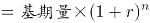，可列式：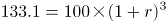，化简为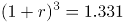。代入A项：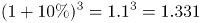，满足条件且为唯一解。

故正确答案为A。

### 第 61 题

某学校组织学生分组参观红色教育基地，租赁了若干辆客车。其中，一辆大型客车可容纳5个小组，一辆中型客车可容纳3个小组，大型客车比中型客车多容纳16个小组，那么至少租赁了大型客车和中型客车各多少辆？

A. 3；5

B. 5；3

C. 4；3

D. 5；6

第 61 题 · 答案与解析

**参考答案（粉笔题库参考内容）**

B

**解析**

设租赁大型客车x辆，中型客车y辆，根据“大型客车比中型客车多容纳16个小组”，可得5x-3y=16。

方法一：把选项代入条件中验证：

A项：若x=3，y=5，则5x-3y=0，不满足条件，排除；

B项：若x=5，y=3，则5x-3y=16，满足所有条件，当选；

C项：若x=4，y=3，则5x-3y=11，不满足条件，排除；

D项：若x=5，y=6，则5x-3y=7，不满足条件，排除。

方法二：x、y均为整数，故5x尾数只能为0或5，分情况讨论：

当5x尾数为0时，解得3y=5x-16的尾数为4，y最小为8，此时x=8，无对应选项；

当5x尾数为5时，解得3y=5x-16的尾数为9，y最小为3，此时x=5，对应B项。

故正确答案为B。

**考点**：普通不定方程

### 第 62 题

冬奥会短道速滑比赛，有3个国家4名运动员参加比赛，其中2名中国运动员，已知中国运动员始终处于领滑位置，则运动员的排序共有：

A. 12种

B. 16种

C. 18种

D. 20种

第 62 题 · 答案与解析

**参考答案（粉笔题库参考内容）**

A

**解析**

根据题意，从2名中国运动员中抽出1名使其处于领滑位置，情况数为，剩余的3名运动员全排列，情况数为，则运动员的排序共有2×6=12种。

故正确答案为A。

**考点**：基础排列组合

### 第 63 题

712934856是一个包含1至9每个数字恰好一次的九位数，它具有以下特征：数字1至6在其中是从小到大排列的，但是数字1至7不是从小到大排列的。则符合这种特征的九位数共有多少个？

A. 12

B. 336

C. 432

D. 504

第 63 题 · 答案与解析

**参考答案（粉笔题库参考内容）**

C

**解析**

第一步：根据“数字1至6在其中是从小到大排列的”，可知1至6这6个数字的排列顺序为1种；

第二步：将数字7插入第一步六个数字产生的7个空里，由“数字1至7不是从小到大排列的”可得数字7不能放在数字6之后，因此只有6个空可以用，有6种情况；

第三步：将数字8插入第二步七个数字产生的8个空里，有8种情况；

第四步：将数字9插入第三步八个数字产生的9个空里，有9种情况；

分步用乘法，因此总情况数=1×6×8×9=432。

故正确答案为C。

**考点**：基础排列组合

### 第 64 题

美术培训班有3名学员，他们的年龄满足以下条件：他们的年龄都是正整数；2号学员的年龄是1号学员年龄的一半；3号学员比2号学员大7岁；3名学员的年龄之和是不超过70的素数，且该素数的各位数字之和为13，那么这3位学员的年龄分别是多少岁？

A. 12；6；13

B. 20；10；17

C. 24；12；19

D. 30；15；22

第 64 题 · 答案与解析

**参考答案（粉笔题库参考内容）**

D

**解析**

本题为年龄问题，且选项给出三人具体年龄，优先考虑代入排除法。根据“3名学员的年龄之和是不超过70的素数，且该素数的各位数字之和为13”逐一代入选项。

A项，年龄之和为12+6+13=31岁，年龄和各位数字加和为3+1=4≠13，排除；

B项，年龄之和为20+10+17=47岁，年龄和各位数字加和为4+7=11≠13，排除；

C项，年龄之和为24+12+19=55岁，不是素数，排除；

D项，年龄之和为30+15+22=67岁，小于70岁且为素数，年龄和各位数字加和为6+7=13，当选。

故正确答案为D。

**考点**：年龄问题

### 第 65 题

向截面为如下形状的高为H的水杯内等速注水，直到注满为止，则杯中水量v与水深h的函数图像是下图中哪一个？（四个选项中坐标系横轴表示水深h，纵轴表示水量v）

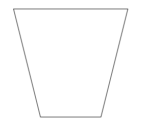

A. 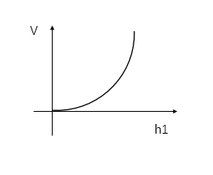

B. 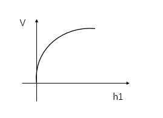

C. 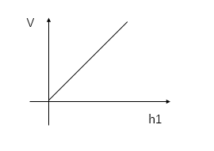

D. 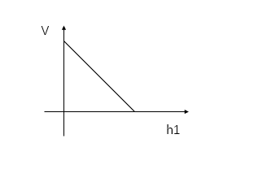

第 65 题 · 答案与解析

**参考答案（粉笔题库参考内容）**

A

**解析**

观察水杯可知，水杯上面较宽，下面较窄。由于等速注水，所以随水量v增加，截面积与高成反比，水杯截面越大，水深h变化越慢。观察选项，A项函数图h随v的变化为先快后慢；B项函数图h随v的变化为先慢后快；C项函数图为h随v的增加而增加；D项函数图为h随v的增加而减少。故只有A项符合题意。

故正确答案为A。

**考点**：几何其他题型

### 第 66 题

从所给四个选项中，选择最合适的一个填入问号处，使之呈现一定的规律性：

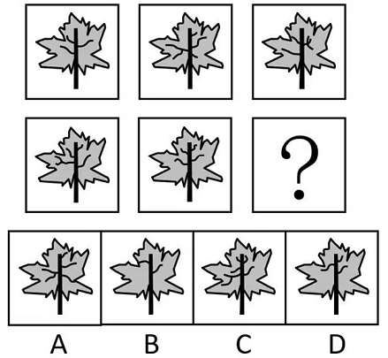

A. A

B. B

C. C

D. D

第 66 题 · 答案与解析

**参考答案（粉笔题库参考内容）**

D

**解析**

元素组成不同，且无明显属性规律，考虑数量规律。观察图形，题干每幅图的树叶和叶柄均相同，而内部叶柄上的线条数量不同，优先考虑叶柄上的线条数。第一行图形中，图1树叶中的叶柄上存在3根线条，图2树叶中的叶柄上存在5根线条，图3树叶中的叶柄上存在4根线条，第一行中三个图形树叶中的叶柄上共存在12根线条。第二行中，图1树叶中的叶柄上存在5根线条，图2树叶中的叶柄上存在4根线条。所以，“？”处图形叶柄上应存在12-5-4=3根线条，只有D项符合。

故正确答案为D。

**考点**：数量规律-线

### 第 67 题

从所给的四个选项中，选择最合适的一个填入问号处，使之呈现一定的规律性：

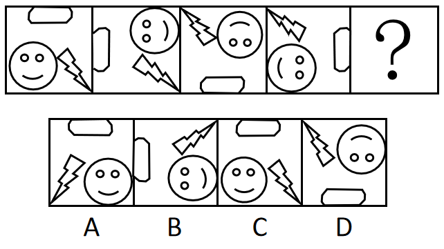

A. A

B. B

C. C

D. D

第 67 题 · 答案与解析

**参考答案（粉笔题库参考内容）**

C

**解析**

元素组成相同，优先考虑位置规律。观察发现，每幅图形均有三个小元素，考虑分开看。其中沿着正方形外框每次逆时针平移一条边，到？处时应移动到上面那条边，排除B、D两项。和两个图形的相对位置交替出现，可利用时针法，从向画时针（如下图所示），依次是逆时针、顺时针、逆时针、顺时针，因此？处应该是逆时针，只有C项符合。

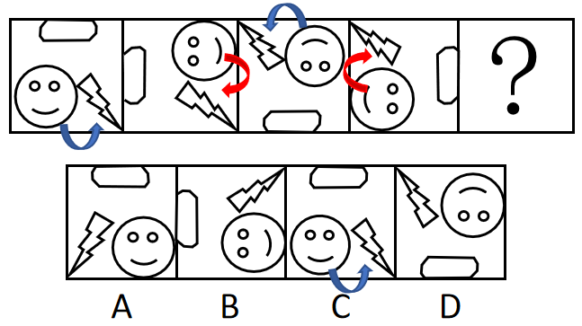

故正确答案为C。

**考点**：位置规律-综合

### 第 68 题

左边给定的是纸盒外表面的展开图，下面哪一项不能由它折叠而成？请把它找出来。

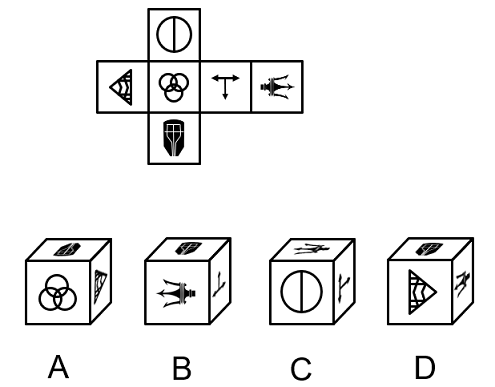

A. A

B. B

C. C

D. D

第 68 题 · 答案与解析

**参考答案（粉笔题库参考内容）**

D

**解析**

将原展开图标上序号如下图，逐一进行分析。

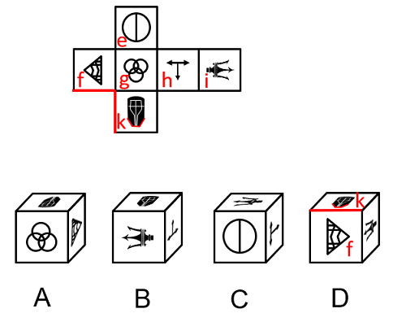

A项：选项由面f、面g和面k构成，选项与题干一致，排除；

B项：选项由面h、面i和面k构成，选项与题干一致，排除；

C项：选项由面e、面h和面i构成，选项与题干一致，排除；

D项：选项由面f、面i和面k构成，选项中面k中的盾牌尖角指向面f与面k的公共边，题干展开图中面k中的盾牌尖角未指向面f与面k的公共边，选项与题干不一致，当选。

本题为选非题，故正确答案为D。

**考点**：空间类-空间重构-六面体

### 第 69 题

从所给四个选项中，选择最合适的一个填入问号处，使之呈现一定的规律性：

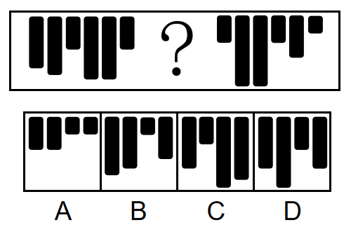

A. A

B. B

C. C

D. D

第 69 题 · 答案与解析

**参考答案（粉笔题库参考内容）**

B

**解析**

方法一：

元素组成不同，优先考虑属性规律。观察发现，将黑色长条从高到低进行标号，如下图所示：

在两个黑色长条②中间画一条线，左右呈现对称性；在两个黑色长条①中间画一条线，左右也呈现对称性，故“？”填入黑色长条后，应使左边8块黑色长条和右边8块黑色长条的左右两边分别呈现对称性，具体如下图：

故正确答案为B。

方法二：

元素组成不同，且无明显属性规律，考虑数量规律。观察发现，题干图形由多个高低不一的黑色长条组成，且每种长度的黑色长条都出现了两次。将黑色长条从高到低进行标号，如下图所示，“？”处的黑色长条应该分别与③④⑤⑧号黑色长条的长度相等。只有B项符合。

故正确答案为B。

注：本题不管是看对称性还是不同长度方块出现的次数，都可以选到唯一答案B。大家主要学习解题思维即可，考场上根据图形特征优先想到哪个规律选哪个，无需纠结。

**考点**：数量规律-素、属性规律-对称性

### 第 70 题

把下面的六个图形分为两类，使每一类图形都有各自的共同特征或规律，分类正确的一项是：

A. ①②④，③⑤⑥

B. ①③④，②⑤⑥

C. ①③⑤，②④⑥

D. ①④⑥，②③⑤

第 70 题 · 答案与解析

**参考答案（粉笔题库参考内容）**

B

**解析**

思路一：元素组成不同，且无明显属性规律，考虑数量规律。观察发现，题干图形出现多个独立小元素，优先考虑元素的个数和种类，继续观察发现，题干每幅图形均出现一个外框，考虑内外分开看。其中，框外元素的数量依次为1、2、1、1、1、1，框内元素的数量依次为2、2、2、2、1、1，单独看数量无规律，但图①③④中，框内元素数-框外元素数=1，图②⑤⑥中，框内元素数=框外元素数。即图①③④一组，图②⑤⑥一组。

故正确答案为B。

思路二：元素组成不同，且无明显属性规律，考虑数量规律。观察发现，题干出现明显多边形，优先考虑直线数，继续观察发现，题干每幅图形均出现一个外框，考虑内外分开看。图①④⑥框外直线数为4，图②③⑤框外直线数为10。即图①④⑥一组，图②③⑤一组。

故正确答案为D。

注：观察图形规律时，应优先观察整体性规律，框外直线数只关注到图形中的局部，相比框外直线数的规律，考虑框内外元素数量间的运算更全面更严谨，故粉笔更倾向于思路一。

**考点**：数量规律-素

### 第 71 题

从所给的四个选项中，选择最合适的一个填入问号处，使之呈现一定的规律性：

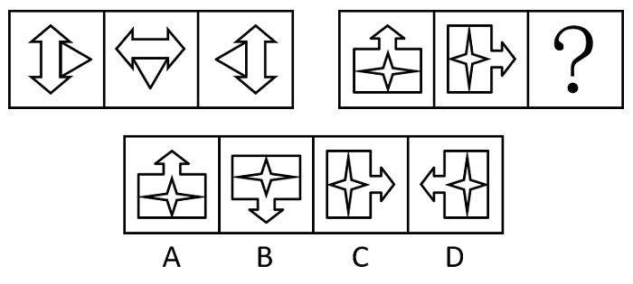

A. A

B. B

C. C

D. D

第 71 题 · 答案与解析

**参考答案（粉笔题库参考内容）**

B

**解析**

图形元素组成相同，优先考虑位置规律。观察发现，题干中第一组图的三幅图依次顺时针旋转；第二组图也按此规律进行旋转，所以问号处图形应为该组第二幅图顺时针旋转后所得，只有B项符合。

故正确答案为B。

**考点**：位置规律-旋转

### 第 72 题

从所给的四个选项中，选择最合适的一个填入问号处，使之呈现一定的规律性：

A. A

B. B

C. C

D. D

第 72 题 · 答案与解析

**参考答案（粉笔题库参考内容）**

C

**解析**

观察发现，题干图形均出现黑块与白块，但数量、位置等均无规律，九宫格横行看无规律时，考虑纵向观察。将第一列的图1和图2相邻比较发现，两幅图中含有四个相同的图形和两个不同的图形（如下图标红处所示），将第一列的图2和图3相邻比较发现，两幅图中也含有四个相同的图形和两个不同的图形（如下图标蓝处所示）。在第二列进行验证，符合此规律。故？处图形应与第三列的图2含有四个相同的图形和两个不同的图形，只有C项符合。

故正确答案为C。

**考点**：黑白块类、样式规律-遍历

### 第 73 题

从所给的四个选项中，选择最合适的一个填入问号处，使之呈现一定的规律性：

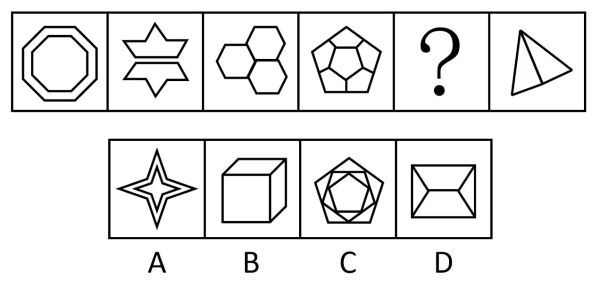

A. A

B. B

C. C

D. D

第 73 题 · 答案与解析

**参考答案（粉笔题库参考内容）**

B

**解析**

元素组成不同，且属性规律无唯一答案，考虑数量规律。观察发现，题干图形均有形状相同的元素，且每幅图形都有一组形状相同的元素。继续观察发现，题干相同形状的元素分别是八边形、七边形、六边形、五边形、？、三角形，因此？处图形相同形状的元素应为四边形，只有B项符合。

故正确答案为B。

**考点**：数量规律-面

### 第 74 题

从所给四个选项中选择最合适的一个填入问号处，使之呈现一定的规律性：

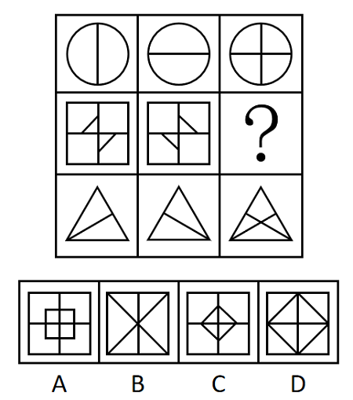

A. A

B. B

C. C

D. D

第 74 题 · 答案与解析

**参考答案（粉笔题库参考内容）**

C

**解析**

图形元素组成相似，且相同线条重复出现，优先考虑样式规律中的加减同异。九宫格优先按行看，观察发现，第一行中的图1和图2相加得到图3，经验证第三行满足此规律；故第二行应用此规律，图1和图2相加，只有C项符合。

故正确答案为C。

**考点**：样式规律-加减同异

### 第 75 题

把下面的六个图形分为两类，使每一类图形都有各自的共同特征或规律，分类正确的一项是：

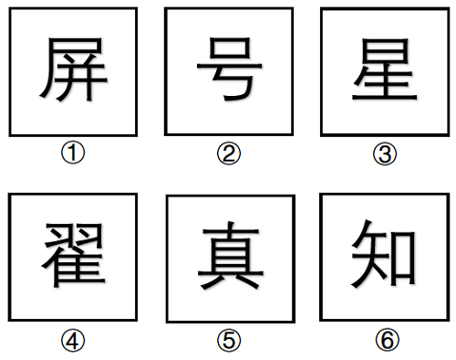

A. ①②⑥，③④⑤

B. ①③④，②⑤⑥

C. ①③⑥，②④⑤

D. ①④⑤，②③⑥

第 75 题 · 答案与解析

**参考答案（粉笔题库参考内容）**

A

**解析**

元素组成不同，且无明显属性规律，优先考虑数量规律。观察发现，题干汉字中横线出现较多，优先考虑横线数量。题干图形中横线数量分别为：4、4、6、6、6、4，因此图①②⑥为一组，图③④⑤为一组。

故正确答案为A。

**考点**：数量规律-线、文字/字母/数字类

### 第 76 题

寥寥无几：数不胜数

A. 恒河沙数：一星半点

B. 独一无二：所剩无几

C. 荡然无存：不计其数

D. 屈指可数：比比皆是

第 76 题 · 答案与解析

**参考答案（粉笔题库参考内容）**

D

**解析**

第一步：判断题干词语间逻辑关系。

“寥寥无几”形容数量很少，没有几个；“数不胜数”形容数量极多，很难计算，二者是反义关系。

第二步：判断选项词语间逻辑关系。

A项：“恒河沙数”指像恒河里的沙粒一样，无法计算，形容数量很多；“一星半点”形容极少，二者是反义关系，与题干逻辑关系一致，保留；

B项：“独一无二”指没有相同的或没有可以相比的，形容十分稀少；“所剩无几”意思是剩下的没有多少了，二者不是反义关系，与题干逻辑关系不一致，排除；

C项：“荡然无存”形容原来有的东西全部消失，完全不复存在了；“不计其数”指没有办法计算它的数目，表示极多，二者不是反义关系，与题干逻辑关系不一致，排除；

D项：“屈指可数”形容数目很少；“比比皆是”指到处都是，形容很多，二者是反义关系，与题干逻辑关系一致，保留。

对比A、D两项，A项中第一个词形容数量多，第二个词形容数量少，而题干和D项中第一个词均形容数量少，第二个词均形容数量多，因此D项与题干逻辑关系更为一致，当选。

故正确答案为D。

**考点**：语义-其他

### 第 77 题

奔：跑：快

A. 崎：岖：路

B. 飞：翔：高

C. 写：字：好

D. 督：促：严

第 77 题 · 答案与解析

**参考答案（粉笔题库参考内容）**

B

**解析**

第一步：判断题干词语间逻辑关系。

奔指奔走、急跑；跑指两只脚或四条腿迅速前进，二者为近义关系。快是奔和跑的属性，与二者为属性对应关系。

第二步：判断选项词语间逻辑关系。

A项：崎和岖用来形容山路不平，二者为近义关系。崎和岖都是路的属性，与题干逻辑关系不一致，排除；

B项：飞指飞行；翔指像鸟飞一样，二者为近义关系。高是飞和翔的属性，与二者为属性对应关系，与题干逻辑关系一致，当选；

C项：写字构成动宾关系，与题干逻辑关系不一致，排除；

D项：督指察看；促指时间紧迫，二者不是近义关系，与题干逻辑关系不一致，排除。

故正确答案为B。

**考点**：语义关系-近义关系、逻辑关系-对应关系

### 第 78 题

洗脸盆：代步车

A. 招待所：降压药

B. 木版画：制冷剂

C. 节能灯：传染病

D. 计算器：液压机

第 78 题 · 答案与解析

**参考答案（粉笔题库参考内容）**

A

**解析**

第一步：判断题干词语间逻辑关系。

洗脸盆和代步车之间无直接逻辑关系，考虑拆分，两词均是从功能角度命名的。

第二步：判断选项词语间逻辑关系。

A项：招待所和降压药之间无直接逻辑关系，两词均是从功能角度命名的，与题干逻辑关系一致，当选；

B项：木版画和制冷剂之间无直接逻辑关系，制冷剂是从功能角度来命名的，但木版画是从材料角度来命名的，与题干逻辑关系不一致，排除；

C项：节能灯和传染病之间无明显逻辑关系，两词均是从属性角度来命名的，与题干逻辑关系不一致，排除；

D项：计算器和液压机之间无明显逻辑关系，计算器是从功能角度命名的，但液压机是从工作原理角度来命名的，与题干逻辑关系不一致，排除。

故正确答案为A。

**考点**：拆分思维、逻辑关系-对应关系

### 第 79 题

全球：北半球：南半球

A. 全身：躯干：四肢

B. 全价：优惠价：打折价

C. 全集：短篇：长篇

D. 全程：上半程：下半程

第 79 题 · 答案与解析

**参考答案（粉笔题库参考内容）**

D

**解析**

第一步：判断题干词语间逻辑关系。

北半球和南半球均为全球的组成部分，后两词为并列关系，且各占全球的一半。

第二步：判断选项词语间逻辑关系。

A项：躯干和四肢均为全身的组成部分，后两词为并列关系，但不是各占全身的一半，还有头颅，与题干逻辑关系不一致，排除；

B项：全价和优惠价是两种不同的价格，二者为并列关系，与题干逻辑关系不一致，排除；

C项：短篇和长篇不是全集的组成部分，与题干逻辑关系不一致，排除；

D项：上半程和下半程均为全程的组成部分，后两词为并列关系，且各占全程的一半，与题干逻辑关系一致，当选。

故正确答案为D。

**考点**：逻辑关系-并列关系、逻辑关系-包容关系

### 第 80 题

草根：草：平民百姓

A. 曙光：光：美好前景

B. 鸿毛：雁：轻微的事物

C. 骨肉：人：紧密相连

D. 水分：水：不真实成分

第 80 题 · 答案与解析

**参考答案（粉笔题库参考内容）**

B

**解析**

第一步：判断题干词语间逻辑关系。

草根是草的组成部分，二者为组成关系；草根一般指平民百姓，二者为比喻象征关系，且草根是一种具体的东西。

第二步：判断选项词语间逻辑关系。

A项：曙光指破晓时的阳光，是光的一种，二者为种属关系，与题干逻辑关系不一致，排除；

B项：鸿毛指鸿雁的毛，是雁的组成部分，二者为组成关系；鸿毛比喻极轻，微不足道的事物，与轻微的事物构成比喻象征关系，且鸿毛是一种具体的东西，与题干逻辑关系一致，当选；

C项：骨肉是人的组成部分，二者为组成关系；骨肉比喻父母、兄弟、子女等亲人，也比喻紧密相连、不可分割的关系，但骨与肉是两种东西，与题干逻辑关系不一致，排除；

D项：水分指物体内所含的水，是水的一种，二者为种属关系，与题干逻辑关系不一致，排除。

故正确答案为B。

**考点**：语义关系-比喻象征义、逻辑关系-包容关系

### 第 81 题

钾盐：钾肥：氯化钾

A. 磁铁矿：赤铁矿：铁元素

B. 砂石路：混凝土路：水泥

C. 工程塑料：层压塑料：树脂

D. 酒精：医用酒精：乙醇

第 81 题 · 答案与解析

**参考答案（粉笔题库参考内容）**

A

**解析**

第一步：判断题干词语间逻辑关系。

“氯化钾”是“钾盐”和“钾肥”的成分之一，前两词是并列关系，且第一词和第二词都与第三词构成组成关系。

第二步：判断选项词语间逻辑关系。

A项：“铁元素”是“磁铁矿”和“赤铁矿”的成分之一，前两词是并列关系，且第一词和第二词都与第三词构成组成关系，与题干逻辑关系一致，当选；

B项：“水泥”不是“砂石路”的成分，与题干逻辑关系不一致，排除；

C项：塑料按用途分类可分为通用、工程、特种三种类型，按成型方法可分为模压、层压、注射等多种类型，故有的工程塑料是层压塑料，有的工程塑料不是层压塑料，有的层压塑料是工程塑料，有的层压塑料不是工程塑料，前两词是交叉关系，与题干逻辑关系不一致，排除；

D项：“乙醇”俗称“酒精”，二者是全同关系，与题干逻辑关系不一致，排除。

故正确答案为A。

**考点**：逻辑关系-并列关系、逻辑关系-包容关系

### 第 82 题

色厉内荏 对于 （ ） 相当于 （ ） 对于 重整旗鼓

A. 外刚内柔；另起炉灶

B. 表里如一；背水一战

C. 心慈手软；一蹶不振

D. 外强中干；东山再起

第 82 题 · 答案与解析

**参考答案（粉笔题库参考内容）**

D

**解析**

逐一代入选项。

A项：色厉内荏意思是外表强硬而内心怯懦，外刚内柔指的是表面刚强，内心柔弱，二者没有明显逻辑关系；另起炉灶比喻重新做起，重整旗鼓指的是失败之后，重新集合力量再干，二者是近义关系，前后逻辑关系不一致，排除；

B项：色厉内荏意思是外表强硬而内心怯懦，表里如一指思想和言行完全一致，二者没有明显逻辑关系；背水一战指在不利情况下和敌人做最后决战，比喻面临绝境，为求得出路而做最后一次努力，重整旗鼓指的是失败之后，重新集合力量再干，二者没有明显逻辑关系，前后逻辑关系不一致，排除；

C项：色厉内荏意思是外表强硬而内心怯懦，心慈手软意思是心地善良，不忍下手（惩治），二者没有明显逻辑关系；一蹶不振比喻一遭到挫折就不能再振作起来，重整旗鼓指的是失败之后，重新集合力量再干，二者是反义关系，前后逻辑关系不一致，排除；

D项：色厉内荏意思是外表强硬而内心怯懦，外强中干指外表上好像很强大，实际上很空虚，二者是近义关系；东山再起指再度出任要职，也比喻失势之后重新恢复地位，重整旗鼓指的是失败之后，重新集合力量再干，二者是近义关系，前后逻辑关系一致，当选。

故正确答案为D。

**考点**：语义关系-近义关系

### 第 83 题

（ ） 对于 妙手回春 相当于 军人 对于 （ ）

A. 华佗再世；军官

B. 悬壶济世；百姓

C. 医生；戎马倥偬

D. 大夫；视死如归

第 83 题 · 答案与解析

**参考答案（粉笔题库参考内容）**

C

**解析**

逐一代入选项。

A项：华佗再世指医术就像华佗一样高明，形容医术高超，妙手回春指称赞医生医道高明，能把垂危的病人治愈，二者是近义关系；军官是军人，二者是种属关系，前后逻辑关系不一致，排除；

B项：悬壶济世指颂誉医者救人于病痛，妙手回春指称赞医生医道高明，能把垂危的病人治愈，二者是近义关系；百姓是指军人和官员以外的人，二者不是近义关系，前后逻辑关系不一致，排除；

C项：妙手回春指称赞医生医道高明，能把垂危的病人治愈，可以用来形容医生，二者是偏正关系；戎马倥偬形容军务繁忙，可以来形容军人，二者是偏正关系，前后逻辑关系一致，保留；

D项：妙手回春指称赞医生医道高明，能把垂危的病人治愈，可以用来形容医生，而大夫就是医生，二者是偏正关系；视死如归形容为了正义的事业，不怕死，视死如归可以用来形容军人，二者是偏正关系，前后逻辑关系一致，保留。

对比C项和D项，C项中妙手回春只能用来形容医生，戎马倥偬只能用来形容军人，但D项中妙手回春只能用来形容大夫，视死如归并不是只能用来形容军人，C项前后逻辑关系更为一致，当选。

故正确答案为C。

**考点**：语法关系

### 第 84 题

起重机 对于 （ ） 相当于 （ ） 对于 平整土地

A. 吊车；播撒种子

B. 搬运重物；旋耕机

C. 挖掘机；拖拉机

D. 工程机械；农业活动

第 84 题 · 答案与解析

**参考答案（粉笔题库参考内容）**

B

**解析**

逐一代入选项。

A项：“起重机”的通称为“吊车”，二者为全同关系；先“平整土地”，再“播撒种子”，二者为动作先后对应，前后逻辑关系不一致，排除；

B项：“起重机”有“搬运重物”的功能，二者为功能对应关系；“旋耕机”有“平整土地”的功能，二者为功能对应关系，前后逻辑关系一致，当选；

C项：“起重机”与“挖掘机”是不同的机械，二者为并列关系；“拖拉机”是“平整土地”时用到的设备，前后逻辑关系不一致，排除；

D项：“起重机”是“工程机械”，二者为种属关系；“平整土地”是“农业活动”，二者为种属关系，但前后词语顺序不一致，前后逻辑关系不一致，排除。

故正确答案为B。

**考点**：逻辑关系-对应关系

### 第 85 题

臭氧 对于 （ ） 相当于 （ ） 对于 万花筒

A. ；望远镜

B. 吸收紫外线；光的反射

C. 大气；三棱镜

D. 二氧化碳；光学玩具

第 85 题 · 答案与解析

**参考答案（粉笔题库参考内容）**

C

**解析**

逐一代入选项。

A项：臭氧化学式为，二者为全同关系；望远镜和万花筒是两种不同的光学器具，二者为并列关系，前后逻辑关系不一致，排除；

B项：臭氧有吸收紫外线的作用，二者为功能对应关系；万花筒的原理在于光的反射，二者为原理对应关系，前后逻辑关系不一致，排除；

C项：臭氧是大气的组成成分，二者为组成关系；万花筒中间放置了三棱镜，二者为组成关系，前后逻辑关系一致，当选；

D项：臭氧和二氧化碳是两种不同的气体，二者为并列关系；万花筒属于光学玩具，二者为种属关系，前后逻辑关系不一致，排除。

故正确答案为C。

**考点**：逻辑关系-包容关系

### 第 86 题

价值工程是指通过对设施、产品、服务或流程等进行功能和全寿命成本分析，谋求创新改进方案，以提高项目或产品价值为目的的方法。价值工程的公式为：价值=功能/成本。

根据上述定义，下列做法能够达到价值工程要求的有：

①某建筑防水施工项目使用一种新型防水卷材，在成本、防水效果不变的情况下，既降低了施工难度，又具备了耐高温功能

②某洗发水生产企业在产品物流环节加强管理，使企业的经营成本有所下降

③某日用塑料制品生产企业改进了生产工艺，虽然塑料制品的抗压能力有所下降，但成本大幅度降低

④某款手机游戏将原来的固定场景改进为玩家可根据个性化需求自行设计，虽然游戏开发成本略有提高，但游戏的可玩性大幅增加

A. 1项

B. 2项

C. 3项

D. 4项

第 86 题 · 答案与解析

**参考答案（粉笔题库参考内容）**

D

**解析**

第一步：找出定义关键词。

“通过对设施、产品、服务或流程等进行功能和全寿命成本分析”、“谋求创新改进方案”、“提高项目或产品价值”、“价值=功能/成本”。

第二步：逐一判断例证。

①使用新型防水卷材，符合“谋求创新改进方案”，在成本、防水效果不变的情况下，具备了耐高温功能，结合公式“价值=功能/成本”可知，提高了产品的价值，符合“提高项目或产品价值”，符合定义；

②企业在产品物流环节加强管理，属于在某一个环节“谋求创新改进方案”，使经营成本有所下降，结合公式“价值=功能/成本”可知，在功能不变的情况下，降低成本，可以提高产品的价值，符合“提高项目或产品价值”，符合定义；

③企业改进了生产工艺，符合“谋求创新改进方案”，虽然抗压能力有所下降，但是成本大幅度降低，说明成本下降的幅度比较大，抗压能力下降的幅度比较小，结合公式“价值=功能/成本”可知，提高了产品的价值，符合“提高项目或产品价值”，符合定义；

④将固定场景改为玩家可根据个性化需求自行设计，符合“谋求改进创新方案”，虽然开发成本略有提升，但是可玩性大幅增加，说明开发成本提升的幅度比较小，可玩性功能提升的幅度比较大，结合公式“价值=功能/成本”可知，能够提高产品的价值，符合“提高项目或产品价值”，符合定义。

综上，能够达到价值工程要求的有4项。

故正确答案为D。

**考点**：单定义-其他句式

### 第 87 题

海洋地球物理调查是指利用各种物理学方法和仪器，测量海底地球物理的性质及其变化特征，从而得出海底地质构造或矿产分布的调查方法。

根据上述定义，下列属于海洋地球物理调查的是：

A. 将重力仪安放在船上进行观测，以确定海底地壳各种岩层质量分布的不均匀性

B. 用深海钻探法从海底采集富钴结壳矿样品，分析其中锰、铁氧化物成分及氧化程度

C. 用硝酸银滴定氯化物的方法检测海底沉积物的成分，以确定海底矿产资源的情况

D. 用抛弃式探温仪测定海水温度，计算出海洋平均温度，分析近60年来海洋变暖速率

第 87 题 · 答案与解析

**参考答案（粉笔题库参考内容）**

A

**解析**

第一步：找出定义关键词。

“利用物理学方法和仪器”、“测量海底地球物理的性质及其变化特征”、“得出海底地质构造或矿产分布”。

第二步：逐一分析选项。

A项：该项利用重力仪进行观测，符合“利用物理学方法和仪器”，观测目的是确定海底地壳各种岩层质量分布的情况，符合“测量海底地球物理的性质及其变化特征”、“得出海底地质构造或矿产分布”，符合定义，当选；

B项：该项先使用深海钻探法采集样品，再对样品进行分析，但没有体现分析过程，不明确是否符合“利用物理学方法和仪器”，分析矿样品中锰、铁氧化物成分及氧化程度，且其中“氧化程度”属于化学变化的结果，不符合“测量海底地球物理的性质及其变化特征”，也无法得知“海底矿产分布”，不符合定义，排除；

C项：该项利用硝酸银滴定氯化物的方法进行检测，具体就是根据氯化物和硝酸银发生化学反应后的结果进行检测，该方法为“化学方法”，不符合“利用物理学方法和仪器”，不符合定义，排除；

D项：该项用抛弃式探温仪进行测量，符合“利用物理学方法和仪器”，测量目的是计算出海洋平均温度，进而分析海洋变暖速率，不符合“测量海底地球物理的性质及其变化特征”、“得出海底地质构造或矿产分布”，不符合定义，排除。

故正确答案为A。

**考点**：方式目的

### 第 88 题

生物刺激是通过采用可促进微生物繁殖与生长的手段，来增加本土微生物活动从而增强土壤对污染物降解能力的一种技术。生物强化是应用一种有高效降解能力的菌株或者由几种菌株组成的有降解能力的微生物组群来增强土壤污染物降解能力的技术。

根据上述定义，下列属于生物刺激的是：

A. 采用通气法改善被石油污染土壤的通气情况，可促进石油中分子量较小的成分挥发，使分子量较大的片段断裂而被土壤中的微生物降解

B. 将玉米棒碎片添加到被多环芳烃污染的土壤中，能够促进土壤中可以降解芳香烃的微生物的生长，使多环芳烃的降解率提高

C. 在被石油污染的土壤中引入白腐菌，其与本土微生物可联合发挥作用，降解多种石油烃成分，降解率可达到60.5%

D. 从被石油污染的土壤中分离出具有石油降解能力的本土微生物，达到一定数量后将其重新投入到被石油污染的土壤中，以增强土壤的降解能力

第 88 题 · 答案与解析

**参考答案（粉笔题库参考内容）**

B

**解析**

第一步：找出定义关键词。

生物刺激：“通过采用可促进微生物繁殖与生长的手段”、“增加本土微生物活动从而增强土壤对污染物降解能力”；

生物强化：“应用一种有高效降解能力的菌株或者由几种菌株组成的有降解能力的微生物组群来增强土壤污染物降解能力的技术”。

第二步：逐一分析选项。

A项：利用通气法可促进石油中分子量较小的成分挥发，使分子量较大的片段断裂而被土壤中的微生物降解，并没有增加本土微生物活动，不符合“增加本土微生物活动从而增强土壤对污染物降解能力”，不符合“生物刺激”定义，排除；

B项：将玉米棒碎片添加到被多环芳烃污染的土壤中，能够促进土壤中可以降解芳香烃的微生物的生长，说明通过采用促进微生物繁殖与生长的手段来增加本土微生物活动，而“使多环芳烃的降解率提高”，说明最终增强了土壤对污染物的降解能力，符合“生物刺激”定义，当选；

C项：在被石油污染的土壤中引入白腐菌，其与本土微生物可联合发挥作用，符合“应用一种有高效降解能力的菌株或者由几种菌株组成的有降解能力的微生物组群”，符合“生物强化”定义，不符合“生物刺激”定义，排除；

D项：从被石油污染的土壤中分离出具有石油降解能力的本土微生物，是分离提取本土微生物，未提及促进微生物繁殖与生长的手段，不符合“通过采用可促进微生物繁殖与生长的手段”，不符合“生物刺激”定义，排除。

故正确答案为B。

**考点**：常规问法

### 第 89 题

探索性学习是指突破现有规范、标准及惯例，不断搜寻、试验和创造全新知识的学习模式。挖掘性学习是指基于对现有技术、能力和范式的提炼和深化来进行学习的模式。

根据上述定义，下列最适宜描述探索性学习的一组词是：

A. 筛选、尝试

B. 风险、延伸

C. 发现、创新

D. 变化、选择

第 89 题 · 答案与解析

**参考答案（粉笔题库参考内容）**

C

**解析**

第一步：找出定义关键词。

探索性学习：“突破现有规范、标准及惯例”、“不断搜寻、试验和创造全新知识的学习模式”；

挖掘性学习：“基于对现有技术、能力和范式的提炼和深化来进行学习的模式”。

第二步：逐一分析选项。

A项：筛选泛指通过淘汰的方法挑选，不符合“突破现有规范、标准及惯例”、“不断搜寻、试验和创造全新知识的学习模式”，不符合“探索性学习”的定义，排除；

B项：延伸指延长、伸展，不符合“突破现有规范、标准及惯例”、“不断搜寻、试验和创造全新知识的学习模式”，不符合“探索性学习”的定义，排除；

C项：发现和创新，符合“突破现有规范、标准及惯例”、“不断搜寻、试验和创造全新知识的学习模式”，符合“探索性学习”的定义，当选；

D项：选择，不符合“突破现有规范、标准及惯例”、“不断搜寻、试验和创造全新知识的学习模式”，不符合“探索性学习”的定义，排除。

故正确答案为C。

**考点**：常规问法

### 第 90 题

不确定型决策是指决策者在可能出现不同的客观状态，且每种客观状态的发生概率于他而言为未知的条件下做出的决策。风险型决策是指决策者面临可能出现的两种或两种以上的自然状态，每种状态发生的概率于他而言为已知的条件下做出的决策。

根据上述定义，下列属于不确定型决策的是：

A. 有甲乙两类盲盒，甲类盲盒三个，乙类盲盒一个，从中任取一盒，猜其是哪类盲盒。猜其是甲类的正确率是75%，猜其是乙类的正确率是25%，因而决定猜其是甲类

B. 小孙是炒股新手，决定将一笔钱投入到股市中，但是并不确定应该购买哪支股票。后来他听说近期医药板块的股票行情好，于是购买了几支医药板块龙头企业的股票

C. 小张到超市购买大米，发现该超市只售卖一种品牌的大米，尽管他并不知道这个品牌的大米口感如何，但因家里急用，他仍然决定购买该品牌的大米

D. 小新在考试时遇到一道难题，题目有A、B、C、D四个选项，他完全不知道应该选择哪一个，他认为答案是“C”的概率比较高，于是他选择了“C”

第 90 题 · 答案与解析

**参考答案（粉笔题库参考内容）**

B

**解析**

第一步：找出定义关键词。

不确定型决策：“可能出现不同的客观状态”、“每种客观状态的发生概率未知”；

风险型决策：“可能出现两种或两种以上的自然状态”、“每种状态发生的概率已知”。

第二步：逐一分析选项。

A项：猜盲盒时有甲乙两类盲盒，符合“可能出现两种或两种以上的自然状态”，猜甲类的正确率是75%，乙类的正确率是25%，符合“每种状态发生的概率已知”，符合“风险型决策”定义，不符合“不确定型决策”定义，排除；

B项：小孙将一笔钱投入到股市中，不确定应该购买哪支股票，符合“可能出现不同的客观状态”，购买股票后涨跌未知，符合“每种客观状态的发生概率未知”，符合“不确定型决策”定义，当选；

C项：小张到超市购买大米，该超市只售卖一种品牌的大米，对小张而言没有其他选择，不符合“可能出现不同的客观状态”，不符合“不确定型决策”定义，排除；

D项：小新在考试时遇到一道难题，题目有A、B、C、D四个选项，符合“可能出现两种或两种以上的自然状态”，选每个选项的正确率都是25%，符合“每种状态发生的概率已知”，符合“风险型决策”定义，不符合“不确定型决策”定义，排除。

故正确答案为B。

**考点**：常规问法

### 第 91 题

离合词是指合起来表示一个词，中间插入其他成分后可扩展为短语的双音合成词。例如“洗澡-洗个热水澡”。

根据上述定义，下列不属于离合词的是：

A. 睡觉

B. 鞠躬

C. 得罪

D. 唱歌

第 91 题 · 答案与解析

**参考答案（粉笔题库参考内容）**

C

**解析**

第一步：找出定义关键词。

“合起来表示一个词”、“中间插入其他成分后可扩展为短语”。

第二步：逐一分析选项。

A项：词语“睡觉”的中间可插入其他成分扩展为短语，如“睡个好觉”，符合定义，排除；

B项：词语“鞠躬”的中间可插入其他成分扩展为短语，如“鞠了一个躬”，符合定义，排除；

C项：词语“得罪”的中间无法插入其他成分，不符合“中间插入其他成分后可扩展为短语”，不符合定义，当选；

D项：词语“唱歌”的中间可插入其他成分扩展为短语，如“唱了一首歌”，符合定义，排除。

本题为选非题，故正确答案为C。

**考点**：单定义-其他句式

### 第 92 题

同抗素是一种生物释放的化学物质，这种物质对释放者和接受者均有不利反应。

根据上述定义，下列情形中体现了同抗素影响的是：

A. 丁香假单胞菌在侵染植物的过程中会释放冠菌素，高浓度的冠菌素可以破坏植物叶片的先天性免疫机能

B. 鸡的尾脂腺会分泌醇、烷烃和烯烃，这些物质可以吸引鸡皮刺螨寄生到鸡身上，鸡被寄生后会诱发炎症

C. 病毒是一种微生物，有些病毒会在寄主体内释放毒素杀死寄主，但是一旦寄主死亡，病毒也会随即灭亡

D. 玉米会产生一种酶，这种酶会破坏啃食玉米的毛虫的肠道，让细菌可以轻易入侵到毛虫的肠道，从而将其杀死

第 92 题 · 答案与解析

**参考答案（粉笔题库参考内容）**

C

**解析**

第一步：找出定义关键词。

“生物释放的化学物质”、“对释放者和接受者均有不利反应”。

第二步：逐一分析选项。

A项：丁香假单胞菌在侵染植物的过程中会释放冠菌素，高浓度的冠菌素可以破坏植物叶片的先天性免疫机能。只能说明丁香假单胞菌释放的冠菌素对植物不利，不符合“对释放者和接受者均有不利反应”，不符合定义，排除；

B项：鸡的尾脂腺会分泌醇、烷烃和烯烃，这些物质可以吸引鸡皮刺螨寄生到鸡身上，鸡被寄生后会诱发炎症。只能说明鸡分泌的醇、烷烃和烯烃最终对鸡自身不利，不符合“对释放者和接受者均有不利反应”，不符合定义，排除；

C项：病毒是一种微生物，有些病毒会在寄主体内释放毒素杀死寄主，但是一旦寄主死亡，病毒也会随即灭亡。病毒在寄主体内释放毒素，杀死寄主，病毒也随之死亡，即对于病毒和寄主均不利，符合“生物释放的化学物质”、“对释放者和接受者均有不利反应”，符合定义，当选；

D项：玉米会产生一种酶，这种酶会破坏啃食玉米的毛虫的肠道，让细菌可以轻易入侵到毛虫的肠道，从而将其杀死。只能说明玉米产生的酶对毛虫不利，不符合“对释放者和接受者均有不利反应”，不符合定义，排除。

故正确答案为C。

**考点**：单定义-其他句式

### 第 93 题

法律事件是指由法律规范规定的，不以当事人的意志为转移而引起法律关系形成，变更或消灭的客观事实。法律行为是指行为人所实施的，能够发生法律效力，产生一定法律效果的行为。有这样一种情形：王某与张某签订加工承揽合同，合同约定王某在一个月内为张某加工某种石料，在遇有自然灾害等不可抗力的情形下，王某可延期交付。合同签订后第二天，当地即发生洪涝灾害，但王某仍如期完成，并将石料交付给张某。

根据上述定义，下列属于法律事件的是：

A. 王某和张某签订合同

B. 当地发生洪涝灾害

C. 王某如期完成加工

D. 王某将石料交付给张某

第 93 题 · 答案与解析

**参考答案（粉笔题库参考内容）**

B

**解析**

第一步：找出定义关键词。

法律事件：“不以当事人的意志为转移而引起法律关系形成，变更或消灭的客观事实”；

法律行为：“行为人所实施的，能够发生法律效力，产生一定法律效果的行为”。

第二步：逐一分析选项。

A项：王某与张某签订合同的行为能够产生法律效力和一定法律效果，符合“行为人所实施的，能够发生法律效力，产生一定法律效果的行为”，符合法律行为定义，不符合法律事件定义，排除；

B项：洪涝灾害属于自然灾害，洪涝是不会以任何人的意志为转移的客观事实，且这一事实符合二人签订合同中的不可抗力情形，王某可因此情形而延期交付，即变更合同约定的交付时间，符合“不以当事人的意志为转移而引起法律关系形成，变更或消灭的客观事实”，符合法律事件定义，当选；

C项：王某如期完成加工的行为能够产生法律效力和一定法律效果，符合“行为人所实施的，能够发生法律效力，产生一定法律效果的行为”，符合法律行为定义，不符合法律事件定义，排除；

D项：王某交付石料的行为能够产生法律效力和一定法律效果，符合“行为人所实施的，能够发生法律效力，产生一定法律效果的行为”，符合法律行为定义，不符合法律事件定义，排除。

故正确答案为B。

**考点**：常规问法

### 第 94 题

研究人员基于生物库大样本队列，采用生物电阻抗测量脂肪含量，分析其与死亡风险的关系，结果显示脂肪含量过少与死亡风险增高存在关联。研究人员认为，脂肪含量过少的人，死亡风险会增高。

以下哪项如果为真，最能削弱上述结论？

A. 在生活方式不健康的人群中，脂肪含量过多或过少均会增加死亡风险

B. 脂肪含量过多给人带来的死亡风险，高于脂肪含量过少带来的死亡风险

C. 脂肪含量过少和死亡风险高都是由疾病带来的，疾病是二者的共同原因

D. 低脂肪的饮食可以改善血脂的代谢、降低胆固醇、降低低密度脂蛋白的水平

第 94 题 · 答案与解析

**参考答案（粉笔题库参考内容）**

C

**解析**

第一步：找出论点和论据。

论点：脂肪含量过少的人，死亡风险会增高。

论据：脂肪含量过少与死亡风险增高存在关联。

本题论点和论据都在讨论脂肪含量过少和死亡风险增高的关系，二者话题一致，可以考虑削弱论点。

第二步：逐一分析选项。

A项：该项说的是在生活方式不健康的人群中，脂肪含量过多或过少均会增加死亡风险，也就是说确实有一部分脂肪含量过少的人，死亡风险增高了，有举例支持的意思，无法削弱，排除；

B项：该项说的是脂肪含量过多带来的死亡风险高于脂肪含量过少带来的死亡风险，意在进行脂肪含量多少对于死亡风险比较，而论点讨论的是脂肪含量过少会不会增高死亡风险，话题不一致，无法削弱，排除；

C项：该项说的是疾病同时导致了脂肪含量过少和死亡风险高，也就是说脂肪含量过少和死亡风险高之间不存在因果关系，而论点说的是脂肪含量过少导致死亡风险增高，直接削弱论点，当选；

D项：该项说的是低脂肪饮食带来的好处，而论点讨论的是脂肪含量过少和死亡风险增高的关系，话题不一致，无法削弱，排除。

故正确答案为C。

**考点**：削弱论点

### 第 95 题

混合动力电动汽车拥有两种不同动力源，这两种动力源在汽车不同的行驶状态下分别或者同时工作，通过这种组合达到最少的燃油消耗和尾气排放状态。目前市场上的混合动力电动汽车有两种主流车型，一种是普通混合动力（简称HEV），一种是插电式混合动力（简称PHEV）。前者不需要外接电源，操作更便捷；后者纯电行驶续航能力更强。近年来的销售数据显示，HEV汽车的销量总体高于PHEV，可见，消费者更愿意购买操作更便捷的混合动力电动汽车。

以下哪项如果为真，最能削弱上述结论？

A. PHEV车型能够实现零排放行驶，很多注重环保的人都愿意购买这种车型

B. 虽然HEV车型减少了对化石燃料的需求，但是它并不属于新能源汽车

C. 与PHEV车型相比，HEV车型通常来说制造成本更低，因此售价更便宜

D. 无论是HEV还是PHEV车型，都具有噪声小、驾驶舒适性强的优点

第 95 题 · 答案与解析

**参考答案（粉笔题库参考内容）**

C

**解析**

第一步：找出论点和论据。

论点：消费者更愿意购买操作更便捷的混合动力电动汽车。

论据：HEV不需要外接电源，操作更便捷；PHEV纯电行驶续航能力更强。近年来的销售数据显示，HEV汽车的销量总体高于PHEV。

论点和论据都在讨论操作便捷的混合动力电动汽车销量更高，二者话题一致，削弱优先考虑削弱论点。且论点可理解为消费者因为操作更便捷而更愿意购买，隐含因果关系，还可以考虑他因削弱。

第二步：逐一分析选项。

A项：选项说的是很多注重环保的人都愿意购买PHEV车型，这部分人群的数量并不确定，因此无法明确两种车型购买数量的多少，无法削弱，排除；

B项：选项说的是HEV车型并不属于新能源汽车，与消费者是否更愿意购买操作更便捷的混合动力电动汽车无关，无法削弱，排除；

C项：选项说的是HEV车型的售价更便宜，说明消费者更愿意购买HEV车型不一定是操作更便捷导致的，也有可能是价格更低导致的，他因削弱，当选；

D项：选项说的是HEV和PHEV车型都具有噪声小、驾驶舒适性强的优点，说明两车型在噪音、驾驶舒适性角度不存在差异，排除了其他影响销量的因素，为加强项，无法削弱，排除。

故正确答案为C。

**考点**：他因削弱

### 第 96 题

随着网络文学的兴盛，近年来传统文学开始主动汲取网络文学叙事资源，出现了小说叙事上的文类融合现象。传统文学之所以进行自我革新，其原因在于传统文学寻求自身的突破。可见，直面全新的社会现实，表现新时代的精神是传统文学自我革新的根本原因。

上述论证的成立需要补充以下哪项作为前提？

A. 传统文学借鉴网络文学叙事资源，强调现实感和可读性，会获得更多的读者

B. 一直以来，传统文学都将直面社会现实，表现时代精神作为自身努力的方向

C. 传统文学的市场空间不断被网络文学所挤压，使得传统文学寻求自身的突破

D. 直面全新的社会现实，表现新时代的精神使得传统文学不断寻求自身的突破

第 96 题 · 答案与解析

**参考答案（粉笔题库参考内容）**

D

**解析**

第一步：找出论点和论据。

论点：直面全新的社会现实，表现新时代的精神是传统文学自我革新的根本原因。

论据：传统文学之所以进行自我革新，其原因在于传统文学寻求自身的突破。

本题论点讨论的是传统文学自我革新的原因是“直面全新的社会现实，表现新时代的精神”，论据讨论的是传统文学自我革新的原因是“寻求自身的突破”，话题不一致，加强优先考虑搭桥，即建立“直面全新的社会现实，表现新时代的精神”与“寻求自身的突破”之间的联系。

第二步：逐一分析选项。

A项：该项说的是传统文学借鉴网络文学的好处，论点说的是传统文学自我革新的根本原因，话题不一致，无法加强，排除；

B项：该项说的是传统文学的努力方向，论点说的是传统文学自我革新的根本原因，话题不一致，无法加强，排除；

C项：该项说的是传统文学寻求自身突破的原因，论点说的是传统文学自我革新的根本原因，话题不一致，无法加强，排除；

D项：该项说的是直面全新的社会现实，表现新时代的精神使得传统文学不断寻求自身的突破，搭桥项，可以加强，当选。

故正确答案为D。

**考点**：搭桥

### 第 97 题

近期的一项研究从机理上揭示了经常喝咖啡对大脑内在功能网络的影响。在实验中，研究人员将受试者分为经常喝咖啡、偶尔喝咖啡和不喝咖啡三组，然后利用功能磁共振成像技术，比较了经常喝咖啡的人和不喝咖啡的人在休息时、工作时、喝咖啡不久后的大脑连接和结构。研究人员发现，经常喝咖啡的人小脑和皮层下区域的动态活动增加，这与提高注意力、警觉以及增强学习和记忆的效果相一致。研究人员认为，与不喝咖啡相比，经常喝咖啡有利于学习和记忆。

以下哪项如果为真，最能支持上述结论？

A. 咖啡中含有咖啡因、单宁酸、油和氮化合物等100多种物质，经常饮用咖啡有助于缓解大脑疲劳

B. 与不喝咖啡的受试者相比，经常喝咖啡的受试者小脑和丘脑之间的连接模式表现出更高的效率

C. 研究证实，咖啡容易通过血脑屏障，刺激中枢神经，经常喝咖啡对于抑制焦虑有很好的作用

D. 上述改变不仅出现在那些经常喝咖啡的受试者身上，偶尔喝咖啡的受试者也表现出了这种特征

第 97 题 · 答案与解析

**参考答案（粉笔题库参考内容）**

B

**解析**

第一步：找出论点和论据。

论点：与不喝咖啡相比，经常喝咖啡有利于学习和记忆。

论据：在实验中，研究人员将受试者分为经常喝咖啡、偶尔喝咖啡和不喝咖啡三组，然后利用功能磁共振成像技术，比较了经常喝咖啡的人和不喝咖啡的人在休息时、工作时、喝咖啡不久后的大脑连接和结构。研究人员发现，经常喝咖啡的人小脑和皮层下区域的动态活动增加，这与提高注意力、警觉以及增强学习和记忆的效果相一致。

论据讨论的是“经常喝咖啡的人脑部动态活动增加，与增强学习和记忆的效果相一致”，论点说的是“经常喝咖啡有利于学习和记忆”，从论据可以合理推出论点，故论据和论点话题一致，加强优先考虑补充论据。

第二步：逐一分析选项。

A项：该项说明经常喝咖啡有助于“缓解大脑疲劳”，而论点说的是经常喝咖啡有利于“学习和记忆”，话题不一致，无法加强，排除；

B项：该项说明经常喝咖啡的受试者小脑和丘脑之间的连接模式表现出更高的效率，而论据说明经常喝咖啡的人小脑和皮层下区域的动态活动增加，与提高注意力、警觉以及增强学习和记忆的效果相一致，意味着经常喝咖啡确实能够让大脑更高效，有利于学习和记忆，补充论据，可以加强，当选；

C项：该项说明经常喝咖啡可以“抑制焦虑”，而论点说的是经常喝咖啡有利于“学习和记忆”，话题不一致，无法加强，排除；

D项：该项说明“偶尔喝咖啡的受试者”也有上述改变，而论点说的是“经常喝咖啡”，主体不一致，无法加强，排除。

故正确答案为B。

**考点**：补充论据

### 第 98 题

X病毒是一种可以造成人体呼吸道感染的致病性病毒。研究发现，该病毒对酒精较为敏感。只需要29.3%浓度的酒精溶液就可以使该病毒的感染性滴度降低99%，36.2%浓度的酒精溶液就可以使其感染性滴度降低99.99%。这就意味着，酒精浓度只要达到36%以上就可以在30秒内灭活该病毒，而高度白酒完全可以达到这种酒精浓度。有人因此认为，喝高度白酒可以起到预防X病毒感染的作用。

以下除哪项外，均能削弱上述结论（ ）。

A. X病毒主要通过呼吸道飞沫直接进入鼻腔造成呼吸道感染

B. 喝白酒只能非常小程度地减少经由口腔进入呼吸道造成感染的风险

C. 手接触被X病毒污染的物体表面，污染的手再接触鼻、眼也会导致感染

D. 喝酒会降低人体免疫力，从而增加被任何病毒感染的可能

第 98 题 · 答案与解析

**参考答案（粉笔题库参考内容）**

B

**解析**

第一步：找出论点和论据。

论点：喝高度白酒可以起到预防X病毒感染的作用。

论据：酒精浓度只要达到36%以上就可以在30秒内灭活X病毒，而高度白酒完全可以达到这种酒精浓度。

本题论点论据都在讨论高度白酒可以消灭X病毒，话题一致，且本题为选非题，排除能削弱的选项即可。

第二步：逐一分析选项。

A项：该项说的是X病毒主要通过飞沫进入鼻腔感染，说明喝高度白酒无法起到预防X病毒感染的作用，因为还有其他的传播途径，削弱论点，可以削弱，排除；

B项：该项说的是喝白酒可以非常小程度地减少病毒由口腔造成的感染，说明喝白酒确实有预防病毒的作用，只是作用非常小，相比其他选项来说，削弱力度最弱，当选；

C项：该项说的是手接触X病毒后接触鼻、眼也会导致感染，说明喝高度白酒无法起到预防X病毒的作用，因为还有其他的传播途径，削弱论点，可以削弱，排除；

D项：该项说的是喝酒会增加人体被任何病毒感染的可能，说明喝酒会增加被X病毒感染的可能，无法起到预防X病毒的作用，削弱论点，可以削弱，排除。

本题为选非题，故正确答案为B。

**考点**：削弱选非题

### 第 99 题

某高校为加强对学生综合素质的培养，增设创新学分。学生参加社会服务表现积极和参与学术活动均可以获得创新学分。机电工程专业的学生都参与了学术活动。大多数机电工程专业的学生参加社会服务的时间都超过了80小时，其余学生参加社会服务的时间均不足60小时。参加社会服务时间达到60小时以上被认为表现积极，同时还可以获得优秀社会实践奖。

由此可以推出：

A. 所有参与学术活动的机电工程专业学生都参加了社会服务

B. 与其他专业的学生相比，获得创新学分的机电工程专业的学生更多

C. 有些获得优秀社会实践奖的机电工程专业学生获得了创新学分

D. 除参加社会服务时间达到60小时以上外，没有其他途径可以获得优秀社会实践奖

第 99 题 · 答案与解析

**参考答案（粉笔题库参考内容）**

C

**解析**

第一步：翻译题干。

①学生参加社会服务表现积极获得创新学分

②参与学术活动获得创新学分

③机电工程专业的学生参与学术活动

④有的机电工程专业的学生参加社会服务的时间超过80小时，有的参加社会服务的时间不足60小时

⑤参加社会服务时间达到60小时被认为表现积极 且 可以获得优秀社会实践奖

第二步：逐一分析选项。

A项：由③可知所有机电工程专业的学生都参与了学术活动，而非社会服务，由③无法推出。由④可知其余学生参加社会服务的时间不足60小时，其余学生不明确是否为机电工程专业，不能推出所有机电工程专业的学生都参加了社会服务，排除；

B项：题干没有提及其他专业学生参加学术活动的情况，无法比较其他专业学生和机电工程专业学生的创新学分情况，无法推出，排除；

C项：串联条件②③可以得到“所有机电专业的学生获得了创新学分”，故可以推出“有的获得优秀社会实践奖的机电工程专业学生获得了创新学分”，当选；

D项：题干未提及有没有其他途径可以获得优秀社会实践奖，无法推出，排除。

故正确答案为C。

**考点**：集合推理

### 第 100 题

所有志愿文学作品都以志愿者为表现内容，而任何以志愿者为表现内容的文学作品都无法脱离现实生活，因此，这本小说不是志愿文学作品。

上述论证需要补充以下哪项作为前提？

A. 这本小说脱离了现实生活

B. 脱离现实生活的文学作品都不是以志愿者为表现内容的

C. 所有以志愿者为表现内容的都是志愿文学作品

D. 这本小说部分内容涉及志愿者

第 100 题 · 答案与解析

**参考答案（粉笔题库参考内容）**

A

**解析**

第一步：找出论点和论据。

论点：这本小说不是志愿文学作品。

论据：所有志愿文学作品都以志愿者为表现内容，而任何以志愿者为表现内容的文学作品都无法脱离现实生活。

论点和论据话题不一致，且提问方式为“补充前提”，优先考虑搭桥，即建立“这本小说”和“脱离现实生活”之间的关系。

第二步：逐一分析选项。

A项：该项指出这本小说脱离现实生活，即在“这本小说”和“脱离现实生活”之间建立了联系，为搭桥项，可以加强，当选；

B项：该项指出脱离现实生活的文学作品都不是以志愿者为表现内容的，与论据的表述一致，属于重复论据，不是上述论证成立的前提，排除；

C项：该项指出所有以志愿者为表现内容的都是志愿文学作品，而论点讨论的是这本小说不是志愿文学作品，话题不一致，无法加强，排除；

D项：该项指出这本小说部分内容涉及志愿者，但不清楚这本小说是否为志愿文学作品，为不明确项，无法加强，排除。

故正确答案为A。

**考点**：搭桥

### 第 101 题

目前，手机及大多数电动汽车内使用的锂离子电池都由一个阴极和一个阳极组成，使用传统方式生产的阴极材料对稀土元素钴有强烈的依赖。研究人员开发了一种水热合成法，制造出一款新型无钴高容量阴极材料。此外，新方法使用溶解在乙醇中的金属使阴极结晶，而传统方式使用的是氨。研究人员认为，这种方法制造出的阴极材料更清洁、更具成本竞争力，同时也提升了生产效率。

以下除哪项外，均能支持上述结论？

A. 与氨相比，乙醇的储存和处理更安全，且可重复使用

B. 新方法制备阴极材料的时间从几天缩减到12小时

C. 使用新方法制造的锂离子电池完全可以匹配现有手机和汽车

D. 新方法使用毒性更低、价格更低廉的材料制备阴极材料

第 101 题 · 答案与解析

**参考答案（粉笔题库参考内容）**

C

**解析**

第一步：找出论点和论据。

论点：这种方法制造出的阴极材料更清洁、更具成本竞争力，同时也提升了生产效率。

论据：研究人员开发了一种水热合成法，制造出一款新型无钴高容量阴极材料。此外，新方法使用溶解在乙醇中的金属使阴极结晶，而传统方式使用的是氨。

本题论点论据均讨论新方法制造的材料优于传统方法，二者话题一致，本题为选非题，找出可以加强的选项排除即可。

第二步：逐一分析选项。

A项：说明乙醇相比于氨更安全且可重复使用，而乙醇是水热合成法中使用的原料之一，即新方法更有竞争力，补充论据，可以加强，排除；

B项：说明新方法制备材料的时间变得更短，提升制造的生产效率，补充论据，可以加强，排除；

C项：说明新方法制造的锂离子电池完全可以匹配现有的手机和汽车，而题干论点讨论的是新方法比传统方法更具优势，话题不一致，无法加强，当选；

D项：说明新方法使用毒性更低、价格更低廉的材料制备阴极材料，即新方法成本更低且更安全，补充论据，可以加强，排除。

本题为选非题，故正确答案为C。

**考点**：加强选非题

### 第 102 题

阅读传统教科书比使用电子书进行学习效果好，因为教材形式展现材料比电子版更有利于学习。

与题干所犯逻辑错误相似的是：

A. 读这本书能够让你提高分数，因为能让考试表现更好

B. 我考试前一天晚上不睡觉了，因为我同学考试前一天没睡觉考的很好

C. 我们班同学大多数都爱运动，所以运动有助于健康，我也爱运动

D. 高血压一定会导致情绪不稳，因为有高血压的人都情绪不稳

第 102 题 · 答案与解析

**参考答案（粉笔题库参考内容）**

A

**解析**

第一步：分析题干逻辑错误。

题干结论为：阅读传统教科书比使用电子书进行学习效果好。条件为：教材形式展现材料比电子版更有利于学习。结论强调传统教科书比电子书的学习效果好，条件强调传统教科书比电子书有利于学习，条件中的“有利于学习”本身需要依靠结论中的“学习效果好”证明，但同时“学习效果好”的真实性要依靠条件中的“有利于学习”证明，即用来证明结论的条件，其本身的真实性要依靠结论来证明，题干犯了“循环论证”的逻辑错误。

第二步：逐一分析选项。

A项：结论：读这本书能够让你提高分数，条件：能让考试表现更好。结论中“提高分数”需要依靠条件中“考试表现更好”证明，但是“考试表现更好”的真实性同时需要结论中“提高分数”证明，犯了“循环论证”的逻辑错误，与题干所犯逻辑错误一致，当选；

B项：结论：我考试前一天晚上不睡觉了，条件：我同学考试前一天没睡觉考的很好。条件说的是同学的情况，结论说“我”的情况，由同学不睡觉考的好的结果，推出我不睡觉也可能考的好，属于“不当类比”的逻辑错误，与题干所犯逻辑错误不同，排除；

C项：条件：我们班同学大多数都爱运动，结论：运动有助于健康，我也爱运动。结论和条件位置与题干不一致，且条件描述同学爱运动，结论描述运动有助于健康，缺少内在联系，与题干所犯逻辑错误不同，排除；

D项：结论：高血压一定会导致情绪不稳，条件：有高血压的人都情绪不稳。通过有的患高血压的人情绪不稳推出高血压一定导致情绪不稳，属于“以偏概全”的逻辑错误，与题干所犯逻辑错误不同，排除。

故正确答案为A。

**考点**：论证结构

### 第 103 题

某公司正在开展招聘活动，拟招聘出纳、采购、网管、销售4种岗位，经过层层筛选，从应聘者中挑出甲乙丙丁4人。已知，每人只选择一种岗位应聘，且每种岗位都有其中一人应聘。另外，还知道：

（1）如果丁应聘网管，那么甲应聘采购；

（2）如果乙不应聘出纳，那么甲应聘出纳且丙应聘销售；

（3）如果乙应聘出纳，那么丙应聘销售，丁也应聘出纳。

根据以上陈述，可以得出以下哪项？

A. 甲应聘采购岗位

B. 乙应聘网管岗位

C. 丙应聘出纳岗位

D. 丁应聘销售岗位

第 103 题 · 答案与解析

**参考答案（粉笔题库参考内容）**

B

**解析**

第一步：分析题干条件。

（1）丁网管甲采购；

（2）-乙出纳甲出纳 且 丙销售；

（3）乙出纳丙销售 且 丁出纳；

（4）每人只选择一种岗位应聘，且每种岗位都有其中一人应聘。

第二步：根据题干条件进行推理。

由于对象和信息较多，可以考虑从提到次数最多的“出纳”开始推理。根据条件（4）可知，每人只选择一种岗位应聘，且每种岗位都有一人应聘，再结合条件（3）可知，如果乙应聘出纳，那么丁也应聘出纳，因此，应聘出纳的不能是乙。再根据条件（2）可推出，甲应聘出纳，丙应聘销售；又根据条件（1）的逆否可知，甲不应聘采购，则丁不应聘网管，即丁应聘采购，乙应聘网管，对应B项。

故正确答案为B。

**考点**：从最大信息开始推

### 第 104 题

从种植面积来看，近三年我国甘蔗播种面积大体呈下降趋势。然而，尽管甘蔗价格在过去三年内都保持平稳，去年我国甘蔗种植者的利润却比前年提高了10%。

以下关于去年的说法中，不能解释甘蔗种植者利润提高原因的是：

A. 我国甘蔗单位面积产量大幅上涨

B. 我国甘蔗的进口量远大于出口量

C. 甘蔗种植者采用了联合机收模式，节约了收割成本

D. 许多小规模甘蔗种植者通过组织团购低价购买化肥

第 104 题 · 答案与解析

**参考答案（粉笔题库参考内容）**

B

**解析**

第一步：找出题干矛盾。

近三年我国甘蔗播种面积大体呈下降趋势，甘蔗价格在过去三年内都保持平稳，但去年我国甘蔗种植者的利润却比前年提高了10%。

第二步：逐一分析选项。

A项：该项说的是我国甘蔗单位面积产量大幅上涨，说明虽然甘蔗播种面积下降，但单位面积产量的大幅上涨，有可能带来甘蔗整体产量增加，那么在甘蔗价格保持平稳的情况下，去年我国甘蔗种植者的利润有可能比前年提高10%，可以解释题干矛盾，排除；

B项：该项说的是我国甘蔗的进口量远大于出口量，比较了我国甘蔗进出口的数量，并未提及去年我国甘蔗种植者的利润为什么比前年提高了10%，不能解释题干矛盾，当选；

C项：该项说的是甘蔗种植者采用了联合机收模式，节约了收割成本，收割成本的降低可能使得去年我国甘蔗种植者的利润比前年提高10%，可以解释题干矛盾，排除；

D项：该项说的是许多小规模甘蔗种植者通过组织团购低价购买化肥，说明小规模甘蔗种植者可以通过低价购买化肥来降低成本，所以有可能使得去年我国甘蔗种植者的利润比前年提高10%，可以解释题干矛盾，排除。

本题为选非题，故正确答案为B。

**考点**：原因解释

### 第 105 题

很多人慢跑可以跑很长时间，可一旦提高速度，就会很快感到双腿像灌了铅一样沉，肌肉酸痛、疲劳不已，这就是因为身体内堆积了太多的乳酸。在低强度的运动比如慢跑的时候，身体主要以有氧代谢为主，当速度提高以后，肌肉运动强度增加，身体开始以无氧代谢为主，糖和脂肪剧烈燃烧之后就会产生大量乳酸，你的肌肉就会酸痛。

上述论证的假设是：

A. 进行以有氧代谢为主的运动时，身体不会产生乳酸

B. 长期不运动的人突然开始运动，更容易产生肌肉酸痛

C. 高强度运动时，乳酸的产生速度超过身体的清除速度

D. 一些肌肉酸痛可能是由运动中肌肉的微细损伤造成的

第 105 题 · 答案与解析

**参考答案（粉笔题库参考内容）**

C

**解析**

第一步：找出论点和论据。

论点：很多人慢跑可以跑很长时间，可一旦提高速度，就会很快感到双腿像灌了铅一样沉，肌肉酸痛、疲劳不已，这就是因为身体内堆积了太多的乳酸。

论据：在低强度的运动比如慢跑的时候，身体主要以有氧代谢为主，当速度提高以后，肌肉运动强度增加，身体开始以无氧代谢为主，糖和脂肪剧烈燃烧之后就会产生大量乳酸，你的肌肉就会酸痛。

本题论点和论据都在讨论运动速度提高后肌肉酸痛的原因，二者话题一致，且问题为“前提假设”，优先考虑必要条件。

第二步：逐一分析选项。

A项：该项说的是在进行以有氧代谢为主的运动时，身体不会产生乳酸，但是论点说的是运动速度提高后，也就是身体开始以无氧代谢为主的情况下肌肉酸痛的原因，话题不一致，无法加强，排除；

B项：该项说的是长期不运动的人突然开始运动，更容易肌肉酸痛，但论点说的是运动速度提高后肌肉酸痛的原因，话题不一致，无法加强，排除；

C项：该项说的是提高运动速度时，乳酸的产生速度超过身体的清除速度，如果提高运动速度后，乳酸的产生速度没有超过身体的清除速度，则乳酸无法在身体内堆积，肌肉便不会因乳酸堆积而酸痛，即选项不成立，题干论证不成立，故该项是论证成立的必要条件，可以加强，当选；

D项：该项说的是肌肉酸痛也可能是由肌肉的微细损伤造成的，提出了肌肉酸痛的另一个原因，属于削弱项，无法加强，排除。

故正确答案为C。

**考点**：必要条件

## 材料 1

### 第 106 题

2021年5月至9月，软件业务收入为（ ）亿元。

A. 10339

B. 43288

C. 33893

D. 69007

第 106 题 · 答案与解析

**参考答案（粉笔题库参考内容）**

B

**解析**

定位统计表可得，2021年1月~4月软件业务收入为25719亿元，2021年1月~9月软件业务收入为69007亿元，则2021年5月~9月软件业务收入为69007-25719=43288亿元。

故正确答案为B。

**考点**：统计表、简单加减计算

### 第 107 题

下图能正确反映2021年5月至9月软件产品收入（亿元）的是：

A. 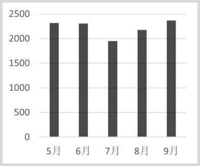

B. 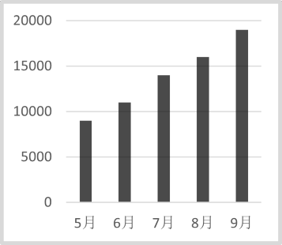

C. 

D. 

第 107 题 · 答案与解析

**参考答案（粉笔题库参考内容）**

A

**解析**

软件产品收入：5月=1月~5月-1月~4月=9142-6823=亿元；6月=1月~6月-1月~5月=11451-9142亿元；7月=1月~7月-1月~6月=13403-11451=1952亿元；8月=1月~8月-1月~7月=15582-13403亿元；9月=1月~9月-1月~8月=17951-15582亿元。只有A项满足。

故正确答案为A。

**考点**：统计表、简单加减计算

### 第 108 题

2021年5月至8月，信息技术服务收入最高的月份是：

A. 5月

B. 6月

C. 7月

D. 8月

第 108 题 · 答案与解析

**参考答案（粉笔题库参考内容）**

B

**解析**

信息技术服务收入：5月=1月~5月-1月~4月=21314-16222亿元，6月=1月~6月-1月~5月=28319-21314亿元，7月=1月~7月-1月~6月=32744-28319亿元，8月=1月~8月-1月~7月=37951-32744亿元，故信息技术服务收入最高的月份是6月。

故正确答案为B。

**考点**：统计表、简单加减计算

### 第 109 题

2021年第三季度，信息技术服务收入约是嵌入式系统软件收入的：

A. 7.3倍

B. 7.5倍

C. 7.7倍

D. 7.9倍

第 109 题 · 答案与解析

**参考答案（粉笔题库参考内容）**

A

**解析**

根据题干“2021年第三季度······是······的”，结合材料时间为2021年，可判定本题为现期倍数问题。定位表格材料，信息技术服务第三季度收入=1月~9月收入-1月~6月收入=43980-28319=15661亿元，嵌入式系统软件第三季度收入=1月~9收入-1月~6月收入=5850-3696=2154亿元，则所求倍数。

故正确答案为A。

**考点**：现期倍数、统计表

### 第 110 题

能够从上述材料中得出的是：

A. 2021年9月，四类业务中信息技术服务收入占比最高

B. 2021年8月，软件业务收入是信息技术服务收入的2倍

C. 2021年6月，四类收入总计超过2万亿元

D. 2021年上半年，四类业务收入超过10万亿元

第 110 题 · 答案与解析

**参考答案（粉笔题库参考内容）**

C

**解析**

A项：定位表格材料可得2021年9月收入分别为：软件业务收入=69007-59710亿元；软件产品收入=17951-15582亿元；信息技术服务收入=43980-37951亿元；嵌入式系统软件收入=5850-5142亿元。根据公式： 比重，整体相同，信息技术服务收入并非最高，故其占比并非最高，错误；

B项：定位表格材料可得2021年8月：软件业务收入=59710-51441=8269亿元、信息技术服务收入=37951-32744=5207亿元，，两者并非2倍关系，错误；

C项：定位表格材料可得2021年6月软件业各类收入：软件业务收入=44198-33893=10305亿元；软件产品收入=11451-9142=2309亿元；信息技术服务收入=28319-21314=7005亿元；嵌入式系统软件收入=3696-2921=775亿元。四类收入总计亿元，超过2万亿元，正确；

D项：定位表格材料可得2021年上半年软件业各类收入，四类业务收入总计44198+11451+28319+3696＜45000+12000+29000+4000=90000亿元，不足10万亿元，错误。

故正确答案为C。

**考点**：综合分析、统计表

## 材料 2

据国家统计局数据显示，2021年我国研究与试验发展（R&D）经费支出27864亿元，同比增长14.2%，占国内生产总值之比为2.44%，其中基础研究经费1696亿元。国家自然科学基金共资助4.87万个项目。2021年全年授予专利权460.1万件，同比增长26.4%；PCT专利申请受理量7.3万件。截至2021年末，有效专利1542.1万件，其中境内有效发明专利270.4万件。每万人口高价值发明专利拥有量7.5件。全年商标注册773.9万件，同比增长34.3%。全年共签订技术合同67万项，技术合同成交金额37294亿元，同比增长32.0%。

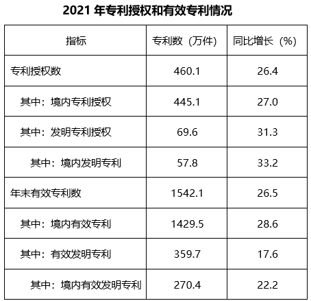

### 第 111 题

2021年，我国境内专利授权数比上一年增加：

A. 120万件

B. 95万件

C. 85万件

D. 80万件

第 111 题 · 答案与解析

**参考答案（粉笔题库参考内容）**

B

**解析**

根据题干“······比上一年增加”，结合选项单位为“万件”，可判定本题为增长量计算问题。定位统计表可得：2021年境内专利授权数为445.1万件，同比增长27.0%。根据公式：增长量，则所求增长量万件，与B项最接近。

故正确答案为B。

**考点**：增长量计算、综合资料

### 第 112 题

2020年，境内发明专利占专利授权数的比重为：

A. 11.9%

B. 12.6%

C. 13.5%

D. 14.3%

第 112 题 · 答案与解析

**参考答案（粉笔题库参考内容）**

A

**解析**

根据题干“2020年······占······比重为”，结合材料时间为2021年，可判定本题为基期比重问题。定位统计表可得：2021年境内发明专利数为57.8万件（A），同比增长33.2%（a）；专利授权数为460.1万件（B），同比增长26.4%（b）。根据公式：基期比重，则所求比重，仅A项满足。

故正确答案为A。

**考点**：基期比重、综合资料

### 第 113 题

2018~2021年间，我国研究与试验发展经费支出同比增速最高的年份是：

A. 2018年

B. 2019年

C. 2020年

D. 2021年

第 113 题 · 答案与解析

**参考答案（粉笔题库参考内容）**

D

**解析**

根据题干“······同比增速最高的年份”，可判定本题为一般增长率问题。定位统计图可得：2017~2021年我国研究与试验发展（R&D）经费支出数据，根据公式：增长率，可得2018年我国研究与试验发展经费支出同比增速；2019年同比增速；2020年同比增速；2021年同比增速。比较可得，2018~2021年间，我国研究与试验发展经费支出同比增速最高的年份是2021年。

故正确答案为D。

**考点**：一般增长率、综合资料

### 第 114 题

2017~2021年，我国研究与试验发展经费支出超过年平均值的年份的个数是：

A. 1个

B. 2个

C. 3个

D. 4个

第 114 题 · 答案与解析

**参考答案（粉笔题库参考内容）**

B

**解析**

根据题干“2017~2021年······年平均值······”，可判定本题为现期平均数问题。定位统计图可得：2017~2021年我国研究与试验发展经费支出分别为17606亿元、19678亿元、22144亿元、24393亿元、27864亿元。根据公式：平均数，可得2017~2021年的年平均值为亿元，则超过年平均值的年份有2020年、2021年，共2个。

故正确答案为B。

**考点**：现期平均数、综合资料

### 第 115 题

下列说法正确的是：

A. 2021年，我国基础研究经费占R&D经费的比重不到5%

B. 2021年，全国有效专利中有效发明专利不到20%

C. 2021年，专利授权数比上一年增加不超过100万件

D. 2021年，我国技术合同成交金额比上一年增加超过万亿元

第 115 题 · 答案与解析

**参考答案（粉笔题库参考内容）**

C

**解析**

A项：定位文字材料可得，2021年我国研究与试验发展（R&D）经费支出27864亿元，其中基础研究经费1696亿元。则基础研究经费占R&D经费的比重，错误；

B项：定位统计表可得，2021年有效专利数为1542.1万件，其中有效发明专利数为359.7万件。则全国有效发明专利数占有效专利数的比重，错误；

C项：定位文字材料可得，2021年全年授予专利权460.1万件，同比增长26.4%。根据公式：增长量，则专利授权数同比增量万件，正确；

D项：定位文字材料可得，2021年技术合同成交金额37294亿元，同比增长32.0%。根据公式：增长量，则我国技术合同成交金额同比增量亿元，错误。

故正确答案为C。

**考点**：综合分析、综合资料

## 材料 3

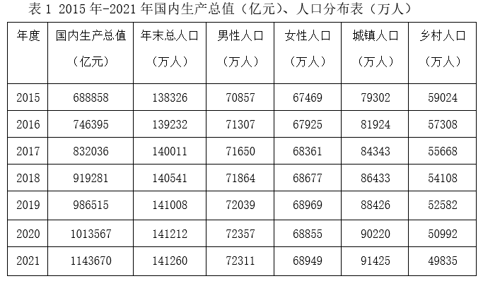

### 第 116 题

2020年，0～14岁的人口数约为：

A. 19064万人

B. 23877万人

C. 25277万人

D. 26064万人

第 116 题 · 答案与解析

**参考答案（粉笔题库参考内容）**

C

**解析**

根据题干“2020年，0～14岁的人口数约为”，结合材料中有2020年总人口和0～14岁人口占比的数据，可判定本题为现期比重问题。定位表1可知，2020年总人口为141212万人；定位表2可知，2020年0～14岁人口占比为17.9%。因此2020年0～14岁的人口数为万人，与C项最接近。

故正确答案为C。

**考点**：现期比重、统计表

### 第 117 题

2019～2021年，我国人口男女性别比按降序排列正确的是：

A. 2019年>2020年>2021年

B. 2021年>2020年>2019年

C. 2020年>2019年>2021年

D. 2020年>2021年>2019年

第 117 题 · 答案与解析

**参考答案（粉笔题库参考内容）**

D

**解析**

根据题干“2019～2021年，我国人口男女性别比按降序排列正确的是”，可判定本题为比值比较问题。定位表1可得：2019～2021年我国男性人口分别为72039万人、72357万人、72311万人；女性人口分别为68969万人、68855万人、68949万人。则2019～2021年，我国人口男女性别比分别为：2019年；2020年；2021年，观察可知， 2020年分子最大、分母最小，故其分数值最大，排除A、B两项；与2019年相比，2021年分子大、分母小，故其分数值更大，排除C项。

故正确答案为D。

**考点**：统计表、比值比较

### 第 118 题

“十三五”期间（2016-2020年），人口自然增长率最高的年份是：

A. 2016年

B. 2017年

C. 2018年

D. 2019年

第 118 题 · 答案与解析

**参考答案（粉笔题库参考内容）**

A

**解析**

根据公式：人口自然增长率=人口出生率-人口死亡率，定位表2可知2016-2019年我国每年的出生率和死亡率，可得2016年人口自然增长率=12.95‰-7.09‰=5.86‰，2017年人口自然增长率=12.43‰-7.11‰=5.32‰，2018年人口自然增长率=10.94‰-7.13‰=3.81‰，2019年人口自然增长率=10.48‰-7.14‰=3.34‰，故2016年人口自然增长率最高。

故正确答案为A。

**考点**：统计表、简单加减计算

### 第 119 题

“十三五”期间，人口城镇化率超过60%的年份共有：

A. 2个

B. 3个

C. 4个

D. 5个

第 119 题 · 答案与解析

**参考答案（粉笔题库参考内容）**

C

**解析**

根据题干“‘十三五’期间，人口城镇化率超过60%······”，结合材料给出各年份相应数据，可判定本题为现期比重问题。定位表1可得：“十三五（2016-2020年）”各年份总人口和城镇人口，根据公式：人口城镇化率 ，可知2016-2020年的人口城镇化率分别为：2016年人口城镇化率，2017年人口城镇化率，2018年人口城镇化率，2019年人口城镇化率，2020年人口城镇化率。超过60%的有2017年、2018年、2019年和2020年，共4个年份。

故正确答案为C。

**考点**：现期比重、统计表

### 第 120 题

下列关于“十三五”期间我国人口发展状况，说法错误的是：

A. 我国人口自然增长率表现向下的态势

B. 我国少儿抚养比表现出持续上升的态势

C. 每年都需要两个多劳动人口（15-64岁）负担一个被抚养人口

D. 老年抚养比表现出持续下降的态势

第 120 题 · 答案与解析

**参考答案（粉笔题库参考内容）**

D

**解析**

A项：定位表2可得2016-2020年我国人口出生率及死亡率。根据公式：人口自然增长率=出生率-死亡率，则“十三五”（2016-2020年）期间，我国人口自然增长率分别为：

2016年：12.95‰-7.09‰=5.86‰；2017年：12.43‰-7.11‰=5.32‰；2018年：10.94‰-7.13‰=3.81‰；2019年：10.48‰-7.14‰=3.34‰；2020年：8.52‰-7.10‰=1.42‰。比较可知，“十三五”期间，我国人口自然增长率表现向下的态势。正确；

B项：定位表2可得：2016-2020年我国少儿抚养比分别为：22.9%、23.4%、23.7%、23.8%、26.2%。比较可知，“十三五”期间，我国少儿抚养比表现出持续上升的态势。正确；

C项：定位表2可得2016-2020年我国15~64岁人口占比。两个多劳动人口（15~64岁）负担一个被抚养人口，需满足，即，化简可得：（66.7%）<15~64岁人口占比<（75%），观察发现，2016-2020年我国15~64岁人口占比均在此范围内。因此，“十三五”期间，我国每年都需要两个多劳动人口（15~64岁）负担一个被抚养人口。正确；

D项：定位表2可得：2016-2020年我国老年抚养比分别为：15.0%、15.9%、16.8%、17.8%、19.7%。比较可知，“十三五”期间，我国老年抚养比表现出持续上升的态势，并非下降。错误。

本题为选非题，故正确答案为D。

**考点**：综合分析、统计表

## 未自动迁移的旧版答案

旧版完整内容保留在本地候选目录中的 legacy-original.md。因题目身份未唯一确认，这些答案没有按旧题号附加到新题目。
