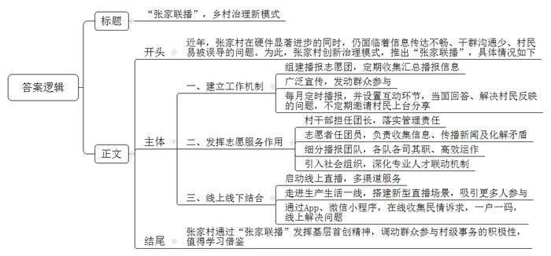
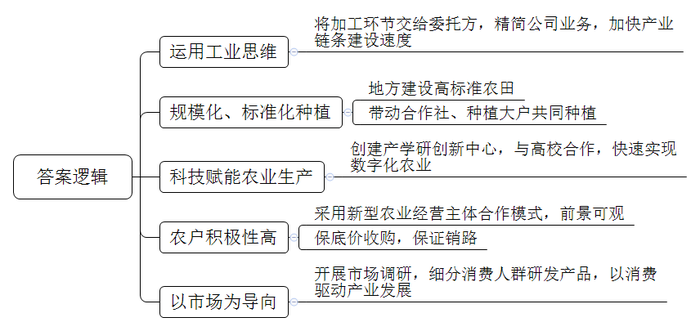
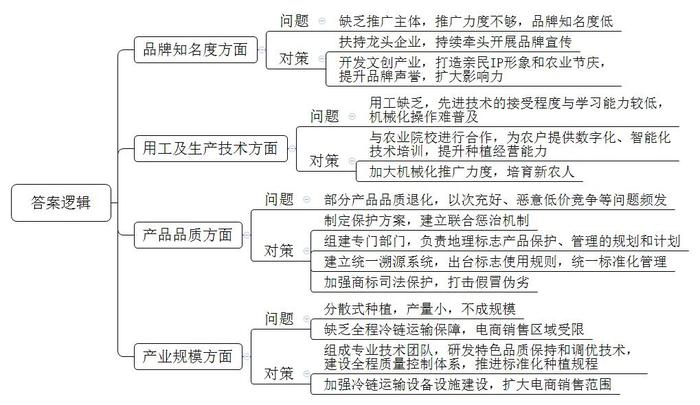
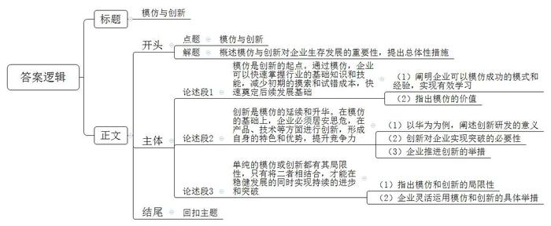

# 2024年公务员多省联考《申论》题（内蒙古旗县卷）

<!-- gwy:overview:start -->
> **内蒙古 · 2024 · 申论 · 旗县卷** ｜ 4 题 · 图片 4 处 · 答案随题折叠

导航：[题目](#题目) · [材料 1](#材料-1)
<!-- gwy:overview:end -->

> 候选采集稿。参考答案及解析来自粉笔页面，不代表官方答案或真实高分答卷；来源使用许可与原卷对应关系仍需人工核实。

## 给定材料

### 材料 1

“把新闻发布会开到村里，把新思想讲进百姓心里，把矛盾化解在沟通里，大家好，欢迎参加第19期‘张家联播’……”近日，在H市张家村的文化礼堂里，一场别开生面的“新闻发布会”正在进行。讲台上，村委会沈主任代表村委会向村民现场播报国内新闻、省内新闻和乡村新闻等。讲台下，几十张桌椅座无虚席，村民们认真倾听讲解，还不时举手提问。

“每月25日，我都会准时来到大礼堂，听听和自己有关的那些事。”村民张凤敏说，“播报员是熟悉的村干部、乡贤、党员、村民代表，操着一口方言，这样的‘新闻联播’别提多亲切了！”

近年来，张家村大力发展乡村产业，进行村庄建设，在硬件上有了很大的提升。但与此同时，上下信息传达不畅通，干部与村民之间面对面沟通少，村民易受各种小道消息、负面消息甚至谣言误导。2021年，镇里开展违章建筑拆除行动，村里人心惶惶，各种小道消息满天飞。为此，村“两委”多次组织召开会议，研究解决办法。一次，在村民代表大会上，有人提出借鉴“新闻联播”的方式向群众告知大小新闻事件，得到了大家的一致肯定。

说干就干，经过一系列商议，“张家联播”诞生了，并确定了工作机制。建立由村干部、乡贤代表、党员代表等组成的播报志愿团，定期收集中央、省、市有关会议精神，热点时政要闻，镇党委政府近期涉村工作安排，以及与村民息息相关的各类惠民利民政策信息等。每月25日前，播报团成员整理汇总收集到的内容，交由村党支部审核签阅。同时，通过微信公众号、微信视频号、微信村民群、小组内交流群等方式广泛宣传，发动群众参与。每月25日当天，播报员以论时事、讲案例、说故事等形式，先播报20至30分钟；随后进入互动环节，播报员与村民当面交流，将村民反映的热点、难点问题进行现场回答并解决。根据播报的不同主题，不定期邀请村民上台分享体会、提出建议。“有一期节目，我反映了八组的进村路有两个窟窿。”村民老宋没想到的是，他的诉求经村“两委”班子成员审议，提交上级部门审批后，道路很快就完成了施工改造。看到提出的问题得到实实在在的解决，参与播报的村民也越来越多了。

70多岁的陶老师是退休教师，以前她经常闭门不出。在“张家联播”上了解到各级政策和村“两委”的发展思路后，她加入了播报志愿团。如今，每年寒暑假，她不仅义务给村里的孩子们辅导假期作业，还经常和退休的同事一起，为孩子们举办假期实践大课堂。

为充分发挥“张家联播”播报志愿团的作用，张家村规定播报团团长由村干部担任，团员来自村里的志愿者，确保志愿团有人管事。志愿者在“张家联播”中充当了“三个员”的角色：一是信息收集员，由志愿者搜集时政热点、村情村务等播报信息；二是新闻传播员，每次播报完毕，志愿者们在村庄小组等人员集聚的地方传播本期的“张家联播”内容；三是矛盾化解员，每期“张家联播”播报完毕，村民手里都有一张民情诉求表，志愿者针对村民提出的诉求，在走访中满足需求、化解矛盾。

前不久，张家村还将播报志愿团细分为“文明有主‘张’”播报团、“平安有‘张’法”播报团、“家闻天下”播报团、“文化有约”播报团，并且聘用了各个团队团长，每个团队都紧紧围绕内容定位，各司其职、高效运作。为激发村民参与志愿服务的积极性，各播报团想方设法，比如，“文明有主‘张’”播报团提出积分制，推行“一户一折、一月一评，积分激励、常态推进”，围绕文明实践活动、美丽乡村长效管理、垃圾分类、移风易俗、志愿服务、好人好事等方面量化具体行为评分细则，村民的日常文明行为均可攒积分，兑换相应的商品。活动激发了村民的热情，村容村貌迅速得到改善。

以“张家联播”为平台，张家村党支部积极探索“党建+基层社会治理”新模式，深化村庄（社区）、社会组织、社会工作专业人才联动机制。2022年初，村里引入老赵调解工作室、平安志愿服务队、至美社工等社会组织，设置有综合接待区、公益慈善区等业务区，配备少儿谈心室、议事厅、智创空间、档案室等服务空间。

“一直以来，我们也在不断尝试线上模式，已经启动‘张家联播’线上直播，把便民信息、政策解读、活动发布等进行线上播报，提供多渠道服务，解决群众需求。”张家村党支部符书记说道。未来“张家联播”直播间里的播报员将不局限于固定的个人，而是要让村里的民间艺人、文艺骨干、微网格长、普通群众都参与进来，走进田间地头、企业车间、网格里，以新型直播场景的搭建，吸引更多的人参与其中，不断增强“张家联播”的传播力和社会影响力。作为对“张家联播”的线下延伸，村里还专门开辟民情诉求图文收集板块融入“智慧张家”App，开发了“民情二维码”微信小程序，不断深化“网格化管理、组团式服务”工作机制，全面建立村民（企业）一户一“码”，实现问题“码”上转、事项“码”上办、作风“码”上变。

“20号污水管堵塞。”“现在办酒浪费比较多，村里可以多宣传节约办酒。”……如今，村民的各种诉求和意见都可以在线上表达。“接下来，我们将继续发挥基层首创精神，进一步调动群众参与村级事务的积极性，将各方资源进行整合，打造‘张家联播’升级版，不断提升乡村治理能力和水平。”符书记说。

### 材料 2

早春二月，阳光明媚、万物复苏。在水井镇魔芋产业园里，工人正在田间地头安装农业智能化设备，“足不出户，便可实现田间管理云端操作。”老尹说。老尹是一位特殊的“农民”。这些年，他几度跨界变身，从大企业的高管转战到现在的“农民”。从整合土地开始种植魔芋，到打造魔芋产业园，再到推出“芋胖胖”魔芋小食，老尹仅仅用了一年多的时间。

魔芋产业园项目，是2021年水井镇帮镇扶村工作队牵头引进的项目，重点发展魔芋育种、种植、精加工、产品研发制造、产业体验全产业链，计划投入4.9亿元。“这是一个全产业链发展的项目，包含从前端的技术研发到种植，到加工，再到产品研发和终端品牌等。”老尹用工业思维做农业，卖的不是从地里直接采集回来的“食材”，而是通过委托企业经过深加工后，可以直接食用或简单处理后即可食用的终端消费产品。公司负责种植、收购原材料、研发产品配方、品牌设计、掌控品牌，把加工交给委托方，精简了公司业务，加快了产业链条的建设速度。

老尹从2017年开始接触农业，先后研究生鲜、水果、主食等诸多农业项目，发现从事农业非常困难——市场有限、成本高且耗损大。他运用熟悉的互联网经验挖掘土地的潜能，互联网大数据最终帮助老尹选择了种魔芋。一是魔芋可以作为工业原料，开辟新赛道，而传统的种植市场容量有限；二是魔芋终端应用广，可用作食品、食品添加剂、医药、工业制造等，市场有待开发且需求旺盛；三是魔芋从育种、种植、加工，再到产品研发和终端品牌运作，产业链条延长，这意味着议价能力强，各个环节都能实现共赢；四是消费新趋势，魔芋小食好吃不胖。

“魔芋具有非常高的经济价值，魔芋在水井镇种植具有优势。”老尹说。水井镇距离大城市消费市场近，而且土壤、气候条件适宜。这几年，水井镇所在的Y市大力实施乡村振兴战略，推动高标准农田建设，这为企业规模化、标准化种植奠定了基础。在水井镇帮镇扶村工作队、水井镇党委、政府等多方发力下，建立不到一年的魔芋产业园已经成功跻身省级农业科技园。

老尹创建了集科研、教学、培训、数字农业展示、办公、品牌研发、产业孵化等功能于一体的水井镇魔芋产学研创新中心，与高校建立了产学研合作关系，里面设有博士工作站、实验室、数字展厅以及研发中心等。通过创新中心的科技赋能，快速实现数字化农业。在魔芋数字农业试验田，包括气象环境、水质情况、土壤情况等多维度的物联网监测系统、智能水肥一体化控制系统已经建立，实现了全方位的实时数据采集和作业控制。

魔芋产业园首期1800亩采用“公司+村集体、公司+农户专业合作社、公司+种植大户”等新型农业经营主体合作模式，公司包揽了从育种到种植全过程，制定了技术规范，让农民真切看到魔芋种植的可观前景。2022年，6个参与该项目的村集体共获利上百万元。2023年，水井镇魔芋种植面积达到6800亩，产业园带动合作社、种植大户一起种植，提升了规模化、标准化水平。老尹说，在市场成熟之后，公司将退出种植，正常时按照市场价收购，一旦行情不佳时按照保底价收购，农民也不愁销路。这种实实在在的好处让农户信心大增，积极种植魔芋。

从计划种植魔芋开始，老尹就带领研发团队对市场进行了调研，研究开发魔芋小食，注册了“芋胖胖”零售品牌商标。针对爱美爱健康人群进行细分，陆续推出了即食魔芋面、魔芋凉皮、魔芋素毛肚、复合型膳食纤维饮料等多款产品。多款魔芋小食的委托生产商来自湖南、山东、广东等地。老尹介绍，公司确立了生产加工研发放在农村，运营营销放在城市，以城市新消费驱动现代化农业发展的运营模式。“魔芋终端产品可用作食品、食品添加剂、医药、工业制造，目前九成以上用作食品，我们已经向医药和工业制造领域进行产品研发了，未来几年，魔芋产业可达万亿市场，前景十分广阔。”老尹说。

### 材料 3

地理标志产品是指产自特定地域，所具有的质量、声誉或其他特性本质上取决于该产地的自然因素和人文因素，经审核批准以地理名称进行命名的产品。S市地理气候多样，传统农产品种类繁多、品质优良。近年来，S市大力推进地理标志产品登记保护工作，现有云峰水蜜桃、海河黄金小玉米、云台果酿、西里花椒等地理标志产品和商标达17件。一个“云峰水蜜桃”一年带动全产业链产值近10亿元，具有独特区域特征的地理标志产品，为推动区域经济发展、富农增收提供了不竭动力。

在S市地理标志产品建设成果显现的同时，也可以看到，现有已批准的地理标志产品中，存在部分地理标志产品申请热、使用冷的现象，还没有取得与其资源禀赋相称的市场业绩。为此，S市政府成立了联合调研组，围绕S市地理标志产品发展情况开展调研。

“以我们这里出产的‘西里花椒’为例，由于缺乏龙头企业带动，一家一户又没有能力推广地理标志。因此，年产值与保护前相比没有多大变化，仅是名称获得保护，实际效益不大。”西里乡花椒种植户李永全说。除云峰水蜜桃等少数品种外，S市已认定的地理标志产品很多还存在知名度不够高、品牌效应不明显等短板，带来的预期经济效益不高，很难成为带动一方农民致富的支柱产业。

“好酒也怕巷子深，货好也得会吆喝。”西山镇农技中心的蔡晟向调研组介绍了栽培历史悠久的西山冀荷。“国家地理标志产品西山冀荷生产全过程不使用农药化肥，且富含硒、花青素、多种黄酮类物质，营养价值高，是真正的绿色有机产品。但因为缺少品牌认证和推广，其知名度并不高。”蔡晟说，“品牌影响力不足带来的最大后果是，西山冀荷一直被视为低档蔬菜，产品附加值低，农民实际收入不高，导致农民种植积极性受挫，直接影响了市场拓展。”

知名度较高的云峰水蜜桃、海河黄金小玉米也面临不少发展新问题。比如，云峰水蜜桃品牌影响力大，不愁种、不愁卖。“但水蜜桃每年在种植、养护与采摘过程中，还无法实现全部机械化操作，一些环节仍依靠村民手工操作，如今一个很大的难题就是用工缺乏。”种植户吴波说，“本地桃农大多是中老年人，对于数字化、智能化技术的接受程度与学习能力也较低。另外，有部分桃林存在品质退化的现象，桃子的口感变差，风味不足，也将会严重影响水蜜桃的声誉。”

“由于云峰水蜜桃名声大，往往还未到上市季节，市场上就出现了打着云峰水蜜桃旗号的‘李鬼’。去年云峰水蜜桃电商销售份额大约占40%，电商平台拓宽了销售渠道，但也有一些不良商家在网上用外地桃或劣质桃冒充云峰水蜜桃，以次充好、恶意低价竞争等问题不断出现。”云峰水蜜桃协会姜理事长说。为保护云峰水蜜桃品牌，近年来，S市制定实施《云峰水蜜桃地理标志保护方案》等多项政策措施，责成市场监管部门会同法院、农业农村部门建立联合惩治机制，通过打击假冒伪劣，保护地理标志产品。

海河黄金小玉米因其果形小巧、色泽金黄、口感香糯等特点，是当地种植历史比较悠久的作物。“黄金小玉米作为当地传统品种，一直以农户分散的‘家前屋后’种植模式为主，没有规模化，更谈不上品牌化。”市农科院秦院长说。他们组成了专业技术团队，围绕黄金小玉米特色风味、口感和营养品质，挖掘特征品质指标，研发特色品质保持和调优技术，建设全程质量控制体系，同时联合玉米育种团队推进标准化种植规程，每亩综合种植效益较之前提高了3000多元。海河镇通过连续举办“黄金小玉米节”，打造农业节庆，提升品牌声誉，实现优质优价。但在电商推广销售中，由于没有明确的品牌形象，缺乏全程冷链运输保障，仍难以面向全国扩大销售区域。

为学习借鉴先进经验，S市调研组赴C市学习考察。

云海老醋是C市地理标志产品，秉承传统工艺做法，深受消费者青睐。“为更好推动云海老醋保护发展，我市专门组建了云海老醋地理标志保护管理委员会，拟定和实施云海老醋地理标志产品保护、管理的规划和计划。”C市市场监管局高局长说。相关主管部门在强化对C市产品质量、标志标签、包装和市场管理的同时，建立了统一溯源系统，为地理标志产品开启“标志+标识”双重保护。

在源山杨梅种植基地，C市农业农村局王局长介绍：“源山杨梅产业发展初期，也问题重重，品牌提升程度不够，维权力度不足，产业发展受阻，社会公共利益受到侵害。为此，我们出台了《源山杨梅地理标志使用管理规则》，对‘源山杨梅’进行统一标准化管理，像杨梅采摘就只能使用双手采摘，不能借助工具，以严格保障产品质量。我们还充分挖掘源山文化底蕴，开展调查走访、召开圆桌会议、听取专家意见等，在IP形象打造、宣传推广等方面为源山文创产业开发提出建议。”王局长拿着身穿红衣、圆脸爱笑的乖巧“杨妹妹”介绍说：“亲民的文创IP形象受到广大消费者的喜爱，通过表情包、动漫、文学、影视等形式的产品，IP的影响力和受众群还在不断扩大。”“要想使‘源山杨梅’等地理标志产品发挥出真正的经济效益和价值，不能只注重前期申报、注册、认定，还要加强地理标志证明商标的司法保护，加大对假冒地理标志产品违法行为的打击力度。”源山司法所李所长说。正是有了多部门的协同保护，“源山杨梅”不仅在市场上畅销，也成为消费者心中的明星品牌。

### 材料 4

有一样看似不起眼的小东西，却曾经在20世纪90年代风靡全球，这个小东西就是W市制造的打火机。

W市打火机产业始于山寨。20世纪80年代末，最初以模仿国外打火机品牌的产品起家，经过十几年的迅猛发展，在21世纪初发展成为W市的支柱产业。巅峰时期，W市打火机生产企业有3000多家，年产打火机5.5亿支，产值高达65亿元，远销海外，占据国际市场80%的市场份额。

如今，W市打火机企业却不足100家，昔日风光不再。由于绝大部分企业都在做贴牌模式，缺乏研发和创新能力，没有自主品牌，更缺乏议价能力，导致同行之间低价竞争严重，逐步陷入“零利润”甚至“负利润”的恶性循环。

2008年，受世界金融危机影响，订单锐减。外商把价格压得越来越低，整个行业进入“微利时代”。同时，由于制作打火机的原料价格上涨，用人成本节节攀升，加之汇率变动等因素，W市大量中小打火机企业不堪重负，破产倒闭。

一个不争的事实是：经过这么多年的发展与重重考验，W市打火机产业并未在研发和品牌打造方面取得实质性突破。从山寨起始并发展壮大，除少数企业有一定的研发创新意识外，W市绝大部分打火机企业依旧在走贴牌代工的老路子。但是外部环境一直在变化，当原有的成本优势丧失殆尽后，整个行业走向没落也是一种必然的结局。可谓“成也模仿，败也模仿”。

W市打火机产业趋于没落，是否说明这个行业已经不行了呢？事实并非如此。接棒W市打火机产业并且后来居上的，是一个地处N省腹地的小城——Y县。同样是从小作坊的模仿制造起步，Y县的起点可能还没有W市高，但不同的是，Y县的打火机产业从一开始就具有危机意识，通过加强行业内部监管自律，对出口产品统一定价、统一争取政策扶持等，避免了W市打火机行业低价无序竞争的局面。不仅如此，Y县打火机产业紧跟时代步伐，对生产线进行自动化改造，所有出口高端市场的打火机，均具有自主知识产权，主动淘汰低价低质产品。当地政府还建设了智能技术研究院这一公共服务平台，鼓励企业研究创新，努力在开发特色产品和品牌建设上下足功夫。正是通过以上举措，使得Y县成功接棒W市的打火机产业，如今已包揽了世界70%以上的打火机产量，年产值超过百亿元。

两相比较，W市打火机产业的没落更是让人唏嘘。

<u>模仿可以是创新的开始，但也只是个开始。</u>任何行业、任何企业都不能一直靠模仿生存，也不能固守原有的模式一成不变。时代在发展，社会在进步，只有永葆创新精神，保持自己的核心竞争力，才能立于不败之地。

## 题目

### 第 1 题

**“给定资料1”介绍了张家村创建“张家联播”的做法，省乡村振兴局要将其做法纳入乡村治理案例库。假如你是张家村党支部符书记，请撰写一份案例介绍材料。（25分）**

关联材料：材料 1

作答要求：

要求：

（1）紧扣资料，内容全面；

（2）要点突出，条理清晰，语言准确；

（3）不超过400字。

第 1 题 · 答案与解析

**参考答案（粉笔题库参考内容）**

“张家联播”，乡村治理新模式

近年，张家村在硬件显著进步的同时，仍面临着信息传达不畅、干群沟通少、村民易被误导的问题。为此，张家村创新治理模式，推出“张家联播”，具体情况如下：

一、建立工作机制。组建播报志愿团，定期收集汇总播报信息；广泛宣传，发动群众参与；每月定时播报，并设置互动环节，当面回答、解决村民反映的问题，不定期邀请村民上台分享。二、发挥志愿服务作用。村干部担任团长，落实管理责任；志愿者任团员，负责收集信息、传播新闻及化解矛盾；细分播报团队，各队各司其职、高效运作；引入社会组织，深化专业人才联动机制。三、线上线下结合。启动线上直播，多渠道服务；走进生产生活一线，搭建新型直播场景，吸引更多人参与；通过App、微信小程序，在线收集民情诉求，一户一码，线上解决问题。

张家村通过“张家联播”发挥基层首创精神，调动群众参与村级事务的积极性，值得学习借鉴。

**解析**

**参考答案说明：**（1）本题要求撰写“一份案例介绍材料”，需注意格式，介绍材料的一般格式为：标题+正文。（2）正文部分，一方面从内容上来看，围绕着“张家联播”这一主题，本参考答案的开头先写到了“‘张家联播’创建的背景、宏观做法”；主体部分从“建立工作机制”“发挥志愿服务作用”“线上线下结合”这三个方面介绍了具体经验；结尾写到了对“张家联播”工作的总结。另一方面，形式上，本参考答案做到了分段、分条撰写，整体上条理较为清晰。

**考点**：总结类

**来源**：2024年公务员多省联考《申论》题（内蒙古旗县卷）

### 第 2 题

**“给定资料2”中提到，“从整合土地开始种植魔芋，到打造魔芋产业园，再到推出‘芋胖胖’魔芋小食，老尹仅仅用了一年多的时间。”请你谈谈老尹能迅速做成这些事的原因。（15分）**

关联材料：材料 2

作答要求：

要求：全面、准确、有条理。不超过200字。

第 2 题 · 答案与解析

**参考答案（粉笔题库参考内容）**

1.运用工业思维。将加工环节交给委托方，精简公司业务，加快产业链条建设速度。

2.规模化、标准化种植。地方建设高标准农田；带动合作社、种植大户共同种植。

3.科技赋能农业生产。创建产学研创新中心，与高校合作，快速实现数字化农业。

4.农户积极性高。采用新型农业经营主体合作模式，前景可观；保底价收购，保证销路。

5.以市场为导向。开展市场调研，细分消费人群研发产品，以消费驱动产业发展。

**解析**

**参考答案说明**：本参考答案从“运用工业思维”“规模化、标准化种植”“科技赋能农业生产”“农户积极性高”“以市场为导向”五个方面进行了分条撰写。各条答案要点之间在内容上相互并列，没有交叉。

**考点**：原因类

**来源**：2024年公务员多省联考《申论》题（内蒙古旗县卷）

### 第 3 题

**假如你是S市调研组工作人员，请根据“给定资料3”，在明确S市地理标志产品发展困境的基础上，提出推进S市地理标志产品品牌建设的对策建议。（25分）**

关联材料：材料 3

作答要求：

要求：

（1）问题梳理全面、准确；

（2）所提建议具体明确、有针对性、切实可行；

（3）不超过400字。

第 3 题 · 答案与解析

**参考答案（粉笔题库参考内容）**

1.问题：缺乏推广主体，推广力度不够，品牌知名度低。对策：扶持龙头企业，持续牵头开展品牌宣传；开发文创产业，打造亲民IP形象和农业节庆，提升品牌声誉，扩大影响力。

2.问题：用工缺乏，先进技术的接受程度与学习能力较低，机械化操作难普及。对策：与农业院校进行合作，为农户提供数字化、智能化技术培训，提升种植经营能力；加大机械化推广力度，培育新农人。

3.问题：部分产品品质退化，以次充好、恶意低价竞争等问题频发。对策：制定保护方案，建立联合惩治机制；组建专门部门，负责地理标志产品保护、管理的规划和计划；建立统一溯源系统，出台标志使用规则，统一标准化管理；加强商标司法保护，打击假冒伪劣。

4.问题：分散式种植，产量小，不成规模；缺乏全程冷链运输保障，电商销售区域受限。对策：组成专业技术团队，研发特色品质保持和调优技术，建设全程质量控制体系，推进标准化种植规程；加强冷链运输设备设施建设，扩大电商销售范围。

**解析**

**参考答案说明：**本参考答案从“品牌知名度”“用工及生产技术”“产品品质”“产业规模”这四个方面展开，每个方面内部先阐释问题，再给出相应的对策建议。各条答案要点之间在内容上相互并列，没有交叉。

**考点**：提出对策类

**来源**：2024年公务员多省联考《申论》题（内蒙古旗县卷）

### 第 4 题

**“给定资料4”中提到，“模仿可以是创新的开始，但也只是个开始。”根据你对这句话的理解，参考给定资料，联系实际，自选角度，自拟题目，写一篇文章。（35分）**

关联材料：材料 1、材料 2、材料 3、材料 4

作答要求：

要求：

（1）观点明确，见解深刻；

（2）参考给定资料，但不拘泥于给定资料；

（3）思路清晰，语言流畅；

（4）800-1000字。

第 4 题 · 答案与解析

**参考答案（粉笔题库参考内容）**

**模仿与创新**

飞速变革的时代，模仿与创新是企业生存发展的关键。但仅靠模仿不足以支撑发展。正如箴言所说：“模仿可以是创新的开始，但也只是个开始。”企业不可停滞不前、墨守成规，唯有在借鉴后不断创新，方能在市场中稳操胜券。

**模仿是创新的起点。通过模仿，企业可以快速掌握行业的基础知识和技能，减少初期的摸索和试错成本，快速奠定后续发展基础**。模仿，作为一种有效的学习策略，允许企业通过学习和借鉴行业内已成功验证的模式和经验。小米科技在初创时期，就深受苹果公司的产品设计理念影响，模仿其简洁的设计风格和用户交互方式，使得小米在智能手机市场中快速占据了一席之地。这正体现了模仿的价值，它帮助企业站在一个相对较高的起点，减少了不必要的探索，使得企业能够更加聚焦于核心竞争力的提升，从而更高效地实现自身的成长。

然而，模仿仅仅是起点，它不能成为企业发展的终点。在快速变化的市场中，单纯的模仿很快就会被市场淘汰。因此，创新成为了模仿之后的必然选择。

**创新是模仿的延续和升华。在模仿的基础上，企业必须居安思危，在产品、技术等方面进行创新，形成自身的特色和优势，提升竞争力**。以华为为例，它在早期虽然参考了其他通信设备制造商的经验，但并没有止步于此。通过持续的研发和创新，华为不仅创造出了自己独有的技术与产品，更因此成为了全球通信设备行业的佼佼者。这足以说明，只有在模仿的基础上不断创新，企业才能实现实质性的突破，并走在行业的前沿。为此，企业应加大研发投入，吸引创新人才，建立创新机制，从而在自主创新的路径中找到最佳的发展方式。

**单纯的模仿或创新都有其局限性，只有将二者相结合，才能在稳健发展的同时实现持续的进步和突破**。一味地模仿可能让企业陷入“跟风”的怪圈，失去自身的特色和竞争力；而过度的创新则可能导致企业脱离市场实际需求，造成资源的浪费。为了实现最快的发展，企业必须根据自身的实际情况和市场环境，灵活运用模仿和创新两种手段。这意味着企业要首先站在巨人的肩膀上，了解市场的需求和趋势，而后不断革新，从而引领市场的走向，这种平衡和融合的能力，将是决定企业未来成功的关键。

故而，模仿与创新如车之两轮、鸟之双翼，缺一不可。唯有善于借鉴、勇于创新的企业，才能在激烈的市场竞争中乘风破浪，开创属于自己的辉煌篇章。

**解析**

**文章分析**

**模仿与创新**

【**标题的优点：**标题中含有主题词，使文章主题更突出、清晰。】

（1）飞速变革的时代，<u>模仿与创新是企业生存发展的关键</u>。（2）但<u>仅靠模仿不足以支撑发展</u>。（3）正如箴言所说：“模仿可以是创新的开始，但也只是个开始。”<u>企业不可停滞不前</u>、<u>墨守成规</u>，唯有<u>在借鉴后不断创新</u>，<u>方能在市场中稳操胜券</u>。

【**开头的优点：**★内容方面。范文的开头是紧扣题目给定的“模仿与创新”这一主题展开的。（1）概述模仿与创新对企业的重要性；（2）指出了模仿的局限性；（3）从整体上指出企业实现稳定、健康发展需要在借鉴基础上创新。★文字表达方面。使用了“但……”“唯有……方能”等连接词，使语言表达具有严谨的逻辑性。】

**模仿是创新的起点。通过模仿，企业可以快速掌握行业的基础知识和技能，减少初期的摸索和试错成本，快速奠定后续发展基础**。（1）<u>模仿</u>，<u>作为一种有效的学习策略</u>，<u>允许企业通过学习和借鉴行业内已成功验证的模式和经验</u>。小米科技在初创时期，就深受苹果公司的产品设计理念影响，模仿其简洁的设计风格和用户交互方式，使得小米在智能手机市场中快速占据了一席之地。（2）这正<u>体现了模仿的价值</u>，它<u>帮助企业站在一个相对较高的起点</u>，<u>减少了不必要的探索</u>，<u>使得企业能够更加聚焦于核心竞争力的提升</u>，从而<u>更高效地实现自身的成长</u>。

【**论述段1的优点：**★观点句：范文的观点句是紧扣“模仿与创新”这一文章主题提出的。形式上，它在段首处直接写出，位置突出，容易发现。内容上，关键词突出，内容要点明确，可以明显看出是从“模仿对企业发展的意义”角度展开论述。★论述内容：（1）阐明企业可以模仿成功的模式和经验，实现有效学习；（2）指出了模仿的价值。注意：以上两个方面的内容都是紧扣“模仿是创新的起点。通过模仿，企业可以快速掌握行业的基础知识和技能，减少初期的摸索和试错成本，快速奠定后续发展基础”这个观点句进行分析论述的，论述的针对性强，内容层次丰富。在论述方法上采用了举例子、讲道理相结合的方式，论述清晰透彻。】

然而，模仿仅仅是起点，它不能成为企业发展的终点。在快速变化的市场中，单纯的模仿很快就会被市场淘汰。因此，创新成为了模仿之后的必然选择。

【**过渡段的优点：**范文过渡段起到了承上启下的作用，指出了模仿仅是起点，如果不想被市场淘汰，就必须进行创新，引起下文。】

**创新是模仿的延续和升华。在模仿的基础上，企业必须居安思危，在产品、技术等方面进行创新，形成自身的特色和优势，提升竞争力**。（1）以华为为例，它在早期虽然<u>参考了其他通信设备制造商的经验</u>，但并<u>没有止步于此</u>。通过<u>持续的研发和创新</u>，华为<u>不仅创造出了自己独有的技术与产品</u>，更因此<u>成为了全球通信设备行业的佼佼者</u>。（2）这足以说明，<u>只有在模仿的基础上不断创新</u>，企业<u>才能实现实质性的突破</u>，并<u>走在行业的前沿</u>。（3）为此，<u>企业应加大研发投入</u>，<u>吸引创新人才</u>，<u>建立创新机制</u>，从而<u>在自主创新的路径中找到最佳的发展方式</u>。

【**论述段2的优点：**★观点句：范文的观点句是紧扣“模仿与创新”这一文章主题提出的。形式上，它在段首处直接写出，位置突出，容易发现。内容上，关键词突出，内容要点明确，可以明显看出是从“创新的必要性”角度展开论述。★论述内容：（1）以华为为例，阐述创新研发的意义；（2）创新对企业实现突破的必要性；（3）企业推进创新的举措。注意：以上三个方面的内容都是紧扣“创新是模仿的延续和升华。在模仿的基础上，企业必须居安思危，在产品、技术等方面进行创新，形成自身的特色和优势，提升竞争力”这个观点句进行分析论述的，论述的针对性强，内容层次丰富。在论述方法上采用了举例子、讲道理相结合的方式，论证充实有力。】

**单纯的模仿或创新都有其局限性，只有将二者相结合，才能在稳健发展的同时实现持续的进步和突破**。（1）<u>一味地模仿可能让企业陷入</u>“<u>跟风</u>”<u>的怪圈</u>，<u>失去自身的特色和竞争力</u>；而<u>过度的创新则可能导致企业脱离市场实际需求</u>，造成<u>资源的浪费</u>。（2）为了实现最快的发展，<u>企业必须根据自身的实际情况和市场环境</u>，<u>灵活运用模仿和创新两种手段</u>。这意味着<u>企业要首先站在巨人的肩膀上</u>，<u>了解市场的需求和趋势</u>，而后<u>不断革新</u>，从而<u>引领市场的走向</u>，这种平衡和融合的能力，将是决定企业未来成功的关键。

【**论述段3的优点：**★观点句：范文的观点句是紧扣“模仿与创新”这一文章主题提出的。形式上，它在段首处直接写出，位置突出，容易发现。内容上，关键词突出，内容要点明确，可以明显看出是从“模仿与创新结合”角度展开论述。★论述内容：（1）指出模仿和创新的局限性；（2）企业灵活运用模仿和创新的具体举措。注意：以上两个方面的内容都是紧扣“单纯的模仿或创新都有其局限性，只有将二者相结合，才能在稳健发展的同时实现持续的进步和突破”这个观点句进行分析论述的，论述的针对性强，内容层次丰富。在论述方法上采用了摆事实、讲道理相结合的方式，论述清晰透彻。】

【**论述段之间的关系：**三个论述段分别从“模仿对企业发展的意义”“创新的必要性”“模仿与创新结合”等三个角度，对文章主题“模仿与创新”展开了论述。】

故而，模仿与创新如车之两轮、鸟之双翼，缺一不可。唯有善于借鉴、勇于创新的企业，才能在激烈的市场竞争中乘风破浪，开创属于自己的辉煌篇章。

【**结尾的优点：**范文的结尾回扣了“模仿与创新”这个主题，并且进行了总结升华。】

**考点**：文章写作题

**来源**：2024年公务员多省联考《申论》题（内蒙古旗县卷）

