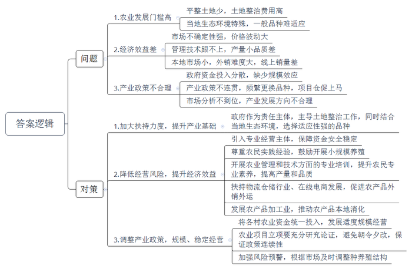
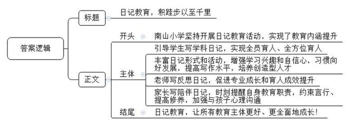
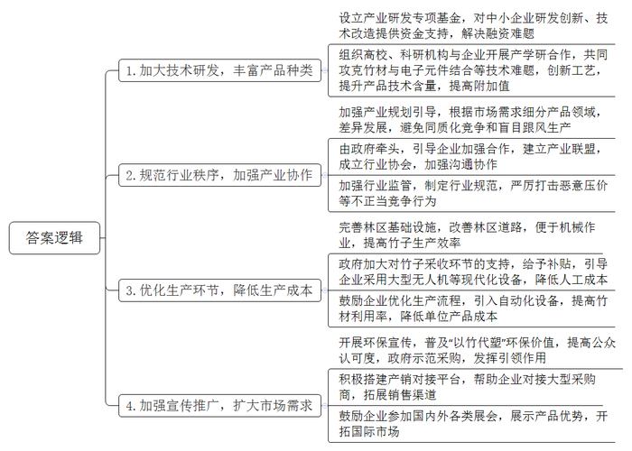
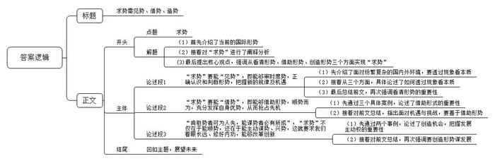

# 2024年公务员多省联考《申论》题（内蒙古盟市卷）

<!-- gwy:overview:start -->
> **内蒙古 · 2024 · 申论 · 盟市卷** ｜ 4 题 · 图片 4 处 · 答案随题折叠

导航：[题目](#题目)
<!-- gwy:overview:end -->

> 候选采集稿。参考答案及解析来自粉笔页面，不代表官方答案或真实高分答卷；来源使用许可与原卷对应关系仍需人工核实。

## 给定材料

### 材料 material-0d34c4b3252faa38

村集体经济是我国农村经济的重要组成部分，不仅关系到千家万户的切身利益，更是关乎脱贫成果巩固与乡村振兴战略的有效实施。近年来，各级政府采取了一系列政策措施，全面推动村集体经济的发展，已取得可喜的成果。

F县位于西部山区，是全省乡村振兴重点帮扶县。2017年以来，F县探索村集体经济发展模式，实现全县120个村集体经济收入全部达到1万元以上，其中29个村达到5万元以上。

近日，S省相关部门调集政府机关、科研机构、大专院校的专业人员组成调研组，深入基层，全面了解本省村集体经济的实践样态。以下是调研组在F县Q镇了解到的情况。

C村的村集体经济项目主要有两个。一是政府投资建设的200千瓦光伏发电站，每年有20万元左右的收益分红。光伏发电设备由国家投资，并负责技术指导和设备维修。电量由国家电网购买，成本可控，风险较小。光伏发电站的经营主体实际上是政府，村集体并无太多干涉和支配的自主权，同时其收益定向，给村民创造的就业岗位比较有限。二是“一村一品”发展项目——生猪养殖。生猪养殖项目由F县某农牧合作社联合社会组织实施，由企业提供养猪技术、饲料、猪苗、设备等，并直接定价收购。这种“公司+合作社+产业示范园+基地+农户”的模式，资金投入方比较多，该项目资金来源有政府扶贫资金、省级财政资金、县级财政资金和合作社自筹资金，农户以土地入股，按项目分配计划，村集体每年可有8万元分红。然而，实际经营下来，村集体的分红每年只有5万多元，其中还有2万元是土地承包的租金。“从2018年到现在没有剩余，也没怎么赚钱。”C村书记表示，在实际的养殖过程中面临着诸多困难和不确定性：一是成本不小，挣的钱又都投入再生产，结余不多；二是猪肉价格有波动，市场存在不确定性；三是管理难，养猪要避免猪瘟、猪病和猪打架，风险也比较大。

H村的村集体经济项目有两个，其一是黄牛养殖。政府拨付资金15万元入股合作社，每年以6%的比例给村集体分红。合作社现有黄牛40头左右，数量还可以，但是受行情影响，分红不太稳定，目前养殖还能勉强维持。其二是酒业投资分红。2021年县里下发帮扶资金50万元，村委会考虑到村民自己生产或村集体发展产业的市场风险较高，为提高村集体经济收入，同时保障资金的安全和稳定，村委会将这一笔资金投入某酒业公司，村集体并不涉及实际经营，由公司自担风险、自负盈亏，村集体每年可获约3万元分红，收益基本稳定。

最近，B村张主任比较烦，他对调研组说：“早些年县林业局倡导种植核桃，村集体以全体村民土地入股的形式种植核桃经济林两千余亩，但因品种没选好，核桃树多年不产果，老百姓也管理不好，到现在都没挣什么钱，大家打算放弃了。”不仅如此，B村利用产业扶贫资金建设的高标准双孢菇种植大棚，按计划村集体每年可分红1.4万元，但是分了2年就要维持不下去了。专家分析认为，由于技术跟不上，双孢菇的产量很小，品质也很差。据了解，本地人并不爱吃双孢菇，市场比较小，如果销往外地市场，双孢菇保鲜期短，几天不采就坏了，外地的收购商不愿意来，很多双孢菇卖不出去，全砸在手里。

调研结束后，调研组和镇村干部、产业负责人、农户等一起进行了深入的座谈。

省农科院张研究员：几天下来，我发现Q镇农业产业发展实际上存在门槛。首先，无论是种植业还是养殖业都需要连片成块的平整土地，以便于机械作业或建设厂房、安装设备，而Q镇属于山地丘陵地形，平整土地较为稀缺，土地整治的费用高。同时，种植和养殖还应考虑当地的生态环境，选择适应性较强的品种，光照、湿度、土壤、水源等条件缺一不可，不然只有投入，没有产出，白干一场。这些问题光靠农民或村集体可能解决不了，政府应该帮着想办法。

农业大学李博士：农业生产讲究技术和经验，Q镇的双孢菇产业和生猪养殖都是因为技术没有达标，没有产量，品质不好，发展肯定失败。生猪养殖失败，管理上也有很重要的问题，光有技术不行，管理也必须上去。

B村支部书记：我们啥都能养、啥都能种，就是没有销路，卖不上好价钱，也上网卖过，但弄不明白，东西卖不出去，挣不到钱，啥样的经营模式都是空谈。我们这个地方基础差，一个村里国家投一百万元，根本弄不起来什么，如果把县里或者镇上的资金统一投入，适度规模经营，说不定还能盘活一个产业。

C村村主任：今年种桃子，明年种梨子，换个人管就换一个品种，“一村一品”很多项目都是仓促上马，哪个都没搞成。说我们啥都能种，但不是啥技术都会、都精通。

某企业负责人：种植业需要承担土地成本、原料成本和劳动力成本等，养殖业另外还要承担厂房的建筑成本和设备成本等，都需要前期投入大量资金，如果产量不佳或市场价格较低，这些投入很难收回来，好不容易筹措来的钱也可能就打了水漂。

H村的村民：县政府一号召发展肉牛养殖，大家就都养牛，牛的价格就跌了，高买低卖，养得多就亏得多。相对比下，“牛羊悄悄富”是我们多年实践出来的道理，小农户自己养牛，草料是路边的，劳动是自己的，没有什么成本，养个几头牛，价格好就赚了，价格不好也亏不了多少。

Q镇李镇长：我们这边的玉米很好，淀粉含量高，在我们这里弄个工厂肯定很挣钱，只是因为生态保护，化工产业受到诸多限制，不好审批，如果能把这个问题解决就好了。建了工厂，农产品受市场的影响就不那么大了。

### 材料 material-a7c2efeae47fbeaa

基于当前学生学习与思考脱节、学习与生活割裂的现象仍比较普遍，A市南山小学从2017年10月开始，筹划开展日记写作校园特色活动，旨在用引导的方式强化学生有意识、有目的参加各项活动，让孩子们记住农时四季，让他们体会到父母劳作的辛苦；用日记写作这根线，努力牵引学生从课本中走出来，从手机、电脑、网络游戏中跳出来，与音体美握手、与综合实践活动拥抱、与大自然和社会接轨，成为自然人、社会人，从而努力实现教育要培养德、智、体、美、劳全面发展的社会主义建设者和接班人的根本目标。

南山小学校长江云波说：“写日记就是对生活最好的牵挂方式，也是对自己、对工作最负责任的做法。”多年来，江云波一直有写日记的习惯。他的日记涵盖专业成长、读书心得、教育教学反思、时政要闻等，收集和梳理教育碎片，在书写和思考中实现教育思想的升华。坚持写日记让江云波受益良多，担任南山小学校长后，他在坚持校长写管理日记的基础上，开始推行日记教育。经过反复论证、实践和修订，从最初的语文日记到全学科日记，再到今天的日记教育，南山小学日记教育经历了从小到大、从简单到丰富、从做表面文章到内涵提升发展的一个历程。

在五年一班的数学课堂上，学生们交出了不同寻常的“数学作业”：有的记录了生活中应用数学时的体会和感想，有的写下了自己发现的数学奥秘、趣事，有的利用数学知识解释生活中的某些现象……这些“数学日记”，记录和见证着学生们去观察、感悟、理解生活中的数学体验。“数学日记”是南山小学的创新思路，是该校开展特色校园活动的一个缩影。走进南山小学，语文、数学、英语、道德与法治、科学等学科的课后，老师都会引导学生写日记，实现全员育人、全方位育人。

好习惯源自平时的教育，南山小学以日记教育为突破口，践行好习惯的培养。在这里，“日记”的定义很宽泛，鼓励学生写自己的真情实感，及时分享自己的喜怒哀乐，学习兴趣、学习习惯向好发展，学生的自信心普遍增强。日记的形式不拘一格，记事日记、观察日记、诗歌日记、读报日记、照片日记、漫画日记、专题日记等等，给学生以最大的写作自由度。还有循环日记，即一个日记本在小组内循环，每名学生既是作者又是读者和评论者，大家互相学习，共同提高。

在南山小学的班级展示墙上辟有日记专栏，展示学生的优秀日记，定期更换，及时反馈鼓励并进行表彰。南山小学还创建了“日记节”。以“日记节”为载体，每个月侧重一两个活动开展日记写作，即先组织活动，活动后根据组织方案写日记、评选日记、表彰、展示，让学生在交流中拓展思维、端正认识，引导学生主动动脑、动口、动手，学会竞争和合作。日记教育不仅增加了学生的练笔机会，提高了学生的习作水平，而且以练笔来育人，也有助于培养精神生活丰富、人格健全、具有良好素养的创造型人才。近几年，南山小学整体工作有了全面提升，在全市质量检测、征文大赛等活动中屡获佳绩。

教师写反思日记是为自己的教育生命保鲜的极佳方式。南山小学一直坚信：无反思，不成长。学校每位教师手中都有几个本子：与名家面对面、会议札记、工作日志、学思悟……这些本子真实地记录着教师的教育历程和心理历程，记录着教师成长和学校发展的点点滴滴。有的教师在自己的博客上写网络日记，不光有文字的记录，还有图片的记录，让难忘的瞬间永远定格。如今，写日记已经内化为学校教师的自觉行为，无论是对个人专业成长还是育人成效都是最直接的促进和提升，效果立竿见影。

同时，学校倡导家长写陪伴日记，就是让家长时刻关注孩子的点点滴滴，坚持正面引导、阳光教育，这也是南山小学的特色。学校通过专家讲座、家长会、家长沙龙等，引导家长运用家教日记，有效地和孩子沟通。家长用日记表达对孩子的爱，用日记来表现自己的教育思想，用日记来教育“问题”孩子，用日记来提醒自己要有耐心、要细心……学校每周都会有一至两个限定的家教日记题目，“如何改变自己，再改变孩子”“如何打造书香家庭”“孩子当一天家”等，启发家长引起思考，参与讨论。班主任每周收集、批阅家教日记，及时了解家长的心声，及时发现问题、解决问题。班级、学校定期评比表彰优秀家教陪伴日记，并精选优秀文章在家委会杂志《心桥》上展示，使越来越多的家长重视并认真进行家教陪伴日记的写作。一位学生家长说，每天坚持写教育日记，既时刻提醒自己，教育好孩子是自己应尽的职责，也约束着自己的言行，有助于提高自身修养，最关键的是，这是一个与孩子进行心理沟通的极好平台。

南山小学德育、安全、惠民服务等工作也因为有了日记的分享，得到了家长、社会的普遍认可，教学质量逐年稳步提升，连续几年在办学满意度测评中都名列前茅，连年都被评为市小学教学工作先进单位、市文明校园、市零投诉学校。今年又被评为市教育工作先进单位、市文明校园、省绿色学校。

### 材料 material-1fddde8e49981375

随着白色污染日益成为威胁环境的突出问题，寻找塑料的替代材料日益紧迫。竹子是高度可再生资源，一片管理良好的竹林，在成熟后可以反复收割40~70年；竹制品能降解，不像塑料制品难以降解或降解后会增加大气中的碳；再加上竹子力学性能优良，完全可以作为塑料的替代品，这就是“以竹代塑”。“以竹代塑”不仅涉及日用品，还涉及工业制造和建材，如发电机冷却塔的填料、给排水管道等，选用竹子作原料，成本更低、耐用性更好。此外，“以竹代塑”还有一层内涵，就是用从竹子中提取出的成分如竹纤维等生产各种物件，这属于广义的“以竹代塑”。

T市竹资源丰富，全市竹林面积约有3.28万亩，目前有竹类加工企业近500家，其中省级龙头企业4家、国家级龙头企业1家，年加工原竹约70万吨，竹产业一年创造的产值占据T市经济的半壁江山。不过，T市“以竹代塑”产业在取得显著成绩的同时，也开始面临产品同质化高、附加值低等发展的瓶颈。2023年10月，国家发改委出台的《加快“以竹代塑”发展三年行动计划》要求，要牢固树立和践行绿水青山就是金山银山的发展理念，以构建“以竹代塑”产业体系为重点，着力抓好竹林资源培育、竹材精深加工、产品设计制造、市场应用拓展等全链条全要素协调发展，有效提升“以竹代塑”动能、产能、效能，推动“以竹代塑”高质量发展，助力减少塑料污染。这为T市竹产业突破瓶颈提供了难得的发展机遇。为深入落实《加快“以竹代塑”发展三年行动计划》，引导T市“以竹代塑”产业实现高质量发展，T市发改委组织了竹制品企业、竹农、消费者等各方面的代表以及有关专家学者参加座谈会，以下是座谈会部分实录：

小熊友公司经理袁正：我们公司原先的主营业务是竹地板，这几年我们开始转型生产竹计算器、竹电子秤、竹音箱，就是用竹外壳代替塑料外壳，不过竹材和电子元件结合起来有难度，我们就组织公司员工通过技术改造、创新工艺，解决了这一技术难题。现在我们的产品远销海外，不断有知名高校、企业来公司洽谈合作事宜。

萌萌幼儿园园长李华：我们园去年把所有塑料玩具全换成了竹制品，这些新玩具更有光泽，手感更好。自从购进了竹制玩具，来我们园的孩子也多了不少，家长们都特别看重安全环保，竹制玩具能让家长更放心。

美哉竹业经理赵进：我们公司规模小，融资困难，拿不出那么多钱来支持研发特别有技术含量的“以竹代塑”产品，研发跟不上，就只能生产技术含量低的“以竹代塑”产品。另外，我了解到，在T市，像我们公司这样小规模的竹制品企业不是少数，而且生产“以竹代塑”产品往往是一哄而上，要么都生产竹制盘子，要么都生产竹制勺子，“卷”得厉害！

从记小吃店老板从亮：我可不想用“以竹代塑”产品，实在是太贵了！一个一次性竹勺0.1元，塑料勺才0.01元，我做的是小本生意，实在用不起啊！

竹农老王：“以竹代塑”产品为啥贵？我看是竹子贵！以一吨毛竹为例，砍伐装车全得靠人工，成本近450元，而这一吨毛竹平均市场价格还不足600元，你说种竹子能挣多少钱？我们不想机械作业吗？大家可以去看看竹林里的路，两个人并排走都嫌挤，路面除了坑就是包，往里运机械都挺费劲，而塑料制品呢，生产全是靠机械，当然便宜了。

T市农业大学教授王克俭：和兄弟地区相比，我市发展“以竹代塑”产业的优势和成绩都是有目共睹的，但目前我市“以竹代塑”企业尚处在各自为战、野蛮生长的状态，有些企业之间相互压价、恶性竞争，产业内耗较为严重，最终吃亏的还是我市“以竹代塑”产业。

瓦口乡乡长张英：今年我们乡租用大型无人机把采好的竹子收下来，产生的费用完全由政府承担，不但解决了采收难的问题，还能把竹子的成本降低30%，我觉得这对降低“以竹代塑”产品的成本肯定会有帮助。

T市竹业企业联合会理事刘战：我要替全市生产“以竹代塑”产品的同仁们说几句话。我们希望有人能给我们的产品撑撑腰、吆喝吆喝。竹制品企业需要的不是“小打小闹”的客户，而是“大进大出”的客户，毕竟企业要生存，要发展。

T市农委孙纯：“以竹代塑”利国利民，是大势所趋，把这个产业做大做强，最为根本的是立足长远、授人以渔。在这方面，我们政府机关责无旁贷。

## 题目

### 第 1 题

**根据****“给定资料**1**”，分析Q镇农业产业发展存在的问题，并提出解决这些问题的具体办法。（20分）**

关联材料：材料 material-0d34c4b3252faa38

作答要求：

要求：内容全面，措施可行，条理清晰。不超过450字。

第 1 题 · 答案与解析

**参考答案（粉笔题库参考内容）**

问题：1.农业发展门槛高。平整土地少，土地整治费用高；当地生态环境特殊，一般品种难适应。2.经济效益差。市场不确定性强，价格波动大；管理技术跟不上，产量小品质差；本地市场小，外销难度大，线上销量差。3.产业政策不合理。政府资金投入分散，缺少规模效应；产业政策不连贯，频繁更换品种，项目仓促上马；市场分析不到位，产业发展方向不合理。

对策：1.加大扶持力度，提升产业基础。政府作为责任主体，主导土地整治工作，同时结合当地生态环境，选择适应性强的品种。2.降低经营风险，提升经济效益。引入专业经营主体，保障资金安全稳定；尊重农民实践经验，鼓励开展小规模养殖；开展农业管理和技术方面的专业培训，提升农民专业素养，提高产量和品质；扶持物流仓储行业、在线电商发展，促进农产品外销外运；发展农产品加工业，推动农产品本地消化。3.调整产业政策，规模、稳定经营。将各村农业资金统一投入，发展适度规模经营；农业项目立项要充分研究论证，避免朝令夕改，保证政策连续性；加强风险预警，根据市场及时调整种养殖结构。

**解析**

**参考答案说明：**答案从“农业发展门槛高”“经济效益差”“产业政策不合理”3个方面指出了Q镇农业产业发展存在的问题，并针对每一方面的问题给出了相应的对策。此外，形式方面，本答案做到了分类分条撰写，各条要点之间在内容上是并列关系，没有交叉。

**参考答案二**

问题：1.农业发展门槛高。平整土地少，土地整治费用高；当地生态环境特殊，一般品种难适应。2.生产水平不足。管理技术跟不上，产量小品质差。3.产品销路差。本地市场小，外销难度大，线上销量差。4.政策不合理。政府资金投入分散，缺少规模效应；产业政策不连贯，频繁更换品种，项目仓促上马。5.市场风险高。市场不确定性强，价格波动大；市场分析不到位，产业发展方向不合理。

对策：1.加大扶持力度。政府作为责任主体，主导土地整治工作，同时结合当地生态环境，选择适应性强的品种。2.提高生产水平。开展农业管理和技术方面的专业培训，提升农民专业素养，提高产量和品质。3.拓展销售渠道。扶持物流仓储行业、在线电商发展，促进农产品外销外运；发展农产品加工业，推动农产品本地消化。4.降低经营风险。引入专业经营主体，保障资金安全稳定；尊重农民实践经验，鼓励开展小规模养殖；加强风险预警，根据市场及时调整种养殖结构。5.调整产业政策。将各村农业资金统一投入，发展适度规模经营；农业项目立项要充分研究论证，避免朝令夕改，保证政策连续性。

**考点**：考点提出对策类

**来源**：来源2024年公务员多省联考《申论》题（内蒙古盟市卷）

粉笔申论页面对本题只提供「解析视频」入口，该入口是会员推广位，页面无视频地址与文字解析。

### 第 2 题

**《****A市日报》报道了“南山小学坚持开展日记教育活动”的做法，请根据“给定资料**2**”，为这篇报道写一则短评。（15分）**

关联材料：材料 material-a7c2efeae47fbeaa

作答要求：

要求：

（1）观点明确，简明深刻；

（2）紧扣资料，重点突出；

（3）有逻辑性，语言流畅；

（4）不超过200字。

第 2 题 · 答案与解析

**参考答案（粉笔题库参考内容）**

日记教育，积跬步以至千里

南山小学坚持开展日记教育活动，实现了教育内涵提升。引导学生写学科日记，实现全员育人、全方位育人；丰富日记形式和活动，增强学习兴趣和自信心，习惯向好发展，提高写作水平，培养创造型人才；老师写反思日记，促进专业成长和育人成效提升；家长写陪伴日记，时刻提醒自身教育职责，约束言行、提高修养，加强与孩子心理沟通。日记教育，让所有教育主体更好、更全面地成长！

**解析**

**参考答案说明：**（1）格式方面，本参考答案包括标题、正文，符合短评的形式。（2）正文部分，一方面从内容来看，围绕“日记教育”这一主题，本参考答案的开头先介绍了南山小学开展日记教育活动的目的；主体部分，从“引导学生写学科日记”“丰富日记形式和活动”“老师写反思日记”“家长写陪伴日记”这四个方面进行介绍。另一方面，形式上，本参考答案做到了分段、分条撰写，整体上条理较为清晰。

**考点**：考点评论类

**来源**：来源2024年公务员多省联考《申论》题（内蒙古盟市卷）

粉笔申论页面对本题只提供「解析视频」入口，该入口是会员推广位，页面无视频地址与文字解析。

### 第 3 题

**假如你是****T市发改委的工作人员，请根据“给定资料**3**”，对T市“以竹代塑”产业实现高质量发展提出建议。（25分）**

关联材料：材料 material-1fddde8e49981375

作答要求：

要求：

（1）紧扣资料，内容全面；

（2）所提建议有针对性、可行性；

（3）准确简明，条理清晰；

（4）不超过500字。

第 3 题 · 答案与解析

**参考答案（粉笔题库参考内容）**

1.加大技术研发，丰富产品种类。设立产业研发专项基金，对中小企业研发创新、技术改造提供资金支持，解决融资难题；组织高校、科研机构与企业开展产学研合作，共同攻克竹材与电子元件结合等技术难题，创新工艺，提升产品技术含量，提高附加值。

2.规范行业秩序，加强产业协作。加强产业规划引导，根据市场需求细分产品领域，差异发展，避免同质化竞争和盲目跟风生产；由政府牵头，引导企业加强合作，建立产业联盟，成立行业协会，加强沟通协作；加强行业监管，制定行业规范，严厉打击恶意压价等不正当竞争行为。

3.优化生产环节，降低生产成本。完善林区基础设施，改善林区道路，便于机械作业，提高竹子生产效率；政府加大对竹子采收环节的支持，给予补贴，引导企业采用大型无人机等现代化设备，降低人工成本；鼓励企业优化生产流程，引入自动化设备，提高竹材利用率，降低单位产品成本。

4.加强宣传推广，扩大市场需求。开展环保宣传，普及“以竹代塑”环保价值，提高公众认可度，政府示范采购，发挥引领作用；积极搭建产销对接平台，帮助企业对接大型采购商，拓展销售渠道；鼓励企业参加国内外各类展会，展示产品优势，开拓国际市场。

**解析**

**参考答案说明：**本参考答案从“加大技术研发，丰富产品种类”“规范行业秩序，加强产业协作”“优化生产环节，降低生产成本”“加强宣传推广，扩大市场需求”四个方面进行了分条撰写。各条要点之间在内容上相互并列，没有交叉。

**考点**：考点提出对策类

**来源**：来源2024年公务员多省联考《申论》题（内蒙古盟市卷）

粉笔申论页面对本题只提供「解析视频」入口，该入口是会员推广位，页面无视频地址与文字解析。

### 第 4 题

**请深入思考****“给定资料**4**”中****划****线的句子，根据你对这句话的理解，参考给定资料，联系实际，自选角度，自拟题目，写****一****篇文章。（****40分）**

关联材料：材料 material-0d34c4b3252faa38

作答要求：

要求：

（1）观点明确，见解深刻；

（2）参考给定资料，但不拘泥于给定资料；

（3）思路清晰，语言流畅；

（4）1200-1400字。

第 4 题 · 答案与解析

**参考答案（粉笔题库参考内容）**

**求势需见势、借势、造势**

当今世界正处于百年未有之变局中，国际形势波诡云谲，有诸多的不确定性，且我国多种矛盾交织，改革发展任务艰巨。在此情形下，我们要“求势”，也就是通过观察、分析、判断后，明确我们的发展方向，要向第二个百年奋斗目标迈进、建设社会主义现代化强国。这是一种战略思维、全局思维，是寻求和创造有利态势谋求发展的智慧，而不是局限在一隅、一面的战术行为。而“求势”，需要我们首先看清形势，然后借助形势，甚至能创造形势，如此才能实现长远发展。

**“****求势****”要能“见势”，即能够审时度势，正确认识和判断形势，把握新的规律及机遇。**当前的国外环境、国内环境，可谓“乱花渐欲迷人眼”，但我们应“不畏浮云遮望眼”，用全面、系统、运动、辩证的眼光看待事物，要透过现象看本质。我们要看到经济全球化大潮不可逆转，单边主义、保护主义仍然盛行；我们要看到新一轮科技革命和产业变革深入发展，催生新产业、新业态、新模式，给社会、乡村带来了诸多机遇：乡村电商的兴起，打破了地域限制，让农产品走出大山；乡村依托独特的自然风光，打造出风格各异的民宿，推动乡村旅游的发展。我们也要看到全面建成小康社会的基本目标虽已实现，但发展不平衡不充分问题仍然突出……总之，“察势者智”，准确识势、洞悉趋势，才能“拨开云雾”，抓住主要矛盾，抓住新的机遇。

**“求势”要能“借势”，即能够借助形势，顺势而为，充分发挥自身优势，从而抢占先机。**“所当乘者势也，不可失者时也”。中国共产党人认清井冈山时期的困难之后，主动顺势，走农村包围城市的道路，终让星星之火成燎原之势；河北、重庆等文旅部门在哈尔滨旅游爆火之后，顺应形势，利用网络媒体“营销”城市的旅游，吸引游客、助推城市经济发展；东北的泡菜企业，巧借潮流，研发泡菜腌制的新工艺、新技术，并用冷链配送产品，将小手艺发展成了大产业；浙江乌镇文旅部门借国潮文化热潮，打造古风沉浸式体验项目，游客纷至沓来打卡，有力带动当地文旅产业蓬勃发展。种种案例启示我们，在机遇与挑战并存的当下，我们要有迎难而上、主动作为的胆量与魄力，因势利导、把握机会，才能下好发展的“先手棋”。

**“肯取势者可为人先，能谋势者必有所成”，“求势”不仅在于能顺势，还在于能主动谋势、兴势，这就要求我们着眼长远、修好内功，能够改革创新。**若是自身实力强劲，就能占据主导地位，自己创造发展机会，把握发展的主动权。譬如老国货的发展，将产品质量做好、服务做好外，还要转变经营方式和经营思路，才能赢得市场，成为“潮流”的引领者；又如我国在数字经济、生命健康、新材料等战略性新兴产业不断投入、不断创新，也是在提升自己，为能“造势”打下基础，推动产业的转型升级，实现经济的现代化发展。实践证明：主动造势不仅能增强自身竞争力，更能助力我国在全球经济格局中占据主动，勾勒出经济持续向上的清晰路径。总之，我们要深化改革、开拓创新，从而积蓄能量，在变局中开新局。

驭势者赢，“势”在人为。面对世界之变、时代之变，我相信，通过用眼识势、顺势而为、主动创新，一定能乘风破浪、乘势而上，走在时代前列、实现全方位的发展，打造社会主义现代化强国！

**解析**

**文章分析**

**求势需见势、借势、造势**

【**标题的优点****：**主题突出，角度鲜明，言简意赅。】

（1）当今世界正处于百年未有之变局中，国际形势波诡云谲，有诸多的不确定性，且我国多种矛盾交织，改革发展任务艰巨。（2）在此情形下，我们要“求势”，也就是通过观察、分析、判断后，明确我们的发展方向，要向第二个百年奋斗目标迈进、建设社会主义现代化强国。这是一种战略思维、全局思维，是寻求和创造有利态势谋求发展的智慧，而不是局限在一隅、一面的战术行为。（3）**而****“求势”****，需要我们****首先看清形势****，****然后借助形势****，甚至能****创造形势****，****如此才能实现长远发展****。**

【**开头的优点：**★内容方面。范文的开头是紧扣题目给定的“求势”这一主题展开的。（1）首先介绍了当前的国际形势。（2）接着对“求势”进行了阐释分析。(3)最后提出核心观点，强调从看清形势、借助形势、创造形势三个方面实现“求势”。★文字表达方面。使用了“是……是……而不是……”的句式，增强了表述的逻辑性与气势。】

**“求势”要能“见势”，即能够审时度势，正确认识和判断形势，把握新的规律及机遇。**（1）当前的国外环境、国内环境，可谓“乱花渐欲迷人眼”，但我们应“不畏浮云遮望眼”，用全面、系统、运动、辩证的眼光看待事物，要透过现象看本质。（2）我们要看到经济全球化大潮不可逆转，单边主义、保护主义仍然盛行；我们要看到新一轮科技革命和产业变革深入发展，催生新产业、新业态、新模式，给社会、乡村带来了诸多机遇：乡村电商的兴起，打破了地域限制，让农产品走出大山；乡村依托独特的自然风光，打造出风格各异的民宿，推动乡村旅游的发展。我们也要看到全面建成小康社会的基本目标虽已实现，但发展不平衡不充分问题仍然突出……（3）总之，“察势者智”，准确识势、洞悉趋势，才能“拨开云雾”，抓住主要矛盾，抓住新的机遇。

【**论述段****1****的优点：**★观点句：范文的观点句是紧扣“求势”这一主题提出的。形式上，它在段首处直接写出，位置突出，容易发现。内容上，关键词突出，内容要点明确，可以明显看出主要论述“看清形势”。★论述内容：（1）先介绍了面对纷繁复杂的国内外环境，要透过现象看本质；（2）接着从三个方面，具体论述了如何透过现象看本质；（3）最后总结前文，再次强调看清形势的重要性。注意：以上三个方面的内容都是紧扣“‘求势’要能‘见势’，即能够审时度势，正确认识和判断形势，把握新的规律及机遇”这个观点句进行分析论述的，论述的针对性强，内容层次丰富。在论述方法上主要采用了讲道理的方式，论述层层深入、严谨有力。】

**“求势”要能“借势”，即能够借助形势，顺势而为，充分发挥自身优势，从而抢占先机。**（1）“所当乘者势也，不可失者时也”。中国共产党人认清井冈山时期的困难之后，主动顺势，走农村包围城市的道路，终让星星之火成燎原之势；河北、重庆等文旅部门在哈尔滨旅游爆火之后，顺应形势，利用网络媒体“营销”城市的旅游，吸引游客、助推城市经济发展；东北的泡菜企业，巧借潮流，研发泡菜腌制的新工艺、新技术，并用冷链配送产品，将小手艺发展成了大产业；浙江乌镇文旅部门借国潮文化热潮，打造古风沉浸式体验项目，游客纷至沓来打卡，有力带动当地文旅产业蓬勃发展。（2）种种案例启示我们，在机遇与挑战并存的当下，我们要有迎难而上、主动作为的胆量与魄力，因势利导、把握机会，才能下好发展的“先手棋”。

【**论述段****2****的优点：**★观点句：范文的观点句是紧扣“求势”这一主题提出的。形式上，它在段首处直接写出，位置突出，容易发现。内容上，关键词突出，内容要点明确，可以明显看出主要论述“借助形势”。★论述内容：（1）先通过四个具体案例，论述了借助形势的重要性；（2）接着对前文总结，指出面对机遇与挑战，要善于借助形势。注意：以上两个方面的内容都是紧扣“‘求势’要能‘借势’，即能够借助形势，顺势而为，充分发挥自身优势，从而抢占先机”这个观点句进行分析论述的，论述的针对性强，内容层次丰富。在论述方法上主要采用了讲道理、举例子相结合的方式。】

**“肯取势者可为人先，能谋势者必有所成”，“求势”不仅在于能顺势，还在于能主动谋势、兴势，这就要求我们着眼长远、修好内功，能够改革创新。**（1）若是自身实力强劲，就能占据主导地位，自己创造发展机会，把握发展的主动权。譬如老国货的发展，将产品质量做好、服务做好外，还要转变经营方式和经营思路，才能赢得市场，成为“潮流”的引领者；又如我国在数字经济、生命健康、新材料等战略性新兴产业不断投入、不断创新，也是在提升自己，为能“造势”打下基础，推动产业的转型升级，实现经济的现代化发展。实践证明：主动造势不仅能增强自身竞争力，更能助力我国在全球经济格局中占据主动，勾勒出经济持续向上的清晰路径。（2）总之，我们要深化改革、开拓创新，从而积蓄能量，在变局中开新局。

【**论述段****3****的优点：**★观点句：范文的观点句是紧扣“求势”这一主题提出的。形式上，它在段首处直接写出，位置突出，容易发现。内容上，关键词突出，内容要点明确，可以明显看出主要论述“创造形势”。★论述内容：（1）先通过两个事例，论述了创造机会，把握发展主动权的重要性；（2）接着对前文总结，再次强调要创造形势谋发展。注意：以上两个方面的内容都是紧扣“‘求势’不仅在于能顺势，还在于能主动谋势、兴势，这就要求我们着眼长远、修好内功，能够改革创新”这个观点句进行分析论述的，论述的针对性强，内容层次丰富。在论述方法上主要采用了讲道理、举例子相结合的方式。】

【**论述段之间的关系**：★内在逻辑上：文章先论述“看清形势”，再论述“借助形势”，最后论述“创造形势”。在逻辑上，三个论述段呈现出层层递进的思路，论述十分严谨；在形式上，三个论述段都由主题引导出来，在视觉上给人以工整清晰的体验。】

驭势者赢，“势”在人为。面对世界之变、时代之变，我相信，通过用眼识势、顺势而为、主动创新，一定能乘风破浪、乘势而上，走在时代前列、实现全方位的发展，打造社会主义现代化强国！

【**结尾的优点：**范文的结尾回扣了“求势”这个主题，并且进行了展望，升华了主题。】

**考点**：考点文章写作题

**来源**：来源2024年公务员多省联考《申论》题（内蒙古盟市卷）

粉笔申论页面对本题只提供「解析视频」入口，该入口是会员推广位，页面无视频地址与文字解析。

