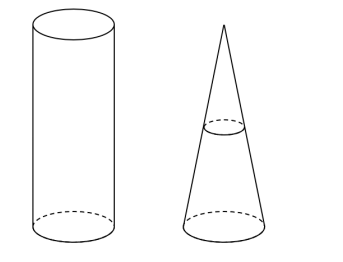
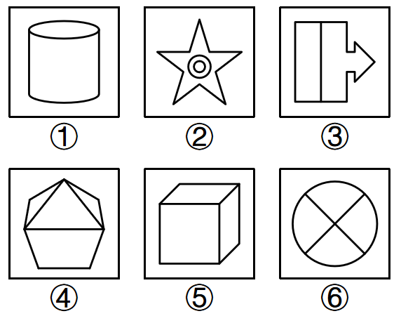
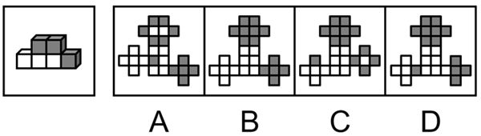
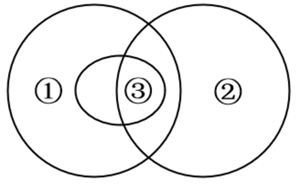
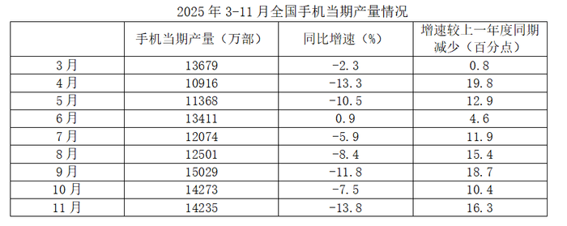
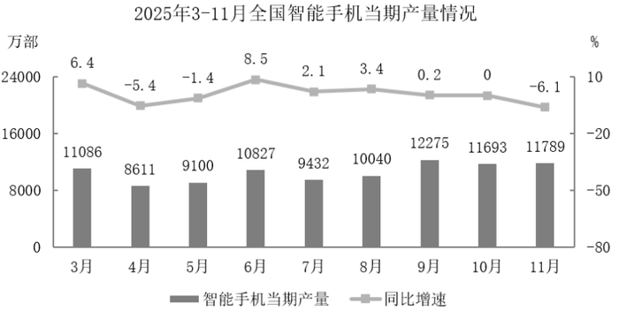
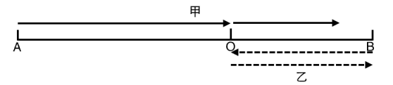
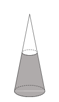
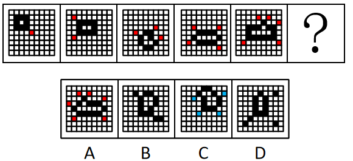
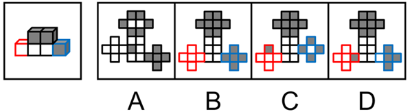

# 2026 内蒙古自治区公务员录用考试 行测（统考）

> 行测 · 120 题 · 内蒙古 2026

## 第 1 题　qid 17467595 · 新思想

习近平总书记强调，自我革命是党跳出治乱兴衰历史周期率的第二个答案。推进党的自我革命要做到“五个进一步到位”。关于“五个进一步到位”，下列表述正确的有（    ）。
①对党的自我革命认识要进一步到位
②党员干部增强党性要进一步到位
③权力规范运行要进一步到位
④从严监督执纪要进一步到位
⑤落实管党治党责任要进一步到位

- **A**. 2项
- **B**. 3项
- **C**. 4项
- **D**. 5项

## 第 2 题　qid 15833673 · 时事政治

在2025年召开的中央经济工作会议上，习近平总书记以“五个必须”概括了做好新形势下经济工作新的认识和体会。关于“五个必须”，下列表述正确的有几项？
①必须充分挖掘经济潜能，强调要用好我国产业体系完整、市场规模巨大、人才资源丰富的优势
②必须坚持政策支持和改革创新并举，强调既要加大宏观政策逆周期调节力度，又要不失时机深化改革，激发创新活力
③必须做到既“放得活”又“管得好” ，强调“放”的目的是破除影响生产力发展的体制机制障碍，“管”的本质要求是坚持政府在资源配置中的决定作用
④必须坚持投资于物和投资于人紧密结合，强调既要扩大对实体经济和科技创新的有效投资，又要加强人力资源开发
⑤必须以苦练内功来应对外部挑战，强调面对国际风云变幻和各种风险挑战，要保持战略定力，坚定不移把自己的事情办好

- **A**. 2项
- **B**. 3项
- **C**. 4项
- **D**. 5项

## 第 3 题　qid 17467585 · 新思想

《中共中央关于制定国民经济和社会发展第十五个五年规划的建议》指出，十五五时期是基本实现社会主义现代化的关键时期，要奋力开创中国式现代化建设新局面。关于中国式现代化，下列表述错误的是：

- **A**. 广阔国际市场是中国式现代化的战略依托
- **B**. 现代化产业体系是中国式现代化的物质技术基础
- **C**. 高水平社会主义市场经济体制是中国式现代化的重要保障
- **D**. 实现人民对美好生活的向往，是中国式现代化的出发点和落脚点

## 第 4 题　qid 15833712 · 新思想

习近平总书记指出，在干部干好工作所需的各种能力中，政治能力是第一位的，对于政治能力这一重要概念，下列理解正确的有几项？
①提高政治能力，首先要把握正确政治方向
②政治自制力、政治定力是最基础的政治能力
③政治判断力、政治领悟力、政治执行力是最关键的政治能力
④政治领导力是最基本的政治能力

- **A**. 1项
- **B**. 2项
- **C**. 3项
- **D**. 4项

## 第 5 题　qid 15833695 · 新思想

中国向全世界做出碳达峰，碳中和的宣誓以来推动绿色低碳转型取得历史性成就，对此，下列说法正确的有几项？
①构建了全球最系统完备的碳减排政策体系
②建成了全球最大、发展最快的可再生能源体系
③形成了全球最大、最完整的新能源产业链 
④实现了全球规模最大、速度最快的新能源汽车推广应用 
⑤建成了全球湿地面积最大、水质改善最快的湿地生态系统

- **A**. 2项
- **B**. 3项
- **C**. 4项
- **D**. 5项

## 第 6 题　qid 15833665 · 新思想

习近平总书记指出，在中国建立什么样的政治制度，是近代以后中国人民面临的一个历史性课题。关于中国共产党领导人民对人民代表大会制度的探索，下列说法错误的是：

- **A**. 毛泽东同志在《新民主主义论》中首次提出人民代表大会这一崭新概念
- **B**. 具有临时宪法地位的《中国人民政治协商会议共同纲领》庄严宣告新中国实行人民代表大会制度
- **C**. 党的八大讨论通过了《关于政治报告的决议》，标志着人民代表大会制度作为国家根本政治制度正式建立
- **D**. 新时代以来，召开党的历史上首次中央人大工作会议，健全人大组织制度和工作制度，推动人大会议制度更加成熟和定型

## 第 7 题　qid 15833694 · 新思想

习近平总书记指出，中国人民抗日战争胜利是中国共产党发挥中流砥柱作用的大胜利。关于中国共产党中流砥柱作用，下列说法正确的有（    ）。
①确定了建立抗日民族统一战线的基本政策
②系统完整地提出了持久战的战略总方针
③战略相持阶段形成以主动战为主，游击战为辅的战略战术
④从战略相持阶段开始，承担起全国抗战主战场的重担
⑤创立的抗日民族根据地覆盖到华中和华南地区

- **A**. 2项
- **B**. 3项
- **C**. 4项
- **D**. 5项

## 第 8 题　qid 15833640 · 新思想

新时代以来，领导给各界群众回信，激励他们奋斗逐梦，积极投身现代化强国建设。下列回信嘱托与回信对象对应正确的是：
①共建和谐美丽城市，共创幸福美好生活——上海市“老杨树宣讲汇”全体同志
②祖国疆域上的一草一木，我们都要看好守好——西藏玉麦乡牧民卓嘎、央宗姐妹
③坚定文化自信，扎根生活沃土，努力创作更多讴歌时代精神、抒发人民心声的精品佳作——银龄行动老年志愿者代表
④到祖国和人民最需要的地方发光发热，为中国式现代化建设贡献青春力量——新疆谢依特小学戍边支教西部计划志愿者服务队队员

- **A**. ①②③
- **B**. ①②④
- **C**. ①③④
- **D**. ②③④

## 第 9 题　qid 15833643 · 马克思主义

习近平总书记指出，如果种树的只管种树，治水的只管治水，护田的单纯护田，容易顾此失彼，造成生态系统性破坏。下列表述与这句话蕴含相同哲理的是：

- **A**. 抓任何工作，给群众办任何事情，都要实事求是
- **B**. 按规律办事，按规矩做事是党员干部必须坚守的原则
- **C**. 对长期任务要保持战略定力和耐心，坚持一张蓝图绘到底，滴水穿石，久久为功
- **D**. 把国家安全贯穿到党和国家工作各方面全过程，同经济社会发展一起谋划

## 第 10 题　qid 15833648 · 新思想

领导强调，扎扎实实落实促进民营经济发展的政策指标，是当前促进民营经济发展的工作重点，下列符合促进民营经济发展的政策措施有几项？
（1）坚定不移走高质量发展之路，加强自主创新
（2）要按照中国特色现代企业制度要求，完善企业治理结构
（3）坚持诚信守法经营，树立正确的价值观和道德观
（4）要坚持公平竞争，效率第一的基本准则
（5）要积极履行社会责任，积极构建和谐劳动关系

- **A**. 2项
- **B**. 3项
- **C**. 4项
- **D**. 5项

## 第 11 题　qid 15833677 · 新思想

领导指出，贯彻新发展理念是新时代我国发展壮大的必由之路，新发展理念即创新、协调、绿色、开放、共享的发展理念，下列没有体现协调发展理念的是（    ）。

- **A**. 工业互联网+园区，强化区域间、城乡间、产业间协同合作
- **B**. C919国产大飞机带动多个省市参与，促进东中西部的优势互补
- **C**. 百县千镇万村高质量发展工程，推动城乡互补，打造新村新镇
- **D**. 中国主办进博会、现贸会等大型国际级展会，搭建资源对接平台

## 第 12 题　qid 17467579 · 新思想

为有效应对人类面临的安全挑战，建设一个普遍安全的世界，习近平主席提出树立共同、综合、合作、可持续的全球安全观，对此下列理解错误的是（    ）。

- **A**. 共同，要尊重和保障每个国家的安全
- **B**. 综合，要统筹维护传统领域和非传统领域安全
- **C**. 合作，就是要通过对话合作促进各国和本地区安全
- **D**. 可持续，就是要和平与稳定并重，以实现持久安全

## 第 13 题　qid 15833726 · 新思想

习近平总书记强调，要坚持走中国特色社会主义法治道路，建设中国特色社会主义法治体系。关于中国特色社会主义法治体系，下列说法正确的是：
①合宪性审查制度的确立是依法治国、依法执政的重要举措
②我国的立法体制机制主要是通过《中华人民共和国宪法》规定的
③建设中国特色社会主义法治体系是全面依法治国的总抓手
④党内法规体系是中国特色社会主义法治体系的有机组成部分

- **A**. ①②③
- **B**. ①②④
- **C**. ①③④
- **D**. ②③④

## 第 14 题　qid 11897189 · 新思想

科技自立自强水平大幅提高是我国“十五五”时期经济社会发展的主要目标之一，关于高水平科技自立自强，下列表述正确的有几项？
①加强基础研究，是实现高水平科技自立自强的迫切要求
②科技自立自强成为决定我国生存和发展的基础能力
③加快实现高水平科技自立自强，是推动高质量发展的必由之路
④金融资本是支撑高水平科技自立自强的重要力量

- **A**. 1项
- **B**. 2项
- **C**. 3项
- **D**. 4项

## 第 15 题　qid 17467582 · 人文常识

加强七区二十三带为主体的农产品主产区建设。建设国家粮食安全生产带，是推进乡村全面振兴的重大战略举措。关于各农产品主产区总建设的国家粮食安全产业带，下列错误的是（    ）。

- **A**. 长江流域主产区重点建设水稻、小麦、棉花、油菜、畜产、水产产业带
- **B**. 东北平原主产区重点建设玉米、水稻、大豆、畜产产业带
- **C**. 汾渭平原主产区重点建设水稻、大豆产业带
- **D**. 河套灌区主产区重点建设小麦产业带

## 第 16 题　qid 17467584 · 法律常识

根据《中华人民共和国治安管理处罚法》，对下列违反治安管理的行为归类错误的是：

- **A**. 非法生产用于制造毒品的原料——妨害公共安全的行为
- **B**. 任意占用损毁公私财物——扰乱公共秩序的行为
- **C**. 违反规定出售公民个人信息——侵犯人身权利、财产权利的行为
- **D**. 饲养动物干扰他人正常生活——妨害社会管理的行为

## 第 17 题　qid 17467587 · 法律常识

根据《中华人民共和国文物保护法》，下列情形符合法律规定的是：

- **A**. 某县人民政府在旧城区改建前，未调查相关区域内不可移动文物便开工建设
- **B**. 某建筑单位发现施工工地旁一栋古建筑已经全部毁坏，便在原址进行了重建
- **C**. 某高校外籍教师经所在高校同意，带领学生在该高校所在市郊外进行考古调查
- **D**. 某文物收藏者收藏了依法继承、从文物销售单位购买、通过文物拍卖企业购买的文物

## 第 18 题　qid 15833773 · 人文常识

下列假设与其可能形成的效应对应错误的是：

- **A**. 制度的生命力在执行，若建立了良好制度却没有严格执行——破窗效应
- **B**. 各方面协调发展才能实现社会进步，若其中一个方面滞后——短板效应
- **C**. 人才是第一资源，若人才从小城市陆续向一个大城市流动——虹吸效应
- **D**. 下载一个文件，若网络随之推荐给我们无数相关联的文件——场域效应

## 第 19 题　qid 15833776 · 人文常识

文史爱好者小刘于假期先后游览了四座博物馆（院），分别欣赏了以下四件代表性文物藏品。小刘先后游览的博物馆（院）最有可能是：

- **A**. 殷墟博物馆、三星堆博物馆、良渚博物院、秦始皇帝陵博物院
- **B**. 良渚博物院、殷墟博物馆、三星堆博物馆、秦始皇帝陵博物院
- **C**. 秦始皇帝陵博物院、三星堆博物馆、殷墟博物馆、良渚博物院
- **D**. 秦始皇帝陵博物院、三星堆博物馆、良渚博物院、殷墟博物馆

## 第 20 题　qid 15833725 · 人文常识

中华民族有深厚的文教传统，很多帝王都兴文教，倡导读书。下列帝王与其文教主张对应正确的是：

- **A**. 唐太宗李世民——开卷有益
- **B**. 宋太祖赵匡胤——宰相须用读书人
- **C**. 明太祖朱元璋——以武威克敌，以文教治世
- **D**. 清圣祖玄烨——男儿欲遂平生志，六经勤向窗前读

## 第 21 题　qid 17467586 · 人文常识

小行星是太阳系形成与演化的“活化石”。关于小行星，下列说法错误的是（    ）。

- **A**. 主带小行星位于火星与木星轨道之间
- **B**. 金属质类小行星富含的主要金属资源是铜和锌
- **C**. 硅酸盐质类小行星富含硅酸盐矿物，可作为太空建筑的原材料
- **D**. 碳质类小行星蕴藏水资源，可用于推进剂、生保物资的原位生产和补给

## 第 22 题　qid 15833730 · 人文常识

关于乐器的发声原理，下列说法错误的是（    ）。

- **A**. 古筝可以通过调整弦的弹奏力度来调节音调
- **B**. 笛子可以通过调整空气柱有效长度来调节音高
- **C**. 小提琴可以通过调整琴弦的振动幅度来调节响度
- **D**. 萨克斯可以通过调整喇叭口气流、反射特性来调节音色

## 第 23 题　qid 15833647 · 科技常识

下列植物病原体与其对植物的致病机理对应错误的是（    ）。

- **A**. 真菌——通过吸气或菌丝入侵，分泌酶类破坏细胞壁
- **B**. 细菌——经伤口或气孔侵入，释放毒素破坏组织结构
- **C**. 病毒——借媒介或接触进入活细胞，利用宿主系统复制
- **D**. 线虫——由昆虫传播，寄生于植物韧皮部干扰物质运输

## 第 24 题　qid 15833774 · 科技常识

食品防腐剂的主要作用是延长食品的保质期。下列食品防腐剂中，主要通过降低食品pH值打造不利于微生物生存环境，从而达到防腐效果的是：

- **A**. 酸性防腐剂，如苯甲酸
- **B**. 无机盐防腐剂，如硝酸盐
- **C**. 生物防腐剂，如乳酸链球菌素
- **D**. 酯型防腐剂，如对羟基苯甲酸酯类

## 第 25 题　qid 15833649 · 科技常识

人们日常使用的橄榄油，是由新鲜的油橄榄果实直接冷榨而成的食用油。下列关于油橄榄说法正确的是（    ）。

- **A**. 油橄榄树原产于南美洲，树龄可达数百年甚至上千年
- **B**. 油橄榄树在我国长江流域以北地区亦有大面积栽培
- **C**. 油橄榄果的颜色愈深，果实的成熟度愈高，油脂也愈丰富
- **D**. 油橄榄树与橄榄树是同一科的植物，都属于木犀科木犀榄属的油料作物

## 第 26 题　qid 17467583 · 科技常识

晒过的被子会有一股“阳光味”。关于“阳光味”，下列说法正确的是（    ）。

- **A**. 被子上的螨虫被阳光杀死后，蛋白质焦化尸体分解的味道
- **B**. 多种有机物在紫外线作用下发生光化学反应形成的味道
- **C**. 信号经神经系统传递到人大脑皮质中枢系统产生的幻觉
- **D**. 由细菌分解被子上残留的汗液皮质等物质产生的味道

## 第 27 题　qid 15833701 · 人文常识

中国古代建筑是充满智慧的建筑形式，蕴含朴素深广的建筑哲理。下列说法错误的是：

- **A**. 黄土高原的穴居与长江流域的木构技术产生了双向文化交流与渗透，形成了“土木共济”的建造体系
- **B**. 羌族、傣族的“穹庐为室、旃为墙”的宜移居建筑，展现了“因天材、就地利”的根植地域风土的建筑风貌
- **C**. 古代建筑中屋顶、梁柱、台基三部分对应了天、人、地的自然现象，反映了“制器尚象”的设计思想
- **D**. 徽州民居以“堂”为中心，堂前的院落或天井是人们观察昼夜变化的窗口，显示了“人室相扶，感通天地”的和合秩序

## 第 28 题　qid 15833697 · 人文常识

如果要拍摄一部反映中华文明源远流长演进历程的纪录片，下列可作为第一个奴隶制王朝解说词的是：

- **A**. 这是中国历史上第一个有文献可考，并为考古学和甲骨文所证实的都城遗址
- **B**. 制礼作乐旨在使社会保持稳定，充满和谐之美，华夏文明由此进入以礼乐文明为代表符号的时代
- **C**. 无论在西安的汉唐都城宫殿遗址，还是迄今保留最为完整的北京故宫，我们都能发现它们与二里头相似的宫殿建筑机制，二里头宫殿无疑是他们的祖先
- **D**. 铁农具开始出现，耕作能力大大提高，很多人在公田劳动之外开垦荒地，成为私田。私田的收获物归自己支配，还可以用来交换

## 材料 1

        古代两河流域的界碑是一种石碑，一般上半部刻着宗教题材的浮雕，如各种神灵的形象和武器等，下半部以楔形文字刻写着各类文献。界碑主要存在于公元前16世纪至公元前12世纪的加喜特巴比伦时期，但界碑的起源可追溯至早王朝时期，一直存在于加喜特王朝之后的伊新第二王朝和新巴比伦王朝时期。①

        目前，全世界收藏的界碑及残片约有160余块，其中保存较好的约有100块。两河流域80%以上界碑的制作材料为石灰岩，除此之外还有闪长岩和花岗岩。从造型上看，界碑的形制主要是长方体的石碑造型，圆柱形、圆锥形、椭圆形（蛋形）、方柱形、金字塔形、方尖碑形等也较为常见。从规模大小上来看，界碑最高不超过1米，最小的只有10厘米左右。②

        两河流域的神灵和象征主要有三种类型：一是各种天体符号。太阳、月亮和星星等天体对人们的生活和生产具有至关重要的作用，因此在两河流域，人们对这些天体进行崇拜。二是各种动植物形象。人们崇拜的动物主要有蛇龙、狮子、龟、蝎子、蛇、狗等，人们崇拜的植物主要是谷穗。三是人的形象。在一些情况下，神也会以人的形象出现。这些拟人化了的神灵主要是一些地位较高并且与人类具有密切关系的神灵，比如在创世史诗中创造了世界万物和人类的马尔杜克神，经常以一位智慧老人的形象出现。③

        铭文是界碑上最重要和最宝贵的部分，大多数界碑都刻有记载土地交易行为的铭文。根据铭文内容中的参与者，我们可以把铭文划分为两大类。一类铭文有国王（或王室成员）参与，内容多为土地的授予、土地所有权的重新认定、祭司圣职俸禄的授予以及赋役的豁免等。这类活动可定义为公共活动，记载这些活动的铭文称之为“公共事务铭文”。刻写“公共事务铭文”的界碑多放置在田间地头或者神庙的公共场所。另一类铭文没有国王参与，可以定义为私人活动。在这类“私人事务铭文”中，交易双方多为普通自由民。刻写“私人事务铭文”的界碑通常体积较小，为扁平的泥板状石碑。这些界碑一般由个人保管，并不放置在公共场所。“私人事务铭文”主要记载土地房屋等不动产买卖活动、私人土地授予活动、神庙俸禄的授予活动以及私人交易活动纠纷。④

        两河流域从早王朝时期就出现了在石头上刻写土地交易的行为。这种石碑被命名为“古代界碑”。加喜特人应该是在“古代界碑”的影响之下形成了自己更加复杂的界碑。长期以来，学界认为加喜特巴比伦王朝是两河流域历史上的“黑暗时代”，一是因为该王朝的实力相对较弱，缺乏耀眼功绩；二是因为加喜特王朝遗留下来的史料相对较少，对该王朝的认识依旧如“雾里看花”。

### 第 29 题　qid 15833760 · 语句表达

下面这段文字，最适合填入文中的哪个位置？
浮雕是界碑上最为显眼的一部分，也是界碑的重要组成部分。界碑浮雕图案中最为重要的是各种神灵的形象或象征，刻画神灵的目的是祈求神灵的保护和赐福，希望神灵对界碑记载的交易活动给予保护。

- **A**. ①
- **B**. ②
- **C**. ③
- **D**. ④

### 第 30 题　qid 15833761 · 片段阅读

下列说法与这篇文章相符的是：

- **A**. 加喜特人在界碑上刻画有神灵和国王形象的浮雕
- **B**. 界碑的历史最早可追溯至两河流域的加喜特王朝
- **C**. 界碑铭文按参与者分成公共事务和私人事务两类
- **D**. 记载国王对土地授予活动的界碑通常由王室保管

### 第 31 题　qid 15833762 · 片段阅读

文章接下来最有可能讨论的是：

- **A**. 两河流域界碑与其他地域界碑的特征比较
- **B**. 界碑铭文对研究加喜特王朝所产生的影响
- **C**. 加喜特王朝的界碑对“古代界碑”的传承
- **D**. 巴比伦文明对世界历史发展所做出的贡献

### 第 32 题　qid 15833763 · 片段阅读

关于界碑，这篇文章没有提及：

- **A**. 材质
- **B**. 形制
- **C**. 功能
- **D**. 象征

### 第 33 题　qid 15833764 · 片段阅读

下列选项中，最适合做这篇文章标题的是：

- **A**. 界碑上的王朝兴衰史
- **B**. 界碑——刻在石头上的历史
- **C**. 界碑与两河流域的历史兴替
- **D**. 界碑的故事：加喜特巴比伦王朝

### 第 34 题　qid 17467581 · 逻辑填空

如果说“小将”心态是心中燃烧的火，点燃干事创业的激情，赋予我们突破桎梏的魄力；那么“大将”风范，则是以深厚的定力和耐心，让这团火燃得更久，烧得更旺。二者            。没有前者，容易因循守旧、畏缩不前；缺乏后者，则可能浅尝辄止、急功近利。
填入画横线部分最恰当的一项是：

- **A**. 互为表里
- **B**. 遥相呼应
- **C**. 相得益彰
- **D**. 相辅相成

### 第 35 题　qid 15833732 · 逻辑填空

针对“违章指挥、违规作业、违反劳动纪律”多发频发问题，市应急管理部门从5月起在全市范围内部署开展“三违”专项整治工作，重点整治“违章指挥”15项内容、“违规作业”13项内容、“违反劳动纪律”11项内容，从源头严防各类生产安全事故发生。宁可未雨绸缪，不做            ，这是筑牢“安全之基”，全力提升应急管理水平的一个缩影。
填入画横线部分最恰当的一项是：

- **A**. 临渴掘井
- **B**. 临阵磨枪
- **C**. 亡羊补牢
- **D**. 涸辙之鲋

### 第 36 题　qid 15833722 · 逻辑填空

徐渭深受王阳明弟子王畿哲学的影响，主张为人处世要从心上立根，以无挂碍的“真我”为最高真实。他认为绘画的关键，不在于“临摹”，即与客观物象            、锱铢必较，而在于“寄兴”，以直抒胸臆、表达真我、寄托自己情怀为目的。在他看来，近来天道都颇有        ，被打乱季节顺序，将四时花草绘于一处，重建超越时令的生命秩序，不仅自有道理，也是合理存在。
依次填入画横线部分最恰当的一项是：

- **A**. 不差毫厘 轮换
- **B**. 寸积铢累 流变
- **C**. 严丝合缝 差错
- **D**. 肤寸而合 差池

### 第 37 题　qid 15833713 · 逻辑填空

“构建网络空间命运共同体”理念的提出，正是对全球互联网向何处去、网络空间如何治理时代之问的答案。它深刻揭示，网络空间是人类共同的活动空间，其前途命运应由世界各国共同掌握。各国在网络空间            、利益交融，任何国家都无法            ，也无法凭一己之力应对所有风险。必须摒弃零和博弈、赢者通吃的旧思维，树立合作共赢、共建共享的新理念。
依次填入画横线部分最恰当的一项是：

- **A**. 风雨同舟 独辟蹊径
- **B**. 休戚与共 独善其身
- **C**. 桴鼓相应 自行其是
- **D**. 同气连枝 置身事外

### 第 38 题　qid 15833662 · 逻辑填空

我国的非遗            ，凝聚着广大人民群众生产生活的技艺、经验与智慧。过去，认为非遗又老又土的不在少数，只见其形、不见其神的更是            。如今，不论是线上还是线下，3D建模、全息投影、AI、AR等新技术的发展，让非遗倍增流行范、更加有意蕴。
依次填入画横线部分最恰当的一项是：

- **A**. 异彩纷呈 不计其数
- **B**. 五花八门 比比皆是
- **C**. 琳琅满目 不乏其人
- **D**. 丰富多彩 大有人在

### 第 39 题　qid 13812059 · 逻辑填空

一些干部把自己看得太重，把党和人民的事业往后排，信奉“洗碗越多，摔碗越多”，宁可不干也不能出错。这般心思作祟，落到实践中就会            。比如，有的干部面对村民的危房改造申请，怕签字盖章后房子再出问题而担责，宁让村民“忧居”也不帮助“优居”；有的干部面对创新项目，束手束脚不敢推进，贻误市场机遇；还有的干部面对突发事件，            错失最佳处置时间，导致事态扩大······顾虑重重、推脱躲闪，反而造成工作推进中的主观障碍、人为堵点。
依次填入画横线部分最恰当的一项是：

- **A**. 首鼠两端 投鼠忌器
- **B**. 阳奉阴违 犹豫不决
- **C**. 患得患失 瞻前顾后
- **D**. 畏首畏尾 敷衍塞责

### 第 40 题　qid 15833718 · 逻辑填空

作为拉动经济的新增长引擎，低空经济凭借其创新业态和丰富场景，精准        消费者对个性化、沉浸式旅游体验的市场所需，逐步成为驱动文旅产业转型升级的重要力量。目前，低空技术与文旅产业的深度融合，不断        新消费场景：从载人飞行观光解锁空中视野，到无人机编队互动演绎科技浪漫；从低空主题营地开辟特色消费场景，到极限运动项目激活感官体验······多元立体的文旅消费新生态逐渐确立。
依次填入画横线部分最恰当的一项是：

- **A**. 契合 衍生
- **B**. 满足 开发
- **C**. 引领 创造
- **D**. 挖掘 派生

### 第 41 题　qid 15833702 · 逻辑填空

治理医疗信息泄露面临诸多困难，尽管我国已针对医疗信息建立了民事、行政、刑事“三合一”法律保护机制，但在落实过程中还存在短板漏洞。不少单位对医疗信息的保护意识薄弱，缺乏清晰的隐私界定标准，在员工培训教育、内控管理、技术防范等环节存在        。由于医疗信息泄露          强，相关部门查处的难度大、概率低。
依次填入画横线部分最恰当的一项是：

- **A**. 缺失  复杂性
- **B**. 疏漏  隐秘性
- **C**. 不足  隐蔽性
- **D**. 缺陷  潜伏性

### 第 42 题　qid 15833675 · 逻辑填空

“敬”指的是对事物发自内心的尊重与崇尚，“畏”则包含戒惧和省思之意，敬与畏是一体的。倘若有敬无畏，就容易表面崇敬、内心无惧，进而萌生私心，做事            ，假作为、乱作为；反之，如果有畏无敬，就可能举棋不定、优柔寡断，难免抵触厌战，做事            ，不敢为、不作为。
依次填入画横线部分最恰当的一项是：

- **A**. 心猿意马 畏首畏尾
- **B**. 竭泽而渔 拈轻怕重
- **C**. 急功近利 瞻前顾后
- **D**. 唯利是图 舍本逐末

### 第 43 题　qid 15833728 · 逻辑填空

当前，中国汽车产业技术成果大量涌现，创新活力与迭代速度令全球同行瞩目。更重要的是，源自中国市场的优秀技术与产品的应用场景具有          ，不仅满足了中国本土消费者的多样化需求，也给全球用户带来更丰富、更经济、更绿色的出行选择，生动诠释了“中国智造”的世界意义。在超大规模市场中        、成长的中国汽车产业，有信心、有条件也有能力为实现高水平科技自立自强            ，为全球汽车产业的技术演进贡献更多中国智慧。
依次填入画横线部分最恰当的一项是：

- **A**. 通用性 锤炼 增光添彩
- **B**. 普适性 淬炼 添砖加瓦
- **C**. 先进性 历练 保驾护航
- **D**. 适用性 锻造 锦上添花

### 第 44 题　qid 15833667 · 片段阅读

种质资源是指携带生物遗传信息且具有实际或潜在利用价值的载体。种质就是种子吗？实际上，二者不能画等号。拿农作物种质资源来说，其涵盖农作物的栽培种、野生种和濒危稀有种的繁殖材料等，形态不仅有果实、籽粒，还有苗、根、茎、叶、芽、花，同时还包括组织、细胞和DNA、DNA片段及基因等有生命的物质材料。可见，种质资源的范畴比种子大得多，种业是农业的“芯片”，种质资源的重要性不可小视，作为种业创新的源头和基础，种质资源在粮食安全领域的地位分外凸显。
可做文段标题的是：

- **A**. 小小种子蕴藏着改变世界的力量
- **B**. 精准发力，打造种质资源强国
- **C**. 由点及面全面推动种业振兴
- **D**. 种质资源保护不应止于种子

### 第 45 题　qid 15833715 · 片段阅读

漫长的历史中，地球遭受过无数次地外小天体的撞击。这些地外小天体绝大多数是小行星，它们以超高速穿过大气层，撞击地表并引发爆炸，最终形成陨石坑。科学家如何搜寻陨石坑？线索之一是形状。大部分小行星以高角度撞击地球，因此陨石坑大多呈环形构造。但地球上的环形坑成因多样，火山喷发等地质活动也能形成环形坑，进一步甄别的关键在于寻找撞击事件的“指纹”证据。在小行星撞击瞬间，极高的压力和温度会引起岩石和矿物的冲击变质，打乱矿物内部结构，使其成为非晶态物质，或使其本身变质为超高压矿物。科学家可以通过提取这类矿物的冲击变质证据找到环形坑成因。
这段文字最可能介绍的是什么？

- **A**. 甄别陨石坑的关键是提取矿物的冲击变质证据
- **B**. 地质活动是引发地球上环形坑形成的原因
- **C**. 陨石坑出现与小行星对地表撞击有关
- **D**. 小行星撞击可能会引起岩石和矿物的冲击变质

### 第 46 题　qid 15833668 · 片段阅读

在植物茎顶端、根尖等“生长中枢”，分布着一群活跃的植物干细胞，通过精确的分裂与分化，绘制出植物生长的蓝图。随着深入研究，科学家发现植物茎顶端干细胞区域，细胞壁的主要成分果胶呈现独特的“二元分布”模式。新形成的细胞壁偏“软”，富含去甲酯化果胶；而成熟的细胞壁则更“硬”，以高度甲酯化的果胶为主。果胶成分的去甲酯化过程，使其变得较为柔软、易调整，从而帮助细胞灵活确定分裂的方向和位置。在成熟的细胞壁中，果胶保持高甲酯化状态，则有利于维持干细胞持续分裂的能力及组织的稳定。
根据这段文字，下列说法正确的是：

- **A**. 果胶能够同时呈现两种截然不同的修饰状态
- **B**. 果胶需要在更软的细胞壁中保持高甲酯化
- **C**. 果胶成分的去甲酯化过程控制干细胞的开关
- **D**. 果胶成分的去甲酯化过程使成熟细胞壁变柔软

### 第 47 题　qid 15833724 · 片段阅读

作家藏书中常常留有很多痕迹，具体表现为“藏书者有题跋，作者有签赠，阅读者有批注”，其中题跋与签赠常有落款，来源较为明确，而眉批往往出现在书内文字旁，没有专门的落款，唯一可以确定的是读者留下的。然而，阅读者何人，难以“一目了然”，需要通过公藏背书、二重证据、字迹比对、口述咨询等方式展开比对确认。眉批的内容丰富多样，有的是对文本内容的评价，有的是对作者观点的呼应或批评，还有的是读者的即兴发挥。这些不同时期的批注共同构成一个多维的对话空间，展现这一经典著作在不同时代的接受与解读情况。
下列可做文段标题的是：

- **A**. 藏书中的眉批：历史研究的碎片化重构
- **B**. 藏书中的眉批：读者与文本的对话痕迹
- **C**. 藏书中的眉批：书稿流传轨迹，时代证明
- **D**. 藏书中的眉批：文体研究到文化实践转向

### 第 48 题　qid 15833674 · 片段阅读

悬疑影视剧在长期的类型融合与衍生过程中，逐步确立了以“解谜”为核心的叙事传统。然而，这种以“设谜-解谜”为框架的叙事机制，容易依赖情节推进与真相揭晓，形成对技术化叙事的路径依赖。尤其是当故事完全围绕寻找真凶、破解不在场证明等“智力游戏”展开时，角色的情感动机与内心世界便可能会沦为服务谜题的扁平化符号，造成情感的悬浮与共情的缺失。随着类型融合不断深入、观众审美阈值持续提升，多线并进、时空跳跃、倒叙插叙等手法被频繁使用，推动剧情不断走向复杂化与奇观化。
这段文字意在说明：

- **A**. 悬疑影视剧的发展需要突破谜题叙事
- **B**. 悬疑影视剧不应过度沉溺于情节反转
- **C**. 悬疑影视剧应用信息差制造解谜快感
- **D**. 悬疑影视剧不宜与现实逻辑区别显著

### 第 49 题　qid 15833692 · 片段阅读

面对不断涌现的科技新名词和新说法，公众可能出现选择困难，科普热词的发布，在一定程度上找到了或者说调整了公众关注的锚点，校准了科普工作的焦点，有助于让更多的科普工作者集中精力做好相关领域的科普工作。这在一定程度上来说，也是提高公民科学素质的应有之义；同时从科技创新的角度来说，以热词为代表的新技术、新知识科普可能引导相关公共决策与资源分配，进而推动相关领域的科技创新。
这段文字意在说明：

- **A**. 遴选和发布科普热词利于开展科普工作
- **B**. 科普热词可能引导资源分配和公共决策
- **C**. 发布的科普热词是公众认知的集体投射
- **D**. 科普热词帮助公众理解科学理念精神

### 第 50 题　qid 15833731 · 片段阅读

算法书写时代是人类与人类的创造物即人工智能共同参与意义建构、分享创造性权能的历史阶段。在人工智能写作勾勒的图景中，首先呈现的是人机共生的创作界面。人类负责确立基本框架、情感基调和审美方向，人工智能则凭借庞大的数据库和计算能力生成变体文本。紧接着，人类继续对文本进行筛选、编辑并且最终确定。在这个过程中，人工智能在不断训练中得以迭代，人类的想象力边界也在与人工智能的协作中得以激发，一种新型的“创意”在人机相互生成、相互激励的关系中涌现，从而形成一种意义共创系统。
根据这段文字，下列最符合作者态度的是：

- **A**. 人工智能作品是人类集体智慧的结晶
- **B**. 人工智能写作可能引发新的伦理困境
- **C**. 人类应在人机互动过程中保持主体性
- **D**. 算法书写时代的作品原创性或将改变

### 第 51 题　qid 15833685 · 片段阅读

免密支付本质是技术进步对消费体验的重塑，但其健康发展必须建立在尊重消费者权利的基础之上。从多次跳转到“一键取消”，从信息隐蔽到公开透明，这不仅关乎每一位消费者的切身利益，更关系到市场健康与消费信心的可持续。只有构建起“事前告知—事中控制—事后补救”的全链条保障机制，才能使免密支付真正成为便利生活的工具，而非侵害权益的陷阱。
对上述文段主旨概括准确的是：

- **A**. 免密技术的主要风险是消费者信息不透明
- **B**. 免密技术健康发展需要兼顾技术进步与用户权益
- **C**. 一键取消功能是保障免密支付安全的核心
- **D**. 健全的全链条保障机制决定了免密支付的成败

### 第 52 题　qid 15833751 · 片段阅读

当前，文化出海正迎来从“单品输出”向“生态构建”的转变。比如，有的文化产业公司将国内成熟的平台机制移植到海外，通过在地化运营，形成“内容付费—作者签约—读者互动”的完整生态链，同时借助IP授权、合作开发等，创新IP海外开发推广模式。“生态化”，既要着力构建线上线下融合、实体数字并重的对外传播网络，把“单向传播”升级为“全球共创”；也要积极拓展国际文化“朋友圈”，聚合优质资源，构建多元协同的全球文化传播网络，开创文明对话新格局。
最适合做这段文字标题的是：

- **A**. 文化出海：以生态促共创
- **B**. 文化出海：从输出到共创
- **C**. 文化出海：生态构建新阶段
- **D**. 文化出海：构建文明对话新格局

### 第 53 题　qid 17467580 · 片段阅读

明初进入贵州地区的屯堡先民形成了以“卫”“所”为单位、功能完备的“微缩社会”。通过卫所制度，完成了对人口的整建制重组、对资源的制度性再分配及对社会的结构性再造，为后续600余年的文化融合提供了坚实的物质与社会基础。卫所的选址并非随机散落，而是通过精准的地理布点，构成了一张控制交通要道、扼守战略咽喉的军事网络，使屯堡之间能够守望相助，形成强大的区域联合体，也使其与周边本土村寨形成了互嵌式的居住格局，开启了长达数百年的、与周边各民族的共生关系，为日后黔中地区多元一体文化生态的形成奠定了空间基础。
根据这段文字，下列无法推出的是：

- **A**. 明代卫所制度塑造了屯堡早期的共同体意识
- **B**. 屯堡的选址为黔中地区形成军事要道奠定了基础
- **C**. 屯堡与周边村落的互嵌格局是其文化长期共生的空间前提
- **D**. 屯堡的历史是一部各民族交往交流交融的“互嵌史”

### 第 54 题　qid 15833684 · 片段阅读

宋刻本是我国雕版印刷史上第一座高峰的实物见证，其版式具有鲜明的时代特征，反映了宋代印刷技术与审美的高度结合。它包括版框、行格、书口、字数等，对其进行系统考察，可以直观地研究宋代不同时期、不同地域、不同系统的版刻风格与技术演进。就版式而言，北宋刻本的一个重要特点是书口标识简单，无鱼尾，常以横线代之。至南宋，版式日趋精巧，出现细黑口、书耳等。由于刻书者更加追求书籍的观赏性，在书口上更加讲究，往往添饰一些标志，于是单黑鱼尾、双黑鱼尾、花鱼尾等相应而出。
根据这段文字，下列说法错误的是：

- **A**. 北宋刻本常以横线作为书口的标识
- **B**. 北宋刻本与南宋相比略缺少观赏性
- **C**. 北宋刻书者常在书口添加鱼尾标志
- **D**. 宋代不同地域的刻本风格略有差异

### 第 55 题　qid 15833727 · 语句表达

随着媒介技术的更迭，科学家得以绕过传媒中介普及成果。然而，                    。在这里，专家场域与大众讨论场域并存，专业话语与日常交流交织，科学传播呈现出前所未有的多样性和复杂性。走向“在线公共场域”的科学家也不再只是知识的生产者，更成为被观看、被评判、被期待的“公共人物”，在这样的背景之下，科学家如何理解、扮演并反思其传播角色，已不再是一个技术问题，更是一个关乎科学能否继续获得公众信任的根本性问题。
填入画横线部分最恰当的一项是：

- **A**. 算法加持下的数字传播环境使科学传播产生悖论
- **B**. 技术方面的便利也给科学家的角色带来了深刻变革
- **C**. 科学家需要根据不同的场域情况及时调整传播方式
- **D**. 科学家能否取得公众信任是科学传播的关键问题

### 第 56 题　qid 15833748 · 片段阅读

“提笔忘字”和“提笔（开口）忘词”现象时有发生，造成这种现象的原因很多。在移动互联网时代，不少人喜爱短视频，阅读量减少或只愿意浅阅读、碎片化浏览信息，缺乏大量系统深入和广泛的严肃阅读，部分人养成了过度依赖网络的习惯，写文章遇到意想不出的词语就上网搜索或求助，缺乏深入思考和对精细表达的追求，很少投入时间和精力进行话语表达创新。此外线上社交的特性促使一些人习惯用浅显直白的风格口语和表情包传情达意，减少了严肃规范表达的机会，不少词语因极少有机会被用到，很快就被抛之九霄云外。
上述文字可以推出的是：

- **A**. 人们表达能力的退化与追求“短平快”节奏有关
- **B**. 语言是国家文化生命力、传播力和影响力的基础
- **C**. 互联网使人们的表达、思维方式发生了剧烈变革
- **D**. 人工智能的过度发展有可能引发思维认知问题

### 第 57 题　qid 15833696 · 片段阅读

种子休眠，是指种子在具备水分、温度和光照等发芽条件时，仍暂不萌发，直至环境安全后才开始生长的特性。但它犹如一把双刃剑：休眠期过短，种子易在田间或穗上遇雨提前发芽；休眠期过长，又会影响下茬作物的播种与出苗整齐度。近日，科研人员发现，一个名为MKK3的基因通过“拷贝数+激酶活性”双轮驱动调控自身基因活性，以此来精准控制大麦种子的休眠时间。基因拷贝数越多，种子休眠性越弱；氨基酸变异控制的激酶活性越强，种子休眠性越弱。二者协同作用，可实现对MKK3基因总体活性的精细调控，进而决定作物种子的休眠时间。
这段文字意在说明：

- **A**. 种子休眠是农作物的一种典型生物学特性
- **B**. 科学家已经寻找到控制种子休眠时间的开关
- **C**. “拷贝数+激酶活性”能够调控MKK3基因
- **D**. 种子休眠期过短或过长均能影响作物生长

### 第 58 题　qid 15833736 · 片段阅读

在智能医疗与机器人感知领域，柔性温度传感器的超薄化是实现高贴合度与集成度的核心前提。超薄柔性温度传感器需要通过高温材料工艺来实现高灵敏度，但其柔性基底却难以耐受高温。这导致器件在柔性温度传感器超薄形态下往往难以同时兼顾高灵敏度、优异柔韧性及长期稳定性。针对这一技术瓶颈，某研究团队采用“水溶性牺牲层辅助转移”策略，成功解决了高性能敏感材料与柔性基底之间的工艺兼容性难题，制备出总厚度仅为40微米的超薄柔性温度传感器。
这段文字接下来最可能介绍的是：

- **A**. 超薄柔性温度传感器的问世意义
- **B**. 超薄柔性温度传感器的制备工艺
- **C**. 柔性温度传感器与智能医疗的关系
- **D**. 传感器的柔性基底难耐高温的原因

### 第 59 题　qid 15833717 · 语句表达

①从国企与民企的关系来看，不管是国企还是民企，都是国家创新生态的组成部分
②事实上，今天中国的创新生态，早已是百花竞秀的局面
③在人们的传统视野里，“从0到1”的科技突破，往往由高校、科研院所完成，民营企业更多在“从1到N”的环节发力
④抓创新“不问出身”，也是立足创新生态的选择
⑤数据显示，民营企业贡献了全国70%以上的技术创新成果，涵盖了80%以上的国家级专精特新“小巨人”企业和90%以上的高新技术企业
⑥从DeepSeek爆火，到宇树科技出圈，再到蓝箭航天在可重复使用运载火箭技术上取得突破，民营企业日益成为科技创新的重要主体
将以上6个句子重新排列，语序正确的一项是：

- **A**. ③②①⑤④⑥
- **B**. ①③②⑥⑤④
- **C**. ②③④①⑤⑥
- **D**. ④⑤②⑥③①

### 第 60 题　qid 15833870 · 片段阅读

文化不能“目中无人”，看不到现实生活中人民群众的喜怒哀乐，这样的产品即使看上去再精致、再华美，也注定是空洞无物、自说自话的。文化产品只有真正看到了、理解了现实中的“人”，它才会让人们觉得可及、可感、可亲，才会真正走进人民心中，成为为人民抒写、为人民抒情、为人民抒怀的经典。这些年像《山海情》《人世间》等深受观众喜爱的电视作品，就是把镜头对准了现实生活中的人与事，它们用细腻的笔触再现了社会中的温情与生活中的烟火气，用有血有肉的人物与故事引发观众强烈的情感共鸣，成为真正滋养人心灵的养分。
这段文字意在说明：

- **A**. 文化创作要摈弃空洞化表达，要有烟火气，要有温度
- **B**. 文化创作要打造体现人民心声，反映人民意志的作品
- **C**. 经典作品都是通过真实故事来实现与观众的情感联结
- **D**. 贴近现实生活的文化作品才更能引发观众的情感共鸣

### 第 61 题　qid 15833754 · 片段阅读

畜牧业常面临市场波动、疫情传播等风险，数字技术有助于增强有效管控力。大数据分析能精准预测市场供需变化，指导生产计划调整；智能监测系统可及时识别动物异常行为，实现重大疾病早发现、早预警。某智慧养猪生态平台汇聚全国生猪交易数据，利用大数据分析预测价格趋势，帮助养殖户提前应对市场风险，稳定经营预期。还有的企业创新研发“AI兽医”系统，能实时监测猪群健康状态，系统可自动识别一些疾病的早期症状，并启动智能诊断与预警，大幅提升疾病发现与处置的及时性、准确性，为产业生物安全竖起“智慧防线”。
这段文字意在说明：

- **A**. 数字技术有助于实现畜牧业风险的智能预警
- **B**. 数字技术能帮助养殖户稳定经营并保障安全
- **C**. 数字技术可增强畜牧业各类风险应对能力
- **D**. 数字技术可精准把控畜牧业的生产经营节奏

### 第 62 题　qid 15833871 · 片段阅读

“按法”是最早应用于推拿治疗的手法之一。用手着力在体表某一部位或穴位上，逐渐用力下压。常用的是指按法与掌按法。指按法有开通闭塞、散寒止痛等作用。掌按法接触面积大，刺激缓和，适用于治疗面积大而又较为平坦的部位，具有疏松筋脉、温中散寒等作用。按法的按压方向要垂直，用力由轻到重，稳而持续，使刺激充分透达到机体组织的深部。忌用迅猛的爆发力，以免产生不良反应。
根据上文，如果“腰背部、腹部”等部位需要治疗，下列说法错误的是：

- **A**. 适合使用指按法
- **B**. 适合使用掌按法
- **C**. 按压力由轻到重
- **D**. 按压方向要垂直

### 第 63 题　qid 15833757 · 片段阅读

查干湖冬捕节的免费公交，能让更多人得以走进冰雪世界，既带动了当地文旅消费，也让渔猎文化得到广泛的传播；杭州灵隐寺取消飞来峰门票，降低公众接触文化遗产门槛的同时，更能够以文化普惠激活文旅产业发展的内生动力；泉州在春节期间300多条公交线路免费开放，182.74万人次的客运总量背后，不仅是游客出行成本的降低，最重要的是传递“城市温度”，塑造城市形象。一方面，这些小举措打破了地域与身份的壁垒，使异地游客与本地居民享有同等公共服务权益，在共同的文化体验与民生共享中增进了社会认同、凝聚了发展向心力。另一方面，也实现了“小投入‘撬动’大产出”的效应。
这段文字意在强调：

- **A**. 公共服务免费化是文旅产业发展的核心动力
- **B**. 降低出行成本可有效提升城市形象与吸引力
- **C**. 民生小举措能促进文旅融合与社会效益提升
- **D**. 取消景区门票成为保护文化遗产的关键路径

## 第 64 题　qid 15833873 · 数学运算

一项工程，先由甲、乙两个工程队共同工作3天再由甲队单独工作5天，此时完成了工程的一半，且甲队的工作量与乙队的工作量恰好相同。问甲队单独完成此工程需要多少天?

- **A**. 10
- **B**. 24
- **C**. 32
- **D**. 40

## 第 65 题　qid 15833879 · 数学运算

某公司共有甲、乙、丙三类工作人员，人数比例2：1：3，现发放新年礼品，若每人发10个，总礼品剩余100个；若每人发20个，会缺少80个。现按照甲、乙、丙三类工作人员每人1：2：2的数量比例发放，问礼品最少剩余多少个？

- **A**. 5
- **B**. 8
- **C**. 10
- **D**. 14

## 第 66 题　qid 15833880 · 数学运算

甲乙相距100米，相向而行，在甲乙相遇后，乙调转方向和甲同向而行，乙的速度变为原来的2倍，甲保持速度不变，当乙回到起点时，乙的总路程为80米，问此时甲的总路程为多少米？

- **A**. 60
- **B**. 70
- **C**. 80
- **D**. 90

## 第 67 题　qid 17467593 · 数学运算

2026年甲与乙年龄之和是甲与乙年龄之差的2倍，也等于2030年甲的年龄，2026年丙的年龄是甲与乙年龄之和的一半，问在以下哪一年，甲与丙的年龄之和是乙的3倍？

- **A**. 2031
- **B**. 2032
- **C**. 2033
- **D**. 2034

## 第 68 题　qid 15833738 · 数学运算

某研究机构跟踪一种商品的价格变化，发现每天的价格相较前一天增长10%，问几天之后价格会大于最初价格的1.5倍？

- **A**. 3
- **B**. 4
- **C**. 5
- **D**. 6

## 第 69 题　qid 15833651 · 数学运算

已知甲地与乙地之间有5条路线直接连接，乙地与丙地之间有3条路线直接连接，甲地与丙地之间有2条路线直接连接。某人需要从甲地经过乙地，到达丙地后，再返回甲地，若要求往返路线没有任何重复，问共有多少种不同的路线选择？

- **A**. 150
- **B**. 120
- **C**. 60
- **D**. 30

## 第 70 题　qid 15833881 · 数学运算

实验室有一个圆锥形容器和一个圆柱形容器，高均为10厘米，底面半径均为2厘米。圆锥形容器内水的高度正好是圆锥高度的一半。若将圆锥形容器中的水倒入空的圆柱形容器后，水面的高度在以下哪个范围内？

- **A**. 0~1厘米之间
- **B**. 1~2厘米之间
- **C**. 2~3厘米之间
- **D**. 3~4厘米之间

## 第 71 题　qid 15833740 · 数学运算

小明假期计划每周学习滑雪的天数不少于2天，学习乒乓球1天，周六、周日休息，且不能连续两天学习同一项运动，每天至多学习一项。问其每周的学习计划有多少种不同安排？

- **A**. 10
- **B**. 14
- **C**. 20
- **D**. 26

## 第 72 题　qid 17467590 · 数学运算

甲乙同向而行，甲的速度是乙的速度的2倍，同向行走了一段时间后，乙将速度提高到原来的4倍，再用时10秒追上甲，问乙提速前用时多少秒?

- **A**. 5
- **B**. 10
- **C**. 15
- **D**. 20

## 第 73 题　qid 15833650 · 数学运算

某热水器厂家开展促销活动后，热水器售价降低10%，销量增加30%，活动前后利润与营业额的比值不变。问活动后比活动前的利润提高的百分比是多少？

- **A**. 12.5%
- **B**. 15%
- **C**. 17%
- **D**. 20%

## 第 74 题　qid 15833789 · 图形推理

从所给的四个选项中，选择最合适的一个填入问号处，使之呈现一定的规律性：

- **A**. A
- **B**. B
- **C**. C
- **D**. D

## 第 75 题　qid 15833644 · 图形推理

从所给的四个选项中，选择最合适的一个填入问号处，使之呈现一定的规律性：

- **A**. A
- **B**. B
- **C**. C
- **D**. D

## 第 76 题　qid 15833882 · 图形推理

把下面的六个图形分为两类，使每一类图形都有各自的共同特征或规律，分类正确的一项是：

- **A**. ①②③，④⑤⑥
- **B**. ①③④，②⑤⑥
- **C**. ①④⑤，②③⑥
- **D**. ①②⑥，③④⑤

## 第 77 题　qid 15833787 · 图形推理

把下面的六个图形分为两类，使每一类图形都有各自的共同特征或规律，分类正确的一项是：

- **A**. ①②③，④⑤⑥
- **B**. ①③④，②⑤⑥
- **C**. ①④⑤，②③⑥
- **D**. ①②⑥，③④⑤

## 第 78 题　qid 15833781 · 图形推理

把下面的六个图形分为两类，使每一类图形都有各自的共同特征或规律，分类正确的一项是：

- **A**. ①②③，④⑤⑥
- **B**. ①③④，②⑤⑥
- **C**. ①④⑤，②③⑥
- **D**. ①②⑥，③④⑤

## 第 79 题　qid 15833785 · 图形推理

左图为3个白色正方体和4个灰色正方体粘接而成的多面体，将其从任一方向剖开，下面哪一项不可能是该立体图形的截面？

- **A**. A
- **B**. B
- **C**. C
- **D**. D

## 第 80 题　qid 15833795 · 图形推理

从所给的四个选项中，选择最合适的一个填入问号处，使之呈现一定的规律性：

- **A**. A
- **B**. B
- **C**. C
- **D**. D

## 第 81 题　qid 15833758 · 图形推理

左图的立体图形，将其展开后，右边哪一项可能是该立体图形的展开图？

- **A**. A
- **B**. B
- **C**. C
- **D**. D

## 第 82 题　qid 15833777 · 类比推理

与“制片主任：剧组人员”在逻辑关系上最相近的是：

- **A**. 科长：科员
- **B**. 花瓣：花束
- **C**. 语文书：教科书
- **D**. 发电机：发电机组

## 第 83 题　qid 15833778 · 类比推理

与“因特网：国际互联网”在逻辑关系上最相近的是：

- **A**. 拙荆：妻子
- **B**. 瑶琴：古琴
- **C**. 姑爷：女婿
- **D**. 巴士：公共汽车

## 第 84 题　qid 15833884 · 类比推理

恐：惧：害怕

- **A**. 寒：暑：冬夏
- **B**. 温：婉：贤淑
- **C**. 恭：敬：态度
- **D**. 和：睦：融洽

## 第 85 题　qid 15833655 · 类比推理

教师人数：生师比：学生人数

- **A**. 产品总数：合格率：合格产品数
- **B**. 溶剂质量：浓度：溶质质量
- **C**. 租金：租售比：售价
- **D**. 税额：利润率：利润总额

## 第 86 题　qid 15833657 · 类比推理

算法偏见 对于（    ）相当于（    ）对于 动脉堵塞

- **A**. 歧视：静脉堵塞
- **B**. 信息茧房：心梗
- **C**. 数据污染：肺功能
- **D**. 不公平：血栓脱落

## 第 87 题　qid 15833886 · 类比推理

金文 对于 （    ） 相当于 （    ） 对于 银行

- **A**. 楷书；柜员
- **B**. 铭文；信用社
- **C**. 青铜器；街道
- **D**. 行书；钱庄

## 第 88 题　qid 15833663 · 定义判断

如果用圆圈表示概念的外延，下列符合上述概念外延关系的是：

- **A**. 青铜鼎③是一种重要的青铜器①，有些鼎可作为食器②使用
- **B**. 教研室中有些老师①具有高级职称③，他们中的一些人还是工会积极分子②
- **C**. 文学类书籍①是图书馆里借阅率最高的书籍，当代小说③是最受欢迎的，艺术类书籍②相对受冷落
- **D**. 水杉是一种落叶乔木①，也是一种生活在湿润多雨环境中的植物②，每年秋冬季节或干旱季节落叶乔木的叶子③会全部脱落

## 第 89 题　qid 15833767 · 逻辑判断

动词可以分为以下几类：断言类，表示说话人对某事做出一定程度上的表态，对话语所表达的命题内容做出真假判断；指令类，表示说话人不同程度地指使听话人做某事；承诺类，指说话人对未来的行为做出不同程度的承诺；表达类，指说话人在表达话语命题内容的同时所表达的某种心理状态；宣告类，指话语所表达的命题内容与客观现实之间的一致。
根据上述内容，下列选项表述错误的是：

- **A**. “否认”是断言类，“要求”是指令类
- **B**. “保证”是承诺类，“宣布”是宣告类
- **C**. “请求”“敦促”“命令”都是指令类
- **D**. “道歉”“夸耀”“通知”都是表达类

## 第 90 题　qid 15833645 · 类比推理

半公开信息源是指需要特定权限或身份认证等才可以获得相应信息的信息源。半公开信息源只能在一定范围内公开、共享、使用，大多数是在机构内部。
根据上述内容，不属于半公开信息源的是：

- **A**. 党政机关不公开发行的内部刊物
- **B**. 公司内网发布的公司内部财务状况报告
- **C**. 高校内部传达的有关重点实验室管理的文件
- **D**. 研究所内部仅涉密人员知晓的科学技术秘密

## 第 91 题　qid 15833704 · 定义判断

在统计学中，总体是客观存在的，具有某种共同性质的许多个别事物构成的整体，构成总体的个别事物叫总体单位。总体和总体单位都是客观存在的事物，是统计研究的客体。
根据上述定义，若要了解某省高校仪器设备情况，则总体单位是：

- **A**. 该省每一所高校
- **B**. 该省高校的全部仪器设备
- **C**. 该省高校的每一台仪器设备
- **D**. 该省每一所高校的全部仪器设备

## 第 92 题　qid 15833642 · 定义判断

注意力经济是指商家最大限度地吸引用户或消费者的注意力，通过培养潜在的消费群体，以期获得最大的未来商业利益的经济模式。
根据上述定义，不涉及注意力经济的是：

- **A**. 某汽车品牌在新品发布前，连续在社交媒体平台发布“新品悬念海报”，每天公布一个产品核心功能亮点，积累潜在购买用户
- **B**. 某用户在社交平台晒出的自家萌娃的一则短视频吸引了大量关注，视频中萌娃的同款玩具在购物平台爆火
- **C**. 某超市为处理临期食品，不定期在门口设置“特价区”，通过低价吸引周边居民抢购
- **D**. 某美妆品牌在短视频平台发起“素颜”挑战，邀约网红达人分享使用该品牌的素颜霜的前后对比视频，引导用户了解信息

## 第 93 题　qid 15833658 · 定义判断

或然性推理是指尽管在推理形式符合要求的情况下，前提为真时，结论未必就为真；即便结论不真，也不意味着就否定了其前提为真的推理。这种推理的前提，只是为它的结论提供了一定程度的支持强度。
下列不属于或然性推理的是：

- **A**. 教研室里的张老师是教授，李老师和赵老师是副教授，教研室只有3位老师，所以该教研室的老师都拥有高级职称
- **B**. 自18世纪末至今，人类遭受过12次遍及全球的流感袭击，其中11次都出现在太阳黑子活动的高峰年份，所以太阳黑子活动的高峰年份都是流感猖獗的年份
- **C**. 医生在给病人做手术时可看X光片，律师在为被告人辩护时查看辩护书，建筑师在盖房子时可以对照设计图，所以学生考试时也可以看教科书
- **D**. 某村种植的多种农作物相继枯萎，这些农作物的品种、种植地点、病虫害防治方法等都不相同，但都用同一条河水灌溉，所以水源是这些农作物枯萎的原因

## 第 94 题　qid 15833887 · 定义判断

连接号是标号的一种，标示某些相关联成分之间的连接。连接号的形式有短横线“-”、一字线“—”和浪纹线“~”三种。标示下列各种情况，均用短横线：(1)化合物的名称或表格、插图的编号。(2)连接号码，包括门牌号码、电话号码，以及用阿拉伯数字表示年月日等。(3)在复合名词中起连接作用。(4)某些产品的名称和型号。(5)汉语拼音、外来语内部的分合。标示下列各种情况，一般用一字线，有时也可用浪纹线：(1)标示相关项目(如时间、地域等)的起止。(2)标示数值范围(由阿拉伯数字或汉字数字构成)的起止。
根据上述定义，下列连接号用法错误的是：

- **A**. 沈括(1031—1095)，宋朝人
- **B**. 参见下页表2-8、表2-9
- **C**. 今天第五~八节课是英语课
- **D**. 2025年8月10日-20日

## 第 95 题　qid 15833883 · 定义判断

票根经济是以各类票根为核心载体，通过二次开发、文化赋能或场景延伸，将已使用过的票根转化为具有商业价值、文化记忆或社交属性的新产品或服务的经济模式。票根经济以实体票根为原始材料，强调文化内涵挖掘与再创造，目标为延长票根生命周期，与原消费场景形成关联或互补。
根据上述定义，下列属于票根经济的是：

- **A**. 某博物馆将未使用的过期门票重新印刷，作为文创纪念品在礼品店销售
- **B**. 某演唱会结束后，主办方将未售出的门票低价出售给二手平台，供粉丝收藏留念
- **C**. 某地铁公司将废旧的地铁票根加工成微型城市模型，并在地铁站内举办票根艺术展
- **D**. 某旅游平台推出电子票根收藏功能，用户可上传景区电子门票生成数字纪念册

## 第 96 题　qid 15833656 · 定义判断

包装色彩效应是指商品包装色彩对消费者心理的影响，其主要表现为两方面：（1）吸引与诱发作用，即容易引起消费者的联想，诱发消费者的情感，并在一定程度上左右消费者对商品的印象。（2）强化商品的特征，提高商品色彩效应。
根据上述定义，下列体现包装色彩效应的是：

- **A**. 将白色商品装在底衬较暗的盒子里会更醒目
- **B**. 深色衣服会比浅色衣服给人更暖和的感觉
- **C**. 方形和矩形包装给人以稳重可靠的感觉
- **D**. 黑色或深色的电子产品可能会令人感觉更高级

## 第 97 题　qid 15833888 · 逻辑判断

冬天白昼变短，温度下降，阳光变得弥足珍贵。这种情况本应让我们每天都睡不醒，至少也要多睡一会儿。然而，我们的睡眠质量往往在每年的这个时候变差。医学专家认为，冬季所经历的光照不足是原因之一，因为光线通过眼睛内的感光器帮助人体设定昼夜节律，从而影响我们的睡眠-觉醒周期。
以下哪项如果为真，最能支持医学专家的观点?

- **A**. 睡眠质量也受到冬季食用高糖、高脂食物影响
- **B**. 冬季使用暖气导致空气干燥，会影响睡眠质量
- **C**. 眼睛内的感光器能检测周围环境中的明暗周期
- **D**. 冬季较低的光照水平可能导致季节性情感障碍

## 第 98 题　qid 15833780 · 逻辑判断

历史和实践充分证明，只有高质量精神生产与高质量精神消费都搞好，才能提升人民群众的精神世界。一方面，精神生产决定精神消费，充分享有高质量的精神产品是人民群众进行高质量精神消费的必要前提，也是使人民群众精神获得感成色更足、幸福感品位更高、安全感更可持续的重要条件。另一方面，精神消费反作用于精神生产，高质量的精神消费有利于激发人民群众更深层次的精神需求，并推动更高质量的精神生产。
由此一定可以推出的是：

- **A**. 有了高质量的精神消费，说明有了高质量的精神产品
- **B**. 有了高质量的精神消费，就能激发人民群众更深层次的精神需求
- **C**. 高质量精神生产与高质量精神消费都搞好了，人民群众的精神世界就能提升
- **D**. 没有高质量的精神产品，就不能使人民群众精神获得感成色更足、幸福感品位更高、安全感更可持续

## 第 99 题　qid 15833783 · 逻辑判断

近期某国北部地区暴雨不断，较常年同期偏多近三成。对此，有专家表示，北部地区强降水过程与副热带高气压带活动紧密相关，这主要是因为西太平洋副热带高压势力偏强且位置偏北，其边缘的暖湿气流向北部地区输送大量水汽，为强降水提供了充足的水汽条件。
以下哪项如果为真，最能削弱上述专家的论证？

- **A**. 副热带高气压带大气不稳定性强，导致降水对流性特征突出，局部地区降雨量大、持续时间长
- **B**. 自20世纪90年代后，科学家根据气候模式就预测出，随着气候变暖，全球极端降水的强度将有可能增大
- **C**. 历史数据显示，每当西太平洋副热带高压位置偏北且势力偏强时，该国北部地区的降水量往往显著高于常年同期
- **D**. 此次极端强降雨主要发生在北方山区，山地对降水有明显的增幅效应，在副热带高压和地形的共同作用下形成了强降雨

## 第 100 题　qid 15833659 · 逻辑判断

99%的人工智能聊天机器人在对话中存在奉承、迎合用户的倾向，会不断强化用户的错误信念与偏执想法。研究据此认为，这种交互模式会诱发精神病。
以下哪项如果为真，最能削弱上述论证？

- **A**. 已有AI公司开始改进聊天机器人的基本指令，要求机器人理性指出用户的事实错误与逻辑偏差，不再一味迎合
- **B**. 部分聊天机器人系统新增使用时长警报功能，用户连续使用时间过长时会主动提示休息
- **C**. 目前科学家仍需进一步开展针对人工智能与心理健康关联的实证研究
- **D**. 人工智能只会强化用户已有的偏执或妄想，并不会凭空诱发精神病

## 第 101 题　qid 15833670 · 逻辑判断

研究发现，口腔中某些特定微生物含量异常升高的人群，其在数年后患上胰腺癌的风险会相应增加。因此，研究人员认为口腔微生物群可能增加胰腺癌风险。 
以下哪项如果为真，最能削弱上述论证？

- **A**. 口腔微生物在此之前并未被视作重要的癌症预测指标
- **B**. 生活习惯、饮食、疾病等多种因素，都会对人体微生物群产生影响
- **C**. 这些被检测出口腔微生物异常的患者，体内可能已经存在早期胰腺癌病灶
- **D**. 不同研究中口腔微生物与胰腺癌的关联差异，这可能是由不同的样本采集方法导致的

## 第 102 题　qid 15833720 · 逻辑判断

研究显示，出现蟑螂但从未接受灭蟑螂服务的公寓，自始至终都保持很高的过敏原及内毒素水平；而采取灭蟑措施的公寓，相关指标明显下降。因此，研究团队认为：灭蟑螂或有助于防过敏。
以下哪项如果为真，最能支持上述论证？

- **A**. 过敏原和内毒素水平会随环境湿度、温度发生波动
- **B**. 蟑螂会通过粪便、尸体、分泌物等排放出大量内毒素与过敏原
- **C**. 灭蟑前，公寓内其他过敏原及内毒素水平基本一致
- **D**. 蟑螂过敏原与室内尘螨相互作用可能加重哮喘症状

## 第 103 题　qid 15833669 · 逻辑判断

有研究表明，20世纪80年代以来，沙漠新月形沙丘的移动速度持续下降。对于沙丘移动速度下降的原因，有学者认为是风速下降导致的，因为从理论上说，风速下降能减弱风蚀作用，减缓沙丘移动，并降低沙尘暴频率，但也有学者反对上述观点，他们认为输沙率持续减弱才是沙丘移动速度下降的真正原因。从分析来看，近40年来沙尘在沙丘不同部位的迁移和堆积速度有显著降低的趋势，单位时间内能够搬运的沙粒数量减少。
以下哪项如果为真，最能削弱第二种观点？

- **A**. 气候变暖导致全球风速都有下降的趋势
- **B**. 沙漠地区风速下降是输沙率持续减弱的原因
- **C**. 风速下降能够减弱风蚀作用，并降低沙尘暴频率
- **D**. 输沙率减弱意味着沙丘被侵蚀的部分无法得到足够补充

## 第 104 题　qid 15833711 · 逻辑判断

黄斑变性是导致老年人失明常见的原因之一。在一项临床试验中，6名几乎完全失明的患者在接受眼部干细胞移植治疗后，突然又能辨认出视力表上的字母了。因此，研究人员认为移植干细胞能让黄斑变性失明的人重见光明。
以下哪项如果为真，无法支持上述论证？

- **A**. 黄斑变性疾病的自然病程通常会导致视力进一步丧失
- **B**. 在当前研究中，移植的干细胞活性能保持多久是未知的
- **C**. 在当前研究中，移植的干细胞材料保持稳定，未出现炎症或排异反应
- **D**. 移植的干细胞能替代已死亡的细胞，并与其上方的感光细胞重新建立通信

## 第 105 题　qid 15833733 · 逻辑判断

某学校组织开展象棋、围棋、五子棋比赛的初赛，初赛为淘汰赛，且每人仅比赛一场，获胜者即可进入复赛，甲班中张、李、王、赵报名参加了比赛。已知：
（1）如果张进入象棋复赛，那么赵进入五子棋复赛；
（2）只有李进入围棋复赛，王才不会进入象棋复赛；
（3）除非赵没进入五子棋复赛，否则李不进入围棋复赛。
由此可以推出（    ）。

- **A**. 张进入象棋复赛，或者王进入象棋复赛
- **B**. 张进入象棋复赛，或者王没进入象棋复赛
- **C**. 张没进入象棋复赛，或者王进入象棋复赛
- **D**. 张没进入象棋复赛，或者王没进入象棋复赛

## 材料 1

### 第 106 题　qid 15833686 · 综合

2024年上半年全国商品累计网上零售额在以下哪个范围内？

- **A**. 不到6万亿元
- **B**. 6万亿-6.5万亿之间
- **C**. 6.5万亿-7万亿之间
- **D**. 超过7万亿元

### 第 107 题　qid 15833687 · 倍数

2025年3-11月全国商品当期网上零售额最高月份的网上零售额约是最低月份的几倍？

- **A**. 超过1.5倍
- **B**. 1.4倍-1.5倍之间
- **C**. 1.3倍-1.4倍之间
- **D**. 不到1.3倍

### 第 108 题　qid 15833688 · 增长

2025年6月全国商品当期网上零售额同比增量在以下哪个范围内？

- **A**. 不到5百亿元
- **B**. 5百亿-10百亿元之间
- **C**. 10百亿-15百亿元之间
- **D**. 超过15百亿元

### 第 109 题　qid 15833752 · 增长

2025年3-11月全国实物商品当期网上零售额同比增速高于累计网上零售额同比增速的月份有几个？

- **A**. 5
- **B**. 6
- **C**. 7
- **D**. 8

### 第 110 题　qid 15833691 · 增长

以下折线图反映了2025年哪4个月全国实物商品当期网上零售额环比增速的变化趋势？

- **A**. 5-8月
- **B**. 6-9月
- **C**. 7-10月
- **D**. 8-11月

## 材料 2

        2025年10月全国规模以上互联网和相关服务企业（以下简称“互联网企业”）营业收入1769亿元，实现利润总额201亿元，研发费用98亿元。

        2025年1-10月，全国互联网企业实现营业收入16189亿元，同比增长9.6%，增速较上一年度同期提升4.4个百分点，较2025年1-9月减少3.9个百分点，实现利润总额1237亿元，同比下降1.9%，增速较上一年度同期减少19.3个百分点，较2025年1-9月提升8.1个百分点，研发费用累计支出862亿元，同比增长9.7%，增速较上一年度同期提升5.6个百分点，较2025年1-9月提升1.1个百分点。

        2025年10月东部地区互联网企业实现营业收入1566亿元，同比下降18.6%；中部地区互联网企业实现营业收入62亿元，同比增长36.3%；西部地区互联网企业实现营业收入138亿元，同比增长53.9%；东北地区互联网企业实现营业收入2亿元，同比下降14.3%。

        2025年1-10月东部地区互联网企业实现营业收入14523亿元，同比增长9.6%；中部地区互联网企业实现营业收入612亿元，同比下降1.7%；西部地区互联网企业实现营业收入1024亿元，同比增长18.1%；东北地区互联网企业实现营业收入30亿元，同比下降6.9%。

### 第 111 题　qid 15833706 · 综合

2024年1-9月，全国互联网企业实现营业收入在以下哪个范围内？

- **A**. 不到1.2万亿元
- **B**. 1.2万亿-1.3万亿元之间
- **C**. 1.3万亿-1.4万亿元之间
- **D**. 超过1.4万亿元

### 第 112 题　qid 15833708 · 综合

2025年1-9月，全国互联网企业利润率（利润率=利润总额/营业收入）在以下哪个范围内？

- **A**. 不到7%
- **B**. 7%-7.5%之间
- **C**. 7.5%-8%之间
- **D**. 超过8%

### 第 113 题　qid 15833709 · 综合

2024年1-10月西部地区互联网企业实现营业收入是中部地区的多少倍？

- **A**. 不到1倍
- **B**. 1-1.5倍之间
- **C**. 1.5-2倍之间
- **D**. 超过2倍

### 第 114 题　qid 15833771 · 比重

2025年1-10月四个地区互联网企业实现营业收入占全国的比重较2024年同期上升的有几个地区？

- **A**. 0
- **B**. 1
- **C**. 2
- **D**. 3

### 第 115 题　qid 15833710 · 综合

能够从上述资料中推出的是：

- **A**. 2025年1-10月，东部地区互联网企业实现营业收入同比增速较1-9月有所增加
- **B**. 2024年1-10月，西部地区互联网企业月平均实现营业收入超过88亿元
- **C**. 2025年10月，中部地区互联网企业实现营业收入同比增量超过15亿元
- **D**. 2024年1-10月，全国互联网企业研发费用占营业收入的比重较2023年同期有所提高

## 材料 3

### 第 116 题　qid 15833678 · 增长

2024年3月-11月，全国手机当期产量同比增速最高的是哪个月？

- **A**. 4月
- **B**. 6月
- **C**. 8月
- **D**. 9月

### 第 117 题　qid 15833679 · 综合

2023年7月，全国手机当期产量在以下哪个范围内？

- **A**. 不到1.2亿部
- **B**. 1.2亿-1.25亿部之间
- **C**. 1.25亿-1.3亿部之间
- **D**. 超过1.3亿部

### 第 118 题　qid 15833680 · 增长

2025年3-11月，全国智能手机当期产量同比增量超过700万部的有几个月？

- **A**. 1
- **B**. 2
- **C**. 3
- **D**. 4

### 第 119 题　qid 15833769 · 综合

2025年第三季度各月全国非智能手机当期产量由高到低排序正确的是：

- **A**. 7月、8月、9月
- **B**. 8月、9月、7月
- **C**. 9月、7月、8月
- **D**. 9月、8月、7月

### 第 120 题　qid 15833698 · 增长

以下哪个折线图反映了2025年8-11月全国智能手机当期产量环比增速的变化趋势？

- **A**. 

- **B**. 

- **C**. 

- **D**. 

## 答案与解析

第 1 题

**答案**：D

**来源参考解析（非官方标准答案）**

本题考查新思想。
2025年12月1日，《求是》杂志发表习近平总书记重要文章《推进党的自我革命要做到“五个进一步到位”》。文章指出：“围绕党的自我革命，这些年我讲了不少话，党中央采取了很多措施，思路要求都是明确的，关键在于抓落实要真正到位。下面，我着重强调一下这个问题。第一，对党的自我革命认识要进一步到位······第二，党员干部增强党性要进一步到位······第三，权力规范运行要进一步到位······第四，从严监督执纪要进一步到位······第五，落实管党治党责任要进一步到位······”
故①②③④⑤表述正确，共5项。
故正确答案为D。

---

第 2 题

**答案**：C

**来源参考解析（非官方标准答案）**

本题考查新思想。
2025年12月13日，新华社刊发文章《锚定新目标 奋力开新局——2025年中央经济工作会议侧记》。
①正确，文章指出：“必须充分挖掘经济潜能”，强调要进一步用好我国产业体系完整、市场规模巨大、人才资源丰富等优势。
②正确，文章指出：“必须坚持政策支持和改革创新并举”，强调既要加大宏观政策逆周期调节力度，又要不失时机深化改革，激发创新活力。
③错误，文章指出：“必须做到既‘放得活’又‘管得好’”，强调“放”的目的是破除影响生产力发展的体制机制障碍，“管”的本质要求是建设法治经济。故“坚持政府在资源配置中的决定作用”表述错误，应为“建设法治经济”。
④正确，文章指出：“必须坚持投资于物和投资于人紧密结合”，强调既要扩大对实体经济和科技创新的有效投资，又要加强人力资源开发。
⑤正确，文章指出：“必须以苦练内功来应对外部挑战”，强调面对国际风云变幻和各种风险挑战，要保持战略定力，坚定不移把自己的事情办好。
故①②④⑤表述正确，共4项。
故正确答案为C。

---

第 3 题

**答案**：A

**来源参考解析（非官方标准答案）**

本题考查新思想。
2025年10月28日，《中共中央关于制定国民经济和社会发展第十五个五年规划的建议》（以下简称《建议》）发布。
A项错误，《建议》在“五、建设强大国内市场，加快构建新发展格局”中指出：“强大国内市场是中国式现代化的战略依托。坚持扩大内需这个战略基点，坚持惠民生和促消费、投资于物和投资于人紧密结合，以新需求引领新供给，以新供给创造新需求，促进消费和投资、供给和需求良性互动，增强国内大循环内生动力和可靠性。”故“广阔国际市场是中国式现代化的战略依托”表述错误，应为“强大国内市场是中国式现代化的战略依托”。
B项正确，《建议》在“三、建设现代化产业体系，巩固壮大实体经济根基”中指出：“现代化产业体系是中国式现代化的物质技术基础。坚持把发展经济的着力点放在实体经济上，坚持智能化、绿色化、融合化方向，加快建设制造强国、质量强国、航天强国、交通强国、网络强国，保持制造业合理比重，构建以先进制造业为骨干的现代化产业体系。”
C项正确，《建议》在“六、加快构建高水平社会主义市场经济体制，增强高质量发展动力”中指出：“高水平社会主义市场经济体制是中国式现代化的重要保障。坚持和完善社会主义基本经济制度，更好发挥经济体制改革牵引作用，完善宏观经济治理体系，确保高质量发展行稳致远。”
D项正确，《建议》在“十一、加大保障和改善民生力度，扎实推进全体人民共同富裕”中指出：“实现人民对美好生活的向往是中国式现代化的出发点和落脚点。坚持尽力而为、量力而行，加强普惠性、基础性、兜底性民生建设，解决好人民群众急难愁盼问题，畅通社会流动渠道，提高人民生活品质。”
本题为选非题，故正确答案为A。

---

第 4 题

**答案**：C

**来源参考解析（非官方标准答案）**

本题考查新思想。
2025年10月27日， 人民日报第9版发表了文章《政治能力是第一位的能力》，以下简称文章。
①正确，文章在“政治自制力、政治定力是最基础的政治能力”部分提到：“习近平总书记指出，政治方向是党生存发展第一位的问题，事关党的前途命运和事业兴衰成败。提高政治能力，首先要把握正确政治方向，坚守共产主义远大理想和中国特色社会主义共同理想，坚持中国共产党领导和我国社会主义制度”。
②③正确，④错误。文章提到：“政治能力，最根本的是政治领导力，最关键的是政治判断力、政治领悟力、政治执行力，最基础的是政治自制力、政治定力。”故“政治领导力是最基本的政治能力”表述错误，应为“政治领导力是最根本的政治能力”。
故①②③表述正确，共3项。
故正确答案为C。

---

第 5 题

**答案**：C

**来源参考解析（非官方标准答案）**

本题考查新思想。
2025年11月8日，国务院新闻办公室发布《碳达峰碳中和的中国行动》白皮书。
①②③④正确，《碳达峰碳中和的中国行动》指出：“中国一向重信守诺、言出必行。作出碳达峰碳中和重大宣示五年来，中国牢固树立和践行绿水青山就是金山银山的理念，采取有力行动、付出艰苦努力，推动绿色低碳转型取得历史性成就，构建了全球最系统完备的碳减排政策体系，建成了全球最大、发展最快的可再生能源体系，形成了全球最大、最完整的新能源产业链，实现了全球规模最大、速度最快的新能源汽车推广应用，贡献了全球约四分之一的新增绿化面积，成为全球能耗强度下降最快的国家之一，探索出一条发展中国家绿色低碳发展的有效路径，为应对全球气候变化、实现人类可持续发展作出重要贡献。”
⑤错误，《碳达峰碳中和的中国行动》在“四、重点降碳路径全面落地见效”部分指出：“（三）自然生态固碳增汇效能提升······统筹水资源、水环境、水生态开展河湖生态治理，推动海洋生态综合治理。截至2024年底，中国湿地面积稳定在8亿亩以上，居亚洲第一、世界第四。”故“全球湿地面积最大”表述错误，应为“截至2024年底，中国湿地面积稳定在8亿亩以上，居亚洲第一、世界第四”。
综上，①②③④表述正确，共4项。
故正确答案为C。

---

第 6 题

**答案**：C

**来源参考解析（非官方标准答案）**

本题考查新思想。
A项正确，1940年1月，毛泽东同志在《新民主主义论》中首次提出人民代表大会这一崭新概念，指出“没有适当形式的政权机关，就不能代表国家。中国现在可以采取全国人民代表大会、省人民代表大会、县人民代表大会、区人民代表大会直到乡人民代表大会的系统，并由各级代表大会选举政府”。
B项正确，1949年9月，中国人民政治协商会议第一届全体会议通过具有临时宪法地位的《中国人民政治协商会议共同纲领》，庄严宣告新中国实行人民代表大会制度，为该制度的确立提供了法律依据。
C项错误，1954年9月，第一届全国人民代表大会第一次会议召开并通过《中华人民共和国宪法》，标志着人民代表大会制度作为国家根本政治制度正式建立。党的八大召开于1956年，此时人民代表大会制度早已正式确立，该会议并非其正式建立的标志。
D项正确，2021年10月13日至14日，党的历史上首次中央人大工作会议于北京召开，会议系统部署了新时代人大工作；同时通过修改全国人大组织法、议事规则等，健全人大组织制度和工作制度，推动人民代表大会制度更加成熟、更加定型。
本题为选非题，故正确答案为C。

---

第 7 题

**答案**：C

**来源参考解析（非官方标准答案）**

本题考查毛中特。
①正确，1935年12月，中共中央在瓦窑堡召开政治局扩大会议。会议从理论和政策上正式确立了中国共产党关于建立抗日民族统一战线的基本政策，提出“党的任务就是把红军的活动和全国的工人、农民、学生、城市小资产阶级、民族资产阶级的一切活动汇合起来，成为一个统一的民族革命战线”。这一政策积极倡导、促成、维护抗日民族统一战线，凝聚了全民族抗战力量，是党发挥中流砥柱作用的重要政治基础。
②正确，抗战初期，国内存在“亡国论”和“速胜论”两种错误论调，严重扰乱抗战思想与民众信心。1938年5月，毛泽东同志集中全党智慧，发表《论持久战》，科学分析中日双方的经济、军事、国际环境等基本特点，系统完整地提出了持久战的战略总方针，清晰预见抗战将经过战略防御、战略相持、战略反攻三个阶段，为全国抗战指明了正确方向和胜利道路，坚定了全民族坚持长期抗战的信心。
③错误，抗日战争进入战略相持阶段后，中国共产党领导的人民军队始终坚持《论持久战》中明确的“基本的是游击战，但不放松有利条件下的运动战”战略方针，实行游击战为主、运动战为辅的战略战术，而非“主动战为主，游击战为辅”。
④正确，抗日战争进入战略相持阶段后，日军逐渐将主要兵力用于打击中国共产党领导的敌后抗日根据地，国民党正面战场消极抗日、积极反共倾向日益增长。在此背景下，党领导的敌后游击战争成为主要的对日作战方式，敌后战场逐步成为全国抗战的主战场，党领导的抗日军民承担起抗击约60%侵华日军和95%伪军的重任，支撑起全民族持久抗战的大局。
⑤正确，中国共产党坚持独立自主的敌后游击战争，广泛开辟敌后战场，创立了一大批抗日民主根据地。这些根据地不仅覆盖华北地区，还逐步拓展到华中、华南地区（如华中的新四军抗日根据地、华南的东江和琼崖抗日游击根据地），形成了相互配合的敌后抗战格局，成为坚持持久抗战、打击日伪军的坚强战略基地。
故①②④⑤表述正确，共4项。
故正确答案为C。

---

第 8 题

**答案**：B

**来源参考解析（非官方标准答案）**

本题考查新思想。
①正确，2024年11月4日，习近平总书记给上海市杨浦区“老杨树宣讲汇”全体同志回信强调：“人民城市人民建，人民城市为人民。希望你们继续讲好身边的生动故事，带动更多市民深入践行人民城市理念，积极参与城市建设和治理，共建和谐美丽城市，共创幸福美好生活。”
②正确，2017年10月28日，习近平总书记给西藏隆子县玉麦乡牧民卓嘎、央宗姐妹回信强调：“家是玉麦，国是中国，放牧守边是职责，你们这些话说得真好。有国才能有家，没有国境的安宁，就没有万家的平安。祖国疆域上的一草一木，我们都要看好守好。希望你们继续传承爱国守边的精神，带动更多牧民群众像格桑花一样扎根在雪域边陲，做神圣国土的守护者、幸福家园的建设者。”
③错误，2025年7月10日，习近平总书记给田华等8位电影艺术家回信强调：“新征程上，希望你们继续在崇德尚艺上作表率，带动广大电影工作者坚定文化自信，扎根生活沃土，努力创作更多讴歌时代精神、抒发人民心声的精品佳作，为繁荣发展文艺事业、建设文化强国作出新贡献。”故“银龄行动老年志愿者代表”表述错误，应为“田华等8位电影艺术家”。
④正确，2025年5月2日，习近平总书记给新疆谢依特小学戍边支教西部计划志愿者服务队队员回信强调：“这些年，越来越多年轻人选择到西部、到乡村、到基层志愿服务，无私奉献，展现了新时代中国青年昂扬向上的精神风貌和强国有我的责任担当。希望广大青年坚定理想信念，厚植家国情怀，练就过硬本领，发扬奋斗精神，到祖国和人民最需要的地方发光发热，为中国式现代化建设贡献青春力量。”
综上，①②④表述正确。
故正确答案为B。

---

第 9 题

**答案**：D

**来源参考解析（非官方标准答案）**

本题考查马克思主义。
题干强调种树、治水、护田不能各自为政，否则会破坏生态系统的整体性，其核心哲理是：事物是普遍联系的有机整体，必须坚持系统观念，立足整体、统筹全局，用全面、联系的观点看问题，反对孤立、片面的形而上学思维。
A项错误，“抓任何工作，给群众办任何事情，都要实事求是”体现的核心哲理是坚持实事求是、一切从实际出发，属于唯物论中主观与客观相统一的范畴，与题干体现的系统整体、普遍联系哲理无关。
B项错误，“按规律办事，按规矩做事是党员干部必须坚守的原则”核心哲理是尊重客观规律、按规律办事，侧重唯物论中规律的客观性原理，与题干体现的整体系统观无关。
C项错误，“对长期任务要保持战略定力和耐心，坚持一张蓝图绘到底，滴水穿石，久久为功”强调持之以恒、坚持不懈的精神，体现了量变引起质变的道理，以及用发展的眼光看问题，而非事物之间的相互联系和系统思维。因此，这句话与题干哲理不符。
D项正确，“把国家安全贯穿到党和国家工作各方面全过程，同经济社会发展一起谋划”要求将国家安全与经济社会发展的各方面结合起来，统筹谋划，体现了全局观念和系统思维，强调各项工作相互关联、不可分割。这与题干中“种树、治水、护田”需协同推进，避免顾此失彼的思想一致，都蕴含了普遍联系和整体性的哲理。
故正确答案为D。

---

第 10 题

**答案**：C

**来源参考解析（非官方标准答案）**

本题考查新思想。
2025年2月17日，习近平总书记在北京出席民营企业座谈会时强调，企业是经营主体，企业发展内生动力是第一位的······要坚定不移走高质量发展之路，坚守主业、做强实业，加强自主创新，转变发展方式，不断提高企业质量、效益和核心竞争力，努力为推动科技创新、培育新质生产力、建设现代化产业体系、全面推进乡村振兴、促进区域协调发展、保障和改善民生等多作贡献。要按照中国特色现代企业制度要求完善企业治理结构，规范股东行为、强化内部监督、健全风险防范机制，不断完善劳动、人才、知识、技术、资本、数据等生产要素的使用、管理、保护机制，重视企业接班人培养。要坚持诚信守法经营，树立正确价值观和道德观，以实际行动促进民营经济健康发展。要积极履行社会责任，积极构建和谐劳动关系，抓好生态环境保护，力所能及参与公益慈善事业，多向社会奉献爱心。故（4）“要坚持公平竞争，效率第一的基本准则”不属于促进民营经济发展的政策措施。
综上，（1）（2）（3）（5）表述正确，共4项。
故正确答案为C。

---

第 11 题

**答案**：D

**来源参考解析（非官方标准答案）**

本题考查新思想。
协调发展理念强调发展的系统性、整体性和协同性，致力于解决发展不平衡不充分问题。我国发展不协调是一个长期存在的问题，突出表现在区域、城乡、经济和社会、物质文明和精神文明、经济建设和国防建设等关系上。
A项正确，选项明确提到了“区域间”“城乡间”“产业间”的协同合作，符合协调发展理念中强调的协同性。
B项正确，选项直接提到了C919国产大飞机的生产带动了多个省市的参与，并促进了东中西部的优势互补，体现了协调发展理念中强调的促进区域协调共进。
C项正确，选项明确提到了通过百县千镇万村高质量发展工程，推动城乡互补发展，体现的是城乡协调发展，即协调发展理念。
D项错误，新发展理念中的开放发展注重解决内外联动的问题。选项主要涉及的是中国通过主办大型国际级展会来搭建资源对接平台，这体现的是开放发展理念，即通过国际交流与合作来促进经济发展，而并非体现协调发展理念。
本题为选非题，故正确答案为D。

---

第 12 题

**答案**：D

**来源参考解析（非官方标准答案）**

本题考查新思想。
A、B、C三项正确，D项错误，2025年5月12日，国务院新闻办公室发布《新时代的中国国家安全》白皮书，其中“五、践行全球安全倡议，推进国际共同安全”部分指出：“全球安全倡议的核心理念与原则，是坚持共同、综合、合作、可持续的安全观······共同，就是要尊重和保障每一个国家的安全；综合，要统筹维护传统领域和非传统领域安全，协调推进安全治理；合作，要通过对话合作促进各国和本地区安全；可持续，要发展和安全并重以实现持久安全。”故D项“和平与稳定并重”表述错误，应为“发展和安全并重”。
本题为选非题，故正确答案为D。

---

第 13 题

**答案**：C

**来源参考解析（非官方标准答案）**

本题考查新思想。
①正确，合宪性审查是保障宪法全面实施、维护宪法权威的核心制度安排，是推进依法治国、依法执政的重要举措。通过对各类规范性文件进行合宪性审查，能够纠正违宪违法的规定，确保国家治理的各项活动都在宪法框架内运行。
②错误，我国立法体制的根本框架由宪法确立，例如宪法明确了全国人大及其常委会行使国家立法权、划分了中央与地方的立法权限等。但立法的具体运行机制（如立法程序、法律冲突解决、备案审查、授权立法规则等），主要由《中华人民共和国立法法》细化规范。该项将 “体制” 与 “机制” 混为一谈，片面强调宪法的作用，忽略了《立法法》对具体立法机制的核心规范作用，表述不准确。
③④正确，2025年11月，习近平总书记在中央全面依法治国工作会议上指出：“要坚持建设中国特色社会主义法治体系。中国特色社会主义法治体系是推进全面依法治国的总抓手。要加快形成完备的法律规范体系、高效的法治实施体系、严密的法治监督体系、有力的法治保障体系，形成完善的党内法规体系。”
故①③④说法正确。
故正确答案为C。

---

第 14 题

**答案**：D

**来源参考解析（非官方标准答案）**

本题考查新思想。
①正确，2023年2月21日，习近平总书记在二十届中央政治局就加强基础研究进行第三次集体学习时强调，加强基础研究，是实现高水平科技自立自强的迫切要求，是建设世界科技强国的必由之路。各级党委和政府要把加强基础研究纳入科技工作重要日程，加强统筹协调，加大政策支持，推动基础研究实现高质量发展。
②正确，2021年1月11日，习近平总书记在省部级主要领导干部学习贯彻党的十九届五中全会精神专题研讨班上讲话指出，我国发展已经站在新的历史起点上，要根据新发展阶段的新要求，坚持问题导向，更加精准地贯彻新发展理念，切实解决好发展不平衡不充分的问题，推动高质量发展。比如，科技自立自强成为决定我国生存和发展的基础能力，存在诸多“卡脖子”问题。
③正确，2023年3月5日，习近平总书记在参加十四届全国人大一次会议江苏代表团审议时讲话指出，加快实现高水平科技自立自强，是推动高质量发展的必由之路。在激烈的国际竞争中，我们要开辟发展新领域新赛道、塑造发展新动能新优势，从根本上说，还是要依靠科技创新。
④正确，2025年5月14日，科技部、中国人民银行、金融监管总局等七部门联合发布的《加快构建科技金融体制 有力支撑高水平科技自立自强的若干政策举措》指出：“发展科技金融是促进科技创新与产业创新深度融合的必由之路，金融资本是支撑高水平科技自立自强的重要力量。”
综上，①②③④表述正确，共4项。
故正确答案为D。

---

第 15 题

**答案**：C

**来源参考解析（非官方标准答案）**

本题考查地理国情。
A、B、D三项正确，C项错误，早在“十二五”时期，中国发布的《全国农业和农村经济发展第十二个五年规划》就提出，加快构建“七区二十三带”农业战略格局。根据划分东北平原主产区应重点建设玉米、水稻、大豆、畜产产业带；黄淮海平原主产区应重点建设小麦、玉米、棉花、大豆、畜产产业带；长江流域主产区重点建设水稻、小麦、棉花、油菜、畜产、水产产业带；汾渭平原主产区重点建设小麦、玉米产业带；河套灌区主产区重点建设小麦产业带；华南主产区重点建设水稻、甘蔗、水产产业带；甘肃新疆主产区重点建设棉花、小麦产业带。因此汾渭平原主产区重点建设小麦、玉米产业带，而不是水稻、大豆产业带。
本题为选非题，故正确答案为C。

---

第 16 题

**答案**：A

**来源参考解析（非官方标准答案）**

本题考查法律常识。
A项错误，根据《中华人民共和国治安管理处罚法》第四节“妨害社会管理的行为和处罚”的第八十六条规定：“违反国家规定，非法生产、经营、购买、运输用于制造毒品的原料、配剂的，处十日以上十五日以下拘留；情节较轻的，处五日以上十日以下拘留。”因此，非法生产用于制造毒品的原料属于妨害社会管理的行为而非妨害公共安全的行为。
B项正确，根据《中华人民共和国治安管理处罚法》第一节“扰乱公共秩序的行为和处罚”的第三十条规定：“有下列行为之一的，处五日以上十日以下拘留或者一千元以下罚款；情节较重的，处十日以上十五日以下拘留，可以并处二千元以下罚款：（一）结伙斗殴或者随意殴打他人的；（二）追逐、拦截他人的；（三）强拿硬要或者任意损毁、占用公私财物的；（四）其他无故侵扰他人、扰乱社会秩序的寻衅滋事行为。”因此，任意占用损毁公私财物属于扰乱公共秩序的行为。
C项正确，根据《中华人民共和国治安管理处罚法》第三节“侵犯人身权利、财产权利的行为和处罚”的第五十六条规定：“违反国家有关规定，向他人出售或者提供个人信息的，处十日以上十五日以下拘留；情节较轻的，处五日以下拘留。窃取或者以其他方法非法获取个人信息的，依照前款的规定处罚。”因此，违反规定出售公民个人信息属于侵犯人身权利、财产权利的行为。
D项正确，根据《中华人民共和国治安管理处罚法》第四节“妨害社会管理的行为和处罚”的第八十九条第一款规定：“饲养动物，干扰他人正常生活的，处警告；警告后不改正的，或者放任动物恐吓他人的，处一千元以下罚款。”因此，饲养动物干扰他人正常生活属于妨害社会管理的行为
本题为选非题，故正确答案为A。

---

第 17 题

**答案**：D

**来源参考解析（非官方标准答案）**

本题考查法律常识。
A项错误，根据《中华人民共和国文物保护法》第二十四条规定：“在旧城区改建、土地成片开发中，县级以上人民政府应当事先组织进行相关区域内不可移动文物调查，及时开展核定、登记、公布工作，并依法采取保护措施。未经调查，任何单位不得开工建设，防止建设性破坏。”选项中，某县人民政府在旧城区改建前应当组织进行相关区域内不可移动文物调查，未经调查便开工建设不符合法律规定。
B项错误，根据《中华人民共和国文物保护法》第三十三条规定：“不可移动文物已经全部毁坏的，应当严格实施遗址保护，不得在原址重建······”选项中，古建筑属于不可移动文物，某建筑单位发现其已经全部毁坏，应当严格实施遗址保护，不得在原址重建。因此，某建筑单位在原址进行了重建不符合法律规定。
C项错误，根据《中华人民共和国文物保护法》第四十七条规定：“未经国务院文物行政部门报国务院特别许可，任何外国人、外国组织或者国际组织不得在中国境内进行考古调查、勘探、发掘。”选项中，某高校外籍教师带领学生在该高校所在市郊外进行考古调查前应经国务院文物行政部门报国务院特别许可，而非所在高校。
D项正确，根据《中华人民共和国文物保护法》第六十七条第一款第一项、第二项、第三项规定：“文物收藏单位以外的公民、组织可以收藏通过下列方式取得的文物：（一）依法继承或者接受赠与；（二）从文物销售单位购买；（三）通过经营文物拍卖的拍卖企业（以下称文物拍卖企业）购买；”选项中，某文物收藏者收藏了依法继承、从文物销售单位购买、通过文物拍卖企业购买的文物属于合法的文物收藏途径。
故正确答案为D。

---

第 18 题

**答案**：D

**来源参考解析（非官方标准答案）**

本题考查管理常识。
A项正确，破窗效应指如果有人打坏了一幢建筑物的窗户，而这扇窗户又得不到及时的维修，别人就可能受到某些示范性的纵容去打烂更多的窗户。久而久之，这些破窗户就给人造成一种混乱无序的心理感觉，结果在这种公众麻木不仁的氛围中，犯罪就会滋生、猖獗。“若建立了良好制度却没有严格执行”就好像打破了窗户却不及时修补，可能会引发更多违反制度的行为，体现了破窗效应。
B项正确，短板效应又称水桶效应，指一只水桶想盛满水，必须每块木板都一样平齐且无破损，如果这只桶的木板中有一块不齐或者某块木板下面有破洞，这只桶就无法盛满水。即一只水桶能盛多少水，并不取决于最长的那块木板，而是取决于最短的那块木板。“若其中一个方面滞后”说明存在短板，体现了短板效应。
C项正确，虹吸效应指区域中心城市在发展壮大过程中大量吸纳周边中小城市的人口、资金、产业等资源，产生聚集效应的现象。“若人才从小城市陆续向一个大城市流动”体现了虹吸效应。
D项错误，场域效应指人的行为或事物会被其所处的环境影响，“场域”相当于一个网络或一个独立的社会空间。“下载一个文件，若网络随之推荐给我们无数相关联的文件”体现的是关联性，而非环境对人的行为或事物的影响。
本题为选非题，故正确答案为D。

---

第 19 题

**答案**：C

**来源参考解析（非官方标准答案）**

本题考查人文常识。
图1是秦始皇陵兵马俑中的跪射俑，出土于二号坑弩兵方阵核心，其左腿曲蹲、右膝着地的持弓姿态生动再现了秦军作战场景，现收藏于秦始皇帝陵博物院。
图2是三星堆青铜人头像，1986年于四川广汉三星堆一、二号祭祀坑首次发现，2021至2022年新出土于三号、八号祭祀坑，现收藏于三星堆博物馆。
图3是商代青铜斝，青铜斝是商代典型青铜礼器、酒器，特征为三足、两柱、一鋬，纹饰以兽面纹为主，是商晚期都城殷墟文化的核心器物之一，主要收藏于殷墟博物馆。
图4是良渚玉璧，玉璧是良渚文化中最重要的礼器，以精美的玉质、规整的形制为特征，是长江下游新石器时代良渚文明的代表性器物，现收藏于良渚博物院。
综上，依次是秦始皇帝陵博物院、三星堆博物馆、殷墟博物馆、良渚博物院。
故正确答案为C。

---

第 20 题

**答案**：B

**来源参考解析（非官方标准答案）**

本题考查人文常识。
A项错误，“开卷有益”出自北宋王辟之《渑水燕谈录·卷六·文儒》，原文为“太宗日阅《御览》三卷，因事有阙，暇日追补之，尝曰：‘开卷有益，朕不以为劳也’。”大意为宋太宗政务再忙也坚持读书，曾说“打开书就有收获，我不觉得累。”故“开卷有益”为宋太宗赵光义的主张，而非唐太宗。
B项正确，“宰相须用读书人”是北宋开国皇帝宋太祖赵匡胤提出的治国理念。该俗语起源于太祖发现铸有前蜀年号的铜镜时，宰相赵普未能解答其来历，后经学士窦仪指出后才知缘由，太祖由此感叹“宰相须用读书人”。
C项错误，“以武威克敌，以文教治世”出自《清史稿·太宗本纪一》，原文为“自古及今，俱文武并用，以武威克敌，以文教治世。”大意为用武力和军威去战胜敌人，用文化教育来治理国家、安定天下。这是清太宗皇太极提出的，而非明太祖朱元璋。
D项错误，“男儿欲遂平生志，六经勤向窗前读”出自宋真宗赵恒的《劝学诗》，意思为男子汉要想实现一生的志向，就得勤奋苦读儒家经典。故“清圣祖玄烨”对应错误。
故正确答案为B。

---

第 21 题

**答案**：B

**来源参考解析（非官方标准答案）**

本题考查地理国情。
A项正确，太阳系的主带小行星，绝大多数分布在火星与木星轨道之间的小行星主带内，该区域是太阳系小行星最密集的分布区，也是人类小行星探测的核心目标区域之一。
B项错误，金属质类小行星（M型小行星）是太阳系早期星核分化的残留天体，其富含的主要金属资源为铁、镍，部分还含有铂族等贵金属，并非以铜和锌为主要富集的金属资源。
C项正确，硅酸盐质类小行星（S型小行星）以硅酸盐岩石矿物为核心成分，质地稳定、储量丰富，是未来深空探测与原位资源利用中，太空建筑、结构构件的重要潜在原材料。
D项正确，碳质类小行星（C型小行星）是太阳系中数量最多的小行星类型，占太阳系小行星总数的75%以上，其岩体中含有大量水合矿物与结合水，可通过原位资源利用技术提取水资源，既可以电解为氢、氧作为火箭推进剂，也可处理后作为航天员生命保障系统的补给物资。
本题为选非题，故正确答案为B。

---

第 22 题

**答案**：A

**来源参考解析（非官方标准答案）**

本题考查科技常识。
A项错误，不同的弹奏力度改变的是琴弦的不同振动振幅，而振幅决定的是响度，即声音大小，并非决定音调。对同一根固定的古筝弦而言，无论用多大力度弹奏，琴弦的有效长度、张力、粗细均未发生变化，其振动频率固定不变，音调不会有改变，仅会改变声音的强弱。若要改变音调，可在演奏前通过拧动弦轴调整琴弦张力、移动琴码改变弦的有效振动长度。
B项正确，笛子的核心发声机制是管内封闭空气柱的振动。音高，即物理定义中的音调，由空气柱的振动频率直接决定，二者为负相关：空气柱的有效振动长度越短，振动频率越高，音高越高；反之空气柱越长，振动频率越低，音高越低。笛子的演奏方式就是按住或放开笛身上不同位置的音孔，直接改变管内能够参与振动的空气柱的有效长度，从而发出不同音高的乐音。
C项正确，响度的决定因素是发声体的振动振幅，二者为正相关：振动幅度越大，声音的响度音量越大；振幅越小，响度越低。小提琴的琴弦是核心发声体，琴弦的振动通过琴码传递至琴箱，经共鸣放大后形成可闻乐音。演奏者通过改变运弓的压力、速度、琴弦接触点、拨弦的力度，可直接控制琴弦的振动幅度：运弓力度越大，琴弦振动幅度越大，响度越高；反之力度越小，振幅越小，响度越低。
D项正确，萨克斯喇叭口通过改变气流扩散、声波反射与辐射效率，直接影响泛音比例、共鸣强度与音色明暗，是调节音色的关键声学结构。喇叭口的扩张角度与口径，决定管内气流的流速、压力分布与出口扩散效率，影响振动稳定性与泛音激发。管内声波在喇叭口内壁反射、叠加，形成驻波与共鸣；反射特性直接改变各频段泛音的强度与比例。两者都可以改变音色。
【注】演奏者的上述操作没有改变喇叭口本身的物理结构，即无法调整其本身的声波反射特性。但综合A、D两项，A项为绝对错误，本题优选A项。
本题为选非题，故正确答案为A。

---

第 23 题

**答案**：D

**来源参考解析（非官方标准答案）**

本题考查科技常识。
A项正确，真菌多通过植物叶片气孔、伤口等部位侵入，或以菌丝直接穿透植物表皮入侵，入侵后会分泌纤维素酶、果胶酶等酶类物质，分解破坏植物细胞壁与细胞结构，进而引发植物病害。
B项正确，细菌通常无法直接穿透植物完整表皮，多经由植物伤口、自然气孔等通道侵入植物体内，随后在植物组织内大量繁殖，并分泌毒素、胞外酶等物质，破坏植物细胞与组织结构，导致植物出现腐烂、萎蔫等病状。
C项正确，病毒无细胞结构，自身无法独立繁殖，需借助蚜虫等昆虫媒介或植株间摩擦接触等方式进入植物活细胞，之后利用植物宿主细胞内的细胞器、营养物质与遗传系统完成自身核酸复制和蛋白质合成，不断增殖后破坏宿主细胞。
D项错误，线虫多数通过土壤、流水等直接侵染植物根系，并非由昆虫传播，且多数植物线虫主要寄生于植物根部组织，通过穿刺取食破坏根系细胞，或引发根部畸形、腐烂，而寄生于植物韧皮部干扰物质运输的多是部分细菌、病毒类病原体。
本题为选非题，故正确答案为D。

---

第 24 题

**答案**：A

**来源参考解析（非官方标准答案）**

本题考查科技常识。
A项正确，酸性防腐剂（如苯甲酸、山梨酸等）的防腐机理为：通过解离出的氢离子降低食品体系的pH值，破坏绝大多数腐败菌、致病菌（最适生长pH为6.5至7.5）的生存繁殖环境，从而达到防腐效果。
B项错误，硝酸盐等无机盐防腐剂分解产生的一氧化氮与细菌酶蛋白结合，阻断细菌电子传递链、抑制能量代谢，从而抑制肉毒梭状芽孢杆菌等致病菌繁殖。无机盐防腐剂防腐效果几乎不受食品pH值影响，也没有降低食品pH值的作用。
C项错误，乳酸链球菌素等生物防腐剂可以破坏细菌细胞膜、抑制细胞壁肽聚糖合成，导致细菌细胞内的钾离子、氨基酸、ATP等小分子物质会泄漏出来，从而造成细菌迅速死亡。生物防腐剂利用“生物攻击”机制防腐，直接破坏细胞结构，与改变环境pH值无关。
D项错误，对羟基苯甲酸酯类等酯型防腐剂与酸性防腐剂的本质区别在于，酯型防腐剂防腐效果受pH值影响极小，在pH为4至8的宽范围内均有良好防腐效果，无需依赖酸性环境，也无降低食品pH值的作用。其防腐机理是破坏细菌细胞膜结构，从而抑制微生物的生长，达到防腐效果。
故正确答案为A。

---

第 25 题

**答案**：C

**来源参考解析（非官方标准答案）**

本题考查地理国情。
A项错误，油橄榄树并非原产于南美洲，其可能原产于小亚细亚，后广栽于地中海地区，现全球亚热带地区都有栽培。油橄榄树寿命较长，树龄可达数百年甚至上千年。
B项错误，油橄榄树典型的生长习性是喜温暖、喜光、不耐寒，适宜在亚热带气候区域种植，我国主要集中在长江流域以南的部分地区栽培，长江流域以北地区因冬季气温较低无法满足其生长需求，不能大面积栽培。
C项正确，油橄榄果实在成熟过程中，表皮颜色会由青绿色逐渐转变为紫红色乃至黑紫色，随着颜色变深，果实成熟度愈高，果肉中的含油率也随之增加，出油率也愈高。而青果虽然多酚含量高但出油率相对较低。
D项错误，油橄榄树属于木犀科木犀榄属，而我们日常食用的橄榄（青橄榄、黄榄）属于橄榄科橄榄属，二者并非同一科植物，亲缘关系很远，只是名称相近。
故正确答案为C。

---

第 26 题

**答案**：B

**来源参考解析（非官方标准答案）**

本题考查科技常识。
A项错误，螨虫体型微小，被紫外线杀死后，尸体并不会产生明显气味，更不存在“蛋白质焦化”的味道，且蛋白质焦化需高温，而阳光暴晒通常无法达到此温度，即便达到，蛋白质烧焦也是刺鼻的“烧羽毛味”。
B项正确，被子中含有纺织品纤维、人体残留的皮脂、汗液、洗涤剂残留物等多种有机物，这些有机物在紫外线作用下发生光化学反应，生成包括醛类、酮类、羧酸类等低分子量挥发性有机物，具有清新或略带甜味的特征，形成“阳光味”。
‌C项错误，人脑通过嗅觉神经感知气味，“阳光味”是客观存在的物理现象，其本质是光化学反应产生的挥发性有机物，可通过科学仪器检测，并非主观幻觉，而是外界化学物质刺激嗅觉受体细胞的结果。
D项错误，细菌分解有机物通常需要较长时间和适宜湿度，通常是不晾晒时产生的“霉味”或“酸味”等令人不悦的异味，而非清新的“阳光味”。阳光中的紫外线具有杀菌作用，会抑制细菌活性，减少细菌分解产物的生成。
故正确答案为B。

---

第 27 题

**答案**：B

**来源参考解析（非官方标准答案）**

本题考查人文常识。
A项正确，黄土高原早期因地质条件，发展出了穴居（如地坑院、横穴），对“土”的利用极为擅长。长江流域因林木茂盛、水系发达，发展出了干栏式建筑和榫卯木构技术，对“木”的利用极为擅长。随着文明交融，北方的夯土技术与南方的木构技术双向交流渗透，形成了中国古典建筑最核心的“土木混合结构”，即“土木共济”建造体系。
B项错误，“穹庐为室、旃为墙”出自《汉书·匈奴传下》，描述的是匈奴、蒙古族等北方游牧民族的可移动毡帐（蒙古包），而非羌族和傣族的建筑。羌族的传统建筑以碉楼和石砌民居为主，利用当地的石材和黄土建造，坚固耐久，并非宜移居的“穹庐”；傣族的传统建筑以干栏式竹楼为主，适配云南湿热地区的通风防潮需求，也非游牧式毡帐。
C项正确，“制器尚象”出自《易传·系辞》，指制造器物时效法自然界的形象和规律。中国木构建筑常被视为一个微观宇宙：屋顶像天，有“反宇向阳”的舒缓曲线，象征覆盖与庇护；梁柱/屋身像人，挺拔直立，象征活力和秩序；台基像地，厚重平稳，象征承载与稳固。这种三段式的划分，充分体现了“天人合一”“制器尚象”的传统哲学与设计思想。
D项正确，徽州民居为典型的天井式建筑，以堂屋为核心，是供奉祖先、接待宾客的核心空间。堂前的天井不仅是采光、通风、“四水归堂”式排水的物理窗口，更是连接室内外、观察昼夜、日月等天象变化的精神窗口。人在堂中坐，可见天象运行，体现了人与建筑、人与自然的和谐共生，即“人室相扶，感通天地”的和合秩序。
本题为选非题，故正确答案为B。

---

第 28 题

**答案**：C

**来源参考解析（非官方标准答案）**

本题考查人文常识。
中国历史上第一个奴隶制王朝是夏朝。
A项错误，殷墟是商朝后期都城遗址，位于河南安阳，是中国历史上第一个有文献可考、并为考古学和甲骨文所证实的都城遗址，对应的是商朝，与夏朝无关。而商朝是继夏朝之后的奴隶制王朝，并非中国历史上第一个奴隶制王朝。
B项错误，“制礼作乐”是西周时期周公为维护等级制度、规范社会秩序所推行的文化与政治制度。礼乐制度的确立，标志着华夏文明进入礼乐文明阶段，但西周属于奴隶制王朝的鼎盛与后期阶段，远晚于第一个奴隶制王朝夏朝。
C项正确，二里头遗址位于河南洛阳，被学术界主流认定为夏代中晚期都城遗址，是夏朝的重要考古实证。二里头宫殿开创了中国古代宫殿建筑的基本规制与布局机制，对后世汉唐都城、北京故宫等宫殿建筑都产生了深远影响，对应第一个奴隶制王朝夏朝。
D项错误，铁农具开始出现、私田大量开垦是春秋战国时期生产力发展与土地制度变革的重要表现。这一时期，随着铁器牛耕的普及，井田制逐步瓦解，土地私有制开始发展，标志着奴隶制社会逐渐解体，封建社会逐步形成。春秋战国时期远晚于第一个奴隶制王朝夏朝。
故正确答案为C。

---

第 29 题

**答案**：B

**来源参考解析（非官方标准答案）**

本题为语句填空题，首先分析所给文段，该文段主要围绕界碑上的浮雕展开，指出界碑浮雕图案中最为重要的是神灵的形象或象征，接着分析了刻画神灵的目的，故文段的核心话题是界碑浮雕上的神灵的形象或象征，文章第三段详细介绍了神灵和象征，故题干文字置于②处可以承上启下，引出下文关于“神灵和象征”的话题，对应B项。
A项，第一段引出界碑话题，第二段介绍了界碑的数量、材质、外形等特征，与题干文字话题不一致，无法衔接，排除；
C项，第三段已详细阐述神灵和象征，第四段主要话题为铭文，置于此处与下文话题衔接不当，排除；
D项，第四段主要介绍界碑的铭文，第五段主要介绍古代界碑，与题干文字话题不一致，无法衔接，排除。
故正确答案为B。
【文段出处】光明日报《界碑上的两河流域文明》

---

第 30 题

**答案**：C

**来源参考解析（非官方标准答案）**

A项，根据第一段“古代两河流域的界碑是一种石碑，一般上半部刻着宗教题材的浮雕，如各种神灵的形象和武器等，下半部以楔形文字刻写着各类文献”可知，文章虽提到界碑上有神灵形象浮雕，但未提及刻画有国王形象的浮雕，无中生有，排除；
B项，根据第一段“界碑主要存在于公元前16世纪至公元前12世纪的加喜特巴比伦时期，但界碑的起源可追溯至早王朝时期，一直存在于加喜特王朝之后的伊新第二王朝和新巴比伦王朝时期”可知，文中明确指出界碑起源可追溯至早王朝时期，并非加喜特王朝，表述与原文不符，排除；
C项，根据第四段“根据铭文内容中的参与者，我们可以把铭文划分为两大类。一类铭文有国王（或王室成员）参与······记载这些活动的铭文称之为‘公共事务铭文’。······另一类铭文没有国王参与······这类‘私人事务铭文’······”可知，界碑铭文按参与者分成公共事务和私人事务两类，表述与原文相符，当选；
D项，根据第四段“内容多为土地的授予、土地所有权的重新认定、祭司圣职俸禄的授予以及赋役的豁免等······刻写‘公共事务铭文’的界碑多放置在田间地头或者神庙的公共场所”可知，国王对土地授予活动属于“公共事务铭文”记载的范畴，而刻写这类铭文的界碑多被放置在田间地头或者神庙的公共场所，并非由王室保管，表述与原文不符，排除。
故正确答案为C。
【文段出处】光明日报《界碑上的两河流域文明》

---

第 31 题

**答案**：B

**来源参考解析（非官方标准答案）**

文章首先介绍了古代两河流域界碑的基本情况，包括形制、材料、神灵象征和铭文分类等。最后一段指出，加喜特王朝的界碑是在早王朝时期“古代界碑”的影响下形成的，并提到学界因史料稀少而对加喜特王朝的认识模糊不清。根据行文逻辑，前面已详细介绍了界碑的形制、图案、铭文分类等内容，下文应该围绕“界碑”以及“加喜特王朝”展开论述，对应B项。
A项“两河流域界碑与其他地域界碑的特征比较”、D项“巴比伦文明”均偏离文章最后论述的核心话题，衔接不当，排除；
C项，“加喜特王朝的界碑对‘古代界碑’的传承”前文已提及，下文不会再展开论述，排除。
故正确答案为B。
【文段出处】光明日报《界碑上的两河流域文明》

---

第 32 题

**答案**：D

**来源参考解析（非官方标准答案）**

A项，根据第二段“两河流域80%以上界碑的制作材料为石灰岩，除此之外还有闪长岩和花岗岩”可知，文章介绍了界碑的材质，排除；
B项，根据第二段“从造型上看，界碑的形制主要是长方体的石碑造型，圆柱形、圆锥形、椭圆形（蛋形）、方柱形、金字塔形、方尖碑形等也较为常见”可知，文章介绍了界碑的各种形制，排除；
C项，根据第四段“大多数界碑都刻有记载土地交易行为的铭文······一类铭文有国王（或王室成员）参与，内容多为土地的授予、土地所有权的重新认定、祭司圣职俸禄的授予以及赋役的豁免等······‘私人事务铭文’主要记载土地房屋等不动产买卖活动、私人土地授予活动、神庙俸禄的授予活动以及私人交易活动纠纷”可知，文段介绍了界碑具有记录功能，排除；
D项，根据第三段“两河流域的神灵和象征主要有三种类型：一是各种天体符号······二是各种动植物形象······三是人的形象”可知，文段仅提及两河流域的象征，并未提及界碑的象征，当选。
本题为选非题，故正确答案为D。
【文段出处】光明网《界碑上的两河流域文明》

---

第 33 题

**答案**：C

**来源参考解析（非官方标准答案）**

第①段引出了古代“两河流域界碑”的话题，并介绍了其雕刻内容及存在时期；第②段阐述了界碑的现存状况及“两河流域界碑”的制作材料、形制、规模大小；第③段说明两河流域神灵和象征主要有三种类型；第④段对界碑铭文按参与者分类，并介绍两类铭文的不同特点；第⑤段指出“古代界碑”的起源与“两河流域”在石头上刻写土地交易的行为有关，并提到加喜特人受“古代界碑”的影响形成了自己更加复杂的界碑。故文章围绕“两河流域”和“界碑”两个话题展开，对应C项。虽然“历史兴替”也有无中生有之嫌，但相较于其他主题词尚不准确的选项而言，C项已为最优，当选。
A项“王朝兴衰史”、B项“历史”相较于“两河流域”均为概念扩大，排除；
D项，“加喜特巴比伦王朝”概念缩小，也不够准确，排除。
故正确答案为C。
【文段出处】光明日报-《界碑上的两河流域文明》

---

第 34 题

**答案**：D

**来源参考解析（非官方标准答案）**

根据“没有前者，容易因循守旧、畏缩不前；缺乏后者，则可能浅尝辄止、急功近利”可知，横线处应体现二者缺一不可之意。D项“相辅相成”指两件事物互相配合，互相辅助，缺一不可，符合文意，当选。
A项“互为表里”指互相为外表和内里，互相依存，“小将”心态与“大将”风范并非表与里的关系，与文意不符，排除；B项“遥相呼应”指远远地互相照应，文段并未体现遥远之意，与文意不符，排除；C项“相得益彰”指互相配合，双方的长处更能显示出来，侧重使效果更好，文段并非强调效果更好之意，与文意不符，排除。
故正确答案为D。
【文段出处】人民日报《“小将”心态，“大将”风范》

---

第 35 题

**答案**：A

**来源参考解析（非官方标准答案）**

根据“市应急管理部门”“这是筑牢‘安全之基’，全力提升应急管理水平的一个缩影”可知，文段围绕“应急管理”展开论述，且根据“宁可未雨绸缪，不做”可知，文段表达应急管理应该做在前面，提前从源头上预防生产安全事故的发生，而不是事故发生之时再做应急处理，故横线处所填成语应该体现事故突然发生时再做处理之意，A项“临渴掘井”比喻事先没有准备，事到临头才想办法，与“未雨绸缪”意思相对，且与文段主题词“应急管理”相契合，当选。
B项“临阵磨枪”指到了上阵打仗的时候才去磨枪，比喻事到临头才匆忙准备，比较A项“临渴掘井”常用于突发且无准备的语境，“临阵磨枪”更多适用于有既定日程安排的活动，侧重于短期内进行准备，比如各类考试、比赛等，与文段“应急管理”的语境不符，排除；
C项“亡羊补牢”比喻出了问题以后想办法补救，可以防止继续受损失，侧重事后补救，虽然能与“未雨绸缪”构成语义相反，但是与文段“应急管理”的语境不符，应急管理是事故发生之时就要做应急处理，而非事后再去补救，排除；
D项“涸辙之鲋”比喻在困境中急待援救的人，与文意无关，排除。
故正确答案为A。
【文段出处】青海日报《守红线保底线 筑牢安全生产“生命线”——2024年青海省“安全生产月”活动综述》

---

第 36 题

**答案**：D

**来源参考解析（非官方标准答案）**

第一空，根据“即”“、”可知，横线处所填成语是对前文“临摹”的解释说明，且与“锱铢必较”语义相近，应体现临摹要求严苛，需模仿得非常精准之意。A项“不差毫厘”指不差一毫一厘，形容精确度极高，没有一点误差，D项“肤寸而合”指云气逐渐集合，也可形容两者贴合紧密，均符合文意，保留。B项“寸积铢累”形容点点滴滴地积累，与文意不符，排除；C项“严丝合缝”指缝隙密合，也可用来形容言行周密，没有一点儿漏洞，无法形容临摹得非常精准之意，排除。
第二空，根据“被打乱季节顺序”可知，横线处所填词语应体现天道出现了错乱、不正常之意。D项“差池”指差错、意外，符合文意，当选。A项“轮换”指轮流替换，与“打乱顺序”语义相反，排除。
故正确答案为D。
【文段出处】光明网《中国文化里的冬天》

---

第 37 题

**答案**：B

**来源参考解析（非官方标准答案）**

第一空，根据“‘构建网络空间命运共同体’理念的提出”以及“网络空间是人类共同的活动空间，其前途命运应由世界各国共同掌握”，结合顿号引导的近义并列关系可知，横线处所填成语应与“利益交融”构成对应，体现各国在网络空间命运与共、密切相关之意。A项“风雨同舟”比喻在艰难困苦的条件下，互相帮助，齐心协力，战胜困难，B项“休戚与共”指彼此之间祸福、忧喜都共同承担，侧重在利害方面紧密相连，均符合文意，保留。C项“桴鼓相应”本义为用鼓槌击鼓，鼓即发声，比喻相互应和，配合紧密，强调动作上的配合，与文意无关，排除；D项“同气连枝”比喻同胞的兄弟姐妹，不能用以形容国家间的关系，与文意不符，排除。
第二空，根据“也无法凭一己之力应对所有风险······树立合作共赢、共建共享的新理念”可知，横线处应体现任何国家都无法只顾自己，不管别国。B项“独善其身”指只顾自己好，不关心身外之事，符合文意，当选。A项“独辟蹊径”比喻独自开创一种新风格或新方法，文中强调不能“独自应对，只顾自己”，而非不能“创新方法”，且感情色彩与文段不符，排除。
故正确答案为B。
【文段出处】《共筑网络家园 迈向数字未来》

---

第 38 题

**答案**：D

**来源参考解析（非官方标准答案）**

第一空，搭配“非遗”，根据文意可知，横线处所填成语形容非遗的多样性和丰富性，且与后文“技艺、经验与智慧”相呼应，A项“异彩纷呈”比喻突出的成就或表现纷纷呈现，侧重多样化，D项“丰富多彩”形容内容丰富，花色繁多，均符合文意，保留。B项“五花八门”比喻事物变幻莫测，也比喻事物花样繁多，侧重杂乱，与文段赞美非遗蕴含智慧的语境不符，排除；C项“琳琅满目”比喻眼前珍贵、美好的事物很多，多形容商品、工艺品、书籍等具体实物，而“非遗”多为技艺、经验等抽象概念，搭配不当，排除。
第二空，根据前文“认为非遗又老又土的不在少数”及横线前“更是”可知，横线处所填成语应形容持“只见其形不见其神”这种错误观点的人非常多，D项“大有人在”形容某一种人为数不少，符合文意，当选。A项“不计其数”形容极多，侧重数量极多无法计算，程度过重，排除。
故正确答案为D。
【文段出处】人民日报《科技赋能 让非遗更炫酷（人文茶座）》

---

第 39 题

**答案**：C

**来源参考解析（非官方标准答案）**

第一空，根据前文“把自己看得太重”“宁可不干也不能出错”以及后文“比如”列举的事例可知，横线处所填成语应体现干部担心个人得失、顾虑过多之意。C项“患得患失”指过于计较个人的利害得失，D项“畏首畏尾”形容瞻前顾后、疑虑很多的畏怯样子，均符合文意，保留。A项“首鼠两端”指迟疑不决或动摇不定，侧重强调两种情况不知道选择哪一种为好，文段并非强调在两种情况下犹豫不决，而是强调怕担责、计较个人得失，与文意不符，排除；B项“阳奉阴违”指表面遵从，暗中违背，文段未体现表里不一，与文意不符，排除。 
第二空，根据后文“错失最佳处置时间”“顾虑重重，推脱躲闪”可知，横线处所填成语应体现遇事顾虑太多、迟疑犹豫、不敢果断处置之意。C项“瞻前顾后”形容做事顾虑过多，犹豫不决，符合文意，当选。D项“敷衍塞责”指做事马虎，搪塞责任，与文意不符，排除。
故正确答案为C。
【文段出处】人民网《大胆迈步 放手去干》

---

第 40 题

**答案**：A

**来源参考解析（非官方标准答案）**

第一空，横线前后分别搭配“精准”和“市场所需”，且由“精准”可知，横线处强调低空经济与市场所需高度匹配，A项“契合”指符合、投合，B项“满足”指通过行动使他人需求得以实现，均符合文意，保留。C项“引领”指引导、带领，多搭配方向、潮流等，与“精准”搭配不当，排除；D项“挖掘”指从深处发掘出来，一般用于开发潜在需求，而文中“消费者对······的市场所需”是已存在的需求，与文意不符，排除。
第二空，结合前后文可知，横线处需体现低空技术与文旅产业融合之后不断产生新的消费场景之意，A项“衍生”指演变而产生，从母体物质中分化出来，能够体现低空技术与文旅产业的深度融合之后产生新的消费场景之意，当选。B项“开发”指开拓、发掘，侧重于人为主动地进行创造，“新消费场景”是“低空技术与文旅产业的深度融合”之后自然产生的，并非人为主动创造的，与文意不符，排除。
故正确答案为A。
【文段出处】光明网《为低空文旅蓬勃发展护航》

---

第 41 题

**答案**：C

**来源参考解析（非官方标准答案）**

第一空，根据“不少单位对医疗信息的保护意识薄弱，缺乏清晰的隐私界定标准”可知，文段强调部分单位在员工培训教育、内控管理、技术防范等环节存在问题，B项“疏漏”指疏忽遗漏之处，C项“不足”指不够完备的地方，D项“缺陷”指欠缺或不够完备的地方，均符合文意，保留。A项“缺失”指丧失，而大多数医疗机构通常具有员工培训教育、内控管理、技术防范等环节，只是做得不够好、不到位，置于此处程度过重，排除。
第二空，搭配“信息泄露”，根据“相关部门查处的难度大、概率低”可知，文段强调医疗信息泄露不易发现，C项“隐蔽性”指被掩盖、不易被发现，符合文意，当选。B项“隐秘性”强调秘密、不公开，与文意不符，排除；D项“潜伏性”指隐藏在内部，暂时不表现出来的性质，多用于形容疾病、病毒，与“信息泄露”搭配不当，排除。
故正确答案为C。
【文段出处】光明网《病历成商品？织密医疗信息保护机制刻不容缓》

---

第 42 题

**答案**：C

**来源参考解析（非官方标准答案）**

第一空，根据“萌生私心”可知，横线处所填成语应体现带着私心做事之意，B项“竭泽而渔”比喻只图眼前利益，不作长远打算，C项“急功近利”指急于求得成效，贪求眼前利益，D项“唯利是图”指自私自利，只图有利，其他一切都置于一旁，均能体现出为了利益做事，与前文“萌生私心”对应恰当，符合文意，保留。A项“心猿意马”指心思不专，变化不定，文段并无不专心之意，与文意不符，排除。
第二空，根据“举棋不定、优柔寡断”“不敢为、不作为”可知，横线处所填成语应体现做事犹豫不决、不果断之意，C项“瞻前顾后”指顾虑太多，犹豫不定，符合文意，当选。B项“拈轻怕重”指拣取轻松的工作干，怕苦怕累，怕挑重担，侧重回避繁重工作，与文意不符，排除；D项“舍本逐末”指做事舍弃根本的部分，却过多地追求细枝末节，文段并非强调追求细枝末节，而是做事犹豫不决，与文意不符，排除。
故正确答案为C。
【文段出处】人民网《知敬畏是价值观也是方法论》

---

第 43 题

**答案**：B

**来源参考解析（非官方标准答案）**

第一空，根据“不仅满足了中国本土消费者的多样化需求，也给全球用户带来更丰富、更经济、更绿色的出行选择”可知，横线处词语应强调中国技术与产品的应用场景不只适用于中国，也能适配全球，体现出应用场景的广泛适配性。A项“通用性”、B项“普适性”均符合文意，保留。C项“先进性”侧重技术领先、超越同类，与文意不符，排除；D项“适用性”强调适合、可以使用，只体现“能用”，无法体现适用范围广、可推广至全球的含义，排除。
第二空，横线处词语与“成长”构成并列，体现中国汽车产业在超大规模市场中经受磨炼、不断发展之意。A项“锤炼”指反复、持久地打磨，B项“淬炼”比喻在复杂环境中深度磨砺、实现质的提升，均可表达磨炼之意，保留。但相较而言B项“淬炼”更加侧重通过严峻考验或特殊环境实现质变与升华，与文段“在超大规模市场中······”的语境更加契合，如果纠结可继续对比第三空。
第三空，根据“为······为······”可知，相同句式之间表示并列，故横线处成语应与后文“贡献更多中国智慧”对应，体现出对实现高水平科技自立自强的贡献作用，B项“添砖加瓦”比喻为某项事业贡献力量，助力建设，符合文意，当选。A项“增光添彩”指增加荣誉和光彩，使事物看起来更美好、更耀眼，侧重提升名声与形象，与文意不符，排除。
故正确答案为B。
【文段出处】光明网《中国汽车创新迈入新阶段》

---

第 44 题

**答案**：D

**来源参考解析（非官方标准答案）**

文段开篇引出“种质资源”的话题，接着抛出疑问“种质就是种子吗？”，随后给出回答，即二者不能画等号，并通过“农作物种质资源”进行举例论证，尾句通过“可见”总结上文，强调种质资源范畴比种子大，并指出种质资源在粮食安全领域地位凸显，故文段重在强调种质资源很重要，不能只关注种子，D项是对中心句的同义转述，当选。
A、C两项，“小小种子”“种业振兴”均偏离文段核心话题“种质资源”，排除；
B项，“精准发力”文段中并未提及，无中生有，排除。
故正确答案为D。
【文段出处】人民日报《种质资源保护不止于种子（新知）》

---

第 45 题

**答案**：A

**来源参考解析（非官方标准答案）**

文段首先指出地球遭受地外小天体撞击形成陨石坑，接着以设问“科学家如何搜寻陨石坑”引出话题，并指出线索之一是形状，随后通过转折词“但”指出环形坑成因多样，指出环形坑也不一定是陨石坑，接着通过程度词“关键在于”引出重点，强调搜寻陨石坑的关键在于找到撞击事件的“指纹”证据，并进一步指出科学家可以通过提取矿物的冲击变质证据找到环形坑成因。故文段重点在于介绍搜寻陨石坑的方法，即提取矿物的冲击变质证据，对应A项。
B、D两项，没有提及文段主题词“陨石坑”，偏离文段中心，均排除；
C项，“陨石坑出现”非重点，文段重点介绍的是如何搜寻陨石坑，排除。
故正确答案为A。
【文段出处】人民日报《倾听陨石撞击的“回声”（唠“科”）》

---

第 46 题

**答案**：A

**来源参考解析（非官方标准答案）**

A项，根据“科学家发现植物茎顶端干细胞区域，细胞壁的主要成分果胶呈现独特的‘二元分布’模式。新形成的细胞壁偏‘软’，富含去甲酯化果胶；而成熟的细胞壁则更‘硬’，以高度甲酯化的果胶为主”可知，果胶在干细胞区域可同时呈现去甲酯化、高度甲酯化两种截然不同的修饰状态，该项表述准确，当选；
B项，根据“新形成的细胞壁偏‘软’，富含去甲酯化果胶；而成熟的细胞壁则更‘硬’，以高度甲酯化的果胶为主”可知，高甲酯化果胶存在于成熟的硬细胞壁中，软细胞壁中为去甲酯化果胶，该项与文意相悖，排除；
C项，文中仅阐述了果胶去甲酯化过程可让细胞壁变柔软，帮助细胞确定分裂的方向和位置，并未提及该过程控制干细胞的开关，该项无中生有，排除；
D项，根据“新形成的细胞壁偏‘软’，富含去甲酯化果胶”以及“果胶成分的去甲酯化过程，使其变得较为柔软、易调整”可知，去甲酯化过程使新形成的细胞壁变柔软，而不是使成熟细胞壁变柔软，该项偷换概念，排除。
故正确答案为A。
【文段出处】中国科学报微信公众号《细胞壁竟然是“指挥官”！植物干细胞研究刷新认知》

---

第 47 题

**答案**：B

**来源参考解析（非官方标准答案）**

文段开篇指出作家藏书中有多种痕迹，并通过与“题跋与签赠”的对比，引出“眉批”这一话题。后文通过转折标志词“然而”说明眉批来源难确定，需多种方式确认阅读者，随后指出眉批内容丰富多样并进行具体介绍。文段尾句通过指代词“这些”重点强调不同时期的批注构成多维对话空间，展现出经典著作在不同时代的接受与解读情况，即眉批构建了一个“对话空间”，展现了读者对文本的“接受与解读”，对应B项。
A项，“历史研究的碎片化重构”文段未提及，无中生有，排除；
C项，文段重在通过眉批展现读者与文本的互动，而非书稿如何流传，“书稿流传轨迹”非重点，排除；
D项，“文体研究到文化实践转向”文段未提及，无中生有，排除。
故正确答案为B。
【文段出处】光明网《便条、残片和眉批也“大有学问”——作家手稿研究新动向》

---

第 48 题

**答案**：A

**来源参考解析（非官方标准答案）**

文段开篇指出悬疑影视剧在发展过程中，确立了以“解谜”为核心的叙事传统。接着通过“然而”进行转折提出问题，即这种以“设谜-解谜”为框架的叙事机制，容易形成对技术化叙事的路径依赖，尤其当故事围绕“智力游戏”展开时会导致角色扁平化、情感悬浮和共情缺失。最后补充说明，类型融合不断深入以及多种手法的使用，使得剧情不断走向复杂化与奇观化，即强化扑朔迷离之感就更加形成对技术化叙事的路径依赖。故文段结构为“引出话题——提出问题——分析问题”，重点强调“悬疑影视剧过度依赖谜题叙事”这一问题，根据解题逻辑，优选针对性对策的选项，即悬疑影视剧的发展需要突破谜题叙事，对应A项。
B项，文段批判的是“以解谜为核心的谜题叙事”，而非“情节反转”，“不应过度沉溺于情节反转”并非针对性对策，排除；
C项，文段明确指出过度依赖解谜存在弊端，并非倡导如何制造解谜快感，“用信息差制造解谜快感”与文段核心话题相悖，排除；
D项，“不宜与现实逻辑区别显著”文段未提及，无中生有，排除。
故正确答案为A。
【文段出处】光明日报《悬疑影视剧需突破“谜题叙事”》

---

第 49 题

**答案**：A

**来源参考解析（非官方标准答案）**

文段开篇指出面对科技新名词和新说法，公众可能出现选择困难，科普热词的发布在一定程度上校准了科普工作焦点，有助于相关领域科普工作的开展，接着以“同时”引导并列的两个方面，具体论述其带来的积极效果，即一方面能够提高公民科学素质，另一方面以热词为代表的新技术、新知识科普能引导公共决策与资源分配，推动科技创新。故整个文段重在强调发布科普热词对科普工作开展的积极作用，对应A项。
B项，“引导资源分配和公共决策”对应结尾论证部分，非重点，且仅对应并列分述的一方面，表述片面，排除；
C项“公众认知的集体投射”、D项“帮助公众理解科学理念精神”文段均未提及，无中生有，且偏离文段核心话题“科普工作”，排除。
故正确答案为A。
【文段出处】光明网《从“热词”到“真知”：科普热词的价值与边界》

---

第 50 题

**答案**：D

**来源参考解析（非官方标准答案）**

文段开篇指出算法书写时代是人类与人工智能共同参与意义建构、分享创造性权能的阶段，接着具体阐述人机共生的创作流程，即：人类先负责确立基本框架、情感基调和审美方向，人工智能生成变体文本，随后，人类对文本进行筛选、编辑并确定。尾句“在这个过程中”指代前文进行总结，指出人类与人工智能相互生成、相互激励，形成意义共创系统。故文段重点强调算法书写时代的作品为人机协作共创的成果，因此D项认为“算法书写时代的作品原创性或将改变”表述温和，且符合这段文字中的作者态度，当选。
A项，“人类集体智慧”表述片面，文段强调人机共创，排除；
B项，“伦理困境”文段未提及，无中生有，排除；
C项，“保持主体性”在这段文字中并无十分明确的体现，排除。
故正确答案为D。
粉笔补充：该文段所在原文从标题到内容确实在强调人机互动中人的创作主体性，但这一态度是在文章后半部分内容中加以体现。而题目选取的文段仅为当下状态的客观描述，与该段文字最为契合的只有D项。
【文段出处】光明日报《人机互动中强化人的创作主体性》

---

第 51 题

**答案**：B

**来源参考解析（非官方标准答案）**

文段开篇引出“免密支付”话题，说明其本质是技术进步对消费体验的重塑，随后通过“但”转折提出观点，即免密支付的健康发展必须建立在尊重消费者权利的基础上。接着论述尊重消费者权利的举措对消费者、市场健康及消费信心的正向作用，并通过“只有······才······”进一步论证，指出构建消费者权利全链条保障机制是免密支付健康发展的关键。故文段重点在转折后，强调免密支付的健康发展在保障技术进步的同时，还需要尊重消费者权利，对应B项。
A项，文段仅提及信息隐蔽是免密支付的问题之一，并未说明“消费者信息不透明”是主要风险，无中生有，排除；
C项，“一键取消功能”对应文段中保障消费者权利的举例内容，并非保障免密支付安全的核心，排除；
D项，文段仅强调全链条保障机制能让免密支付发挥便利作用、避免权益侵害，并未说明其健全与否能决定免密支付成败，选项表述绝对，且夸大了全链条保障机制的作用，与文段主旨不符，排除。
故正确答案为B。
【文段出处】人民网《人民热评：给“免密支付”上好“安全锁”》

---

第 52 题

**答案**：C

**来源参考解析（非官方标准答案）**

文段开篇指出文化出海正从“单品输出”向“生态构建”转变，接着通过“比如”进行举例论证，后文通过“既要······也要······”的并列形式阐述“生态化”的具体做法，故文段重点围绕“文化出海”与“生态构建”来展开，对应C项。
A项，“共创”仅对应文段并列中的一部分内容，表述片面，排除；
B项，缺少文段核心话题“生态构建”，排除；
D项，缺少文段核心话题“生态构建”，且“文明对话新格局”仅对应文段并列中的一部分内容，表述片面，排除。
故正确答案为C。
【文段出处】人民网—人民日报《三个视角看文化出海》

---

第 53 题

**答案**：B

**来源参考解析（非官方标准答案）**

A项，根据“使屯堡之间能够守望相助，形成强大的区域联合体，也使其与周边本土村寨形成了互嵌式的居住格局，开启了长达数百年的、与周边各民族的共生关系”可知，卫所制度塑造了“共同体意识”，表述正确，排除；
B项，根据“卫所的选址并非随机散落，而是通过精准的地理布点，构成了一张控制交通要道、扼守战略咽喉的军事网络”可知，卫所选址在军事交通要道，而非卫所选址之后才形成的军事要道，表述错误，当选；
C项，根据“也使其与周边本土村寨形成了互嵌式的居住格局，开启了长达数百年的、与周边各民族的共生关系，为日后黔中地区多元一体文化生态的形成奠定了空间基础”可知，“互嵌格局”是屯堡与周边村落文化长期共生的空间基础，表述正确，排除；
D项，根据“也使其与周边本土村寨形成了互嵌式的居住格局，开启了长达数百年的、与周边各民族的共生关系”可知，屯堡促进了各民族长期的交往交流交融，表述正确，排除。
本题为选非题，故正确答案为B。
【文段出处】人民日报《汇聚跨界智慧 激发屯堡文化时代价值——2025屯堡文化大会发言摘登》

---

第 54 题

**答案**：C

**来源参考解析（非官方标准答案）**

A项，根据“北宋刻本的一个重要特点是书口标识简单，无鱼尾，常以横线代之”可知，表述正确，排除；
B项，根据“至南宋，版式日趋精巧，出现细黑口、书耳等。由于刻书者更加追求书籍的观赏性”可知，南宋版式更加追求观赏性，表述正确，排除；
C项，根据“至南宋，版式日趋精巧，出现细黑口、书耳等，由于刻书者更加追求书籍的观赏性，在书口上更加讲究，往往添饰一些标志，于是单黑鱼尾、双黑鱼尾、花鱼尾等相应而出”可知，南宋刻书者常在书口添加鱼尾标志，偷换概念，当选；
D项，根据“宋刻本是我国雕版印刷史上第一座高峰的实物见证······对其进行系统考察，可以直观地研究宋代不同时期、不同地域、不同系统的版刻风格与技术演进”可知，宋代不同地域的刻本风格存在差异，表述正确，排除。
本题为选非题，故正确答案为C。
【文段出处】光明日报《楮墨千秋：存世宋刻本的独特魅力》

---

第 55 题

**答案**：B

**来源参考解析（非官方标准答案）**

本题为语句填空题，横线在中间，需结合横线前后文内容综合分析。横线前介绍了媒介技术更迭让科学家能绕过传媒中介普及成果这一“技术便利”。横线后介绍科学传播呈现多样性和复杂性，使得科学家不再只是知识的生产者，更是“公共人物”，关乎公众信任，即科学家角色发生了转变。故横线处应承上启下，表达技术带来便利的同时，也改变了科学家的角色，对应B项。
A项，未包含文段核心话题“科学家”，排除；
C项，“及时调整传播方式”后文并未涉及，与后文衔接不当，排除；
D项，“能否取得公众信任”无法与前文形成转折关系，且偏离后文“科学家角色转变”这一核心内容，排除。
故正确答案为B。
【文段出处】光明网《在算法与信任之间：数字时代科学家传播角色的困境与重构》

---

第 56 题

**答案**：A

**来源参考解析（非官方标准答案）**

文段首句指出“提笔忘字”“提笔（开口）忘词”现象时有发生，随后用“原因很多”引出对具体原因的分析：一是由于喜爱短视频、浅阅读、碎片化浏览信息，导致人们缺乏深入思考和对精细表达的追求；二是线上社交的特性促使人们习惯用口语和表情包，减少了严肃规范表达的机会。故文段为“观点+原因解释”的结构，重在指出当下快节奏、浅层次、碎片化的信息获取与交流方式，导致人们规范、精准的语言表达能力下降，对应A项。
B项，文段未提到“语言”和“国家文化”之间的关系，无中生有，排除；
C项，“剧烈变革”表述不明确，不及A项以“表达能力退化”将变化明确指出，且与“提笔忘字”“提笔（开口）忘词”的主题词高度契合，排除；
D项，“人工智能”文段未提及，无中生有，排除。
故正确答案为A。
【文段出处】《从提笔忘字到提笔忘词》

---

第 57 题

**答案**：B

**来源参考解析（非官方标准答案）**

文段首先围绕“种子休眠”的定义进行介绍，随后通过转折词“但”指出休眠期过短或过长都会带来不利影响，最后介绍科研人员的最新发现可以解决上述问题，即MKK3基因通过“拷贝数+激酶活性”双轮驱动调控自身基因活性，精准控制大麦种子休眠时间，并且进行具体解释说明。故文段重在说明科学家找到了调控种子休眠时间的关键，对应B项。
A项，“种子休眠是农作物的一种典型生物学特性”仅对应定义引入部分，非重点，排除；
C项，仅对应调控基因的具体机制，属于解释说明内容，未提及文段核心话题“种子休眠”，偏离重点，排除；
D项，“种子休眠期过短或过长均能影响作物生长”为问题表述，非重点，文段重点为对策，排除。
故正确答案为B。
【文段出处】科技日报《控制大麦种子休眠时间“开关”找到》

---

第 58 题

**答案**：B

**来源参考解析（非官方标准答案）**

本题为接语选择题，需通读全文，重点关注文段最后论述的核心话题。文段开篇指出在智能医疗与机器人感知领域，超薄柔性温度传感器存在难以兼顾高灵敏度、优异柔韧性及长期稳定性的技术瓶颈，接着介绍了某研发团队采用的“水溶性牺牲层辅助转移”策略成功解决了这一难题，并制备出了总厚度仅为40微米的超薄柔性温度传感器。故后文应围绕“超薄柔性温度传感器的制备”的话题展开具体论述，从行文逻辑看，通常先提出问题，然后给出解决方案，然后详细介绍解决方案或结果。这里解决方案已经提及，但未详细说明，所以接下来可能会展开介绍这个策略的具体步骤或原理，对应B项。
A项，“问世意义”即超薄柔性温度传感器的重要性或应用价值，相比B项，其与前文衔接不够紧密，排除；
C项，“柔性温度传感器与智能医疗的关系”前文已经提及，且与文段最后论述的核心话题不一致，排除；
D项，“传感器的柔性基底难耐高温的原因”为对问题的分析表述，而下文应围绕对策展开具体论述，排除。
故正确答案为B。
【文段出处】新疆理化技术研究所《高灵敏超薄温度传感器研究取得进展》

---

第 59 题

**答案**：B

**来源参考解析（非官方标准答案）**

对比选项，确定首句。①句指出国企、民企都是国家创新生态的组成部分，③句论述传统视野里国企和民企在创新环节中的角色分工，均可作为首句，保留A、B两项。②句出现转折词“事实上”，④句出现并列关联词“也”，均不适合作为首句，排除C、D两项。
观察选项，A项为③②①，B项为③②⑥，②句对③句进行转折，强调今天中国民营企业在创新方面不逊色于高校、科研院所，故后文应围绕民营企业在创新领域的优秀表现展开论述。①句提及国企和民企都是国家创新生态的组成部分，未强调民营企业的优秀创新表现，与②句无法衔接，排除A项；⑥句提及民营企业日益成为科技创新的重要主体，与②句侧重点一致，故②⑥两句可以构成捆绑，对应B项。
故正确答案为B。
【文段出处】人民日报《抓创新就是要“不问出身”（人民时评）》

---

第 60 题

**答案**：B

**来源参考解析（非官方标准答案）**

文段开篇指出文化不能“目中无人”，即应该关注到人民的喜怒哀乐，接着通过“只有······才······”提出对策，强调文化作品的创作要重视现实中的“人”，而后以《山海情》《人世间》为例，说明这些电视作品之所以深受观众喜爱正是因为把镜头对准现实生活中的人与事，引发观众情感共鸣。故文段重点讨论文化产品的创作需要关注现实中的“人”，对应B项。
A项，未直接体现要关注现实中的“人”，表述不明确，且“烟火气”对应举例部分，非重点，排除；
C项，“经典作品”对应举例说明部分，非重点，排除；
D项，“现实生活”范围扩大，未直接体现要关注现实中的“人”，表述不明确，排除。
故正确答案为B。
【文段出处】光明网《【理响中国·文化旗帜】坚持文化建设着眼于人、落脚于人》

---

第 61 题

**答案**：C

**来源参考解析（非官方标准答案）**

文段开篇指出数字技术有助于增强应对畜牧业市场波动、疫情传播等风险的管控能力。接着后文通过分号以及“还有”展开并列分述，分别介绍通过“大数据分析”“智能监测系统”“某智慧养猪生态平台”以及“企业创新研发‘AI兽医’系统”可有效降低畜牧业中可能出现的各种风险，即对首句进行解释说明。故文段重点强调数字技术可提升畜牧业各类风险的应对能力，对应C项。
A项，“智能预警”仅能对应“智能监测系统······早发现、早预警”以及“并启动智能诊断与预警”，B项，“稳定经营并保障安全”仅能对应“某智慧养猪生态平台······稳定经营预期”，D项，“精准把控畜牧业的生产经营节奏”仅能对应“大数据分析能精准预测市场供需变化，指导生产计划调整”，三项均属于解释说明的内容，且表述片面，排除。
故正确答案为C。
【文段出处】光明网《数字驱动，畜牧业量质齐飞跃》

---

第 62 题

**答案**：A

**来源参考解析（非官方标准答案）**

A项，根据“掌按法接触面积大，刺激缓和，适用于治疗面积大而又较为平坦的部位”可知，腰背部、腹部属于面积较大且较为平坦的部位，因此适合使用掌按法，而非指按法，故说法错误，当选；
B项，根据“掌按法接触面积大，刺激缓和，适用于治疗面积大而又较为平坦的部位”可知，腰背部、腹部属于面积较大且较为平坦的部位，适合使用掌按法，表述正确，排除；
C项，根据“掌按法接触面积大······用力由轻到重”可知，表述正确，排除；
D项，根据“掌按法接触面积大······按法的按压方向要垂直”可知，表述正确，排除。
本题为选非题，故正确答案为A。
【文段出处】《传承中医药精神 弘扬中医药文化之理疗篇：推拿》

---

第 63 题

**答案**：C

**来源参考解析（非官方标准答案）**

文段开篇列举查干湖冬捕节的免费公交、杭州灵隐寺取消飞来峰门票、泉州春节期间免费开放多条公交线路三个事例，具体介绍民生小举措在带动文旅消费、传播文化、传递“城市温度”等方面的积极影响，随后通过“这些小举措”指代上文得出结论，强调其可以打破壁垒，使游客享受公共服务，在体验文化中增进社会认同，并实现了“小投入‘撬动’大产出”的效应。故文段重点强调民生小举措对促进文旅融合、提升社会效益的重要意义，对应C项。
A项，“核心动力”文段并未提及，无中生有，排除；
B项，“降低出行成本”对应文段开篇的“泉州”事例，非重点，排除；
D项，“取消景区门票”对应文段开篇的“杭州灵隐寺”事例，非重点，排除。
故正确答案为C。
【文段出处】吉林日报《“免费”举措里蕴藏发展智慧》

---

第 64 题

**答案**：C

**来源参考解析（非官方标准答案）**

根据题意可知，3甲+5甲=3乙，则。赋值甲的效率为3，乙的效率为8，则工作总量为。因此，甲队单独完成此工程需要天。

故正确答案为C。

---

第 65 题

**答案**：C

**来源参考解析（非官方标准答案）**

设甲、乙、丙三类工作人员人数分别为2x人、x人、3x人，则总人数为6x人。根据新年礼品总数不变，可列式：10×6x+100=20×6x-80，解得x=3，可知，甲、乙、丙三类工作人员人数分别为6人、3人、9人，新年礼品总数为10×6×3+100=280个。

设现甲、乙、丙三类工作人员每人发放的数量分别为y个，2y个，2y个，根据题意可知：，解得。若要礼品剩余最少，则每人分的数量尽可能多且为整数。当y=9时，剩余数量最少，此时剩余数量=280-30×9=10个。

故正确答案为C。

---

第 66 题

**答案**：D

**来源参考解析（非官方标准答案）**

令甲乙出发点分别为A点和B点，相向而行相遇点为O点，则甲乙二人行走路线如下图：

根据“乙回到起点时，乙的总路程为80米”且乙往返路程相同，则米，故米。方法一：由于甲乙相遇时，两人走的时间相同，根据“时间一定，路程和速度成正比”，可得甲的速度：乙的初始速度，则相遇后，甲的速度：乙变化后的速度，故相遇后甲所走的路程：乙所走的路程。且乙相遇后走了40米，则甲相遇后走了米，甲的总路程米。

方法二：由于乙往返路程相同，返回时速度变为原来的2倍，根据“路程一定，速度和时间成反比”，则返回时间变为相遇时间的，即甲在相遇后的行进时间也为相遇时间的。因甲保持速度不变，则相遇后甲的路程为米。因此，甲的总路程为60+30=90米。

故正确答案为D。

---

第 67 题

**答案**：D

**来源参考解析（非官方标准答案）**

根据“2026年甲与乙年龄之和等于2030年甲的年龄”，则2026年乙的年龄为2030-2026=4岁。设2026年甲的年龄为x岁，根据“2026年甲与乙年龄之和是甲与乙年龄之差的2倍”，可列方程：，解得x=12，则2026年丙的年龄为岁。设a年后甲与丙的年龄之和是乙的3倍，则12+8+2a=3×（4+a），解得a=8，此时为2026+8=2034年。

故正确答案为D。

---

第 68 题

**答案**：C

**来源参考解析（非官方标准答案）**

赋值这种商品的最初价格为1，每天的价格较前一天增长10%，即每天的价格是前一天的1×（1+10%）=1.1倍，第n天后的价格为，需满足，代入选项，逐个验证如下：

A项：，不符合；

B项：，不符合；

C项：，符合题意，当选。

故正确答案为C。

---

第 69 题

**答案**：A

**来源参考解析（非官方标准答案）**

根据题意，本题需要分为选择去程路线和选择返程路线两步。

第一步：选择去程路线。从甲地经过乙地，到达丙地，则从甲地与乙地之间的5条路线选择1条，从乙地与丙地之间的3条路线选择1条，则去程共有种选择。

第二步：选择返程路线。分为以下两种情况：（1）从丙地直接返回甲地：从甲地与丙地之间的2条路线选择1条，有种选择。（2）从丙地经过乙地再回甲地：先从乙地与丙地之间的3条路线中排除去程时的1条路线，即从剩余2条路线中选择1条；再从甲地与乙地之间的5条路线中排除去程时的1条路线，即从剩余4条路线中选择1条，有种选择。分类用加法，则返程共有2+8=10种选择。

分步用乘法，共有15×10=150种不同的路线选择。

故正确答案为A。

---

第 70 题

**答案**：C

**来源参考解析（非官方标准答案）**

根据题意，圆锥形容器内水的高度正好是圆锥高度的一半（如图），则水面上方小圆锥形高度也是圆锥高度的一半，由于小圆锥形和大圆锥形容器相似，根据几何等比例放缩性质：在立体几何中，体积比等于相似比的立方，则。根据圆锥形体积公式：，则在圆锥形容器中水的体积=大圆锥形的体积-小圆锥形的体积。将圆锥形容器中的水倒入空的圆柱形容器，水的体积保持不变，设此时圆柱形中水面的高度为h厘米，根据圆柱形体积公式：，可列式：，解得，即此时圆柱形中水面的高度在2~3厘米之间。

故正确答案为C。

---

第 71 题

**答案**：C

**来源参考解析（非官方标准答案）**

根据题意，周六、周日休息，则每周需在周一至周五这5天中学习乒乓球和滑雪，分类讨论如下：

①滑雪2天，乒乓球1天：先从周一至周五中选出不相邻的2天学习滑雪，有（1，3）、（1，4）、（1，5）、（2，4）、（2，5）、（3，5）共6种情况；再从剩余的3天中选1天学习乒乓球，有种情况。分步相乘，共有6×3=18种情况。

②滑雪3天，乒乓球1天：先从周一至周五中选出不相邻的3天学习滑雪，只有（1，3，5）一种情况；再从剩余的2天中选1天学习乒乓球，有种情况。分步相乘，共有1×2=2种情况。

分类相加，小明每周的学习计划共有18+2=20种不同安排。

故正确答案为C。

---

第 72 题

**答案**：D

**来源参考解析（非官方标准答案）**

根据题意，赋值甲速度为2m/s，乙初始速度为1m/s，则乙提速后速度变为1×4＝4m/s。设乙提速前用时为t。

方法一：根据追及公式：，可列式：（2-1）t＝（4-2）×10，解得t＝20s。

方法二：因甲、乙行进的总路程相同，可列式：1×t+4×10=2×（t+10），解得t＝20s。

故正确答案为D。

---

第 73 题

**答案**：C

**来源参考解析（非官方标准答案）**

赋值活动前热水器的售价为10元/件，销量为10件，则活动后热水器的售价为10×（1-10%）=9元/件，销量为10×（1+30%）=13件。根据公式：营业额=售价×销量，可得活动前营业额为10×10=100元，活动后营业额为9×13=117元。根据“活动前后利润与营业额的比值不变”，即活动前后利润与营业额成正比，可知，则活动后比活动前的利润提高的百分比为。

故正确答案为C。

---

第 74 题

**答案**：A

**来源参考解析（非官方标准答案）**

元素组成不同，且无明显属性规律，考虑数量规律。观察发现，题干每幅图黑块包围的白块数量依次递增，故“？”处的白块数应为6，排除B、D两项；继续观察发现，其余没有包围白块的黑块数依次递增，故“？”处应选择一个没有包围白块的黑块数为6的图形，只有A项符合。

故正确答案为A。

---

第 75 题

**答案**：B

**来源参考解析（非官方标准答案）**

元素组成相同，优先考虑位置规律。九宫格优先横向看，第一行中，内部的图形依次逆时针旋转，外圈的图形依次顺时针旋转，第二行中，上层的图形依次逆时针旋转，下层的图形依次顺时针旋转。第三行应用此规律，内部的半圆依次逆时针旋转，其余线条依次顺时针旋转，对应B项。 

故正确答案为B。

---

第 76 题

**答案**：D

**来源参考解析（非官方标准答案）**

本题为分组分类题目。元素组成不同，优先考虑属性规律。观察发现，题干出现全直线图形以及明显的曲线，考虑曲直性。图①②⑥均为有曲有直图形，图③④⑤均为全直线图形。即图①②⑥为一组，图③④⑤为一组。
故正确答案为D。

---

第 77 题

**答案**：C

**来源参考解析（非官方标准答案）**

本题为分组分类题目。元素组成不同，且属性规律无答案，考虑数量规律。观察发现，图④、图⑥为圆相切的变形图，图①、图⑤为“田”字变形图，考虑笔画数。图①④⑤为两笔画图形，图②③⑥笔画数依次为9、8（汉字笔画数）、3，为非两笔画图形。即①④⑤一组，②③⑥一组。
故正确答案为C。

---

第 78 题

**答案**：C

**来源参考解析（非官方标准答案）**

本题为分组分类题目。元素组成不同，优先考虑属性规律。观察发现，题干图形均较为规整，考虑对称性。图①④⑤均为既轴对称又中心对称的图形，图②③⑥均为仅轴对称图形，即图①④⑤为一组，图②③⑥为一组。
故正确答案为C。

---

第 79 题

**答案**：B

**来源参考解析（非官方标准答案）**

本题考查截面图，如下图所示，A、C、D三项均可截出，只有B项无法截出。

本题为选非题，故正确答案为B。

---

第 80 题

**答案**：A

**来源参考解析（非官方标准答案）**

元素组成相似，但无明显样式规律，考虑位置规律。九宫格优先看横行，观察发现，第一行图形中，黑块均向右上角平移一格，且去除移出框外的黑块；经验证，第二行符合此规律；第三行应用此规律，对应A项。
故正确答案为A。

---

第 81 题

**答案**：B

**来源参考解析（非官方标准答案）**

本题考查多面体的空间重构。

观察发现，若将题干多面体展开成平面图，应该合计有13个黑色方块面、11个白色方块面。A项展开图中有12个黑色方块面、12个白色方块面，排除；对比B、C、D三项，发现仅左右两侧的“十字形”结构不同，该“十字形”结构共5个方块面，说明展开图中左右两侧的“十字形”结构，折叠后分别对应立体图形左右两侧的单独突出小方块。观察题干立体图形，左侧单独突出的小方块为纯白色，对应展开图左侧“十字形”的5个方块面也应为纯白色；右侧单独突出的小方块为纯黑色，对应展开图右侧“十字形”的5个方块面也应为纯黑色，排除C、D两项。

故正确答案为B。

---

第 82 题

**答案**：C

**来源参考解析（非官方标准答案）**

第一步：判断题干词语间逻辑关系。
制片主任是剧组人员的一种，二者为种属关系。
第二步：判断选项词语间逻辑关系。
A项：科长与科员是两个不同的职位，二者为并列关系，与题干逻辑关系不一致，排除；
B项：花瓣是花束的组成部分，二者为组成关系，与题干逻辑关系不一致，排除；
C项：语文书是教科书的一种，二者为种属关系，与题干逻辑关系一致，当选；
D项：发电机是发电机组的组成部分，二者为组成关系，与题干逻辑关系不一致，排除。
故正确答案为C。

---

第 83 题

**答案**：D

**来源参考解析（非官方标准答案）**

第一步：判断题干词语间逻辑关系。
“因特网”即“国际互联网”，二者为全同关系，且“因特网”为音译词。
第二步：判断选项词语间逻辑关系。
A项：“拙荆”是对“妻子”的谦称，二者为全同关系，但“拙荆”不是音译词，与题干逻辑关系不一致，排除；
B项：“瑶琴”是“古琴”的别称，二者为全同关系，但“瑶琴”不是音译词，与题干逻辑关系不一致，排除；
C项：“姑爷”是对“女婿”的口语化称谓，二者为全同关系，但“姑爷”不是音译词，与题干逻辑关系不一致，排除；
D项：“巴士”即“公共汽车”，二者为全同关系，且“巴士”为音译词，与题干逻辑关系一致，当选。
故正确答案为D。

---

第 84 题

**答案**：D

**来源参考解析（非官方标准答案）**

第一步：判断题干词语间逻辑关系。
“恐”指严重害怕与惊恐，“惧”指害怕、恐惧，“害怕”指因遇到危险、困难而畏惧或发慌的心理状态，三者为近义关系。
第二步：判断选项词语间逻辑关系。
A项：“寒”指寒冷，“暑”指天气炎热，二者为反义关系，且“寒”对应“冬”，“暑”对应“夏”，与题干逻辑关系不一致，排除；
B项：“温”指不冷不热，“婉”指温顺，“贤淑”指女子具有善良温厚、德行优良的品质，也可引申代指具备此类品质的女子，第一个词与后两个词不构成近义关系，与题干逻辑关系不一致，排除；
C项：“恭”指恭敬，谦逊有礼，“敬”指尊重，有礼貌地对待，前两个词为近义关系，“恭敬”是一种“态度”，前两个词与第三个词不构成近义关系，与题干逻辑关系不一致，排除；
D项：“和”指和谐，“睦”指相互看得顺眼，后引申指融洽、友爱，“融洽”指彼此感情好，没有隔阂和抵触，三者为近义关系，与题干逻辑关系一致，当选。
故正确答案为D。

---

第 85 题

**答案**：A

**来源参考解析（非官方标准答案）**

第一步：判断题干词语间逻辑关系。

生师比，三词为分子分母比率的对应关系。

第二步：判断选项词语间逻辑关系。

A项：合格率，与题干逻辑关系一致，当选；

B项：浓度，与题干逻辑关系不一致，排除；

C项：租售比=租金÷售价，第一词和第三词顺序与题干相反，与题干逻辑关系不一致，排除；

D项：税额与利润率、利润总额无关系，与题干逻辑关系不一致，排除。

故正确答案为A。

---

第 86 题

**答案**：D

**来源参考解析（非官方标准答案）**

逐一代入选项。
A项：算法偏见会导致歧视，二者为因果关系，静脉堵塞和动脉堵塞为并列关系，前后逻辑关系不一致，排除；
B项：算法偏见会导致信息茧房，二者为因果关系，动脉堵塞会导致心梗，二者为因果关系，但前后顺序不一致，前后逻辑关系不一致，排除；
C项：数据污染指在数据采集、传输、存储等环节中，因人为失误、系统误差、恶意篡改或噪声干扰，导致数据出现错误、失真、缺失、重复、偏差或被无关信息干扰，使其质量下降、失去真实性与可用性的现象，数据污染会导致算法偏见，二者为因果关系，肺功能和动脉堵塞无明显逻辑关系，前后逻辑关系不一致，排除；
D项：算法偏见易导致不公平，血栓脱落易导致动脉堵塞，前后均为因果关系，前后逻辑关系一致，当选。
故正确答案为D。

---

第 87 题

**答案**：D

**来源参考解析（非官方标准答案）**

逐一代入选项。
A项：金文和楷书均为一种字体，二者为并列关系中的反对关系，柜员在银行工作，二者为主体与工作地点的对应关系，前后逻辑关系不一致，排除；
B项：金文是一种铭文，二者为种属关系，信用社是一种特殊的金融机构，常被与商业银行、投资银行等传统银行类型并列讨论，信用社与银行均为金融机构，二者为并列关系中的反对关系，前后逻辑关系不一致，排除；
C项：金文是铸造在殷商与周朝青铜器上的铭文，二者为文字与载体的对应关系，银行在街道旁，二者为机构与所处区域的对应关系，前后逻辑关系不一致，排除；
D项：金文产生于商代；行书产生于汉代。二者均是字体的一种，为并列关系，且金文的产生时间早于行书；钱庄是古代的金融机构，银行是现代的金融机构，二者为并列关系，且钱庄的产生时间早于银行，前后逻辑关系一致，当选。
故正确答案为D。

---

第 88 题

**答案**：A

**来源参考解析（非官方标准答案）**

第一步：根据题干图示判断逻辑关系。
①和②部分重叠，①和②为交叉关系，②和③部分重叠，②和③为交叉关系，③被①全部包含在内，①和③为包容关系。
第二步：判断选项词语间逻辑关系。
A项：青铜鼎是一种青铜器，青铜鼎③和青铜器①为包容关系，有的青铜器是食器，有的青铜器不是食器，有的食器是青铜器，有的食器不是青铜器，因此青铜器①与食器②是交叉关系，有的青铜鼎是食器，有的青铜鼎不是食器，有的食器是青铜鼎，有的食器不是青铜鼎，因此青铜鼎③与食器②是交叉关系，与题干逻辑关系一致，当选；
B项：有些老师①具有高级职称③，高级职称是衡量老师教学水平的，有些老师①和高级职称③不是包容关系，与题干逻辑关系不一致，排除；
C项：当代小说③是文学类书籍①，当代小说③和文学类书籍①是包容关系，文学类书籍①和艺术类书籍②无重叠部分，不是交叉关系，与题干逻辑关系不一致，排除；
D项：落叶乔木是植物，落叶乔木①和植物②是包容关系，与题干逻辑关系不一致，排除。
故正确答案为A。

---

第 89 题

**答案**：D

**来源参考解析（非官方标准答案）**

第一步：找出定义关键词。
断言类：“表态”、“真假判断”；
指令类：“指使”；
承诺类：“对未来的行为做出承诺”；
表达类：“表达某种心理状态”；
宣告类：“话语所表达的命题内容与客观现实之间的一致”。
第二步：逐一分析选项。
A项：“否认”指不承认，符合“表态”、“真假判断”，属于断言类；“要求”指提出具体愿望或条件，希望得到满足或实现，符合“指使”，属于指令类，说法正确，排除；
B项：“保证”指确保既定的要求和标准，不打折扣，符合“对未来的行为做出承诺”，属于承诺类；“宣布”指向听众宣读某个决定、信息，符合“话语所表达的命题内容与客观现实之间的一致”，属于宣告类，说法正确，排除；
C项：“请求”指提出要求，希望得到满足，“敦促”指催促，“命令”指上级对下级有所指示，均符合“指使”，均属于指令类，说法正确，排除；
D项：“道歉”指表示歉意，特指认错，“夸耀”指向他人显示自己的长处或优势，均符合“表达某种心理状态”，均属于表达类；“通知”指把事项告诉人知道，符合“话语所表达的命题内容与客观现实之间的一致”，属于宣告类，并非表达类，说法错误，当选。
本题为选非题，故正确答案为D。

---

第 90 题

**答案**：D

**来源参考解析（非官方标准答案）**

第一步：找出定义关键词。
“需要特定权限或身份认证等才可以获得相应信息”、“只能在一定范围内公开、共享、使用”。
第二步：逐一分析选项。
A项：党政机关不公开发行的内部刊物，仅对党政机关内部的工作人员公开，符合“需要特定权限或身份认证等才可以获得相应信息”、“只能在一定范围内公开、共享、使用”，符合定义，排除；
B项：公司内网发布的公司内部财务状况报告，仅对公司内部的工作人员公开，符合“需要特定权限或身份认证等才可以获得相应信息”、“只能在一定范围内公开、共享、使用”，符合定义，排除；
C项：高校内部传达的有关重点实验室管理的文件，仅对高校内部相关人员公开，符合“需要特定权限或身份认证等才可以获得相应信息”、“只能在一定范围内公开、共享、使用”，符合定义，排除；
D项：研究所内部仅涉密人员知晓的科学技术秘密，该科学技术秘密为涉密信息，需要严格保密，不能公开、共享，不符合“只能在一定范围内公开、共享、使用”，不符合定义，当选。
本题为选非题，故正确答案为D。

---

第 91 题

**答案**：C

**来源参考解析（非官方标准答案）**

第一步：找出定义关键词。
总体：“具有某种共同性质的许多个别事物构成的整体”；
总体单位：“构成总体的个别事物”。
第二步：逐一分析选项。
A项：想要了解某省高校仪器设备情况，“该省高校的全部仪器设备”为总体，构成总体的个别事物并非高校，因此该省每一所高校，不符合“构成总体的个别事物”，不符合定义，排除；
B项：该省高校的“全部”仪器设备，不属于个别事物，不符合“构成总体的个别事物”，不符合定义，排除；
C项：想要了解某省高校仪器设备情况，“该省高校的全部仪器设备”为总体，“该省高校的每一台仪器设备”是组成“该省高校的全部仪器设备”的个别事物，符合“构成总体的个别事物”，符合定义，当选；
D项：该省每一所高校的“全部”仪器设备，不属于个别事物，不符合“构成总体的个别事物”，不符合定义，排除。
故正确答案为C。

---

第 92 题

**答案**：B

**来源参考解析（非官方标准答案）**

第一步：找出定义关键词。
“商家最大限度地吸引用户或消费者的注意力”、“培养潜在的消费群体，以期获得最大的未来商业利益的经济模式”。
第二步：逐一分析选项。
A项：某汽车品牌发布“新品悬念海报”用来吸引、积累潜在购买用户，符合“商家最大限度地吸引用户或消费者的注意力”、“培养潜在的消费群体，以期获得最大的未来商业利益的经济模式”，符合定义，排除；
B项：某用户晒萌娃视频被广泛关注，主体并非是商家，不符合“商家最大限度地吸引用户或消费者的注意力”、“培养潜在的消费群体，以期获得最大的未来商业利益的经济模式”，不符合定义，当选；
C项：某超市设置特价区，用低价吸引居民来购物，符合“商家最大限度地吸引用户或消费者的注意力”、“培养潜在的消费群体，以期获得最大的未来商业利益的经济模式”，符合定义，排除；
D项：某美妆品牌发起挑战并邀请网红达人使用该品牌产品后分享视频，引导用户了解信息，符合“商家最大限度地吸引用户或消费者的注意力”、“培养潜在的消费群体，以期获得最大的未来商业利益的经济模式”，符合定义，排除。
本题为选非题，故正确答案为B。

---

第 93 题

**答案**：A

**来源参考解析（非官方标准答案）**

第一步：找出定义关键词。
“前提为真时，结论未必就为真”、“即便结论不真，也不意味着就否定了其前提为真的推理” 。
第二步：逐一分析选项。
A项：由教研室仅有3位教授或副教授推出该教研室的老师都拥有高级职称，这是能够确定推出的必然结论，不符合“前提为真时，结论未必就为真”，不符合定义，当选；
B项：由18世纪末至今12次全球流感中有11次出现在太阳黑子活动的高峰年份，只能得出全球流感爆发年份与太阳黑子活动的高峰年份有重合，但无法确定得出“太阳黑子活动的高峰年份都是流感猖獗的年份”这一结论，符合“前提为真时，结论未必就为真”，符合定义，排除；
C项：分别由医生做手术时看X光片、律师辩护时看辩护书、建筑师盖房时看设计图推出学生考试时也可以看教科书，本质是通过不同职业工作时可以参考工具来类比学生考试时也可以参考工具，无法得出确定性结论，符合“前提为真时，结论未必就为真”，符合定义，排除；
D项：由某村多种农作物枯萎，并且农作物的品种、种植地点、病虫害防治方法等都不同，但都用同一条河水灌溉，从而推出水源是这些农作物枯萎的原因，忽略了还有其他共有因素的影响，如气温、光照等，因此无法确定农作物枯萎一定与水源有关，符合“前提为真时，结论未必就为真”，符合定义，排除。
本题为选非题，故正确答案为A。

---

第 94 题

**答案**：D

**来源参考解析（非官方标准答案）**

第一步：找出定义关键词。
短横线“-”用法：“化合物的名称或表格、插图的编号”、“连接号码，包括门牌号码、电话号码，以及用阿拉伯数字表示年月日等”、“在复合名词中起连接作用”、“某些产品的名称和型号”、“汉语拼音、外来语内部的分合”；
一字线“—”或浪纹线“~”用法：“标示相关项目（如时间、地域等）的起止”、“标示数值范围（由阿拉伯数字或汉字数字构成）的起止”。
第二步：逐一分析选项。
A项：“沈括(1031—1095)，宋朝人”，“1031—1095”表示沈括的人生在世时间跨度，属于时间起止，按照定义，标示时间起止一般用一字线，有时也可用浪纹线，连接号用法正确，排除；
B项：“参见下页表2-8、表2-9”，“表2-8、表2-9”为表格编号，按照定义，化合物的名称或表格、插图的编号应使用短横线，连接号用法正确，排除；
C项：“今天第五~八节课是英语课”，“第五~八节课”表示课程节数的数值范围，按照定义，标示数值范围的起止一般用一字线，有时也可用浪纹线，连接号用法正确，排除；
D项：“2025年8月10日-20日”，表示日期的起止，按照定义，标示时间起止一般用一字线，有时也可用浪纹线，但此处用的是短横线，连接号用法错误，当选。
本题为选非题，故正确答案为D。

---

第 95 题

**答案**：C

**来源参考解析（非官方标准答案）**

第一步：找出定义关键词。
“已使用过的票根”、“转化为具有商业价值、文化记忆或社交属性的新产品或服务”、“以实体票根为原始材料”。
第二步：逐一分析选项。
A项：博物馆将未使用的过期门票重新印刷，不符合“已使用过的票根”，不符合定义，排除；
B项：主办方将未售出的门票低价出售给二手平台，不符合“已使用过的票根”，不符合定义，排除；
C项：地铁公司将废旧的地铁票根加工成微型城市模型，废旧的地铁票符合“已使用过的票根”、“以实体票根为原始材料”，在地铁站内举办票根艺术展供乘客参观，符合“转化为具有商业价值、文化记忆或社交属性的新产品或服务”，符合定义，当选；
D项：旅游平台推出电子票根收藏功能，不符合“以实体票根为原始材料”，不符合定义，排除。
故正确答案为C。

---

第 96 题

**答案**：A

**来源参考解析（非官方标准答案）**

第一步：找出定义关键词。
“商品包装色彩对消费者心理的影响”、“引起消费者的联想，诱发情感并左右对商品的印象”、“强化商品的特征”。
第二步：逐一分析选项。
A项：将白色商品装在底衬暗的盒子里，让商品更加醒目，是利用包装的色彩来强化商品白色的特征，从而让消费者更容易看到，符合“商品包装色彩对消费者心理的影响”、“强化商品的特征”，符合定义，当选；
B项：深色的衣服给人更暖和的感觉，但深色是衣物本身的颜色，并非包装的颜色，不符合“商品包装色彩对消费者心理的影响”，不符合定义，排除；
C项：方形和矩形的包装给人稳重可靠的感觉，仅涉及包装的形状，并未提及包装的颜色，不符合“商品包装色彩对消费者心理的影响”，不符合定义，排除；
D项：黑色或深色的电子产品会让人感觉更高级，其中黑色和深色只是电子产品本身的颜色，并非包装的颜色，不符合“商品包装色彩对消费者心理的影响”，不符合定义，排除。
故正确答案为A。

---

第 97 题

**答案**：C

**来源参考解析（非官方标准答案）**

第一步：找出论点和论据。
论点：冬季所经历的光照不足是这个时候睡眠质量变差的原因之一。
论据：光线通过眼睛内的感光器帮助人体设定昼夜节律，从而影响我们的睡眠-觉醒周期。
本题论点讨论的是光照和睡眠质量之间的关系，而论据讨论的是眼睛内的感光器和睡眠质量之间的关系，论点和论据话题不一致，加强优先考虑搭桥，即在“光照”和“眼睛内的感光器”之间建立联系。
第二步：逐一分析选项。
A项：该项指出睡眠质量也受到冬季食用高糖、高脂食物影响，即说明有冬季有其他原因会导致睡眠质量变差，而论点说的是冬季所经历的光照不足是睡眠质量变差的原因之一，话题不一致，无法加强，排除；
B项：该项指出冬季使用暖气导致空气干燥，会影响睡眠质量，即说明有冬季有其他原因会导致睡眠质量变差，而论点说的是冬季所经历的光照不足是睡眠质量变差的原因之一，话题不一致，无法加强，排除；
C项：该项指出眼睛内的感光器能检测周围环境中的明暗周期，环境中的明暗和光照有关，是在“光照”与“眼睛内的感光器”之间建立联系，为搭桥项，可以加强，当选；
D项：该项指出冬季较低的光照水平可能导致季节性情感障碍，而论点说的是冬季所经历的光照不足是睡眠质量变差的原因之一，话题不一致，无法加强，排除。
故正确答案为C。

---

第 98 题

**答案**：A

**来源参考解析（非官方标准答案）**

第一步：翻译题干。

①提升人民群众的精神世界高质量精神生产搞好 且 高质量精神消费搞好；

②人民群众进行高质量精神消费充分享有高质量的精神产品。

第二步：逐一分析选项。

A项：翻译为：有了高质量的精神消费有了高质量的精神产品，是对②的肯前，肯前必肯后，可以推出，当选；

B项：翻译为：有了高质量的精神消费激发人民群众更深层次的精神需求，题干中二者无推出关系，无法推出，排除；

C项：翻译为：高质量精神生产搞好 且 高质量精神消费搞好提升人民群众的精神世界，是对①的肯后，肯后得不到确定性结论，无法推出，排除；

D项：翻译为：高质量的精神产品使人民群众精神获得感成色更足、幸福感品位更高、安全感更可持续，题干中二者无推出关系，无法推出，排除。

故正确答案为A。

---

第 99 题

**答案**：D

**来源参考解析（非官方标准答案）**

第一步：找出论点和论据。
论点：北部地区强降水过程与副热带高气压带活动紧密相关。
论据：西太平洋副热带高压势力偏强且位置偏北，其边缘的暖湿气流向北部地区输送大量水汽，为强降水提供了充足的水汽条件。
本题论点和论据均在讨论北部地区强降水与副热带高压之间的关系，二者话题一致，且论点中存在因果关系，削弱可以考虑削弱论点、因果倒置和他因削弱。
第二步：逐一分析选项。
A项：指出副热带高气压带大气不稳定性强，导致局部地区降雨量大、持续时间长，解释了副热带高气压带活动导致北部地区强降水的原因，加强选项，无法削弱，排除；
B项：指出随着气候变暖，全球极端降水的强度将有可能增大，与论点讨论的副热带高气压带活动是否导致北部地区强降水无关，无关选项，无法削弱，排除；
C项：指出副热带高压位置偏北且势力偏强时，北部地区的降水量显著高于常年同期，用历史数据印证专家观点，加强选项，无法削弱，排除；
D项：指出北方山区的山地对降水有明显的增幅效应，在副热带高压和地形的共同作用下形成了强降雨，说明降雨的形成并非主要因为副热带高压作用，是副热带高压和地形的共同作用，直接削弱论点，可以削弱，当选。
故正确答案为D。

---

第 100 题

**答案**：D

**来源参考解析（非官方标准答案）**

第一步：找出论点和论据。
论点：这种交互模式会诱发精神病。
论据：99%的人工智能聊天机器人在对话中存在奉承、迎合用户的倾向，会不断强化用户的错误信念与偏执想法。
本题论点说的是该“交互模式”会“诱发精神病”，论据说的是“人工智能的交互”会“强化用户的信念与偏执想法”，二者话题不一致，削弱优先考虑拆桥，即断开“强化用户的信念与偏执想法”和“诱发精神病”之间的联系。
第二步：逐一分析选项。
A项：该项指出已有AI公司改进机器人指令，要求机器人理性指出用户的事实错误与逻辑偏差，讨论的是AI聊天机器人的改进方向，与论点讨论的当前这种迎合交互模式本身是否会诱发精神病的话题无关，无关选项，无法削弱，排除；
B项：该项指出部分聊天机器人新增使用时长警报功能，讨论的是控制用户使用时长的措施，与论点讨论的当前这种迎合交互模式是否会诱发精神病的话题无关，无关选项，无法削弱，排除；
C项：该项指出科学家仍需进一步开展人工智能与心理健康关联的实证研究，但不明确当前这种交互模式是否会诱发精神病，不明确选项，无法削弱，排除；
D项：该项明确指出人工智能只会强化用户已有的偏执或妄想，并不会凭空诱发精神病，断开了“强化用户的信念与偏执想法”和“诱发精神病”之间的联系，拆桥项，可以削弱，当选。
故正确答案为D。

---

第 101 题

**答案**：C

**来源参考解析（非官方标准答案）**

第一步：找出论点和论据。
论点：口腔微生物群可能增加胰腺癌风险。
论据：口腔中某些特定微生物含量异常升高的人群，其在数年后患上胰腺癌的风险会相应增加。
本题论点论据都在讨论口腔微生物和胰腺癌发病风险的关系，论据和论点话题一致，且论点中存在因果关系，削弱可优先考虑因果倒置或他因削弱。
第二步：逐一分析选项。
A项：该项指出口腔微生物在此之前并未被视作重要的癌症预测指标，但不能代表现在的情况，不明确口腔微生物群是否会增加胰腺癌风险，无法削弱，排除；
B项：该项指出多种因素都会对人体微生物群产生影响，与论点讨论的口腔微生物群是否会增加胰腺癌风险无关，话题不一致，无法削弱，排除；
C项：该项指出这些被检测出口腔微生物异常的患者，体内可能已经存在早期胰腺癌病灶，即先有早期胰腺癌病灶，才导致了口腔微生物异常，属于因果倒置，可以削弱，当选；
D项：该项指出不同研究中口腔微生物与胰腺癌的关联差异，可能是由不同的样本采集方法导致的，讨论的是关联差异产生的原因，而与论点讨论的口腔微生物群是否会增加胰腺癌风险无关，话题不一致，无法削弱，排除。
故正确答案为C。

---

第 102 题

**答案**：B

**来源参考解析（非官方标准答案）**

第一步：找出论点和论据。
论点：灭蟑螂或有助于防过敏。
论据：出现蟑螂但从未接受灭蟑螂服务的公寓，自始至终都保持很高的过敏原及内毒素水平；而采取灭蟑措施的公寓，相关指标明显下降。
本题论点和论据都在讨论灭蟑螂能有效降低过敏原等相关指标，从而有助于防过敏，二者话题一致，加强可以考虑补充论据等。
第二步：逐一分析选项。
A项：该项指出过敏原和内毒素水平会受到湿度、温度的影响，而论点说的是灭蟑螂有助于防过敏，话题不一致，无法加强，排除；
B项：该项指出蟑螂会通过粪便、尸体、分泌物等排放出大量内毒素与过敏原，列举了蟑螂排放内毒素与过敏原的一些途径，说明蟑螂确实会增加过敏原等相关指标，即灭蟑螂有助于防过敏，补充论据，可以加强，当选；
C项：该项指出灭蟑前，公寓内其他过敏原及内毒素水平基本一致，但题干研究的是不同时间段单个公寓与其自身情况的比较，不需要保持两组公寓内其他过敏原及内毒素的初始水平一致，没有B项好，排除；
D项：该项指出蟑螂过敏原与室内尘螨相互作用可能加重哮喘症状，而论点说的是灭蟑螂有助于防过敏，话题不一致，无法加强，排除。
故正确答案为B。

---

第 103 题

**答案**：B

**来源参考解析（非官方标准答案）**

第一步：找出论点和论据。
论点：沙丘移动速度下降并不是风速下降导致的，输沙率持续减弱才是沙丘移动速度下降的真正原因。
论据：从分析来看，近40年来沙尘在沙丘不同部位的迁移和堆积速度有显著降低的趋势，单位时间内能够搬运的沙粒数量减少。
本题论点和论据都在说沙丘不同部位的迁移和堆积速度有显著降低的趋势，所以输沙率持续减弱才是沙丘移动速度下降的真正原因，论点与论据话题一致，削弱优先考虑削弱论点，即指出输沙率持续减弱不是沙丘移动速度下降的真正原因。
第二步：逐一分析选项。
A项：指出气候变暖导致全球风速都有下降的趋势，而论点讨论的是沙丘移动速度下降的原因，话题不一致，无法削弱，排除；
B项：指出沙漠地区风速下降是输沙率持续减弱的原因，说明沙丘移动速度下降的真正原因不是输沙率持续减弱，而是风速下降，削弱论点，可以削弱，保留；
C项：指出风速下降能够减弱风蚀作用，并降低沙尘暴频率，是对于第一种观点分析部分的重复，加强了第一种观点，间接否定了第二种观点，可以削弱，保留；
D项：指出输沙率减弱意味着沙丘被侵蚀的部分无法得到足够补充，而论点讨论的是沙丘移动速度下降的原因，话题不一致，无法削弱，排除。
对比B、C两项，B项是对于第二种观点中的内容直接削弱，话题更为紧密，而C项仅为第一种观点分析部分的重复，所以B项的削弱力度要强于C项，当选。
故正确答案为B。

---

第 104 题

**答案**：B

**来源参考解析（非官方标准答案）**

第一步：找出论点和论据。
论点：移植干细胞能让黄斑变性失明的人重见光明。
论据：在一项临床试验中，6名几乎完全失明的患者在接受眼部干细胞移植治疗后，突然又能辨认出视力表上的字母了。
本题论点讨论的是移植干细胞对黄斑变性失明患者视力恢复的作用，论据是部分患者接受干细胞移植后的视力改善情况，论点和论据话题一致，加强优先考虑补充论据。本题为选非题，排除可以加强的选项即可。
第二步：逐一分析选项。
A项：该项指出黄斑变性疾病的自然病程通常会导致视力进一步丧失，这意味着在正常疾病发展情况下，患者视力会更差，但接受干细胞移植后的患者却能辨认视力表字母，通过对比突出了干细胞移植对视力的积极影响，补充论据，可以加强，排除；
B项：该项指出在当前研究中，移植的干细胞活性能保持多久是未知的，由于不确定干细胞活性的持续时间，就无法确定其能否持续有效地帮助患者重见光明，不明确选项，无法加强，当选；
C项：该项指出在当前研究中，移植的干细胞材料保持稳定，未出现炎症或排异反应，这为干细胞移植成功发挥恢复视力的作用提供了保障，因为稳定且无不良反应有助于干细胞正常发挥功能，补充论据，可以加强，排除；
D项：该项指出移植的干细胞能替代已死亡的细胞，并与其上方的感光细胞重新建立通信，从原理层面解释了干细胞移植为什么能让患者重见光明，补充论据，可以加强，排除。
本题为选非题，故正确答案为B。

---

第 105 题

**答案**：C

**来源参考解析（非官方标准答案）**

第一步：翻译题干。

（1）张进入象棋复赛赵进入五子棋复赛；

（2）王进入象棋复赛李进入围棋复赛；

（3）李进入围棋复赛赵进入五子棋复赛；

（4）初赛为淘汰赛，且每人仅比赛一场，获胜者即可进入复赛。

第二步：根据题干条件进行推理。

题干没有确定信息，但条件和选项中反复出现了“象棋复赛”，可以优先考虑从此入手进行推理。将条件（2）（3）逆否后与条件（1）进行串联，可得：张进入象棋复赛赵进入五子棋复赛李进入围棋复赛王进入象棋复赛。即张进入象棋复赛王进入象棋复赛，根据，可得：张没进入象棋复赛或者王进入象棋复赛，对应C项。

故正确答案为C。

---

第 106 题

**答案**：C

**来源参考解析（非官方标准答案）**

根据题干“2024年上半年······零售额在以下哪个范围内”，结合材料时间为2025年，可判定本题为基期计算问题。定位图1可得：2025年6月全国商品累计网上零售额743.0百亿元，同比增速为8.5%。根据公式：基期量，可得2024年上半年全国商品累计网上零售额为百亿元=6.8万亿元，在C项范围内。

故正确答案为C。

---

第 107 题

**答案**：B

**来源参考解析（非官方标准答案）**

根据题干“2025年3-11月······是······的几倍”，结合材料给出2025年2-11月全国商品累计网上零售额，可判定本题为现期倍数问题。定位统计图1可知2025年2-11月全国商品累计网上零售额。则2025年3-11月全国商品当期网上零售额分别为：

3月，百亿元；

4月，百亿元；

5月，百亿元；

6月，百亿元；

7月，百亿元；

8月，百亿元；

9月，1128.3-998.3=130百亿元；

10月，百亿元；

11月，百亿元。

比较发现，2025年11月当月全国商品网上零售额最高：1445.8-1279.2=166.6百亿元，4月当月全国商品网上零售额最低：474.2-362.4=111.8百亿元。则所求倍数为，在B项范围内。

故正确答案为B。

---

第 108 题

**答案**：C

**来源参考解析（非官方标准答案）**

根据题干“2025年6月······同比增量在以下哪个范围内”，可判定本题为增长量计算问题。定位图1可得：2025年5月全国商品累计网上零售额为604.0百亿元，同比增长8.5%；6月为743.0百亿元，同比增长8.5%。则2025年6月全国商品当期网上零售额为743.0-604.0=139百亿元。

因为1-5月零售额+6月零售额=1-6月累计零售额，满足部分与整体的关系，且1-5月累计增长率与1-6月累计增长率均为8.5%，所以6月的增长率必然也为8.5%（在混合增长率中，若两个部分增长率相同，则整体增长率与部分增长率一致）。

根据公式：增长量，则题干所求百亿元，在C项范围内。

故正确答案为C。

---

第 109 题

**答案**：B

**来源参考解析（非官方标准答案）**

根据题干“2025年3-11月······同比增速高于累计······同比增速的月份有几个”，结合材料给出2025年2-11月全国实物商品累计网上零售额的同比增速，可判定本题为混合增长率问题。定位图2可得2025年2-11月各月全国实物商品累计网上零售额的同比增速。当月累计网上零售额=上月累计网上零售额+当月网上零售额，要求当月网上零售额的同比增速高于当月累计网上零售额的同比增速，根据混合增长率口诀“混合后居中”，则所求月份应满足当月网上零售额的同比增速&gt;当月累计网上零售额的同比增速&gt;上月累计网上零售额的同比增速，即当月累计网上零售额的同比增速&gt;上月累计网上零售额的同比增速。故满足题意的有3月、4月、5月、7月、8月、9月，共6个月份。
故正确答案为B。

---

第 110 题

**答案**：D

**来源参考解析（非官方标准答案）**

根据题干“以下折线图反映了······环比增速的变化趋势”，可判定本题为一般增长率问题。定位统计图2可得2025年3-8月全国实物商品累计网上零售额。根据公式：当期零售额=当期累计零售额-上期累计零售额，则2025年4-8月全国实物商品当期网上零售额分别为：4月，392.7-299.5=93.2百亿元；5月，498.8-392.7=106.1百亿元；6月，611.9-498.8=113.1百亿元；7月，707.9-611.9=96百亿元；8月，809.6-707.9=101.7百亿元。根据公式：增长率，可得2025年5-8月全国实物商品当期网上零售额环比增速分别为：；；；。

A项：，不符合折线图中第二个点低于第三个点的趋势，排除；

B项：（7%）（6%），不符合折线图中第一个点低于第三个点的趋势，排除；

C项：，不符合折线图中第一个点高于第二个点的趋势，排除。

故正确答案为D。

---

第 111 题

**答案**：B

**来源参考解析（非官方标准答案）**

根据题干“2024年1-9月······在以下哪个范围内”，结合材料时间为2025年10月及1-10月，可判定本题为基期计算问题。定位文字材料第一、二段可得：2025年10月全国规模以上互联网和相关服务企业（以下简称“互联网企业”）营业收入1769亿元；2025年1-10月，全国互联网企业实现营业收入16189亿元，同比增长9.6%，较2025年1-9月减少3.9个百分点。则2025年1-9月全国互联网企业实现营业收入为16189-1769=14420亿元，同比增速为9.6%+3.9%=13.5%。根据公式：基期量，则2024年1-9月全国互联网企业实现营业收入亿元万亿元，在B项范围内。

故正确答案为B。

---

第 112 题

**答案**：B

**来源参考解析（非官方标准答案）**

根据题干“2025年1-9月······利润率（利润率=利润总额/营业收入）在以下哪个范围内”，结合材料时间为2025年10月及2025年1-10月，可判定本题为基期比重问题。定位文字材料第一段可得：2025年10月全国规模以上互联网和相关服务企业（以下简称“互联网企业”）营业收入1769亿元，实现利润总额201亿元；定位文字材料第二段可得：2025年1-10月，全国互联网企业实现营业收入16189亿元，实现利润总额1237亿元。则2025年1-9月，全国互联网企业利润总额=1237-201=1036亿元、营业收入=16189-1769=14420亿元。根据公式：利润率，可得所求利润率，在B项范围内。

故正确答案为B。

---

第 113 题

**答案**：B

**来源参考解析（非官方标准答案）**

根据题干“2024年1-10月······是······多少倍”，结合材料时间为2025年1-10月，可判定本题为基期倍数问题。定位文字材料第四段可得：2025年1-10月中部地区互联网企业实现营业收入612亿元（B），同比下降1.7%（b），西部地区互联网企业实现营业收入1024亿元（A），同比增长18.1%（a）。根据公式：基期倍数，则所求倍，在B项范围内。

故正确答案为B。

---

第 114 题

**答案**：B

**来源参考解析（非官方标准答案）**

根据题干“2025年1-10月······占全国的比重较2024年同期上升的有几个地区”，可判定本题为两期比重问题。定位文字材料第二段可知：2025年1-10月，全国互联网企业实现营业收入同比增长9.6%（b）；定位文字材料第四段可知：2025年1-10月东部地区互联网企业实现营业收入同比增长9.6%（），中部地区同比下降1.7%（），西部地区同比增长18.1%（），东北地区同比下降6.9%（）。根据两期比重结论：a&gt;b，比重上升。则2025年1-10月四个地区互联网企业实现营业收入占全国的比重较2024年同期上升的只有西部地区，即1个。

故正确答案为B。

---

第 115 题

**答案**：C

**来源参考解析（非官方标准答案）**

A项：定位文字材料第三段可得：2025年10月东部地区互联网企业实现营业收入同比下降18.6%；定位文字材料第四段可得：2025年1-10月东部地区互联网企业实现营业收入同比增长9.6%。根据混合增长率口诀“混合后居中但不正中”可得，2025年10月增长率（-18.6%）＜2025年1-10月增长率（9.6%）＜2025年1-9月增长率，并非增加，错误；

B项：定位文字材料第四段可得：2025年1-10月，西部地区互联网企业实现营业收入1024亿元，同比增长18.1%。根据公式：基期量、平均数，可得所求为亿元，没有超过88亿元，错误；

C项：定位文字材料第三段可得：2025年10月，中部地区互联网企业实现营业收入62亿元，同比增长36.3%。根据公式：增长量，可得所求为亿元＞15亿元，正确；

D项：定位文字材料第二段可得：2025年1-10月，全国互联网企业实现营业收入同比增长9.6%，增速较上一年度同期提升4.4个百分点；2025年1-10月，全国互联网企业研发费用同比增长9.7%，增速较上一年度同期提升5.6个百分点。则2024年1-10月，全国互联网企业实现营业收入同比增长9.6%-4.4%=5.2%（b），全国互联网企业研发费用同比增长9.7%-5.6%=4.1%（a），根据两期比重比较结论：若部分增长率（a）&gt;整体增长率（b），则比重上升，比较可知4.1%（a）＜5.2%（b），并非上升，而是下降，错误。

故正确答案为C。

---

第 116 题

**答案**：C

**来源参考解析（非官方标准答案）**

根据题干“2024年3月-11月······同比增速最高的是哪个月”，可判定本题为一般增长率问题。定位统计表可知2025年3月-11月各月全国手机当期产量同比增速及增速较上一年度同期减少的百分点。则2024年选项各月全国手机当期产量同比增速分别为：4月，-13.3%+19.8%=6.5%；6月，0.9%+4.6%=5.5%；8月，-8.4%+15.4%=7.0%；9月，-11.8%+18.7%=6.9%。比较可知，同比增速最高的是8月。
故正确答案为C。

---

第 117 题

**答案**：B

**来源参考解析（非官方标准答案）**

根据题干“2023年7月······产量在以下哪个范围内”，结合材料给出2025年7月相关数据，可判定本题为间隔基期问题。定位统计表可知，2025年7月全国手机当期产量为12074万部，同比增速为-5.9%（），增速较上一年度同期减少11.9个百分点。则2024年7月全国手机当期产量同比增速（）=-5.9%+11.9%=6%。根据公式：，则2025年7月全国手机当期产量较2023年7月的增长率。根据公式：间隔基期量，则题干所求亿部，在B项范围内。

故正确答案为B。

---

第 118 题

**答案**：A

**来源参考解析（非官方标准答案）**

根据题干“2025年3-11月······同比增量超过700万部······”，可判定本题为增长量计算问题。定位统计图可得2025年3-11月全国智能手机当期产量及同比增速。根据公式：增长量，可得2025年3-11月，全国智能手机当期产量的同比增量情况：

4月、5月、11月增速均为负，则增长量均为负，10月增速为0，则增长量为0，均无需计算；

3月：万部；

6月：万部；

7月：万部； 8月：万部；

9月：万部；

综上，2025年3-11月全国智能手机当期产量同比增量超过700万部的只有6月。

故正确答案为A。

---

第 119 题

**答案**：C

**来源参考解析（非官方标准答案）**

定位统计表、统计图分别可得2025年7-9月全国手机当期产量、全国智能手机当期产量。2025年第三季度（7-9月）全国非智能手机当期产量分别为：

7月：万部；

8月：万部；

9月：万部。

综上，由高到低排序为9月、7月、8月。

故正确答案为C。

---

第 120 题

**答案**：D

**来源参考解析（非官方标准答案）**

根据题干“······环比增速的变化趋势”，可判定本题为一般增长率问题。定位统计图可知2025年7-11月全国智能手机当期产量分别为9432万部、10040万部、12275万部、11693万部、11789万部。观察发现2025年8-11月中，仅10月全国智能手机当期产量低于上月，则仅10月环比增速&lt;0，即折线图中第三个点应最低，排除B、C两项。根据公式：增长率，可得2025年8月、9月全国智能手机当期产量环比增速分别为：8月，；9月，。比较可知，8月环比增速&lt;9月环比增速，即折线图中第一个点应低于第二个点，排除A项。

故正确答案为D。

---

