# 2008年北京市公务员录用考试《行测》题（应届）

<!-- gwy:overview:start -->
> **北京 · 2008 · 行测 · 统考** ｜ 135 题 · 图片 170 处 · 答案随题折叠

| 题型模块 | 题量 | 题号 |
| --- | ---: | ---: |
| 数量关系 | 25 | 1–25 |
| 判断推理 | 30 | 26–55 |
| 常识判断 | 30 | 56–85 |
| 言语理解与表达 | 30 | 86–115 |
| 资料分析 | 20 | 116–135 |
| **合计** | **135** | |

导航：[题型与作答说明](#题型与作答说明) · [题目](#题目) · [材料 1](#材料-1)
<!-- gwy:overview:end -->

> 候选采集稿。参考答案及解析来自粉笔页面，不代表官方答案或真实高分答卷；来源使用许可与原卷对应关系仍需人工核实。

## 题型与作答说明

数量关系

（25题）

本部分包括数字推理与数学运算两种类型的试题。

判断推理

（30题）

本部分包括图形推理、逻辑判断、事件排序与定义判断四种类型的题目。

常识判断

（30题）

本部分为单项选择题，请根据题目要求做出正确选择。多项选择错选、多选、少选均不得分，但也不倒扣分。

言语理解与表达

（30题）

本部分均为单项选择题，着重考查考生对语言文字的理解与驾驭能力。注意：问题可能是选择一个词语或一个句子，使表达最为准确，也可能是考查对文字内容的理解，你的选择应与题目要求最相符合。

资料分析

（20题）

针对下列图、表或文字回答问题。你应根据资料提供的信息进行分析、比较、计算、处理。你可以在题本上运算。

## 题目

### 第 1 题

64，48，36，27，81/4，（  ）

A. 97/6

B. 123/38

C. 179/12

D. 243/16

第 1 题 · 答案与解析

**参考答案（粉笔题库参考内容）**

D

**解析**

原数列为等比数列，公比为，故未知项为。

故正确答案为D。

**来源**：2008年北京市公务员录用考试《行测》题（应届）第1题

### 第 2 题

2，3，10，15，26，（  ）

A. 32

B. 35

C. 38

D. 42

第 2 题 · 答案与解析

**参考答案（粉笔题库参考内容）**

B

**解析**

奇数项：2、10、26为偶数数列；

偶数项：3、15、(    )为奇数数列。

10-2=8；15-3=12；26-10=16；得出x-15=20；x=35。

故正确答案为B。

**来源**：2008年北京市公务员录用考试《行测》题（应届）第2题

### 第 3 题

39，62，91，126，149，178，（  ）

A. 205

B. 213

C. 221

D. 226

第 3 题 · 答案与解析

**参考答案（粉笔题库参考内容）**

B

**解析**

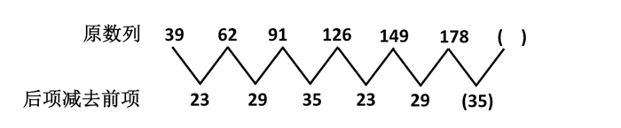

后项减去前项的差值，重复数字23、29、35，所以所求项为178+35=213。

故正确答案为B。

**来源**：2008年北京市公务员录用考试《行测》题（应届）第3题

### 第 4 题

32，48，40，44，42，（  ）

A. 43

B. 45

C. 47

D. 49

第 4 题 · 答案与解析

**参考答案（粉笔题库参考内容）**

A

**解析**

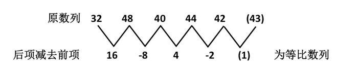

故正确答案为A。

**来源**：2008年北京市公务员录用考试《行测》题（应届）第4题

### 第 5 题

1，8，20，42，79，（  ）

A. 126

B. 128

C. 132

D. 136

第 5 题 · 答案与解析

**参考答案（粉笔题库参考内容）**

D

**解析**

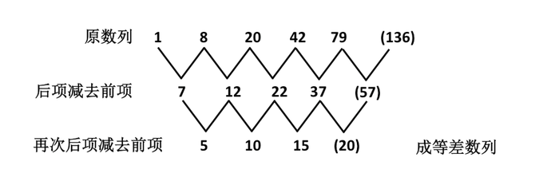

故正确答案为D。

**来源**：2008年北京市公务员录用考试《行测》题（应届）第5题

### 第 6 题

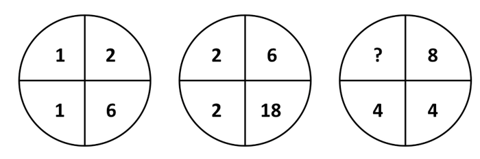

A. 4

B. 8

C. 16

D. 24

第 6 题 · 答案与解析

**参考答案（粉笔题库参考内容）**

D

**解析**

：

，，，因此所求项为24。

故正确答案为D。

**来源**：2008年北京市公务员录用考试《行测》题（应届）第6题

### 第 7 题

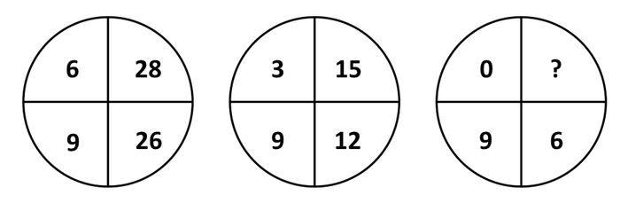

A. 13

B. 7

C. 0

D. \-6

第 7 题 · 答案与解析

**参考答案（粉笔题库参考内容）**

D

**解析**

：

，，，所以所求项为-6。

故正确答案为D。

**来源**：2008年北京市公务员录用考试《行测》题（应届）第7题

### 第 8 题

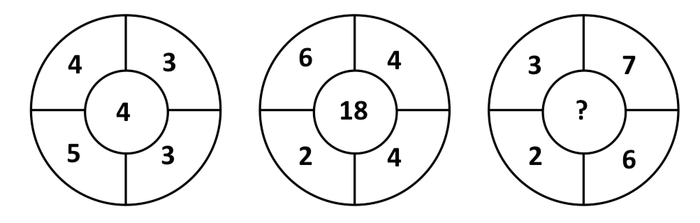

A. 2

B. 8

C. 9

D. 13

第 8 题 · 答案与解析

**参考答案（粉笔题库参考内容）**

C

**解析**

：，，因此所求项为。

故正确答案为C。

本题出题不严谨，存在另外一种答案，望考生仔细甄别。：，，因此为，答案为D。

**来源**：2008年北京市公务员录用考试《行测》题（应届）第8题

### 第 9 题

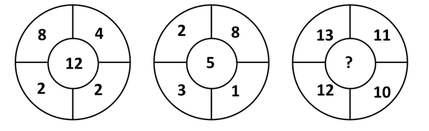

A. 46

B. 25

C. 3

D. \-3

第 9 题 · 答案与解析

**参考答案（粉笔题库参考内容）**

D

**解析**

：

，，因此所求项为。

故正确答案为D。

**来源**：2008年北京市公务员录用考试《行测》题（应届）第9题

### 第 10 题

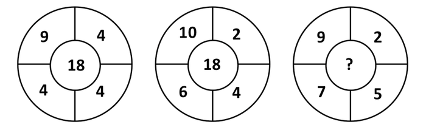

A. 18

B. 20

C. 25

D. 32

第 10 题 · 答案与解析

**参考答案（粉笔题库参考内容）**

B

**解析**

：

，，因此，解得所求项为20。

故正确答案为B。

**来源**：2008年北京市公务员录用考试《行测》题（应届）第10题

### 第 11 题

小王是某品牌鞋子的经销商，他以每4双鞋子300元的价格直接从生产商进货，同时以6双鞋子500元的价格卖给分销商。已知去年小王共赚了10万元钱。问：小王去年共卖出鞋子多少双：

A. 8400双

B. 10000双

C. 12000双

D. 13000双

第 11 题 · 答案与解析

**参考答案（粉笔题库参考内容）**

C

**解析**

解析1：

假定小王去年卖出a双鞋，则：，解得a=12000。

解析2：

根据数字特征，鞋子数肯定可以被4和6整除，从而只有A、C两项满足，再把A、C两项代入题目验证，容易得到C项满足题意。

解析3:

4双成本300元；6双成本450元；6双价格500元；6双利润50元；一共卖出。

故正确答案为C。

**考点**：经济利润问题

**来源**：2008年北京市公务员录用考试《行测》题（应届）第11题

### 第 12 题

一只小鸟离开在树枝上的鸟巢，向北飞了10米，然后又向东飞了10米然后又向上飞了10米。最后，它沿着到鸟巢的直线飞回了家，请问：小鸟飞行的总长度与下列哪个最接近：

A. 17米

B. 40米

C. 47米

D. 50米

第 12 题 · 答案与解析

**参考答案（粉笔题库参考内容）**

C

**解析**

小鸟的飞行路线相当于从立方体的顶点，如下图所示：

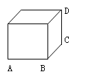

那么小鸟飞行的总长度为米。

故正确答案为C。

**考点**：几何公式类-立体图形、几何结论类-三角形相关

**来源**：2008年北京市公务员录用考试《行测》题（应届）第12题

### 第 13 题

有A、B两种商品，如果A的利润增长20%，B的利润减少10%，那么，A、B两种商品的利润就相同了。问原来A商品的利润是B商品利润的百分之几：

A. 80%

B. 70%

C. 85%

D. 75%

第 13 题 · 答案与解析

**参考答案（粉笔题库参考内容）**

D

**解析**

假定A的利润为x，B的利润为y，则由题意可以列出以下方程：1.2x=0.9y，解得。

故正确答案为D。

**考点**：经济利润问题

**来源**：2008年北京市公务员录用考试《行测》题（应届）第13题

### 第 14 题

甲杯中有浓度17%的溶液400克，乙杯中有浓度为23%的同种溶液600克，现在从甲、乙取出相同质量的溶液，把甲杯取出的倒入乙杯中，把乙杯取出的倒入甲杯中，使甲、乙两杯溶液的浓度相同，问现在两杯溶液浓度是多少：

A. 20%

B. 20.6%

C. 21.2%

D. 21.4%

第 14 题 · 答案与解析

**参考答案（粉笔题库参考内容）**

B

**解析**

本题可采用十字交叉法，由于最终甲乙的浓度相等，设该浓度为x。由题意可知甲、乙溶液的比例为，解得x=20.6%。

故正确答案为B。

本题注意内容：不用考虑甲乙如何达到浓度平衡的过程，只要考虑一开始甲乙浓度不等，后来甲乙浓度相等就行。

**来源**：2008年北京市公务员录用考试《行测》题（应届）第14题

### 第 15 题

甲乙两人年龄不等，已知当甲像乙现在这么大时，乙8岁；当乙像甲现在这么大时，甲29岁。问今年甲的年龄为多少岁：

A. 22岁

B. 34岁

C. 36岁

D. 43岁

第 15 题 · 答案与解析

**参考答案（粉笔题库参考内容）**

A

**解析**

设甲、乙现在的年龄是x、y岁，写出两人每个时刻的年龄，得到下表：

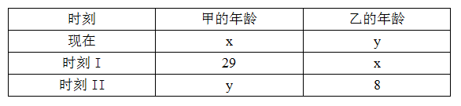

根据“年龄差不变”可得29-x=y-8=x-y，解得x=22。

故正确答案为A。

**考点**：年龄问题

**来源**：2008年北京市公务员录用考试《行测》题（应届）第15题

### 第 16 题

某单位今年新进了3个工作人员，可以分配到3个部门，但每个部门至多只能接收2个人，问：共有几种不同的分配方案？

A. 12种

B. 16种

C. 24种

D. 以上都不对

第 16 题 · 答案与解析

**参考答案（粉笔题库参考内容）**

C

**解析**

讨论三个工作人员的分配，有两种情况：

1、每个人均分到不同的部门，不同的分配方法有：种；

2、有两个人分到同一个部门，不同的分配方法有：种。

综上所述，总共有6+18=24种。

故正确答案为C。

**考点**：基础排列组合

**来源**：2008年北京市公务员录用考试《行测》题（应届）第16题

### 第 17 题

某鞋业公司的旅游鞋加工车间要完成一出口订单，如果每天加工50双，要比原计划晚3天完成，如果每天加工60双，则要比原计划提前2天完成，这一订单共需要加工多少双旅游鞋：

A. 1200双

B. 1300双

C. 1400双

D. 1500双

第 17 题 · 答案与解析

**参考答案（粉笔题库参考内容）**

D

**解析**

解析1：

假定这一订单原先打算x天完成。则根据题意可以列出以下等式：50(x+3)=60(x-2)，解得x=27。则总共的鞋子数为。

解析2：

能被50、60整除的，排除B和C，再依次代入A和D，A不符合。

故正确答案为D。

**考点**：给具体单位型

**来源**：2008年北京市公务员录用考试《行测》题（应届）第17题

### 第 18 题

有一堆棋子(棋子数大于1)，把它们四等分后剩一枚，拿去三份零一枚，将剩下的棋子再四等分后还是剩一枚，再拿去三份零一枚，将剩下的棋子四等分还是剩一枚。问原来至少有多少枚棋子：

A. 23

B. 37

C. 65

D. 85

第 18 题 · 答案与解析

**参考答案（粉笔题库参考内容）**

D

**解析**

解析1：

根据最后一次将剩下的棋子四等分还剩1枚，那么每等份至少应该是1，即最后剩下的棋子至少应该是，依次倒推回去，则有。

解析2：

根据“把它们四等分后剩一枚”，即棋子的数目除以4余1，排除A，将B、C、D代入，只有85符合题意，即，，。

故正确答案为D。

**考点**：和差倍比问题

**来源**：2008年北京市公务员录用考试《行测》题（应届）第18题

### 第 19 题

张先生向商店订购某种商品80件，每件定价100元。张先生向商店经理说：“如果你肯减价，每减1元，我就多订购4件。”商店经理算了一下，他如果减价5%，那么由于张先生多订购，仍可获得与原来一样的利润。这种商品的成本是多少：

A. 65元

B. 70元

C. 75元

D. 80元

第 19 题 · 答案与解析

**参考答案（粉笔题库参考内容）**

C

**解析**

设该商品每件成本x元，则未减价前每件利润为(100-x)元，减价5%后每件利润为(95-x)元，订购数量为件，根据题意有，解得x=75。

故正确答案为C。

**考点**：经济利润问题

**来源**：2008年北京市公务员录用考试《行测》题（应届）第19题

### 第 20 题

一个人乘车去旅行，车走了路程他就睡着了，当他醒来时车还需继续行驶他睡着时的距离，则他睡着时车行驶了全程的几分之几：

A. 

B. 

C. 

D. 

第 20 题 · 答案与解析

**参考答案（粉笔题库参考内容）**

C

**解析**

设睡着时行驶了全程的x，则，解得。

故正确答案为C。

**考点**：普通行程

**来源**：2008年北京市公务员录用考试《行测》题（应届）第20题

### 第 21 题

甲乙丙丁四个人共做了270个零件，如果甲多做10个，乙少做10个，丙做的个数乘2，丁做的个数除以2，那么四人做的零件数恰好相等。丙实际做了多少个：

A. 30

B. 45

C. 52

D. 63

第 21 题 · 答案与解析

**参考答案（粉笔题库参考内容）**

A

**解析**

由题意得，甲+乙+丙+丁=270，。直接从题目所求的出发，设丙实际做了x个零件，则2x-10+2x+10+x+4x=270，则x=30。

故正确答案为A。

**考点**：和差倍比问题

**来源**：2008年北京市公务员录用考试《行测》题（应届）第21题

### 第 22 题

(1+1/2+1/3+1/4)×(1/2+1/3+1/4+1/5)-(1+1/2+1/3+1/4+1/5)×(1/2+1/3+1/4)的值是：

A. 1/2

B. 1/3

C. 1/4

D. 1/5

第 22 题 · 答案与解析

**参考答案（粉笔题库参考内容）**

D

**解析**

设，则原式可以化为。

故正确答案为D。

**来源**：2008年北京市公务员录用考试《行测》题（应届）第22题

### 第 23 题

有甲乙丙三箱水果，甲箱重量与乙、丙两箱重量和之比是1：5，乙箱重量与甲、丙重量之和的比是1：2，甲箱重量与乙箱重量的比是：

A. 

B. 

C. 

D. 1

第 23 题 · 答案与解析

**参考答案（粉笔题库参考内容）**

C

**解析**

由题意，甲:(乙+丙)=1:5，直接给甲赋值为1，则乙+丙=5。假定乙箱子重量为x，则乙:(甲+丙)=1:2可以化为x:(1+5-x)=1:2，解得x=2。从而。

故正确答案为C。

**考点**：和差倍比问题

**来源**：2008年北京市公务员录用考试《行测》题（应届）第23题

### 第 24 题

19/99＋19/99×2＋19/99×3…＋19/99×10=（  ）。

A. 1900/99

B. 190/99

C. 190/11

D. 95/9

第 24 题 · 答案与解析

**参考答案（粉笔题库参考内容）**

D

**解析**

把作为一个整体考虑，设为M，则原式可以化为。把代入，所求值为。

故正确答案为D。

**来源**：2008年北京市公务员录用考试《行测》题（应届）第24题

### 第 25 题

商店购进甲、乙、丙三种不同的糖，所用费用相等，已知甲、乙、丙三种糖每千克费用分别为4.4元，6元和6.6元。如果把这三种糖混在一起成为什锦糖，那么这种什锦糖每千克成本多少元：

A. 4.8

B. 5

C. 5.3

D. 5.5

第 25 题 · 答案与解析

**参考答案（粉笔题库参考内容）**

D

**解析**

由题意可知所用费用相同，结合甲乙丙三种糖的单价，假定每种糖各花费6.6元，则甲为1.5kg，乙为1.1kg，丙为1kg。所以总的重量为1.5+1.1+1=3.6kg，总的价格为元。由得每千克的成本为。

故正确答案为D。

**考点**：经济利润问题

**来源**：2008年北京市公务员录用考试《行测》题（应届）第25题

### 第 26 题

从所给的四个选项中，选择最合适的一个填入问号处，使之呈现一定的规律性。

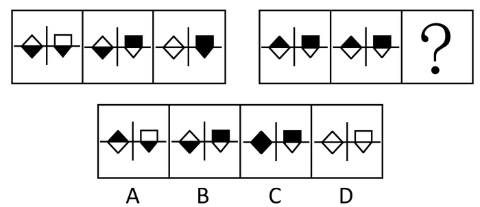

A. A

B. B

C. C

D. D

第 26 题 · 答案与解析

**参考答案（粉笔题库参考内容）**

D

**解析**

前两图黑白叠加形成第三个图形，并且遵循以下颜色规则：同色相加为白，异色相加为黑，即：白＋白＝白，白＋黑＝黑，黑＋黑＝白，黑＋白＝黑。

故正确答案为D。

**考点**：样式规律-黑白运算

**来源**：2008年北京市公务员录用考试《行测》题（应届）第26题

### 第 27 题

从所给四个选项中，选择最合适的一个填入问号处，使之呈现一定的规律性：

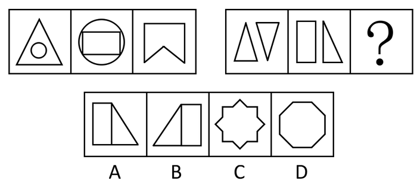

A. A

B. B

C. C

D. D

第 27 题 · 答案与解析

**参考答案（粉笔题库参考内容）**

D

**解析**

元素组成凌乱，考数数。

第一个套图中各图形的直线数分别为3，4，5；第二个套图中各图形的直线数分别为6，7，8。选项图形的直线数分别是5、5、16、8。D项中的直线个数为8条。

故正确答案为D。

**考点**：数量规律-线

**来源**：2008年北京市公务员录用考试《行测》题（应届）第27题

### 第 28 题

从所给四个选项中，选择最合适的一个填入问号处，使之呈现一定的规律性：

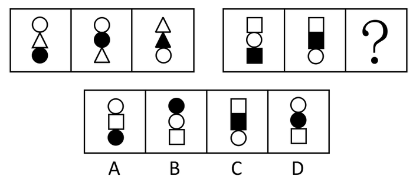

A. A

B. B

C. C

D. D

第 28 题 · 答案与解析

**参考答案（粉笔题库参考内容）**

D

**解析**

元素组成相同，考查位置规律。

每组图中黑色形状的位置依次为下、中、中，且第三个图形中的黑色形状与前两个图形中的黑色形状不同。

故正确答案为D。

**考点**：数量规律-素、样式规律-遍历

**来源**：2008年北京市公务员录用考试《行测》题（应届）第28题

### 第 29 题

从所给四个选项中，选择最合适的一个填入问号处，使之呈现一定的规律性：

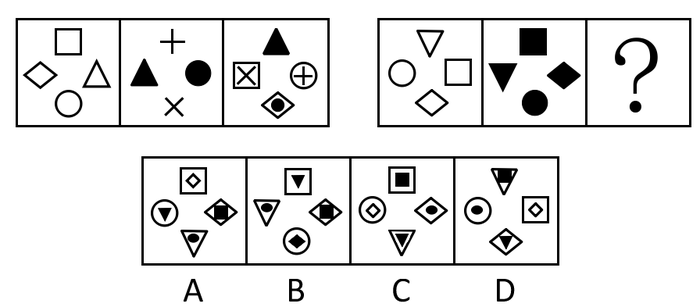

A. A

B. B

C. C

D. D

第 29 题 · 答案与解析

**参考答案（粉笔题库参考内容）**

B

**解析**

元素组成相似，考查元素叠加和位置规律。

每组图形的第三个图形都是由第一个图形逆时针旋转90度与第二个图形顺时针旋转90度相加而得。

故正确答案为B。

**考点**：样式规律-加减同异

**来源**：2008年北京市公务员录用考试《行测》题（应届）第29题

### 第 30 题

从所给四个选项中，选择最合适的一个填入问号处，使之呈现一定的规律性：

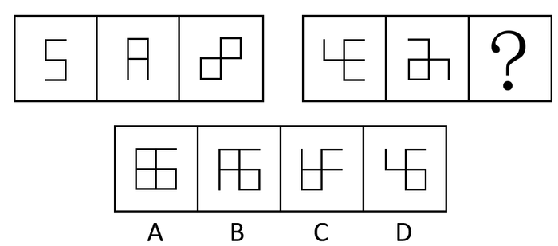

A. A

B. B

C. C

D. D

第 30 题 · 答案与解析

**参考答案（粉笔题库参考内容）**

A

**解析**

本题可通过两种思路寻找答案。

思路1：

元素组成不同，且无明显属性规律，考虑数量规律。观察发现，第一组图中的开口数量依次为2、1、0；第二组前两个图形的开口数量依次为3、2，故问号处图形的开口数量应为1，只有A项符合。

故正确答案为A。

思路2：

元素组成不同，且无明显属性规律，考虑数量规律。观察发现，题干图形封闭区域明显，考虑面数量。第一组图中的面数量依次为0、1、2；第二组前两个图形的面数量依次为0、1，故问号处图形的面数量应为2，只有B项符合。

故正确答案为B。

注：根据公务员考试的命题惯性，第二组图形开口明显是经过设计的，所以第一个答题思路更符合图形推理的命题惯性，粉笔更倾向根据开口数量择优选择A项。

**考点**：数量规律-面

**来源**：2008年北京市公务员录用考试《行测》题（应届）第30题

### 第 31 题

2005年以来，领先汽车的年销售量不断增长，到今年已超过世界知名品牌A牌汽车的年销售量。与此同时，领先汽车因发动机问题产生的返修量也不断上升。

从上述断定中最可能推出以下哪项结论：

A. 领先汽车返修量虽然逐年上升，但这种问题并不影响人们对领先汽车的选择

B. 领先汽车的发动机问题与其他品牌车辆相比比较轻微

C. 2005年以前影响领先汽车销售的问题已经得到了解决

D. A牌汽车的返修率一定高于领先汽车

第 31 题 · 答案与解析

**参考答案（粉笔题库参考内容）**

A

**解析**

第一步：抓住题干主要信息。

第一句说明领先汽车销量不断增长并超越A牌汽车，第二句说明领先汽车在销量不断增长的同时，返修量也不断上升。

第二步：分析题干信息，结合选项得出答案。

领先汽车返修量上升，但年销量也不断增长，可见返修量并没有影响人们对领先汽车的选择，A项正确；

题干只提到领先汽车的发动机问题，没有谈及其他品牌车辆的发动机，无从对比，B项错误；

题干没有谈到2005年以前影响领先汽车销售的问题，无法推出，C项错误；

从题干只知A牌汽车的销量，没有谈及A牌汽车的返修率，无法推出，D项错误。

故正确答案为A。

**考点**：日常结论

**来源**：2008年北京市公务员录用考试《行测》题（应届）第31题

### 第 32 题

小王抱怨母亲总是把电视机的声音开得太大，影响他看书，让母亲把电视关小点儿声。可是母亲说电视的声音并不大，因为父亲一直在旁边看报，也没有说电视声音过大。所以拒绝调小电视声音。

下列哪项为真，则最能表明母亲拒绝调小电视声音是错误的：

A. 母亲从不看书，也不了解看书所需要的环境

B. 父亲在看报时自备了耳塞，效果不错

C. 母亲只在吃晚饭的时间才会看电视

D. 父亲年龄大了，有些耳背

第 32 题 · 答案与解析

**参考答案（粉笔题库参考内容）**

B

**解析**

第一步：找出论点和论据。

论点：母亲拒绝调小电视声音。

论据：父亲没有说电视声音过大。

第二步：逐一判断选项。

A项母亲看不看书、C项母亲看电视的时间跟电视音量没有关系，属于无关选项；

B项说明父亲没说声音过大，是因为有耳塞，而不是因为电视声音不大，否定了母亲得出结论的原因，而且戴了耳塞，也说明声音可能很大，属于削弱选项；

D项父亲耳背，说明声音的大小无法判断。

故正确答案为B。

**考点**：拆桥

**来源**：2008年北京市公务员录用考试《行测》题（应届）第32题

### 第 33 题

高中同学聚会，甲、乙、丙在各自的工作岗位上都做出了一定的成绩，成为了教授、作家和市长。另外，

（1）他们分别毕业于数学系、物理系和中文系

（2）作家称赞中文系毕业者身体健康

（3）物理系毕业者请教授写了一个条幅

（4）作家和物理系毕业者在一个市内工作

（5）乙向数学系毕业者请教过统计问题

（6）毕业后，物理系毕业者、乙都没再和丙联系过

则可知：

A. 丙是作家，甲毕业于物理系

B. 乙毕业于数学系

C. 甲毕业于数学系

D. 中文系毕业者是作家

第 33 题 · 答案与解析

**参考答案（粉笔题库参考内容）**

A

**解析**

第一步：分析题干条件。

（1）他们分别毕业于数学系、物理系和中文系；

（2）作家不是中文系毕业者；

（3）教授不是物理系毕业者；

（4）作家不是物理系毕业者；

（5）乙不是数学系毕业者；

（6）乙不是物理系毕业者，丙不是物理系毕业者。

第二步：根据题干条件进行推理。

题干条件（5）和（6）均提及乙，可优先从“乙”入手进行推理。

由条件（1）（5）（6）可知，乙是中文系毕业者，甲是物理系毕业者，则丙为数学系毕业者。如下表所示：

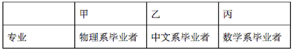

再结合条件（1）（3）（4）可知，物理系毕业者为市长，因此甲是市长、物理系毕业者。

由条件（2）（4）可知，作家为丙，因此丙是作家、数学系毕业者。结合条件（1）可知，乙是教授、中文系毕业者。

综上，甲、乙、丙三人的信息如下表所示：

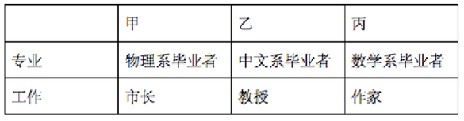

故正确答案为A。

**考点**：从最大信息开始推

**来源**：2008年北京市公务员录用考试《行测》题（应届）第33题

### 第 34 题

尽管冬天来临了，工业消费者使用的石油价格今年特别低，并且可能会保持下去，所以，除非冬天特别严寒，工业消费者使用的天然气价格也可能会保持在低水平。

以下哪项如果为真，最能支持上述结论：

A. 长期天气预报预测会有一个温和的冬季

B. 消费大量天然气的工业用户可以很快且便宜地转换到使用石油这种替代品

C. 石油和天然气二者的最大供给来源地在亚热带地区，不大可能受气候影响

D. 石油销售比天然气销售更易受到恶劣天气的影响

第 34 题 · 答案与解析

**参考答案（粉笔题库参考内容）**

B

**解析**

第一步：找出论点和论据。

论点：工业消费者使用的天然气价格可能会保持在低水平。

论据：工业消费者使用的石油价格特别低。

第二步：判断加强方式。

论点强调的是天然气价格，论据强调的是石油价格，论点和论据强调的对象不同，需要在天然气和石油之间搭桥，加强论证。

第三步：逐一判断选项。

A项说的是冬季的天气预测，无法说明石油和天然气之间的关系，属于无关选项；

B项提到天然气的消费者可以很快且便宜地转换使用石油这种替代品，在天然气和石油之间搭桥，加强论证；

C项中石油和天然气的供应地、D项中石油和天然气的销售量均无法说明两者之间的价格关系，同样属于无关选项。

故正确答案为B。

**考点**：搭桥

**来源**：2008年北京市公务员录用考试《行测》题（应届）第34题

### 第 35 题

甲、乙、丙三人中，只有一个会游泳。甲说：“我会”，乙说：“我不会”，丙说：“甲不会”。如果这三句话，只有一句是真的，那么会游泳的是：

A. 甲

B. 乙

C. 丙

D. 无法判断

第 35 题 · 答案与解析

**参考答案（粉笔题库参考内容）**

B

**解析**

第一步：找突破口，本题中甲和丙所说的话为矛盾关系，因此至少有一句为真话。

第二步：本题只有一句为真话，因此乙必为假话。因此乙会游泳。

故正确答案为B。

**考点**：只有一真/一假

**来源**：2008年北京市公务员录用考试《行测》题（应届）第35题

### 第 36 题

人类的和平共处是一个不可实现的理想，统计数字显示，自1945年以来，每天有12场战斗在进行，这包括大大小小的国际战争以及内战中的武力交战。以下哪项如果是真，最能对上述结论提出质疑？（    ）。

A. 1945年以来至本世纪，国与国之间在外交上都表现出极大的克制，边境冲突也少有发生

B. 现代战争讲究威慑而不是攻击，比如愈演愈烈的核军备竞赛以及由此而造成的东西方冷战

C. 自从有人类以来，人类为争夺资源和领土的冲突一直都没有停止

D. 20世纪60年代全世界总共爆发了30次战争，而到80年代爆发的战争总共还不到10次

第 36 题 · 答案与解析

**参考答案（粉笔题库参考内容）**

D

**解析**

第一步：找出论点论据。

论点：人类的和平共处是一个不可实现的理想。

论据：统计数字显示，自1945年以来，每天有12场战斗在进行，这包括大大小小的国际战争以及内战中的武力交战。

第二步：逐一判断选项。

A项，该项只表明国际战争与冲突少，不代表国家内战少，不能质疑。

B项，现代战争的特点和方式与以前不同，不代表现代战争比以前少，不能质疑。

C项，人类为争夺资源和领土的冲突一直都没有停止，说明人类难以和平共处，支持了论点，不能质疑。

D项，通过20世纪60年代与80年代战争次数对比，揭示了一个趋势，即战争虽然仍在爆发，但是数量越来越少，说明未来人类的和平共处是有可能的，削弱了结论，可以质疑。

第三步：再次标注答案。

故正确答案为D。

**考点**：削弱论点

**来源**：2008年北京市公务员录用考试《行测》题（应届）第36题

### 第 37 题

工人对工作的不满意，不仅产生于工作环境和工资本身，而且很大程度上依赖于工人对工作的期望值与实际情况之间的差距。因此，大公司招聘员工，通过许愿来达到吸引工人的目的，是一种不明智的做法。

从以上观点中可以推出下列哪项结论：

Ⅰ只要工人的期望值足够低，那么，不论工作本身如何，工人的满意程度都会很高

Ⅱ只要工作环境舒适并且工资水平较高，那么不论工人期望值如何，工人都不会产生不满意的情绪

Ⅲ随着工人期望值的增加，尽管企业有效地改善了工作环境、提高了员工待遇，员工的不满意情绪仍有可能得不到消除

A. 只有Ⅰ

B. 只有Ⅱ

C. 只有Ⅲ

D. 只有Ⅰ、Ⅲ

第 37 题 · 答案与解析

**参考答案（粉笔题库参考内容）**

C

**解析**

解析1：

第一步：抓住每句话中的对象及其关系。

第一句是说，期望值高工作环境差工资低工人对工作不满意。第二句说许愿不明智。并且两句存在因果关系。

第二步：判断整体关系。

两句话为因果关系，且第一句为原因，第二句是结果。

第三步：逐一判断选项。

Ⅰ可用第一句的逆否规则，否后推否前，因此推出工人不会不满意，而不是工人满意度很高，所以A项错误。

Ⅱ项是对第一句后件的部分肯定，不能推出前件的结论。

Ⅲ项是对第一句后件的不确定阐述。如果期望值低，工人就不会不满；如果期望值高，工人就有可能不满。因此Ⅲ正确。

故正确答案为C。

解析2：

由题干推出，工人对工作的不满意取决于工作环境、工资本身以及工人对工作的期望值与实际情况之间的差距，三者之间是并且的关系，Ⅰ、Ⅱ没有满足三者并且的关系，所以错误，因此，排除A、B、D三项，选择C。

故正确答案为C。

**考点**：日常结论

**来源**：2008年北京市公务员录用考试《行测》题（应届）第37题

### 第 38 题

条件一：任何在高速公路上运行的交通工具的时速必须超过60公里

条件二：自行车的最高时速是20公里

条件三：我的汽车只有逢双休日才被允许在高速公路上驾驶

条件四：今天是周六

如果上述断定是真的，下面哪项断定也一定是真的：

Ⅰ自行车不允许在高速公路上行驶

Ⅱ今天我的汽车仍然可能不被允许在高速公路上行驶

Ⅲ如果我的汽车的时速超过60公里，那么当日肯定是逢双休日

A. 只有Ⅰ

B. 只有Ⅰ、Ⅱ

C. 只有Ⅰ、Ⅲ

D. 只有Ⅰ、Ⅱ、Ⅲ

第 38 题 · 答案与解析

**参考答案（粉笔题库参考内容）**

B

**解析**

第一步：翻译题干条件。

条件一：允许在高速公路上驾驶时速超过60公里；

条件二：自行车最高时速20公里（－时速超过60公里）；

条件三：我的汽车被允许在高速公路上驾驶双休日；

条件四：今天是周六（双休日）。

第二步：逐一分析选项。

Ⅰ：根据条件二可知，自行车时速不超过60公里，是对条件一的否后，可以推出否前，即自行车不允许在高速公路上驾驶，Ⅰ正确；

Ⅱ：根据条件四可知，今天是周六，周六是双休日，是对条件三的肯后，肯后无法推出确定性结论，但可以推出可能性结论，即今天我的汽车可能被允许在高速公路上驾驶，也可能不被允许在高速公路上驾驶，Ⅱ正确；

Ⅲ：翻译为“我的汽车时速超过60公里当日是双休日”，“时速超过60公里”是条件一的肯后，无法推出确定性结论，无法推出“我的汽车被允许在高速公路上驾驶”，也就无法再根据条件三推出当日是双休日，Ⅲ错误。

根据上述推理，可知Ⅰ、Ⅱ一定为真。

故正确答案为B。

**考点**：常规翻译

**来源**：2008年北京市公务员录用考试《行测》题（应届）第38题

### 第 39 题

元大公司开发的楼盘中所有户型都是400平方米以上的大户型，在400平方米以上的大户型中有50%是独栋别墅。只有购买了独栋别墅的业主才可以同时享受物业提供的24小时送餐服务和免费小区超市代购服务。

如果上述判定为真，并且事实上是李先生从元大公司购房后享有免费小区超市代购服务，则以下哪项一定为真：

Ⅰ李先生肯定可以享受物业提供的24小时送餐服务

Ⅱ这套房子肯定是独栋别墅

Ⅲ这套房子的面积肯定超过400平方米

A. 只有Ⅰ

B. 只有Ⅱ

C. 只有Ⅲ

D. 只有Ⅰ、Ⅱ和Ⅲ

第 39 题 · 答案与解析

**参考答案（粉笔题库参考内容）**

C

**解析**

第一步：翻译题干。

第一句，400平方米以上的大户型与独栋别墅是包容关系，即独栋别墅是400平方米以上大户型的一种。第二句，24小时送餐服务∧免费小区超市代购服务⇒业主买了独栋别墅。第三句，事实上是李先生从元大公司购房后享有免费小区超市代购服务。

第二步：通过题干中问题的事实部分判断选项的正确与否。

第三句是事实信息，李先生享有免费小区超市代购服务，是部分肯定第二句结论中的前件，不能推出绝对表达的结论，因此Ⅱ错误。题干没有给出24小时送餐服务和免费小区超市代购服务之间关系，无法推出Ⅰ。由于该公司所有户型都是400平方米以上，因此李先生买的房子面积也在400平方米以上，Ⅲ正确。

故正确答案为C。

**考点**：常规翻译

**来源**：2008年北京市公务员录用考试《行测》题（应届）第39题

### 第 40 题

北京有一个非常受欢迎的火锅店，最近将一种菜的单价从过去的18元提高到20元，销售仍然不错。然而，在提价的一周之内，几个服务员陆续辞职不干了。

下列哪项最能解释上述现象：

A. 菜品的提价对店员们的工资水平并没有影响

B. 提高价格使该店不能继续保持良好的市场占有率

C. 尽管提价了，该店的此种菜品仍然比其他店卖得便宜

D. 菜价的提高并不能解决原材料涨价带来的利润下降问题，店主只好降低员工工资

第 40 题 · 答案与解析

**参考答案（粉笔题库参考内容）**

D

**解析**

第一步：找出题干矛盾。

菜价提高，销售仍然不错，但服务员陆续辞职不干了。

第二步：逐一分析选项。

A项：菜价提高不影响店员工资，那么店员不会因此辞职，没有说明服务员为什么陆续辞职，不能解释题干矛盾，排除；

B项：菜价提高使该店不再保持良好的市场占有率，但不一定会因此影响员工的个人待遇，无法说明服务员为什么陆续辞职，不能解释题干矛盾，排除；

C项：菜价虽然提高但该店菜价仍比其他店便宜，可以解释菜价提高后仍保持好销量的现象，未提及店员，无法说明服务员为什么陆续辞职，不能解释题干矛盾，排除；

D项：提高菜价不足以解决利润下降问题，因此降低员工工资，服务员因工资下降而辞职，可以解释题干矛盾，当选。

故正确答案为D。

**考点**：原因解释

**来源**：2008年北京市公务员录用考试《行测》题（应届）第40题

### 第 41 题

①办理房屋产权证 ②提出购房申请

③按协议交纳房款 ④审查购房资格

⑤签订买卖协议

A. ④②①③⑤

B. ②③④⑤①

C. ②④⑤③①

D. ⑤③②④①

第 41 题 · 答案与解析

**参考答案（粉笔题库参考内容）**

C

**解析**

本题描述的是房屋购买程序只有“签订买卖协议”后才能“按协议交纳房款”，故⑤发生在③之前，排除A、B两项。

如购买经济适用房，要先“提出购房申请”，在通过购房资格审查之后，才可以签订买卖协议。

比较C、D两项，C项更符合事件逻辑顺序。

故正确答案为C。

**来源**：2008年北京市公务员录用考试《行测》题（应届）第41题

### 第 42 题

①赵某接到报案去勘察现场 ②张某上街买菜

③王某截住一辆汽车 ④李某去接张某出院

⑤李某酒后驾车撞一行人

A. ②⑤③①④

B. ⑤①②③④

C. ⑤①③④②

D. ②⑤①④③

第 42 题 · 答案与解析

**参考答案（粉笔题库参考内容）**

A

**解析**

本题描述的是一起交通事故的发生过程。

根据④和⑤判断李某酒后驾车撞的行人是张某，结合选项分析②⑤做为事件起因更符合逻辑，而④应该是整个事件的结尾。

故正确答案为A。

**来源**：2008年北京市公务员录用考试《行测》题（应届）第42题

### 第 43 题

①采用高科技技术分析卫星照片 ②作出决策以保障国家的安全

③发射间谍卫星俯瞰世界 ④了解世界热点地区的最新情况

⑤传输数字化卫星照片

A. ⑤④③①②

B. ①③⑤④②

C. ③⑤①④②

D. ⑤①③④②

第 43 题 · 答案与解析

**参考答案（粉笔题库参考内容）**

C

**解析**

本题描述的是发射间谍卫星并分析利用卫星传输的资料的过程，③应该是逻辑起点，排除A、B、D。

故正确答案为C。

**来源**：2008年北京市公务员录用考试《行测》题（应届）第43题

### 第 44 题

①本地改良 ②市场考察

③水果优质高产 ④引进国外稀有水果品种

⑤试种失败

A. ②④⑤①③

B. ④②③①⑤

C. ⑤②④③①

D. ②①⑤④③

第 44 题 · 答案与解析

**参考答案（粉笔题库参考内容）**

A

**解析**

本题描述的是品种引进试种，并进行改良的过程。①④⑤的先后顺序应该是④引进国外稀有水果品种⑤试种失败①本地改良。

故正确答案为A。

**来源**：2008年北京市公务员录用考试《行测》题（应届）第44题

### 第 45 题

①政府悬赏 ②专家辨别真伪

③得到珍贵照片 ④颁发证书和奖金

⑤进行蹲点拍摄

A. ⑤④③①②

B. ①⑤③②④

C. ③⑤①④②

D. ⑤①③④②

第 45 题 · 答案与解析

**参考答案（粉笔题库参考内容）**

B

**解析**

⑤进行蹲点拍摄和③得到珍贵照片是一个联系紧密的先后事件，⑤应该发生在③之前，排除C；④应该发生在①之后，排除A。

比较选项B和选项D，①作为逻辑起点更合理。

故正确答案为B。

**来源**：2008年北京市公务员录用考试《行测》题（应届）第45题

### 第 46 题

行政征收，是指一国政府基于公共需要，由行政机关根据法律法规的规定，以强制方式无偿取得相对人财产所有权的行为。

以下不属于行政征收的是：

A. 收取罚款

B. 收取矿产资源补偿费

C. 收取公路养路费

D. 收取港口建设费

第 46 题 · 答案与解析

**参考答案（粉笔题库参考内容）**

A

**解析**

第一步：抓住定义中的关键词。

关键词强调“基于公共需要”、“根据法律法规”、“强制方式”、“无偿取得”、“财产所有权”。

第二步：逐一判断选项。

A项中收取罚款不符合“基于公共需要”，属于行政处罚，不符合定义；

B、C、D项都符合定义中关键词的要求。

本题为选非题，故正确答案为A。

**考点**：方式目的

**来源**：2008年北京市公务员录用考试《行测》题（应届）第46题

### 第 47 题

逮捕，是指公安机关、人民检察院和人民法院为防止被告人逃避或者阻碍侦查和审判，或继续危害社会，依法剥夺其人身自由的强制方法。

根据以上定义，下列属于逮捕的是：

A. 张某因生意上的纠纷将李某打伤，虽不构成犯罪，但公安机关对他处以罚款100元并拘留15天

B. 流窜犯田某，盗窃财物15万元，为逃避追捕，还打伤公安干警一名。公安机关抓住他后，提请人民检察院批准，将其送看守所关押

C. 在一经济纠纷案的开庭审理中，被告王某的妻子大吵大闹，诽谤审判长，严重扰乱法庭秩序。据此，法院决定将其关押五天

D. 陈某抢劫杀人后企图逃跑，被村民抓住后扭送至村委会，村干部将其关押三天

第 47 题 · 答案与解析

**参考答案（粉笔题库参考内容）**

B

**解析**

第一步：抓住定义中的关键词。

关键词强调“公安机关、人民检察院和人民法院”、“被告人”、“逃避或阻碍侦查和审判”、“或继续危害社会”、“依法剥夺人身自由”。

第二步：逐一判断选项。

A项中“虽不构成犯罪”即可知肯定不属于逮捕；

B项表述符合逮捕的定义；

C项注意“在一经济纠纷案的开庭审理中”和“严重扰乱法庭秩序”即可，法院采取的行为属于民事诉讼中的强制措施，不符合定义；

D项注意“村干部”，其不属于题干中涉及到的主体，不符合定义。

故正确答案为B。

**考点**：方式目的

**来源**：2008年北京市公务员录用考试《行测》题（应届）第47题

### 第 48 题

在世赠与，是指施赠人决定活着的时候把钱赠与子女、孙子女和其他亲属，或用于度假和建立信托基金。

下列选项中，属于在世赠与的是：

A. 王先生在其去世前立下遗嘱，将财产的90%留给自己唯一的孙女

B. 李董事长将自己财产的80%和整个集团交给女儿，然后自己隐居山村

C. 王奶奶让孙子在自己的房子里结婚，自己去住养老院

D. 李先生失踪2年后，其儿子继承了他的财产，某天，他突然出现在家中

第 48 题 · 答案与解析

**参考答案（粉笔题库参考内容）**

B

**解析**

第一步：抓住定义中的关键词。

关键词强调“施赠人决定”、“活着的时候”、“钱”、“子女、孙子女和其他亲属”、“度假和建立信托基金”。

第二步：逐一判断选项。

A项中的“遗嘱”，是遗产继承，与“活着的时候”这一关键词不符；

C项中只是说到在里面结婚，没有提到给予，不符合定义；

D项中儿子是继承财产，不是施赠人自主决定的，不符合定义。

故正确答案为B。

**考点**：大前提

**来源**：2008年北京市公务员录用考试《行测》题（应届）第48题

### 第 49 题

形成权，是指权利人依自己的行为，使自己与他人之间的法律关系发生变动的权利。

下列属于形成权的是：

A. 买卖合同履行期间，由于卖方暂时缺货，买方要解除合同

B. 租房合同履行期间，承租人要求降低租金

C. 保管合同履行期间，保管人要求提高保管费

D. 借款合同履行期间，债权人主动免除债务人的债务

第 49 题 · 答案与解析

**参考答案（粉笔题库参考内容）**

D

**解析**

根据题干可知，形成权是依单方法律行为，即以一方的行为，法律关系即可发生变化。

A选项的解除合同是双方法律行为；

B选项承租人要求降低租金、C选项保管人要求提高保管费没有使法律关系发生变化，因此，错误。所以选择D。

故正确答案为D。

**考点**：原因结果

**来源**：2008年北京市公务员录用考试《行测》题（应届）第49题

### 第 50 题

“蓝色革命”作为一种现代农业技术革命，是指人类向水域索取食物的重大技术革命的统称。

下列行为与“蓝色革命”不符的是：

A. 创造鱼类的产卵环境，适时将幼鱼放回海湾

B. 利用科技手段在海体中养鱼，待长成后聚而捕之

C. 围海造田、大力发展畜产饲料工业

D. 改造滩涂，种植海底饲料，建立海底牧场

第 50 题 · 答案与解析

**参考答案（粉笔题库参考内容）**

C

**解析**

第一步：抓住定义中的关键词。

定义中强调“向水域索取食物”。

第二步：逐一判断选项。

C项中围海造田，不是“向水域索取食物”，而是发展饲料工业，与定义不符；

A项中的幼鱼放回、B项中的利用科技手段养鱼、D项中的建立海底牧场均为向水域索取食物的技术革命，符合定义。

本题为选非题，故正确答案为C。

**考点**：方式目的

**来源**：2008年北京市公务员录用考试《行测》题（应届）第50题

### 第 51 题

网络犯罪，是指在网络空间内以计算机网络为犯罪工具或攻击对象的危害社会的行为，它具有犯罪现场和空间的虚拟性、犯罪行为的隐蔽性和犯罪手段的智能性等特点。

下列行为中不属于网络犯罪的是：

A. 张某开办某网站，在网上提供色情电影120部，访问量达数千人

B. 李某与某女网民“裸聊”，在对方不知情的情况下，抓拍多张对方裸体照片，通过E-mail向对方寄送照片并敲诈5000元

C. 大学生王某利用在某网络公司工作之机，进入游戏数据库，窃取可以交换游戏时间的“金币”，并在网络中叫卖，获得非法收入

D. 赵某与女大学生刘某数次在网上聊天，两人彼此都有好感，于是约定见面聊天，见面后赵某见刘某非常漂亮顿生邪念，将刘某拖到僻静处对其实施强暴

第 51 题 · 答案与解析

**参考答案（粉笔题库参考内容）**

D

**解析**

第一步：抓住定义中的关键词。

关键词强调“以计算机网络为犯罪工具或攻击对象”。

第二步：逐一判断选项。

D项中的犯罪行为是强暴，其犯罪的工具和犯罪对象都不是计算机网络，因此不符合定义。

A、B、C三项均符合定义。

本题为选非题，故正确答案为D。

**考点**：方式目的

**来源**：2008年北京市公务员录用考试《行测》题（应届）第51题

### 第 52 题

工具性攻击行为，是指有目标指导（攻击是作为达到目标的工具）和认识基础的攻击。

根据该定义，下列属于工具性攻击行为的是：

A. 夜班回家遭遇抢劫，用随身带的水果刀把歹徒吓走

B. 公路上两车追尾，司机下来理论

C. 同学羞辱小刚，小刚一怒之下拿起杯子朝同学砸了过去

D. 小偷把一位老年妇女推倒在地，抢了她的钱包

第 52 题 · 答案与解析

**参考答案（粉笔题库参考内容）**

D

**解析**

第一步：抓住定义中的关键词。

题干中强调“攻击作为达到目标的工具”。

第二步：逐一判断选项的作用。

A、B项中的攻击行为没有发生，不符合定义；

C项中的攻击行为是目标本身，没有作为达到目标的工具，不符合定义；

D项中，目标是抢钱包，以攻击行为实现这一目标，符合定义。

故正确答案为D。

**考点**：单定义-其他句式

**来源**：2008年北京市公务员录用考试《行测》题（应届）第52题

### 第 53 题

表象，是指事物不在面前时，人们在头脑中出现的关于事物的形象。具有直观性、概括性、可操作性等特点，在形象思维中具有重要作用。

根据该定义，下列属于表象的是：

A. 没有见过北方冬日的人们，通过诵读毛泽东诗词《沁园春·雪》，可在头脑中形成北国风光的情景

B. 孙悟空是吴承恩先生抽象出来的一个人物形象

C. 当一个孩子盯着一幅画看上几分钟，闭上眼睛，依然能够清楚地记得这幅画的每一个细节

D. 当人们读到《红楼梦》中关于王熙凤生动的外貌描写时，似乎能看到王熙凤就站在眼前

第 53 题 · 答案与解析

**参考答案（粉笔题库参考内容）**

C

**解析**

第一步：抓住定义中的关键词。

题干中强调“事物不在面前时”、“头脑中出现”、“关于事物的形象”。

第二步：逐一判断选项。

A、B、D项中提到的都是对一个没有见过的事物的主观想象，不符合定义；

C项中是孩子在闭眼时对其形象在脑中的再次呈现，符合定义。

故正确答案为C。

**考点**：单定义-其他句式

**来源**：2008年北京市公务员录用考试《行测》题（应届）第53题

### 第 54 题

不公平竞争，是指一个企业采用不正当或者不公平的手段，提高其产品的市场份额，给生产同类产品的竞争对手造成了不公平的市场环境，严重损害其竞争对手的利益。

根据定义，下列行为不属于不公平竞争的是：

A. A食品厂以低于成本的价格出售本厂方便面，致使原本畅销的B食品厂方便面滞销

B. 20世纪80年代，IBM公司投入大量资金研制超大型计算机的关键技术，成功之后申请专利，造成20世纪80年代在超大计算机领域IBM一手遮天的局面

C. 甲公司和乙公司都生产减肥药品，为了扩大其市场占有份额，提高销售利润，甲公司在电视台和一些报纸上大做宣传，指出乙公司药品的种种缺点和副作用，导致消费者拒买乙公司的产品

D. 甲公司为了和乙公司争夺市场份额，制作电影广告，显示一架机徽为甲的战机向即将倾覆的（标志为乙）军舰投下重磅炸弹

第 54 题 · 答案与解析

**参考答案（粉笔题库参考内容）**

B

**解析**

第一步：抓住定义中的关键词。

题干中的关键词为“不正当或不公平的手段”、“损害竞争对手的利益”、“不公平的市场环境”。

第二步：逐一判断选项。

A项中以低于成本的价格销售属于掠夺性定价的行为，意在排挤竞争对手，属于不正当手段；

B项中的加大技术投入、申请专利均为正当行为，不符合定义；

C、D项的行为是对竞争对手的诋毁行为，属于不正当手段，因此均符合定义。

本题为选非题，故正确答案为B。

**考点**：拆词

**来源**：2008年北京市公务员录用考试《行测》题（应届）第54题

### 第 55 题

规范，是指人们在特定环境下被要求如何行动、如何思维、如何体验的期望，是一种相对固定的行为表现。

根据以上的定义，下面哪种行为体现了规范：

A. 一个从小生活在海边的人到草原工作，慢慢适应了那里的生活

B. 律师在法庭上表现镇定、稳重、客观、富于正义感

C. 小郑身着背心和短裤，脚上穿着拖鞋参加好朋友的婚礼

D. 为了使大家玩得更开心，我们制定了新的游戏规则

第 55 题 · 答案与解析

**参考答案（粉笔题库参考内容）**

B

**解析**

第一步：抓住定义中的关键词。

题干中强调“被要求”、“相对固定”。

第二步：逐一判断选项。

A项中适应草原生活属于主动适应，而不是“被要求”；

B项表述符合定义要求；

C项中的行为并不是在婚礼上要求的正常行为，违反了规范；

D项中的新规则不是相对固定的行为，A、C、D三项均不符合定义。

故正确答案为B。

**考点**：单定义-其他句式

**来源**：2008年北京市公务员录用考试《行测》题（应届）第55题

### 第 56 题

要鼓励市民采取绿色交通方式出行，首先要提供充足和优质的公共交通。这表明政府在履行：

A. 政治职能

B. 经济职能

C. 文化职能

D. 社会公共服务职能

第 56 题 · 答案与解析

**参考答案（粉笔题库参考内容）**

D

**解析**

A项错误，政治职能指政府为维护国家统治阶级的利益，对外保护国家安全，对内维持社会秩序的职能，又称统治职能；

B项错误，经济职能指政府为国家经济的发展，对社会经济生活进行管理的职能，如宏观调控，市场监管等；

C项错误，文化职能指政府为满足人民日益增长的文化生活的需要，依法对文化事业所实施的管理；

D项正确，政府的公共服务职能来源于法律授权，公共服务主要是政府依据社会公共需求，通过多种方式为社会提供教育、科技、文化、医疗、社会保障、城乡公共设施等方面的产品和服务。交通属于公共服务领域。

故正确答案为D。

**来源**：2008年北京市公务员录用考试《行测》题（应届）第56题

### 第 57 题

《反垄断法》明令禁止政府滥用行政权力影响消费者的行为。目前政府解决这一问题最重要的环节是：

A. 严格立法，确保各项事业有法可依

B. 严格依法行政，进一步完善政府管理体制的改革

C. 严格司法，有法必依，违法必究

D. 严格法律监督，提高公众法制意识

第 57 题 · 答案与解析

**参考答案（粉笔题库参考内容）**

B

**解析**

A、C、D三项错误，问题的行为主体是政府，与严格司法、立法、法律监督的实施主体均没有关系；

B项正确，严格依法行政，进一步完善政府管理体制的改革是禁止政府滥用行政权力影响消费者的行为重要的环节，“禁止政府滥用行政权力”需依法执行。

故正确答案为B。

**考点**：劳动法和经济法

**来源**：2008年北京市公务员录用考试《行测》题（应届）第57题

### 第 58 题

近年来，世界各国学习中文、了解中国、增进与中国交往的需求日益增强，全球“汉语热”持续升温。这种现象出现的根本原因是：

A. 汉语是联合国的一种工作语言

B. 中国倡导和平共处五项原则

C. 中国文化的独特魅力

D. 中国综合国力的增强和国际地位的提高

第 58 题 · 答案与解析

**参考答案（粉笔题库参考内容）**

D

**解析**

本题要把握的关键词是汉语热的“根本原因”，只有D项符合，由于中国综合国力的增强和国际地位的提高出现了汉语热。

故正确答案为D。

**考点**：中国地理

**来源**：2008年北京市公务员录用考试《行测》题（应届）第58题

### 第 59 题

下列可以免税的个人收入是：

A. 稿酬所得

B. 国债和国家发行的金融债券利息

C. 财产转让所得

D. 偶然所得

第 59 题 · 答案与解析

**参考答案（粉笔题库参考内容）**

B

**解析**

免税是指按照税法规定免除全部应纳税款，是对某些纳税人或征税对象给予鼓励、扶持或照顾的特殊规定，是世界各国及各个税种普遍采用的一种税收优惠方式。根据《个人所得税法》的规定，稿酬所得、财产转让所得、偶然所得都应计税。

故正确答案为B。

本题相关知识点：

《个人所得税法》中规定个人转让有价证券、股权、建筑物、土地使用权、机器设备、车船以及其他自有财产给他人或单位而取得的所得需要计税。但对个人股票买卖取得的所得暂不征税。

目前我国免纳个人所得税的个人所得常见的有如下几种：（一）省级人民政府、国务院部委和中国人民解放军军以上单位，以及外国组织、国际组织颁发的科学、教育、技术、文化、卫生、体育、环境保护等方面的奖金；（二）国债和国家发行的金融债券利息；（三）按照国家统一规定发给的补贴、津贴；（四）福利费、抚恤金、救济金；（五）保险赔款等。

**考点**：劳动法和经济法

**来源**：2008年四川省公务员录用考试《行测》题第83题

### 第 60 题

每天，天安门广场的国旗都是与太阳同时升起的，一年中升旗最早的一天应是：

A. 立春日

B. 立夏日

C. 夏至日

D. 冬至日

第 60 题 · 答案与解析

**参考答案（粉笔题库参考内容）**

C

**解析**

夏至日时，太阳直射北回归线，一天之中白天最长，“日出”最早。

故正确答案为C。

本题相关知识点：

立春，每年2月4日或5日太阳到达黄经315度。中国以立春为春季的开始。

立夏，每年5月5日或5月6日太阳到达黄经45度。“斗指东南，维为立夏，万物至此皆长大，故名立夏也”。

冬至，每年12月22日前后。太阳直射点在南回归线上，南半球各地昼最长，夜最短。

**考点**：自然地理

**来源**：2008年北京市公务员录用考试《行测》题（应届）第60题

### 第 61 题

私人物品和公共物品的差别是：

A. 私人物品具有竞争性和排他性的特点，而公共物品只具有排他性的特点

B. 私人物品具有竞争性和排他性的特点，而公共物品不具有这两个特点

C. 公共物品具有竞争性和排他性的特点，而私人物品只具有竞争性的特点

D. 公共物品具有竞争性和排他性的特点，而私人物品不具有这两个特点

第 61 题 · 答案与解析

**参考答案（粉笔题库参考内容）**

B

**解析**

公共物品是指公共使用或消费的物品。公共物品是可以供社会成员共同享用的物品，严格意义上的公共物品具有非竞争性和非排他性。

故正确答案为B。

本题相关知识点：

公共物品是与私人物品相对应的一个概念，消费具有非竞争性和非排他性特征，一般不能或不能有效通过市场机制由企业和个人来提供，主要由政府来提供。

**考点**：微观经济

**来源**：2008年北京市公务员录用考试《行测》题（应届）第61题

### 第 62 题

北京市放眼世界经济发展趋势，依据其深厚的文化积淀、强劲的科技创新能力和丰富的人才资源，根据不同地区的特点合理规划，积极建设数字娱乐示范基地、“798”艺术区等多个特色文化创意产业聚集区。这一做法坚持的原则是：

A. 主观与客观相统一

B. 分析与综合相结合

C. 办事情要抓住重点

D. 一分为二地看问题

第 62 题 · 答案与解析

**参考答案（粉笔题库参考内容）**

A

**解析**

题干指出北京市根据不断变化的实际情况积极进行特色文化创意产业建设，强调主观要随着变化发展的客观实际不断地变化，“使主观符合客观”，主观与客观相统一。

故正确答案为A。

**考点**：认识论

**来源**：2008年北京市公务员录用考试《行测》题（应届）第62题

### 第 63 题

中国近代史以鸦片战争为开端，主要是因为：

A. 中国第一次被西方国家打败

B. 长期闭关锁国的状况被打破

C. 社会性质开始发生变化

D. 民族矛盾取代了阶级矛盾

第 63 题 · 答案与解析

**参考答案（粉笔题库参考内容）**

C

**解析**

中国近代史以鸦片战争为开端主要是因为社会性质开始发生变化，其中：

1.社会性质的变化：中国从封建社会逐步变成半殖民地半封建社会；

2.社会主要矛盾的变化：由地主阶级和农民阶级的矛盾，变为外国资本主义和中华民族、封建主义和人民大众的矛盾，而外国资本主义和中华民族的矛盾是最主要的矛盾；

3.中国革命的任务：由反封建变为反侵略反封建。

故正确答案为C。

**考点**：中国历史

**来源**：2008年北京市公务员录用考试《行测》题（应届）第63题

### 第 64 题

下列选项中，乙的哪种行为构成我国《合同法》规定的承诺：

A. 甲向丙发出要约，乙得知后向甲表示接受甲在要约中规定的条件

B. 甲向乙发出要约，要求乙在接到要约后七日内给予答复，逾期未答复则被视为承诺。乙未按期答复

C. 甲在报纸上刊登广告称：本公司有圣诞礼物出售，欲购者请速与本公司联系。乙打电话给甲订购若干

D. 甲在报纸上刊登附有价目表的广告称：本书店新到图书若干，欲购者可在一个月内汇款，款到寄书。乙汇款给甲

第 64 题 · 答案与解析

**参考答案（粉笔题库参考内容）**

D

**解析**

A项错误，乙不是受要约人，故乙的意思表示不是承诺；

B项错误，除法律另有规定或当事人事先有约定外，沉默或者不行动不能作为承诺的方式；

C项错误，甲的行为为要约邀请，乙的行为为要约，不符合题意；

D项正确，合同法21条：承诺是受要约人同意要约的意思表示。22条：承诺应当以通知的方式作出。但根据交易习惯或者要约表明可以通过行为做出承诺的除外。

故正确答案为D。

**考点**：民法典

**来源**：2008年北京市公务员录用考试《行测》题（应届）第64题

### 第 65 题

甲因为男友乙不忠而生恨意，决定杀了他。某日把乙引到家中将毒药掺入饮料中让其喝下。乙昏迷之际，甲离家到附近的湖边准备自杀。徘徊之际，甲心生悔意，跑回家中救乙，发现乙已被家人送往医院，并脱离生命危险。对甲的处罚应：

A. 按既遂犯处罚

B. 可以比照既遂犯从轻、减轻或者免除处罚

C. 可以比照既遂犯从轻或减轻处罚

D. 当免除处罚

第 65 题 · 答案与解析

**参考答案（粉笔题库参考内容）**

C

**解析**

本题考查的知识点：

犯罪中止和犯罪未遂最关键的区别在于行为人是否以自己的行为有效地防止了犯罪结果的发生。本题中不是因为甲自己的行为防止了犯罪结果的发生，而是他人的行为防止了犯罪结果的发生，对于行为人而言，这实际上是意志以外的原因犯罪未得逞，故只能成立犯罪未遂，而不是犯罪中止。甲在实施完犯罪行为之后，虽然行为人欲防止犯罪结果的发生，但犯罪结果实际上是由他人的行为防止发生的，所以甲成立犯罪未遂。按照刑法第23条第2款的规定，对于未遂犯，可以比照既遂犯从轻或者减轻处罚。

故正确答案为C。

**考点**：刑法

**来源**：2008年北京市公务员录用考试《行测》题（应届）第65题

### 第 66 题

关于正当防卫与紧急避险，下列说法正确的是：

A. 正当防卫明显超过必要限度造成重大损害的，应当以防卫过当罪定罪，但是应当酌情减轻或者免除处罚

B. 紧急避险用于解决紧迫情况下合法利益之间的冲突

C. 防卫过当的场合，其罪过形式通常是直接故意

D. 对于事后防卫的，通常按照防卫过当处理

第 66 题 · 答案与解析

**参考答案（粉笔题库参考内容）**

B

**解析**

本题考查法律常识。

1.正当防卫：我国刑法第二十条规定：为了使国家、公共利益、本人或者他人的人身、财产和其他权利免受正在进行的不法侵害，而采取的制止不法侵害的行为，对不法侵害人造成损害的，属于正当防卫，不负刑事责任。正当防卫明显超过必要限度造成重大损害的，应当负刑事责任，但是应当减轻或者免除处罚。

2.紧急避险：我国刑法第二十一条规定，为了使国家、公共利益、本人或者他人的人身、财产和其他权利免受正在发生的危险，不得已采取的紧急避险行为，造成损害的，不负刑事责任。

A项错误，在我国没有防卫过当罪这个罪名，如果防卫过当构成犯罪，则应按照《刑法》分则定罪量刑。

B项正确，紧急避险的本质是避免现实危险、保护较大合法权益。紧急避险的客观特征是，在法律所保护的权益遇到危险而不可能采取其他措施予以避免时，不得已损害另一较小合法权益来保护较大的合法权益。

C项错误，直接故意是否为防卫过当的罪过形式，目前刑法理论界尚无定论。

D项错误，正当防卫只能在不法侵害正在进行之时实行，不能实行事前防卫和事后防卫。

故正确答案为B。

**考点**：刑法

**来源**：2008年北京市公务员录用考试《行测》题（应届）第66题

### 第 67 题

对偷盗婴儿的行为以绑架罪论处的，必须是行为人：

A. 导致婴儿死亡的

B. 出于出卖目的

C. 以勒索财物为目的

D. 已完成该犯罪行为

第 67 题 · 答案与解析

**参考答案（粉笔题库参考内容）**

C

**解析**

本题考查知识点：

绑架：我国《刑法》第239条规定：“以勒索财物为目的绑架他人的或者绑架他人作为人质的，处十年以上有期徒刑或者无期徒刑，并处罚金或者没收财产；致使被绑架人死亡或者杀害被绑架人的，处死刑，并处没收财产以勒索财物为目的偷盗婴幼儿的，依照前款的规定处罚。”

对偷盗婴儿的行为以绑架罪论处的必须是以勒索为目的。

故正确答案为C。

**考点**：刑法

**来源**：2008年北京市公务员录用考试《行测》题（应届）第67题

### 第 68 题

现代工业的特点是：

A. 采用的原料种类越来越少

B. 对劳动力数量、体力的投入越来越多

C. 单位产值能源消耗越来越多

D. 对劳动力知识、技术的投入逐渐增加

第 68 题 · 答案与解析

**参考答案（粉笔题库参考内容）**

D

**解析**

本题考查知识点：

现代工业采用现代生产技术设备的工业生产。主要包括生产工艺过程的机械化、电气化、自动化、化学化等。一般泛指20世纪末21世纪计算机的广泛应用以来对现存物质系统飞跃性认知后发展起来的新型高技术高信息化的工业生产。

现代工业主要特征有：

1.工业生产技术现代化。即劳动手段的机械化、电气化、强速化、精密化和自动化；

2.工业结构现代化。主要指产业结构与规模结构的合理组成比例；

3.工业生产组织现代化。生产实现高度集中化、专业化、协作化和联合化，具有较高的劳动生产率；

4.工业企业管理手段和方法现代化；

5.工业职工结构的现代化。要求拥有大量素质高、技术熟练的生产工人、科技人员与管理人员。

A选项错误，采用的原料种类不一定越来越少；

B选项错误，对劳动力数量、体力的投入不是越来越多，而是要提高劳动效率；

C选项错误，单位产值能源消耗越来越多，与降低单位产值能源消耗，能源消耗越来越少矛盾；

D选项正确，与工业生产的特征相符。

故正确答案为D。

**来源**：2008年北京市公务员录用考试《行测》题（应届）第68题

### 第 69 题

十七大报告指出，在改革开放的历史进程中，我们党把坚持马克思主义基本原理同推进马克思主义（    ）结合起来。把坚持社会主义（    ）同发展市场经济结合起来。把（    ）同促进社会公平结合起来。

A. 中国化 基本制度 提高效率

B. 普遍化 精神文明 社会诚信

C. 中国化 精神文明 提高效率

D. 普遍化 核心价值体系 经济发展

第 69 题 · 答案与解析

**参考答案（粉笔题库参考内容）**

A

**解析**

本题题干节选自十七大报告，“在改革开放的历史进程中，我们党把坚持马克思主义基本原理同推进马克思主义中国化结合起来，把坚持四项基本原则同坚持改革开放结合起来，把尊重人民首创精神同加强和改善党的领导结合起来，把坚持社会主义基本制度同发展市场经济结合起来，把推动经济基础变革同推动上层建筑改革结合起来，把发展社会生产力同提高全民族文明素质结合起来，把提高效率同促进社会公平结合起来，把坚持独立自主同参与经济全球化结合起来，把促进改革发展同保持社会稳定结合起来，把推进中国特色社会主义伟大事业同推进党的建设新的伟大工程结合起来，取得了我们这样一个十几亿人口的发展中大国摆脱贫困、加快实现现代化、巩固和发展社会主义的宝贵经验。”

故正确答案为A。

**考点**：唯物辩证法

**来源**：2008年北京市公务员录用考试《行测》题（应届）第69题

### 第 70 题

改革开放以来，我国经济从一度濒于崩溃的边缘发展到总量跃至世界（    ）、进出口额位居世界第三，人民生活从温饱不足发展到（    ），政治建设、文化建设、社会建设取得举世瞩目的成就。

A. 第三 基本温饱

B. 第四 总体小康

C. 第三 全体温饱

D. 第四 全国小康

第 70 题 · 答案与解析

**参考答案（粉笔题库参考内容）**

B

**解析**

统计表明，2007年底，我国经济总量跃居世界第四，人民生活达到总体小康水平。

故正确答案为B。

**考点**：中国地理

**来源**：2008年北京市公务员录用考试《行测》题（应届）第70题

### 第 71 题

2007年10月24日，（    ）卫星在西昌卫星发射中心发射成功并进入预定地球轨道。11月7日该卫星顺利进入工作轨道，将进行绕月探测活动。

A. 神舟七号

B. 月亮女神

C. 嫦娥一号

D. 探月者一号

第 71 题 · 答案与解析

**参考答案（粉笔题库参考内容）**

C

**解析**

嫦娥一号是我国的首颗绕月人造卫星。以中国古代神话人物嫦娥命名，已于2007年10月24日18时05分左右在西昌卫星发射中心升空。

故正确答案为C。

本题相关知识点：

神舟七号载人航天飞船于2008年9月25日21点10分04秒从中国酒泉卫星发射中心载人航天发射场用长征二号F火箭发射升空。神舟七号载人飞船是中国第三个载人航天飞船，掌握和突破了出舱活动相关技术。

**考点**：科技理论与成就

**来源**：2008年北京市公务员录用考试《行测》题（应届）第71题

### 第 72 题

庆祝香港回归祖国（    ）周年大会暨香港特别行政区第三届政府就职典礼于2007年7月1日在香港隆重举行。

A. 5

B. 10

C. 15

D. 20

第 72 题 · 答案与解析

**参考答案（粉笔题库参考内容）**

B

**解析**

本题相关知识点：香港1997年7月1日回归，2007年庆祝回归10周年。

故正确答案为B。

**考点**：中国历史

**来源**：2008年北京市公务员录用考试《行测》题（应届）第72题

### 第 73 题

2007年8月24日～8月30日举行的十届全国人大常委会第二十九次会议通过了（    ） 、突发事件应对法、（    ） 、修改后的动物防疫法和全国人大常委会关于修改城市房地产管理法的决定。

A. 反垄断法 就业促进法

B. 物权法 就业促进法

C. 反垄断法 物权法

D. 反暴力法 就业促进法

第 73 题 · 答案与解析

**参考答案（粉笔题库参考内容）**

A

**解析**

十届全国人大常委会第二十九次会议，通过了反垄断法、突发事件应对法、就业促进法、修改后的动物防疫法和全国人大常委会关于修改城市房地产管理法的决定。

故正确答案为A。

**考点**：劳动法和经济法

**来源**：2008年北京市公务员录用考试《行测》题（应届）第73题

### 第 74 题

中共中央政治局2007年7月26日召开会议，分析研究当前经济形势和经济工作。会议提出，要坚持把遏制经济增长由偏快转为（  ）作为当前宏观调控的首要任务，着力控制高耗能、高排放和产能过剩行业盲目扩张，努力缓解（  ）增长过快、信贷投放过多、外贸顺差过大的矛盾，控制价格总水平过快上涨。

A. 偏慢 消费

B. 偏慢 投资

C. 过热 投资

D. 过热 消费

第 74 题 · 答案与解析

**参考答案（粉笔题库参考内容）**

C

**解析**

中共中央政治局2007年7月26日召开会议，分析研究当前经济形势和经济工作。会议提出，要坚持把遏制经济增长由偏快转为过热作为当前宏观调控的首要任务，着力控制高耗能、高排放和产能过剩行业盲目扩张，努力缓解投资增长过快、信贷投放过多、外贸顺差过大的矛盾，控制价格总水平过快上涨。

故正确答案为C。

**考点**：宏观经济与调控政策

**来源**：2008年北京市公务员录用考试《行测》题（应届）第74题

### 第 75 题

下列有关文史常识的表述，不正确的一项是：

A. 李清照，宋朝著名女词人，其作品多为豪放之作

B. 朱自清是我国现代著名散文家、诗人、学者，代表作《背影》为中国现代散文史上的名篇

C. 《钢铁是怎样炼成的》是苏联作家奥斯特洛夫斯基的作品，小说塑造了钢铁战士保尔·柯察金的形象

D. 中国古代的史书体裁有编年体、纪传体和纪事本末体等

第 75 题 · 答案与解析

**参考答案（粉笔题库参考内容）**

A

**解析**

李清照是中国古代罕见的才女，是婉约派的代表，她的词分前期和后期。前期多写其悠闲生活，多描写爱情生活、自然景物，韵调优美。如《一剪梅·红藕香残玉簟秋》等。后期多慨叹身世，怀乡忆旧，情调悲伤。如《声声慢·寻寻觅觅》等。没有多少豪放之作。

本题为选非题，故正确答案为A。

**考点**：文学常识

**来源**：2008年北京市公务员录用考试《行测》题（应届）第75题

### 第 76 题

十七大召开前，党代表的条件、选举产生程序、代表名额分配、构成比例等基层党员关注的细节问题向社会公开。中央要求，候选人的推荐提名从基层开始，所有基层党组织和党员参加。这表明：

A. 民主集中制是我党的根本组织制度和领导制度

B. 选举党代表是公民的一项基本政治权利

C. 党务公开是执政党与时俱进的体现

D. 党内民主是党的生命，有利于实现党的宗旨

第 76 题 · 答案与解析

**参考答案（粉笔题库参考内容）**

ACD

**解析**

A项正确，民主集中制由列宁最早提出，是民主基础上的集中和集中指导下的民主相结合，它既是党的根本组织原则，也是群众路线在党的生活中的运用。

B项错误，党代表是由党员选举出来的，是党员的基本权利，并非是公民的基本政治权利。

C项正确，党代表的条件、选举产生程序、代表名额分配、构成比例等基层党员关注的细节问题向社会公开体现了党务公开。

D项正确，候选人的推荐提名从基层开始，所有基层党组织和党员参加体现了党内民主。

故正确答案为ACD。

**考点**：宪法

**来源**：2008年北京市公务员录用考试《行测》题（应届）第76题

### 第 77 题

关注民生、保障民生、改善民生，是党的宗旨和政府职责的表现。下列属于政府现阶段解决民生问题的举措的有：

A. 在农村免除义务教育阶段学杂费

B. 对药价“限高”

C. 兴建经济适用房和建立廉租房制度

D. 推广商业保险

第 77 题 · 答案与解析

**参考答案（粉笔题库参考内容）**

ABC

**解析**

本题考点为改善民生的社会建设，主要包括六个方面：

1.优先发展教育，建设人力资源强国。

2.实施扩大就业的发展战略，促进以创业带动就业。

3.深化收入分配制度改革，增加城乡居民收入。

4.加快建立覆盖城乡居民的社会保障体系，保障人民基本生活。

5.建立基本医疗卫生制度，提高全民健康水平。

6.完善社会管理，维护社会安定团结。

由此得出A、B、C为改善民生的举措。

D选项错误，政府为构筑更加和谐健全的社会保障体系，具体通过完善社会保险、医疗保险体系等措施来实现，而不是推广商业保险。

故正确答案为A、B、C。

**来源**：2008年北京市公务员录用考试《行测》题（应届）第77题

### 第 78 题

以下做法有利于缓解企业在解雇员工时可能产生负面影响的是：

A. 突然、快速地办理解雇手续

B. 允许被解雇员工拿走公司一定数额的财物以作为补偿

C. 解雇决策的理由要充分、公正

D. 要与被解雇员工进行及时、充分的沟通

第 78 题 · 答案与解析

**参考答案（粉笔题库参考内容）**

CD

**解析**

解雇指员工与组织的雇佣关系的非自愿性终止。解雇往往是组织主导型的，由于员工个人方面的原因导致的雇佣关系的解除。在我国国有企业和集体企业中，也称为开除。

A、B选项会产生负面影响。

故正确答案为C、D。

**来源**：2008年北京市公务员录用考试《行测》题（应届）第78题

### 第 79 题

每年3月，我国都要召开全国人民代表大会和全国政治协商会议，全国人大代表和全国政协委员汇集北京，共商国事。下列表述中，不正确的有：

A. 代表的任务是参政议政，委员的任务是政治协商

B. 代表参与制定国家法律，委员参与对国家重大事务的协商

C. 人大是最高国家权力机关，政协是最高国家监督机关

D. 人大直接创建国家管理制度，政协间接创建国家管理制度

第 79 题 · 答案与解析

**参考答案（粉笔题库参考内容）**

ACD

**解析**

A项错误，代表的任务是履行代表职责，行使审议权、表决权、监督权等；委员的任务是政治协商、参政议政等。

B项正确，《宪法》第五十八条规定：“全国人民代表大会和全国人民代表大会常务委员会行使国家立法权。”因此代表参与制定国家法律，委员参与对国家重大事务的协商。

C项错误，《宪法》第五十七条规定：“中华人民共和国全国人民代表大会是最高国家权力机关。它的常设机关是全国人民代表大会常务委员会。”第一百三十四条规定：“中华人民共和国人民检察院是国家的法律监督机关。”

D项错误，人大通过制定法律来创建国家管理制度，并非直接创建。

本题为选非题，故正确答案为ACD。

**考点**：宪法

**来源**：2008年北京市公务员录用考试《行测》题（应届）第79题

### 第 80 题

生病、车祸、失业等不可预测的事件往往会使一个家庭的经济生活陷入困境。下列选项中能够帮助家庭抵御上述风险的是：

A. 健全的金融体系

B. 有序的企业竞争环境

C. 完善的社会保障制度

D. 公平竞争的劳动力市场

第 80 题 · 答案与解析

**参考答案（粉笔题库参考内容）**

CD

**解析**

A、B选项与题干关系不大；

C、D选项正确，本题需要围绕能够帮助家庭抵御生病、车祸、失业等不可预测事件所产生的风险进行回答，完善的社会保障制度以及公平竞争的劳动力市场能针对性的抵御上述风险。

故正确答案为C、D。

**来源**：2008年北京市公务员录用考试《行测》题（应届）第80题

### 第 81 题

下列说法不正确的有：

A. 太阳辐射的能量主要来自太阳内部的核裂变反应

B. 汤姆生发现电子，表明原子具有核式结构

C. 一束光照射到某种金属上不能发生光电效应，是因为该束光的波长太短

D. 按照玻尔理论，氢原子核外电子从半径较小的轨道跃迁到半径较大的轨道时，电子的动能减小，原子总能量增大

第 81 题 · 答案与解析

**参考答案（粉笔题库参考内容）**

ABC

**解析**

本题主要考查能源与科技材料方面的知识点。

1.太阳辐射的能量主要来自太阳内部的核聚变反应而非核裂变反应。

2.1897年，汤姆生发现了电子，但是只是表明电子是原子的组成部分。20世纪初汤姆生提出了原子的枣糕式模型：原子是一个球体，正电荷均匀分布在整个球内，而电子却像枣糕里的枣子那样镶嵌在原子里面。

3.1909-1911年，英国物理学家卢瑟福做了粒子散射实验，否定了汤姆生模型，提出了原子的核式结构模型。而一束光照射到某种金属上不能发生光电效应，是因为该束光的频率太低，而光的频率与波长成反比，所以这时只能是因为该束光的波长太长。

4.按照玻尔理论，氢原子核外电子从半径较小的轨道跃迁到半径较大的轨道时，电子的动能减小，原子总能量增大。

本题为选非题，故正确答案为A、B、C。

**考点**：化学常识

**来源**：2008年北京市公务员录用考试《行测》题（应届）第81题

### 第 82 题

当前，城市化过程中产生的问题主要有：

A. 环境质量下降

B. 交通拥挤、就业困难

C. 城市数量过多

D. 市场供应不足

第 82 题 · 答案与解析

**参考答案（粉笔题库参考内容）**

AB

**解析**

城市化过程中产生的问题主要有：居住条件差、交通拥挤、大气污染、城市环境噪声污染、环境质量下降 、失业人数增多、就业困难等。

故正确答案为A、B。

本题相关知识点：城市化是由农业为主的传统乡村社会向以工业和服务业为主的现代城市社会逐渐转变的历史过程，具体包括人口职业的转变、产业结构的转变、土地及地域空间的变化。

城市化演进过程：正常的城市化进程都会经历从城市化、郊区城市化、逆城市化、再城市化的过程。

城市化的标志：

1.城市人口占总人口的比重不断上升

2.劳动力从第一产业向第二、三产业转移

3.城市用地规模不断扩大

**考点**：其他

**来源**：2008年北京市公务员录用考试《行测》题（应届）第82题

### 第 83 题

我国刑法的基本原则是：

A. 罪刑法定原则

B. 法律面前人人平等原则

C. 罪刑相当原则

D. 罪刑合理原则

第 83 题 · 答案与解析

**参考答案（粉笔题库参考内容）**

ABC

**解析**

A项正确，《刑法》第三条规定：“法律明文规定为犯罪行为的，依照法律定罪处刑；法律没有明文规定为犯罪行为的，不得定罪处刑。”

B项正确，《刑法》第四条规定：“对任何人犯罪，在适用法律上一律平等。不允许任何人有超越法律的特权。”

C项正确，《刑法》第五条规定：“刑罚的轻重，应当与犯罪分子所犯罪行和承担的刑事责任相适应。”

D项错误，“合理”这一概念缺乏量化标准，在执行中不可操作，不属于刑法的原则。

故正确答案为ABC。

**考点**：宪法

**来源**：2008年北京市公务员录用考试《行测》题（应届）第83题

### 第 84 题

甲一直暗恋同学乙，某日趁乙不备偷拍其换衣服的照片，并以此要挟乙与自己结婚。乙只好同意和甲结婚。下列说法中正确的是：

A. 甲侵犯了乙的隐私权

B. 乙可以在婚姻登记后向人民法院起诉要求离婚

C. 乙有权主张婚姻无效

D. 乙只能在结婚一年后提出离婚申请

第 84 题 · 答案与解析

**参考答案（粉笔题库参考内容）**

AB

**解析**

A项正确，隐私权，是自然人对其个人信息、个人私事和个人领域所享有的不受他人侵犯的权利。本题中，甲偷拍乙换衣服，侵犯了乙的个人私密，侵犯了乙的隐私权。

B项正确，《中华人民共和国民法典》第一千零七十九条规定： “夫妻一方要求离婚的，可以由有关组织进行调解或者直接向人民法院提起离婚诉讼。人民法院审理离婚案件，应当进行调解；如果感情确已破裂，调解无效的，应当准予离婚。有下列情形之一，调解无效的，应准予离婚：（一）重婚或与他人同居；（二）实施家庭暴力或虐待、遗弃家庭成员的；（三）有赌博、吸毒等恶习屡教不改的；（四）因感情不和分居满二年的；（五）其他导致夫妻感情破裂的情形。”该项中，乙可以以夫妻感情破裂为由向法院起诉要求离婚。

C项错误，《中华人民共和国民法典》第一千零五十一条规定：“有下列情形之一的，婚姻无效：（一）重婚；（二）有禁止结婚的亲属关系的；（三）未到法定婚龄的。”因胁迫而结婚的不属于无效婚姻的情形，而属于可撤销婚姻的情形。

D项错误，《中华人民共和国民法典》第一千零五十二条规定：“ 因胁迫结婚的，受胁迫的一方可以向人民法院请求撤销婚姻。请求撤销婚姻的，应当自胁迫行为终止之日起一年内提出。被非法限制人身自由的当事人请求撤销婚姻的，应当自恢复人身自由之日起一年内提出。”故撤销权应在结婚登记后的一年内行使。但是如果提出的是离婚申请，婚姻法并未对其行使时间进行限制。

故正确答案为AB。

**考点**：民法典

**来源**：2008年北京市公务员录用考试《行测》题（应届）第84题

### 第 85 题

中国共产党第十七次全国代表大会报告对全面建设小康社会奋斗目标提出了新的更高要求。下列选项中不属于上述要求的是：

A. 实现人均国内生产总值到2020年比2000年翻两番

B. 改善生态环境，以循环经济代替现有经济增长模式

C. 加快发展社会事业，人人享有基本医疗卫生服务

D. 加强文化建设，确保高等教育覆盖率增长50%

第 85 题 · 答案与解析

**参考答案（粉笔题库参考内容）**

BD

**解析**

党的十七大报告对全面建设小康社会奋斗目标提出了新的更高要求，这些要求主要分为五个方面，这五个方面分别是：

1.增强发展协调性，努力实现经济又好又快发展；

2.扩大社会主义民主，更好保障人民权益和社会公平正义；

3.加强文化建设，明显提高全民族文明素质；

4.加快发展社会事业，全面改善人民生活；

5.建设生态文明基本形成节约能源资源和保护生态环境的产业结构、增长方式、消费模式。

十七大报告中并没有提出以循环经济代替现有经济增长模式的目标，我们制定的目标是循环经济形成较大规模，可再生能源比重显著上升，另外十七大报告中也没有提出确保高等教育覆盖率增长50%的目标。

本题为选非题，故正确答案为B、D。

**来源**：2008年北京市公务员录用考试《行测》题（应届）第85题

## 材料 1

阅读以下文字，完成各题。

        随着社会的发展，文化的社会功能越来越显著。我们从当今社会生活中看到文化对经济建设的推动力，对思想建设的感召力，对环境建设的渗透力，对人才成长的促进力，产生着越来越深刻的影响。文化在社会主义文明大厦的建设工程中，发挥着基石作用。

        文化与文明\[    \]。文化先生于文明。文化是文明的基础，没有文化就没有文明；文明孕育着文化。文明是文化的显现，是文化发展到高级阶段的特征。人类社会从野蛮到文明，靠的是文化进步。正如恩格斯所说：“最初的、从动物界分离出来的人，在一切本质方面是和动物一样不自由的；但是，文化上的每一进步都是迈向自由的一步。”

        文化确实像泰勒所说的那样：“(文化)是人类在自身的历史经济中创造的‘包罗万象的复合体’”。但它并不是不可捉摸的神物，如把这个“包罗万象的复合体”解剖一下，便可看到这个“复合体”大致是由物质文化、精神文化和智能文化三个方面的文化因素所构成的，三者各自从不同的角度在建设社会主义文明大厦中发挥着影响和作用。

        物质文化是人类文明的基础，技术的发明、创造一旦转化为人们所需的物质文化，就对人们的价值观、思维方式、思想感情、行为准则、理论观念等诸方面产生深刻的影响，会造成新的思维方式、新的意识、新的观念去培养“四有新人”。

        智能文化在建设社会主义文明大厦中占有十分重要的地位。发展科学、教育等智能文化是一个国家、一个民族从野蛮走向文明、从愚昧走向智慧，从经济落后走向经济繁荣的十分重要的条件。

        物质文化、精神文化、智能文化等诸文化要素是一个相互交织、相互渗透、相互融合的文化共同体，世上没有孤立的物质文化、单纯的精神文化和独立的智能文化。因而不能把各个文化要素割裂开来，也不能孤立地发展某一个文化要素，否则就会造成文化失调，贻误事业发展、文明建设。

### 第 86 题

根据对第二段的内容分析，下列判断全对的一项是：

①文明植根于文化，是随着文化的发展而产生的

②没有文明就没有文化

③文化创造了人

④文明创造了人

⑤有了文化的积累和进步，人类才能一步步脱离野蛮状态而成为文明的人

A. ①②

B. ③④

C. ①⑤

D. ②④

第 86 题 · 答案与解析

**参考答案（粉笔题库参考内容）**

C

**解析**

此题是细节判断题。

根据原文中“文化是文明的基础，没有文化就没有文明”和“文明是文化的显现，是文化发展到高级阶段的特征”可知①判断正确，②判断错误；“人类社会从野蛮到文明，靠的是文化进步”和“最初的、从动物界分离出来的人，在一切本质方面是和动物一样不自由的，但是，文化上的每一进步都是迈向自由的一步”可知⑤判断正确；文化和文明都不可能创造人，③④错误。

故正确答案为C。

**来源**：2008年北京市公务员录用考试《行测》题（应届）第86题

### 第 87 题

在第二段恩格斯的话中，“自由”和“文明”的关系是：

A. 两者的含义完全相同

B. 自由是文明的一个特征

C. 文明是自由的基础

D. 二者互相融合，结为一体

第 87 题 · 答案与解析

**参考答案（粉笔题库参考内容）**

C

**解析**

此题是细节判断题。

“最初的、从动物界分离出来的人，在一切本质方面是和动物一样不自由的；但是，文化上的每一进步都是迈向自由的一步”这句话是在间接地论述文化、文明与自由这三个概念之间的关系。通俗点说，这句话的意思就是在最初的野蛮社会尚没有真正的文明，是不自由的，但是文化的进步会孕育出文明，然后才会有自由。从文意无法直接推导出“自由是文明的一个特征”这样一个结论。

所以A、B、D存在错误。

故正确答案为C。

**来源**：2008年北京市公务员录用考试《行测》题（应届）第87题

### 第 88 题

第三段中引用泰勒的话的意思是：

A. 文化就是人类的历史经验；文化是各种要素的大杂烩

B. 文化是人类创造的；文化是多种要素的有机整体

C. 文化是人类进步的产物；文化的影响和作用非常大

D. 文化是劳动人民创造的；经济是文化的基础

第 88 题 · 答案与解析

**参考答案（粉笔题库参考内容）**

B

**解析**

此题是语句理解题。

“（文化）是人类在自身的历史经济中创造的‘包罗万象的复合体’”这一句话中，最关键的就是理解“包罗万象的复合体”的意思，而文中提到说这个“复合体”大致是由物质文化、精神文化和智能文化三个方面的文化因素所构成的，三者各自从不同的角度在建设社会主义文明大厦中发挥着影响和作用。可见文化是多种要素的有机整体，B项是最恰当的。

A项错误，“文化是各种要素的大杂烩”这种说法本身就是错误的；C、D两项与泰勒的话并无直接关系。

故正确答案为B。

**来源**：2008年北京市公务员录用考试《行测》题（应届）第88题

### 第 89 题

本文的中心论点是：

A. 文化的社会功能十分显著

B. 文化与文明关系密切

C. 文化是文明的基石

D. 物质文化、精神文化、智能文化相互关联，密不可分

第 89 题 · 答案与解析

**参考答案（粉笔题库参考内容）**

C

**解析**

此题考查主旨理解。

文中论述文化的社会功能越来越显著，文化与文明的息息相关的关系，都是为了说明文化是文明的基石。实际上，正因为文化是文明的基石，才应该通过物质文化、精神文化、智能文化的建设来构建社会主义文明。结合上述表述，C项符合题意。

A、B、D三项分别只说明了论点的一部分，不够全面。

故正确答案为C。

**来源**：2008年北京市公务员录用考试《行测》题（应届）第89题

### 第 90 题

文中\[  \]应填入的词语是：

A. 相辅相成

B. 意义相同

C. 息息相关

D. 彼此不分

第 90 题 · 答案与解析

**参考答案（粉笔题库参考内容）**

C

**解析**

此题是成语填空题。

此空是强调文化与文明两者的关系。“意义相同”和“彼此不分”都没有正确地概括出文化与文明的关系，不可能入选。“相辅相成”指两件事物互相配合，互相辅助，缺一不可。事实上，文化与文明并不是这样互相扶助的关系，文明是建立在文化基础上的上位概念，纵观全文只有“息息相关”才最恰当、最准确地概括出了二者的关系。结合上述，C项符合题意。

故正确答案为C。

**来源**：2008年北京市公务员录用考试《行测》题（应届）第90题

## 材料 2

阅读以下文字，完成各题。

        有关人士认为，“人类基因组草图”的测绘成功仅仅预示着一个新的开端，真正的研究工作还只刚刚起步。例如，“草图”中留下了许多空白需要填补，不少可能包含着重要的医学信息的空白又顽固地拒绝“泄露自己的秘密”。除了最先完成的22号染色体长臂中有3%被证明无法解读外，从那时以来完成的4号染色体也留有很多空白。此外，大约有10%的基因组由于其重复性而根本不可能测序。

        据国外某些杂志报道，即使到2003年“人类基因组计划”完成了终图，漏洞依然会存在——某些基因将被忽略不计。而蛋白质作为生命三联体的最后一位“成员”，又是迄今为止最难攻克的堡垒。

        全人类只有一个共同的基因组，但是由于各种内外因素的作用，世界上每个人都有差别，这种差别被称为单核苷酸多态性。目前，生物学家已利用单个DNA中的变化来跟踪人体基因的变异，并借此评估人类各种生物学现象的奥秘，如健康状况、对疾病的易感性、寿命长短、人类的起源等等。

        人类大部分的DNA都是“垃圾”，几乎不起什么作用或至少是没有明显的用途。剩下的则是渊源于植物、动物甚至细菌这一最原始生命形式的基因的“大杂烩”。事实上，大量在维系细胞的基本功能，如修补和解读DNA方面所需的基因，与促使细菌保持原样的基因没什么两样。

        我们在回溯生物进化史的过程中又会发现，人们曾与植物、动物以及软体虫和有翅昆虫共同分享无数的基因。例如一种古怪的被称为“声波刺猬”的基因，它对昆虫在成熟中翅膀生长和发育起着重要的作用。这一相同的基因，在人的胚胎中则起着协调手臂生长和发育的作用。所以，人类基因与某些哺乳动物更为接近也就\[    \]了。例如鼠的基因与人极为相似，它的基因组一致被描述为探明人类基因组的“罗塞塔石碑”（即为解读古埃及象形文字提供线索的石碑）。此外，猩猩的DNA与人只相差1.5%，因而分析这一看似微不足道的差异，自然有助于揭示人之所以为人的奥秘。

        看来，不同物种似乎是通过长期复制、改良和组合现存基因而获得进化的。正是这种逐渐从多细胞有机物中汲取新鲜养分的“复制”过程，才使人类不断进化以至于成为超越低级生命形式的高级动物。所以，有专家将基因比作砖块，“用它既能修车库，也可以盖摩天大楼，关键是看你如何运用”。

### 第 91 题

下列对人类基因组研究描述，最准确的一项是：

A. 据国外有关杂志报道，即使到了2003年“人类基因组计划”完成了终图，漏洞依然会存在——很多基因无法解读

B. “人类基因组草图”的测绘成功仅仅预示着一个新的开端，真正的研究工作还只刚刚起步

C. 人类基因组草图只能描绘90%的基因组，因为大约有10%的基因组由于其重复性而根本不可能测序

D. 迄今为止的研究中，只有作为生命分子三联体的最后一位“成员”——蛋白质尚未攻克

第 91 题 · 答案与解析

**参考答案（粉笔题库参考内容）**

B

**解析**

此题是细节判断题。

A选项错误，文中第二段开头就提到“某些基因将被忽略不计”并非无法解读；

B选项正确，是文中的一句话“‘人类基因组草图’的测绘成功仅仅预示着一个新的开端，真正的研究工作还只刚刚起步”也是概括全文主旨的句子；

C选项错误，“只能描绘90%的基因组”，从文章中可以看出“人类基因组草图”已经测绘成功，只不过有10%的基因组由于其重复性而根本不可能测序，故应该是达不到90%；

D选项错误，在文中的第二段最后一句提到，蛋白质的研究是最难攻克的难关，而不是唯一的一个尚未攻克的。

故正确答案为B。

**来源**：2008年北京市公务员录用考试《行测》题（应届）第91题

### 第 92 题

下列对“不同物种似乎是通过长期复制、改良和组合现存基因而获得进化的”这句话的理解，错误的一项是：

A. 我们在回溯生物进化史的过程中又会发现，人类曾经与植物、动物以及软体虫和有翅昆虫共同分享无数基因

B. 人与老鼠的基因极为相似，猩猩的DNA也与人只相差1.5%，人之所以为人的奥秘就在于通过长期复制、改良和组合现有基因而获得进化

C. 这种逐渐从多细胞有机物中汲取新鲜养分的“复制”，才使人类不断进化以至于成为超越低级生命形式的高级动物

D. 全人类只有一个共同的基因组，但是由于各种内外因素的作用，世界上每个人都有差别。这正是生物通过长期复制、改良和组合现存基因而获得进化的佐证

第 92 题 · 答案与解析

**参考答案（粉笔题库参考内容）**

D

**解析**

此题是语句理解题。

D选项错误，题干要求理解的是“不同物种”间的关系，而D选项中提到的仅仅是不同人类的差别与关系，人类属于同一个物种。

A、B、C选项可以直接从材料得出答案。

本题为选非题，故正确答案为D。

**来源**：2008年北京市公务员录用考试《行测》题（应届）第92题

### 第 93 题

下列对人类基因工作组研究的表述不正确的一项是：

A. “草图”中留下了许多空白需要填补，不少可能包含着重要医学信息的空白依靠目前的科技无法解读

B. 生物学家已能利用单个DNA中的变化来控制人体基因的变异，并借以评估人类各种生物学现象的奥秘，如健康状况、对疾病的易感性、寿命的长短、人类的起源等等

C. 人类大部分DNA几乎不起作用或者至少是没有明显的用途，剩下的则是渊源于植物、动物甚至细菌这一最原始生命形式的基因，这说明“万物之灵”的人类的起源实际上也是很“卑微”的

D. 人类的基因与某些哺乳动物更为接近，分析这一看似微不足道的差异，自然有助于揭示人之所以为人的奥秘

第 93 题 · 答案与解析

**参考答案（粉笔题库参考内容）**

B

**解析**

此题是细节判断题。

A、C、D三项几乎都是原文，可以找到出处。

B项中偷换了概念，是“跟踪”而不是“控制”，这是两个完全不同的概念，跟踪未必能达到控制的目的，控制程度过于绝对。

本题为选非题，故正确答案为B。

**来源**：2008年北京市公务员录用考试《行测》题（应届）第93题

### 第 94 题

根据原文提供的信息，以下推断不正确的一项是：

A. 一旦科技发展可以使我们填补上草图中的空白，所有重要的医学信息便随之“泄露各自的秘密”，人类便真正成为了自由的人

B. 修补和解读DNA方面所必需的基因，与促使细菌保持原状的基因没什么两样，但重要的是各自的改良和组合，从而产生了复杂的人

C. “用它既能修车库，也可以盖摩天大楼，关键是看你如何运用”是指同一个基因既可能构成低等动物，也可能构成人类

D. 人体解剖学是人们从宏观上了解自己，人类基因组计划则将使人们从微观上，也就是说从根本上了解自己

第 94 题 · 答案与解析

**参考答案（粉笔题库参考内容）**

A

**解析**

此题是细节判断题。

A项中提到的“自由的人”是我们填补上草图中的空白，所有重要的医学信息便随之“泄露各自的秘密”造成的，理解错误，无法得出该结论。

其他选项都可以从材料得到。

本题为选非题，故正确答案为A。

**来源**：2008年北京市公务员录用考试《行测》题（应届）第94题

### 第 95 题

文中\[   \] 应填入的词语是：

A. 不足为怪

B. 顺理成章

C. 理所当然

D. 见怪不怪

第 95 题 · 答案与解析

**参考答案（粉笔题库参考内容）**

A

**解析**

此题考查成语填空题。

原文前面已提到“人们曾与植物、动物以及软体虫和有翅昆虫共同分享无数的基因”，人与“那些跟人类相似度不大”的物种还“共享无数基因”，那么，人与“跟人类相似度很大”的哺乳动物“更为接近”，就不足为奇了。A项“不足为怪”符合语境。

B项，顺理成章：比喻某种情况自然产生某种结果，文中后者并不是前者的结果，不正确；C项，理所当然：按道理应当这样，含有完全合理、不容怀疑的意思，太过于绝对；D项，见怪不怪：见怪异现象而不惊异，“与哺乳动物更为相近”不是一个怪异的现象，反倒是一个更令人接受的情况。

故正确答案为A。

**来源**：2008年北京市公务员录用考试《行测》题（应届）第95题

## 材料 3

阅读以下文字，完成各题。

        据专家们说，从解密的卫星数据中整理出来的新的海底图，其详尽程度是过去海底图的30倍。把它们和船上探测获得的大比例尺海洋图加在一起，科学家们便可更加清晰地了解各个不同地点的海洋深度。

        这些海底图还可以更加清晰地显示数百万年来地球板块是怎样移动的。这些海底图，是美国国家海洋局和大气管理局的史密斯与美国斯克里普斯海洋研究所的桑德威尔一起绘制的。他们根据卫星测量的、由地球引力变化引起的海面海浪相撞推断出海底特性，从而绘出了这些海底图。史密斯说，这些海底图上有山脊、海沟、火山以及可能蕴藏着矿产、石油和天然气的沉积地。如果利用船上最好的技术收集整个海底的同类信息，可能要花125年才能完成。他说这些海底图有助于改进影响气候模式和全球变暖的洋流和海洋流量的模型。

        这些信息，由于曾被美国海军在有战略意义的海域用于帮助潜艇导弹制导，所以10年来(截止到今年早些时候美国海军和欧洲航天局公布这些解密数据)一直列为保密内容。

### 第 96 题

本文最主要的信息是：

A. 美国公布了一批销密的卫星数据

B. 史密斯和桑德威尔掌握了绘制海底图的最新技术

C. 具有很高科学价值的海底详图被整理出来了

D. 卫星对海底的测量既迅速又详尽

第 96 题 · 答案与解析

**参考答案（粉笔题库参考内容）**

C

**解析**

这是一道中心理解题，文章一共三段文字，第一段就点出新的海底图已经被专家们获得，并且该图更加详尽。第二段具体说详尽的海底图是史密斯和桑德威尔利用何种技术绘制的。第三段说海底图里的信息曾经在美国海军战略上的重要意义。由此可知整个文章都在围绕新的海底图来论述，所以答案应该选的是C。

A选项仅指出新海底图的信息来源，不是文段重点，故排除。

B选项中的“最新技术”在文中没有体现，故排除。

D选项中的“迅速” 在文中没有体现，故排除。

故正确答案为C。

**来源**：2008年北京市公务员录用考试《行测》题（应届）第96题

### 第 97 题

第二段最后一句“改进”的对象指的是：

A. 气候模式的洋流模型

B. 洋流和海洋流量的模型

C. 影响气候变暖的模型

D. 气候、洋流和流量的模型

第 97 题 · 答案与解析

**参考答案（粉笔题库参考内容）**

B

**解析**

此题考查词语理解。

原文中“有助于改进影响气候模式和全球变暖的洋流和海洋流量的模型”，将定语去掉，找到宾语即可，只有B项是最全面的。

故正确答案为B。

**来源**：2008年北京市公务员录用考试《行测》题（应届）第97题

### 第 98 题

新的海底图有许多用处，对此下面的表述不正确的是：

A. 改进了石油和矿产的探测方法

B. 可用于帮助潜艇导航和导弹制导

C. 清楚显示地球板块怎样移动

D. 了解不同地点的海洋的深度

第 98 题 · 答案与解析

**参考答案（粉笔题库参考内容）**

B

**解析**

此题是细节判断题。

从文中最后一段的时间描述来看，“（这些信息）帮助潜艇导航和导弹制导”在前，“新的海底图” 在后，所以新的海底图没有“帮助潜艇导航和导弹制导”的作用，所以B项错误。

从文中第二段可以推断出A、C、D三项表述均正确。

本题为选非题，故正确答案为B。

**来源**：2008年北京市公务员录用考试《行测》题（应届）第98题

### 第 99 题

根据本文，科学家通过卫星获得海底信息所凭借的基本手段是：

A. 对海底特性的测量

B. 对海面和海底的观测

C. 对海浪相撞做推断

D. 对引力变化进行测算

第 99 题 · 答案与解析

**参考答案（粉笔题库参考内容）**

C

**解析**

此题是细节判断题。

文中第二段第三句话指出，“他们根据卫星测量的、由地球引力变化引起的海面海浪相撞推断出海底特性，从而绘出了这些海底图”，这说明，“对海浪相撞做推断”是科学家通过卫星获得海底信息所凭借的基本手段，结合上述，C项符合题意。

故正确答案为C。

**来源**：2008年北京市公务员录用考试《行测》题（应届）第99题

### 第 100 题

下列说法不准确的一项是：

A. 从卫星数据中整理出来的新的海底图，比过去的海底图详尽得多

B. 利用船上最好的技术收集整个海底的同类信息耗时长

C. 随着科技的发展，船上控测已没有多大意义

D. 卫星测量的海底图可以清晰地显示数百万年来地球板块是怎样移动的

第 100 题 · 答案与解析

**参考答案（粉笔题库参考内容）**

C

**解析**

此题是细节判断题。

文中并未直接说明卫星测控可以替代船上测控。而文中第一段提到“从解密的卫星数据中整理出来的新的海底图，其详尽程度是过去海底图的30倍。把它们和船上探测获得的大比例尺海洋图加在一起，科学家们便可更加清晰地了解各个不同地点的海洋深度。”可见是卫星探测和船上探测的结果加在一起，科学家才能更清晰的了解海洋的深度。所以C项的表述有问题。

本题为选非题，故正确答案为C。

**来源**：2008年北京市公务员录用考试《行测》题（应届）第100题

## 材料 4

阅读以下文字，完成各题。

        “阳历”与“阴历”这两个词虽然大家都熟悉，但是仍有不少人对其理解有误。有人认为阳历来自外国，这是不对的。我们从甲骨文中可以看出我国三千年前就有十三月的名称，已经是阴阳历并用。《书经·尧典》上说“期三百有六旬有六日以闰月定四时成岁”。三百有六旬有六日就是阳历年；以闰月定四时成岁乃是阴阳历并用。西洋在希腊罗马时代也夹用阴阳两历，和我国原是一样的。阴历是完全依据月亮的\[a\]，阳历则完全依据太阳的\[a\]。月亮绕地球一周所需时间为29.53059天，就是29天12小时44分3秒。地球绕太阳一周所需时间为365.242216天，即365天5小时48分46秒。两个小数不能相互除尽，要把它们合起来非常困难。但我国在春秋时代已知道十九年七闰的方法，把阴阳二历调和得相当成功。

        二十四节气也是我国古代历法的特点。节气是完全跟太阳走的，可称阳历的一部分。地球绕日因为昼夜长短太阳高低的不同，所以一年有春夏秋冬四季。二十四节气中，十二个为气，十二个为节。节应在月初，气应在月中，譬如立春为阴历正月之节，雨水乃正月之气等等。二十四节气是一个循环，有365又1/4天，一节一气平均30天多一点。而阴历一个月只有29天有余。过了若干时候必会有月份单有节而无气，或单有气而无节。这有节无气的月份就叫做\[ \]。这样安排的好处是阴阳两历的周期都照顾到了，维持了一个月中晦朔弦望，和一年中的春夏秋冬。它的缺点是年度长短不同，平年只有354天，闰年多一个月就有384天，计算极不方便。

### 第 101 题

填入第一段\[a\]两处最恰当的说法分别是：

A. “行动”和“周期”

B. “运转”和“周期”

C. “圆缺”和“远近”

D. “运行”和“运行”

第 101 题 · 答案与解析

**参考答案（粉笔题库参考内容）**

A

**解析**

根据第一段中提到的“月亮绕地球一周所需时间为29.53059天，地球绕太阳一周所需时间为365.242216天”可知，月亮和地球都是围绕太阳转，阴历是按照月亮的情况来确定，而月亮又围绕太阳动，所以\[a\]处应该是月亮的“行动”，就是突出月亮围绕太阳动起来。而 “运转”就是运动转起来，与月亮围绕太阳转的语境情况重复。“圆缺”不符合语境，“运行”是运动前行，这里月亮是做圆周行动的，不是直线向前。

第二个空验证，太阳的“周期”，符合语境。

故正确答案为A。

**来源**：2008年北京市公务员录用考试《行测》题（应届）第101题

### 第 102 题

第二段讲二十四节气时，指出节气“可称阳历的一部分”，这样说是：

A. 因为它有一部分节气是根据阴历推算确定的

B. 因为二十四节气恰好分布在十二个月之内

C. 因为没有二十四节气也就没有阳历了

D. 因为二十四节气是观察太阳运行来确定的

第 102 题 · 答案与解析

**参考答案（粉笔题库参考内容）**

D

**解析**

此题是细节判断题。

由文中第二段第一句话就讲“节气是完全跟太阳走的”，这句话的意思就是说二十四节气是观察太阳运行的轨迹来确定的。

故正确答案为D。

**来源**：2008年北京市公务员录用考试《行测》题（应届）第102题

### 第 103 题

第二段末的\[   \] 中应填的词语是哪一项：

A. 小月

B. 残月

C. 闰月

D. 平月

第 103 题 · 答案与解析

**参考答案（粉笔题库参考内容）**

C

**解析**

此题是逻辑填空题。

A项错误，小月是指阳历一个月三十天或农历一个月二十九天的月份；

B项错误，是指月亮的月相，并非文意要表达的意思；

C项正确，根据后文的语境义可作出判断，尤其是“闰年多一个月就有384天”这一句，闰年肯定是与闰月相对应的，闰月是指二月。

故正确答案为C。

**来源**：2008年北京市公务员录用考试《行测》题（应届）第103题

### 第 104 题

下列各项中，所说的不属于阳历的是：

A. 以一年为365.24天

B. 以一月为29.53天

C. 闰年的二月份多加一天

D. 七月、八月都是31天

第 104 题 · 答案与解析

**参考答案（粉笔题库参考内容）**

B

**解析**

此题是细节判断题。

根据材料语意，阴历完全是依据月亮的圆缺。而月亮的圆缺就是绕地球公转引起的，月亮绕地球一周所需时间为29.53059天，以一月为29.53天，恰恰是阴历的计算方法，所以B项描述的不是阳历算法。

本题为选非题，故正确答案为B。

**来源**：2008年北京市公务员录用考试《行测》题（应届）第104题

### 第 105 题

下列各项中，所说的不属于阴阳历并用的是哪一项：

A. 一年分四季，四季定出二十四个节气

B. 年无四季不成岁，月有朔望倍觉亲

C. 十分成功地运用十九年七闰的方法

D. 根据月亮绕地球、地球绕太阳的运行来制定历法

第 105 题 · 答案与解析

**参考答案（粉笔题库参考内容）**

A

**解析**

此题属于细节判断题。

A选项错误，根据材料语意，一年四季的划分是根据太阳的运行规律而定的，属于阳历一部分。同时“节气是完全跟太阳走的，可称阳历的一部分”，所以“一年分四季，四季定出二十四个节气”属于单纯的适用阳历，并非阴阳历并用。

其他选项理解正确。

本题为选非题，故正确答案为A。

**来源**：2008年北京市公务员录用考试《行测》题（应届）第105题

## 材料 5

阅读以下文字，完成各题。

        市场“盲点”使消费者经常陷入困境。在一些大商场、大超市，各类商品不可谓不多，各种服务行业也日趋“五花八门”，但是现实生活中，几乎每一位消费者都有为找一种特殊服务或是一种急需商品“问破嘴皮儿”、“跑断腿儿”却仍寻觅不到，只能干着急的时候。

        同时，这些“盲点”其实也正是市场的亮点。现在不少城市人在闲暇时，都有回归山野，贴近自然的愿望，而山野旅游专用的露宿睡袋、简易帐篷、远足背袋等装备却难觅踪影，偶尔有商家出售，其价格也足以令大多数人却步。随着生活节奏的加快和对健康的重视，消费者呼唤营养全面的快捷食品，而这些方面的食品品种却十分单调。加速变化时代“催生”了房屋设计、监理，方便食品等新要求，无奈此类需求因相关产业发展滞缓，形成产业“盲点”而无法得到满足。

        如今的厂商都为寻找新的商机而挖空心思，不想在身后留下一批“盲点”产业。有关专家认为，这些“盲点”产业中，一部分是由于新需求尚未引起广泛关注而造成的。另有一部分，像老年产业刚好是被长期忽视的。厂商们普遍认为“长期漠视”的都是生产利润较小的产业，他们不愿倾力经营。比如，老年服装利润比时装要小得多。但专家认为，我国商业正在向“薄利时代”过渡，“不以利小而不为”应该成为有眼光厂商的经营理念。

        新需求\[ \]新产业的快速跟进，长期被忽视的产业更需要工商界重新认识，这些产业“盲点”和“空白”若能及早被发现、填补，消费者就会痛快地“掏腰包”，厂商也可以如愿赢得大市场。

### 第 106 题

本文的题目为“盲点孕商机”，对此题目解说正确的是：

A. 盲点本指眼球后部视网膜上没有视感细胞的一点，在这里比喻对商品不能辨别或分辨不清；“孕商机”即指孕育市场信息

B. “盲点”指什么东西也看不见，比喻市场一片空白；“商机”即指卖方市场

C. “盲点”本指眼球后部视网膜上没有视感细胞的一点，在这里比喻商品的短缺及市场的空白点；“商机”即指市场信息

D. “盲点”指什么商品也没有；“孕商机”比喻孕育着市场信息

第 106 题 · 答案与解析

**参考答案（粉笔题库参考内容）**

C

**解析**

此题是细节判断题。

“盲点”肯定是指眼球后部视网膜上没有视感细胞的一点，它在文中比喻的并不是对商品不能辨别或分辨不清，而是消费者需要的商品和服务无法得到满足而造成的某种商品的短缺及市场因此而形成的空白点。

故正确答案为C。

**来源**：2008年北京市公务员录用考试《行测》题（应届）第106题

### 第 107 题

下列对文章第一、二段的理解，不恰当的一项是：

A. 随着生活节奏和对自身健康的重视，消费者呼唤营养全面的快捷食品，但目前这方面的食品奇缺，远远满足不了人们的需要

B. 在一些大商场、大超市，各类商品琳琅满目，但某些小商品，例如扣子就很难能买到；各种服务行业日趋五花八门，但某些特殊服务，比如帮助残疾人做什么事，就很少有

C. 市场“盲点”经常使消费者陷入困窘，那是因为用时即使跑断腿儿，磨破嘴儿，也找不到一种特殊服务或一件急需商品

D. 消费者的需求即提供了商机，比如，现在不少人节假日向往回归山野，贴近自然，因而山野旅游露宿帐篷等消费品便应运而生，可惜价格不菲，影响了销量

第 107 题 · 答案与解析

**参考答案（粉笔题库参考内容）**

A

**解析**

此题是细节判断题。

A选项中“目前这方面的食品奇缺”这样的理解不正确，文章中的原文是“这些方面的食品品种却十分单调”，品种单调与奇缺是两个完全不同的概念，消费者需要的某种商品买不到，不代表消费者不需要的其他同一性质的商品数量少。

其他三项都是对文章的正确解读。

本题为选非题，故正确答案为A。

**来源**：2008年北京市公务员录用考试《行测》题（应届）第107题

### 第 108 题

对市场“盲点”就是“亮点”的理解，恰当的一项是：

A. 商品市场和服务市场都有不尽如人意的地方，这就是促使新的商家发光的地方，所谓亮点就是发光处

B. 第三产业的商品和服务，都有不尽人意的地方，这些地方也正是此时商家显示能力的地方，亮点就是发光之处

C. 商品市场和服务市场都有不尽如人意的地方，这些地方也正是使商家显示能力的地方。亮点也是商家显示能力之处

D. 第三产业的商品和服务，还不尽如人意，这就是商家显示自己能力的地方，亮点即显示能力之处

第 108 题 · 答案与解析

**参考答案（粉笔题库参考内容）**

C

**解析**

此题是细节判断题。

B、D两项错误，根据本文中第二段可知，文中并未指明这里的“商品和服务”仅指“第三产业的商品和服务”，不能做缩小理解；

C项表述正确，而“那些不尽如人意的地方，也正是使商家显示能力的地方”可以体现“亮点”之意。

故正确答案为C。

**来源**：2008年北京市公务员录用考试《行测》题（应届）第108题

### 第 109 题

下列说法与原文意思不符的一项是：

A. 尽管今天厂商都为寻找新的商机而挖空心思，然而市场上却出现了许多“盲点”，即市场的空白点，这些“盲点”，部分是销售利润和服务收费较少的行业

B. 形成市场盲点的原因，其一是由于消费者新的需求尚未引起广泛的关注，其二是某些产业像老年产业长期被厂家和市场所漠视

C. 只要厂家和商家转变观念，对市场“盲点”重新认识，就能把“盲点”变成“亮点”，培育出市场的新商机

D. 专家认为，市场“盲点”孕育商机；消费者也感到，我国商业正在向“薄利多销”的时代过渡；商家厂家也认识到了“不以利小而不为”的道理

第 109 题 · 答案与解析

**参考答案（粉笔题库参考内容）**

D

**解析**

此题考查细节判断。

本题选项D中提到的，我国商业正在向“薄利多销”的时代过渡，以及“不以利小而不为”的道理，这两个都是原文中专家的观点而并非是消费者的观点。

本题为选非题，故正确答案为D。

**来源**：2008年北京市公务员录用考试《行测》题（应届）第109题

### 第 110 题

文中\[   \] 处，应填入的词语是：

A. 要求

B. 呼唤

C. 强迫

D. 有利于

第 110 题 · 答案与解析

**参考答案（粉笔题库参考内容）**

B

**解析**

此题是逻辑填空题。

联系上下文可知，\[   \] 处想要表述“新需求”是怎样让“新产业”快速跟进的，要传达“新需求”与“新产业”之间的推进联系，只有“呼唤”一词包含推进含义。

故正确答案为B。

**来源**：2008年北京市公务员录用考试《行测》题（应届）第110题

## 材料 6

阅读以下文字，完成各题。

        所谓热污染，是指现代工业生产和生活中排放的废热所造成的环境污染。热污染可以污染大气和水体。火力发电厂排出的生产性废水中均含有大量的废热。这些废热排入地面水体后，能够使水温升高。在工业发达的美国，每天排放的冷却水达4.5亿立方米，接近全国用水的1/3。这些废水含热量约2500亿千卡，足够使2.5亿立方米的水温升高10℃。

        热污染首当其冲的受害者是水生生物，由于水温升高使水中溶解氧减少，水体处于缺氧状态，同时又使水生生物代谢率增高而需要更多的氧，造成一些水生生物在热效力的作用下发育受阻或死亡，从而影响环境和生态平衡。此外，河水水温上升给一些致病微生物造成一个人工温床，使它们得以滋生、泛滥，引起疾病流行，危害人类健康。1965年，澳大利亚曾流行过一种脑膜炎，后经科学家证实，其祸根是一种变形虫，由于发电厂排出的热水使河水温度升高，这种变形虫在温水中大量孳生，造成水源污染而引起了这次脑膜炎的流行。

        随着人口和耗电量的增长，城市排入大气的热量日益增多。按照热力学定律，人类使用的全部能量将转化为热，传入大气，逸向天空。这样一来，上升气流减弱，阻碍了云雨的形成，造成了局部干旱，影响农作物的生长。近一个世纪以来，地球大气中的二氧化碳不断增加，气候变暖，冰川积雪融化，使海水水位上升，一些原本十分炎热的城市变得更热。专家们预测，如按现在能源消耗速度计算，一个世纪后全球温度会发生重大的变化。

        造成热污染最根本的原因是能源未能被最有效、最合理地使用。随着现代工业的发展和人口的不断增长，环境热污染将日益严重。然而，人们尚未有一个量值来规定其污染程度，这表明人民并未对热污染有足够的重视。为此，科学家呼吁尽快制定环境热污染的控制标准，采取有效措施防止热污染。

### 第 111 题

下列关于“热污染”理解正确的一项是：

A. “热污染”是一种包括大气和水体污染在内的环境污染

B. “热污染”的热量来源是人类历史进程中工业污染和生活排放的废热

C. 地面水温升高是废热对水体污染的直接表现

D. “热污染”是由于对能源利用缺乏先进的技术造成的

第 111 题 · 答案与解析

**参考答案（粉笔题库参考内容）**

C

**解析**

此题是细节判断题。

B、D两项错误，“热污染”，是指现代工业生产和生活中排放的废热所造成的环境污染；A项错误，“热污染”可以污染大气和水体，但这不代表“热污染”是一种包括大气和水体污染在内的环境污染。

故正确答案为C。

**来源**：2008年北京市公务员录用考试《行测》题（应届）第111题

### 第 112 题

下列有关第二段内容的理解不正确的一项是：

A. 由于水温升高，水中溶解的氧减少，同时，水生生物代谢加快，造成了水生生物缺氧直接受损

B. 热污染不仅造成了环境污染，破坏了生态平衡，而且危害人类健康，这些已被事实证明了

C. 1965年，澳大利亚流行脑膜炎的根本原因是工厂排放的热水，使变形虫大量繁殖，进而污染了水源

D. 河水水温上升给所有微生物造成了一个人工温床，使它们大量繁殖，引起疾病流行

第 112 题 · 答案与解析

**参考答案（粉笔题库参考内容）**

D

**解析**

此题为细节判断题。

第二段中提到“河水水温上升给一些致病微生物造成一个人工温床，使它们得以滋生、泛滥，引起疾病流行”。而D选项中，写的是“河水水温上升给所有微生物造成了一个人工温床”，原文中提到的是“一些微生物”而不是“所有微生物”。

本题为选非题，故正确答案为D。

**来源**：2008年北京市公务员录用考试《行测》题（应届）第112题

### 第 113 题

下列有关第三段内容的表述不正确的一项是：

A. 现代工业的发展和人类历史的发展过程中，人类消耗的能量，最终只能转化为热，传入大气，逸向天空

B. 由于地面对太阳热能的反射率增高，吸收太阳辐射减少，空气流动减弱，从而阻碍了云雨的形成

C. 由于二氧化碳不断增加，气候变暖，冰川积雪融化，使海水水位上升，一些原本炎热的城市，变得更加的炎热

D. 按照现在的能源消耗速度计算，一个世纪以后，全球气温将发生重大变化

第 113 题 · 答案与解析

**参考答案（粉笔题库参考内容）**

B

**解析**

此题为细节判断题。

B选项错误，文中说的是“上升气流减弱”，而并非“空气流动减弱”。

本题为选非题，故正确答案为B。

**来源**：2008年北京市公务员录用考试《行测》题（应届）第113题

### 第 114 题

根据原文推断，解决“热污染”的最佳途径是：

A. 发展高科技，提高现代化的工业生产技术水平

B. 减少人口，减少能量消耗

C. 引起重视，合理、有效利用能源

D. 制定控制标准，采取有效的防治措施

第 114 题 · 答案与解析

**参考答案（粉笔题库参考内容）**

C

**解析**

此题为细节判断题。

从“造成热污染最根本的原因是能源未能被最有效、最合理的使用”这句话可知，解决“热污染”的最佳途径应是引起重视，合理、有效利用能源，只有重视了以后才能制定控制标准，合理、有效利用能源。只有C项是最全面的概括。

故正确答案为C。

**来源**：2008年北京市公务员录用考试《行测》题（应届）第114题

### 第 115 题

下列选项中，符合本文文意的一项是：

A. “热污染”主要来源于工业废水

B. “热污染”主要受害者是水生生物

C. 局部干旱是“热污染”产生的恶果之一

D. 至今我们还没有有效治理“热污染”的方法

第 115 题 · 答案与解析

**参考答案（粉笔题库参考内容）**

C

**解析**

此题为细节判断题。

A错误，“热污染”主要来源于废热而并非工业废水；

B错误，“热污染”最先影响的是水生生物，而并非主要受害者是水生生物，主要受害者应是人类；

D错误，文中并未说明至今我们还没有有效治理“热污染”的方法，而只是说“人们尚未有一个量值来规定其污染程度”，是在偷换概念。

故正确答案为C。

**来源**：2008年北京市公务员录用考试《行测》题（应届）第115题

## 材料 7

根据下列统计资料回答问题。

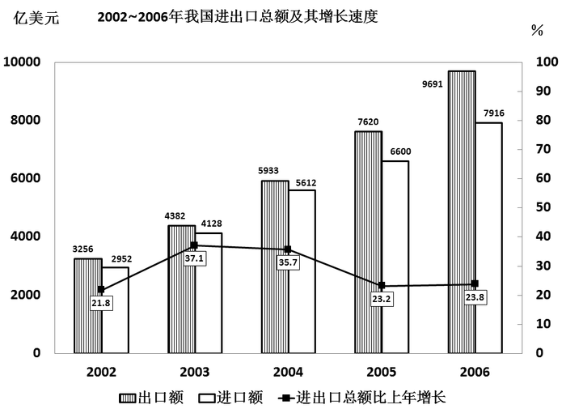

### 第 116 题

2002～2006年，我国的贸易顺差额（出口额-进口额）最小的年份是：

A. 2002年

B. 2003年

C. 2004年

D. 2006年

第 116 题 · 答案与解析

**参考答案（粉笔题库参考内容）**

B

**解析**

各年的贸易顺差额：

2002年：亿美元；

2003年：4382-4128=254亿美元；

2004年：亿美元；

2006年：亿美元。

所以贸易顺差额最小的为2003年。

故正确答案为B。

**考点**：排序类、统计图

**来源**：2008年北京市公务员录用考试《行测》题（应届）第116题

### 第 117 题

2006年，我国的出口额约比上年增长：

A. 27.2%

B. 23.8%

C. 23.2%

D. 19.9%

第 117 题 · 答案与解析

**参考答案（粉笔题库参考内容）**

A

**解析**

根据上图查阅数据，代入公式可得，2006年出口额增长率。

故正确答案为A。

**考点**：一般增长率、统计图

**来源**：2008年北京市公务员录用考试《行测》题（应届）第117题

### 第 118 题

2003～2006年的进口额年增长率超过25%的年份有：

A. 1个

B. 2个

C. 3个

D. 4个

第 118 题 · 答案与解析

**参考答案（粉笔题库参考内容）**

B

**解析**

解法一：

根据上图可知：

2003年进口额；

2004年进口额；

2005年进口额；

2006年进口额。

增长率超过25%的年份为2003年、2004年，共2个年份。

解法二：

用直尺量，连续五年的进口额几乎成一条直线，说明每一年的增长量是保持一个稳定的，挑选中间的开始计算。2004年增长率，同时猜测2003年的增长率大于25%。2005年。后面的2006年增长率猜测也难以大于25%。所以只有2003年和2004年大于25%。

故正确答案为B。

**考点**：年均增长率、统计图

**来源**：2008年北京市公务员录用考试《行测》题（应届）第118题

### 第 119 题

与上年相比，进出口总额的增长率最高的年份的进出口总额为：

A. 17607亿美元

B. 14220亿美元

C. 8510亿美元

D. 5208亿美元

第 119 题 · 答案与解析

**参考答案（粉笔题库参考内容）**

C

**解析**

根据上图可知进出口总额增长率最高的是2003年，进出口总额亿美元。C项最为接近。

故正确答案为C。

**考点**：简单加减计算、统计图

**来源**：2008年北京市公务员录用考试《行测》题（应届）第119题

### 第 120 题

下列说法中，不正确的是：

A. 2003～2006年，我国出口额与上年相比的增长量都超过1000亿美元

B. 2003～2006年，我国的进出口总额呈逐年上涨状态

C. 2004年至2006年，我国贸易顺差呈逐年上升趋势

D. 2001年，我国的出口额约为2673亿美元

第 120 题 · 答案与解析

**参考答案（粉笔题库参考内容）**

D

**解析**

由图表给出的信息不能算出2001年的出口额，而其他选项很容易判断都是正确的。

故正确答案为D。

**考点**：统计图、综合分析

**来源**：2008年北京市公务员录用考试《行测》题（应届）第120题

## 材料 8

根据下列统计资料回答问题。

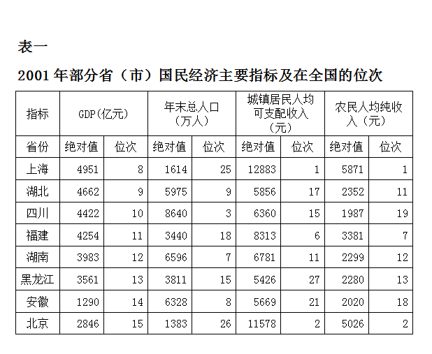

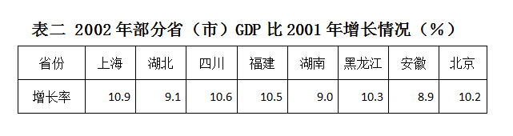

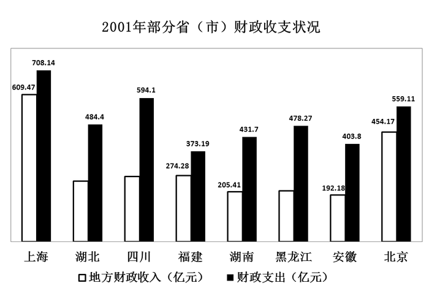

### 第 121 题

2002年GDP绝对值比较中，下列排名正确的是：

A. 上海＞四川＞福建＞湖北

B. 上海＞湖北＞四川＞福建

C. 上海＞四川＞湖北＞福建

D. 四川＞上海＞福建＞湖北

第 121 题 · 答案与解析

**参考答案（粉笔题库参考内容）**

B

**解析**

2002年各省GDP总值：

上海：；

四川：；

福建：；

湖北：；

很明显，上海>四川>福建，排除D选项。，只需比较和的大小，利用差分法得：，即，从而，只有B选项满足。

故正确答案为B。

**考点**：现期计算、综合资料

**来源**：2008年北京市公务员录用考试《行测》题（应届）第121题

### 第 122 题

根据各省（市）年末总人口推算，在2001年人均GDP比较中，下列正确的是：

A. 湖北＞四川＞福建＞湖南

B. 湖北＞福建＞湖南＞四川

C. 福建＞湖北＞湖南＞四川

D. 福建＞湖北＞四川＞湖南

第 122 题 · 答案与解析

**参考答案（粉笔题库参考内容）**

C

**解析**

2001年人均GDP：

湖北：；

四川：；

福建：；

湖南：。

很容易看出各省的人均GDP中，福建大于1亿元/万人，湖北小于1亿元/万人，排除A、B选项；估算可得，湖南人均GDP高于四川，所以人均GDP排名为福建>湖北>湖南>四川。

故正确答案为C。

**考点**：现期平均数、综合资料

**来源**：2008年北京市公务员录用考试《行测》题（应届）第122题

### 第 123 题

下列省（市）城镇居民可支配性收入与农村居民纯收入差距最大的是：

A. 上海

B. 北京

C. 福建

D. 湖南

第 123 题 · 答案与解析

**参考答案（粉笔题库参考内容）**

A

**解析**

各省的收入差距：

上海：元；

北京：元；

福建：元；

湖南：元。

所以收入差距最大的是上海。

故正确答案为A。

**考点**：简单加减计算、综合资料

**来源**：2008年北京市公务员录用考试《行测》题（应届）第123题

### 第 124 题

假设各省市农村人口比例相同，则2001年农民总收入最高的省市是：

A. 四川

B. 湖南

C. 北京

D. 上海

第 124 题 · 答案与解析

**参考答案（粉笔题库参考内容）**

A

**解析**

假设农村人口的比例为100%，则各个省农民收入总量为：

四川：；

湖南：；

北京：；

上海：。

容易知道，收入最高的是在四川和湖南两个省之间，而四川农民收入：湖南农民收入，所以收入最高的是四川省。

故正确答案为A。

**考点**：现期平均数、综合资料

**来源**：2008年北京市公务员录用考试《行测》题（应届）第124题

### 第 125 题

从统计图中可以看出，2001年北京、上海、福建三省市地方财政收入与财政支出差距十分接近，但从地方财政收入占GDP的比重看：

A. 北京＞上海＞福建

B. 上海＞北京＞福建

C. 北京＞福建＞上海

D. 上海＞福建＞北京

第 125 题 · 答案与解析

**参考答案（粉笔题库参考内容）**

A

**解析**

各省地方财政收入占GDP的比重：

上海：；

北京：；

福建：。

所以各省地方财政收入占GDP的比重排序为“北京>上海>福建”。

故正确答案为A。

**考点**：现期比重、综合资料

**来源**：2008年北京市公务员录用考试《行测》题（应届）第125题

## 材料 9

根据下列材料回答问题。

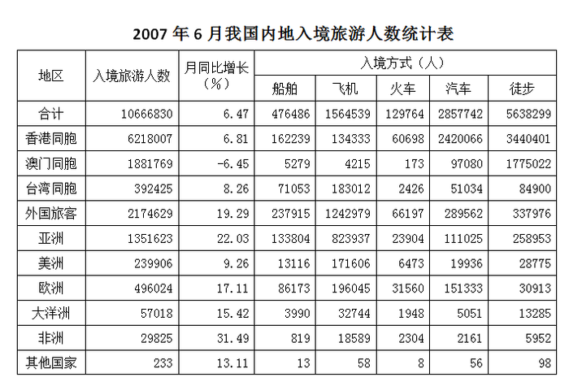

### 第 126 题

下列选项中，正确的一项是：

A. 在国外游客中，2007年6月非洲国家到我国旅游的人数增长最多

B. 以目前的增长速度，非洲国家的游客人数有望在年内超过来自大洋洲的游客人数

C. 相对于外国游客，港澳台游客更喜欢徒步游的方式

D. 飞机是外国游客来我国游览的必选方式

第 126 题 · 答案与解析

**参考答案（粉笔题库参考内容）**

C

**解析**

A选项错误，是概念性错误，表格中是非洲同比增长最多，而非洲增长人数为，显然低于欧洲增长人数；

B选项错误，不好判断，先看C选项；

C选项正确，看游客喜欢徒步的程度，只需看徒步旅游人数占总人数的百分比即可，观察图表；

D选项错误，是明显错误的。

故正确答案为C。

**考点**：统计表、综合分析

**来源**：2008年北京市公务员录用考试《行测》题（应届）第126题

### 第 127 题

2007年5月入境游客中，港澳台入境游客与外国游客人数的比值约为：

A. 4.5

B. 3.9

C. 0.26

D. 0.22

第 127 题 · 答案与解析

**参考答案（粉笔题库参考内容）**

A

**解析**

五月份外国人旅游人数为：，五月份旅游总人数为：，那么比值为：，利用直除法，首位为4。

故正确答案为A。

**考点**：比值计算、统计表

**来源**：2008年北京市公务员录用考试《行测》题（应届）第127题

### 第 128 题

2007年5月欧洲入境人数占总体入境旅客的比率是：

A. 18.19%

B. 17.11%

C. 4.7%

D. 4.2%

第 128 题 · 答案与解析

**参考答案（粉笔题库参考内容）**

D

**解析**

由表格数据得，2007年5月欧洲入境人数占总体入境人数的比率为：。

故正确答案为D。

**考点**：基期比重、统计表

**来源**：2008年北京市公务员录用考试《行测》题（应届）第128题

### 第 129 题

2007年6月选择徒步入境的人数约占入境总人数的：

A. 23%

B. 33%

C. 43%

D. 53%

第 129 题 · 答案与解析

**参考答案（粉笔题库参考内容）**

D

**解析**

由表格数据得，2007年6月选择徒步入境人数占总的入境人数的比例为：，利用直除法，首位为5。

故正确答案为D。

**考点**：现期比重、统计表

**来源**：2008年北京市公务员录用考试《行测》题（应届）第129题

### 第 130 题

同比月增长率大于10%的地区2007年6月入境总人数是：

A. 1836947

B. 1934490

C. 1934723

D. 4109352

第 130 题 · 答案与解析

**参考答案（粉笔题库参考内容）**

C

**解析**

由表格数据得，同比月增长率大于10%的地区为：亚洲、欧洲、大洋洲、非洲以及其他地区。总人数为1351623+496024+57018+29825+233，末尾是3+4+8+5+3=23。而末尾为3的只有选项C。

故正确答案为C。

**考点**：简单加减计算、统计表

**来源**：2008年北京市公务员录用考试《行测》题（应届）第130题

## 材料 10

根据下列统计资料回答问题。

        2007年前三季度，A市工业生产保持稳步增长的良好态势。全市规模以上工业企业（下同）实现工业增长值3806.37亿元，比去年同期增长12.7%。其中，轻工业增加值1088.25亿元，增长9%；重工业增加值2718.12亿元，增长14.2%。完成工业总产值15777.56亿元，比去年同期增长16.2%。其中，轻工业完成3550.44亿元，增长9.7%；重工业完成12227.12亿元，增长18.2%。

        六个重点发展工业行业是本市工业增长的主要拉动力，前三季度共完成工业总产值10282.8亿元，比去年同期增长19.3%。其中电子信息产品制造业和汽车制造业增速较快，共拉动全市工业增长了8.5个百分点。

        前三季度，该市完成工业出口交货值5055.65亿元，比去年同期增长20.9%。今年以前，工业出口交货值增幅波动较大。1月份因去年基数较低，故增幅较高，为26.3%；2月份受春节影响，增幅出现较大滑落，仅为9.5%；3～5月增幅均低于20%；自6月份开始，全市工业出口交货值增速大幅回升，且连续几个月基本稳定在25%左右。

        前三季度，电子信息产品，共生产笔记本电脑2526.69万部，比去年同期增长76.4%；显示器81.89万台，增长69.5%；移动通信基站设备192.84万信道，增长59.4%；程控交换机294.15万线，下降29.5%。

        成套设备产品，生产交流电动机926.70万千瓦，比去年同期增长23.9%；金属切削机床1.12万台，增长5.4%；升降移动机械3.57万台，增长7.9%。

        石油化工产品，原油加工量为1817.98万吨，比去年同期下降3.5%；生产乙烯138.42万吨，下降4.1%；橡胶轮胎外胎743.78万条，下降7.9%。

        钢材产品，生产成品钢材1633.95万吨，比去年同期增长14.2%；生铁1335.64万吨，增长6.3%；生钢1552.59万吨，增长7.5%。

### 第 131 题

2006年前三季度，该市完成工业总产值约为：

A. 3377亿元

B. 3311亿元

C. 13578亿元

D. 13221亿元

第 131 题 · 答案与解析

**参考答案（粉笔题库参考内容）**

C

**解析**

文字资料中“2007年前三季度完成工业总产值15777.56亿元，比去年同期增长16.2%”，所以2006年前三季度完成工业总产值为亿元。

故正确答案为C。

**考点**：基期计算、文字资料

**来源**：2008年北京市公务员录用考试《行测》题（应届）第131题

### 第 132 题

2007年前三季度，电子信息产品制造业和汽车制造业较去年同期增长：

A. 2603.6亿元

B. 1154.1亿元

C. 1137.8亿元

D. 141.40亿元

第 132 题 · 答案与解析

**参考答案（粉笔题库参考内容）**

B

**解析**

由131题可知2006年工业总产值为13578亿元。而由资料得“电子信息产品制造业和汽车制造业增速较快，共拉动全市工业增长了8.5个百分点”，所以电子信息产品制造业和汽车制造业增长量为：亿元，与B最接近。

故正确答案为B。

**考点**：一般增长率、文字资料

**来源**：2008年北京市公务员录用考试《行测》题（应届）第132题

### 第 133 题

2007年前三季度，六个重点发展工业行业拉动全市工业增长多少个百分点：

A. 12.3

B. 14.2

C. 65.2

D. 无法计算

第 133 题 · 答案与解析

**参考答案（粉笔题库参考内容）**

A

**解析**

由131题可以解得2006年前三季度工业总产值为13578，而六个重点发展工业行业的增长量为。从而所求的为：。

故正确答案为A。

**考点**：一般增长率、文字资料

**来源**：2008年北京市公务员录用考试《行测》题（应届）第133题

### 第 134 题

由以上材料可知：

A. 该市工业行业发展平衡，各行业对全市工业产值增加的贡献率相同

B. 各类主要工业产品产量有升有降

C. 工业出口交货值涨幅稳中有升

D. 电子信息产品与汽车制造业的产值占该市工业总产值的一半以上

第 134 题 · 答案与解析

**参考答案（粉笔题库参考内容）**

B

**解析**

A项太绝对，明显错误；C项错在涨幅应该是有较大波动，而不是稳中有升；而D项从资料中无法得知。

故正确答案为B。

**考点**：文字资料、综合分析

**来源**：2008年北京市公务员录用考试《行测》题（应届）第134题

### 第 135 题

该市2006年前三个季度，全市规模以上工业企业实现的增加值中重工业所占的比例为：

A. 28.59%

B. 29.56%

C. 70.5%

D. 71.4%

第 135 题 · 答案与解析

**参考答案（粉笔题库参考内容）**

C

**解析**

2006年工业增加值为:；

2006年重工业增加值为：。

所以代求的为：。

故正确答案为C。

**考点**：基期比重、文字资料

**来源**：2008年北京市公务员录用考试《行测》题（应届）第135题

