# 2009年北京市公务员录用考试《行测》题（应届）

<!-- gwy:overview:start -->
> **北京 · 2009 · 行测 · 统考** ｜ 135 题 · 图片 13 处 · 答案随题折叠

| 题型模块 | 题量 | 题号 |
| --- | ---: | ---: |
| 数量关系 | 25 | 1–25 |
| 判断推理 | 30 | 26–55 |
| 常识判断 | 30 | 56–85 |
| 言语理解与表达 | 30 | 86–115 |
| 资料分析 | 20 | 116–135 |
| **合计** | **135** | |

导航：[题型与作答说明](#题型与作答说明) · [题目](#题目) · [材料 1](#材料-1)
<!-- gwy:overview:end -->

> 候选采集稿。参考答案及解析来自粉笔页面，不代表官方答案或真实高分答卷；来源使用许可与原卷对应关系仍需人工核实。

## 题型与作答说明

数量关系

（25题）

本部分包括数字推理与数学运算两种类型的试题。

判断推理

（30题）

本部分包括图形推理、逻辑判断、事件排序与定义判断四种类型的题目。

常识判断

（30题）

本部分包括单项选择题与不定项选择题两种类型的题目，请根据题目要求做出正确选择。对于不定项选择，错选、多选、少选均不得分，但也不倒扣分。56~75题为单项选择题，76~85题为不定项选择题。

言语理解与表达

（30题）

本部分均为单选题，着重考查考生对语言文字的理解和驾驭能力。这种能力包括：对词、句子、篇章一般意思和特定意义的理解；对比较复杂的概念和观点的准确理解；对语句隐含信息的合理推断；根据上下文，恰当选用词语；准确地辨明句义，筛选信息。

资料分析

（20题）

针对下列图、表或文字回答问题。你应根据资料提供的信息进行分析、比较、计算、处理。你可以在题本上运算。

## 题目

### 第 1 题

150，75，50，37.5，30，（    ）

A. 20

B. 22.5

C. 25

D. 27.5

第 1 题 · 答案与解析

**参考答案（粉笔题库参考内容）**

C

**解析**

观察数列，有明显倍数关系，考虑作商。后项除以前项得到新数列：1/2，2/3，3/4，4/5，其中分子、分母均是公差为1的等差数列，则新数列下一项应为5/6，所求项为30×5/6=25。

故正确答案为C。

**来源**：2009年北京市公务员录用考试《行测》题（应届）第1题

### 第 2 题

2，4，10，18，28，（    ），56

A. 32

B. 42

C. 52

D. 54

第 2 题 · 答案与解析

**参考答案（粉笔题库参考内容）**

B

**解析**

数列变化幅度不大，作差无规律，考虑因式分解。原数列各项可分解为：2=1×2，4=1×4，10=2×5，18=3×6，28=4×7，（    ），56=7×8，无明显规律，两因数加和得到新数列为：3，5，7，9，11，（    ），15，构成奇数列，则新数列下一项为13，即所求项的因数和为13，可分解为13=6+7，故所求项为6×7=42。

故正确答案为B。

**来源**：2009年北京市公务员录用考试《行测》题（应届）第2题

### 第 3 题

77，49，28，16，12，2，（    ）

A. 10

B. 20

C. 36

D. 45

第 3 题 · 答案与解析

**参考答案（粉笔题库参考内容）**

A

**解析**

数列项数较多，考虑多重数列。交叉后发现奇数项等于原数列后两项加和，即77=49+28，28=16+12，12=2+（  ）；偶数项等于原数列前一项个位与十位的乘积，即49=7×7，16=2×8，2=1×2。所求项为原数列奇数项，则所求项为12-2=10。

故正确答案为A。

**来源**：2009年北京市公务员录用考试《行测》题（应届）第3题

### 第 4 题

32，48，32，-32，-128，（    ）

A. 96

B. 64

C. \-96

D. \-192

第 4 题 · 答案与解析

**参考答案（粉笔题库参考内容）**

D

**解析**

数列无明显特征，作差无规律，考虑递推。观察发现(48-32)×2=32，推测该数列规律为：(第二项-第一项)×2=第三项，验证可得(32-48)×2=-32，(-32-32)×2=-128，符合规律。则所求项为[−128−(−32)] × 2 = −192。

故正确答案为D。

**来源**：2009年北京市公务员录用考试《行测》题（应届）第4题

### 第 5 题

1，8，22，50，99，（    ）

A. 120

B. 134

C. 142

D. 176

第 5 题 · 答案与解析

**参考答案（粉笔题库参考内容）**

D

**解析**

观察数列无明显特征，优先考虑作差。后项减去前项得到新数列M为7，14，28，49，（  ），无明显特征，再次作差得到新数列N为7，14，21，（  ），是公差为7的等差数列。因此新数列N的下一项为21+7=28，新数列M的下一项为49+28=77，所求项为99+77=176。

故正确答案为D。

**来源**：2009年北京市公务员录用考试《行测》题（应届）第5题

### 第 6 题

A. 7

B. 5

C. 3

D. 9

第 6 题 · 答案与解析

**参考答案（粉笔题库参考内容）**

C

**解析**

方法一：图形数阵，优先考虑横向或纵向规律。第一行15 + 3 = 2 × 9；第三行22+14 = 4×9，则规律为每行“第一项 + 第三项 = 第二项 × 9”。故第二行所填项为(10+17)/9 = 3。

方法二：图形数阵，优先考虑横向或纵向规律。第一行15+2+3=20，第三行22+4+14=40，猜测第二行三项的和应为30，构成公差为10的等差数列。由此可知，所求项为30-10-17=3。

故正确答案为C。

**来源**：2009年北京市公务员录用考试《行测》题（应届）第6题

### 第 7 题

| | | |
| ---: | ---: | ---: |
| 21 | 3 | 6 |
| 63 | 9 | ? |
| 81 | 27 | 18 |

A. 27

B. 8

C. 21

D. 18

第 7 题 · 答案与解析

**参考答案（粉笔题库参考内容）**

D

**解析**

图形数阵，优先考虑横向或纵向规律。第一行3+6×3=21，第三行27+18×3=81，则规律为第二项+第三项×3 =第一项。故第二行所求项应为(63 - 9)/3 = 18。

故正确答案为D。

**来源**：2009年北京市公务员录用考试《行测》题（应届）第7题

### 第 8 题

| | | |
| ---: | ---: | ---: |
| 6.4 | 0.9 | 6.5 |
| 6.8 | 1.6 | 6.2 |
| ? | 7.2 | 8 |

A. 14.2

B. 16.4

C. 18.6

D. 15

第 8 题 · 答案与解析

**参考答案（粉笔题库参考内容）**

A

**解析**

图形数阵，优先考虑横向或纵向规律。第一行0.9+6.5-1=6.4，第二行1.6+6.2-1=6.8，则规律为第二项+第三项-1=第一项。故第三行所求项应为7.2+8-1=14.2。

故正确答案为A。

**来源**：2009年北京市公务员录用考试《行测》题（应届）第8题

### 第 9 题

| | | |
| ---: | ---: | ---: |
| 2 | 26.4 | 6.6 |
| 6 | 13.6 | 1.7 |
| ? | 10.8 | 2.7 |

A. 6.1

B. 5.3

C. 4

D. 2

第 9 题 · 答案与解析

**参考答案（粉笔题库参考内容）**

D

**解析**

图形数阵，优先考虑横向或纵向规律。第一行26.4/6.6 - 2 = 2，第二行13.6/1.7 − 2 = 6，则规律为第二项/第三项-2=第一项。故第三行所求项应为10.8/2.7-2=2。

故正确答案为D。

**来源**：2009年北京市公务员录用考试《行测》题（应届）第9题

### 第 10 题

| | | |
| ---: | ---: | ---: |
| 11 | 13.1 | ? |
| 40 | 2.5 | 22.5 |
| 19 | 3.4 | 12.9 |

A. 20.4

B. 18.6

C. 11.6

D. 8.6

第 10 题 · 答案与解析

**参考答案（粉笔题库参考内容）**

B

**解析**

图形数阵，优先考虑横向或纵向规律。第二行(22.5-2.5）×2=40，第三行(12.9-3.4）×2=19，则规律为(第三项-第二项)×2=第一项。故第一行所求项应为11÷2+13.1=18.6。

故正确答案为B。

**来源**：2009年北京市公务员录用考试《行测》题（应届）第10题

### 第 11 题

有一堆粗细均匀的圆木，最上面一层有6根，每向下一层增长一根，共堆了25层。这堆圆木共有多少根？

A. 175

B. 200

C. 375

D. 450

第 11 题 · 答案与解析

**参考答案（粉笔题库参考内容）**

D

**解析**

由题意可知，最下面一层圆木数量为30根，各层圆木的数量构成首项为6、末项为30、项数为25、公差为1的等差数列。根据等差数列求和公式：S_n = (a_1+a_n)×n/2，可得这堆圆木共有((6+30) × 25)/2 = 450根。

故正确答案为D。

**考点**：数列问题

**来源**：2009年北京市公务员录用考试《行测》题（应届）第11题

### 第 12 题

部队组织新兵到野外进行拉练，行程每天增加2千米。已知去时用了4天，回来时用了3天。目的地距离营地多少千米？

A. 54

B. 72

C. 84

D. 92

第 12 题 · 答案与解析

**参考答案（粉笔题库参考内容）**

C

**解析**

设第一天行程为x千米。由题意可知，各天的行程构成公差为2的等差数列，又因为往返距离不变，可列方程为x+(x+2)+(x+4)+(x+6)=(x+8)+(x+10)+(x+12)，解得x=18。由此可知目的地距离营地18+20+22+24=84千米。

故正确答案为C。

**考点**：和差倍比问题、数列问题

**来源**：2009年北京市公务员录用考试《行测》题（应届）第12题

### 第 13 题

有一个两位数，如果把数字1加写在它的前面，那么可得到一个三位数，如果把1加写在它的后面，那么也可以得到一个三位数，而且这两个三位数相差414，求原来的两位数：

A. 35

B. 43

C. 52

D. 57

第 13 题 · 答案与解析

**参考答案（粉笔题库参考内容）**

D

**解析**

方法一：设这个两位数为x，则把1加写在这个两位数前面得到数值为100+x；把1加写在这个两位数后面得到数值为10x+1。结合选项可知，后者大于前者，由题意可列方程为(10x+1)-(100+x)=414，解得x=57。

方法二：根据题意可知，(选项×10+1)-(100+选项)=414，故考虑代入排除：

代入A项：(35 × 10 + 1) − (100 + 35) = 351 − 135 ≠ 414，排除；

代入B项：(43×10+1)-(100+43)=431-143≠414，排除；

代入C项：(52 × 10 + 1) - (100 + 52) = 521 - 152 ≠ 414，排除；

由于A、B、C三项均排除，答案只能是D项。验证：(57×10+1)-(100+57)=571-157=414，正确。

故正确答案为D。

**来源**：2009年北京市公务员录用考试《行测》题（应届）第13题

### 第 14 题

如图所示，街道ABC在B处拐弯，在街道一侧等距装路灯，要求A、B、C处各装一盏路灯，这条街道最少装多少盏路灯？

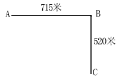

A. 18

B. 19

C. 20

D. 21

第 14 题 · 答案与解析

**参考答案（粉笔题库参考内容）**

C

**解析**

根据“要求A、B、C处各装一盏路灯”可知本题为两端植树问题。要使路灯等距离，则需要求两段路AB与BC的公约数；要使安装路灯数量最少且总长一定，则间距越大，路灯数越少，最大间距为715与520的最大公约数，即65米。根据公式：路灯个数=总长/间隔距离+1，可得安装路灯最少为(715 + 520)/65 + 1 = 20盏。

故正确答案为C。

**来源**：2009年北京市公务员录用考试《行测》题（应届）第14题

### 第 15 题

十几个小朋友围成一圈，按顺时针方向一圈一圈地循环报数。如果报1和报100的是同一人，那么共有多少个小朋友？

A. 10

B. 11

C. 13

D. 15

第 15 题 · 答案与解析

**参考答案（粉笔题库参考内容）**

B

**解析**

由题意可知，要想报1和报100的是同一个人，则报完99后应正好是循环完N圈，即99一定能够被小朋友的人数整除。结合选项，能够整除99的只有11，即共有11个小朋友。

故正确答案为B。

**考点**：和差倍比问题

**来源**：2009年北京市公务员录用考试《行测》题（应届）第15题

### 第 16 题

小王练习射击，每次10发。练了若干次之后，小王准备再打一次。如果这次小王打48环，那么平均每次打56环。如果最后这次打68环，那么平均每次打60环。小王共练习了多少次？

A. 4

B. 5

C. 6

D. 7

第 16 题 · 答案与解析

**参考答案（粉笔题库参考内容）**

A

**解析**

方法一：

由平均数公式可推出：总和差值=个数×平均数差值。

小王射击前后两次总成绩之差为68-48=20环，而导致前后平均环数之差为60-56=4环，因此小王算上最后这次共练习了20÷4=5次。

方法二：

设小王算上最后这次共练习了x次，（x－1）次前共打了y环。则(y + 48) ÷ x = 56，(y + 68) ÷ x = 60，解得x=5。

根据“练了若干次之后，小王准备再打一次”，因此小王共练习了5-1=4次。

故正确答案为A。

备注：这类题目一般考查总共打的次数，那就是5次。鉴于本题问的是“共练习了”是已经完成的次数，故给出了5-1=4次。

**来源**：2009年北京市公务员录用考试《行测》题（应届）第16题

### 第 17 题

六个盘子中各放有一块糖，每次从任选的两个盘子中各取一块放入另一个盘子中，这样至少要做多少次，才能把所有的糖都集中到一个盘子中？

A. 3

B. 4

C. 5

D. 6

第 17 题 · 答案与解析

**参考答案（粉笔题库参考内容）**

B

**解析**

根据题意，一共有六个盘子，每次从任选的两个盘子中各取一块放入另一个盘子中，具体如下：

糖果数：1  1  1  1  1  1

第一次：3  1  1  1  0  0

第二次：2  1  1  0  2  0

第三次：4  1  0  0  1  0

第四次：6  0  0  0  0  0

以上为最优化的其中一种情况，但无论哪种方式，都至少需要4次才能完成。

故正确答案为B。

**来源**：2009年北京市公务员录用考试《行测》题（应届）第17题

### 第 18 题

有若干张卡片，其中一部分写着1.1，另一部分写着1.11，它们的和恰好是43.21。写有1.1和1.11的卡片各有多少张？

A. 8张，31张

B. 28张，11张

C. 35张，11张

D. 41张，1张

第 18 题 · 答案与解析

**参考答案（粉笔题库参考内容）**

A

**解析**

方法一：设写有1.1的卡片有x张，写有1.11的卡片有y张。根据题意可列式：1.1x+1.11y=43.21，整理可得1.1(x+y)+0.01y=43.21。根据43.21÷1.1=39……0.31，可得x+y=39，y=31，则x=39-31=8。

方法二：结合题干与选项可知，选项信息充分，故可用代入排除法解题。代入A项：8×1.1＋31×1.11＝43.21，满足题干所有条件，无需验证其他选项。

故正确答案为A。

**来源**：2009年北京市公务员录用考试《行测》题（应届）第18题

### 第 19 题

甲、乙两车运一堆货物。若单独运，则甲车运的次数比乙车少5次；如果两车合运，那么各运6次就能运完。甲车单独运完这堆货物需要多少次？

A. 9

B. 10

C. 13

D. 15

第 19 题 · 答案与解析

**参考答案（粉笔题库参考内容）**

B

**解析**

方法一：设甲车单独运完这堆货物需要x次，则乙车单独运需要（x+5）次。赋值这堆货物总量为1，则甲车效率为1/x，乙车效率为1/(x+5)。根据题意可列式：(1/x + 1/(x+5)) × 6 = 1，整理可得x^2−7x−30= (x-10)(x+3)\=0，解得x_1=10，x_2=-3，因x为正整数，则x=10。

方法二：根据“若单独运，则甲车运的次数比乙车少······”可知，甲车单独运的次数必定少于两车合运的总次数即6×2=12次，排除C、D两项。赋值这堆货物总量为1，代入A项：若单独运，甲车效率为1/9，乙车效率为1/(9+5) = 1/14，两车合运(1/9+1/14)×6≠1，排除。故只余B项，无需验证。

故正确答案为B。

**考点**：工程问题-其他

**来源**：2009年北京市公务员录用考试《行测》题（应届）第19题

### 第 20 题

在一只底面半径是20cm的圆柱形小桶里，有一半径为10cm的圆柱形钢材浸没在水中，当钢材从桶中取出后，桶里的水下降了3cm。求这段钢材的长度：

A. 3cm

B. 6cm

C. 12cm

D. 18cm

第 20 题 · 答案与解析

**参考答案（粉笔题库参考内容）**

C

**解析**

设这段钢材的长度为Lcm。由题意可知，钢材的体积与水下降的体积相等，根据圆柱体体积公式：V = πr^2h，则有π×10^2×L = π×20^2×3，解得L=12。

故正确答案为C。

**考点**：几何公式类-立体图形

**来源**：2009年北京市公务员录用考试《行测》题（应届）第20题

### 第 21 题

张明的家离学校4千米，他每天早晨骑自行车上学，以20千米/时的速度行进，恰好准时到校。一天早晨，因为逆风，他提前0.2小时出发，以10千米/时的速度骑行，行至离学校2.4千米处遇到李强，他俩互相鼓励，加快了骑车的速度，结果比平时提前5分24秒到校。他遇到李强之后每小时骑行多少千米？

A. 16

B. 18

C. 20

D. 22

第 21 题 · 答案与解析

**参考答案（粉笔题库参考内容）**

A

**解析**

由题意得，张明平时每天骑行到学校的时间= S/V = 4/20 = 0.2小时；逆风当天，张明遇到李强前骑行时间= (4-2.4)/10 = 0.16小时。还因“提前0.2小时出发”“比平时提前5分24秒到校”，5分24秒=0.09小时，则张明遇见李强后骑行的时间=0.2+0.2-0.16-0.09=0.15小时，故张明遇到李强后骑行速度=2.4/0.15=16千米/小时。

故正确答案为A。

**考点**：普通行程

**来源**：2009年北京市公务员录用考试《行测》题（应届）第21题

### 第 22 题

1分、2分和5分的硬币共100枚，价值2元，如果其中2分硬币的价值比1分硬币的价值多13分，那么三种硬币各多少枚？

A. 51、32、17

B. 60、20、20

C. 45、40、15

D. 54、28、18

第 22 题 · 答案与解析

**参考答案（粉笔题库参考内容）**

A

**解析**

方法一：设1分硬币有x枚，2分硬币有y枚，5分硬币有z枚。根据题意可列方程组：x+y+z=100······①，x+2y+5z=200······②，2y-x=13······③。联立方程组，解得x=51，y=32，z=17。

方法二：选项信息充分，考虑代入排除法。代入A项：硬币总数为51+32+17=100枚，满足；总价值为51×1+32×2+17×5=200分=2元，满足；2分硬币面值比1分硬币面值多32×2-51=13分，满足。满足题干所有条件，无需验证剩余选项。

故正确答案为A。

**考点**：和差倍比问题

**来源**：2009年北京市公务员录用考试《行测》题（应届）第22题

### 第 23 题

水果店运来的西瓜个数是哈密瓜个数的4倍，如果每天卖130个西瓜和36个哈密瓜，那么哈密瓜卖完后还剩下70个西瓜。该店共运来西瓜和哈密瓜多少个？

A. 225

B. 720

C. 790

D. 900

第 23 题 · 答案与解析

**参考答案（粉笔题库参考内容）**

D

**解析**

设运来的哈密瓜个数为x个，则西瓜为4x个。根据所卖天数相同，可列式：x/36 = (4x-70)/130，解得x=180。则该店共运来西瓜和哈密瓜个数为5x=5×180=900个。

故正确答案为D。

**考点**：和差倍比问题

**来源**：2009年北京市公务员录用考试《行测》题（应届）第23题

### 第 24 题

哥哥5年后的年龄和弟弟3年前的年龄和是29岁，弟弟现在的年龄是两人年龄差的4倍。哥哥今年几岁？

A. 10

B. 12

C. 15

D. 18

第 24 题 · 答案与解析

**参考答案（粉笔题库参考内容）**

C

**解析**

方法一：设哥哥现在的年龄为x岁，弟弟现在的年龄为y岁，则有列表如下：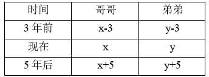

| 时间 | 哥哥 | 弟弟 |
| --- | --- | --- |
| 3年前 | x-3 | y-3 |
| 现在 | x | y |
| 5年后 | x+5 | y+5 |

根据题意可列方程组：x+5+y−3=29，y=4×(x−y)，解得x=15, y=12，故哥哥今年15岁。

方法二：年龄问题考虑代入排除法。根据“弟弟现在的年龄是两人年龄差的4倍”可得，弟弟年龄=4×（哥哥年龄-弟弟年龄），则弟弟年龄=4/5×哥哥年龄，故哥哥年龄是5的倍数，排除B、D两项。代入A项：若哥哥今年10岁，则弟弟今年=4/5×10=8岁，哥哥5年后的年龄和弟弟3年前的年龄和是10+5+8-3=20≠29，排除。则只余C项，无需验证。

故正确答案为C。

**考点**：年龄问题

**来源**：2009年北京市公务员录用考试《行测》题（应届）第24题

### 第 25 题

某机关召开一次特殊工作会议，参加者中每两个人有一个科员，每四人中有一个科长，每六人中有一个副处长，此外还有五位处长参会。共有多少人参会？

A. 48

B. 60

C. 65

D. 72

第 25 题 · 答案与解析

**参考答案（粉笔题库参考内容）**

B

**解析**

由题意得，参会人数为2、4、6的公倍数，即为12的倍数。设共有12x人参会，则科员人数为12x/2 = 6x，科长人数为12x/4 = 3x，副处长人数为12x/6=2x，故可列式：12x=6x+3x+2x+5，解得x=5，则共有12×5=60人参会。

故正确答案为B。

**考点**：和差倍比问题

**来源**：2009年北京市公务员录用考试《行测》题（应届）第25题

### 第 26 题

从所给四个选项中，选择最合适的一个填入问号处，使之呈现一定的规律性：

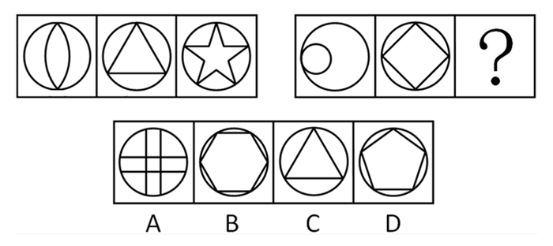

A. A

B. B

C. C

D. D

第 26 题 · 答案与解析

**参考答案（粉笔题库参考内容）**

D

**解析**

元素组成凌乱，考虑数量规律。

考虑内部图形与外部图形的接触点的个数， 第一组内部图形与圆的接触点依次是2、3、5；第二组依次是1、4、？， 每组前两个图形的接触点之和等于第三个图形，即2+3=5，1+4=（5），所以答案中图形的接触点为5个。

故正确答案为D。

**考点**：数量规律-点

**来源**：2009年北京市公务员录用考试《行测》题（应届）第26题

### 第 27 题

从所给四个选项中，选择最合适的一个填入问号处，使之呈现一定的规律性：

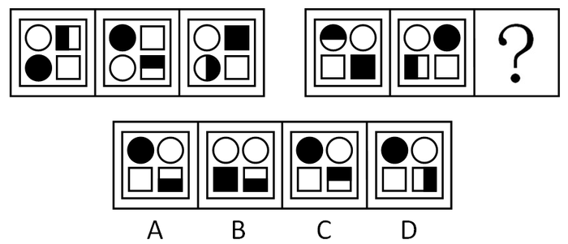

A. A

B. B

C. C

D. D

第 27 题 · 答案与解析

**参考答案（粉笔题库参考内容）**

A

**解析**

元素组成相同，考查位置规律。

包括整体的位置和局部的位置，主要考查图形中元素的顺时针和逆时针旋转，而各个图形的位置保持不变。第一组图中，全块的阴影在图形上顺时针移动，半块的阴影顺时针移动并且自身旋转。第二组图中，全块的阴影在图形上逆时针移动，半块的阴影逆时针移动并且自身逆时针旋转。

故正确答案为A。

**考点**：位置规律-旋转

**来源**：2009年北京市公务员录用考试《行测》题（应届）第27题

### 第 28 题

从所给四个选项中，选择最合适的一个填入问号处，使之呈现一定的规律性：

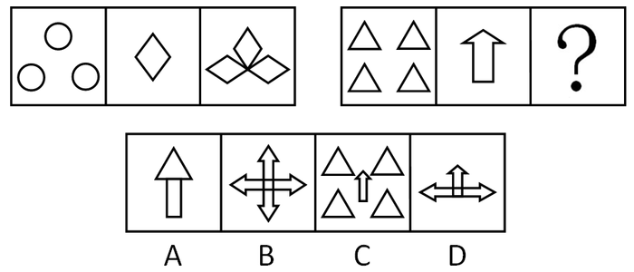

A. A

B. B

C. C

D. D

第 28 题 · 答案与解析

**参考答案（粉笔题库参考内容）**

B

**解析**

第一组图中，第一个图是3个圆形，第二个图是1个菱形，第三个图是3个菱形，3正好是第一个图形小图形的个数。按照这个规律，第二组第三个图应是4个相同的箭头。

故正确答案为B。

**考点**：数量规律-素

**来源**：2009年北京市公务员录用考试《行测》题（应届）第28题

### 第 29 题

从所给四个选项中，选择最合适的一个填入问号处，使之呈现一定的规律性：

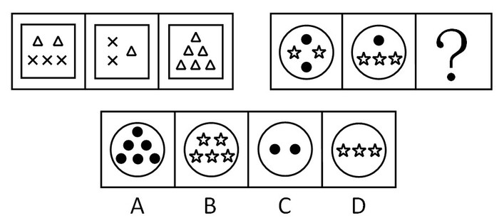

A. A

B. B

C. C

D. D

第 29 题 · 答案与解析

**参考答案（粉笔题库参考内容）**

A

**解析**

主要考查图形中的每种元素各有几个。

从整体来看，第一组只有两种元素，叉和三角形，共有5个叉和9个三角形，代入A项后，第二组图共有5个五角星和9个黑点。

故正确答案为A。

**考点**：数量规律-素

**来源**：2009年北京市公务员录用考试《行测》题（应届）第29题

### 第 30 题

从所给四个选项中，选择最合适的一个填入问号处，使之呈现一定的规律性：

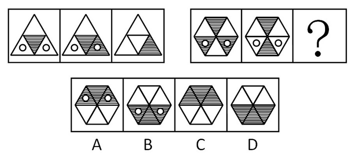

A. A

B. B

C. C

D. D

第 30 题 · 答案与解析

**参考答案（粉笔题库参考内容）**

D

**解析**

第一组图形中前两个图形叠加后相同的部分变为空白，不同的部分叠加后是阴影（注意前两个图中的小圆圈叠加后消失）。

故正确答案为D。

**考点**：样式规律-黑白运算

**来源**：2009年北京市公务员录用考试《行测》题（应届）第30题

### 第 31 题

现在，在黄金领域进行投资将是一项有利可图的商业活动。《中国黄金》杂志的一项调查表明，该杂志读者中有88%的人正在计划最近购买一批金条，而对于黄金投资市场的研究显示，目前每年推出的金条购赎业务只能满足购买需求的70%。

下面哪项如果为真，最能对上文投资建议的正确性构成质疑？

A. 购买金条的人中大约有一半的人为了购买金条而进行抵押贷款

B. 在金条购赎业务开展的前两个星期里，金条只卖出了总数的20%

C. 购买金条的人中大约有一半的人曾经有过黄金投资行为

D. 那些宣称购买金条的人中仅仅只有的20%的人最后真的购买了金条

第 31 题 · 答案与解析

**参考答案（粉笔题库参考内容）**

D

**解析**

第一步：找出论点和论据。

论点：在黄金领域进行投资将是一项有利可图的商业活动。

论据：某杂志调查表明，该杂志读者中有88%的人正在计划最近购买一批金条，而目前每年推出的金条购赎业务只能满足购买需求的70%。

第二步：判断削弱方式。

论点强调投资黄金有利可图，论据强调金条购买需求大，购赎业务不能满足需求。论点和论据存在因果关系，所以需要削弱论点。

第三步：逐一判断选项的作用。

A项：购买金条的人是否进行抵押贷款，不能说明金条购买需求量的问题，与论点讨论的话题无关，排除；

B项：只说明金条购赎业务开展的前两个星期的情况，不能反映金条购赎业务的整个情况，无法削弱，排除；

C项：说的是购买金条的人的投资行为，跟黄金投资是否有利可图无关，无法削弱，排除；

D项：说明金条实际需求量并不如调查数据显示的那么大，因此不能说明投资黄金有利可图，有力地削弱了论点，当选。

故正确答案为D。

**考点**：削弱论据

**来源**：2009年北京市公务员录用考试《行测》题（应届）第31题

### 第 32 题

土家狗是一种仅仅在美国南部生活的无毛小型野兽。在人类定居美国南部之前，土家狗的天敌都不强大，因此土家狗在美国南部繁衍旺盛。当人类开始猎取它们之后，土家狗灭绝了。因此，肯定是人们对它们的猎取导致了其灭绝。

下面哪一项如果为真，最严重地削弱了上文中的推理？

A. 人类在美国南部定居的同时，也带来了新的可能是土家狗天敌的物种

B. 在第一批人类定居美国南部以来，土家狗在美国南部的某些地区仍旧存在了约300年

C. 土家狗的一些品种跑得比豹类还快

D. 在美国南部，人们猎取了另一种容易被天敌捕食，但从来没有灭绝的哺乳动物

第 32 题 · 答案与解析

**参考答案（粉笔题库参考内容）**

A

**解析**

第一步：找出论点和论据。

论点：人们对它们的猎取导致了其灭绝。

论据：在人类定居美国南部之前，土家狗的天敌都不强大，因此土家狗在美国南部繁衍旺盛。当人类开始猎取它们之后，土家狗灭绝了。

第二步：判断削弱方式。

本题论点和论据存在因果关系，所以需要削弱论点。

第三步：逐一判断选项的作用。

A项说明土家狗灭绝可能是土家狗的天敌导致的，有力地削弱了论点，当选；

B项说的是土家狗灭绝的时间，C项说的是土家狗奔跑的速度，这些均无法说明其灭绝原因是否与人们的猎取有关，无法削弱论点，排除；

D项提到的是另一种哺乳动物，但题干没有谈及哺乳动物和土家狗的关系，两者不能加以对比，无法削弱论点，排除。

故正确答案为A。

**考点**：他因削弱

**来源**：2009年北京市公务员录用考试《行测》题（应届）第32题

### 第 33 题

世卫组织指出，全世界的自杀率已经上升了60%，特别是在发展中国家，这种现象更为严重。大部分自杀事件发生在亚洲，该地区的自杀人数占全球总数的60%。中国、印度和日本由于人口众多，因此其自杀人数占总数的40%。此外，自杀已经成为15岁至34岁年轻人的第三大死因。

根据题干中的信息，可以确定下面哪一选项？

A. 由题干信息，不能确定日本自杀率的上升幅度

B. 日本的青少年自杀问题很严重

C. 印度妇女自杀问题很严重

D. 中国的自杀率上升高于60%

第 33 题 · 答案与解析

**参考答案（粉笔题库参考内容）**

A

**解析**

第一步：抓住每句话强调的内容。

第一、二句：全世界的自杀率已经上升了60%，而在发展中国家，这种现象更严重，特别是亚洲。

第三、四句：中国、印度和日本的自杀人数占总数的40%。自杀已经成为15岁至34岁年轻人的第三大死因。

第二步：逐一判断选项的作用。

A项：由题干的信息并不能确定日本自杀率的上升幅度，正确；

B项：题干只说自杀成为15岁至34岁年轻人的第三大死因，由此并不能推出日本的青少年自杀很严重，错误；

C项：题干并未提到妇女自杀的问题，错误；

D项：由题干仅知道全世界的自杀率上升了60%，在发展中国家，这种现象更严重，但是不能说明中国的自杀率上升高于60%，错误。

故正确答案为A。

**考点**：日常结论

**来源**：2009年北京市公务员录用考试《行测》题（应届）第33题

### 第 34 题

甲、乙、丙、丁是思维天资极高的艺术家，他们分别是舞蹈家、画家、歌唱家和作家，尚不能确定其中每个人所从事的专业领域。已知：

（1）有一天晚上，甲和丙出席了歌唱家的首次演出；

（2）画家曾经为乙和作家两个人画过肖像；

（3）作家正准备写一本甲的传记，他所写的丁的传记是畅销书；

（4）甲从来没有见过丙。

下面哪一选项正确地描述了每个人的身份？

A. 甲是歌唱家，乙是作家，丙是画家，丁是舞蹈家

B. 甲是舞蹈家，乙是歌唱家，丙是作家，丁是画家

C. 甲是画家，乙是作家，丙是歌唱家，丁是作家

D. 甲是作家，乙是画家，丙是舞蹈家，丁是歌唱家

第 34 题 · 答案与解析

**参考答案（粉笔题库参考内容）**

B

**解析**

第一步：找突破口。

本题突破口是信息量最大的对象，即作家。由（2）可知，作家不是乙，由（3）可知，作家不是甲和丁，故作家是丙。

第二步：抄信息于表中，即将题干和第一步的所有信息放在一个表中。

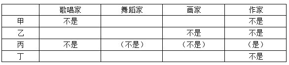

|  | 歌唱家 | 舞蹈家 | 画家 | 作家 |
| --- | --- | --- | --- | --- |
| 甲 | 不是 |  |  | 不是 |
| 乙 |  |  | 不是 | 不是 |
| 丙 | 不是 | （不是） | （不是） | （是） |
| 丁 |  |  |  | 不是 |

第三步：填空，即根据题干信息判断出其余人的职业。

由上表可知，甲可能是画家或舞蹈家，若甲是画家，则（4）中“画家从没见过丙”与（2）中“画家曾为作家（丙）画过画像”矛盾，故甲不是画家，而是舞蹈家。丁是画家，乙是歌唱家，如下表：

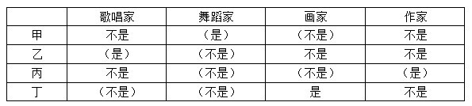

|  | 歌唱家 | 舞蹈家 | 画家 | 作家 |
| --- | --- | --- | --- | --- |
| 甲 | 不是 | （是） | （不是） | 不是 |
| 乙 | （是） | （不是） | 不是 | 不是 |
| 丙 | 不是 | （不是） | （不是） | （是） |
| 丁 | （不是） | （不是） | 是 | 不是 |

故正确答案为B。

**考点**：从最大信息开始推

**来源**：2009年北京市公务员录用考试《行测》题（应届）第34题

### 第 35 题

赵、钱、孙、李四个人中既有大人也有小孩。给他们称体重时，赵、钱两人的体重几乎等于孙、李两人的体重；将钱、李对换一下，赵、李两人的体重明显大于孙、钱两人的体重，并且赵、孙两人的体重还小于钱的体重。

根据题干信息，下面哪项是赵、钱、孙、李的体重的正确顺序（由重到轻）？

A. 李、钱、赵、孙

B. 李、钱、孙、赵

C. 钱、孙、李、赵

D. 钱、赵、李、孙

第 35 题 · 答案与解析

**参考答案（粉笔题库参考内容）**

A

**解析**

第一步：翻译题干。

赵＋钱＝孙＋李，赵＋李＞孙＋钱，赵＋孙＜钱。

第二步：综合分析推出正确答案。

（1）赵＋钱＝孙＋李；

（2）赵＋李＞孙＋钱；

（1）可以转化为（3）赵－李＝孙－钱；

用（2）和（3）的左右两边分别相加，可推出：赵＞孙，将此关系代入（1）中可知，李＞钱，且赵＋孙＜钱，故李＞钱＞赵＞孙。

故正确答案为A。

**考点**：组合排列-单题-其他

**来源**：2009年北京市公务员录用考试《行测》题（应届）第35题

### 第 36 题

一支攻击型军队必须具有“三大件”：一是航母编队，一是战略机，一是海外军事基地。目前中国“一无所有”，根本无法形成攻击链。因此，聪明的兰德公司认为：“中国距离‘破坏’地区军事平衡还相差很远。”

下面哪一选项在论证方式上与题干相同？

A. 崛起的中国必须以强大的军事力量支撑自己的脊梁。中国要崛起，所以，中国必须拥有强大的军事力量

B. 只有聪明且勤奋，才能有大成就；李明既不聪明也不勤奋，所以，他不会有大成就

C. 如果吃高蛋白、高热量和高脂肪的食品过多，就会发胖；我很少吃这类食品，所以，我不会发胖

D. 如果139是偶数，则它就能够被2整除；139不能被2整除，所以，139不是偶数

第 36 题 · 答案与解析

**参考答案（粉笔题库参考内容）**

B

**解析**

第一步：翻译题干。

攻击型军队→航母编队且战略机且海外军事基地。由中国没有航母编队、没有战略机、没有海外军事基地，得出中国没有攻击型军队，论证方式为“否后推否前”。

第二步：逐一分析选项。

A项：翻译为“崛起的中国→强大的军事力量”，由中国要崛起，得出中国拥有强大的军事力量，论证方式为“肯前推肯后”，与题干推理形式不一致，排除；

B项：翻译为“有大成就→聪明且勤奋”，由小李不聪明且不勤奋，得出小李没有大成就，论证方式为“否后推否前”，与题干推理形式一致，保留；

C项：翻译为“吃高蛋白、高热量和高脂肪的食品过多→会发胖”，由我很少吃高蛋白、高热量和高脂肪的食品，得出我不会发胖，论证方式为“否前推否后”，与题干推理形式不一致，排除；

D项：翻译为“139是偶数→被2整除”，由139不能被2整除，得出139不是偶数，论证方式为“否后推否前”，与题干推理形式一致，保留。

比较B、D两项，题干箭头后半部分为且关系，B项箭头后半部分也为且关系，而D项箭头后半部分只包含1个内容，所以B项和题干的论证方式相同，当选，D项排除。

故正确答案为B。

**考点**：推理形式

**来源**：2009年北京市公务员录用考试《行测》题（应届）第36题

### 第 37 题

关于某公司职员的工作状况有如下三个描述：“该公司所有职员都恪尽职守”，“该公司职员并不都恪尽职守”，“文茜女士恪尽职守”，其中有两个描述是假的。

根据题干，仍不能确定下面哪个选项的真假？

A. 文茜女士未恪尽职守

B. 该公司所有职员都不恪尽职守

C. 该公司有些职员不恪尽职守

D. 该公司所有职员都恪尽职守

第 37 题 · 答案与解析

**参考答案（粉笔题库参考内容）**

B

**解析**

第一步：找突破口。

本题突破口为“该公司所有职员都恪尽职守”和“该公司职员并不都恪尽职守”之间的矛盾关系，两个描述中必有一真和一假。

第二步：看其他的话。

由于三个描述中有两个为假，故“文茜女士恪尽职守”为假，也就是该公司并不是所有职员都恪尽职守，即“该公司所有职员都恪尽职守”为假，“该公司职员并不都恪尽职守”为真。

第三步：逐一判断选项。

由“文茜女士恪尽职守”为假，可知文茜女士未恪尽职守，即A项为真；

B项无法判断真假；

由“该公司所有职员都恪尽职守”为假，可知“该公司有些职员不恪尽职守”为真，即C项为真；

由第二步可判断D项为假。

故正确答案为B。

**考点**：只有一真/一假

**来源**：2009年北京市公务员录用考试《行测》题（应届）第37题

### 第 38 题

2008年北京奥运会上争夺奖牌的事实使我们明白了一个道理：在失败还未成为最后的事实时，决不能轻易接受失败！在胜利尚存一丝微弱的希望时，仍要拼尽全力去争取胜利！否则，就不是真正的强者。

由上述题干可推出以下哪个选项？

A. 没有随随便便的成功，成功都来自拼搏

B. 弱者会轻易地接受失败

C. 真正的强者决不接受失败

D. 只有在失败成为不可改变的事实时，真正的强者才会接受失败

第 38 题 · 答案与解析

**参考答案（粉笔题库参考内容）**

D

**解析**

第一步：翻译题干，利用充分必要条件。

题干中的已知条件可以转化为“如果失败还未成为最后的事实，那么真正的强者决不轻易接受失败”，即失败还未成为最后的事实→强者决不轻易接受失败。

第二步：利用逆否规则推断出正确选项。

A项属于无关项；

B项题干中也未提及弱者的情况；

C项与题干意思不符；

D项利用逆否规则，可知题干可等价于“真正的强者只有在失败成为不可改变的事实时，才会接受失败”，正确。

故正确答案为D。

**考点**：常规翻译

**来源**：2009年北京市公务员录用考试《行测》题（应届）第38题

### 第 39 题

在某政府机关的公务员中，理科毕业的多于文科毕业的，女性多于男性。

如果上述论断是真的，以下哪项关于该机关公务员的论断也一定是真的？

Ⅰ文科毕业的女性多于文科毕业的男性

Ⅱ理科毕业的男性多于文科毕业的男性

Ⅲ理科毕业的女性多于文科毕业的男性

A. 只有Ⅰ和Ⅱ

B. 只有Ⅲ

C. 只有Ⅱ和Ⅲ

D. Ⅰ、Ⅱ和Ⅲ

第 39 题 · 答案与解析

**参考答案（粉笔题库参考内容）**

B

**解析**

第一步：抓住题干主要信息。

理科毕业的多于文科毕业的，女性多于男性。

第二步：分析题干信息，结合选项得出答案。

由题干信息可知，理科毕业的女性要多于文科毕业的男性。而文科毕业的女性与文科毕业的男性的多少并不能确定，同样理科毕业的男性和文科毕业的男性也无法比较多少，即Ⅰ、Ⅱ无法根据题干判断真假，Ⅲ一定为真。

故正确答案为B。

**考点**：日常结论

**来源**：2009年北京市公务员录用考试《行测》题（应届）第39题

### 第 40 题

随意挑选一组人去听一位演讲者对一大群注意力高度集中的听众所做的行政伦理学讲演。再随意挑选另一组人去听这位讲演者对一小群注意力不太集中的听众所做的同样内容的讲演。前一组人认为，该讲演者思考深入、自信；后一组人却认为，他的表达模糊、冗长。

题干中的信息最能够反驳以下哪一项断言？

A. 人们对讲演者个人素质的判断主要取决于讲演者所做讲演的内容和方式

B. 如果第二组人听了该讲演者的第一次讲演，他们所作出的判断将会很不相同

C. 同一个社会行为，当被置于不同的社会语境中评价时，不同的人会得出不同的判断

D. 一个人对某位讲演者的讲演质量的评判，会受到其他人对这次讲演的反应的影响

第 40 题 · 答案与解析

**参考答案（粉笔题库参考内容）**

A

**解析**

第一步：抓住题干主要信息。

题干表明听众的注意力不同，他们对同一位讲演者的判断也不同，这说明人们对讲演者的判断取决于听众本身的注意力。

第二步：逐一判断选项的作用。

提问句要求找出最能被题干信息反驳的选项。

A项的说法恰恰与题干相反，能被题干信息反驳；

B项无法被题干反驳，演讲者的讲演内容是一样的，决定听众判断的是他们本身的注意力，而非演讲者的讲演；

C项，题干只分析讲演者和听众的关系，没有说明社会行为和社会语境的问题；D项，题干没有提及听众的态度有没有受他人影响。因此C、D两项均与题干无关。

故正确答案为A。

**考点**：削弱论点

**来源**：2009年北京市公务员录用考试《行测》题（应届）第40题

### 第 41 题

①计入黑名单

②利用信用卡网上套现

③拒绝提供服务

④引起网上支付公司重视

⑤媒体新闻报道

A. ②⑤③④①

B. ⑤④①③②

C. ⑤①③④②

D. ②⑤④①③

第 41 题 · 答案与解析

**参考答案（粉笔题库参考内容）**

D

**解析**

第一步：给出解题思路。

题干描述的是由于出现利用信用卡套现，引起网上支付公司的重视而最后拒绝提供服务的事件，应按照因果关系进行排列。

第二步：逐一判断选项。

A项，先是“引起网上支付公司重视”，才决定“拒绝提供服务”，故④肯定在③之前，逻辑错误，排除；

B项，先是出现了“利用信用卡网上套现”这种现象，才有之后的连锁反应，故②肯定在最前面，逻辑错误，排除；

C项，由于“利用信用卡网上套现”，才引起了“媒体新闻报道”，故②肯定在⑤之前，逻辑错误，排除；

D项，由于出现了“利用信用卡网上套现”这种现象，才进行“媒体新闻报道”，然后“引起网上支付公司重视”，进而“计入黑名单”，最终“拒绝提供服务”，逻辑正确，当选。

故正确答案为D。

**来源**：2009年北京市公务员录用考试《行测》题（应届）第41题

### 第 42 题

①物业多次维修

②购买新房

③要求物业赔偿

④泡坏家具

⑤新房漏雨

A. ②⑤④①③

B. ③②⑤④①

C. ②④①③⑤

D. ④①③②⑤

第 42 题 · 答案与解析

**参考答案（粉笔题库参考内容）**

A

**解析**

购买新房后，房子才会漏雨，泡坏家具又是因为漏雨，所以才会有多次维修，因为房屋质量问题，业主才会要求物业赔偿。

故正确答案为A。

**来源**：2009年北京市公务员录用考试《行测》题（应届）第42题

### 第 43 题

①面临合同续签

②商户集体停业

③摊位租金上涨

④恢复营业

⑤进行协商

A. ①③②④⑤

B. ②⑤④①③

C. ①③②⑤④

D. ②①⑤③④

第 43 题 · 答案与解析

**参考答案（粉笔题库参考内容）**

C

**解析**

在合同续签的时候出现摊位租金上涨，上涨后商户集体停业，然后进行协商，最后恢复营业。

故正确答案为C。

**来源**：2009年北京市公务员录用考试《行测》题（应届）第43题

### 第 44 题

①赶赴灾区

②道路中断

③交通恢复

④发生地震

⑤昼夜奋战

A. ①⑤②④③

B. ②①⑤③④

C. ④②①⑤③

D. ①③②④⑤

第 44 题 · 答案与解析

**参考答案（粉笔题库参考内容）**

C

**解析**

地震引起道路中断，所以④在②的前面，可以排除A、B、D三项。

故正确答案为C。

**来源**：2009年北京市公务员录用考试《行测》题（应届）第44题

### 第 45 题

①出台政策救市

②市场需求减弱

③产品价格下跌

④金融风暴爆发

⑤全球经济低迷

A. ⑤④③②①

B. ④⑤②③①

C. ④⑤③①②

D. ①④⑤②③

第 45 题 · 答案与解析

**参考答案（粉笔题库参考内容）**

B

**解析**

金融风暴爆发，引起全球经济低迷，出现市场需求减弱，受供求关系影响产品价格下跌，最后，政府才会出台救市政策。

故正确答案为B。

**来源**：2009年北京市公务员录用考试《行测》题（应届）第45题

### 第 46 题

效力待定合同，是指合同虽然已经成立，但因其不完全符合有关生效要件的规定，因此其效力能否发生尚未确定，一般须经有权人表示承认才能生效。

下列情形中属于效力待定合同的是：

A. 10周岁的小明出售劳力士金表给40岁的李某

B. 5周岁的儿童小军因发明创造而接受奖金

C. 成年人张某误将本为复制品的油画当成真品购买

D. 出租车司机借抢救重病人急需租车之机将车价提高10倍

第 46 题 · 答案与解析

**参考答案（粉笔题库参考内容）**

A

**解析**

第一步：抓住定义中的关键词。

关键词强调“合同已经成立”、“不完全符合有关生效要件的规定”、“须经有权人表示承认才能生效”。

第二步：逐一判断选项。

A项：出售金表说明合同已经成立，小明还是未成年人，不具有完全行为能力，须经其监护人同意才能生效，符合定义，当选；

B项：小军虽然是未成年人，但是他的发明创造符合奖金的条件，也就是符合生效构成要件，排除；

C项：张某是完全行为能力人，并且合同可以生效，排除；

D项：司机与租车人之间也是符合生效要件的规定，排除。

故正确答案为A。

**考点**：原因结果

**来源**：2009年北京市公务员录用考试《行测》题（应届）第46题

### 第 47 题

行政给付又称行政物质帮助，是指行政机关对公民在年老、疾病或丧失劳动能力等情况或其他特殊情况下，依照有关法律、法规、规章或政策等规定，赋予其一定的物质权益（如金钱或实物）或与物质有关的权益的具体行政行为。

下列各项中，不属于行政给付的是：

A. 给养老院经费资助

B. 支付残疾人摩托司机行政赔偿金

C. 支付下岗职工最低生活保障费

D. 支付牺牲人员抚恤金

第 47 题 · 答案与解析

**参考答案（粉笔题库参考内容）**

B

**解析**

第一步：抓住定义中的关键词。

关键词强调“行政机关”、“对公民在年老、疾病或丧失劳动能力等情况或其他特殊情况下”、“赋予其一定的物质权益或与物质有关的权益”。

第二步：逐一判断选项。

A项属于政府对年老公民的物质帮助，符合定义；

B项中支付给残疾人摩托司机的行政赔偿金，是在侵权后给予的合理赔偿，不符合关键词中的“赋予其一定的物质权益或与物质有关的权益”，不符合定义；

C、D两项均属于在其他特殊情况下行政机关给予的物质帮助，符合定义。

本题为选非题，故正确答案为B。

**考点**：单定义-其他句式

**来源**：2009年北京市公务员录用考试《行测》题（应届）第47题

### 第 48 题

根据我国《宪法》第十三条规定：“公民的合法的私有财产不受侵犯。”  《宪法》第十条规定：“国家为了公共利益的需要，可以依照法律规定对土地实行征收或者征用并给予补偿。”

下列关于私有财产权的表述，哪一项是不正确的？

A. 公民合法的私有财产不受侵犯

B. 国家依照法律规定保护公民的私有财产权和继承权

C. 任何人不得剥夺公民的私有财产

D. 国家为了公共利益的需要，可以依照法律规定对公民的私有财产实行征收或者征用并给予补偿

第 48 题 · 答案与解析

**参考答案（粉笔题库参考内容）**

C

**解析**

第一步：抓住定义中的关键词。

关键词强调“合法的私有财产不受侵犯”、“依照法律规定”、“征收或者征用”。

第二步：逐一判断选项。

A项是定义中的关键词，正确；

B项是对定义中的关键词“合法的私有财产不受侵犯”的表述，正确；

C项不符合定义中“依照法律规定”、“征收或者征用”，同时C项扩大了私有财产保护范围，定义中仅指“合法私有财产不受侵犯”，错误；

D项符合国家对征收或征用的规定，正确。

本题为选非题，故正确答案为C。

**考点**：单定义-其他句式

**来源**：2009年北京市公务员录用考试《行测》题（应届）第48题

### 第 49 题

《民法》是调整平等主体的自然人、法人、其他组织之间的财产关系和人身关系的法律规范的总称。

下列社会关系中，应由民法调整的是：

A. 某市人民政府罢免该市某局副局长职务

B. 李某因非法印刷商标被罚款

C. 甲、乙两村因某块土地的所有权归属发生纠纷

D. 专利局对某发明专利予以宣告无效

第 49 题 · 答案与解析

**参考答案（粉笔题库参考内容）**

C

**解析**

第一步：找出定义关键词。

“平等主体的自然人、法人、其他组织之间的财产关系和人身关系”。

第二步：逐一分析选项。

A项：罢免副局长职务为行政机关内部的处分行为，不属于民法调整，不符合定义，排除；

B项：李某因非法行为被处罚，不涉及“平等主体的自然人、法人、其他组织之间的财产关系和人身关系”，不符合定义，排除；

C项：该项甲、乙两村因某块土地的所有权归属发生纠纷，属于平等主体之间的财产关系，符合“平等主体的自然人、法人、其他组织之间的财产关系和人身关系”，符合定义，当选；

D项：专利局宣告专利无效，不涉及“平等主体的自然人、法人、其他组织之间的财产关系和人身关系”，不符合定义，排除。

故正确答案为C。

**考点**：主客体

**来源**：2009年北京市公务员录用考试《行测》题（应届）第49题

### 第 50 题

行政相对人是行政管理法律关系中与行政主体相对应的另一方当事人，即行政主体行政行为影响其权益的个人、组织。具有以下特征：

（1）行政相对人是处在行政管理法律关系中的个人、组织；

（2）行政相对人是指行政管理法律关系中作为与行政主体相对应的另一方当事人的个人、组织；

（3）行政相对人是在行政管理法律关系中，其权益受到行政主体行政行为影响的个人、组织。

下列说法正确的是：

A. 行政相对人是受行政行为直接影响的个人、组织

B. 非法人组织不能作为行政相对人

C. 行政机关、非法人组织也可能作为行政相对人

D. 国家公务员不可能作为行政相对人

第 50 题 · 答案与解析

**参考答案（粉笔题库参考内容）**

C

**解析**

第一步：抓住定义中的关键词。

关键词强调“另一方当事人”、“行政管理法律关系中的个人、组织”。

第二步：逐一判断选项。

A项强调行政相对人是受行政行为直接影响，与定义不符，定义强调行政相对人是受“行政主体行政行为影响”，而不是受行政行为直接影响，故A项不正确；

B项说非法人组织不能作为行政相对人，而关键词强调行政管理法律关系中的个人、组织都可以作为行政相对人，故B项不正确；

C项中的行政机关、非法人组织符合“行政管理法律关系中的个人、组织”，也可以作为行政相对人，故C项正确；

D项中的国家公务员也符合“行政管理法律关系中的个人、组织”，可以作为行政相对人，故D项不正确。

故正确答案为C。

**考点**：单定义-其他句式

**来源**：2009年北京市公务员录用考试《行测》题（应届）第50题

### 第 51 题

融资租赁，是指出租人购买租赁物件，并租给承租人使用，承租人则分期向出租人支付租金。在租赁期内租赁物件的所有权属于出租人所有，承租人拥有租赁物件的使用权；在租赁期满后，承租人有购买租赁资产的选择权，所订立的购买价款预计将远低于行使选择权时租赁资产的公允价值，因而在租赁开始日就可以合理确定承租人将会行使这种选择权，即使承租人不行使这种选择权，资产的所有权不转移，但租赁期占租赁资产使用寿命的大部分。

下列选项中属于融资租赁的是：

A. 投资者向宏屹公司购买一定份额的奶牛租赁产品，然后将奶牛出租给宏屹公司经营，宏屹公司按照合同每年向投资者支付固定的租金，到期后无条件返还本金

B. 甲公司在2000年1月1日将一套闲置不用的设备出租给乙公司，租期2年，租金为24000元。合同约定，2000年1月1日，乙公司先支付一年的租金12000元，2001年1月1日，支付余下的当年租金12000元

C. 光明乳业租赁了IBM总价值上千万元的两台S85高端服务器和一台SHARK存储设备，租期为三年。三年以后，双方再商定光明乳业是继续租还是根据当时的市场行情买断剩下的“壳”

D. 某航空公司拟以租赁方式引进（增加）一架同型客机，飞机现行市价为4000万美元，租期10年，租赁期满后，公司支付120万美元的残值后，飞机所有权归航空公司所有

第 51 题 · 答案与解析

**参考答案（粉笔题库参考内容）**

D

**解析**

第一步：抓住定义中的关键词。

关键词强调“出租人购买租赁物件，承租人分期向出租人支付租金”、“租赁期满后，承租人有购买租赁资产的选择权，购买价款预计将远低于行使选择权时租赁资产的公允价值”。

第二步：逐一判断选项。

A项不符合“在租赁期满后，承租人有购买租赁资产的选择权”，故不属于融资租赁；

B项中并未说明租赁期满后的处理方式，且不符合“租赁期占租赁资产使用寿命的大部分”，故不属于融资租赁；

C项不符合“在租赁开始日就可以合理确定承租人将会行使这种选择权”，不属于融资租赁；

D项中的航空公司作为承租人，租期10年，期满后支付120万美元，飞机所有权归航空公司，符合定义，属于融资租赁。

故正确答案为D。

**考点**：单定义-其他句式

**来源**：2009年北京市公务员录用考试《行测》题（应届）第51题

### 第 52 题

羊群效应，一般用以比喻人都有一种从众心理，从众心理很容易导致盲从，而盲从往往会陷入骗局或遭到失败。

根据该定义，下列不属于羊群效应的是：

A. 股市里，大部分散户追涨时信心百倍蜂拥而至，大盘跳水时，纷纷恐慌出逃

B. 由于职场竞争越来越激烈，大家都说公务员是个稳定的职业，于是大批高校毕业生甚至已经有了工作的年轻人纷纷报考公务员

C. 班主任老师和数学老师在考试前告诉学生这次考试很难，结果大部分同学在考试中表现失常

D. 平时无人问津的衣服款式或颜色，一旦被媒体宣传为本年度流行款式或颜色，大家就会抢购

第 52 题 · 答案与解析

**参考答案（粉笔题库参考内容）**

C

**解析**

第一步：抓住定义中的关键词。

关键词强调“从众心理导致盲从，往往陷入骗局或遭到失败”。

第二步：逐一判断选项。

A、B、D三项均是从众心理导致的盲从行为；

C项中同学考试失常，是受老师暗示的影响，没有从众心理，所以不属于羊群效应。

故正确答案为C。

**考点**：原因结果

**来源**：2009年北京市公务员录用考试《行测》题（应届）第52题

### 第 53 题

夫妻个人财产是指依法或依当事人约定，夫妻婚后各自保留的一定范围内的个人所有财产。一般包括法定个人财产与约定个人财产，具体而言，包括婚前财产与婚后财产。

下列财产中哪一项属于夫妻个人财产？

A. 婚后一方接受亲友馈赠的财物

B. 一方在婚前接受继承而于婚后实际取得的财产

C. 夫妻分居两地分别管理、使用的婚后所得财产

D. 婚后一方所得的奖金

第 53 题 · 答案与解析

**参考答案（粉笔题库参考内容）**

B

**解析**

第一步：抓住定义中的关键词。

关键词强调“依法或依当事人约定”、“婚前财产与婚后财产”。

第二步：逐一判断选项。

A项中婚后一方接受亲友馈赠的财物，因为夫妻双方没有约定，则应属于依照法律划分的财产，属于婚后夫妻的共同财产；

B项中一方在婚前继承的财产属于法定个人财产、婚前财产，是夫妻个人财产；

C、D两项中均是夫妻婚后的财产，且没有涉及当事人的约定财产，故属于依照法律划分的财产，是婚后夫妻的共同财产。

故正确答案为B。

**考点**：单定义-其他句式

**来源**：2009年北京市公务员录用考试《行测》题（应届）第53题

### 第 54 题

行为罚亦称能力罚，是行政主体对违反行政法律规范的行政相对方所采取的限制或剥夺其特定行为能力或资格的一种处罚措施。

下列属于行为罚的是：

A. 行政拘留

B. 没收财物

C. 吊销营业执照

D. 劳动教养

第 54 题 · 答案与解析

**参考答案（粉笔题库参考内容）**

C

**解析**

第一步：抓住定义中的关键词。

关键词强调“行政主体对违反行政法律规范的行政相对方”、“限制或剥夺其特定行为能力或资格”。

第二步：逐一判断选项。

根据定义，行为罚的客体是违反行政法律规范的行政相对方，措施是限制或剥夺其特定行为能力或资格。A、B、D三项均不属于限制或剥夺其特定行为能力或资格。

故正确答案为C。

**考点**：主客体

**来源**：2009年北京市公务员录用考试《行测》题（应届）第54题

### 第 55 题

垂直迁移，又称纵向迁移，指处于不同抽象、概括水平的经验之间的相互影响。

下列各项中，体现了垂直迁移的是：

A. 汉语拼音的学习影响英语字母的发音

B. “角”的概念的掌握影响“直角”“平角”等概念的学习

C. “石”字的学习影响“磊”字的学习

D. 在学校形成的爱护公物的习惯影响在校外的行为表现

第 55 题 · 答案与解析

**参考答案（粉笔题库参考内容）**

B

**解析**

第一步：抓住定义中的关键词。

关键词强调“不同抽象、概括水平的经验之间”。

第二步：逐一判断选项。

A项中的汉语和英语都属于语言；

B项中“角”“直角”“平角”不在同一个概括水平，符合题干定义；

C项中的“石”“磊”都属于汉字；

D项中校内、校外的行为都属于行为。

所以A、C、D三项都属于同一抽象和概括水平，排除。

故正确答案为B。

**考点**：主客体

**来源**：2009年北京市公务员录用考试《行测》题（应届）第55题

### 第 56 题

根据《中华人民共和国企业劳动争议处理条例》，我国处理劳动争议的机构不包括：

A. 劳动争议调解委员会

B. 人民法院

C. 人民检察院

D. 劳动争议仲裁委员会

第 56 题 · 答案与解析

**参考答案（粉笔题库参考内容）**

C

**解析**

劳动争议的处理机构，主要包括劳动争议调解委员会、劳动争议仲裁委员会和人民法院。在用人单位内可以设立劳动争议调解委员会；各级人民法院的民事审判庭负责劳动争议案件的审理工作。

故正确答案为C。

**考点**：其他法律法规

**来源**：2009年北京市公务员录用考试《行测》题（应届）第56题

### 第 57 题

2008年中央经济工作会议提出，明年经济工作的首要任务是：

A. 深化重点领域和关键环节改革

B. 优化经济结构

C. 提高对外开放水平

D. 保持经济平稳较快发展

第 57 题 · 答案与解析

**参考答案（粉笔题库参考内容）**

D

**解析**

2008年中央经济工作会议根据国内外经济形势的新变化特别是我国经济增长下滑过快的新情况，提出把保持经济平稳较快发展作为2009年经济工作的首要任务。

故正确答案为D。

**考点**：重要会议讲话

**来源**：2009年北京市公务员录用考试《行测》题（应届）第57题

### 第 58 题

第二次世界大战以后，资本主义国家采取福利经济政策，国家参与国民收入的再分配过程，使社会上“弱势群体”的生活得到了基本保障，在一定程度上消除了极端贫困的现象。

资本主义国家的这一政策源于：

A. 工业革命以来的生产社会化

B. 罗斯福新政中的社会福利措施

C. 二战后的国民经济非军事化

D. 欧共体劳务、资本的自由交流

第 58 题 · 答案与解析

**参考答案（粉笔题库参考内容）**

B

**解析**

福利国家是资本主义国家通过创办并资助社会公共事业，实行和完善一套社会福利政策和制度，对社会经济生活进行干预，以调节和缓和阶级矛盾，保证社会秩序和经济生活正常运行，维护垄断资本的利益和统治的一种方法。

20世纪30年代的经济大危机孕育了世界大战，但也催生了英国的“人民预算”和美国的“罗斯福新政”。在战争废墟上建立起的是新的福利制度，后被泛称为“福利国家”。

故正确答案为B。

**考点**：宏观经济与调控政策

**来源**：2009年北京市公务员录用考试《行测》题（应届）第58题

### 第 59 题

1945年抗日战争胜利，中国作为联合国安理会五大常任理事国之一，国际地位显著提高。

其原因是：

A. 中国是抗击日本法西斯的主要战场

B. 工业化建设取得一定成就

C. 取消了帝国主义在中国的一切特权

D. 国家综合国力有较大增强

第 59 题 · 答案与解析

**参考答案（粉笔题库参考内容）**

A

**解析**

中国能够成为联合国五大常任理事国之一，一方面是由于中国是亚洲反法西斯的主战场，始终没有投降，为二战的胜利做出了杰出的贡献。

故正确答案为A。

**考点**：中国历史

**来源**：2009年北京市公务员录用考试《行测》题（应届）第59题

### 第 60 题

20世纪八九十年代，两极格局解体，世界格局向多极化发展。中国不但经受住了考验，而且发展成具有广泛影响的世界性大国。这一时期中国在内政外交上的重大成就和政策有：

①从计划经济向市场经济过渡；

②恢复中国在联合国的合法席位；

③对香港、澳门恢复行使主权；

④反对霸权主义，维护世界和平。

A. ①②③

B. ②③④

C. ①③④

D. ①②④

第 60 题 · 答案与解析

**参考答案（粉笔题库参考内容）**

C

**解析**

1971年10月25日，联合国大会通过恢复新中国在联合国合法席位的2758号决议，而题目要求的是“二十世纪八九十年代”这一期间，故②不选。

故正确答案为C。

**本题相关知识点：**

中国从计划经济向市场经济过渡发生在1978年到1992年之间。

对香港、澳门恢复行使主权分别是1997年和1999年。

反对霸权主义、维护世界和平主要是20世纪90年代以来。

**考点**：中国历史

**来源**：2009年北京市公务员录用考试《行测》题（应届）第60题

### 第 61 题

2008年，国家房地产调控措施的出台十分密集，除了增加廉租房、经济适用房供应外，再加上央行加息，多个城市出现了房屋成交量下跌的态势，房价涨幅开始赶缓。

这表明：

A. 国家通过宏观调控平衡供求关系

B. 价格的波动通过供求关系表现出来

C. 宏观调控是资源配置的基础性手段

D. 宏观调控可以克服市场调节的滞后性

第 61 题 · 答案与解析

**参考答案（粉笔题库参考内容）**

A

**解析**

宏观调控（简称宏调）是政府实施的政策措施以调节市场经济的运行。在市场经济中，商品和服务的供应及需求是受价格规律及自由市场机制所影响。市场经济带来经济增长，但会引发通货膨胀，而高潮后所跟随的衰退却使经济停滞甚至倒退，这种周期波动对社会资源及生产力都构成严重影响。所以宏观调控着重以整体社会的经济运作，透过人为调节供应与需求，来达至计划经济之目标。

故正确答案为A。

**考点**：宏观经济与调控政策

**来源**：2009年北京市公务员录用考试《行测》题（应届）第61题

### 第 62 题

俗语曰：“官风正，则民风淳。”这句话反映了政府在公共行政过程中的哪些功能？

A. 决策

B. 激励

C. 导向

D. 调节

第 62 题 · 答案与解析

**参考答案（粉笔题库参考内容）**

C

**解析**

“官风正，则民风淳”，是指政府所为对社会风貌有引导作用；政府只要坚持群众路线，严格依法行政，认真负责，勤奋务实，谦虚谨慎，主动承担责任，良好的民风自然会形成，和谐的社会局面才能持久。

故正确答案为C。

**来源**：2009年北京市公务员录用考试《行测》题（应届）第62题

### 第 63 题

当国家公务员认为自己受到单位的不公平待遇时，可以向哪个部门提出申诉？

A. 人民法院

B. 人民代表大会及其常委会

C. 人民检察院

D. 行政监察机关

第 63 题 · 答案与解析

**参考答案（粉笔题库参考内容）**

D

**解析**

行政机关公务员对处分不服向行政监察机关申诉的，按照《中华人民共和国行政监察法》的规定办理。

故正确答案为D。

**本题相关知识点：**

《公务员法》第九十五条规定：公务员对涉及本人的下列人事处理不服的，可以自知道该人事处理之日起三十日内向原处理机关申请复核；对复核结果不服的，可以自接到复核决定之日起十五日内，按照规定向同级公务员主管部门或者作出该人事处理的机关的上一级机关提出申诉；也可以不经复核，自知道该人事处理之日起三十日内直接提出申诉：

（一）处分；

（二）辞退或者取消录用；

（三）降职；

（四）定期考核定为不称职；

（五）免职；

（六）申请辞职、提前退休未予批准；

（七）未按规定确定或者扣减工资、福利、保险待遇；

（八）法律、法规规定可以申诉的其他情形。

对省级以下机关作出的申诉处理决定不服的，可以向作出处理决定的上一级机关提出再申诉。

行政机关公务员对处分不服向行政监察机关申诉的，按照《中华人民共和国行政监察法》的规定办理。

**考点**：行政法

**来源**：2009年北京市公务员录用考试《行测》题（应届）第63题

### 第 64 题

社会主义和谐社会的科学内涵是（  ）、公平正义、诚信友爱、充满活力、安定有序、人与自然和谐相处的社会。

A. 民主法制

B. 人民民主

C. 法制健全

D. 民主法治

第 64 题 · 答案与解析

**参考答案（粉笔题库参考内容）**

D

**解析**

2005年2月19日，胡锦涛总书记在省部级主要领导干部提高构建社会主义和谐社会能力专题研讨班上的讲话中明确指出：我们所要建设的社会主义和谐社会，应该是民主法治、公平正义、诚信友爱、充满活力、安定有序、人与自然和谐相处的社会。

故正确答案为D。

**本题相关知识点：**

科学社会主义的内涵包括：

第一，构建社会主义和谐社会，必须促进公平正义，激发社会活力，建立起在公平与效率的内在统一中，使发展成果惠及全体人民的利益关系格局。

第二，构建社会主义和谐社会，必须充分发扬社会主义民主，切实落实依法治国方略，全面形成安定有序的局面，建立健全有效的社会矛盾调节机制。

第三，构建社会主义和谐社会，必须倡导诚信友爱，并由此入手，使人的自身发展逐步走向全面、和谐，不断塑造互帮互助、融洽相处的新型主体。

第四，构建社会主义和谐社会，必须真正实现人与自然的自觉统一、和谐相处，切实走出一条生产发展、生活富裕、生态良好的新型文明发展道路。

**来源**：2009年北京市公务员录用考试《行测》题（应届）第64题

### 第 65 题

统一的市场就是在全国：

A. 实现地区内部的紧密结合

B. 打破地区、部门的分割和封锁

C. 实现部门内部的紧密结合

D. 打破地区、部门内部的分割和封锁

第 65 题 · 答案与解析

**参考答案（粉笔题库参考内容）**

B

**解析**

国内统一市场是指能把国内各地区的经济在社会分工和商品经济高度发展的基础上融合成一个互相依存的有机统一的市场，也就是实现全国社会化大生产的再生产所需要的国内市场。

故正确答案为B。

**本题相关知识点：**

统一市场包括两方面科学内涵：

第一，市场经济的发展赋予市场以相应的性质，公有制为主体的所有制结构从根本上有别于资本主义国内市场，在此基础上形成宏观控制的商品流通体系。

第二，社会主义国内统一市场应是整体性大大强化的国内市场，市场上的地区封锁、部门分割的现象应完全消除，商品依据流通领域的经济规律和自然规律在全国范围内自由流通，这是市场发展过程中商品经济属性的具体表现。

**考点**：市场经济

**来源**：2009年北京市公务员录用考试《行测》题（应届）第65题

### 第 66 题

依法治国的根本目的在于：

A. 确保国家各项工作有法可依，依法行政

B. 维护宪法和法律在国家政治、经济和社会生活中的权威

C. 依法打击敌视和破坏社会主义的敌对分子，维护社会稳定

D. 保证人民充分行使当家作主的权利，维护人民当家作主的地位

第 66 题 · 答案与解析

**参考答案（粉笔题库参考内容）**

D

**解析**

依法治国是广大人民群众在党的领导下，依照宪法和法律的规定，管理国家事务，管理经济和文化事业，管理社会事务，保证国家的各项工作都依法进行。

依法治国的目的在于保证人民充分行使当家作主的权利，维护人民当家作主的地位。

故正确答案为D。

**考点**：宪法

**来源**：2009年北京市公务员录用考试《行测》题（应届）第66题

### 第 67 题

在其他环境条件基本相似的情况下，行政管理幅度与管理层次的关系为：

A. 一致

B. 正比

C. 反比

D. 没有关系

第 67 题 · 答案与解析

**参考答案（粉笔题库参考内容）**

C

**解析**

管理幅度，又称控制幅度，是指一名主管人所能够直接领导、指挥和监督的下级人员或下级部门的数量及范围。

管理层次亦称管理层级，是指组织的纵向等级结构和层级数目。

管理幅度与管理层次是组织结构的基本范畴。管理幅度与管理层次是影响组织结构的两个决定性因素。幅度构成组织的横向结构，层次构成组织的纵向结构，水平与垂直相结合构成组织的整体结构。在组织条件不变的情况下，管理幅度与管理层次通常成反比例关系，即管理幅度宽，则管理层次少，反之亦然。

故正确答案为C。

**来源**：2009年北京市公务员录用考试《行测》题（应届）第67题

### 第 68 题

依法执政，就是坚持依法治国，领导立法，带头守法，保证执法，不断推进国家经济、政治、文化、社会生活的法制化、规范化。下面对依法执政理解正确的是：

A. 依法执政是中国共产党执政的基本方式

B. 党制定法律，使党的主张通过法定程序上升为国家意志

C. 中国共产党依法执政是各级人民政府依法行政的前提

D. 依法执政要通过民主执政体现出来

第 68 题 · 答案与解析

**参考答案（粉笔题库参考内容）**

A

**解析**

A项正确；

B项错误，党是通过加强对立法工作的领导，而不是制定法律使党的主张上升为国家意志；

C项错误，依法执政表现为各级人民政府依法行政；

D项错误，民主执政是通过依法执政的途径来实现的。

故正确答案为A。

**本题相关知识点：**

依法执政，就是党要紧紧抓住制度建设这个带有根本性、全局性、稳定性、长期性的重要环节，坚持依法治国，领导立法，带头守法，保证执法，不断推进国家经济、政治、文化、社会生活的法制化、规范化，从制度上、法律上保证党的路线方针政策的贯彻实施，使这种制度和法律不因领导人的改变而改变，不因领导人的看法和注意力的改变而改变。这是中国共产党在新的历史条件下领导方式和执政方式的重大转变，是实行依法治国基本方略、发展社会主义民主政治、建设社会主义政治文明的必然要求。

依法执政与科学执政、民主执政之间是辩证统一的：科学执政是基本前提，民主执政是本质所在，依法执政是基本途径。三者相互联系、有机结合，构成了中国共产党执政方式的基本理论框架。科学执政与民主执政必须通过依法执政的途径来实现。

**来源**：2009年北京市公务员录用考试《行测》题（应届）第68题

### 第 69 题

根据《中华人民共和国公务员法》关于公务员义务的规定，下面哪项不属于公务员的义务？

A. 《法官法》中规定法官必须维护司法公正

B. 公务员要模范遵守社会公德

C. 保持“政治中立”

D. 保守工作秘密

第 69 题 · 答案与解析

**参考答案（粉笔题库参考内容）**

C

**解析**

本题考查公务员法。

A项正确，《法官法》第三条规定：“法官必须忠实执行宪法和法律，维护社会公平正义，全心全意为人民服务。”

B、D两项正确，《公务员法》第十四条规定：“公务员应当履行下列义务：（一）忠于宪法，模范遵守、自觉维护宪法和法律，自觉接受中国共产党领导；（二）忠于国家，维护国家的安全、荣誉和利益；（三）忠于人民，全心全意为人民服务，接受人民监督；（四）忠于职守，勤勉尽责，服从和执行上级依法作出的决定和命令，按照规定的权限和程序履行职责，努力提高工作质量和效率；（五）保守国家秘密和工作秘密；（六）带头践行社会主义核心价值观，坚守法治，遵守纪律，恪守职业道德，模范遵守社会公德、家庭美德；（七）清正廉洁，公道正派；（八）法律规定的其他义务。”

C项错误，保持“政治中立”不属于公务员的义务。

本题为选非题，故正确答案为C。

**考点**：行政法

**来源**：2009年北京市公务员录用考试《行测》题（应届）第69题

### 第 70 题

温家宝总理在2008年十一届全国人大一次会议所做的《政府工作报告》中指出，防止价格总水平过快上涨，是今年宏观调控的重大任务，必须从（  ）和（  ）两方面采取有力措施。

A. 增加有效供给 抑制不合理需求

B. 控制市场价格 规范进货渠道

C. 打击不法商人 调动有效需求

D. 扩大内部需求 抑制进口影响

第 70 题 · 答案与解析

**参考答案（粉笔题库参考内容）**

A

**解析**

温家宝总理在2008年十一届全国人大一次会议所做的《政府工作报告》中指出，防止价格总水平过快上涨，是2008年宏观调控的重大任务，必须从增加有效供给和抑制不合理需求两方面采取有力措施。

故正确答案为A。

**本题相关知识点：**

2011年12月14日闭幕的中央经济工作会议明确了2012年中国宏观经济政策的基调——“稳中求进”。

“稳中求进”中的“稳”，就是要保持宏观经济政策基本稳定，保持经济平稳较快发展，保持物价总水平基本稳定，保持社会大局稳定。

“稳中求进”中的“进”，就是要继续抓住和用好中国发展的重要战略机遇期，在转变经济发展方式上取得新进展，在深化改革开放上取得新突破，在改善民生上取得新成效。

**考点**：宏观经济与调控政策

**来源**：2009年北京市公务员录用考试《行测》题（应届）第70题

### 第 71 题

长达两年之久的2008年美国总统大选于2008年11月5日落下帷幕，（    ）以压倒性优势赢得了大选的胜利，成为美国历史上第四十四位，也是美国建国200多年来的（    ）。

A. 希拉里 第一位女性总统

B. 奥巴马 第一位黑人总统

C. 奥巴马 第二位黑人总统

D. 麦凯恩 第一位激进组织总统

第 71 题 · 答案与解析

**参考答案（粉笔题库参考内容）**

B

**解析**

贝拉克·侯赛因·奥巴马二世，美国民主党政治家，第44任、第45任美国总统（连任），为美国历史上第一位非裔总统，首位同时拥有黑（卢欧族）白（英德爱混血）血统的总统。

故正确答案为B。

**本题相关知识点：**

2007年2月10日，奥巴马以侧重完结伊拉克战争及实施全民医疗保险制为竞选纲领，正式宣布参加2008年美国总统选举，并于同年11月4日正式当选。

2009年10月9日，奥巴马获得诺贝尔委员会颁发的诺贝尔和平奖。

2012年11月6日，奥巴马在美国总统选举中击败共和党候选人罗姆尼，成功连任。

**来源**：2009年北京市公务员录用考试《行测》题（应届）第71题

### 第 72 题

中国共产党第十七届中央委员会第三次会议于2008年10月9日至12日在北京举行。全会审议通过了《中共中央关于推进（  ）若干重大问题的决定》。

A. 农村土地改革

B. 农民社会保障

C. 农业税费政恤

D. 农村改革发展

第 72 题 · 答案与解析

**参考答案（粉笔题库参考内容）**

D

**解析**

2008年10月9日至12日举行的中国共产党第十七届中央委员会第三次全体会议全会审议通过了《中共中央关于推进农村改革发展若干重大问题的决定》。

故正确答案为D。

**本题相关知识点：**

党的十一届三中全会拉开农村改革的序幕，党的十一届四中全会通过《中共中央关于加快农业发展若干问题的决定》，党的十三届八中全会通过《中共中央关于进一步加强农业和农村工作的决定》，党的十五届三中全会通过《中共中央关于农业和农村工作若干重大问题的决定》······改革开放以来，党多次召开中央全会，研究农村改革发展问题，部署农业农村工作。

**考点**：重要文件

**来源**：2009年北京市公务员录用考试《行测》题（应届）第72题

### 第 73 题

纪念《中日和平友好条约》缔结（  ）周年招待会于2008年10月24日在人民大会堂金色大厅举行。国家主席胡锦涛和日本首相麻生太郎出席招待会并致辞。（  ）年前，中国国务院副总理邓小平在日本和福田赳夫首相出席了《中日和平友好条约》批准书互换仪式，条约正式生效，成为指导中日关系发展的基础性文件之一。

A. 20 20

B. 30 30

C. 35 35

D. 45 45

第 73 题 · 答案与解析

**参考答案（粉笔题库参考内容）**

B

**解析**

本题考查毛中特。

《中日和平友好条约》或“中日友好条约”。1978年8月12日于北京签订，1978年10月23日生效。有效期10年，如在期满时或在其后任何时候的前一年，缔约国任何一方未提出愿予终止时则继续生效。

《中日和平友好条约》以法律形式确认了《中日联合声明》的各项原则，为中日关系的全面发展奠定了政治基础。

故正确答案为B。

**本题相关知识点：**

中日四个双边关系文件如同四块里程碑，勾画出中日两国由恢复邦交正常化到全面推进“战略互惠关系”的历史进程。

1972年《中日联合声明》

1978年《中日和平友好条约》

1998年《中日联合宣言》

2008年《中日关于全面推进战略互惠关系的联合声明》

**考点**：党的历史

**来源**：2009年北京市公务员录用考试《行测》题（应届）第73题

### 第 74 题

神舟七号载人航天飞行任务总指挥部决定，神舟七号飞船于2008年9月25日发射，进行载人航天飞行。经过总指挥部负责人和航天员选评委员会一致表决通过，确定由（   ）、（  ）、（  ）组成执行神舟七号载人航天飞行任务的航天员乘组。

A. 翟志刚、刘伯明、景海鹏

B. 翟志刚、刘伯明、费俊龙

C. 景海鹏、杨利伟、费俊龙

D. 费俊龙、聂海胜、翟志刚

第 74 题 · 答案与解析

**参考答案（粉笔题库参考内容）**

A

**解析**

2008年9月24日，神舟七号载人航天飞行任务总指挥部会议上，经过总指挥部负责人和航天员选评委员会一致表决通过，确定由翟志刚、刘伯明、景海鹏组成执行神舟七号载人航天飞行任务的航天员乘组。

故正确答案为A。

**本题相关知识点：**

2008年9月27日16时39分，中国神舟七号载人飞船航天员翟志刚顺利出舱，实施中国首次空间出舱活动。16时48分，翟志刚在太空迈出第一步，中国人的第一次太空行走开始。

**考点**：科技理论与成就

**来源**：2009年北京市公务员录用考试《行测》题（应届）第74题

### 第 75 题

下列诗人，以边塞诗著称于世的是：

A. 曹操

B. 岑参

C. 李白

D. 陆游

第 75 题 · 答案与解析

**参考答案（粉笔题库参考内容）**

B

**解析**

边塞诗是以边疆地区军民生活和自然风光为题材的诗。一般认为，边塞诗初步发展于汉魏六朝时代，隋代开始兴盛，唐代进入发展的黄金时代。据统计，唐以前的边塞诗，现存不到二百首，而《全唐诗》中所收的边塞诗就达两千余首。

边塞诗代表人物： 高适、岑参、李益。

边塞诗代表作品： 《从军行》《关山月》《塞下曲》。

故正确答案为B。

**考点**：文学常识

**来源**：2009年北京市公务员录用考试《行测》题（应届）第75题

### 第 76 题

下列说法正确地概括了主观能动性与客观规律性关系的是：

A. 只有在认识必然的基础上，人们才有自由的活动

B. 巧妇难为无米之炊

C. 有条件要上，没有条件也要上

D. 情况明、决心大、方法对

第 76 题 · 答案与解析

**参考答案（粉笔题库参考内容）**

ABD

**解析**

A项正确，该项说明认识并按客观规律办事，人们的主观能动性才能得到自由发挥；

B项正确，该项说明主观能动性受客观规律的制约；

C项错误，该项的错误在于“没有条件也要上”，这是违背客观规律性的做法；

D项正确，该项说明尊重客观规律，在主观上采用合适的方法。

故正确答案为ABD。

**考点**：唯物论

**来源**：2009年北京市公务员录用考试《行测》题（应届）第76题

### 第 77 题

下列选项中，属于政企分开的措施有：

A. 政府部门与所办经济实体脱钩

B. 取消政府主管部门对所属企业人、财、物的控制

C. 加强对企业投资的审批

D. 在国有重点企业试行稽查特派员制度

第 77 题 · 答案与解析

**参考答案（粉笔题库参考内容）**

ABD

**解析**

政企分开的一般理解是，确立国家与国有企业之间的正确关系，明确政府和企业在社会经济体制中的不同地位，在经济运行中实行国有资产所有权与经营权相分离，使企业成为自主经营、自负盈亏、自我发展、自我约束的法人实体和市场竞争主体。

政企分开的具体措施主要有：

（1）解除政府主管部门与所办经济实体和直属企业的行政隶属关系；

（2）大量裁减专业经济部门和各种行政性公司，发展社会中介组织；

（3）加强和改善国有企业的监管方式；

（4）完善企业所有制制度，实现产权多元化，建立和完善新型的政企分开的融资投资体制。

C项错误，“加强对企业投资的审批”属于国家宏观调控的一项措施，不属于有利于政企分开的措施。

故正确答案为ABD。

**来源**：2009年北京市公务员录用考试《行测》题（应届）第77题

### 第 78 题

关于违法行为，下列表述正确的是：

A. 法律上无效的行为必然是违法行为

B. 有些行为虽不合法，但也并不违法

C. 违反道德的并不一定是违法行为

D. 违法行为并不一定违反道德

第 78 题 · 答案与解析

**参考答案（粉笔题库参考内容）**

BCD

**解析**

违法就是指违反现行法律，给社会造成某种危害的、有过错的行为。违法行为按照情节严重程度分为一般违法行为和严重违法行为（即犯罪行为）。

A项错误，违法行为不同于法律上无效的行为。不能认为法律上无效的行为都是违法行为。有些法律上无效的行为虽然没有法律效力，但也并不构成违法。如“无效合同”。

B项正确，不违法是指法律没有明文禁止的，合法是指法律明文允许的，两者是有区别的，存在有些行为法律既没有明文允许也没有禁止，只是没有规定。

C、D两项正确，违法行为不同于违反道德的行为。许多违法行为，是犯罪行为，同时也是违反道德的行为。但是，并非所有违法行为都是违反道德的行为。同样，有些违反道德的行为并不构成违法行为。

故正确答案为BCD。

**考点**：法理学

**来源**：2009年北京市公务员录用考试《行测》题（应届）第78题

### 第 79 题

组织机构越庞大，从上层管理到基层管理环节越多，“管理链”就会延长。过多的管理环节和过长的管理链会使企业高层领导人的命令、意见、意图传送给基层管理者时容易被遗漏、误解或歪曲，而且容易产生互相指责、推诿的现象，使传递的速度也受到影响，下层和外界的信息传递给企业高层领导人时也会出现类似的情况。

针对这个问题的有效改进措施包括：

A. 完善企业的成本管理制度

B. 优化企业的组织结构

C. 改进企业的信息沟通渠道

D. 提高管理人员的素质

第 79 题 · 答案与解析

**参考答案（粉笔题库参考内容）**

BCD

**解析**

管理链条延长主要是管理沟通不畅导致的效率低下，而完善企业的成本管理制度不能解决信息沟通问题。

故正确答案为BCD。

**来源**：2009年北京市公务员录用考试《行测》题（应届）第79题

### 第 80 题

现代企业发展过程中，经营战略管理对于企业在高度竞争的条件下赢得主动非常重要，下列属于企业经营战略的特征是：

A. 具体性

B. 长远性

C. 相对稳定性

D. 全局性

第 80 题 · 答案与解析

**参考答案（粉笔题库参考内容）**

BCD

**解析**

战略管理集中研究综合和系统管理、市场营销、融资和财务、生产和操作、开发和研究、计算机信息系统等方面的问题，以保证机构目标的实现和成功。战略管理具有以下特征：

（1）系统性：从战略管理内容看可以包括三大阶段，即战略设计、战略实施和战略评估。

（2）科学性：从战略的设计阶段讲，较高的决策成功率建立在科学的基础上，成功或失败的决策关系到一个企业或机构的兴衰。从战略评估的阶段讲，如何科学地、客观地判断战略实施过程的成绩和不足，这对一个企业或机构今后发展目标的确定关系重大。

（3）艺术性：成功的战略实施与经营管理者调动人员积极性的能力密切相关，这种能力关键在于经营管理者的艺术性，而不在于它的科学性，即艺术作用大于科学作用。

（4）相对的稳定性：“战略”二字其本身的含义是超前一段时间而指出目标，在时间上有一定超前性。实际管理生活中，战略需要有一个稳定性，不能朝令夕改，否则会使事业的发展、企业的经营和国家管理产生混乱，从而给企业、机构或国家带来不必要的损失。

故正确答案为BCD。

**来源**：2009年北京市公务员录用考试《行测》题（应届）第80题

### 第 81 题

属于行政行为无效的法律后果有：

A. 司法机关可以不受时效限制审查该行为

B. 行政机关应将行政行为实施取得的利益返还

C. 行政行为自宣布无效之日起失去法律效力

D. 行政相对人对该行为有抵抗权

第 81 题 · 答案与解析

**参考答案（粉笔题库参考内容）**

BD

**解析**

行政行为无效是指行政行为因为明显、重大违法导致自始至终不产生法律效力。

A项错误，行政行为的审查具有时效性；

B项正确，B项是越权行为，属于无效行政行为；

C项错误，C项合法，不属于无效的行政行为；

D项正确，D项是违法的无效行政行为。

故正确答案为BD。

**本题相关知识点：**

行政行为的无效与撤销

行政行为的撤销是指已经生效的行政行为因行政行为查出有一般违法情形而由有权机关给予撤销并使之失去法律效力。我国学者姜明安根据外国有关行政程序法的规定，归纳了以下几种情形下的行政行为应属无效：

（1）行政行为具有特别重大的违法情形；

（2）行政行为具有明显的违法情形；

（3）行政行为的实施将导致犯罪；

（4）不可能实施的行为；

（5）行政主体受相对人胁迫或欺骗作出的行政行为；

（6）行政主体不明确或超越相应行政主体职权的行政行为。

除此之外的违法行政行为则属于可撤销行政行为。

**考点**：行政法

**来源**：2009年北京市公务员录用考试《行测》题（应届）第81题

### 第 82 题

行政复议撤销决定的适用情形有：

A. 超越职权

B. 滥用职权

C. 适用法律错误

D. 具体行政行为明显不当

第 82 题 · 答案与解析

**参考答案（粉笔题库参考内容）**

ABC

**解析**

本题考查法律常识。

《行政复议法》第六十四条规定：行政行为有下列情形之一的，行政复议机关决定撤销或者部分撤销该行政行为，并可以责令被申请人在一定期限内重新作出行政行为：

（一）主要事实不清、证据不足；

（二）违反法定程序；

（三）适用的依据不合法；

（四）超越职权或者滥用职权。

故正确答案为ABC。

**考点**：行政法

**来源**：2009年北京市公务员录用考试《行测》题（应届）第82题

### 第 83 题

作为国家根本大法的宪法涉及国家生活的各个方面，其内容大致可以分为哪几项？

A. 国家权力的正确行使

B. 公民权利的有效保障

C. 宪法指导思想

D. 宪法实施及其保证

第 83 题 · 答案与解析

**参考答案（粉笔题库参考内容）**

AB

**解析**

宪法是国家的根本大法，是特定社会政治经济和思想文化条件综合作用的产物，它集中反映各种政治力量的实际对比关系，确认革命胜利成果和现实的民主政治，规定国家的根本任务和根本制度，即社会制度、国家制度的原则和国家政权的组织以及公民的基本权利义务等内容。宪法主要内容包括：

（1）审查法律、法规及法律性文件的合宪性；

（2）审查国家机关及其工作人员的行为的合宪性；

（3）审查各政党、团体、企业事业等组织以及全体公民的行为的合宪性。

A项正确，选项表述属于以上第三种情况。

B项正确，选项表述属于以上第三种情况。

C、D两项错误，《宪法》在序言中规定：“中国新民主主义革命的胜利和社会主义事业的成就，是中国共产党领导中国各族人民，在马克思列宁主义、毛泽东思想的指引下，坚持真理，修正错误，战胜许多艰难险阻而取得的。”

故正确答案为AB。

**考点**：宪法

**来源**：2009年北京市公务员录用考试《行测》题（应届）第83题

### 第 84 题

按照以科学发展观统领经济社会发展全局的基本思路就必须：

A. 保持经济平稳较快发展，加快转变经济增长方式

B. 提高自主创新能力，促进城乡区域协调发展

C. 加强和谐社会建设

D. 不断深化改革开放

第 84 题 · 答案与解析

**参考答案（粉笔题库参考内容）**

ABCD

**解析**

本题考查“六个必须”。

“十一五”规划中，坚持“以科学发展观统领经济社会发展全局”所要坚持的六项原则：

（1）必须保持经济平稳较快发展。发展既要有较快的增长速度，更要注重提高增长的质量和效益，加快经济结构的战略性调整。要进一步扩大国内需求，调整投资和消费的关系，增强消费对经济增长的拉动作用。正确把握经济发展趋势的变化，保持社会供求总量基本平衡，避免经济大起大落，实现又快又好发展。

（2）必须加快转变经济增长方式。我国土地、淡水、能源、矿产资源和环境状况对经济发展已构成严重制约。要把节约资源作为基本国策，发展循环经济，保护生态环境，加快建设资源节约型、环境友好型社会，促进经济发展与人口、资源、环境相协调。推进国民经济和社会信息化，切实走新型工业化道路，坚持节约发展、清洁发展、安全发展，实现可持续发展。

（3）必须提高自主创新能力。实现长期持续发展要依靠科技进步和劳动力素质的提高。要深入实施科教兴国战略和人才强国战略，把增强自主创新能力作为科学技术发展的战略基点和调整产业结构、转变增长方式的中心环节，大力提高原始创新能力、集成创新能力和引进消化吸收再创新能力。

（4）必须促进城乡区域协调发展。全面建设小康社会的难点在农村和西部地区。要从社会主义现代化建设全局出发，统筹城乡区域发展。坚持把解决好“三农”问题作为全党工作的重中之重，实行工业反哺农业、城市支持农村，推进社会主义新农村建设，促进城镇化健康发展。落实区域发展总体战略，形成东中西优势互补、良性互动的区域协调发展机制。

（5）必须加强和谐社会建设。促进社会和谐是我国发展的重要目标和必要条件。要按照以人为本的要求，从解决关系人民群众切身利益的现实问题入手，更加注重经济社会协调发展，加快发展社会事业，促进人的全面发展；更加注重社会公平，使全体人民共享改革发展成果；更加注重民主法制建设，正确处理改革发展稳定的关系，保持社会安定团结。

（6）必须不断深化改革开放。形成更具活力更加开放的体制环境是实现科学发展的必然要求。要坚持社会主义市场经济的改革方向，完善现代企业制度和现代产权制度，建立反映市场供求状况和资源稀缺程度的价格形成机制，更大程度地发挥市场在资源配置中的基础性作用，提高资源配置效率，切实转变政府职能，健全国家宏观调控体系。统筹国内发展和对外开放，不断提高对外开放水平，增强在扩大开放条件下促进发展的能力。

故正确答案为ABCD。

**来源**：2009年北京市公务员录用考试《行测》题（应届）第84题

### 第 85 题

第七届亚欧首脑会议于2008年10月25日在北京落下帷幕，会议发表了《可持续发展北京宣言》。下列选项中属于《宣言》中提到的可持续发展的三大支柱是：

A. 经济发展

B. 社会进步

C. 环境保护

D. 粮食安全

第 85 题 · 答案与解析

**参考答案（粉笔题库参考内容）**

ABC

**解析**

《可持续发展北京宣言》摘要：16个亚洲国家和27个欧盟国家的国家元首和政府首脑以及欧盟委员会主席和东盟秘书长在中国北京举行第七届亚欧首脑会议；认识到经济发展、社会进步和环境保护是可持续发展的三大支柱，三者相互依存、相辅相成，强调国际商定的发展目标，特别是联合国千年发展目标、应对气候变化和保证能源安全、社会和谐是实现可持续发展需特别关注的问题。

故正确答案为ABC。

**考点**：其他

**来源**：2009年北京市公务员录用考试《行测》题（应届）第85题

## 材料 1

阅读下面文字，完成以下各题。

人类登天考验多

        人一旦暴露在太空中，将面临失压、缺氧、低温和辐射损伤四大危险。这样的情形下，人类登天首先是要拥有强大的运载工具，其次是要研制出能模拟地球基本生活条件的载人航天器。

        发射载人航天器的火箭，其可靠性几乎要达到100% 。当今发射载人航天器的运载火箭一般不超过3级，其原因是随着火箭级数的增加，火箭系统会变得越来越复杂，可靠性也将下降，只要其中一级火箭出现故障，就会导致箭毁人亡，级数越少，可靠性越高。

        发射我国“神舟”号飞船的“长征”二号F型火箭就是一个典型。它是在以前发射卫星的“长征”二号E型火箭基础上研制出来的，并增加了故障检测处理和逃逸系统。故障检测处理系统有两个主要任务：一是判断火箭故障，出现故障时向有关系统发出逃逸指令和中止飞行指令；二是航天员逃逸时完成逃逸飞行器的时序控制等。逃逸系统的任务是当运载火箭抛弃整流罩前发生重大危险，威胁到航天员的生命安全时，能使航天员脱离危险区，并为航天员的返回着陆提供必要的条件。

        “长征”二号F型为2级火箭，其可靠性提高到97% ，航天员的安全性达到了99.7% 。

        载人航天器与无人航天器的主要区别是增装了环境控制和生命保障系统、航天服和应急逃生装置等特设系统，以便为航天员提供服务。另外，载人航天器有较大的活动空间；结构密封性能一定要好；还要有返回地球所需的装备，即返回着陆系统。

        航天服是一种在真空环境中穿着的特殊服装，是在载人航天器上升、返回及出现故障或航天员出舱时使用，因而是必不可少的。

        宇宙飞船上的应急逃生装置有弹射座椅、救生塔和载人机动装置等，它们在飞行的不同阶段各有各的用途。

        为了保证万无一失，载人航天器中一些关键部件采用双备份甚至三备份。

        飞船返回要闯过三道“鬼门关”：一是过载关，飞船高速进入大气层时会产生巨大的冲击过载，就像飞机撞山一般，所以必须使过载限制在人的耐受范围内；二是火焰关，飞船返回时与大气层的剧烈摩擦会产生几千摄氏度的高温；三是撞击关，尽管飞船降落时有降落伞帮助减速，但降速仍较高。另外，还要保证其落点精度，以便【  】发现营救。

        载人航天器起降过程中巨大的加速度和减速度、高强度的噪音、剧烈的震动和猛烈的冲击等，可使人体内部的液体和组织发生位移，引起胸痛、呼吸困难、肌肉紧张、黑视等，只有精心挑选和受过特殊训练的航天员才能适应。

### 第 86 题

下列对“载人航天器”的理解，正确的一项是：

A. 它装备了环境控制和生命保障等多种系统，特别是它装备的逃逸系统，可以充分保证航天员的生命安全

B. 它具有比无人航天器更大、密封性能更好的活动空间，还装有在返回时减弱冲击过载的设施

C. 它装有弹射座椅、救生塔和载人机动装置等，是为了供航天员在飞船发射出故障的时候逃生之用

D. 它的一些关键部件可以做到双保险，在出现一次、二次甚至三次故障的情况下，也能保障航天员的安全

第 86 题 · 答案与解析

**参考答案（粉笔题库参考内容）**

D

**解析**

此题考查细节判断。

D项正确，与之对应的原文是“为了保证万无一失，载人航天器中一些关键部件采用双备份甚至三备份”，与D项的陈述“它的一些关键部件可以做到双保险，在出现一次、二次甚至三次故障的情况下，也能保障航天员的安全”基本一致。

A项错误，逃逸系统属于“故障检测处理和逃逸系统”，“环境控制和生命保障系统”是载人航天器与无人航天器的区别之一，不包括逃逸系统；B项错误，用词不准确，载人航天器装有在返回时“限制”冲击过载的设施，而不是B项说的“减弱”冲击过载的设施；C项错误，与之对应的原文是“宇宙飞船上的应急逃生装置有弹射座椅、救生塔和载人机动装置等，它们在飞行的不同阶段各有各的用途”，这些装置不只是为了供航天员逃生之用。

故正确答案为D。

**来源**：2009年北京市公务员录用考试《行测》题（应届）第86题

### 第 87 题

下列对“‘长征’二号F型火箭”的叙述，不正确的一项是：

A. 它是为发射中国载人飞船而在“长征”二号E型火箭基础上研制的运载工具，具有高可靠性的特点，从理论上讲，它发射100次，至少能成功97次

B. 它是一枚2级火箭，较之3级火箭，因为级数少，系统相对简单，从而使其可靠性大大提高，达到97%

C. 它的故障检测处理和逃逸系统完全是为适应载人航天要求而专门设计和研制的

D. 它的故障检测处理系统的妙处在于能够判断火箭升空后出现的故障，并能够完成对逃逸飞行器的有效控制

第 87 题 · 答案与解析

**参考答案（粉笔题库参考内容）**

A

**解析**

此题考查细节判断。

A项错误，“‘长征’二号F型为2级火箭，其可靠性提高到97％”并不能说成“从理论上讲，它发射100次，至少能成功97次”。

B项正确，可以从文中找到例证：“当今发射载人航天器的运载火箭一般不超过3级······级数越少，可靠性越高”及“‘长征’二号F型为2级火箭，其可靠性提高到97％”；C项正确，从“它是在以前······并增加了故障检测处理和逃逸系统”可知；D项正确，文中提到“故障检测处理系统有两个主要任务：一是······二是······时序控制等”。

本题为选非题，故正确答案为A。

**来源**：2009年北京市公务员录用考试《行测》题（应届）第87题

### 第 88 题

下列对“航天服”用途的叙述，不正确的一项是：

A. 它是一种供航天员在真空环境中穿着的特殊服装，属于载人飞船的特设系统

B. 它可使航天员在出舱时避免失压、缺氧、低温和辐射损伤四大危险

C. 它可以使航天员在返回地面前一旦遇到飞船漏气等特殊情况，保障氧气供应而免遭生命危险

D. 它是航天员在载人航天器上升、在轨运行、返回等各个环节必须穿着的特殊服装

第 88 题 · 答案与解析

**参考答案（粉笔题库参考内容）**

D

**解析**

此题考查细节判断。

D项错误，航天员在轨运行时不是必须穿着航天服，“它是航天员在载人航天器上升、在轨运行、返回等各个环节必须穿着的特殊服装”说法错误。

A项正确，文章中提到“载人航天器······增装了······航天服和应急逃生装置等特设系统，以便为航天员提供服务”；B项正确，由“人一旦暴露在太空中，将面临失压、缺氧、低温和辐射损伤四大危险”可推知；C项正确，由“航天服是一种在······因而是必不可少的”可推知。

本题为选非题，故正确答案为D。

**来源**：2009年北京市公务员录用考试《行测》题（应届）第88题

### 第 89 题

根据原文提供的信息，以下判断和表述正确的一项是：

A. 运载火箭的级数与火箭系统的复杂性成正比，与火箭的可靠性成反比

B. “长征”二号F型火箭上的逃逸系统可以充分保障飞船完成在轨运行任务后，使航天员安全返回地面

C. 载人飞船返回地球，只要穿过了过载关、火焰关和撞击关这三道关口，就可以确保生命无忧了

D. 由于登天和落地对人的体质具有特殊要求，只有经过精心挑选和特殊训练的航天员才能适应，因此普通人将永远无法进入太空

第 89 题 · 答案与解析

**参考答案（粉笔题库参考内容）**

A

**解析**

此题考查细节判断。

A项正确，由原文提到“随着······可靠性也将下降”可知。

B项错误，“逃逸系统的任务是······并为航天员的返回着陆提供必要的条件”，与B项“‘长征’二号F型火箭上的逃逸系统可以······返回地面”说法不一致；C项错误，由“飞船返回要闯过三道‘鬼门关’”，“另外，还要保证其落点精度”可知；D项错误，“普通人将永远无法进入太空”的说法本身错误，文中说“只有精心挑选和受过特殊训练的航天员才能适应”，并不代表科技进步以后，普通人不能进入太空。

故正确答案为A。

**来源**：2009年北京市公务员录用考试《行测》题（应届）第89题

### 第 90 题

文中【  】处，应填入的词语是：

A. 提前

B. 及时

C. 当时

D. 可能

第 90 题 · 答案与解析

**参考答案（粉笔题库参考内容）**

B

**解析**

此题考查实词填空。

原文中提到“飞船返回要闯过三道‘鬼门关’······另外，还要保证其落点精度，以便【  】发现营救”，可知当飞行员落地之后要进行的只能是“及时”发现营救。A项“提前”发现营救是不太可能的，C项“当时”发现营救不如“及时”贴切，D项“可能”发现营救的说法本身不合逻辑，均排除。

故正确答案为B。

**来源**：2009年北京市公务员录用考试《行测》题（应届）第90题

## 材料 2

阅读以下文字，完成各题。

        直到梁代萧统编《文选》，才第一个要把文学和历史区分开来。他在序中提出他的文学定义，即“事出于沉思，义归乎翰藻”。但这时他所指的文学只包括诗、文、赋，并不包括小说。我国的小说脱离历史领域而成为文学创作，还是进入唐代之后的事。唐代的文化出现了很多新的东西，文人的思想也有所发展、开阔；这时传奇小说应运而生，如白居易写《长恨歌》，陈鸿写《长恨歌传》、白行简写《李娃传》等等，都是依照传说创作而成，不再是历史性质的东西了。唐代小说的发展主要表现在想象虚构与讲求文采，这就同过去的作品有所区分。参照萧统的文学定义看，虚构、想象正是“事出于沉思”，“义归于翰藻”则正是讲求文采。从此，小说便发展成为文学创作了，但作为史的志怪志人传统也并没有中止。

### 第 91 题

对“事出于沉思，义归乎翰藻”理解正确的一项是：

A. 写文学作品前应反复地思索，文字上要讲求遣词造句，大胆追求形式的华美

B. 文学作品是以事实为基础，进行大胆地想象，甚至虚构，大胆追求形式的华美

C. 文学作品在内容上是以事实为基础，进行大胆地想象，甚至虚构，在形式上应讲求文采

D. 写文学作品前应反复地思索，在形式上应讲求文采

第 91 题 · 答案与解析

**参考答案（粉笔题库参考内容）**

D

**解析**

此题属于语句理解题。

题目问的是对萧统编的《文选》中对文学的定义“事出于沉思，义归乎翰藻”的正确理解，这句话从字面上理解就是“写文学作品前应反复地思索，在形式上应讲求文采”，D项正确。

A、B两项错在并非强调要“大胆追求形式的华美”，而C项“事出于沉思”主要强调要富有想象力和反复地思索，并非“以事实为基础”，错误。

故正确答案为D。

**来源**：2009年北京市公务员录用考试《行测》题（应届）第91题

### 第 92 题

对文中划线句子理解有误的一项是：

A. 直至南北朝时期,我国文学才正式进入了对文学本身进行反思的阶段

B. 在理论上使文学从历史中独立出来，是梁代萧统对我国古典文学理论所做的一大贡献

C. 我国古典文学理论相对于我国古典文学创作而言，实在算得上是“姗姗来迟”了

D. “直到······才······”真实地写出了作者对古典理论的这一突破性进展盼望已久的心情

第 92 题 · 答案与解析

**参考答案（粉笔题库参考内容）**

D

**解析**

此题属于词句理解题。

D项错误，“写出了作者对古典理论的这一突破性进展盼望已久的心情”这句话在文中体现不出来，作者只是对文学现象的客观陈述，并没有带有主观色彩。

A、B、C三项正确，划线的句子是第一句，“直到梁代萧统编《文选》，才第一个要把文学和历史区分开来”，结合下文可知，到南北朝时期我国文学才正式进入了对文学本身进行反思的阶段，在理论上使文学从历史中独立出来，这一理论相对于之前出现的创作，确实算是很迟了。

本题为选非题，故正确答案为D。

**来源**：2009年北京市公务员录用考试《行测》题（应届）第92题

### 第 93 题

对“这就同过去的作品有所区分”这句话理解正确的一项是：

A. 过去的作品注重用事实说话，具有很强的说服力

B. 唐及其后来的文学作品追求虚构与文采，为后世绮靡之风开了先河

C. 自唐以来，传奇小说创作讲求想象虚构与追求文采，标明了小说创作活动的真正独立与自觉

D. 唐文学在语言形式上有别于从前的文学创作，从而在我国古典文学史上形成了新的高峰

第 93 题 · 答案与解析

**参考答案（粉笔题库参考内容）**

C

**解析**

此题考查词句理解。

文中提到“我国的小说脱离历史领域而成为文学创作，还是进入唐代之后的事”，“唐代小说的发展主要表现在想象虚构与讲求文采，这就同过去的作品有所区分”，因此对题干中的话理解正确的应该是有关小说的创作，所以C项正确。A、B、D三项均未提及小说创作方面的内容，错误。

故正确答案为C。

**来源**：2009年北京市公务员录用考试《行测》题（应届）第93题

### 第 94 题

下列表述不符合原文意思的一项是：

A. 从唐代开始，小说发展成为文学创作

B. 传统的志怪志人小说完全被唐代传奇小说取代

C. 小说成为文学创作的主要标志是虚构、想象、讲求文采

D. 萧统把文学定义为“事出于沉思，义归乎翰藻”的出发点是区分文学和历史

第 94 题 · 答案与解析

**参考答案（粉笔题库参考内容）**

B

**解析**

此题属于细节判断题。

B项错误，从最后一句话“从此，小说便发展成为文学创作了，但作为史的志怪志人传统也并没有中止”可知，传统的志怪志人小说并未完全被取代。

A项正确，“我国的小说脱离历史领域而成为文学创作，还是进入唐代之后的事”，说明小说成为文学创作是从唐代开始；C项正确，根据“唐代小说的发展主要表现在想象虚构与讲求文采，这就同过去的作品有所区分······从此，小说便发展成为文学创作了”可知小说创作的主要标志；D项正确，萧统提出文学的定义是“事出于沉思，义归乎翰藻”，从而区分了文学与历史。

本题为选非题，故正确答案为B。

**来源**：2009年北京市公务员录用考试《行测》题（应届）第94题

### 第 95 题

根据原文的信息，下列推断正确的一项是：

A. 小说成为文学创作是由时代文化和文人思想所决定的

B. 梁代萧统是我国第一个给小说作出明确定义的人

C. 《长恨歌传》和《李娃传》这两部作品不属于文学作品

D. 唐代传奇小说虽脱离历史领域，但仍记载着历史的内容

第 95 题 · 答案与解析

**参考答案（粉笔题库参考内容）**

A

**解析**

此题属于细节判断题。

A项正确，由“我国的小说脱离······应运而生”可知，小说成为文学创作是由时代文化和文人思想所决定的。

B项错误，梁代萧统是我国第一个把文学和历史区分开来的人，文中只是说萧统给文学定义，并且那时的文学还不包括小说；C项错误，《长恨歌传》和《李娃传》这两部作品都是传奇小说，“都是依照传说创作而成，不再是历史性质的东西了”，正好符合文学的定义，因此属于文学创作；D项错误，原文说唐代传奇小说“都是依照传说创作而成，不再是历史性质的东西了”，选项“唐代传奇小说虽脱离历史领域，但仍记载着历史的内容”说法错误。

故正确答案为A。

**来源**：2009年北京市公务员录用考试《行测》题（应届）第95题

## 材料 3

阅读以下文字，完成各题。

        生态整体主义的核心思想是：把生态系统的整体利益作为最高价值而不是把人类的利益作为最高价值，把是否有利于维持和保护生态系统的完整、和谐、稳定、平衡和持续存在作为衡量一切事物的根本尺度，作为评判人类生活方式、科技进步、经济增长和社会发展的终极标准。

        生态整体观古已有之，古希腊的“万物是一”“存在的东西整个连续不断”等可谓生态整体主义的最早发端。作为一种系统理论，生态整体主义形成于20世纪，主要代表人物是利奥波德和罗尔斯顿。利奥波德提出了“和谐、稳定和美丽”三原则；罗尔斯顿对生态整体主义进行了系统论证，并补充了“完整”和“动态平衡”两个原则；深层生态学代表人物奈斯又补充了“生态的可持续性原则”。国内外有一些学者把生态整体主义称为“生态中心主义”，这并不准确，甚至可以说是用传统的人类中心主义的思维方式来误解生态整体观。生态整体主义的基本前提就是非中心化，它的核心特征是对整体及其整体内部联系的强调，绝不把整体内部的某一部分看作整体的中心。中心都没有，又何来中心主义?

        生态整体超越了以人类利益为根本尺度的人类中心主义，超越了以人类个体的尊严、权利、自由和发展为核心思想的人本主义和自由主义，颠覆了长期以来被人类普遍认同的一些基本的价值观；它要求人们不再仅仅从人的角度认识世界，不再仅仅关注和谋求人类自身的利益，要求人们为了生态整体的利益而不只是人类自身的利益自觉主动地限制超越生态系统承载能力的物质欲求、经济增长和生活消费。

        从生态危机和生态整体观的角度来看，人类几千年来所犯的最致命的错误，就是以自己为中心、以自己的利益为尺度，没有清楚而深刻地认识到与人类的长久存在密切相关的生态系统的整体利益和整体价值。这个错误导致了无数可怕的、难以挽救的灾难。今后，如果人类还要继续以自己的意愿为【  】判断标准，则必将犯更多、更可怕的错误，直至自己走向灭亡。生态整体主义倡导人类跳出数千年来的旧思路，努力去认识生态系统，进而将认识到的生态系统的整体利益作为衡量人类的一切观念、行为、生活方式和发展模式的基本标准，为防止人类重蹈覆辙、为人类缓解乃至最终消除生态危机提供了一个重要的思维方式和思想根源。

### 第 96 题

对“生态整体主义”这一概念理解准确的一项是：

A. 生态整体主义是指把生态系统整体利益和人类的利益作为最高价值的生态观

B. 生态整体主义作为一种系统的理论形成于20世纪，其代表人物是利奥波德和罗尔斯顿

C. 生态整体主义把有利于维护和保护生态系统的完整、和谐、稳定、平衡和持续存在作为衡量一切事物的根本尺度

D. 生态整体主义不再考虑人类的利益

第 96 题 · 答案与解析

**参考答案（粉笔题库参考内容）**

C

**解析**

此题考查词语理解。

C项正确，是文中的第一句话原句。

A项错误，文章的主体思想就是阐述生态整体主义的核心思想和价值观问题。根据文章的第一句话“生态整体主义的核心思想是：把生态系统的整体利益作为最高价值而不是把人类的利益作为最高价值”可知，“把人类利益也作为最高价值”表述错误；B项错误，根据原文“作为一种系统理论，生态整体主义形成于20世纪，主要代表人物是利奥波德和罗尔斯顿”可知，并不是“生态整体主义系统理论形成于20世纪”；D项错误，文章中提到“它要求人们不再仅仅从人的角度认识世界，不再仅仅关注和谋求人类自身的利益，要求人们为了生态整体的利益而不只是人类自身的利益自觉主动地限制超越生态系统承载能力的物质欲求、经济增长和生活消费”，可见生态整体主义并不是不再考虑人类的利益，而是不仅仅考虑人类的利益。

故正确答案为C。

**来源**：2009年北京市公务员录用考试《行测》题（应届）第96题

### 第 97 题

下列对“生态整体超越了以人类利益为根本尺度的人类中心主义”这句话的理解不正确的一项是：

A. 生态整体主义和以往的生态观不同，它不是以人类利益为出发点，而是从整个生态系统出发考虑问题

B. 生态整体主义要求人们不再从人的角度认识世界，不再关注和谋求人类自身的利益

C. 生态整体主义不再和以前的人本主义和自由主义一样，完全以人类个体的尊严、权利、自由和发展为核心思想

D. 生态整体主义要求人们为了生态整体的利益而不是人类自身的利益自觉主动地限制超越生态系统承受能力的物质欲求、经济增长和生活消费

第 97 题 · 答案与解析

**参考答案（粉笔题库参考内容）**

B

**解析**

此题考查语句理解。

根据原文“它要求人们不再仅仅从人的角度认识世界，不再仅仅关注和谋求人类自身的利益，要求人们为了生态整体的利益而不只是人类自身的利益自觉主动地限制超越生态系统承载能力的物质欲求、经济增长和生活消费”可知，B项错误，生态整体主义只是不仅仅从人的角度认识世界。

A项是说要从整个生态系统出发考虑问题，正确；C项生态整体主义不再和以前的人本主义和自由主义一样只考虑人类自身利益，正确；D项生态整体主义是为了生态整体的利益而并非人类自身的利益，正确。

本题为选非题，故正确答案为B。

**来源**：2009年北京市公务员录用考试《行测》题（应届）第97题

### 第 98 题

根据原文提供的信息，以下推断不正确的一项是：

A. 生态整体主义为人类缓解乃至最终消除生态危机提供了一种切实有效可行的方法

B. 生态整体主义强调的是生态系统的整体利益，而生态系统的整体利益与人类的长远利益和根本利益是一致的

C. 人类在演化的过程中犯过很多错误，走过许多弯路，其中以自己为中心导致生态危机就是一个严重的错误

D. 如果人类还要以自己的利益为尺度，以自己的主观意愿为唯一判断事物的标准，后果是相当严重的

第 98 题 · 答案与解析

**参考答案（粉笔题库参考内容）**

A

**解析**

此题考查细节判断。

根据文章最后一句话可知，生态整体主义给人类提供的不是切实有效可行的方法，而是思维方式和思想根源。A项错误。

B、C、D三项在原文中均可以找到，正确。

本题为选非题，故正确答案为A。

**来源**：2009年北京市公务员录用考试《行测》题（应届）第98题

### 第 99 题

下列选项中对生态整体主义对人类的要求表述正确的一项是：

A. 人类应该以生态环境的长效发展为中心利益标准

B. 我们应该消除人本主义，发展环境本位主义

C. 人类应该建立联系、平衡的观念，将人类作为生态环境的一部分重新建立利益体系

D. 人类应该尽快终止目前以人为中心的一切行为，转变自身的价值标准

第 99 题 · 答案与解析

**参考答案（粉笔题库参考内容）**

C

**解析**

此题属于细节判断题。

C项正确，正是强调要建立平衡的观点。

A项错误，根据文章“从生态危机和生态整体观的角度来看······没有清楚而深刻地认识到与人类的长久存在密切相关的生态系统的整体利益和整体价值”可知，人类与生态环境发展的应该是整体利益和整体价值，并不是以某一方为中心利益标准。

B、D两项错误，说法过于绝对，人与环境应该是共同发展，不可能消除某种人本主义和人类一切行为。

故正确答案为C。

**来源**：2009年北京市公务员录用考试《行测》题（应届）第99题

### 第 100 题

文中【】处应填入的词语是：

A. 唯一

B. 一切

C. 基本

D. 永恒

第 100 题 · 答案与解析

**参考答案（粉笔题库参考内容）**

A

**解析**

此题考查实词填空。

文中【】处所在的句子表达的意思是如果人类继续以往的那种一切以人为本的判断标准，则会犯更多的错。一切以人为本的判断标准即人类的唯一标准，所以这里应该选A项最佳。

故正确答案为A。

**来源**：2009年北京市公务员录用考试《行测》题（应届）第100题

## 材料 4

阅读以下文字，完成各题。

大洋钻探：揭示地球环境的历史档案

        为了解自己生存环境的变化，人类对地球的视野不但要在空间上拓宽，也需要在时间上扩展。地球的环境演变，在不同场合留下了各种各样的“历史档案”，唯独在深海沉积中留下的最为连续、最为全面。对深海大规模的系统研究开始于1968年的深海钻探计划。“深海钻探”、“大洋钻探”和“综合大洋钻探”深海研究的三部曲，是国际地球科学历时最长、规模最大，也是成绩最为突出的合作研究计划。前面说到的“板块”理论，正是DSDP在大西洋洋底的钻探取样和测年分析，发现从大洋中脊向两侧的玄武岩基底年龄越来越老，为洋底扩张的假说提供了决定性的证据。30年前在南大洋的钻探，发现澳洲和南美洲是在二三千万年前才完全离开南极大陆的，于是南大洋形成环南极洋流，造成南极的“热隔离”，结果导致南极冰盖的出现。深海钻探的这项发现，被誉为古海洋学新学科建立的标志。

        总之，深海钻探和大洋钻探35年来在全球各大洋钻井近3000口，证实了板块构造学说，创立了古海洋学，把地质学从陆地扩展到全球，导致地球科学一场真正的革命，改变了固体地球科学几乎每一个分支的发展轨迹。

        ①确实，一些地球环境的历史变化，没有深海海底的钻探取样，是可能发现不了的。②到533万年前海面上升，与大西洋的通道恢复时，“地中海盐度危机”便告结束，大西洋水又呈瀑布状泻入地中海。③现在查明，由于地中海四面被陆地包围，只有水深300米的直布罗陀海峡与地中海连通，一旦构造运动将通道锁闭，地中海便变为一个巨型蒸发盐湖。④20世纪70年代初地中海的深海钻探，发现了二三千米厚的岩盐、石膏层。⑤这类蒸发岩应当是干旱地区的产物，地中海现在水深可达5000米，面积相当于黄海、渤海、东海总和的两倍，居然出现沙漠环境下的岩层，成为轰动一时的科学新闻。⑥距今596万年前开始，相当于全大洋6%的盐分在这里沉淀形成巨厚的蒸发岩层。
        我们常说的沧海桑田是一个缓慢的过程，现在看来这一类超出常识范围的灾变事件，地质历史上也【    】。现在水深超过2000米的黑海，也只有20多米水深的海峡与地中海相通。近200万年来黑海基本上是个大湖，大约一万年前湖面低于地中海近百米，但随着冰盖消融、洋面上升，到7000多年前地中海海面上升，突破博斯普罗斯海峡涌入黑海，突然造成灾难性洪水事件，最近科学家考证，认为这就是圣经里“诺亚方舟”故事的原型。
        上述灾变属于区域性事件，深海钻探还发现了规模更大的全球性巨变。6亿年前，地球的两极大部分时间并没有冰层覆盖，像现在这样南北两极都有冰盖是绝无仅有的特殊时期。和现在反差最大的，是一亿年前恐龙盛行时的地球。当时，高纬度区的温度比现在高出15°C，大气CO_2浓度至少比现在高3倍，出现了几百万年大洋底部缺氧的现象，在洋底发现有机质大量堆积，在中东是石油的形成期。
        距今最近的环境巨变，是两万年前的冰期，当时整个加拿大、美国和西欧的北部，全都压在几千米的冰盖之下。为什么会出现冰期？这种冰期还会不会再来？什么时候再来？一直是学术界必须回答的问题。现在已经明白：100年前阿尔卑斯山发现的几次大冰期、50年前太平洋沉积中碳酸盐含量的旋回，其实都是地球运行轨道几何形态变化。气候轨道驱动的发现和证实，是20世纪地球科学最辉煌的成就之一；轨道周期在世界各大洋地层中的对应性，为地质时期的纪年提供了天文学的标尺。但后来又发现，极地冰芯气泡反映的大气CO_2浓度和深海沉积中氧同位素反映的冰盖消长，都和地球轨道呈现同样的周期现象。轨道周期如何能造成CO_2的变化？在冰期旋回中，究竟是高纬度冰盖的物理变化，还是低纬区碳循环的化学变化起着主导作用？这正是大洋钻探当前面临的课题。
        1999年春，由我国科学家建议、设计和主持的南海大洋钻探，钻井17口、取芯5000米，实现了中国海深海科学钻探“零”的突破，首次取得了2300万年气候旋回的深海连续记录，其中一个重要成果，就是发现了40～50万年大洋碳储库的长周期变化，为探索热带碳循环在气候轨道周期中的作用提出了新认识。

### 第 101 题

对“大洋钻探”的表述，不合文意的一项是：

A. 深海钻探和大洋钻探证实了板块构造学说，创立了古海洋学，把地质学从陆地扩展到全球，导致地球科学一场真正的革命

B. 大洋钻探大大促进了对在深海沉积中留下的最为连续、最为全面的地球历史档案的发掘

C. 很多地球环境的历史变化，没有大洋钻探很可能就发现不了

D. 大洋钻探始于1968年的深海钻探计划

第 101 题 · 答案与解析

**参考答案（粉笔题库参考内容）**

D

**解析**

此题考查词语理解。

根据原文“对深海大规模的系统研究开始于1968年的深海钻探计划”以及“‘深海钻探’、‘大洋钻探’和‘综合大洋钻探’深海研究的三部曲”可知，对深海大规模的系统研究始于1968年，并不是大洋钻探始于1968年，D项错误。

A、B、C三项都可以在原文中找到依据。

本题为选非题，故正确答案为D。

**来源**：2009年北京市公务员录用考试《行测》题（应届）第101题

### 第 102 题

对于“地中海”和“黑海”的表述，不合文意的一项是：

A. 地中海在几百万年前是一个巨型蒸发盐湖

B. 地中海和黑海之间是博斯普罗斯海峡

C. 距今596万年前的时候，相当于太平洋6%的盐分在地中海沉淀形成巨厚的蒸发岩层

D. 根据科学家的考证，黑海就是“诺亚方舟”的原型

第 102 题 · 答案与解析

**参考答案（粉笔题库参考内容）**

C

**解析**

此题属于细节判断题。

根据原文“距今596万年前开始，相当于全大洋6％的盐分在这里沉淀形成巨厚的蒸发岩层”可知，是“全大洋”6％的盐分在这里沉淀，而不是“太平洋”6％的盐分在地中海形成沉淀，所以C项错误。

A、B、D三项均符合文意，正确。

本题为选非题，故正确答案为C。

**来源**：2009年北京市公务员录用考试《行测》题（应届）第102题

### 第 103 题

下列表述不合文意的一项是：

A. 南极的冰盖是地质史上超出常识范围的灾变事件

B. 恐龙盛行地球的时期也正是中东石油的形成期

C. 地中海现在水深可达5000米，面积相当于黄海、渤海、东海总和的两倍

D. 在地质历史上，南北极一般是没有冰覆盖的

第 103 题 · 答案与解析

**参考答案（粉笔题库参考内容）**

A

**解析**

此题属于细节判断题。

根据文章第四段第一句“我们常说的沧海桑田是一个缓慢的过程，现在看来这一类超出常识范围的灾变事件，地质历史上也······”可见，下文叙述的内容必然是列举超出常识范围的灾变事件。先叙述的是黑海的区域性事件，接着介绍了规模更大的全球性巨变，即南北两极的冰盖事件。A项只说南极的冰盖是地质史上超出常识范围的灾变事件，忽略了北极，不符合文意。

B、C、D三项在原文中可以找到。

本题为选非题，故正确答案为A。

**来源**：2009年北京市公务员录用考试《行测》题（应届）第103题

### 第 104 题

对“冰期”的表述中，符合文意的一项是：

A. 冰期的出现与消失是一个无限交替的过程

B. 冰期的出现和消失与地球运行轨道有对应关系

C. 冰期的出现与否与大气中的CO_2没有关系

D. 以上都不符合文意

第 104 题 · 答案与解析

**参考答案（粉笔题库参考内容）**

B

**解析**

此题考查细节判断。

根据原文“100年前阿尔卑斯山发现的几次大冰期、50年前太平洋沉积中碳酸盐含量的旋回，其实都是地球运行轨道几何形态变化”可知，文章并未涉及冰期的出现与消失是怎样的过程，只证实了冰期的出现是由于地球运行轨道几何形态变化产生的。所以A项错误，B项正确。

依据“但后来又发现，极地冰芯气泡反映的大气CO_2浓度和深海沉积中氧同位素反映的冰盖消长，都和地球轨道呈现同样的周期现象”可知，冰期的出现和二氧化碳还是有关联的，所以C项错误。

故正确答案为B。

**来源**：2009年北京市公务员录用考试《行测》题（应届）第104题

### 第 105 题

以下表述与文意不符的一项是：

A. 我国科学家通过南海深海钻探，在大洋钻探的前沿问题的研究上做出了突出的贡献

B. 高纬度冰盖的物理变化由低纬度碳循环的化学变化主导，因此我们应当切实减少温室气体的排放

C. 研究证实，气候的变化与地球运行轨道的变化有对应性

D. 地球运行轨道的变化可能影响到大气中CO_2浓度

第 105 题 · 答案与解析

**参考答案（粉笔题库参考内容）**

B

**解析**

此题属于细节判断题。

根据“在冰期旋回中，究竟是高纬度冰盖的物理变化，还是低纬区碳循环的化学变化起着主导作用？这正是大洋钻探当前面临的课题”可知，“由低纬度碳循环的化学变化主导”过于绝对，同时，文中也没涉及到温室气体排放，B项错误。

本题为选非题，故正确答案为B。

**来源**：2009年北京市公务员录用考试《行测》题（应届）第105题

### 第 106 题

第三自然段的6句话，合理的顺序是：

A. ①②③④⑤⑥

B. ①④⑤③⑥②

C. ⑥①②③④⑤

D. ①③④⑤②⑥

第 106 题 · 答案与解析

**参考答案（粉笔题库参考内容）**

B

**解析**

此题考查语句排序的能力。

本题可用排除法，首先⑥句有指示代词“这里”，如果作为首句，指示不明，故排除C项；

根据时间顺序，⑥句是距今596万年前，②句是距今533万年前，可知⑥句在②句前。排除A、D两项。

故正确答案为B。

**来源**：2009年北京市公务员录用考试《行测》题（应届）第106题

### 第 107 题

文中【    】处应填入的词语是：

A. 无处不在

B. 随时发生

C. 不乏实例

D. 比比皆是

第 107 题 · 答案与解析

**参考答案（粉笔题库参考内容）**

C

**解析**

此题考查逻辑填空。

文中【    】所在句子的意思是在地质史上也有一类超出常识范围的灾变事件。如果用“无处不在”“随时发生”或“比比皆是”显然是不符合自然规律的，只有用“不乏实例”才能表达出地质史上确实有过这种灾变的意思。

故正确答案为C。

**来源**：2009年北京市公务员录用考试《行测》题（应届）第107题

## 材料 5

阅读以下文字，完成各题。

        文明是人类发展史上的特殊阶段，是人类脱离动物界后进一步脱离了原始野蛮状态的阶段。我们从考古学上怎么来判断呢？考古学发现和研究古代的物质遗存。现在我们主要依靠考古来论证文明起源，就需要在考古方面找到文明的标志。这不只是中国考古学的问题，也是一个世界考古学的普遍问题。对于考古学中的文明标准，国际上现在有一些通行的标准，这些标准是外国学者在考古工作中提出的，是不是完全适合中国的情况，当然还需要进一步考虑，可是直到今天为止，我们国内学术界还是使用这样的标准。

        我在这里向大家介绍一下这些标准是怎么出现的。这些标准得以流行是由于一本很流行的书。这本书1968年出版，作者格林·丹尼尔是英国学者，长期担任剑桥大学考古学系主任，他主要研究欧洲考古，而他还研究考古学的历史，担任过世界考古学史会议的主席。他写了一本书叫《最初的文明》，副标题是“文明起源的考古学”，书虽然很小，可是很流行，成为西方国家考古学生的必读书，不单在英国出版，美国等一些地方都有版本。就是这本书把刚才说的考古学上通行的文明标准普及到了全世界。其实这些标准并不是由丹尼尔提出的，我们仔细读一下他的书就知道，这些标准是在1958年美国芝加哥大学东方研究所召开的一次研讨会上提出的。芝加哥大学东方研究所在近东考古和历史方面的研究是很权威的，这个研究所当时召开了一个近东文明起源学术研讨会，会上有一位学者叫克拉克洪，他提出了文明的三条标准，而后经丹尼尔补充，通过《最初的文明》一书在全世界得到了普及。

        这三条标准是什么？第一条标准就是要有城市，就是发掘出的遗址中应该有城市，如果都是原始的小聚落是不行的，要有城市，也就是要有城市和乡村的对比和差别。这个标准还有量的限制，作为一个城市要能容纳五千人以上的人口。第二条标准是文字，没有文字的文明很难想象，因为没有文字的发明，人类的思想文化的积累就不可能存留和传播。第三条标准是要有复杂的礼仪建筑。什么叫复杂的礼仪建筑呢？简单来说，就是一个建筑物不是为了一般生活需要而建造的，而是为了宗教的、政治的或者经济的原因而特别建造的一种复杂的建筑。比如说古代埃及的金字塔，任何人去参观，站在金字塔前，对着狮身人面像，都会感觉到这是一种文明，这是没问题的。你不能说它是原始的，还是处在蒙昧、野蛮的状态，因为金字塔是坟墓，如果仅为了一般需要，无论如何也不需要建造这样大的建筑。它之所以被建造，是因为要尊重法老，使法老的神灵可以永存，这就代表了文明时代的阶级分化和统治。

        由克拉克洪归纳提出、经过丹尼尔推广的考古学上的文明标准，就是这三条。他们说，由于古代遗留的信息很少，只要有两条就够了，而在两条里面，文字是不可缺少的，有了文字再有其他的一种，就可以认为是文明社会了。这个看法传到东方，不管是在日本还是中国，学者都觉得有点不够，提出来最好再加上一条，就是冶金术的发明和使用。现在在我们国内，冶金术被普遍认为是一个标准，那么我们就有四条标准了。当然，这些标准是不是真正适合我们中国古代的历史状况，我看将来还可以讨论研究。

### 第 108 题

关于考古学中的文明标准的表述中，正确的一项是：

A. 现在通行的文明标准是由格林·丹尼尔提出的

B. 现在通行的文明标准不是一个人提出来的

C. 现在通行的文明标准并不适合中国的情况，需要进一步补充修正

D. 论证文明的起源，一定要找到考古学上的证据

第 108 题 · 答案与解析

**参考答案（粉笔题库参考内容）**

B

**解析**

此题属于细节判断题。

根据原文“其实这些标准并不是由丹尼尔提出的······会上有一位学者叫克拉克洪，他提出了文明的三条标准，而后经丹尼尔补充，通过《最初的文明》一书在全世界得到了普及”可知，现行的文明标准不是由格林·丹尼尔一个人提出来的，而是通过很多人讨论，格林·丹尼尔做的补充。所以A项错误，B项正确。

由“是不是完全适合中国的情况，当然还需要进一步考虑，可是直到今天为止，我们国内学术界还是使用这样的标准”可见，文中并没有明确指出这个标准不适合中国，只说还需要进一步考虑，并且我国现在也在使用这个标准，C项错误。

D项错误，说法过于绝对，文中没有说“一定”要在考古学上找证据。

故正确答案为B。

**来源**：2009年北京市公务员录用考试《行测》题（应届）第108题

### 第 109 题

下列哪项不是文明标准？

A. 一定要有迹象表明出现了文明时代的阶级分化和统治

B. 一定要有文化留存和传播的手段

C. 一定要显示出城乡差别

D. 一定要有记载当时人的思想文化的典籍

第 109 题 · 答案与解析

**参考答案（粉笔题库参考内容）**

D

**解析**

此题属于细节判断题。

文章提出文明的标准有三个，记载当时人的思想文化的典籍内容不在文明的三个标准中，D项错误。

首先要有城市，即要有城乡差别，C项正确；其次要有文字，好让文化留存和传播，B项正确；第三要有复杂的礼仪建筑，即出现了文明时代的阶级分化和统治，A项正确。

本题为选非题，故正确答案为D。

**考点**：细节判断题

**来源**：2009年北京市公务员录用考试《行测》题（应届）第109题

### 第 110 题

以下对我国使用的文明标准，符合文意的一项是：

A. 我国现在使用的文明标准与世界通行的标准完全相同

B. 我国现在使用的文明标准与日本的标准完全相同

C. 我国现在使用的文明标准中包括必须要有复杂的礼仪建筑

D. 我国现在使用的文明标准是在世界通行标准的基础上做了适当补充得到的

第 110 题 · 答案与解析

**参考答案（粉笔题库参考内容）**

D

**解析**

此题属于细节判断题。

根据“这个看法传到东方，不管是在日本还是中国，学者都觉得有点不够，提出来最好再加上一条，就是冶金术的发明和使用。现在在我们国内，冶金术被普遍认为是一个标准，那么我们就有四条标准了”可知，我国只是对世界通行的标准做了补充，D项正确。

A项，我们和世界通行的标准不完全相同，错误；B项，说法过于绝对，文中并没有明确表明中国和日本的标准完全相同，错误；C项，我们增加的是冶金术的发明和使用，也并非复杂的礼仪，错误。

故正确答案为D。

**来源**：2009年北京市公务员录用考试《行测》题（应届）第110题

### 第 111 题

对“文明”的表述中，不正确的一项是：

A. 文明是人类与动物的分界线

B. 文明是考古学研究的对象之一

C. 只有人类才有文明，动物没有文明可言

D. 城市是文明的象征

第 111 题 · 答案与解析

**参考答案（粉笔题库参考内容）**

A

**解析**

此题考查词语理解。

由文章第一句话“文明是人类发展史上的特殊阶段，是人类脱离动物界后进一步脱离了原始野蛮状态的阶段”得出，文明并不是人类与动物界的分界线，是人脱离了原始野蛮状态的阶段，所以A项错误。

同时推断出C项正确，文明是人类发展史上的特殊阶段，只有人类才有，动物没有；B项正确，由“现在我们主要依靠考古来论证文明起源，就需要在考古方面找到文明的标志”可知文明也是考古学研究的对象；D项正确，城市的出现是判断文明的标准，也可以说城市是文明的象征。

本题为选非题，故正确答案为A。

**来源**：2009年北京市公务员录用考试《行测》题（应届）第111题

### 第 112 题

根据文意，下列推论中正确的一项是：

A. 中国和日本的文明形态和欧美有很大的差异，所以要使用不同的文明标准

B. 没有文字的现代民族还没有进入文明阶段

C. 我国和日本学者认为，不会使用金属的民族没有进入文明阶段

D. 文明的标准是一个可以进一步讨论的问题

第 112 题 · 答案与解析

**参考答案（粉笔题库参考内容）**

D

**解析**

此题属于细节判断题。

由文章最后一段得出，中国和日本判断文明的标准只是在欧美上稍加补充，并没有很大差异，故A项错误。

B、C两项的说法过于绝对，文中没有提到这样的观点。由文章的最后一句“这些标准是不是真正适合我们中国古代的历史状况，我看将来还可以讨论研究”可知，文明的标准是一个可以进一步讨论的问题，进一步说明B、C两项的说法过于绝对，错误，且D项正确。

故正确答案为D。

**来源**：2009年北京市公务员录用考试《行测》题（应届）第112题

## 材料 6

阅读以下文字，完成各题。

        马克思、恩格斯、列宁、斯大林教导我们说：“应当从客观存在着的实际事物出发，从其中引出规律，作为我们行动的向导。”为此目的，就要像马克思所说的详细地占有材料，加以科学的分析和综合的研究。我们的许多人却是相反，不去这样做。其中许多人是做研究工作的，但是他们对于研究今天的中国和昨天的中国一概无兴趣，只把兴趣放在脱离实际的空洞的“理论”研究上。许多人是做实际工作的，他们也不注意客观情况的研究，往往单凭热情，把感想当政策。这两种人都凭主观，忽视客观实际事物的存在。或作讲演，则甲乙丙丁、一二三四的一大串；或作文章，则夸夸其谈的一大篇。无实事求是之意，有哗众取宠之心。华而不实，脆而不坚。自以为是，老子天下第一，“钦差大臣”满天飞。这就是我们队伍中若干同志的作风。这种作风，拿来律己，则害了自己；拿来教人，则害了别人；拿来指导革命，则害了革命。总之，这种反科学的、反马克思列宁主义的主观主义的方法，是共产党的大敌，是工人阶级的大敌，是人民的大敌，是民族的大敌，是党性不纯的一种表现。

### 第 113 题

“为此目的”中的“此目的”指的是：

A. 研究客观存在的实际事物，从中引出科学规律

B. 详细地占有材料，加以科学的分析和综合的研究

C. 提倡理论联系实际，反对主观主义

D. 从实际出发，掌握客观规律，作为我们行动的向导

第 113 题 · 答案与解析

**参考答案（粉笔题库参考内容）**

D

**解析**

此题考查词语理解。

“为此目的”的前一句话就是“此目的”的实质，即“应当从客观存在着的实际事物出发，从其中引出规律，作为我们行动的向导”，所以D项正确。A项叙述不完整，错误；B、C两项明显均不符合题意，错误。

故正确答案为D。

**来源**：2009年北京市公务员录用考试《行测》题（应届）第113题

### 第 114 题

“我们的许多人却是相反”，相反表现的共同思想根源是：

A. 单凭热情，脱离实际

B. 研究空洞的理论

C. 把感想当政策

D. 都凭主观，忽视客观实际事物的存在

第 114 题 · 答案与解析

**参考答案（粉笔题库参考内容）**

D

**解析**

此题属于语句理解题。

根据文章可知相反的表现是“其中许多人是做研究工作的，但是他们对于研究今天的中国和昨天的中国一概无兴趣，只把兴趣放在脱离实际的空洞的‘理论’研究上。许多人是做实际工作的，他们也不注意客观情况的研究，往往单凭热情，把感想当政策”。而他们共同的思想根源应该是“这两种人都凭主观，忽视客观实际事物的存在”。由此可见，A、B、C三项都是表现出来的内容，只有D项才是思想根源。

故正确答案为D。

**来源**：2009年北京市公务员录用考试《行测》题（应届）第114题

### 第 115 题

“或作讲演，则甲乙丙丁、一二三四的一大串”的意思是：

A. 讲演只罗列现象，脱离实际，缺乏分析

B. 讲演条理性较强，但内容繁冗拖沓

C. 讲演内容全面，但缺乏条理性

D. 讲演内容繁冗拖沓，条理性也欠妥当

第 115 题 · 答案与解析

**参考答案（粉笔题库参考内容）**

A

**解析**

此题属于语句理解题。

很明显只是列出“甲乙丙丁、一二三四”，属于罗列现象，缺乏分析的表现。而且作者明显是讽刺的意思，不可能是赞扬别人条理性较强。

故正确答案为A。

**来源**：2009年北京市公务员录用考试《行测》题（应届）第115题

## 材料 7

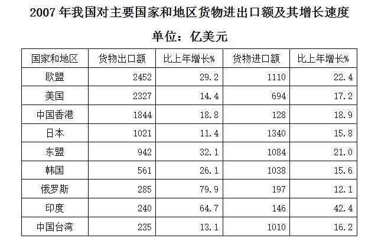

### 第 116 题

2007年我国对主要国家和地区货物进出口贸易逆差额（进口额-出口额）最大的国家（地区）是：

A. 欧盟

B. 美国

C. 韩国

D. 中国台湾

第 116 题 · 答案与解析

**参考答案（粉笔题库参考内容）**

D

**解析**

定位表格材料，可得2007年我国对主要国家和地区的货物出口额与进口额。根据贸易逆差额=进口额-出口额，分别计算我国对选项中国家和地区的贸易逆差额：

A项：欧盟，1110-2452＜0；

B项：美国，694-2327＜0；

C项：韩国，1038-561=400^+；

D项：中国台湾，1010-235=700^+。

则我国对中国台湾的货物进出口贸易逆差额最大。

故正确答案为D。

**考点**：简单加减计算、统计表

**来源**：2009年北京市公务员录用考试《行测》题（应届）第116题

### 第 117 题

2007年我国对韩国货物进出口总额约比上年增长：

A. 15.6%

B. 19.1%

C. 26.1%

D. 44.2%

第 117 题 · 答案与解析

**参考答案（粉笔题库参考内容）**

B

**解析**

根据题干“2007年我国对韩国货物进出口总额约比上年增长”，结合选项为百分数，且材料中给出2007年我国对韩国货物进口额和出口额的同比增速，可判定本题为混合增长率问题。定位表格材料可得：2007年我国对韩国货物出口额同比增长26.1%，进口额同比增长15.6%。根据“混合后居中”可得，15.6% ＜ r_总 ＜ 26.1%，结合选项只有B项符合。

故正确答案为B。

**考点**：混合增长率、统计表

**来源**：2009年北京市公务员录用考试《行测》题（应届）第117题

### 第 118 题

与上年相比，2007年我国对主要国家和地区货物进出口总额增长率超过20%的国家（地区）有：

A. 3个

B. 4个

C. 5个

D. 6个

第 118 题 · 答案与解析

**参考答案（粉笔题库参考内容）**

B

**解析**

根据题干“与上年相比，2007年我国对主要国家和地区货物进出口总额增长率超过20%······”，结合材料中分别给出了2007年我国对主要国家和地区货物进口额和出口额的同比增速，可判定本题为混合增长率问题。定位表格材料，根据“混合后居中”可得：22.4%＜r_欧盟＜29.2%，21.0% ＜ r_东盟 ＜ 32.1%，42.4%＜r印度＜64.7%，则我国对欧盟、东盟、印度的进出口总额增长率一定大于20%；14.4% ＜ r美国 ＜ 17.2%，18.8%＜r_中国香港＜18.9%，11.4%＜r日本＜15.8%，13.1% ＜ r_中国台湾 ＜ 16.2%，则我国对美国、中国香港、日本、中国台湾的进出口总额增长率一定小于20%。从本篇第2题可得：我国对韩国的进出口总额增长率为19.1%，小于20%。根据公式：基期量=现期量/(1+增长率)，2006年我国对俄罗斯的出口额= 285/(1+79.9%)≈285/1.80≈158亿美元，进口额= 197/(1+12.1%)≈197/1.12≈176亿美元；根据“混合后居中，偏向基期量大的一方”可得：12.1% ＜ r俄罗斯 ＜(12.1%+79.9%)/2 = 46%；根据线段法“距离与量成反比”可得：(79.9% - r俄罗斯)/(r俄罗斯 - 12.1%)=176/158，解得r俄罗斯≈44%＞20%。综上，2007年我国对其货物进出口总额增长率超过20%的国家（地区）有：欧盟、东盟、印度和俄罗斯，一共4个。

故正确答案为B。

备注：两个增长率差别大，不能用现期量近似代替基期量估算。

**考点**：一般增长率、混合增长率、统计表

**来源**：2009年北京市公务员录用考试《行测》题（应届）第118题

### 第 119 题

与上年相比，2007年我国对主要国家和地区货物进出口总额增长率最高的国家（地区）的进口额为：

A. 146亿美元

B. 197亿美元

C. 240亿美元

D. 285亿美元

第 119 题 · 答案与解析

**参考答案（粉笔题库参考内容）**

A

**解析**

根据题干“与上年相比，2007年我国对主要国家和地区货物进出口总额增长率最高的国家（地区）······”，结合材料中分别给出了2007年我国对主要国家和地区货物进口额和出口额的同比增速，可判定本题为混合增长率问题。观察A、B、C、D四个选项，发现其数据分别对应：印度进口额、俄罗斯进口额、印度出口额、俄罗斯出口额，因题目要求进口额，故排除C、D两项。根据本篇第3题可得：2006年我国对俄罗斯货物进出口总额的同比增速约为44%。根据公式：基期量=现期量/(1+增长率)，2006年我国对印度的出口额= 240/(1+64.7%)≈240/1.65≈145亿美元，进口额= 146/(1+42.4%)≈146/1.42≈103亿美元。根据“混合后居中，偏向基期量大的一方”可得：(42.4%+64.7%)/2 = 53.55%＜ r_印度 ＜ 64.7%，即r印度 ＞ r俄罗斯。故我国对印度的进出口总额增速最大，其进口额为146亿美元。

故正确答案为A。

**考点**：混合增长率、统计表

**来源**：2009年北京市公务员录用考试《行测》题（应届）第119题

### 第 120 题

下列说法中，不正确的是：

A. 2007年，我国对欧盟的货物出口额最大

B. 与上年相比，2007年我国对主要国家和地区货物进出口总额增长率都超过10%

C. 2007年，我国对主要国家和地区货物进口额总共约为9907亿美元

D. 2006年，我国对日本的货物进口额最大

第 120 题 · 答案与解析

**参考答案（粉笔题库参考内容）**

C

**解析**

A项：定位表格材料可得：2007年我国对欧盟的货物出口额最大，为2452亿美元，正确；

B项：定位表格材料可得：2007年我国对主要国家和地区货物进口额和出口额的同比增速均高于10%。根据混合增长率口诀“混合后居中”可知：进出口总额增速必定在进口额增速和出口额增速之间，故我国对主要国家和地区货物进出口总额的增长率都超过10%，正确；

C项：定位表格材料可得2007年我国对主要国家和地区的货物进口额。则我国对主要国家和地区货物进口总额=1110+694+128+1340+1084+1038 + 197 + 146 + 1010 ≈1100+700+130+1300+1100+1000+200+150+1000=6680亿美元，远小于9907亿美元，错误；

D项：定位表格材料可得2007年我国对主要国家和地区的货物进口额及其同比增速。根据公式：基期量=现期量/(1+增长率)，可知要想基期量大，则现期量尽可能大，增长率尽可能小。表中日本（1340亿美元）现期量最大，增长率比日本（15.8%）小的只有韩国（15.6%）和俄罗斯（12.1%）。2006年我国对日本的货物进口额=1340/(1+15.8%)，对韩国的进口额=1038/(1+15.6%)，对俄罗斯的进口额= 197/(1+12.1%)，比较可知日本＞韩国＞俄罗斯，则2006年我国对日本的货物进口额最大，正确。

本题为选非题，故正确答案为C。

**考点**：统计表、综合分析

**来源**：2009年北京市公务员录用考试《行测》题（应届）第120题

## 材料 8

2007年末全国总人口为132129万人，比上年末增加681万人。全年农村居民人均纯收入4140元，扣除价格上涨因素，比上年实际增长9.5%；城镇居民人均可支配收入13786元，扣除价格上涨因素，比上年实际增长12.2%。按农村绝对贫困人口标准低于785元测算，年末农村贫困人口为1479万人，比上年末减少669万人；按低收入人口标准786-1067元测算，年末农村低收入人口为2841万人，比上年末减少709万人。

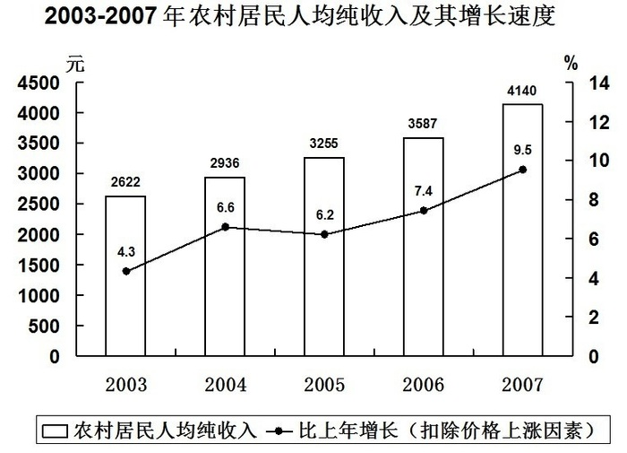

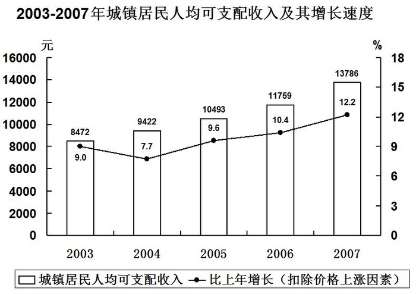

### 第 121 题

2007年末全国农村低收入人口所占比例约比2006年末下降了多少个百分点？

A. 0.6

B. 10.6

C. 31.1

D. 40.6

第 121 题 · 答案与解析

**参考答案（粉笔题库参考内容）**

A

**解析**

根据题干“2007年······所占比例约比2006年末下降了多少个百分点”，可判定本题为两期比重问题。定位文字材料第一段可得：2007年末全国总人口为132129万人，比上年末增加681万人······年末农村低收入人口为2841万人，比上年末减少709万人。根据公式：比重=部分/整体，可得2007年末全国农村低收入人口所占比例= 2841/132129，2006年末该比例= (2841 − (−709))/(132129 − 681)= 3550/131448。则两期比重差=2841/132129−3550/131448≈ 2841/130000 − 3550/130000=−709/130000≈ -0.5%，即下降了约0.5个百分点，与A项最接近。

故正确答案为A。

**考点**：两期比重、综合资料

**来源**：2009年北京市公务员录用考试《行测》题（应届）第121题

### 第 122 题

2006年末，全国农村低收入人口与贫困人口所占比例约为：

A. 4.3%

B. 2.2％

C. 1.1％

D. 不好估算

第 122 题 · 答案与解析

**参考答案（粉笔题库参考内容）**

A

**解析**

根据题干“2006年末······所占比例约为”，结合材料时间为2007年，可判定本题为基期比重问题。定位文字材料第一段可得：2007年末全国总人口为132129万人，比上年末增加681万人······年末农村贫困人口为1479万人，比上年末减少669万人······年末农村低收入人口为2841万人，比上年末减少709万人。结合公式：基期量=现期量-增长量，则所求比重=部分/整体= (1479−(−669)+2841−(−709))/(132129−681)= (2148+3550)/131448≈ 5698/130000≈4.4%，与A项最接近。

故正确答案为A。

**考点**：基期比重、综合资料

**来源**：2009年北京市公务员录用考试《行测》题（应届）第122题

### 第 123 题

根据上述材料，下列描述错误的是：

A. 2003-2007年，农村居民人均纯收入与城镇居民人均可支配收入间的差距呈增大趋势

B. 2005-2007年，农村居民人均纯收入与城镇居民人均可支配收入增长速度的走势大致相同

C. 2005-2007年，扣除价格上涨因素后城镇居民人均可支配收入年平均增长率为11.3%

D. 2004年，农村居民人均纯收入与城镇居民人均可支配收入增长速度间的差距最大

第 123 题 · 答案与解析

**参考答案（粉笔题库参考内容）**

D

**解析**

A项：定位统计图一、二可得：2003年农村居民人均纯收入与城镇居民人均可支配收入间的差距为8472-2622=5850元，2007年为13786-4140=9646元。5850＜9646，由于趋势是比较时间段的两端，故2003-2007年人均可支配收入间的差距呈增大趋势，正确；

B项：定位统计图一、二可得：2005-2007年，农村居民人均纯收入与城镇居民人均可支配收入的增长速度均呈上升趋势，故走势大致相同，正确；

C项：定位统计图二可得：2005年、2007年城镇居民人均可支配收入分别为10493元、13786元。根据年均增长率公式：(1+r年均)^n=现期量/基期量，则(1+r_年均)^2=13786/10493≈1.3，r_年均 = √1.3 − 1≈ 1.14 − 1=14%，并非11.3%，错误；

D项：定位统计图一、二可得：2003年农村居民人均纯收入与城镇居民人均可支配收入增长速度间的差距为|4.3%-9.0%|=4.7%，2004年为|6.6%-7.7%|=1.1%。4.7%＞1.1%，则2004年增长速度间的差距并非最大，错误。

本题为选非题，故正确答案为D。

备注：此题不严谨。C项如果用2006年、2007年的增长率计算平均数，即(10.4%+12.2%)/2=22.6%/2=11.3%，可以算出C项正确，但是年均增长率公式应为(1+r年均)^n=现期量/基期量，直接用增长率加和计算平均数的做法是不合理的，因此C、D两项均错误。但考虑到出题人可能未想考查年均增长率，且D项错误更明显，故倾向于正确答案为D。

**考点**：综合分析、综合资料

**来源**：2009年北京市公务员录用考试《行测》题（应届）第123题

### 第 124 题

2007年农村居民人均纯收入与城镇居民人均可支配收入间的差距和2006年相比：

A. 约增大了11%

B. 约减少了11%

C. 约增大了18%

D. 约减小了18%

第 124 题 · 答案与解析

**参考答案（粉笔题库参考内容）**

C

**解析**

根据题干“······和······相比”，结合选项为增大/减少+百分数，可判定本题为一般增长率问题。定位统计图一可得：2006年、2007年农村居民人均纯收入分别为3587元、4140元。定位统计图二可得：2006年、2007年城镇居民人均可支配收入分别为11759元、13786元。则2006年的差距=11759-3587=8172元，2017年的差距=13786-4140=9646元，故题干所求增长率= (现期量−基期量)/基期量= (9646 − 8172)/8172≈1474/8200≈18%，即约增大了18%。

故正确答案为C。

**考点**：一般增长率、综合资料

**来源**：2009年北京市公务员录用考试《行测》题（应届）第124题

### 第 125 题

如果不扣除价格上涨因素，增长速度同于上年，预计2008年农村居民人均纯收入约为：

A. 4533元

B. 4778元

C. 15468元

D. 16162元

第 125 题 · 答案与解析

**参考答案（粉笔题库参考内容）**

B

**解析**

根据题干“预计2008年······约为”，结合材料时间为2003-2007年，可判定本题为现期计算问题。定位统计图一可得：2007年农村居民人均纯收入为4140元，增长速度为9.5%（扣除价格上涨因素）。根据公式：现期量=基期量×(1+增长率)，若扣除价格上涨因素，则2008年农村居民人均纯收入=4140×(1+9.5%)= 4140 × (1 + 10% − 0.5%)= 4140 + 414 − 20.7\=4533.3元。若不扣除价格上涨因素，则2007年农村居民人均纯收入的增长速度应略大于9.5%，此时现期量应略大于4533.3元，满足的只有B项。

故正确答案为B。

**考点**：现期计算、综合资料

**来源**：2009年北京市公务员录用考试《行测》题（应届）第125题

## 材料 9

2007年上半年某镇完成工业总产值66625万元，比去年同期增长32.7%，增速提高12.7个百分点。其中规模以上工业企业完成产值56869万元，比上年同期增长43.9%，占全年工业总产值计划的45.3%。完成工业增加值22177万元，同比增长26.2%，其中规模以上工业企业实现增加值19270万元，同比增长47.9%。

        骨干企业群体壮大，对经济增长的带动作用明显，上半年，全镇规模以上工业企业中有3家企业完成工业总产值超过5000万元，累计完成工业总产值28501.8万元，同比增长48.9%。有10家企业产值同比增加额超过1000万元，比去年增加3家，共完成工业总产值18852.7万元，同比增长88.1%。这13家骨干企业拉动规模以上工业企业经济增长20个百分点。

        10个行业大类中，服装行业实现产值3.01亿元，同比增长84.9%；机械行业实现产值2236.8万元，同比增长49.5%；酒业实现产值1284万元，同比增长118.7%；童车行业实现产值1107.2万元，同比增长19.3%；五金机械行业实现产值377.3万元，同比增长34.4%；箱包行业实现产值1363.2万元，同比增长31.7%；羊毛衫行业实现产值1.75亿元，同比增长11.6%；有机化学行业实现产值792.7万元，同比增长16.4%；纸制品行业实现产值1713万元，同比增长7.0%；砖瓦行业由于今年砖窑厂数量的减少，实现产值329.5万元，同比下降64%。

### 第 126 题

2006年上半年，该镇工业增加值中由规模以上企业实现的增加值约为：

A. 5.02亿元

B. 3.95亿元

C. 1.75亿元

D. 1.3亿元

第 126 题 · 答案与解析

**参考答案（粉笔题库参考内容）**

D

**解析**

根据题干“2006年上半年······约为”，结合材料时间为2007年上半年，可判定本题为基期计算问题。定位文字材料第一段可得：2007年上半年，规模以上工业企业实现增加值19270万元，同比增长47.9%。根据公式：基期量=现期量/(1+增长率)，2006年上半年该镇工业增加值中由规模以上企业实现的增加值= 19270/(1+47.9%)≈19270/1.5≈13000万元，即约为1.3亿元。

故正确答案为D。

**考点**：基期计算、文字资料

**来源**：2009年北京市公务员录用考试《行测》题（应届）第126题

### 第 127 题

2006年上半年，该镇工业增加值中由规模以上企业实现的比例约为：

A. 74.1%

B. 78.8%

C. 85.4%

D. 86.9%

第 127 题 · 答案与解析

**参考答案（粉笔题库参考内容）**

A

**解析**

根据题干“2006年上半年，······中······的比例约为”，结合材料时间为2007年上半年，可判定本题为基期比重问题。定位文字材料第一段可得：2007年上半年，完成工业增加值22177万元（B），同比增长26.2%（b），其中规模以上工业企业实现增加值19270万元（A），同比增长47.9%（a）。代入公式：基期比重= A/B × (1+b)/(1+a)= 19270/22177 × (1 + 26.2%)/(1 + 47.9%)≈ 19270/22200 × 1.26/1.48≈86.8%×0.85≈73.8%，与A项最接近。

故正确答案为A。

**考点**：基期比重、文字资料

**来源**：2009年北京市公务员录用考试《行测》题（应届）第127题

### 第 128 题

2007年上半年该镇有10家企业产值同比增加额超过1000万元，这10家骨干企业的产值较去年同期增长：

A. 0.38亿元

B. 0.41亿元

C. 0.88亿元

D. 1.0亿元

第 128 题 · 答案与解析

**参考答案（粉笔题库参考内容）**

C

**解析**

根据题干“2007年······较去年同期增长”，结合选项带单位，可判定本题为增长量计算问题。定位文字材料第二段可得：有10家企业产值同比增加额超过1000万元······共完成工业总产值18852.7万元，同比增长88.1%。根据公式：增长量= 现期量/(1+增长率) × 增长率，2007年这10家骨干企业产值较去年同期增长18852.7/(1+88.1%) × 88.1%≈ 19000/1.9 × 0.88=8800万元，即0.88亿元。

故正确答案为C。

**考点**：增长量计算、文字资料

**来源**：2009年北京市公务员录用考试《行测》题（应届）第128题

### 第 129 题

2007年上半年，该镇完成的工业总产值约占全年工业总产值计划的：

A. 17.7%

B. 45.3%

C. 53.1%

D. 无法计算

第 129 题 · 答案与解析

**参考答案（粉笔题库参考内容）**

C

**解析**

根据题干“2007年上半年，······占······”，结合材料时间为2007年上半年，可判定本题为现期比重问题。定位文字材料第一段可得：2007年上半年某镇完成工业总产值66625万元，其中规模以上工业企业完成产值56869万元，占全年工业总产值计划的45.3%。根据公式：整体=部分/比重，2007年全年工业总产值计划=56869/45.3%，则2007年上半年该镇完成的工业总产值占全年工业总产值计划的66625/(56869/45.3%)=66625/56869×45.3%＞ 45.3%，排除A、B两项；该式可以计算出结果，则排除D项，只余C项。

故正确答案为C。

**考点**：文字资料、现期比重

**来源**：2009年北京市公务员录用考试《行测》题（应届）第129题

### 第 130 题

由上述材料可知：

A. 2007年上半年，该镇10个行业大类对全镇工业产值增加的贡献率相同

B. 2007年上半年，该镇10个行业大类中有6个行业产值的同比增长率超过20%

C. 2007年上半年，该镇10个行业大类中有8个行业产值保持增长

D. 2005年上半年，该镇完成工业总产值约为4.18亿元

第 130 题 · 答案与解析

**参考答案（粉笔题库参考内容）**

D

**解析**

A项：定位文字材料第三段可得：2007年上半年，该镇10个行业大类的现期量和增长率各不相同。根据公式：增长贡献率= 部分增长量/整体增长量，可知10个行业大类的整体增长量一定，只需比较部分增长量即可。根据公式：增长量= 现期量/(1+增长率) × 增长率，结合材料数据，可知各部分增长量不同，则增长贡献率不同，错误；

B项：定位文字材料第三段可得：2007年上半年，该镇10个行业大类中产值的同比增长率超过20%的有服装行业（84.9%）、机械行业（49.5%）、酒业（118.7%）、五金机械行业（34.4%）、箱包行业（31.7%），共5个行业，错误；

C项：定位文字材料第三段可得：2007年上半年，该镇10个行业大类中只有砖瓦行业的产值同比下降，则有9个行业保持增长，错误；

D项：定位文字材料第一段可得：2007年上半年某镇完成工业总产值66625万元，比去年同期增长32.7%，增速提高12.7个百分点。r1 = 32.7%，r2=32.7%−12.7%=20%，代入公式：间隔增长率= r_1 + r_2 + r_1 × r_2=32.7%+20%+32.7%×20%≈ 52.7% + 6.5%=59.2%。根据公式：间隔基期量= 现期量/(1 + r_间)，则2005年上半年该镇完成工业总产值=66625/(1+59.2%)≈66625/1.59≈41900万元≈4.19亿元，与4.18亿元非常接近，正确。

故正确答案为D。

**考点**：文字资料、综合分析

**来源**：2009年北京市公务员录用考试《行测》题（应届）第130题

## 材料 10

某省城镇就业人员增长明显快于乡村。2007年全省城镇就业人员比1978年增长2091.4万人，增加3.4倍，年均增长6%；所占比重达到43.5%，上升23.8个百分点。全省乡村就业人员比1978年增加1020.2万人，增长40.8%，年均增长1.2%；所占比重为56.5%，下降23.8个百分点。

        非农产业成为就业的主导产业。2007年全省第三产业就业人员比1978年增加1574万人，增加2.9倍，年均增长7.1%，所占比重达到了34%，上升16.6个百分点，成为拉动就业增长的主要力量。与1978年相比，第一产业就业人员减少85.7万人，所占比重下降了37.0个百分点；第二产业就业人员增加1623.3万人，所占比重上升20.4个百分点。

        非公有经济的就业比例迅速上升，1978年全省个体经济就业人员仅有2353人。2007年个体工商户就业人员达到了397.8万人，所占比重为6.4%；私营企业就业人员达到522.7万人，比重为8.4%；港澳台企业就业人员27.4万人，比重为0.4%；外商投资企业就业人员108.3万人，比重为1.7%。

### 第 131 题

1978年，该省乡村就业人员数量为：

A. 1762.0万人

B. 2500.5万人

C. 2967.8万人

D. 3520万人

第 131 题 · 答案与解析

**参考答案（粉笔题库参考内容）**

B

**解析**

根据题干“1978年，······数量为”，结合材料时间为2007年，可判定本题为基期计算问题。定位文字材料第一段可得：2007年······全省乡村就业人员比1978年增加1020.2万人，增长40.8%。根据公式：基期量=增长量/增长率，1978年该省乡村就业人员数量=1020.2/40.8%≈ 1020.2/41%≈2500万人，与B项最接近。

故正确答案为B。

**考点**：基期计算、文字资料

**来源**：2009年北京市公务员录用考试《行测》题（应届）第131题

### 第 132 题

1978年，该省乡村就业人员所占比例为城镇就业人员的多少倍？

A. 1.3

B. 4.1

C. 8.7

D. 无法计算

第 132 题 · 答案与解析

**参考答案（粉笔题库参考内容）**

B

**解析**

根据题干“1978年，······为······的多少倍”，结合材料时间为2007年，可判定本题为基期倍数问题。定位文字材料第一段可得：2007年全省城镇就业人员比1978年增长2091.4万人······所占比重达到43.5%，上升23.8个百分点；全省乡村就业人员比1978年增加1020.2万人······所占比重为56.5%，下降23.8个百分点。则1978年全省城镇就业人员所占比重为43.5%-23.8%=19.7%，乡村就业人员所占比重为56.5%+23.8%=80.3%。根据公式：比重=部分/整体，1978年该省乡村就业人员所占比例为城镇就业人员的80.3%/19.7%≈80.3%/20%≈4倍，与B项最接近。

故正确答案为B。

**考点**：基期倍数、文字资料

**来源**：2009年北京市公务员录用考试《行测》题（应届）第132题

### 第 133 题

如果增长趋势同于年均增长速度，预计2008年该省第三产业就业人员数量为：

A. 403.6万人

B. 542.8万人

C. 2116.8万人

D. 2267.1万人

第 133 题 · 答案与解析

**参考答案（粉笔题库参考内容）**

D

**解析**

根据题干“预计2008年······数量为”，结合材料时间为2007年，可判定本题为现期计算问题。定位文字材料第二段可得：2007年全省第三产业就业人员比1978年增加1574万人，增加2.9倍，年均增长7.1%。结合公式：基期量=增长量/增长率，2007年第三产业就业人数=基期量+增长量= 1574/2.9 + 1574≈543+1574=2117万人。根据公式：现期量=基期量×(1+增长率)，2008年第三产业就业人数=2117×(1+7.1%)＞2117万人，满足的只有D项。

故正确答案为D。

**考点**：文字资料、现期计算

**来源**：2009年北京市公务员录用考试《行测》题（应届）第133题

### 第 134 题

1978年，全省第三产业就业人员所占比重为：

A. 16.6%

B. 17.4%

C. 34%

D. 50.6%

第 134 题 · 答案与解析

**参考答案（粉笔题库参考内容）**

B

**解析**

根据题干“1978年，······所占比重为”，结合材料时间为2007年，可判定本题为基期比重问题。定位文字材料第二段可得：2007年全省第三产业就业人员比1978年增加1574万人······所占比重达到了34%，上升16.6个百分点。则1978年，全省第三产业就业人员所占比重为34%－16.6% ＝17.4%。

故正确答案为B。

**考点**：基期比重、文字资料

**来源**：2009年北京市公务员录用考试《行测》题（应届）第134题

### 第 135 题

2007年全省非公有经济就业人员所占比重比1978年增加多少百分点？

A. 56.7

B. 37.6

C. 16.9

D. 无法计算

第 135 题 · 答案与解析

**参考答案（粉笔题库参考内容）**

D

**解析**

根据题干“2007年······所占比重比1978年增加多少百分点”，可判定本题为两期比重计算问题。定位文字材料第三段可得：非公有经济的就业比例迅速上升，1978年全省个体经济就业人员仅有2353人。2007年个体工商户就业人员达到了397.8万人，所占比重为6.4%；私营企业就业人员达到522.7万人，比重为8.4%；港澳台企业就业人员27.4万人，比重为0.4%；外商投资企业就业人员108.3万人，比重为1.7%。即材料未提及1978年和2007年全省非公有经济就业人员所占比重的情况，因此无法计算出增加的百分点。

故正确答案为D。

**考点**：两期比重、文字资料

**来源**：2009年北京市公务员录用考试《行测》题（应届）第135题

