# 2009年北京市公务员录用考试《行测》题（社招）

<!-- gwy:overview:start -->
> **北京 · 2009 · 行测 · 统考** ｜ 135 题 · 图片 22 处 · 答案随题折叠

| 题型模块 | 题量 | 题号 |
| --- | ---: | ---: |
| 数量关系 | 25 | 1–25 |
| 判断推理 | 30 | 26–55 |
| 常识判断 | 30 | 56–85 |
| 言语理解与表达 | 30 | 86–115 |
| 资料分析 | 20 | 116–135 |
| **合计** | **135** | |

导航：[题型与作答说明](#题型与作答说明) · [题目](#题目) · [材料 1](#材料-1)
<!-- gwy:overview:end -->

> 候选采集稿。参考答案及解析来自粉笔页面，不代表官方答案或真实高分答卷；来源使用许可与原卷对应关系仍需人工核实。

## 题型与作答说明

数量关系

（25题）

本部分包括数字推理与数学运算两种类型的题目。

判断推理

（30题）

本部分包括图形推理、逻辑判断、事件排序与定义判断四种类型的题目。

常识判断

（30题）

本部分包括单项选择与多项选择两种类型的题目，请根据题目要求做出正确选择。对于多项选择题，错选、多选、少选均不得分，但也不倒扣分。56~75题为单项选择题，76~85为多项选择题。

言语理解与表达

（30题）

本部分均为单选题，着重考查考生对语言文字的理解和驾驭能力。这种能力包括：对词、句子、篇章一般意思和特定意义的理解；对比较复杂的概念和观点的准确理解；对语句隐含信息的合理推断；根据上下文，恰当选用词语；准确地辨明句义，筛选信息。

资料分析

（20题）

针对下列图、表或文字回答问题。你应根据资料提供的信息进行分析、比较、计算、处理。

## 题目

### 第 1 题

1，4，14，42，（  ），210

A. 70

B. 84

C. 105

D. 140

第 1 题 · 答案与解析

**参考答案（粉笔题库参考内容）**

C

**解析**

数列起伏较大且有明显倍数关系，优先考虑作商，后项除以前项得到新数列：4，3.5，3，（    ），（    ），观察新数列，猜测新数列是公差为-0.5的等差数列，则新数列后两项为（2.5），（2），故所求项=42×2.5=105，向后验证，210/105=2，则规律成立。

故正确答案为C。

**来源**：2009年北京市公务员录用考试《行测》题（社招）第1题

### 第 2 题

1，3，6，12，27，（    ）

A. 54

B. 69

C. 75

D. 81

第 2 题 · 答案与解析

**参考答案（粉笔题库参考内容）**

B

**解析**

观察数列，无明显特征，优先考虑多级数列。后项减前项得到新数列：2，3，6，15，（    ），无明显规律。考虑再次作差得到数列：1，3，9，（    ），是公比为3的等比数列，则下一项为9 × 3 = 27。因此，新数列下一项为15+27=42，故所求项=27+42=69。

故正确答案为B。

**来源**：2009年北京市公务员录用考试《行测》题（社招）第2题

### 第 3 题

4，20，54，112，（    ），324

A. 200

B. 232

C. 256

D. 276

第 3 题 · 答案与解析

**参考答案（粉笔题库参考内容）**

A

**解析**

观察数列，无明显特征，优先考虑多级数列。后项减前项得到新数列：16，34，58，（    ），（    ），无明显规律。继续作差得到数列：18，24，（    ），（    ），若猜测该数列是公差为6的等差数列，则有18，24，（30），（36），故首次作差后所得新数列后两项为：58+30=88，88+36=124，此时所求项为112+88=200。向后验证：200+124=324，验证成功，即所猜规律成立。

故正确答案为A。

**来源**：2009年北京市公务员录用考试《行测》题（社招）第3题

### 第 4 题

5，7，8，11，15，（    ）

A. 19

B. 20

C. 22

D. 27

第 4 题 · 答案与解析

**参考答案（粉笔题库参考内容）**

C

**解析**

观察数列，无明显特征，优先考虑多级数列。后项减前项得到新数列：2，1，3，4，（    ），新数列为简单递推和数列，则新数列的下一项为3+4=7，故所求项为15+7=22。

故正确答案为C。

**来源**：2009年北京市公务员录用考试《行测》题（社招）第4题

### 第 5 题

3，12，33，72，135，（  ）

A. 236

B. 228

C. 210

D. 192

第 5 题 · 答案与解析

**参考答案（粉笔题库参考内容）**

B

**解析**

观察数列，无明显特征，优先考虑多级数列。后项减前项得到新数列：9，21，39，63，（    ），无明显规律。继续作差得到数列：12，18，24，（    ），是公差为6的等差数列，则下一项为24+6=30。因此，新数列的下一项为63+30=93，故所求项=135+93=228。

故正确答案为B。

**来源**：2009年北京市公务员录用考试《行测》题（社招）第5题

### 第 6 题

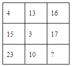

A. 5

B. 13

C. 32

D. 33

第 6 题 · 答案与解析

**参考答案（粉笔题库参考内容）**

C

**解析**

九宫格图形数阵，优先考虑横向和竖向规律。观察发现，第一行：4+13-1=16，第二行：15+3-1=17。则各行数字规律为：第一个数+第二个数-1=第三个数，故所求项=23+10-1=32。

故正确答案为C。

**来源**：2009年北京市公务员录用考试《行测》题（社招）第6题

### 第 7 题

A. 8

B. 33

C. 84

D. 85

第 7 题 · 答案与解析

**参考答案（粉笔题库参考内容）**

D

**解析**

九宫格图形数阵，优先考虑横向和竖向规律。第二列数字较大，则考虑每一行凑第二个大数。第一行：7×9+1=64，第二行：12×8+1=97。则各行数字规律为：第一个数×第三个数+1=第二个数，故所求项=6×14+1=85。

故正确答案为D。

**来源**：2009年北京市公务员录用考试《行测》题（社招）第7题

### 第 8 题

A. 9

B. 17

C. 24

D. 29

第 8 题 · 答案与解析

**参考答案（粉笔题库参考内容）**

C

**解析**

九宫格图形数阵，优先考虑横向和竖向规律。第二列数字较大，则先考虑每一行凑第二个大数。第一行：3+5×2=13，第三行：4+19×2=42。则各行数字规律为：第一个数+第三个数x^2=第二个数，故所求项=10+7×2=24。

故正确答案为C。

**来源**：2009年北京市公务员录用考试《行测》题（社招）第8题

### 第 9 题

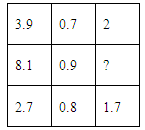

A. 3.6

B. 1.5

C. 0.9

D. 0.6

第 9 题 · 答案与解析

**参考答案（粉笔题库参考内容）**

A

**解析**

九宫格图形数阵，优先考虑横向和竖向规律。观察发现，第一行：3.9/3 + 0.7 = 2，第三行：2.7/3 + 0.8 = 1.7。则各行数字规律为：第一个数/3 + 第二个数 = 第三个数，故所求项= 8.1/3 + 0.9 = 3.6。

故正确答案为A。

**来源**：2009年北京市公务员录用考试《行测》题（社招）第9题

### 第 10 题

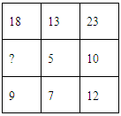

A. 5

B. 8

C. 9

D. 11

第 10 题 · 答案与解析

**参考答案（粉笔题库参考内容）**

B

**解析**

九宫格图形数阵，优先考虑横向和竖向规律。观察发现，第二列：13=5+7+1，第三列：23=10+12+1。则各列数字规律为：第一个数=第二个数+第三个数+1，即第二个数=第一个数-第三个数-1，故所求项=18-9-1=8。

故正确答案为B。

**来源**：2009年北京市公务员录用考试《行测》题（社招）第10题

### 第 11 题

游乐场的溜冰滑道如下图所示，溜冰车上坡时每分钟行驶400米，下坡时每分钟行驶600米，已知溜冰车从A点到B点需要3.7分钟，从B点到A点只需要2.5分钟。AC比BC长多少米：

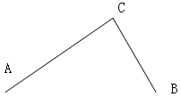

A. 1200

B. 1440

C. 1600

D. 1800

第 11 题 · 答案与解析

**参考答案（粉笔题库参考内容）**

B

**解析**

根据题意可得，AC/400 + BC/600 = 3.7······①，AC/600 + BC/400 = 2.5······②，①-②得：(AC - BC)/1200 = 1.2，即AC-BC=1440，因此，AC比BC长1440米。

故正确答案为B。

**考点**：普通行程

**来源**：2009年北京市公务员录用考试《行测》题（社招）第11题

### 第 12 题

训练时，若干名新兵站成一排，从一开始报数，除了甲以外其他人报的数之和减去甲报的数恰好等于50，共有多少名新兵：

A. 10

B. 11

C. 12

D. 13

第 12 题 · 答案与解析

**参考答案（粉笔题库参考内容）**

B

**解析**

根据题意可得，（所有人报数之和-甲报数）-甲报数=50，即所有人报数之和=50+2x甲报数。利用代入排除法，结合等差数列求和公式：s_n = (首项 + 末项)/2 × n，代入各项：

代入A项，则所有人报数之和= (1 + 10)/2 × 10 = 55，则甲报数= (55 − 50)/2 = 2.5，非整数，排除；

代入B项，则所有人报数之和= (1+11)/2 × 11 = 66，则甲报数= (66 - 50)/2 = 8 ＜ 11，符合题干中所有条件，当选，无需验证C、D两项。

故正确答案为B。

**考点**：数列问题

**来源**：2009年北京市公务员录用考试《行测》题（社招）第12题

### 第 13 题

某个三位数的数值是其各位数字之和的23倍。这个三位数为：

A. 702

B. 306

C. 207

D. 203

第 13 题 · 答案与解析

**参考答案（粉笔题库参考内容）**

C

**解析**

方法一：由题意可知，该三位数=各位数字之和×23，利用代入排除法，逐一代入各项：

A项：(7+0+2)×23=207≠702，排除；

B项：(3+0+6)×23=207≠306，排除；

C项：(2+0+7)×23=207，满足题干中所有条件，当选，无需验证D项。

方法二：由题意可知，正确答案为23的倍数，直接代入，只有C项符合，当选。

故正确答案为C。

**来源**：2009年北京市公务员录用考试《行测》题（社招）第13题

### 第 14 题

某校的学生总数是一个三位数，平均每个班35人，统计员提供的学生总数比实际总人数少270人，原来，他在记录时粗心地将三位数的百位与十位数字对调了，该学校学生总数最多是多少人：

A. 748

B. 630

C. 525

D. 360

第 14 题 · 答案与解析

**参考答案（粉笔题库参考内容）**

B

**解析**

根据题意，学生总数=班级数量×35，即总数为35的倍数。且题干问该学校学生总数最多是多少人，利用代入排除法，从选项数字最大项开始代入：

A项：748不是35的倍数，排除；

B项：630/35 = 18，是35的倍数；且满足630-360=270人，即百位与十位数字对调后少了270人，满足题干中所有条件，当选，无需验证C、D两项。

故正确答案为B。

**来源**：2009年北京市公务员录用考试《行测》题（社招）第14题

### 第 15 题

某生产车间有若干名工人，按每四个人一组分多一个人，按每五个人一组分也多一个，按每六个人一组分还是多一个，该车间至少有多少名工人：

A. 31

B. 41

C. 61

D. 122

第 15 题 · 答案与解析

**参考答案（粉笔题库参考内容）**

C

**解析**

由题意可知，车间工人数除以4、5、6均余1，根据同余定理，工人数应为4、5、6的公倍数＋1，即工人数=60n+1。题干问该车间至少有多少名工人，即n=1，则工人数为61，因此，该车间至少有61名工人。

故正确答案为C。

**来源**：2009年北京市公务员录用考试《行测》题（社招）第15题

### 第 16 题

某单位食堂为大家准备水果，有若干箱苹果和梨，苹果的箱数是梨的箱数的3倍，如果每天吃2箱梨和5箱苹果，那么梨吃完时还剩20箱苹果，该食堂共买了多少箱梨：

A. 40

B. 50

C. 60

D. 80

第 16 题 · 答案与解析

**参考答案（粉笔题库参考内容）**

A

**解析**

根据题意，设吃了n天，则一共买了2n箱梨，5n+20箱苹果。则(5n + 20)/2n = 3，解得n=20，2n=40，因此，该食堂共买了40箱梨。

故正确答案为A。

**考点**：和差倍比问题

**来源**：2009年北京市公务员录用考试《行测》题（社招）第16题

### 第 17 题

父亲今年44岁，儿子今年16岁，当父亲的年龄是儿子的年龄的8倍时，父子的年龄和是多少岁：

A. 36

B. 54

C. 99

D. 162

第 17 题 · 答案与解析

**参考答案（粉笔题库参考内容）**

A

**解析**

二者年龄差为44-16=28，为恒定值。当父亲的年龄是儿子的8倍时，设儿子的年龄为n，则父亲的年龄为8n。此时，两人年龄差为8n-n=28，解得n=4，二者年龄之和为8n+n=9n=36。因此，当父亲的年龄是儿子的8倍时，父子的年龄和是36岁。

故正确答案为A。

**考点**：年龄问题

**来源**：2009年北京市公务员录用考试《行测》题（社招）第17题

### 第 18 题

甲、乙、丙三个游泳运动员在一起练习滑冰，已知甲滑一圈的时间，乙、丙分别可以滑一又四分之一圈和一又六分之一圈，若甲、乙、丙同时从起点出发，则甲滑多少圈后三人再次在起点相遇：

A. 8

B. 10

C. 12

D. 14

第 18 题 · 答案与解析

**参考答案（粉笔题库参考内容）**

C

**解析**

当甲滑1圈时，乙、丙分别滑了5/4圈和7/6圈，当三人均滑整数圈时，即可在起点相遇。4、6的最小公倍数是12，即当甲滑12圈后，乙滑12 × 5/4 = 15圈，丙滑12×7/6=14圈，此时三人又在同一起点。

故正确答案为C。

**考点**：周期相遇问题

**来源**：2009年北京市公务员录用考试《行测》题（社招）第18题

### 第 19 题

从一块正方形木板上锯下宽5cm的一个木条后，剩下的长方形面积是750cm^2，锯下的木条面积是多少平方厘米：

A. 25

B. 150

C. 152

D. 168

第 19 题 · 答案与解析

**参考答案（粉笔题库参考内容）**

B

**解析**

设正方形木板的边长为n，则长方形的长和宽分别为n和n-5，则长方形的面积为n×(n-5)=750，解得n=30。因此，锯下的木条面积为5n=150。

故正确答案为B。

**考点**：几何公式类-平面图形

**来源**：2009年北京市公务员录用考试《行测》题（社招）第19题

### 第 20 题

骑自行车从甲地到乙地，以10千米/时的速度行进，下午1点到乙地；以15千米/时的速度行进，上午11点到乙地。如果希望中午12点到，那么应以怎样的速度行进：

A. 11千米/时

B. 12千米/时

C. 12.5千米/时

D. 13.5千米/时

第 20 题 · 答案与解析

**参考答案（粉笔题库参考内容）**

B

**解析**

设路程为S，根据题意可得：S/10 − S/15 = 2，解得S=60。根据以10千米/时的速度行进，下午1点到乙地。则所用时间t = 60/10 = 6小时，即上午7点出发。如希望中午12点到，则用时为5小时。因此，此时速度为60/5=12千米/时。

故正确答案为B。

**考点**：普通行程

**来源**：2009年北京市公务员录用考试《行测》题（社招）第20题

### 第 21 题

已知甲、乙两种产品原标价之和为100元，因市场变化，甲产品8折促销，乙产品提价10%，调价后，甲、乙两种产品的标价之和比原标价之和提高了4%，则乙产品的原标价是多少元：

A. 20

B. 40

C. 80

D. 93

第 21 题 · 答案与解析

**参考答案（粉笔题库参考内容）**

C

**解析**

设甲、乙两种产品的原标价为a、b元，根据题意可列方程组：a+b=100······①，80%×a+(1+10%)b=100(1+4%)······②，解得a=20，b=80。因此，乙产品的原标价是80元。

故正确答案为C。

**考点**：经济利润问题

**来源**：2009年北京市公务员录用考试《行测》题（社招）第21题

### 第 22 题

有大、中、小三个正方形水池，他们的内边长分别是6米、3米、2米，把两堆碎石分别沉在大、小水池的水中，两个水池的水面分别提高了1厘米和4.5厘米。如果将两堆碎石都沉在中水池的水中，中水池的水面将提高多少厘米：

A. 0.75

B. 2

C. 5

D. 6

第 22 题 · 答案与解析

**参考答案（粉笔题库参考内容）**

D

**解析**

根据碎石的体积为定值，因此，如果将两堆碎石都沉在中水池的水中，中水池的水面将提高(600^2 × 1 + 200^2 × 4.5)/300^2 = 6厘米。

故正确答案为D。

**考点**：几何公式类-立体图形

**来源**：2009年北京市公务员录用考试《行测》题（社招）第22题

### 第 23 题

黑色布袋中装有红、黄、蓝三种颜色的袜子各三只，如果闭上眼睛从布袋中拿这些袜子，为保证拿到两双（每双颜色要相同）袜子，至少要拿多少只：

A. 5

B. 6

C. 7

D. 8

第 23 题 · 答案与解析

**参考答案（粉笔题库参考内容）**

B

**解析**

根据问法“为保证······至少要······”，可判定本题为最不利构造型最值问题。考虑最不利的情况是：三种颜色袜子的个数分别为3、1、1，此时再多一只袜子即共有6只袜子时，就能保证拿到两双（每双颜色要相同）袜子。

故正确答案为B。

**考点**：最不利构造

**来源**：2009年北京市公务员录用考试《行测》题（社招）第23题

### 第 24 题

对39种食物中是否含有甲、乙、丙三种维生素进行调查，结果如下：含甲的有17种，含乙的有18种，含丙的有15种，含甲、乙的有7种，含甲、丙的有6种，含乙、丙的有9种，三种维生素都不含的有7种，则三种维生素都含的有多少种：

A. 4

B. 6

C. 7

D. 9

第 24 题 · 答案与解析

**参考答案（粉笔题库参考内容）**

A

**解析**

设三种维生素都包含的有x种，根据三集合容斥标准型公式：A+B+C-A∩B-A∩C-B∩C+A∩B∩C=总数-都不，可得：17+18+15-7-6-9+x=39-7，解得x=4。因此，三种维生素都含的有4种。

故正确答案为A。

**考点**：三集合

**来源**：2009年北京市公务员录用考试《行测》题（社招）第24题

### 第 25 题

一次数学考试满分是100分，某班前六名同学的平均得分是95分，排名第六的同学的得分是86分，假如每人得分是互不相同的整数，那么排名第三的同学最少得多少分：

A. 94

B. 97

C. 95

D. 96

第 25 题 · 答案与解析

**参考答案（粉笔题库参考内容）**

D

**解析**

根据题意可得：六名同学得分总和为95×6=570分，设第三名同学得分为x，要使x取值最小，则其余五名同学的分数要尽可能高，可列表为：

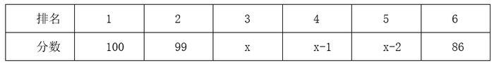

则100+99+x+(x-1)+(x-2)+86=570，解得x=96，即排名第三的同学最少得到96分。

故正确答案为D。

**考点**：构造数列

**来源**：2009年北京市公务员录用考试《行测》题（社招）第25题

### 第 26 题

从所给四个选项中，选择最合适的一个填入问号处，使之呈现一定的规律性：

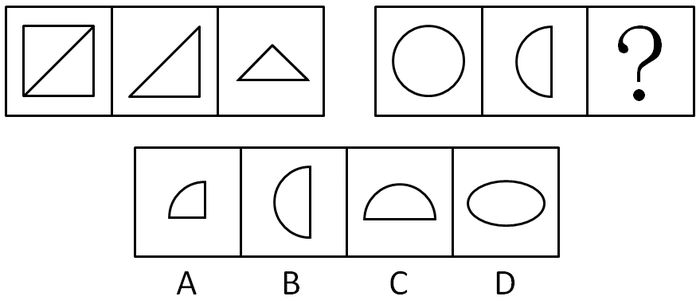

A. A

B. B

C. C

D. D

第 26 题 · 答案与解析

**参考答案（粉笔题库参考内容）**

A

**解析**

考查位置规律。第一组图形中，图一沿着对角线折叠后得到图二，图二沿着中线对折，得到图三；第二组图形同样遵循此规律。

故正确答案为A。

**考点**：样式规律-加减同异

**来源**：2009年北京市公务员录用考试《行测》题（社招）第26题

### 第 27 题

从所给的四个选项中，选择最合适的一个填入问号处，使之呈现一定的规律性：

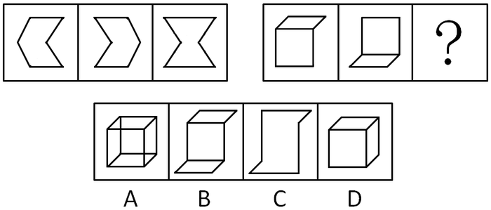

A. A

B. B

C. C

D. D

第 27 题 · 答案与解析

**参考答案（粉笔题库参考内容）**

C

**解析**

元素组成相似，考虑元素叠加。第一组图形中图一右移后与图二叠加，取其最外围的图形轮廓，即为图三；第二组图形按照此规律类推。

故正确答案为C。

**考点**：样式规律-加减同异

**来源**：2009年北京市公务员录用考试《行测》题（社招）第27题

### 第 28 题

从所给四个选项中，选择最合适的一个填入问号处，使之呈现一定的规律性：

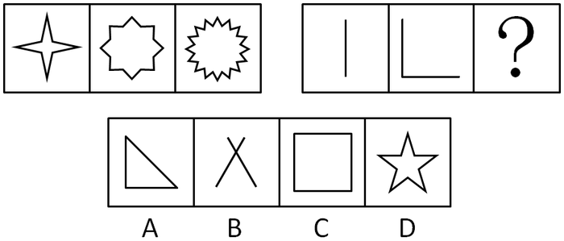

A. A

B. B

C. C

D. D

第 28 题 · 答案与解析

**参考答案（粉笔题库参考内容）**

C

**解析**

图形元素组成不同，属性无明显规律，考虑数量规律。题干中出现明显多边形、单一直线等特征图，优先考虑直线数。第一组图形的直线数分别为8、16、32，数字呈公比为2的等比数列；第二组图形的直线数分别为1、2、？，故？处应选择4条直线的图形，只有C项符合。

故正确答案为C。

**考点**：数量规律-线

**来源**：2009年北京市公务员录用考试《行测》题（社招）第28题

### 第 29 题

请从所给的四个选项中，选择最合适的一项填在问号处，使之呈现一定的规律性：

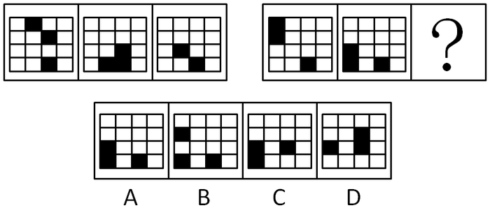

A. A

B. B

C. C

D. D

第 29 题 · 答案与解析

**参考答案（粉笔题库参考内容）**

A

**解析**

元素组成相同，优先考虑位置规律。

左边一组图中，第二列的黑色方块每次上移1格，走到最顶部后从头再来，第三列第二行的黑色方块每次下移1格，第四行的第三格黑色方块位置保持不变。

据此规律，右边一组图中，第一行第一列的黑色方块每次上移1格，第二行第一列的黑色方块每次下移1格，第四行第三列的黑色方块保持不变。只有A项符合。

故正确答案为A。

**考点**：位置规律-平移

**来源**：2009年北京市公务员录用考试《行测》题（社招）第29题

### 第 30 题

从所给四个选项中，选择最合适的一个填入问号处，使之呈现一定的规律性：

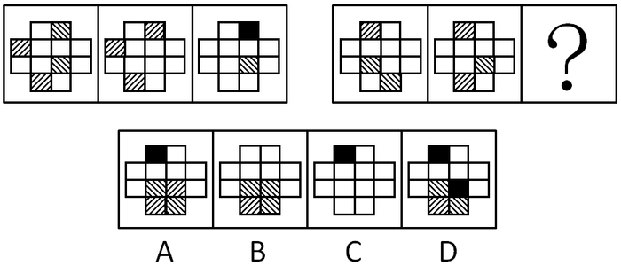

A. A

B. B

C. C

D. D

第 30 题 · 答案与解析

**参考答案（粉笔题库参考内容）**

B

**解析**

元素组成相似，考虑元素黑白叠加。第一组图形中，图一图二叠加遵循：阴影方向不一致的叠加后变成黑色；阴影方向一致的，叠加后变成空白；阴影和空白叠加后变为阴影，且方向不变。第二组图形同样遵循此规律。

故正确答案为B。

**考点**：样式规律-黑白运算

**来源**：2009年北京市公务员录用考试《行测》题（社招）第30题

### 第 31 题

高明一定是位游泳高手，因为他每天都去游泳。

以上论断是以下面哪项前提作为依据的：

A. 所有的游泳高手每天都去游泳

B. 如果一个人是游泳高手，他自然会喜欢游泳，从而天天去游泳

C. 如果不是每天都去游泳，高明可能就不是一位游泳高手

D. 除非是游泳高手，一般人们不会每天都去游泳

第 31 题 · 答案与解析

**参考答案（粉笔题库参考内容）**

D

**解析**

第一步：在条件和结论不同的对象间搭桥。

在游泳高手和每天游泳间搭桥。

第二步：搭桥的方向由条件指向结论。

每天游泳→游泳高手。

第三步：充分的表达。

所有每天游泳的都是游泳高手。

A项的游泳高手→每天游泳，与题干搭桥方向相反，排除；

B项的游泳高手→天天游泳，与题干搭桥方向相反，排除；

C项的-每天游泳→游泳高手，利用逆否等价规则即为游泳高手→每天游泳，与题干搭桥方向相反，排除；

D项的每天都去游泳→游泳高手，与题干相符。

故正确答案为D。

**考点**：搭桥

**来源**：2009年北京市公务员录用考试《行测》题（社招）第31题

### 第 32 题

如果天气晴朗，小刘就去郊游；如果老婆不与他同去，小刘就不去郊游；如果单位有急事，小刘就不去郊游；如果今天不是星期六，小刘就不去郊游。

假设以上说法正确，那么，如果小刘去郊游，则不能判定下述哪项正确：

A. 老婆与小刘同去郊游

B. 天气晴朗

C. 小刘单位没有急事

D. 今天是星期六

第 32 题 · 答案与解析

**参考答案（粉笔题库参考内容）**

B

**解析**

第一步：翻译题干。

①天气晴朗→小刘去郊游；

②-老婆去郊游→—小刘去郊游；

③单位有急事→—小刘去郊游；

④-今天星期六→—小刘去郊游；

⑤小刘去郊游。

第二步：逐一分析选项。

A项：已知⑤小刘去郊游，是对条件②的否后，否后必否前，可以推出老婆去郊游，排除；

B项：已知⑤小刘去郊游，是对条件①的肯后，肯后推不出必然结论，无法推出，当选；

C项：已知⑤小刘去郊游，是对条件③的否后，否后必否前，可以推出单位没有急事，排除；

D项：已知⑤小刘去郊游，是对条件④的否后，否后必否前，可以推出今天星期六，排除。

本题为选非题，故正确答案为B。

**考点**：常规翻译

**来源**：2009年北京市公务员录用考试《行测》题（社招）第32题

### 第 33 题

一次逻辑考试后，兰兰、晶晶、玲玲在一起讨论考试成绩。兰兰说：“如果我能得到100分，则晶晶也能得100分。”晶晶说：“我看兰兰能得100分，我不能得100分。”玲玲说：“如果我能得100分，则晶晶得不了100分。”事实上，考试成绩出来后，证明她们三个中只有一个人说的是真话。

下述说法中哪项是正确的：

A. 玲玲说的是真话，晶晶没得100分

B. 兰兰说的是真话，晶晶得了100分

C. 晶晶说的是真话，晶晶没得100分

D. 玲玲说的是真话，兰兰得了100分

第 33 题 · 答案与解析

**参考答案（粉笔题库参考内容）**

B

**解析**

第一步：找突破口。

本题突破口为兰兰和晶晶的话之间的矛盾关系，两人的话必有一真和一假。

第二步：看其他的话。

本题三个人的话中只有一个人说的是真话，则玲玲说的话必为假话。由矛盾关系知识点知其“真话”为，玲玲得100分，且晶晶得100分。

第三步：判断突破口中两句话的真假。

由第二步中，玲玲得100分，且晶晶得100分。可推知，晶晶的话为假，兰兰的话为真。

故正确答案为B。

**考点**：只有一真/一假

**来源**：2009年北京市公务员录用考试《行测》题（社招）第33题

### 第 34 题

如果所有的克里特岛人都说谎，并且梅拉是克里特岛人，则梅拉说谎。

由上述命题出发，要逻辑地推出：“有的克里特岛人不说谎”，则需要加上下面哪个选项：

A. 梅拉不说谎，并且所有的克里特人都说谎

B. 梅拉不说谎，并且梅拉不是克里特人

C. 梅拉不说谎，并且梅拉是克里特人

D. 梅拉说谎，并且梅拉不是克里特人

第 34 题 · 答案与解析

**参考答案（粉笔题库参考内容）**

C

**解析**

第一步：翻译题干，利用充分必要条件。

所有的克里特岛人都说谎∩梅拉是克里特岛人→梅拉说谎。

第二步：分析题干，结合选项得出答案。

提问句中“有的克里特岛人不说谎”是“所有的克里特岛人都说谎”的矛盾命题，因此只要推出“所有的克里特岛人都说谎”为假，就可推出“有的克里特岛人不说谎”。

根据逆否规则，否定题干推导关系的后件，即梅拉不说谎，可得出“-梅拉说谎→（所有的克里特岛人都说谎∩梅拉是克里特岛人）”。

根据摩根规则，-（所有的克里特岛人都说谎∩梅拉是克里特岛人）等价于“-所有的克里特岛人都说谎∪－梅拉是克里特岛人”，这是个相容选言命题。

根据相容选言命题的规则，否定其中一个选言支必然推出肯定另外一个选言支，因此要得到“-所有的克里特岛人都说谎”，则需保证“梅拉是克里特岛人”。

综上分析，可知要得到“有的克里特岛人不说谎”，得满足两个前提条件，梅拉不说谎，并且梅拉是克里特岛人。

故正确答案为C。

**考点**：集合推理

**来源**：2009年北京市公务员录用考试《行测》题（社招）第34题

### 第 35 题

为降低企业工资成本，顺利度过金融危机，长城钢厂计划裁减一部分员工。经厂董事会讨论决定，率先裁减的是那些工作效率极为低下的员工，而不是像有些企业那样，根据工龄长短进行裁员。

长城钢厂的这个决定最具备下列哪项前提：

A. 每个员工的工作效率是不同的

B. 工作效率低下的员工就不是好员工

C. 有能够评判工作效率高低的可行办法

D. 每一个员工，尤其是那些技术工人，都会有自己的一技之长

第 35 题 · 答案与解析

**参考答案（粉笔题库参考内容）**

C

**解析**

第一步：找出论点和论据。

本题论点为董事会讨论决定率先裁减工作效率极为低下的员工。没有论据。

第二步：判断加强方式。

论据有利于说明论点，本题只有论点没有论据，所以需要增加论据加强论点。

第三步：逐一判断选项。

C项能够加强论点，如果董事会没有能够评判工作效率高低的可行办法，就无法判断哪些员工工作效率极为低下，也就无法率先裁减工作效率极为低下的员工，故C项是董事会作出该决定的前提。

A项员工的工作效率是否相同、B项工作效率低下的员工是不是好员工、D项员工是否有一技之长跟董事会作出的裁员决定都没有直接关系，属于无关选项。

故正确答案为C。

**考点**：必要条件

**来源**：2009年北京市公务员录用考试《行测》题（社招）第35题

### 第 36 题

为了实现重回过去苗条身材的梦想，身材越来越胖的吴太太开始使用法国蔓莎减肥药，她严格按照药品使用说明服用，不敢有丝毫懈怠。可是，一个月过去了，她的体重仍然没有减轻。可见，法国蔓莎减肥药完全无效。

下面哪项如果为真，最能削弱上述结论：

A. 如果不使用法国蔓莎减肥药，吴太太会更胖

B. 法国蔓莎减肥药获得我国卫生部进口保健食品批准证书

C. 法国蔓莎减肥药连续三年销量稳居同类减肥产品之首

D. 法国蔓莎减肥药比国产减肥药贵

第 36 题 · 答案与解析

**参考答案（粉笔题库参考内容）**

A

**解析**

第一步：找到论点和论据。

本题论点为法国蔓莎减肥药完全无效，论据为吴太太用药一月体重未减。

第二步：判断削弱方式。

本题论点和论据存在直接因果关系，故需要削弱论点。

第三步：逐一判断选项的作用。

A项若为真，则说明不用药，吴太太可能会更胖，故可削弱结论“用药无效”。

B、C、D三项均为无关项。

故正确答案为A。

**考点**：削弱论点

**来源**：2009年北京市公务员录用考试《行测》题（社招）第36题

### 第 37 题

小周、小吴、小郑和小王四人的职业是：舞蹈演员、护士、教师和服装设计师。还知道：小周比护士的工资高，小郑比小吴的工资低，舞蹈演员比服装设计师的工资低，教师比护士的工资低，服装设计师不是小郑就是小王。

根据以上陈述，可知下述哪项为真：

A. 四个人的职业都能确定

B. 四个人中只有三个人的职业能确定

C. 四个人中只有两个人的职业能确定

D. 四个人的职业都不能确定

第 37 题 · 答案与解析

**参考答案（粉笔题库参考内容）**

A

**解析**

第一步：找突破口。

本题突破口为信息量最大对象，即小周。由“小周比护士的工资高”、“教师比护士的工资低”，可知小周既不是护士，也不是教师。又知“服装设计师不是小郑就是小王”，可知小周也不是服装设计师，因此小周是舞蹈演员。由小周是舞蹈演员，根据“小周比护士的工资高”，可知“舞蹈演员比护士工资高”，因此四人职位工资高低为：服装设计师＞舞蹈演员＞护士＞教师。

第二步：抄信息于表中，即将题干和第一步的所有信息放在一个表中。

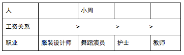

第三步：填空，即集合题干其他信息，填上每一个集合的空格。

由上述信息可知，服装设计师工资最高，由“服装设计师不是小郑就是小王”和“小郑比小吴的工资低”可知，服装设计师不能是小郑，只能是小王。由“小郑比小吴的工资低”和“教师比护士的工资低”可知，小郑是教师，小吴是护士。四人对应的职位如下：

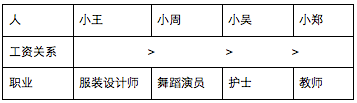

| 人 | 小王 | 小周 | 小吴 | 小郑 |
| --- | --- | --- | --- | --- |
| 工资关系 |  | ＞ | ＞ | ＞ |
| 职业 | 服装设计师 | 舞蹈演员 | 护士 | 教师 |

故正确答案为A。

**考点**：从最大信息开始推

**来源**：2009年北京市公务员录用考试《行测》题（社招）第37题

### 第 38 题

有6个人——G，H，I，J，K，L，每个人或者只下围棋或者只下象棋。如果有多个人下同一种棋，则下该种棋的人按下棋水平从高到低排名。给出下列条件：

（1）J：下象棋。

（2）H：下围棋。

（3）在下围棋的人中间，H排名最高。

（4）如果I下围棋，则K和L下围棋，K的排名低于I但高于L。

（5）如果I下象棋，则L下象棋，L的排名低于J但高于I。

（6）如果K下象棋，则G下象棋，J的排名低于G但高于K。

下面的哪一个选项能够是真的：

A. I下象棋，L下围棋

B. G下象棋，K下围棋

C. K和J下象棋，K的排名高于J

D. I和L下象棋，I的排名高于L

第 38 题 · 答案与解析

**参考答案（粉笔题库参考内容）**

B

**解析**

本题题干信息没有紧密的推导关系，不存在明显的突破口，可以使用代入排除法来解题。

假设A项为真，I下象棋，L下围棋，则与条件（5）中“如果I下象棋，则L下象棋”矛盾，故A项排除；

假设B项为真，G下象棋，K下围棋，与题干条件均不矛盾，当选；

假设C项为真，K和J下象棋，K的排名高于J，则与条件（6）中“如果K下象棋，则G下象棋，J的排名低于G但高于K”矛盾，故C项排除；

假设D项为真，I和L下象棋，I的排名高于L，则与条件（5）中“如果I下象棋，则L下象棋，L的排名低于J但高于I”矛盾，故D项排除。

A、C、D三项均有不符合题干条件的地方。

故正确答案为B。

**考点**：代入法

**来源**：2009年北京市公务员录用考试《行测》题（社招）第38题

### 第 39 题

王强不适合担任如意酒店大堂经理的职务。因为近半年来，只要他向总经理请假，就说自己身体不舒服。

为使上述论证成立，以下哪项是必须要假设的：

Ⅰ胜任大堂经理的职务，必须要身体健康。

Ⅱ王强向总经理请假的理由是真实的。

Ⅲ近半年来，王强经常向总经理请假。

A. 只有Ⅰ

B. 只有Ⅱ

C. 只有Ⅱ和Ⅲ

D. Ⅰ、Ⅱ、Ⅲ

第 39 题 · 答案与解析

**参考答案（粉笔题库参考内容）**

D

**解析**

第一步：找到论点和论据。

本题论点为王强不适合担任如意酒店大堂经理职务，论据为王强向经理请假，说自己身体不舒服。

第二步：判断加强方式。

论点和论据间缺少部分论证链条，故需要加强论证。

第三步：逐一判断各个假设的作用。

Ⅰ在“职务”和“身体健康”间建立联系，可补充题干缺失链条；

Ⅱ说明“王强”请假理由真实，即其确实是由于身体问题请假，故也为题干前提；

Ⅲ说明“请假”是“经常”的，在“身体不舒服”和“身体不健康”间建立联系，亦为题干缺失前提之一。

故正确答案为D。

**考点**：必要条件、搭桥

**来源**：2009年北京市公务员录用考试《行测》题（社招）第39题

### 第 40 题

在1950至1970年间，德国教师的数量持续增加，然而却低于全国总人口的增长速度。

以下哪项与上述情况相冲突：

A. 在1950至1970年间，德国大学生毕业后从事教师职业的比例有所增加

B. 在1950至1970年间，德国教师在总人口中的比例保持不变

C. 在1950至1970年间，德国针对教师的经费投入比以前增加了将近3倍

D. 在1950至1970年间，德国教师在同龄人中所占比例由10%下降至9%

第 40 题 · 答案与解析

**参考答案（粉笔题库参考内容）**

B

**解析**

第一步：抓住题干主要信息。

第一点说明德国教师的数量持续增加，第二点说明德国教师的增长速度低于全国总人口的增长速度。

第二步：分析题干信息，并结合选项得出答案。

A项，德国大学生毕业后从事教师职业的比例有所增加，加强了第一步中第一点信息，与第二点信息无直接关系，因此A中说法不与题干情况相冲突；

B项，德国教师在总人口中的比例保持不变，由第一步中第二点“德国教师的增长速度低于全国总人口的增长速度”可得教师在全国总人口中比例会下降，因此B中说法与题干情况相冲突；

C项，针对教师的经费投入的变化，与第一步中第一点和第二点的信息无直接关系，因此C中说法不与题干情况相冲突；

D项，德国教师在同龄人中所占比例由10%下降至9%，由对B项的分析可知，教师在全国总人口中比例会下降，从而D项加强了第一步中第二点信息，因此D中说法不与题干情况相冲突。

故正确答案为B。

**考点**：日常结论

**来源**：2009年北京市公务员录用考试《行测》题（社招）第40题

### 第 41 题

①欠债5万余元  ②丈夫、儿子相继病逝  ③自杀未遂  ④拾荒还债  ⑤好心人帮助、还清债务

A. ②①③④⑤

B. ②③①④⑤

C. ③②⑤①④

D. ③②①④⑤

第 41 题 · 答案与解析

**参考答案（粉笔题库参考内容）**

A

**解析**

丈夫、儿子相继病逝和欠债是自杀的原因，故②和①应在③之前。

故正确答案为A。

**来源**：2009年北京市公务员录用考试《行测》题（社招）第41题

### 第 42 题

①证明患上“尘肺病”  ②从事对身体有害工作  ③怀疑患上“尘肺病”  ④获得相应赔偿   ⑤奔波于医院反复求证

A. ②③⑤①④

B. ③②⑤①④

C. ④②③⑤①

D. ②③①⑤④

第 42 题 · 答案与解析

**参考答案（粉笔题库参考内容）**

A

**解析**

②是患病的前提，也是整件事的起始，故应排在首位；怀疑患病后，需到医院求证方能确定患病，故⑤在①前。

故正确答案为A。

**来源**：2009年北京市公务员录用考试《行测》题（社招）第42题

### 第 43 题

①路中央有个大坑  ②被送往医院治疗  ③连人带车掉进坑里  ④有人帮忙拨打急救电话  ⑤下班后骑车往家赶

A. ④②⑤①③

B. ⑤④①②③

C. ⑤①③④②

D. ⑤③①④②

第 43 题 · 答案与解析

**参考答案（粉笔题库参考内容）**

C

**解析**

按事件的先后次序：下班骑车——有大坑——掉进坑里——有人拨打急救电话——送医院抢救。

故正确答案为C。

**来源**：2009年北京市公务员录用考试《行测》题（社招）第43题

### 第 44 题

①到国外学习手术支架生产技术  ②寻求创业起始资金  ③回到祖国创业  ④为国家节省开支数十亿  ⑤国产支架市场占有率大幅提高

A. ⑤④①③②

B. ①③②⑤④

C. ③②⑤④①

D. ①③②④⑤

第 44 题 · 答案与解析

**参考答案（粉笔题库参考内容）**

B

**解析**

到国外学习应在回国之前，故①在③前；回国后寻求创业资金，使国产支架市场占有率提高，从而为国家节省开支数十亿，故为①③②⑤④。

故正确答案为B。

**来源**：2009年北京市公务员录用考试《行测》题（社招）第44题

### 第 45 题

①挽救了许多人的生命  ②证明绿色霉可以杀菌  ③发现瓶子里有绿色的霉  ④绿色霉周围没有葡萄球细菌  ⑤观察培养葡萄球细菌的瓶子

A. ④⑤③②①

B. ②⑤③④①

C. ①⑤③④②

D. ⑤③④②①

第 45 题 · 答案与解析

**参考答案（粉笔题库参考内容）**

D

**解析**

先观察培养细菌的瓶子，发现瓶里有霉，霉周围无细菌，从而证明霉可杀菌，因此挽救很多人生命。

故正确答案为D。

**来源**：2009年北京市公务员录用考试《行测》题（社招）第45题

### 第 46 题

太空垃圾，即空间碎片，是人类空间活动的产物，包括完成任务的火箭箭体和卫星本体、火箭的喷射物、执行航天任务过程中的抛弃物、空间物体间碰撞产生的碎块等，是空间环境的主要污染源。

下列情形中属于太空垃圾的是：

A. 航天器脱落的油漆颗粒

B. “挑战者”号航天飞机升空72秒后发生爆炸形成的尘埃

C. 银河系最年轻的超新星“仙后座—α”爆炸后的残留物形成的尘埃

D. 航天飞机升空后落入大气层的火箭助推器

第 46 题 · 答案与解析

**参考答案（粉笔题库参考内容）**

A

**解析**

第一步：抓住定义中的关键词。

关键词强调“太空”、“人类空间活动的产物”、“执行航天任务过程中的抛弃物、空间物体间碰撞产生的碎块等”。

第二步：逐一判断选项。

A项中航天器脱落的油漆颗粒，属于“执行航天任务过程中的抛弃物、空间物体间碰撞产生的碎块等”，是“人类空间活动的产物”，属于太空垃圾；

B项中“挑战者”号航天飞机还没有进入太空，爆炸形成的碎片不是太空垃圾；

C项中超新星“仙后座—α”是宇宙的星体，与人类的太空活动无关，不属于太空垃圾；

D项中火箭助推器是落入大气层，不是在太空，不属于太空垃圾。

故正确答案为A。

**考点**：拆词

**来源**：2009年北京市公务员录用考试《行测》题（社招）第46题

### 第 47 题

低碳出行，是指二氧化碳排放少、能耗低、污染少、环境友好的出行方式。

下列各项中，不属于低碳出行的是：

A. 步行

B. 乘坐地铁

C. 乘坐出租车

D. 拼车上班

第 47 题 · 答案与解析

**参考答案（粉笔题库参考内容）**

C

**解析**

第一步：抓住定义中的关键词。

关键词强调“环境友好的出行方式”。

第二步：逐一判断选项。

A、B、D三项都符合“二氧化碳排放少、能耗低、污染少、环境友好”的条件，属于低碳出行。

C项乘坐出租车不是环境友好的出行方式。

本题为选非题，故正确答案为C。

**考点**：拆词

**来源**：2009年北京市公务员录用考试《行测》题（社招）第47题

### 第 48 题

热对流，是指热靠液体或者气体的流动来传递的现象。

下列现象中，属于热对流现象的是：

A. 冬天在室外用手摸大小差不多的铁棒和木棒，觉得铁棒比木棒凉

B. 冬天雪覆盖大地，越冬小麦反而不易冻死

C. 炎热的夏天，人们喜欢穿浅色的衣服

D. 将纸质的小风车放在台灯灯罩的上沿，小风车会旋转起来

第 48 题 · 答案与解析

**参考答案（粉笔题库参考内容）**

D

**解析**

第一步：抓住定义中的关键词。

关键词强调“靠液体或者气体的流动来传递”。

第二步：逐一判断选项。

A项中热是在固体之间传递的，不符合“在液体或者气体”间传递；

B项冬天的雪阻止了热在地面与大气之间的传递，而且雪是白色的也不易于吸收地面的热辐射，不是热对流；

C项夏天人们都喜欢穿浅颜色的衣服，因为它可以反射太阳发出的热量，不是热对流，而是热辐射；

D项因为台灯周围较热，空气受热温度上升，别处的冷空气就流过来补充，流过来的冷空气又受热上升。如此循环往复，台灯周围的空气就流动起来了，小风车也旋转起来了，这种靠空气流动来传递热的现象是热对流。

故正确答案为D。

**考点**：方式目的

**来源**：2009年北京市公务员录用考试《行测》题（社招）第48题

### 第 49 题

伪造货币罪，是指仿照国家货币的页面、颜色、形状，采用各种方法制作假币，冒充真币的行为。

下列选项中，属于伪造货币罪的是：

A. 胡某将100张100元的人民币揭层加工，变成200张100元的人民币，并多次用于购物

B. 苏某在路边以850元的价格购买了假人民币5000元，并用于购物

C. 王某为炫耀本人画技，精心绘制了一张逼真的百元人民币，将其带到办公室向他人展示

D. 李某利用在印刷厂的亲戚关系印刷了大量缅币，并用其在边境上购得货物

第 49 题 · 答案与解析

**参考答案（粉笔题库参考内容）**

D

**解析**

第一步：抓住定义中的关键词。

关键词强调“仿照”、“制作假币”、“冒充真币”。

第二步：逐一判断选项。

A项是将真人民币进行加工后，增加其数量的犯罪，构成了变造货币罪，不属于伪造货币罪；

B项是购买假人民币，不是制作假人民币，不构成伪造货币罪；

C项王某没有制作假人民币冒充真人民币，不构成伪造货币罪；

D项李某没有权利印刷货币，其印刷的缅币是假币，构成了伪造货币罪。

故正确答案为D。

**考点**：方式目的

**来源**：2009年北京市公务员录用考试《行测》题（社招）第49题

### 第 50 题

紧急避险，是指为了使国家、公共利益、本人或者他人的人身、财产和其他权利免受正在发生的危险，不得已而采取的损害另一较小合法权益的行为。

下列情况，属于紧急避险的是：

A. 杜某在街上被一疯狗追咬，情急之下将路边刘某的房门踹开，冲进屋内

B. 某县消防大队消防员李某在扑救村民某家火灾时，因房屋有倒塌危险，未进屋营救李某儿子，致其烧伤

C. 王某在下班途中，搭救一被强奸姑娘，遭到歹徒反击，王某一拳打在歹徒头上，致其当场死亡

D. 仓库保管员遭到歹徒威胁，打开仓库门锁，让歹徒抢走厂里4000余元的货物

第 50 题 · 答案与解析

**参考答案（粉笔题库参考内容）**

A

**解析**

第一步：抓住定义中的关键词。

关键词强调“免受正在发生的危险”、“不得以”、“损害另一较小合法权益”。

第二步：逐一判断选项。

A项中的杜某在被疯狗追咬的危险下，踹开刘某的房门，损害了刘某的权益，属于紧急避险；

B项中的消防员没有使李某的儿子免受正在发生的危险，不对其进行营救，致其烧伤，故不属于紧急避险；

C项王某在搭救别人的时候出手过重致使歹徒死亡，属于防卫过当，不属于紧急避险；

D项仓库保管员李某的职责就是看管好仓库，而他在受到威胁后就打开仓库门锁，使工厂遭到损失，这是失职，不属于紧急避险。

故正确答案为A。

**考点**：方式目的

**来源**：2009年北京市公务员录用考试《行测》题（社招）第50题

### 第 51 题

超级城市体，是指城市不仅在地理层面的聚集，而且还在经济、文化、科技、生活等方面全面互补、融合，形成内在的有机联系。

下列选项中属于超级城市体的是：

A. 珠三角

B. 港澳台地区

C. 中国四大直辖市

D. 欧盟

第 51 题 · 答案与解析

**参考答案（粉笔题库参考内容）**

A

**解析**

第一步：抓住定义中的关键词。

关键词强调“城市”、“地理层面的聚集”和“有机联系”。

第二步：逐一判断选项。

A项的珠三角符合“城市”，且在地理层面聚集，符合在经济、文化、科技、生活等方面全面互补、融合，形成内在的有机联系，属于超级城市体；

B项中台湾是省，不是城市，B项不属于超级城市体；

C项在地理层面不聚集，不属于超级城市体；

D项不是城市，而是国家的联合体，也不属于超级城市体。

故正确答案为A。

**考点**：单定义-其他句式

**来源**：2009年北京市公务员录用考试《行测》题（社招）第51题

### 第 52 题

仲裁，是指争议双方在争议发生前或争议发生后达成协议，自愿将争议交给第三方作出裁决，双方有义务执行的一种解决争议的方法，平等主体的公民、法人和其他组织之间发生的合同纠纷和其他财产权益纠纷，可以仲裁。下列纠纷都不能仲裁：①婚姻、收养、监护、抚养、继承纠纷；②依法应当由行政机关处理的行政争议。

下列纠纷中，可适用于仲裁的是：

A. 蔡某与其丈夫刘某因离婚时的财产分配及其子女监护权归属发生的纠纷

B. 某集团与集体经济组织因土地承包合同发生的纠纷

C. 某商贸有限公司与某物流公司因履行货物运输合同产生的纠纷

D. 私营企业主郑某因不服工商行政管理部门罚款而与之产生的纠纷

第 52 题 · 答案与解析

**参考答案（粉笔题库参考内容）**

C

**解析**

第一步：抓住定义中的关键词。

关键词强调“婚姻、收养、监护、抚养、继承纠纷”和“依法应当由行政机关处理的行政争议”不能仲裁。

第二步：逐一判断选项。

A项符合关键词强调的“婚姻、收养、监护、抚养、继承纠纷”，故不能仲裁；

B项符合“依法应当由行政机关处理的行政争议”，也不能仲裁；

C项中的商贸有限公司和物流公司是平等主体之间的合同纠纷，可以仲裁；

D项私营企业主和工商行政管理部门的纠纷属于“依法应当由行政机关处理的行政争议”，故不能仲裁。

故正确答案为C。

**考点**：单定义-其他句式

**来源**：2009年北京市公务员录用考试《行测》题（社招）第52题

### 第 53 题

侵占罪，以非法占有为目的，将他人交给自己保管的财物、遗忘物或者埋藏物非法占为己有，数额较大，拒不交还的行为。

以下各项中，属于侵占罪的一项是：

A. 甲到乙的办公室送文件，乙不在，甲看见乙办公桌下的地上有一存折（该存折未设密码），便将存折捡走，乙回办公室后找不到存折，但是看到桌上的文件，便找到甲问是否看见其存折，甲说没看到，甲下班后去银行将该存折中的5000元取走

B. 丙闲得无聊在一自动取款机键盘上胡乱敲击时，无意中触动了一个按钮，取款机即吐出一张100元钞票，见此情景，丙连续进行操作，直至取出现金1万元，然后迅速离去

C. 乙到一家餐馆吃饭，离开时忘记将钱包带走，包里有现金5万元，但餐馆的服务员拒绝将钱包还给乙

D. 张某知道刘某的小孩被他人绑架，刘某可能会按照歹徒的要求交付赎金，便终日悄悄地跟随在刘某身后，某日，见刘某将一塑料袋埋在桥洞下，在刘某离开后，张某将口袋挖出，取得现金20万元

第 53 题 · 答案与解析

**参考答案（粉笔题库参考内容）**

C

**解析**

第一步：抓住定义中的关键词。

关键词强调“非法占有”、“他人交给自己保管的财物、遗忘物或者埋藏物”、“拒不交还”。

第二步：逐一判断选项。

A项甲某不符合拒不交还，排除；

B项丙占有的是银行取款机内的钱，不符合“将他人交给自己保管的财物、遗忘物或者埋藏物非法占为己有”，排除；

D项不符合“拒不交还”，排除；只有C项情形符合侵占罪的定义。

故正确答案为C。

**考点**：方式目的

**来源**：2009年北京市公务员录用考试《行测》题（社招）第53题

### 第 54 题

外源性动机，是指人为了获得物质或社会报酬，或为了避免惩罚而完成某种行为。完成该行为是为了行为的结果，而不是行为本身。

以下选项中，不属于外源性动机的一项是：

A. 社会地位

B. 实现个人潜能

C. 领导表扬

D. 奖金报酬

第 54 题 · 答案与解析

**参考答案（粉笔题库参考内容）**

B

**解析**

第一步：抓住定义中的关键词。

关键词强调“为了获得物质或社会报酬，或为了避免惩罚”、“为了结果而不是行为本身”。

第二步：逐一判断选项。

A项的社会地位的获取过程是为了结果而不是行为本身，且获得社会地位也是为了获得物质或社会报酬，属于外源性动机；

B项实现个人潜能是指行为本身，且不是为了获得物质或社会报酬，或为了避免惩罚，故不属于外源性动机；

C项中获得领导表扬的过程是为了行为的结果，而不是行为本身，属于外源性动机；

D项奖金报酬的获得是为了结果而不是行为本身，属于外源性动机。

本题为选非题，故正确答案为B。

**考点**：拆词

**来源**：2009年北京市公务员录用考试《行测》题（社招）第54题

### 第 55 题

抢劫罪，是以非法占有为目的，对财物的所有人、保管人当场使用暴力、胁迫或其他方法，强行将公私财物抢走的行为。

下列各项中，属于抢劫罪的一项是：

A. 李某潜入王某家中行窃，被发现后携所窃赃物逃跑，王某紧追不舍，李某见杂货店旁有一辆未熄火摩托车，车主正在车旁吸烟，便骑上摩托车

B. 郑某骑摩托车见田某提着精致皮包行走，从背后用力拉皮包带，试图将皮包抢走，田某拽住皮包带不放，见此情景，郑某突然对摩托车加速，并用力猛拉皮包带抢走皮包，田某当即被摔成重伤

C. 某晚，在大街上见赵某一人行走，即起歹意，将其奸污，并将显示其身份的皮包等物带走

D. 林某潜入胡某家中盗窃贵重物品，被主人发现后逃走，躲在农民的草垛里睡了一夜，第二天村长高某路过时，发现林某行踪诡异，林某以为高某发现了自己昨晚的盗窃行为，对高某进行打击，致其重伤

第 55 题 · 答案与解析

**参考答案（粉笔题库参考内容）**

B

**解析**

第一步：抓住定义中的关键词。

关键词强调“当场使用暴力、胁迫或其他方法”、“强行将公私财物抢走”。

第二步：逐一判断选项。

A项中李某是在行窃过程中被发现后携所窃赃物逃跑，但没有“当场使用暴力、胁迫等方法”，属于盗窃罪，不是抢劫罪，故A项错误；

B项中的郑某强行将田某的皮包抢走，且在此过程中将摩托车加速，造成田某摔成重伤，符合关键词强调的“当场使用暴力、胁迫或其他方法”和“强行将公私财物抢走”， 故B项正确；

C项中的罪犯将赵某的皮包带走，不是以非法占有为目的，而是为掩饰罪行，不是抢劫罪，故C项错误；

D项中的林某偷盗了胡某家中的贵重物品，但没有当场对胡某使用暴力，林某对高某使用暴力，但高某并不是财物的所有人，关键词强调的是“对财物的所有人、保管人当场使用暴力”，故不属于抢劫罪，D项错误。

故正确答案为B。

**考点**：方式目的

**来源**：2009年北京市公务员录用考试《行测》题（社招）第55题

### 第 56 题

国务院出台的《医药卫生体制改革近期重点实施方案（2009~2011年）》指出，三年内我国基本医疗保障制度将覆盖城乡全体居民。《实施方案》明确指出，在扩大基本医疗保障覆盖面的同时，我国还将提高基本保障水平。这表明：

A. 提高基本医疗水平是扩大基本医疗保障的基础

B. 社会保障制度既要有利于生产，又要保障基本生活

C. 医疗保险是社会保障制度中最基本、最核心的内容

D. 社会保障制度作为社会主义市场经济的重要支柱得到进一步完善

第 56 题 · 答案与解析

**参考答案（粉笔题库参考内容）**

D

**解析**

A项错误，原文中“在扩大基本医疗保障覆盖面的同时，我国还将提高基本保障水平”没有这个意思；

B项错误，原文中没有提到社会保障制度有利于生产；

C项错误，原文中只是提及“医疗保障制度将覆盖城乡全体居民”并没有说“医疗保险是社会保障制度中最基本、最核心的内容”。

故正确答案为D。

**本题相关知识点：**

1．社会保障制度是在政府的管理之下，以国家为主体、依据一定的法律和规定、通过国民收入的再分配、以社会保障基金为依托，对公民在暂时或者永久性失去劳动能力以及由于各种原因生活发生困难时给予物质帮助，用以保障居民的最基本的生活需要。

2．基本医疗保障制度是社会保障体系的重要组成部分，即民众的安全网、社会的稳定器；也是医药卫生体系的重要组成部分，是医改的重要领域之一。医疗保障的主要目标是合理组织财政资源，满足与经济发展水平相适应的医疗资金需求，党的十七大已经确定了2020年覆盖城乡居民的社会保障体系基本建立的宏伟目标。

**考点**：重要文件

**来源**：2009年北京市公务员录用考试《行测》题（社招）第56题

### 第 57 题

人工经济林采用分层结构，主要目的是：

A. 模拟自然界垂直地带性

B. 增加植物蒸腾调节气候

C. 充分利用当地光照条件

D. 减少对于对地面的冲刷

第 57 题 · 答案与解析

**参考答案（粉笔题库参考内容）**

C

**解析**

分层结构的原理是利用不同植物对阳光、水分等环境的需求因素不同。

故正确答案为C。

**考点**：生物常识

**来源**：2009年北京市公务员录用考试《行测》题（社招）第57题

### 第 58 题

2008年金融危机从发生到蔓延，经济学家曾先后用英文字母V、U、I、W的形状来为世界经济的走势画像。这传达出一个信息：金融危机现象复杂、形势严峻，即使是受过专门训练的经济学家也难以做到“一叶知秋”，这说明（    ）。

A. 实践是有意识、有目的的能动性的活动

B. 金融危机复杂多变，具有不可预测性

C. 正确认识需要在从实践到认识的循环往复中获得

D. 对客观事物的反映可以仁者见仁，智者见智

第 58 题 · 答案与解析

**参考答案（粉笔题库参考内容）**

C

**解析**

本题考查经济学家对金融危机的实践分析与马克思主义哲学的对应知识。

A项，实践是有意识、有目的的能动性的活动，这说明实践具有主观能动性，题干中并没有体现。该项与题意不符，应排除。

B项，金融危机复杂多变，但依然遵循一定的经济规律，并不是完全不可预测的，说法片面。该项与题意不符，应排除。

C项，题干中，即使是受过专门训练的经济学家也难以做到“一叶知秋”，说明得到真理的过程并不是一帆风顺的，正确的认识也不是一次实践能够形成的，是需要从实践到认识的循环往复才能够获得的。该项符合题意，当选。

D项，题干重点强调的是经济学家对金融危机难以只通过个别的细微的迹象就预测到整个形势的发展趋向与结果，并不是指不同人的看法不同，仁者见仁，智者见智。该项与题意不符，应排除。

故正确答案为C。

**考点**：认识论

**来源**：2009年北京市公务员录用考试《行测》题（社招）第58题

### 第 59 题

2009年，我们伟大的祖国迎来了60岁生日。60年，光辉岁月弹指一挥间，中华大地发生了沧桑巨变。中华大地发生沧桑巨变的原因有：

①坚持了中国特色社会主义理论的指导

②建立了完善的、适合我国国情的民主制度

③坚持中国共产党的领导，保持社会主义方向

④坚持和平发展道路，营造了良好的国际环境

A. ①④

B. ②③

C. ①③④

D. ①②③④

第 59 题 · 答案与解析

**参考答案（粉笔题库参考内容）**

D

**解析**

改革开放取得一切成绩和进步的根本原因是开辟了中国特色社会主义道路，形成了中国特色社会主义理论体系。所以说①③正确，②也是正确的，民主制度也是一种保证，④坚持和平发展道路，营造了良好的国际环境是经济发展的前提。

故正确答案为D。

**考点**：其他建设

**来源**：2009年北京市公务员录用考试《行测》题（社招）第59题

### 第 60 题

民国初年，政府动荡，中央政府失去对地方的有效控制。以下对造成这种局面的相关因素的表述，不正确的一项是：

A. 武昌起义后各省宣布反清独立

B. 民国初年中央政权内部斗争激烈

C. 帝国主义加紧对中国掠夺

D. 民主共和观念冲击君主专制思想

第 60 题 · 答案与解析

**参考答案（粉笔题库参考内容）**

D

**解析**

“民主共和观念冲击君主专制思想”带来的是反清和反复辟的胜利，这不是军阀混乱的原因。

本题为选非题，故正确答案为D。

**考点**：中国历史

**来源**：2009年北京市公务员录用考试《行测》题（社招）第60题

### 第 61 题

温家宝总理在视察某动画片产业基地的时候表达了“不愿孙子总看奥特曼，他应该多看中国的历史和中国的动画片”的意愿，这启示中国的动漫企业关键要：

A. 以消费要求为根本出发点，提高产品质量

B. 降低价格，以更好地迎合大众消费水平

C. 加强文化基础设施建设，调整产业结构

D. 自主创新，开发有民族特色的动漫产业

第 61 题 · 答案与解析

**参考答案（粉笔题库参考内容）**

D

**解析**

“不愿孙子总看奥特曼，他应该多看中国的历史和中国的动画片”表明了中国的动漫企业关键要自主创新，开发有民族特色的动漫产业。文化部下发的《文化部“十二五”时期文化产业倍增计划》提出，力争到2015年，打造5至10个在国际上具有竞争力和影响力的国产动漫品牌和骨干动漫企业。目前，动漫骨干企业的引领示范作用已初步呈现。

故正确答案为D。

**考点**：文化常识

**来源**：2009年北京市公务员录用考试《行测》题（社招）第61题

### 第 62 题

在二战后的50年里，美国始终是人口的迁入地，下列叙述正确的是：

A. 美国人口的增加均是通过机械迁移完成的

B. 目前美国的人口迁移方向是由东北向西南

C. 政治因素是影响美国人口迁移的主要因素

D. 人口迁入美国能缓解其人口老龄化的问题

第 62 题 · 答案与解析

**参考答案（粉笔题库参考内容）**

D

**解析**

二战以来，美国人口的地区迁移呈现出了与历史上前几次人口地区迁移迥异的特点。在第三次科技革命推动下，美国产业结构发生重大变化，南部轻工业的发展，美国联邦政府及西部和南部各州政府鼓励和资助移民的措施，是促成美国人口从东北部和中央北部大规模南迁西移的主要原因。这种迁移，促进了美国西部和南部经济的迅速发展，进而也影响和改变了美国的政治格局。

A项错误，美国人口迁移的方式太多；

B项错误，美国很多老年人在退休后向南方的“阳光地带”迁移，不能说目前美国的人口迁移方向是由东北向西南；

C项错误，美国人口迁移与政治因素无关。

故正确答案为D。

**来源**：2009年北京市公务员录用考试《行测》题（社招）第62题

### 第 63 题

当前，抵御危机是社会面临的共同课题，为了促进经济发展，我国采取了多种措施积极应对这一严峻挑战，下列措施有利于保持国内经济平稳较快发展的是：

A. 降低利率——（增加）企业投资——（扩大）生产规模——（减少）商品供给

B. 发展经济——（增加）就业岗位——（提高）居民收入——（减少）消费需求

C. 增发国债——（增加）财政收入——（扩大）政府投资——（增加）国内需求

D. 降低关税——（增加）商品出口——（增加）国内需求——（刺激）经济发展

第 63 题 · 答案与解析

**参考答案（粉笔题库参考内容）**

C

**解析**

A项错误，降低利率能增加企业投资，能带动扩大生产规模，而扩大生产规模带来的是增加商品供给，而非减少商品供给；

B项错误，发展经济可以增加居民就业，可以提高人民的生活收入，带来的是增加消费需求；

D项错误，降低关税可以增加进出口，但是增加出口无法增加国内需求，所以不合适。

故正确答案为C。

**考点**：市场经济

**来源**：2009年北京市公务员录用考试《行测》题（社招）第63题

### 第 64 题

发展低碳经济，建设环境友好型社会，政府的角色不应该是：

A. 各方利益的协调者

B. 公共服务的提供者

C. 企业管理的参与者

D. 市场秩序的监督者

第 64 题 · 答案与解析

**参考答案（粉笔题库参考内容）**

C

**解析**

环境友好型社会是一种人与自然和谐共生的社会形态，其核心内涵是人类的生产和消费活动与自然生态系统协调可持续发展。在这其中政府的角色依然表现在政治、经济、文化、社会公共服务四个方面行使职能。特别在处理政府与市场关系时，政府的职能与企业的职能分开已成为共识，这也是建立现代企业制度的标志。

本题为选非题，故正确答案为C。

**来源**：2009年北京市公务员录用考试《行测》题（社招）第64题

### 第 65 题

温家宝总理说：在经济困难面前，信心比黄金和货币更重要。这句话表明：

①人的主观能动作用是巨大的

②精神状态决定着事物的发展进程

③信心、信念、意志是成功的必备要素

④有了信心就可以不受客观条件的制约而战胜困难

A. ①③

B. ①②

C. ②③

D. ②④

第 65 题 · 答案与解析

**参考答案（粉笔题库参考内容）**

A

**解析**

人的意识是在能动地认识世界的基础上，按照客观实际和客观规律，提出一定的目的、计划、办法等，指导人们进行改造世界的实践活动。 意识的能动作用有两种不同的性质：正确的思想意识能够指导人们采取正确的行动，促进事物的良性发展；相反，错误的思想意识会引导人们采取错误的行动，对事物发展产生阻碍甚至破坏作用。

本题选项中：①正确；②说法太过于绝对；④原文中没有体现。

故正确答案为A。

**考点**：唯物论

**来源**：2009年北京市公务员录用考试《行测》题（社招）第65题

### 第 66 题

一般来说，以下犯罪行为不属于腐败罪表现的是：

A. 遗弃罪

B. 权钱交易罪

C. 滥用职权罪

D. 以权谋私罪

第 66 题 · 答案与解析

**参考答案（粉笔题库参考内容）**

A

**解析**

A项正确，遗弃罪（刑法第261条），是指对于年老、年幼、患病或者其他没有独立生活能力的人，负有扶养义务而拒绝扶养，情节恶劣的行为。该罪是刑法典第四章，侵犯公民人身权利罪中的一项罪名；

B、C、D三项都属于第九章渎职罪中的内容，属于腐败罪的表现，均排除。

本题为选非题，故正确答案为A。

**考点**：刑法

**来源**：2009年北京市公务员录用考试《行测》题（社招）第66题

### 第 67 题

行政机关的基本职能是：

A. 立法

B. 守法

C. 执法

D. 监督

第 67 题 · 答案与解析

**参考答案（粉笔题库参考内容）**

C

**解析**

执法是行政机关的基本职能，行政机关是国家机构的基本组成部分、是依法成立的行使国家行政职权的行政组织，执行代议机关制定的法律和决定，管理国家内政、外交、军事等方面的行政事务，其基本职能是执法。

故正确答案为C。

**本题相关知识点：**

行政机关的职权通常由宪法和法律规定，主要分执行与管理两个方面。在执行方面，中央行政机关执行代议机关制定的法律和决定，地方行政机关除执行上述法律和决定外，还要执行上级行政机关的命令和本级代议机关的决议。在管理方面，中央行政机关管理全国的内政、外交、军事等方面的行政事务，而地方行政机关则以管理内政事务为主，不管理外交事务，军事方面的管理事务也很少。行政机关在执行和管理的过程中，有权作出行政决策，发布行政命令和行政决定，并采取必要的行政措施。

**来源**：2009年北京市公务员录用考试《行测》题（社招）第67题

### 第 68 题

行政机关在其法定职权范围内，依照法律、法规、规章的规定，可以委托其他行政机关实施行政许可。下列说法正确的是：

A. 委托机关应当将受委托行政机关和受委托实施行政许可的内容予以公告

B. 受委托行政机关在委托范围内，以自己名义实施行政许可

C. 受委托行政机关在委托范围内，可以再委托其他组织或者个人实施行政许可

D. 委托行政机关对受委托行政机关实施行政许可的行为后果不承担法律责任

第 68 题 · 答案与解析

**参考答案（粉笔题库参考内容）**

A

**解析**

《行政许可法》第二十四条规定：行政机关在其法定职权范围内，依照法律、法规、规章的规定，可以委托其他行政机关实施行政许可。

A项正确，委托机关应当将受委托行政机关和受委托实施行政许可的内容予以公告；

B项错误，受委托行政机关在委托范围内，以委托行政机关名义实施行政许可；

C项错误，不得再委托其他组织或者个人实施行政许可；

D项错误，委托行政机关对受委托行政机关实施行政许可的行为应当负责监督，并对该行为的后果承担法律责任。

故正确答案为A。

**考点**：行政法

**来源**：2009年北京市公务员录用考试《行测》题（社招）第68题

### 第 69 题

根据我国《民法通则》中的无过错责任原则，应由下列何人对损害结果承担民事责任：

A. 受害者

B. 第三人

C. 与造成损害原因有关的人

D. 受害者和第三人

第 69 题 · 答案与解析

**参考答案（粉笔题库参考内容）**

C

**解析**

《民法通则》第106条第3款规定：没有过错，但法律规定应当承担民事责任的，应当承担民事责任。

《侵权责任法》第七条规定：行为人损害他人民事权益，不论行为人有无过错，法律规定应当承担侵权责任的，依照其规定。

依据上述规定以及《民法通则》、《侵权责任法》相关条款之规定，无过错责任原则是指损害的发生既不是加害人的故意也不是受害人的故意和第三人的故意造成的，但法律规定由加害人承担民事责任的一种特殊归责原则。它是一种基于法定特殊侵权行为的归责原则，其目的在于保护受害人合法权益，有效弥补受害人因特殊侵权行为所造成的损失。

故正确答案为C。

**考点**：民法典

**来源**：2009年北京市公务员录用考试《行测》题（社招）第69题

### 第 70 题

2008年11月27日上午，北京市首家人大代表工作站在海淀区清河街道毛纺南小区开门接待居民。在这里，海淀区人大代表与社区居民面对面，直接听取民意。代表定期向公民公示和反馈有关部门对相关问题的处理意见。人大代表工作站的成立表明：

①我国公民政治权利进一步扩大

②民意表达的渠道不断拓宽

③人大代表自觉履行宪法规定的义务

④基层群众自治制度逐渐形成

A. ①③

B. ①②

C. ②③

D. ②④

第 70 题 · 答案与解析

**参考答案（粉笔题库参考内容）**

C

**解析**

①错误，公民政治权利是公民依法参与国家政治生活、管理国家事务和表达意愿的权利和自由，是由宪法确定的，不会随便扩大。

②正确，人大代表工作站设在社区，方便收集民意，是民意表达渠道的扩宽。

③正确，《宪法》第76条规定：“全国人民代表大会代表应当同原选举单位和人民保持密切的联系，听取和反映人民的意见和要求，努力为人民服务。”人大代表工作站的设立使得人大代表更好听取人民意见，是履行宪法义务的体现。

④错误，《宪法》第111条规定：“城市和农村按居民居住地区设立的居民委员会或者村民委员会是基层群众性自治组织。”因此人大代表工作站并非基层群众自治制度。

故正确答案为C。

**考点**：宪法

**来源**：2009年北京市公务员录用考试《行测》题（社招）第70题

### 第 71 题

2008年12月27日~28日，中央农村工作会议在京举行。会议指出2009年农业工作要把（  ）作为首要任务。

A. 保持农业农村经济平稳较快发展

B. 深化农村改革，增添发展活力

C. 加强农村科技力量，加强创新能力

D. 稳定农业生产，保证增产增收

第 71 题 · 答案与解析

**参考答案（粉笔题库参考内容）**

A

**解析**

中央农村工作会议于12月27日至28日在北京举行，会议总结2009年农业农村工作的首要任务是保持农业农村经济平稳较快发展，千方百计保证国家粮食安全和主要农产品有效供给，促进农民收入持续增长。

故正确答案为A。

**考点**：重要会议讲话

**来源**：2009年北京市公务员录用考试《行测》题（社招）第71题

### 第 72 题

2009年1月27日，我国第一个南极内陆科学考察站（  ）在南极内陆冰盖的最高点冰穹A地区建成。

A. 长城站

B. 昆仑站

C. 神州站

D. 中山站

第 72 题 · 答案与解析

**参考答案（粉笔题库参考内容）**

B

**解析**

新华社南极中山站2月2日电（记者刘奕湛）中山站时间2日9时25分（北京时间2日12时25分），我国首个南极内陆考察站——中国南极昆仑站正式开站，中国第25次南极科考队内陆冰盖队队长李院生被任命为首任站长。

故正确答案为B。

**考点**：科技理论与成就

**来源**：2009年北京市公务员录用考试《行测》题（社招）第72题

### 第 73 题

十一届全国人大常委会第七次会议于2009年2月28日通过了《食品安全法》。该法规定，国家建立食品安全风险监测和评估制度。这一制度强调了（  ）的管理理念。

A. 事先许可

B. 随机抽检

C. 预防在先

D. 加大处罚

第 73 题 · 答案与解析

**参考答案（粉笔题库参考内容）**

C

**解析**

2009年2月28日，全国人大常委会表决通过的《食品安全法》规定：国家建立食品安全风险监测和评估制度。法律规定，国家建立食品安全风险监测制度，对食源性疾病、食品污染以及食品中的有害因素进行监测。国家建立食品安全风险评估制度，对食品、食品添加剂中生物性、化学性和物理性危害进行风险评估。这体现了食品安全监管的“预防在先”理念。

故正确答案为C。

**考点**：劳动法和经济法

**来源**：2009年北京市公务员录用考试《行测》题（社招）第73题

### 第 74 题

2009年3月5日温家宝总理在十一届全国人大二次会议上作政府工作报告。报告中指出，2009年将实施更加积极的就业政策，将把（  ）放在突出位置。

A. 广开农民工就业门路

B. 帮助城镇就业困难人员就业

C. 大力支持自主创业

D. 促进高校毕业生就业

第 74 题 · 答案与解析

**参考答案（粉笔题库参考内容）**

D

**解析**

2009年3月5日温家宝总理在十一届全国人大二次会议上作政府工作报告。报告中指出“要千方百计促进就业，把促进高校毕业生就业放在突出位置”。

故正确答案为D。

**考点**：重要文件

**来源**：2009年北京市公务员录用考试《行测》题（社招）第74题

### 第 75 题

2009年8月30日，日本民主党在大选中获胜，日本将实现政权更替，由民主党代表（  ）担任首相的新政权诞生。

A. 鸠山由纪夫

B. 麻生太郎

C. 中川秀

D. 田中角荣

第 75 题 · 答案与解析

**参考答案（粉笔题库参考内容）**

A

**解析**

2009年8月30日民主党代表（党首）鸠山由纪夫以327票当选为第93届、第60位日本首相。

故正确答案为A。

**来源**：2009年北京市公务员录用考试《行测》题（社招）第75题

### 第 76 题

按照中国社会主义事业总体布局，党和国家全面推进的建设有：

A. 经济建设

B. 政治建设

C. 文化建设

D. 社会建设

第 76 题 · 答案与解析

**参考答案（粉笔题库参考内容）**

ABCD

**解析**

中国特色社会主义事业总体布局是“四位一体”：十七大通过的新党章，在总纲第九自然段中阐述社会主义初级阶段基本国情和现阶段奋斗目标时，增写了“必须按照中国特色社会主义事业总体布局，全面推进经济建设、政治建设、文化建设、社会建设”的新内容。这就在执政党的章程中，明确了“四位一体”的中国特色社会主义事业的总体布局。

故正确答案为A、B、C、D。

**来源**：2009年北京市公务员录用考试《行测》题（社招）第76题

### 第 77 题

党的“十七大”提出的科学发展战略有：

A. 科教兴国战略

B. 人才强国战略

C. 可持续发展战略

D. 科教兴农战略

第 77 题 · 答案与解析

**参考答案（粉笔题库参考内容）**

ABC

**解析**

《科学发展观学习读本》：必须坚持把发展作为党执政兴国的第一要务。发展，对于全面建设小康社会，加快推进社会主义现代化，具有决定性意义。要牢牢扭住经济建设这个中心，坚持聚精会神搞建设，一心一意谋发展，不断解放和发展社会生产力。更好实施科教兴国战略，人才强国战略，可持续发展战略，着力把握发展规律，创新发展理念，转变发展方式，破解发展难题，提高发展质量和效益，实现又好又快发展，为发展中国特色社会主义打下坚实基础。

故正确答案为A、B、C。

**来源**：2009年北京市公务员录用考试《行测》题（社招）第77题

### 第 78 题

党政领导辞职制度包括：

A. 因公辞职

B. 自愿辞职

C. 责令辞职

D. 引咎辞职

第 78 题 · 答案与解析

**参考答案（粉笔题库参考内容）**

ABCD

**解析**

2004年4月8日，中办发〔2004〕13号《党政领导干部辞职暂行规定》第二条规定：党政领导干部辞职包括因公辞职、自愿辞职、引咎辞职和责令辞职。

故正确答案为A、B、C、D。

**考点**：其他法律法规

**来源**：2009年北京市公务员录用考试《行测》题（社招）第78题

### 第 79 题

60年来，中国共产党把坚决惩治和有效预防腐败作为“党必须始终抓好的重大任务，（  ）”。

A. 把作风建设作为党的基本建设

B. 发挥党的最大政治优势，密切党群关系

C. 推进党的制度建设，健全党的监督体系

D. 坚持依法治国，带头守法，坚持依法行政

第 79 题 · 答案与解析

**参考答案（粉笔题库参考内容）**

BCD

**解析**

A项错误，党的建设中居于首位的是思想建设；

B、C、D项正确，党的十七大报告提出，坚决惩治和有效预防腐败，关系人心向背和党的生死存亡，是党必须始终抓好的重大政治任务。坚持党要管党、从严治党，贯彻为民、务实、清廉的要求，以保持党同人民群众的血肉联系为重点加强作风建设，以完善惩治和预防腐败体系为重点加强反腐倡廉建设，在坚决惩治腐败的同时，更加注重治本，更加注重预防，更加注重制度建设，拓展从源头上防治腐败工作领域。

故正确答案为B、C、D。

**考点**：其他建设

**来源**：2009年北京市公务员录用考试《行测》题（社招）第79题

### 第 80 题

我国《公务员法》规定，公务员实行职位分类制度，其划分的类别包括：

A. 综合管理类

B. 专业技术类

C. 行政执法类

D. 垂直管理类

第 80 题 · 答案与解析

**参考答案（粉笔题库参考内容）**

ABC

**解析**

根据《公务员法》第十六条规定：“国家实行公务员职位分类制度。公务员职位类别按照公务员职位的性质、特点和管理需要，划分为综合管理类、专业技术类和行政执法类等类别。根据本法，对于具有职位特殊性，需要单独管理的，可以增设其他职位类别。各职位类别的适用范围由国家另行规定。”

故正确答案为A、B、C。

**考点**：行政法

**来源**：2009年北京市公务员录用考试《行测》题（社招）第80题

### 第 81 题

构成法律关系的三要素是主体、客体和内容，而法律关系根据其调整内容与对象的不同，可以分为：

A. 刑事法律关系

B. 民事法律关系

C. 经济法律关系

D. 行政法律关系

第 81 题 · 答案与解析

**参考答案（粉笔题库参考内容）**

ABD

**解析**

由于经济法和民法的联系最为密切，主要是在调整对象方面，两者都调整一定范围的经济关系，这是因为作为民法重要调整对象的财产关系，实质上就是经济关系；在法律作用方面，经济法和民法都在保护当事人合法经济权益，维护良好的经济秩序方面发挥重要功能，故本题中将经济法律关系融入民事法律关系中。而本题中刑事法律关系、民事法律关系和行政法律关系调整内容和对象完全不同。

故正确答案为A、B、D。

**考点**：法理学

**来源**：2009年北京市公务员录用考试《行测》题（社招）第81题

### 第 82 题

根据政府职能的需要，政府职能转变的内容主要体现在：

A. 政府责任范围的调整

B. 政府责任重点的转移

C. 政府职能实现方式的转变

D. 政府机构的改革

第 82 题 · 答案与解析

**参考答案（粉笔题库参考内容）**

ABC

**解析**

政府职能转变，是指政府在一定时期内，根据经济和社会发展的需要，对其职能的范围、内容、方式的转移与变化。

D项错误，D选项与题意无关。

故正确答案为A、B、C。

**本题相关知识点**：

政府职能方式的转变主要包括

1.由运用行政手段为主转变为运用经济手段为主，经济手段、法律手段和必要的行政手段相结合

2.由微观管理、直接管理转变为宏观管理、间接管理

3.由注重计划、排斥市场转变为把计划与市场有机结合起来

**来源**：2009年北京市公务员录用考试《行测》题（社招）第82题

### 第 83 题

某私营企业违法经营，主管行政机关准备对其作出行为罚，具体措施可能是：

A. 治安拘留

B. 责令停产停业

C. 罚款

D. 吊销营业执照

第 83 题 · 答案与解析

**参考答案（粉笔题库参考内容）**

BD

**解析**

行政处罚种类，是指行政处罚外在的具体表现形式。根据《中华人民共和国行政处罚法》第九条的规定，行政处罚分类如下：

一、人身自由罚：包括行政拘留。

二、行为罚：主要形式有暂扣许可证件、降低资质等级、吊销许可证件、限制开展生产经营活动、责令停产停业、责令关闭、限制从业。

三、财产罚：主要形式有罚款、没收违法所得、没收非法财物。

四、声誉罚：主要形式有警告、通报批评。

选项中属于行为罚的有责令停产停业、吊销营业执照。

故正确答案为B、D。

**考点**：行政法

**来源**：2009年北京市公务员录用考试《行测》题（社招）第83题

### 第 84 题

2008年12月15日，两岸基本实现“三通”，其经济意义是：

A. 有利于实现两岸的和平统一

B. 有利于实现两岸生产要素的流动和配置

C. 促进两岸的人文交流

D. 实现两岸经济交流与合作的便利与快捷

第 84 题 · 答案与解析

**参考答案（粉笔题库参考内容）**

BD

**解析**

根据海协会与海基会台北会谈达成的协议，两岸海运直航、空运直航、直接通邮12月15日全面启动，宣告两岸“三通”时代来临。“三通”经济意义包括：

1.两岸直航可以大大降低企业的成本，提高企业的经济效益，增强竞争力。同时，在当前金融危机的背景下，两岸企业的进一步合作可以共同应对金融风暴的冲击，提高企业的抗风险能力。

2.三通可以促进相关产业的出现与发展，如促进邮轮经济的发展和旅游经济的发展，从而促进产业结构的调整与优化升级。

3.两岸直航可以大大降低消费者的出游成本，提高人民的生活水平和改变人民的生活方式，从而促进旅游经济的发展。

4.社会主义市场经济必须面向世界，两岸直航是经济全球化的客观要求，也是市场经济竞争性和开放性的必然要求。

5.直航可以使两岸经贸关系进一步发展，促进双方互通有无、调剂余缺、节约社会劳动、实现资源优化配置、取得较好的经济效益，可以加强双边的科技、人才、信息等方面的交流与合作、提高双边科技和管理水平。

A、C项错误，A、C项是政治意义。

故正确答案为B、D。

**考点**：市场经济

**来源**：2009年北京市公务员录用考试《行测》题（社招）第84题

### 第 85 题

党的十七大提出，要在各个层次、各个领域扩大公民有序政治参与。扩大公民有序政治参与的意义在于：

A. 使公共政策更加科学化、民主化

B. 扩大了公民的政治权利

C. 推进了社会主义民主政治的发展

D. 保障公民的个人利益

第 85 题 · 答案与解析

**参考答案（粉笔题库参考内容）**

ACD

**解析**

B项错误，公民的政治权利由宪法规定，是固有的，不因公民政治参与的扩大而扩大。

故正确答案为A、C、D。

**来源**：2009年北京市公务员录用考试《行测》题（社招）第85题

## 材料 1

希望得到珍贵的宝石吗？那就去黑洞附近碰碰运气吧。天文学家日前在观测中发现，一些特大质量的黑洞就如同宇宙中的“宝石工厂”，喷射出大量的水晶、红宝石和蓝宝石。这一发现将揭开构成宇宙的第一批恒星的尘埃的来源之谜，同时也为生命的物质之源找到了起点。

        据美国《科学日报》10月10日报道，一个由多国研究人员组成的小组利用美国国家航空航天局（NASA）的斯皮策太空望远镜对一个编号为PG2112+059的类星体进行了观测，它位于距离地球约80亿光年远的一个星系中央。研究人员发现了沙子、玻璃、水晶、大理石和红宝石之类的矿物存在的迹象。由于这些物质在太空的恶劣的环境中无法长时间保留，因此这表明它们是刚形成的。

        天文学家认为，星际尘埃逐渐聚集形成了恒星、行星、小行星、彗星等天体，随后才有了地球上的生命体。如今分布在宇宙角落的星际尘埃被认为是与太阳类似的巨大古老恒星在演化到超新星阶段、衰亡爆炸时产生的，但是在137亿年“高龄”的宇宙的形成之初，形成那些原始恒星的尘埃又从何而来呢？

        一种观点认为，这些尘埃来自类星体。这种有“宇宙怪物”之称的天体发现于上世纪六十年代，它的光谱似行星状星云但又不是星云，外形像星团又不是星团，发出的射电如星系又不是星系，它的内部呈螺旋状结构，中心是质量超大的黑洞，周围环绕着尘埃密布的环状星云。科学家认为它们是已知的最为活跃明亮的、正在形成中的星系，黑洞的强大吸引力将物质吸引进去，而由此产生巨大气压又形成“黑洞风”将物质吹离。就是在这场从未停歇的宇宙“拔河比赛”中，催生了恒星和新元素的出现。

        最新的观测结果为这一理论提供了有力的证据。研究报告主要作者——英国曼彻斯特大学西斯卡-马克维克-肯普说：“我们惊讶地发现那些刚形成的尘埃是从特大质量的黑洞中吹出的风中来的。世界万物最终都来自宇宙尘埃，这揭开了我们来自哪里的所有疑问。”另一名研究小组成员——洛杉矶加州大学的莎拉-盖拉格尔则表示：“类星体就像《芝麻街》中的‘甜饼怪’，它们以风的形式喷射出的物质似乎比它们吸入的物质更多。”

        这项研究的报告将发表在本月出版的《天体物理学杂志》上。研究人员还计划在其他类星体周围寻找尘埃的踪迹以进一步证明他们的发现，他们认为，也有可能类星体并不是早期宇宙唯一的尘埃来源。马克维克-肯普表示：“在某些环境下，超新星可能对尘埃形成更重要，而类星体可能在另外一些环境中显得作用更大。”

### 第 86 题

“由于这些物质在太空的恶劣的环境中无法长时间保留，因此这表明他们是刚形成的”这句话用意何在：

A. 为了说明这些物质确实是由类星体产生的

B. 没有什么特别的用意，只是客观报道研究成果

C. 说明这些宝石新鲜与珍贵

D. 说明太空的环境非常恶劣

第 86 题 · 答案与解析

**参考答案（粉笔题库参考内容）**

A

**解析**

此题考查词句理解。

该句是第二段中的最后一句。第二段首先报道人们对类星体的观测，并且观测到了沙子、玻璃、水晶等这些物质的存在迹象。如果就写到这里，并不能说明这些物质就是类星体产生的，因为这些物质也有可能是从别处来的。加上最后一句，说这些物质是刚形成的，由此便能推出这些物质就是类星体自身产生的，符合A项表述。B项不符合文意；C、D项理解肤浅且不合文意。

故正确答案为A。

**来源**：2009年北京市公务员录用考试《行测》题（社招）第86题

### 第 87 题

下列表述中，不符合文意的一项是：

A. 现在整个宇宙也有可能源于类星体喷射出来的尘埃

B. 所有的天体都是由黑洞喷射出来的尘埃汇聚而成的

C. 类星体是黑洞

D. 古老的恒星之后会变成类星体

第 87 题 · 答案与解析

**参考答案（粉笔题库参考内容）**

C

**解析**

本题为细节判断题。

C项错误，第四段第二句“这种有‘宇宙怪物’之称的天体发现于上世纪六十年代，......它的内部呈螺旋状结构，中心是质量超大的黑洞，周围环绕着尘埃密布的环状星云‘中’这种宇宙怪物”指的是其前一句提到的“类星体”，由此可知，类星体的中心是黑洞，故黑洞只是类星体的一部分，二者并不等同。

A、B项正确，根据第三段最后一句“如今分布在宇宙角落的星际尘埃......，形成那些原始恒星的尘埃又从何而来呢？”以及第四段第一句“一种观点认为，这些尘埃来自类星体”可得出；D项正确，可由第三段最后一句“如今分布在宇宙角落的星际尘埃......，形成那些原始恒星的尘埃又从何而来呢？”以及第四段第一句“一种观点认为，这些尘埃来自类星体”得出，形成原始恒星的尘埃来自类星体，而古老恒星在演化到超新星阶段、衰亡爆炸时产生了星际尘埃，因此古老恒星演化到的这个阶段即类星体阶段，即古老的恒星之后会变成类星体。

本题为选非题，故正确答案为C。

**来源**：2009年北京市公务员录用考试《行测》题（社招）第87题

### 第 88 题

关于黑洞的表述中，错误的一项是：

A. 宇宙可能起源于黑洞

B. 黑洞的“拔河效应”可能最终导致星系的形成

C. 黑洞具有超吸力，但由于黑洞风的影响，却吸入不了多少物质

D. 由于黑洞的吸引力，类星体发不出多少光

第 88 题 · 答案与解析

**参考答案（粉笔题库参考内容）**

D

**解析**

此题为细节判断题。

根据材料第四段“来自类星体......科学家认为它们是已知的最为活跃明亮的、正在形成中的星系”可知，类星体是已知的最为活跃明亮的，因此D项“类星体发不出多少光”错误。

故正确答案为D。

**来源**：2009年北京市公务员录用考试《行测》题（社招）第88题

### 第 89 题

根据文意，以下推论正确的一项是：

A. 如果文中的研究结果正确的话，那么在每个类星体周围都应该可以发现类似的宇宙尘埃

B. 如果研究人员在其他类星体周围没有发现类似的宇宙尘埃，也不会影响他们已经得出的结论

C. 类星体是唯一能够形成宇宙尘埃的天体

D. 形成原始恒星的尘埃很可能是超新星喷射出来的

第 89 题 · 答案与解析

**参考答案（粉笔题库参考内容）**

A

**解析**

此题考查细节判断。

A项正确，可以由文中“这些尘埃来自类星体”推出。根据第五段西斯卡-马克维克-肯普的话可知尘埃来自类星体的黑洞，而类星体都有黑洞，那么类星体周围都应该有尘埃，即类星体是有尘埃的充要条件；

B项不能推出，如果其他类星体周围没有尘埃，那么表明类星体并不都会喷射出物质，这与第五段中盖拉格尔的表述矛盾；C项错误，由最后一句话可知；D项不能推出，因为文中最后只说“超新星更重要”，并没有指出超新星“喷射”尘埃，也可能是“爆炸”等。

故正确答案为A。

**来源**：2009年北京市公务员录用考试《行测》题（社招）第89题

### 第 90 题

以下最适合作为本文标题的一项是：

A. 人类来源于尘埃

B. 天文学家发现特大黑洞喷射出大量宝石

C. 宇宙形成之初

D. 宇宙“拔河比赛”

第 90 题 · 答案与解析

**参考答案（粉笔题库参考内容）**

B

**解析**

此题为标题选择题。

标题应当能统领全文，说明主要内容，并且有一定的吸引力，由此B项最适合作本文标题，为正确答案。

A、C、D项没有抓住文章的主要内容。

故正确答案为B。

**来源**：2009年北京市公务员录用考试《行测》题（社招）第90题

## 材料 2

①每个人对于自己要成为一个什么样的人，都应该有一个自我设计。但这种应该是相对模糊的，是不完美的和有待修正的。可生活中偏偏就有人跟自己较劲，觉得自己这也不行，那也不好，觉得现实中的自己距离设计中的自己相差太多，并因此而痛苦不堪。其实这些人往往忽视了一个最基本的现实，就是人人都有缺陷。“玉，有点瑕疵才是真的。”

②有一位腿有残疾的私营企业主，经过自己十几年的奋斗拼搏，终于成了闻名遐迩的雕刻家和经营雕刻精品的大老板。有人对他说：“你如果不是残疾，恐怕会更有成就。”他却淡然一笑说：“你说得也许有道理，但我并不感到遗憾。因为如果没得小儿麻痹症，我肯定早下地当了农民，哪有时间坚持学习，掌握一技之长？我应该感谢上帝给了我一个残疾的身体。”还有罗斯福和丘吉尔，罗斯福曾连任四届美国总统，但很少有人知道他曾经是一个信奉巫神、酗酒成癖的人；丘吉尔是英国历史上最著名的首相，1953年获诺贝尔奖，但他也曾经是一个贪睡、贪酒的人，还曾因吸食鸦片两次被赶出办公室。但他们都痛苦地改掉了自己年轻时不良嗜好，经过不懈的努力，成就了伟大的事业。\_\_\_\_\_\_\_\_。

③完美欲是人类的天性之一，有了它，人类才会用不满足地向前发展。我们要努力追求完美，但同时我们必须学会接纳我们的不完美。

④不能接纳自己的不完美，源自我们常常拿理想的自我与现实的自我进行比较而产生的焦虑感。必须明白，理想的自我是要经过若干年成一生的不懈努力才能接近而始终不能百分之百达到的一个终极目标，只要每天进步一点，快乐一点，我们离目标也就近了一点。【  】因为不能接纳自己的缺陷而生出健忘失眠等痛苦，只能使我们离目标越来越远。不能接纳自己的不完美，还源自和别人不正确的比较而产生的自卑感。拿自己与高过自己一大截的人比，拿自己的缺点与别人的优点比，拿自己的各个方面分别与不同人的优点比，比较的结果是事事不如人，谁都比自己好。

⑤其实，每个人都有足以让自己确立自信的优于别人的长处。一棵树，如果花不鲜艳，也许叶子会绿得青翠欲滴；如果花和叶子都不漂亮，也许枝干会长得错落有致；如果花、叶子和枝干都不漂亮，也许它处的位置很好，在蓝天的映衬绰约多姿。

⑥席勒曾经给成年人写过一篇童话：一个圆的一部分切去了，它希望自己是一个完美的圆，因此它就四处寻找它遗失的那一部分。但因为它不是一个完整的圆，所以只能漫漫滚动，由此得以沿途欣赏花草的芬芳，阳光的灿烂，并与蚯蚓娓娓而谈。有一天，它终于找到了自己遗失的部分，它高兴极了，因为它又是一个完美的圆。它又开始飞快地滚动，它在快速滚动中发现世界整个变了样，许多美好的东西都失去了，于是它又停下来，毫不犹豫地将千辛万苦找回的部分丢在路边，然后漫漫滚动着向前走去……

⑦人生就是如此，不完美才是真的，只要我们真诚地面对，有点缺憾，人生照样精彩。

### 第 91 题

根据文意，下列选项中，不属于人们“不能接纳自己的不完美”的主要原因的是：

A. 理想自我和现实自我比较产生的焦虑

B. 不满现状，不接纳自己缺陷产生的痛苦

C. 急于达到终极目标而产生的焦虑

D. 不正确的比较带来的自卑

第 91 题 · 答案与解析

**参考答案（粉笔题库参考内容）**

B

**解析**

此题为细节判断题。

第四段的“因为不能接纳自己的缺陷而生出健忘、失眠等痛苦”中的“自己的缺陷”即“自己的不完美”，由此可知B项中的“痛苦”是“不能接纳自己的不完美”所导致的结果，而非“不能接纳自己的不完美”的原因。

故正确答案为B。

**来源**：2009年北京市公务员录用考试《行测》题（社招）第91题

### 第 92 题

作者引用席勒的童话的目的是：

A. 告诉人们月满则亏，水满则溢

B. 告诉人们追求圆满的结局往往是不圆满

C. 告诉人们人生有时需要不完美

D. 告诉人们追求完美是办不到的

第 92 题 · 答案与解析

**参考答案（粉笔题库参考内容）**

C

**解析**

此题为隐含主旨题。

席勒的童话讲的是原本追求圆满，但追求到后发现圆满的同时也失去了很多美好，又重新回到不圆满的状态，说明了“圆满不一定是最好的”这个道理；并且童话的下一段也由此引出作者的意图，“人生就是如此，不完美才是真的”，因此C项最符合题意。

故正确答案为C。

**来源**：2009年北京市公务员录用考试《行测》题（社招）第92题

### 第 93 题

下列选项中，适合填在本文第②自然段横线处的是：

A. 正所谓“苦尽甘来，否极泰来”

B. 正所谓“功夫不负有心人”

C. 正所谓“沉舟侧畔千帆过，病树前头万木春”

D. 正所谓“乘风破浪会有时，直挂云帆济沧海”

第 93 题 · 答案与解析

**参考答案（粉笔题库参考内容）**

B

**解析**

此题为语句填空题。

第②自然段中的企业主、罗斯福、丘吉尔都是有缺陷的人，但通过“奋斗”“努力”都最终获得成功，强调的是逆境中的主观努力，因此B项最符合语境，为正确答案。A项只提逆境的转变，没有强调主观努力；C项强调的是在逆境中的乐观心态；D项强调的是对未来的希望和信心。

故正确答案为B。

**来源**：2009年北京市公务员录用考试《行测》题（社招）第93题

### 第 94 题

下列选项中，符合作者观点的是：

A. 人生是不完美和有待修正的，要勇于正视自己的缺陷，学会接纳自己的不完美

B. 人生不必追求完美，正视现实最重要

C. 追求完美的人往往是最不幸福的人

D. 人要学会拿自己的优点和别人的缺点进行比较

第 94 题 · 答案与解析

**参考答案（粉笔题库参考内容）**

A

**解析**

此题为细节判断题。

根据文章最后一段可知，A项正确。

由第③自然段最后一句可知B、C项错误；D项不是作者的本意。

故正确答案为A。

**来源**：2009年北京市公务员录用考试《行测》题（社招）第94题

### 第 95 题

文中【  】处，应填入的词语是：

A. 倘若

B. 即使

C. 之所以

D. 抑或

第 95 题 · 答案与解析

**参考答案（粉笔题库参考内容）**

A

**解析**

此题为虚词填空题。

“倘若”用在偏正复句的偏句中，表示假设关系，相当于“如果”、“假使”；“即使”表示承认某种事实，暂让一步，在正句里常用“也”呼应，说出结论；“之所以”为连词，位于句首时引出结果，其后常用“是因为”来引出原因；“抑或”指或是、还是，连词，表示选择关系。

根据上下文判断，文中【  】处应填入表假设的词，A项符合文意。

B项除了假设之外，还有让步的含义，不符合文意；C项不符合文意，空格处后引出的是原因；D项表选择关系，不符合文意。

故正确答案为A。

**来源**：2009年北京市公务员录用考试《行测》题（社招）第95题

## 材料 3

文学较之哲学，除了共通的社会批判功能以外，还有其独特的风情。它有一种在字里行间洋溢着的诗情画意，有美好的欣赏性，这就是文学的美感。将好的文学作品成功地拍成电影，更给人以遐想、冲动和震撼。在近代文艺作品中，《简·爱》和《音乐之声》就是充分展示文学美感的作品，一往情深地讴歌了生活的美和人类道德的伟大。

        但是，欧美进入高度发达的商品社会后，已经很难奉献这样的经典之作了，正像音乐领域已经很难再出贝多芬、舒伯特等大师的作品一样。另一方面是人们的欣赏情调和欣赏能力已经向简单化刺激方向蜕化。当年爱凑热闹的美国人组成拥有数十个分指挥的万人乐队来演奏施特劳斯的《蓝色多瑙河》，而且还盛情邀请作者本人赴美指挥。结果施特劳斯一曲指挥下来便逃之夭夭，因为那隆隆的击鼓声有如炮击，那管乐齐奏也有汽笛齐鸣的味道，美感被破坏殆尽，而那些所谓的音乐人却在那里喜形于色。由此可见，经典作品在“杯水主义”和“快餐文化”时兴的氛围里，其美感很多都要被附庸风雅和“猪八戒吃人参果”式的囫囵吞枣所销蚀。

        现代人看起来太忙了，许多人在这忙碌的世界上生活，手脚不停。就好像在阿尔卑斯山上旅行，乘汽车匆匆忙忙地走过，没有时间回一回头，或者停一停步子，欣赏一下风景。结果，使这原本丰富美丽的世界，在我们眼中空无所有，只剩下匆忙和紧张、劳碌和忧愁。

        受世界流行风的影响，又由于自身所处的社会发展阶段，当今的中国文学也甚缺那种值得咀嚼的作品，而欣赏群也有点“顾不上”美感的仓促。缺乏哲学素养也许是文学美感短缺的重要原因，在文学评论类作品中尤其可以发现这一问题。文学作品是深沉还是浅薄，生活积累是客观条件，哲学素养则是更接近天才因素的东西。现代文学中每每出现的诸如“终极关怀”“话语结构”等令人费解的新鲜辞令，其实都是作者思维概括力和阐发力不足而生出的“怪胎”；只有深入浅出能力不足的人，才需要靠“造词”来吓唬民众，而这样做只能使文学的美感更加丧失。

        无论有多少客观原因，文学美感的“滑坡”仍要归结于文学的不争气。今天跟以往相比，社会的文明开放和心理健康程度已大为进步，生活的情趣和美感像春天的花朵一样绚丽开放，只有缺乏竞争力却又好高骛远的人才感受不到“世界真美好”。因此，美感问题完全应当和可以通过有才华的文学男女的努力来解决。

### 第 96 题

从原文看，下列对“文学美感”的理解，不正确的一项是：

A. 文学美感有文学独特的万种风情，是独立于文学的社会批判功能之我的美学范畴的概念

B. 文学美感是指作品具有美好的欣赏性，字里行间充满着诗情画意，能给人以美好的情感体验

C. 文学美感具有艺术的共通性，好的文学作品拍成电影或电视剧后，更能给人以美感享受

D. 文学美感具有鲜明的时代性，近现代优秀文学作品能给人以遐想、冲动和震撼，古代的则不能

第 96 题 · 答案与解析

**参考答案（粉笔题库参考内容）**

D

**解析**

此题为词句理解题。

D项的“鲜明的时代性”、“古代的则不能”无中生有，材料并未提到。

从第一段可以看出，A、B、C答案正确。

故正确答案为D。

**来源**：2009年北京市公务员录用考试《行测》题（社招）第96题

### 第 97 题

下列表述，不符合原文意思的一项是：

A. 施特劳斯从美国“逃之夭夭”，是因为受不了炮击般的击鼓声和汽笛齐鸣般的管乐声

B. 防止当代文学美感的“滑坡”，需要文学创作者努力，也需要提升“欣赏群”的欣赏情调和欣赏能力

C. 社会的文明开放和心理健康程度的进步，为文学美感的回归提供了充分的物质和精神基础

D. 本文针砭了追求感官刺激和急功近利的时弊，呼吁文学创作者重视生活积累和哲学素养，期待文学美感回归

第 97 题 · 答案与解析

**参考答案（粉笔题库参考内容）**

A

**解析**

此题为细节判断题。第二段“因为那隆隆的击鼓声有如炮声，那管乐齐奏也有汽笛齐鸣的味道，美感被破坏殆尽”，“美感被破坏殆尽”是击鼓声和管乐声演奏不当的结果，施特劳斯是因为这个结果而“逃之夭夭”的，而不是因为造成结果的原因。

故正确答案为A。

**来源**：2009年北京市公务员录用考试《行测》题（社招）第97题

### 第 98 题

第3段文字主要的意思是：

A. 人们应懂得去欣赏美丽的世界

B. 人们除了工作外，对其他事情都不太感兴趣

C. 人们为了工作而无暇顾及周围世界的变化

D. 美丽的世界对工作繁忙的人而言没有太大意义

第 98 题 · 答案与解析

**参考答案（粉笔题库参考内容）**

D

**解析**

本题为表面主旨题。

第三段首句说人们很忙，接着以旅行为喻，说明这种忙碌的结果——使美丽的世界在我们的眼里空无所有。可见前段为铺垫，后段的结果为重点，D项符合题意。A项是对于这种结果的建议和引申，B、C两项没有抓住重点“美丽的世界”。

故正确答案为D。

**来源**：2009年北京市公务员录用考试《行测》题（社招）第98题

### 第 99 题

对“无论有多少客观原因，文学美感的‘滑坡’仍要归结于文学的不争气。”

这句话，理解正确的一项是：

A. 文学美感的“滑坡”，商业社会生活丰富、生活节奏加快是主要原因

B. 文人哲学素养越来越低是文学美感“滑坡”的重要原因

C. 文学美感的“滑坡”是事实，但不能一味地找客观原因，还是要从文学本身找出路

D. 文学美感的“滑坡”，既由自身所处的社会发展阶段所限，又受世界流行的影响

第 99 题 · 答案与解析

**参考答案（粉笔题库参考内容）**

C

**解析**

本题为词句理解题。

句中条件关联词“无论......仍......”偏句表示排除一切条件，本句强调的是“仍”后面的因素——“文学的不争气”。

只有C项强调的是文学自身的因素。

A、D两项强调的都是客观因素，B项文人的哲学素养渐低只是“文学不争气”的表现之一。

故正确答案为C。

**来源**：2009年北京市公务员录用考试《行测》题（社招）第99题

### 第 100 题

依据原文所提供的信息，下列推断正确的一项是：

A. 社会商品化程度越高，生活就越丰富，生活节奏也越快，而人们的欣赏情调和欣赏能力却会越来越简单化

B. 因为哲学素养是更接近天才因素的东西，所以只要提高作家的哲学素养，就有望诞生出美感厚重而耐人寻味的文学作品

C. 文章结尾说“美感问题完全应当和可以通过有才华的文学男女的努力来解决”，可见解决美感问题的职责在于当代文学青年

D. 仅靠在形式上挖空心思或在词汇上标新立异来体现文学美感，结果只能适得其反，并暴露出作者思想深度和艺术表现力的欠缺

第 100 题 · 答案与解析

**参考答案（粉笔题库参考内容）**

D

**解析**

本题为细节判断题。

从第四段最后一句可推知D项与原文一致。

A项“简单化”并不等于材料中的“欣赏群也有点顾不上美感的仓促”；B项“只要......就......”将提高作家的哲学素养作为写出好的文学作品的充分条件，忽略了“生活积累”等条件；C项断章取义，文学美感的问题除了主观因素，还有很多客观原因，不能把职责只推给文学青年。

故正确答案为D。

**来源**：2009年北京市公务员录用考试《行测》题（社招）第100题

## 材料 4

诚如朱永新所言，文理分科导致了中国教育科学精神和人文情怀的离间。文理各执一端，虽谓“术业有专攻”，却常常是文理学科画地为牢、孤芳自赏。就像一幢大厦一样，知识体系也由诸多支点构成，它们各自独立却又暗通款曲，相互分担压力。刺激彼此的想象力，人为将重心置于一点，或许带来投机式的胜利，却最终可能招致知识体系内在生机的干涸。

        文理分科贯穿高中教育阶段，莘莘学子们尚且懵懂，就被体制之手宰制了学业趣味和前途命运。事实上，文理分科很大程度上正成为教育功利的画皮。学校无非是希望通过把文科和理科剥离开来，然后又通过知识的倾倒、几乎是蹂躏式的千锤百炼，使学生成为一架囫囵吞枣的知识接收装置，最终达到为升学率的小数点添砖加瓦的目的。

        素质教育的口号已然喊得惊天动地，但应试教育的底色积重难返。被功利所劫持的中国教育，几乎本能地倾向于“弱水三千，我只取一瓢饮”——凡是对提高升学率有帮助的，无所不用其极；凡是没帮助的则弃之如敝屣。这也就是为什么文理分科虽屡遭诟病，却依然岿然不动的原因。

        不客气地讲，文理分科正成为一部绞杀人才的机器。而那些在这种教育体系下百炼成钢的“人才”，则面临着知识体系上的千疮百孔，他们所获得的知识是封闭和支离破碎的，片断化的认识掩藏不住整体把握的无力。只要一跳出自身的专业领域，他们立即变得左支右绌甚至一无所知。文科理科以河为界，所锻造出的不过是一个个“知识阉人”。

        一些符合文理分科的人只以为跟着感觉走，没有经历抽象思维即思想生化过程，发表的言论或文章只能陷于现象的表层就事论事，\_\_\_\_，也就难以产生正确的论点和论理。

        中国能否再出科学精神和人文情怀兼备的大师级人物？我们不得而知。但我们知道，一种撕裂教育完整性的教育体制，只能使我们的盼望渐行渐远。如此而言，文理分科是时候抖落一身的历史尘埃了。

### 第 101 题

赞成文理分科的理由是“术业有专攻”，下面直接对此进行批驳的一项是：

A. 文理学科画地为牢、孤芳自赏。

B. 就像一幢大厦一样，知识体系也由诸多支点构成，它们各自独立却又暗通款曲，相互分担压力、刺激彼此的想象力。

C. 人为将重心置于一点，或许带来投机式的胜利，却最终可能招致知识体系内在生机的干涸。

D. 诚如朱永新所言，文理分科导致了中国教育科学精神和人文情怀的离间。

第 101 题 · 答案与解析

**参考答案（粉笔题库参考内容）**

B

**解析**

本题为细节判断题。

A项是从另一原因批驳文理分科；

B项阐述文理科的联系，进而赞成文理不分科，是对题干理由的直接批驳，因此答案为B；

C项阐述“重心置于一点”的弊端，不是对“术业有专攻”的直接批驳；

D项从精神层面反驳文理分科，与所设提问无直接联系。

故正确答案为B。

**来源**：2009年北京市公务员录用考试《行测》题（社招）第101题

### 第 102 题

在“文理分科取消与否”的讨论中，此文是一篇颇有代表性的文章，对其主要观点的概括最为准确的一项是：

A. 文理分科导致了中国教育科学精神和人文情怀的离间

B. 文理分科正成为一部绞杀人才的机器

C. 应试教育的底色积重难返

D. 文理分科是时候抖落一身的历史尘埃了

第 102 题 · 答案与解析

**参考答案（粉笔题库参考内容）**

D

**解析**

本题为表面主旨题。

材料前几段阐述的是文理分科所造成的后果，最后一段用“如此而言”引出材料的主旨，即针对这些现状和后果提出了自己的观点，故D项正确。A、B两项是阐述文理分科的后果，C项是概括应试教育的现状。

故正确答案为D。

**来源**：2009年北京市公务员录用考试《行测》题（社招）第102题

### 第 103 题

下面对“弱水三千，我只取一瓢饮”的本义和在文中含义的理解，正确的一项是：

A. 本义是鸳鸯蝴蝶小说里，男主人公信誓旦旦的承诺：“弱水三千，我只取一瓢饮。今生今世只爱你一个……”文中的含义是要彻底改变被功利所劫持的中国教育，只能坚定不移地推进素质教育

B. 本义是尽管到处是水，但我肚子有限，只能喝一瓢。文中的含义是被功利所劫持的中国教育，只钟情于对提高升学率有用的知识和作法

C. 本义是鸳鸯蝴蝶小说里，男主人公信誓旦旦的承诺：“弱水三千，我只取一瓢饮。今生今世只爱你一个……” 文中的含义是被功利所劫持的中国教育，只钟情于对提高升学率有用的知识和作法

D. 本义是尽管到处是水，但我肚子有限，只能喝一瓢。文中的含义是要彻底改变被功利所劫持的中国教育，只能坚定不移地推进素质教育

第 103 题 · 答案与解析

**参考答案（粉笔题库参考内容）**

C

**解析**

本题为词句理解题。

该句出自《红楼梦》，是宝玉对黛玉的爱情表白，其本义与爱情有关，答案锁定A、C项；

定位材料，该句后面用破折号连接下一句，用“凡是对提高升学率有帮助的，无所不用其极；凡是没帮助的则弃之如敝屣”对该句的注释，以便理解，故C项的文中意正确。

故正确答案为C。

**来源**：2009年北京市公务员录用考试《行测》题（社招）第103题

### 第 104 题

第5段中横线上应填入的词，恰当的一项是：

A. 人云亦云

B. 唯唯诺诺

C. 浅尝辄止

D. 亦步亦趋

第 104 题 · 答案与解析

**参考答案（粉笔题库参考内容）**

C

**解析**

此题为成语填空题。

空格词自成句子的一部分，且没有关联词，与前一部分“陷于现象的表层就事论事”作并列谓语，形成相近或顺承的语义关系。

C项“浅尝辄止”是说略微尝试一下就停下来，不深入钻研，这个意思最符合语境。

A项人云亦云指没有主见，只会随声附和；B项唯唯诺诺形容自己没有主意，一味附和，恭顺听从的样子；D项亦步亦趋比喻由于缺乏主张，或为了讨好，事事模仿或追随别人；与文意均不符合。

故正确答案为C。

**来源**：2009年北京市公务员录用考试《行测》题（社招）第104题

### 第 105 题

对造成文理分科的主要原因，分析恰当的一项是：

A. 在思想认识上以为“术业有专攻”

B. 维持学校的旧有体制，不思变革

C. 高校专业的设置和社会对专业人才的需求，促使高中教育做出文理分科的选择

D. 基础教育被功利主义所劫持，背离的素质教育的轨道

第 105 题 · 答案与解析

**参考答案（粉笔题库参考内容）**

D

**解析**

本题为细节判断题。

根据问题回归文本，第三段“这也就是为什么文理分科虽屡遭诟病，却依然岿然不动的原因”说明文理分科的原因是在其前面的叙述部分，即应试教育积重难返、中国教育被功利劫持。

故正确答案为D。

**来源**：2009年北京市公务员录用考试《行测》题（社招）第105题

## 材料 5

2001年美国互联网泡沫破灭，格林斯潘以低利率政策刺激消费和房地产需求使美国避免了萧条的危机，低利率政策导致房地产需求增加和泡沫的出现。而房地产泡沫破灭导致次贷危机，同时也使得财富蒸发、消费下降、经济出现了疲软萧条。但这种影响不会很长，只要次贷危机对美国经济的影响不像1929年那样深度萧条，那么，它对中国经济的影响就非常有限。因为我国金融机构购买的美国次贷较少，只有中国银行购买了一点；我国出口到美国的产品主要以消费品为主，而且主要是中低价位的消费品，这些往往是生活必需品。因此，也不会造成我国对美出口的负增长，顶多也是增长放缓。

        这次美国次贷危机不会引发中国的金融危机，即使现在股票市场热一点，震荡幅度比较大，但只要银行不出现危机，就不会变成全面的金融危机。对中国来讲，虽然现在的银行上市了，但80%以上的股权还是政府拥有，所以政府实际上对它还是有百分之百的存款保障的。在这种状况下，只要不出现银行挤兑，就不会出现银行危机。

        此外，现在中国银行业的监管能力也提高了；外资银行的进入，竞争的加剧，也促进银行业提高管理水平。所以，金融危机是不会全面暴发的。

        我对中国经济发展前景深具信心。我国平均每年经济增长在9.7%左右，这个速度还可以在未来维持10年、15年或20年以上。近几年城乡收入和消费的增长比较快，估计今年出口增长会放缓，但也不会太慢，今年经济依然会比较快速的发展，基本维持在9%左右。

        目前为止，两年多来，人民币对美元已经升值15%，而且最近升值的幅度越来越大。贸易巨额赤字将导致美元疲软，进口产品价格上涨，美国可能会出现滞胀。如果出现滞胀，美国为了防止物价不断上涨，将会避免美元继续贬值，人民币升值的压力将会减少。中美利差还不足以吸引热钱大量进入中国；只要人民币继续执行主动、可控、渐进的汇率调整办法，每年根据美元的强弱将调整范围控制在3%~5%之间浮动，即属正常状态。

        随着中国经济率先固定回升，时下“中国赶超美国论”纷纷再度\_\_\_\_\_\_。对此，海外华人告诫说，中国最大的隐忧，不是人民对赶超美国没有信心，而是太过自信，甚至到了\_\_\_\_\_\_的地步。的确，国人上上下下应该时时保持清醒的头脑。

### 第 106 题

下列对美国次贷危机的相关表述，不正确的一项是：

A. 美国次贷危机是房地产泡沫破灭后产生的

B. 美国次贷危机的基本表现是财富蒸发、消费下降、经济出现疲软

C. 美国次贷危机若对美国经济影响不是深度的，那么对中国经济的影响就有限

D. 美国次贷危机不会引发中国的金融危机，只要中国的银行不出现危机

第 106 题 · 答案与解析

**参考答案（粉笔题库参考内容）**

B

**解析**

本题为细节判断题。

由第一段的第二句可知，“财富蒸发”等与次贷危机都是房地产泡沫破灭的后果，而不是次贷危机的基本表现，故B项错误，选择B项。

A项正确，由第一段第二句“而房地产泡沫破灭导致次贷危机，......”知房地产泡沫破灭是产生次贷危机的原因，先有因其后才有果；C项由第一段第三句“只要次贷危机对美国经济的影响不像1929年那样深度萧条，那么，它对中国经济的影响就非常有限”可得出；D项由第二段第一句“这次美国次贷危机不会引发中国的金融危机，......但只要银行不出现危机，就不会变成全面的金融危机”可得出。

本题为选非题。

故正确答案为B。

**来源**：2009年北京市公务员录用考试《行测》题（社招）第106题

### 第 107 题

下列说法，不符合原文意思的一项是：

A. 我国出口到美国的产品主要是消费品，即使有些影响，也不容易造成我国对美出口负增长

B. 股票市场震荡幅度不大，不必担心中国会出现金融危机

C. 中国的银行不会出现银行危机，因为中国银行80%股权是政府拥有，政府监控不让其出现银行挤兑即可

D. 人民币升值压力减少有时是由于美国政府防止美国物价不断上涨，以免美元继续贬值而带来的

第 107 题 · 答案与解析

**参考答案（粉笔题库参考内容）**

B

**解析**

本题为细节判断题。

材料第二段第一句“即使......但只要......，就......”说的是股市振幅是否大并非中国出现全面金融危机的决定因素，“银行不出现危机”才是充分条件，而B项则侧重股市振幅，故错误。A、C、D项符合原文意思。

本题为选非题。

故正确答案为B。

**来源**：2009年北京市公务员录用考试《行测》题（社招）第107题

### 第 108 题

下面对第2段划线的一段话的层次关系，判断正确的一项是：

A. 这段话是一个复杂单句

B. 这段话是一个转折关系的复句

C. 这段话是一个因果关系的复句

D. 这段话是一个递进关系的复句

第 108 题 · 答案与解析

**参考答案（粉笔题库参考内容）**

C

**解析**

本题为词句理解题。

第二段划线的一段话“所以”前的部分是一个关联词“虽然......但是......”，这是转折关系的复句，这个复句与之后部分一起构成更高层次的因果关系复句，为了表达政府能够保障存款这个核心意思。

故正确答案为C。

**考点**：句子

**来源**：2009年北京市公务员录用考试《行测》题（社招）第108题

### 第 109 题

最后一段\_\_\_\_\_\_中应填入的词，恰当的一项是：

A. 见诸报端 夜郎自大

B. 甚嚣尘上 妄自尊大

C. 卷土重来 不可一世

D. 风靡一时 颐指气使

第 109 题 · 答案与解析

**参考答案（粉笔题库参考内容）**

B

**解析**

本题为成语填空题。

第一空，如果选择“卷土重来”，与横线前的“再度”语义重复；选择“风靡一时”的话，与前边的“时下”语义重复，排除C和D项；

第二空，“夜郎自大”强调的是无知，“妄自尊大”强调的是狂妄，因此后者更符合语境。

故正确答案为B。

**来源**：2009年北京市公务员录用考试《行测》题（社招）第109题

### 第 110 题

下列不属于“我对中国经济发展前景深具信心”的原因的是：

A. 在未来10~20年间，我国经济年均增长率有望保持在9.7%左右

B. 近几年城乡收入和消费的增长比较快，经济发展比较稳定

C. 人民币对美元已经升值15%，且最近升值幅度会越来越大

D. 滞胀将避免美元贬值，人民币升值压力将会减少

第 110 题 · 答案与解析

**参考答案（粉笔题库参考内容）**

C

**解析**

本题为细节判断题。

定位材料寻找答案，第四段的倒数第二句“如果出口出现滞涨，……人民币升值的压力将会减少”说明“人民币升值幅度会越来越大”是中国经济增长的不利因素，与C项的说法是矛盾的，显然不属于“我对中国经济发展前景深具信心”的原因。

故正确答案为C。

**来源**：2009年北京市公务员录用考试《行测》题（社招）第110题

## 材料 6

氢是一种清洁的新能源。尽管对氢气等利用能源的研究取得了很多成果，然而如何制造出廉价的氢仍是当前的一项关键性课题。

        从水中产生氢的一种途径是简单地把水加热，直到水分子分解成氢原子和氧原子。但是这两种气体必须立即分开，否则它们就会又合成为水。分离它们的一种方法是用一个有渗透性的薄膜①，这种薄膜能被极弱小的氢原子穿过，同时又把相对大些的氧原子拦住。

        作为研究制造廉价氢气的一部分，以色列雷霍沃特市的维茨曼科学院研制出了一种满足上述要求的、耐高温的陶瓷薄膜②。已有的能渗透氢原子同时又不使氧原子越过的薄膜是由氧化镁和氧化锆等材料组成的陶瓷薄膜③。由于它只能在1750℃左右的温度下使用，所以尚不能真正地用于氢气生产。

        用于氢气生产的薄膜必须能耐更高的温度。原因是温度越高，转变的效率越高。例如，温度到达2200℃时，就会有的水能够有效地转变为氢和氧。

        该院这个项目的主要研制者科干用特别处理过的氧化锆和氧化铈粉末配料，制成了能在2000℃高温下工作的薄膜④。他认为，还能进一步开发出能在2200℃左右温度下工作的材料。

        新的薄膜能经得住高温的部分原因是材料的选配，另外，生产陶瓷的粉末经过特殊的处理也是一部分原因。粉末的每一颗微粒都很光滑，有粗糙棱角的极少。这就【  】着一旦形成薄膜，他们中间就极少有棱角接触，因此就极少有熔融和烧结的机会。一些专家认为，科干的这项发明对于用加热方法生产氢气是一个关键性的进展。

### 第 111 题

对文中①②③④处“薄膜”的意义的分析，错误的一项是：

A. ①处含义最广，可包含②③④

B. ②处与③处“薄膜”的内涵完全相同

C. ③处与④处“薄膜”的内涵不相同

D. ②处与④处“薄膜”的内涵完全相同

第 111 题 · 答案与解析

**参考答案（粉笔题库参考内容）**

B

**解析**

本题为词句理解题。

②处“薄膜”是耐高温的，③处“薄膜”是已有的、不耐高温的，所以B项错误。

本题为选非题。

故正确答案为B。

**来源**：2009年北京市公务员录用考试《行测》题（社招）第111题

### 第 112 题

对第二自然段从水中提取氢的工艺，解说有误的一项是：

A. 要把水加热至氢氧分离

B. 要用渗透性薄膜将氢氧分开

C. 水加热的方式要简单

D. 两种气体的分离要及时

第 112 题 · 答案与解析

**参考答案（粉笔题库参考内容）**

C

**解析**

此题考查细节判断。

C项错误，由“简单地把水加热”并不能推出“水加热的方式要简单”可知。

A项正确，由“直到水分子分解成氢原子和氧原子”可知；B项正确，由“分离它们的一种方法是用一个有渗透性的薄膜”可知；D项正确，由“这两种气体必须立即分开”可知。

故正确答案为C。

**来源**：2009年北京市公务员录用考试《行测》题（社招）第112题

### 第 113 题

与进一步开发能在2200℃状态下工作的薄膜无关的一项是：

A. 制作薄膜的材料要进一步选择

B. 制作材料间的配比要进一步研究

C. 渗透性薄膜的密度要进一步控制

D. 制作薄膜的粉末要经过光滑处理

第 113 题 · 答案与解析

**参考答案（粉笔题库参考内容）**

C

**解析**

本题为细节判断题。

定位材料最后一段可知新的薄膜能耐得住高温的原因包括材料的选配、特殊处理生产陶瓷的粉末，并未涉及渗透性薄膜的密度问题。

故正确答案为C。

**来源**：2009年北京市公务员录用考试《行测》题（社招）第113题

### 第 114 题

下列判断符合文意的一项是：

A. 尽管对利用氢这种能源的研究已经取得了很多成果，可如何制造出氢，仍是当前的一项关键性课题

B. 用氧化镁和氧化锆等材料组成的薄膜，由于只能在1750℃左右的温度下使用，所以还不能用来提取氢

C. 用于氢气生产的薄膜必须耐高温，这是因为温度越高，氢原子转变为氢气的速度就越快

D. 以色列某科学院研制出了一种既能被极弱小的氢原子穿过，同时又能把相对大些的氧原子拦住的、耐高温的陶瓷薄膜

第 114 题 · 答案与解析

**参考答案（粉笔题库参考内容）**

D

**解析**

本题为细节判断题。

D项正确，由第三段第一句知。

A项错误，“如何制造出氢”少了“廉价的”；B项错误，根据“已有的能渗透氢原子同时又不使氧原子越过的薄膜是......所以尚不能真正地用于氢气生产”可知这种薄膜是可以提取氢的；C项错误，“温度越高，转变的效率越高”，可能是反应的速度加快，也可能是纯度更高，不能等同于“速度就越快”。

故正确答案为D。

**来源**：2009年北京市公务员录用考试《行测》题（社招）第114题

### 第 115 题

文中【  】处，应填入的词语是：

A. 代表

B. 意味

C. 象征

D. 预示

第 115 题 · 答案与解析

**参考答案（粉笔题库参考内容）**

B

**解析**

此题考查实词填空。

空格后一句是对前面内容的进一步解释，B项“意味”表示“包含某种意义”，符合语境，为正确答案。

A项“代表”多指体现；C项“象征”用于抽象事物；D项“预示”指事情发生前显示出来，不合语意。

故正确答案为B。

**来源**：2009年北京市公务员录用考试《行测》题（社招）第115题

## 材料 7

一、根据所给文字资料完成下列各题。

        2008年初步核算，全年国内生产总值300670亿元，比上年增长9.0%。分季度看，一季度增长10.6%，二季度增长10.1%，三季度增长9.0%，四季度增长6.8%。分产业看，第一产业增加值34000亿元，增长5.5%；第二产业增加值146183亿元，增长9.3%；第三产业增加值120487亿元，增长9.5%。

        全年规模以上工业增加值比上年增长12.9%，增速比上年回落5.6个百分点，东、中、西部地区分别增长11.6%、15.8%和15.0%。

        全年全社会固定资产投资172291亿元，比上年增加25.5%，增速比上年加快0.7个百分点。其中，城镇固定资产投资148167亿元，增长26.1%，加快0.3个百分点；农村固定资产投资24124亿元，增长21.5%。在城镇投资中，第一产业投资2256亿元，增长54.5%；第二产业投资65036亿元，增长28.0%；第三产业投资80875亿元，增长24.1%。分地区看，东、中、西部地区城镇投资分别增长21.3%、33.5%和26.7%。全年房地产开发投资30580亿元，比上年增长20.9%。

        全年社会消费品零售总额108488亿元，比上年增长21.6%，增速比上年加快4.8个百分点。分城乡看，城市消费品零售额73735亿元，增长22.1%，加快4.9个百分点；县及县以下消费品零售额34753亿元，增长20.7%，加快4.9个百分点。分行业看，批发和零售业消费品零售额91199亿元，增长21.5%；住宿和餐饮业消费品零售额15404亿元，增长24.7%。

### 第 116 题

2006年，全年社会消费品零售总额为：

A. 76384.5亿元

B. 89217.1亿元

C. 92883.6亿元

D. 131872.8亿元

第 116 题 · 答案与解析

**参考答案（粉笔题库参考内容）**

A

**解析**

根据题干“2006年，全年社会消费品零售总额为”，结合材料时间为2008年，可判定本题为间隔基期问题。定位文字材料第四段可得：2008年全年社会消费品零售总额108488亿元，比上年增长21.6%，增速比上年加快4.8个百分点。则2007年社会消费品零售总额增长率为21.6%-4.8%=16.8%，根据间隔增长率计算公式：r_间隔 = r1 + r2 + r1 × r2= 21.6% + 16.8% + 21.6% × 16.8%≈ 38.4% + 3.6% = 42%，则2006年全年社会消费品零售总额=现期/(1+r间隔)=108488/(1+42%)≈ 108488/1.4 ≈ 77500亿元，与A项最为接近。

故正确答案为A。

**考点**：文字资料、间隔基期

**来源**：2009年北京市公务员录用考试《行测》题（社招）第116题

### 第 117 题

下列选项中，符合我国2008年全年生产总值增长情况的是：

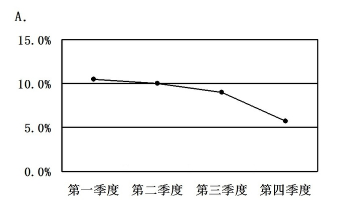

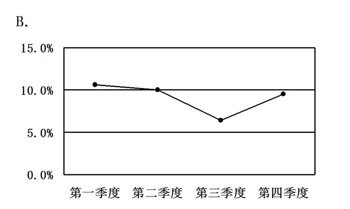

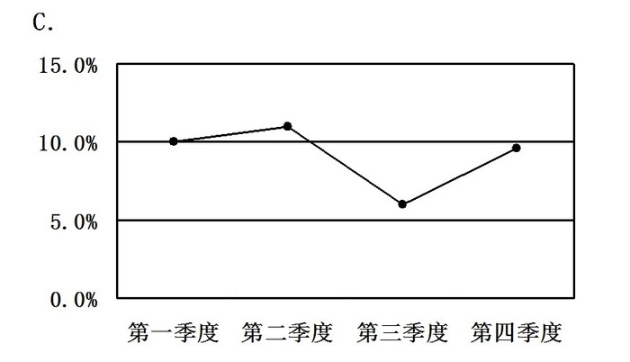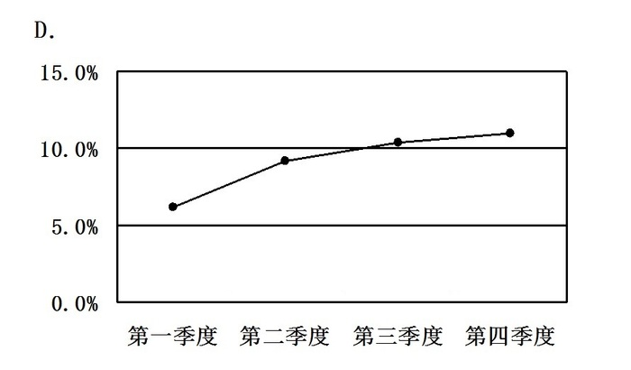

A. A

B. B

C. C

D. D

第 117 题 · 答案与解析

**参考答案（粉笔题库参考内容）**

A

**解析**

定位文字材料第一段：分季度看，一季度增长10.6%，二季度增长10.1%，三季度增长9.0%，四季度增长6.8%。可知，增长率逐季度呈下降趋势，只有A项符合，当选。

故正确答案为A。

**考点**：文字资料、直接找数

**来源**：2009年北京市公务员录用考试《行测》题（社招）第117题

### 第 118 题

下列选项中，正确的有：

A. 2007年，我国城镇固定资产投资中第一产业投资额高于2000亿元

B. 2007年，我国城镇固定资产投资中第二产业投资额低于第三产业投资额

C. 2007年，我国城镇固定资产投资额低于100000亿元

D. 2007年，我国城镇固定资产投资额比2008年少50000余亿元

第 118 题 · 答案与解析

**参考答案（粉笔题库参考内容）**

B

**解析**

A项：定位文字材料第三段可得：2008年在城镇投资中第一产业投资2256亿元，增长54.5%。根据公式：基期量=现期量/(1+r)，则2007年，我国城镇固定资产投资中第一产业投资额= 2256/(1+54.5%)≈2256/1.5=1504亿元＜2000亿元，错误；

B项：定位文字材料第三段可得：2008年在城镇投资中第二产业投资65036亿元，增长28.0%；第三产业投资80875亿元，增长24.1%。根据公式：基期量=现期量/(1+r)，则2007年，我国城镇固定资产投资中第二产业投资额= 65036/(1 + 28.0%)≈ 65036/1.3 ≈ 50000亿元；第三产业投资额= 80875/(1+24.1%)≈ 80875/1.24 ≈ 65000亿元。因此，2007年，我国城镇固定资产投资中第二产业投资额低于第三产业投资额，正确；

C项：定位文字材料第三段可得：2008年城镇固定资产投资148167亿元，增长26.1%。根据公式：基期量=现期量/(1+r)，则2007年，我国城镇固定资产投资额= 148167/(1 + 26.1%)＞ 148167/1.3≈ 114000＞100000亿元，错误；

D项：根据C项的计算值可得：2007年，我国城镇固定资产投资额比2008年少148167 - 114000^+ = 34167^-亿元，不到50000亿元，错误。

故正确答案为B。

**考点**：文字资料、综合分析

**来源**：2009年北京市公务员录用考试《行测》题（社招）第118题

### 第 119 题

2007年，城市消费品零售额与县及县级以下消费品零售额相比，增速：

A. 相同

B. 略快

C. 略慢

D. 无法比较

第 119 题 · 答案与解析

**参考答案（粉笔题库参考内容）**

B

**解析**

根据题干“2007年，城市消费品零售额与县及县级以下消费品零售额相比，增速”，并结合选项，可判定本题为一般增长率比较问题。定位文字材料第四段可得：分城乡看，城市消费品零售额······增长22.1%，加快4.9个百分点；县及县以下消费品零售额······增长20.7%，加快4.9个百分点。则2007年城市消费品零售额增速为22.1%-4.9%=17.2%，县及县以下消费品零售额增速为20.7%-4.9%=15.8%。因此，2007年，城市消费品零售额增速略快于县及县以下消费品零售额增速。

故正确答案为B。

**考点**：一般增长率、文字资料

**来源**：2009年北京市公务员录用考试《行测》题（社招）第119题

### 第 120 题

下列说法中，错误的是：

A. 2007年，批发和零售业与住宿和餐饮业消费品零售额的差值比2008年小

B. 2008年，分地区来看，中部地区比西部和东部地区的经济发展快

C. 2008年，国内销售增长较快，城乡消费旺盛

D. 2008年，我国第一、二、三产业发展均衡

第 120 题 · 答案与解析

**参考答案（粉笔题库参考内容）**

D

**解析**

A项：定位文字材料第四段可得：2008年，分行业看，批发和零售业消费品零售额91199亿元，增长21.5%；住宿和餐饮业消费品零售额15404亿元，增长24.7%。则2008年，两行业差值为91199-15404亿元。根据基期量=现期量/(1+增长率)，则2007年两行业差值为91199/(1+21.5%) − 15404/(1+24.7%)≈(91199-15404)/1.2＜ 91199 − 15404亿元，因此，2007年，批发和零售业与住宿和餐饮业消费品零售额的差值比2008年小，正确；

B项：定位文字材料第二、三段可得：2008年，东、中、西部地区（全年规模以上工业增加值）分别增长11.6%、15.8%和15.0%；东、中、西部地区城镇投资分别增长21.3%、33.5%和26.7%。因此，2008年，分地区来看，中部地区各项指标增速均高于西部和东部地区，正确；

C项：定位文字材料第四段可得：2008年，全年社会消费品零售总额108488亿元，比上年增长21.6%，增速比上年加快4.8个百分点。分城乡看，城市消费品零售额73735亿元，增长22.1%，加快4.9个百分点；县及县以下消费品零售额34753亿元，增长20.7%，加快4.9个百分点。因此，2008年，国内销售增长较快，城乡消费旺盛，正确；

D项：定位文字材料第一段可得：2008年，分产业看，第一产业增加值34000亿元，增长5.5%；第二产业增加值146183亿元，增长9.3%；第三产业增加值120487亿元，增长9.5%。因此，一、二、三产业增加值差距巨大，发展并不均衡，错误。

本题为选非题，故正确答案为D。

**考点**：文字资料、综合分析

**来源**：2009年北京市公务员录用考试《行测》题（社招）第120题

## 材料 8

2008年居民消费价格比上年上涨5.9%，其中食品价格上涨14.3%。固定资产投资价格上涨8.9%。工业品出厂价格上涨6.9%，其中生产资料价格上涨7.7%，生活资料价格上涨4.1%。原材料、燃料、动力购进价格上涨10.5%。农产品生产价格上涨14.1%。农业生产资料价格上涨20.3%。70个大中城市房屋销售价格上涨6.5%，其中新建住宅价格上涨7.1%，二手住宅价格上涨6.2%；房屋租赁价格上涨1.4%。

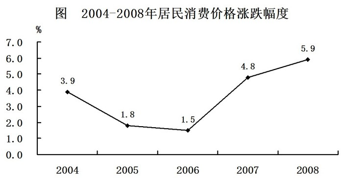

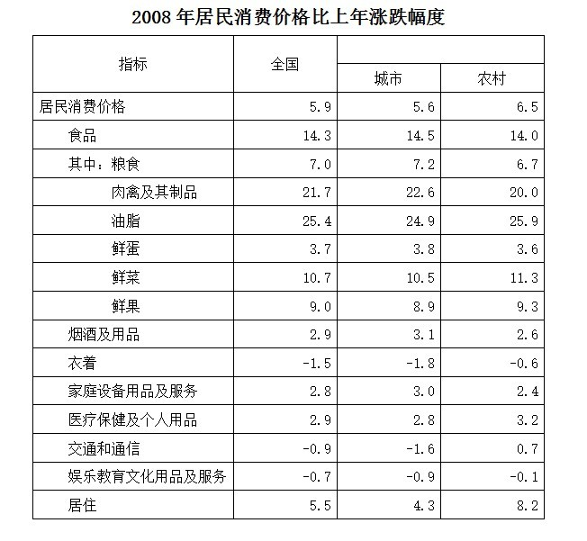

### 第 121 题

2004~2008年，居民消费价格平均涨幅为：

A. 3.48%

B. 3.58%

C. 3.83%

D. 4.47%

第 121 题 · 答案与解析

**参考答案（粉笔题库参考内容）**

B

**解析**

根据题干“2004~2008年，居民消费价格平均涨幅为”，结合材料中2004~2008年各年居民消费价格涨幅均已给出，可判定本题为现期平均数问题。定位统计图，2004~2008年居民消费价格涨跌幅度分别为：3.9%、1.8%、1.5%、4.8%、5.9%。则2004-2008年，居民消费价格平均涨幅为(3.9% + 1.8% + 1.5% + 4.8% + 5.9%)/5=3.58%。

故正确答案为B。

**考点**：现期平均数、综合资料

**来源**：2009年北京市公务员录用考试《行测》题（社招）第121题

### 第 122 题

2008年城市居民消费涨幅最小的为：

A. 衣着

B. 医疗保健及个人用品

C. 家庭设备用品及服务

D. 交通和通信

第 122 题 · 答案与解析

**参考答案（粉笔题库参考内容）**

A

**解析**

定位表格材料可得：2008年城市居民各项消费的涨幅分别为衣着（-1.8%）、医疗保健及个人用品（2.8%）、家庭设备用品及服务（3.0%）、交通和通信（-1.6%）。其中，2008年城市居民消费涨幅最小的为衣着（-1.8%）。

故正确答案为A。

**考点**：排序类、综合资料

**来源**：2009年北京市公务员录用考试《行测》题（社招）第122题

### 第 123 题

2008年，下列价格指标中涨幅最大的是：

A. 固定资产投资价格

B. 农产品生产价格

C. 大中城市房屋销售价格

D. 农业生产资料价格

第 123 题 · 答案与解析

**参考答案（粉笔题库参考内容）**

D

**解析**

定位文字材料可得：固定资产投资价格上涨8.9%、农产品生产价格上涨14.1%、大中城市房屋销售价格上涨6.5%、农业生产资料价格上涨20.3%。其中，农业生产资料价格上涨最多，为20.3%。

故正确答案为D。

**考点**：直接找数、综合资料

**来源**：2009年北京市公务员录用考试《行测》题（社招）第123题

### 第 124 题

下列说法中，正确的是：

A. 2008年，我国所有消费品价格均呈上涨趋势

B. 2008年，农村居民交通和通信价格涨势低于城市

C. 2008年，居民消费价格中食品价格涨幅最大

D. 2008年，全国衣着消费额低于2007年

第 124 题 · 答案与解析

**参考答案（粉笔题库参考内容）**

C

**解析**

A项：定位表格材料可得：2008年全国衣着价格涨幅为-1.5%、交通和通信价格涨幅为-0.9%、娱乐教育文化用品及服务价格涨幅为-0.7%，均为下降趋势，错误；

B项：定位表格材料可得：2008年农村居民交通和通信价格涨幅为0.7%、城市居民交通和通信价格涨幅为-1.6%，农村高于城市，错误；

C项：定位表格材料可得：2008年居民消费价格中各指标的涨跌幅度依次为食品（14.3%）、烟酒及用品（2.9%）、衣着（-1.5%）、家庭设备用品及服务（2.8%）、医疗保健及个人用品（2.9%）、交通和通信（-0.9%）、娱乐教育文化用品及服务（-0.7%）、居住（5.5%）。其中，涨幅最大的是食品，为14.3%，正确；

D项：定位表格材料，没有给出全国衣着消费额的数据，无法推出2008年与2007年全国衣着消费额情况，错误。

故正确答案为C。

**考点**：综合分析、综合资料

**来源**：2009年北京市公务员录用考试《行测》题（社招）第124题

### 第 125 题

下列说法中，不正确的是（  ）。

A. 农村居民食品价格涨幅低于城市

B. 与城市相比，农村衣着类消费品价格降幅较小

C. 与城市相比，农村交通和通信费需求更大

D. 城市和农村鲜蛋价格涨幅趋同

第 125 题 · 答案与解析

**参考答案（粉笔题库参考内容）**

C

**解析**

A项：定位表格材料可得：农村居民食品价格涨幅为14.0%、城市居民食品价格涨幅为14.5%，农村低于城市，正确；

B项：定位表格材料可得：农村居民衣着价格降幅为0.6%、城市居民衣着价格降幅为1.8%，农村降幅小于城市，正确；

C项：定位表格材料，仅给出交通和通信消费价格涨幅的数据，而消费需求的大小与消费价格涨幅无关，无法推出，错误；

D项：定位表格材料可得：城市鲜蛋价格涨幅为3.8%、农村鲜蛋价格涨幅为3.6%，较为接近，正确。

本题为选非题，故正确答案为C。

**考点**：综合分析、综合资料

**来源**：2009年北京市公务员录用考试《行测》题（社招）第125题

## 材料 9

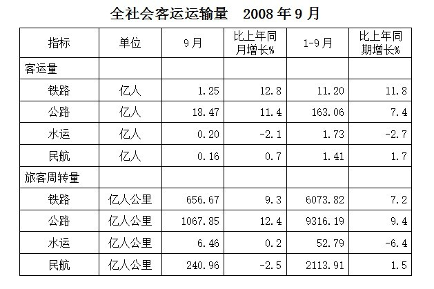

### 第 126 题

2008年1~9月，公路在旅客周转量比重比铁路多多少个百分点：

A. 2.2

B. 3.1

C. 18.5

D. 20.9

第 126 题 · 答案与解析

**参考答案（粉笔题库参考内容）**

C

**解析**

根据题干“2008年1-9月，······比重比······多多少个百分点”，结合材料时间为2008年，可判定本题为现期比重问题。定位表格材料可得：2008年1-9月公路旅客周转量为9316.19亿人公里，铁路旅客周转量为6073.82亿人公里，水运旅客周转量为52.79亿人公里，民航旅客周转量为2113.91亿人公里。结合公式：比重= 部分量/总体量，则公路占旅客周转量的比重比铁路多(9316.19 − 6073.82)/(9316.19 + 6073.82 + 52.79 + 2113.91)≈3242.37/17600≈18.4%，与C项最为接近。

故正确答案为C。

**考点**：现期比重、统计表

**来源**：2009年北京市公务员录用考试《行测》题（社招）第126题

### 第 127 题

2007年1~8月，水运旅客周转量约为多少亿人公里：

A. 15

B. 32

C. 43

D. 50

第 127 题 · 答案与解析

**参考答案（粉笔题库参考内容）**

D

**解析**

根据题干“2007年1-8月，水运旅客周转量约为······”，结合材料中给出2008年9月与1-9月数据，可判定本题为基期和差问题。定位表格材料可得：2008年1-9月水运旅客周转量为52.79亿人公里，同比增长率为-6.4%；2008年9月水运旅客周转量为6.46亿人公里，同比增长率为0.2%。根据公式：基期量=现期量/(1+增长率)，可知2007年1-8月水运旅客周转量为52.79/(1−6.4%)−6.46/(1+0.2%)＞52.79/1-6.46/1≈53-6=47亿人公里，只有D项符合。

故正确答案为D。

**考点**：基期和差、统计表

**来源**：2009年北京市公务员录用考试《行测》题（社招）第127题

### 第 128 题

2008年1~8月，公路客运量比上年同期增长：

A. 6.9%

B. 7.4%

C. 7.9%

D. 11.7%

第 128 题 · 答案与解析

**参考答案（粉笔题库参考内容）**

A

**解析**

根据题干“2008年1-8月······比上年同期增长”，结合选项为百分数，可判定本题为一般增长率问题。定位表格材料可得：2008年1-9月公路客运量为163.06亿人，增长率为7.4%；2008年9月公路客运量为18.47亿人，增长率为11.4%。根据公式：增长率=(现期量−基期量)/基期量=现期量/基期量−1，则2008年1-8月，公路客运量比上年同期增长(163.06-18.47)/(163.06/(1+7.4%)-18.47/(1+11.4%))-1≈144.59/(151.82-16.58)-1=144.59/135.24-1≈1.069 - 1 = 6.9%。

故正确答案为A。

**考点**：一般增长率、统计表

**来源**：2009年北京市公务员录用考试《行测》题（社招）第128题

### 第 129 题

2007年9月民航旅客周转量在当年1~9月民航旅客周转量中所占比例约为：

A. 11.4%

B. 11.9%

C. 60%

D. 88.1%

第 129 题 · 答案与解析

**参考答案（粉笔题库参考内容）**

B

**解析**

根据题干“2007年9月······在······中所占比例约为”，结合材料时间为2008年，可判定本题为基期比重问题。定位表格材料可得：2008年9月民航旅客周转量为240.96亿人公里（A），同比增长率为-2.5%（a）；1-9月民航旅客周转量为2113.91亿人公里（B），同比增长率为1.5%（b）。根据公式：基期比重= A/B × (1+b)/(1+a)，可得2007年9月民航旅客周转量占1-9月民航旅客周转量的比重为240.96/2113.91 × (1+1.5%)/(1−2.5%) ≈ 11.4% × 1.04 ≈ 11.9%。

故正确答案为B。

**考点**：基期比重、统计表

**来源**：2009年北京市公务员录用考试《行测》题（社招）第129题

### 第 130 题

与上年同期相比，2008年1~9月增长速度最快的是：

A. 公路客运量

B. 公路旅客周转量

C. 铁路客运量

D. 铁路旅客周转量

第 130 题 · 答案与解析

**参考答案（粉笔题库参考内容）**

C

**解析**

定位表格材料可得：2008年1-9月公路客运量的同比增速为7.4%、公路旅客周转量的同比增速为9.4%、铁路客运量的同比增速为11.8%、铁路旅客周转量的同比增速为7.2%。其中，铁路客运量的同比增长速度最快，为11.8%。

故正确答案为C。

**考点**：直接找数、统计表

**来源**：2009年北京市公务员录用考试《行测》题（社招）第130题

## 材料 10

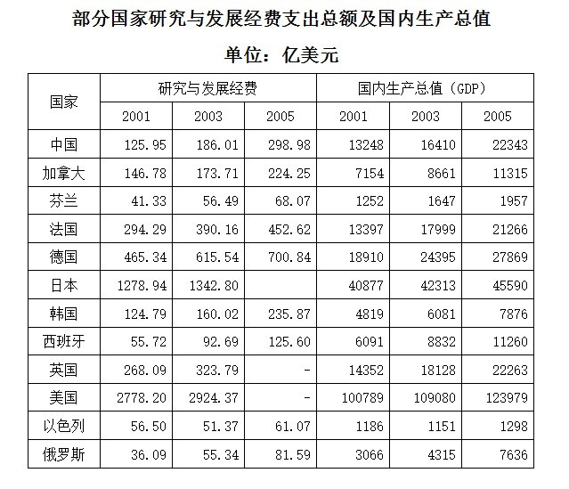

| 国家 | 研究与发展经费 | 研究与发展经费 | 研究与发展经费 | 国内生产总值（GDP） | 国内生产总值（GDP） | 国内生产总值（GDP） |
| --- | ---: | ---: | ---: | ---: | ---: | ---: |
|  | 2001 | 2003 | 2005 | 2001 | 2003 | 2005 |
| 中国 | 125.95 | 186.01 | 298.98 | 13248 | 16410 | 22343 |
| 加拿大 | 146.78 | 173.71 | 224.25 | 7154 | 8661 | 11315 |
| 芬兰 | 41.33 | 56.49 | 68.07 | 1252 | 1647 | 1957 |
| 法国 | 294.29 | 390.16 | 452.62 | 13397 | 17999 | 21266 |
| 德国 | 465.34 | 615.54 | 700.84 | 18910 | 24395 | 27869 |
| 日本 | 1278.94 | 1342.80 |  | 40877 | 42313 | 45590 |
| 韩国 | 124.79 | 160.02 | 235.87 | 4819 | 6081 | 7876 |
| 西班牙 | 55.72 | 92.69 | 125.60 | 6091 | 8832 | 11260 |
| 英国 | 268.09 | 323.79 | - | 14352 | 18128 | 22263 |
| 美国 | 2778.20 | 2924.37 | - | 100789 | 109080 | 123979 |
| 以色列 | 56.50 | 51.37 | 61.07 | 1186 | 1151 | 1298 |
| 俄罗斯 | 36.09 | 55.34 | 81.59 | 3066 | 4315 | 7636 |

### 第 131 题

2001年~2005年，西班牙研究与发展经费的年平均增长率为：

A. 22.5%

B. 50.1%

C. 122.5%

D. 150.1%

第 131 题 · 答案与解析

**参考答案（粉笔题库参考内容）**

A

**解析**

根据题干“2001年-2005年······年平均增长率为”，可判定本题为年均增长率计算问题。定位表格材料可得：2001年西班牙研究与发展经费为55.72亿美元、2005年为125.60亿美元。根据年均增长率公式：(1 + 年均增长率)^n = 现期量/基期量，因此(1+r)^4=125.60/55.72≈2.25。代入选项验算，若r=50.1%，则(1+50.1%)^4 ≈ 1.5^4 = 2.25^2 ＞ 2.25，显然年均增长率应小于50.1%，只有A项满足。

故正确答案为A。

**考点**：年均增长率、统计表

**来源**：2009年北京市公务员录用考试《行测》题（社招）第131题

### 第 132 题

表中所列国家中，2003年研究与发展经费最多的国家是：

A. 日本

B. 新加坡

C. 美国

D. 德国

第 132 题 · 答案与解析

**参考答案（粉笔题库参考内容）**

C

**解析**

定位表格材料可得： 2003年日本研究与发展经费为1342.80亿美元、美国研究与发展经费为2924.37亿美元、德国研究与发展经费为615.54亿美元；且表中没有列出新加坡的数据。因此，表中所列国家中经费最高的是美国。

故正确答案为C。

**考点**：直接找数、统计表

**来源**：2009年北京市公务员录用考试《行测》题（社招）第132题

### 第 133 题

2005年中国研究与发展经费占GDP的比重，比2001年提高了约多少个百分点：

A. 0.9

B. 3.8

C. 0.4

D. 1.3

第 133 题 · 答案与解析

**参考答案（粉笔题库参考内容）**

C

**解析**

根据题干“2005年······占······比重，比2001年提高了多少个百分点”，可判定本题为两期比重计算问题。定位表格材料可得：2005年中国研究与发展经费为298.98亿美元，GDP为22343亿美元；2001年中国研究与发展经费为125.95亿美元，GDP为13248亿美元。根据比重= 部分量/整体量，则2005年中国研究与发展经费占GDP比重比2001年多298.98/22343 − 125.95/13248 ≈298.98/22000 − 125.95/13000≈ 1.36% − 0.97% = 0.39个百分点，与C项最接近。

故正确答案为C。

**考点**：两期比重、统计表

**来源**：2009年北京市公务员录用考试《行测》题（社招）第133题

### 第 134 题

2003年，加拿大GDP在表中所列国家中的排名为：

A. 第六

B. 第七

C. 第八

D. 第九

第 134 题 · 答案与解析

**参考答案（粉笔题库参考内容）**

C

**解析**

定位表格材料可得：2003年加拿大GDP为8661亿美元；2003年GDP超过8661亿美元的国家有：中国、法国、德国、日本、西班牙、英国、美国，共7个国家。故加拿大排在第八位。

故正确答案为C。

**考点**：直接找数、统计表

**来源**：2009年北京市公务员录用考试《行测》题（社招）第134题

### 第 135 题

2001年，研究与发展经费占本国GDP的比重最高的国家是：

A. 西班牙

B. 以色列

C. 美国

D. 芬兰

第 135 题 · 答案与解析

**参考答案（粉笔题库参考内容）**

B

**解析**

根据题干“2001年······占······比重最高的国家是”，结合材料时间为2001年，可判定本题为现期比重比较问题。定位表格材料可得：2001年西班牙研究与发展经费为55.72亿美元，GDP为6091亿美元；以色列研究与发展经费为56.50亿美元，GDP为1186亿美元；美国研究与发展经费为2778.20亿美元，GDP为100789亿美元；芬兰研究与发展经费为41.33亿美元，GDP为1252亿美元。根据比重= 部分量/整体量，可知四个国家研究与发展经费占GDP比重分别为：西班牙55.72/6091≈0.9%、以色列56.50/1186 ≈ 4.8%、美国2778.20/100789 ≈ 2.8%、芬兰41.33/1252 ≈ 3.3%，其中比重最高的国家为以色列。

故正确答案为B。

**考点**：现期比重、统计表

**来源**：2009年北京市公务员录用考试《行测》题（社招）第135题

