# 2011年北京市公务员录用考试《行测》题

<!-- gwy:overview:start -->
> **北京 · 2011 · 行测 · 统考** ｜ 135 题 · 图片 141 处 · 答案随题折叠

| 题型模块 | 题量 | 题号 |
| --- | ---: | ---: |
| 常识判断 | 35 | 1–35 |
| 言语理解与表达 | 35 | 36–70 |
| 数量关系 | 15 | 71–85 |
| 判断推理 | 30 | 86–115 |
| 资料分析 | 20 | 116–135 |
| **合计** | **135** | |

导航：[题型与作答说明](#题型与作答说明) · [题目](#题目) · [材料 1](#材料-1)
<!-- gwy:overview:end -->

> 候选采集稿。参考答案及解析来自粉笔页面，不代表官方答案或真实高分答卷；来源使用许可与原卷对应关系仍需人工核实。

## 题型与作答说明

常识判断

（35题）

本部分包括两种类型的题目，请根据题目要求做出正确选择。多项选择题错选、多选、少选均不得分，但也不倒扣分。

言语理解与表达

（35题）

本部分均为单项选择题，着重考查考生对语言文字的理解和驾驭能力。问题可能是选择一个词语或一个句子，使表达最为准确，也可能是考查对文字内容的理解，你的选择应与题目要求最相符合。

数量关系

（15题）

本部分均为单项选择题。你可以在题本上运算，遇到难题，你可以跳过不做，待你有时间再返回来做。

判断推理

（30题）

本部分包括图形推理、逻辑判断与定义判断三种类型的题目。

资料分析

（20题）

针对下列图、表或文字回答问题。你应根据资料提供的信息进行分析、比较、计算、处理。你可以在题本上运算。

## 题目

### 第 1 题

2010年12月12日结束的中央经济工作会议指出，2011年经济工作要以科学发展为主题，以加快转变经济发展方式为主线，实施（  ）的货币政策。

A. 适度紧缩

B. 适度宽松

C. 稳健

D. 前紧后松

第 1 题 · 答案与解析

**参考答案（粉笔题库参考内容）**

C

**解析**

2010年12月12日闭幕的中央经济工作会议指出，明年我国将实施积极的财政政策和稳健的货币政策。

故正确答案为C。

**考点**：宏观经济与调控政策

**来源**：2011年北京市公务员录用考试《行测》题第1题

### 第 2 题

2011年我国保障性住房工作重点将以（  ）为主。

A. 建设好经济适用房

B. 发展公共租赁房

C. 扩大廉租房

D. 继续推行两限房

第 2 题 · 答案与解析

**参考答案（粉笔题库参考内容）**

B

**解析**

2011年我国建设保障性住房和各类棚户区改造住房的数量将大幅增长。重点建设公共租赁住房，加快解决低收入和中等偏低收入群体、新就业职工和外来务工人员的住房问题。加强对保障性住房建设质量的监管，确保百姓住上放心房。

故正确答案为B。

**来源**：2011年北京市公务员录用考试《行测》题第2题

### 第 3 题

2010年12月21日至22日，中央农村工作会议在北京举行。会议提出把（  ）作为国家基础设施建设的优先领域。

A. 电力

B. 农田

C. 公路

D. 水利

第 3 题 · 答案与解析

**参考答案（粉笔题库参考内容）**

D

**解析**

2010年中央农村工作会议提出明年农业农村工作六项重点任务，会议强调，做好新形势下的水利工作，把水利作为国家基础设施建设的优先领域。

故正确答案为D。

**考点**：宏观经济与调控政策

**来源**：2011年北京市公务员录用考试《行测》题第3题

### 第 4 题

党的十七届五中全会提出，坚持把（  ）作为加快转变经济发展方式的根本出发点和落脚点。

A. 保障和改善民生

B. 保障稳定

C. 提高居民收入

D. 增强综合国力

第 4 题 · 答案与解析

**参考答案（粉笔题库参考内容）**

A

**解析**

党的十七届五中全会提出，坚持把保障和改善民生作为加快转变经济发展方式的根本出发点和落脚点。

故正确答案为A。

**考点**：宏观经济与调控政策

**来源**：2011年北京市公务员录用考试《行测》题第4题

### 第 5 题

北京市“十二五”规划体现了“五规合一”，这五个规划是“以（  ）为基础”、“以产业规划为核心”、“以空间规划为引导”、“以文化遗产保护规划为重点”、“以土地利用规划为保障”。

A. 经济规划

B. 人口规划

C. 城建规划

D. 农业规划

第 5 题 · 答案与解析

**参考答案（粉笔题库参考内容）**

B

**解析**

北京市“十二五”规划强化的“五规合一”指：以人口规划为基础，以产业规划为核心，以空间规划为引导，以文化遗产保护规划为重点，以土地利用规划为保障。

故正确答案为B。

**来源**：2011年北京市公务员录用考试《行测》题第5题

### 第 6 题

2010年12月22日，国务院常务会议决定，自2011年1月1日起继续提高退休人员基本养老金，全国月人均增加140元左右，这是自2005年起第（  ）次上调企业退休人员基本养老金。

A. 五

B. 六

C. 七

D. 八

第 6 题 · 答案与解析

**参考答案（粉笔题库参考内容）**

C

**解析**

温家宝总理2010年12月22日主持召开国务院常务会议，决定再次提高企业退休人员基本养老金，提高幅度按2010年企业退休人员月人均基本养老金的10%左右确定，全国月人均增加140元左右。自2005年起，国家已连续六年七次提高企业退休人员基本养老金，企业退休人员的总体待遇水平翻了一番。

故正确答案为C。

**来源**：2011年北京市公务员录用考试《行测》题第6题

### 第 7 题

完善的社会保障体系是社会和谐稳定的安全网。“十二五”期间，北京市人力社保部门将加快构建城乡一体化的社会保障体系，实现社会保障从（  ）向（  ）转移。

A. “城镇为主体” “城乡平衡发展”

B. “制度保障” “法律保障”

C. “制度全覆盖” “人群全覆盖”

D. “单位养老” “社会养老”

第 7 题 · 答案与解析

**参考答案（粉笔题库参考内容）**

C

**解析**

“十二五”期间，北京人力社保部门将加快构建城乡一体化的社会保障体系，实现社会保障从“制度全覆盖”向“人群全覆盖”转移。

故正确答案为C。

**来源**：2011年北京市公务员录用考试《行测》题第7题

### 第 8 题

为了降低北京市民食盐量，减少高血压的发病率，北京市已于2011年年初启动“限盐行动”，将全面推广使用有利于预防高血压、保护心脑血管的：

A. 低钠盐

B. 低钾盐

C. 加碘盐

D. 加钙盐

第 8 题 · 答案与解析

**参考答案（粉笔题库参考内容）**

A

**解析**

北京市2010年起推出“限盐行动”，向餐馆、集体食堂和家庭推广使用低钠盐，以减少高血压、糖尿病、冠心病等慢性疾病的发生。

故正确答案为A。

**本题相关知识点：**

低钠盐，是以氯化钠(NaCl)，碘酸钾(），过去曾以碘化钾(KI)，目前用碘酸钾（）为原料，再添加了一定量的氯化钾和硫酸镁，从而改善体内钠(Na+)、钾(K+)、镁(）的平衡状态，食用低钠盐可降低高血压、心血管疾病的风险。

**考点**：生活常识

**来源**：2011年北京市公务员录用考试《行测》题第8题

### 第 9 题

下列选项中，属于北京市世界级文化遗产的是：

A. 周口店遗址

B. 恭王府

C. 明城墙

D. 元大都遗址

第 9 题 · 答案与解析

**参考答案（粉笔题库参考内容）**

A

**解析**

北京市的世界级文化遗产包括：明十三陵、故宫博物院、周口店北京猿人遗址、长城、天坛、颐和园。

故正确答案为A。

**考点**：文化常识

**来源**：2011年北京市公务员录用考试《行测》题第9题

### 第 10 题

1949年10月1日，中华人民共和国成立。当时一些报刊评论说：“中国人民站起来了”。这句话的含义之一是：

A. 社会主义革命基本完成

B. 国民党在大陆的势力被彻底清除

C. 人民掌握了国家权力

D. 人民代表大会制度确立

第 10 题 · 答案与解析

**参考答案（粉笔题库参考内容）**

C

**解析**

本题考查毛中特。

1949年10月1日，中华人民共和国成立，开辟了中国历史新纪元。从此，中国结束了一百多年来被侵略被奴役的屈辱历史，真正成为独立自主的国家。“中国人民站起来了”的含义是人民掌握了国家权力。

故正确答案为C。

**考点**：党的历史

**来源**：2011年北京市公务员录用考试《行测》题第10题

### 第 11 题

“激湍之下，必有深潭；高丘之下，必有浚谷”蕴涵的哲理是：

A. 对立统一的关系

B. 质量互变的关系

C. 肯定与否定的关系

D. 矛盾的普遍性与特殊性的关系

第 11 题 · 答案与解析

**参考答案（粉笔题库参考内容）**

A

**解析**

对立统一规律揭示出，自然界、社会和思想领域中的任何事物都包含着矛盾性，矛盾双方既统一又斗争，推动着事物的发展。“激湍之下，必有深潭；高丘之下，必有浚谷”这句话即蕴含着对立统一的规律。

故正确答案为A。

**考点**：唯物辩证法

**来源**：2011年北京市公务员录用考试《行测》题第11题

### 第 12 题

“人的本质不是单个人所固有的抽象物，在其现实性上，它是一切社会关系的总和。”

这句话说明：

A. 自然属性是人的本质属性

B. 自然属性和社会属性都是人的本质属性

C. 社会属性是人的本质属性

D. 自然属性和社会属性都不是人的本质属性

第 12 题 · 答案与解析

**参考答案（粉笔题库参考内容）**

C

**解析**

这句话是马克思在《关于费尔巴哈的提纲》一文中提出的。人既有自然属性又有社会属性。所谓自然属性是指人的肉体存在及其特性；所谓社会属性是指在实践活动的基础上人与人之间发生的各种关系。自然属性是人存在的基础， 但人之所以为人， 不在于人的自然性， 而在于人的社会性。因此，从“人的本质在其现实性上是一切社会关系的总和”这一观点出发， 必然得出结论：社会属性是人的本质属性。

故正确答案为C。

**考点**：哲学-其他

**来源**：2011年北京市公务员录用考试《行测》题第12题

### 第 13 题

在我国，全国武装力量由（  ）领导并统一指挥。

A. 国务院

B. 中央军事委员会

C. 中华人民共和国主席

D. 国防部

第 13 题 · 答案与解析

**参考答案（粉笔题库参考内容）**

B

**解析**

根据《宪法》第九十三条规定：“中华人民共和国中央军事委员会领导全国武装力量。”

故正确答案为B。

**考点**：宪法

**来源**：2011年北京市公务员录用考试《行测》题第13题

### 第 14 题

（  ）是经济社会发展的第一资源。

A. 金融

B. 教育

C. 人才

D. 农业

第 14 题 · 答案与解析

**参考答案（粉笔题库参考内容）**

C

**解析**

《国家中长期人才发展规划纲要（2010-2020年）》序言中明确指出：人才是指具有一定的专业知识或专门技能，进行创造性劳动并对社会作出贡献的人，是人力资源中能力和素质较高的劳动者。人才是我国经济社会发展的第一资源。

故正确答案为C。

**来源**：2011年北京市公务员录用考试《行测》题第14题

### 第 15 题

在我国，各级人民检察院属于：

A. 立法机关

B. 执法机关

C. 司法机关

D. 法律监督机关

第 15 题 · 答案与解析

**参考答案（粉笔题库参考内容）**

D

**解析**

根据《宪法》第一百三十四条规定：“中华人民共和国人民检察院是国家的法律监督机关。”

故正确答案为D。

**考点**：宪法

**来源**：2011年北京市公务员录用考试《行测》题第15题

### 第 16 题

国家财政收入中最主要的收入来源是：

A. 收费收入

B. 税收

C. 国有资产收益

D. 债务收入

第 16 题 · 答案与解析

**参考答案（粉笔题库参考内容）**

B

**解析**

税收是政府为实现其职能的需要，凭借其政治权力并按照特定的标准，强制、无偿地取得财政收入的一种形式，它是现代国家财政收入最重要的收入形式和最主要的收入来源。

故正确答案为B。

**考点**：宏观经济与调控政策

**来源**：2011年北京市公务员录用考试《行测》题第16题

### 第 17 题

如果一国货币汇率上升，即对外升值，一般会导致：

A. 本国进口增加

B. 本国旅游收入不变

C. 本国出口增加

D. 本国旅游收入增加

第 17 题 · 答案与解析

**参考答案（粉笔题库参考内容）**

A

**解析**

一国货币升值，意味着本国商品价格在国际市场上上涨，其他因素不变的情况下，销量就要下降，所以一般会导致本国出口减少，但对消费者有利。本国货币升值了，可以兑换出更多的外国货币，可以购买更多的国外商品，一般会导致本国进口增加。对于来本国旅游的外国游客来说，购买本国商品的价格上涨，所以会导致本国旅游收入减少。

故正确答案为A。

**考点**：国际经济及组织

**来源**：2011年北京市公务员录用考试《行测》题第17题

### 第 18 题

《公务员法》规定，公务员考核中重点考核内容为：

A. 德

B. 能

C. 勤

D. 绩

第 18 题 · 答案与解析

**参考答案（粉笔题库参考内容）**

D

**解析**

根据《公务员法》第三十五条规定，公务员的考核应当按照管理权限，全面考核公务员的德、能、绩、廉，重点考核政治素质和工作实绩。考核指标根据不同职位类别、不同层级机关分别设置。

故正确答案为D。

**考点**：行政法

**来源**：2011年北京市公务员录用考试《行测》题第18题

### 第 19 题

李军是某单位的会计，他为了盗窃单位保险柜里的现金而设法配制了保险柜的钥匙。后来李军在盗窃过程中因害怕被发现而将配制的钥匙丢弃，没有窃取现金。

李军的行为属于：

A. 犯罪预备

B. 犯罪既遂

C. 犯罪中止

D. 犯罪未遂

第 19 题 · 答案与解析

**参考答案（粉笔题库参考内容）**

C

**解析**

本题考查法律常识。

A项错误，犯罪预备，是指犯罪分子在犯罪的准备阶段，由于意志以外的原因未能着手。而本题中，李军在盗窃过程中，属于着手实行阶段。且因害怕被发现而将配制的钥匙丢弃，属于意志以内的原因，故不属于犯罪预备。

B项错误，盗窃罪的既遂标准通说观念为财物已经脱离主人控制。本题中，李军尚且没有盗得财物，更不谈脱离主人控制，故盗窃罪没有既遂。

C项正确，犯罪中止，是指犯罪分子在犯罪的实施过程中，自动放弃犯罪或者自动有效地防止犯罪结果的发生。本题中，李军属于在犯罪过程中自动放弃犯罪，属于犯罪中止。

D项错误，犯罪未遂，是指犯罪分子已经着手实施犯罪，由于意志以外的原因未得逞。本题中，李军虽然属于着手实施阶段，但是最终没有盗得财物，是其主动放弃，而非意志以外的原因，不构成犯罪未遂。

故正确答案为C。

**考点**：刑法

**来源**：2011年北京市公务员录用考试《行测》题第19题

### 第 20 题

甲、乙、丙为某合伙企业的合伙人，后该合伙企业经营亏损，财产不足以清偿到期债务。根据《中华人民共和国合伙企业法》规定，甲、乙、丙对该债务应承担：

A. 无限责任

B. 按份责任

C. 无限连带责任

D. 有限连带责任

第 20 题 · 答案与解析

**参考答案（粉笔题库参考内容）**

C

**解析**

根据《合伙企业法》第三十九条规定：“合伙企业对其债务，应先以其全部财产进行清偿。合伙企业财产不足清偿到期债务的，各合伙人应当承担无限连带清偿责任。”这一规定确立了合伙企业债务责任的基本原则和形式。因此甲、乙、丙作为合伙人应该承担无限连带清偿责任。

故正确答案为C。

**本题相关知识点：**

无限连带责任：每个合伙人对于合伙债务都负有全部清偿的义务，而合伙的债权人也有权向合伙人中的任何一人或数人要求其清偿债务的一部分或全部。

**考点**：劳动法和经济法

**来源**：2011年北京市公务员录用考试《行测》题第20题

### 第 21 题

某作家写了一本散文集，他对这本散文集所享有的发表权的保护期限为：

A. 30年

B. 作家终生

C. 作家终生及其死后50年

D. 永久享有

第 21 题 · 答案与解析

**参考答案（粉笔题库参考内容）**

C

**解析**

根据《著作权法》第二十一条：“公民的作品，其发表权、本法第十条第一款第（五）项至第（十七）项规定的权利的保护期为作者终生及其死亡后五十年，截止于作者死亡后第五十年的12月31日；如果是合作作品，截止于最后死亡的作者死亡后第五十年的12月31日。”

故正确答案为C。

**考点**：其他法律法规

**来源**：2011年北京市公务员录用考试《行测》题第21题

### 第 22 题

体操运动员在上器械前，经常往手掌上抹一种白色的粉末，这主要是为了：

A. 使手变的粗糙

B. 吸取手上的汗水

C. 刺激肌肉

D. 保护皮肤

第 22 题 · 答案与解析

**参考答案（粉笔题库参考内容）**

B

**解析**

体操运动员在上器械做体操前，举重运动员举杠铃前，常在手掌心上抹一种白色的粉末，这种白色粉末叫“碳酸镁”，人们通常又称之为“镁粉”。碳酸镁质量很轻，具有很强的吸湿作用。运动员在比赛时，手掌心常会冒汗，这对体操和举重运动员来说非常不利。因为湿滑的掌心会使摩擦力减小，使得运动员握不住器械，不仅影响动作的质量，严重时还会使运动员从器械上跌落下来，造成失误，甚至受伤。

故正确答案为B。

**考点**：生活常识

**来源**：2011年北京市公务员录用考试《行测》题第22题

### 第 23 题

我国领土的最南端是：

A. 南沙群岛的曾母暗沙

B. 海南岛的天涯海角

C. 西沙群岛的珊瑚岛

D. 中沙群岛的黄岩岛

第 23 题 · 答案与解析

**参考答案（粉笔题库参考内容）**

A

**解析**

曾母暗沙，（Zengmu Ansha，西方人称之为James Shoal）是一座位于中国南海的暗沙，由曾母礁丘、八仙暗沙和立地暗沙组成，主礁曾母礁丘位于北纬3度58分，东经112度17分，终年没于水下，有“水下珊瑚沙洲”之称，为南沙群岛的一部分，也是中华人民共和国宣示的领土的最南端。

故正确答案为A。

**考点**：中国地理

**来源**：2011年北京市公务员录用考试《行测》题第23题

### 第 24 题

禁止在主送某机关的同时抄送发文单位下级机关的文件是：

A. 主送给某下级有关单位的政策性批复

B. 主送给平级机关的商洽性函件

C. 主送给上级机关的请求指示的文件

D. 主送给上级机关的报告性文件

第 24 题 · 答案与解析

**参考答案（粉笔题库参考内容）**

C

**解析**

根据《国家行政机关公文处理办法》第二十一条：“‘请示’应当一文一事；一般只写一个主送机关，需要同时送其他机关的，应当用抄送形式，但不得抄送其下级机关。”

故正确答案为C。

**来源**：2011年北京市公务员录用考试《行测》题第24题

### 第 25 题

2011年2月18日，在（  ）进行的模拟登陆火星试验再次引起人们的关注，这项试验的目的是了解未来登陆火星的宇航员的身心状态，为将来探测火星积累经验。当天，中国志愿者王跃首次登上“火星”表面。

A. 中国

B. 俄罗斯

C. 法国

D. 意大利

第 25 题 · 答案与解析

**参考答案（粉笔题库参考内容）**

B

**解析**

“火星-500”试验由俄罗斯等国发起，其目的是了解未来前往火星的宇航员的心理和生理状态，为未来火星探测积累经验。“火星-500”是一个由多个部分组成的地面模拟实验火星载人飞行试验。实验设施位于莫斯科俄罗斯科学院生物医学问题研究所（IBMP）。整个试验持续520天，来自中国、俄罗斯、法国和意大利的6名志愿者用250天“飞往”火星，30天“驻留”火星，240天“返回”地球。按照计划，2011年2月18日，中国志愿者王跃和俄罗斯志愿者亚历山大·斯莫列耶夫斯基实施火星“登陆”。

故正确答案为B。

**考点**：科技理论与成就

**来源**：2011年北京市公务员录用考试《行测》题第25题

### 第 26 题

下列选项中，属于我市“三农”工作取得的成就的是：

A. 城乡社会管理实现了无缝对接

B. 建立了以中心城—新城—小城镇—新型农村社区为节点的城乡体系

C. 实现了农业资源的减量化、再利用和再循环

D. 农村发生了由表及里的变化

第 26 题 · 答案与解析

**参考答案（粉笔题库参考内容）**

CD

**解析**

“十一五”期间，北京市“三农”工作取得巨大成就，从发展变化的角度来看，主要是在四个方面发生了变化：一是农业发生了功能性变化，二是农村发生了由表及里的变化，三是农民发生了观念性变化，四是体制发生了融合性变化。其中，在生态方面，循环农业促进了农业生态环境的提升。五年来，北京大力开发农业的生态功能，通过多种方式实现了农业资源的减量化、再利用和再循环。

故正确答案为C、D。

**考点**：经济建设

**来源**：2011年北京市公务员录用考试《行测》题第26题

### 第 27 题

下列属于我市做好生活必需品市场调控保障工作，抑制价格过快上涨势头的措施的是：

A. 强化价格监测预警，制定各项应急预案

B. 落实居民救助政策，安排好困难群众生活

C. 强化能源运行调度，做好煤电油气运协调工作

D. 强化区域合作能力，保障农产品货源供应

第 27 题 · 答案与解析

**参考答案（粉笔题库参考内容）**

ACD

**解析**

2010年11月30日下午，北京市政府召开专题会议，研究本市贯彻落实《国务院关于稳定消费价格总水平保障群众基本生活的通知》等事项。会议决定，做好本市生活必需品市场调控保障工作，抑制价格过快上涨势头，本市将采取12项措施：大力发展农业生产，提高农产品自给能力；强化区域合作能力，保障农产品货源供应；优化市场流通渠道，降低流通环节成本；规范行政事业性收费，切实减轻经营者负担；强化能源运行调度，做好煤电油气运协调工作；完善政府储备，增强保障市场供应物资基础；完善绿色通道政策，畅通运输分流渠道；加大执法检查力度，维护市场价格秩序；强化价格监测预警，制定各项应急预案；落实价格补贴政策，安排好困难群众生活；建立价格信息发布制度，正确引导社会舆论；发挥协调机制优势，确保政策措施落实到位。

故正确答案为A、C、D。

**考点**：宏观经济与调控政策

**来源**：2011年北京市公务员录用考试《行测》题第27题

### 第 28 题

社会主义市场经济倡导正当竞争，反对不正当竞争。下列企业行为中，属于不正当竞争的是：

A. 甲企业为了扩大销售，加大广告宣传力度，影响消费者购买行为

B. 乙企业为了扩大市场份额，进行抽奖式有奖销售，最高奖励现金10万元

C. 丙企业通过捐建希望小学，提高了知名度，扩大了市场份额

D. 丁企业为了稳定市场份额，联合行业内的其他企业达成价格协议

第 28 题 · 答案与解析

**参考答案（粉笔题库参考内容）**

BD

**解析**

根据《反不正当竞争法》与《反垄断法》，有奖销售属于不正当竞争，与其他企业达成价格协议属于经营者之间的不正当联合，也属于不正当竞争行为。

故正确答案为B、D。

**考点**：劳动法和经济法

**来源**：2011年北京市公务员录用考试《行测》题第28题

### 第 29 题

在社会主义市场经济体制中，政府的经济职能主要有：

A. 调节收入分配和进行资源配置

B. 制定市场规则和维护市场秩序

C. 制定财政政策和货币政策，干预经济运行

D. 制定经济发展计划和产业政策，引导资源流向

第 29 题 · 答案与解析

**参考答案（粉笔题库参考内容）**

ABCD

**解析**

在社会主义市场经济体制中，政府的经济职能的内容包括：

（1）政府收入分配职能。指政府通过各种政策工具，参与一定时期国民收入的初次分配与再分配，实现收入在全社会各部门、各地区、各单位，以及各社会成员之间进行合理分割，缩小收入差距，体现社会公平。

（2）政府经济稳定与发展职能。指通过干预、调节国民经济运行，达到物价稳定、充分就业、国际收支平衡等目标，实现经济发展的目的。

（3）政府资源配置职能。指通过政府经济活动，引导人力、物力、财力等社会资源流动，形成一定的产业结构、区域经济结构等经济结构，优化资源配置结构，提高资源使用效率。

（4）市场管制职能。指通过用法律明确界定和规范市场主体间的权利、义务关系，从而为市场经济的正常运行提供必要的保障。

故正确答案为A、B、C、D。

**来源**：2011年北京市公务员录用考试《行测》题第29题

### 第 30 题

下列选项中，属于我国中央银行主要业务的是：

A. 对银行的业务

B. 对企业的业务

C. 对政府的业务

D. 对居民的业务

第 30 题 · 答案与解析

**参考答案（粉笔题库参考内容）**

AC

**解析**

中央银行的主要业务包括：货币发行业务，这是中央银行的主要业务，人民币发行业务是通过发行库与业务库的调拨往来进行的；对银行的业务，包括集中准备金、最后贷款人（对商业银行提供的再抵押放款、再贴现和信用放款）、全国清算；对政府的业务，包括代理国库、代理国家债券发行、对国家给予信贷支持、保管外汇和黄金储备、制定并执行有关金融管理法规。
故正确答案为A、C。

**考点**：宏观经济与调控政策

**来源**：2011年北京市公务员录用考试《行测》题第30题

### 第 31 题

杨某与刘某在日常生活中有矛盾。杨某为了泄私愤，造谣说刘某生活作风有问题，致使刘某的生活和工作受到很不利的影响。

在这种情况下，刘某可以要求杨某承担的民事责任有：

A. 停止侵害

B. 恢复名誉

C. 消除影响

D. 赔礼道歉

第 31 题 · 答案与解析

**参考答案（粉笔题库参考内容）**

ABCD

**解析**

根据《民法通则》第一百二十条规定：“公民的······名誉权受到侵害的，有权要求停止侵害、恢复名誉、消除影响、赔礼道歉，并可以要求赔偿损失。”

根据《关于贯彻执行〈中华人民共和国民法通则〉若干问题的意见》第一百四十条规定：“以书面、口头等形式宣扬他人的隐私或者捏造事实公然丑化他人人格以及用侮辱诽谤等方式损害他人名誉，造成一定影响的，应当认定为侵害公民名誉权的行为。”杨某造谣刘某生活作风有问题，对刘某造成了名誉损害，因此刘某有权要求停止侵害、恢复名誉、消除影响、赔礼道歉，并可以要求赔偿损失。

故正确答案为ABCD。

**考点**：民法典

**来源**：2012年北京市公务员录用考试《行测》题第34题

### 第 32 题

下列处罚方式中，不属于治安管理处罚的是：

A. 罚款

B. 罚金

C. 拘役

D. 剥夺政治权利

第 32 题 · 答案与解析

**参考答案（粉笔题库参考内容）**

BCD

**解析**

根据《中华人民共和国治安管理处罚法》第十条规定：“治安管理处罚的种类分为：（一）警告；（二）罚款；（三）行政拘留；（四）吊销公安机关发放的许可证。对违反治安管理的外国人，可以附加适用限期出境或者驱逐出境。”

本题为选非题，故正确答案为BCD。

**本题相关知识点：**

罚金是刑事犯罪处罚，是指强制犯罪人向国家缴纳一定数额金钱的刑罚方法。罚金作为一种财产刑，是以剥夺犯罪人金钱为内容的，这是罚金与其他刑罚方法显著区别之所在。 罚款是指处罚违法者（行政处罚）或违反合同者以一定数量的钱（司法处罚）。

行政拘留是对违反行政法规的违法人员的一种行政处罚，是由公安机关直接做出的决定。拘役是刑罚的一种，是对违反刑法的人做出处罚。

剥夺政治权利是指剥夺犯罪人参加国家管理和政治活动权利的刑罚处罚。

**考点**：行政法

**来源**：2011年北京市公务员录用考试《行测》题第32题

### 第 33 题

下列选项中，属于我国宪法基本原则的有：

A. 人民主权原则

B. 民主集中制原则

C. 社会主义法治原则

D. 权力分立与制衡原则

第 33 题 · 答案与解析

**参考答案（粉笔题库参考内容）**

AC

**解析**

宪法的基本原则是：人民主权原则；基本人权原则；法治原则；权力制约原则。

A项正确，人民主权原则，亦称主权在民原则，核心是国家权力来源于人民，属于人民。

B项错误，民主集中制原则只是国家机构的组织与活动原则，不是宪法的基本原则。

C项正确，法治原则，即“依法治国”，是对于“人治”而言的，它指的是一种治理国家的理论、原则和方法。

D项错误，我国是人民代表大会制度，人民代表大会是权力机关，法院是审判机关，检察院是法律监督机关，但是法院和检察院对人民代表大会负责，我国不是三权分立。

故正确答案为AC。

**考点**：宪法

**来源**：2011年北京市公务员录用考试《行测》题第33题

### 第 34 题

下列选项中，哪些不属于主要由气候原因形成的景观：

A. 冰川地貌

B. 日不落现象

C. 潮汐现象

D. 极光现象

第 34 题 · 答案与解析

**参考答案（粉笔题库参考内容）**

BCD

**解析**

气候是指大气物理特征的长期平均状态。影响气候的因素是复杂的，同时气候又通过一定的水体、土壤、生物等因素形成不同的类型。

A项，冰川是准塑性体，冰川的运动包含内部的运动和底部的滑动两部分，是进行侵蚀、搬运、堆积并塑造各种冰川地貌的动力。但它不是塑造冰川地貌的唯一动力，是与寒冻、雪蚀、雪崩、流水等各种应力共同作用，才形成了冰川地区的地貌景观。冰川属于气候景观。

B项，极昼是出现在极圈范围内的一种“太阳终日不落”的现象，所以又称“永昼”。极昼只出现在地球南、北极圈以内地区。太阳直射于北半球时，极昼出现在北极地区，而极夜则出现在南极地区；太阳直射在南半球时则反之。如太阳直射在北纬10°，则北纬80°~90°地区将出现极昼，南纬80°~90°地区则出现极夜。

C项，潮汐现象是指海水在天体（主要是月球和太阳）引潮力作用下所产生的周期性运动，习惯上把海面垂直方向涨落称为潮汐，而海水在水平方向的流动称为潮流。

D项，极光是由于太阳带电粒子（太阳风）进入地球磁场，在地球南北两极附近地区的高空夜间出现的灿烂美丽的光辉。

极昼、潮汐、极光现象都不是因为气候原因出现的。

本题为选非题，故正确答案为BCD。

**考点**：其他

**来源**：2011年北京市公务员录用考试《行测》题第34题

### 第 35 题

三希堂位于北京故宫博物院养心殿，以储存三希墨宝而闻名于世。三希是指：

A. 《快雪时晴帖》

B. 《伯远帖》

C. 《中秋帖》

D. 《黄州寒食帖》

第 35 题 · 答案与解析

**参考答案（粉笔题库参考内容）**

ABC

**解析**

古文“希”同“稀”，“三希”即三件稀世珍宝。在当时，这两层含义是并重的。乾隆帝文韬武略、博学多识，能诗词，尤擅书法，曾多次在全国寻求历代大家的名帖，乾隆十一年（公元1746年）在三希堂收藏了晋朝大书法家王羲之的《快雪时晴帖》、王献之的《中秋帖》和王珣的《伯远帖》。这三件古代墨宝，被乾隆帝所珍爱，特意贮存在此，不时把玩。

故正确答案为A、B、C。

**考点**：文化常识

**来源**：2011年北京市公务员录用考试《行测》题第35题

## 材料 1

**阅读以下文字，完成各题。**

        在资源开采过程中，要认真贯彻落实（A）的精神，遵循市场规律，采取法律、经济和必要的行政措施，分配和规范各类市场主体合理开发资源，承担资源补偿、生态环境保护与修复等方面的责任和义务。要按照“谁开发、谁保护，谁受益、谁补偿，谁污染、谁治理，谁破坏、谁修复”的原则，明确企业是资源补偿、生态环境保护与修复的            。对资源已经或濒临枯竭的城市和国有矿业、森工企业，要给予必要的资金和政策支持。2011年之后要重点解决历史遗留问题，补偿社会保障、生态、人居环境和基础设施建设等方面的欠账。

        资源型城市要统一规划，加快产业结构调整和优化升级，大力发展接续替代产业，积极转移剩余生产能力，完善社会保障体系，加强各种职业培训，促进下岗失业人员【甲】再就业，解决资源型企业历史遗留问题，【乙】资源枯竭企业平稳退出和社会安定。对资源已经枯竭的城市，要【丙】有针对性的扶持政策，帮助解决资源枯竭矿山（森工）企业破产引发的经济衰退、职工失业等突出矛盾和问题。

### 第 36 题

根据公文处理法规的要求，A处的规范写法应为：

A. 国务院《关于促进资源型城市可持续发展的若干意见》（国发〔2007〕38号）

B. 《国务院关于促进资源型城市可持续发展的若干意见》（国发〔2007〕38号）

C. 国发〔2007〕38号文件即《关于促进资源型城市可持续发展的若干意见》

D. 国务院2007年第38号发文《关于促进资源型城市可持续发展的若干意见》

第 36 题 · 答案与解析

**参考答案（粉笔题库参考内容）**

B

**解析**

此公文名称的全称应为《国务院关于促进资源型城市可持续发展的若干意见》，其中发文机关不能任意省略，A、C、D三项均错误，发文字号一般放在紧接公文名称之后的括号里，表示补充说明之意。

故正确答案为B。

**来源**：2011年北京市公务员录用考试《行测》题第36题

### 第 37 题

第1段中划线的词语，使用有误的是：

A. 采取

B. 分配

C. 按照

D. 明确

第 37 题 · 答案与解析

**参考答案（粉笔题库参考内容）**

B

**解析**

采取：选择施行（某种方针、政策、措施等）。

分配：按一定的标准或规定分东西；安排、分派；经济学上指把生产资料分给生产单位或消费者。

按照：根据、依照。

明确：清晰明白而确定不移。

各类市场经济主体开发资源在市场经济条件下要遵循市场规律，有自发性和自主性，不可能采取法律、经济和必要的行政措施来强行分配，故“分配”一词表述有误。市场经济中的政府主要起宏观调控作用，对市场主体的运作行为只能是引导和规范。

故正确答案为B。

**来源**：2011年北京市公务员录用考试《行测》题第37题

### 第 38 题

填入第1段空白处最恰当的是：

A. 承担者

B. 执行者

C. 法人

D. 责任主体

第 38 题 · 答案与解析

**参考答案（粉笔题库参考内容）**

D

**解析**

资源补偿、生态环境保护和修复等方面的责任和义务，不一定完全由企业来承担，有可能由政府部门、事业单位等来承担，所以如果空白处使用“承担者”“执行者”等词，就会将全部的责任和义务赋予企业，这有违“谁开发、谁保护······”的原则本意。

而这里关键是要突出企业必须要承担主要责任这一特点，故用“责任主体”一词能明确地表达出这一含义，又不会否认其他实体承担责任的事实。“法人”本身既是权利的享有者，也是义务的承担者，放在文中欠妥。

故正确答案为D。

**来源**：2011年北京市公务员录用考试《行测》题第38题

### 第 39 题

依次填入第2段甲、乙、丙3处的词语，最恰当的是：

A. 实现 保障 施行

B. 施行 实现 保障

C. 施行 保障 实现

D. 保障 施行 实现

第 39 题 · 答案与解析

**参考答案（粉笔题库参考内容）**

A

**解析**

“再就业”和“下岗”一样，都是一种状态描述，要用含有“使成为事实”意义的“实现”来搭配；要避免出现因资源枯竭企业退出而引发社会问题，故要采取措施来“保障（保护某种权利，免受伤害）”“平稳退出和社会安定”；政策、法律作为规范性文件要实施、推行，为公众活动提供方向和标准，故应搭配“施行”。

故正确答案为A。

**来源**：2011年北京市公务员录用考试《行测》题第39题

### 第 40 题

对第1段文字的主旨，归纳最准确的是：

A. 建立生态环境保护机制

B. 建立资源型城市补偿机制

C. 建立完善社会保障机制

D. 建立资源开发补偿机制

第 40 题 · 答案与解析

**参考答案（粉笔题库参考内容）**

D

**解析**

本段分四句话。第一句从宏观方面讲资源开发的主体必须承担诸如资源补偿方面的相应责任，第二句着重讲企业在资源补偿、生态环境保护和修复中的责任主体地位，第三句讲部分特殊城市和企业在资源开发后的补偿问题，第四句讲的是亟待解决的是历史遗留问题所欠缺的补偿。

综合来看，本段讲的是资源开发的补偿机制。

故正确答案为D。

**来源**：2011年北京市公务员录用考试《行测》题第40题

## 材料 2

**阅读以下文字，完成各题。**

        跟电视一样，收视率对中国的电视和广告行业而言，是个地地道道的舶来品，在中国的应用不过短短二十余年。由于这是一个全新的行业指标，因此不仅国内开展此类业务的经验还有待摸索和积累，而且对这一领域进行深入研究的专家和机构也少之又少。如此一来，在当前收视率已经被看作电视、广告行业的通行货币的情况下，促进收视率调查的公开、透明和公平，就显得尤为迫切。根据美国、英国等开展该项业务较早的国家的经验，要真正实现收视率调查的公正、可信，不仅需要收视率调查机构本身的科学方法和诚信态度，更需要行业主管部门的监管调控及社会公众的积极参与。而对于今天的中国来说，通过一组报道，让更多公众知道了收视率这个行业术语，了解了收视率调查的方法，未尝不是一个良好的开端。

        另一方面，在获得了准确可信的收视率后，更为重要的恐怕是如何看待和使用收视率。说到底，收视率只是一个可供行业参考的数据，任何对其本身的攻击都只是\_\_\_\_\_\_，而如何将它用得科学、用得合理，却完全关乎从业人员的态度。

        实际上，与收视率一样，在文化产业快速发展的今天，网络点击率、电影票房、图书销售量、剧院上座率等等一系列数字，也越来越多地被提及，俨然将成为衡量文化产业各门类发展水平的唯一标准。殊不知，文化产品质量的优劣、文化产业发展水平的高低，却远不是几个简单的数字就可以量化评估的。一味地追求与商业利益挂钩的数字效应，不仅不能反映产业发展的真实面貌，还难免使产业发展走向歧途。从这个意义上说，收视率造假事件给我们带来的启示，不仅要警惕“唯收视率是瞻”，更要警惕整个文化产业发展过程中的“唯数字是瞻”。

### 第 41 题

第1段意在阐述这样一种观点，即：

A. 保证收视率公正可信的前提是了解收视率调查方法

B. 现在我国亟需促进收视率调查的公开、透明和公正

C. 目前在收视率调查方面我国仍需借鉴英美等国经验

D. 只有加强行业主管部门监控才能保证收视率的真实

第 41 题 · 答案与解析

**参考答案（粉笔题库参考内容）**

B

**解析**

本段论述所围绕的核心是我国收视率调查需要公开、透明和公正，无论是C项的“借鉴经验”、D项的“加强监控”还是A项的“了解收视率调查方法”，都是为了实现所要论述的核心需求。

故正确答案为B。

**来源**：2011年北京市公务员录用考试《行测》题第41题

### 第 42 题

关于收视率，下列哪项与本文不符：

A. 收视率在我国是一个全新的行业指标

B. 收视率只是一个可供行业参考的数据

C. 收视率调查的经验还有待进一步摸索和积累

D. 对收视率的态度和使用比收视率调查更重要

第 42 题 · 答案与解析

**参考答案（粉笔题库参考内容）**

D

**解析**

A项符合，文章第一句就点明“收视率是个地地道道的舶来品”；

B项符合，文章第二段的第二句直接提到“说到底，收视率只是一个可供行业参考的数据”；

C项符合，文章第一段提到收视率调查还属于不成熟的状态，还需要多方参与和摸索；

D项不符合，由文章第二段首句可知，作者认为对收视率的态度和使用比收视率本身更重要，而不是比收视率调查更重要，所以D项说法错误。

本题为选非题，故正确答案为D。

**来源**：2011年北京市公务员录用考试《行测》题第42题

### 第 43 题

填入文中第2段划线处最恰当的一项是：

A. 欲加之罪

B. 以偏概全

C. 欲盖弥彰

D. 推波助澜

第 43 题 · 答案与解析

**参考答案（粉笔题库参考内容）**

A

**解析**

文段中显示，收视率只是一个可供行业参考的数据，并不能代表全部，而成语“欲加之罪”可以引申为对某人或事物的故意攻击。文段中前面说“收视率只是一个······参考的数据”，然后说“任何对其本身的攻击······”，可以看出作者持否定态度，而且前后对应来看，传递的意思都是不愁没有攻击，而是看人们如何理解，A项当选。

B项，以偏概全，指用片面的观点看待整体问题，这里并不是最为准确的答案；

C项，欲盖弥彰，指想掩盖坏事的真相，结果反而更明显地暴露出来，与文段语境不符；

D项，推波助澜，比喻从旁鼓动、助长事物（多指坏的事物）的声势和发展，含贬义，也不合适。

故正确答案为A。

**来源**：2011年北京市公务员录用考试《行测》题第43题

### 第 44 题

根据本文，合理而科学地使用收视率关键在于：

A. 行业专家和机构要深入研究

B. 行业的主管部门要加强监控

C. 行业的从业人员要端正态度

D. 收视率调查机构要公正可信

第 44 题 · 答案与解析

**参考答案（粉笔题库参考内容）**

C

**解析**

由文章第二段尾句“……而如何将它用得科学、用得合理，却完全关乎从业人员的态度”可知，C项是其同义转换，当选。

A项以偏概全，文章中只是提到目前对于收视率缺乏研究，重心并不在此，排除；B项同样以偏概全，“行业监管”也只是第一段的部分体现，排除；D项调查机构的内容也同样不是重点，排除。

故正确答案为C。

**来源**：2011年北京市公务员录用考试《行测》题第44题

### 第 45 题

第3段旨在说明：

A. 简单的数字无法准确量化评估文化产品质量

B. 要警惕数字效应对文化产业产生的负面影响

C. 收视率与网络点击率、电影票房等本质相同

D. 目前收视率造假的最大驱动力就是商业利益

第 45 题 · 答案与解析

**参考答案（粉笔题库参考内容）**

B

**解析**

最后一段分三部分，第一句说明收视率等数字成为衡量文化产业发展水平的唯一标准，第二、三句说明数字效应的不足与危害，第四句推导出应该警惕数字效应的危害，属于结论句。

故能准确表现本段主旨的是第四句的内容，也就是B项。

故正确答案为B。

**来源**：2011年北京市公务员录用考试《行测》题第45题

## 材料 3

**阅读以下文字，完成下列各题。**

        鲸鱼不同于其他鱼类，是温血动物，从冰天雪地的南北极到酷热的赤道都可以看到鲸鱼的踪迹，无论是在什么样的环境下，鲸鱼的体温均保持在36℃左右，常在极圈活动的鲸鱼会具有局部异温功能。

        像鲸鱼、海豹和海豚这些大部分时间或一直都呆在海里的哺乳动物，用特殊的高级脂肪“外衣”保持自己的体温。但对于那些必须通过潜水进行捕食的动物来说，光有皮毛保护是不够的，因为厚重毛发里的空气会被极强的水压挤出来，皮毛的保温功能会大大降低。而北冰洋和南极周围的海洋深水水温可以降到零下40度，没有其他的保暖措施显然不行。

        鲸鱼和其他温血动物最大的不同点在于，当其活动环境的温度较低时，水有相当大的比热及传热能力，因此温度变化很快，鲸鱼无法以聚集、筑巢等方式维持体温，于是演化出超厚的皮下脂肪。过去曾记录到鲸鱼脂肪厚度最高达50公分。

        鲸脂是一层包裹整个身体的厚重脂肪“外衣”，重量可以达到体重的一半。这层脂肪含有细细的血管组织，除帮助保持体温，还为很多需要长途跋涉进行繁殖和觅食的海洋动物提供了重要能量储备。除此之外，这层脂肪还可以帮助快速游动的动物将身体塑造成流线型，减少在水中游动时所消耗的能量，同时提高速度。动物栖身的海水温度越低，脂肪也就越厚。鲸脂是通过吸食母体乳液获得的，举例来说，一只灰鲸幼仔每天要喝掉30加仑乳液。但这么厚的皮下脂肪还是不能完全阻挡体温外流，因此鲸鱼还需要摄取大量食物，以维持体温。

        鲸鱼的前鳍、尾鳍、背鳍并无鲸脂的分布，当鲸鱼潜到阳光照射不到的深海，或是南、北极时，鲸鱼的鱼鳍难道不会冻到无法活动吗？对此，鲸鱼鳍上的动脉分为无数平行的小动脉，每条小动脉周围又被许多纵行的静脉血管包围，形成一个个血管束，利用动脉与静脉的紧密接触减少热能的散失，这点和企鹅脚不怕冷的道理是一样的。

        这个特别的系统，主要控制鲸鳍末端有可能散失的热量，继而保持体温，但当鲸鱼因为活动而体热增加时，这个机制就会自行关闭，动脉血将一直保持着原有的温度到达鳍肢，并把过多的热量散发出去，中途就不再把一部分热量传递给静脉。

        此外，鲸鱼还会通过血管的收缩有效维持体温。当鲸鱼潜入深海时，周围温度降低，鲸鱼体表的血管会收缩，将血液集中送往脑部、心脏、肝、肾等内脏器官，从而维持内部体温；相反，当水温上升时，体表的血管便会扩张，加速散热。

### 第 46 题

下列关于鲸鱼的说法正确的是：

A. 主要通过鲸脂保温

B. 脂肪厚度高达50公分

C. 属于温血哺乳动物

D. 利用局部异温功能降低体温

第 46 题 · 答案与解析

**参考答案（粉笔题库参考内容）**

C

**解析**

A项错误，鲸脂虽然可以保持体温，但文中提到“这么厚的皮下脂肪还是不能完全阻挡体温外流，因此鲸鱼还需要摄取大量食物”，此外还有无鲸脂分布的身体部分也有独特的保温系统，血管的收缩也可以维持体温。因此总的来说不只是鲸脂在保温，各保温系统之间也并无大小主次之分；

B项错误，50公分只是记录的个例，不具有普遍性；

C项正确，文章第一段首句指出鲸鱼是温血动物，第二段首句指出鲸鱼是哺乳动物；

D项错误，文中提到常在极圈活动的鲸鱼会有局部异温功能，允许有机体局部体温降低以减少热散失。这是利用这个功能来减少自身热量的散失，而不是利用这个功能降低体温。

故正确答案为C。

**来源**：2011年北京市公务员录用考试《行测》题第46题

### 第 47 题

下列不符合文意的一项是：

A. 鲸脂具有保持体温、储备能量的作用

B. 海洋动物的脂肪厚度与海水温度成正比

C. 有的温血动物通过聚集的方式维持体温

D. 幼鲸通过吸食母体乳液获得鲸脂

第 47 题 · 答案与解析

**参考答案（粉笔题库参考内容）**

B

**解析**

由提问可知，本题考查文章细节。

由第四段第二句“这层脂肪······除帮助保持体温，还为······海洋动物提供了重要能量储备”可知，A项正确；

由第四段第四句“动物栖身的海水温度越低，脂肪也就越厚”可知，海水温度和脂肪厚度成反比，B项错误；

由第三段首句“鲸鱼和其他温血动物最大的不同点在于······鲸鱼无法以聚集、筑巢等方式维持体温”可推知，C项正确；

由第四段第五句“鲸脂是通过吸食母体乳液获得的”可知，D项正确。

本题为选非题，故正确答案为B。

**来源**：2011年北京市公务员录用考试《行测》题第47题

### 第 48 题

文中第6段划线部分“这个机制”指的是：

A. 低温环境下鲸鱼通过鳍部血管束保持鲸鳍末端温度

B. 鲸鱼的活动量增加时会产生体热从而提高体温

C. 鲸鱼鳍部动脉分为无数小动脉且血液流量丰富

D. 鲸鱼利用鳍部动脉紧密包围静脉保持身体温度

第 48 题 · 答案与解析

**参考答案（粉笔题库参考内容）**

A

**解析**

第六段的“这个机制”与该段的“这个特别的系统”是同一概念，而后者又是承接上一段内容而来的概念，即第五段讲到的鲸鳍利用特殊的血管结构来保温的原理。

故正确答案为A。

**来源**：2011年北京市公务员录用考试《行测》题第48题

### 第 49 题

鲸鱼在进入深海水域时通常：

A. 开始大量消耗鲸脂

B. 开启鲸鳍的血管束系统

C. 体温与水温保持一致

D. 减少活动量和捕食量

第 49 题 · 答案与解析

**参考答案（粉笔题库参考内容）**

B

**解析**

鲸脂的消耗在文中只是提到运动时会消耗，但低温时会不会自动大量消耗并没有提及，所以A项错误；

根据第五段可知，B项功能就是为了解决“鲸鱼潜到阳光照射不到的深海”时鱼鳍保温的问题，所以B项正确；

文章第一段提到“无论是在什么样的环境下，鲸鱼的体温均保持在36℃左右”，所以不可能与深海水域的水温保持一致，所以C项错误；

鲸鱼在进入深海水域时，外界温度降低，其自身应该增加热量以抵消热量的散失，但减少活动量和捕食量显然不利于热量的增加，不合常理，所以D项错误。

故正确答案为B。

**来源**：2011年北京市公务员录用考试《行测》题第49题

### 第 50 题

根据本文，如果鲸鱼体表血管出现扩张，最可能是因为：

A. 鲸鱼内脏器官的血液量突然增加

B. 鲸鱼的鲸脂超过体重一半

C. 鲸鱼突然增加了其活动量

D. 鲸鱼所处的环境温度较高

第 50 题 · 答案与解析

**参考答案（粉笔题库参考内容）**

D

**解析**

由文章最后一段“当水温上升时，体表的血管便会扩张，加速散热”可知，鲸鱼可能是进入了环境温度较高的水域，故D项当选。

而A、B、C三项文章中均未提及。

故正确答案为D。

**来源**：2011年北京市公务员录用考试《行测》题第50题

## 材料 4

**阅读以下文字，完成各题。**

        一般人常常以为，对任何问题不求甚解都是不好的。其实也不尽然，我们虽然不必提倡不求甚解的态度，但是，盲目地反对不求甚解的态度同样没有充分的理由。“不求甚解”这句话最早是陶渊明说的，他在《五柳先生传》中写道：“好读书，不求甚解；每有会意，便欣然忘食。”人们往往只抓住他说的前一句话，而丢了后一句话，因此，就很不满意陶渊明的读书态度。

        应该承认，好读书这个习惯的养成是很重要的。而读书的要诀，全在于会意。对于这一点，陶渊明尤其有独到的见解。而真正的会意又很不容易，所以陶渊明只好说“不求甚解”了。可见，这“不求甚解”四字有两层含义：一是劝诫学者不要骄傲自负，以为什么书一读就懂，而实际上不一定真正体会得了书中的真意，因此还是老老实实承认自己只是不求甚解为好；二是劝诫学者不要太固执、咬文嚼字，而要前后贯通，了解大意。这两层意思都很重要，值得我们好好体会。

        在这一方面，古人的确有许多成功的经验，诸葛亮就是这样读书的。据王粲《英雄记钞》，诸葛亮与徐庶、石广元、孟公威等人一道游学读书，“三人务于精熟，而亮独观其大略”。看来诸葛亮比徐庶等人确实要高明得多，           观其大略者往往知识更广泛，了解问题更全面。

        当然，这也不是说读书可以马马虎虎。观其大略同样需要认真读书，只是不死抠一字一句，不因小失大，不为某一局部而放弃整体。宋代理学家陆象山语录言：“读书且平平读，未晓处且放过，不必太滞。”这也是不因小失大的意思。所谓“未晓处且放过”，不是说未读懂的地方就放过不理会了，而是暂且放过，最后仍然会了解它的意思。

### 第 51 题

根据本文，人们通常把“好读书，不求甚解”理解为：

A. 不能够就所读书籍提出自己的见解

B. 读书应该广泛涉猎从而扩大知识面

C. 应多读书但无需完全理解书籍内容

D. 遇到不明白的问题不会向他人请教

第 51 题 · 答案与解析

**参考答案（粉笔题库参考内容）**

C

**解析**

陶渊明的“好读书，不求甚解”指在读书时不必一下子完全了解所读内容，有所会意即可。而人们通常对这句话的理解却是认为应多读书，但不用完全理解书中内容的意思，所以C项正确。

A项说要提出自己的见解，但实际上不求甚解指对文章书籍的理解；B、D两项在文中并未体现。

故正确答案为C。

**来源**：2011年北京市公务员录用考试《行测》题第51题

### 第 52 题

根据本文，“观其大略”地读书有利于：

A. 获得更广泛的知识

B. 更快掌握文章精髓

C. 培养内容概括能力

D. 提高阅读鉴赏能力

第 52 题 · 答案与解析

**参考答案（粉笔题库参考内容）**

A

**解析**

文章以诸葛亮与徐庶、石广元等人的读书习惯相比，肯定了诸葛亮“观其大略”的做法，同时说明了之所以肯定这种做法的原因，即第三段最末一句“\_\_\_\_\_\_观其大略者往往知识更广泛，了解问题更全面”。

故正确答案为A。

**来源**：2011年北京市公务员录用考试《行测》题第52题

### 第 53 题

下列现象中最符合第4段中陆象山语录主旨的一项是：

A. 带着一种平和的心态读书，更能了解书中真谛

B. 有的书要多读几遍，才能完全理解作者的真实思想

C. 读书遇到困惑时暂且放过，以后会豁然贯通

D. 有的书略读后似懂非懂，但精读会加深对它的理解

第 53 题 · 答案与解析

**参考答案（粉笔题库参考内容）**

C

**解析**

陆象山语录的核心是“未晓处且放过”，也就是说，读书不明白的地方暂且跳过，以后自会明白，即C项内容。

故正确答案为C。

**来源**：2011年北京市公务员录用考试《行测》题第53题

### 第 54 题

填入文中划线处最恰当的一项是：

A. 所以

B. 因为

C. 但是

D. 诚然

第 54 题 · 答案与解析

**参考答案（粉笔题库参考内容）**

B

**解析**

文章第三段先指出诸葛亮与徐庶等人相比更高明，然后紧接着陈述得出这一判断的原因，所以此处用“因为”能恰当体现前后的逻辑关系。

故正确答案为B。

**来源**：2011年北京市公务员录用考试《行测》题第54题

### 第 55 题

这篇文章意在：

A. 论证会意是解决“不求甚解”的主要途径

B. 介绍对“不求甚解”产生误解的历史背景

C. 说明对“不求甚解”产生误解的根本原因

D. 阐释读书过程中“不求甚解”的真正含义

第 55 题 · 答案与解析

**参考答案（粉笔题库参考内容）**

D

**解析**

文章首段指出“不求甚解”不见得不好，第二段阐述陶渊明“不求甚解”的真正含义，第三段举出诸葛亮“不求甚解”的优势，第四段继续用陆象山语录来说明读书不能因小失大。

总结全文，文章意在告诉人们“不求甚解”的真实含义不是通常认为的马虎、不精深读书，而是要重会意，重整体。

故正确答案为D。

**来源**：2011年北京市公务员录用考试《行测》题第55题

## 材料 5

**阅读以下文字，完成各题。**

        流感病毒侵入呼吸道的纤毛柱状上皮内进行复制，释放后再侵入其他上皮细胞。受染的细胞发生变性、坏死和脱落，局部有炎症反应，一般不发生病毒血症。两周后受感染区域的上皮细胞重新出现或修复。流感病毒偶尔可以进入下呼吸道导致肺炎，其病变特征为肺脏充血、水肿，呈暗红色，气管与支气管内有血性分泌物。潜伏期通常为一两天，短者仅数小时。

        流感有不同的类型。单纯型流感属于最常见的一种，杀伤力不大；第二种是流感病毒性肺炎，少部分病人感染流感病毒后，病变沿上呼吸道向下【甲】累及肺实质，引起肺炎，很多患病者会在5～10日内发生呼吸与循环衰竭而死亡；第三种是中毒型和胃肠型流感，这种类型较为少见，主要表现为高热及循环功能障碍，血压下降，可出现休克及弥漫性血管内凝血等严重征候，病死率高。1918-1919年发生的那次流感属于第二类，因而死亡人数极多。

        流感病毒具有较强的传播能力，而且在人呼吸道上皮细胞具有良好的复制能力。这也是它容易造成巨大伤害的原因。流感流行除了流感病毒变异很大，每次引起大流行都会发生变异而具有巨大的杀伤力外，与我们过去和现在都没有什么有效的药物对付流感病毒也有关。另一方面，每次流感流行都与人们轻视这种疾病和没有做好隔离有关。同时流感流行具有【乙】突袭的特点，颇有“花非花，雾非雾，夜半来，天明去”的意味，来时无影，去时无踪，往往突然【丙】，迅速传播开，危及面广，因而容易造成较大伤害。

        而患流感后的并发症是导致死亡的重要原因。流感可导致一些严重的并发症，主要是继发细菌感染，如咽喉炎、中耳炎、鼻窦炎、支气管炎、肺炎等。病毒感染破坏了呼吸道上皮细胞，损害了呼吸道的自然防卫功能，致使致病细菌乘虚而入，并在局部聚积，引起感染。很多人都是从流感开始，继发肺炎，最后导致死亡。

        当然，患过流感和未患过流感的人产生的免疫力不同。一般而言，尽管流感病毒变异较大，但患过流感的人对相同或相似病毒株所引起的流感有较强的抵抗能力。

### 第 56 题

依次填入文中甲、乙、丙3处的词语，正确的一项是：

A. 漫延 隐蔽 爆发

B. 蔓延 隐蔽 暴发

C. 蔓延 隐秘 爆发

D. 漫延 隐秘 暴发

第 56 题 · 答案与解析

**参考答案（粉笔题库参考内容）**

B

**解析**

甲处“漫延”一般指水满溢而向周围扩散之意，重点是形容绵延不断；而“蔓延”指像蔓草一样不断向周围扩展，重点在由小到大扩展的意思。甲处意指病变会越来越多，用“蔓延”合适，排除A、D两项；

乙处形容流感的特点，根据后文“花非花，雾非雾，夜半来，天明去”可知，作者在表达流感不易被发觉，用“隐蔽”更好一些，且“爆发”与“暴发”都有突然发作之意，前者往往用于战争、革命等的发生，而后者往往用于自然灾害的发生，丙处修饰“流感”，优先选择“暴发”，排除C项。

故正确答案为B。

**来源**：2011年北京市公务员录用考试《行测》题第56题

### 第 57 题

对第1段划线句子中“复制”一词的理解，最准确的是：

A. 流感病毒具有再生能力

B. 流感病毒可以产生相同的病毒

C. 流感病毒可以使纤毛柱状上皮生长

D. 流感病毒可以感染更多的上皮细胞

第 57 题 · 答案与解析

**参考答案（粉笔题库参考内容）**

B

**解析**

流感病毒的“复制”不是指原有病毒死亡后重生，更不是指促使人体的细胞生长，而是生成了更多的同种病毒，是病毒的繁殖。

因此A、C项错误，B项正确；D项“可以感染更多上皮细胞”是病毒复制后的结果，而不是复制行为本身，因此错误。

故正确答案为B。

**来源**：2011年北京市公务员录用考试《行测》题第57题

### 第 58 题

根据本文，下列说法正确的是：

A. 由病毒侵入呼吸道而引起的流感，两周内就可好转

B. 胃肠型流感的致病病毒生命力很强，所以病死率高

C. 因1918-1919年那次流感而死亡的人，多数死于肺炎

D. 如果流感引起了并发症，则患者的死亡率极高

第 58 题 · 答案与解析

**参考答案（粉笔题库参考内容）**

C

**解析**

文章第一段讲到“流感病毒侵入呼吸道······两周后受感染区域的上皮细胞重新出现或修复”，但并没有表明流感出现好转，因此A项错误；

“胃肠型流感的致病病毒生命力很强”在文中并未出现，因此B项错误；

1918—1919年的流感属于第二种流感，第二种流感的特点之一就是引起了肺炎，因此C项正确；

文章倒数第二段提到“患流感后的并发症是导致死亡的重要原因”，但并没有揭示并发症与死亡率之间的关系，因此D项错误。

故正确答案为C。

**来源**：2011年北京市公务员录用考试《行测》题第58题

### 第 59 题

在下列选项中，不属于导致流感流行原因的是：

A. 人的呼吸道上皮细胞极易被流感病毒感染

B. 人们与流感病人接触时，隔离措施不强

C. 目前在对付流感病毒方面，尚无有效的药物

D. 流感发病之快令人猝不及防

第 59 题 · 答案与解析

**参考答案（粉笔题库参考内容）**

A

**解析**

文章第三段提到：“流感流行······与我们······没有什么有效的药物对付流感病毒也有关”“每次流感流行都与······没有做好隔离有关”“流感流行具有隐蔽突袭的特点······往往突然暴发，迅速传播开······”，可知B、C、D三项均为流感病毒的流行原因，只有A项文中未提及。

本题为选非题，故正确答案为A。

**来源**：2011年北京市公务员录用考试《行测》题第59题

### 第 60 题

下列关于流感病毒变异的说法，正确的是：

A. 当患者出现了肺部充血等病状时，流感病毒已经发生变异

B. 一旦流感病毒发生变异，就会产生更强的复制能力

C. 患过流感的人对相同的病毒株引起的流感具有免疫力

D. 每次引起流感大流行的病毒都是不同的

第 60 题 · 答案与解析

**参考答案（粉笔题库参考内容）**

D

**解析**

“肺脏充血”在第一段有提及，它是病毒偶然侵入下呼吸道引发肺炎导致的结果，跟病毒变异没有直接关系，A项错误；

流感病毒本身有良好的复制能力，但与变异是否有关，文章未提及，B项错误；

根据最后一段“患过流感的人对相同或相似病毒株所引起的流感有较强的抵抗能力”可知，C项“免疫力”偷换概念，故错误；

根据“流感流行除了流感病毒变异很大，每次引起大流行都会发生变异而具有巨大的杀伤力外”可知，D项表述正确。

故正确答案为D。

**来源**：2011年北京市公务员录用考试《行测》题第60题

## 材料 6

**阅读以下文字，完成各题。**

        据报道，美国宇航局的“雨燕”卫星日前观测到一个距地球约131亿光年的天体。该天体形成于宇宙大爆炸后的6.4亿年，是迄今人类观测到的距离地球最遥远的天体。

        此次观测到的最遥远天体其实是一种伽马射线暴。美国宇航局“雨燕”观测卫星最早于2009年4月23日观测到这一伽马暴。该伽马暴也因此被命名为“GRB 090423”。天文学家通过研究发现，该伽马暴大约距离地球131亿光年。美国哈佛史密松森天体物理中心科学家伊多·伯杰是双子星北座望远镜观测小组的成员，据伊多·伯杰介绍，“这是距离地球最远的伽马暴，同时也是迄今为止人类在宇宙中所发现的最遥远天体。”

        为了计算090423伽马暴与地球的距离，天文学家们首先通过膨胀空间方法测量了该伽马暴的光线所延伸的距离以及变红的程度。通过测量发现，该伽马暴红移值大约为8.2，比此前发现的所有伽马暴的距离都要远。此前的红移值记录仅为6.7。如此远距离的伽马暴也意味着，这颗已经死亡的恒星应该是自所谓的“重新电离时期”以来最早的天体。据了解，伽马射线暴是宇宙中一种伽马射线突然增强的现象。伽马射线是波长小于0.1纳米的电磁波，是比X射线能量还高的一种辐射，它的能量非常高，能够消灭临近星体上的任何生命。在离地球6000光年范围内的任何伽马射线暴都能够摧毁臭氧层，从而破坏地球。忽略掉其金属粒子的特性，这种毁灭每10亿年就有可能发生，但可能是银河系中的高金属含量使得地球受到保护。

        美国加利福尼亚大学天文学家约叔亚·布鲁姆认为，“对于天文学来说，这是一起分水岭事件。如果天文学家能够发现更多更远距离的伽马暴，他们或许可以通过光谱测定宇宙是如何快速变化的以及变化的原因。”要想绘制并形成早期宇宙的结构图，必须要首先发现更多更遥远的伽马暴或其他爆炸事件。然而，这一过程进展较为缓慢。“雨燕”卫星迄今已经发现了120个可测距离的爆炸事件。不过包括090423伽马暴在内，仅有三个是引爆于宇宙大爆炸之后的第一个十亿年之内。主要原因在于宇宙形成最早期，恒星光线的频率不高，通常无法形成像伽马暴那样的爆炸事件。

        此外，直到最近红外探测器的敏感度才足以测量更为遥远而短暂的伽马暴余辉。在多年的运行中，“雨燕”卫星先后共10次捕捉到以极快角速度运行的伽马射线暴，其中，最短的伽马射线暴只持续了50毫秒。据估计，伽马射线暴每年约有100次左右。科学家们表示，由这些观测数据得出，短期伽马射线暴的产生不同于长期伽马射线暴。虽然在这两个过程中都有黑洞的诞生，但短期伽马射线暴比较接近于两颗中子星合并的模型，而长期伽马射线暴则比较符合恒星灭亡的过程。

### 第 61 题

测量发现伽马暴红移值大约为8.2，说明它：

A. 是一颗已经死亡了的恒星

B. 是一种波长小于0.1纳米的电磁波

C. 是“重新电离时期”后的已知最早天体

D. 正处于伽马射线突然增强的最高峰阶段

第 61 题 · 答案与解析

**参考答案（粉笔题库参考内容）**

C

**解析**

由文章第三段“该伽马暴红移值大约为8.2······如此远距离的伽马暴也意味着······是自所谓的‘重新电离时期’以来最早的天体”可知，C项为正确选项。

A、B、D三项均非通过红移值得出的结论。

故正确答案为C。

**来源**：2011年北京市公务员录用考试《行测》题第61题

### 第 62 题

第3段中的“这种毁灭”指的是：

A. 宇宙发生大爆炸

B. 银河系中的恒星被伽马暴摧毁

C. 发生伽马暴这样的爆炸事件

D. 地球的臭氧层被伽马暴摧毁

第 62 题 · 答案与解析

**参考答案（粉笔题库参考内容）**

D

**解析**

依照就近原则进行判断，“这种毁灭”的前一句是“······伽马射线暴都能够摧毁臭氧层，从而破坏地球”，可知“这种毁灭”指的是因伽马暴而带来的臭氧层毁灭，进而导致地球毁灭。

故正确答案为D。

**来源**：2011年北京市公务员录用考试《行测》题第62题

### 第 63 题

布鲁姆认为这次发现伽马暴“对于天文学来说，这是一起分水岭事件”，是因为：

A. 帮助人们发现了数量更多、距离更远的伽马暴

B. 更有利于人类进一步了解宇宙的变化及其原因

C. “雨燕”卫星已经发现了更远距离的爆炸事件

D. 加快了人类绘制早期宇宙诞生及结构图的进程

第 63 题 · 答案与解析

**参考答案（粉笔题库参考内容）**

B

**解析**

“对于天文学来说，这是一起分水岭事件”，该句之后紧跟的内容就是对这句话最好的解释说明，即“他们或许可以通过光谱测定宇宙是如何快速变化的以及变化的原因”，B项是对这句话的同义替换。

故正确答案为B。

**来源**：2011年北京市公务员录用考试《行测》题第63题

### 第 64 题

从文中可以看出，天文学家尚未确证：

A. 在发生短期伽马射线暴过程中也会诞生出黑洞

B. 银河系中的高金属含量使得地球臭氧层免受摧毁

C. 伽马射线是一种高能电磁波，会毁灭星体附近任何生命

D. 通过测量伽马暴的红移值可以计算出其与地球之间的距离

第 64 题 · 答案与解析

**参考答案（粉笔题库参考内容）**

B

**解析**

本题同样为细节判断题。

由最后一段中的“虽然在这两个过程中都有黑洞的诞生······”可知，A项结论是天文学家所确定的；

由第三段末尾“可能是银河系中的高金属含量使得地球受到保护”可知，B项结论尚未经过确证；

由第三段中的“它的能量非常高，能够消灭临近星体上的任何生命”可知，C项也是天文学家所确定的；

由第三段开头可知，红移值的测量本来就是为了计算090423伽马暴与地球的距离的，所以D项内容也是天文学家所确定的。

故正确答案为B。

**来源**：2011年北京市公务员录用考试《行测》题第64题

### 第 65 题

下列哪一项不是造成宇宙早期结构图绘制过程进展较为缓慢的原因：

A. 伽马射线暴是以极快角速度运行的

B. 以前红外探测器的敏感度不是很高

C. 宇宙形成最早期恒星光线频率不高

D. 像伽马暴这样的爆炸事件很少出现

第 65 题 · 答案与解析

**参考答案（粉笔题库参考内容）**

A

**解析**

由文章第四段结尾可知，C项、D项均是宇宙早期结构图绘制进程较为缓慢的原因，由第五段开头可知，以前的红外探测器敏感度不高也是造成宇宙早期结构图绘制进程较为缓慢的原因之一。

只有A项与宇宙早期结构图的绘制没有直接关系。

本题为选非题，故正确答案为A。

**来源**：2011年北京市公务员录用考试《行测》题第65题

## 材料 7

**阅读以下文字，完成各题。**

        每提起屈原的《涉江》，人们总喜欢把它与《离骚》作比较，有人说它是“一部小型的《离骚》”，有人认为，“《涉江》同《离骚》一样，反映了诗人对真理的追求和遭贬后的愤懑与不平。”有些学者把《离骚》和《涉江》都看作是屈原晚年的作品，都写于放逐江南之时，陶今雁在《漫谈屈原的〈涉江〉》中说：“《涉江》与《离骚》一样，都是诗人对一生生活经历的总结，是他晚年流放于湘沅一带写的”。郭沫若也说过下面的话：“《涉江》之作殆与《离骚》相去不远。屈原在长期窜逐中，南下湘沅流域应不止一次，余昔以《涉江》作于《哀郢》之后，今知其非是。”（《屈原赋今译》）固然《涉江》与《离骚》都像一面闪光的镜子，反映出屈原伟大的人格和坚贞的品质，也像一道深深的辙印，印下了诗人求索中坎坷的历程。但《涉江》与《离骚》是有明显的不同的，仅就写作时间与地点来说，差别也是巨大的。对于《涉江》的写作时间与地点，我对传统的看法是没有疑义的，但《离骚》却是作于放逐汉北之时，大约是楚怀王三十年（公元前299年）之前不久，当时屈原应为四十四岁左右。

        这个问题，还可以从《离骚》本身的内容来看。细析《离骚》诗意，诗中对君王听信谗言、朝废昔替，是有埋怨和责难的，但也有希冀和期待，希望他能改其度，继前王之踵武；同时有对年华易逝的惋惜和懊丧，但也表示要珍惜这大好时光，并没有自弃和绝望。有对自己受谗遭贬怀着牢骚和不平，但对未来也还抱有希望企求。这与后期作品那种决绝的调子，凄凉的色彩是有所不同的。在《离骚》中，我们看不到《涉江》中“世溷浊而莫余知兮，余将高驰而不顾”，“哀南夷之莫吾知兮，旦余济乎江湘”那种对世事极度伤心的态度；我们也听不到像《悲回风》中“吾怨往昔之所冀兮，悼来者之逖逖”，“骤谏君而不听兮，任重石之何益”（“任重石”即抱石投河之意）那种对君王、对前途完全绝望的凄绝的心声。相反地，它却有着强烈的牢骚和不平。一个人只有在有希冀、有企求之时，才会有因实现不了这希冀、企求而产生的牢骚和不平。不然，也就如老子所云“无可无不可”了。所以，这牢骚和不平也正是有进取心的产物，如同白居易所云，“三十气太壮，胸中多是非”。另外，《离骚》中还有强烈的改变现实的自信心，这更是一个对事业和前途并未绝望的人的心理特征了。

### 第 66 题

第1段意在说明：

A. 《涉江》与《离骚》都反映了屈原的伟大人格

B. 《涉江》为屈原壮年时期写于湘沅流域

C. 学者们对《涉江》的写作时间和地点观点不一

D. 《离骚》是屈原四十四岁左右写于汉北的作品

第 66 题 · 答案与解析

**参考答案（粉笔题库参考内容）**

D

**解析**

文章第一段的前面引用罗列《涉江》的分析，最后引出作者的观点，即对《离骚》的观点，同时材料也没有谈人们对《涉江》的不同认识，故C项排除，D项当选。

A项在文中没有涉及；B项只是文中“陶今雁”观点的陈述，并非隐含主旨。

故正确答案为D。

**来源**：2011年北京市公务员录用考试《行测》题第66题

### 第 67 题

第2段引用白居易诗句“三十气太壮，胸中多是非”，意在说明：

A. 《离骚》中的牢骚与不平反映了屈原具有进取心

B. 写作《离骚》时，屈原年轻气盛，常为是非而不平

C. 屈原年轻时也曾常常为世道不公而鸣不平

D. 屈原把壮年时期的牢骚与不平表达于《离骚》中

第 67 题 · 答案与解析

**参考答案（粉笔题库参考内容）**

A

**解析**

在引用白居易的诗之前，作者写道“这牢骚和不平也正是有进取心的产物，如同白居易······”，由此可知，引用白居易的诗是为了说明屈原的牢骚和不平也正是其进取心的一种表现。

故正确答案为A。

**来源**：2011年北京市公务员录用考试《行测》题第67题

### 第 68 题

第2段旨在从内容的角度证明《离骚》：

A. 充满希冀与不平，是充满生机的作品

B. 不同于《涉江》和《悲回风》的格调

C. 充满牢骚与希冀，以此证明它不是晚年作品

D. 没有表达自弃和绝望，但有对年华易逝的惋惜和懊丧

第 68 题 · 答案与解析

**参考答案（粉笔题库参考内容）**

C

**解析**

文章第一段抛出问题，即《离骚》的写作时间和地点不同于前人所述，第二段围绕这个命题进行论证，通过《离骚》和《涉江》内容上的对比，判断两部作品在时间上的差异，进而证明《离骚》并非晚年作品。所以能够反映这一中心的只有C项。

A、B、D三项都只停留到了表面，指出作品上的风格差异，却没有指出隐含的主旨。

故正确答案为C。

**来源**：2011年北京市公务员录用考试《行测》题第68题

### 第 69 题

依据原文提供的信息，下列推断不正确的一项是：

A. 文中“我对传统的看法是没有疑义的”中的“传统的看法”暗指《涉江》的写作时间与《离骚》大致相同

B. 郭沫若的“余昔以《涉江》作于《哀郢》之后，今知其非是”一语，说明《涉江》之作殆与《离骚》相去很远

C. 《离骚》作于放逐汉北之时，大约是楚怀王三十年（公元前299年）之前，说明屈原当时还有进取心，对事业和前途并未绝望

D. 《离骚》主要反映的是屈原政治理想抱负，而《涉江》则更多地体现了屈原对世事极度伤心的态度

第 69 题 · 答案与解析

**参考答案（粉笔题库参考内容）**

B

**解析**

A项“传统的看法”根据原文是指关于《涉江》创作的时间、地点的看法，而原来学者的看法认为《离骚》和《涉江》基本是同一时期的，故A项说法正确；

B项郭沫若的“今知其非是”是针对“余昔以《涉江》作于《哀郢》之后”而说，只能说明其原意是说《涉江》作于《哀郢》之前，不能说明与《离骚》相去很远，故B项说法错误；

C、D两项也均能从原文直接推出。

故正确答案为B。

**来源**：2011年北京市公务员录用考试《行测》题第69题

### 第 70 题

根据本文，屈原在《悲回风》中明确表达出的情感是：

A. 懊丧

B. 惋惜

C. 埋怨

D. 绝望

第 70 题 · 答案与解析

**参考答案（粉笔题库参考内容）**

D

**解析**

根据原文第二段“我们也听不到像《悲回风》中······对前途完全绝望的凄绝的心声”可知，《悲回风》所表达的情感是绝望。

故正确答案为D。

**来源**：2011年北京市公务员录用考试《行测》题第70题

### 第 71 题

有一个分数，分母加2等于，分母减3等于，这个分数分子和分母的和为：

A. 33

B. 11

C. 30

D. 19

第 71 题 · 答案与解析

**参考答案（粉笔题库参考内容）**

A

**解析**

设分子、分母分别为x、y，因此，，解得x=10，y=23，故原分数为。则这个分数的分子和分母之和是33。

故正确答案为A。

**来源**：2011年北京市公务员录用考试《行测》题第71题

### 第 72 题

骑自行车从甲地到乙地，以10千米/时的速度行进，下午1时到；以15千米/时的速度行进，上午11时到。如果希望中午12时到，那么应以怎样的速度行进？

A. 11千米/时

B. 12千米/时

C. 12.5千米/时

D. 13.5千米/时

第 72 题 · 答案与解析

**参考答案（粉笔题库参考内容）**

B

**解析**

设路程为S，根据题意可得：，解得S=60。根据以10千米/时的速度行进，下午1点到乙地。则所用时间小时，即上午7点出发。如希望中午12点到，则用时为5小时。因此，此时速度为千米/时。

故正确答案为B。

**考点**：普通行程

**来源**：2011年北京市公务员录用考试《行测》题第72题

### 第 73 题

有一个整数，用它分别去除157、234和324，得到的三个余数之和是100。

求这个整数：

A. 44

B. 43

C. 42

D. 41

第 73 题 · 答案与解析

**参考答案（粉笔题库参考内容）**

D

**解析**

解析一：直接代入验证即可，注意代入验证时，不直接计算其余数，而先计算余数的尾数，检查尾数之和的尾数是否为0，借此降低运算量。例如在将A项代入验证时，44去除157，只能商3，因此余数的尾数为5；44去除234,商5，余数的尾数为4；44去除324，商7，余数的尾数为6。三个余数尾数之和的尾数为5，可排除A项。用这种方法可得B项与D项的余数尾数之和的尾数符合要求，代入43验证发现余数分别为28、19、23，相加不等于100，排除B项。

解析二：根据题意，去除三个数时所得的余数和为100，可知所求整数必须能够整除157+324+234–100=615，首先排除A、C两项（因为两数为偶数，不可能整除615），验证可知仅41能够整除615。

故正确答案为D。

**来源**：2011年北京市公务员录用考试《行测》题第73题

### 第 74 题

调研人员在一次市场调查活动中收回了435份调查问卷，其中80％的调查问卷上填写了被调查者的手机号码。那么调研人员至少需要从这些调查问卷中随机抽多少份，才能保证一定能找到两个手机号码后两位相同的被调查者？

A. 101

B. 175

C. 188

D. 200

第 74 题 · 答案与解析

**参考答案（粉笔题库参考内容）**

C

**解析**

首先，在435份调查问卷中有没有写手机号；其次，手机号码后两位可能出现的情况一共100种，因此至少需要抽取87+100+1=188份，才能保证一定能找到两个手机号码后两位相同的被调查者。

故正确答案为C。

**考点**：基础排列组合、最不利构造

**来源**：2011年北京市公务员录用考试《行测》题第74题

### 第 75 题

某学生参加了六次测验，第三、四次的平均分比前两次的平均分多2分，比后两次的平均分少2分。如果后三次平均分比前三次平均分多3分，那么第四次比第三次多得几分？

A. 1

B. 2

C. 3

D. 4

第 75 题 · 答案与解析

**参考答案（粉笔题库参考内容）**

A

**解析**

用带圆圈的数字表示六次测验成绩，假定：①＋②＝M，则可知③＋④＝M＋4，⑤＋⑥＝M＋8，由题意：，可得④+M+8-(③+M)=9，即④－③＝1。

故正确答案为A。

**来源**：2011年北京市公务员录用考试《行测》题第75题

### 第 76 题

10个完全一样的杯子，其中6个杯子各装有10克纯酒精，4个杯子装有10克纯水。如果从中随机地拿出4个杯子并将其中的液体进行混合，问最终得到50%酒精溶液的可能性是得到75%酒精溶液的可能性的多少倍？

A. 

B. 

C. 

D. 

第 76 题 · 答案与解析

**参考答案（粉笔题库参考内容）**

D

**解析**

4杯溶液兑成50%的酒精溶液，则必然是2杯酒精2杯水，选择方法数为种；4杯溶液兑成75%的酒精溶液，则必然是3杯酒精1杯水，选择方法为种，因此前者可能性是后者可能性的倍。

故正确答案为D。

**考点**：概率问题-其他

**来源**：2011年北京市公务员录用考试《行测》题第76题

### 第 77 题

某突击队150名工人准备选一名代表上台领奖。选举的方法是：让150名工人排成一排，由第一名开始报数，报奇数的人落选退出队列，报偶数的人站在原位置不动，然后再从头报数，如此继续下去，最后剩下的一名当选。小李非常想去，他在第一次排队时应该站在队列的什么位置上才能被选中？

A. 64

B. 128

C. 148

D. 150

第 77 题 · 答案与解析

**参考答案（粉笔题库参考内容）**

B

**解析**

每次报奇数的人落选，即每次报偶数的人留下，因此小李想去，则他需要在每次报数时都处于偶数的位置，从而其位置数包含的2的幂次应该最高，在四个选项中显然128含有2的最高幂次。

故正确答案为B。

**考点**：公倍数与公约数问题

**来源**：2011年北京市公务员录用考试《行测》题第77题

### 第 78 题

为增强职工的锻炼意识，某单位举行了踢毽子比赛，比赛时长为1分钟，参加比赛的职工平均每人踢了76个。已知每人至少踢了70个，并且其中有一人踢了88个，如果不把该职工计算在内，那么平均每人踢了74个。

则踢得最快的职工最多踢了多少个？

A. 88

B. 90

C. 92

D. 94

第 78 题 · 答案与解析

**参考答案（粉笔题库参考内容）**

D

**解析**

假设有x＋1个人参加踢毽子比赛，则可得：74x＋88＝76(x＋1)，解得x＝6，每人至少踢70个，则除去踢了88个的职工，剩下的6人中，踢得最快的职工最多踢的个数为，尾数为4。

故正确答案为D。

**考点**：构造数列

**来源**：2011年北京市公务员录用考试《行测》题第78题

### 第 79 题

小李用150元钱购买了16元一个的书包、10元一个的计算器和7元一支的钢笔寄给灾区儿童，如果他买的每一样物品数量都不相同，书包数量最多而钢笔数量最少，那么他买的计算器数量比钢笔多多少个？

A. 1

B. 2

C. 3

D. 4

第 79 题 · 答案与解析

**参考答案（粉笔题库参考内容）**

B

**解析**

假设书包、计算器、钢笔的数量分别是a、b、c，可得16a＋10b＋7c＝150，由题意a>b>c可知，(16+10+7)c&lt;150，解得。由尾数判定可知，16a＋7c的尾数为0，由这点出发：

若c＝4，则a至少应为7，代入解得b＝1，不符合要求；

若c＝3，不论a取何值，均不能满足尾数要求；

若c＝2，则a至少应为6，代入解得b＝4，符合要求。

因此可知书包、计算器、钢笔的数量分别为6、4、2，则计算器比钢笔多2个。

故正确答案为B。

**来源**：2011年北京市公务员录用考试《行测》题第79题

### 第 80 题

一个正八面体两个相对的顶点分别为A和B，一个点从A出发，沿八面体的棱移动到B位置，其中任何顶点最多到达1次，且全程必须走过所有8个面的至少1条边，问有多少种不同的走法？

A. 8

B. 16

C. 24

D. 32

第 80 题 · 答案与解析

**参考答案（粉笔题库参考内容）**

A

**解析**

如图所示，把这个正八面体的各顶点标记。从A点出发沿棱移动到达B点，任何顶点最多到达1次，说明A和B分别是起点和终点，且中途不能经过。从A点到1点后，满足经过所有8个面的至少1条边，只有A—1—2—3—4—B或A—1—4—3—2—B两种情况。依此类推，从A到B，中途可经过1，2，3，4四个点，共四种路线，每种路线有两种走法，故总计有种走法。

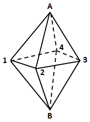

故正确答案为A。

**考点**：基础排列组合

**来源**：2011年北京市公务员录用考试《行测》题第80题

### 第 81 题

假设某地森林资源的增长速度是一定的，且不受到自然灾害等原因的影响。那么若每年开采110万立方米，则可开采90年，若每年开采90万立方米则可开采210年。为了使这片森林可持续开发，则每年最多开采多少万立方米林木？

A. 30

B. 50

C. 60

D. 75

第 81 题 · 答案与解析

**参考答案（粉笔题库参考内容）**

D

**解析**

假设原有森林资源、每年增长量分别为N万立方米和x万立方米，则根据题意可得：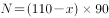，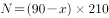，解得N＝3150，x＝75。为了可持续开发，则每年开采的量等于每年的增量即可，即75万立方米。

故正确答案为D。

**来源**：2011年北京市公务员录用考试《行测》题第81题

### 第 82 题

商店销售某种商品，在售出总进货数的一半后将剩余的打八折出售，销售掉剩余的一半后在现价基础上打五折出售，全部售出后计算毛利润为采购成本的60％。问如果不打折出售所有的商品，毛利润为采购成本的多少？

A. 45％

B. 60％

C. 90％

D. 100％

第 82 题 · 答案与解析

**参考答案（粉笔题库参考内容）**

D

**解析**

解析1：设原售价为P，成本为C，则有：，则，，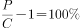。

解析2：假设该商品的售价和进货量都为1，根据题意得到销售额为。由于毛利润为采购成本的60%，故采购成本为。如果不打折出售所有商品，则毛利润是采购成本的。

故正确答案为D。

**考点**：经济利润问题

**来源**：2011年北京市公务员录用考试《行测》题第82题

### 第 83 题

有17个完全一样的信封，其中7个分别装了1元钱，8个分别装了10元钱，2个是空的，问最少需要从中随机取出几个信封，才能保证支付一笔12元的款项而无需找零？

A. 4

B. 7

C. 10

D. 12

第 83 题 · 答案与解析

**参考答案（粉笔题库参考内容）**

D

**解析**

构造在不找零情况下凑不出12元的最坏情况，可知为2个空的、8个10元钱的、1个1元的，共计11个，根据抽屉原理可知最少应取出12个信封。

故正确答案为D。

**考点**：最不利构造

**来源**：2011年北京市公务员录用考试《行测》题第83题

### 第 84 题

一个正六边形跑道，每边长为100米，甲乙两人分别从两个相对的顶点同时出发，沿跑道相向匀速前进。第一次相遇时甲比乙多跑了60米，问甲跑完三圈时，两人之间的直线距离是多少？

A. 100米

B. 150米

C. 200米

D. 300米

第 84 题 · 答案与解析

**参考答案（粉笔题库参考内容）**

C

**解析**

由第一次相遇时甲比乙多跑60米，则相遇时乙跑了，甲跑了180米，由此可知甲、乙的速度比为180:120=3:2。因此甲跑了三圈时，乙跑了两圈，所以两人都回到了自己的出发点，即相对的顶点，其直线距离为200米。

故正确答案为C。

**考点**：相遇追及

**来源**：2011年北京市公务员录用考试《行测》题第84题

### 第 85 题

一个三口之家的年龄之和为99，其中，母亲年龄比父亲年龄的大7岁，儿子年龄比母亲年龄的大7岁。

问多少年后，父亲年龄是儿子年龄的2倍？

A. 12

B. 14

C. 15

D. 10

第 85 题 · 答案与解析

**参考答案（粉笔题库参考内容）**

B

**解析**

设父亲年龄为x岁，由题意得，解得x＝44，所以儿子年龄为岁，所以设a年后父亲年龄是儿子年龄的2倍，则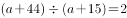，解得a＝14，所以14年后父亲年龄是儿子年龄的2倍。

故正确答案为B。

**考点**：年龄问题

**来源**：2011年北京市公务员录用考试《行测》题第85题

### 第 86 题

从所给四个选项中，选择最合适的一个填入问号处，使之呈现一定的规律性：

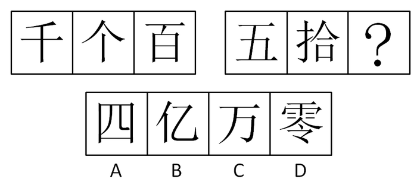

A. A

B. B

C. C

D. D

第 86 题 · 答案与解析

**参考答案（粉笔题库参考内容）**

D

**解析**

数汉字笔画。第一组笔画数为3、3、6 ；第二组为4、9、？。每组图中，前两个汉字的笔画数之和等于第三个汉字的笔画数。选项笔画数依次为5、3、3、13 。

故正确答案为D。

**考点**：数量规律-线、文字/字母/数字类

**来源**：2011年北京市公务员录用考试《行测》题第86题

### 第 87 题

从所给四个选项中，选择最合适的一个填入问号处，使之呈现一定的规律性：

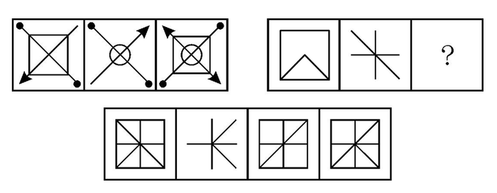

A. A

B. B

C. C

D. D

第 87 题 · 答案与解析

**参考答案（粉笔题库参考内容）**

D

**解析**

第一组图中，前两幅图叠加后顺（逆）时针旋转得到第三幅图。第二组图应用此规律，前两幅图叠加后顺时针旋转无答案，逆时针旋转得到D项图形。

故正确答案为D。

**考点**：样式规律-加减同异

**来源**：2011年北京市公务员录用考试《行测》题第87题

### 第 88 题

从所给四个选项中，选择最合适的一个填入问号处，使之呈现一定的规律性：

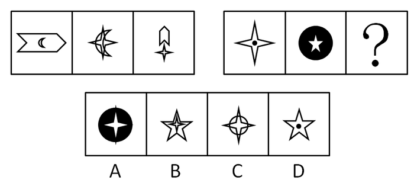

A. A

B. B

C. C

D. D

第 88 题 · 答案与解析

**参考答案（粉笔题库参考内容）**

B

**解析**

观察发现，第一组图形中元素组成相似，元素叠加运算，前两个图形去同存异，得到第三个图形，且不论图形大小问题，则第二组图形也遵循此规律，得到B项的图形。

故正确答案为B。

**考点**：样式规律-加减同异

**来源**：2011年北京市公务员录用考试《行测》题第88题

### 第 89 题

选项中包含4个图形，其中有3个呈现一定的规律性，但有1个例外，请将它找出来：

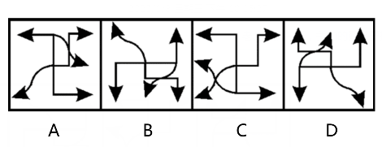

A. A

B. B

C. C

D. D

第 89 题 · 答案与解析

**参考答案（粉笔题库参考内容）**

C

**解析**

观察发现，A、B、D三项中的图形均是由同一个图形旋转不同角度所得。C项中的图形与其余三项的图形不是同一图形。

故正确答案为C。

**考点**：位置规律-旋转

**来源**：2011年北京市公务员录用考试《行测》题第89题

### 第 90 题

选项中包含4个图形，其中有3个呈现一定的规律性，但有1个例外，请将它找出来：

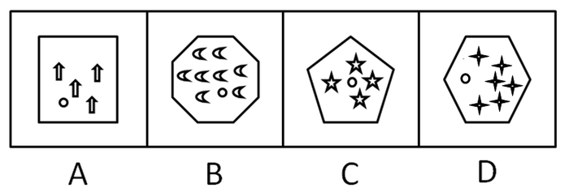

A. A

B. B

C. C

D. D

第 90 题 · 答案与解析

**参考答案（粉笔题库参考内容）**

C

**解析**

图形内部特征的考查，外部边框和内部元素数量间的关系，A、B、D三项中的三个图形，内部除了圆之外的小图形的个数与外部图形的边数相等。

故正确答案为C。

**考点**：数量规律-复合

**来源**：2011年北京市公务员录用考试《行测》题第90题

### 第 91 题

如果高鹏远是国家体操队教练，那么他一定获得过奥运会体操冠军。

上述论断可以基于以下前提作出，除了：

A. 只有获得过奥运会体操冠军，才有资格当国家体操队教练

B. 如果没有获得过奥运会体操冠军，则没有资格当国家体操队教练

C. 如果有资格当国家体操队教练，则需获得过奥运会体操冠军

D. 如果获得过奥运会体操冠军，则有资格当国家体操队教练

第 91 题 · 答案与解析

**参考答案（粉笔题库参考内容）**

D

**解析**

第一步：分析题干信息。

条件：高鹏远与国家体操队教练的关系。

结论：高鹏远与奥运会体操冠军的关系。

第二步：根据三段论特点得出以下步骤，直接得出结论。

（1）在条件和结论不同的对象间搭桥，即国家体操队教练和奥运会体操冠军之间搭桥；

（2）搭桥的方向：由条件的对象指向结论的对象，即由奥运会体操队教练推出国家体操冠军；

（3）该表达必须是充分的表达，即如果有资格当国家体操队教练，则需要获得奥运会体操冠军。

第三步：分析选项得出答案。

A项“只有获得过奥运会体操冠军，才有资格当国家体操队教练”与“如果有资格当国家体操队教练，则需要获得奥运会体操冠军”构成互逆命题，与第二步中推出的充分条件命题是等价的；

B项是第二步中推出的充分条件命题的逆否命题，与原命题等价；

C项是第二步中推出的充分条件命题，为题干推理成立的前提；

D项肯定的是第二步推出的充分条件命题的后件，肯后件无法推出肯前件，与第二步的充分条件命题不相符，不能作为题干推理成立的前提。

故正确答案为D。

**考点**：搭桥

**来源**：2011年北京市公务员录用考试《行测》题第91题

### 第 92 题

2009年，我国国产手机的销售量为3200万部，几乎是2007年销售量的3倍，市场占有率也从10.6％上升至17.3％，而平均成本却从每部2400元下降到1500元。于是，有专家预计，到2011年，国产手机的销售量最终会超过进口手机的销售量。

以下哪项如果为真，最能支持专家的预测？

A. 国产手机价格相对进口手机较便宜，市场对国产手机的需求仍将持续上升

B. 我国人口将达到13.9亿，这个庞大群体是手机的主要消费者

C. 由我国自主研发的某新型智能手机即将投放市场

D. 品牌已成为影响国产手机销售的重要因素

第 92 题 · 答案与解析

**参考答案（粉笔题库参考内容）**

A

**解析**

第一步：找出论点和论据。

论点：到2011年，国产手机的销售量最终会超过进口手机的销售量。

论据：与2007年相比，2009年国产手机销量上升、成本降低。

第二步：判断加强方式。

论据说的是2007和2009年国产手机的情况，论点对比的是国产手机和进口手机在2011年的销量，论点和论据之间存在明显的因果关系，需要增加论据，加强论点。

第三步：逐一判断选项的作用。

由论据知国产手机成本降低和销量提高存在明显的相关关系，A项说明国产手机比进口手机更具价格上的优势，且需求量上升，支持专家的预测，加强论点；

B项中的人口数量，C项中的新型国产智能手机投放市场，跟消费者选择购买国产手机或进口手机无关，属无关选项；

D项中的“品牌”是理论选项，无法说明目前的国产手机已经有品牌，无法说明品牌是影响国产手机的重要因素，D项同样属无关选项。

故正确答案为A。

**考点**：补充论据

**来源**：2011年北京市公务员录用考试《行测》题第92题

### 第 93 题

如果你演讲时讲真话，那么富人会反对你。如果你演讲时讲假话，那么穷人会反对你。你演讲时或者讲真话，或者讲假话。所以，或者富人会反对你，或者穷人会反对你。

以下哪项与上述推理的结构最为相似？

A. 如果月球上有生物，则一定有空气。如果月球上有生物，则一定有水分。月球上或者没有空气，或者没有水分。所以，月球上没有生物

B. 如果对物体加压，则它的体积会变小。如果对物体降温，则它的体积会变小。或者对物体加压，或者对物体降温。所以，物体的体积会变小

C. 如果天下雨，则地一定会湿。如果天不下雨，则地不一定会湿。或者天下雨或者天不下雨。所以，或者地一定会湿，或者地不一定会湿

D. 如果刺激老虎，则老虎要吃人。如果不刺激老虎，则老虎也要吃人。或者刺激老虎，或者不刺激老虎。总之，老虎要吃人

第 93 题 · 答案与解析

**参考答案（粉笔题库参考内容）**

C

**解析**

第一步：翻译题干。

题干可翻译为，AB，-AB，A/-A，结论：B/-B。

第二步：逐一翻译选项。

A项可翻译为，AB，AC，-B/-C，结论：-A；

B项可翻译为，AB，CB，A/C，结论：B；

C项可翻译为，AB，-AB，A/-A，结论：B/-B；

D项可翻译为，AB，-AB，A/-A，结论：B。

对比题干与选项的推理形式，C项与题干一致。

故正确答案为C。

**考点**：推理形式

**来源**：2011年北京市公务员录用考试《行测》题第93题

### 第 94 题

一位身穿警服的人从某公安局走出来。

根据这一陈述，可作出的断定是：

A. 这个人一定是该公安局的警察

B. 这个人可能是该公安局的警察

C. 这个人一定不是该公安局的警察

D. 这个人是来该公安局办事的警察

第 94 题 · 答案与解析

**参考答案（粉笔题库参考内容）**

B

**解析**

第一步：抓住题干主要信息。

本题的主要信息是“一位身穿警服的人从某公安局走出来”。

第二步：根据题干信息逐一判断选项。

由于穿警服的人可能是警察也可能不是警察，A项过于绝对，因此A项错误，B项正确；

由于从某公安局走出来的人可能是这个公安局的人也可能不是这个公安局的人，C项过于绝对，C项错误；

题干中并未提及“来公安局办事的警察”这一内容，D项无法从题干推出。

故正确答案为B。

**考点**：日常结论

**来源**：2011年北京市公务员录用考试《行测》题第94题

### 第 95 题

对于春秋时期的某国，如果仓廪实或衣食足，则民知礼节或知荣辱。如果民知礼节或知荣辱，则或者国富，或者民强。如果民强，则百业兴。事实上该国并非国富，而且并非百业兴。

由此可推出：

A. 该国仓廪实但并非衣食足

B. 该国并非仓廪实但衣食足

C. 该国仓廪实且衣食足

D. 该国并非仓廪实且并非衣食足

第 95 题 · 答案与解析

**参考答案（粉笔题库参考内容）**

D

**解析**

第一步：翻译题干。

①仓廪实 或 衣食足知礼节 或 知荣辱；②知礼节 或 知荣辱国富 或 民强；③民强百业兴。

由题干还知，-百业兴，-国富。这为事实信息。

第二步：根据题干事实得出结论。

由结论③的逆否命题可知，-百业兴民强。

由摩根规则结论②的逆否命题可知，-国富 且 -民强（国富 或 民强）知礼节 且 -知荣辱。

由结论①的逆否命题可知，-知礼节 且 -知荣辱仓廪实 且 -衣食足。

故正确答案为D。

**考点**：常规翻译

**来源**：2011年北京市公务员录用考试《行测》题第95题

### 第 96 题

并非任何战争都必然导致自然灾害，但不可能有不阻碍战争的自然灾害。

以下哪一项与上述断定的含义最为接近？

A. 有的战争可能不导致自然灾害，但任何自然灾害都可能阻碍战争

B. 有的战争可能不导致自然灾害，但任何自然灾害都必然阻碍战争

C. 任何战争都不可能导致自然灾害，但有的自然灾害可能阻碍战争

D. 任何战争都可能不导致自然灾害，但有的自然灾害必然阻碍战争

第 96 题 · 答案与解析

**参考答案（粉笔题库参考内容）**

B

**解析**

第一步：翻译题干。

第一句：并非任何战争都必然导致自然灾害，即有的战争可能不导致自然灾害。

第二句：不可能有不阻碍战争的自然灾害，即所有自然灾害都必然阻碍战争。

第二步：逐一判断选项。

根据题干，只有B项的表达正确。

故正确答案为B。

**来源**：2011年北京市公务员录用考试《行测》题第96题

### 第 97 题

萨尔斯大学的所有女生都爱吃奶油蛋糕。所有爱吃奶油蛋糕的人都嫌自己长得胖。只有萨尔斯大学的女生才会在意别人的评论。

假设上述论断都是真的，则以下哪个选项也一定为真？

Ⅰ．所有嫌自己长得胖的人都在意别人的评论。

Ⅱ．所有在意别人评论的人都爱吃奶油蛋糕。

Ⅲ．不嫌自己长得胖的人没有一个在意别人的评论。

A. 只有Ⅱ

B. 只有Ⅰ和Ⅲ

C. 只有Ⅱ和Ⅲ

D. Ⅰ、Ⅱ和Ⅲ

第 97 题 · 答案与解析

**参考答案（粉笔题库参考内容）**

C

**解析**

第一步：翻译题干。

萨尔斯大学的女生爱吃奶油蛋糕；爱吃奶油蛋糕嫌自己长得胖；在意别人的评论萨尔斯大学的女生。

三个结论连起来可知，在意别人的评论萨尔斯大学的女生爱吃奶油蛋糕嫌自己长得胖。

第二步：逐一判断选项。

Ⅰ：嫌自己长得胖在意别人的评论。“嫌自己长得胖”肯定后件，无法推出确定性结论，错误；

Ⅱ：在意别人的评论爱吃奶油蛋糕，即为题干翻译，正确；

Ⅲ：-嫌自己长得胖在意别人的评论，即为题干翻译的逆否命题，正确。

故正确答案为C。

**考点**：常规翻译

**来源**：2011年北京市公务员录用考试《行测》题第97题

### 第 98 题

若“所有灵长类动物大脑可能都具有额叶皮质”为真，则以下哪项一定为真？

A. 并非所有灵长类动物大脑都具有额叶皮质，这是不必然的

B. 所有灵长类动物大脑都具有额叶皮质，这是必然的

C. 所有灵长类动物大脑都具有额叶皮质

D. 并非所有灵长类动物大脑都具有额叶皮质，这是可能的

第 98 题 · 答案与解析

**参考答案（粉笔题库参考内容）**

A

**解析**

第一步：翻译题干。

灵长类动物大脑→具有额叶皮质，这是可能的。

第二步：逐一判断选项。

A项可翻译为：灵长类动物大脑→具有额叶皮质，这一命题的否命题是不必然的，即：可能非；因此，灵长类动物大脑→具有额叶皮质，这一命题是可能的，与题干一致；

B、C两项可翻译为：灵长类动物大脑→具有额叶皮质，这是必然的，与题干意思相悖，因此不正确；

D项可翻译为：灵长类动物大脑→具有额叶皮质，这一命题的否命题是可能的，即本命题是可能非（不必然）的，与题干所说的“可能的”不同。

故正确答案为A。

**来源**：2011年北京市公务员录用考试《行测》题第98题

### 第 99 题

某年全市的文理科高考状元都是志远私立高中的学生，于是很多家长得出结论说：“志远中学比市重点高中——一中的教学质量都高。”

以下哪项最能反驳这些家长们的结论？

A. 有没有出现文理科高考状元并不是衡量学校教学水平高低的唯一标准

B. 该年志远中学学生高考平均分比市一中学生的低很多

C. 因为志远中学的教师待遇好，有不少教师离开市一中来志远教书

D. 志远中学的学生都住宿，所以他们在校学习时间比市一中学生长

第 99 题 · 答案与解析

**参考答案（粉笔题库参考内容）**

A

**解析**

第一步：找到论点和论据。

论点：志远中学比一中的教学质量高。

论据：全市的文理科高考状元都是志远私立高中的学生。

本题论点讨论的是学校质量，论据说的是文理科高考状元，话题不一致，削弱优先考虑拆桥。

第二步：逐一分析选项。

A项：“有没有出现文理科高考状元并不是衡量学校教学水平高低的唯一标准”，说明即使全市的文理科高考状元都是志远私立高中的学生也不意味着志远中学的教学质量比其他学校高，拆桥，削弱论证，当选；

B项：“该年志远中学学生高考平均分比市一中学生的低很多”，增加了反面论据进行削弱，但不如A项拆桥力度强，排除；

C项：市一中老师到志远中学教学提升了志远中学的教学质量，具有加强作用，无法削弱，排除；

D项：学生是否住宿与教学质量无关，属于无关项，排除。

故正确答案为A。

**考点**：拆桥

**来源**：2011年北京市公务员录用考试《行测》题第99题

### 第 100 题

副校长：我主张王老师和邱老师中至多有一人可以被推荐为国家级教学名师候选人。

校长：我不同意。

以下哪项最准确地表达了校长的意见？

A. 王老师和邱老师都不可以被推荐为国家级教学名师候选人

B. 王老师和邱老师中至少有一人可以被推荐为国家级教学名师候选人

C. 王老师和邱老师都可以被推荐为国家级教学名师候选人

D. 如果王老师可以被推荐为国家级教学名师候选人，则邱老师也可以

第 100 题 · 答案与解析

**参考答案（粉笔题库参考内容）**

C

**解析**

第一步：翻译题干。

副校长的话可以转化为“至多有一人被推荐”：-王老师 或 -邱老师。

校长：-（-王老师 或 -老师），即：王 且 邱。

第二步：逐一判断选项。

\-（ｐ 或 ｑ）利用摩根规则可推出：-ｐ 且 -ｑ。因此校长的话“-（王老师不被推荐或者邱老师不被推荐）”利用摩根规则可推出：王老师被推荐 且 邱老师被推荐。

故正确答案为C。

**考点**：常规翻译

**来源**：2011年北京市公务员录用考试《行测》题第100题

### 第 101 题

所有与甲型H1N1流感患者接触的人都被隔离了。所有被隔离的人都与徐海华接触过。

假设上述命题为真，则下面哪一个命题也是真的？

A. 可能有人没有接触过甲型H1N1流感患者，但接触过徐海华

B. 徐海华是甲型H1N1流感患者

C. 所有与徐海华接触过的人都被隔离了

D. 所有甲型H1N1流感患者都与徐海华接触过

第 101 题 · 答案与解析

**参考答案（粉笔题库参考内容）**

A

**解析**

第一步：翻译题干。

接触流感患者的人隔离；隔离接触徐海华。

即接触流感患者的人隔离接触徐海华。

第二步：逐一判断选项。

由以上两个结论无法得出流感患者与徐海华的任何情况，因此B、D两项均无法得出；

C项可翻译为，接触徐海华隔离。“接触徐海华”为肯定后件的情况，由逆否规则可知无法得出任何绝对化结论，但可以推出可能性结论“接触徐海华”，所以A项的可能性表达正确。

故正确答案为A。

**考点**：常规翻译

**来源**：2011年北京市公务员录用考试《行测》题第101题

### 第 102 题

小天鹅歌舞团有小演员45名。关于这45名小演员，甲乙丙三人有如下讨论：

甲说：“这些小演员中有些是北京人。”

乙说：“小演员中的李欣欣不是北京人。”

丙说：“这些小演员中有些不是北京人。”

事实上，甲乙丙三人的话只有一句为真。

请问，下面哪个选项为真？

A. 45名小演员都不是北京人

B. 有些小演员不是北京人

C. 李欣欣不是北京人

D. 45名小演员都是北京人

第 102 题 · 答案与解析

**参考答案（粉笔题库参考内容）**

D

**解析**

第一步：找突破口。

本题突破口为甲、丙之间的反对关系，两人的话不可同假，且必有一真。

第二步：看其他的话。

本题只有一句为真，因此乙的话为假，即李欣欣是北京人。

第三步：判断突破口中两句话的真假。

由“李欣欣是北京人”可知，甲的话为真；又因只有一句为真，故丙的话为假。根据直言命题的对当关系，由丙的话为假可知，丙的话的矛盾命题为真，即“所有小演员都是北京人”为真。

故正确答案为D。

**考点**：只有一真/一假

**来源**：2011年北京市公务员录用考试《行测》题第102题

### 第 103 题

某国家足球队教练在集训过程中发现球员U、V、W、X、Y、Z的最佳配合特点是：

（1）V和X不能同时都在场上，也不能都不在场上；

（2）只有U不在场上，V才不在场上；

（3）如果W在场上，则X也要在场上；

（4）如果Y和Z在场上，则W也必须在场上。

那么，如果在U和Z都在场上的情况下，为了保持球员间的最佳配合，则可以推出以下哪项一定为真？

A. X在场上且Y不在场上

B. V在场上且Y不在场上

C. V和W都在场上

D. V和Y都不在场上

第 103 题 · 答案与解析

**参考答案（粉笔题库参考内容）**

B

**解析**

第一步：翻译题干。

（1）V/X；（2）-VU；（3）WX；（4）Y 且 ZW。

由题干可知，U和Z均在场上。这是事实信息。

第二步：根据题干事实信息得出结论。

由（2）的逆否命题可知UV，由（1）可知VX，由（3）的逆否命题可知-XW，由（4）的逆否命题可知-WY 或 -Z。

再根据Z在场上，利用选言命题规则 ZY。

故正确答案为B。

**考点**：常规翻译

**来源**：2011年北京市公务员录用考试《行测》题第103题

### 第 104 题

某知名艺人刘某2009年两次在上海举行个人演唱会。其中，第一次票房收入很好，离演出还有一个月，门票就全部售光。于是，该艺人所在经纪公司决定一个月后再次在上海举办刘某个人演唱会，规模与第一次相当。然而，第二次票房收入很不理想，门票仅售出40%。

以下哪项最可能是导致第二次演唱会票房收入下降的原因？

A. 第二次演唱会的节目安排与第一次雷同，很多人已参加过第一次演唱会，故不再参加第二次

B. 在第二次演唱会举办的同时，另一知名艺人正在上海进行魔术表演

C. 参加第二次演唱会的人大多是没有买到第一次演唱会门票的人

D. 第二次演唱会的举办地点不在市中心，很多上海人嫌离家太远，不愿参加

第 104 题 · 答案与解析

**参考答案（粉笔题库参考内容）**

A

**解析**

第一步：找出题干需要解释的矛盾。

刘某在上海举办第一次演唱会门票全部售光，但一个月后举办的第二次演唱会票房收入却不理想，门票仅售出40%。

第二步：逐一分析选项。

A项：指出两次演唱会节目安排雷同，使得很多人参加过第一次，不再参加第二次，可以解释为什么刘某的第二次演唱会票房会比第一次演唱会明显减少，可以解释，当选；

B项：选项没有提及演唱会与魔术表演的观众是否重合，无法判断魔术表演是否会使演唱会观众减少，无法解释为什么刘某的第二次演唱会票房会比第一次演唱会明显减少，排除；

C项：指出第二次演唱会的人大多是没有买到第一次演唱会门票的人，未明确指出第一次演唱会没有买到票的人和买到票的人哪个人更多，无法解释为什么刘某的第二次演唱会票房会比第一次演唱会明显减少，排除；

D项：举办地点不在市中心使很多上海人不愿参加，但无法判断其他地区的观众是否愿意参加，无法解释为什么刘某的第二次演唱会票房会比第一次演唱会明显减少，排除。

故正确答案为A。

**考点**：原因解释

**来源**：2011年北京市公务员录用考试《行测》题第104题

### 第 105 题

某公园内有个奇怪的摊主小周，他只在星期一、星期二、星期三、星期五和星期六工作，而且他只出售4种商品：玩具汽车、充气气球、橡皮泥和遥控飞机。每个工作日，他上午只卖1种商品，下午只卖1种商品，而且还知道如下条件：

（1）小周只在两个连续的下午卖玩具汽车；

（2）小周只在1个上午和3个下午卖橡皮泥；

（3）星期六这天，小周既不卖玩具汽车，也不卖充气气球。

若上述情况为真，请问哪一天小周一定会卖玩具汽车？

A. 星期一

B. 星期二

C. 星期三

D. 星期五

第 105 题 · 答案与解析

**参考答案（粉笔题库参考内容）**

B

**解析**

找到题干中与玩具汽车有关的信息。

由（1）可知，卖玩具汽车可能在周一周二，或周二周三，或周五周六。由（3）可知，玩具汽车肯定不在周五周六卖。因此玩具汽车或在周一周二卖，或在周二周三卖。因此周二肯定卖玩具汽车。

故正确答案为B。

**考点**：从确定信息开始推

**来源**：2011年北京市公务员录用考试《行测》题第105题

### 第 106 题

社会工作是以利他主义价值观为指导，以科学的知识为基础，运用科学方法助人的服务活动。

根据上述定义，下列属于社会工作的一项是：

A. 广州亚运会组委会在学校、街道招募了很多志愿者，为亚运会的圆满举办提供了人力保障

B. 自然之友等民间组织多年来开展了各种形式的宣传活动，提高了人们的环保意识

C. 日前众多明星应邀参加了一次慈善拍卖会，募得的善款资助失学儿童

D. 小张是一名专业的心理咨询师，他每学期都会为附近的中小学生义务开课，讲解如何预防青少年犯罪等知识

第 106 题 · 答案与解析

**参考答案（粉笔题库参考内容）**

D

**解析**

第一步：抓住定义中的关键词。

定义中强调“运用科学方法助人”等。

第二步：逐一判断选项。

A、B、C三项中只有助人，均未提到运用科学的方法，均不符合定义。

D项中“讲解预防犯罪知识”属于运用科学的方法帮助中小学生，符合定义中的关键词。

故正确答案为D。

**考点**：方式目的

**来源**：2011年北京市公务员录用考试《行测》题第106题

### 第 107 题

内在经济是指一个厂商在生产规模扩大时自身内部所引起的收益增加，而外在经济是指整个行业规模扩大时给个别厂商所带来的收益增加。

根据上述定义，下列属于外在经济的是：

A. 稀土行业近年来发展迅速，一些开采企业由于运输成本和关税的降低，出口量不断增加，和许多国家都建立了贸易往来关系

B. 某茶叶生产商由于引进了一批先进设备，提高了生产效率，销售量比往年扩大了一倍

C. 国产手机行业发展迅速，规模不断扩大，某手机生产商为了增强产品竞争力，开始精简机构降低成本

D. 由于国际油价节节攀升，广东省一些地区的加油站通过提高价格获得了较多利润

第 107 题 · 答案与解析

**参考答案（粉笔题库参考内容）**

A

**解析**

第一步：找出定义关键词。

内在经济：“一个厂商在生产规模扩大时”、“自身内部所引起的收益增加”；

外在经济：“整个行业规模扩大”、“个别厂商”、“收益增加”。

第二步：逐一分析选项。

A项：稀土行业发展迅速，使某些开采企业出口量增加、收益增加，符合定义，当选；

B项：不是“整个行业规模扩大”，只是一个厂商规模的扩大，属于内在经济，不符合定义，排除；

C项：只提到降低成本，但未体现收益增加，不符合定义，排除；

D项：油价攀升不代表行业规模的扩大，不符合定义，排除。

故正确答案为A。

**考点**：常规问法

**来源**：2011年北京市公务员录用考试《行测》题第107题

### 第 108 题

扎根理论是指在经验资料的基础上建立理论，研究者在研究开始之前一般没有理论假设，直接从实际观察入手，从原始资料中归纳出经验概括，然后上升到理论。

根据上述定义，下列符合扎根理论的是：

A. 某研究生为验证压力和成功之间的倒U形曲线关系，做了一项长达一年的实验，实验结果和预先判断并不一致，他认为实验设计可能存在问题

B. 某教授通过对其女儿从3岁到7岁的连续观察研究，总结出了一些儿童认知发展的规律，但是这些结论在学术界还存在争议

C. 某公司基于九型人格理论研制了一套人格测验，公司员工都进行了测试，测试结果和实际情况非常相近

D. 某医疗机构通过问卷、访谈等形式来研究机器设备对医务人员和病人之间的互动影响，发现某些设备明显让病人感觉不舒服，于是改进了设备

第 108 题 · 答案与解析

**参考答案（粉笔题库参考内容）**

B

**解析**

第一步：抓住定义中的关键词。

定义中强调“之前一般没有理论假设”、“直接从实际观察入手”等。

第二步：逐一判断选项。

A项中的倒U形曲线、C项中的九型人格理论均属于研究前的理论假设，均不符合定义；

D项中问卷、访谈等形式不属于直接的实际观察形式，不符合定义；

B项中的连续观察符合定义中的关键词。

故正确答案为B。

**考点**：大前提

**来源**：2011年北京市公务员录用考试《行测》题第108题

### 第 109 题

乡村旅游是以各种类型的乡村为背景，以乡村田园风光、乡村生活和乡村文化为旅游吸引物，以农业和农村特色资源为基础开发旅游产品，以农民为经营主体、以城市居民为目标的一种休闲旅游形式。

根据上述定义，下列属于乡村旅游的一项是：

A. 五一期间靖远县旅游局组织东湾镇大坝村农民20人，赴景泰黄河石林景区参观学习当地农家乐建设情况

B. 周末，小王约了几位好友一起去爬慕田峪长城，归途中向农民购买了一些特产

C. 杨家埠位于山东潍坊，这里的农民心灵手巧，制作出了精美的木版年画和风筝，从而吸引了数十万计的国内外宾客前来观光旅游

D. 周末某市机关组织职工去郊区采摘甜瓜。在这里，家家户户都种植甜瓜，只要与农户谈好价格，就既能体验采摘乐趣，又能把新鲜瓜果带回家

第 109 题 · 答案与解析

**参考答案（粉笔题库参考内容）**

D

**解析**

第一步：抓住定义中的关键词。

定义中强调“以乡村为背景”、“以乡村田园风光、乡村生活和乡村文化为旅游吸引物”、“以农业和农村特色资源为基础开发旅游产品”、“以城市居民为目标”等。

第二步：逐一判断选项。

A项中的旅游主体为20位农民，与“以城市居民为目标”不符；

B项中的旅游吸引物为慕田峪长城，C项中的旅游吸引物为木版年画和风筝，均与定义中的旅游吸引物不符；

D项中旅游目标为机关职工，旅游吸引物为乡村生活，以新鲜瓜果为旅游产品，均符合定义。

故正确答案为D。

**考点**：单定义-其他句式

**来源**：2011年北京市公务员录用考试《行测》题第109题

### 第 110 题

族群是在较大的社会文化体系中，由于客观上具有共同的渊源及由此延伸出的共同的文化，因此主观上自我认同并区别于其他群体的一群人。其中共同的渊源是指世系、血统、体质的相似；共同的文化是指相似的语言、宗教、习俗等。

根据上述定义，下列属于族群的一项是：

A. 为满足学生学习书法的热情及需求，大学里成立了书法社团

B. 因为怀有相同的宗教信仰，全球伊斯兰教信徒们走到了一起，形成了一个大的宗教团体。据统计，截止到2009年，伊斯兰教穆斯林目前有15亿7000万

C. 美国大多数亚裔是近几十年来的新移民，因为具有勤奋节俭、吃苦耐劳、重视教育等优良传统，亚裔美国人已经成为了美国最成功的少数民族之一

D. 由于工作压力加大、孩子生育养育成本逐年上升，一部分年轻人有固定收入和生育能力，但却选择不生育后代，由此形成了丁克一族

第 110 题 · 答案与解析

**参考答案（粉笔题库参考内容）**

C

**解析**

第一步：找出定义关键词。

“共同的渊源及由此延伸出的共同的文化”、“主观上自我认同并区别于其他群体的一群人”、“共同的渊源是指世系、血统、体质的相似”、“共同的文化是指相似的语言、宗教、习俗”。

第二步：逐一分析选项。

A项：学生具有共同的爱好，不属于“世系、血统、体质相似的共同的渊源”，不符合定义，排除；

B项：信徒具有共同的信仰，不属于“世系、血统、体质相似的共同的渊源”，不符合定义，排除；

C项：亚裔美国人拥有共同的血统、体质，属于“共同的渊源”，符合定义，当选；

D项：人们具有共同的生活方式，不属于“世系、血统、体质相似的共同的渊源”，不符合定义，排除。

故正确答案为C。

**考点**：原因结果

**来源**：2011年北京市公务员录用考试《行测》题第110题

### 第 111 题

技术创新是新产品或工艺从设想产生到市场应用的一个完整过程，它包括新设想的产生、研究、开发、商业化生产到推广这样一系列的活动。新设想的产生到研发活动，是技术知识产权的创造过程；商业化生产到推广，则是促进品牌知识产权的创造过程。

根据上述定义，下列属于技术创新的一项是：

A. 上世纪90年代，丹麦一家助听器公司推行了一种全新的组织模型：没有正式的层级和汇报关系，资源分配是围绕项目小组展开的，组织是完全开放的。这种创新取得了巨大成功

B. 钢铁公司通过引进国际先进技术，建设了一条超薄热带生产线，实现了以薄为主，以热代冷的生产方式，填补了国内空白

C. 经过研究与实践，我国某农业科学家提出果树嫁接的新技术，实现了产量翻两番的目标

D. 技术人员引进并吸收了国外发达技术，设计生产出具有自主知识产权的高速动车组，并已应用到京津、武广等线

第 111 题 · 答案与解析

**参考答案（粉笔题库参考内容）**

D

**解析**

第一步：找出定义关键词。

“新产品或工艺”、“从设想产生到市场应用”、“包括新设想的产生、研究、开发、商业化生产到推广”。

第二步：逐一分析选项。

A项：组织模型不属于新产品或工艺，不符合定义，排除；

B项：国际先进技术是引进的，不涉及新设想的产生，不符合定义，排除；

C项：新技术未提到商业化的推广，不符合定义，排除；

D项：具有自主知识产权的高速动车组属于新设想的产生到研发，应用到京津、武广等线属于商业化的生产到推广，符合定义，当选。

故正确答案为D。

**考点**：单定义-其他句式

**来源**：2011年北京市公务员录用考试《行测》题第111题

### 第 112 题

睡眠效应是指信息的传播效果会随时间的推移而发生改变的现象。也就是说，传播结束一段时间后，有的信息带来的正效果在下降，而有的信息带来的负效果却向正效果转化。

根据上述定义，下列现象属于睡眠效应的是：

A. 有时一些广告创意平庸，受众反映其乏味甚至反感，但广告产品的销量却在上升

B. 很多青少年把娱乐明星视为自己的偶像，行为和思想都受到明星们很大的影响

C. 谈判陷入僵局即将破裂时，双方先冷静思考一下再重开谈判，进展会异常顺利

D. 教师反复给学生讲解三角形面积的求法，学生还是不能正确求出三角形的面积

第 112 题 · 答案与解析

**参考答案（粉笔题库参考内容）**

A

**解析**

第一步：抓住定义中的关键词。

定义中强调“信息的传播效果”、“随时间推移而改变”等。

第二步：逐一判断选项。

A项中的广告属于信息的传播，广告产品的销量上升体现效果随时间推移的改变，符合定义。B、D两项没有效果的改变，C项不涉及信息的传播，均不符合定义。

故正确答案为A。

**考点**：原因结果

**来源**：2011年北京市公务员录用考试《行测》题第112题

### 第 113 题

成长需要自由的空间，要想使人成长得更快，就一定要给他活动的自由，而不要将他拘泥于一个小小的鱼缸。这种给予更大空间而带来更快发展的现象被称为“鱼缸法则”。

根据上述定义，下列现象属于“鱼缸法则”的是：

A. 某学生为提高自身综合素质，除了本专业课程，还选修了其他专业的课程

B. 某地将工作能力突出的青年干部适时提拔到重要岗位任职，使其承担重要责任

C. 有些父母为了让孩子有稳定的生活和工作，千方百计将孩子留在身边

D. 西部某市拓宽选贤门路，到经济发达的沿海地区招聘各种优秀人才

第 113 题 · 答案与解析

**参考答案（粉笔题库参考内容）**

B

**解析**

第一步：抓住定义中的关键词。

定义中强调“更大空间”、“更快发展”等。

第二步：逐一判断选项。

A项中所修的课程均在学习的范围之内，不是“更大空间”，不符合定义；

B项中提拔重要的岗位属于“更大空间”，目的是使年轻干部能力提升，属于“更快发展”，符合定义；

C项中的留在父母身边也不是“更大空间”，不符合定义；

D项不涉及人的成长，不符合定义。

故正确答案为B。

**考点**：故事类

**来源**：2011年北京市公务员录用考试《行测》题第113题

### 第 114 题

小数法则是一种心理偏差，是指人们将小样本中某事件的概率分布看成是总体分布，抓住问题的某个特征直接推断结果，而不考虑这种特征出现的真实概率及与特征有关的其他原因。

根据上述定义，下列哪一项反映了小数法则：

A. 在掷硬币的游戏中，即使连续10次出现正面，第11次出现正面的概率仍然还有50%

B. 一位投资经理在过去两年表现好于其他人，并不能说明这位经理水平要高于其他人

C. 在北京街头对100人进行调查都认为北京的房价很高，因此全北京市的人都认为北京的房价很高

D. 某一给定时间在一家大医院内诞生的婴儿有60%是男孩，则一家小医院内情况必定相同

第 114 题 · 答案与解析

**参考答案（粉笔题库参考内容）**

C

**解析**

第一步：抓住定义中的关键词。

“小数法则”定义中强调“小样本中某事件的概率”“看成是总体分布”“直接推断结果”等。

第二步：逐一判断选项。

A项中对第11次投掷结果的判断不属于对总体分布的判断，且概率与前10次小样本的分布概率不同，不符合定义；

B项没有“直接推断结果”，不符合定义；

C项中小样本为被调查的100人，总体为全北京市的人，且分布概率均为100%，符合定义；

D项仅根据一家医院的情况做出判断，不涉及小样本的概率分布问题，因此不符合定义。

故正确答案为C。

**考点**：单定义-其他句式

**来源**：2011年北京市公务员录用考试《行测》题第114题

### 第 115 题

避风港原则是指网络服务提供者为服务对象提供搜索或者链接服务，在接到权利人的通知书后，根据规定删除或断开与侵权的作品、表演、录音录像制品的链接的，不承担赔偿责任。

根据上述定义，下列符合避风港原则的是：

A. 某视频网站未经许可，擅自在其经营的网站上提供电影的在线播放服务。在接到原告通知后，当天就将该电影删除了

B. 某网站为提供信息存储空间的视频分享网站，一网友未经授权，将某电影上传至该网站，该网站未对电影进行任何编辑、整理，在权利人发出通知后，立即进行了删除

C. 刘某是摄影师，未经本人同意将某模特照片放在自己的摄影网站上向公众提供点击浏览、下载打印等服务。该模特发现后要求其停止侵权、赔礼道歉并赔偿损失，刘某快速删除了被告侵权的照片

D. 某网站主要提供热门影视作品的视频资源给公众下载，有些影视作品著作权人发现后，通知了该网站，该网站马上对相关作品进行了删除

第 115 题 · 答案与解析

**参考答案（粉笔题库参考内容）**

B

**解析**

第一步：抓住定义中的关键词。

定义中强调“提供搜索或者链接服务”等。

第二步：逐一判断选项。

A项中网站上提供的在线播放服务，C项中网站上提供的浏览、下载打印服务，D项中网站提供的影视作品服务均是网站自身直接提供的服务，不属于“提供搜索或者链接服务”，不符合定义。

B项中提供视频的是网友，而网站只提供链接服务，符合定义。

故正确答案为B。

**考点**：单定义-其他句式

**来源**：2011年北京市公务员录用考试《行测》题第115题

## 材料 8

**根据下列统计资料回答问题。**

        2009年全年北京市完成全社会固定资产投资4858.4亿元，比上年增长26.2%。其中，基础设施投资1462亿元，增长26%，主要投向交通运输和公共服务业，交通运输投资698.6亿元，增长15.6%，公共服务业投资434.5亿元，增长49%。

        分登记注册类型看，国有内资单位完成投资2316.8亿元，比上年增长66.8%；非国有内资单位完成投资2096.4亿元，增长2.8%；外商及港澳台完成投资445.2亿元，增长5.9%。

        分产业看，第一产业投资57.4亿元，增长1倍；第二产业投资411.4亿元，增长6.6%，其中工业投资406.2亿元，增长6.7%；第三产业投资4389.5亿元，增长27.8%。

        分城乡看，城镇投资完成4378.2亿元，增长23.2%；农村投资完成480.2亿元，增长63.5%。

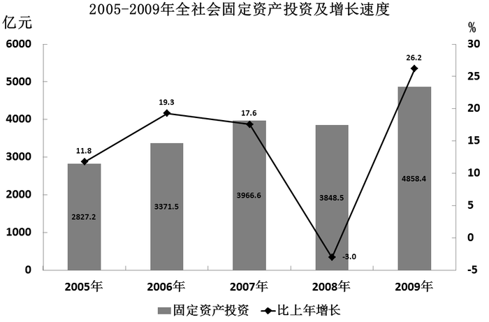

### 第 116 题

2004年全年北京市完成全社会固定资产投资：

A. 2164.3亿元

B. 2393.9亿元

C. 2528.8亿元

D. 2827.2亿元

第 116 题 · 答案与解析

**参考答案（粉笔题库参考内容）**

C

**解析**

从图中可得，2005年北京市全社会固定资产投资为2827.2亿元，比上年增长11.8%。则2004年全年北京市完成全社会固定资产投资亿元。

故正确答案为C。

**考点**：基期计算、综合资料

**来源**：2011年北京市公务员录用考试《行测》题第116题

### 第 117 题

2009年国有内资单位完成投资在北京市全社会固定资产投资总额中所占比重比2008年：

A. 上升11.6个百分点

B. 下降11.6个百分点

C. 上升7.5个百分点

D. 下降7.5个百分点

第 117 题 · 答案与解析

**参考答案（粉笔题库参考内容）**

A

**解析**

A项正确，根据两期比重差公式可得：，即上升超过11个百分点，对应A项。

故正确答案为A。

**考点**：两期比重、综合资料

**来源**：2011年北京市公务员录用考试《行测》题第117题

### 第 118 题

2008年北京市交通运输投资额是公共服务投资额的：

A. 1.4倍

B. 1.6倍

C. 2.1倍

D. 2.4倍

第 118 题 · 答案与解析

**参考答案（粉笔题库参考内容）**

C

**解析**

从文中可知，2009年交通运输投资698.6亿元，增长15.6%，公共服务业投资434.5亿元，增长49%，2008年北京市交通运输投资额是公共服务投资额的倍数。

故正确答案为C。

**考点**：基期倍数、综合资料

**来源**：2011年北京市公务员录用考试《行测》题第118题

### 第 119 题

2009年农村投资中，第二、三产业投资占比：

A. 低于12.0%

B. 低于15.4%

C. 超过84.6%

D. 超过88.0%

第 119 题 · 答案与解析

**参考答案（粉笔题库参考内容）**

D

**解析**

北京全市第一产业投资为57.4亿元，故农村第一产业投资必小于57.4亿元，又农村总投资为480.2亿元，则农村投资中第一产业所占比重小于，故可知第二、三产业所占比重大于1-12%=88%，即超过了88%。

故正确答案为D。

**考点**：现期比重、综合资料

**来源**：2011年北京市公务员录用考试《行测》题第119题

### 第 120 题

以下说法中，与资料相符的是：

A. 2005—2009年北京全社会固定资产投资年均完成投资额超过4000亿元

B. 2008年北京市外商及港澳台投资额超过固定资产投资的一成

C. 2009年第一产业投资同比增长额最大

D. 2009年第三产业投资额所占比重低于2008年

第 120 题 · 答案与解析

**参考答案（粉笔题库参考内容）**

B

**解析**

A项错误，从图中可以看出，2005—2009年的北京全社会固定资产投资额，只有2009年的投资额为4000多亿元，其中2005年为2000多亿元，剩下的年份都为3000多亿元，所以2005—2009年北京全社会固定资产投资年均完成投资额肯定不超过4000亿元；

B项正确，由材料前两段可知，2009年北京市全社会固定资产投资4858.4亿元，比上年增长26.2%；外商及港澳台完成投资445.2亿元，增长5.9%。所以2008年北京市外商及港澳台投资额占固定资产投资的比例，比重超过一成；

C项错误，第一产业投资57.4亿元，增长1倍；第二产业投资411.4亿元，增长6.6%；第三产业投资4389.5亿元，增长27.8%，所以第一产业的同比增长额为亿元，第二产业的同比增长额亿元，第三产业的同比增长额亿元，所以2009年第三产业投资同比增长额最大；

D项错误，2009年全年北京市完成全社会固定资产投资4858.4亿元，比上年增长26.2%，第三产业投资4389.5亿元，增长27.8%，所以第三产业投资的增长速度快于全社会固定资产投资的增长速度，则2009年第三产业投资额所占比重高于2008年。

故正确答案为B。

**考点**：综合分析、综合资料

**来源**：2011年北京市公务员录用考试《行测》题第120题

## 材料 9

**根据下列统计资料回答问题。**

职业技术培训机构基本情况（2008年）

单位：人

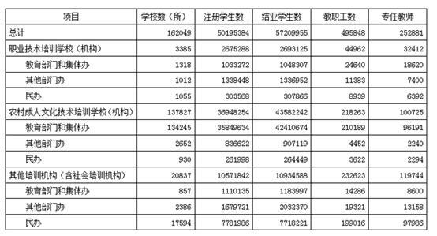

### 第 121 题

2008年我国平均每所职业技术培训机构结业学生人数为：

A. 276人

B. 310人

C. 353人

D. 397人

第 121 题 · 答案与解析

**参考答案（粉笔题库参考内容）**

C

**解析**

从表格中可以找出，2008年职业技术培训机构共162049所，结业学生数为57209955人，所以2008年我国平均每所职业技术培训机构结业学生人数为57209955÷162049≈57200000÷160000=5720÷16≈358人。

故正确答案为C。

**考点**：现期平均数、统计表

**来源**：2011年北京市公务员录用考试《行测》题第121题

### 第 122 题

2008年，专任教师比重最高的是：

A. 教育部门和集体办职工技术培训学校

B. 民办职工技术培训学校

C. 民办农村成人文化技术培训学校（机构）

D. 其他部门办其他培训机构（含社会培训机构）

第 122 题 · 答案与解析

**参考答案（粉笔题库参考内容）**

A

**解析**

2008年，专任教师比重如下：

教育部门和集体办职工技术培训学校＝18620÷24640≈18000÷24000＝75%；

民办职工技术培训学校＝6392÷8939≈6300÷9000＝70%；

民办农村成人文化技术培训学校（机构）＝2294÷3622≈2300÷3700≈62%；

其他部门办其他培训机构（含社会培训机构）＝13158÷19321≈13000÷19000≈68%。

可见最高的是教育部门和集体办职工技术培训学校。

故正确答案为A。

**考点**：现期比重、统计表

**来源**：2011年北京市公务员录用考试《行测》题第122题

### 第 123 题

2008年，平均每所职工技术培训学校（机构）的注册学生人数约为教职工人数的多少倍？

A. 101

B. 60

C. 42

D. 118

第 123 题 · 答案与解析

**参考答案（粉笔题库参考内容）**

B

**解析**

2008年，平均每所职工技术培训学校（机构）的注册学生人数为2675288人，约等于人，教职工人数为44962人，约等于，倍。

故正确答案为B。

**考点**：现期倍数、统计表

**来源**：2011年北京市公务员录用考试《行测》题第123题

### 第 124 题

2008年，平均每所机构注册学生人数最大的是：

A. 教育部门和集体办职工技术培训学校

B. 其他部门办职工技术培训学校

C. 教育部门和集体办其他培训机构（含社会培训机构）

D. 民办其他培训机构（含社会培训机构）

第 124 题 · 答案与解析

**参考答案（粉笔题库参考内容）**

B

**解析**

平均每所机构注册学生人数：

教育部门和集体办职工技术培训学校为人；

其他部门办职工技术培训学校为人；

教育部门和集体办其他培训机构（含社会培训机构）为人；

民办其他培训机构（含社会培训机构）为人。

只需比较其他部门办职工技术培训学校与教育部门和集体办其他培训机构（含社会培训机构）即可。可用分子分母差额法，，而。故，即其他部门办职工技术培训学校最大。

故正确答案为B。

**考点**：现期平均数、统计表

**来源**：2011年北京市公务员录用考试《行测》题第124题

### 第 125 题

以下说法中，不正确的是：

A. 2008年平均每所农村成人文化技术培训学校（机构）的专任教师不足1人

B. 2008年其他培训机构中民办机构所占比重最高

C. 2008年农村成人文化技术培训学校在全国职业技术培训机构中的比重高于八成五

D. 2008年民办职业技术培训机构专任教师数量大于教育部门和集体办职业技术培训机构

第 125 题 · 答案与解析

**参考答案（粉笔题库参考内容）**

D

**解析**

A项正确，平均每所农村成人文化技术培训学校（机构）的专任教师人数人；

B项正确，从表格中可以看出，其他培训机构（含社会培训机构）中民办机构所占比重最高；

C项正确，农村成人文化技术培训学校（机构）在全国职业技术培训机构中的比重；

D项错误，民办职业技术培训机构专任教师数量是6392＋2294＋97986＝106672人，教育部门和集体办职业技术培训机构专任教师数量是18620＋96191＋8600＝123411人，前者小于后者。

本题为选非题，故正确答案为D。

**考点**：统计表、综合分析

**来源**：2011年北京市公务员录用考试《行测》题第125题

## 材料 10

**根据下列材料完成各题。**

        2009年全年粮食种植面积10897万公顷，比上年增加217万公顷；棉花种植面积495万公顷，减少80万公顷；油料种植面积1360万公顷，增加76万公顷；糖料种植面积188万公顷，减少11万公顷。

        全年粮食产量53082万吨。其中，夏粮产量12335万吨，增产2.2％，早稻产量3327万吨，增产5.3％；秋粮产量37420万吨，减产0.6％。

        全年棉花产量640万吨，比上年减产14.6％，油料产量3100万吨，增产5.0％。糖料产量1200万吨，减产9.1％。烤烟产量280万吨，增产6.7％。茶叶产量135万吨，增产7.1%。

2005－2009年粮食产量

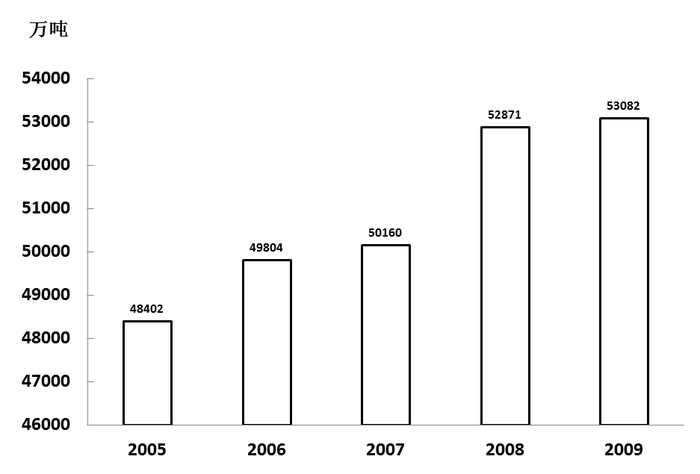

### 第 126 题

2009年粮食比上年增产约：

A. 4%

B. 3%

C. 0.4%

D. 0.3%

第 126 题 · 答案与解析

**参考答案（粉笔题库参考内容）**

C

**解析**

观察条形图可知，2009年粮食产量为53082万吨，2008年粮食产量为52871万吨。故可得，实际是0.0039XX，首位是3，近似等于4，观察量级，排除A项。

故正确答案为C。

**考点**：一般增长率、综合资料

**来源**：2011年北京市公务员录用考试《行测》题第126题

### 第 127 题

与上年相比，下列农作物中2009年增产量最多的是：

A. 糖料

B. 烤烟

C. 茶叶

D. 油料

第 127 题 · 答案与解析

**参考答案（粉笔题库参考内容）**

D

**解析**

油料产量3100万吨，增产5.0%；糖料产量1200万吨，减产9.1%；烤烟产量280万吨，增产6.7%；茶叶产量135万吨，增产7.1%，糖料减产，所以A项不正确。，，，容易看出虽然茶叶和烤烟的增产率大，可是基期的数量远远小于油料，并且油料的增产率和烤烟、茶叶接近，所以容易判断油料的增产量是最大的。

故正确答案为D。

**考点**：增长量比较、综合资料

**来源**：2011年北京市公务员录用考试《行测》题第127题

### 第 128 题

2009年秋粮产量在全年粮食产量中的比例与上年相比：

A. 增加了0.7%

B. 减少了0.7%

C. 增加了7%

D. 减少了7%

第 128 题 · 答案与解析

**参考答案（粉笔题库参考内容）**

B

**解析**

A项错误，C项错误，由第126题可知，2009年全年的粮食增长率为0.4%，由文中可知秋粮减产0.6%，所以2009年秋粮产量在全年粮食产量中的比例与上年相比减少了；

B项正确，从文中可知全年粮食产量53082万吨，秋粮产量37420万吨，减产0.6%，所以2009年秋粮产量在全年粮食产量中的比例＝37420÷53082，2008年为，2009年秋粮产量在全年粮食产量中的比例与上年相比减少额。

故正确答案为B。

**考点**：两期比重、综合资料

**来源**：2011年北京市公务员录用考试《行测》题第128题

### 第 129 题

2008年粮食的单位面积产量为：

A. 4.95吨/公顷

B. 5.37吨/公顷

C. 5.02吨/公顷

D. 4.69吨/公顷

第 129 题 · 答案与解析

**参考答案（粉笔题库参考内容）**

A

**解析**

2008年粮食单位面积产量吨/公顷。

故正确答案为A。

**考点**：基期平均数、综合资料

**来源**：2011年北京市公务员录用考试《行测》题第129题

### 第 130 题

下列说法中，与资料相符的是：

A. 2005－2009年平均粮食产量增长不到1000万吨

B. 2008年粮食产量增长率超过6％

C. 粮食产量增长最快的是2006年

D. 2008年早稻产量约为3160万吨

第 130 题 · 答案与解析

**参考答案（粉笔题库参考内容）**

D

**解析**

A项错误，从图中查找数据，求出年粮食产量增长值为53082－48402＝4680，所以2005—2009年平均粮食产量增长量；

B项错误，2008年粮食产量增长率=(52871-50160)÷50160=2711÷50160，容易得知该结果的数量级为0.01，采用直除法可知首位数字为5，所以2008年粮食产量增长率不超过6%；

C项错误，估算各年的增长额，可知增长额最大的是2006年或2008年，由B项可知，2008年的粮食产量增长率不超过6%，2006年的粮食产量增长率（49804-48402）÷48402=1402÷48402，容易得知该结果的数量级为0.01，采用直除法可知首位数字为2，2006年的粮食产量增长率不超过3％，所以粮食产量增长最快的是2008年；

D项正确，由于2009年早稻产量3327万吨，增产5.3%，所以2008年早稻产量。

故正确答案为D。

**考点**：综合分析、综合资料

**来源**：2011年北京市公务员录用考试《行测》题第130题

## 材料 11

根据下列材料完成各题。

2009年部分省、自治区、直辖市单位GDP能耗

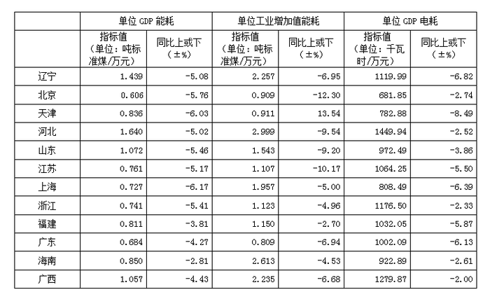

### 第 131 题

表中2009年单位GDP能耗和单位工业增加值能耗相差最大的省市区是：

A. 辽宁

B. 河北

C. 海南

D. 广西

第 131 题 · 答案与解析

**参考答案（粉笔题库参考内容）**

C

**解析**

从表中可以看出，2009年单位GDP能耗和单位工业增加值能耗相差值依次是，辽宁＝2.257－1.439＝0.818，河北＝2.999－1.640＝1.359，海南＝2.613－0.850＝1.763，广西＝2.235－1.057＝1.178，所以2009年单位GDP能耗和单位工业增加值能耗相差最大的省市区是海南。

故正确答案为C。

**考点**：简单加减计算、统计表

**来源**：2011年北京市公务员录用考试《行测》题第131题

### 第 132 题

与上年相比，表中2009年每万元GDP耗电量下降最多的省市区是：

A. 辽宁

B. 天津

C. 上海

D. 广东

第 132 题 · 答案与解析

**参考答案（粉笔题库参考内容）**

A

**解析**

从表格中观察可以发现，辽宁省2009年每万元GDP耗电量是1119.99千瓦/时，下降6.82%，绝对量下降是四个选项中最多的。

故正确答案为A。

**考点**：增长量比较、统计表

**来源**：2011年北京市公务员录用考试《行测》题第132题

### 第 133 题

为保持与2009年相同的降幅，北京市在哪年的万元GDP能耗将降低到0.55吨标准煤以下？

A. 2011

B. 2012

C. 2013

D. 2014

第 133 题 · 答案与解析

**参考答案（粉笔题库参考内容）**

A

**解析**

2009年北京的万元GDP能耗为0.606吨标准煤，要降到0.55吨标准煤以下，需要降低0.606-0.55=0.056吨标准煤，若保持与2009年相同的降幅，大概下降0.606×5.76%≈0.03多一点，显然一年是不够0.056的，估算一下，两年就可以了，所以2011年万元GDP能耗可以降到0.55吨标准煤以下。

故正确答案为A。

**考点**：比值比较、统计表

**来源**：2011年北京市公务员录用考试《行测》题第133题

### 第 134 题

2009年单位GDP消耗、单位工业增加值能耗和单位GDP电耗由高到低排列，均列表中前5位地区的有几个？

A. 0

B. 1

C. 2

D. 3

第 134 题 · 答案与解析

**参考答案（粉笔题库参考内容）**

D

**解析**

2009年单位GDP能耗排前五位的分别是河北、辽宁、山东、广西、海南；单位工业增加值能耗排前五位的分别是河北、海南、辽宁、广西、上海；单位GDP电耗排前五位的分别是河北、广西、浙江、辽宁、江苏。可见，均排前五位的地区有三个。

故正确答案为D。

**考点**：直接找数、统计表

**来源**：2011年北京市公务员录用考试《行测》题第134题

### 第 135 题

以下说法与资料相符的是：

A. 2008年浙江的单位工业增加值能耗高于江苏

B. 2009年单位GDP能耗最高地区的水平是最低地区的2倍以上

C. 2009年单位GDP能耗和电耗降幅最为接近的省区市是广东

D. 表中2008年万元GDP电耗在千度以上的省市区数和2009年相同

第 135 题 · 答案与解析

**参考答案（粉笔题库参考内容）**

B

**解析**

A项错误，2008年浙江单位工业增加值能耗为，江苏为，所以浙江要低于江苏；

B项正确，2009年单位GDP能耗最高地区是河北1.640，最低地区是北京0.606，前者明显是后者的2倍以上；

C项错误，通过观察可以发现江苏、海南的单位GDP能耗和电耗降幅都比广东省更接近；

D项错误，2009年单位GDP电耗小于并趋近于1000的有山东和海南，其中山东2008年单位GDP电耗为，2008年万元GDP电耗在千度以上的省市区数和2009年明显不同，至少多一个。

故正确答案为B。

**考点**：统计表、综合分析

**来源**：2011年北京市公务员录用考试《行测》题第135题

