# 2012年北京市公务员录用考试《行测》题

<!-- gwy:overview:start -->
> **北京 · 2012 · 行测 · 统考** ｜ 135 题 · 图片 101 处 · 答案随题折叠

| 题型模块 | 题量 | 题号 |
| --- | ---: | ---: |
| 常识判断 | 35 | 1–35 |
| 言语理解与表达 | 35 | 36–70 |
| 数量关系 | 15 | 71–85 |
| 判断推理 | 30 | 86–115 |
| 资料分析 | 20 | 116–135 |
| **合计** | **135** | |

导航：[题型与作答说明](#题型与作答说明) · [题目](#题目) · [材料 1](#材料-1)
<!-- gwy:overview:end -->

> 候选采集稿。参考答案及解析来自粉笔页面，不代表官方答案或真实高分答卷；来源使用许可与原卷对应关系仍需人工核实。

## 题型与作答说明

常识判断

（35题）

本部分包括两种类型的题目，请根据题目要求做出正确选择。多项选择题错选、多选、少选均不得分，但也不倒扣分。

言语理解与表达

（35题）

本部分均为单项选择题，着重考查考生对语言文字的理解和驾驭能力。

数量关系

（15题）

对于本部分试题，你可以在题本上运算。遇到难题，可以跳过不做，待你有时间再返回来做。

判断推理

（30题）

本部分包括图形推理、逻辑判断与定义判断三种类型的题目。

资料分析

（20题）

针对下列图、表或文字回答问题。你应根据资料提供的信息进行分析、比较、计算、处理。

## 题目

### 第 1 题

中国共产党十七届六中全会提出建设社会主义（    ）和到2020年的文化改革发展的奋斗目标。

A. 科技强国

B. 人才强国

C. 文化强国

D. 创新强国

第 1 题 · 答案与解析

**参考答案（粉笔题库参考内容）**

C

**解析**

十七届六中全会通过的《中共中央关于深化文化体制改革、推动社会主义文化大发展大繁荣若干重大问题的决定》中提出要努力建设社会主义文化强国，并提出了到2020年的文化改革发展奋斗目标。

故正确答案为C。

**来源**：2012年北京市公务员录用考试《行测》题第1题

### 第 2 题

国家“十二五”规划纲要提出，我国要实现经济（    ），国内生产总值年均增长（    ）。

A. 持续稳定发展7%

B. 持续稳定发展8%

C. 平稳较快发展7.5%

D. 平稳较快发展7%

第 2 题 · 答案与解析

**参考答案（粉笔题库参考内容）**

D

**解析**

“十二五”规划纲要（草案）指出，今后五年经济社会发展的主要目标是：经济平稳较快发展，国内生产总值年均增长7%，城镇新增就业4500万人，城镇登记失业率控制在5%以内，价格总水平基本稳定，国际收支趋向基本平衡，经济增长质量和效益明显提高。

故正确答案为D。

**考点**：宏观经济与调控政策

**来源**：2012年北京市公务员录用考试《行测》题第2题

### 第 3 题

第十一届全国人民代表大会常务委员会第二十三次会议表决通过了《关于修改居民身份证法的决定》，在居民身份证登记项目中增加了（    ）信息。

A. 家庭

B. 指纹

C. 婚姻

D. 民族

第 3 题 · 答案与解析

**参考答案（粉笔题库参考内容）**

B

**解析**

第十一届全国人民代表大会常务委员会第二十三次会议决定将《中华人民共和国居民身份证法》第3条第1款修改为：“居民身份证登记的项目包括：姓名、性别、民族、出生日期、常住户口所在地住址、公民身份号码、本人相片、指纹信息、证件的有效期和签发机关。”第3条增加1款，作为第3款：“公民申请领取、换领、补领居民身份证，应当登记指纹信息。”即在居民身份证登记项目中增加了指纹信息。

故正确答案为B。

**考点**：其他法律法规

**来源**：2012年北京市公务员录用考试《行测》题第3题

### 第 4 题

国家“十二五”规划纲要提出，要积极稳妥推进城镇化，把（    ）作为推进城镇化的重要任务。

A. 符合落户条件的农业转移人口逐步转为城镇居民

B. 促进农村转移人口城镇就业

C. 合理控制大中城市的农业转移人口流入

D. 鼓励和支持中西部地区、中小城市发展

第 4 题 · 答案与解析

**参考答案（粉笔题库参考内容）**

A

**解析**

国家“十二五”规划纲要第二十章第二节明确指出：把符合落户条件的农业转移人口逐步转为城镇居民作为推进城镇化的重要任务。

故正确答案为A。

**来源**：2012年北京市公务员录用考试《行测》题第4题

### 第 5 题

经国务院批准，2011年上海市、（    ）、广东省、深圳市启动地方政府自行发债试点工作。

A. 江苏省

B. 福建省

C. 山东省

D. 浙江省

第 5 题 · 答案与解析

**参考答案（粉笔题库参考内容）**

D

**解析**

2011年10月17日，财政部在《关于印发〈2011年地方政府自行发债试点办法〉的通知》中指出：经国务院批准，2011年上海市、浙江省、广东省、深圳市开展地方政府自行发债试点工作。

故正确答案为D。

**考点**：重要文件

**来源**：2012年北京市公务员录用考试《行测》题第5题

### 第 6 题

2011年11月2日正式发布的“北京精神”的表述语为：

A. 爱党 民主 创新 包容

B. 爱国 科学 宽容 厚德

C. 爱国 创新 包容 厚德

D. 爱党 宽容 厚德 创新

第 6 题 · 答案与解析

**参考答案（粉笔题库参考内容）**

C

**解析**

2011年11月2日，北京市公布了“北京精神”——“爱国、创新、包容、厚德”。“爱国”是“北京精神”的核心，“创新”是“北京精神”的精髓，“包容”是“北京精神”的特征，“厚德”是“北京精神”的品质。

故正确答案为C。

**来源**：2012年北京市公务员录用考试《行测》题第6题

### 第 7 题

从古代的“把酒问青天”、“嫦娥奔月”，到今天的“神舟”号系列对太空的探索，再到“天宫一号”的发射，我们对太空的了解越来越深入，这说明：

①追求真理是一个永无止境的过程

②人类对自然界的认识是一帆风顺的

③实践锻炼并提高了人的认识能力

④实践决定认识，认识是实践的目的

A. ①②

B. ①③

C. ②④

D. ③④

第 7 题 · 答案与解析

**参考答案（粉笔题库参考内容）**

B

**解析**

实践是认识的来源，随着实践活动的不断深入，认识也会不断加深，认识反过来进一步指导实践，实践是认识的来源，也是认识的最终目的。所以“追求真理是一个永无止境的过程”，“实践锻炼并提高了人的认识能力”的说法是正确的；

“实践决定认识，认识是实践的目的”的说法错误，应为“实践决定认识，实践是认识的目的”；

人类对自然界的认识并不是一帆风顺的，受技术手段制约，也经历了曲折的过程，所以“人类对自然界的认识是一帆风顺的”说法不正确。

故正确答案为B。

**考点**：认识论

**来源**：2012年北京市公务员录用考试《行测》题第7题

### 第 8 题

“苟利国家生死以，岂因祸福避趋之”。这句话反映的我国爱国主义优良传统是（    ）。

A. 热爱祖国，矢志不渝

B. 天下兴亡，匹夫有责

C. 维护统一，反对分裂

D. 同仇敌忾，抵御外强

第 8 题 · 答案与解析

**参考答案（粉笔题库参考内容）**

A

**解析**

A项正确，“苟利国家生死以，岂因祸福避趋之”，大意是说只要对国家有利，即便牺牲自己的生命也心甘情愿，绝不会因为自己可能会受到祸害而躲开。这与爱国主义优良传统“热爱祖国，矢志不渝”的涵义一致；

B项错误，“天下兴亡，匹夫有责”指天下大事的兴盛、灭亡，每一个老百姓都有义不容辞的责任，强调的是个人对国家的责任和义务；

C项错误，“维护统一，反对分裂”强调的是维护祖国统一和民族团结的爱国主义传统；

D项错误，“同仇敌忾，抵御外强”强调的是团结一致、反抗外来侵略的爱国主义传统。

故正确答案为A。

**考点**：文化常识

**来源**：2012年北京市公务员录用考试《行测》题第8题

### 第 9 题

中外经济界人士认为，化解世界经济危机、推动可持续增长，仅靠中国一枝独秀是不现实的，但离开中国是万万不能的。这说明：

①发展对外经济关系必须坚持独立自主

②中国经济发展越来越吸引世界的目光

③发达资本主义国家主导世界经济格局的情况已经改变

④各国经济日益相互依赖、相互影响

A. ①②

B. ①③

C. ③④

D. ②④

第 9 题 · 答案与解析

**参考答案（粉笔题库参考内容）**

D

**解析**

题干中强调的是中国在化解世界经济危机、推动可持续增长方面所发挥的作用。

①表述错误，“必须坚持独立自主”，与题干内容不符；

③表述错误，世界经济格局情况已经改变与题干中强调中国经济发展的作用不相干。

故正确答案为D。

**考点**：国际经济及组织

**来源**：2012年北京市公务员录用考试《行测》题第9题

### 第 10 题

2011年9月初，100欧元兑换人民币917.33元，2011年10月初，100欧元兑换人民币853.45元。这表明：

A. 欧元购买力提高

B. 我国出口到欧洲的产品竞争力上升

C. 外币的汇率跌落

D. 欧洲公民到我国旅游所需费用减少

第 10 题 · 答案与解析

**参考答案（粉笔题库参考内容）**

C

**解析**

A项错误，先前用1欧元能兑换9.17元人民币，1个月后只能兑换8.53元人民币，这表明人民币升值了，用最通俗的话讲就是人民币的购买力增强；

B项错误，在中国产品质量无明显提高的情况下，必然会降低中国出口产品的竞争力；

C项正确，人民币升值或贬值是由汇率直观反映出来的，人民币升值表明外币的汇率跌落；

D项错误，人民币升值意味着，在国际市场（只有在国际市场上才能体现出人民币购买力增强了）上原来1元人民币只能买到1单位商品，在人民币升值后就能买到更多单位的商品了，即欧洲公民每购买相同单位中国商品所需费用增加。

故正确答案为C。

**考点**：国际经济及组织

**来源**：2012年北京市公务员录用考试《行测》题第10题

### 第 11 题

在工业化过程中，随着农村富余劳动力向非农产业的逐步转移，农村富余劳动力将逐渐减少。面对这一趋势，企业应该：

A. 勇于承担社会责任，完善失业保险制度

B. 不断提高劳动生产率，提高企业竞争力

C. 与员工协商薪酬，不断提高劳动者待遇

D. 完善就业机制，加强员工职业技能培训

第 11 题 · 答案与解析

**参考答案（粉笔题库参考内容）**

D

**解析**

A项错误，是企业在社会就业形势不乐观的情况下所应承担的社会责任，与题干所提形势联系不够紧密；

B项错误，是企业面对市场竞争应采取的措施；

C项错误，是企业内部的福利保障制度；

D项正确，题干中的关键信息是农村富余劳动力“逐步转移”“逐渐减少”，可知这部分劳动力在工业化过程中会不断进入企业工作，在这种情况下，企业要做的是对这部分职员进行职业技能培训，以保证这部分人能更好地面对竞争。

故正确答案为D。

**来源**：2012年北京市公务员录用考试《行测》题第11题

### 第 12 题

当前世界上最大的区域性贸易集团是：

A. 欧洲联盟

B. 世界贸易组织

C. 石油输出国组织

D. 东南亚国家联盟

第 12 题 · 答案与解析

**参考答案（粉笔题库参考内容）**

A

**解析**

A项正确，当前世界上最大的区域性贸易集团是欧洲联盟。欧洲联盟，简称欧盟（EU），总部设在比利时首都布鲁塞尔，是由欧洲共同体发展而来的，英国脱欧之后，目前欧盟拥有27个成员国；

B项错误，世界贸易组织是一个独立于联合国的永久性国际组织，不是区域性贸易集团；

C项错误，石油输出国组织是第三世界建立最早、影响最大的原料生产国和输出组织，于1960年9月14日宣告成立，成员国有伊朗、伊拉克、科威特、沙特阿拉伯和委内瑞拉五国；

D项错误，东南亚国家联盟即东盟，截至2011年8月，东盟成员国有10个：文莱（1984年）、柬埔寨（1999年）、印度尼西亚、老挝（1997年）、马来西亚、缅甸（1997年）、菲律宾、新加坡、泰国、越南（1995年）。

故正确答案为A。

**考点**：国际经济及组织

**来源**：2012年北京市公务员录用考试《行测》题第12题

### 第 13 题

在行政诉讼的执行措施中，可对行政机关采取的是：

A. 司法建议

B. 查封

C. 扣押

D. 划拨

第 13 题 · 答案与解析

**参考答案（粉笔题库参考内容）**

D

**解析**

根据《行政诉讼法》第96条规定：“当事人必须履行人民法院发生法律效力的判决、裁定。行政机关拒绝履行判决、裁定的，第一审人民法院可以采取以下措施：（一）对应当归还的罚款或者应当给付的赔偿金，通知银行从该行政机关的账户内划拨······（三）向该行政机关的上一级行政机关或者监察、人事机关提出司法建议。接受司法建议的机关，根据有关规定进行处理，并将处理情况告知人民法院”。因此，行政诉讼执行措施中，人民法院可对行政机关采取的是划拨。

故正确答案为D。

**考点**：行政法

**来源**：2012年北京市公务员录用考试《行测》题第13题

### 第 14 题

某区卫生行政部门根据《公共场所卫生管理条例》的相关规定，对某饭馆作出吊销卫生许可证的决定。这一行为属于行政（    ）。

A. 处罚

B. 监督

C. 强制执行

D. 强制措施

第 14 题 · 答案与解析

**参考答案（粉笔题库参考内容）**

A

**解析**

本题考查法律常识。

根据《行政处罚法》第9条规定：“行政处罚的种类······（三）暂扣许可证件、降低资质等级、吊销许可证件······”因此，吊销卫生许可证属于行政处罚。

故正确答案为A。

**考点**：行政法

**来源**：2012年北京市公务员录用考试《行测》题第14题

### 第 15 题

张某为了要男孩，将妻子刚生下的生重病的女婴扔进小河里淹死。张某应被定为犯有：

A. 过失杀人罪

B. 故意杀人罪

C. 遗弃罪

D. 虐待罪

第 15 题 · 答案与解析

**参考答案（粉笔题库参考内容）**

B

**解析**

B项正确，《刑法》上的故意杀人，是指故意非法剥夺他人生命的行为。

本题中，张某明知把婴儿扔进河里必然会导致婴儿死亡，还将该女婴扔入小河淹死，剥夺了该女婴的生命，符合故意杀人罪的犯罪构成要件。

故正确答案为B。

**考点**：刑法

**来源**：2012年北京市公务员录用考试《行测》题第15题

### 第 16 题

罪责刑相适应原则是我国《刑法》的基本原则之一，其含义是：

A. 刑罚的轻重应当与犯罪行为相适应

B. 刑罚的轻重应当与犯罪个人情况（主观恶性与人身危险性）相适应

C. 刑罚的轻重应当与犯罪客观危害相适应

D. 刑罚的轻重应当与犯罪分子所犯罪行和承担的刑事责任相适应

第 16 题 · 答案与解析

**参考答案（粉笔题库参考内容）**

D

**解析**

罪责刑相适应原则，是指犯多大的罪，就应承担多大的刑事责任，法院也应判处其相应轻重的刑罚，做到重罪重罚，轻罪轻罚，罚当其罪，罪刑相称。即刑罚的轻重应当与犯罪分子所犯罪行和承担的刑事责任相适应。

故正确答案为D。

**考点**：刑法

**来源**：2012年北京市公务员录用考试《行测》题第16题

### 第 17 题

下列选项中不属于我国著作权法所保护的作品是：

A. 法院的判决书

B. 没有剧本的小品表演

C. 建筑施工图纸

D. 用C++语言编写的计算机程序

第 17 题 · 答案与解析

**参考答案（粉笔题库参考内容）**

A

**解析**

根据我国《著作权法》规定，法院判决书属于国家机关司法性质的文件，属于公有领域文件，著作权法不予保护。

没有剧本的小品表演、施工图纸和计算机程序都属于著作权保护的范畴。

故正确答案为A。

**考点**：民法典

**来源**：2012年吉林省公务员录用考试《行测》题（甲级）第56题

### 第 18 题

下列行为中，构成使用假币罪的是：

A. 甲用总面额1万元的假币参加赌博

B. 甲是某银行工作人员，利用职务上的便利，用假币换取真币

C. 甲在与乙签订经济合同时，为显示自己的经济实力，将总面额20万元的假币冒充真币出示给乙看

D. 甲用总面额10万元的假币换取乙1万元的真币

第 18 题 · 答案与解析

**参考答案（粉笔题库参考内容）**

A

**解析**

根据《关于惩治破坏金融秩序犯罪的规定》第4条：使用假币罪是指“明知是伪造的货币而使用，数额较大的……”。“使用”是指将假币取代真币在经济交易中运用，即用于流通，如正常的买卖活动，也有的用作赌资非法活动。

A项正确，根据最高人民检察院、公安部《关于经济案件追诉标准的规定》第19条“明知是伪造的货币而持有、使用，总面额在四千元以上的，应予追诉”的规定，数额较大的起点为四千元；

B项错误，银行工作人员并没有将假币用于流通，其行为构成以假币换取货币罪。金融机构工作人员购买假币、以假币换取货币罪，是指银行或者其他金融机构的工作人员购买伪造的货币，或者利用职务上的便利，以伪造的货币换取货币的行为；

C项错误，甲的行为是为了取信于乙，其行为不构成使用假币罪，但不排除非法持有假币罪；

D项错误，甲的行为不属于正常的买卖活动，其行为实质构成了出售假币罪。

故正确答案为A。

**考点**：刑法

**来源**：2012年北京市公务员录用考试《行测》题第18题

### 第 19 题

下列有关“通告”的表述中，错误的是：

A. 发布在一定范围内应当遵守的事项

B. 通告发布机关的级别一般比公告发布者低

C. 告知的范围比公告宽泛

D. 通告的文字具有强制力和严肃性

第 19 题 · 答案与解析

**参考答案（粉笔题库参考内容）**

C

**解析**

C项错误，根据《国家行政机关公文处理办法》规定：通告是在一定范围内公布应当遵守或周知的事项时使用的公文。公告是适用于向国内外宣布重要事项或者法定事项的公文。因此，通告的告知范围要小于公告。

本题为选非题，故正确答案为C。

**来源**：2012年北京市公务员录用考试《行测》题第19题

### 第 20 题

根据以下素材拟写的公文标题，符合规范的是：

素材：为加强对城镇待业人员的管理，进一步做好劳动就业工作，经过××市人民政府同意,市人力资源和社会保障局将对全市城镇待业人员进行统一登记，为此行文通知各有关部门。

A. 《××市人力资源和社会保障局关于加强城镇待业人员的管理的通知》

B. 《××市人力资源和社会保障局关于对全市城镇待业人员进行统一登记的通知》

C. 《××市人力资源和社会保障局关于进一步做好劳动就业工作的通知》

D. 《××市人民政府关于加强劳动就业管理的公告》

第 20 题 · 答案与解析

**参考答案（粉笔题库参考内容）**

B

**解析**

通知是向特定受文对象告知或转达有关事项或文件，让对象知道或执行的公文。通知适用于批转下级机关的公文，转发上级机关和不相隶属机关的公文。

通知用来发布规章，传达要求下级机关办理和有关单位需要周知或共同执行的事项，任免和聘用干部。公告是适用于向国内外宣布重要事项或者法定事项的公文。本题中，此类公文属于通知，所传达的事项是“对全市城镇待业人员进行统一登记”。

故正确答案为B。

**来源**：2012年北京市公务员录用考试《行测》题第20题

### 第 21 题

康有为的维新思想吸收了西方资本主义政治学说的内容，其中最主要的是：

A. 民主共和思想

B. 三权分立学说

C. 君主立宪思想

D. 天赋人权学说

第 21 题 · 答案与解析

**参考答案（粉笔题库参考内容）**

C

**解析**

康有为指出：“东西各国之强，皆以立宪法、开国会之故。国会者，君与国民共议一国之政法也。”康有为主张学习西方的政治制度，提出了变君主专制为君主立宪制的要求。

故正确答案为C。

**考点**：文化常识

**来源**：2012年北京市公务员录用考试《行测》题第21题

### 第 22 题

北宋初期是我国书院教育的高潮期，出现了著名的（    ）书院、白鹿洞书院、嵩阳书院、应天书院，合称为“宋初四大书院”。

A. 丽泽

B. 岳麓

C. 石鼓

D. 茅山

第 22 题 · 答案与解析

**参考答案（粉笔题库参考内容）**

B

**解析**

宋初四大书院是指：湖南长沙的岳麓书院，江西庐山的白鹿洞书院，河南商丘城南的应天书院（睢阳书院），河南嵩山南麓的嵩阳书院或湖南衡阳的石鼓书院。其中唯一受到各种说法公认的是位于湖南长沙的岳麓书院。

故正确答案为B。

**考点**：文化常识

**来源**：2012年北京市公务员录用考试《行测》题第22题

### 第 23 题

北京时间2011年9月29日，“天宫一号”目标飞行器发射后大约10分钟，到达了近地点约200千米、远地点约346千米的轨道。该运行轨道所处大气层的特点是：

A. 气温随高度的增加而递减

B. 对流现象显著，多云雨现象

C. 气流平稳，天气晴朗，有利于航空飞行

D. 存在电离层，可反射无线电波

第 23 题 · 答案与解析

**参考答案（粉笔题库参考内容）**

D

**解析**

大气层从接近地表排序依次为对流层、平流层、中间层、电离层、外层。其中，电离层大约距地球表面60至1000千米，属于题目中所提的该运行轨道所处大气层。

电离层的特点是：①气温随高度增加而增加；②电离程度较强烈，可反射无线电波。

A、B两项是对流层的特点；

C项是平流层的特点。

故正确答案为D。

**考点**：自然地理

**来源**：2012年北京市公务员录用考试《行测》题第23题

### 第 24 题

下列选项中，属于第二次工业革命时期的发明的是：

A. 蒸汽机

B. 轮船

C. 汽车

D. 电视机

第 24 题 · 答案与解析

**参考答案（粉笔题库参考内容）**

C

**解析**

第二次工业革命起于19世纪七十年代，科学技术的突出发展主要表现在三个方面，即电力的广泛应用、内燃机和新交通工具的创制、新通讯手段的发明。

19世纪七八十年代，以煤气和汽油为燃料的内燃机相继诞生，90年代柴油机创制成功。内燃机的发明解决了交通工具的发动机问题。1885年，德国人卡尔·本茨成功地制造了第一辆由内燃机驱动的汽车。

故正确答案为C。

**考点**：科技理论与成就

**来源**：2012年北京市公务员录用考试《行测》题第24题

### 第 25 题

某战士在抗击强台风“梅花”时，受伤失血过多需要输血。如果该战士是O型血，则应给他输入：

A. A型血

B. B型血

C. AB型血

D. O型血

第 25 题 · 答案与解析

**参考答案（粉笔题库参考内容）**

D

**解析**

输血时应该以输入同型血为原则。例如：正常情况下A型血人输A型血，B型血的人输B型血。紧急情况下，AＢ血型的人可以接受任何血型，Ｏ型血可以输给任何血型的人，但如果异血型者之间输血输得太快太多，输进来的凝集素来不及稀释，也可能引起凝集反应。

但无论如何O型血只能接受输入O型血，否则含有A（或B）凝集原的红细胞与含有抗A（或抗B）凝集素的血清混合时，由于相对抗的凝集原和凝集素（如A与抗A）的相互作用，使红细胞凝集成团。

故正确答案为D。

**考点**：生物常识

**来源**：2012年北京市公务员录用考试《行测》题第25题

### 第 26 题

《北京市全民健身实施计划（2011—2015年）》提出，为实现目标任务，将要采取的措施主要有：

A. 强化政府公共服务职责，大力推进全民健身公共服务体系建设

B. 加大科学健身指导力度

C. 组织各项体育比赛活动，形成长效机制

D. 促进全民健身服务业发展，引导城乡居民体育消费

第 26 题 · 答案与解析

**参考答案（粉笔题库参考内容）**

ABD

**解析**

根据《北京市全民健身实施计划（2011—2015年）》的规定，将采取的措施包括：（1）强化政府公共服务职责，大力推进全民健身公共服务体系建设；

（2）广泛开展全民健身活动，大力推进体育生活化；

（3）加快建设公共体育健身设施，提高体育设施利用率；

（4）加强社会体育指导员队伍建设，提高服务能力和指导水平；

（5）广泛开展全民健身志愿服务活动，建立长效机制；

（6）发挥全民健身组织网络作用，逐步实现全民健身社会化；

（7）统筹城乡体育、各人群体育协调发展；

（8）做好法制建设和宣传工作；

（9）加大科学健身指导力度；

（10）促进全民健身服务业发展，引导城乡居民体育消费。

由以上表述可知，A、B、D三项表述正确；

C项表述错误，应为“广泛开展全民健身志愿服务活动，建立长效机制”。

故正确答案为ABD。

**来源**：2012年北京市公务员录用考试《行测》题第26题

### 第 27 题

下列有关北京老字号的说法中，正确的有：

A. 老字号不仅是一种商贸景观，更重要的是一种历史传统文化现象

B. 老字号是指具有鲜明的地域文化特征和历史痕迹、具有独特的工艺和经营特色的产品、技艺或服务

C. 京城民间经常使用的歇后语，如东来顺的涮羊肉——真叫嫩、同仁堂的药——货真价实等，生动地反映了北京老字号的品牌特色

D. 老字号随着历史的变迁和人们生活水平的不断提高，会逐渐消失

第 27 题 · 答案与解析

**参考答案（粉笔题库参考内容）**

ABC

**解析**

A项正确，北京老字号不仅是一种商贸景观，更重要的是一种历史传统文化现象；

B项正确，“中华老字号”是指在长期的生产经营活动中，沿袭和继承了中华民族优秀的文化传统，具有鲜明的地域文化特征和历史痕迹、具有独特的工艺和经营特色的产品、技艺或服务，取得了社会广泛认同，赢得了良好商业信誉的企业名称，以及老字号产品品牌；

C项正确，京城民间歇后语，如东来顺的涮羊肉——真叫嫩、六必居的抹布——酸甜苦辣都尝过、同仁堂的药——货真价实等，生动地表述了这些老字号的品牌特色；

D项错误，老字号是数百年商业和手工业竞争中留下的极品。老字号都各自经历了艰苦奋斗的发家史而最终统领一行，其品牌也是人们公认的质量的同义语，所以，虽然现代经济的发展，使老字号显得有些失落，但它仍以自己的特色独树一帜，并不会“逐渐消失”。

故正确答案为ABC。

**考点**：文化常识

**来源**：2012年北京市公务员录用考试《行测》题第27题

### 第 28 题

下列选项中，只属于全国人民代表大会的权力有：

A. 批准省、自治区和直辖市的建置

B. 撤销下一级人民政府不适当的决定

C. 决定特别行政区的设立及其制度

D. 选举最高人民法院院长

第 28 题 · 答案与解析

**参考答案（粉笔题库参考内容）**

ACD

**解析**

A项正确，《宪法》第六十二条第十三款规定：“全国人民代表大会批准省、自治区和直辖市的建置。”

B项错误，《宪法》第六十二条第十二款规定：“全国人民代表大会改变或者撤销全国人民代表大会常务委员会不适当的决定。”第八十九条第十四款规定：“国务院改变或者撤销地方各级国家行政机关的不适当的决定和命令。”

C项正确，《宪法》第六十二条第十四款规定：“全国人民代表大会决定特别行政区的设立及其制度。”

D项正确，《宪法》第六十二条第八款规定：“全国人民代表大会选举最高人民法院院长。”

故正确答案为ACD。

**考点**：宪法

**来源**：2012年北京市公务员录用考试《行测》题第28题

### 第 29 题

下列选项中，属于我国一级政府的有：

A. 州

B. 旗

C. 盟

D. 民族乡

第 29 题 · 答案与解析

**参考答案（粉笔题库参考内容）**

ABCD

**解析**

本题考查法律常识。

一级政府就是指和行政区划相匹配的某一层级的政府，乡镇政府、县市政府、省政府、国务院都属于一级政府。《宪法》第95条规定：“省、直辖市、县、市、市辖区、乡、民族乡、镇设立人民代表大会和人民政府。”第112条规定：“民族自治地方的自治机关是自治区、自治州、自治县的人民代表大会和人民政府。”中华人民共和国建立后，在苗族、藏族、回族等少数民族地区设自治州，行政地位在省以下、县以上。“旗”是中国内蒙古自治区的行政区划，相当于县。“盟”为内蒙古自治区的行政单位，下辖旗、县、市。

故正确答案为ABCD。

**考点**：宪法

**来源**：2012年北京市公务员录用考试《行测》题第29题

### 第 30 题

经财政部汇总，2010年中央行政单位、事业单位和其他单位“三公”支出合计94.7亿元。“三公”支出包括：

A. 政府部门人员因公出国、出境费用支出

B. 公务车购置及运行费用支出

C. 政府部门购置办公设备费用支出

D. 公务招待费用支出

第 30 题 · 答案与解析

**参考答案（粉笔题库参考内容）**

ABD

**解析**

“三公”支出指公款吃喝、公车消费、公费出国，是涉及行政支出中的铺张浪费与腐败问题的词语。

C项是属于正常的办公费用支出，排除。

故正确答案为ABD。

**考点**：政治建设

**来源**：2012年北京市公务员录用考试《行测》题第30题

### 第 31 题

下列公文格式的表述中，正确的有：

A. 主送机关即受文机关

B. 印发机关指发文机关的办公部门

C. 发文字号由发文机关代字、发文年度、发文序号组成

D. 附件是附在正文之后的文件、材料，每个文件都有附件

第 31 题 · 答案与解析

**参考答案（粉笔题库参考内容）**

BC

**解析**

A项错误，受文机关包括主送机关、抄送机关，其中主送机关是对公文负有主办或答复责任的机关，抄送机关是除主送机关以外的其他需要告知公文内容的有关机关；

B项正确，印发机关是指公文的印制主管部门，一般为发文机关的办公厅（室）或文秘部门，即办公部门；

C项正确，发文字号由发文机关代字、发文年度、发文序号组成；

D项错误，附件是正文的补充材料或参考材料，是公文的重要组成部分，但不是所有的文件都有附件。

故正确答案为BC。

**来源**：2012年北京市公务员录用考试《行测》题第31题

### 第 32 题

消费水平是指一定时期人均消费的生活资料和劳务的数量，我国人均消费水平的高低取决于：

A. 国民收入总额及其增长速度

B. 国民收入中积累和消费的比例

C. 外贸状况特别是进口商品总量

D. 人口总量

第 32 题 · 答案与解析

**参考答案（粉笔题库参考内容）**

ABD

**解析**

人均消费水平（年）=居民个人消费总额/年均人口总数。居民个人消费总额的高低主要受国民收入的增长速度和积累率的高低的影响。所以我国人均消费水平的高低取决于国民收入的总额和增长速度、国民收入中积累和消费的比例、人口总量。

故正确答案为ABD。

**考点**：宏观经济与调控政策

**来源**：2012年北京市公务员录用考试《行测》题第32题

### 第 33 题

下列有关人民币升值的说法中，正确的有：

A. 人民币升值给国内消费者带来的最明显变化，就是手中的人民币“更值钱”了，所以人民币升值让老百姓得到了更多实惠

B. 人民币适当升值，能够迫使出口企业提高技术水平，改进产品档次，从而促进我国的产业结构调整，改善我国在国际分工中的地位

C. 中国是个需求很大的大市场，所以，人民币升值对来中国投资的外商不会产生实质性的不利影响

D. 人民币升值对出口企业和境外直接投资的影响，最终将体现在就业上

第 33 题 · 答案与解析

**参考答案（粉笔题库参考内容）**

ABD

**解析**

A项正确，人民币升值意味着人民币“值钱了”，在国际市场上购买国外产品、出国旅游等会相对便宜，因而国内消费者会得到更多实惠；

B项正确，人民币适当升值，会使得外国公民每购买相同单位中国商品所需费用增加，如果中国出口企业不提高技术水平、改进产品档次，就会降低中国出口产品的竞争力，可迫使出口企业提高技术水平，进而有利于我国的产业结构调整；

C项错误，尽管中国市场需求很大，但人民币升值对应外币必然是贬值的，会使得外商在中国投资成本相对增加；

D项正确，如果人民币升值后，中国出口企业没有提高技术水平，造成出口产品销量减少影响企业利润率，为降低成本可能会采取裁员等措施，再者外商投资减少，不能提供更多就业岗位，进而会导致失业率增加。

故正确答案为ABD。

**考点**：国际经济及组织

**来源**：2012年北京市公务员录用考试《行测》题第33题

### 第 34 题

杨某与刘某在日常生活中有矛盾。杨某为了泄私愤，造谣说刘某生活作风有问题，致使刘某的生活和工作受到很不利的影响。

在这种情况下，刘某可以要求杨某承担的民事责任有：

A. 停止侵害

B. 恢复名誉

C. 消除影响

D. 赔礼道歉

第 34 题 · 答案与解析

**参考答案（粉笔题库参考内容）**

ABCD

**解析**

根据《民法通则》第一百二十条规定：“公民的······名誉权受到侵害的，有权要求停止侵害、恢复名誉、消除影响、赔礼道歉，并可以要求赔偿损失。”

根据《关于贯彻执行〈中华人民共和国民法通则〉若干问题的意见》第一百四十条规定：“以书面、口头等形式宣扬他人的隐私或者捏造事实公然丑化他人人格以及用侮辱诽谤等方式损害他人名誉，造成一定影响的，应当认定为侵害公民名誉权的行为。”杨某造谣刘某生活作风有问题，对刘某造成了名誉损害，因此刘某有权要求停止侵害、恢复名誉、消除影响、赔礼道歉，并可以要求赔偿损失。

故正确答案为ABCD。

**考点**：民法典

**来源**：2012年北京市公务员录用考试《行测》题第34题

### 第 35 题

犯罪构成的共同要件一般包括：

A. 犯罪主体

B. 犯罪主观方面

C. 犯罪客体

D. 犯罪客观方面

第 35 题 · 答案与解析

**参考答案（粉笔题库参考内容）**

ABCD

**解析**

犯罪构成的共同要件，是指一切犯罪构成都必须具备的要件。因此，也称犯罪构成的必要要件。关于犯罪构成的共同要件，刑法理论上存在分歧，但一般采用四要件说，即认为犯罪构成的共同要件应为：犯罪客体、犯罪客观方面、犯罪主体、犯罪主观方面。

故正确答案为ABCD。

**考点**：刑法

**来源**：2012年北京市公务员录用考试《行测》题第35题

## 材料 1

关于“起床”，有人总结了一些有趣的心理学研究。在被叫醒的那一刻，我们的大脑需要完成一系列复杂的转换：环境安全检查→潜意识切换→神经系统启动→让四肢苏醒。这个过程被称为“切换启动过程”。在这个过程中，当潜意识接收到“醒来”的指令后，它会先检查一下周遭的环境是否安全，如果安全感很充足，潜意识就满意地准备下班了。于是，意识会接替潜意识逐渐控制大脑，切断梦境。然后，所有休息中的神经系统开始启动。当你的大脑逐渐清醒，它会下命令给四肢：伸展、坐起、揉眼睛、掀被子、下地。这整个过程，需要有足够的时间与安全的环境来启动大脑。

        我们很多人，担心叫不醒别人，常会用“锲而不舍”的大噪音来叫别人起床。比如一直对着对方喊“起床了，起床了······”，直到他坐起下地才罢休；或者一直摇晃对方的身体，摇到对方起来为止。很不幸，这都属于“杀伤性叫醒”，即用惊醒的方式切断启动过程，让人立即恢复意识。这种粗暴的方式会带给人极糟的影响。

        睡眠是由潜意识负责的，睡着时它非常活跃，会接收大量的外界信号，并保留下来，制作成梦境，如果在此时被“粗暴”地惊醒，潜意识就会戛然而止，它还没来得及叫意识来接班，就仓皇逃离，这个时候“惊吓”的记忆和感受，会很容易在潜意识中沉淀下去，形成深层的惊悚，导致神经系统的紊乱。小则令人起床后迷迷糊糊，把鞋油当牙膏；大则一天浑浑噩噩，头脑不清。长期以来都被“杀伤性叫醒”，会带来一系列神经或心理的问题，比如被坏情绪控制、冲动易怒、心境低落、反应迟缓、注意力涣散等等。

        再有，人在睡眠时，对环境的安全感要求非常高，“杀伤性叫醒”往往会剥夺这种安全感。潜意识在检查环境时，觉得不安全，于是人在极度不安、恐慌、焦虑的环境中醒来，就会出现一些防御行为，比如攻击叫醒人，冷漠麻木，或者情绪崩溃等。

        如果希望你的亲朋好友安全地醒来，一定要避免使用“杀伤性叫醒”。叫醒人最好的方式就是温柔与耐心，让一个人感到足够的安全。你可以用一些舒缓的乐曲叫人醒来。如果有一些特殊环境音，比如清脆的几声鸟叫、小溪潺潺声等也不错。

### 第 36 题

下列选项中，不一定属于“切换启动过程”的是：

A. 潜意识切换

B. 开始接受外界信号

C. 进行环境安全检查

D. 启动神经系统

第 36 题 · 答案与解析

**参考答案（粉笔题库参考内容）**

B

**解析**

本题为细节判断题。

定位原文，由文章首段第二句话可知“切换启动过程”包括环境安全检查、潜意识切换、神经系统启动、让四肢苏醒四个步骤。

B项“开始接受外界信号”不一定属于切换启动过程。

本题为选非题，故正确答案为B。

**来源**：2012年北京市公务员录用考试《行测》题第36题

### 第 37 题

关于“杀伤性叫醒”，以下说法正确的是：

A. 是持续地叫人起床

B. 是破坏潜意识的叫醒方式

C. 用惊醒让人立即恢复意识

D. 是影响人的正常睡眠的叫醒方式

第 37 题 · 答案与解析

**参考答案（粉笔题库参考内容）**

C

**解析**

第二段中明确点出“‘杀伤性叫醒’，即用惊醒的方式切断启动过程，让人立即恢复意识”，C项表述正确。

A项错误，是“杀伤性叫醒”的一种方式；

B项错误，根据文章第3段可知，“杀伤性叫醒”并不是“破坏”潜意识，而是令潜意识“戛然而止”；

D项错误，根据整篇文章可知，“长期以来都被杀伤性叫醒”“会带来一系列神经或心理问题”，没有提到“影响正常睡眠”这一点。

故正确答案为C。

**来源**：2012年北京市公务员录用考试《行测》题第37题

### 第 38 题

关于人的睡眠，以下说法正确的是：

A. 睡眠时人的梦境由潜意识来形成

B. 人在睡眠时应减少接收外界信号

C. 睡着时人的神经系统依然很活跃

D. 睡眠由意识和潜意识来共同管理

第 38 题 · 答案与解析

**参考答案（粉笔题库参考内容）**

A

**解析**

本题为细节判断题。

A项，文章第三段首句提到“睡眠是由潜意识负责的，睡着时它非常活跃······制作成梦境”，即睡眠时人的梦境由潜意识来形成的，当选；

D项，第三段首句明确提到睡眠是潜意识来负责的，并没有意识的作用，排除；

B、C两项，在文章中并未提及，均排除。

故正确答案为A。

**来源**：2012年北京市公务员录用考试《行测》题第38题

### 第 39 题

“杀伤性叫醒”可能会使人因失去安全感而（    ）。

A. 冲动易怒

B. 情绪崩溃

C. 反应迟缓

D. 心境低落

第 39 题 · 答案与解析

**参考答案（粉笔题库参考内容）**

B

**解析**

本题为细节判断题。

文章第四段尾句提到“‘杀伤性的叫醒’往往会剥夺这种安全感······醒来，就会出现一些防御行为，比如攻击叫醒人，冷漠麻木，或者情绪崩溃等”。

根据文章第三段末尾可知，A、C、D三项是长期被“杀伤性叫醒”所带来的一系列神经或心理问题。

故正确答案为B。

**来源**：2012年北京市公务员录用考试《行测》题第39题

### 第 40 题

最适合做本文标题的是：

A. 潜意识和意识

B. 睡眠中的心理学效应

C. 起床时大脑工作原理

D. 不能小看的“杀伤性叫醒”

第 40 题 · 答案与解析

**参考答案（粉笔题库参考内容）**

D

**解析**

本题为标题选择题。

整篇文章是围绕着起床时被“杀伤性叫醒”展开的，强调“杀伤性叫醒”会给人带来极糟的影响。

A、B两项在文章中虽有所涉及，但是范围较广，且不是文章的核心内容；C项只是文章第一段的总结，太过片面，予以排除。

故正确答案为D。

**来源**：2012年北京市公务员录用考试《行测》题第40题

## 材料 2

生物柴油一直被誉为是减少我们对化石燃料依赖的可能的解决办法。目前大部分采用生物柴油的车辆使用的都是经过再加工的食用油，这种生物柴油的原材料非常昂贵，而且也很稀缺，因此很难进行大规模商业生产。如果生物柴油想对现实生活产生不可磨灭的真正影响，它就必须直接来源于植物。斯坦福大学的研究人员表示，生产价格低廉的植物生物柴油的化学过程很快就会变成现实。

        最近通过大肠杆菌进行的试验表明，这种细菌可能是把植物成功转变成生物柴油的关键。利用植物切实可行地生产生物柴油是一个非常复杂的过程，迄今为止还没有用植物大规模生产这种燃料的可行方法。大肠杆菌能把植物糖分转变成脂肪酸衍生物，一种与肥皂类似的化学物质，是一种行得通的燃料的好前体。但是科学家还不确定这种细菌是否具有可供大规模生产的足够的化学“能力”。斯坦福大学的研究人员进行了相关研究，他们想看一看大肠杆菌在把糖转变成脂肪酸衍生物方面是否存在理论上的“限制”，例如这种细菌是否有能力将常规植物转变为“燃料”。相关研究报告称，这个问题的答案显然是肯定的。研究人员表示：“好消息是大肠杆菌制造脂肪酸衍生物具有令人难以置信的超强能力，它能以极高的速度把糖转变成燃料。”

        但是这一过程受到细菌的严密控制，因此我们需要更好地了解大肠杆菌。科研小组已经开始进行这方面的工作，并在实验室环境下隔离了产生脂肪酸衍生物的分子机制。他们说：“我们想弄明白是什么限制了大肠杆菌处理糖的能力。我们正在询问的这个问题就像是什么限制汽车的速度达到每小时150英里的问题。”

        我们发现，大肠杆菌限制脂肪酸衍生物产生的目的，显然是为了阻止这种物质对它造成伤害。它采取的“防御措施”非常有效，但是研究人员已经开始研究如何能让这种细菌产生更多脂肪酸衍生物。如果研究取得成功，生物柴油将会突然从一个传奇转变成切实可行的商用燃料。

### 第 41 题

目前以食用油为原材料的生物柴油很难大规模生产，主要原因是：

A. 市场的认可度不高

B. 生产技术尚不成熟

C. 原材料昂贵而稀缺

D. 无法用于现有车型

第 41 题 · 答案与解析

**参考答案（粉笔题库参考内容）**

C

**解析**

本题为细节判断题。

由第一段中“这种生物柴油的原料非常昂贵，而且也很稀缺，因此很难进行大规模商业生产”可知其原因是原材料非常昂贵并且稀缺。因此，结合选项应该选择C项。

其他三项均不是以食用油为原材料的生物柴油难以大规模生产的原因，予以排除。

故正确答案为C。

**来源**：2012年北京市公务员录用考试《行测》题第41题

### 第 42 题

根据本文，下列最可能作为生物柴油的原材料的是：

A. 植物

B. 细菌

C. 脂肪酸衍生物

D. 石油

第 42 题 · 答案与解析

**参考答案（粉笔题库参考内容）**

A

**解析**

本题为细节判断题。

根据第一段后半部分“如果生物柴油······必须直接来源于植物······生产价格低廉的植物生物柴油的化学过程很快就会变成现实”，可知植物最有可能成为生物柴油的原材料。

因此，结合选项应该选择A项。

根据文章第2段开头的“这些细菌可能是植物成功转变成生物柴油的关键”可知，细菌在制成生物柴油的过程中是起帮助、催化作用的，故排除B项；C项的“脂肪酸衍生物”是“燃料的好前体”，是由生物制成的一种物质，而不是生物柴油的原材料，排除；D项显然错误，予以排除。

故正确答案为A。

**来源**：2012年北京市公务员录用考试《行测》题第42题

### 第 43 题

本文第2段中画线部分“这个问题”指的是：

A. 大肠杆菌是否具有制造脂肪酸衍生物的超强能力

B. 大肠杆菌能否以极高的速度把糖转变成燃料

C. 大肠杆菌能否将常规植物转变成燃料

D. 大肠杆菌把糖转变成脂肪酸衍生物在理论上是否可行

第 43 题 · 答案与解析

**参考答案（粉笔题库参考内容）**

C

**解析**

此题为词句理解题。

定位原文，根据“他们想看一看大肠杆菌在把糖转变成脂肪酸衍生物方面是否存在理论上的限制，例如这种细菌是否有能力将常规植物转变为燃料······这个问题的答案是肯定的”可知，“这个问题”指代的是“例如”之后的内容，即“大肠杆菌能否将常规植物转变成燃料”。

因此，结合选项应该选择C项。

如果指代“例如”之前，那么应是“大肠杆菌在把糖转变成脂肪酸衍生物在理论上是受限制的”，与后文逻辑矛盾。

故正确答案为C。

**来源**：2012年北京市公务员录用考试《行测》题第43题

### 第 44 题

第3段中画线部分意在说明：

A. 目前尚不明确哪些因素会制约大肠杆菌处理糖的能力

B. 目前的技术条件很难让大肠杆菌产生更多的脂肪酸衍生物

C. 生物柴油在为汽车提供动力方面很难达到石油的水平

D. 将植物生物柴油变成商用燃料是可望而不可即的

第 44 题 · 答案与解析

**参考答案（粉笔题库参考内容）**

A

**解析**

本题为语句理解题。

画线部分的第一句话说明了科研小组目前想要弄清楚的问题，即“什么限制了大肠杆菌处理糖的能力”，后一句是借助一个例子来进一步说明前面的内容。结合第三段首句“这一过程受到细菌的严密控制，因此我们需要更好地了解大肠杆菌”，由此可知目前尚不明确那些能够限制大肠杆菌处理能力的因素。

因此，结合选项应该选择A项。

B、C两项在文中并未提及，均排除；D项中“可望而不可即”表述不当，同时也不是画线句子想要表明的意思，予以排除。

故正确答案为A。

**来源**：2012年北京市公务员录用考试《行测》题第44题

### 第 45 题

根据本文，下列说法正确的是：

A. 由植物糖分转变成的脂肪酸衍生物就是生物柴油

B. 大肠杆菌生存环境对脂肪酸衍生物分子生成机制有影响

C. 细菌分解糖分过程中一定会产生脂肪酸衍生物

D. 目前生物柴油的商用生产尚处于研究阶段

第 45 题 · 答案与解析

**参考答案（粉笔题库参考内容）**

D

**解析**

本题为细节理解题。

A项错误，由文章第二段中的“大肠杆菌能把植物糖分转变成脂肪酸衍生物，一种与肥皂类似的化学物质，是一种行得通的燃料的好前体”可知，脂肪酸衍生物并不是生物柴油，只是一种“燃料前体”，排除；

B项为强干扰项，其中“大肠杆菌的生存环境”在文段中没有提到，第三段只是提到“在实验室的环境下进行观察研究”，是否存在影响文段没有给出确定的信息，排除；

C项错误，由第二段开头的“这种细菌可能······”可知C项说法过于绝对，排除；

D项表述正确，由文章最后一句“如果研究取得成功，生物柴油将会突然从一个传奇变成切实可行的商用燃料”可以推断得出，当选。

故正确答案为D。

**来源**：2012年北京市公务员录用考试《行测》题第45题

## 材料 3

现在，明眼人一看就知道，相声明显竞争不过小品。为什么呢？

        我想，主要的原因，在于现代相声在思想性的追求上有些落伍，整体上不如小品的思想性深刻。

        按说，相声艺术发展到今天，在艺术上已经相当成熟了，说学逗唱的功夫和技巧，应该不会比小品逊色多少。小品是舶来品，直接借鉴了西方许多艺术手法，尤其在思想性和哲理性上独领风骚，这是它顺应时代风尚，后来居上的首要原因。

        大家知道，新中国成立后，国民的整体素质和文化修养普遍提高，人们的审美层次已经发生了质的飞跃。以往仅仅有趣的艺术形式已经渐渐不能满足人们的需求，人们在追求艺术享受的同时，还追求思想的升华和哲理的启迪，追求“有益的”教诲。这“有益的”，不能理解为政治说教，也不能理解为道德说教，它更多地倾向于知识和哲理，倾向于生活中的真理。

        每年的春节联欢电视节目中，那些艺术性和思想性俱佳的小品总是最受欢迎的，因为它值得人们花费时间和精力来欣赏。人们在观赏的同时，心灵得到了陶冶，智慧得到了启迪。相反，那些显得有些粗俗，仅仅为了逗得观众一乐的小品，往往并不能赢得广大观众的青睐。

         有人说，中国人接受了几千年的说教，现在都有点厌烦了，艺术应该向纯艺术的方向发展。我觉得这是一种错觉。中国人是受了几千年的说教，这不假，但那是什么样的说教呢？如果违背科学，违背真理的说教，不要说中国人，更不要说现代的中国人，就是外国人不是也同样反感吗？但说教并不意味着就非要违背科学，违背真理，它不许传播科学、弘扬真理、启迪人生的智慧吗？人们心中排斥的，只是虚伪造作无用的说教，决不会排斥真、善、美的教诲。向往真理，探究生活的哲理，是人的本能，什么时候也不会改变。

        这几年，哲理故事逐渐流行于故事刊物中，为仅仅有趣、出奇的故事注入了一针强心剂，重新拉回了大量的读者，就很能说明这个问题。大量的哲理美文，正风行于网络和各种期刊中，也是一种佐证。它证明人们永远不会拒绝真、善、美的艺术熏陶，不会拒绝有益的启迪。

        所以，我愿意为说教争鸣，愿艺术永远不要脱离主题，脱离它该有的思想内涵。

### 第 46 题

下列对文章主旨的概括，正确的是：

A. 人们排斥的只是虚伪造作无用的说教

B. 艺术不要脱离主题和应有的思想内涵

C. 说教应既有艺术性又有一定的哲理性

D. 人们向往真理，热爱探究生活的哲理

第 46 题 · 答案与解析

**参考答案（粉笔题库参考内容）**

B

**解析**

本题为表面主旨题。

文章首先提出问题“相声明显竞争不过小品”，接下来从“思想性”这一方面来分析原因，最后提出“艺术要有其思想内涵”。由此可知，整个文章的行文脉络是提出问题—分析问题—解决问题，解决问题的部分就是文章的主旨，即文章最后一段的内容“愿艺术永远不要脱离主题，脱离它该有的思想内涵”。

因此，结合选项应该选择B项，因为B项是这一主旨句的同义转述。

A、D两项，是文章的部分内容，都是为说明主旨服务的，均排除；

C项，文章中的“说教”是艺术的目的，不是文章的主体，排除。

故正确答案为B。

**来源**：2012年北京市公务员录用考试《行测》题第46题

### 第 47 题

人们的审美层次的质的变化表现在：

A. 人们已不会被有趣的艺术形式所吸引

B. 同时追求艺术享受和有益的教诲

C. 国民的整体文化素质普遍提高

D. 倾向于追求知识哲理及生活中的真理

第 47 题 · 答案与解析

**参考答案（粉笔题库参考内容）**

B

**解析**

本题为细节判断题。

第四段首句提到“人们的审美层次已经发生了质的飞跃”，接下来用“人们在追求艺术享受的同时，还追求思想的升华和哲理的启迪，追求‘有益的’教诲”这句话来进行解释说明。因此，结合选项应该选择B。

A项说法错误，这种“质”的变化是在追求有趣的艺术形式的基础上进一步追求有益的教诲，并没有因追求后者而否定前者，予以排除；

C项是人们的审美层次质的变化的原因，而非体现，予以排除；

D项表述片面，没有提到“艺术享受”，予以排除。

故正确答案为B。

**来源**：2012年北京市公务员录用考试《行测》题第47题

### 第 48 题

下列选项中，不能作为本文观点的论据的是：

A. 某些电影作品情节简单，画面制作精良，票房收入屡创新高

B. 某些小品中无厘头的情节设置和夸张表演受人诟病

C. 一些在思想性上有些落伍的相声逐渐失去了观众的喜爱

D. 某影片体现了对小城镇居民的人文关怀，成本低，叫好又叫座

第 48 题 · 答案与解析

**参考答案（粉笔题库参考内容）**

A

**解析**

本题为细节判断题。

文章主要是说除了有趣的形式，艺术还要有其思想内涵。

A项内容明显与文章观点不合，因此不能成为其论据，当选；

B项与原文中“那些显得有些粗俗，仅仅为了逗得观众一乐的小品，往往并不能赢得广大观众的青睐”相吻合，排除；

C项与文中第一、二段中“相声明显竞争不过小品”“主要的原因，在于现代相声在思想性的追求上有些落伍”相吻合，排除；

D项旨在说明“人文关怀”即思想性的重要，与文意吻合，排除。

本题为选非题，故正确答案为A。

**来源**：2012年北京市公务员录用考试《行测》题第48题

### 第 49 题

第7段中，画线处“强心剂”一词指的是：

A. 知识

B. 故事

C. 趣味

D. 哲理

第 49 题 · 答案与解析

**参考答案（粉笔题库参考内容）**

D

**解析**

本题为词句理解题。

定位原文“哲理故事逐渐流行于故事刊物中，为仅仅有趣、出奇的故事注入了一针强心剂”，“哲理故事”与其他故事的区别就在于前者所具备的“哲理”。由此可知“强心剂”意为“哲理”。

因此，结合选项应该选择D。

“知识”是故事本身所包含的内容，“故事”是艺术表现形式，“趣味”是艺术形式的艺术性。这些都是“故事”本身具备的，称不上“强心剂”，排除A、B、C三项。

故正确答案为D。

**来源**：2012年北京市公务员录用考试《行测》题第49题

### 第 50 题

作者认为艺术应该向纯艺术的方向发展是一种错觉，是因为：

A. 纯艺术只是一种理想，现实中并不存在

B. 现代的中国人和外国人都反感违背科学的说教

C. 追求真善美是所有艺术形式的终极目标

D. 人们并不反对传播科学、人生智慧的说教

第 50 题 · 答案与解析

**参考答案（粉笔题库参考内容）**

D

**解析**

本题为细节判断题。

作者在倒数第三段提出自己的观点，接下来进行具体论证。作者提到“人们反感的是违背科学，违背真理的说教”，“说教也可以传播科学、弘扬真理、启迪人生的智慧”。在文段末尾，作者直接点明“人们心中排斥的，只是虚伪造作无用的说教，决不会排斥真、善、美的教诲”。

因此，结合选项应该选择D。

A项表述明显错误，排除；B项只是对D项的支持，予以排除；C项错误，“终极目标”在文章中并未提及，排除。

故正确答案为D。

**来源**：2012年北京市公务员录用考试《行测》题第50题

## 材料 4

美国科学家们近日首次拍摄到了HIV（人类免疫缺陷病毒）在人体内的扩散，他们发现HIV病毒以一种先前未知的方式从感染细胞转移到健康细胞。这是科学家们在了解HIV扩散过程方面所取得的一项重大突破。研究人员创建了一个感染HIV病毒的克隆分子，并将一个蛋白插入其遗传编码，此克隆病毒暴露在蓝光下即可发出绿光。这使科学家们可在数字视频设备上看到这些细胞，并捕获感染HIV的T细胞与未感染细胞进行互动的方式。他们指出，当被感染细胞接触到健康细胞时，它们之间就会建立起一座称为病毒突触的“桥梁”。这样，研究人员就能观察到绿色荧光病毒微粒向突触移动并进入健康细胞。

        此项研究揭示，病毒蛋白正是这样通过突触聚集而进入未感染细胞的。本研究的研究人员称，此项发现或许可以解释艾滋病疫苗的开发为什么至今都不太成功，研究成果将有助于创建出对抗HIV和艾滋病的新治疗方案。该研究的研究人员认为：“我们对此种转移模式了解得越多，我们就越有机会搞清楚如何来阻断HIV和艾滋病的扩散。”

        数十年来，人们一直相信，HIV主要通过自由流动粒子在身体内进行扩散，这些粒子可将自身附着在一个细胞上，接管其复制机制，然后制作出自己的诸多副本。2004年，科学家就发现，HIV在细胞间的转移可通过病毒突触发生，但是他们无法了解为何这一过程在病毒扩散中如此有效。基于此，以前开发HIV疫苗的努力都集中在启动免疫系统来识别和攻击自由流动病毒蛋白。

        新的视频显示，HIV可通过在细胞间直接转移来规避识别。该研究的研究人员说，他们正在开发可帮助免疫系统识别含有病毒突触格式蛋白的疫苗及以突触形成所需因子为靶标的抗病毒药物。他们认为，经由病毒突触的“T细胞——T细胞”直接转移是HIV病毒感染的一个高效途径，这也许是最主要的传播模式。

### 第 51 题

根据第1段内容可知，绿色荧光有助于：

A. 使蓝光变成绿光

B. 病毒微粒向突触移动并进入健康细胞

C. 在数字视频设备上看到HIV细胞

D. 帮助蛋白插入感染HIV的分子

第 51 题 · 答案与解析

**参考答案（粉笔题库参考内容）**

C

**解析**

本题为细节判断题。

由“此克隆病毒暴露在蓝光下即可发出绿光。这使科学家们可在数字视频设备上看到这些细胞”可知，绿色荧光有助于在数字视频设备上看到HIV细胞。

因此，结合选项应该选择C。

其他三项都不是绿色荧光的作用。

故正确答案为C。

**来源**：2012年北京市公务员录用考试《行测》题第51题

### 第 52 题

感染HIV的T细胞与正常细胞如何进行交互：

A. 通过绿色荧光

B. 通过病毒突触

C. 通过病毒蛋白质

D. 通过自由流动粒子

第 52 题 · 答案与解析

**参考答案（粉笔题库参考内容）**

B

**解析**

本题为细节判断题。

第一段后半部分提到“当被感染细胞接触到健康细胞时，它们之间就会建立起一座称为病毒突触的‘桥梁’”，由此可知是“病毒突触”在两种细胞交互中起了作用。

A项错误，绿色荧光只是能够使科学家们可在数字视频设备上看到这些细胞，并捕获感染HIV的T细胞与未感染细胞进行互动的方式，而非其进行交互的途径；

C项错误，第二段提到病毒蛋白通过“突触”聚集而进入未感染细胞，其本身却非交互途径；

D项错误，文章第三段提到“HIV主要通过自由流动粒子在身体内进行扩散”，也非T细胞与正常细胞进行交互的途径。

故正确答案为B。

**来源**：2012年北京市公务员录用考试《行测》题第52题

### 第 53 题

第3段中的“此”指的是：

A. 自由流动粒子是HIV扩散的主要依附

B. 自由流动粒子具有复制细胞的机制

C. 病毒突触促进HIV在细胞间自由转移

D. HIV具有在细胞间直接转移的复制机制

第 53 题 · 答案与解析

**参考答案（粉笔题库参考内容）**

B

**解析**

本题为代词指代题。

第三段首先提到HIV通过自由流动粒子进行扩散的原理，即这些粒子可以接管细胞的复制机制，然后制作出自己的诸多副本。正是因为这种原理，所以“以前开发HIV疫苗的努力······识别和攻击自由流动病毒蛋白”。由此可知，“此”所指代的便是“自由流动粒子具有复制细胞的机制”。

C项为强干扰项。第三段提到科学家在2004就发现HIV在细胞间的转移可通过病毒突触发生，但是他们对这种转移模式无法了解，由此可知以前开发的疫苗并不是基于“病毒蛋白突触聚集而进入未感染细胞”这种转移模式来研究的。

故正确答案为B。

**来源**：2012年北京市公务员录用考试《行测》题第53题

### 第 54 题

HIV疫苗开发至今都不太成功，最可能原因是不清楚：

A. 通过绿色荧光可以看到病毒微粒的转移

B. 病毒细胞如何通过病毒突触快速扩散

C. 如何阻断HIV和艾滋病的扩散

D. 病毒突触是如何发生的

第 54 题 · 答案与解析

**参考答案（粉笔题库参考内容）**

B

**解析**

本题为细节判断题。

第二段提到，该研究的研究人员认为：“我们对此种转移模式了解得越多，我们就越有机会搞清楚如何来阻断HIV和艾滋病的扩散。”“科学家们发现病毒蛋白正是这样通过突触聚集而进入未感染细胞，这一发现或许可以解释艾滋病疫苗的开发为什么至今都不太成功”。由此可以推断，HIV疫苗开发至今都不太成功，其原因可能是科学家不清楚病毒细胞如何通过病毒突触快速扩散的。

故正确答案为B。

**来源**：2012年北京市公务员录用考试《行测》题第54题

### 第 55 题

HIV病毒最主要的传播模式可能是：

A. 通过自由粒子的自身复制

B. 通过自由流动粒子在体内扩散

C. 通过病毒突触的直接转移

D. 通过病毒蛋白感染健康细胞

第 55 题 · 答案与解析

**参考答案（粉笔题库参考内容）**

C

**解析**

本题为细节判断题。

根据文章最后一句“经由病毒突触的‘T细胞——T细胞’直接转移是HIV病毒感染的一个高效途径，这也许是最主要的传播模式”可以直接推知，HIV病毒最主要的传播模式可能是通过病毒突触的直接转移。

故正确答案为C。

**来源**：2012年北京市公务员录用考试《行测》题第55题

## 材料 5

当下社会语言中产生了许多新词，“美女”算是其中之一，因为它已经不是传统语意上的“美女”了，而是几乎泛指一切女性。“美女”一词的滥用，似乎发端于文学界，所谓“美女作家”。当从文学自身寻找价值比较艰难的时候，从语言学角度去寻找，反而显得容易些了，这也许可以算作中国文学对于语言学的新贡献吧。继女作家统统被称为“美女作家”之后，电视上每出现一位女教授，都会被称为“美女教授”。现在到商场去买东西，都会有营业员凑上来问：“美女，买什么？”

        在“美女”中，“美”已经成为虚词，没有任何实际意义了。“美女”对语言学带来了新的挑战，那就是需要重新定义“美”的内涵。如果从前称美女是对女性美的赞赏的话，现在已经完全沦为一种轻薄了。而且，从前的人含蓄，似乎很少在口语中直呼一个人为“美女”，哪怕她真的是一个美女。这不是审美的个体差异问题，也不是情人眼里出西施的特定审美现象，而是“美”字的滥用和美女称谓的泛化。就拿文化界来说，百姓对于知识女性的面孔可能是存在着“阅读定势”的，一看没到丑的地步，“美女”一词就脱口而出了，所以，现在大家需要区分的不是谁是“美女作家”、“美女教授”，而是谁不是“美女作家”、“美女教授”了。当特殊取代一般时，人们所做的就不是从一般中区别特殊，而是从特殊中区别一般了。

        一个词汇的运用越是被泛化，意义也就越是被抽空。汉语中有很多词已经被用死掉了，属于一用就滥，一滥就死，比如文化、愿景等等。在文化界，死掉的词可能还有“大师”和“伟大”。评价一个文化人，动辄就是“大师”；评价一件文化产品，动辄就是“伟大”；一个二流作家可以被称为“大师”，一部三流小说可以被称为“伟大”作品。为什么会这样呢？原因很简单，这个时代恰恰无大师，恰恰不伟大，才导致了“大师”与“伟大”词汇的泛滥。真正在大师辈出的伟大时代，“大师”与“伟大”这两个词反而是很少用的，大家在谦虚认真地思考、交流与商榷，而不是随随便便把“大师”和“伟大”的帽子一扣拉倒。只有目力不逮的人，才会到处乱扣“大师”与“伟大”的帽子。

        苏联解体以后，“同志”不好再称呼了，俄罗斯人不知所措，干脆称呼：男人、女人。于是，有人在喊一个人，却能引起半条街的回头率。“男人”和“女人”可以成为一种称谓，似乎是回到了对人的最本质、最普世的称谓层面，但也消解了语言的存在价值，实际上是语言的悲哀。“美女”所显示的，也是语言的滑稽与悲哀，对于用词和称谓的不加节制，有一天也许会导致中国人只能相互称“男人”和“女人”的尴尬境地了。“美女”一词的泛化体现的恰恰是语义的匮乏，以及词语尊严的下滑和人的漫不经心。

### 第 56 题

与第2段画线处“情人眼里出西施”特定审美现象，最接近的是：

A. 爱屋及乌

B. 洛阳纸贵

C. 买椟还珠

D. 程门立雪

第 56 题 · 答案与解析

**参考答案（粉笔题库参考内容）**

A

**解析**

本题为词语理解题。

“情人眼里出西施”比喻由于有感情，觉得对方无一处不美，有点盲目喜欢、盲目爱的意思。

选项中，只有A项“爱屋及乌”与之相近，当选。“爱屋及乌”比喻爱一个人而连带地关爱与他有关系的人或物，说明一个人对另一个人（或事物）的关爱到了一种盲目热衷的程度；

B项“洛阳纸贵”原指洛阳之纸，一时求多于供，货缺而贵，后喻作品为世所重，风行一时，流传甚广；

C项“买椟还珠”原意是买来珠宝而只留下漂亮的盒子，不要里面真正价值高的珠宝，经常用来比喻没有眼光取舍不当；

D项“程门立雪”旧指学生恭敬受教，现比喻尊敬师长，或求学心切和对有学问长者的尊敬。这三个成语明显不符合题干要求，均排除。

故正确答案为A。

**来源**：2012年北京市公务员录用考试《行测》题第56题

### 第 57 题

下列各项中，不属于文中“美女泛化”的原因的是：

A. 人们对知识女性可能存在着“阅读定势”

B. 现在的人不像以前的人那样含蓄和保守

C. 人们失去了认真思考交流和商榷的习惯

D. 现在“美女”一词已经带有轻薄的意味

第 57 题 · 答案与解析

**参考答案（粉笔题库参考内容）**

D

**解析**

本题为细节判断题。

选项D“现在的‘美女’一词已经带有轻薄的意味”是“美女泛化”的结果，而不是其原因，当选；

A项表述正确，可以从第二段“就拿文化界来说，百姓对于知识女性的面孔可能是存在着‘阅读定势’的，一看没到丑的地步，‘美女’一词就脱口而出了”这句话推断出来，排除；

B项表述正确，可从“从前的人含蓄，似乎很少在口语中直呼一个人为‘美女’，哪怕她真的是一个美女”推断得出，排除；

C项表述正确，可由第三段“真正在大师辈出的伟大时代······大家在谦虚认真地思考、交流与商榷，而不是随随便便把‘大师’和‘伟大’的帽子一扣拉倒”推断出来，排除。

本题为选非题，故正确答案为D。

**来源**：2012年北京市公务员录用考试《行测》题第57题

### 第 58 题

下列各项中，和“美女”一词同属称谓泛化现象的是：

A. 电视主持人将所有节目嘉宾都称为“老师”

B. 近年来报纸刊物中频频出现“给力”一词

C. 皇帝在朝堂上往往称自己的大臣为“爱卿”

D. 某些人到处宣扬自己的“专家”身份

第 58 题 · 答案与解析

**参考答案（粉笔题库参考内容）**

A

**解析**

本题是细节判断题。

原文是在第一段第一句：当下社会语言中产生了许多新词，“美女”算是其中之一，因为它已经不是传统语意上的“美女”了，而是几乎泛指一切女性。

A项中“将所有节目嘉宾都称为‘老师’”这本身就是一种泛化，不可能所有嘉宾都是老师。A项符合题干要求，当选。

其他三项均与文意不符，予以排除。

故正确答案为A。

**来源**：2012年北京市公务员录用考试《行测》题第58题

### 第 59 题

对于“美女”一词滥用的现象，作者的态度是：

A. 愤怒

B. 幽默

C. 悲哀

D. 无奈

第 59 题 · 答案与解析

**参考答案（粉笔题库参考内容）**

C

**解析**

本题为态度理解题。

文章主要讲述了“美女”一词滥用的原因及其给语言带来的负面影响。根据文章最后一段“‘美女’所显示的，也是语言的滑稽与悲哀”之意可知，作者对这种现象的态度是“悲哀”。因此，结合选项应该选择C。

A项“愤怒”语意过重，排除；

B项“幽默”是一种调侃的态度，显然与文章表达的语体色彩不一致，排除；

D项“无奈”指“无可奈何”，含有针对某种现象不能提出建设性建议之意，显然文章并没有针对“美女”一词滥用提出相应的对策、建议，排除。

故正确答案为C。

**来源**：2012年北京市公务员录用考试《行测》题第59题

### 第 60 题

根据本文，下列说法正确的是：

A. “美女”一词的滥用是词语滥用的发端

B. 俄罗斯人互称“男人”“女人”体现了语言泛化问题

C. 运用频率越高的词语，其意义也就越抽象

D. 现代意义上的大师和传统意义上的区别在于包括了二流作家

第 60 题 · 答案与解析

**参考答案（粉笔题库参考内容）**

B

**解析**

本题为细节判断题。

B项表述正确，从文章最后一段“苏联解体以后，‘同志’不好再称呼了，俄罗斯人不知所措，干脆称呼：男人、女人······消解了语言的存在价值，实际上是语言的悲哀”可以得出推论，当选；

A项错误，文章只是说“‘美女’一词的滥用，似乎发端于文学界”，但词语滥用的发端，文章没有提及，排除；

C项偷换概念，文章中说的是“一个词汇的运用越是被泛化，意义也就越是被抽空”，“泛化”和“运用频率高”并不能等同，排除；

D项错误，文章第三段提到“大师”泛化的问题，并不是以“包含不包含二流作家”作为区分“现代意义上的大师”与“传统意义上的大师”的标准的，排除。

故正确答案为B。

**来源**：2012年北京市公务员录用考试《行测》题第60题

## 材料 6

人类是地球生物圈中的一员，作为有智慧的生物，人类从这个生物圈中受益很多，用野生植物做药物就是其中之一。据统计，目前全世界每年有40%的药物来自野生植物的提取物。这里还未包括古老民族都有的传统疗法：直接用野生植物做药，中医的草药就是一个例子。

        如果你牙疼，西医解释为细菌感染；用杀菌的消炎药治疗；中医却解释为“上火”，用清热的草药治疗。无数实践证明两种方法都有效，但哪种解释有道理，人们的看法就大相径庭了。

        用高倍显微镜可以看到造成发炎的细菌，因此人们不怀疑西医的科学性。但是，中医说的“上火”，却令人难以解释。于是有人就把中医斥之为“不科学”。事实上，只是因为中医的道理更深奥，过去的条件不成熟，无法理解它而已。

        中医体系在春秋战国时期就得以初步建立。公元前5世纪的扁鹊代表了那个时代的中国医学的最高成就，他所采用的切脉、望色、闻声、问病四诊法和当时广为流行的砭石、针灸、按摩、汤液、手术、吹耳、导引等方法一直沿用至今。战国晚期出现的《黄帝内经》是当时医学的集大成著作，它第一次提出了脏腑、经络学说，成为日后中医理论进一步发展的基础。它采用阴阳五行学说，作为处理医学中各种问题的总原理，为临床诊断提供了理论说明。现在世界上越来越多的人已经认识到中医的科学性，正如英国《自然》杂志主编坎贝尔博士所说，中国古代科学方法重视从宏观、整体、系统角度研究问题，其代表是中医的研究方法，这种方法值得进一步研究和学习。

        归功于人们对基因复制和蛋白质制造过程越来越多的知识，现在的医学界已经认识到，人类的疾病都直接或间接地与这些制造过程有关。细菌或病毒能致病，是因为它们可以侵入细胞，影响这些复制或制造过程。当前化学家们在研究分子自复制和自组装过程，溶液的物理化学性质，如成分、浓度和酸碱度等，也会影响这些过程。比如烟酒过度后，溶液的物理化学性质会变得有利于细菌或病毒侵入后非正常复制或制造过程，因而致病。溶液的物理化学性质的这种状态，就是中医说的“上火”。在服用了中药后，溶液的物理化学性质变得不利于细菌或病毒侵入后非正常复制或制造过程，因此逐步恢复正常。

        目前，解开中草药科学原理之谜的条件已经成熟，我们正需要一系列精心设计的实验，直接观察中药是如何影响细胞的物理化学性质，并进而影响基因复制和蛋白质的复制和生产。实现这种观察有不少技术上的困难，需要中医、西医和化学、物理学家们通力合作才能解决。

        但是，当这个谜解开后，中医的每一点并不一定都可以用西医的理论来理解，反之亦然。中医把人这个复杂系统作为一个整体来观察和治疗，西医则从微观结构来观察和治疗人体。按照物理学的说法，这两种观点是互补的，每一种都是对另一种的补充，每一种都没有包含全部真理。因此，最好的医学应该是中西医相结合的医学。

### 第 61 题

下列关于中草药的说法中，正确的是：

A. 来自野生植物的提取物

B. 古老民族都有的传统疗法

C. 大部分野生植物都可以做中草药

D. 直接用野生植物做药的草药

第 61 题 · 答案与解析

**参考答案（粉笔题库参考内容）**

D

**解析**

本题为细节判断题。

由第一段末句“······直接用野生植物做药，中医的草药就是一个例子”可知本题答案是D；

A项错误，原文是“全世界每年有40%的药物来自野生植物的提取物。这里还未包括······中医的草药就是一个例子”，可见这些药并不包括中草药，排除；

B项错误，中草药是指中医的草药，并非所有古老民族的传统疗法，排除；

C项在文中并未提及，予以排除。

故正确答案为D。

**来源**：2012年北京市公务员录用考试《行测》题第61题

### 第 62 题

作者认为中医被斥为“不科学”的原因是：

A. 不注重对微观结构的观察和治疗

B. 有效治疗疾病的原理很难解释

C. 很难直接观察到致病的过程

D. 不针对具体症状进行治疗

第 62 题 · 答案与解析

**参考答案（粉笔题库参考内容）**

B

**解析**

本题为细节判断题。

根据第三段末句“只是因为中医的道理更深奥，过去的条件不成熟，无法理解它而已”，可知之所以有人认为中医“不科学”，是因为中医治疗疾病的原理很深奥，由于条件限制，人们无法理解其原理。因此，结合选项应该选择B项。

A项错误，“从微观结构来观察和治疗人体”的属于西医，中医是把人这个复杂系统作为一个整体来观察和治疗，并不能因此认为中医“不科学”，排除；

C项错误，“直接观察致病过程”不是评价医学科学与否的标准，排除；

D项在文章中并未提及，予以排除。

故正确答案为B。

**来源**：2012年北京市公务员录用考试《行测》题第62题

### 第 63 题

根据文意，中草药能够治病的科学原理是：

A. 中草药能够影响基因复制和蛋白质制造过程

B. 中草药的成分、浓度和酸碱度抑制病毒和病菌生长

C. 中草药能够帮助身体抵抗细菌或病毒的侵入

D. 中草药加快了分子自复制和自组装过程的速度

第 63 题 · 答案与解析

**参考答案（粉笔题库参考内容）**

B

**解析**

本题为细节判断题。

文章第五段首先提到细菌或病毒致病的原理，即它们侵入细胞来影响基因复制和蛋白质制造的过程，文段末句又指出人们服用了中药后，溶液的物理化学性质会对细菌病毒的致病过程产生不利影响。由此可知，中药是通过其溶液的物理化学性质抑制病毒和病菌生长来发挥作用的。

因此，结合选项应该选择B项。

A项错误，中草药治病的原理是抑制“细菌或病毒侵入细胞后对基因复制和蛋白质制造过程的影响”，而非直接影响基因复制和蛋白质制造过程，排除；

C项错误，中草药并非抵抗细菌或病毒侵入人体，而是抑制他们侵入后的非正常复制或制造过程，排除；

D项表述在文中并未提及，予以排除。

故正确答案为B。

**来源**：2012年北京市公务员录用考试《行测》题第63题

### 第 64 题

根据第4段，下列说法正确的是：

A. 中医体系在先秦时期就已发展成熟

B. 扁鹊最早提出了脏腑、经络学说

C. 砭石、针灸、按摩、导引等方法从战国晚期沿用至今

D. 阴阳五行学说是《黄帝内经》处理医学问题的总原理

第 64 题 · 答案与解析

**参考答案（粉笔题库参考内容）**

D

**解析**

本题为细节判断题。

A项错误，由文章第四段首句可知，中医在春秋战国（属于先秦时期）时期得以初步建立，在什么时候发展成熟这一点文章中并未提到，排除；

B项错误，由“《黄帝内经》······第一次提出了脏腑、经络学说”可知，最早提出脏腑、经络学说的不是扁鹊，排除；

C项错误，由“公元前5世纪······当时广为流行的砭石······”可知“当时”指的是“公元前5世纪”，这并不是战国晚期，排除；

D项正确。第四段中提到“战国晚期出现的《黄帝内经》······用阴阳五行学说，作为处理医学中各种问题的总原理，为临床诊断提供了理论说明”，由此可以推知D项表述正确，当选。

故正确答案为D。

**来源**：2012年北京市公务员录用考试《行测》题第64题

### 第 65 题

根据最后一段，下列说法符合作者观点的是：

A. 西医的某些观念无法用中医的理论来解释

B. 从物理学上看，中医和西医结合能解释所有的疾病

C. 对于复杂疾病的治疗应该同时采用多种方法

D. 中医理论的解释比西医更复杂，但没有西医成熟

第 65 题 · 答案与解析

**参考答案（粉笔题库参考内容）**

A

**解析**

本题为细节判断题。

由末段中“中医的每一点并不一定都可以用西医的理论来理解，反之亦然”可知，西医的某些观念是无法用中医的理论来解释的。因此，结合选项应该选择A项。

B项错误，文中提到按照物理学的说法，中西医是互补的，最好的医学应该是中西医相结合的医学，但并未说中西医结合可以解释“所有的”疾病，排除；

C、D两项在文中没有体现，均排除。

故正确答案为A。

**来源**：2012年北京市公务员录用考试《行测》题第65题

## 材料 7

全国两会期间，不少代表委员关注实体书店的命运，呼吁政府加大投入。2005年全国共有国有书店网点11897处，供销社网点3200处，集个体零售网点108130处。而到2009年，国有书店网点减少为9953处，供销社网点减少为1636处，集个体零售网点减少为104269处，三类网点4年就分别下降了16.34%、48.88%和3.57%。

        从我们日常生活体验也可以看出上面数据的真实性，譬如社区周边的几家大超市，早前都有上百平方米的书店开设其中，现在多已让位于其他商品摊位。这种现象的根本原因是人们获得资讯与知识的方式正在发生变化，譬如通过手机就可以实现在线阅读。

        除上述因素外，还有政府对中小书店扶持缺位的因素，政协委员张抗抗在提案中认为一些地方政府对传统书店的发展持相对消极的态度。一些国营新华书店完成了连锁模式改造后，市场化动力不足，民营书业渠道由于缺少政策扶持，在网络书店的巨大冲击下，很多都没有找到有效的发展路径。

        那么，世界各国对中小书店又是如何予以政策支持的呢？法国政府长期免征书店所得税；加拿大政府为独立书店购置电脑设备支付一半的费用；德国政府不仅免征书店的所得税，还在增值税上给予书店优惠；日本和韩国政府制定图书最低折扣以保护实体书店与网络书店处于平等的竞争舞台。图书阅读，不仅关乎整体国民素质，也体现政府的人文情怀。中国社会正在转型过程之中，更多的农村人口将进驻到城镇之中，在这样的过程中，政府应该主动顺应形势，无论是新城建设还是小区规划中，都要通过增加书店与文化设施数量，以体现人文关怀与对市民的文化福利回馈。

        我们一方面要向其他国家学习，减免书店税负；另一方面，要实行城市建设达标制度。如果新建社区中的城镇图书馆、中小书店与所住人口不成比例，即视为不达标。要督促相关部门追加投资，或政策扶持，特别是大型超市里，更应该通过减免税负设立书店，让书店离普通民众更近一点。

        我们期待政府有更积极的作为，有新思路与新方式。在支持基层文化建设过程中，要切忌一味造大的剧场、体育场馆，那样只会使文化高雅得远离民众。

### 第 66 题

下列政策中，在文章第4段中没有提到的是：

A. 税负

B. 价格保护

C. 设备购置补贴

D. 扶持民营书业

第 66 题 · 答案与解析

**参考答案（粉笔题库参考内容）**

D

**解析**

本题为细节判断题。

定位原文，文章第4段中提及的各国支持中小书店政策中，法国和德国政府是减免税负，加拿大政府是设备购置补贴，日本和韩国政府是制定图书最低折扣即实行价格保护。

A、B、C三项均有涉及。

故正确答案为D。

**来源**：2012年北京市公务员录用考试《行测》题第66题

### 第 67 题

根据本文，下列说法正确的是：

A. 文章分析了三种实体书店中供销社网点降速最快的原因

B. 文章强调在大型超市中开设实体书店有积极引导作用

C. 文章阐述了中小书店的重生主要依赖于政府的政策扶持

D. 作者建议我国将城市建设达标制度作为支持实体书店的新举措

第 67 题 · 答案与解析

**参考答案（粉笔题库参考内容）**

D

**解析**

本题为细节判断题。

A项表述错误，文章第二、三段分析了三种实体书店网点减少的原因，并没有单独分析供销社网点降速最快的原因；

B项表述错误，“积极引导作用”在文章中未有体现；

C项表述错误，文章是针对实体书店网点减少这一现象提出建议的，“减少”不等于“没有”，因此“重生”使用不当；

D项表述正确，根据文章第四段段末“中国······政府应该主动······通过增加书店与文化设施”和第五段开头“另一方面，要实行城市建设达标制度”可以推断得出。

故正确答案为D。

**来源**：2012年北京市公务员录用考试《行测》题第67题

### 第 68 题

作者认为“使文化高雅得远离民众”的主要原因是：

A. 剧场、体育场馆等文化体育设施不足

B. 地方政府对传统书店的发展持相对消极的态度

C. 政府支持基层文化建设的定位有偏差

D. 新建社区中城镇图书馆、中小书店比例不达标

第 68 题 · 答案与解析

**参考答案（粉笔题库参考内容）**

C

**解析**

本题为观点态度题。

定位原文最后一段，由“在支持基层文化建设过程中，要切忌一味造大的剧场、体育场馆，那样只会使文化高雅得远离民众”可知，“使文化高雅得远离群众”的主要原因是政府支持基层文化建设的定位存在偏差。

A项错误，文章主要讲的是实体书店网点少，并没有提到剧场、体育场馆等文化体育设施不足；

B项是实体书店网点减少的原因，而非“使文化高雅得远离民众”的主要原因；

D项错误，文章中说的是“实行城市建设达标制度，如果新建社区中的城镇图书馆、中小书店与所住人口不成比例，即视为不达标”，与题干要求不合，予以排除。

故正确答案为C。

**来源**：2012年北京市公务员录用考试《行测》题第68题

### 第 69 题

根据本文，下列说法正确的是：

A. 实体书店因为网络书店的存在而不景气

B. 政府重视图书阅读与其人文情怀息息相关

C. 书店已成为人们提升自身文化素养的场所

D. 阅读方式的改变使图书让位于其他商品

第 69 题 · 答案与解析

**参考答案（粉笔题库参考内容）**

B

**解析**

本题为细节判断题。

B项表述正确，从文章第四段中的“图书阅读，不仅关乎整体国民素质，也体现政府的人文情怀”及“通过增加书店与文化设施数量，以体现人文关怀······”这两句话中可以找到依据；

A项表述片面，网络书店的存在只是实体书店不景气的原因之一；

C项在文章中并未提及；

D项偷换概念，“阅读方式的改变”使实体书店让位于其他商品摊位，而不是图书本身让位于其他商品。

故正确答案为B。

**来源**：2012年北京市公务员录用考试《行测》题第69题

### 第 70 题

下列对文章主旨的概括，正确的是：

A. 城市“地标”中实体书店现状堪忧，政府应有更积极的作为

B. 政府在新城建设和规划中，应保证书店与文化设施的足够数量

C. 政府应加大对出版业的资金投入，应鼓励出版业积极自救

D. 实体书店急需政府扶持，政府应扶持传统书店及纸质书业

第 70 题 · 答案与解析

**参考答案（粉笔题库参考内容）**

A

**解析**

本题为表面主旨题。

文章在第一段就提出问题“关注实体书店的命运，呼吁政府加大投入”，接下来分析实体书店网点减少的原因，又举例说明世界各国对中小书店的政策支持，最后指出中国政府应该有更积极的作为，通过增加书店与文化设施数量来体现人文关怀与对市民的文化福利回馈。由此可知，整个材料的主旨是针对实体书店减少的状况，政府要有积极的作为。

选项B中“足够数量”、选项C中“出版业”、选项D中“纸质书业”在原文中没有提及，予以排除。

故正确答案为A。

**来源**：2012年北京市公务员录用考试《行测》题第70题

### 第 71 题

一辆汽车从A地开到B地需要一个小时，返回时速度为每小时75公里，比去时节约了20分钟，问AB两地相距多少公里：

A. 30

B. 50

C. 60

D. 75

第 71 题 · 答案与解析

**参考答案（粉笔题库参考内容）**

B

**解析**

返回时比去时节约了20分钟，去时为1个小时，则返回时用了，所以全程为公里。

故正确答案为B。

**考点**：普通行程

**来源**：2012年北京市公务员录用考试《行测》题第71题

### 第 72 题

某服装店进了衬衫和背心总共24件，总进价为400元。已知衬衫和背心每件的进价分别为90元和10元，问衬衫总进价比背心总进价：

A. 低40元

B. 高40元

C. 低120元

D. 高120元

第 72 题 · 答案与解析

**参考答案（粉笔题库参考内容）**

A

**解析**

假设都进的背心，则需要花240元，比现在要少花160元；衬衫和背心差价为80元，所以衬衫进了件。由此衬衫总进价比背心总进价低元。

故正确答案为A。

**考点**：经济利润问题

**来源**：2012年北京市公务员录用考试《行测》题第72题

### 第 73 题

甲乙丙三人在2008年的年龄（周岁）之和为60，2010年甲是丙年龄的两倍，2011年乙是丙年龄的两倍，问甲是哪一年出生的：

A. 1988

B. 1986

C. 1984

D. 1982

第 73 题 · 答案与解析

**参考答案（粉笔题库参考内容）**

C

**解析**

设甲、乙、丙在2008年的岁数为x、y、z。由题意有x+y+z=60，x+2=2(z+2)，y+3=2(z+3)，解得x=24，则甲在2008-24=1984年出生。

故正确答案为C。

**考点**：年龄问题

**来源**：2012年北京市公务员录用考试《行测》题第73题

### 第 74 题

将一个白色正立方体的任意2个面分别涂成绿色和红色，问能得到多少种不同的彩色正立方体？

A. 2

B. 4

C. 6

D. 8

第 74 题 · 答案与解析

**参考答案（粉笔题库参考内容）**

A

**解析**

先将一面涂成绿色，再去选择一面涂红色。只有两种情况：一是绿色红色相邻，二是绿色红色相对。

故正确答案为A。

**考点**：基础排列组合

**来源**：2012年北京市公务员录用考试《行测》题第74题

### 第 75 题

商场销售某种商品的加价幅度为其进货价的40%，现商场决定将加价幅度降低一半来促销，商品售价比以前降低了54元。问该商品原来的售价是多少元：

A. 324

B. 270

C. 135

D. 378

第 75 题 · 答案与解析

**参考答案（粉笔题库参考内容）**

D

**解析**

方法一：设进价为10x元，则加价幅度为进货价的40%时，加价10x×40%=4x元，原来的售价为10x+4x=14x元，现在的售价为元。根据“商品售价比以前降低了54元”可列方程：14x-12x=54，解得x=27，故商品原来的售价是14x=14×27=378元。

方法二：加价幅度由进货价的40%降到20%，售价降低54元，则进货价为元，则原来的售价是元。

故正确答案为D。

计算提示：原来的售价是14的倍数，仅D项符合。

**考点**：经济利润问题

**来源**：2012年北京市公务员录用考试《行测》题第75题

### 第 76 题

一桶水含桶共重20千克，第一次倒掉水量的1/2，第二次倒掉剩余水量的1/3，第三次倒掉剩余水量的1/4，第四次倒掉剩余水量的1/5，最终水和桶共重5.6千克，问桶的重量为多少千克：

A. 1.2

B. 1.6

C. 2

D. 2.4

第 76 题 · 答案与解析

**参考答案（粉笔题库参考内容）**

C

**解析**

倒掉四次水后，剩余水量是原来的，倒掉水，重量减少了20-5.6=14.4千克，则原来水的重量为，桶的重量为20-18=2千克。

故正确答案为C。

**考点**：和差倍比问题

**来源**：2012年北京市公务员录用考试《行测》题第76题

### 第 77 题

小张每连续工作5天后休息3天，小周每连续工作7天后休息5天。假如3月1日两人都休息，3月2日两人都上班，问三月份有多少天两人都得上班：

A. 12

B. 14

C. 16

D. 18

第 77 题 · 答案与解析

**参考答案（粉笔题库参考内容）**

B

**解析**

前者8天一个循环周期，后者12天一个循环周期，两者最小公倍数为24。在三月份中从3月2日到3月25日，两人重合的工作天数为9天。在3月26日到3月31日的6天中，前5天两人同时工作。因此共计14天。

故正确答案为B。

**考点**：周期相遇问题

**来源**：2012年北京市公务员录用考试《行测》题第77题

### 第 78 题

一本书有100多页，小赵每天看6页，第31天看完，小张每天看7页，第26天看完。小周每天看2页，问第几天可以看完：

A. 90

B. 91

C. 92

D. 89

第 78 题 · 答案与解析

**参考答案（粉笔题库参考内容）**

B

**解析**

从小赵的阅读速度可知该书页码x取值范围为，即；从小张的阅读速度可知该书页码x取值范围为，即。因此该书有181页或182页。无论前者还是后者，小周看完都需要91天。

故正确答案为B。

**考点**：和差倍比问题

**来源**：2012年北京市公务员录用考试《行测》题第78题

### 第 79 题

某条公交线路上共有10个车站，一辆公交车在始发站上了12个人，在随后每一站上车的人数都比上一站少1人。到达终点站时，所有乘客均下了车。如果每个车站下车乘客数相同，那么有多少人在终点站下车？

A. 7

B. 9

C. 10

D. 8

第 79 题 · 答案与解析

**参考答案（粉笔题库参考内容）**

D

**解析**

注意第一站不下人，最后一站不上人。因此上车乘客数为9项的等差数列，首项为12，末项为4，和为。共计有9站下人，因此每站下车乘客数为8人。

故正确答案为D。

**考点**：数列问题

**来源**：2012年北京市公务员录用考试《行测》题第79题

### 第 80 题

运动会上100名运动员排成一列，从左向右依次编号为1～100，选出编号为3的倍数的运动员参加开幕式队列，而编号为5的倍数的运动员参加闭幕式队列。问既不参加开幕式又不参加闭幕式队列的运动员有多少人？

A. 46

B. 47

C. 53

D. 54

第 80 题 · 答案与解析

**参考答案（粉笔题库参考内容）**

C

**解析**

编号为3的倍数的运动员共有取整，为33人；

编号为5的倍数的运动员共有；

两者都满足的运动员共有取整，为6人。

根据两集合容斥原理公式，参加开幕式或闭幕式的运动员共有33+20-6=47人，因此都不参加的有53人。

故正确答案为C。

**考点**：两集合、周期相遇问题

**来源**：2012年北京市公务员录用考试《行测》题第80题

### 第 81 题

在一排10个花盆中种植3种不同的花，要求每3个相邻的花盆中花的种类各不相同，问有多少种不同的种植方法？

A. 6

B. 12

C. 18

D. 24

第 81 题 · 答案与解析

**参考答案（粉笔题库参考内容）**

A

**解析**

显然前3个相邻的花盆中就分别种3种不同的花，情况数为。但当前3盆花确定之后，第4盆花必然与第1盆相同，第5盆必然与第2盆相同。依次类推，可知后7盆中种什么花是唯一确定的。因此总的种植方法共计6种。

故正确答案为A。

**考点**：基础排列组合

**来源**：2012年北京市公务员录用考试《行测》题第81题

### 第 82 题

甲乙两人早上10点同时出发匀速向对方的工作单位行进，10点30分两人相遇并继续以原速度前行。10点54分甲到达乙的工作单位后，立刻原速返回自己单位。问甲返回自己单位时，乙已经到了甲的工作单位多长时间：

A. 42分

B. 40分30秒

C. 43分30秒

D. 45分

第 82 题 · 答案与解析

**参考答案（粉笔题库参考内容）**

B

**解析**

由题意可知乙从10点到10点30分行进的距离即甲从10点30分到10点54分行进的距离，因此甲乙速度之比为30:24=5:4。甲走完全程需要54分钟，则乙完成全程需要，因此当甲返回自己单位时，乙已经到了。

故正确答案为B。

**考点**：普通行程

**来源**：2012年北京市公务员录用考试《行测》题第82题

### 第 83 题

三个快递员进行一堆快件的分拣工作，乙和丙的效率都是甲的1.5倍。如果乙和丙一起分拣所有的快件，将能比甲和丙一起分拣提前36分钟完成。问如果甲乙丙三人一起工作，需要多长时间能够完成所有快件的分拣工作？

A. 1小时45分

B. 2小时

C. 2小时15分

D. 2小时30分

第 83 题 · 答案与解析

**参考答案（粉笔题库参考内容）**

C

**解析**

设甲1分钟分拣2件，则乙和丙1分钟分拣3件。假定乙和丙分拣所有快件的时间为x分钟，则甲和丙分拣所有快件的时间为x+36分钟。根据题意可得，6x=5(x+36)，解得x=180。因此甲乙丙合作，分拣时间为，合计2小时15分钟。

故正确答案为C。

**考点**：给效率比例型

**来源**：2012年北京市公务员录用考试《行测》题第83题

### 第 84 题

环保部门对一定时间内的河流水质进行采样，原计划每41分钟采样1次，但在实际采样过程中，第一次和最后一次采样的时间与原计划相同，每两次采样的间隔变成20分钟，采样次数比原计划增加了1倍。问实际采样次数是多少次？

A. 22

B. 32

C. 42

D. 52

第 84 题 · 答案与解析

**参考答案（粉笔题库参考内容）**

C

**解析**

采样点相当于在时间轴上植树，假定原计划采样N次，实际采样2N次，则根据题意可得，解得N=21。因此实际采样42次。

故正确答案为C。

公式：单边线性植树：，；双边植树：只需要把单边植树的数目乘以2即可。

**来源**：2012年北京市公务员录用考试《行测》题第84题

### 第 85 题

某市有甲、乙、丙三个工程队，工作效率比为3∶4∶5。甲队单独完成A工程需要25天，丙队单独完成B工程需要9天。现由甲队负责B工程，乙队负责A工程，而丙队先帮甲队工作若干天后转去帮助乙队工作。如希望两个工程同时开工同时竣工，则丙队要帮乙队工作多少天?

A. 6

B. 7

C. 8

D. 9

第 85 题 · 答案与解析

**参考答案（粉笔题库参考内容）**

B

**解析**

按效率之比即可将甲乙丙每天的工作量分别赋值为3、4、5，由此可知A、B两项工程量分别为、。若将AB工程合于一处，则始终为甲乙丙合作，因此完成时间为。在这10天中，乙队可以完成的工程量，那么A工程剩余的工程量就需要丙队来承担，因此丙队要帮乙队工作。

故正确答案为B。

**考点**：工程问题-其他

**来源**：2012年北京市公务员录用考试《行测》题第85题

### 第 86 题

从所给四个选项中，选择最合适的一个填入问号处，使之呈现一定的规律性：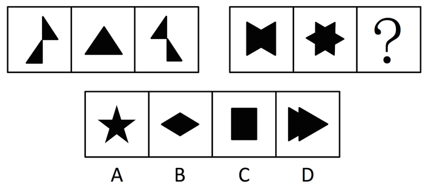

A. A

B. B

C. C

D. D

第 86 题 · 答案与解析

**参考答案（粉笔题库参考内容）**

B

**解析**

元素组成相同，考虑位置规律。第一组图中，右边的三角形依次下移得到下一个图形；第二组图中，左边的三角形依次右移得到下一个图形。

故正确答案为B。

**考点**：位置规律-平移

**来源**：2012年北京市公务员录用考试《行测》题第86题

### 第 87 题

从所给的四个选项中，选择最合适的一个填入问号处，使之呈现一定的规律性：

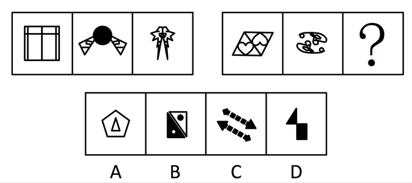

A. A

B. B

C. C

D. D

第 87 题 · 答案与解析

**参考答案（粉笔题库参考内容）**

C

**解析**

元素组成凌乱，考属性。第一组图中每个图形均为轴对称图形；第二组图中每个图形均为中心对称图形。

故正确答案为C。

**考点**：属性规律-对称性

**来源**：2012年北京市公务员录用考试《行测》题第87题

### 第 88 题

请从所给的四个选项中，选择最合适的一项填在问号处，使之呈现一定的规律性：

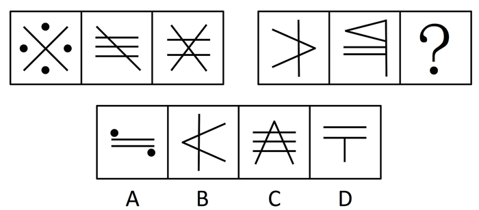

A. A

B. B

C. C

D. D

第 88 题 · 答案与解析

**参考答案（粉笔题库参考内容）**

C

**解析**

元素组成凌乱，考数数。第一组图中，每个图形中交点的个数依次为1、3、5；第二组图中，每个图形中交点的个数依次为3、5、？。需要填入有7个交点的图形。选项中交点个数分别为0、3、7、1。

故正确答案为C。

**考点**：数量规律-点

**来源**：2012年北京市公务员录用考试《行测》题第88题

### 第 89 题

下列选项中，符合所给图形的变化规律的是：

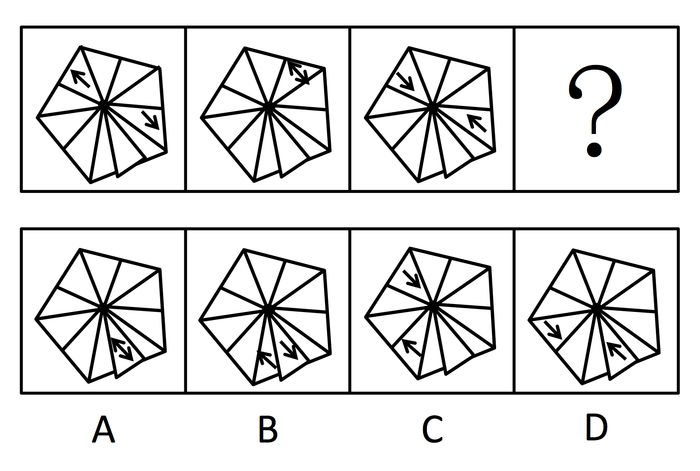

A. A

B. B

C. C

D. D

第 89 题 · 答案与解析

**参考答案（粉笔题库参考内容）**

D

**解析**

元素组成相同，考查位置规律。据观察，朝下的箭头依次逆时针平移两个格、朝上的箭头依次顺时针平移两个格即得到下一个图形。

故正确答案为D。

**考点**：位置规律-平移

**来源**：2012年北京市公务员录用考试《行测》题第89题

### 第 90 题

从所给的四个选项中，选择最合适的一个填入问号处，使之呈现一定的规律性：

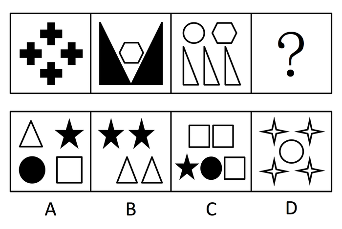

A. A

B. B

C. C

D. D

第 90 题 · 答案与解析

**参考答案（粉笔题库参考内容）**

A

**解析**

规则图形的集合，考虑元素的种类。每个图形中元素的种类分别为1、2、3、（4）。四个选项的元素种类依次为4、2、3、2。

故正确答案为A。

**考点**：数量规律-素

**来源**：2012年北京市公务员录用考试《行测》题第90题

### 第 91 题

任何小说在写完之前，都和作者有千丝万缕的联系，作者总是努力使它完美无缺。而一旦出版之后，一切可用的心血都已用尽，个人已再无力量去改动它，剩下的事情就是让别人去评说。

由此可以推知：

A. 任何小说都不是完美无缺的

B. 小说作者能做的就是把小说写好

C. 小说作者不关心别人的评说

D. 出版之后的小说与作者无关

第 91 题 · 答案与解析

**参考答案（粉笔题库参考内容）**

B

**解析**

第一步：抓住题干主要信息。

第一句说明在完成创作前，小说与作者紧密相连，作者努力使小说完美无缺；

第二句说明小说出版后，作者无法对小说进行改动，只能任由别人去评论。

第二步：根据题干信息逐一分析选项。

A项，题干主要分析小说与作者之间的关系，没有谈及小说本身是否是完美无缺的，A项不能推出；

B项，符合题意，在写完小说之前，作者能做的就是努力使小说完美无缺；

C项，题干也没有说明作者对评论的态度，无法推出小说作者是否关心别人的评说，C项错误；

D项，题干说的是出版后小说作者无力去改动小说，并不意味这小说与作者无关，作品仍是属于作者的，因此D项也错。

故正确答案为B。

**考点**：日常结论

**来源**：2012年北京市公务员录用考试《行测》题第91题

### 第 92 题

所有聪明人都是近视眼，我近视得很厉害，所以，我很聪明。

以下哪项最能揭示上述推理的错误：

A. 我是个笨人，因为所有的聪明人都是近视眼，而我的视力很好

B. 所有的羊都有四条腿，但这种动物有八条腿，所以它不是羊

C. 马是四蹄食草动物，牛是四蹄食草动物，所以，牛是马

D. 所有的天才都高度近视，我一定是高度近视，因为我是天才

第 92 题 · 答案与解析

**参考答案（粉笔题库参考内容）**

C

**解析**

第一步：翻译题干。

聪明人近视，我近视，结论：我聪明。

第二步：逐一翻译选项。

A项，我聪明，聪明人近视眼，结论：我近视；

B项，羊四条腿，这种动物四条腿，结论：这种动物羊；

C项，马四蹄食草动物，牛四蹄食草动物，结论：牛马；

D项，天才高度近视，我天才，结论：我高度近视。

C项的推理形式与题干一致，最能解释题干推理的错误。

故正确答案为C。

**考点**：推理形式

**来源**：2012年北京市公务员录用考试《行测》题第92题

### 第 93 题

气候变暖已经成为全人类共同面临的大问题。科学家和环境保护组织不断发出警告：如果我们不立刻行动起来保护环境，阻止气候变暖，那么人类总有一天会毁灭地球，不能继续生存下去。

由此可以推出：

A. 只要我们立刻行动起来保护环境，就能阻止气候变暖，人类就能在地球上继续生存

B. 如果人类不能继续生存在地球上，必定是没有立刻开始保护环境

C. 要想保护环境、保护地球、保护人类自身，就必须防止气候变暖

D. 如果人类想在地球上继续生存，就必须立即行动起来保护环境，阻止气候变暖

第 93 题 · 答案与解析

**参考答案（粉笔题库参考内容）**

D

**解析**

第一步：翻译题干。

不立刻行动保护环境，阻止气候变暖人类不能继续生存。

第二步：逐一翻译选项并判断正确选项。利用逆否规则。

A项，－不立刻行动保护环境不阻止气候变暖∧－人类不能继续生存，“立刻行动保护环境”否定题干中的前件，无法推出任何绝对表达的结论，错误；

B项，人类不能继续生存不立刻行动保护环境，“人类不能继续生存”肯定题干中的后件，肯定后件无法提出肯定前件，错误；

C项，保护环境、保护地球、保护人类自身防止气候变暖，题干未提及保护环境和气候变暖的关系，无法推出，错误；

D项，－人类不能继续生存不立刻行动保护环境，不阻止气候变暖，是题干推导关系的逆否命题，正确。

故正确答案为D。

**考点**：常规翻译

**来源**：2012年北京市公务员录用考试《行测》题第93题

### 第 94 题

对某受害人的五位朋友进行侦查分析后，四个警员各自做出了如下推测：

甲说：“这五个人都有嫌疑。”

乙说：“老陈不能逃脱干系，他有嫌疑。”

丙说：“这五个人不都是有嫌疑的。”

丁说：“五人中肯定有人作案。”

如果四个人中只有一个人推测正确，那么以下哪项为真：

A. 甲推测正确，老陈最有嫌疑

B. 丙推测正确，老陈没有嫌疑

C. 丙推测正确，但老陈可能作案

D. 丁推测正确，老陈有嫌疑

第 94 题 · 答案与解析

**参考答案（粉笔题库参考内容）**

B

**解析**

第一步：找突破口。

由于甲和丙所说的话为矛盾关系，因此必有一真一假。

第二步：看其他的话。

本题只有一句为真，因此乙、丁所说均为假。因此可得出，即老陈没有嫌疑；可能没有人作案。

第三步：判断突破口中两句话的真假。

由于老陈没有嫌疑，所以丙真。

故正确答案为B。

**考点**：只有一真/一假

**来源**：2012年北京市公务员录用考试《行测》题第94题

### 第 95 题

想从事媒体工作的学生都报考新闻与传播专业。李金报考了新闻与传播专业，他一定想从事媒体工作。

下述哪项为真，最能支持上述论断：

A. 所有报考新闻与传播专业的学生都想从事媒体工作

B. 有些媒体的记者是大学新闻与传播专业的毕业生

C. 想从事媒体工作的学生有些报考了新闻与传播专业

D. 只有新闻与传播专业毕业的学生，才有资格从事媒体工作

第 95 题 · 答案与解析

**参考答案（粉笔题库参考内容）**

A

**解析**

第一步：分析题干，找到论点和论据。

论点：李金一定想从事媒体工作。

论据：李金报考了新闻与传播专业。

第二步：逐一分析选项。

A项：可翻译为：报考新闻与传播专业→想从事媒体工作，在专业和工作之间搭桥，加强论证，支持题干论点，当选；

B项：提及的是媒体记者，而不是想从事媒体工作的学生，与题干主体不同，排除；

C项：该项说的是有些人的情况，不是必然性判断，无法推出绝对表达的结论，排除；

D项：题干强调的是想不想从事媒体工作，而D项说的是有没有资格从事媒体工作，与论点无关，属于无关项，排除。

故正确答案为A。

**考点**：搭桥

**来源**：2012年北京市公务员录用考试《行测》题第95题

### 第 96 题

“阿基米德将被永远铭记，而剧作家埃斯库罗斯将会被遗忘，因为语言会消亡而数学理念不会消亡。”这一论证可能隐含了哪些前提，除了：

A. 阿基米德的贡献在于数学理念

B. 埃斯库罗斯不是一个好作家

C. 使用会消亡的东西的人会被遗忘

D. 数学理念不是语言

第 96 题 · 答案与解析

**参考答案（粉笔题库参考内容）**

B

**解析**

第一步：找到论点和论据。

论点：阿基米德将被永远铭记，而剧作家埃斯库罗斯将会被遗忘；

论据：语言会消亡而数学理念不会消亡。

第二步：逐一分析选项。

A项，论点强调的是阿基米德会被铭记，论据强调的是数学理念不会消亡，论点和论据强调的对象不同，需在阿基米德和数学理念之间搭桥，建立联系，A项说明了阿基米德和数学理念的关系，属于加强论证，排除；

B项，题干的逻辑关系是语言会消亡，所以使用语言的人会被遗忘，跟语言用得好不好没有关系，属于无关项，当选；

C项，在剧作家和语言会消亡之间建立联系，属于加强论证，排除；

D项，说明数学理念与语言不同，因此才可能一个消亡一个不消亡，属于加强论据，排除。

本题为选非题，故正确答案为B。

**考点**：加强选非题

**来源**：2012年北京市公务员录用考试《行测》题第96题

### 第 97 题

《天天快报》报社组织拓展训练，最后一天对所有参加拓展的员工进行考核。如果考核结果达到3分或3分以上，记为优秀。在考核之前，有几个人就成绩讨论起来。

陈东说：“小军、小霞身体素质都不错，他们俩至少有一个优秀。”

牛力说：“训练的时间太短，大家练习都不够，这次没有人能得优秀。”

马方说：“怎么可能呢？有人以前就参加过训练，他们一定能得优秀。”

假设这三个人只有一个人的猜测得到了验证，那么一定可以推出以下哪项结论：

A. 牛力说的对，参加拓展的报社成员没有人得优秀

B. 没法确定对错，但所有训练成员都得到优秀

C. 马方说的对，有人获得了优秀，但也有人不优秀

D. 陈东说的不对，小霞没有得到优秀

第 97 题 · 答案与解析

**参考答案（粉笔题库参考内容）**

D

**解析**

第一步：找突破口。

牛力与马方所说的话为矛盾关系，因此二者必有一真一假。

第二步：看其他的话。

由于本题只有一人为真，因此陈东所说必为假，即小军小霞都不优秀。

故正确答案为D。

**考点**：只有一真/一假

**来源**：2012年北京市公务员录用考试《行测》题第97题

### 第 98 题

有人说：“中国运动员也有人获得法国网球公开赛（简称法网）的冠军。”

如果这个断定为真，不能由此断定真假的是：

Ⅰ李娜为中国运动员争了光，她获得了法网冠军。

Ⅱ有的中国运动员不能获得法网冠军。

Ⅲ网球在中国不够普及，中国运动员都不能获得法网冠军。

A. Ⅰ和Ⅱ

B. Ⅰ、Ⅱ和Ⅲ

C. Ⅰ和Ⅲ

D. 只有Ⅰ

第 98 题 · 答案与解析

**参考答案（粉笔题库参考内容）**

A

**解析**

第一步：翻译题干。

题干的意思为：有的中国运动员获得法网冠军。

第二步：逐一分析选项。

Ⅰ：题干只说明有的中国运动员获得法网冠军，没有说明具体是哪些运动员获得的，因此不能得出李娜获得法网冠军的结论；

Ⅱ：“有的中国运动员不能获得法网冠军”跟题干构成反对关系，一个为真，不能推出另一个的真假，因此Ⅱ无法推出；

Ⅲ：“中国运动员都不能获得法网冠军”与题干构成矛盾关系，题干命题为真，可推知Ⅲ为假。

故正确答案为A。

**考点**：真假推理-其他

**来源**：2012年北京市公务员录用考试《行测》题第98题

### 第 99 题

宋江、林冲和武松各自买了一辆汽车，分别是宝马、奥迪和路虎。关于他们购买的品牌，吴用有如下猜测“宋江选的是路虎，林冲不会选奥迪，武松选的肯定不是路虎”，但是他只猜对了其中一个人的选择。由此可知：

A. 宋江选的是奥迪，林冲选的是路虎，武松选的是宝马

B. 宋江选的是路虎，林冲选的是奥迪，武松选的是宝马

C. 宋江选的是奥迪，林冲选的是宝马，武松选的是路虎

D. 宋江选的是宝马，林冲选的是奥迪，武松选的是路虎

第 99 题 · 答案与解析

**参考答案（粉笔题库参考内容）**

C

**解析**

此题适合用代入法。

假如猜对了宋江的选择，那么宋江选了路虎，武松选的就不能是路虎，那么对宋江的猜测一定是错误的。

再假设对林冲的猜测正确，那么可知：宋江选的不是路虎，林冲不会选奥迪，武松选的是路虎；可以推出：宋江选的奥迪，林冲选的宝马，武松选的是路虎，符合。

再假设对武松的猜测正确，那么宋江不选路虎，林冲选奥迪，武松不选路虎，显然这个结论是不可能的，林冲选了奥迪，那么宋江和武松必有一人选的是路虎。因此他猜对的是林冲的选择。

故正确答案为C。

**考点**：假设

**来源**：2012年北京市公务员录用考试《行测》题第99题

### 第 100 题

每年中秋节前夕各商家都会展开“月饼大战”。有关专家指出，月饼大战不仅不利于大众消费者的经济利益，甚至成了中秋佳节的“甜蜜负担”。月饼市场要想回归平实，必须从工艺和配料方面进行改良。否则，就算包装和赠品再华丽，也不能满足正当的消费需求。

据此题干，不能推出以下哪项结论：

A. 只有改良月饼工艺和配料，才是满足消费者正当需求的关键

B. 只要从月饼工艺和配料方面进行改良，就算包装和赠品华丽些，也满足正当需求

C. 如果月饼市场满足了正当的消费需求，就说明一定是在工艺和配料方面得到了改良

D. 若不从工艺和配料方面进行改良，就不能满足消费者的正当需求

第 100 题 · 答案与解析

**参考答案（粉笔题库参考内容）**

B

**解析**

第一步：翻译题干。

由题干可知，回归平实→改良工艺和配料；满足消费者需求→改良工艺和配料。

第二步：逐一翻译选项并判断正确选项。利用逆否规则。

A项，满足消费者需求→改良工艺和配料，与题干推导关系相同；

B项，改良工艺和配料→满足消费者需求，“改良工艺和配料”肯定题干推导关系的后件，无法得出任何绝对表达的结论；

C项，满足消费者需求→改良工艺和配料，与题干推导关系相同；

D项，－改良工艺和配料→－满足消费者需求，是题干推导关系的逆否命题，正确。

本题为选非题，故正确答案为B。

**考点**：常规翻译

**来源**：2012年北京市公务员录用考试《行测》题第100题

### 第 101 题

我虽然不认识你，但第一眼就知道你是个军医。很简单，因为你具有医生的风度，但却是一副军人气概。

上述推理需要补充以下哪项前提：

A. 若要成为军医，必须同时具备医生和军人的双重气质

B. 军队的医生与普通医生相比，更具军人气概

C. 只要是军医，就一定能显示出其医生的风度和军人气概

D. 凡是具有医生风度和军人气概的人，一定都是军医，不管其医术如何

第 101 题 · 答案与解析

**参考答案（粉笔题库参考内容）**

D

**解析**

第一步：找到论点和论据。

论点为，你是一个军医；论据为，你有医生的风度和军人的气概。

第二步：判断加强方式。

由于题干中论点和论据之间没有必然的逻辑联系，因此需加强论证。

第三步：逐一分析选项。

A、C项均可翻译为，军医→具备医生和军人的双重气质，是由论点推出论据，不属于加强论证，排除；

B项军医与普通医生的比较与题干论点论据无关，排除；

D项可翻译为，具备医生和军人的双重气质→军医，即由论据推出论点，连接了论点与论据，属于加强论证，当选。

故正确答案为D。

**考点**：搭桥

**来源**：2012年北京市公务员录用考试《行测》题第101题

### 第 102 题

创业者应该具备沟通说服的能力，这是一项成功创业必不可少的能力。创业的目的，就是让社会大众认同并购买你的产品和服务。所以，沟通说服的能力，与执行力同样重要。

根据上述观点，不能得出以下哪项结论：

A. 既具备沟通说服能力又具备执行力的人是成功的创业者

B. 执行力也是成功创业必不可少的能力

C. 如果不具备沟通说服的能力，就不可能成功创业

D. 刘畅是个成功的创业者，他一定有很强的沟通说服能力

第 102 题 · 答案与解析

**参考答案（粉笔题库参考内容）**

A

**解析**

第一步：翻译题干。

题干的意思是说，执行能力与沟通说服的能力同等重要，都是成功创业者必要的能力。即成功创业者→执行能力∧沟通说服的能力。

第二步：逐一分析选项。

A项为肯定题干命题的后件，由逆否规则可知无法得出任何绝对表达的结论；

B项与题干命题相符；

C项是题干命题的逆否命题，因此均可由题干推出；

D项可翻译为，刘畅→成功创业者，根据传递规则可得出刘畅→执行能力∧沟通说服的能力，因此D项正确。

B、C、D均能从题干推出，只有A项不能。

本题为选非题，故正确答案为A。

**考点**：常规翻译

**来源**：2012年北京市公务员录用考试《行测》题第102题

### 第 103 题

终于我确信无法阻止你离开的脚步，于是我重新开始享受孤独。

以下哪项是上述推理的前提：

A. 除非我确信无法阻止你离开的脚步，否则我就不能享受孤独

B. 只有我确信无法阻止你离开的脚步，我才开始享受孤独

C. 或者我不确信是否无法阻止你离开的脚步，或者我必须重新开始享受孤独

D. 我不确信是否无法阻止你离开的脚步，但我只能重新开始享受孤独

第 103 题 · 答案与解析

**参考答案（粉笔题库参考内容）**

C

**解析**

第一步：找出论点和论据。

论点：我重新开始享受孤独；

论据：我确信无法阻止你离开的脚步。

第二步：逐一分析选项。

A项翻译：享受→确信无法阻止，从论点到论据，搭桥方向相反，无法成为题干推理的前提，排除；

B项翻译：享受→确信无法阻止，从论点到论据，搭桥方向相反，无法成为题干推理的前提，排除；

C项翻译：－确信无法阻止或开始享受，根据或关系的否一推一，“－确信无法阻止”为假时，“开始享受”为真，从论据到论点的搭桥，是题干推理的前提，当选；

D项翻译：否定了题干中的论据，无法成为题干推理的前提，排除。

故正确答案为C。

**考点**：搭桥

**来源**：2012年北京市公务员录用考试《行测》题第103题

### 第 104 题

要是不学习二胡演奏，徐平就做不了民乐理论研究。如果他喜欢民族乐器，那么他会选择学习二胡演奏作为专业。如果他不喜欢民族乐器，他就会做民乐理论研究。

由此可推出徐平将：

A. 研究民乐理论

B. 学习二胡演奏

C. 不学二胡演奏

D. 不研究民乐理论

第 104 题 · 答案与解析

**参考答案（粉笔题库参考内容）**

B

**解析**

第一步：翻译题干。

﹣二胡→﹣民乐理论研究；民族乐器→二胡；﹣民族乐器→民乐理论研究。

第二步：得出结论。

由结论二可知，民族乐器→二胡；由结论三与结论一的逆否命题可知，﹣民族乐器→民乐理论研究→二胡。又由于喜欢民族乐器与不喜欢民族乐器之间为矛盾关系，因此可推出徐平必学习二胡。

故正确答案为B。

**考点**：常规翻译

**来源**：2012年北京市公务员录用考试《行测》题第104题

### 第 105 题

小红、小兰和小慧三姐妹，分别住在丰台区、通州区、朝阳区。小红与住在通州的姐妹年龄不一样大，小慧比住在朝阳区的姐妹年龄小，而住在通州的姐妹比小兰年龄大。

那么按照年龄从大到小，这三姐妹的排序是：

A. 小红、小慧、小兰

B. 小红、小兰、小慧

C. 小兰、小慧、小红

D. 小慧、小红、小兰

第 105 题 · 答案与解析

**参考答案（粉笔题库参考内容）**

A

**解析**

第一步：找突破口。

本题的突破口为信息量最大的对象，即通州的姐妹。由“小红与住在通州的姐妹年龄不一样大”可知，小红不在通州；由“住在通州的姐妹比小兰年龄大”可知，小兰不在通州。因此在通州的是小慧。

第二步：抄信息于表中，即将题干与第一步的所有信息放在一个表中。

通州    ＜     朝阳

小兰    ＜    小慧

第三步：填空，即填上每一个集合的空格。

丰台    ＜    通州    ＜    朝阳

小兰    ＜    小慧    ＜    小红

故正确答案为A。

**考点**：从最大信息开始推

**来源**：2012年北京市公务员录用考试《行测》题第105题

### 第 106 题

网络团购是借助互联网，将具有相同购买意向的零散消费者集合起来，向商家大批量购买，以求得最优惠的价格。网络团购的特点是：有成交数量和成交时间限制、价格折扣高、可以小额支付等，实现网络组织者、消费者和生产者三方获益。

以下属于网络团购的是：

A. 某公司在网上订购500件棉衣享受六折优惠

B. 某购物网站征集欲购买某品牌跑步鞋的消费者后向厂家下了三千双的订单

C. 某机构网络营销店长期代购某品牌产品且会员享受原价五折优惠

D. 小王联络十余名邻居一同购买某家具以减免运费

第 106 题 · 答案与解析

**参考答案（粉笔题库参考内容）**

B

**解析**

第一步：抓住定义中的关键词。

题干对“网络团购”的定义中强调“零散消费者”“成交时间限制”“借助互联网”等。

第二步：逐一判断选项。

A项中的某公司不符合“零散消费者”，因此不符合定义；

B项中征集的消费者属于“零散消费者”，征集过程的持续时间为“成交限制时间”，购物网站体现“借助互联网”，均符合定义；

C项中的长期代购不符合“成交时间限制”，因此不符合定义；

D项中的购买不符合“借助互联网”，因此不符合定义。

故正确答案为B。

**考点**：方式目的

**来源**：2012年北京市公务员录用考试《行测》题第106题

### 第 107 题

群体通常指的是相对于个体的各种社会成员的聚合，实际上就是一种人的集合体。可分为正式群体、非正式群体和准群体。准群体是指没有组织结构，人与人之间有某种联系，有一定程度的共同关注点，有可能在某些时候形成集团，但目前还没有组织起来的人群。

以下属于准群体的是：

A. 某地，某大姓家族举行大型宴会祭祖，在宴会上很多人都互相不认识

B. 在网络某社区，一些从未谋面的野外运动爱好者商议去某地登山

C. 国庆期间，十余万名来自各地的游客到颐和园游览参观

D. 某部官兵在训练途中看到有汽车遭遇泥石流，迅速组织救援

第 107 题 · 答案与解析

**参考答案（粉笔题库参考内容）**

B

**解析**

题干只针对“准群体”提问，因此只须分析这一定义即可。

第一步：抓住定义中的关键词。

定义中强调“没有组织机构”“共同关注点”“没有组织起来”等。

第二步：逐一判断选项。

A项中的“大型宴会”、D项中的官兵救援行动均有组织机构；C项中的游客是已经组织起来的人群，是人的集合体，因此A、C、D三项均不符合定义。

B项中的“野外运动爱好者”在网络上商议，还未聚集，也没有组织机构，因此符合定义。

故正确答案为B。

**考点**：常规问法

**来源**：2012年北京市公务员录用考试《行测》题第107题

### 第 108 题

二次污染，指的是污染物由污染源排入环境后，在物理、化学或生物作用下生成新的污染物，而对环境产生的再次污染。

以下属于二次污染的是：

A. 汽车尾气中的有害化合物，在阳光作用下发生光化学反应，生成以臭氧为主的多种强氧化剂，危害人类健康

B. 房屋装修时，施工机械发出强烈噪声，严重影响周边居民休息与生活

C. 农药残留在棉花、麻纤维之中，制成服装后虽残留量甚微，但经常与皮肤接触也会对人体造成伤害

D. 人们在公共场所吸入了二手烟

第 108 题 · 答案与解析

**参考答案（粉笔题库参考内容）**

A

**解析**

第一步：找出定义关键词。

“污染物排入环境后”、“在物理、化学或生物作用下生成新的污染物”、“对环境产生再次污染”。

第二步：逐一分析选项。

A项：该项中汽车尾气中的有害化合物，符合“污染物排入环境后”，在阳光作用下发生光化学反应生成多种强氧化剂，属于新的污染物，符合“在物理、化学或生物作用下生成新的污染物”，危害人类健康，符合“对环境产生再次污染”，符合定义，当选；

B项：该项中施工机械发出的强烈噪声属于污染源，但噪声在传播过程中没有生成新的污染物，不符合“在物理、化学或生物作用下生成新的污染物”，不符合定义，排除；

C项：该项中农药残留在棉花、麻纤维之中，制成服装后残留的仍然是原有的农药污染物，没有生成新的污染物，不符合“在物理、化学或生物作用下生成新的污染物”，不符合定义，排除；

D项：该项中人们吸入的二手烟是烟草燃烧后排出的原有污染物，没有在物理、化学或生物作用下生成新的污染物，不符合“在物理、化学或生物作用下生成新的污染物”，不符合定义，排除。

故正确答案为A。

**考点**：大前提

**来源**：2012年北京市公务员录用考试《行测》题第108题

### 第 109 题

视网膜效应是指当一个人拥有一件物品或一项特征时，他就比平常人更会注意到其他人是否跟他一样具备这种物品或特征。

根据上述定义，以下不属于视网膜效应的一项是：

A. 部门主管老宋心胸开阔而乐观，总能发现员工的优点并发挥他们的潜能

B. 老王藏有一件明代瓷器，他热衷于结识同样收藏明代瓷器的爱好者

C. 小李常抱怨别人对他说话时比较急躁，而事实上他自己的脾气也很不好

D. 小刘看见有两个人穿的和她一样，她感慨怎么会有这么多人买相同的衣服

第 109 题 · 答案与解析

**参考答案（粉笔题库参考内容）**

A

**解析**

第一步：找出定义关键词。

“当一个人拥有一件物品或一项特征时”、“比平常人更会注意到其他人是否跟他一样具备这种物品或特征”。

第二步：逐一分析选项。

A项：老宋心胸开阔而乐观是自身的特征，但他发现的是员工的优点，并非注意员工是否和自己一样具备心胸开阔而乐观的特征，不符合“更会注意到其他人是否跟他一样具备这种物品或特征”，不符合定义，当选；

B项：老王藏有明代瓷器，符合“当一个人拥有一件物品或一项特征时”，他热衷于结识同样收藏明代瓷器的爱好者，符合“比平常人更会注意到其他人是否跟他一样具备这种物品”，符合定义，排除；

C项：小李自己的脾气不好，符合“当一个人拥有一件物品或一项特征时”，他常抱怨别人说话急躁，其实是注意到别人和自己一样有脾气急躁的特征，符合“比平常人更会注意到其他人是否跟他一样具备这种特征”，符合定义，排除；

D项：小刘穿了某款衣服，符合“当一个人拥有一件物品或一项特征时”，她感慨有很多人买相同的衣服，符合“比平常人更会注意到其他人是否跟他一样具备这种物品”，符合定义，排除。

本题为选非题，故正确答案为A。

**考点**：大前提

**来源**：2012年北京市公务员录用考试《行测》题第109题

### 第 110 题

网络出版又称互联网出版，是指互联网信息服务提供者将自己创作或他人创作的作品经过选择和编辑加工后登载在互联网上，或者通过互联网发送到用户端，供公众浏览、阅读、使用或者下载的在线传播行为。

以下不属于网络出版行为的是：

A. 某搜索网站收集了大量歌曲，供网民自由下载

B. 某健康网站每天向会员的电子信箱发送有关养生保健的常识

C. 某电子地图网站提供大部分城市的公共交通路线，以供网民出行查阅

D. 某网站在商品名录中列出一套百科全书光盘，顾客可通过网购得到光盘

第 110 题 · 答案与解析

**参考答案（粉笔题库参考内容）**

D

**解析**

第一步：抓住定义中的关键词。

网络出版行为定义中强调“公众浏览、阅读、使用或者下载”等。

第二步：逐一判断选项。

A项属于供公众下载，B项属于供公众阅读，C项属于供公众浏览、使用，因此A、B、C三项均符合定义。

D项属于供公众购买，为网络销售行为，不符合定义。

本题为选非题，故正确答案为D。

**考点**：方式目的

**来源**：2012年北京市公务员录用考试《行测》题第110题

### 第 111 题

物流，是物质资料从供给者向需要者的物理性移动，是创造时间性、场所性价值的经济活动，包括包装、装卸、保管、库存管理、流通加工、运输、配送等诸种活动。

以下属于物流活动的是：

A. 小王在某销售网站开店出售电话充值卡，自动发货功能使顾客在线支付后即可获得密码

B. 小李办理出国手续急需一份经济担保书，他请父母通过快递公司从家乡将该文件邮来

C. 老刘出资几十万元建了一间冷库，用于储藏收购来的蔬菜，以便赶在春节上市卖个好价钱

D. 小赵自己有一辆卡车，他本周日帮助公司的客户钱某搬家，钱某为表示感谢请他吃饭

第 111 题 · 答案与解析

**参考答案（粉笔题库参考内容）**

B

**解析**

第一步：抓住定义中的关键词。

定义中强调“物质资料”、“物理性移动”、“创造价值的经济活动”等。

第二步：逐一判断选项。

A项中的在线获得密码，不符合“物质资料”的“物理性移动”；C项中的储藏行为不存在物理性移动；D项中的搬家行为属于帮忙，不是创造价值的经济活动，因此均不符合定义。

B项中的担保书的邮寄符合定义。

故正确答案为B。

**考点**：单定义-其他句式

**来源**：2012年北京市公务员录用考试《行测》题第111题

### 第 112 题

有奖销售是指经营者销售商品或者提供服务，附带性地向购买者提供物品、金钱或者其他经济上的利益的行为。包括：某时段内奖励所有购买者的附赠式有奖销售和奖励部分购买者的抽奖式有奖销售。

以下不属于抽奖式有奖销售的是：

A. 某移动通讯公司发短信告知用户，回复短信即可获得用积分兑奖的机会

B. 某网上商城称到商城购买商品的前10000名顾客将获得每人200元代金券

C. 某大型超市促销时规定，购物满100元可获一袋洗衣粉或者一条肥皂

D. 某家具商场规定，开业一个月内到该商场购物的顾客可享受九折优惠

第 112 题 · 答案与解析

**参考答案（粉笔题库参考内容）**

D

**解析**

第一步：抓住定义中的关键词。

定义中强调“部分购买者”等。

第二步：逐一判断选项。

A项中“兑奖”是附带在提供通信服务的基础上的，且仅提供给回复短信的用户；

B项中的“代金券”是附带在购买商品的基础上的，且仅提供给前10000名顾客；

C项中的洗衣粉或肥皂属于附带在购买商品基础上的，且仅提供给购买满100元的顾客，因此A、B、C三项均符合定义。

D项中的奖励属于限时提供给所有顾客，属于附赠式有奖销售，因此不属于抽奖式有奖销售。

本题为选非题，故正确答案为D。

**考点**：常规问法

**来源**：2012年北京市公务员录用考试《行测》题第112题

### 第 113 题

质押也称质权，是债务人或第三人将其动产或可转让的权力移交债权人占有，将该动产或可转让权力作为债权的担保。当债务人不履行债务时，债权人有权依法就该动产或可转让权力卖得价金优先受偿。

以下属于质押的是：

A. 小赵承揽的工程项目因缺乏流动资金无法开工，遂请某公司帮忙出资，签订了合同并将他名下的一辆名车交给该公司作为担保

B. 王某向刘某借款100万元，签订了合同并办理登记，将自己的住宅作为担保，约定借款期满还钱

C. 石某外出治病期间，将自己经营的养鹅场委托表弟照管，表弟因石某欠钱到期未还，卖掉一部分鹅抵账

D. 甲公司与修理厂签订维修服务合同大修生产设备，后因维修费用高昂而未支付费用，修理厂遂变卖了该设备抵偿维修费

第 113 题 · 答案与解析

**参考答案（粉笔题库参考内容）**

A

**解析**

第一步：抓住定义中的关键词。

定义中强调“动产或可转让的权力”、“作为债权的担保”等。

第二步：逐一判断选项。

B项中的住宅不属于动产或可转让的权利；C项中的卖鹅抵账、D项中的抵偿维修费均不存在担保这一项，因此均不符合定义。

A项中的担保为名车，属于动产，因此符合定义。

故正确答案为A。

**考点**：方式目的

**来源**：2012年北京市公务员录用考试《行测》题第113题

### 第 114 题

对抗在生态学中指生活在一起的两种不同种类的生物，一方或双方遭受损害的关系。对抗通常是不同生物为占据同一生态位而产生的结果。可分为侵害、抗生和竞争，一种生物受益而另一种生物遭受损害的属于侵害；一种生物遭受损害而另一种生物不受影响的属于抗生；两种生物相互施加不利影响的属于竞争。

以下属于竞争的是：

A. 小菜蛾的天敌蜂把卵产在小菜蛾的幼虫体内。当蜂卵孵化成幼蜂时，幼蜂便会吃掉小菜蛾的幼虫

B. 有种鸟儿常在鳄鱼身上寻找寄生虫，而由于掠食者不敢在鳄鱼身边攻击这些鸟类，使得鸟儿更安全

C. 池塘中如果蝌蚪的密度过大，蝌蚪会分泌一种毒物，限制其他蝌蚪的生长发育，甚至增加其死亡率

D. 萝卜蚜和桃蚜混合饲养达一定密度时，产蚜量均显著下降，但桃蚜产蚜量显著高于萝卜蚜

第 114 题 · 答案与解析

**参考答案（粉笔题库参考内容）**

D

**解析**

题干只针对竞争提问，因此只须分析这一定义即可。

第一步：抓住定义中的关键词。

定义中强调“两种生物”“相互施加不利影响”等。

第二步：逐一判断选项。

A项中仅有幼蜂对小菜蛾的不利影响，B项中不存在任何不利影响，C项中不涉及两种生物，因此均不符合定义。

D项是萝卜蚜和桃蚜的产蚜量均显著下降，体现了两种生物的相互不利影响，符合定义。

故正确答案为D。

**考点**：常规问法

**来源**：2012年北京市公务员录用考试《行测》题第114题

### 第 115 题

不安抗辩权是指当事人互负债务，有先后履行顺序的，先履行的一方有确切证据表明另一方丧失履行债务能力时，在对方没有履行或者没有提供担保之前，有权中止合同履行的权利。规定不安抗辩权是为了切实保护当事人的合法权益，防止借合同进行欺诈，促使对方履行义务。以下行使了不安抗辩权的一项是：

A. 甲乙公司约定由甲公司在5个月内分批向乙公司供货，乙公司在10个月内每月付款10万元。甲公司货物供应完毕后，乙公司声称甲公司货物不合格，拒绝支付余下货款

B. 甲乙签订房屋租赁合同，约定某日双方同时交租金并交付房屋。但时间到时，发现乙方房屋还被占用，甲方遂拒绝支付租金

C. 某公司与演员甲签订演出合同，该公司应在规定日期预付演出劳务费5万元。后甲因车祸受伤住院治疗，该公司告知甲暂不支付该笔劳务费

D. 老汪向某公司定制了一套设备，合同生效还未开始设计生产时就支付了5万元全款。后老汪因经营的公司倒闭，不再需要该设备，遂请求解除合同

第 115 题 · 答案与解析

**参考答案（粉笔题库参考内容）**

C

**解析**

第一步：抓住定义中的关键词。

“不安抗辩权”定义中强调“互负债务”“有先后履行顺序”，“先履行方确定另一方丧失履行债务能力”等。

第二步：逐一判断选项。

A项中是后履行方确定另一方丧失履行债务能力，B项中为同时交付，不符合先后履行顺序，D项是先履行方丧失履行债务能力，因此A、B、D三项均不符合定义。

C项中先履行方为公司，后履行方为演员甲，符合定义。

故正确答案为C。

**考点**：大前提

**来源**：2012年北京市公务员录用考试《行测》题第115题

## 材料 8

2011年8月份，社会消费品零售总额14705亿元，同比增长17.0%。其中，限额以上企业（单位）消费品零售额6902亿元，增长22.1%。1—8月份，社会消费品零售总额114946亿元，同比增长16.9%。从环比看，8月份社会消费品零售总额增长1.36%。

        按经营单位所在地分，8月份，城镇消费品零售额12783亿元，同比增长17.1%；乡村消费品零售额1922亿元，增长16.4%。

按消费形态分，8月份，餐饮收入1717亿元，同比增长16.7%；商品零售额12988亿元，增长17.0%。在商品零售中，限额以上企业（单位）商品零售额6364亿元，增长22.5%。

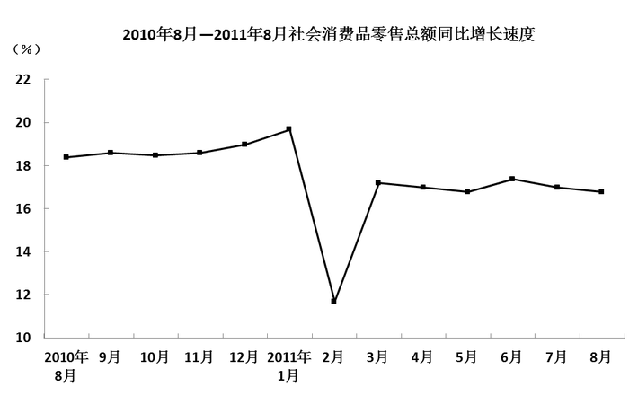

### 第 116 题

2010年8月限额以上企业（单位）消费品零售额达到多少亿元：

A. 5440

B. 5653

C. 5734

D. 5968

第 116 题 · 答案与解析

**参考答案（粉笔题库参考内容）**

B

**解析**

根据题干知“2010年8月······消费品零售额”，结合材料数据为2011年8月，可判定本题为基期计算问题。定位文字材料第一段：“2011年8月份，限额以上企业（单位）消费品零售额6902亿元，增长22.1%”。故2010年8月限额以上企业（单位）消费品零售额，与B项最为接近。

故正确答案为B。

**考点**：基期计算、综合资料

**来源**：2012年北京市公务员录用考试《行测》题第116题

### 第 117 题

2010年8月到2011年8月，有几个月的社会消费品零售总额同比增速快于15%：

A. 9

B. 10

C. 11

D. 12

第 117 题 · 答案与解析

**参考答案（粉笔题库参考内容）**

D

**解析**

定位折线图，直接给出2010年8月到2011年8月社会消费品零售总额同比增速。观察发现只有1个月（2011年2月）的同比增速小于15%，共13个月，因此有12个月同比增速快于15%。

故正确答案为D。

**考点**：直接找数、综合资料

**来源**：2012年北京市公务员录用考试《行测》题第117题

### 第 118 题

2010年8月商品零售额比餐饮收入高多少亿元：

A. 9630

B. 11271

C. 12988

D. 11101

第 118 题 · 答案与解析

**参考答案（粉笔题库参考内容）**

A

**解析**

2011年8月份，餐饮收入1717亿元，同比增长16.7%；商品零售额12988亿元，同比增长17.0%。则2010年8月商品零售额比餐饮收入高亿元。

故正确答案为A。

**考点**：基期和差、综合资料

**来源**：2012年北京市公务员录用考试《行测》题第118题

### 第 119 题

2010年8月城镇消费品零售总额占社会消费品零售总额的：

A. 76%

B. 87%

C. 92%

D. 82%

第 119 题 · 答案与解析

**参考答案（粉笔题库参考内容）**

B

**解析**

根据题干所求“2010年8月······占······”，结合材料数据为2011年8月，可判定本题为基期比重问题。定位文字材料第一段和第二段：“2011年8月份，社会消费品零售总额14705亿元，同比增长17.0%”和“城镇消费品零售额12783亿元，同比增长17.1%”。代入基期比重公式：，故2010年8月城镇消费品零售总额占社会消费品零售总额的比重，与B项最接近。

故正确答案为B。

**考点**：基期比重、综合资料

**来源**：2012年北京市公务员录用考试《行测》题第119题

### 第 120 题

以下说法中，正确的是：

A. 2011年8月餐饮行业中限额以上企业收入所占比重不足一半

B. 2011年7月社会消费品零售总额比上月增长约1000亿元

C. 2011年8月乡村消费品零售额同比增长约100亿元

D. 2011年8月限额以上企业餐饮收入同比增速快于限额以上企业商品零售收入增速

第 120 题 · 答案与解析

**参考答案（粉笔题库参考内容）**

A

**解析**

A项，定位文字材料第一段和第三段：“限额以上企业（单位）消费品零售额6902亿元。”和“8月份，餐饮收入1717亿元······在商品零售中，限额以上企业（单位）商品零售额6364亿元。”故2011年8月餐饮行业中限额以上企业收入=6902-6364=538亿元，餐饮行业中限额以上企业收入所占比重，比重不足一半，正确；

B项：定位文字材料第一段，材料给的是同比数据，题目问环比数据，没有7月的环比增长速度，无法计算，错误；

C项：定位文字材料第二段：“8月份，······乡村消费品零售额1922亿元，增长16.4%”。故2011年8月乡村消费品零售额同比增长量

亿元＞100亿元，错误；

D项：定位文字材料第一段和第三段：“限额以上企业（单位）消费品······增长22.1%，限额以上企业（单位）商品零售额······增长22.5%”。限额以上餐饮收入与商品零售额混合为消费品零售额，根据混合增长率大小居中，可得商品零售额（22.5%）＞消费品零售额（22.1%）＞餐饮收入，故限额以上企业餐饮收入同比增速慢于企业商品零售收入增速，错误。

故正确答案为A。

**考点**：综合分析、综合资料

**来源**：2012年北京市公务员录用考试《行测》题第120题

## 材料 9

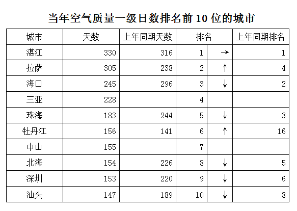

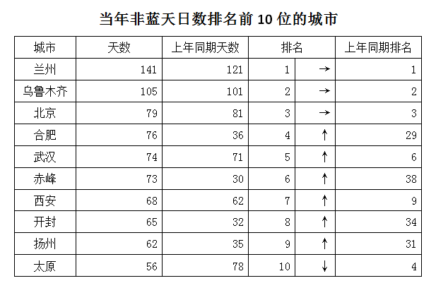

### 第 121 题

当年空气质量一级日数排名第4的城市，空气质量在一级以下的天数占全年比重约为：

A. 38%

B. 45%

C. 55%

D. 62%

第 121 题 · 答案与解析

**参考答案（粉笔题库参考内容）**

A

**解析**

根据题干所求“当年……空气质量在一级以下的天数占全年比重”，可判断本题为现期比重问题。定位表格一：当年空气质量一级日数排名第4的城市为三亚，其空气质量在一级以上的天数为228天。故当年空气质量在一级以下的天数占全年比重，首位商3，只有A项符合。

故正确答案为A。

**考点**：现期比重、统计表

**来源**：2012年北京市公务员录用考试《行测》题第121题

### 第 122 题

当年空气质量一级日数在220天及以上的城市，与上年同期相比：

A. 增加了2个

B. 增加了1个

C. 减少了2个

D. 减少了1个

第 122 题 · 答案与解析

**参考答案（粉笔题库参考内容）**

C

**解析**

定位表格一：当年空气质量一级日数在220天及以上的城市有湛江、拉萨、海口、三亚4个城市，上年同期有湛江、拉萨、海口、珠海、北海、深圳6个城市。故当年比上年减少了2个。

故正确答案为C。

**考点**：直接找数、统计表

**来源**：2012年北京市公务员录用考试《行测》题第122题

### 第 123 题

当年非蓝天日数排名前10位的城市中，未能将非蓝天日数的同比增速控制在10%以下的城市有几个：

A. 4

B. 5

C. 6

D. 7

第 123 题 · 答案与解析

**参考答案（粉笔题库参考内容）**

B

**解析**

定位表格二可知当年非蓝天日数排名前10位的城市天数与上年同期天数。未能将非蓝天日数的同比增速控制在10%以下的城市，即同比增速大于10%的城市，根据增长率公式：，太原、北京现期量小于基期量，增长率为负不用计算。

兰州：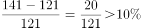；

乌鲁木齐：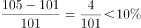；

合肥：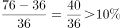；

武汉：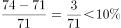；

赤峰：；

西安：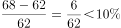；

开封：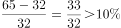；

扬州：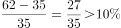，满足要求的5个城市分别是：兰州、合肥、赤峰、开封、扬州。

故正确答案为B。

**考点**：一般增长率、统计表

**来源**：2012年北京市公务员录用考试《行测》题第123题

### 第 124 题

由表可以推测，上年非蓝天日数排名第5位的城市，其在当年的非蓝天日数比上年同期：

A. 下降了20%以上

B. 上升了20%以上

C. 基本持平

D. 无法推断

第 124 题 · 答案与解析

**参考答案（粉笔题库参考内容）**

A

**解析**

根据题干“当年的非蓝天日数比上年同期”，结合选项“下降/上升+百分号”，判断本题为一般增长率问题。定位表格二：上年排名第5的城市非蓝天日数应该在第4名和第6名之间，即71至78之间，而当年未上榜，其当年的非蓝天日数应该是小于第10名，即56天。故其非蓝天日数的增长率至少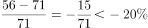，结果为负，所以下降了20%以上。

故正确答案为A。

**考点**：一般增长率、统计表

**来源**：2012年北京市公务员录用考试《行测》题第124题

### 第 125 题

以下关于当年部分城市空气质量的描述，与资料相符的是：

A. 空气质量一级日数排名前10的城市中，排名同比上升和下降的城市一样多

B. 非蓝天日数排名前10的城市中，非蓝天日数排名上升的城市比排名下滑的城市多

C. 非蓝天日数排名前10的城市中，有4个城市的非蓝天日数比上年同期多一倍以上

D. 空气质量一级日数占总日数的比重在50%以上的城市全部位于沿海地区

第 125 题 · 答案与解析

**参考答案（粉笔题库参考内容）**

B

**解析**

A项，定位表格一：空气质量一级日数排名前10的城市中，排名同比上升的城市为拉萨、牡丹江2个城市，下降的城市为海口、珠海、北海、深圳、汕头5个城市，两者不相等，错误；

B项，定位表格二：非蓝天日数排名前10的城市中，非蓝天日数排名上升的城市为合肥、武汉等6个城市，下降的只有太原1个城市，故非蓝天日数排名上升的城市比排名下滑的城市多，正确；

C项，定位表格二：非蓝天日数排名前10的城市中，只有3个城市的非蓝天日数比上年同期多一倍以上，分别是合肥、赤峰和开封，共3个城市，题干表述为4个，错误；

D项，定位表格一：拉萨的空气质量一级日数占总日数的比重在50%以上，但拉萨并不是沿海城市，错误。

故正确答案为B。

**考点**：统计表、综合分析

**来源**：2012年北京市公务员录用考试《行测》题第125题

## 材料 10

2009年，我国973计划（含重大科学研究计划）新立和在研项目共547项，其中新立项目123项，在研项目424项。国家财政共投入26亿元。

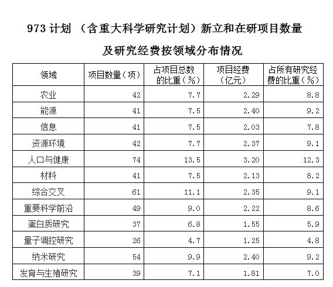

### 第 126 题

2009年我国973计划（含重大科学研究计划）中，有几个领域的投入经费超过2亿元：

A. 7

B. 8

C. 9

D. 10

第 126 题 · 答案与解析

**参考答案（粉笔题库参考内容）**

C

**解析**

定位表格：从第4列项目经费看，2009年我国973计划中，投入经费超过2亿元的有农业、能源、信息、资源环境、人口与健康、材料、综合交叉、重要科学前沿、纳米研究9个领域。

故正确答案为C。

**考点**：直接找数、综合资料

**来源**：2012年北京市公务员录用考试《行测》题第126题

### 第 127 题

2009年我国973计划（含重大科学研究计划）中，项目总数最多的三个领域占所有项目总数的比重约为：

A. 32%

B. 35%

C. 38%

D. 41%

第 127 题 · 答案与解析

**参考答案（粉笔题库参考内容）**

B

**解析**

定位表格：2009年我国973计划中，项目总数最多的三个领域的项目总数占所有项目总数的比重分别是人口与健康13.5%、综合交叉11.1%、纳米研究9.9%。故三项的项目总数占所有项目总数的比重=13.5%+11.1%+9.9%=34.5%，B项最接近。

故正确答案为B。

**考点**：简单加减计算、综合资料

**来源**：2012年北京市公务员录用考试《行测》题第127题

### 第 128 题

2009年我国973计划（含重大科学研究计划）中，平均每个农业项目的投入经费约为多少万元人民币：

A. 501

B. 545

C. 592

D. 653

第 128 题 · 答案与解析

**参考答案（粉笔题库参考内容）**

B

**解析**

根据题干“2009年······平均每个农业项目的投入经费······”，可判断本题为现期平均数问题。定位表格第二行，2009年我国973计划中，农业项目的投入经费总共2.29亿元，共42个项目。故平均每个农业项目的投入经费。

故正确答案为B。

**考点**：现期平均数、综合资料

**来源**：2012年北京市公务员录用考试《行测》题第128题

### 第 129 题

平均每个项目投入经费高于所有项目平均水平的领域有多少个：

A. 3

B. 4

C. 5

D. 6

第 129 题 · 答案与解析

**参考答案（粉笔题库参考内容）**

D

**解析**

根据题干“平均每个项目投入经费······”，可判断本题为现期平均数问题。定位表格，当项目经费占所有研究经费的比重高于项目总数占所有项目总数的比重的领域，其平均每个项目投入经费高于所有项目平均水平，观察表格可知，共有农业、能源、信息、资源环境、材料、量子调控研究6个领域。

故正确答案为D。

**考点**：现期平均数、综合资料

**来源**：2012年北京市公务员录用考试《行测》题第129题

### 第 130 题

以下关于2009年我国973计划（含重大科学研究计划）的描述，与资料相符的是：

A. 在研项目占项目总数的比重超过80%

B. 项目经费最高的领域，其项目经费比最低者的3倍还多

C. 平均每个领域的新立项目数量不足10个

D. 项目经费最低的领域，其项目总数也是最少的

第 130 题 · 答案与解析

**参考答案（粉笔题库参考内容）**

D

**解析**

A项：定位文字材料：“2009年，我国973计划（含重大科学研究计划）新立和在研项目共547项，其中新立项目123项，在研项目424项。”，故在研项目占项目总数的比重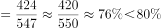，错误；

B项：定位表格，项目经费最高的领域为人口与健康领域（3.2亿元），最低的领域是量子调控研究领域（1.25亿元），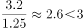，错误；

C项：定位表格和文字材料，共有12个领域和123个新立项目。故平均每个领域的新立项目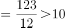，错误；

D项：定位表格，项目经费最低的领域为量子调控研究领域（1.25亿元），其项目总数（26项）也是最少的，正确。

故正确答案为D。

**考点**：综合分析、综合资料

**来源**：2012年北京市公务员录用考试《行测》题第130题

## 材料 11

2009年世界天然气贸易量达8768.5亿立方米，较2005年增长7.7%。其中管道天然气贸易量为6337.7亿立方米；液化天然气贸易量为2427.7亿立方米。

        俄罗斯是世界最大的管道天然气出口国，占管道天然气总出口量的27.8%，出口量为1764.8亿立方米，较2008年增长14.3%；俄罗斯天然气全部出口到欧洲国家，主要有德国（315亿立方米）、意大利（208亿立方米）、土耳其（172.6亿立方米）等。加拿大是世界第二大管道天然气出口国，出口量达922.4亿立方米，较2008年下降10.6%，全部出口到美国。

        美国、德国、意大利、法国、俄罗斯是世界五大管道天然气进口国，2009年进口量占世界总量的50.0%。美国是世界最大的管道天然气进口国，进口量达1044.1亿立方米，较2008年下降10.9%。

        液化天然气主要出口国为卡塔尔、马来西亚、印度尼西亚等。日本为世界最大的液化天然气进口国，进口量达859亿立方米，其次为韩国、西班牙和法国，进口量分别占世界总量的14.1%、11.1%和5.4%。

        2009年世界天然气价格普遍都有不同程度的下降。在亚洲，日本进口液化气的平均价为9.06美元/百万英热单位（MBtu），较2008年减少3.49美元/MBtu；美国天然气的进口价由上年的8.85美元/MBtu下降至3.89美元/MBtu。

### 第 131 题

2009年世界液化天然气贸易量占天然气贸易总量的比重为：

A. 17.5%

B. 22.2%

C. 27.7%

D. 38.3%

第 131 题 · 答案与解析

**参考答案（粉笔题库参考内容）**

C

**解析**

根据题干“2009年······占······的比重”，结合材料时间为2009年，可判定本题为现期比重问题。定位文字材料第一段：“2009年世界天然气贸易量达8768.5亿立方米······液化天然气贸易量为2427.7亿立方米”。故世界液化天然气贸易量占天然气贸易总量的比重，C项最为接近。

故正确答案为C。

**考点**：文字资料、现期比重

**来源**：2012年北京市公务员录用考试《行测》题第131题

### 第 132 题

2009年俄罗斯管道天然气出口较上年增长了多少亿立方米：

A. 110

B. 221

C. 332

D. 443

第 132 题 · 答案与解析

**参考答案（粉笔题库参考内容）**

B

**解析**

根据题干“增长了多少亿立方米”，可判定本题为增长量计算问题。定位文字材料第二段：“2009年俄罗斯管道天然气出口量为1764.8亿立方米，较2008年增长14.3%”。故2009年出口量比上年增长量亿立方米，B项最为接近。

故正确答案为B。

**考点**：增长量计算、文字资料

**来源**：2012年北京市公务员录用考试《行测》题第132题

### 第 133 题

韩国2009年液化天然气进口量大约是法国的多少倍？

A. 2.1

B. 2.3

C. 2.6

D. 3

第 133 题 · 答案与解析

**参考答案（粉笔题库参考内容）**

C

**解析**

根据题干“韩国2009年······是······的多少倍”，结合材料时间为2009年，可判定本题为现期倍数问题。定位文字材料第四段，“韩国、西班牙和法国，进口量分别占世界总量的14.1%、11.1%和5.4%”。故。

故正确答案为C。

**考点**：文字资料、现期倍数

**来源**：2012年北京市公务员录用考试《行测》题第133题

### 第 134 题

2009年美国天然气的进口均价比上年下降了：

A. 62%

B. 56%

C. 50%

D. 44%

第 134 题 · 答案与解析

**参考答案（粉笔题库参考内容）**

B

**解析**

根据题干“······下降了”，结合选项为百分数，可判定本题为一般增长率问题。定位文字材料第五段：“美国天然气的进口价由上年的8.85美元/MBtu下降至3.89美元/MBtu”。则2009年增长率，结果为负，表示下降了56%。

故正确答案为B。

**考点**：一般增长率、文字资料

**来源**：2012年北京市公务员录用考试《行测》题第134题

### 第 135 题

以下能从资料中推出的是：

A. 2009年加拿大是美国最大的管道天然气进口来源地

B. 2009年日本进口液化气的平均价比上年下降了6成以上

C. 2009年世界天然气贸易量比2005年增长1000多亿立方米

D. 出口土耳其的管道天然气占2009年俄罗斯对欧洲管道天然气总出口量的1成以上

第 135 题 · 答案与解析

**参考答案（粉笔题库参考内容）**

A

**解析**

A项，定位文字材料第二段和第三段：2009年加拿大出口到美国的管道天然气为922.4亿立方米，而美国的进口总量为1044.1亿立方米。加拿大出口量占美国进口总量一半以上，故加拿大是美国最大的管道天然气进口来源地，正确；

B项，定位文字材料第五段：“2009年日本进口液化气的平均价为9.06美元/百万英热单位（MBtu），较2008年减少3.49美元/MBtu”。故2009年日本进口液化气的平均价增长率，下降了不到6成，错误；

C项，定位文字材料第一段：“2009年世界天然气贸易量达8768.5亿立方米，较2005年增长7.7%”。故2009年世界天然气贸易量比2005年的增长量亿立方米，选项表述为1000多亿立方米，错误；

D项，定位文字材料第二段：俄罗斯管道天然气出口量为1764.8亿立方米，全部出口到欧洲国家，出口到土耳其172.6亿立方米。故出口土耳其的管道天然气占2009年俄罗斯对欧洲管道天然气总出口量的比重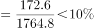，不到1成，错误。

故正确答案为A。

**考点**：文字资料、综合分析

**来源**：2012年北京市公务员录用考试《行测》题第135题

