# 2013年北京市公务员录用考试《行测》题

<!-- gwy:overview:start -->
> **北京 · 2013 · 行测 · 统考** ｜ 135 题 · 图片 13 处 · 答案随题折叠

| 题型模块 | 题量 | 题号 |
| --- | ---: | ---: |
| 常识判断 | 35 | 1–35 |
| 言语理解与表达 | 35 | 36–70 |
| 数量关系 | 15 | 71–85 |
| 判断推理 | 30 | 86–115 |
| 资料分析 | 20 | 116–135 |
| **合计** | **135** | |

导航：[题型与作答说明](#题型与作答说明) · [题目](#题目) · [材料 1](#材料-1)
<!-- gwy:overview:end -->

> 候选采集稿。参考答案及解析来自粉笔页面，不代表官方答案或真实高分答卷；来源使用许可与原卷对应关系仍需人工核实。

## 题型与作答说明

常识判断

（35题）

本部分包含两种类型的题目，请根据题目要求做出正确选择，多选题错选、多选、少选均不得分，也不扣分。

言语理解与表达

（35题）

本部分包括表达与理解两方面的内容。请根据题目要求，在四个选项中选出一个最恰当的答案。

数量关系

（15题）

在这部分试题中，每道题呈现一段表述数字关系的文字，要求你迅速、准确地计算出答案。

判断推理

（30题）

本部分包括图形推理、定义判断、类比推理与逻辑判断四种类型的试题。

资料分析

（20题）

所给出的图、表、文字或综合性资料具有若干问题要你回答。你应根据资料提供的信息进行分析、比较、计算和判断处理。

## 题目

### 第 1 题

《国家“十二五”规划纲要》提出，要把扩大＿＿＿＿需求作为扩大内需的战略重点，逐步使我国国内市场总体规模位居世界前列。

A. 消费

B. 投资

C. 出口

D. 生产

第 1 题 · 答案与解析

**参考答案（粉笔题库参考内容）**

A

**解析**

本题考查新思想。

《国家“十二五”规划纲要》提出“要把扩大消费需求作为扩大内需的战略重点，进一步释放城乡居民消费潜力，逐步使我国国内市场总体规模位居世界前列”。

故正确答案为A。

**考点**：经济建设、重要文件

**来源**：2013年北京市公务员录用考试《行测》题第1题

### 第 2 题

党的十八大报告指出，我国发展仍处于可以大有作为的＿＿＿＿。

A. 重要快速发展期

B. 重要战略机遇期

C. 重要改革机遇期

D. 重要战略转折期

第 2 题 · 答案与解析

**参考答案（粉笔题库参考内容）**

B

**解析**

本题考查新思想。

党的十八大报告提到，“综观国际国内大势，我国发展仍处于可以大有作为的重要战略机遇期。”

故正确答案为B。

**考点**：新思想总论、重要会议讲话

**来源**：2013年北京市公务员录用考试《行测》题第2题

### 第 3 题

经国务院批准，从2012年11月1日起，福建省、广东省及厦门市、深圳市实施营业税改征＿＿＿＿改革试点。

A. 印花税

B. 消费税

C. 增值税

D. 企业所得税

第 3 题 · 答案与解析

**参考答案（粉笔题库参考内容）**

C

**解析**

本题考查时事政治。

经国务院批准，福建省、广东省及厦门市、深圳市从11月1日起实施营业税改征增值税改革试点。

故正确答案为C。

**考点**：重要事件

**来源**：2013年北京市公务员录用考试《行测》题第3题

### 第 4 题

从2013年1月1日起，北京将对美国、英国、法国等45个国家持有第三国签证和机票的外国人实行＿＿＿＿小时过境免签政策。

A. 24

B. 48

C. 72

D. 96

第 4 题 · 答案与解析

**参考答案（粉笔题库参考内容）**

C

**解析**

本题考查时事政治。

从2013年1月1日起，北京将对美国、英国、法国等45个国家持有第三国签证和机票的外国人实行72小时过境免签政策。

故正确答案为C。

**考点**：重要事件

**来源**：2013年北京市公务员录用考试《行测》题第4题

### 第 5 题

坚持和完善中国共产党领导的多党合作和政治协商制度，就必须坚持“长期共存、＿＿＿＿＿、肝胆相照、荣辱与共”的方针。

A. 互相监督

B. 互惠互利

C. 团结友爱

D. 参政议政

第 5 题 · 答案与解析

**参考答案（粉笔题库参考内容）**

A

**解析**

本题考查新思想。

1987年，中国共产党的十三大政治报告在谈到政治体制改革时，明确指出：“要坚持‘长期共存、互相监督、肝胆相照、荣辱与共’的方针，完善共产党领导下的多党合作和政治协商制度，进一步发挥民主党派和无党派爱国人士在国家政治生活中的作用”。

故正确答案为A。

**考点**：政治建设

**来源**：2013年北京市公务员录用考试《行测》题第5题

### 第 6 题

针对其他国家对南海油气资源虎视眈眈的状况，我国政府多次重申立场：“主权归我”，“南海是我国核心利益的一部分”。这充分表明：

A. 我国是社会主义法治国家

B. 我国坚定地维护国家利益

C. 油气资源是我国的核心利益

D. 我国反对单纯以武力形式解决国际争端

第 6 题 · 答案与解析

**参考答案（粉笔题库参考内容）**

B

**解析**

本题考查新思想。

针对南海领土问题，我国政府多次提出南海的“主权归我”，并提出南海是关系到中国领土完整的“核心利益”，把南海问题看作领土完整问题上事关存亡的重要问题。坚定南海是我国领土的一部分的立场，就是坚定地维护国家主权利益。

故正确答案为B。

**考点**：政治建设

**来源**：2013年北京市公务员录用考试《行测》题第6题

### 第 7 题

信念是人们在一定认识的基础上，对某种思想理论、学说和理想所抱的坚定不移的观念和真诚信服、坚决执行的态度。检验信念正确与否、科学与否的唯一标准是：

A. 理论推断

B. 社会实践

C. 主观愿望

D. 真诚信仰

第 7 题 · 答案与解析

**参考答案（粉笔题库参考内容）**

B

**解析**

辩证唯物主义认识论认为，只有实践才能证明认识是否具有客观的真理性。信念也是一种主观认识，只有通过社会实践，才能检验信念是否正确、科学。A、C、D都属于主观认识，不能作为检验标准。

故正确答案为B。

**考点**：认识论

**来源**：2013年北京市公务员录用考试《行测》题第7题

### 第 8 题

2011年以来我国大中城市纷纷出台住宅限购政策，主要是为了：

A. 限制房地产市场需求

B. 减少房地产开发商的暴利

C. 打击住宅市场上的投机性需求

D. 让低收入者买得起住房

第 8 题 · 答案与解析

**参考答案（粉笔题库参考内容）**

C

**解析**

2010年《国务院关于坚决遏制部分城市房价过快上涨的通知》中提到，要坚决抑制不合理住房需求，严格限制各种名目的炒房和投机性购房。地方人民政府可根据实际情况，采取临时性措施，在一定时期内限定购房套数。《通知》发布后，各大中城市开始出台“限购令”。由此可见，我国大中城市出台住宅限购政策，主要目的是为了打击住宅市场上的投机性需求。

故正确答案为C。

**考点**：宏观经济与调控政策

**来源**：2013年北京市公务员录用考试《行测》题第8题

### 第 9 题

我国加快转变经济发展方式的主攻方向是：

A. 加快投入，拉动内需

B. 保障和改善民生

C. 建设环境友好型社会

D. 经济结构战略性调整

第 9 题 · 答案与解析

**参考答案（粉笔题库参考内容）**

D

**解析**

本题考查新思想。

中共中央政治局在研究制定国民经济和社会发展“十二五”规划建议时明确提出，要坚持把经济结构战略性调整作为加快转变经济发展方式的主攻方向。

故正确答案为D。

**考点**：经济建设

**来源**：2013年北京市公务员录用考试《行测》题第9题

### 第 10 题

21世纪以来，我国进入新一轮婚育高峰期，结婚人数以每年10%的比例增长，加之国民收入水平不断提高，婚庆服务产业得到空前发展。这表明：

A. 消费是生产的结果

B. 生产为消费创造动力

C. 消费是生产的动力

D. 生产决定消费对象

第 10 题 · 答案与解析

**参考答案（粉笔题库参考内容）**

C

**解析**

本题考查消费与生产的辩证关系，即生产决定消费，消费对生产有重大的反作用。没有生产就没有消费，同时消费是生产的目的和动力。本题中，随着结婚人数增多，国民收入提高，婚庆活动的消费需求增加，从而促进了婚庆服务产业的发展，显然是消费带动生产。

故正确答案为C。

**考点**：哲学-其他

**来源**：2013年北京市公务员录用考试《行测》题第10题

### 第 11 题

基尼系数用来衡量一个国家的：

A. 收入分配公平程度

B. 城乡发展差距

C. 经济发展水平

D. 居民穷富程度

第 11 题 · 答案与解析

**参考答案（粉笔题库参考内容）**

A

**解析**

基尼系数是由20世纪初意大利经济学家基尼所定义的，用来判断收入分配公平程度的指标。该指标的值介于0和1之间，越接近0表明收入分配越趋于平等，越接近1表明收入分配越趋向不平等。基尼系数通常把0.4作为收入分配差距的“警戒线”，高于这一数值容易出现社会不安定。

故正确答案为A。

**考点**：微观经济

**来源**：2013年北京市公务员录用考试《行测》题第11题

### 第 12 题

我国从2006年起取消了农业税，下列有关说法不正确的是：

A. 农业税在清朝被称为“田赋”

B. 取消农业税标志着我国已经消除了城乡差别

C. “初税亩”是春秋时期鲁国实行的农业税

D. 在当代世界多数国家，农业税已不是主体税收

第 12 题 · 答案与解析

**参考答案（粉笔题库参考内容）**

B

**解析**

农业税是国家对一切从事农业生产、有农业收入的单位和个人征收的一种税，俗称“公粮”。中国历史上有记载的农业税收为春秋时期鲁国实行的“初税亩”，汉朝称“租赋”，唐朝称“租庸调”，清朝称“田赋”。在农业税取消以前，中国是世界上唯一仍专门面向农民征收农业税的国家。取消农业税促进城乡税制统一，从根本上减轻农民负担，但并不能表明我国已消除城乡差别。

本题为选非题，故正确答案为B。

**考点**：文化常识

**来源**：2013年北京市公务员录用考试《行测》题第12题

### 第 13 题

下列有关社会主义法律与社会主义道德的表述，不正确的是：

A. 二者都是社会主义经济基础的产物

B. 二者都是由国家强制力保证实施的

C. 二者都是调整人们相互关系的行为规范

D. 二者都是广大人民群众意志和利益的体现

第 13 题 · 答案与解析

**参考答案（粉笔题库参考内容）**

B

**解析**

本题考查社会主义法律与社会主义道德的关系。社会主义法律与社会主义道德在本质上是一致的，它们都是社会主义经济基础的产物，都是调整社会关系与人们行为的重要手段，都是人民群众利益的体现，都是为建设社会主义服务的。但两者又有区别，社会主义法律是社会主义国家制定和认可的规范性文件，由国家强制力保障实施，而社会主义道德是由社会舆论确立的一般社会意志，由人们内心信念和社会舆论来保证其存在和发生作用。

A、C、D表述正确；

B项说二者都由国家强制力保证实施的，错误。

本题为选非题，故正确答案为B。

**考点**：法理学

**来源**：2013年北京市公务员录用考试《行测》题第13题

### 第 14 题

某首饰店误将一枚银戒指当作铂金戒指卖给李某。首饰店的这一行为属于：

A. 犯罪行为

B. 无效的民事法律行为

C. 可撤销的民事法律行为

D. 有效的民事法律行为

第 14 题 · 答案与解析

**参考答案（粉笔题库参考内容）**

C

**解析**

我国《中华人民共和国民法典》第一百四十七条规定：“基于重大误解实施的民事法律行为，行为人有权请求人民法院或者仲裁机构予以撤销”。首饰店误将银戒指当作铂金戒指，对行为内容存在重大误解，属于可撤销的民事法律行为。

故正确答案为C。

**考点**：民法典

**来源**：2013年陕西省公务员录用考试《行测》题第17题

### 第 15 题

李俊在某服装店挑选衣服，店主向其推荐了一款风衣。李俊试穿后觉得不合适，脱下风衣后准备离开，店主却强迫李俊买下了这件风衣。店主的这一行为侵犯了李俊的：

A. 财产安全权

B. 损害求偿权

C. 维护尊严权

D. 选择商品自主权

第 15 题 · 答案与解析

**参考答案（粉笔题库参考内容）**

D

**解析**

《消费者权益保护法》第九条规定，消费者享有自主选择商品或者服务的权利。消费者有权自主选择提供商品或者服务的经营者，自主选择商品品种或者服务方式，自主决定购买或者不购买任何一种商品、接受或者不接受任何一项服务。店主强迫李俊买下风衣的行为，侵犯了李俊自主选择商品的权利。

故正确答案为D。

**考点**：民法典

**来源**：2013年陕西省公务员录用考试《行测》题第14题

### 第 16 题

下列中国古代思想家中，其思想最能体现朴素辩证法的是：

A. 老子

B. 墨子

C. 荀子

D. 韩非子

第 16 题 · 答案与解析

**参考答案（粉笔题库参考内容）**

A

**解析**

朴素辩证法是古代原始的辩证法，即直观地认识到一切事物都在普遍联系和运动变化之中，猜测到对立面的统一和斗争。中国古代的朴素辩证法思想，主要是指早期的道家的“人天”思想，讲究阴阳和谐。老子学说的精华体现的正是他的朴素辩证法思想。

故正确答案为A。

**考点**：文化常识

**来源**：2013年北京市公务员录用考试《行测》题第16题

### 第 17 题

联合国是当代世界重要的国际组织，下列表述正确的是：

A. 联合国总部位于美国华盛顿

B. 《联合国宪章》是联合国的基本法

C. 德国属于联合国安全理事会常任理事国

D. 每年的6月25日是联合国日

第 17 题 · 答案与解析

**参考答案（粉笔题库参考内容）**

B

**解析**

A项表述错误，联合国是一个由主权国家组成的国家组织，总部设在美国纽约；

C项表述错误，联合国安全理事会的常任理事国包括中国、法国、俄罗斯、英国和美国；

D项表述错误，1945年6月25日，50个国家的代表在联合国国际组织会议上，一致通过被视为联合国基本大法的《联合国宪章》，10月24日正式生效。1947年，联合国大会决定，10月24日为“联合国日”。

故正确答案为B。

**来源**：2013年北京市公务员录用考试《行测》题第17题

### 第 18 题

恩格斯说：“……他用这本书来向自然事物方面的教会权威挑战。从此自然科学便开始从神学中解放出来……”引文中的“他”和“这本书”指的是：

A. 但丁和《神曲》

B. 哥白尼和《天体运行论》

C. 达尔文和《生物进化论》

D. 托马斯•莫尔和《乌托邦》

第 18 题 · 答案与解析

**参考答案（粉笔题库参考内容）**

B

**解析**

恩格斯在《&lt;自然辩证法>导言》中写到：“自然科学借以宣布其独立并且好像是重演路德焚烧教谕的革命行为，便是哥白尼那本不朽著作的出版，他用这本书（虽然是胆怯地而且可说是只在临终时）来向自然事物方面的教会权威挑战。从此自然科学便开始从神学中解放出来……”“那本不朽著作”指的是哥白尼的《天体运行论》。

故正确答案为B。

**考点**：文化常识

**来源**：2013年北京市公务员录用考试《行测》题第18题

### 第 19 题

1927年八七会议上，毛泽东提出了（    ）思想。

A. 游击战争

B. 农村包围城市

C. 支部建在连上

D. 枪杆子里面出政权

第 19 题 · 答案与解析

**参考答案（粉笔题库参考内容）**

D

**解析**

本题考查毛中特。

A项错误，“游击战”是一种以弱胜强的战术，而且由于需要坚实的群众基础以及熟悉的地形，通常应用于反侵略一方，在敌强我弱的情况下保存自己、打击敌人，最终夺取胜利，这是一种战争艺术。

B项错误，“农村包围城市”，最后夺取全国胜利的革命道路，是以毛泽东为代表的中国共产党人在领导中国革命实践中逐步摸索出来的一条具有中国特色的发展道路和总战略。

C项错误，“支部建在连上”是建党建军的一项基本原则和制度。它确立了中国共产党对军队的绝对领导，也从此定下了中国人民解放军未来发展壮大的基调和底色。1927年，毛泽东率领秋收起义部队到达江西省永新县三湾村进行改编，首次提出“支部建在连上”。

D项正确，1927年8月7日，中共中央在湖北省汉口举行“八七会议”。会上，毛泽东提出“须知政权是由枪杆子中取得的”，为挽救党和革命作出了巨大贡献，中国革命从此开始由大革命失败到土地革命战争兴起的历史性转变。

故正确答案为D。

**考点**：党的历史

**来源**：2013年北京市公务员录用考试《行测》题第19题

### 第 20 题

“杂交水稻之父”袁隆平院士将野生水稻和普通水稻多次杂交，培育出高产的杂交水稻新品种，利用的原理是：

A. 生态系统的多样性

B. 染色体的多样性

C. 基因的多样性

D. 细胞的多样性

第 20 题 · 答案与解析

**参考答案（粉笔题库参考内容）**

C

**解析**

杂交水稻是通过不同稻种相互杂交产生的。杂交实际上是通过不同的基因型的个体之间的交配而取得某些双亲基因重新组合的个体的方法，利用的正是基因的多样性。

故正确答案为C。

**考点**：生物常识

**来源**：2013年北京市公务员录用考试《行测》题第20题

### 第 21 题

自然界中不同生物之间的共生关系一般理解为“相互依存，互利互惠”，下列存在共生关系的是：

A. 寄居蟹与海葵

B. 同一草原上的牛群与羊群

C. 菟丝子与豆科植物

D. 霸王花与大叶山毛榉

第 21 题 · 答案与解析

**参考答案（粉笔题库参考内容）**

A

**解析**

共生是指两种不同生物之间形成的紧密互利关系。在共生关系中，一方为另一方提供有利于生存的帮助，同时也获得对方的帮助。A项寄居蟹和海葵之间便是共生关系，海葵的刺丝胞能提供寄居蟹某些程度的保护；而海葵可在壳上获得栖息的硬基质、在寄居蟹觅食时可获得碎屑。C项菟丝子又叫“豆寄生”，是一种生理构造特殊的寄生植物，其组成的细胞中没有叶绿体，主要靠寄生在豆科植物的茎叶上吸取营养物质为生。菟丝子和豆科植物之间是寄生关系。

故正确答案为A。

**考点**：生物常识

**来源**：2013年北京市公务员录用考试《行测》题第21题

### 第 22 题

某城市素有“十三朝古都、八代陪都”之说，是我国建都时间最长，建都朝代最多的千年帝都。这座城市是：

A. 开封

B. 杭州

C. 西安

D. 洛阳

第 22 题 · 答案与解析

**参考答案（粉笔题库参考内容）**

D

**解析**

洛阳是我国建都最早、建都时间最长、建都朝代最多、建都朝代跨度最大的千年帝都，是中国历史上唯一的“神都”，同时是女皇武则天建都之城，素有“十三朝古都、八代陪都”之称。西安也有“十三朝古都”之称，但没有“八代陪都”之称。

故正确答案为D。

**考点**：文化常识

**来源**：2013年北京市公务员录用考试《行测》题第22题

### 第 23 题

2012年北京市第十一次党代会提出，北京必须坚持首都城市功能定位，认真履行“四个服务”职责。下列选项中，不属于上述“四个服务”内容的是：

A. 为国家的国际交往服务

B. 为国家教育、科技事业的发展服务

C. 为经济又好又快发展服务

D. 为改善人民群众生活服务

第 23 题 · 答案与解析

**参考答案（粉笔题库参考内容）**

C

**解析**

本题考查时事政治。

刘淇在北京市第十一次党代会上作报告时提出，北京作为13亿人口大国的首都，必须以更高标准履行好“四个服务”职责。首都各项工作必须更加有利于为中央党政军领导机关服务，为日益扩大的国际交往服务，为国家教育、科技、文化和卫生事业的发展服务，为市民的工作和生活服务。

A、B、D正确，均属于“四个服务”的内容；

C项错误，不属于“四个服务”的内容。

本题为选非题，故正确答案为C。

**来源**：2013年北京市公务员录用考试《行测》题第23题

### 第 24 题

古人根据月亮变化情况来记月，称为晦、朔、弦、望，其中望是指：

A. 初一

B. 十五

C. 初七、初八

D. 月终

第 24 题 · 答案与解析

**参考答案（粉笔题库参考内容）**

B

**解析**

晦指的是农历每月末的一天，即月终；朔指农历初一；弦指农历初七、初八和农历二十二、二十三；望指农历十五。

故正确答案为B。

**考点**：文化常识

**来源**：2013年北京市公务员录用考试《行测》题第24题

### 第 25 题

下列食品中，不属于发酵类食品的是：

A. 白酒

B. 饼干

C. 面包

D. 腐乳

第 25 题 · 答案与解析

**参考答案（粉笔题库参考内容）**

B

**解析**

发酵食品是指人们利用有益微生物加工制造的一类食品，通常包括酒精饮料、谷物发酵制品、乳类发酵制品、豆类发酵制品等。白酒、面包、腐乳均属于发酵类食品。饼干是以小麦粉为主要原料，不属于发酵制品。

本题为选非题，故正确答案为B。

**考点**：生活常识

**来源**：2013年北京市公务员录用考试《行测》题第25题

### 第 26 题

下列选项中，属于我国十七大以来取得的成就的有：

A. 进出口总额跃居世界第一位

B. 城乡免费义务教育全面实现

C. 月球探测器成功发射

D. 实行城乡按相同人口比例选举人大代表

第 26 题 · 答案与解析

**参考答案（粉笔题库参考内容）**

BCD

**解析**

中国共产党第十七次全国代表大会于2007年10月15日至21日在北京召开。2007年10月24日，中国第一颗月球探测卫星“嫦娥一号”在西昌卫星发射中心成功升空。从2008年秋季学期开始，在全国范围内全部免除城市义务教育阶段学生学杂费，城乡免费义务教育全面实现。2011年，中国外贸进出口额跃居世界第二，仍次于美国。 2013年1月，第十二届全国人民代表大会代表选出，这次选举首次实行城乡按相同人口比例选举人大代表。

B、C、D正确，均属于我国十七大以来取得的成就。

故正确答案为B、C、D。

**考点**：重要事件

**来源**：2013年北京市公务员录用考试《行测》题第26题

### 第 27 题

党的十八大报告指出，建设社会主义文化强国，必须走中国特色社会主义文化发展道路。下列属于扎实推进我国社会主义文化强国建设的内容的是：

A. 丰富人民精神文化生活

B. 加强社会主义核心价值体系建设

C. 增强文化整体实力和竞争力

D. 全面提高公民道德素质

第 27 题 · 答案与解析

**参考答案（粉笔题库参考内容）**

ABCD

**解析**

党的十八大报告提出，建设社会主义文化强国，必须走中国特色社会主义文化发展道路。要扎实推进我国社会主义文化强国建设，就要加强社会主义核心价值体系建设，全面提高公民道德素质，丰富人民精神文化生活和增强文化整体实力和竞争力。

故正确答案为A、B、C、D。

**考点**：文化建设

**来源**：2013年北京市公务员录用考试《行测》题第27题

### 第 28 题

下列选项中，不属于北京市自然环境特点的是：

A. 属于暖温带干旱气候区

B. 仅与河北省交界

C. 拥有大量天然湖泊

D. 地势西北高，东南低

第 28 题 · 答案与解析

**参考答案（粉笔题库参考内容）**

ABC

**解析**

A项错误，北京市中心位于北纬39度，东经116度，属于温带季风气候区，夏季高温多雨，冬季寒冷干燥；

B项错误，地理行政区域上与河北省和天津市交界；

C项错误，北京处于水资源匮乏的海河流域，没有大量天然的湖泊；

D项正确，北京的地势特点是西北高，东南低。

本题要求选择不属于北京市自然环境特点的选项。

本题为选非题，故正确答案为A、B、C。

**考点**：中国地理

**来源**：2013年北京市公务员录用考试《行测》题第28题

### 第 29 题

十七大以来，大陆和台湾实现了全面直接双向“三通”，形成了两岸全方位交往格局。其中，“三通”包括：

A. 直接通邮

B. 铁路直达

C. 空运直航

D. 海运直航

第 29 题 · 答案与解析

**参考答案（粉笔题库参考内容）**

ACD

**解析**

十七大以来，大陆和台湾实现了全面直接双向“三通”，这“三通”包括直接通邮、直接通航、直接通商。

故正确答案为A、C、D。

**考点**：重要事件

**来源**：2013年北京市公务员录用考试《行测》题第29题

### 第 30 题

温家宝总理在十一届全国人大三次会议上作政府工作报告时，提出要“切实放宽市场准入，积极引入竞争制，着力营造多种所有制经济公平竞争的市场环境，更好地促进非公有制经济发展”。这是因为发展非公有制经济有利于：

A. 建立统一开放、竞争有序的市场

B. 推进我国经济结构的调整

C. 促进公有制的实现形式多样化

D. 扩大就业

第 30 题 · 答案与解析

**参考答案（粉笔题库参考内容）**

ABCD

**解析**

2010年，国务院发布《关于鼓励和引导民间投资健康发展的若干意见》，其中提到，在毫不动摇地巩固和发展公有制经济的同时，毫不动摇地鼓励、支持和引导非公有制经济发展，进一步鼓励和引导民间投资，有利于坚持和完善我国社会主义初级阶段基本经济制度，以现代产权制度为基础发展混合所有制经济，推动各种所有制经济平等竞争、共同发展；有利于完善社会主义市场经济体制，充分发挥市场配置资源的基础性作用，建立公平竞争的市场环境；有利于激发经济增长的内生动力，稳固可持续发展的基础，促进经济长期平稳较快发展；有利于扩大社会就业，增加居民收入，拉动国内消费，促进社会和谐稳定。

故正确答案为A、B、C、D。

**考点**：宏观经济与调控政策

**来源**：2013年北京市公务员录用考试《行测》题第30题

### 第 31 题

公文的标题通常包含哪三个要素：

A. 发文机关

B. 事由

C. 年份

D. 文种

第 31 题 · 答案与解析

**参考答案（粉笔题库参考内容）**

ABD

**解析**

本题考查公文常识。完整的公文标题通常包含发文机关名称、事由和文种三个要素，即标明由谁发文、为什么发文和用什么文种发文。

故正确答案为A、B、D。

**来源**：2013年北京市公务员录用考试《行测》题第31题

### 第 32 题

下列行为中属于单方民事法律行为的有：

A. 立遗嘱

B. 赠与

C. 无权代理的追认

D. 放弃继承

第 32 题 · 答案与解析

**参考答案（粉笔题库参考内容）**

ACD

**解析**

单方法律行为是仅有一方意思表示就能成立的民事法律行为。这类行为的特点是不需要相对人的同意，该行为即告成立。单方民事法律行为有的是有相对人的，如遗嘱、代理权授予、无权代理的追认等。还有的是无相对人的，如抛弃所有权等。

故正确答案为ACD。

**考点**：民法典

**来源**：2013年北京市公务员录用考试《行测》题第32题

### 第 33 题

下列犯罪中，主观方面可以由过失构成的有：

A. 贪污罪

B. 介绍贿赂罪

C. 玩忽职守罪

D. 泄露国家机密罪

第 33 题 · 答案与解析

**参考答案（粉笔题库参考内容）**

CD

**解析**

A项贪污罪，是指国家工作人员和受国家机关、国有公司、企业、事业单位、人民团体委托管理、经营国有财产的人员，利用职务上的便利，侵吞、窃取、骗取或者以其他手段非法占有公共财物的行为。贪污罪在主观方面必须出自直接故意，非过失构成，故排除A。B项介绍贿赂罪是指向国家工作人员介绍贿赂，情节严重的行为。介绍贿赂罪在主观方面属于故意，即明知是在为受贿人或者行贿人牵线效劳，促成贿赂交易，非过失构成，故排除B项。C项玩忽职守罪是指国家机关工作人员严重不负责任，不履行或不正确地履行自己的工作职责，致使公共财产、国家和人民利益遭受重大损失的行为。玩忽职守罪在主观方面由过失构成，也就是说，行为人对于其行为所造成重大损失结果，在主观上并不是出于故意而是由于过失造成的，故符合题干，当选。D项泄露国家机密罪指国家机关工作人员违反保守国家秘密法的规定，故意或者过失泄露国家秘密，情节严重的行为。泄露国家机密罪在主观方面可能是故意也可能是过失，故当选。

故正确答案为C、D。

**考点**：刑法

**来源**：2013年北京市公务员录用考试《行测》题第33题

### 第 34 题

下列属于告知类公文的是：

A. 公报

B. 通告

C. 报告

D. 函

第 34 题 · 答案与解析

**参考答案（粉笔题库参考内容）**

AB

**解析**

告知类用于直接公开发布或传达公文内容，使一定范围内的社会组织以及公民知晓，以便正确地处理各种事物。告知类公文主要包括公报、公告、通告等，故A、B两项符合。C项报告是向上级机关汇报工作、反映情况、提出意见或者建议，答复上级机关的询问时使用的公文。D项函是不相隶属机关之间相互商洽工作、询问和答复问题，或者向有关主管部门请求批准事项时所使用的公文。C项报告和D项函均不属于告知类公文，排除。

故正确答案为A、B。

**来源**：2013年北京市公务员录用考试《行测》题第34题

### 第 35 题

中医预防疾病的原则包括：

A. 未病先防

B. 扶正祛邪

C. 标本同治

D. 既病防变

第 35 题 · 答案与解析

**参考答案（粉笔题库参考内容）**

AD

**解析**

中医有两大预防原则和六大治疗原则。两大预防原则为未病先防和既病防变，六大治疗原则为治病求本、扶正祛邪、调整阴阳、调整脏腑功能、调理气血关系、因时因地因人制宜。B、C属于中医的治疗原则。

故正确答案为A、D。

**考点**：生活常识

**来源**：2013年北京市公务员录用考试《行测》题第35题

### 第 36 题

北庭故城是唐朝北庭都护府、北庭大都护府、北庭道的治所，规模之宏大，居天山北麓第一、全疆第二。历经岁月沧桑，虽已化作遗世独立的庞大废墟，犹可依稀窥见当年重城繁堞、深堑高垣的雄伟气象。这座千年古城同时还是唐代重要军政机构瀚海军、庭州府衙的所在地，成为记录古代历史辉煌的永恒标志。其故址在今新疆昌吉回族自治州吉木萨尔县境内，南距今县城仅12公里，为全国重点文物保护单位。

从这段文字中无法得知北庭故城哪一方面的信息？

A. 地理位置

B. 文化价值

C. 城市功能

D. 人口变迁

第 36 题 · 答案与解析

**参考答案（粉笔题库参考内容）**

D

**解析**

据提问可知此题为细节判断题。

通读文段，并未提及“人口变迁”这一信息，D项表述无法得知。

本题为选非题，故正确答案为D。

**考点**：细节判断题

**来源**：2013年北京市公务员录用考试《行测》题第36题

### 第 37 题

科学和艺术有一个不相同的地方：科学讲求最新的发现、最新的定律和方程式，花样永远翻新，永远直向前跑。艺术就不大有这样的方便，不论古今中外，没有现成的定律或方程式可以供我们抄袭应用，从而使艺术不像科学研究那样形成接力赛跑式的进步。此中微妙精义，父亲不能传授给儿子，母亲亦不能指点给女儿，一切都得靠自己再从头开始。

“此中微妙精义”的“此”是指：

A. 艺术创作或欣赏等活动

B. 科学与艺术之间的差别

C. 古今中外所有艺术成果

D. 家族中世代相传的绝技

第 37 题 · 答案与解析

**参考答案（粉笔题库参考内容）**

A

**解析**

据提问可知本题为代词指代题。

根据指代就近原则往前找，可知之前所说的是艺术的创新与创作，A项表述正确。

故正确答案为A。

**考点**：代词

**来源**：2013年北京市公务员录用考试《行测》题第37题

### 第 38 题

在社会与生活步伐加快的今天，人们难得闲暇去仔细翻阅报刊来捕捉当下集体意识的火花、把握社会想象的脉搏。互联网上的搜索引擎为难以脱身的人们提供了方便，它已成为人们获取信息的重要手段。网民只需手指一点，即可了解社会当天所发生的和最受关注的热点。然而网络搜索以及与此相关的讨论，会因网络信息的不断更新而很快成为“历史”。探讨如何把这些作为社会发展轨迹的“暂时性”保留下来，以便现在和将来作为了解社会的独特窗口，将是一件富有创意的工作。

如果这段文字是一篇文章的开头，接下来作者最可能：

A. 引导大众科学、自觉地利用搜索引擎去了解社会

B. 介绍在收集、整理网络热点信息方面的某种尝试

C. 探讨如何使网络成为直观、直接了解社会的途径

D. 剖析以快速、零碎为特征的网络阅读的潜在危害

第 38 题 · 答案与解析

**参考答案（粉笔题库参考内容）**

B

**解析**

根据提问方式可知，本题为接语选择题。文段首先指出当下社会生活节奏加快，互联网搜索引擎成为人们获取信息的重要手段，接着提出问题，说明网络搜索及相关讨论会因信息不断更新很快成为“历史”，难以长久留存，最后尾句指出探讨保留这些作为社会发展轨迹的“暂时性”信息，将其打造成了解社会的独特窗口，是一项富有创意的工作。故后文应围绕如何保留这类“暂时性”信息展开论述，对应B项。

A项，文段尾句核心话题是留存网络临时信息，并非引导大众利用搜索引擎了解社会，偏离文段最后谈论的核心话题，排除；

C项，文段并未探讨如何让网络成为直观了解社会的途径，无中生有，排除；

D项，文段全程未剖析网络阅读的潜在危害，与前文话题无关，排除。

故正确答案为B。

**考点**：接语选择题

**来源**：2013年北京市公务员录用考试《行测》题第38题

### 第 39 题

世博会有一句专属名言：“一切始于世博会。”人类近现代工业文明各个时代的重大创新发明、生活方式，都由世博会催生和起步，小到电灯、电视、热狗、冰激凌、拉链，大到度假村、俱乐部、主题公园，都是从世博会开始走进无数人的家庭。正因为“一切始于世博会”，能在世博会上得到一角展示空间已是难能可贵，世博会选择合作伙伴更是万里挑一，它象征着一个时代对一个品牌全方位的肯定。

对这段文字的主旨概括最准确的是：

A. 说明世博会对人类文明进步的推动作用

B. 介绍世博会对人类生活产生的巨大影响

C. 强调参加世博会对品牌宣传的重要意义

D. 阐释“一切始于世博会”的来历和内涵

第 39 题 · 答案与解析

**参考答案（粉笔题库参考内容）**

C

**解析**

本题为中心理解题。

第一句为援引观点，非文段核心语义；第二句进一步阐明世博会对人的生活产生的影响；由第三句中的“正因为”可知，以上两句均为原因，从而引出结论，即世博会选择合作伙伴象征着一个时代对一个品牌全方位的肯定。

原因不重要，结论是重点，C项说法与结论相符。

故正确答案为C。

**来源**：2013年北京市公务员录用考试《行测》题第39题

### 第 40 题

来自不同的语言群体和文化群体的人需要彼此交流，就必须寻找交流工具。在一个层面上，他们可以依赖受过特殊训练的专业人员，这些人可以熟练使用两种以上的语言来作口译和笔译。但这是不方便的，花费的时间和代价是昂贵的。因此，在整个历史上，不断出现通用语言，在古代世界和中世纪世界是拉丁语，在西方几个世纪中是法语，在非洲的许多地区是斯瓦希里语，20世纪后半叶，在全世界的大部分地区是英语。

这段文字意在说明：

A. 翻译作为交流工具的局限性显而易见

B. 通用语言是处理语言差异的有效手段

C. 交流工具会因时代和层次需求而变化

D. 人类为寻找通用语言进行过长期探索

第 40 题 · 答案与解析

**参考答案（粉笔题库参考内容）**

B

**解析**

本题为中心理解题。

通读文段可知，文中主要谈论的是通用语言解决了由语言差异引起的不便，由此可知，作者意在说明“通用语言是处理语言差异的有效手段”，B项表述正确。

A、C、D项均与作者写作意图不相符。

故正确答案为B。

**考点**：关联词-转折

**来源**：2013年北京市公务员录用考试《行测》题第40题

## 材料 1

节能减排是党中央、国务院作出的重大决定部署，是“十一五”时期的一项约束性指标，是一条不可逾越的红线。我们将进一步统一思想，认真贯彻落实党的十七大精神，牢固树立抓节能减排就是落实科学发展观、转变经济发展方式的理念，充分认识节能减排工作的长期性、艰苦性和复杂性，切实加强节能减排工作的责任感和紧迫感，采取强有力的措施，千方百计确保实现国家和省政府下达我市的节能减排目标任务。

        根据省政府节能减排工作有关要求，积极做好节能减排目标分解和督查工作，实行严格的目标责任制，将能耗与减排指标纳入各地经济社会发展综合评价和年度考核体系，作为各级政府领导班子任期内贯彻落实科学发展观的重要考核内容，作为企业负责人经营业绩的重要考核内容，实行节能减排工作问责制。同时，加大对民营企业节能减排工作考核和约束力度，对不能如期完成省、市节能减排目标任务的县和企业，不得参加年度的评先选优，不得享受相关的优惠政策。

        认真落实国务院《关于促进产业结构调整暂行规定》，按照省政府《关于印发(2007年淘汰落后生产能力实施方案>的通知》要求，严格准入管理。对新上工业项目做好能源消耗和环境影响评价，不符合节能环保标准的不准开工建设，严格控制新上高耗能、高污染项目，从源头上把关预防。发展低投入、低能耗、低污染、高效益的“三低一高”产业，同时压缩淘汰高投入、高能耗、高污染、低效益的“三高一低”产业。积极走新型工业化道路，调整优化工业结构，提高高新技术产业在工业中的比重。

        切实抓好宏桥工业试点园和泰岳公司的循环经济试点工作，使之成为全市循环经济典范，并引导企业改变只靠自身“单打独斗”式的内部节能减排，走多企业、跨行业、区域间循环经济之路，推进企业之间消化工业废物的“循环链”，通过行业成员之间副产品和废物的交换、能量和废水的逐级利用、基础设施的共享，达到工业废物全面得到循环利用的目的，提升节能减排的成效。切实抓好省政府年初确定的我市6家公司清洁生产试点工作。

        帮助重点高耗能、高排放、高污染企业建立和推行严格的节能减排管理制度和有效的激励机制，调动广大职工节能的积极性。强化基础工作特别是统计工作，配备专职人员，将节能的目标和责任落实到车间、班组和个人。加强对重点高耗能企业节能情况的跟踪、指导和监督，定期公布重点企业能源利用情况，督促企业围绕降低重点产品能耗单位的目标开展工作。加大重点企业技术改造和污染治理力度，逐年将污染源纳入限期治理，实施工业园区综合治理工程，建设工业园区集中式污水处理设施，减少污染物排放或实现零排放。

### 第 41 题

本文主要是在阐述：

A. 落实节能减排的工作措施

B. 建设节能减排的制度体系

C. 规定节能减排的主要目标

D. 实施节能减排的具体步骤

第 41 题 · 答案与解析

**参考答案（粉笔题库参考内容）**

A

**解析**

本题属于中心理解题，考查对全文核心观点的把握。

文章首段提出了节能减排的重要性，二、三、四、五段分别从不同角度论述了节能减排工作的具体措施，A项符合文意；

D项为干扰选项，“具体步骤”一般具有顺序性，体现为第一步做什么、第二步做什么，全文并没有体现出鲜明的先后顺序，因此D项可以排除。

故正确答案为A。

**来源**：2013年北京市公务员录用考试《行测》题第41题

### 第 42 题

下列哪项最适合作为第二段的关键词：

A. 考核体系

B. 目标责任制

C. 问责制

D. 目标分解

第 42 题 · 答案与解析

**参考答案（粉笔题库参考内容）**

A

**解析**

本题属于查找关键词类型的中心理解题。

第二段围绕“考核体系”展开，并具体介绍了其考核内容和具体考核措施，B、C、D均为考核体系中的具体考核措施。

故正确答案为A。

**来源**：2013年北京市公务员录用考试《行测》题第42题

### 第 43 题

下列哪项做法符合本文的政策要求：

A. 所有工业项目暂缓开工

B. 关闭全部“三高一低”产业

C. 禁止新上高耗能、高污染项目

D. 对新上工业项目实行严格准入制度

第 43 题 · 答案与解析

**参考答案（粉笔题库参考内容）**

D

**解析**

本题为细节判断题。

依据设问中的政策要求定位第三段，A项原文是只有不符合节能环保标准的才不准开工建设，表述绝对化；B项“关闭全部”不正确，原文是“压缩淘汰”；C项“禁止”表述错误，原文为“严格控制”。

D项与原文表述一致。

故正确答案为D。

**来源**：2013年北京市公务员录用考试《行测》题第43题

### 第 44 题

关于该市循环经济试点工作，下列说法正确的是：

A. 以区域间循环经济试点工作为主

B. 参加试点工作的公司只有一家

C. 树立全市循环经济的典范

D. 把加强基础设施共享作为工作重心

第 44 题 · 答案与解析

**参考答案（粉笔题库参考内容）**

C

**解析**

本题属于细节判断题。

据提问“该市循环经济试点工作”，定位第四段出现了“循环经济试点工作”，后紧跟着说“使之成为全市循环经济典范”，快速定位C选项。

故正确答案为C。

**来源**：2013年北京市公务员录用考试《行测》题第44题

### 第 45 题

根据文意，需在哪方面工作中配备专职人员：

A. 统计

B. 综合评价

C. 监督

D. 技术改造

第 45 题 · 答案与解析

**参考答案（粉笔题库参考内容）**

A

**解析**

本题为细节判断题。

定位最后一段，段首即出现了“特别是统计工作，配备专职人员”的表述。

故正确答案为A。

**来源**：2013年北京市公务员录用考试《行测》题第45题

## 材料 2

玫瑰在植物分类上属于蔷薇科蔷薇属，已有上千年的栽培历史，在此期间，人们通过广泛杂交，培育出数量庞大的品种群。如今，世界各地（主要是北半球地区）生长着200多个种类的玫瑰。植物学家和园艺家一般将玫瑰分成两大类，即野生玫瑰和园林玫瑰。

        野生玫瑰的自然分布区域位于北纬20°至70°之间。热带地区没有蔷薇属，在南半球也没有本地产玫瑰。因此该属所覆盖的地区涉及整个欧洲、北美洲及亚洲，但北部的北极地区、南部的热带地区及亚洲内陆几个干燥地区除外。野生玫瑰在理论上应主要集中在西亚中部和南部的山区，但在大西洋沿岸的北美洲也发现了大量种类。在非洲，只有在最西北部以及埃塞俄比亚才会长有野生玫瑰。

        与野生玫瑰不同，园林玫瑰是由人而不是大自然培育的，它们是人工控制培育的结果，分成各种品种，还有着品种名称（一个品种就是具有某些显著特点的一种栽培植物，这些特点在该种植物广泛繁殖后仍然保留）。为了更容易从整体上把握，大量的玫瑰品种可分为不同的群，或者分为“古典园林玫瑰”和“现代园林玫瑰”。

        几乎所有园林玫瑰的祖先都来自亚洲，它们大多是被西方世界鼎鼎大名的植物猎人、博物学家欧内斯特·威尔逊带到欧洲的，他曾在1906年和1919年间到中国、日本和朝鲜旅游，并向欧洲引进很多宝贵的植物。这些品种通过杂交繁殖，生成今天五彩缤纷的玫瑰。没有它们，就不会有一季多次开花的玫瑰，不会有黄色和深红色的玫瑰，也不会有攀援玫瑰。

        首批玫瑰育种专家是18世纪末、19世纪初的法国人，他们在巴黎郊外的实验得到拿破仑的皇后约瑟芬的大力支持。早期的品种通过扦插法、压条法、硬木切割法，偶尔还通过芽嫁接法进行繁殖。19世纪初，一位法国玫瑰育种家通过人工授粉创造出第一批新品种。一般认为，如果一种玫瑰所属的品种在1867年以前已经存在，它就是“古典玫瑰”，“现代玫瑰”一词也是从1867年才开始使用的，当时正值第一批杂种茶香玫瑰引进欧洲。一般而言，现代玫瑰的市场生命期限都不是很长，尽管许多古典玫瑰品种都已有150年以上的寿命。今天，市场上的大多数玫瑰品种只有5年多的寿命，之后人们就会用更新一些、经过改良的品种加以取代。

### 第 46 题

关于野生玫瑰，下列说法正确的是：

A. 以亚洲为主要原产地

B. 抗干旱能力优于园林玫瑰

C. 在热带地区没有分布

D. 一个季节中可以多次开花

第 46 题 · 答案与解析

**参考答案（粉笔题库参考内容）**

C

**解析**

本题属于细节判断题。

文章第二段第2句开头说“热带地区没有蔷薇属”，第一段第1句开头又说“玫瑰在植物分类上属于蔷薇科蔷薇属”，而野生玫瑰又是玫瑰的一种，综合以上可知，野生玫瑰在热带地区没有分布。

C项表述符合文意。

故正确答案为C。

**来源**：2013年北京市公务员录用考试《行测》题第46题

### 第 47 题

关于园林玫瑰，下列说法与原文相符的是：

A. 已有上千年的栽培历史

B. 几乎都是亚洲野生玫瑰的后代

C. 主要分布在北纬20°至70°之间

D. 广泛繁殖后品种特点容易产生变异

第 47 题 · 答案与解析

**参考答案（粉笔题库参考内容）**

B

**解析**

本题属于细节判断题。

A项，根据文章第一段“玫瑰在植物分类上属于蔷薇科蔷薇属，已有上千年的栽培历史”可知，是“玫瑰”具有上千年的栽培历史，并非“园林玫瑰”，排除；

B项，根据文章第四段“几乎所有园林玫瑰的祖先都来自亚洲”，且玫瑰分为野生玫瑰和园林玫瑰，故园林玫瑰的祖先应几乎都是亚洲野生玫瑰，表述正确，当选；

C项，根据文章第二段“野生玫瑰的自然分布区域位于北纬20°至70°之间”可知，选项表述错误，排除；

D项，根据文章第三段“一个品种就是具有某些显著特点的一种栽培植物，这些特点在该种植物广泛繁殖后仍然保留”可知，园林玫瑰的形状特点没有发生改变，故不会产生变异，排除。

故正确答案为B。

**来源**：2013年北京市公务员录用考试《行测》题第47题

### 第 48 题

文中提到法国人在玫瑰栽培方面的贡献是：

A. 将亚洲品种引入欧洲

B. 最早采用硬木切割法育种

C. 培育出第一批杂种茶香玫瑰

D. 用人工授粉创造第一批新品种

第 48 题 · 答案与解析

**参考答案（粉笔题库参考内容）**

D

**解析**

此题属于细节判断题。

由文章最后一段第3句“一位法国玫瑰育种家通过人工授粉创造出第一批新品种”可知，D项表述正确。

故正确答案为D。

**来源**：2013年北京市公务员录用考试《行测》题第48题

### 第 49 题

无法从最后一段中找到的信息是：

A. 杂种茶香玫瑰的来源

B. 确定“古典玫瑰”的依据

C. 早期玫瑰育种中采用的方法

D. 现代玫瑰迅速更新换代的原因

第 49 题 · 答案与解析

**参考答案（粉笔题库参考内容）**

A

**解析**

此题属于细节判断题。

文章最后一段只提到了“当时正值第一批杂种茶香玫瑰引进欧洲”，而并未提及杂种茶香玫瑰从何而来，故A项表述无法找到。

本题为选非题，故正确答案为A。

**来源**：2013年北京市公务员录用考试《行测》题第49题

### 第 50 题

这篇文章主要介绍玫瑰的：

A. 分布

B. 品种

C. 繁殖技法

D. 传播过程

第 50 题 · 答案与解析

**参考答案（粉笔题库参考内容）**

B

**解析**

本题为中心理解题。

文章首段从总体上介绍了玫瑰，并且说到了玫瑰的品种；第二、三、四自然段对玫瑰的品种分别进行了详细的介绍；第五自然段介绍了法国人对玫瑰繁殖和新品种产生的贡献。

综上所述，对本文概括最全面的应为玫瑰的品种。

故正确答案为B。

**来源**：2013年北京市公务员录用考试《行测》题第50题

## 材料 3

教育的目的是什么？教育的目的就是帮助人获得生存与生活的本领。不管一个人将来从事什么工作，都必须能继续自己的生活，解决日常生活中的问题。但我们的教育一直有一种忽视和轻视日常生活的倾向，在教育中一直将知识的学习与日常生活相脱离。日常生活一般是不会纳入到学生的学习内容的，学生的学习与他的日常生活是分离的，他只有学习的任务，而将日常生活交给他人，交给父母去料理。在知识学习与养成教育中，日常的、世俗化的生活更加边缘化。未来、理想、职业、人才，包括财富、明星、时尚等等，在这些传统大词与流行的概念与价值观中，总是难以寻觅到日常生活的影子，嗅不到人间烟火味，看不到油盐酱醋茶的坛坛罐罐。

        其实，从人类的延续与个体生命的保障来说，日常生活比什么都重要。人们在日常生活中建构起了丰富的知识、规范、伦理与精神。由于日常生活的无所不包，它涉及到了人与这个世界、与自然广泛的联系。我们知道自己身体的秘密吗？如何使它更健康，更能给我们提供劳动的保障？我们应该如何处理和安排与周围人群的关系，如何与亲人相处？我们知道食物来自哪里，它们又分别是在哪个季节与我们相遇，它们的性格如何？在生活中，我们会遇到怎样的困难，又该如何应对？我们了解春夏秋冬，日月晨昏，了解节令的内容和地方的风土人情吗？我们该如何才不至于悖逆时日，违反了“规矩”？这些看起来确实平常，以至习焉不察，但从尊重人的生命、从以人为本的最基本的生命伦理来说，它又确实会给人全面的教益，是我们所必需的。

        千万不要认为日常生活与精神无关，与形而上学无关。一个真正懂得日常生活的人是能够从中发现思想，不断体会到精神的高度的。一花一世界，一木一天地，日常生活的细枝末节与我们头顶上的星空始终交相辉映。这样的精神首先在于人道与人性，日常生活的世界首先是此岸性的，它关乎人的生命，关乎人的幸福。承认日常生活的意义，就是表明人的肉身与感官享受的正当与合理，只有它，才是幸福的确证。

### 第 51 题

文章第一段主要批评了教育中存在的什么问题：

A. 不利于学生独立性的发展

B. 教学内容脱离日常生活

C. 教学内容枯燥无味

D. 教学方法过于死板

第 51 题 · 答案与解析

**参考答案（粉笔题库参考内容）**

B

**解析**

此题属于细节判断题。

定位第一段的转折词“但”可知，重点在其后——教育有忽视和轻视日常生活的倾向。因此可知问题即为教育脱离了日常生活。

故正确答案为B。

**来源**：2013年北京市公务员录用考试《行测》题第51题

### 第 52 题

作者认为，日常生活的重要性在于：

A. 它是人类及个体存在的保障

B. 日常生活包罗万象

C. 有利于人类更好地认识自己

D. 它是知识的来源

第 52 题 · 答案与解析

**参考答案（粉笔题库参考内容）**

A

**解析**

此题属于表面主旨题。

第二段属于提出观点-举例论证观点-重申观点型的“总—分—总”结构，重点在最后的总结，即“它又确实会给人全面的教益，是我们所必需的”，所以，此段主旨是日常生活对于人类及个体存在的保障作用。

故正确答案为A。

**来源**：2013年北京市公务员录用考试《行测》题第52题

### 第 53 题

不属于作者认为应纳入教学内容的一项是：

A. 自然规律

B. 风土人情

C. 社会伦理

D. 艺术哲学

第 53 题 · 答案与解析

**参考答案（粉笔题库参考内容）**

D

**解析**

此题属于细节判断题。

定位篇章第二段，“我们应该如何处理和安排与周围人群的关系，如何与亲人相处？”可知C项“社会伦理”属于；

“了解节令的内容和地方的风土人情吗？”可知B项“风土人情”属于；

依据“我们知道食物来自哪里，它们又分别是在哪个季节与我们相遇”可知A项“自然规律”属于；

文中没有提到D项的“艺术哲学”，属于无中生有的错误。

本题为选非题，故正确答案为D。

**来源**：2013年北京市公务员录用考试《行测》题第53题

### 第 54 题

最后一段意在说明：

A. 幸福的评价标准

B. 精神生活的重要价值

C. 日常生活的哲学意义

D. 人生的真正意义

第 54 题 · 答案与解析

**参考答案（粉笔题库参考内容）**

C

**解析**

此题属于隐含主旨题。

最后一段首句就提出了观点“千万不要认为日常生活与精神无关，与形而上学无关”，是从哲学和精神层面进一步剖析日常生活的内涵；其次，从“一花一世界，一木一天地”和尾句“承认日常生活的意义，就是表明人的肉身与感官享受的正当与合理”，都是在阐述日常生活的哲学意义。

故正确答案为C。

**来源**：2013年北京市公务员录用考试《行测》题第54题

### 第 55 题

下列哪个教育理念与作者的理念相吻合：

A. 要以生活为中心的教学作指导，不要以文字为中心的教科书

B. 教育不能创造什么，但它能启发儿童创造力，以从事于创造工作

C. 让学生学一点他们渴望学的学问，干一点他们渴望干的事情

D. 要解放孩子，使他们充分得到自由的生活，从自由的生活中得到真正的教育

第 55 题 · 答案与解析

**参考答案（粉笔题库参考内容）**

D

**解析**

此题属于表面主旨题，考查对全文内容的把握。

文中强调了日常生活对于教育的重要性，这也就是作者的理念，故应围绕“日常生活”来选择；四个选项中只有D项是围绕着“日常生活”展开，强调了其对教育的重要意义。

故正确答案为D。

**来源**：2013年北京市公务员录用考试《行测》题第55题

## 材料 4

地质纪年的名字和分类方法经常改变，不同年代的时间界限也飘忽不定。这有的是因为年代的重新定义，有的是因为测年方法不同，还有的是因为世界不同地方的研究者以不同的岩石作为同一年代的界标，导致具体时间界限存在争议。为了解决这个问题，地质学家们使用“金钉子”来作为公认的固定界标。

        1869年，美国首条横穿美洲大陆的铁路贯通，这条铁路对美国的发展意义极其深远。为了纪念铁路的修建，在铁路竣工时钉下了最后一颗由黄金制成的道钉。这枚“金钉子”成为美国铁路划时代的标志。地质年代的分界线与其有异曲同工之处，于是“金钉子”被借用到地质学中。“金钉子”正式名称叫“全球层型剖面和层型点位”，有资格被称为“金钉子”的地方，是标志地质年代分界线的代表地点。这里的岩石和化石，记录了某个具有全球意义的重大地质事件。“金钉子”由国际地层委员会提名，国际地质科学联合会(IUGS)审核批准。“金钉子”一旦钉下，这个地点就成为某一地质时代分界点的唯一道标，即使对这里的岩石年龄测算结果发生改变，它的地位也不会发生变化。

        1972年，第一颗“金钉子”被钉在捷克，这里发现了非常好的笔石化石。这是一种已经灭绝的水生无脊椎动物，它的出现标志着志留纪和泥盆纪的分界。但“金钉子”系统发展缓慢，在发布1989年版的地质年代表时，从寒武纪到现在的91个重要的地质年代分界点，钉上了“金钉子”的不到15个。

        从1999年起，国际地质科学联合会加强了这方面的工作，竞争也变得激烈起来。有时候决定“金钉子”落点的不仅仅是科学，比如二叠纪到三叠纪分界的“金钉子”，虽然喀什米尔和伊朗也有地质记录上合格的地点，但这些地方太难到达了，不利于科学研究，于是中国浙江省长兴煤山地质剖面胜出。

        现在全球的“金钉子”已经超过50颗。科学家希望，能尽快把过去6亿年来的重要地质分界都能钉上“金钉子”。但越是古老的年代，“金钉子”候选地点就越难找，因为越古老的石头越稀有，那时候也不会有什么大化石。如前所述，前寒武纪时期的多数年代界限是人为划定的，并没有地质根据，也就谈不上钉子。2004年，在澳大利亚钉下了前寒武纪的第一颗“金钉子”，它标志着6亿年前覆盖地球的冰河年代的结束，以及埃迪卡拉纪的开始。这就是标准放宽的结果——关于埃迪卡拉纪的地质和生物事件，并没有全球普遍存在的记录。

### 第 56 题

第一段意在说明：

A. 固定界标对地质年代划分的意义

B. 将岩石作为年代分界标准的局限

C. 研究者对地质测量方法各执己见

D. 全盘考虑地质纪年才能科学合理

第 56 题 · 答案与解析

**参考答案（粉笔题库参考内容）**

A

**解析**

此题属于隐含主旨题。

第一段主要讲述了地质年代划分的模糊不清，从而采用“金钉子”这一公认的固定界标，至此地质年代划分不再模糊，这表明了固定界标对地质年代划分的意义。

B、C、D语意表述没有抓住主要意思。

故正确答案为A。

**来源**：2013年北京市公务员录用考试《行测》题第56题

### 第 57 题

“金钉子”被借用到地质学中的原因是：

A. 地质年代的确定与铁路修建一样具有重大意义

B. 地质年代的分界线同样也具有划分时代的作用

C. 它在铁路上和地质学中都有工作圆满结束之意

D. 它在铁路上和地质学中都有着极其深远的影响

第 57 题 · 答案与解析

**参考答案（粉笔题库参考内容）**

B

**解析**

此题属于细节判断题。

根据提问，锁定第二段，“于是‘金钉子’被借用到地质学中”，“于是”表示结论，前面是对它原因的解释。

根据前一句它成为美国铁路划时代的标志，这和地质年代的分界线有异曲同工之处，那就说明地质年代的分界线同样是有划时代的意义。

故正确答案为B。

**来源**：2013年北京市公务员录用考试《行测》题第57题

### 第 58 题

关于“全球层型剖面和层型点位”的确定，下列说法正确的是：

A. 由国际地质科学联合会负责提名

B. 由国际地层委员会进行审核批准

C. 只有在证据确凿的前提下才能更改

D. 是唯一代表某一地质时代的分界点

第 58 题 · 答案与解析

**参考答案（粉笔题库参考内容）**

D

**解析**

此题属于细节判断题。

首先定位“全球层型剖面和层型点位”出现在第二段中间部分。它是金钉子的正式名称。根据“这个地点就成为某一地质时代分界点的唯一道标”可知，对应D项；

A、B项“地质科学联合会”和“地层委员会”偷换概念；C项错误，对应第二段最后一句“即使对这里的岩石年龄测算结果发生改变，它的地位也不会发生变化”。

故正确答案为D。

**来源**：2013年北京市公务员录用考试《行测》题第58题

### 第 59 题

中国浙江省长兴煤山地质剖面赢得了二叠纪到三叠纪分界的金钉子，是因为其：

A. 古生物化石种类更丰富

B. 岩层层序更为完整清晰

C. 化石最能代表某一时代

D. 有更加便利的交通条件

第 59 题 · 答案与解析

**参考答案（粉笔题库参考内容）**

D

**解析**

本题属于细节判断题。

据提问定位到第四段，根据“于是中国浙江省长兴煤山地质剖面胜出”表示因果关系中的结论，那么前面是原因。前面文段“但”之后是重点，伊朗及喀什米尔等地很难到达，即交通不便利，也就是说浙江省依靠交通便利胜出。

故正确答案为D。

**来源**：2013年北京市公务员录用考试《行测》题第59题

### 第 60 题

关于“金钉子”的确定，下列说法与原文相符的是：

A. 迄今为止还有超过一半的金钉子未被钉下

B. 地质根据已不再作为候选地点的必备条件

C. 随着技术的提高，候选地点的寻找变得更为容易

D. 金钉子所代表的地质年代分界点，最早的是在中国

第 60 题 · 答案与解析

**参考答案（粉笔题库参考内容）**

B

**解析**

此题属于细节判断题。

对应文段最后一段，根据原文“前寒武纪时期的多数年代界限是人为划定的，并没有地质根据，也就谈不上钉子”可知，B选项属于同义替换。

A项无中生有；C项强加因果；D项表述“在中国”与原文意思不符。

故正确答案为B。

**来源**：2013年北京市公务员录用考试《行测》题第60题

## 材料 5

所谓创新型经济，它体现资源节约和环境友好的要求，是以知识和人才为依托，以创新为主要驱动力，以发展拥有自主知识产权的新技术和新产品为着力点，以创新产业为标志的经济。我国各地发展创新型经济的经验证明，经济增长由物质资源投入转向创新驱动，节省的是物质资源、环境资源之类的物质投入，但不能节省资金投入。创新本身需要足够的投入来驱动。既然创新投入对创新型经济意义重大，对创新投入的激励机制建设就尤为重要，这种激励机制的形成与市场经济体制关系密切。

        标准的市场经济理论排斥政府作用，至多是在市场失效以后才需要政府干预。这是在不考虑创新的条件下提出的。而一旦引入创新，就需要政府的积极介入。政府主动介入创新的必要性主要在两个方面，一是创新成果具有溢出效应。创新的知识和技术，不仅创新者受益，社会也会受益。这种外溢性同时也表明，创新不仅要支付私人成本，也要支付社会成本，这种公共性特征不只是靠政府规制来克服仿冒、剽窃等免费搭车行为，更为重要的是制定重大科技创新的国家计划，并通过公共财政对此类创新进行直接的或引导性的投入。

        我国目前的提法是技术创新体系以市场为导向。这是针对以企业为创新源头的技术创新而言的，而对以科技进步为源头的科技创新来说，还应明确以国家目标为导向。

        在市场经济条件下，企业对技术有自主的选择，市场也会通过资源配置来推动创新，但不排斥政府积极介入其自主的研发过程。自主创新的各个阶段与市场的距离大致可确定政府和市场结合作用的界线。离市场越近的阶段，市场机制的调节作用越大；离市场越远的阶段，政府的作用越大。这意味着在创造新知识和新思想的阶段，更多地需要政府介入，包括政府提供引导性投资和支持引进高端创新人才。根据各地发展创新型经济的实践，政府介入创新不是代替企业的主体地位，更不是挤出企业的创新投资，而是做更为公共的事情。

### 第 61 题

我国发展创新型经济时，不能节省的是：

A. 物质资源

B. 环境资源

C. 资金投入

D. 人员投入

第 61 题 · 答案与解析

**参考答案（粉笔题库参考内容）**

C

**解析**

此题属于细节判断题。

根据提问定位到第一段，由“但不能节省资金投入。创新本身需要足够的投入来驱动”一句可知C项符合文意。

故正确答案为C。

**来源**：2013年北京市公务员录用考试《行测》题第61题

### 第 62 题

作者认为，政府在创新型经济中的角色不包括：

A. 在市场失效后进行干预

B. 制定法规保护专利

C. 通过公共财政进行投入

D. 制定重大科技创新的国家计划

第 62 题 · 答案与解析

**参考答案（粉笔题库参考内容）**

A

**解析**

本题属于细节判断题。

根据第二段“标准的市场经济理论排斥政府作用，至多是在市场失效以后才需要政府干预。这是在不考虑创新的条件下提出的”一句可知，作者否定这种观点，由此可知A项不是政府在创新型经济中的角色，故选A。

根据第二段最后一句中“这种公共性特征不只是靠政府规制来克服仿冒、剽窃等免费搭车行为”可知就是政府制定法规打击仿冒的行为保护专利，B项说法成立；根据此段最后一句可知C、D项属于同义替换。

本题为选非题，故正确答案为A。

**来源**：2013年北京市公务员录用考试《行测》题第62题

### 第 63 题

关于我国目前的技术创新体系，下列说法正确的是：

A. 以国家为创新源头

B. 是以市场为导向的

C. 由国家支付创新成本

D. 创新成果全民共享

第 63 题 · 答案与解析

**参考答案（粉笔题库参考内容）**

B

**解析**

此题属于细节判断题。

由第三段“这是针对以企业为创新源头的技术创新而言的”可知，A项“国家”偷换概念；

定位第三段，由“我国目前的提法是技术创新体系以市场为导向”可知B项符合文意；

C、D项无中生有。

故正确答案为B。

**来源**：2013年北京市公务员录用考试《行测》题第63题

### 第 64 题

在哪个阶段最应发挥政府的作用：

A. 自主研发阶段

B. 产品成型阶段

C. 知识创新阶段

D. 市场销售阶段

第 64 题 · 答案与解析

**参考答案（粉笔题库参考内容）**

C

**解析**

此题属于细节判断题。

根据最后一段“这意味着在创造新知识和新思想的阶段，更多地需要政府介入”可知，对应C项“知识创新阶段”。

故正确答案为C。

**来源**：2013年北京市公务员录用考试《行测》题第64题

### 第 65 题

本文的主旨是：

A. 国家应积极介入创新型经济

B. 创新型经济是资源节约和环境友好的要求

C. 创新型经济会受到市场经济的制约

D. 应建立对创新型经济投入的激励机制

第 65 题 · 答案与解析

**参考答案（粉笔题库参考内容）**

A

**解析**

本题为表面主旨题，需要概括文章的主要意思。

文段第一段主要说明创新型经济的含义、投入和激励机制；第二段说明政府介入创新的必要性；第三段说明科技创新还是要以国家目标为导向；第四段说的是政府调节的作用。可以看出，文段一直在强调国家应该积极介入创新型经济。

故正确答案为A。

**来源**：2013年北京市公务员录用考试《行测》题第65题

## 材料 6

古代书画以纸或绢为载体，因而也被称为“纸绢画”。不同时代的纸绢会自然而然带有该时代造纸或丝织工艺的特点。

        绢是一种平纹组织的丝织物，早在原始社会就已出现。最初用生丝织造，质地比较粗疏；通过捶压等整理工序，生绢可以变成密度较大、坚韧挺括、平整均匀的熟绢，这种工艺大概在战国、秦汉时期已经出现于丝织业发达的山东一带。从实物和文献记载看，初唐以前书画都用生绢，经纬间并不十分精密，很难画得精细入微。这种生绢直至晚唐仍在使用，韩愈《桃源图》“生绡数幅垂中堂”中的“生绡”就是生绢。盛唐时期，画家开始使用洁白如银、质地平滑的熟绢，材料加工的进步，为丹青与水墨画风的细密精丽提供了保障。不过以生绢作画仍很流行，张僧繇、阎立本等人的画作都用生绢。

        五代绘画用绢极粗，质地如布。宋人绘画用绢分为两种，一种是社会上普通画家所用的质地稀薄的绢，一种是为满足宫廷书画需要而特别制作的“细密如纸”的院绢。宋徽宗《听琴图》用的应该就是院绢，质地细密，灰尘不易沾污，加之保存较好，千年后仍洁白如新。

        绢有一定幅宽，这是丝织工艺和政治制度双重因素作用下的结果。从工艺角度而言，古代的绢都是人工织成的，绢的幅宽和织布人的肩宽有密切关系，幅面太宽，投梭织纬就会十分困难。从政治角度而言，绢在古代是一种特殊商品，曾长期作为实物货币使用，西汉之后的历代官府都实行“钱帛兼行”的政策，绢帛不仅可以输纳捐税，还可用以偿付债务、俸禄等，因而要求统一规格和质量。西周时期规定绢帛幅宽为2.2尺，约合现在的43.8厘米，这个标准一直沿用到隋朝，但是由于尺寸变迁，绢的实际幅宽总体上呈逐代增长趋势，最宽时约合65.93厘米。唐、五代基本以1.8尺为官方标准，约合55厘米；宋代以2尺（61.44厘米）为幅宽标准。因为绢的幅面是个常数，作画人可在单幅绢面上绘制小型画；若要创作大型画面，通常采用将两幅或三幅绢面拼接起来的方法获得足够的宽度，比如范宽的《溪山行旅图》和郭熙的《早春图》，都画在两幅拼接起来的绢面上；范宽的《雪景寒林》和李唐的《万壑松风》，则是用三幅绢面拼合而成的。

### 第 66 题

下列哪项信息在第二段中没有体现：

A. 绢的发展历史

B. 熟绢的织造工艺

C. 唐代书画载体的演变过程

D. 战国、秦汉时期书画艺术概况

第 66 题 · 答案与解析

**参考答案（粉笔题库参考内容）**

D

**解析**

此题属于细节判断题。

定位第二段，A、B、C三项表述在本段中均有提及，同时也提到了战国、秦汉时期的丝织业，但是并未提及这一时期的书画艺术概况。

本题为选非题，故正确答案为D。

**来源**：2013年北京市公务员录用考试《行测》题第66题

### 第 67 题

作者引用韩愈诗歌，意在：

A. 说明晚唐画家所使用的绘画材料

B. 赞美唐画家精湛的绘画艺术水平

C. 介绍唐人以书画装饰厅堂的习俗

D. 展示绢质改进对绘画风格的影响

第 67 题 · 答案与解析

**参考答案（粉笔题库参考内容）**

A

**解析**

此题为隐含主旨题。

韩愈的诗歌出现在第二段后半部分。之前论述的是“这种生绢直至晚唐仍在使用”，紧接着举韩愈诗歌的例子，通过诗歌内容来证明“晚唐使用生绢”这一观点。

故正确答案为A。

**来源**：2013年北京市公务员录用考试《行测》题第67题

### 第 68 题

作者提到《听琴图》，主要是因为这幅画：

A. 知名度很高

B. 所用载体质地精良

C. 存世历史很悠久

D. 艺术水平很高

第 68 题 · 答案与解析

**参考答案（粉笔题库参考内容）**

B

**解析**

此题为细节判断题。

借助书名号，快速锁定位置，《听琴图》出现在第三段最后一句，说的是“《听琴图》用的应该就是院绢，质地细密······千年后仍洁白如新”，由此可知，提到《听琴图》，是因为其所用载体质地精良。

故正确答案为B。

**来源**：2013年北京市公务员录用考试《行测》题第68题

### 第 69 题

关于绘画用绢，下列说法与原文相符的是：

A. 唐代水墨画多画在熟绢上

B. 宋人绘画兼用生绢和熟绢

C. 熟绢上的绘画不可能早于初唐

D. 绢质随时代发展而趋于细密

第 69 题 · 答案与解析

**参考答案（粉笔题库参考内容）**

C

**解析**

此题属于细节判断题。

根据第二段“不过以生绢作画仍很流行”可知A项错误；

根据第三段“宋人绘画用绢分为两种，一种是社会上普通画家所用的质地稀薄的绢，一种是为满足宫廷书画需要而特别制作的‘细密如纸’的院绢。”可知B项说法没有依据；

由文章第二段倒数第二句“盛唐时期，画家开始使用洁白如银、质地平滑的熟绢”可知C项符合文意；

D选项的变化趋势，材料未曾表述。

故正确答案为C。

**来源**：2013年北京市公务员录用考试《行测》题第69题

### 第 70 题

根据上文，《溪山行旅图》和《雪景寒林》的不同之处在于：

A. 作者

B. 时代

C. 创作背景

D. 绢面特征

第 70 题 · 答案与解析

**参考答案（粉笔题库参考内容）**

D

**解析**

此题属于细节判断题。

由文章最后一段最后一句的比较“《溪山行旅图》······画在两幅拼接起来的绢面上······《雪景寒林》······则是用三幅绢面拼合而成的”可知，两幅画的不同之处在于绢面特征。

故正确答案为D。

**来源**：2013年北京市公务员录用考试《行测》题第70题

### 第 71 题

某工厂的两个车间共有120名工人，每名工人每天生产15件设备。如果将乙车间工人的1/3调到甲车间，则甲车间每天生产的设备数比乙车间多120件。问原来乙车间比甲车间多多少人：

A. 12

B. 24

C. 36

D. 48

第 71 题 · 答案与解析

**参考答案（粉笔题库参考内容）**

D

**解析**

每人每天加工15件，甲比乙多120件，故甲比乙多120 ÷ 15 = 8人，即：甲-乙=8，又甲+乙=120，解得乙=56，故乙原有56 ÷ (1 - 1/3) = 84人，甲原有120-84=36人，则乙比甲多84-36=48人。

故正确答案为D。

**考点**：和差倍比问题

**来源**：2013年北京市公务员录用考试《行测》题第71题

### 第 72 题

一本书有100多页，小王每天看固定的页数，看了18天以后，发现未看的页数正好是已看页数的2/3，又看了7天后发现未看的页数正好比已看的页数少100页。问这本书有多少页：

A. 180

B. 160

C. 150

D. 120

第 72 题 · 答案与解析

**参考答案（粉笔题库参考内容）**

C

**解析**

假设小王每天看n页，可知共有18n + 18n × 2/3 = 30n页，则可得25n-(30n-25n)=100，解得n＝5，即共有30 × 5 = 150页。

故正确答案为C。

**考点**：和差倍比问题

**来源**：2013年北京市公务员录用考试《行测》题第72题

### 第 73 题

一批游客中每人都去了A、B两个景点中至少一个。只去了A的游客和没去A的游客数量相当，且两者之和是两个景点都去了的人数的3倍，则只去了一个景点的人数占游客总人数的比重为：

A. 2/3

B. 3/4

C. 4/5

D. 5/6

第 73 题 · 答案与解析

**参考答案（粉笔题库参考内容）**

B

**解析**

根据题意，“只去了A的游客和没去A的游客数量相当”，“且两者之和是两个景点都去了的人数的3倍”，赋A、B都去的是1，则两者之和为3。两者之和加上A、B都去的即为总数，总数为4，故只去一个景点（即只去A和只去B的和）的人数占游客总数的比重为3/4 。

故本题答案为B。

**考点**：两集合

**来源**：2013年北京市公务员录用考试《行测》题第73题

### 第 74 题

一个由4个数字（0—9之间的整数）组成的密码，每连续两位都不相同，问任意猜一个符合该规律的数字组合，猜中的密码的概率为：

A. 1/5040

B. 1/7290

C. 1/9000

D. 1/10000

第 74 题 · 答案与解析

**参考答案（粉笔题库参考内容）**

B

**解析**

猜中密码的数字组合数为1。符合规律的数字组合，要求连续两位都不相同，需分步考虑：千位有10种选择，百位不能与千位相同，故只有9种选择。同理，十位和个位均为9种选择，根据乘法原理，总的方法数为10 × 9 × 9 × 9 = 7290。所以猜中的概率为1/7290。

故正确答案为B。

**考点**：给情况求概率

**来源**：2013年北京市公务员录用考试《行测》题第74题

### 第 75 题

A和B为正方体两个相对的顶点，一个点从A出发沿正方体表面以最短路径移动到B，则其可选择的路线有几条：

A. 2

B. 3

C. 6

D. 12

第 75 题 · 答案与解析

**参考答案（粉笔题库参考内容）**

C

**解析**

与A连接的平面有3个，每个平面都有2种路径，所以有2 × 3 = 6条不同路径。如图所示：

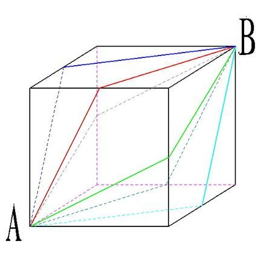

故正确答案为C。

**考点**：几何其他题型

**来源**：2013年北京市公务员录用考试《行测》题第75题

### 第 76 题

张、王、刘和李四人进行象棋比赛，每两人之间都要赛一局。已知张胜了两局，王平了三局，问刘和李加起来最多胜了几局：

A. 0

B. 1

C. 2

D. 3

第 76 题 · 答案与解析

**参考答案（粉笔题库参考内容）**

B

**解析**

根据单循环赛规则，一共是进行了C_4^2=6场比赛。王平了三局则有王的三局比赛结果都是平局，不会出现胜负，即张、刘、李与王比赛的结果均平；接下来张胜了两局，就一定是胜了刘、李，即刘、李均负；最后一局未确定结果的比赛就是刘对李，出现平局或者胜负，最多只有一方胜。综上，故刘、李加起来最多胜利1局。

故正确答案为B。

**来源**：2013年北京市公务员录用考试《行测》题第76题

### 第 77 题

甲和乙在长400米的环形跑道上匀速跑步，如两人同时从同一点出发相向而行，则第一次相遇的位置距离出发点有150米的路程；如两人同时从同一点出发同向而行，问跑得快的人第一次追上另一人时跑了多少米：

A. 600

B. 800

C. 1000

D. 1200

第 77 题 · 答案与解析

**参考答案（粉笔题库参考内容）**

C

**解析**

可以假设甲比乙快。相遇地点距离出发点150米的距离，则相遇时，乙跑了150米，甲跑了400-150=250米，即甲每跑250米，就比乙多250-150=100米；如果同向运动，甲第一次追上乙时，只需甲比乙多跑1圈即400米，则可知甲一共跑过了250 × 400/100 = 1000米。

故正确答案为C。

**考点**：相遇追及

**来源**：2013年北京市公务员录用考试《行测》题第77题

### 第 78 题

某论坛邀请了六位嘉宾，安排其中三人进行单独演讲，另三人参加圆桌对话节目。如每位嘉宾都可以参加演讲或圆桌对话，演讲顺序分先后且圆桌对话必须安排在任意两场演讲之间，问一共有多少种不同的安排方式？

A. 120

B. 240

C. 480

D. 1440

第 78 题 · 答案与解析

**参考答案（粉笔题库参考内容）**

B

**解析**

先从六个人中选三个参加演讲，这三个全排列，可得方法数为C_6^3 × A_3^3 = 120；圆桌对话必须安排在任意两场演讲之间，共有三场演讲，所以只有两个空，即方法数为2；

根据乘法原理可得，符合条件的方法数为120×2=240种。

故正确答案为B。

**考点**：基础排列组合

**来源**：2013年北京市公务员录用考试《行测》题第78题

### 第 79 题

一项工程如果交给甲乙两队共同施工，8天能完成；如果交给甲丙两队共同施工，10天能完成；如果交给甲丁两队共同施工，15天能完成；如果交给乙丙丁三队共同施工，6天就可以完成。如果甲队独立施工，需要多少天完成：

A. 16

B. 20

C. 24

D. 28

第 79 题 · 答案与解析

**参考答案（粉笔题库参考内容）**

C

**解析**

设工作总量为120，则甲乙效率和为15、甲丙效率和为12、甲丁效率和为8、乙丙丁效率和为20，可得甲的效率为(15+12+8-20)÷3 = 5，则甲单独完成需要120 ÷ 5 = 24天。

故正确答案为C。

**考点**：给完工时间型

**来源**：2013年北京市公务员录用考试《行测》题第79题

### 第 80 题

某服装如果降价200元之后再打8折出售，则每件亏50元。如果直接按6折出售，则不赚不亏。如果销售该服装想要获得100%的利润，需要在原价的基础上加价多少元：

A. 90

B. 110

C. 130

D. 150

第 80 题 · 答案与解析

**参考答案（粉笔题库参考内容）**

B

**解析**

设原价为m元，成本为n元，则可得方程如下：0.8(m-200)=n-50，0.6m=n，解得m=550，n=330；要获得100%的利润，此时售价应为330+330=660元，可知比原价提高了660-550=110元。

故正确答案为B。

**考点**：经济利润问题

**来源**：2013年北京市公务员录用考试《行测》题第80题

### 第 81 题

某单位200名青年职工中，党员的比例高于80%，低于81%，其中党龄最长的10年，最短的1年。问该单位至少有多少名青年职工是在同一年入党的：

A. 14

B. 15

C. 16

D. 17

第 81 题 · 答案与解析

**参考答案（粉笔题库参考内容）**

D

**解析**

单位有200人，党员比例高于80%，低于81%，则160=200×80%＜党员人数＜ 200 × 81% = 162，所以党员人数为161人；161÷10=16······1，根据抽屉原理，要使最多的一年中入党青年最少，那么其他9年中，每年都应有16个青年入党，此时最多的一年中入党青年为16+1=17人。

故正确答案为D。

注：本题命题不够严谨，根据选项可以判断出，本题实际待求量为最多同一年入党青年职工数的最小值，故答案不是16而是17。

**考点**：最不利构造

**来源**：2013年北京市公务员录用考试《行测》题第81题

### 第 82 题

两个型号的电视定价都是4000元。其中购买A型号电视可获得350元的国家节能补贴。购买B型号电视无法获得节能补贴，但可以参加“每满300元减20元”的促销活动。问A型号电视的实际成交价格比B型号电视：

A. 高50元

B. 低50元

C. 高90元

D. 低90元

第 82 题 · 答案与解析

**参考答案（粉笔题库参考内容）**

D

**解析**

A型号：实际成交价为4000-350=3650元；

B型号：4000/300的整数部分为13，故实际成交价为4000 − 13 × 20 = 3740元；

3650-3740=－90，即A实际成交价比B低90元。

故正确答案为D。

**考点**：和差倍比问题

**来源**：2013年北京市公务员录用考试《行测》题第82题

### 第 83 题

小张和小赵从事同样的工作，小张的效率是小赵的1.5倍。某日小张工作几小时后小赵开始工作，小赵工作了1小时之后，小张已完成的工作量正好是小赵的9倍。再过几个小时，小张已完成的工作量正好是小赵的4倍？

A. 1

B. 1.5

C. 2

D. 3

第 83 题 · 答案与解析

**参考答案（粉笔题库参考内容）**

C

**解析**

直接赋值小赵效率为2，则小张效率为3。根据题意，小赵工作1小时，工作量为2，此时小张完成工作量是小赵的9倍，因此此时小张已完成的工作量为18。设经过n小时，小张完成的工作量是小赵的4倍，则有18+3n=4(2+2n），解得n＝2。

故正确答案为C。

**考点**：给效率比例型

**来源**：2013年北京市公务员录用考试《行测》题第83题

### 第 84 题

某条道路的一侧种植了25棵杨树，其中道路两端各种有一棵，且所有相邻的树距离相等。现在需要增种10棵树，且通过移动一部分树(不含首尾两棵)使所有相邻的树距离相等，则这25棵树中有多少棵不需要移动位置？

A. 3

B. 4

C. 5

D. 6

第 84 题 · 答案与解析

**参考答案（粉笔题库参考内容）**

A

**解析**

本题为植树问题。原间隔数为25-1=24，现有间隔数为35-1=34，两者最小公倍数为408，据此赋值该道路长度为408米。那么可知原来每隔17米种一棵，而调整后为每隔12米种一棵。注意到17和12的最小公倍数为204，即位于204米处的树不需要移动位置，加上首尾2棵，共3棵树不需要移动位置。

故正确答案为A。

**来源**：2013年北京市公务员录用考试《行测》题第84题

### 第 85 题

老王和老赵分别参加4门培训课的考试，两人的平均分数分别为82分和90分，单个人的每门成绩都为整数且彼此不相等。其中老王成绩最高的一门和老赵成绩最低的一门课分数相同，问老赵成绩最高的一门课最多比老王成绩最低的一门课高多少分：

A. 20

B. 22

C. 24

D. 26

第 85 题 · 答案与解析

**参考答案（粉笔题库参考内容）**

D

**解析**

4门课，平均分差8分，总分差4 × (90 − 82) = 32分。两人有一门课的分数相等，则其他3门课差32分。求老赵成绩最高的一门课最多比老王成绩最低的一门课高多少分，则应该使老赵的其他两门课分数尽可能低，而老王的其他两门课分数尽可能高，所以老赵剩下的三门课的两门，至少要在最低分的那门课加上1分和2分，而老王反过来，至少要在最高分的那门课减去1分和2分。所以32 − 2×1 − 2×2 = 32 − 2 − 4 = 26分。

故正确答案为D。

**考点**：构造数列

**来源**：2013年北京市公务员录用考试《行测》题第85题

### 第 86 题

从所给四个选项中，选择最合适的一个填入问号处，使之呈现一定的规律性：

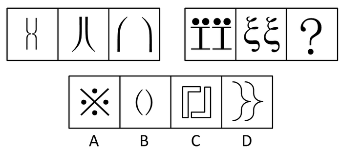

A. A

B. B

C. C

D. D

第 86 题 · 答案与解析

**参考答案（粉笔题库参考内容）**

D

**解析**

左边的组图中，三个图形中的每两部分都反向，竖轴对称；右边的组图中，前两个图形的每两部分同向，则第三个图形也应符合此规律。

故正确答案为D。

**考点**：属性规律-对称性

**来源**：2013年北京市公务员录用考试《行测》题第86题

### 第 87 题

从所给四个选项中，选择最合适的一个填入问号处，使之呈现一定的规律性：

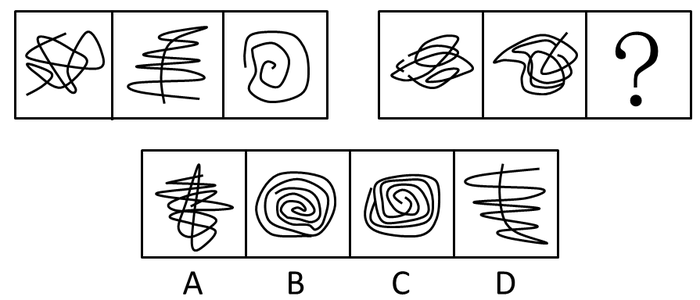

A. A

B. B

C. C

D. D

第 87 题 · 答案与解析

**参考答案（粉笔题库参考内容）**

C

**解析**

元素组成凌乱，考查线段数量。

题干中，第一组中三幅图都一笔画图形，规律一致；第二组中前两幅图都是两笔画图形，则第三幅图也应符合此规律，只有C符合。

故正确答案为C。

**考点**：数量规律-线

**来源**：2013年北京市公务员录用考试《行测》题第87题

### 第 88 题

从所给四个选项中，选择最合适的一个填入问号处，使之呈现一定的规律性：

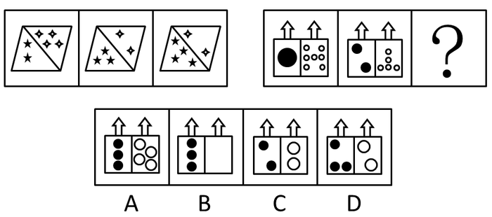

A. A

B. B

C. C

D. D

第 88 题 · 答案与解析

**参考答案（粉笔题库参考内容）**

D

**解析**

元素呈现明显数量变化，第一组图中，左边黑色五角星的个数变化是2、3、4，白色四角星的个数间存在计算关系，即4－2＝2；第二组的图形间，黑色圆的数量变化是1、2、？，故为3，白色圆的数量变化是7－5＝？，故为2，只有D符合。

故正确答案为D。

**考点**：数量规律-素

**来源**：2013年北京市公务员录用考试《行测》题第88题

### 第 89 题

从所给四个选项中，选择最合适的一个填入问号处，使之呈现一定的规律性：

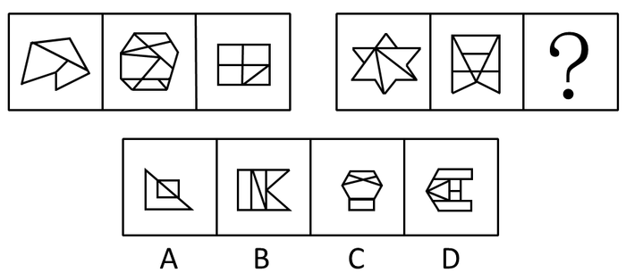

A. A

B. B

C. C

D. D

第 89 题 · 答案与解析

**参考答案（粉笔题库参考内容）**

D

**解析**

元素组成凌乱，考虑数数。

观察图形都是两种元素构成，四边形和三角形，分开数。第一个图数量为2 ，1；第二个图为5 ，4 ；第三个图为3 ，2 ；第四个图为3 ，2 ；第五个图为4 ，3 。每个图形内部的四边形和三角形的数量差为1，故待选选项也应符合此规律，只有D项符合。

故正确答案为D。

**考点**：数量规律-面

**来源**：2013年北京市公务员录用考试《行测》题第89题

### 第 90 题

从所给四个选项中，选择最合适的一个填入问号处，使之呈现一定的规律性：

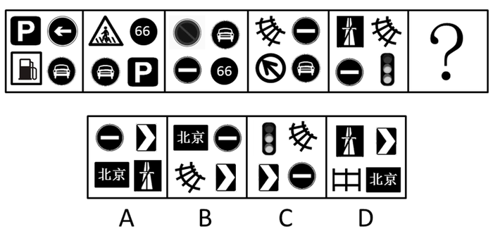

A. A

B. B

C. C

D. D

第 90 题 · 答案与解析

**参考答案（粉笔题库参考内容）**

A

**解析**

每幅图均由四个元素构成，每幅图相较于前一幅图都变化两种元素，排除C、D两项；每次变化图形间的位置关系都与前一个图形不同，排除B项。

故正确答案为A。

**考点**：数量规律-素

**来源**：2013年北京市公务员录用考试《行测》题第90题

### 第 91 题

老虎属猫科动物，是亚洲陆地上最强大的食肉动物之一。老虎拥有猫科动物中最长的犬齿、最大号的爪子，集速度、力量、敏捷于一身，前肢一次挥击力量可达1000公斤，爪刺入深度达11厘米，擅长跳跃，一次跳跃的最长距离可达6米，且擅长捕食。

由此，可以推出：

A. 最凶猛的老虎也是最凶猛的猫科动物

B. 猫科动物都擅长捕食

C. 有些猫科动物不是食肉动物

D. 擅长跳跃的动物有些是猫科动物

第 91 题 · 答案与解析

**参考答案（粉笔题库参考内容）**

D

**解析**

第一步：抓住题干主要信息。

题干主要包含两个信息，第一是老虎属猫科动物，是食肉动物之一；第二是老虎擅长跳跃及捕食。

第二步：分析题干信息，并结合选项得出答案。

由题干信息可推知，有些猫科动物擅长跳跃和捕食，有的擅长跳跃和捕食的动物是猫科动物，D项正确；

A项题干没有说明最凶猛的老虎和最凶猛的猫科动物之间的关系，无法推出；

B项的结论过于绝对，从题干只能得出有些猫科动物擅长捕食；

C项同样无法推知，从老虎属猫科动物和老虎是一种食肉动物，只能得出有些猫科动物是食肉动物，不能推出有些猫科动物不是食肉动物。

故正确答案为D。

**考点**：日常结论

**来源**：2013年北京市公务员录用考试《行测》题第91题

### 第 92 题

一本书要成为畅销书，必须有可读性或者经过精心的包装。

如果上述断定成立，则以下哪项一定为真？

A. 大多数人喜欢有可读性的畅销书

B. 没经过精心包装的书一定不是畅销书

C. 有可读性的书一定是畅销书

D. 没有可读性又没有精心包装的书一定不是畅销书

第 92 题 · 答案与解析

**参考答案（粉笔题库参考内容）**

D

**解析**

第一步：翻译题干。

畅销书→可读性或经过精心包装。

第二步：逐一分析选项。

A项：大多数人喜欢有可读性的畅销书，题干只说明畅销书和可读性和精美包装之间的一个关系，没有提及人们对可读性畅销书的一个喜好，无中生有，排除；

B项：不······不······后推前，翻译为：畅销书→精心包装，肯前必肯后，但是题干翻译得到的结论应该是可读性或精心包装，此时有三种可能性情况，第一种情况是可读性，第二种情况是精心包装，第三种情况是可读性且精心包装，具体哪一种情况是不清楚的，而B项直接推出了一个确定性的结论，是不正确的，排除；

C项：翻译为：可读性→畅销书，可读性是对题干条件后件的肯定，肯后无必然，所以也是不能推出的，排除；

D项：-可读性且-精心包装→-畅销书，对题干进行逆否，否后必否前，可以推出，当选。

故正确答案为D。

**考点**：常规翻译

**来源**：2013年北京市公务员录用考试《行测》题第92题

### 第 93 题

通过对一定数量的新生儿进行测试，研究人员发现新生儿对某些图形的识别是与生俱来的。

如果上述测试结果正确，那么以下哪项一定为真：

A. 新生儿可以区别圆形和方形

B. 人类对图形的识别能力随学习不断提高

C. 人类对图形的识别能力不都是通过学习获得的

D. 人类对图形的识别能力大多数是通过学习获得的

第 93 题 · 答案与解析

**参考答案（粉笔题库参考内容）**

C

**解析**

第一步：抓住题干主要信息。

题干的主要信息为，新生儿对某些图形的识别是天生的。

第二步：分析题干信息，结合选项得出答案。

从新生儿天生能识别某些图形这一研究结果可知，人类对图形的识别能力有些是天生的，即不都是通过学习获得的，C项表述正确；

A项错在题干没有提到新生儿对圆形和方形的识别，B项错在题干没有说明识别能力与学习之间的关系，A、B都无法推出；

D项，题干只表明人类对图形的识别能力有些是天生的，“天生的”只能说明不都是通过学习获得，不能说明大多数人获得对图形的识别能力的方法，故D也无法推出。

故正确答案为C。

**考点**：日常结论

**来源**：2013年北京市公务员录用考试《行测》题第93题

### 第 94 题

如果王教授是北京大学的教师，又写过许多哲学论文，则他一定是哲学系的教师。

以下哪项如果为真，最能支持上述论证：

A. 王教授写过许多哲学论文

B. 哲学系的教师写过许多哲学论文

C. 北京大学的教师中只有哲学系的教师写过许多哲学论文

D. 很少有教师写过许多哲学论文

第 94 题 · 答案与解析

**参考答案（粉笔题库参考内容）**

C

**解析**

第一步：找出论点和论据。

论点：他（王教授）一定是哲学系的教师。

论据：王教授是北京大学教师，又写过许多哲学论文。

本题论点说的是“哲学系教师”，论据说的是“北京大学教师”和“哲学论文”，二者话题不一致，加强优先考虑搭桥。

第二步：逐一分析选项。

A项：王教授写过许多哲学论文，与论点“哲学系教师”无关，无法加强，排除；

B项：翻译为：哲学系的教师→写过许多哲学论文，无法与论据串联得出论点，无法加强，排除；

C项：翻译为：北京大学教师中，写过许多哲学论文→哲学系的教师，在论据和论点之间进行了搭桥，搭桥项，可以加强，当选；

D项：很少有教师写过许多哲学论文，与论点“哲学系教师”无关，无法加强，排除。

故正确答案为C。

**考点**：搭桥

**来源**：2013年北京市公务员录用考试《行测》题第94题

### 第 95 题

在是否戒烟的问题上，总有些不算明智的人。除非他们戒烟成功，否则就不得不为其健康恶化承担所有后果。老李已有20年的烟龄，但他很怕失去健康的身体和美好的生活，不想因为自己的不明智而承担健康恶化的后果。

由此，可以推出：

A. 老李请亲朋好友严格监督自己戒烟

B. 老李若要实现自己的想法，必须成功戒烟

C. 老李戒烟不能成功，因为他总是做不明智的选择

D. 如果老李身体不好，一定是吸烟造成的

第 95 题 · 答案与解析

**参考答案（粉笔题库参考内容）**

B

**解析**

第一步：翻译题干。

（1）不想承担后果→戒烟成功；

（2）老李：不想承担后果。

第二步：逐一分析选项。

A项：该项说的是老李请人监督自己戒烟，与题干的“戒烟成功”及“不想承担后果”无关，无法推出，排除；

B项：该项翻译为“老李实现自己的想法（不想承担后果）→成功戒烟”，是对题干条件的肯前，肯前必肯后，可以推出，当选；

C项：该项说的是老李“戒烟不能成功”，因为他总是做“不明智的选择”，“不明智的选择”与题干的“戒烟成功”及“不想承担后果”无关，无法推出，排除；

D项：该项翻译为“老李身体不好→吸烟造成的”，与题干的“戒烟成功”及“不想承担后果”无关，无法推出，排除。

故正确答案为B。

**考点**：常规翻译

**来源**：2013年北京市公务员录用考试《行测》题第95题

### 第 96 题

地名是各个历史时代人类活动的产物，有着丰富的历史、地理、语言、经济、民族、社会等科学内涵，是一种特殊的文化现象，是人类历史的活化石。据统计，中国古今的姓氏超过22000个。由此可以推测，地名中涉及姓氏的用字也不会少。

以下哪项如果为真，最能支持上述推测：

A. 这些凝聚民族、语言史料的地名，对于了解古代的部族迁徙有很大帮助

B. 宗法社会的人们往往按姓氏聚居，姓氏便成为地名中最富区别意义的亮点

C. 考古学家以河南登封县一个叫“王城岗”的古地名为线索，在那里挖掘出夏朝遗址

D. 据统计，姓陈的人在南方比较多，在北方比较少

第 96 题 · 答案与解析

**参考答案（粉笔题库参考内容）**

B

**解析**

本题要求找出最能支持题干推测的选项，属于加强题型。

第一步：找出论点和论据。

论点：地名中涉及姓氏的用字不会少。

论据：地名有丰富的科学内涵，中国古今的姓氏超过22000个。

第二步：逐一判断选项。

B项说明地名和姓氏之间的联系，宗法社会往往以姓氏聚居，且姓氏在地名中富有区别意义，由此可从姓氏之多推出地名中涉及姓氏的用字多，加强了论点，为正确答案。

A项说的是地名与了解古代部族迁徙的关系，C项说的是古地名和夏朝遗址的关系，A、C两项所述内容均与姓氏无关，属于无关选项；

D项说的是姓“陈”的人的分布情况，属无关选项。

故正确答案为B。

**考点**：搭桥

**来源**：2013年北京市公务员录用考试《行测》题第96题

### 第 97 题

有两种农产品甲和乙，甲不能生长在干旱的气候里，乙不能生长在寒冷的气候里。在某个国家的大部分地区，或者可以种植农产品甲，或者可以种植农产品乙。

如果以上陈述为真，则以下哪项一定为假：

A. 这个国家有一半地区的气候既干旱又寒冷

B. 这个国家大部分地区的气候是非常寒冷的

C. 这个国家根本不种植农产品甲

D. 这个国家只能种植农产品甲

第 97 题 · 答案与解析

**参考答案（粉笔题库参考内容）**

A

**解析**

第一步：抓住题干主要信息。

①甲：-干旱的气候；②乙：-寒冷的气候；③某国大部分地区：甲 或 乙。

第二步：分析题干信息，并结合选项得出答案。

由题干信息可知，某国大部分地区要么是寒冷的气候，要么是干旱的气候，不可能既干旱又寒冷，A项的推论不成立；

B项因为大部分地区可能可以种植农产品甲，所以B项可能成立；

从③某国大部分地区可知：甲 或 乙，可知C项不种植农产品甲和D项只能种植农产品甲均有可能成立。

只有A项一定为假。

故正确答案为A。

**考点**：日常结论

**来源**：2013年北京市公务员录用考试《行测》题第97题

### 第 98 题

参与讲座的人曾跟军方有关联，他们所有人都相信UFO真的存在，而且大部分人觉得应该研究UFO问题。国家原子试验博物馆举行的讲座虽然规模不大，但演讲者都是非常可信的。由此可见，有些非常严谨的科学家也相信UFO真的存在。

以下哪项如果为真，最能支持上述论证：

A. 有些科学家跟军方有关联

B. 演讲者有些不是严谨的科学家

C. 部分参与讲座的人是非常严谨的科学家

D. 科学家的讲座都是非常严谨可信的

第 98 题 · 答案与解析

**参考答案（粉笔题库参考内容）**

C

**解析**

第一步：找出论点和论据。

论点：有些非常严谨的科学家也相信UFO真的存在。

论据：参与讲座的人曾跟军方有关联，他们所有人都相信UFO真的存在，而且大部分人觉得应该研究UFO问题。

本题论点指出“有些非常严谨的科学家”相信UFO真的存在；论据指出“参与讲座的人”相信UFO真的存在，论点和论据话题不一致，加强优先搭桥，即建立“参与讲座的人”和“有些非常严谨的科学家”的联系。

第二步：逐一分析选项。

A项：选项指出有些科学家跟军方有关联，而论点讨论的是有些非常严谨的科学家是否相信UFO真的存在，话题不一致，无关项，无法加强，排除；

B项：选项指出演讲者有些不是严谨的科学家，讨论的是“演讲者”和“严谨科学家”的关系，但不明确“参与讲座的人”和“有些非常严谨的科学家”的关系，不明确选项，无法加强，排除；

C项：选项指出部分参与讲座的人是非常严谨的科学家，即建立了“参与讲座的人”和“有些非常严谨的科学家”的联系，搭桥项，可以加强，当选；

D项：选项指出科学家的讲座都是非常严谨可信的，而论点讨论的是有些非常严谨的科学家是否相信UFO真的存在，话题不一致，无关项，无法加强，排除。

故正确答案为C。

**考点**：搭桥

**来源**：2013年北京市公务员录用考试《行测》题第98题

### 第 99 题

一些恐龙的头骨和骨盆与所有现代鸟类的头骨和骨盆具有相同的特征，但不是所有的恐龙都有这样的特征。有些科学家宣称：所有具有这样特征的动物都是恐龙。

根据以上陈述和科学家的宣称，可以推出：

A. 与其它动物相比，鸟类与恐龙有更多的相似性

B. 一些古代的恐龙与现代的鸟类是没有区别的

C. 所有的恐龙都是鸟类

D. 现代的鸟类是恐龙

第 99 题 · 答案与解析

**参考答案（粉笔题库参考内容）**

D

**解析**

第一步，翻译题干。

题干的表述等同于“已知所有具有鸟类头骨相似特征的动物都是恐龙，且所有现代鸟类都具有鸟类头骨相似特征”，可翻译为：

①具有鸟类头骨相似特征的动物→恐龙；②现代鸟类→具有鸟类头骨相似特征的动物。

根据充分必要条件命题的传递规则，将①和②连接起来，可得出“现代鸟类→恐龙”。

第二步：逐一翻译选项并得出答案。

A项，鸟类与恐龙具有更多的相似性，题干没有对比其他动物、鸟类和恐龙之间的相似性，无法推出；

B项，说的是古代恐龙和现代鸟类没有区别，题干没有谈及，无法推出；

C项，恐龙→鸟类，题干只说明恐龙和现代鸟类之间的关系，因此无法推出恐龙都是鸟类；

D项，现代鸟类→恐龙，与题干的逻辑推导关系相符。

故正确答案为D。

**考点**：常规翻译

**来源**：2013年北京市公务员录用考试《行测》题第99题

### 第 100 题

某办公室有三位工作人员：刘明、庄嫣和文虎。他们三人中，一人是博士，一人是硕士，还有一人是本科毕业生。已知博士比刘明大两岁；庄嫣与本科毕业生同岁，但是月份稍大；本科毕业生的年龄最小。

由此，可以推出：

A. 刘明是本科毕业生、庄嫣是硕士、文虎是博士

B. 刘明是硕士、庄嫣是博士、文虎是本科毕业生

C. 刘明是本科毕业生、庄嫣是博士、文虎是硕士

D. 刘明是硕士、庄嫣是本科毕业生、文虎是博士

第 100 题 · 答案与解析

**参考答案（粉笔题库参考内容）**

A

**解析**

本题属于排列组合题。

第一步：找突破口。

本题突破口为博士。由“博士比刘明大两岁，庄嫣与本科毕业生同岁，本科毕业生年龄最小”可知，博士既不是刘明也不是庄嫣，而是文虎。

第二步：抄信息于表中，即将题干和第一步的所有信息放在一个表里。

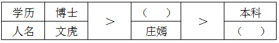

第三步：填空，即填上每一个集合的空格。

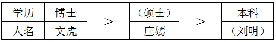

由上表可知，刘明是本科毕业生、庄嫣是硕士、文虎是博士。

故正确答案为A。

**考点**：从确定信息开始推

**来源**：2013年北京市公务员录用考试《行测》题第100题

### 第 101 题

某中学举办了文学和科学两类讲座，并对学生参加讲座情况进行了统计。发现一年级学生中，有学生参加了全部文学讲座，也有学生参加了全部科学讲座。

如果以上陈述为真，则以下哪项一定为真？

A. 有一年级学生参加了全部讲座

B. 每个一年级学生至少参加了一个讲座

C. 每个讲座都有一年级学生参加

D. 有的一年级学生没有参加任何讲座

第 101 题 · 答案与解析

**参考答案（粉笔题库参考内容）**

C

**解析**

第一步：翻译题干。

①有的一年级学生参加了全部文学讲座；

②有的一年级学生参加了全部科学讲座。

第二步：逐一分析选项。

A项：选项为“有一年级学生参加了全部讲座”，一年级学生中参加了全部文学讲座和参加了全部科学讲座的学生不一定是同一个人，无法得出“有一年级学生参加了全部讲座”，无法推出，排除；

B项：选项为“每人一年级学生至少参加了一个讲座”，题干说有人参加了这些讲座，但无法推出每个人的具体情况，无法得出“每人一年级学生至少参加了一个讲座”，无法推出，排除；

C项：选项为“每个讲座都有一年级学生参加”，由条件①有的一年级学生参加了全部文学讲座，可以推出“全部文学讲座中有一年级的学生参加了”，由条件②有的一年级学生参加了全部科学讲座，可以推出“全部科学讲座中有一年级的学生参加了”，由题干中“某中学举办了文学和科学两类进座”，可以推出“全部的讲座中有一年级的学生参加了”，可以推出，当选；

D项：选项为“有的一年级学生没有参加任何讲座”，通过条件中“有的参加了”，无法推出“有的没参加”，无法推出，排除。

故正确答案为C。

**考点**：集合推理

**来源**：2013年北京市公务员录用考试《行测》题第101题

### 第 102 题

秦始皇陵位于陕西省西安市以东35公里的临潼区境内，是秦始皇于公元前246年至公元前208年修建的，也是中国历史上第一个皇帝陵园。20世纪70年代中期长沙马王堆汉墓“女尸”的发现震惊中外，其尸骨保存之完好举世罕见。由此，有人推测秦始皇的遗体也会完好地保存下来。

对于下列三条陈述和以上推测的论证关系，哪项评价是正确的？

Ⅰ.长沙马王堆汉墓的修建日期距秦代不足百年。

Ⅱ.秦始皇死于盛夏出巡途中，尸骨经长途颠簸运回咸阳，由死到下葬间隔近两个月。

Ⅲ.秦陵地宫“令匠作机弩矢，有所穿进者辄射之”，至今没有发现被盗痕迹。

A. Ⅰ支持，Ⅱ、Ⅲ质疑

B. Ⅰ支持，Ⅱ质疑，Ⅲ无关

C. Ⅰ、Ⅱ、Ⅲ均质疑

D. Ⅰ、Ⅱ、Ⅲ均支持

第 102 题 · 答案与解析

**参考答案（粉笔题库参考内容）**

B

**解析**

第一步：找出论点和论据。

论点：秦始皇的遗体会完好地保存下来。

论据：20世纪70年代中期长沙马王堆汉墓“女尸”的尸骨保存之完好举世罕见。

第二步：逐一判断选项的作用。

Ⅰ项说明长沙马王堆汉墓和秦始皇陵的情况具有相似性，加强论证；Ⅱ表明秦始皇的遗体与马王堆女尸间的情况有别，削弱论证；Ⅲ说的是秦陵地宫没有被盗痕迹，这跟尸骨是否保存完好无关，属于无关选项。

故正确答案为B。

**来源**：2013年北京市公务员录用考试《行测》题第102题

### 第 103 题

某智能研究所目前只有三种实验机器人A、B和C，A不能识别颜色，B不能识别形状，C既不能识别颜色也不能识别形状。该智能研究所的大多数实验室里都要做识别颜色和识别形状的实验。

如果以上陈述为真，则以下哪项一定为假：

A. 有的实验室里三种机器人都有

B. 半数实验室里只有机器人A和B

C. 这个智能研究所正在开发新的实验机器人

D. 半数实验室里只有机器人A和C

第 103 题 · 答案与解析

**参考答案（粉笔题库参考内容）**

D

**解析**

第一步：抓住题干主要信息。

A：-识别颜色 且 识别形状；B：识别颜色 且 -识别形状；C ：-识别颜色 且 -识别形状。

第二步：分析题干信息并结合选项得出答案。

由题干信息可知，要做识别颜色和识别形状的实验，A和B必须同时存在，C是否存在并没有关系，故D项说法一定为假。A、B、C的说法都可能为真。

故正确答案为D。

**考点**：日常结论

**来源**：2013年北京市公务员录用考试《行测》题第103题

### 第 104 题

北大山鹰社的周、吴、郑、王四人中，有且只有一人登上过卓奥友峰。记者采访他们时：

周说：“登上卓奥友峰的是队员郑。”

郑说：“我还没有参加过任何登山活动。”

吴说：“我虽然也参加了那次登山活动，但没有登顶。”

王说：“我是队员吴的候补，如果他没登顶就是我登顶了。”

如果他们中只有一人说了假话，则以下哪项一定为真：

A. 北大山鹰社的其它队员也登上过卓奥友峰

B. 吴或者周登上过卓奥友峰

C. 郑登上过卓奥友峰

D. 王登上过卓奥友峰

第 104 题 · 答案与解析

**参考答案（粉笔题库参考内容）**

D

**解析**

第一步：找出题干矛盾命题。

本题题干“有且只有一人登上过卓奥友峰”中的“登上奥友峰”需理解为“登顶”，否则题目有争议，无唯一答案。

周：郑登顶；

郑：—郑登顶；

吴：—吴登顶；

王：—吴登顶 → 王登顶。

分析题干条件可知，周和郑的话为矛盾关系，必有一真一假。

第二步：根据题干条件进行推理。

根据题干条件可知，四个人中只有一人说了假话，周和郑为一真一假，故吴和王的话均为真话，即吴没有登顶，王登顶了。结合题干“有且只有一人登上过卓奥友峰”可知，登上卓奥友峰的人只能是王，因此周的话为假，郑的话为真。

故正确答案为D。

**考点**：只有一真/一假

**来源**：2013年北京市公务员录用考试《行测》题第104题

### 第 105 题

截至2011年底某市常住人口1100万人，其中本地人口800万人，外来人口300万人。常住人口的男、女比例为1. 03：1。该市高校众多，教育水平远高于全国平均水平。常住人口中具有大学本科及以上学历的超过20%。

根据以上陈述，一定可以推出的是：

A. 本地本科及以上人口超过外来本科及以上人口

B. 本地女性人口超过外来女性人口

C. 本地男性人口超过外来女性人口

D. 本地男性人口超过外来男性人口

第 105 题 · 答案与解析

**参考答案（粉笔题库参考内容）**

C

**解析**

第一步：抓住题干主要信息。

题干说明某市常住人口的人数，常住人口的男女比例以及常住人口中具有本科及以上学历的人数占比。

第二步：分析题干信息，并结合选项得出答案。

C项，设外来女性人口是x，则外来男性人口是300-x，又因男性人口是1.03/2.03 × 1100 ≈ 558万人，所以本地男性人口是558-(300-x)=x+258，显然多于外来女性人口，C项正确。

A项无法推出，题干只说明常住人口中大学本科及以上学历的人数占比，无法对比本科及以上学历的人数中，本地人口和外来人口的比例；同理，本地女性人口和外来女性人口，本地男性人口和外来男性人口之间的比例，题干没有给出，因此无法推知B、D。

故正确答案为C。

**考点**：日常结论

**来源**：2013年北京市公务员录用考试《行测》题第105题

### 第 106 题

旅游商品，是指旅游者在旅游活动中出于非商业性目的而购买的实物性商品，它不包含维持旅游活动所必需的生活用品。

根据上述定义，下列属于旅游商品的是：

A. 小王在尼泊尔买了100个手链、200条围巾准备放到自己在北京经营的店铺里销售

B. 到欧洲出差的张小姐利用闲暇时间在英国某古董商店购买了一套精美茶具

C. 某夫妇为了国庆假期的海南五日游到超市购买了一瓶防晒霜和两副墨镜

D. 李女士在泰国旅游时从小商贩那里得到了很多关于当地美食娱乐方面的信息

第 106 题 · 答案与解析

**参考答案（粉笔题库参考内容）**

B

**解析**

第一步：抓住定义中的关键词。

定义强调“旅游者”“在旅游活动中”“非商业性目的”“实物性商品”“不包含旅游所必需的生活用品”。

第二步：逐一判断选项。

A项小王买的东西是用于销售，属于商业性目的，与定义不符；

B项张小姐是旅游者，在旅游活动中，买的茶具是实物性商品，不用于商业性目的，也不是维持旅游活动所必需的生活用品，符合定义；

C项某夫妇买的防晒霜和墨镜属于到海南旅游必备的生活用品，与定义不符；

D项李女士获得的是信息，不是实物性商品，不符合定义。

故正确答案为B。

**考点**：方式目的

**来源**：2013年北京市公务员录用考试《行测》题第106题

### 第 107 题

休闲体育，是指在相对自由的社会生活环境和条件下，人们自愿选择并从事的各种形式的体育活动的统称，它是体育的一种社会现象，也是体育的一种存在形态，是社会休闲活动的主要方式之一。

根据上述定义，下列属于休闲体育的是：

A. 马拉松运动员小李在假期陪朋友打球

B. 作为私人保镖的小王每天接受4个小时的擒拿格斗训练

C. 某高中全体学生按照学校要求每天下午完成半小时的长跑锻炼

D. 受过腿伤，正处于恢复期的赵先生应医生要求，每天由护士指导到户外散步15分钟

第 107 题 · 答案与解析

**参考答案（粉笔题库参考内容）**

A

**解析**

第一步：抓住定义中的关键词。

定义强调“相对自由的社会生活环境和条件”、“自愿选择并从事”。

第二步：逐一判断选项。

A项小李是马拉松运动员，在假期陪朋友打球，是出于自愿选择，同时也是在相对自由的环境下进行的，符合定义；

B项小王接受训练是出于工作需要，C项学生跑步是学校要求的，D项赵先生到户外散步是应医生要求的，这三种情况都不是在相对自由的社会生活环境下进行，不符合定义。

故正确答案为A。

**考点**：单定义-其他句式

**来源**：2013年北京市公务员录用考试《行测》题第107题

### 第 108 题

新媒体，是在新的技术支撑体系下出现的，相对于报刊、户外、广播、电视四大传统意义上的媒体，新媒体被形象地称为“第五媒体”。

根据上述定义，下列属于新媒体的是：

A. 具有接收新闻功能的3G手机

B. 地铁站台上的大屏幕电视

C. 改版后的《都市娱乐报》采用了新的印刷技术，文字和图片更为清晰

D. 广场上采用高科技手段的科普展览

第 108 题 · 答案与解析

**参考答案（粉笔题库参考内容）**

A

**解析**

第一步：找出定义关键词。

“新的技术支撑体系”“不是报刊、户外、广播、电视”。

第二步：逐一分析选项。

A项：3G手机是在新的技术支撑体系下出现的，符合定义。

B项的电视、C项的报纸、D项的广场展览（户外），这些均是传统媒体。

故正确答案为A。

**考点**：单定义-其他句式

**来源**：2013年北京市公务员录用考试《行测》题第108题

### 第 109 题

自助游，是指自己设计路线，自己安排旅途中的一切，利用现代文明带来的便捷，却又不受束缚的旅行。

根据上述定义，下列属于自助游的是：

A. 旅行社只负责交通和住宿，自己安排游览景点

B. 参考旅行社的游览路线，进行适当调整，自己开车游玩

C. 旅行社安排的旅游，但在每个游览点只规定时间，游览路线自己选择

D. 单位组织的旅游，游览路线由旅行社设计，日程由单位负责人决定

第 109 题 · 答案与解析

**参考答案（粉笔题库参考内容）**

B

**解析**

第一步：抓住定义中的关键词。

定义强调“自己设计路线”、“自己安排旅途中的一切”。

第二步：逐一判断选项。

B项只是参考旅行社的路线，由自己调整路线安排行程，符合定义；

A项由旅行社负责交通和住宿，C项是旅行社安排的旅游，D项的游览路线由旅行社设计，A、C、D三项均存在与“自己设计路线”、“自己安排旅途中的一切”不相符的地方，不符合定义。

故正确答案为B。

**考点**：单定义-其他句式

**来源**：2013年北京市公务员录用考试《行测》题第109题

### 第 110 题

生态经济的操作定义为，不破坏环境、不污染环境的经济，不以不可再生资源为基础的经济。

根据上述定义，下列属于生态经济的是：

A. 某地利用开山伐树筹集来的资金修建成马路后，极大地方便了村民的出行

B. 某市在发展煤炭经济时注重改进技术、提高资源利用率，以保护并修复环境

C. 某村利用家畜一沼气一经济作物的沼气工程发展当地经济

D. 某乡运用新型肥料和农药发展鱼藕混养模式，农民收成再创新高

第 110 题 · 答案与解析

**参考答案（粉笔题库参考内容）**

C

**解析**

第一步：抓住定义中的关键词。

定义强调“不破坏环境”、“不污染环境”、“不以不可再生资源为基础”。

第二步：逐一判断选项。

A项开山伐树会破坏环境，B项发展煤炭经济是以不可再生资源为基础，D项新型农药会污染环境，A、B、D三项均不符合定义。

C项的沼气是可再生的清洁能源，不会对环境造成破坏或污染，符合定义。

故正确答案为C。

**考点**：单定义-其他句式

**来源**：2013年北京市公务员录用考试《行测》题第110题

### 第 111 题

语言磨蚀，是指某种语言在特定的语言环境中受该语言的语言因素或非语言因素（情感、动机、年龄、语言使用的减少或停止等）影响而出现的言语行为或言语能力的衰减现象，具有非病理性、渐变性、可逆性和反复性等特征。

根据上述定义，下列属于语言磨蚀的是：

A. 小李高考英语成绩很好，但暑期休息后在开学分班考试中英语成绩不理想

B. 八十多岁的老张与年轻时差别较大，常常要别人重复说过的话，且说话缓慢

C. 小赵小时候生病导致双耳失聪，成年后别人常常听不懂她说的话

D. 中学生小夏到美国参加暑期夏令营后，英语水平提高不少

第 111 题 · 答案与解析

**参考答案（粉笔题库参考内容）**

A

**解析**

第一步：抓住定义中的关键词。

定义强调“受该语言的语言因素或非语言因素影响”、“言语行为或言语能力的衰减现象”、“非病理性、渐变性、可逆性和反复性”。

第二步：逐一判断选项。

A项小李暑假休息后英语成绩不理想是由于语言使用减少，符合“非病理性、渐变性、可逆性和反复性”的特征，与定义相符；

B项老张年纪大说话缓慢是不可逆的语言衰减现象，不符合“可逆性”的特征；

C项小赵是由于双耳失聪导致语言能力缺失，属于病理性原因；

D项英语水平提高了，而非降低了。

B、C、D三项均不符合定义。

故正确答案为A。

**考点**：原因结果

**来源**：2013年北京市公务员录用考试《行测》题第111题

### 第 112 题

城市森林，是指在城市及其周边范围内以乔木为主体，达到一定的规模（面积应>0.5平方百米）和覆盖度（林木树冠覆盖度应在10%—300%），能对周围的环境产生重要影响，并具有明显的生态价值和人文景观价值等的各种生物和非生物的综合体。

根据上述定义，下列不属于城市森林的是：

A. 某市在城市机动车道与非机动车道的中间建了长达数十公里的花坛，种植月季、连翘等植物

B. 在沿海城市的海边公园种植松树，以达到防风固土作用

C. 位于繁华地段的某市中央公园共种植了1400多种树木和花卉，并配以十多件雕塑

D. 某市全部处于森林的意境之中，庄园式的建筑与四周的林地融为一体，树种以桉树、榕树等乡土树种为主

第 112 题 · 答案与解析

**参考答案（粉笔题库参考内容）**

A

**解析**

第一步：抓住定义中的关键词。

定义强调“以乔木为主体”，“具有明显的生态价值和人文景观价值”。

第二步：逐一判断选项。

A项花坛所种植的植物不是以乔木为主体，也不具有明显生态价值和人文景观价值，不符合定义；

B项中海边公园种植的松树，C项中中央公园种植的树木及设置的雕塑，D项中庄园式的建筑与林地交融，树种以乔木为主体，B、C、D三项中的植物均以乔木为主体，都具有明显的生态价值和人文景观价值，符合定义。

题目要求找出不属于城市森林的一项。

本题为选非题，故正确答案为A。

**考点**：主客体

**来源**：2013年北京市公务员录用考试《行测》题第112题

### 第 113 题

冷链，是指易腐食品从产地收购或捕捞之后，在产品加工、贮藏、运输、分销和零售各个环节始终处于产品所必需的低温环境下，以保证食品质量安全，减少损耗，防止污染的特殊供应链系统。

根据上述定义，下列属于冷链的是：

A. 为保持疫苗的药效而在运输至使用时放在特殊的低温系统中

B. 为了节能校园超市小卖部出售冰棒的冰箱每隔5小时停1小时

C. 为保鲜商家使用冷藏车运输新鲜海产品至各个商场的冷藏室

D. 某厂利用低温深度榨取技术使橙子变为橙汁以方便常温保存

第 113 题 · 答案与解析

**参考答案（粉笔题库参考内容）**

C

**解析**

第一步：抓住定义中的关键词。

定义强调“易腐食品”、“始终处于产品所必需的低温环境下”、“以保证食品质量安全”。

第二步：逐一判断选项。

A项中的疫苗不是易腐食品，不符合定义；

B项小卖部让冰箱每隔5小时停1小时，不是为了食品质量安全，而是为了节能，不符合定义；

D项某厂采取低温是技术上的需要，不是出于保证食品安全的考虑，不符合定义；

C项中新鲜海产品属于易腐食品，用冷藏车运输到冷藏室了，让食品始终处于低温环境下，符合定义。

故正确答案为C。

**考点**：大前提

**来源**：2013年北京市公务员录用考试《行测》题第113题

### 第 114 题

野生动植物，是指自身或上代亲本来自野生环境，或虽然由人工繁殖或人工栽培所获但仍需要不定期地引入野外个体基因的动物或植物。

根据上述定义，下列属于野生动植物的是：

A. 近期在某大熊猫保护基地出生的熊猫幼崽“平平”，其父母都是该基地人工繁殖的第二代熊猫

B. 科学家进行了大量培植实验，成功得到冬虫夏草，即野生冬虫夏草的理想替代品

C. 环保工作者去野外寻找野生鳄鱼的卵或者受伤的成年鳄并将其投放到鳄鱼保护区

D. 人工培育出的二代中华鲟幼年在保护基地中度过，成年阶段被释放到野生环境中

第 114 题 · 答案与解析

**参考答案（粉笔题库参考内容）**

C

**解析**

第一步：抓住定义中的关键词。

定义强调“自身或上代亲本来自野生环境”或“引入野外个体基因”。

第二步：逐一判断选项。

A项熊猫幼崽的父母是人工繁殖的“第二代熊猫”，不符合定义中“自身或上代亲本来自野生环境”的要素；

B项中的冬虫夏草完全是人工培植出来作为野生植物的替代品，不符合定义；

D项中的中华鲟也是人工培育出来的，不符合定义；

C项野生鳄鱼的卵或者受伤的成年鳄符合“自身或上代亲本来自野生环境”的条件。

故正确答案为C。

**考点**：单定义-其他句式

**来源**：2013年北京市公务员录用考试《行测》题第114题

### 第 115 题

刑事诉讼中检查笔录，是指办案人员为确定被害人、犯罪嫌疑人、被告人的某些特征、伤害情况和生理状态，对他们的人身进行检验和观察，并作出客观记录。

根据上述定义，下列哪项不属于刑事诉讼中检查笔录中的检查：

A. 对于死因不明的被害人尸体，公安机关进行了解剖

B. 为了确定被告人具体特征，技术部门对其进行人身检查

C. 警察对犯罪嫌疑人进行搜身、拍照、指纹扫描

D. 法官在询问证人时让侦查人员出示与案件有关的物品让证人进行辨认

第 115 题 · 答案与解析

**参考答案（粉笔题库参考内容）**

D

**解析**

第一步：抓住定义中的关键词。

定义强调办案人员为确定“某些特征、伤害情况和生理状态”、“对他们的人身进行检验和观察”。

第二步：逐一判断选项。

A项公安机关解剖被害人尸体以查明死因，B项技术部门为确定被告人具体特征对其进行人身检查，C项警察对犯罪嫌疑人进行搜身检查，均是办案人员为确定细节而进行的操作；

D项是法官让侦查人员出示与案件有关的物品让证人辨认，不是对他们的人身进行检验和观察，与定义不符。

本题为选非题，故正确答案为D。

**考点**：方式目的

**来源**：2013年北京市公务员录用考试《行测》题第115题

## 材料 7

根据下列统计资料回答问题。

        2011—2012学年度某市共有普通高等学校89所，其中中央部委所属高校36所（包括教育部所属高校25所，其他部委所属高校11所），市属高校53所（包括公办高校38所，民办高校15所）。

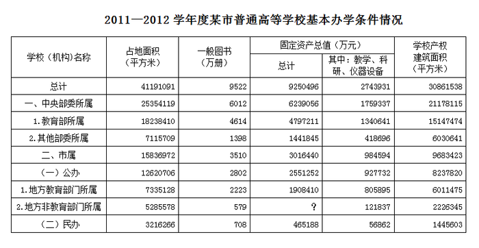

| 学校（机构）名称 | 占地面积（平方米） | 一般图书（万册） | 固定资产总值（万元） | 固定资产总值（万元） | 学校产权建筑面积（平方米） |
| --- | ---: | ---: | ---: | ---: | ---: |
|  |  |  | 总计 | 其中：教学、科研、仪器设备 |  |
| 总计 | 41191091 | 9522 | 9250496 | 2743931 | 30861538 |
| 一、中央部委所属 | 25354119 | 6012 | 6239056 | 1759337 | 21178115 |
| 1.教育部所属 | 18238410 | 4614 | 4797211 | 1340641 | 15147474 |
| 2.其他部委所属 | 7115709 | 1398 | 1441845 | 418696 | 6030641 |
| 二、市属 | 15836972 | 3510 | 3016440 | 984594 | 9683423 |
| （一）公办 | 12620706 | 2802 | 2551252 | 927732 | 8237820 |
| 1.地方教育部门所属 | 7335128 | 2223 | 1908410 | 805895 | 6011475 |
| 2.地方非教育部门所属 | 5285578 | 579 | ? | 121837 | 2226345 |
| （二）民办 | 3216266 | 708 | 465188 | 56862 | 1445603 |

### 第 116 题

2011—2012学年度该市每所普通高等学校的平均产权建筑面积约为多少万平方米：

A. 30

B. 35

C. 40

D. 45

第 116 题 · 答案与解析

**参考答案（粉笔题库参考内容）**

B

**解析**

根据题干“2011—2012学年度该市每所······平均产权建筑面积······”，可判定本题为现期平均数问题。定位文字材料和表格：学校产权建筑面积总计30861538平方米，共89所普通高等学校。故每所普通高校的平均产权建筑面积= 产权建筑总面积/学校个数= 30861538/89 ≈ 30900000/90 ≈ 343000平方米，即34.3万平方米，B项最为接近。

故正确答案为B。

**考点**：现期平均数、综合资料

**来源**：2013年北京市公务员录用考试《行测》题第116题

### 第 117 题

表格中问号处缺失的数值应当为：

A. 642842

B. 642942

C. 652842

D. 652942

第 117 题 · 答案与解析

**参考答案（粉笔题库参考内容）**

A

**解析**

定位表格：公办固定资产总值为2551252万元，地方教育部门所属固定资产总值为1908410万元。故地方非教育部门所属固定资产总值=公办固定资产总值-地方教育部门所属固定资产总值=2551252-1908410=642842万元。

故正确答案为A。

**考点**：简单加减计算、综合资料

**来源**：2013年北京市公务员录用考试《行测》题第117题

### 第 118 题

以下各类普通高校中，2011—2012学年度学校产权建筑面积与学校占地面积的比值最低的是：

A. 教育部所属高校

B. 其他部委所属高校

C. 地方教育部门所属高校

D. 地方非教育部门所属高校

第 118 题 · 答案与解析

**参考答案（粉笔题库参考内容）**

D

**解析**

根据题干“2011—2012学年度学校产权建筑面积与学校占地面积的比值”，可判定本题为现期比重问题。定位表格，学校产权建筑面积与学校占地面积的比值依次如下：

教育部所属高校：15147474/18238410 ≈ 8；

其他部委所属高校：6030641/7115709 ≈ 8；

地方教育部门所属高校：6011475/7335128 ≈ 8；

地方非教育部门所属高校：2226345/5285578≈4。

量级相当，直除首位依次为8、8、8、4，则地方非教育部门所属高校最低。

故正确答案为D。

**考点**：现期比重、综合资料

**来源**：2013年北京市公务员录用考试《行测》题第118题

### 第 119 题

该市民办高校的校均图书保有量需要在下一学年提高约多少倍，才能达到2011—2012学年度全市普通高等学校的平均水平？

A. 1.3

B. 2.1

C. 2.9

D. 3.7

第 119 题 · 答案与解析

**参考答案（粉笔题库参考内容）**

A

**解析**

根据题干“校均图书保有量……提高约多少倍”，可判定本题为平均数的增长率问题。定位文字材料和表格：2011-2012学年度共有高校89所，图书总计9522万册，民办高校15所，民办图书708万册。可得2011-2012学年度全市普通高等学校的平均水平= 图书总计/高校个数 = 9522/89，民办高校校均图书保有量= 民办图书册数/民办高校个数 = 708/15，故民办高校图书需要在下一年提高的倍数= 现期量/基期量 − 1 = 9522/89 ÷ 708/15 − 1≈ (9600×15)/(90×700) - 1 = 16/7 - 1 ≈ 2.3 - 1 = 1.3倍。

故正确答案为A。

**考点**：平均数的增长率、综合资料

**来源**：2013年北京市公务员录用考试《行测》题第119题

### 第 120 题

以下关于2011—2012学年度该市普通高等学校基本办学条件情况的描述，与资料相符的是：

A. 市属公办高校的数量占全市普通高等学校总数的比重超过50%

B. 其他部委所属高校的总占地面积高于教育部所属高校

C. 地方教育部门所属高校的教学、科研、仪器设备价值超过全市普通高校总价值的1/3

D. 市属公办高校的校均固定资产总值超过6亿元

第 120 题 · 答案与解析

**参考答案（粉笔题库参考内容）**

D

**解析**

A项：定位文字材料：2011—2012学年度某市共有普通高等学校89所，市属公办高校38所。故市属公办高校占全市普通高等学校总数的比重= 38/89 ＜ 1/2，错误；

B项：定位表格第二列：其他部委所属高校总占地面积为7115709平方米，教育部所属高校总占地面积为18238410平方米。故前者低于后者，错误；

C项：定位表格倒数第二列：地方教育部门所属高校的教学、科研、仪器设备价值为805895万元，全市普通高校总价值为2743931万元。故所占比重=805895/2743931＜910000/2730000=1/3，错误；

D项：定位文字材料和表格：市属公办高校38所，固定资产总值为2551252万元，即255.1252亿元。故平均固定资产总值= 255.1252/38 ＞ 6亿元，正确。

故正确答案为D。

**考点**：综合分析、综合资料

**来源**：2013年北京市公务员录用考试《行测》题第120题

## 材料 8

根据下列统计资料回答问题

        2011年全国营业性客车完成公路客运量328.62亿人、旅客周转量16760.25亿人公里，比上年分别增长7.6%和11.6%。全国完成水路客运量2.46亿人、旅客周转量74.53亿人公里，比上年分别增长9.8%和3.1%。

图1  2006～2011年全国公路、水路客运量

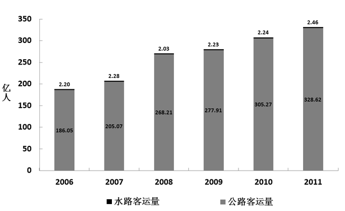

        2011年全国营业性货运车辆完成公路货运量282.01亿吨、货物周转量51374.74亿吨公里，比上年分别增长15.2%和18.4%。全国完成水路货运量42.60亿吨、货物周转量75423.84亿吨公里，比上年分别增长12.4%和10.2%。

图2  2006～2011年全国公路、水路货运量

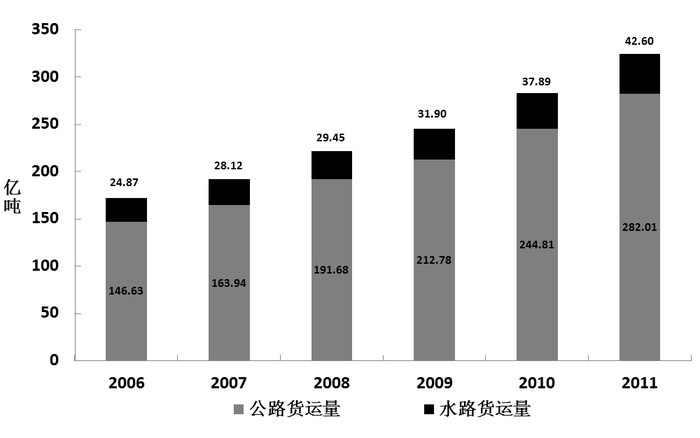

**注**：旅客周转量＝旅客人数×平均运送距离；货物周转量＝运送货物的重量×平均运送距离。

### 第 121 题

2007～2011年间公路客运量同比增速最快的年份中，水路客运量比上一年：

A. 增加了0.01亿人

B. 增加了0.08亿人

C. 增加了0.20亿人

D. 减少了0.25亿人

第 121 题 · 答案与解析

**参考答案（粉笔题库参考内容）**

D

**解析**

根据题干“······比上一年”，结合选项为“增加/减少+具体单位”，可判定本题为增长量计算问题。定位图1，可知2006～2011年公路客运量。观察数据，2008年增长量均大于2009～2011年，而基期量均小于2009～2011年，所以2008年增速均快于2009～2011年；2008年增速=(268.21-205.07)/205.07≈60/200=30%，2007年增速=(205.07−186.05)/186.05≈20/186≈11%，所以2008年是增速最快的年份。故2008年水路客运量增长量=现期量-基期量=2.03-2.28=-0.25亿人，即减少了0.25亿人。

故正确答案为D。

**考点**：增长量计算、综合资料

**来源**：2013年北京市公务员录用考试《行测》题第121题

### 第 122 题

2011年平均每人乘坐营业性客车所行进的距离约为：

A. 50公里

B. 100公里

C. 200公里

D. 500公里

第 122 题 · 答案与解析

**参考答案（粉笔题库参考内容）**

A

**解析**

根据题干“2011年平均每人······”，可判定本题为现期平均数问题。定位材料第一段：“2011年全国营业性客车完成公路客运量328.62亿人，旅客周转量16760.25亿人公里”。根据旅客周转量＝旅客人数×平均运送距离，故2011年平均每人乘坐营业性客车所行进的距离= 旅客周转量/公路客运量 = 16760.25/328.62 ＜ 100公里，只有A符合。

故正确答案为A。

**考点**：现期平均数、综合资料

**来源**：2013年北京市公务员录用考试《行测》题第122题

### 第 123 题

2006～2011年全国公路、水路货运量之和超过200亿吨的年份有几个：

A. 3

B. 4

C. 5

D. 6

第 123 题 · 答案与解析

**参考答案（粉笔题库参考内容）**

B

**解析**

定位图2，观察图中数据，2006～2007年公路、水路货运量之和均小于200亿吨，2008～2011年均大于200亿吨。故全国公路、水路货运量之和超过200亿吨的年份有4个。

故正确答案为B。

**考点**：直接找数、综合资料

**来源**：2013年北京市公务员录用考试《行测》题第123题

### 第 124 题

2011年平均每吨货物由水路运输的距离是公路的多少倍：

A. 7.9

B. 8.8

C. 9.7

D. 10.6

第 124 题 · 答案与解析

**参考答案（粉笔题库参考内容）**

C

**解析**

根据题干“2011年平均每吨货物……是……多少倍”，可判定本题为现期倍数问题。定位材料第二段：“2011年完成公路货运量282.01亿吨、货物周转量51374.74亿吨公里；完成水路货运量42.60亿吨、货物周转量75423.84亿吨公里”。根据货物周转量＝运送货物的重量×平均运送距离，故平均每吨货物水路运输距离与公路的倍数关系为75423.84/42.60÷51374.74/282.01≈(75000×280)/(50000×42)=10倍，C项最为接近。

故正确答案为C。

**考点**：现期倍数、综合资料

**来源**：2013年北京市公务员录用考试《行测》题第124题

### 第 125 题

以下关于2006～2011年全国公路、水路客运和货运状况的描述，与资料相符的是：

A. 2007～2011年每年的水路货物运输量保持持续增长态势

B. 每年的水路客运量在公路、水路客运总量中的比重都超过1%

C. 2010年平均每个月乘坐水路交通工具的旅客超过2000万人

D. 2007～2011年间公路货物运输量同比增长率保持持续增长态势

第 125 题 · 答案与解析

**参考答案（粉笔题库参考内容）**

A

**解析**

A项：定位图2，直接读取图中数据，2007～2011年水路货物运输量持续增长，正确；

B项：定位图1，2008年水路客运量为2.03亿人，公路客运量为268.21亿人。故2008年水路客运量在公路、水路客运总量中的比重= 2.03/(2.03+268.21) = 2.03/270.24 ＜ 1%，错误；

C项：定位图1：2010年水路客运量2.24亿人。故2010年平均每个月乘坐水路交通工具的旅客= 2.24/12 ＜ 0.2亿人，即低于2000万人，错误；

D项：定位图2，可知2006～2011年公路货物运输量的数据。2008年公路货物运输量同比增长率= (191.68 − 163.94)/163.94= 27.74/163.94，2009年=(212.78-191.68)/191.68= 21.1/191.68，08年增速分子更大，且分母更小，故2009年的增长率低于2008年，并非持续增长，错误。

故正确答案为A。

**考点**：综合分析、综合资料

**来源**：2013年北京市公务员录用考试《行测》题第125题

## 材料 9

2012年上半年，石油和化工行业规模以上企业累计总产值5.89万亿元，同比增长12.5%；利润总额3535.4亿元，同比下降15.9%；主营业务收入5.60万亿元，同比增长10.4%；资产总计8.10万亿元，同比增长12.8%；从业人员648.9万人，同比增长2.8%；固定资产投资7341.72亿元，同比增长30.7%；进出口总额3320.69亿美元，同比增长10.4%。

        2012年1—6月，全国原油产量1.01亿吨，同比增长1.6%；天然气产量536.2亿立方米，同比增长6.3%；原油加工量2.29亿吨，同比增长1.7%；成品油产量1.38亿吨，同比增长4.4%；化肥总产量(折纯)3705.1万吨，同比增长11.9%；农药原药产量(折100%)172.4万吨，同比增长21.7%；乙烯产量758.4万吨，同比下降3.3%；甲醇产量1311.3万吨，同比增长17.3%；硫酸产量3737.8万吨，同比增长6.1%；烧碱产量1304.1万吨，同比增长3.2%；纯碱产量1203.1万吨，同比增长7.5%；合成树脂2605.2万吨，同比增长9.4%；轮胎外胎产量4.20亿条，同比增长8.2%。

        6月份，石油和化工行业规模以上企业进出口总额518.3亿美元，同比增长2.4%，增速较5月显著回落，环比下降11.4%。其中，进口总额同比增长3.6%，创年内新低；出口同比降幅0.4%，延续出口低迷态势。1—6月全行业规模以上企业进出口总额，增幅比1—5月回落1.6个百分点，占全国进出口贸易总额的17.5%，累计逆差1543.38亿美元，同比扩大19.3%。

### 第 126 题

2011年上半年，石油和化工行业规模以上企业的产值利润率（利润/产值）约为：

A. 5%

B. 8%

C. 12%

D. 18%

第 126 题 · 答案与解析

**参考答案（粉笔题库参考内容）**

B

**解析**

根据题干“2011年上半年，······产值利润率（利润/产值）······”，结合材料数据为2012年上半年，可判定本题为基期比重问题。定位材料第一段：“2012年上半年，石油和化工行业规模以上企业累计总产值5.89万亿元，同比增长12.5%；利润总额3535.4亿元，同比下降15.9%”。根据基期比重公式：A/B×(1+b)/(1+a)，故可得2011年上半年产值利润率= 3535.4/58900 × (1+12.5%)/(1 − 15.9%)≈ 3600/60000 × 1.1/0.8 = 0.066/0.8 = 8.25%，B项最为接近。

故正确答案为B。

**考点**：基期比重、文字资料

**来源**：2013年北京市公务员录用考试《行测》题第126题

### 第 127 题

在第二段提到的各类产品中，2012年1—6月，产品产量同比增长率超过全行业规模以上企业累计总产值的同比增长率的产品类别有几个：

A. 2

B. 3

C. 4

D. 5

第 127 题 · 答案与解析

**参考答案（粉笔题库参考内容）**

A

**解析**

定位材料第二段：2012年1—6月，农药原药产量同比增长21.7%，甲醇产量同比增长17.3%，均超过累计总产值同比增长率12.5%，共2个。

故正确答案为A。

**考点**：文字资料、直接找数

**来源**：2013年北京市公务员录用考试《行测》题第127题

### 第 128 题

2012年6月份，石油和化工行业规模以上企业进出口总额，比同年1—5月间平均值约：

A. 高42亿美元

B. 低42亿美元

C. 高51亿美元

D. 低51亿美元

第 128 题 · 答案与解析

**参考答案（粉笔题库参考内容）**

B

**解析**

根据题干“比同年1—5月间平均值”，可判定本题为现期平均数问题。定位材料第一段和第三段：“2012年上半年，石油和化工行业规模以上企业进出口总额3320.69亿美元；6月份为518.3亿美元”。故2012年6月与1—5月间平均值的差值= 518.3 − (3320.69−518.3)/5 ≈ 518 − 2800/5=518−560=−42亿美元，即约低42亿美元。

故正确答案为B。

**考点**：文字资料、现期平均数

**来源**：2013年北京市公务员录用考试《行测》题第128题

### 第 129 题

2012年上半年，全国进出口贸易总额约为多少万亿美元：

A. 1.3

B. 1.5

C. 1.7

D. 1.9

第 129 题 · 答案与解析

**参考答案（粉笔题库参考内容）**

D

**解析**

材料已知2012年上半年石油和化工行业规模以上企业进出口总额、石油化工占全国进出口贸易总额的比重，求全国进出口贸易总额，可判定本题为现期比重问题。定位材料第一段和第三段“2012年1-6月，石油和化工行业规模以上企业进出口总额为3320.69亿美元，占全国进出口贸易总额的17.5%”。故2012年上半年，全国进出口贸易总额= 规模以上企业进出口总额/比重= 3320.69/17.5% ≈ 3320/17.5% ≈ 19000亿美元，即1.9万亿美元。

故正确答案为D。

**考点**：文字资料、现期比重

**来源**：2013年北京市公务员录用考试《行测》题第129题

### 第 130 题

以下关于石油化工行业规模以上企业描述，与资料相符的是：

A. 2012年上半年，固定资产投资同比增加2000多亿元

B. 2012年上半年，我国原油产量超过同期原油加工量的一半

C. 2012年上半年，平均每月生产7000余万条轮胎外胎

D. 2012年上半年，平均每名从业人员实现主营业务收入超过50万元

第 130 题 · 答案与解析

**参考答案（粉笔题库参考内容）**

D

**解析**

A项：定位材料第一段：“2012上半年固定资产投资7341.72亿元，同比增长30.7%”。故固定资产投资同比增加量=现期量/(1+r)×r=7341.72/(1+30.7%)×30.7%≈ 7341.72/(1 + 1/3) × 1/3 = 7341.72/4 ＜ 2000亿元，错误；

B项：定位材料第二段：“2012年1—6月，全国原油产量1.01亿吨，原油加工量2.29亿吨”。1.01/2.29 ＜ 1/2，故我国原油产量未超过同期原油加工量的一半，错误；

C项：定位材料第二段：“2012年上半年，轮胎外胎产量4.20亿条”。故平均每月轮胎外胎产量=4.2/6=0.7亿条=7000万条，并非7000余万条，错误；

D项：定位材料第一段：“2012年上半年，主营业务收入5.60万亿元······从业人员648.9万人”。故平均每名从业人员实现主营业务收入=(5.6×10^12)/(648.9×10^4)＞(5.6×10^12)/(7×10^6)=80×10^4元，超过了50万元，正确。

故正确答案为D。

**考点**：文字资料、综合分析

**来源**：2013年北京市公务员录用考试《行测》题第130题

## 材料 10

2011年，全国农民工总量达到25278万人，比上年增长4.4%。其中，外出农民工15863万人，比上年增长3.4%；本地农民工9415万人，比上年增长5.9%。从农民工的就业地区来看，2011年在东部地区务工16566万人，占65.5%，比上年降1.5个百分点；中部地区4467万人，占17.7%，比上年提高0.7个百分点；西部地区4245万人，占16.8%，比上年提高0.8个百分点。

**表1：2011年农民工的文化程度构成     单位：%**

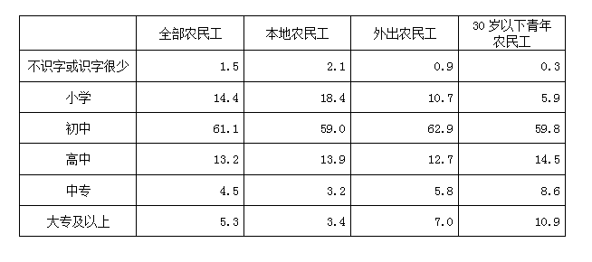

**表2：2011年我国农民工在不同地区从事行业分布  单位：%**

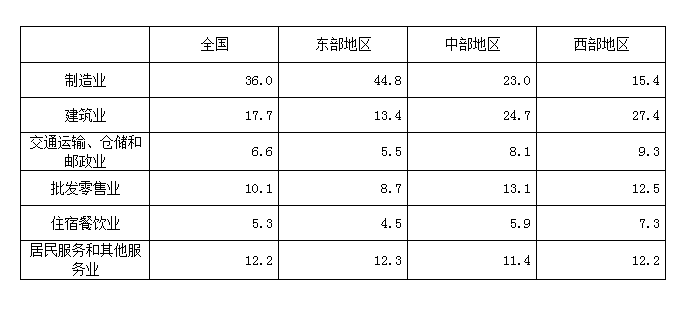

**注：**外出农民工：指调查年度内，在本乡镇地域以外从事非农活动6个月及以上的农村劳动力。

本地农民工：指调查年度内，在本乡镇内从事非农活动6个月及以上的农村劳动力。

### 第 131 题

2011年外出农民工人数比上年增加多少万人：

A. 522

B. 1055

C. 2451

D. 6448

第 131 题 · 答案与解析

**参考答案（粉笔题库参考内容）**

A

**解析**

根据题干“比上年增加多少万人”，可判定本题为增长量计算问题。定位材料第一段：“2011年外出农民工15863万人，比上年增长3.4%”。故2011年外出农民工人数比上年的增长量=现期量/(1+r)×r=15863/(1+3.4%)×3.4%≈15863/(1+1/30)×1/30=15863/31≈511万人，A项最接近。

故正确答案为A。

**考点**：增长量计算、综合资料

**来源**：2013年北京市公务员录用考试《行测》题第131题

### 第 132 题

2011年30岁以下青年农民工中，初中及以上文化程度占：

A. 34.0%

B. 59.8%

C. 84.1%

D. 93.8%

第 132 题 · 答案与解析

**参考答案（粉笔题库参考内容）**

D

**解析**

定位表1：2011年30岁以下青年农民工中，不识字或识字很少占比为0.3%，小学占比为5.9%。故初中及以上文化程度占比=1-0.3%-5.9%=93.8%。

故正确答案为D。

**考点**：简单加减计算、综合资料

**来源**：2013年北京市公务员录用考试《行测》题第132题

### 第 133 题

2011年西部批发零售业农民工约多少万人：

A. 499

B. 531

C. 555

D. 583

第 133 题 · 答案与解析

**参考答案（粉笔题库参考内容）**

B

**解析**

材料已知西部地区农民工人数和西部批发零售业农民工所占比重，求西部批发零售业农民工人数，可判定本题为现期比重问题。定位文字材料和表2：2011年西部地区农民工4245万人，西部批发零售业农民工所占比重为12.5%。故2011年西部批发零售业农民工人数= 4245 × 12.5% = 4245 × 1/8 ≈ 530万人，B项最接近。

故正确答案为B。

**考点**：现期比重、综合资料

**来源**：2013年北京市公务员录用考试《行测》题第133题

### 第 134 题

2011年东部制造业农民工人数约为西部多少倍：

A. 2.9

B. 3.9

C. 11.4

D. 16.5

第 134 题 · 答案与解析

**参考答案（粉笔题库参考内容）**

C

**解析**

根据题干“2011年东部制造业农民工人数约为西部多少倍”，可判定本题为现期倍数问题。定位文字材料和表格：2011年在东部地区务工16566万人，制造业占比为44.8%，西部地区4245万人，制造业占比为15.4%。故2011年东部制造业农民工人数与西部的倍数关系为(东部地区务工人数×制造业占比)/(西部地区务工人数×制造业占比)=(16566×44.8%)/(4245×15.4%)≈(16600×0.45)/(4200×0.15)≈4×3=12，C项最接近。

故正确答案为C。

**考点**：现期倍数、综合资料

**来源**：2013年北京市公务员录用考试《行测》题第134题

### 第 135 题

根据资料，正确的是：

A. 2011年本地农民工文化程度整体高于外出农民工

B. 2011年外出农民工人数占农民工总数比重高于2010年

C. 2011年30岁以下青年农民工不到农民工总人数的一半

D. 2011年在西部从事建筑业农民工人数多于东部地区

第 135 题 · 答案与解析

**参考答案（粉笔题库参考内容）**

C

**解析**

A项：定位表1，本地农民工高中及以上所占比重=13.9%+3.2%+3.4%=20.5%，外出农民工高中及以上所占比重=12.7%+5.8%+7.0%=25.5%，故2011年本地农民工文化程度整体低于外出农民工，错误；

B项：定位材料第一段：外出农民工增长率a=3.4%，农民工总量增长率b=4.4%。根据两期比重比较结论，当a＜b时比重下降，3.4%＜4.4%，故比重低于2010年，选项表述为高于，错误；

C项：定位表1，假设30岁以下青年农民工人数为x，农民工总人数为y。由表1的最后一行可知，大专及以上的30岁以下青年农民工人数为10.9%x，大专及以上的农民工人数为5.3%y。大专及以上的30岁以下青年农民工人数一定小于大专及以上的农民工人数，即10.9%x＜5.3%y，化简得：x＜(5.3%/10.9%)y＜1/2y，故30岁以下青年农民工人数不到农民工总人数的一半，正确；

D项：定位文字材料和表2：2011年在东部地区务工16566万人，建筑业占比13.4%，西部地区4245万人，建筑业占比27.4%。2011年西部建筑业农民工人数=4245×27.4%≈4200×0.275=1155万人，东部建筑业人数=16566×13.4%≈16600×2/15≈1100×2=2200万人，故西部少于东部，错误。

故正确答案为C。

**考点**：综合分析、综合资料

**来源**：2013年北京市公务员录用考试《行测》题第135题

