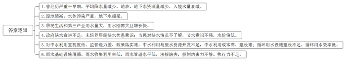
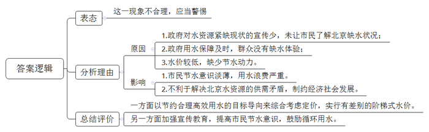
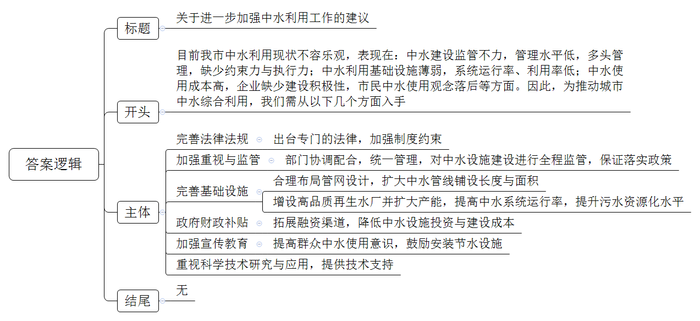
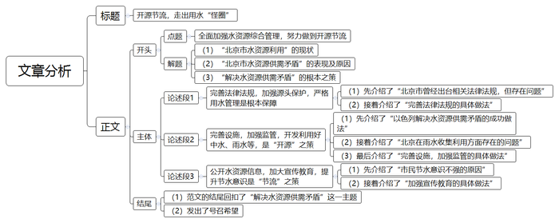

# 2014年北京市公考《申论》题

<!-- gwy:overview:start -->
> **北京 · 2014 · 申论 · 统考** ｜ 4 题 · 图片 4 处 · 答案随题折叠

导航：[题目](#题目) · [材料 1](#材料-1)
<!-- gwy:overview:end -->

> 候选采集稿。参考答案及解析来自粉笔页面，不代表官方答案或真实高分答卷；来源使用许可与原卷对应关系仍需人工核实。

## 给定材料

### 材料 1

水是人类赖以生存和发展的基本条件，是维系自然生态系统功能和支撑社会经济系统发展不可替代的基础性的自然资源和战略资源，历来都是治国安邦的大事。目前，我国年均缺水约400亿立方米，2/3的城市不同程度缺水。2011年开始，我国开始实行最严格的水资源管理制度，确立了水资源开发利用、用水效率、水功能区限制纳污“三条红线”。同时为严守“三条红线”，制定了一系列措施，如建立水资源管理责任和考核制度，把水资源管理纳入县级以上地方党政领导班子政绩考核体系；对取用水的总量已达到或超过控制指标的地区暂停审批建设项目新增取水等。

历史上，北京是水资源较为丰富的地区，万泉河、玉渊潭、莲花池等带水的地名，曾经都是名副其实的水域。今天的北京，是水资源极度短缺的城市。目前，北京市人均水资源量仅为全国的1/8，世界的1/30。近年，北京市人均水资源量已降至100立方米左右，而国际公认极度缺水标准是人均水资源量500立方米，人均水资源量300立方米被认为是危及人类生存生活底线的灾难性标准。北京市1956年～2000年的多年平均水资源总量为37.4亿立方米，但是从1999年以来，北京市遭遇了新中国成立以来最为严重干旱期，年平均降水量比多年平均值减少两成，地表水资源量衰减59%，地下水资源量衰减37%，入境水量衰减77%。北京市水务局一位负责人表示，北京近年的实际供水缺口已达11亿立方米。2012年，城市的用水总量要控制在37亿立方米以内，而依靠自身力量全年满打满算也只能供水24亿立方米，供水缺口已达到13亿立方米。对此，北京市仍是利用再生水、外流域调水以及继续适度开采地下水等措施来保障城市用水。据专家估算，到2020年，平水年份北京将缺水23.76亿立方米，枯水年份将缺水30.9亿立方米。

上世纪60年代，北京的湿地面积约12万公顷。1950年到2009年间，北京湿地缩减率达79.5%，其中水稻田和沼泽地缩减幅度最为明显。如北京的南海子，自古水草丰美，曾被用作皇家猎场。上世纪50年代末，南海子大部分湿地被平整为农田，80年代烧砖取土、挖沙养鱼使南海子形成了无数个大坑，90年代大量垃圾被倾倒入坑内，直到2010年，经过治理重建，南海子生态环境才得以改善。“湿地能够涵养水源、净化水质、调蓄雨洪、提供水资源、调节气候等，是人类社会赖以生存和发展的重要自然资源和生态支持系统。修复湿地环境，投入是巨大的，过程是漫长的。”一位湿地研究者说。2013年5月1日正式实施的《北京市湿地保护条例》明确提出“本市实施最严格的湿地保护管理制度”。

有资料显示，华北地区因地下水超采已形成巨大的地下漏斗，北方地区“有河皆干，有水皆污”。上世纪80年代以来，北京各水系水体污染严重，北京城区河流几乎都丧失自然地表径流，变成了排污排水河道。被喻为北京“母亲河”的永定河，滋养了世世代代的北京人，哺育了灿烂的城市文明，却是北京最早遭受污染而走向水脉衰微的河流；官厅水库曾是北京饮用水源地，因上游污水不断排入，2000年不得不停用。目前，北京市生活用水主要供给地是密云水库，其在雨水丰盈年份最大蓄水量仅能达到11.3亿立方米。自1972年以来，北京开始大规模开采地下水，1999年至2010年，超采的地下水超过56亿立方米。有调查显示，北京的地下水位已降到60米以下。此外，北京还不得不从同样缺水的河北调水，山西也多次向北京集中输水；2014年汛后，南水北调工程中线将引长江水进京，每年可供水量约10亿立方米，将用于优先保障市民生活用水。

1949年北京城市建成面积是109平方公里，1994年扩大到467平方公里。1993年的《北京城市总体规划》中预期，到2010年城市建设用地控制在900平方公里范围内。然而，2002年建成区用地就已达941平方公里，大大超出总体规划用地范围。北京市常住人口1958年为660万人，1998年为1246万人，2010年近2000万，居民生活用水和第三产业用水已上升为第一用水大户。有专家研究认为，北京的水资源承载能力是1200万人，目前刚性的新鲜用水需求及其快速增长的趋势，是当前北京市水资源安全供给面临的最大压力。同时，供水缺口越来越大，水资源供需矛盾的解决也就难以走出“扩张—调水—再扩张—再调水”的怪圈。该专家还强调，自然系统的水资源是有限的，而人的发展欲望无限，在这有限与无限之间，协调北京城市发展与水资源短缺的关系，将是一项长期的、复杂的任务。

### 材料 2

2012年7月1日正式实施的《北京市节约用水办法》明文规定：提供洗车服务的单位应当建设循环用水设施，使用再生水；住宅小区、单位内部的景观环境用水和其他市政杂用用水，应使用雨水或再生水；建立健全高耗水项目和单位重点监控机制，强化用水实时监控；超出用水指标的用水单位，除据实缴纳水费外，还将收取一倍至三倍的累进加价费用等。此外，北京市还颁布了《北京市实施<中华人民共和国水法>办法》《北京市自建设施供水管理办法》等地方法规和《关于严格执行<节水型生活用水器具>标准加快淘汰非节水型生活用水器具的通知》等地方规章和十余部规范性文件，对以水为原料的生产企业、人造滑雪场、高尔夫球场、高档洗浴、洗车等高耗水特殊行业制定了节水管理规定等，初步建立起了节水法规体系。

在严格实行总量控制的前提下，全市所有非居民用水单位已全部实行了社会单位计划用水、定额管理。每年平均压缩用水计划指标3%-5%。对用水单位实行按月考核、超用水预警、超定额累进加价的管理制度。目前，北京市居民用水和非居民用水销售价格如下：居民：4.00元/立方米；行政事业、工商户：5.80元/立方米；宾馆、饭店、餐饮业：6.21元/立方米；洗车业、纯净水业：61.68元/立方米；洗浴业：81.68元/立方米。

近年来，北京市通过采取调整产业结构、单位定额限水、超量加倍惩罚、淘汰高耗水企业、提高工农业循环用水效率等措施，2010年工业和农业用水在1999年的基础上分别减少了51%和37%，基本做到了“农业用水负增长、工业用水零增长”。在农业用水方面，建设高效节水灌溉工程，大量使用微灌、小管出流、滴灌、喷灌、管灌等节水方式。如大兴区南礼渠村有六百余个大棚，全部实行电脑计算用水量、IC卡控制浇水的科学灌溉方式，节水节电均达50%。在工业用水方面，持续推进循环用水技术升级，如位于亦庄开发区的中芯国际集成电路制造有限公司，通过空调冷凝水收集系统、超纯水回收系统等每天可回收2000吨排放水，夏季每天可回收100吨空调冷凝水，产生巨大经济利益的同时，实现了水源的高效利用。

2001年-2008年，北京市实施节水技术改造980项，节水5300万立方米；推广园林节水微喷灌技术，节水1.2亿立方米；普及推广节水型用水器具420万套（件），节水1470万立方米。目前，全市公共场所已基本普及节水器具；全市居民家庭节水器具普及率已达91.4%。到2015年居民节水器具普及率将达到95%。

### 材料 3

对北京市缺水的严重程度，有关政府部门并没有向社会过多宣讲，不过他们一直都在想方设法解决北京水资源的供需矛盾。从上世纪中期至今，北京已经出现三次严重缺水：上纪60年代北京用水紧张时，刚建好的官厅水库发挥作用解决了供水难题；70年代中期几年连续干旱引发第二次严重缺水，确定密云水库专门负责供给城市用水来度过危机；80年代初连续几年干旱，北京大力压减工农业用水来确保城市生活用水，同时水利部还专门召集山西、河北等五个省市开会协调首都用水问题，最后决定密云水库不再给河北、天津等地供水，只给北京供水，才使北京勉强度过此次危机。据统计，上世纪80年代以来，北京市所依托的21条主要河流全部断流。“目前，北京市水资源处于重度紧缺状态，水资源已经成为制约北京市经济社会发展的第一瓶颈。”一位专家告诉记者。

2012年7月，有记者在街头、社区随机询问路人，“您知道北京属于严重缺水的城市吗？”76%的受访者的回答是“不知道，没觉得北京特别缺水。”“您了解近期出台的北京市有关节约用水的办法吗？”受访者无一人知晓。

“因为每个月的水费不高，所以也就没在意，一直不清楚每个月的用水量到底有多少，都是想怎么用就怎么用。”住在朝阳区某小区的25岁的李女士说。同一小区的刘奶奶也告诉记者：“任何时候拧开水龙头都有水，这些年家里就没有停过水，所以没觉得北京特别缺水啊。”刘奶奶也坦言，家里虽然没有什么节水设备，但是该节约的地方她都尽力去节约，如每次洗衣用过的水都留下来，以备冲厕所或者拖地用。

“本来20分钟就能搞定的，硬要洗上1个小时甚至更长时间，站在那儿用水一直不停地冲着。”东城区一家浴室的王老板对记者说，“我收费10元，但是冬天顾客大多都洗1小时左右，每人10元是做亏本儿的生意。”王老板正准备贴出通知，将每位顾客洗浴时间限制在半小时内，超时需要另外收费。

2013年4月12日召开的水业战略论坛上，某专家表示：“在充分考虑不同用户承受能力的基础上，水价要提高才行，我坚决支持水价上涨。实行有差别的阶梯式水价。”他认为，“水价的决定因素，不能只由生产成本、市场需求来决定，还要以节约合理高效用水的目标导向来综合考虑定价。”也有专家认为，水价的杠杆作用遭遇到水资源的刚性需求时就丧失了作用，如对于普通百姓来说，水价涨到10块钱甚至100块钱也得用，但对企业来说就得核算了，最后真正节水意识强、节水效果好的是企业家、农场主。

### 材料 4

中水，又称再生水，是指污水经适当处理后，达到一定的水质指标，满足某种使用要求，可以进行有益使用的水。1987年北京市政府出台了《北京市中水设施建设管理试行办法》，2001年发布的《关于加强中水设施建设管理的通告》中规定：市区内建筑面积5万平方米以上，或者可回收水量每天在150立方米以上的新建居住区和集中建筑区，必须建设中水设施。2005年发布的《关于加强小区中水设施管理的通知》要求加强小区中水设施的监管。但是由于中水设施只是小区建设项目的附属设施，审批部门对开发商的中水设施建设方案的审核重视不够，节水管理部门又力不能及，使中水设施方案的审核、工程验收、运行过程中的定期检测等环节无法形成有力的监管，致使有关中水设施管理的各项政策难以获得良好效果。

2008年北京市节水办公室对本市113个住宅小区与公寓做了普查。其中，23个公寓中有12个的中水系统在运行，占52%；90个住宅小区中有41个的中水系统在运行，占45.5%。2010年，新京报对搜狐焦点网业主论坛的百强社区进行调查发现，已开通中水系统并正常运行的不到20%。

目前，北京的中水公司有中水管道600多公里，与市自来水集团负责的城区8000多公里的自来水管线相比还有很大差距。这些中水管道线，主要铺设在三环到五环间地下管线相对稀少的城区。当前，北京市中水年利用量7亿立方米。其中约40%用于农业灌溉，约36%用于河湖景观，约20%用于工业用水，其余用于市政杂用（洗车、降尘、园林绿化、道路清扫），很少部分用于居民家庭冲厕。据有关资料显示，如果每天使用1万立方米的中水，就相当于建设了1座400万立方米的水库。

“今天的圆明园，碧水悠悠，荷叶盈盈，喷泉如瀑，给人们带来清凉。而断流30年的永定河，碧波荡漾、鱼儿嬉戏、水鸟低鸣，‘卢沟晓月’又现宛平湖。这一切，如果没有再生水，是绝无可能的。”北京市水利工程师张彤对记者说，“‘水德含和，变通在我’，郦道元《水经注》里的这句话道出了人水关系的本质。从国际通行的水资源配置看，污水资源化是必然选择。北京尚有近70%废水资源量可供开发，但目前高品质再生水厂17座，日产81万立方米，产能远远不足。”

### 材料 5

2012年8月1日～4日，某报记者对北京市中水利用情况进行了调查：

8月1日，在北京市东城区万国城小区，业主孙女士说，她入住前是说要使用中水回收系统的，也铺设了中水管线，但自2010年入住以来却没有使用过中水，一直是按照4.00元／立方米的自来水价来缴纳水费的。该小区物业工作人员告诉记者：中水的成本在1元左右，物业公司基本没有盈利。如果运行故障率高，成本甚至高达4元左右，而从市政中水管网到本小区内的管道又始终无法接通。所以，公司宁愿直接利用自来水代替中水，收自来水的价格。中水公司的一位工作人员告诉记者，给住宅小区提供中水，总量不会太大，前期投资却很大，建设困难多，收回成本的时间会比较长，而且一吨只能收费1.00元，中水公司往各小区铺设中水管线是没有积极性的。

8月2日下午，记者在朝阳区一家人工洗车店内发现，水枪的水管与屋内自来水管相通，喷洒出的洗车用水直接流入路旁的绿化地及下水井内。当记者问及洗车需按规定安装“循环水设施”时，“建那个东西得花几万块钱，洗个车才15块钱，我能挣多少钱啊？”他反问道，“循环水、再生水比普通水还贵，要是真遇到来检查的，要不疏通一下，要不就干脆交个罚款。”同日，记者在位于亚运村附近一家采用循环再生水电脑洗车店里了解到，这里年用水指标需提前向有关部门申请。持有会员年卡的车主每次洗车为20元，而未办年卡的单车洗车一次就需要80块钱。

8月3日，在丰台区一居民小区内，记者发现，简单的喷水管从绿化草坪内一个自来水井接出，工人则将喷水管放置于较高的地方，任由水流沿着由高到低的地势，漫灌整个绿化草坪。紧邻马路的一块草坪更可见水流流向路侧地势更低的下水井内。类似这样采用自来水浇灌小区绿地的现象，在多数老旧居民区也普遍存在。

8月4日，记者来到位于平谷的一家果园，发现紧邻果园边缘排列着三口水井。管理果园的老师傅介绍，夏季每天都要对院内果树浇灌4次，大多是按照果树种植排列的水渠直接漫灌，用水量巨大。而当记者问及是否有用水计量、用水量受不受限制等问题时，他则不做正面回答。随后记者发现，浇地的水管简单与水井出水口连接，井内也未见到类似计量水表等设施，连接处的滴漏现象也十分严重。

### 材料 6

近年来，暴雨造成的北京城区内涝积水现象时有发生。城区中仅二环、三环、四环路就有42座下凹式立交桥，这对城市内涝防治是一个很大的挑战。北京建城年代久远，雨水基础设施薄弱，现在的老城区内，有些雨洪设施仍然沿用的是明清时期的设施。有研究表明，北京市城区屋面、道路雨水径流污染程度通常超过城市污水，而每逢大雨过后，大量树叶、纸片、垃圾袋等漂浮物直接流入河流湖泊，对河湖水质污染严重，也影响河道景观。同时，对于水资源严重短缺的北京，85%的降雨集中在6月-8月，每年仅城区就有2.4亿多立方米的雨水径流白白流失。据北京节水管理中心的数据，全市现有雨水收集系统每年只能收集1381万立方米，其雨水收集利用率还不足1%。

早在2003年，北京市水务局、市规划委等部门就下发过《关于加强建设项目雨水利用的通知》，但因只是一个“通知”而非法规，只有少部分建设项目按此要求建了雨水蓄集池。北京市现在的雨水管理水平也还较低，手段较落后，管理资料不全，雨水管网、水系的水量自动化监控与调度设施不足，缺乏整体、综合的前端管理，缺乏对暴雨和城市排水系统的准确模拟和积滞水预报预警等。2001年以来，北京市水务部门先后编制了5次雨水利用规划，由于缺乏市政、园林、道路、规划、城建等部门的共同参与，使规划的约束力不够、执行力不足。

自2012年开始，北京市排水集团对全市70多个下凹式立交桥桥区的抽水泵站实施改造。2015年前，北京市将建成1800处城乡雨洪收集利用设施，排查改造164座下凹式立交桥雨水泵站，改造350公里雨污水管线，还将建设4处大型的雨洪蓄滞工程，通过工程措施与管理措施相结合，来消除城市内涝隐患。

2012年“7.21”北京特大暴雨，海淀区的双紫园小区雨水利用系统，正好“喝了个饱”。“雨小的时候，雨水被透水砖吸入地下或者注入下凹绿地，通过植物、砂石层的综合作用使雨水得到净化，既可涵养水土，也能养活周边的树木花草；一旦雨量过大形成大量积水，小区的地下集雨管道就会把雨水引入小区停车场地下的蓄水池中。收集起来的雨水可以作为公厕用水、人文景观用水、供暖和浇灌绿植。”小区业主王女士说。

奥林匹克公园中心区有一个规模巨大的雨水综合利用系统。国家体育场“鸟巢”70%的用水来自回用水，“鸟巢”内卫生间冲厕所、冷却塔冷却补水、主赛场和热身场的草坪浇灌、停车场冲洗用水、室外道路和绿地浇洒用水等，都主要来源于处理后的雨水。同时，“鸟巢”每年还可节约400多万元的城市防洪费。

### 材料 7

人口持续增长，用水需求不断增加，农业生产不断扩大，但用水总量却在长达50年间一直维持不变——这是位于世界最干旱地区的以色列创造的奇迹。在以色列，沙漠占国土总面积的60%以上，土地贫瘠，水资源十分缺乏。1959年颁布的《水法》，对用水权、用水额度、水费征收等都作了详细规定。设立了水资源管理机构，对水资源的开发、分配、收费及污水处理等实行统一管理；建成了全国性的水资源网络，统一调控，合理配置全国的水资源；实行用水定额制，定额之内的用水按较低的价格收水费，超过定额的用水则加倍收取费用，对用水大户农业也采用梯级计量收费机制，刺激了科研人员和农民不断发展节水灌溉技术，追求高投入高产出的农业生产模式；向社会开放所有水资源信息，公众能了解与生活息息相关的水资源状况，重大水资源政策的制定也需要通过公众听证会；重视废水的回收利用，并通过低水价来鼓励用户使用再生水，用于农业灌溉和非饮用的生活用水。

自20世纪60年代开始，以色列的科研人员就开展了对南部咸水灌溉、污水和咸水混合灌溉的科学研究和应用。目前，其南部阿亚拉谷底生产的花卉和蔬菜已达到全国总产量的一半，奶制品生产也颇具规模，这些成果大都建立在各种地下咸水利用的基础上，在背部丘陵地区或南部荒漠地区，修建了很多位于农田间的小型蓄水池，用于积蓄雨期洪水和存蓄再生水用作农业灌溉。在海水利用方面，一是直接利用海水，如6座大型发电厂就有5家坐落于海边，直接采用海水冷却，节约了淡水资源；二是开展海水淡化，其技术研究走在世界前列，并以此技术转让出口来获取经济利益，其南部港口城市埃拉特市的供水，全部是由淡化海水和咸水来提供的。

## 题目

### 第 1 题

**根据给定材料，简要概括北京市水资源紧缺的原因。（20分）**

关联材料：材料 1、材料 2、材料 3、材料 4、材料 5、材料 6、材料 7

作答要求：

要求：概括准确全面，语言简练，字数不超过300字。

第 1 题 · 答案与解析

**参考答案（粉笔题库参考内容）**

1.曾经历严重干旱期，平均降水量减少，地表、地下水资源量减少，入境水量衰减。

2.湿地缩减，水体污染严重，地下水超采。

3.居民生活和第三产业用水量大，用水刚需大且增长快。

4.政府缺水宣讲不足，未培养居民缺水忧患意识；市民对缺水情况不了解，节水意识不强，水价偏低。

5.对中水利用重视度低、监管能力差、政策落实难，中水利用与废水资源开发不足，中水利用成本高、建设难；循环用水设施建设不足、循环用水效率低。

6.雨水基础设施薄弱，雨水收集利用率低，雨水管理水平低，法规缺失，规划约束力不够、执行力不足。

**解析**

**参考答案说明：**答案从“经历干旱”“环境破坏”“用水量大”“节约意识缺失”“中水利用不足”“雨水利用率低”等不同的层面进行了分条撰写。各条要点之间在内容上是相互并列，没有交叉。

**考点**：单一题

**来源**：2014年北京市公考《申论》题

### 第 2 题

**根据给定材料，结合实际情况，针对市民们“没觉得北京是特别缺水的城市”这一现象，谈谈你的看法。（15分）**

关联材料：材料 1、材料 2、材料 3、材料 4、材料 5、材料 6、材料 7

作答要求：

要求：分析合理，条理清楚，语言简练，字数不超过300字。

第 2 题 · 答案与解析

**参考答案（粉笔题库参考内容）**

这一现象不合理，应当警惕。

产生该现象的原因是：1.政府对水资源紧缺现状的宣传少，未让市民了解北京缺水状况；2.政府用水保障及时，群众没有缺水体验；3.水价较低，缺少节水动力。

这会导致：1.市民节水意识淡薄，用水浪费严重。2.不利于解决北京水资源的供需矛盾，制约经济社会发展。

对此，一方面以节约合理高效用水的目标导向来综合考虑定价，实行有差别的阶梯式水价。另一方面加强宣传教育，提高市民节水意识，鼓励循环用水。

**解析**

**参考答案说明：**思路方面，本参考答案按照观点现象分析题“表态+分析理由+总结评价”的一般答题思路展开。内容方面，本参考答案先对市民们“没觉得北京是特别缺水的城市”这一现象进行了表态；“分析理由”部分先分析了产生该现象的原因，接着分析了该现象产生的影响；最后进行了总结评价。词句表达方面，本答案加上了“对此”等连接词来承接上下文。

**考点**：综合题

**来源**：2014年北京市公考《申论》题

### 第 3 题

**根据给定材料反映的北京市中水使用中的问题，以一名水务局工作人员的身份，撰写一份《关于进一步加强中水利用工作的建议》的提纲。（25分）**

关联材料：材料 1、材料 2、材料 3、材料 4、材料 5、材料 6、材料 7

作答要求：

要求：措施建议合理可行，内容全面，条理清楚，语言简练，字数不超过400字。

第 3 题 · 答案与解析

**参考答案（粉笔题库参考内容）**

关于进一步加强中水利用工作的建议

目前我市中水利用现状不容乐观，表现在：中水建设监管不力，管理水平低，多头管理，缺少约束力与执行力；中水利用基础设施薄弱，系统运行率、利用率低；中水使用成本高，企业缺少建设积极性，市民中水使用观念落后等方面。因此，为推动城市中水综合利用，我们需从以下几个方面入手：

一、完善法律法规。出台专门的法律，加强制度约束。

二、加强重视与监管。部门协调配合，统一管理，对中水设施建设进行全程监管，保证落实政策。

三、完善基础设施。合理布局管网设计，扩大中水管线铺设长度与面积。增设高品质再生水厂并扩大产能，提高中水系统运行率，提升污水资源化水平。

四、政府财政补贴。拓展融资渠道，降低中水设施投资与建设成本。

五、加强宣传教育。提高群众中水使用意识，鼓励安装节水设施。

六、重视科学技术研究与应用，提供技术支持。

**解析**

**参考答案说明：**（1）格式方面，本参考答案写到了“标题”“正文”。（2）正文部分，一方面从内容来看，围绕着“中水利用”这一主题，本参考答案先写到了“利用现状不容乐观”的问题要素；其次根据问题提出“相关建议”。另一方面，形式上，本参考答案做到了分段、分条撰写，整体上条理较为清晰。（3）本参考答案能够结合题目要求“语言简练”，在语言表达上做到了简洁、流畅。

**考点**：公文写作题

**来源**：2014年北京市公考《申论》题

### 第 4 题

**有专家指出，目前北京用水需求不断增长，供水缺口日益增大，水资源供需矛盾的解决将难以走出“扩张—调水—再扩张—再调水”的怪圈。请你就这一“怪圈”现象，自选角度，自拟题目，写一篇文章。（40分）**

关联材料：材料 1、材料 2、材料 3、材料 4、材料 5、材料 6、材料 7

作答要求：

要求：主题明确，内容充实，结构合理，语言流畅，字数控制在800~1000字。

第 4 题 · 答案与解析

**参考答案（粉笔题库参考内容）**

**开源节流，走出用水“怪圈”**

北京市建成区面积已达1386平方公里，据2012年数据，常住人口2069.3万人。有专家研究指出，北京的水资源承载能力是1200万人，用水安全供给面临巨大压力。对此，我认为，**合理控制人口数量和城市规模的同时，全面加强水资源综合管理，努力做到开源节流是解决问题的根本之策**。

北京城有3000多年的建城史，800余年的建都史，历史上，是水资源丰富的地区。近年来，北京市人均水资源量降至100立方米左右，低于人均300立方米的灾难线。究其根源，一是遭遇严重干旱，年平均降水量减少，加之南海子等湿地缩减，造成地表、地下水资源量大幅度衰减；二是城区永定河等河流遭受污染，几乎断流，官厅水库等也因上游污染而停用。更让人忧虑的是，当前整个华北地区地下水都严重超采，北京很难再从同样缺水的河北、山西等邻省调水。

鉴于此，北京只有依靠严格水资源管理制度，提高水资源开发利用水平，同时提高居民节水意识的“开源节流”之策，才能走出“扩张一调水一再扩张一再调水”的用水怪圈。

**完善法律法规，加强源头保护，严格用水管理是根本保障**。目前，北京市出台了一系列法规、规章对分类用水办法等作出规定，但因法律约束力不够，效果并不明显。这就急需一部统一的《水法》对湿地、水库、河流、地下水等水源实施保护；对水源开发权、用水权、用水额度、水费征收等作出详细规定；完善全市水资源网络，设立统一机构，统一调控，合理配置，在严格实行总量控制的前提下，对用水单位实行超定额累进加价的管理制度。

**完善设施，加强监管，开发利用好中水、雨水等，是“开源”之策。**以色列在人口持续增长，用水需求不断增加的同时，保持用水总量50年不变，这与重视废水回收利用有很大关系。据统计，每天使用1万立方米中水，相当于建设了1座400万立方米的水库。另外，北京当前全市雨水收集利用率还不足1%。因此，审批部门要加强对开发商的中水设施建设的审核监管，积极提供政策和技术支持，引导洗车单位、市民合理使用中水；同时做好全面系统的雨水利用规划，提高管理水平和利用率。

**公开水资源信息，加大宣传教育，提升节水意识是“节流”之策。**长期以来，有关政府部门未向社会积极宣讲北京市缺水的严重程度，造成广大市民“没觉得北京特别缺水”，也不了解有关节约用水的办法。另一方面，水价长期偏低，也造成市民“想怎么用就怎么用”，家里少有节水设备。对此，市政府应向社会开放所有水资源信息，在充分考虑不同用户承受能力的基础上，实行有差别的阶梯式水价。

“水德含和，变通在我”。在迈向“世界城市”的道路上，北京市仍将利用再生水、外流域调水以及继续适度开采地下水等措施来保障城市用水。而从本市70%废水资源量可供开发的现实出发，实现废水循环利用是重中之重。

**解析**

**文章分析**

**开源节流，走出用水“怪圈”**

【**标题的优点：**首先，范文的标题“开源节流，走出用水‘怪圈’”突出了题干中谈到的“‘扩张—调水—再扩张—再调水’的‘怪圈’”，也围绕“解决北京水资源供需矛盾”这一主题展开。其次，形式上，文字简洁明快。】

（1）北京市建成区面积已达1386平方公里，据2012年数据，常住人口2069.3万人。有专家研究指出，北京的水资源承载能力是1200万人，用水安全供给面临巨大压力。对此，我认为，（2）**合理控制人口数量和城市规模的同时，全面加强水资源综合管理，努力做到开源节流是解决问题的根本之策**。

【**开头的优点：**★内容方面：范文的开头是紧扣题目给定的“解决北京水资源供需矛盾”现象展开的。首先，开头点出主题，做到了主题明确。其次，对“解决北京水资源供需矛盾”这一主题进行了分析阐述，指出了（1）“北京市水资源利用”的现状。（2）“解决水资源供需矛盾”的根本之策。注意以上两个方面的阐述在逻辑上有先后顺序：先写“现状”，再写“对策”。★文字表达方面：长短句配合使用，使语言表达有节奏感。】

（1）北京城有3000多年的建城史，800余年的建都史，历史上，是水资源丰富的地区。近年来，北京市人均水资源量降至100立方米左右，低于人均300立方米的灾难线。（2）究其根源，一是遭遇严重干旱，年平均降水量减少，加之南海子等湿地缩减，造成地表、地下水资源量大幅度衰减；二是城区永定河等河流遭受污染，几乎断流，官厅水库等也因上游污染而停用。更让人忧虑的是，当前整个华北地区地下水都严重超采，北京很难再从同样缺水的河北、山西等邻省调水。

鉴于此，（3）北京只有依靠严格水资源管理制度，提高水资源开发利用水平，同时提高居民节水意识的“开源节流”之策，才能走出“扩张一调水一再扩张一再调水”的用水怪圈。

【**过渡段的优点：**范文过渡段分析了（1）“北京市水资源供需矛盾”的表现；（2）“北京市水资源紧缺”的原因；（3）“解决水资源供需矛盾”的对策等方面的内容，此外，还要注意过渡段末尾的“鉴于此，北京只有依靠严格水资源管理制度，提高水资源开发利用水平，同时提高居民节水意识的‘开源节流’之策，才能走出‘扩张一调水一再扩张一再调水’的用水怪圈”是用来引起下文的过渡句。】

**完善法律法规，加强源头保护，严格用水管理是根本保障。**目前，（1）北京市出台了一系列法规、规章对分类用水办法等作出规定，但因法律约束力不够，效果并不明显。（2）这就急需一部统一的《水法》对湿地、水库、河流、地下水等水源实施保护；对水源开发权、用水权、用水额度、水费征收等作出详细规定；完善全市水资源网络，设立统一机构，统一调控，合理配置，在严格实行总量控制的前提下，对用水单位实行超定额累进加价的管理制度。

【**论述段1的优点：**★观点句：范文的观点句是紧扣“解决北京水资源供需矛盾”这一文章主题提出的。形式上，它在段首处直接写出，位置突出，容易发现。内容上，关键词突出，内容要点明确，可以明显看出它是从“完善法律法规”入手，指出了“解决北京水资源供需矛盾的对策”。★论述内容：（1）先介绍了“北京市曾经出台相关法律法规，但存在问题”；（2）接着介绍了“完善法律法规的具体做法”。注意：以上两个方面的内容都是紧扣“完善法律法规，加强源头保护，严格用水管理是根本保障”这个观点句进行分析论述的，论述的针对性强，内容层次丰富。最后，在论述方法和论据的选取上以说理为主，做到了分析透彻，鞭辟入里。】

**完善设施，加强监管，开发利用好中水、雨水等，是“开源”之策。**（1）以色列在人口持续增长，用水需求不断增加的同时，保持用水总量50年不变，这与重视废水回收利用有很大关系。据统计，每天使用1万立方米中水，相当于建设了1座400万立方米的水库。另外，（2）北京当前全市雨水收集利用率还不足1%。因此，（3）审批部门要加强对开发商的中水设施建设的审核监管，积极提供政策和技术支持，引导洗车单位、市民合理使用中水；同时做好全面系统的雨水利用规划，提高管理水平和利用率。

【**论述段2的优点：**★观点句：范文的观点句是紧扣“解决北京水资源供需矛盾”这一文章主题提出的。形式上，它在段首处直接写出，位置突出，容易发现。内容上，关键词突出，内容要点明确，可以明显看出它是从“完善设施，加强监管”入手，指出了“解决北京水资源供需矛盾的对策”。★论述内容：（1）先介绍了“以色列解决水资源供需矛盾的成功做法”；（2）接着介绍了“北京在雨水收集利用方面存在的问题”；（3）最后介绍了“完善设施，加强监管的具体做法”。注意：以上三个方面的内容都是紧扣“完善设施，加强监管，开发利用好中水、雨水等，是‘开源’之策”这个观点句进行分析论述的，论述的针对性强，内容层次丰富。最后，在论述方法和论据的选取上做到了讲道理、举例子相结合，做到了丰富多样。】

**公开水资源信息，加大宣传教育，提升节水意识是“节流”之策。**长期以来，（1）有关政府部门未向社会积极宣讲北京市缺水的严重程度，造成广大市民“没觉得北京特别缺水”，也不了解有关节约用水的办法。另一方面，水价长期偏低，也造成市民“想怎么用就怎么用”，家里少有节水设备。对此，（2）市政府应向社会开放所有水资源信息，在充分考虑不同用户承受能力的基础上，实行有差别的阶梯式水价。

【**论述段3的优点：**★观点句：范文的观点句是紧扣“解决北京水资源供需矛盾”这一文章主题提出的。形式上，它在段首处直接写出，位置突出，容易发现。内容上，关键词突出，内容要点明确，可以明显看出它是从“宣传教育”入手，指出了“解决北京水资源供需矛盾的对策”。★论述内容：（1）先介绍了“市民节水意识不强的原因”；（2）接着介绍了“加强宣传教育的具体做法”。注意：以上两个方面的内容都是紧扣“公开水资源信息，加大宣传教育，提升节水意识是‘节流’之策”这个观点句进行分析论述的，论述的针对性强，内容层次丰富。最后，在论述方法和论据的选取上以说理为主，做到了分析透彻，思路清晰。】

【**论述段之间的关系**：★内容的内在逻辑：范文的论述段之间是依照“并列”的逻辑展开的。论述段1先写了“完善法律法规，加强源头保护，严格用水管理是根本保障”，论述段2再写了“完善设施，加强监管，开发利用好中水、雨水等，是‘开源’之策”，论述段3接着写了“公开水资源信息，加大宣传教育，提升节水意识是‘节流’之策”。】

“水德含和，变通在我”。在迈向“世界城市”的道路上，（1）北京市仍将利用再生水、外流域调水以及继续适度开采地下水等措施来保障城市用水。而从本市70%废水资源量可供开发的现实出发，（2）实现废水循环利用是重中之重。

【**结尾的优点**：范文的结尾回扣了“解决北京水资源供需矛盾”这一主题。（1）再次总结了“解决水资源供需矛盾”；（2）发出了号召希望。】

**考点**：文章写作题

**来源**：2014年北京市公考《申论》题

