# 2014年北京市公务员录用考试《行测》题

<!-- gwy:overview:start -->
> **北京 · 2014 · 行测 · 统考** ｜ 135 题 · 图片 93 处 · 答案随题折叠

| 题型模块 | 题量 | 题号 |
| --- | ---: | ---: |
| 常识判断 | 35 | 1–35 |
| 言语理解与表达 | 35 | 36–70 |
| 数量关系 | 15 | 71–85 |
| 判断推理 | 30 | 86–115 |
| 资料分析 | 20 | 116–135 |
| **合计** | **135** | |

导航：[题型与作答说明](#题型与作答说明) · [题目](#题目) · [材料 1](#材料-1)
<!-- gwy:overview:end -->

> 候选采集稿。参考答案及解析来自粉笔页面，不代表官方答案或真实高分答卷；来源使用许可与原卷对应关系仍需人工核实。

## 题型与作答说明

常识判断

（35题）

本部分包含两种类型的题目，请根据题目要求做出正确选择，多选题错选、多选、少选均不得分，也不扣分。

言语理解与表达

（35题）

本部分包括表达与理解两方面的内容。请根据题目要求，在四个选项中选出一个最恰当的答案

数量关系

（15题）

在这部分试题中，每道题呈现一段表述数字关系的文字，要求你迅速、准确地计算出答案。

判断推理

（30题）

本部分包括图形推理、定义判断、与演绎推理三种类型的试题。

资料分析

（20题）

所给出的图、表、文字或综合性资料具有若干问题要你回答。你应根据资料提供的信息进行分析、比较、计算和判断处理。

## 题目

### 第 1 题

根据中央部署，党的群众路线教育实践活动于2013年6月18日正式启动。活动总的要求是：

A. 贯彻落实中央八项规定，反对形式主义、官僚主义、享乐主义、奢靡之风

B. 紧紧围绕保持和发展党的先进性和纯洁性，为民务实清廉

C. 照镜子、正衣冠、洗洗澡、治治病

D. 学习教育、听取意见；查摆问题、开展批评；整改落实、建章立制

第 1 题 · 答案与解析

**参考答案（粉笔题库参考内容）**

C

**解析**

根据中共中央部署，党的群众路线教育实践活动于2013年6月18日启动。

主要内容：为民务实清廉；

活动对象：县处级以上领导机关、领导班子和领导干部；

活动切入点：贯彻落实中央八项规定；

活动突出：作风建设；

活动反对：形式主义、官僚主义、享乐主义、奢靡之风；

活动总要求：照镜子、正衣冠、洗洗澡、治治病；

活动总体安排：从2013下半年开始，用一年左右时间，在全党自上而下分批开展党的群众路线教育实践活动。中央政治局带头开展党的群众路线教育实践活动。具体包括环节1：学习教育、听取意见；环节2：查摆问题，开展批评；环节3：整改落实、建章立制。

本题问活动的总要求。

故正确答案为C。

**考点**：其他建设、重要事件

**来源**：2014年北京市公务员录用考试《行测》题第1题

### 第 2 题

2013年7月6日我国与＿＿＿＿＿正式签署了自由贸易协定，这是我国与欧洲大陆国家签署的首个自贸协定。

A. 英国

B. 德国

C. 意大利

D. 瑞士

第 2 题 · 答案与解析

**参考答案（粉笔题库参考内容）**

D

**解析**

中瑞自由贸易协定于2013年7月6日在北京正式签署，这是中国与欧洲大陆国家达成的首个自贸协定。

中瑞自贸协定是一个全面的、高水平的和互利互惠的协定。首先，协定的零关税比例高。其次，协定为两国产业对接合作提供平台。最后，协定涉及环境、劳工与就业合作、知识产权、政府采购信息交流、竞争等诸多新规则。

自贸协定的签署是两国经贸合作发展中的又一里程碑。该协定为未来两国经贸往来制定了可预测的制度框架，必将为双方经济发展带来长远、积极的影响。

中国是瑞士在亚洲的第一大贸易伙伴，瑞士是中国在欧洲的第八大贸易伙伴。

故正确答案为D。

**考点**：国际经济及组织

**来源**：2014年北京市公务员录用考试《行测》题第2题

### 第 3 题

国家“十二五”规划纲要提出，处于区域发展总体战略优先位置的是：

A. 深入实施西部大开发战略

B. 大力促进中部地区崛起

C. 全面振兴东北老工业基地

D. 积极支持东部地区率先发展

第 3 题 · 答案与解析

**参考答案（粉笔题库参考内容）**

A

**解析**

本题考查热点时政。国家“十二五”规划纲要全称为《国民经济和社会发展第十二个五年规划纲要（2011－2015年）》，新华社北京2011年3月16日正式授权发布。《纲要》第四章第七段明确写道：“促进区域协调互动发展。实施区域发展总体战略和主体功能区战略，把实施西部大开发战略放在区域发展总体战略优先位置，充分发挥各地区比较优势，促进区域间生产要素合理流动和产业有序转移，在中西部地区培育新的区域经济增长极，增强区域发展的协调性。”

故正确答案为A。

**考点**：宏观经济与调控政策

**来源**：2014年北京市公务员录用考试《行测》题第3题

### 第 4 题

2013年11月5日北京市召开宣传思想工作会议，市委书记郭金龙强调，全市各级党组织和宣传文化战线要深入学习贯彻全国宣传思想工作会议和习近平总书记重要讲话精神，牢牢把握＿＿＿＿＿＿主导权和＿＿＿＿＿＿主导权，积极深化文化体制改革。

A. 文化传播工作 媒体宣传工作

B. 意识形态工作 网络舆论工作

C. 信念教育工作 正面宣传工作

D. 宣传思想工作 媒体舆论工作

第 4 题 · 答案与解析

**参考答案（粉笔题库参考内容）**

B

**解析**

本题考查政治常识。

2013年11月5日，北京市召开宣传思想工作会议，市委书记郭金龙强调，全市各级党组织和宣传思想文化战线要深入学习贯彻全国宣传思想工作会议和习近平总书记重要讲话精神，牢牢把握意识形态工作主导权和网络舆论工作主导权，积极深化文化体制改革，努力开创首都宣传思想文化工作新局面。

故正确答案为B。

**来源**：2014年北京市公务员录用考试《行测》题第4题

### 第 5 题

2013年9月北京市出台《北京市2013—2017年清洁空气行动计划》，该计划的目标是经过五年努力，全市空气质量明显改善， \_\_\_\_天数较大幅度减少。

A. 轻度污染

B. 中度污染

C. 重污染

D. 污染

第 5 题 · 答案与解析

**参考答案（粉笔题库参考内容）**

C

**解析**

2013年9月13日，为贯彻落实国家《大气污染防治行动计划》，进一步改善空气质量，特制定《北京市2013—2017年清洁空气行动计划》。

指导思想：以科学发展观为指导，以生态文明建设为统领，以保障市民健康为出发点，以防治细颗粒物（PM2.5）污染为重点，坚持政府调控与市场调节相结合，污染物总量减排与空气质量改善相匹配，着力推动能源结构和产业结构调整，加快转变经济发展方式，着力完善政府主导、企业施治、公众行动的大气污染防治工作机制，综合运用法律、经济、科技和行政手段，积极推进多种污染物协同减排，努力实现环境建设、经济建设与社会建设协调发展。

行动目标：经过五年努力，全市空气质量明显改善，重污染天数较大幅度减少。到2017年，全市空气中的细颗粒物年均浓度比2012年下降25%以上，控制在60微克/立方米左右。

六大实施保障措施：深化改革创新，着力构建充满活力、富有效率的政策法规体系，着力发挥科技支撑作用，着力加强组织领导，为本行动计划的实施提供多方面保障，确保污染减排工程落到实处、收到实效。

三大全民参与行动：企业自律的治污行动，公众自觉的减污行动，社会监督的防污行动。

本题考查计划目标。

故正确答案为C。

**来源**：2014年北京市公务员录用考试《行测》题第5题

### 第 6 题

2013年10月北京市出台的《北京市人民政府关于加快推进养老服务业发展的意见》指出，对城市“三无”（无劳动能力、无生活来源、无赡养人和抚养人，或者其赡养人和抚养人确无赡养能力）人员将实行\_\_\_\_，保障其基本养老服务需求。

A. 政府供养

B. 单位供养

C. 社会供养

D. 家庭供养

第 6 题 · 答案与解析

**参考答案（粉笔题库参考内容）**

A

**解析**

2013年10月北京市出台《北京市人民政府关于加快推进养老服务业发展的意见》（京政发〔2013〕32号）。《意见》“强化政府主导和引领作用”一节中指出“建立基本养老服务制度······建立养老服务评估制度，对城市‘三无’(无劳动能力、无生活来源、无赡养人和抚养人，或者其赡养人和抚养人确无赡养能力)人员和农村五保对象中的老年人实行政府供养，保障其基本养老服务需求······”。

故正确答案为A。

**来源**：2014年北京市公务员录用考试《行测》题第6题

### 第 7 题

网络黑客攻击是全球性问题。我国是黑客攻击的最大受害国之一，我国政府一贯坚决反对黑客攻击行为，并愿就推动互联网安全和打击网络黑客攻击等违法犯罪活动加强国际合作。这说明：

A. 我国在国际事务中发挥主导作用

B. 维护国家利益是我国对外活动的目的和依据

C. 我国与其他各国的国家利益相同

D. 独立自主是我国处理国际关系的基本准则

第 7 题 · 答案与解析

**参考答案（粉笔题库参考内容）**

B

**解析**

本题考查新思想。

A项错误，“主导作用”在题干中没有体现，而且不符合实际国情；

B项正确，中国是网络攻击受害国，中国政府一贯反对黑客攻击，并倡导国际合作，提出国际社会应共建和平、安全、开放、合作的网络空间，说明我国在对外活动中，是以维护我国的国家利益为目的和依据的；

C项错误，国与国的利益有相同点，但是国家的利益不可能完全相同（比如发达国家和发展中国家之间）；

D项错误，我国处理国际关系的基本准则是奉行“互相尊重主权和领土完整、互不侵犯、互不干涉内政、平等互利、和平共处”五项原则的外交政策。独立自主是我国外交政策的基本立场。

故正确答案为B。

**考点**：其他建设

**来源**：2014年北京市公务员录用考试《行测》题第7题

### 第 8 题

一般情况下，银行利率提高，股票价格会：

A. 随之上升

B. 不受其影响

C. 随之下降

D. 不稳定波动

第 8 题 · 答案与解析

**参考答案（粉笔题库参考内容）**

C

**解析**

一般情况下，股票价格。股票价格与银行利率呈负相关，即利率上升时，股票的价格就会随之下降。

故正确答案为C。

**考点**：微观经济

**来源**：2014年北京市公务员录用考试《行测》题第8题

### 第 9 题

1710年到1760年，英国大量从中国进口茶叶等特产，在此期间，英国为此向中国支付了大量白银，该国的白银几乎耗尽。而当时英国的产品在中国几乎无人知晓。

上述现象说明当时：

A. 英国的生产力远落后于中国

B. 英中贸易对英国而言贸易逆差显著

C. 英国对中国有明显经济优势

D. 中国成为英国原料产地和商品市场

第 9 题 · 答案与解析

**参考答案（粉笔题库参考内容）**

B

**解析**

A、D项错误，不符合实际情况；

B项正确，鸦片战争前，“闭关锁国”的中国逐步落后于世界大潮，但是在外贸中，中国一直处于出超地位。从文中“白银近乎耗尽”“英国产品在华却无人知晓”可以判断出，英国形成了巨大的对华贸易逆差；

C项错误，“经济优势”在文中没有体现。

故正确答案为B。

**考点**：国际经济及组织

**来源**：2014年北京市公务员录用考试《行测》题第9题

### 第 10 题

下列对有关法律的解释，正确的是：

A. 人民法院不可以在当事人不在场或者不知情的情况下缺席判决离婚

B. 有配偶的人又与他人以夫妻的名义同居生活，形成事实有效婚姻

C. 我国法律规定，对婚姻关系解除的判决不能申请再审

D. 对于父母无力赡养的祖父母，有负担能力的孙子女没有赡养义务

第 10 题 · 答案与解析

**参考答案（粉笔题库参考内容）**

C

**解析**

本题考查法律常识。

A项错误，根据《民事诉讼法》第一百四十三条规定：“原告经传票传唤，无正当理由拒不到庭的，或者未经法庭许可中途退庭的，可以按撤诉处理；被告反诉的，可以缺席判决。”第一百四十四条规定：“被告经传票传唤，无正当理由拒不到庭的，或者未经法庭许可中途退庭的，可以缺席判决。”由此可知，当事人符合法定情形时，法院可以缺席判决。

B项错误，重婚罪，是指有配偶而又与他人结婚，或者明知他人有配偶而与之结婚的行为。虽然自1994年2月1日起，《婚姻登记管理条例》规定事实婚姻无效不受法律保护，但不能因为事实婚姻没有得到婚姻法的承认，而否认事实重婚构成重婚罪。最高人民法院的司法解释指出新的《婚姻登记管理条例 （1994年1月12日国务院批准，1994年2月1日民政部发布）发布施行后，有配偶的人与他人以夫妻名义同居生活的，仍应按重婚罪定罪量刑。因此，有配偶的人又与他人以夫妻的名义同居生活，构成重婚罪。

C项正确，根据《民事诉讼法》第二百零二条规定：“当事人对已经发生法律效力的解除婚姻关系的判决、调解书，不得申请再审。”

D项错误，根据《民法典》第一千零七十四条第二款规定：“有负担能力的孙子女、外孙子女，对于子女已经死亡或者子女无力赡养的祖父母、外祖父母，有赡养的义务。”

故正确答案为C。

**考点**：民法典

**来源**：2014年北京市公务员录用考试《行测》题第10题

### 第 11 题

2013年高考前夕，一则消息让广大农村考生感到温暖和振奋：国家决定，提高重点高校招收农村学生比例，今年比去年增加8.6%。这主要体现了：

A. 党和政府维护社会公平

B. 党和政府以人为本的执政理念

C. 党同人民群众的血肉联系

D. 党和政府求真务实的工作作风

第 11 题 · 答案与解析

**参考答案（粉笔题库参考内容）**

A

**解析**

我国的农村学生不能与城市学生一样公平地享受教育资源，而且存在教育投入不足且不合理、大学学费和各种费用不断攀升、高考限制农村学生比例等问题。2013年5月15日，国务院总理李克强主持召开国务院常务会议，决定进一步提高重点高校招收农村学生比例。根据国务院第一次全体会议关于促进教育公平的部署和要求，要使更多优质高等教育资源惠及农村、边远、贫困、民族地区的农家子弟，让更多勤奋好学的农村孩子看到希望。这是实现社会公平的重要途径。

故正确答案为A。

**来源**：2014年北京市公务员录用考试《行测》题第11题

### 第 12 题

王某不服工商所对其依法作出的300元罚款的决定，应向\_\_\_\_提出复议。

A. 该工商所

B. 派出该工商所的工商局的上级机关

C. 该工商所所在地的乡政府

D. 派出该工商所的工商局

第 12 题 · 答案与解析

**参考答案（粉笔题库参考内容）**

D

**解析**

根据新修订的《行政复议法》第二十四条第四款规定：“对县级以上地方各级人民政府工作部门依法设立的派出机构依照法律、法规、规章规定，以派出机构的名义作出的行政行为不服的行政复议案件，由本级人民政府管辖；其中，对直辖市、设区的市人民政府工作部门按照行政区划设立的派出机构作出的行政行为不服的，也可以由其所在地的人民政府管辖。”因此，应向县政府申请复议。（因法律修改，本题目前无正确答案。）

**来源**：2014年北京市公务员录用考试《行测》题第12题

### 第 13 题

王某明知某电器产品不符合保障人身安全的国家标准，仍然大量进货销售，销售金额达80万元。某企业因使用这种电器造成短路，引起火灾，致3人轻伤，部分厂房被烧毁。

下列说法中正确的是：

A. 王某的行为已构成失火罪

B. 王某的行为已构成销售伪劣产品罪

C. 对王某应按照失火罪和销售伪劣产品罪中的一个重罪定罪处罚

D. 对王某应按照销售伪劣产品罪和过失伤人罪，数罪并罚

第 13 题 · 答案与解析

**参考答案（粉笔题库参考内容）**

B

**解析**

A、C两项错误，根据《中华人民共和国刑法》第一百一十五条的规定，失火罪是指过失引起火灾，危害公共安全，致人伤、死亡或者使公私财产遭受重大损失的行为。题中，王某并未有失火行为，不构成本罪。

B项正确，根据《中华人民共和国刑法》第一百四十条规定：“生产者、销售者在产品中掺杂、掺假，以假充真，以次充好或者以不合格产品冒充合格产品······”本条是关于生产、销售伪劣产品罪的规定。（本题有瑕疵，根据《中华人民共和国刑法》第一百四十六条规定：“生产不符合保障人身、财产安全的国家标准、行业标准的电器、压力容器、易燃易爆产品或者其他不符合保障人身、财产安全的国家标准、行业标准的产品，或者销售明知是以上不符合保障人身、财产安全的国家标准、行业标准的产品······”本条是关于生产、销售不符合安全标准的产品罪的规定。题中，王某明知某电器产品不符合保障人身安全的国家标准，仍然大量进货销售，构成销售不符合安全标准的产品罪。）

D项错误，《中华人民共和国刑法》并未规定过失伤人罪，且王某的行为只构成销售不符合安全标准的产品罪。

故正确答案为B。

**考点**：刑法

**来源**：2014年北京市公务员录用考试《行测》题第13题

### 第 14 题

2013年11月18日国家主席习近平在会见美国前总统克林顿时指出，中美两国正在共同致力于中美“新型大国关系”。下列对于中美两国关系发展历程中的历史事件，时间排序正确的是：

①签订《中美贸易关系协定》

②尼克松访华

③中美联合发表“八一七公报”

④乒乓外交

A. ④③②①

B. ③①④②

C. ④②①③

D. ④②③①

第 14 题 · 答案与解析

**参考答案（粉笔题库参考内容）**

C

**解析**

本题考查历史常识，对大事件进行排序。

①1979年7月7日，中国与美国在北京签订《中美贸易关系协定》。

②1972年2月21日，美国总统尼克松抵达北京，受到周恩来总理等中国领导人的欢迎，开始访华。

③1982年8月17日，美国与中国发表有关军售台湾问题的公报（即“八一七公报”）。

④1971年4月10日，美国乒乓球代表团和一小批美国新闻记者抵达北京，成为自1949年以来第一批获准进入中国境内的美国人——这就是所谓的乒乓外交。

按照时间应是④②①③。

故正确答案为C。

**考点**：中国历史

**来源**：2014年北京市公务员录用考试《行测》题第14题

### 第 15 题

我国南方和北方的地理分界线是：

A. 乌蒙山—长江

B. 祁连山—黄河

C. 伏牛山—淮河

D. 秦岭—淮河

第 15 题 · 答案与解析

**参考答案（粉笔题库参考内容）**

D

**解析**

我国南北分界线是秦岭淮河一线，也是我国800mm等降水量线、水田旱地分布分界线、一月份0度等温线、水稻小麦种植分界线、亚热带与暖温带的分界线、温带落叶阔叶林和亚热带常绿阔叶林的分界线、湿润与半湿润的分界线、亚热季风气候与温带季风气候的分界线。从人们生活习俗来看，秦岭淮河南北的差异非常明显。

故正确答案为D。

**考点**：中国地理

**来源**：2014年北京市公务员录用考试《行测》题第15题

### 第 16 题

“新思潮的精神是一种评判的态度。新思潮的手段是研究问题和输入学理。……新思潮对旧文化的态度，在积极一面是反对盲从，是反对调和，是用科学的方法来做整理的功夫。新思潮的唯一目的是什么？是再造文明。”

下列历史事件中，体现新思潮的是：

A. 洋务运动

B. 戊戌变法

C. 辛亥革命

D. 新文化运动

第 16 题 · 答案与解析

**参考答案（粉笔题库参考内容）**

D

**解析**

A项错误，洋务运动是清后期至清末时，清廷洋务派官员抱着“师夷长技以制夷”的目的，在全国展开的工业运动；

B项错误，戊戌变法是清朝光绪年间的短暂政治改革运动；

C项错误，辛亥革命是指发生于1911年至1912年初，推翻清朝专制帝制、建立共和政体的全国性革命；

D项正确，新文化运动弘扬了民主和科学思想，为新思潮的传播开辟了道路，推动了中国自然科学事业的发展。是“新思潮”的体现。

A、B、C三项均不符合新文化运动的“新思潮”特点，排除。

故正确答案为D。

**考点**：中国历史

**来源**：2014年北京市公务员录用考试《行测》题第16题

### 第 17 题

先秦时期，诸子百家提出了各种治国的主张，下列观点属于法家政治思想的是：

A. 人法地，地法天，天法道，道法自然

B. 境内之民，其言谈者必轨于法，为勇者尽之于军

C. 凡入国，必择务而从事焉

D. 易其田畴，薄其税敛，民可使富也

第 17 题 · 答案与解析

**参考答案（粉笔题库参考内容）**

B

**解析**

A项错误，“天法道，道法自然”是道家思想，排除；

B项正确，“必轨于法”体现法家的法思想，符合题干要求，当选；

C项错误，“凡入国，必择务而从事焉”是墨家学说，排除；

D项错误，“易其田畴，薄其税敛，民可使富也”是儒家思想——仁爱，排除。

故正确答案为B。

**考点**：文化常识

**来源**：2014年北京市公务员录用考试《行测》题第17题

### 第 18 题

对下列对联依次所指的文学家，判断正确的一项是：

①哀怨托离骚，生而独开诗赋立；孤忠报楚国，余风波及汉湘人。

②兵甲富于胸中，一代功名高宋室；忧乐关乎天下，千秋俎豆重苏台。

③质而绮，真而醇，自可传之千古；樽中酒，篱下诗，岂甘了此一生。

④笔诤时政，心在苍生，万户争传新乐府；堤建西湖，神归东洛，千秋永祀老诗翁。

A. 孔子 李白 李煜 陆游

B. 屈原 陶潜 李煜 白居易

C. 屈原 范仲淹 陶潜 白居易

D. 孔子 李白 白居易 范仲淹

第 18 题 · 答案与解析

**参考答案（粉笔题库参考内容）**

C

**解析**

①句根据“离骚”一词，可以推断，所指的文学家是屈原；

 ②句“忧乐关乎天下”对应的是“先天下之忧而忧，后天下之乐而乐”，应该是指范仲淹；

 ③“篱下诗”对应的是“采菊东篱下”，是指陶渊明，别名陶潜；

 ④“新乐府”“建堤西湖”所对应的是擅长《新乐府》并且曾在苏杭任职的白居易。

 故正确答案为C。

**考点**：文学常识

**来源**：2014年北京市公务员录用考试《行测》题第18题

### 第 19 题

交响乐团通常由\_\_\_\_、\_\_\_\_、\_\_\_\_ 三大声部组成。

A. 管乐、弦乐、钢琴

B. 弦乐、管乐、打击乐

C. 管乐、钢琴、打击乐

D. 弦乐、钢琴、打击乐

第 19 题 · 答案与解析

**参考答案（粉笔题库参考内容）**

B

**解析**

本题考查音乐常识。

一般的交响乐团（管弦乐团）按建制可分为双管乐团和三管乐团，通常由弦乐、管乐、打击乐三大声部组成。

故正确答案为B。

**考点**：文化常识

**来源**：2014年北京市公务员录用考试《行测》题第19题

### 第 20 题

下列关于人体血压的说法，正确的是：

A. 心室收缩时，动脉血压值称为收缩压，也称为低压

B. 正常的血压是血液循环流动的前提，受到多种因素的影响

C. 高血压对身体健康有重大危害，低血压不会影响身体健康

D. 高血压病人应遵医嘱，服用降压药；血压正常后，应立刻停药

第 20 题 · 答案与解析

**参考答案（粉笔题库参考内容）**

B

**解析**

本题考查医学常识。

A项错误，心脏收缩时，动脉血压值称为收缩压，也称为高压；

B项正确，血压是血液循环流动的前提并且受到饮食、情绪、运动等多种因素影响；

C项错误，低血压会对身体健康有影响，会导致头晕、乏力、听力下降、视力模糊等症状；

D项错误，对于高血压病人，不建议病人完全停药，一般建议终生服药，以避免复发引起的多种并发症。

故正确答案为B。

**考点**：生物常识

**来源**：2014年北京市公务员录用考试《行测》题第20题

### 第 21 题

许多现代化武器采取了“隐身”技术，下列不属于“隐身”技术的是：

A. 降低潜艇发动机噪声，采用喷水推进、电磁推进

B. 改进飞机的外形结构，尽量减少或者消除雷达接收到的有用信号

C. 武器装备采用吸收雷达波的涂敷材料和结构材料

D. 释放多个假目标，增多雷达监视目标数量

第 21 题 · 答案与解析

**参考答案（粉笔题库参考内容）**

D

**解析**

本题考查科技常识。

“隐身”技术，通过研究利用各种不同的技术手段来改变己方目标的可探测性信息特征，最大程度地降低对方探测系统发现的概率，使其不被对方发现。

A、B、C三项正确，降低噪声、减少或消除雷达接收信号、吸收雷达波，均为降低己方目标被发现概率的技术；

D项错误，释放多个假目标，不属于隐形，而是伪装技术，用来迷惑对方。

本题为选非题，故正确答案为D。

**考点**：科技理论与成就

**来源**：2014年北京市公务员录用考试《行测》题第21题

### 第 22 题

2013年7月8日北京市海淀区政府宣布，将在海淀北部生态科技新区全力打造CID。

CID是指：

A. 首都信息化先导性示范区

B. 新生态办公区

C. 首都休闲娱乐示范区

D. 国际商务中心区

第 22 题 · 答案与解析

**参考答案（粉笔题库参考内容）**

A

**解析**

本题考查时政。

CID：Central of Innovative District。根据北京城市功能拓展区（政务之窗）介绍，采取“点面结合、以点带面”的发展模式，以海淀区为主体，将中央信息区(CID)建设成为首都信息化的先导性示范区和中国向世界展示信息化水平的窗口。

故正确答案为A。

**来源**：2014年北京市公务员录用考试《行测》题第22题

### 第 23 题

下列建筑中，位于北京南北向中轴线上的是：

A. 天坛祈年殿

B. 中华世纪坛

C. 人民英雄纪念碑

D. 东便门城楼

第 23 题 · 答案与解析

**参考答案（粉笔题库参考内容）**

C

**解析**

本题考查城市地理知识。

北京市中轴线为正阳门、景山、天安门、紫禁城、全城报时中心钟、鼓楼等。新中国成立以后，又陆续扩建了天安门广场、人民英雄纪念碑、毛主席纪念堂。

A项错误，天坛祈年殿位于北京中轴线东侧；

B项错误，中华世纪坛位于天安门正西；

D项错误，东便门位于明清北京城内外城交界，位于中轴线以东。

故正确答案为C。

**考点**：中国地理

**来源**：2014年北京市公务员录用考试《行测》题第23题

### 第 24 题

下列有关“函”的表述中，错误的是：

A. 适用于不相隶属的机关之间

B. 用于向有关主管部门的请求和批准

C. 用于相互商洽工作、询问和答复问题

D. 是公文中使用范围比较广泛的一种文种

第 24 题 · 答案与解析

**参考答案（粉笔题库参考内容）**

B

**解析**

本题考查公文相关知识。

A、C、D三项正确，《党政机关公文处理工作条例》第八条规定，函，适用于不相隶属机关之间商洽工作、询问和答复问题、请求批准和答复审批事项。A、C、D三项均为函的特征；

B项错误，说主管部门，为“请示”的相关特征。

本题为选非题，故正确答案为B。

**来源**：2014年北京市公务员录用考试《行测》题第24题

### 第 25 题

我国采用北京所在的东八时区的区时作为标准时间，称为北京时间，其发布地位于：

A. 北京天文台的授时中心

B. 拉萨天文台的授时中心

C. 甘肃酒泉的国家授时中心

D. 西安临潼的国家授时中心

第 25 题 · 答案与解析

**参考答案（粉笔题库参考内容）**

D

**解析**

本题考查地理相关知识。

一个国家采用的标准时间，按照国际惯例，各国的标准时间一般都以本国首都所处的时区来确定，我国的标准时间是首都北京所在的东八时区的区时，其发布位于陕西省西安临潼的国家授时中心。

我国东西相跨5个时区，授时台必须建在国家中心地带，蒲城地处大陆腹地，离中国大地中心原点仅100公里，发射的时间信号便于覆盖全国；当地地质构造稳定，授时中心因地震等自然灾难被毁坏的系数极小；由于其重要性，建立在内陆地区比较安全。

故正确答案为D。

**考点**：自然地理

**来源**：2014年北京市公务员录用考试《行测》题第25题

### 第 26 题

党的十八大报告中提出“为全面建成小康社会而奋斗”，与十七大报告中提出的“为夺取全面建设小康社会新胜利而奋斗”的表述不同，从“建设”到“建成”，一词之变说明：

A. 意识对物质具有推动作用

B. 主观与客观要做到具体的、历史的统一

C. 真理是一个由不正确到正确的发展过程

D. 认识总是随着实践的发展而变化

第 26 题 · 答案与解析

**参考答案（粉笔题库参考内容）**

BD

**解析**

A项表述错误，意识对物质具有能动作用，正确的意识对物质具有推动作用，错误的意识对物质有阻碍作用；

C项表述错误，真理在形式上是客观的，真理是正确的，但是人民认识真理的过程是一个不断发展的过程；

B、D两项表述正确，从十七大的“建设”到十八大的“建成”，随着时间和实践的不断发展，认识也在不断变化，符合“主观与客观要做到具体的、历史的统一”和“认识总是随着实践的发展而变化”。

故正确答案为B、D。

**考点**：认识论

**来源**：2014年北京市公务员录用考试《行测》题第26题

### 第 27 题

近年来，我国多地出现冬季因雨雪天气导致蔬菜价格明显上涨。另有报道显示，我国目前蔬菜流通环节的成本要占到菜价的60%，有的甚至占到了90%。这表明：

A. 气候因素通过供求关系对商品价格产生影响

B. 蔬菜价格的高低在一定程度上受制于流通成本

C. 提高生产蔬菜的劳动生产率可抑制其价格上涨

D. 新鲜蔬菜的价格不受生产蔬菜劳动时间的影响

第 27 题 · 答案与解析

**参考答案（粉笔题库参考内容）**

AB

**解析**

A项正确，商品价格影响因素——价值是价格的基础，供求影响价格。因此气候因素通过影响供求（供给减少）会对商品价格产生影响（上升），当选；

B项正确，“蔬菜流通环节的成本要占到菜价的60%，有的甚至占到了90%”可以体现出蔬菜价格的高低在一定程度上受制于流通成本，当选；

C项错误，题目中并没有涉及劳动生产率，排除；

D项错误，任何商品的价格都以生产商品的社会必要劳动时间为基础，排除。

故正确答案为A、B。

**考点**：微观经济

**来源**：2014年北京市公务员录用考试《行测》题第27题

### 第 28 题

人大代表在人代会期间依法提出议案和建议，是履行其职责的重要形式。可见，为履行好职责，人大代表需要：

A. 广泛听取和反映人民群众的意见

B. 参与行使国家权力，接受人民监督

C. 发挥先锋模范作用，做到执政为民

D. 审慎行使自己提出建议的权利

第 28 题 · 答案与解析

**参考答案（粉笔题库参考内容）**

ABD

**解析**

本题考查法律常识。

A项正确，人大代表必须履行的义务有：（1）模范地遵守宪法和法律，协助宪法和法律的实施，（2）密切联系人民群众（A项正确），（3）出席本级人民代表大会会议，（4）遵守人民代表大会议事规则，（5）积极参加代表活动，（6）保守国家秘密，（7）协助本级人民政府推行工作，（8）积极宣传宪法和法律，宣传人大及其常委会的决议和决定，并带头贯彻执行；

B项正确，人大代表是中华人民共和国全国和地方各级人民代表大会的组成人员。人民代表大会代表的简称。人大代表经过民主选举方式产生，代表人民行使国家权力(B项正确)，具有广泛性、代表性、先进性；

C项错误，执政不属于人大代表的权利义务；

D项正确，人大代表主要权利：提出议案的权利（D项正确）；提出质询的权利；选举和罢免政权机关领导人的权利；人身特别保护权；在人大会上发言和表决不受法律追究的权利。

故正确答案为A、B、D。

**考点**：宪法

**来源**：2014年北京市公务员录用考试《行测》题第28题

### 第 29 题

下列哪些选项被认为是影响宏观经济运行的两大预期：

A. 通货膨胀预期

B. 工作收入预期

C. 企业盈利预期

D. 政府税收预期

第 29 题 · 答案与解析

**参考答案（粉笔题库参考内容）**

AD

**解析**

A项正确，“通货膨胀预期”是指人们已经估计到通货膨胀要来，预先打算做好准备要避免通胀给自己造成损害，然而防范通胀的措施本身就会造成资产价格的上升，即对通胀的预期本身就会加快通胀的到来；

B项错误，“工作收入预期”指预计未来一定时期通过工作可以取得的收入；

C项错误，“企业盈利预期”指未来一段时间内企业盈利的可能性，以及对可得利润的预测；

D项正确，“政府税收预期”即根据国民经济统计资料和专题材料以及经济主管部门提供的情况，预见经济税源的发展势态，预测税收计划完成进度，对税收收入在预测期可能达到的水平及完成税收计划目标的可能程度作出推测，从而便于采取对策，确保计划目标的实现。

市场经济中以个人、家庭和企业为单位进行的生产、分配、交换、消费活动即是微观经济。因此B、C两项为微观经济相关内容。

故正确答案为A、D。

**考点**：宏观经济与调控政策

**来源**：2014年北京市公务员录用考试《行测》题第29题

### 第 30 题

调整和优化经济结构是当前我国一项重要的经济工作，这里的经济结构主要包括：

A. 产业结构

B. 资本结构

C. 总需求与总供给结构

D. 内需与外需结构

第 30 题 · 答案与解析

**参考答案（粉笔题库参考内容）**

AD

**解析**

A项正确，经济结构指国民经济的组成和构造，包括产业结构、分配结构、交换结构、消费结构、技术结构、劳动力结构等等；

B项错误，资本结构是衡量一个企业财务状况的指标，不是国家经济结构优化调整内容；

C项错误，总需求与总供给结构是社会总供求平衡的一个衡量指标。社会总供求平衡是经济结构调整的外在有利条件而非经济结构本身；

D项正确，合理调整内需与外需结构为近年来我国经济结构调整屡次强调内容。

故正确答案为A、D。

**考点**：宏观经济与调控政策

**来源**：2014年北京市公务员录用考试《行测》题第30题

### 第 31 题

20世纪八、九十年代，中国经受住了国内外环境变化的考验，发展成具有广泛影响的世界性大国。这一时期中国在内政外交上的重大决策和成就有：

A. 从计划经济向市场经济过渡

B. 恢复中国在联合国的合法席位

C. 对香港、澳门恢复行使主权

D. 开展多边外交，维护世界和平

第 31 题 · 答案与解析

**参考答案（粉笔题库参考内容）**

ACD

**解析**

A项正确，从计划经济向市场经济过渡——20世纪80年代，改革开放；

B项错误，恢复中国在联合国的合法席位——1971年，不符合题干要求；

C项正确，对香港、澳门恢复行使主权——1997年、1999年；

D项正确，开展多边外交，维护世界和平——80年代中期。

故正确答案为A、C、D。

**考点**：中国历史

**来源**：2014年北京市公务员录用考试《行测》题第31题

### 第 32 题

劳动者依法享受以下哪些假期时，用人单位应按劳动合同规定的标准支付劳动者工资：

A. 年休假

B. 探亲假

C. 婚假

D. 丧假

第 32 题 · 答案与解析

**参考答案（粉笔题库参考内容）**

ABCD

**解析**

根据《违反和解除劳动合同的经济补偿办法》劳动部发（1994）481号第十一条规定：劳动者依法享受年休假、探亲假、婚假、丧假期间，用人单位应按劳动合同规定的标准支付劳动者工资。

故正确答案为A、B、C、D。

**考点**：劳动法和经济法

**来源**：2014年北京市公务员录用考试《行测》题第32题

### 第 33 题

1934年《申报》载“现代中国的摩登姑娘、太太们，哪一个不是成了洋货商店的好主顾，从头发丝尖儿起，至高跟皮鞋底的最末一英寸止，差不多除了她们固有的中华血统的皮肉之外，全都装饰着舶来的服饰用品。连日常的食品，为了求清洁卫生的绝大理由，也积极地洋化起来，以期脱胎换骨，由黄皮肤黑眼珠渐渐地变成优生的雅利安或是斯拉夫的新种”。

这则材料表明在当时：

A. 欧风美雨开始影响中国

B. 贵重的物品都是西方人制造的

C. 国人生活西化趋势明显

D. 西化影响的加深引发人们担忧

第 33 题 · 答案与解析

**参考答案（粉笔题库参考内容）**

AC

**解析**

A项正确，材料中可以看出，当时中国社会受到外国文化的影响，说明欧美文化开始影响中国；

B项错误，文中没有提到所有的贵重物品均由西方人制造；

C项正确，“积极地洋化起来，以期脱胎挽骨，由黄皮肤黑眼珠渐渐地变成优生的雅利安或是斯拉夫的新种”说明国人们的生活越来越西化；

D项错误，引发国人担忧材料中没有体现。

故正确答案为A、C。

**考点**：文化常识

**来源**：2014年北京市公务员录用考试《行测》题第33题

### 第 34 题

下列单位之间可以联合行文的是：

A. 某政府各部门之间

B. 上级政府部门和下级政府之间

C. 党委部门和政府部门

D. 政府部门和相关企业

第 34 题 · 答案与解析

**参考答案（粉笔题库参考内容）**

ABC

**解析**

《党政机关公文处理工作条例》第十七条规定：“同级党政机关、党政机关与其他同级机关必要时可以联合行文。属于党委、政府各自职权范围内的工作，不得联合行文。”即行政级别相同的同级机关、部门或单位都可以联合发文。

A项正确，“某政府各部门之间”是同级，如秦皇岛市的市财政局和市旅游局，都是正处级机关，可以联合行文。

B项正确，“上级政府部门和下级政府之间”行政级别为平级，如财政部与河北省政府都是正部级机关、河北省财政厅与邯郸市政府都是正厅级机关，可以联合行文。

C项正确，“党委部门和政府部门”符合《党政机关公文处理工作条例》第十七条：“同级党政机关”的表述，可以联合行文。如中共邯郸市委与中共邯郸市政府都是正厅级机关，是平级关系，可以联合行文。

D项错误，企业是市场主体、政府是行政主体，两者不在同一范畴。且其一企业不是《党政机关公文处理工作条例》的规范对象；其二企业没有掌握国家权力，不能参与制发国家机关公文。所以企业与政府部门不能联合行文。

故正确答案为A、B、C。

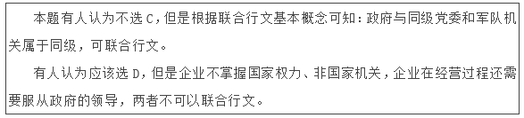

**来源**：2014年北京市公务员录用考试《行测》题第34题

### 第 35 题

科学家通过对周口店北京猿人遗址的长期发掘和研究，发现北京猿人：

A. 洞穴中群居

B. 已经学会使用火

C. 还不能直立行走

D. 不会使用工具

第 35 题 · 答案与解析

**参考答案（粉笔题库参考内容）**

AB

**解析**

根据考古研究，北京猿人已形成原始群，穴居，会用火，能制造工具，采摘果实，猎取野兽，能用简单的语言加上手势交谈。北京猿人用下肢支撑身体，直立行走，上肢与现代人的双手相似。

故正确答案为A、B。

**考点**：文化常识

**来源**：2014年北京市公务员录用考试《行测》题第35题

### 第 36 题

大约六千年前，古巴比伦的人们开始制作黏土代币作为交易的记录。不同形状的黏土代币表示不同的物品。当一次交易需要用到很多代币时，人们就用黏土把它们包裹起来，交易者用削尖的木棍在上面刻上不同的符号，用以表示里面包了些什么。后来一些人想到了更简洁的办法，只需简单地将符号刻在黏土上，就可以表示交易内容，这样就摆脱了烦琐的代币。于是文字被发明了，而这正是文明的开始。

这段文字主要介绍了：

A. 古巴比伦的货币发展史

B. 古巴比伦文字是如何产生的

C. 文字对文明发展的重要意义

D. 古巴比伦人怎样进行商品交换

第 36 题 · 答案与解析

**参考答案（粉笔题库参考内容）**

B

**解析**

本题为中心理解题。

文段通过介绍古巴比伦时代人们在制作黏土代币中的一些变化，引出了文字的产生。文段最后一句“于是文字被发明了”进行点题，主旨应为“古巴比伦文字是如何产生的”，对应B项。

A项，货币发展史在文中没有提及，排除；

C项，文字象征文明的开始，但是本文中没有提到文明的发展，排除；

D项，商品交换不是文段重点，提及商品交换是为了引出“代币—文字”这一中心，排除。

故正确答案为B。

**考点**：关联词-因果

**来源**：2014年北京市公务员录用考试《行测》题第36题

### 第 37 题

中国长江以南的居民最初来自北方，周期性的天灾与持续不断的人口压力迫使汉族逐渐离开黄河流域，迁移到南方，如南宋时就有一次南迁高峰。但是人口流动常常是不易察觉的，通过将地方志中提到的水利工程统计制表，历史学家现在能够说，早在3世纪就有相当数量的移民开始渡过长江，进入拥有季风气候、热带丛林的南方。唐代移民迅速增长，13世纪晚期移民数量达到高峰，之后开始下降，直到1700年相对稳定。此时，中国大半人口已住在长江以南。

对这段文字的主旨概括最准确的是：

A. 描述长江以南的人口迁入史

B. 介绍人口研究方面的新成果

C. 分析中国古代人口大规模迁移的原因

D. 说明人口压力与人口流动之间的关系

第 37 题 · 答案与解析

**参考答案（粉笔题库参考内容）**

A

**解析**

本题为中心理解题。

文段首先通过说明中国古代人口由北向南迁移的原因“周期性的天灾与持续不断的人口压力”，并描述了不同时间段人口迁移的过程，“此时，中国大半人口已住在长江以南”人口重心由北向南的迁移完成。整段文字是对迁移的描述。

因此，结合选项应该选择A项。

B项，文段并未提及，排除；

C项，人口迁移原因在段首即有交代，但是文段中没有进一步进行分析，排除；

D项，与文段第一句话的意思相近，但属于片面信息，排除。

故正确答案为A。

**考点**：主题词

**来源**：2014年北京市公务员录用考试《行测》题第37题

### 第 38 题

“天池”的最早出处大概是《庄子》，原义是指寓言中所说的海，但至少到了南北朝时，人们已开始用“天池”专指那些位于山原之上的湖泊。比如北魏郦道元《水经注》中就特别提到，山西宁武县西南的管涔山上，有一处俗名祁连汨池的湖泊，因其坐落在山原之上，当地人又称其为“天池”。近代以来，随着地理视野的扩大，越来越多景致各异的天池相继进入人们的视野。时至今日，提到天池，在中国知名度最高的有两处，一是吉林长白山天池，另一处则是位于新疆博格达峰下的天山天池。

下列说法能在原文中得到印证的是 ：

A. 《庄子》中提到的天池指的是天山天池

B. 郦道元首先用“天池”指称山原上的湖泊

C. 山西宁武县管涔山上的天池已经趋于干涸

D. “天池”现在的含义与《水经注》相一致

第 38 题 · 答案与解析

**参考答案（粉笔题库参考内容）**

D

**解析**

本题考查对文字细节判断。

根据文段第一句判断，A项错误；

由文段的第二、三句可知，没有说郦道元首先用“天池”指称山原上的湖泊，B项错误；

文段没有提及山西宁武县管涔山上的天池趋于干涸，C项错误；

根据文段最后一句可知，“天池”现在的含义与《水经注》相一致，D项正确。

故正确答案为D。

**考点**：细节判断题

**来源**：2014年北京市公务员录用考试《行测》题第38题

### 第 39 题

在今天南京的清凉山西部，有一段石壁叫鬼脸城，一般认为是古代石头城的遗址，但作为六朝古迹的石头城，却可能不在这里。据专家考证，早在六朝以前，江水就已经逐渐向西迁移。211年，孙权将东吴的政治中心从京口迁到秣陵，并将秣陵改名为建业，次年营建了石头城，东吴大将周瑜曾在石头城操练水兵。这个石头城或应在今天定淮门旁边的四望山上，地势靠近长江。清凉山也叫石头山，不过，它的得名却迟至五代十国，由于江水不断向西迁徙，杨行密所建立的吴国就把石头城迁到了清凉山。

下列说法与原文相符的是：

A. 历史上的石头城曾多次搬迁

B. 孙权营建的石头城靠近长江

C. 清凉山是由杨行密所命名的

D. 石头城始建于五代十国时期

第 39 题 · 答案与解析

**参考答案（粉笔题库参考内容）**

B

**解析**

本题考查细节理解。

A项错误，文段中石头城只经历过一次搬迁，并没有多次搬迁；

B项正确，由“211年，孙权······次年营建了石头城······地势靠近长江”可以得出；

C项错误，杨行密将石头城迁到清凉山，而并非由其命名；

D项错误，石头城始建于三国时期不是五代十国时期。

故正确答案为B。

**考点**：细节判断题

**来源**：2014年北京市公务员录用考试《行测》题第39题

### 第 40 题

徽州文化具有自然与人文、物质文化遗产与非物质文化遗产相融合的整体性特征，独特而集中。村落依山而建，讲究水系与自然的和谐，目连戏和村落、宗族信仰、文化活动紧密联系，徽剧演出的戏台就是村落建筑的组成部分；文房四宝与古建筑中的“文气”融为一体；罗盘制作源于徽州人对堪舆风水的重视；医学与宗族以及山区的药材资源有密切关联；槛联匾额不仅突出了徽州文化的品位，也体现出山区丰富的竹木资源······凡此种种，无不是其文化生态整体性的体现。

这段文字意在说明：

A. 徽州文化的突出特征

B. 徽州文化的组成部分

C. 徽州文化的传承关系

D. 徽州文化的存在基础

第 40 题 · 答案与解析

**参考答案（粉笔题库参考内容）**

A

**解析**

本题为中心理解题。

文段首句提出论点：徽州文化具有自然与人文、物质文化遗产与非物质文化遗产相融合的整体性特征，然后用实例进行论证，结尾与段首再次呼应。全文意在体现徽州文化的特征。

B、C、D三项均未体现徽州文化特征的具体例证，不能涵盖文段主旨。

故正确答案为A。

**考点**：分述句特征-多角度论述

**来源**：2014年北京市公务员录用考试《行测》题第40题

## 材料 1

根据《全国经济普查条例》的规定，国务院决定开展第三次全国经济普查工作：全面调查了解我国第二产业和第三产业的发展规模及布局；了解我国产业组织、产业结构、产业技术的现状以及各生产要素的构成；进一步查实服务业、战略性新兴产业和小微企业的发展状况；摸清我国各类单位的基本情况；全面更新覆盖国民经济各行业的基本单位名录库、基础信息数据库和统计电子地理信息系统。通过普查，进一步夯实统计基础，健全统计工作的部门协调机制和信息共享机制，为＿＿＿＿＿＿＿＿＿＿宏观调控，加快经济结构战略性调整，科学制定中长期发展规划，提供科学准确的统计信息支持。

        国务院将成立第三次全国经济普查领导小组，负责普查组织和实施中重大问题的研究和决策。普查领导小组由国务院领导同志任组长，成员单位包括国务院办公厅、统计局、发展改革委等部门。普查领导小组办公室设在统计局，负责普查的具体组织实施和协调。其中，涉及普查经费方面的事项，由财政部负责和协调；涉及固定资产投资保障方面的事项，由发展改革委负责和协调。国务院其他各有关部门，也要按照各自的职能，各负其责、通力协作、密切配合。

        地方各级人民政府要设立相应的普查领导小组及其办公室，加强领导、认真组织好本地区的普查实施工作。对于普查工作中遇到的困难和问题，要及时采取措施，切实予以解决。要充分发挥街道办事处和居民委员会、乡镇政府和村民委员会的作用，广泛动员和组织社会力量积极参与并认真配合做好普查工作。

        地方普查机构应当根据工作需要，聘用或者从有关单位商调符合条件的普查指导员和普查员，并及时支付聘用人员的劳动报酬，保证商调人员在原单位的工资、福利及其他待遇不变，稳定经济普查工作队伍，确保普查工作顺利进行。

        利用统计电子地理信息系统，全面建立普查区电子地图；＿＿＿＿＿＿＿＿＿＿统计联网直报系统成果；积极推广使用手持电子数据采集设备，努力提高普查工作的信息化水平和效率，减轻基层普查人员的工作负担。

### 第 41 题

根据上下文，填入第1段画线部分最恰当的一项是:

A. 建立和健全

B. 保障和完善

C. 加强和改善

D. 实现和发展

第 41 题 · 答案与解析

**参考答案（粉笔题库参考内容）**

C

**解析**

本题考查实词填空。

A项的宏观调控已经建立了，不能再次建立，排除；

B项的保障与宏观调控不搭配，排除；

C项加强和改善宏观调控为固定搭配，同时呼应下文，当选；

D项的发展与宏观调控不搭配，排除。

故正确答案为C。

**来源**：2014年北京市公务员录用考试《行测》题第41题

### 第 42 题

第1段文字材料的内容可以概括为：

A. 普查的基本内容

B. 普查的主要目的

C. 普查的基本要素

D. 普查的重点内容

第 42 题 · 答案与解析

**参考答案（粉笔题库参考内容）**

B

**解析**

本题考查主旨概括。

第一段“通过普查，进一步······，提供科学准确的统计信息支持”点明了进行普查的目的，B项正确，当选。

A项，普查的基本内容虽然在第一段中有所描述，但是并非该段主旨，是为了通过描述引出段尾中心句，排除；

C项，普查的基本要素在文中没有提及，排除；

D项，理由同A项，排除。

故正确答案为B。

**来源**：2014年北京市公务员录用考试《行测》题第42题

### 第 43 题

根据本文，普查工作组织实施的原则是：

A. 中央政府统一领导、地方政府组织实施

B. 中央政府统一协调、地方政府分工负责

C. 统计局统一领导、其他部门分工协作、地方实施、共同参与

D. 全国统一领导、部门分工协作、地方分级负责、各方共同参与

第 43 题 · 答案与解析

**参考答案（粉笔题库参考内容）**

D

**解析**

本题考查细节判断。

国务院将成立第三次全国经济普查领导小组，负责普查组织和实施中重大问题的研究和决策。体现全国统一领导。

第二段是有关国家机关和部门的分工和职责，体现部门分工协作。

第三段内容体现了地方分级负责。

广泛动员和组织社会力量积极参与并认真配合做好普查工作，体现了各方共同参与。

故正确答案为D。

**来源**：2014年北京市公务员录用考试《行测》题第43题

### 第 44 题

根据上下文，填入最后1段画线部分最恰当的一项是：

A. 深化和普及

B. 巩固和拓展

C. 健全和支持

D. 改进和完善

第 44 题 · 答案与解析

**参考答案（粉笔题库参考内容）**

B

**解析**

本题为实词填空题。

A项的“深化和普及”与成果不搭配，排除；

B项的“巩固和拓展”为固定搭配，符合文意，当选；

C项的“健全和支持”与成果不搭配，排除；

D项的“改进和完善”不符合文意，文段中没有体现电子地图和统计联网直报系统存在问题或者不完善，排除。

故正确答案为B。

**来源**：2014年北京市公务员录用考试《行测》题第44题

### 第 45 题

下列标题中与本文内容吻合度最高的是：

A. 《国务院关于开展第三次全国经济普查的通知》

B. 《国务院关于开展第二、三产业调查统计工作的意见》

C. 《国务院关于进一步加强第三次全国经济普查管理的决定》

D. 《国务院关于进一步加强第三次全国经济普查工作的批复》

第 45 题 · 答案与解析

**参考答案（粉笔题库参考内容）**

A

**解析**

本题考查标题选择。

A项，《国务院关于开展第三次全国经济普查的通知》符合全文结构、内容，当选；

B项，“国务院决定开展第三次全国经济普查工作”与《国务院关于开展第二、三产业调查统计工作的意见》相矛盾，排除；

C项，由文章首句可知，第三次全国经济普查是即将或者刚刚开始，无法体现“进一步加强”，排除；

D项，批复是关于上级单位对于下级申请的回复，文中没有对原申请的体现，排除。

故正确答案为A。

**来源**：2014年北京市公务员录用考试《行测》题第45题

## 材料 2

网络时代巨大的信息量要求网络人际交流迅速快捷，此时，传统语言的表达已不足以将信息转变成最简洁的形式输入输出。于是网络语言应运而生，这种语言以轻松活泼、幽默风趣、戏谑调侃的面目出没于传统媒体，让人耳目一新。比如“美眉”指年轻漂亮的姑娘，“灌水”则指没有实际内容的聊天。

        人们天生有一种追求新奇的心理，构成网络主体的年轻人尤其难以坚持使用传统语言固定完整的本义。汉语本身具有一字（词）多义、适用语境宽泛等特点，方便人们随意改造词语，或将英文字母和网络符号交织在一起，形成一种旧词表新义或新词表旧义的极富个性色彩的新词汇。同时，传统的、固定的现有语汇系统有时也缺少能准确表达网络概念的新词汇，于是吸纳一部分网络语言成为新词，如“猫”(modem)指调制解调器等，丰富了传统媒体的语言表达。

        近年来，许多主流媒体都在互联网上开辟了自己的网站，并设立读者在线交流的论坛，网民（也是读者们）就各种事件发表自己的看法和观点，其中不乏真知灼见。传统媒体因此也经常将一些有见地的发言经过编辑加工后发表，但来自网上的语言会或多或少地留下痕迹。由于网络人际交流匿名、隐匿的独特性，又由于网民主体是追求新潮和前卫的年轻人，因此网络语言会不可避免地偏离传统语言。如果网络语言仅是对规范的主流语言做适度的、局部的非系统性的偏离，传统媒体对此会做出有选择的接受；但如果有些网络语言完全丧失语言的本来面目，将传统规范的语汇彻底变乱，其概念的意指和符指都发生了根本变化，比如那些数字加符号或字母的表达方式和让大多数人群完全不知所云地“去踩一下”等，恐怕就只能限于网上而且仅限于在“小众”之间的交流，很难登上传统媒体的大雅之堂。因此，网络语言对传统媒体的影响，尽管有一个渗透的过程，但传统媒体对网络语言的吸收不会不分良莠地全盘接收，它有一个甄选、保留的过程。

        一般来说，传统媒体注重对规范语言的继承，并在此基础上不断推陈出新，而网络语言则强调对规范语言的偏离。随着时间的推移，这种继承和偏离的相互交融会使一些精辟的网络语言在一段时间内影响传统媒体，并在媒体的表达中与规范的主流语言并存。

### 第 46 题

根据本文，下列哪项不是网络语言盛行的主要原因：

A. 信息科学技术的迅速发展

B. 人们求新求异的心理

C. 网络时代迅速快捷的交际要求

D. 汉语字词的多义性

第 46 题 · 答案与解析

**参考答案（粉笔题库参考内容）**

A

**解析**

本题考查细节理解判断能力。

A项，在文中未提及；

B项，由“构成网络主体的年轻人尤其难以坚持使用传统语言固定完整的本义”可以得出，排除；

C项，由“巨大的信息量要求网络人际交流迅速快捷······有别于中国传统语言的网络语言应运而生”可以得出，排除；

D项，由“汉语本身具有一种一字多义、一词多义、适用语境宽泛等特点······”可以得出，排除。

本题为选非题，故正确答案为A。

**来源**：2014年北京市公务员录用考试《行测》题第46题

### 第 47 题

下列选项中，哪项不属于文中提到的网络新词形成的方式：

A. 新词表旧义

B. 旧词表新义

C. 数字加符号

D. 使用方言词

第 47 题 · 答案与解析

**参考答案（粉笔题库参考内容）**

D

**解析**

本题考查细节判断理解。

由第二段的“英文字母和网络符号交织在一起，形成一种旧词表新义或新词表旧义的极富个性色彩的新词汇”以及“传统的、固定的现有语汇系统有时也缺少能准确表达网络概念的新词汇，于是吸纳一部分网络语言成为新词”可以得出A、B、C三项，在文中均有提及。

D项的“方言词”在文中没有提及。

本题为选非题，故正确答案为D。

**来源**：2014年北京市公务员录用考试《行测》题第47题

### 第 48 题

作者批评了以下哪种网络语言：

A. 美眉

B. 灌水

C. 猫（modem）

D. 去踩一下

第 48 题 · 答案与解析

**参考答案（粉笔题库参考内容）**

D

**解析**

本题考查对文章细节理解把握。

作者对“美眉”“灌水”的评价是“让人耳目一新”；对“猫”的评价是“旧词表达新义”。A、B、C三项都是肯定。

D项作者通过第3段“让大多数人群完全不知所云的‘去踩一下’”是“难登大雅之堂”的，表达了作者对“去踩一下”的否定。

故正确答案为D。

**来源**：2014年北京市公务员录用考试《行测》题第48题

### 第 49 题

作者预测未来的网络语言在媒体中会：

A. 替代传统语言

B. 与传统语言融合

C. 与传统语言并存

D. 逐渐走向消亡

第 49 题 · 答案与解析

**参考答案（粉笔题库参考内容）**

C

**解析**

考查对文章细节理解。

A项，不符合实际，排除；

B项，“融合”与原文“相互渗透······甄选、保留的过程”不相符，排除；

C项，由“随着时间的推移，······一些精辟的网络语言······并在媒体的表达中与规范的主流语言并存”可以得出网络语言会与传统语言共存，当选；

D项，说法本身错误，排除。

故正确答案为C。

**来源**：2014年北京市公务员录用考试《行测》题第49题

### 第 50 题

最适合作为本文标题的是：

A. 网络语言对传统媒体的影响

B. 网络语言的优势与弊端

C. 网络语言与传统语言的区别

D. 迅速快捷的网络人际交流

第 50 题 · 答案与解析

**参考答案（粉笔题库参考内容）**

A

**解析**

本题考查对文章内容概括和标题选择。

文章通过“网络语言的兴起以及原因-对于传统媒体的影响-预测未来”逐步进行阐述，可知文章的中心为“网络语言”以及对“传统媒体”的影响。

因此，结合选项应该选择A项。

B、C两项是文章的部分内容，用来作为标题不够全面，均排除；

D项范围过大，与文章缺少直接关联性，排除。

故正确答案为A。

**来源**：2014年北京市公务员录用考试《行测》题第50题

## 材料 3

从花粉到花生，让人类产生过敏变态反应的东西实在太多了。变态反应研究起步相对较晚，“变态反应”这一术语是儿科医生冯·皮尔凯和贝拉·锡克在20世纪首先提出的。几乎同一时期，“过敏症”使生理学家查尔士·里歇声名远播并荣膺1913年诺贝尔奖。此后多年，变态反应研究始终将过敏视为一种病态或障碍，极少有科学家探询究竟为何存在这种严重而有潜在危险的免疫反应，更不用说免疫系统为什么会以这种方式对貌似无害，却经常充当过敏原的物质作出反应。

        20世纪60年代有关多细胞真核寄生物引发免疫反应的研究回答了这个问题。研究人员发现，人体如果受到蠕虫这种寄生虫的感染会导致高含量免疫球蛋白E的生成，而引起变态反应的正是这一抗体。从那时起，有种观点盛行不衰：在进化中，人体为抵御寄生虫，发生变态反应，却把免疫反应的目标弄错了。

        加利福尼亚大学伯克利分校的玛吉·普罗菲特在1991年对变态反应作出了一种非主流理论解释。她推测，在进化中，变态反应的形成是为了启动免疫系统，保护我们不受环境毒素（例如有毒的植物化学物质和毒液）的伤害。过敏原在多数人看来是无害的，但有很多事实上就是毒素。所以，与其把变态反应看成对蠕虫目标锁定有误的反应，倒不如视之为一种有益的反应，目的在于防御环境中的有毒物质。

        虽然“毒素假设”至今仍不受生物医学界重视，但是其仍有一定合理性。首先，流鼻涕等过敏症状可以理解为身体力求摆脱过敏原的一种尝试，类似于食物和空气中的有毒物质引起类似的驱逐反应。其次，变态反应往往发生在接触毒素后的几秒钟或几分钟内，与需要一定时间方才显现的蠕虫感染相比，有一定差异。此外，患有过敏症的人常对过敏原变得极度敏感，环境中稍有微量便立即反应。考虑到对细菌和病毒的免疫反应都不能如此灵敏，对蠕虫表现得如此敏感就不是那么令人信服了。最后，充当过敏原的物质多种多样。“蠕虫假设”无法解释为什么这么多的物质都能造成变态反应，但“毒素假设”却预料到这些过敏原可能共同具有一种造成伤害的能力。“毒素假设”也无法直接解释面对环境中哪怕是微乎其微的过敏原，肌体为什么有时候会作出如此严重的、潜在致死的过敏反应。

        过敏症的多数患者会发现，变态反应可能有益的说法是令人难以置信的。但是，反应的好处可能类似于疼痛的好处：疼痛固然给人带来不快，但这种不快会帮助我们避开损害我们肌体的环境原，从而使我们更有幸存的可能。

### 第 51 题

关于变态反应研究，下列说法正确的是：

A. 自古以来一直受到重视

B. 过敏症这一术语是由冯·皮尔凯提出的

C. 最初将过敏视为对身体有害的变态反应

D. 贝拉·锡克因在该领域的成就而获得诺贝尔奖

第 51 题 · 答案与解析

**参考答案（粉笔题库参考内容）**

C

**解析**

本题考查细节理解。

A项的“一直受到重视”为无中生有，排除；

B项由“‘变态反应’这一术语是儿科医生冯·皮尔凯和贝拉·锡克在20世纪首先提出的”可知，此项错误，排除；

C项“最初将过敏视为对身体有害的变态反应”与原文“此后多年，变态反应研究始终将过敏视为一种病态或障碍”概念相同，当选；

D项由“‘过敏症’使生理学家查尔士·里歇声名远播并荣膺1913年诺贝尔奖”可知，表述错误，排除。

故正确答案为C。

**来源**：2014年北京市公务员录用考试《行测》题第51题

### 第 52 题

第2段中的“这个问题”指的是：

A. 变态反应的产生机制

B. 人体过敏的反应类型

C. 导致变态反应的基因

D. 对人体损害最严重的过敏原

第 52 题 · 答案与解析

**参考答案（粉笔题库参考内容）**

A

**解析**

本题考查词句理解。

“这个问题”指代的是前文中提到的问题（就近指代原则）——免疫系统为什么会以这种方式对貌似无害，却经常充当过敏原的物质作出反应，即“变态反应”的产生机制。

B、C、D三项在文中均没有表述，排除。

故正确答案为A。

**来源**：2014年北京市公务员录用考试《行测》题第52题

### 第 53 题

玛吉·普罗菲特研究的独特之处在于：

A. 对引发过敏原的毒素进行了系统整理

B. 将变态反应视为身体的一种有益反应

C. 扩大了会导致变态反应的过敏原的范围

D. 界定了导致变态反应的免疫系统的缺陷

第 53 题 · 答案与解析

**参考答案（粉笔题库参考内容）**

B

**解析**

本题考查细节理解。

玛吉·普罗菲特研究的独特之处在于将变态反应视为身体的一种有益反应，即“防御”。可以根据第3段“所以，与其把变态反应看成对蠕虫目标锁定有误的反应，倒不如视之为一种有益的反应，目的在于防御环境中的有毒物质”得出。

故正确答案为B。

**来源**：2014年北京市公务员录用考试《行测》题第53题

### 第 54 题

“毒素假设”的缺陷在于无法解释：

A. 一接触过敏原即发生变态反应

B. 为何存在多种多样的过敏原

C. 变态反应类似于驱逐反应

D. 微量的过敏原会致死

第 54 题 · 答案与解析

**参考答案（粉笔题库参考内容）**

D

**解析**

本题考查细节理解。

“‘毒素假设’也无法直接解释面对环境中哪怕是微乎其微的过敏原，肌体为什么有时候会作出如此严重的、潜在致死的过敏反应”，换言之，就是毒素假设不能解释为什么微量过敏原会致死。

本题为选非题，故正确答案为D。

**来源**：2014年北京市公务员录用考试《行测》题第54题

### 第 55 题

这篇文章暗示我们：

A. 变态反应并非对身体一无是处

B. “蠕虫假设”略胜“毒素假设”

C. 有些过敏是可以主动避免的

D. 过敏症的治疗已取得很大进展

第 55 题 · 答案与解析

**参考答案（粉笔题库参考内容）**

A

**解析**

本题考查隐含主旨理解。

文段对于变态反应的不同理论进行了阐述，着重篇幅介绍了“毒素假设”理论。用最后一段引出文章重点，即“类似疼痛的好处”，强调虽然“难以置信”，但过敏也不完全都是坏事，可能会促使我们避开损害。

因此，结合选项应该选择A项。

B、C、D三项在文中没有明确的阐述，排除。

故正确答案为A。

**来源**：2014年北京市公务员录用考试《行测》题第55题

## 材料 4

2500年前诞生的《孙子兵法》（又称《孙武兵法》），是世界上现存最古老的兵书，代表了中国古代军事思想的最高境界，但是它的作者究竟是谁？

       司马迁在《史记·孙武吴起列传》中说，孙武和孙膑都确有其人，孙武生于春秋末期，孙膑则晚100多年，生于战国，各有兵法传世。由于孙武是春秋末期吴王的客卿，孙膑在战国中期的齐国担任过军师，因此班固在《汉书》中把孙武的兵法叫《吴孙子》，把孙膑的兵法叫《齐孙子》。《吴孙子》就是一直流传于世的《孙子兵法》，而《齐孙子》（《孙膑兵法》）在魏晋时已无记载。

       唐宋以后，有人对《孙子兵法》及作者提出疑问，认为此书源于孙武，却完成于孙膑；也有人认为先秦著作往往不是出自一人之手，唐代杜牧说，孙武的兵法原有数十万言，曹操削其繁剩，笔其精粹，以成此书；近代著名学者梁启超等不但怀疑《孙子兵法》其书为伪，甚至怀疑孙武、孙膑为同一人。

       孙武与孙膑是否同为一人？他们各自是否都有兵书留世？此谜在20世纪70年代山东临沂银雀山汉墓的考古发掘中被解。1972年，临沂地区偶然发现一座汉墓，陪葬品中有大量竹简，其中包括《孙子兵法》(105枚)、《孙膑兵法》（232枚），这批竹简经刮削、烤炙而成，做工精细，两端平整，无刀削痕迹，系先用锯锯成而后锉磨而成。银雀山汉简的形制、书写格式、篇题的处理及各式符号的运用等，均符合汉代的简册制度。

       临沂银雀山汉墓竹简带给世人最大的惊喜，莫过于还原了《孙子兵法》十三篇全貌以及《孙膑兵法》十六篇。经专家整理分析，银雀山竹简中的《孙子兵法》十三篇都有文字保存，这是现存最早的《孙子兵法》版本，成书于西汉初期，是最接近作者原始思想的版本，为校勘和研究《孙子兵法》提供了宝贵的资料，文献价值非同一般。竹简本《孙子兵法》计2300余字，现存内容与宋代版本相比，有100多处不同点，十分值得研究。

       竹简本《孙膑兵法》整理出222枚，共得6000字以上，该兵法在消失了上千年后，失而复得。该书整理出上、下两编，上编可以确定属于《齐孙子》，共十五篇；下编是还不能确定属于《齐孙子》的论兵之作。竹简本篇数大大少于《艺文志》著录本，也不是完善的版本。这些实物证据揭示历史上的孙武、孙膑并非一人，也印证了司马迁《史记》中有关孙武、孙膑记载的真实性，《孙膑兵法》确有其书。

### 第 56 题

唐代杜牧对《孙子兵法》的观点是：

A. 现存版本是根据原著缩减而成的

B. 是由多位作者合著而成的

C. 是后人以孙膑的名义写成的

D. 前部分由孙武完成，孙膑完成后续成书工作

第 56 题 · 答案与解析

**参考答案（粉笔题库参考内容）**

A

**解析**

本题考查细节理解。

由第三段的“唐代杜牧说，孙武的兵法原有数十万言，曹操削其繁剩，笔其精粹，以成此书”可知，杜牧的观点是：《孙子兵法》现存版本是根据原著缩减而成的。

故正确答案为A。

**来源**：2014年北京市公务员录用考试《行测》题第56题

### 第 57 题

关于《孙子兵法》，下列说法正确的是：

A. 曾经失传上千年

B. 班固称其为《吴孙子》

C. 作者生活于战国时期

D. 魏晋之后的史书中已无相关记载

第 57 题 · 答案与解析

**参考答案（粉笔题库参考内容）**

B

**解析**

本题考查细节理解。

A项错误，由最后一段“竹简本《孙膑兵法》······该兵法在消失了上千年后······”可知，消失了上千年的是《孙膑兵法》，排除；

B项正确，由“因此班固在《汉书》中把孙武的兵法叫《吴孙子》，把孙膑的兵法叫《齐孙子》”可知，当选；

C项错误，由原文“孙武生于春秋末期”可知，《孙子兵法》的作者是孙武，生于春秋，排除；

D项错误，由原文“而《齐孙子》（孙膑兵法）在魏晋时已无记载。”可知，魏晋后无记载的是《孙膑兵法》而不是《孙子兵法》，排除。

故正确答案为B。

**来源**：2014年北京市公务员录用考试《行测》题第57题

### 第 58 题

银雀山汉墓竹简不能用来证明：

A. 《孙膑兵法》的作者是谁

B. 司马迁相关记载的可靠性

C. 《孙膑兵法》是否确有其书

D. 孙武、孙膑是否为同一人

第 58 题 · 答案与解析

**参考答案（粉笔题库参考内容）**

A

**解析**

本题考查细节理解。

A项，《孙膑兵法》的作者并没有明确提及，所以不能用来证明，当选；

B项，根据原文“······印证了司马迁《史记》中有关孙武、孙膑记载的真实性。”可以得出，排除；

C项，原文末段“《孙膑兵法》确有其书”可以得出，排除；

D项，“这些实物证据揭示历史上的孙武、孙膑并非一人”可以得出结论，排除。

本题为选非题，故正确答案为A。

**来源**：2014年北京市公务员录用考试《行测》题第58题

### 第 59 题

根据本文，确定银雀山汉墓竹简年代依据的是：

A. 书写文字

B. 陵墓特征

C. 陪葬物品

D. 简册特征

第 59 题 · 答案与解析

**参考答案（粉笔题库参考内容）**

D

**解析**

本题考查细节理解。

A项，书写文字是“简册特征”的一个要素，不全面，排除；

B项，在文中没有提及，排除；

C项，竹简本身就是陪葬物品，无法证明其年代，排除；

D项，根据原文“这批竹简经刮削······银雀山汉简的形制······均符合汉代的简册制度”可知，评判年代的依据是竹简的样式、内容，也就是说是竹简的“特征”，当选。

故正确答案为D。

**来源**：2014年北京市公务员录用考试《行测》题第59题

### 第 60 题

最适合本文的标题是：

A. 银雀山汉墓整理出土大批竹简

B. 银雀山汉墓竹简：为孙武、孙膑正名

C. 银雀山汉墓《孙子兵法》的发现和破译

D. 20世纪的考古大发现——银雀山汉墓竹简

第 60 题 · 答案与解析

**参考答案（粉笔题库参考内容）**

B

**解析**

本题考查标题选择能力。

先提出问题——再通过银雀山考古证据，证明孙武、孙膑并非同一人，《孙膑兵法》确有其书。即银雀山汉墓竹简证明了孙武与孙膑的存在及二者的关系。

因此，结合选项应该选择B项。

A、D两项重点在竹简上，没有体现出考古发现的意义，即无法回答前文提出的问题，排除；C项，由原文可知：银雀山汉墓既发现了《孙子兵法》，又发现了《孙膑兵法》，排除。

故正确答案为B。

**来源**：2014年北京市公务员录用考试《行测》题第60题

## 材料 5

采集蝴蝶标本在维多利亚女王时代的英国非常流行。英国大蓝蝶的标本很受欢迎，它不很大，也不很蓝，并不特别美丽，但数量稀少，且生活在人迹罕至的荒野。即便如此，仍然有大量的大蓝蝶被制作成标本。在19世纪末，已经开始有人呼吁保护它。进入汽车时代，到大蓝蝶栖息地更加方便，有的地方的大蓝蝶已经绝迹，保护更为迫切。1930年，英国建立了第一个大蓝蝶保护区。九年之后，保护区内的大蓝蝶种群灭绝了。此后，虽然保护区越来越多，但是大蓝蝶的数量越来越少。20世纪50年代，英国还有数万只大蓝蝶，到1972年只剩下300多只。1975年，英国通过《野生动植物保护法》，首次把大蓝蝶列为法定保护对象，但已无济于事。1979年，英国最后一只大蓝蝶死去。这是为什么呢？
       每年六、七月间，是英国大蓝蝶飞翔的季节。大蓝蝶成虫的寿命只有四五天，在短暂的生命结束前，雌大蓝蝶必须找到合适的百里香产卵。百里香必须是生长在红蚁巢的边上，而且含苞待放。卵被产在百里香的花蕾里。一两周后，大蓝蝶幼虫孵化出来，就以花为食，大约两周，在蜕了三次皮后，幼虫掉到了地上，等待红蚁。幼虫靠分泌蜜汁吸引红蚁。红蚁将其带回蚁巢，为了得到蜜汁，它会用触角拍打它。蜜汁分泌完时，幼虫就有生命危险，这时它会像红蚁幼虫那样蠕动，发出红蚁的气味和声音，让红蚁误以为它是蚁巢中的一员。

       大蓝蝶幼虫要在蚁巢中整整待上十个月，不仅能躲避天敌，还以红蚁的卵和幼虫为食。<u>但是大蓝蝶幼虫仍然面临重重危险</u>。红蚁蚁后会误以为它是一只以后也将变成蚁后的超级红蚁幼虫，而让工蚁杀死它；如果蚁巢规模太小，或者又来了另一只大蓝蝶幼虫，食物不够，最终也会饿死。

       但红蚁本身对生活环境也有要求：它们喜欢温暖，在朝南向阳的山坡筑巢，地面上草的高度最好只有2~3厘米，因为草太高会遮住阳光，蚁巢温度太低，红蚁幼虫会冻死。当大蓝蝶的栖息地被划为保护区后，禁止烧荒、放牧，野草疯长；本来还有野兔能在一定程度上抑制草的生长，但在20世纪50年代，一种传染性很强的病毒入侵英国，使野兔的数量锐减99%。草越长越高，大蓝蝶依赖的红蚁迅速消失，被另一种较耐寒的红蚁取而代之。这种红蚁也喜欢吃蜜汁，但它们能识破伪装，将大蓝蝶幼虫杀死。等到草皮高度超过10厘米，连百里香也难以生长、繁殖了，等人们发现这一奥秘，已经太迟了，英国大蓝蝶灭绝了。

为了让大蓝蝶再次飞翔，英国逐渐恢复了52处百里香草地，并通过割草、放牧控制草皮的高度，红蚁数量随之上升。1983年，大蓝蝶被从瑞典带到英国。到2008年，已有上万只。大蓝蝶成了第一个成功获得重生的濒危蝴蝶物种。

### 第 61 题

由本文第一段可知：

A. 大蓝蝶在英国对其进行保护前就已经灭绝

B. 大蓝蝶的灭绝是因为人们为制作标本而过量捕捉

C. 大蓝蝶标本受欢迎是因为这种蝴蝶难以捕捉

D. 保护区的建设仅起到了保持大蓝蝶种群数量的效果

第 61 题 · 答案与解析

**参考答案（粉笔题库参考内容）**

B

**解析**

本题考查细节理解能力。

A项错误，由“在19世纪末，已经开始有人呼吁······1979年，英国最后一只大蓝蝶死去”可知，排除；

B项正确，由“即便如此，仍然有大量的大蓝蝶被制作成标本······”可知，当选；

C项错误，文中只说了数量少，没有体现“难以捕捉”，排除；

D项错误，由“九年之后，保护区内的大蓝蝶种群灭绝了”可知，保护区的建设没有保持大蓝蝶的数量，排除。

故正确答案为B。

**来源**：2014年北京市公务员录用考试《行测》题第61题

### 第 62 题

成年大蓝蝶可以活：

A. 两个月左右

B. 五天左右

C. 两周左右

D. 三周左右

第 62 题 · 答案与解析

**参考答案（粉笔题库参考内容）**

B

**解析**

本题考查细节理解。

由文章第二段的“大蓝蝶成虫的寿命只有四五天”可知，B项正确。

故正确答案为B。

**来源**：2014年北京市公务员录用考试《行测》题第62题

### 第 63 题

第三段中画线部分提到大蓝蝶幼虫面临的“重重危险”不包括：

A. 巢中有一只大蓝蝶幼虫

B. 被红蚁蚁后视为竞争对手

C. 红蚁蚁巢规模太小

D. 蚁巢中红蚁幼虫数量过多

第 63 题 · 答案与解析

**参考答案（粉笔题库参考内容）**

D

**解析**

本题考查细节理解。

根据文章第三段。“重重危险”包括：蚁后认为它是超级红蚁幼虫，提前杀死它；蚁巢规模太小，其食量不够；蚁巢中出现另一只大蓝碟幼虫与它竞争。

由此可知，A、B、C三项正确，排除；

D项在原文第三段中未提及，当选。

本题为选非题，故正确答案为D。

**来源**：2014年北京市公务员录用考试《行测》题第63题

### 第 64 题

根据本文，对草地进行管理可以：

A. 减少病毒传播的可能性

B. 增加百里香花蕾的数量

C. 为红蚁提供适宜的生活环境

D. 为兔子提供充足的食物

第 64 题 · 答案与解析

**参考答案（粉笔题库参考内容）**

C

**解析**

本题考查细节理解。

由最后一段“英国逐渐恢复了52处百里香草地，并通过割草、放牧控制草皮的高度，红蚁数量随之上升”得出，对草地进行管理与红蚁数量息息相关。

因此，结合选项应该选择C项。

文中没有提及百里香草地与病毒的关系，A项排除；对草地进行管理与增加花蕾数量以及为兔子提供食物没有直接关联关系，排除B、D两项。

故正确答案为C。

**来源**：2014年北京市公务员录用考试《行测》题第64题

### 第 65 题

英国政府保护大蓝蝶的早期措施可以用下列哪个词来评价？

A. 适得其反

B. 画蛇添足

C. 操之过急

D. 鼠目寸光

第 65 题 · 答案与解析

**参考答案（粉笔题库参考内容）**

A

**解析**

考查对文章主旨信息的把握。

由“无济于事”得知，前期采取措施并没有收到效果，第二、三、四段说明了英国政府早期所采取的措施，不仅没有保护大蓝蝶，反而将大蓝蝶的生存环境破坏殆尽。故用“适得其反”来形容最恰当。

因此，结合选项应该选择A项。

B项的“画蛇添足”比喻做多余不恰当的事，在原文中没有体现，排除；

C项的“操之过急”指处理事情或处理问题过于急躁、性急，原文没有体现出急躁，排除；

D项的“鼠目寸光”比喻目光短浅，缺乏远见，英国政府政策是缺乏事物之间必要联系的研究，不是缺乏远见，排除。

故正确答案为A。

**来源**：2014年北京市公务员录用考试《行测》题第65题

## 材料 6

《拿破仑法典》在世界司法制度史上值得大书一笔，它第一次把资产阶级的生产关系和社会关系用法律形式固定下来，奠定了资本主义统治的法律基础。除总则外，共有3编2281条。第一编是人法，规定了民事权利主体；第二编是物法，规定了各种财产和所有权及其他物权；第三编是关于取得所有权的方法。从内容和结构来看，法典的核心是财产关系，即所有制问题。恩格斯说，它把在消灭了封建专制主义之后刚刚诞生的现代社会的经济生活条件译成了法律语言，他把这部法典称作“典型的资产阶级社会的法典”。

       长期以来，很多人都以为这部法典虽然以拿破仑的名字命名，但他并未直接参与法典的制定，原因是他正四处征战，无暇顾及，只是下令而已。这个误解同法国史书对拿破仑辉煌战绩的片面描述以及法国绘画、雕塑等艺术作品对他赫赫战功的过度渲染有关。实际上，拿破仑不仅下令而且直接、积极参与了法典的制定。他于1799年发动“雾月政变”成立执政府，翌年就成立了“民法起草委员会”，并亲自担任主席。委员会按期完成民法草案，经大理院和上诉院研究修改后，提交参政院讨论修改。参政院围绕草案召开了102次讨论会，拿破仑参加了97次。法典最后经立法院一致通过，于1804年3月21日正式公布实施。最初定名为《法国民法典》，1807年改称为《拿破仑法典》。

       1816年又改称为《民法典》，1852年再度改称为《拿破仑法典》，但从1870年以后，习惯上一直沿用《法国民法典》的名称。这部法典之所以以拿破仑的名字命名，是因为拿破仑的军队走到哪里，就把这部法典带到哪里，他通过法典把资本主义制度推向全欧洲。拿破仑并非一介武夫，他深知，同欧洲封建同盟的殊死搏斗不仅要靠军事力量，更要靠资产阶级法律这无比锐利的武器。他为锻造了这样的武器而感到自豪。

       有人认为拿破仑是个实用主义者，对理论一窍不通，因此《拿破仑法典》只是一种法律工具，根本没有理论价值。这种看法有失偏颇。英国的资产阶级革命早于法国，革命后又经历了长期的复辟和反复辟的较量，特别是1660年还发生了斯图亚特王朝复辟。法国资产阶级革命的爆发比英国晚100多年，但比英国更彻底，原因就在于其理论准备更充分，从文艺复兴运动到启蒙时期准备了数百年。启蒙运动的中心是在法国，因此法国资产阶级在理论上也就表现得更成熟，《拿破仑法典》就是明证。

### 第 66 题

《拿破仑法典》的核心是：

A. 财产关系

B. 社会关系

C. 公民权利

D. 权力结构

第 66 题 · 答案与解析

**参考答案（粉笔题库参考内容）**

A

**解析**

本题考查细节判断能力。

文段的第一段“从内容和结构来看，法典的核心是财产关系，即所有制问题”。

故正确答案为A。

**来源**：2014年北京市公务员录用考试《行测》题第66题

### 第 67 题

根据本文，为什么恩格斯将《拿破仑法典》称为“典型的资产阶级社会的法典”：

A. 在其之后所诞生的宪法法典大多以该法典为效仿对象

B. 是世界上第一部由资产阶级国家起草的国家宪法法典

C. 用法律形式确立资产阶级的生产关系和社会关系

D. 使革命的任务由推翻封建政权转向建立资产阶级政权

第 67 题 · 答案与解析

**参考答案（粉笔题库参考内容）**

C

**解析**

本题考查细节判断能力。

“它第一次把资产阶级的生产关系和社会关系用法律形式固定下来”，说明《拿破仑法典》首次用法律形式确立了资产阶级的生产关系和社会关系。

A、B两项在文中没有体现，排除；

D项，通篇介绍的是《拿破仑法典》而非革命任务，排除。

故正确答案为C。

**来源**：2014年北京市公务员录用考试《行测》题第67题

### 第 68 题

人们会产生拿破仑并未参与《拿破仑法典》制定的误解，是因为：

A. 他反对启蒙主义

B. 感觉他当时戎马倥偬

C. 他是典型的实用主义者

D. 他将立法权完全交给了人民

第 68 题 · 答案与解析

**参考答案（粉笔题库参考内容）**

B

**解析**

本题考查细节理解。

误解的内容在第2段，“长期以来，很多人都以为这部法典虽然以拿破仑的名字命名，但他并未直接参与法典的制定”。因为是“他正四处征战，无暇顾及，只是下令而已”。

故正确答案为B。

**来源**：2014年北京市公务员录用考试《行测》题第68题

### 第 69 题

关于《拿破仑法典》，以下说法正确的是：

A. 于1799年正式公布并开始实施

B. 习惯上一直被称为《法国民法典》

C. 由当时的参政院修改并讨论通过

D. 在“雾月政变”后开始起草工作

第 69 题 · 答案与解析

**参考答案（粉笔题库参考内容）**

D

**解析**

本题考查细节理解。

A项错误，由第2段“······于1804年3月21日正式公布实施······”得出，排除；

B项错误，由文中“最初定名为······1807年改称为······1816年又改称为······1852年再度改称为······”得出，习惯上一直被称为《法国民法典》说法不正确，排除；

C项错误，由第2段“法典最后经立法院一致通过······1807年改称为《拿破仑法典》”得出，排除；

D项正确，由文中“他于1799年发动‘雾月政变’成立执政府，翌年就成立了‘民法起草委员会’”得出，当选。

故正确答案为D。

**来源**：2014年北京市公务员录用考试《行测》题第69题

### 第 70 题

最后一段意在说明：

A. 《拿破仑法典》独特的理念价值

B. 《拿破仑法典》在法国诞生的原因

C. 启蒙思想家对法国资产阶级革命的深刻影响

D. 法国资产阶级革命与英国资产阶级革命的差异

第 70 题 · 答案与解析

**参考答案（粉笔题库参考内容）**

A

**解析**

本题考查隐含主旨。

最后一段是以实例来反驳有些人认为“《拿破仑法典》只是一种法律工具，根本没有理论价值”这一观点。强调《拿破仑法典》的重要意义，也就是《拿破仑法典》的价值。

因此，结合选项应该选择A项。

B项是无中生有，排除；

C项表述片面，对法国革命产生的影响不只是启蒙运动，排除；

D项法国和英国革命之间差异并非文段的重点，排除。

故正确答案为A。

**来源**：2014年北京市公务员录用考试《行测》题第70题

### 第 71 题

已知，问

A. 19500

B. 19900

C. 20300

D. 22500

第 71 题 · 答案与解析

**参考答案（粉笔题库参考内容）**

B

**解析**

。

故正确答案为B。

**来源**：2014年北京市公务员录用考试《行测》题第71题

### 第 72 题

某人乘坐缆车下山，发现每隔半分钟就能看到一架对面上山的缆车。如果所有的缆车速度相同，那么每隔几分钟发一架缆车：

A. 0.25

B. 0.5

C. 1

D. 2

第 72 题 · 答案与解析

**参考答案（粉笔题库参考内容）**

C

**解析**

假设缆车速度为1，由于半分钟相遇一次，所以两架缆车之间的距离为(1+1)×0.5=1，两架缆车的发车时间间隔为1÷1=1分钟。

故正确答案为C。

**考点**：普通行程

**来源**：2014年北京市公务员录用考试《行测》题第72题

### 第 73 题

在正方形草坪的正中有一个长方形池塘，池塘的周长是草坪的一半，面积是除池塘之外草坪面积的1/3，则池塘的长和宽之比为：

A. 1:1

B. 2:1

C. 4:1

D. √2:（2-√2）

第 73 题 · 答案与解析

**参考答案（粉笔题库参考内容）**

A

**解析**

设正方形边长为2，则周长为8，面积为4。池塘面积为除池塘之外草坪面积的1/3，也即为正方形面积的1/4，所以池塘面积为1。设矩形池塘长宽分别为a、b，则有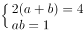，解得：a+b=2。长宽之比为1:1。

故正确答案为A。

**考点**：几何公式类-平面图形

**来源**：2014年北京市公务员录用考试《行测》题第73题

### 第 74 题

某件商品如果打九折销售，利润是原价销售时的；如果打八折后再降价50元销售，利润是原价销售时的1/4。该商品如果打八八折销售，利润是多少元？

A. 240

B. 300

C. 360

D. 480

第 74 题 · 答案与解析

**参考答案（粉笔题库参考内容）**

C

**解析**

设原价为x元，成本价为y元。

根据题意可列方程组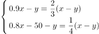，解得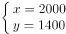，所以八八折时利润为。

故正确答案为C。

**考点**：经济利润问题

**来源**：2014年北京市公务员录用考试《行测》题第74题

### 第 75 题

甲工厂每天生产的零件数比乙工厂的1.5倍还多40个，乙工厂每天生产的零件数比甲工厂的一半多20个。则两个工厂每天共能生产多少个零件？

A. 400

B. 420

C. 440

D. 460

第 75 题 · 答案与解析

**参考答案（粉笔题库参考内容）**

C

**解析**

设甲乙工厂生产零件数分别为x、y个，根据题意有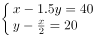，解得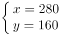。所以共生产零件280+160=440个。

故正确答案为C。

**考点**：和差倍比问题

**来源**：2014年北京市公务员录用考试《行测》题第75题

### 第 76 题

某人开车从A镇前往B镇，在前一半路程中，以每小时60公里的速度前进；而在后一半的路程中，以每小时120公里的速度前进。

则此人从A镇到达B镇的平均速度是每小时多少公里？

A. 60

B. 80

C. 90

D. 100

第 76 题 · 答案与解析

**参考答案（粉笔题库参考内容）**

B

**解析**

方法一：在行驶的过程中，前半段与后半段的路程相等，可直接代入等距离平均速度公式，可得全程的平均速度。

方法二：赋值前半段和后半段的路程均为120公里，则可得前半段花费的时间，后半段花费的时间。则全程的平均速度。

故正确答案为B。

**考点**：平均速度

**来源**：2014年北京市公务员录用考试《行测》题第76题

### 第 77 题

小周买了五件价格不等的服装，总价为2160元。其中最贵的两件衣服总价与其余三件衣服的总价相当，而最便宜的两件衣服的总价比最贵的衣服高100元，比第二贵的衣服高200元。

则第三贵的衣服价格是多少元？

A. 300

B. 330

C. 360

D. 390

第 77 题 · 答案与解析

**参考答案（粉笔题库参考内容）**

D

**解析**

设最便宜的两件衣服价格总和为x元，第三贵的衣服价格为y元，则最贵的衣服价格为：x-100元，第二贵的衣服价格为：x-200元。根据题意有方程组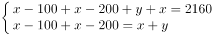，解得：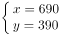。

故正确答案为D。

**考点**：和差倍比问题

**来源**：2014年北京市公务员录用考试《行测》题第77题

### 第 78 题

相邻的4个车位中停放了4辆不同的车，现将所有车开出后再重新停入这4个车位，要求所有车都不得停在原来的车位中，则一共有多少种不同的停放方式？

A. 9

B. 12

C. 14

D. 16

第 78 题 · 答案与解析

**参考答案（粉笔题库参考内容）**

A

**解析**

此题为排列组合中的特殊题型——错位重排问题，只需记住错位重排的几组常用数据即可。其中：、、、、、。4个元素的错位重排共有9种方式。

故正确答案为A。

**考点**：错位排列

**来源**：2014年北京市公务员录用考试《行测》题第78题

### 第 79 题

钟表有一个时针和一个分针，分针每一小时转360度，时针每12小时转360度，则24小时内时针和分针成直角共多少次：

A. 28

B. 36

C. 44

D. 48

第 79 题 · 答案与解析

**参考答案（粉笔题库参考内容）**

C

**解析**

一般情况，每个小时之内会出现2次垂直情况，但是2点~3点（不包括3点时刻）这一个小时之内，只有一次2:27左右能形成直角，另一次是2:60，即3:00的时候成直角，因此2点~3点之内（不包括3点时刻）只有一次直角。8点~9点、14点~15点、20点~21点同理。所以共有24×2-4=44次。

故正确答案为C。

**来源**：2014年北京市公务员录用考试《行测》题第79题

### 第 80 题

某旅行团共有48名游客，都报名参观了三个景点中的至少一个。其中，只参观了一个景点的人数与至少参观了两个景点的人数相同，是参观了三个景点的人数的4倍。

则需要为这些游客购买多少张景点门票：

A. 48

B. 72

C. 78

D. 84

第 80 题 · 答案与解析

**参考答案（粉笔题库参考内容）**

C

**解析**

根据题意，“只参观一个景点的人数与至少参观了两个景点的人数相同，是参观了三个景点的人数的4倍”，且总人数=只参观一个景点人数+至少参观了两个景点的人数=48人，所以，参观了三个景点的人数为，只参观两个景点的人数=至少参观两个景点的人数-参观三个景点的人数=24-6=18人。已知参观一个景点的人需每人买一张票，参观两个景点的人需每人买两张票，参观三个景点的人需每人买三张票，则共需购买景点门票。

故正确答案为C。

**考点**：三集合

**来源**：2014年北京市公务员录用考试《行测》题第80题

### 第 81 题

小张购买了2个苹果、3根香蕉、4个面包和5块蛋糕，共消费58元。如果四种商品的单价都是正整数且各不相同，则每块蛋糕的价格最高可能为多少元？

A. 5

B. 6

C. 7

D. 8

第 81 题 · 答案与解析

**参考答案（粉笔题库参考内容）**

D

**解析**

设苹果的价格为a元，香蕉的价格为b元，面包的价格为c元，蛋糕的价格为d元，则有2a＋3b＋4c＋5d＝58。由于要求蛋糕的价格最高，代入排除，从最大选项开始代入，则使蛋糕的价格为8元，则2a＋3b＋4c＝18。由于2a、4c、18为偶数，则3b为偶数，所以可使b＝2，则有a＝4，c＝1，刚好有2×4＋3×2＋4×1＝18元，符合题意。

故正确答案为D。

**来源**：2014年北京市公务员录用考试《行测》题第81题

### 第 82 题

某单位五个处室分别有职工5、8、18、21和22人，现有一项工作要从该单位随机抽调若干人，问至少要抽调多少人，才能保证抽调的人中一定有两个处室的人数和超过15人？

A. 34

B. 35

C. 36

D. 37

第 82 题 · 答案与解析

**参考答案（粉笔题库参考内容）**

B

**解析**

由于五个处室分别有职工5、8、18、21、22人，问至少要抽调多少人才能保证抽调的人中一定有两个处室的人数和超过15人，也就是保证有两个处室的人数和为16人，其中最不利的情况是：5人的处室中的人可以全部抽调，再从其余4个处室中的3个分别抽调7人，另一个抽调8人，一共抽调5+7×3+8=34人，在此基础上多抽调1人即可满足条件。所以答案为34+1=35人。

故正确答案为B。

**考点**：最不利构造

**来源**：2014年北京市公务员录用考试《行测》题第82题

### 第 83 题

用一个饼铛烙煎饼，每次饼铛上最多只能同时放两个煎饼，煎熟一个煎饼需要2分钟的时间，其中每煎熟一面需要一分钟。如果需要煎熟15个煎饼，至少需要多少分钟？

A. 14

B. 15

C. 16

D. 30

第 83 题 · 答案与解析

**参考答案（粉笔题库参考内容）**

B

**解析**

每次可以煎2面，耗时1分钟。15个煎饼共有15×2=30个面，至少需要煎30÷2=15次，即至少耗时15分钟。

故正确答案为B。

**考点**：周期问题-其他、统筹规划问题

**来源**：2014年北京市公务员录用考试《行测》题第83题

### 第 84 题

某单位组织的羽毛球男单比赛共有48名选手报名参加，比赛采用淘汰赛制，在比赛中负一场的选手即被淘汰，直至决出最后的冠军，如每名选手每天最多参加一场比赛，则比赛至少需要举行几天？

A. 4

B. 5

C. 6

D. 7

第 84 题 · 答案与解析

**参考答案（粉笔题库参考内容）**

C

**解析**

要使比赛的天数最少，则需要每天比赛的选手尽可能地多，加之每名选手每天最多参加一场比赛。

第一天总共比赛48÷2＝24场，还剩24名；

第二天总共比赛24÷2＝12场，还剩12名；

第三天总共比赛12÷2＝6场，还剩6名；

第四天总共比赛6÷2＝3场，还剩3名；

第五天选2人进行比赛，淘汰1人；

剩下2人，第六天决出冠军。

因此，比赛至少需要举行6天。

故正确答案为C。

**来源**：2014年北京市公务员录用考试《行测》题第84题

### 第 85 题

一个20人的班级举行百分制测验，平均分为79分，所有人得分都是整数且任意两人得分不同。班级前5名的平均分正好是16到20名平均分的2倍。

则班级第6名和第15名之间的分差最大为多少分：

A. 34

B. 37

C. 40

D. 43

第 85 题 · 答案与解析

**参考答案（粉笔题库参考内容）**

D

**解析**

要想让班级第6名和第15名之间的分差最大，需要让第6名的成绩尽可能高，第15名的成绩尽可能低，则第6名的成绩要尽可能地接近第5名的成绩，且前5名的成绩差距要尽可能地小，即前6名成绩是连续的自然数，同理，第15名的成绩要尽可能地接近第16名的成绩，且后5名的成绩差距要尽可能地小，即后6名的成绩是连续的自然数。又由于班级前5名的平均分正好是16到20名平均分的2倍，即第3名成绩是第18名成绩的2倍。此时设18名成绩为X，则第3名成绩为2X，因为前6名和后6名都是自然数列，第6名的成绩就等于2X-3，第15名的成绩就等于X+3，此时分差为X-6，要想X最大，那么2X也最大，当第1名为100时，2X最大为98，此时前5名的成绩为100分、99分、98分、97分、96分，则第6名的成绩为95分，由此，后5名的成绩为51分、50分、49分、48分、47分，则第15名的成绩为52分，所以第6名和第15名之间的分差最大为95–52=43分。

故正确答案为D。

**考点**：构造数列

**来源**：2014年北京市公务员录用考试《行测》题第85题

### 第 86 题

从所给的四个选项中，选择最合适的一个填入问号处，使之呈现一定的规律性：

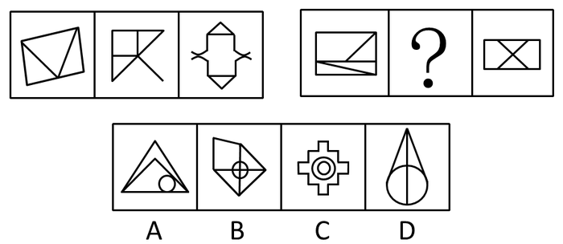

A. A

B. B

C. C

D. D

第 86 题 · 答案与解析

**参考答案（粉笔题库参考内容）**

D

**解析**

元素组成凌乱，考虑数数和属性。

先数封闭区域个数，第一组的封闭区域数都是3，第二组给出图形的封闭区域数都是4，排除B、C两项；一组三个图形的对称轴数量依次为0、1、2，二组给出第一、第三个图形的对称轴数量为0、2，故排除A项，选具有1条对称轴的D项。

故正确答案为D。

**考点**：属性规律-对称性

**来源**：2014年北京市公务员录用考试《行测》题第86题

### 第 87 题

请从所给的四个选项中，选择最合适的一个填入问号处，使之呈现一定的规律性：

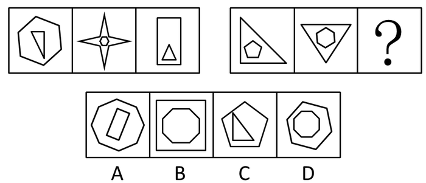

A. A

B. B

C. C

D. D

第 87 题 · 答案与解析

**参考答案（粉笔题库参考内容）**

B

**解析**

元素组成凌乱，考虑线段的数量。给出的每个图形都由内外两个图形构成，第一组的线段数，外部图形多于内部图形，分别为（6，3）、（8，6）、（4，3），内外和依次为9、14、7，未体现规律性，内外差依次为3、2、1，成等差数列；第二组的线段数，内部图形多于外部图形，根据等差数列规律，内外差应依次为2、3、4。

故正确答案为B。

**考点**：数量规律-线

**来源**：2014年北京市公务员录用考试《行测》题第87题

### 第 88 题

请从所给的四个选项中，选择最合适的一个填入问号处，使之呈现一定的规律性：

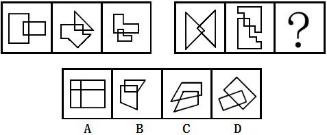

A. A

B. B

C. C

D. D

第 88 题 · 答案与解析

**参考答案（粉笔题库参考内容）**

B

**解析**

每幅图均有两个图形相交，首先排除A项。再重点观察相交处，可知相交部分均为矩形。

故正确答案为B。

**考点**：特殊规律-图形间关系

**来源**：2014年北京市公务员录用考试《行测》题第88题

### 第 89 题

请从所给的四个选项中，选择最合适的一个填入问号处，使之呈现一定的规律性：

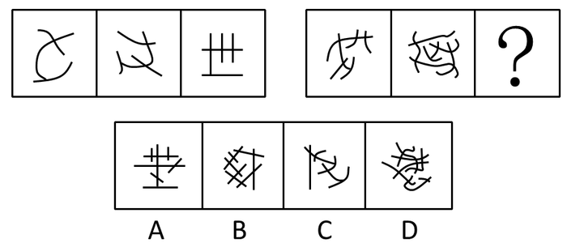

A. A

B. B

C. C

D. D

第 89 题 · 答案与解析

**参考答案（粉笔题库参考内容）**

A

**解析**

元素组成不同，属性无明显规律，考虑数量规律。题干图形线和线交叉明显，考虑数交点。第一组图的交点数量依次为“2、3、4”，第二组图的交点数量依次为“5、6、？”，下一个应为有7个交点的图形。观察可知，只有A项交点数为7。

故正确答案为A。

**考点**：数量规律-点

**来源**：2014年北京市公务员录用考试《行测》题第89题

### 第 90 题

从所给的四个选项中，选择最合适的一个填入问号处，使之呈现一定的规律性：

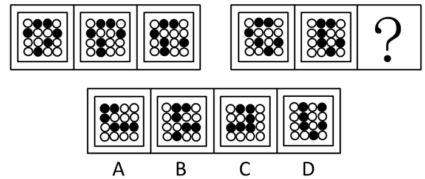

A. A

B. B

C. C

D. D

第 90 题 · 答案与解析

**参考答案（粉笔题库参考内容）**

D

**解析**

各图形的组成元素单一——黑点+白点，个数相同——6个黑点+10个白点，再比较发现黑点的位置不同，所以从黑点的位置变化入手解题。比较相邻的两个图形可以发现，从第二个图形开始，每个图形都是由前一个图形中移动一个黑点得到的，故在四个选项中选择与第二组第二个图形只有一个黑点位置不同的D项。

故正确答案为D。

**考点**：位置规律-平移、黑白块类

**来源**：2014年北京市公务员录用考试《行测》题第90题

### 第 91 题

熟练掌握输入法技能对于提高打字效率至关重要。所以，打字员应参加专门教授五笔输入法的培训班。

以下哪项如果正确，最能削弱上述论证：

A. 只有熟练掌握输入法技能的打字员才参加过专门教授五笔输入法的培训班

B. 只有参加过专门教授五笔输入法培训班的打字员才能熟练掌握输入法技能

C. 一些打字员能熟练掌握输入法技能，但从未参加过专门教授五笔输入法的培训班

D. 有些教授其他计算机技能的机构比专门教授五笔输入法的培训班更有助于学员掌握输入法技能

第 91 题 · 答案与解析

**参考答案（粉笔题库参考内容）**

C

**解析**

第一步：找到论点和论据。

论点：打字员应参加专门教授五笔输入法的培训班。

论据：熟练掌握输入法技能对于提高打字效率至关重要。

第二步：逐一分析选项。

A项：翻译为参加过专门教授五笔输入法的培训班→熟练掌握输入法技能，由论点推出论据，搭桥的方向反了，无法削弱，排除；

B项：翻译为熟练掌握输入法技能→参加过专门教授五笔输入法培训班，从论据搭到论点，为搭桥项，无法削弱，排除；

C项：强调一些打字员能熟练掌握输入法技能，但从未参加过专门教授五笔输入法的培训班，说明没有参加培训班也可以掌握输入法技能，拆断了论点和论据之间的联系，为拆桥项，当选；

D项：强调其他机构比专门教授五笔输入法的培训班更好，那么五笔培训班就不是唯一有助于学员掌握输入法技能的方式，削弱了五笔培训班的唯一性，具有一定的削弱力度，但不如C项直接拆桥力度强，排除。

故正确答案为C。

**考点**：拆桥

**来源**：2014年北京市公务员录用考试《行测》题第91题

### 第 92 题

某教师对美国高中生和中国高中生做了一项测试，他问被测试者相同的问题“一张A4纸如果对折，最多可以折几次”。结果发现，听到问题后，大部分美国高中生马上开始动手折纸，然后根据实际情况回答能折的次数；而大部分中国高中生听到问题后马上回答“无穷多次”。这位教师由此得出结论：美国高中生注重实践，而中国高中生注重理论。

以下哪项是这位教师得出结论所必须假设的：

A. 理论与实践是相互对立的

B. 只要开始动手折纸并根据实际情况来回答问题，就是注重实践

C. 只要开始动手折纸并根据实际情况来回答问题，就是不注重理论

D. 只要马上回答“无穷多次”，就是不注重实践

第 92 题 · 答案与解析

**参考答案（粉笔题库参考内容）**

B

**解析**

第一步：找出论点和论据。

论点：美国高中生注重实践，而中国高中生注重理论。

论据：听到问题后，大部分美国高中生马上开始动手折纸，然后根据实际情况回答能折的次数；而大部分中国高中生听到问题后马上回答“无穷多次”。

第二步：逐一分析选项。

A项：理论与实践是相互对立的，并没有涉及是否开始动手折纸是属于注重理论还是实践，不能加强，排除；

B项：建立了论据“开始动手折纸并根据实际情况来回答问题”和论点“注重实践”之间的联系，属于搭桥项，能加强，当选；

C项：题干讨论的是什么样的表现就是注重实践或理论，而非什么样的表现就是不注重实践或理论，话题不一致，排除；

D项：题干讨论的是什么样的表现就是注重实践或理论，而非什么样的表现就是不注重实践或理论，话题不一致，排除。

故正确答案为B。

**考点**：搭桥

**来源**：2014年北京市公务员录用考试《行测》题第92题

### 第 93 题

某公司有些新入职职工拥有博士学位。该公司所有拥有博士学位的职工都被董事长单独接见过，而该公司所有甲省的职工都没有被董事长单独接见过。

如果以上陈述为真，则以下哪项也一定为真：

A. 有些新入职职工不是甲省的

B. 所有新入职职工都是甲省的

C. 有些新入职职工没有被董事长单独接见过

D. 有些拥有博士学位的职工是甲省的

第 93 题 · 答案与解析

**参考答案（粉笔题库参考内容）**

A

**解析**

第一步：翻译题干。

有些新入职职工→博士；博士→被董事长单独接见；甲省→没被董事长单独接见。

第二步：逐一分析选项。

由“有些新入职职工→博士；博士→被董事长单独接见”可知，有些新入职职工→被董事长单独接见→不是甲省，A项正确、B项错误；

由“有些新入职职工→博士；博士→被董事长单独接见”只能得出“有些新入职职工→被董事长单独接见过”，但不能确定是否有些新入职职工没有被董事长单独接见过，无法确定C项的真假，排除；

由“博士→被董事长单独接见；甲省→没被董事长单独接见”可以推出“博士→不是甲省”，D项错误，排除。

故正确答案为A。

**考点**：集合推理

**来源**：2014年北京市公务员录用考试《行测》题第93题

### 第 94 题

某食品包装上标明：本食品可放心食用，因为其中不含防腐剂和人工色素。

该食品包装上所标明内容最可能假设了以下哪项：

A. 有些食品中含防腐剂和人工色素

B. 安全的食品一定不含防腐剂和人工色素

C. 不含防腐剂和人工色素的食品一定是安全食品

D. 这些食品的生产者抓住了消费者的心理需求

第 94 题 · 答案与解析

**参考答案（粉笔题库参考内容）**

C

**解析**

第一步：分析题干。

论点：本食品可放心食用。

论据：本食品不含防腐剂和人工色素。

第二步：逐一分析选项。

A项：题干中主体是某食品，而A项是有些食品，主体不一致，无关选项排除；

B项：从论点推出论据，搭桥的方向反了，排除；

C项：从论据推出论点，建立了联系，属于搭桥加强，当选；

D项：消费者心理需求和食品安全无关，排除；

故正确答案为C。

**考点**：搭桥

**来源**：2014年北京市公务员录用考试《行测》题第94题

### 第 95 题

健康专家在电视节目中劝说经常饮用纯净水的人群说：“与矿泉水相比，纯净水缺乏矿物质，而其中有些矿物质是人体必需的。所以，你们应该改变习惯，多饮用矿泉水。”

以下哪项最能削弱健康专家的观点：

A. 人体所必需的不仅仅是矿物质

B. 人们可以从其他食物中摄取足够的矿物质

C. 一些经常饮用某品牌矿泉水的人得了肾结石

D. 可以饮用纯净水和矿泉水以外的其他水

第 95 题 · 答案与解析

**参考答案（粉笔题库参考内容）**

B

**解析**

第一步：找出论点和论据。

论点：你们应该改变习惯，多饮用矿泉水。

论据：与矿泉水相比，纯净水缺乏矿物质，而其中有些矿物质是人体必需的。

第二步：逐一分析选项。

A项：指出人体所需的不仅仅是矿物质，可能还需要其他物质，但是这与是否应该多饮用矿泉水无关，无法削弱，排除；

B项：指出人们可以从其他食物中摄取足够的矿物质，那就说明就算矿物质是人体必需的，也不意味着要通过多饮用矿泉水来进行补充，拆断了论点论据之间的联系，可以削弱，当选；

C项：指出一些人饮用某品牌矿泉水得了肾结石，这说明有一些人喝矿泉水有了一些副作用，但是这与题干讨论的通过饮用矿泉水补充人体必需的矿物质无关，无法削弱，排除；

D项：指出可以饮用其他的水，但是具体其他水能不能补充人体必需的矿物质，选项没有表述，无法削弱，排除。

故正确答案为B。

**考点**：拆桥

**来源**：2014年北京市公务员录用考试《行测》题第95题

### 第 96 题

王涛的好朋友都喜欢歌手周某的歌。王涛在某咨询公司工作的同学都不喜欢歌手周某的歌。丽莎既是王涛的同学，也是他的好朋友，米蓝是王涛的同学但不在该咨询公司工作，贺宇是王涛的同学但不喜欢歌手周某的歌。

根据以上陈述，一定可以得出以下哪项：

A. 米蓝喜欢歌手周某的歌

B. 王涛不在该咨询公司工作

C. 贺宇在该咨询公司工作

D. 丽莎不在该咨询公司工作

第 96 题 · 答案与解析

**参考答案（粉笔题库参考内容）**

D

**解析**

第一步：翻译题干。

（1）王涛的好朋友→喜欢周某的歌；

（2）王涛在咨询公司工作的同学→—喜欢周某的歌；

（3）丽莎→王涛的同学且王涛的朋友；

（4）米蓝→王涛的同学且不在咨询公司工作；

（5）贺宇→王涛的同学且不喜欢周某的歌。

第二步：逐一分析选项。

A项：由条件（4）（2）可知，是对条件（2）的否前，否前无必然，故该项无法推出，排除；

B项：由题干无法得知王涛是否在该咨询公司工作，故该项无法推出，排除；

C项：由条件（5）（2）可知，是对条件（2）的肯后，肯后无必然，故该项无法推出，排除；

D项：将条件（1）、（3）、（2）串联：丽莎→王涛的朋友→喜欢周某的歌→—王涛在咨询公司工作的同学。可以得出丽莎不在该咨询公司工作，当选。

故正确答案为D。

**考点**：常规翻译

**来源**：2014年北京市公务员录用考试《行测》题第96题

### 第 97 题

在科学界，我们希望论证中不出现任何“存在预设”。所谓存在预设，即预先设定命题中的主体存在。例如在“孙悟空有火眼金睛”这个命题中，并不预设孙悟空的存在，但在命题“有的花是红的”中，必须预设花的存在。牛顿第一运动定律，断定的是不受任何外力作用的物体必然保持静止状态或匀速直线运动状态。这个定律可能为真，但物理学家在表达和断定它的时候，并没有预设不受任何外力作用的物体存在。

从这段话中可以推出的是：

A. 存在预设取决于命题主体是否真的存在

B. 没有不受外力作用的物体

C. 牛顿第一运动定律不适用于现实

D. 牛顿第一运动定律的论证中不存在“存在预设”

第 97 题 · 答案与解析

**参考答案（粉笔题库参考内容）**

D

**解析**

第一步：抓住题干主要信息。

题干说明了存在预设是指预先设定命题中的主体存在，并通过两个例子来说明。后面重点强调了牛顿第一运动定律，其主体是“不受任何外力作用的物体”，物理学家在表达和断定它的时候，没有预设这个主体的存在。

第二步：逐一分析选项。

A项：“所谓存在预设，即预先设定命题中的主体存在”即在存在预设中，预设主体是存在的，“是否真的存在”与题干意思不一致且推不出，并且“取决于”这一关系题干中也未表明，排除；

B项：“不受外力作用的物体”是牛顿第一运动定律的主体，科学家没有预设这个主体是指在论证的时候没预设，不代表实际上一定没有这样的主体，偷换概念，排除；

C项：题干中未提及牛顿第一定律是否适用于现实，属于无关项，排除；

D项：牛顿第一定律的主体是“不受任何外力作用的物体”，题干中指出物理学家“没有预设”这一主体的存在，即牛顿第一运动定律的论证中没有“存在预设”，当选。

故正确答案为 D。

**考点**：日常结论

**来源**：2014年北京市公务员录用考试《行测》题第97题

### 第 98 题

近来，月嫂收入成为人们讨论的热门话题。有人要求政府加强监管，并质疑月嫂的收入为何能高过一个医学博士的月薪。也有人反驳说，月嫂的收入为什么不能高过医学博士呢？月嫂收入的提高，一方面是市场调节的结果，另一方面反映了我国越来越重视体力劳动，尊重体力劳动者是社会的进步。

下列哪项陈述不能支持反驳者的观点：

A. 收入高低不完全取决于学历高低

B. 有些月嫂非常优秀，具有博士学位

C. 随着新生儿的增多，出现“一嫂难求”的现象

D. 谁能放下身段去赚辛苦钱，谁就值得尊重

第 98 题 · 答案与解析

**参考答案（粉笔题库参考内容）**

B

**解析**

第一步：首先分析题干，找到论点论据。

反驳者的观点即论点是：月嫂的收入超过医学博士是合理的。

包括3个论据：（1）月嫂收入可以高过医学博士；（2）市场调节导致月嫂收入提高；（3）社会进步、尊重体力劳动者导致月嫂收入提高。

第二步：逐一分析选项。

再看选项，A项支持（1），C项支持（2），D项支持（3），即承认了辛苦赚钱得到重视，排除。

B项博士不等于医学博士，范围扩大。即便从医学博士来考虑，其含义为“优秀的月嫂是因为博士学位导致月嫂收入高”，是对反驳者的观点的削弱，当选。

本题为选非题，故正确答案为B。

**考点**：加强选非题

**来源**：2014年北京市公务员录用考试《行测》题第98题

### 第 99 题

某硕士班同学举办毕业20周年聚会，联络人王宁说班里有同学不能参加。班长说：“我看513宿舍的4名同学秋菊、阿春、秀秀和楠楠最多有两人能参加。”团支书说：“班长，我觉得你说得不对。”

如果团支书说得不对，则下列哪项必定为假：

A. 秋菊、阿春、秀秀和楠楠四人中有两人能参加

B. 秋菊、阿春、秀秀和楠楠四人都不能参加

C. 秋菊、阿春、秀秀和楠楠四人都能参加

D. 如果秋菊、阿春能参加，那么秀秀和楠楠也能参加

第 99 题 · 答案与解析

**参考答案（粉笔题库参考内容）**

C

**解析**

第一步：首先翻译题干。

团支书说得不对=班长说得对=“秋菊、阿春、秀秀和楠楠最多有两人能参加”为真。

第二步：逐一分析选项。

A、B两项与“最多两人参加”都不矛盾，都可能为真；C项“秋菊、阿春、秀秀和楠楠四人都能参加”显然与“最多两人参加”矛盾，C项肯定为假；D项是一个假言命题，可能为真。

本题为选非题，故正确答案为C。

**考点**：常规翻译

**来源**：2014年北京市公务员录用考试《行测》题第99题

### 第 100 题

某招考职位规定：凡通过英语专业八级、参加过支教活动的英语专业应届毕业生均有资格报考该职位。张华是北京某名牌大学英语专业的一名应届毕业生，却没有资格报考该职位。

由此一定可以推出的是：

A. 张华没有通过英语专业八级考试

B. 张华没参加过支教活动

C. 如果张华通过了英语专业八级考试，那么他没有参加过支教活动

D. 如果张华参加过支教活动，那么他通过了英语专业八级考试

第 100 题 · 答案与解析

**参考答案（粉笔题库参考内容）**

C

**解析**

第一步：翻译题干。

通过英语专业八级 且 参加过支教活动 且 英语专业应届毕业生 → 有资格报考该职位

第二步：根据题干条件进行推理。

张华没有资格报考该职位，否后必否前，即张华不同时符合上述三个条件。

题干中张华符合英语专业应届毕业生，因此他不能同时符合“通过英语专业八级”、“参加过支教活动”两个条件，即张华应符合“-通过英语专业八级 或 -参加过支教活动”。

A项：仅能得出张华没有通过英语专业八级或没参加过支教活动，无法一定得出张华没有通过英语专业八级考试的结论，无法推出，排除；

B项：仅能得出张华没有通过英语专业八级或没参加过支教活动，无法一定得出张华没参加过支教活动的结论，无法推出，排除；

C项：翻译为“张华通过了英语专业八级考试→—参加过支教活动”，为“-通过英语专业八级 或 -参加过支教活动”的等价替换，可以推出，当选；

D项：翻译为“张华参加过支教活动→通过英语专业八级考试”，张华参加过支教活动是对或关系其中一项的肯定，无法得出确定结论，无法推出，排除。

故正确答案为C。

**考点**：常规翻译

**来源**：2014年北京市公务员录用考试《行测》题第100题

### 第 101 题

统计表明，某国的火车事故多发生在南部地区，因此在北部地区坐火车更安全。

以下哪项最能反驳上述论证：

A. 该国北部的火车车速较慢

B. 该国南部的火车线路比北部多得多

C. 该国南部的许多线路已经使用动车组了

D. 该国北部大部分地区为山区，更适合汽车行驶

第 101 题 · 答案与解析

**参考答案（粉笔题库参考内容）**

B

**解析**

第一步：找到论点和论据。

论点为：“在北部地区坐火车更安全”，也就是说南部火车事故发生率高于北部。

论据：火车事故多发生在南部地区。

第二步：逐一分析选项。

事故率=事故数/运营数。因此，根据题干中“火车事故多发生在南部”的条件，要得出题干的结论，隐含前提是南北部火车线路数（运营数）相同。

B项“该国南部的火车线路比北部多得多”直接否定了这一隐含前提，推翻了题干的论证，符合题干要求，当选；

A项中的火车车速、C项中的动车组、D项中的汽车均属无关项，排除。

故正确答案为B。

**考点**：拆桥

**来源**：2014年北京市公务员录用考试《行测》题第101题

### 第 102 题

英语六级考试结束后，关于王刚、刘超二人是否能通过考试，宿舍同学有如下讨论：

王刚说：或者我能通过，或者刘超能通过，或者我和刘超都能通过。

李强说：王刚一定能通过。

杨帆说：刘超能通过。

赵进说：王刚没有可能通过。

考试成绩出来后，证明四人的话有两人说的是真的，两人说的是假的。

根据以上陈述，可推出以下哪项：

A. 王刚、刘超都通过了

B. 王刚、刘超都没通过

C. 王刚通过了，刘超没通过

D. 刘超通过了，王刚没通过

第 102 题 · 答案与解析

**参考答案（粉笔题库参考内容）**

C

**解析**

第一步：翻译题干。

（1）王刚、刘超至少有一人通过；（2）王刚通过；（3）刘超通过；（4）王刚不通过。

第二步：找到矛盾关系。显见（2）、（4）互为否命题，必有一真一假，再结合题干中两真两假的条件，说明（1）、（3）为一真一假。

第三步：根据上述结论进行推导。

假设（1）为假，则王刚、刘超两人均未通过，这与“（3）为真”即“刘超通过”矛盾，故假设不成立；假设（1）为真，（3）为假，即王刚、刘超中至少通过一人，且刘超未通过，则得出王刚通过，即（2）为真，（4）为假，符合题干。故假设成立，即王刚通过了，刘超未通过。

故正确答案为C。

**考点**：两真两假

**来源**：2014年北京市公务员录用考试《行测》题第102题

### 第 103 题

一类疫苗是国家根据目前国内疾病流行情况以及我国儿童的普遍身体状况规定的必须接种的疫苗，接种费用由政府支付，而其他不属于一类疫苗并且需要家长自费的疫苗属于二类疫苗。由此，家长们普遍认为，二类疫苗只是预防一类疫苗之外的疾病的。

以下哪项最能反驳家长们的看法：

A. 二类疫苗中的五联疫苗可以预防一类疫苗已覆盖的一些疾病，因此可减少接种次数

B. 一类疫苗预防的是可能给孩子带来更大伤害的疾病，二类疫苗则不一定

C. 同一种疫苗在不同的国家和地区可能属于不同类型的疫苗

D. 选择不接种二类疫苗除了经济原因，还有对其安全性的考虑

第 103 题 · 答案与解析

**参考答案（粉笔题库参考内容）**

A

**解析**

第一步：找到论点和论据。

论点：家长的看法为“二类疫苗只是预防一类疫苗之外的疾病的”，即二类疫苗预防的疾病与一类疫苗预防的疾病没有交集。

论据：一类疫苗必须接种，费用由政府支付；二类疫苗由家长自费接种。

第二步：逐一分析选项。

A项通过实例证明“二类疫苗中的某种疫苗可以预防一类疫苗已覆盖的一些疾病”，即二类疫苗预防的疾病与一类疫苗预防的疾病有交集，直接否定了家长的看法，当选；

B项中提到的疫苗的危害性以及D项中经济原因与家长看法没有联系，属于无关项，排除；

C项是可能选项，削弱力度较小，排除。

故正确答案为A。

**考点**：削弱论点

**来源**：2014年北京市公务员录用考试《行测》题第103题

### 第 104 题

某实验室一共有3种类型的机器人，C型能识别颜色、S型能识别形状、X型既不能识别颜色也不能识别形状。3类机器人都能根据简单命令拿起实验品。实验室对1号机器人和2号机器人进行实验，当命令它们拿起红球时，1号拿起的是红方块，2号拿起的是蓝球。

根据上述实验，以下哪项断定一定为真：

A. 1号和2号都是X型

B. 1号和2号都不是X型

C. 1号是C型且2号是S型

D. 1号不是S型且2号不是C型

第 104 题 · 答案与解析

**参考答案（粉笔题库参考内容）**

D

**解析**

第一步，翻译题干。（1）C型能识别颜色——不能识别颜色的不是C型；（2）S型能识别形状——不能识别形状的不是S型；（3）X型既不能识别颜色也不能识别形状——能识别颜色或形状的不是X型。

第二步，根据题干条件进行推理。从题干条件可知，1号不能识别形状，2号不能识别颜色，故选择D项。题干给出的条件不足以说明1号是否能识别颜色、2号是否能识别形状，故不能判断1号、2号确切的类型，排除A、B、C三项。

此题注意两点：（1）若命题“A→B”为真，那么其逆否命题为真，其逆命题、否命题均不一定为真；（2） X型机器人既不识别颜色也不识别形状，而实验品具有一定的随机性，不能因为机器人拿起物品的颜色（或形状）正确而判断其能够识别颜色（或形状）。

故正确答案为D。

**考点**：常规翻译

**来源**：2014年北京市公务员录用考试《行测》题第104题

### 第 105 题

甲、乙、丙、丁、戊、己六位运动员的跳高纪录有如下比较：

(1)乙的成绩比丙好，但不如甲；

(2)丁的成绩不如甲和丙；

(3)戊的成绩好于丁和己，但不如甲和丙。

由此，可以确定：

A. 丁的成绩好于己

B. 己的成绩好于丁

C. 戊的成绩好于乙

D. 乙的成绩好于戊

第 105 题 · 答案与解析

**参考答案（粉笔题库参考内容）**

D

**解析**

第一步：首先分析题干。

（1）甲＞乙＞丙；（2）甲、丙＞丁；（3）甲、丙＞戊＞丁、己。

第二步：根据结论分析。

综合可得：甲＞乙＞丙＞戊＞丁、己。其中，无法确定丁和己谁的成绩更好。根据前面综合的大小关系选择D项。

故正确答案为D。

**考点**：组合排列-单题-其他

**来源**：2014年北京市公务员录用考试《行测》题第105题

### 第 106 题

非我所创综合症或NIH综合症，是社会、公司和组织中的一种文化现象，人们不愿意使用、购买或者接受某种产品、研究成果或者知识，不是出于技术或者法律等因素，而只是因为它源自其他地方。

根据上述定义，下列选项中涉及非我所创综合症的是：

A. 每年九一八纪念日时小李都会将自己的日系车车标摘下

B. 甲国某公司经检验后退回一整批不合格的乙国进口光学器材

C. 某国宣布全面禁止进口日本福岛第一核电站周边8个县水产品

D. 有强烈爱国情结的某国居民只购买本国生产的手机

第 106 题 · 答案与解析

**参考答案（粉笔题库参考内容）**

D

**解析**

第一步：查找关键词。

“非我所创综合症”的定义条件包括：（1）不愿使用、购买或接受；（2）对象为源自其他地方的产品；（3）不是出于技术或法律等因素。

第二步：逐一分析选项。

A项已经购买了日系车，不符合条件（1），排除；

B项不合格的乙国进口产品，C项核电站周边8个县的水产品，均不符合条件（3），排除；

D项“爱国情结”符合（3），“只购买本国”即“不购买他国”，符合（1）、（2），当选。

故正确答案为D。

**考点**：原因结果

**来源**：2014年北京市公务员录用考试《行测》题第106题

### 第 107 题

心理学家认为，在一般情况下，人们都不愿接受较高较难的要求，因为它费时费力又难以成功；相反，人们却乐于接受较小的、较易完成的要求，在实现了较小的要求后，才慢慢地接受较大的要求，这就是“登门槛效应”。

根据上述定义，下列不符合登门槛效应的是：

A. 某推销员总是仔细地记录客户的需求，并定期向他们宣传新产品

B. 先请居民在赞成安全行驶的请愿书上签字，几周后再向他们提出在自己房前竖立“小心驾驶”的语牌

C. 某高中的班主任不忽视学生的每一点进步，并帮助他们制定短期目标，促使他们考上理想的大学

D. 一位万米长跑冠军说：“我将10000米分成10段。每段我都保持了领先，所以赢得了胜利。”

第 107 题 · 答案与解析

**参考答案（粉笔题库参考内容）**

A

**解析**

第一步：查找关键词。

“登门槛效应”的定义条件包括：（1）先实现较小的要求；（2）再慢慢接受较大的要求。

第二步：逐一分析选项。

B、C、D三项均有大小要求的对比，符合定义条件；

A项没有体现从小到大、由易到难的过程，没有体现大小要求的区别。

本题为选非题，故正确答案为A。

**考点**：单定义-其他句式

**来源**：2014年北京市公务员录用考试《行测》题第107题

### 第 108 题

音乐治疗，是一个系统的干预过程，在这个过程中，治疗师利用音乐体验的各种形式，以及在治疗过程中发展起来的、作为治疗动力的治疗关系来帮助治疗对象达到健康的目的。

根据上述定义，下列选项中属于音乐治疗的是：

A. 病人李某无意中听到其他病友推荐的治疗音乐后感觉非常舒服

B. 医生为精神紧张抑郁的周某播放催眠音乐，周某说他感到非常放松

C. 某治疗师给病人听过某些音乐后，病人出现呕吐等不适症状

D. 治疗师王某旅游时在山泉前听到潺潺水声顿觉心旷神怡

第 108 题 · 答案与解析

**参考答案（粉笔题库参考内容）**

B

**解析**

第一步：关键词查找。

“音乐治疗”的定义条件包括：（1）系统的干预过程（有目的性，非偶然）；（2）发出主体为治疗师；（3）方式包括音乐体验的各种形式；（4）达到健康的目的。

第二步：逐一分析选项。

A项“无意中”“其他病友推荐”不符合（1）、（2），排除；

B项中“医生”“播放催眠音乐”“精神紧张抑郁的周某感到非常放松”符合（1）（2）（3）（4）的定义条件，当选；

C项“病人出现呕吐等不适症状”不符合（4），排除；

D项“旅游时”“顿觉心旷神怡”不完全符合（1）、（4），排除。

故正确答案为B。

**考点**：方式目的

**来源**：2014年北京市公务员录用考试《行测》题第108题

### 第 109 题

自媒体是指一个普通市民或机构组织能够在任何时间、任何地点，以任何方式访问网络，通过现代数字科技与全球知识体系相联，并提供或分享他们的真实看法、自身新闻的一种途径和即时传播方式。

根据上述定义，以下哪项行为没有涉及自媒体：

A. 张教授将他的课件传到网上，供学生下载

B. 小李在微博上与网友讨论食品卫生问题

C. 小张将拍摄的“中国式过马路”用电子邮件发给网友

D. 老刘浏览论坛上的关于春运的新闻

第 109 题 · 答案与解析

**参考答案（粉笔题库参考内容）**

D

**解析**

第一步：关键词查找。

“自媒体”的定义条件包括：（1）普通主体在任何时间、地点通过数字科技与全球知识体系联系；（2）提供或分享他们的真实看法、自身新闻。

第二步：逐一分析选项。

A项“课件”可以说是“真实看法”，符合定义，排除；

B项“讨论”显然是在分享“真实看法”，符合定义，排除；

C项“中国式过马路”属于“自身新闻”，符合定义，排除；

D项仅“浏览”，没有发表观点，不符合（2），当选。

本题为选非题，故正确答案为D。

**考点**：方式目的

**来源**：2014年北京市公务员录用考试《行测》题第109题

### 第 110 题

社会体育是由企业、事业单位职工，国家机关工作人员，以及城镇或农村居民等不同的群体，为达到健身、健心、健美、娱乐、医疗等目的而进行的内容丰富、形式多样的身体锻炼活动。

根据上述定义，以下哪项活动不是社会体育活动：

A. 由北京市体委举办的群众长跑运动

B. 某大学举办了教工篮球队与社区篮球队的友谊比赛

C. 某市承办了国际铁人三项赛

D. 在国家奥林匹克体育中心举办的社区居民网球赛

第 110 题 · 答案与解析

**参考答案（粉笔题库参考内容）**

C

**解析**

第一步：查找关键词。

“社会体育活动”的定义条件包括：（1）参与主体：企业、事业单位职工，国家机关工作人员，以及城镇或农村居民等；（2）目的：健身、健心、健美、娱乐、医疗等；（3）内容：形式多样的身体锻炼活动。

第二步：逐一分析选项。

A项主体为群众，目的可以理解为健身，排除；

B项主体为教工、社区居民等，友谊比赛可以理解为健身、娱乐的目的，排除；

C项“国际铁人三项赛”为正规国际体育赛事，参加主体为运动员，不符合（1），“国际比赛”的目的是竞赛，不符合（2），当选；

D项主体为社区居民，目的虽未明示，也与娱乐等比较接近，排除。

本题为选非题，故正确答案为C。

**考点**：方式目的

**来源**：2014年北京市公务员录用考试《行测》题第110题

### 第 111 题

分布式能源，是一种新型的建于用户当地或附近的发电系统，可产生电能及其他形式能量，并优先满足当地用户需求，且由用户来管理支配。

根据上述定义，下列选项中属于分布式能源的是：

A. 葛洲坝水电枢纽发电满足附近省市用电需求

B. 某核电站生产的电能并入了国家电网

C. 某农户将自家化粪池产生的沼气用于照明

D. 西部地区某乡建风力发电站发电用于本村生产生活

第 111 题 · 答案与解析

**参考答案（粉笔题库参考内容）**

D

**解析**

第一步：关键词查找。

“分布式能源”的定义条件包括：（1）新型发电系统；（2）产生电能或其他能量；（3）优先满足当地用户需求；（4）由用户管理。

第二步：逐一分析选项。

A项葛洲坝水电站由国家管理，不符合（4），排除；

B项核电站并入电网由国家管理，不符合（3）（4），排除；

C选项产生的沼气是一种物质资源而不是能量，不符合（1）（2），排除；

D选项中某乡的风力发电站符合定义要求，当选。

故正确答案为D。

**考点**：单定义-其他句式

**来源**：2014年北京市公务员录用考试《行测》题第111题

### 第 112 题

宅经济又称闲人经济，是指人们将假日时间分配在家庭生活、减少出门消费而带来商机的现象。

根据上述定义，下列选项中属于宅经济的是：

A. 十一长假期间，某小区附近的音像店提供光盘上门租借服务

B. 某在线购物网站的客服人员因需要在节假日值班，而在网上定购快餐

C. 放假期间，某镇的甲商场门可罗雀，而乙商场因搞促销而门庭若市

D. 某快递公司在十一长假时订单大幅减少，这是因为很多人去旅游了

第 112 题 · 答案与解析

**参考答案（粉笔题库参考内容）**

A

**解析**

第一步：找出定义关键词。

“将假日时间分配在家庭生活、减少出门消费”、“带来商机”。

第二步：逐一分析选项。

A项：十一长假期间，某小区附近的音像店提供光盘上门租借服务，说明是因为宅家行为产生的商机，符合“将假日时间分配在家庭生活、减少出门消费”、“带来商机”，符合定义，当选；

B项：客服人员因工作需要在节假日值班，不是将时间分配在家庭生活，不符合“将假日时间分配在家庭生活、减少出门消费”，不符合定义，排除；

C项：乙商场门庭若市，说明人们出门消费，不符合“将假日时间分配在家庭生活、减少出门消费”，不符合定义，排除；

D项：快递公司订单大幅减少的原因是很多人去旅游了，说明人们并没有减少出门消费，也没有带来商机，不符合“将假日时间分配在家庭生活、减少出门消费”、“带来商机”，不符合定义，排除。

故正确答案为A。

**考点**：单定义-其他句式

**来源**：2014年北京市公务员录用考试《行测》题第112题

### 第 113 题

超限效应，是指当人们所接受的刺激过多、过强或者作用时间过久时，引起的心理极不耐烦或逆反的心理现象。

根据上述定义，下列不符合超限效应的是：

A. 小林因为妈妈经常唠叨，他决定毕业后到外地找工作

B. 王老师因为儿子意外身亡，上课时无法集中注意力

C. 小方因学习成绩不好，多次受到老师的批评，后来她就放弃了学业

D. 小华连续加班一周，感到非常疲惫，因琐事与家人大吵

第 113 题 · 答案与解析

**参考答案（粉笔题库参考内容）**

B

**解析**

第一步：找出定义关键词。

（1）刺激过多、过强或者作用时间过久；

（2）引起的心理极不耐烦或逆反。

第二步：逐一分析选项。

A项“经常唠叨”“到外地”是“刺激过多、过强或者作用时间过久”引起“心理极不耐烦或逆反”，符合定义，排除；

B项“儿子意外身亡”符合“刺激过多、过强”，“无法集中注意力”不符合（2），当选；

C项“多次受到老师的批评”“放弃了学业”是“刺激过多”引起的“逆反”，符合定义，排除；

D项“连续加班”“非常疲惫”“与家人大吵”是“刺激过多、过强”引起的“心理极不耐烦”，符合定义，排除。

本题为选非题，故正确答案为B。

**考点**：原因结果

**来源**：2014年北京市公务员录用考试《行测》题第113题

### 第 114 题

病毒式营销，是指发起人把产品的最初信息发送到用户，再依靠用户自发进行口碑宣传的一种营销方法。这种战略像病毒一样，利用快速复制的方式将信息传向数以千计乃至百万计的受众。

根据上述定义，下列属于病毒式营销的是：

A. 某公司通过发展客户作为销售渠道，鼓励他们向更多人推销该公司产品

B. 某企业举办广告创意设计大赛活动，让消费者自己设计相关产品的广告

C. 某公司通过电子邮箱随机发送产品广告，并告知转发该广告可参与抽奖

D. 某商家用标新立异的广告词宣传，网友纷纷转发使其迅速成为流行语

第 114 题 · 答案与解析

**参考答案（粉笔题库参考内容）**

D

**解析**

第一步：找出定义关键词。

“病毒式营销”的定义条件包括：（1）发起人把产品的最初信息发送到用户；（2）用户自发；（3）营销方法；（4）快速复制。

第二步：逐一分析选项。

A项：“发展”“鼓励”不符合（2），排除；

B项：“举办广告创意设计大赛活动”“设计”不符合（2）（3），排除；

C项：“抽奖”不符合（2），排除；

只有D项符合所有定义条件，当选。

故正确答案为D。

**考点**：方式目的

**来源**：2014年北京市公务员录用考试《行测》题第114题

### 第 115 题

中国传统医学中“七情”之一的“惊”指突然遭受意料之外的事，引起心神欠稳或脏腑机能失调，之后又遇到异物异声而产生的伴有紧张惊骇的情绪体验。

根据上述定义，下列选项中可以认定为“惊”的是：

A. 李某意外摔下楼梯后昏迷不醒，醒来后未感到异常，只觉得自己睡了一觉

B. 遭遇歹徒劫持的王某被营救后大哭起来，并拉着民警的手连声称谢

C. 赵某目睹车祸惨剧后呆若木鸡，再次看到摩托车紧急刹车时一下子晕倒在地

D. 周某与朋友聊天时得知自己中了500万大奖，他顿时热泪盈眶并跳了起来

第 115 题 · 答案与解析

**参考答案（粉笔题库参考内容）**

C

**解析**

第一步：找出定义关键词。

“惊”的定义条件要点包括：（1）意料之外；（2）心神欠稳或脏腑机能失调；（3）又遇到异物异声；（4）产生的伴有紧张惊骇的情绪体验。

第二步：逐一分析选项。

A项“醒来后未感到异常”不符合要点（2），排除；

B项并未“又”遇到异物异声，不符合要点（3），且要点（2）、（4）没有体现，排除；

C项“目睹车祸惨剧”“呆若木鸡”“再次看到摩托车紧急刹车”“晕倒”符合4项要点，当选；

D项不符合要点（2）、（3）、（4），排除。

此题可抓住“又”也就是“再次遇到”这一关键词排除A、B、D三项，快速选择C项。

故正确答案为C。

**考点**：原因结果

**来源**：2014年北京市公务员录用考试《行测》题第115题

## 材料 7

2001—2010年我国税收统计表

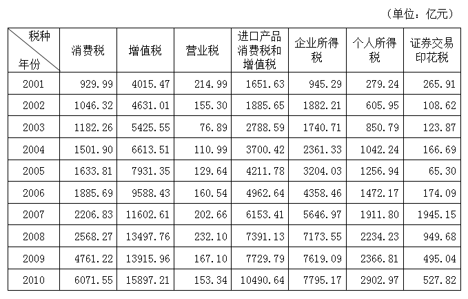

### 第 116 题

2004年个人所得税及同比增长幅度分别约为：

A. 1042亿元，23%

B. 1024亿元，20%

C. 1042亿元，32%

D. 1024亿元，30%

第 116 题 · 答案与解析

**参考答案（粉笔题库参考内容）**

A

**解析**

根据题干“同比增长幅度”，可判定本题为一般增长率问题。定位表格：2004年个人所得税为1042.24亿元，2003年为850.79亿元。根据2004年个人所得税为1042.24亿元，可排除B、D项，个人所得税同比增长幅度，首位商2，排除C项。

故正确答案为A。

**考点**：一般增长率、统计表

**来源**：2014年北京市公务员录用考试《行测》题第116题

### 第 117 题

与2001年相比，2010年税收收入增长幅度最大的是哪个税种：

A. 进口产品消费税和增值税

B. 个人所得税

C. 企业所得税

D. 消费税

第 117 题 · 答案与解析

**参考答案（粉笔题库参考内容）**

B

**解析**

根据题干“增长幅度最大的是”，可判定本题为一般增长率问题。定位表格，可知四类税种2010年和2001年的数据。比较增长率的大小，只需比较现期量/基期量的大小。

A项：进口产品消费税和增值税：；

B项：个人所得税：；

C项：企业所得税：＝；

D项：消费税：。

故与2001年相比，2010年税收收入增长幅度最大的是个人所得税。

故正确答案为B。

**考点**：一般增长率、统计表

**来源**：2014年北京市公务员录用考试《行测》题第117题

### 第 118 题

从2002年至2010年间，表中各项税种收入均比上年有所上升的年份共有几个：

A. 2

B. 3

C. 4

D. 5

第 118 题 · 答案与解析

**参考答案（粉笔题库参考内容）**

B

**解析**

定位表格，从2002-2010年间，各项税收收入均比上年有所上升的年份有2004年、2006年、2007年，共三年。

故正确答案为B。

**考点**：直接找数、统计表

**来源**：2014年北京市公务员录用考试《行测》题第118题

### 第 119 题

按2010年对国家财政的收入贡献对部分税种进行排序，正确的一项是：

A. 个人所得税>进口产品消费税和增值税>企业所得税>增值税

B. 增值税>企业所得税>进口产品消费税和增值税>个人所得税

C. 增值税>个人所得税>企业所得税>进口产品消费税和增值税

D. 增值税>进口产品消费税和增值税>企业所得税>个人所得税

第 119 题 · 答案与解析

**参考答案（粉笔题库参考内容）**

D

**解析**

，由于整体相同，只需比较各项税收收入的大小即可。定位表格数据，增值税最大，排除A项，其次是进口产品消费税和增值税，排除B、C项。

故正确答案为D。

**考点**：排序类、统计表

**来源**：2014年北京市公务员录用考试《行测》题第119题

### 第 120 题

关于2001-2010年我国税收状况，能够从上述资料中推出的是：

A. 消费税年均增长率高于企业所得税

B. 期间内收入波动最大的税种是营业税

C. 增值税的年均同比增量高于其余各税种

D. 进口产品消费税和增值税年均增量超千亿元

第 120 题 · 答案与解析

**参考答案（粉笔题库参考内容）**

C

**解析**

A项：定位表格，消费税2010年为6071.55亿元，2001年为929.99亿元，企业所得税2010年为7795.17亿元，2001年为945.29亿元。比较年均增长率的大小，年份差相同的情况下，只须比较现期量/基期量的大小，其中，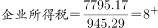，故消费税的年均增长率低于企业所得税，并非高于，错误；

B项：衡量数据波动大小的指标是方差，但是在本题中，方差计算非常复杂，可以先观察数据。其中证券交易印花税最小值为65.30，最大值为1945.15；营业税最小值76.89，最大值232.10。很明显证券交易印花税波动更大，错误；

C项：定位表格，可知2001年和2010年各种税收收入。根据年均增长量公式：，在年份差相同的情况下，年均增量的大小取决于现期量-基期量即增长量的大小。，明显高于其他税种，所以增值税的年均同比增量高于其余各税种，正确；

D项：定位表格，进口产品消费税和增值税2010年为10490.64亿元，2001年为1651.63亿元。根据年均增长量公式：，故进口产品消费税和增值税年均增量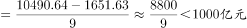，错误。

故正确答案为C。

**考点**：统计表、综合分析

**来源**：2014年北京市公务员录用考试《行测》题第120题

## 材料 8

2012年，建材工业增加值同比增长11.5%，增速回落8个百分点，占全国工业增加值的6.6%。全年水泥产量21.8亿吨、同比增长7.4%，陶瓷砖92亿平方米、同比增长9.4%，天然花岗岩石材4.1亿平方米、同比增长27.2%，平板玻璃7.1亿重量箱、同比下降3.2%，卫生陶瓷产量1.6亿件、同比下降13.1%。

        2012年底规模以上企业3.4万家，全年完成主营业务收入5.3万亿元，同比增长13.4%。尽管水泥、平板玻璃等行业利润总额同比分别下降32.8%、66.6%，但由于水泥制品、轻质建筑材料、建筑陶瓷、耐火材料制品、金属门窗和玻纤增强塑料材料等行业利润总额同比分别增长22.5%、21.8%、33.8%、10.5%、26.9%和30.6%，全行业利润总额仍创3750亿元新高，同比增长3.5%。

        大宗产品产销率呈下降态势，水泥产销率97.3%、同比下降0.6个百分点，平板玻璃产销率95.6%、同比下降0.1个百分点。截至12月份，水泥制造业存货790亿元，同比增加1.8%；砖瓦、石材等建筑材料制造业存货590亿元，同比增加15.7%；玻璃制品制造业存货319亿元，同比增加15.8%。

        2012年行业出口交货值约2250亿元，同比增长7.9%，出口商品离岸价格上涨9.3%。其中，建筑卫生陶瓷、建筑和技术玻璃、玻璃纤维及制品出口额同比分别增长31.5%、10%、5.7%。

### 第 121 题

与2010年相比，2012年建材工业增加值约增长了：

A. 3.5%

B. 19.5%

C. 31.5%

D. 33.2%

第 121 题 · 答案与解析

**参考答案（粉笔题库参考内容）**

D

**解析**

根据题干“与2010年相比，2012年······约增长了”，结合选项为百分数，可判定本题为间隔增长率问题。定位材料第一段：“2012年建材工业增加值同比增长11.5%，增速回落8个百分点”。则2011年同比增幅=11.5%+8%=19.5%，根据间隔增长率计算公式：，2012年建材工业增加值比2010年的增长率，与D项最为接近。

故正确答案为D。

**考点**：文字资料、间隔增长率

**来源**：2014年北京市公务员录用考试《行测》题第121题

### 第 122 题

如2012年建材行业无新增规模以上企业，则当年平均每家规模以上企业完成主营业务收入约比上年增长多少亿元：

A. 0.07

B. 0.18

C. 0.63

D. 1.56

第 122 题 · 答案与解析

**参考答案（粉笔题库参考内容）**

B

**解析**

根据题干“平均每家······收入约比上年增长多少亿元”，可判定本题为平均数的增长量问题。定位材料第二段：“2012年底规模以上企业3.4万家，全年完成主营业务收入5.3万亿元，同比增长13.4%”。由于2012年建材行业无新增规模以上企业，因此2012年底规模以上企业增长率为0%，根据平均数的增长量公式：，故当年平均每家规模以上企业完成主营业务收入比上年的增长量，B项最接近。

故正确答案为B。

**考点**：平均数的增长量、文字资料

**来源**：2014年北京市公务员录用考试《行测》题第122题

### 第 123 题

以下关于2012年产品产量或行业利润总额同比增长率的排序，按从高到低排列正确的是：

A. 产量增长率：水泥>平板玻璃>卫生陶瓷

B. 利润增长率：水泥制品>玻纤增强塑料材料>金属门窗

C. 产量增长率：天然花岗岩石材>卫生陶瓷>陶瓷砖

D. 利润增长率：轻质建筑材料>建筑陶瓷>耐火材料制品

第 123 题 · 答案与解析

**参考答案（粉笔题库参考内容）**

A

**解析**

A项：定位材料第一段，水泥产量增长率为7.4%，平板玻璃产量增长率为-3.2%，卫生陶瓷产量增长率为-13.1%。故水泥＞平板玻璃＞卫生陶瓷，正确；

B项：定位材料第二段，水泥制品利润增长率为22.5%，玻纤增强塑料材料利润增长率为30.6%。故水泥制品利润增长率小于玻纤增强塑料材料，错误；

C项：定位材料第一段，卫生陶瓷增长率为-13.1%，陶瓷砖产量的增长率为9.4%。故卫生陶瓷＜陶瓷砖，错误；

D项：定位材料第二段，轻质建筑材料利润增长率为21.8%，建筑陶瓷利润增长率为33.8%。故轻质建筑材料＜建筑陶瓷，错误。

故正确答案为A。

**考点**：排序类、文字资料

**来源**：2014年北京市公务员录用考试《行测》题第123题

### 第 124 题

如果2012年建筑卫生陶瓷商品出口价格同比涨幅与建材行业出口商品离岸价格同比涨幅相同，则2012年建筑卫生陶瓷商品出口量与上年相比：

A. 下降了1%

B. 上升了1%

C. 下降了17%

D. 上升了20%

第 124 题 · 答案与解析

**参考答案（粉笔题库参考内容）**

D

**解析**

根据题干“2012年建筑卫生陶瓷商品出口量与上年相比”，选项为上升/下降百分数，结合题干和材料数据，已知2012年建筑卫生陶瓷商品出口价格和出口额的增长率，求出口量的增长率，，可类似平均数的增长率进行计算。

定位材料第四段：建筑卫生陶瓷商品出口单价同比涨幅与建材行业出口商品离岸价格同比涨幅相同，即9.3%，出口额同比增长31.5%。根据平均数的增长率公式：，故建筑卫生陶瓷商品出口量的增长率，即上升了20%。

故正确答案为D。

**考点**：平均数的增长率、文字资料

**来源**：2014年北京市公务员录用考试《行测》题第124题

### 第 125 题

以下关于2012年建材行业产销状况的描述，与资料相符的是：

A. 玻璃制品制造业存货同比增速低于水泥制造业

B. 玻璃制品制造业存货比上年增长约30亿元

C. 2012年全年水泥销量超过21亿吨

D. 建材行业利润总额比上年增长约200亿元

第 125 题 · 答案与解析

**参考答案（粉笔题库参考内容）**

C

**解析**

A项：定位材料第三段：“玻璃制品制造业存货同比增速15.8%，水泥制造业存货同比增速1.8%”。故玻璃制品制造业存货同比增速高于水泥制造业，错误；

B项：定位材料第三段：“玻璃制品制造业存货319亿元，同比增速15.8%”。故玻璃制品制造业存货增长量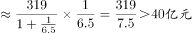，错误；

C项：定位材料第三段：“全年水泥产量21.8亿吨，产销率97.3%”。根据，则2012年全年水泥销量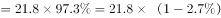，正确；

D项：定位材料第二段：“建筑行业总利润3750亿元，同比增长3.5%”。故建材行业利润总额比上年增长量=，错误；

故正确答案为C。

**考点**：文字资料、综合分析

**来源**：2014年北京市公务员录用考试《行测》题第125题

## 材料 9

2012年国家火炬计划项目总立项数2108项，其中，产业化示范项目1834项，环境建设项目274项。2012年火炬计划重点支持项目445项。2012年，国家火炬计划项目中央财政安排经费3.2亿元支持重点项目。

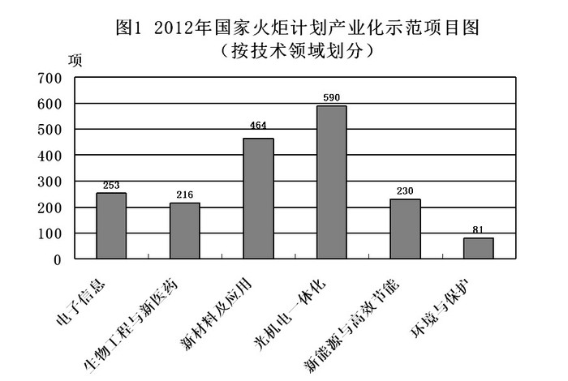

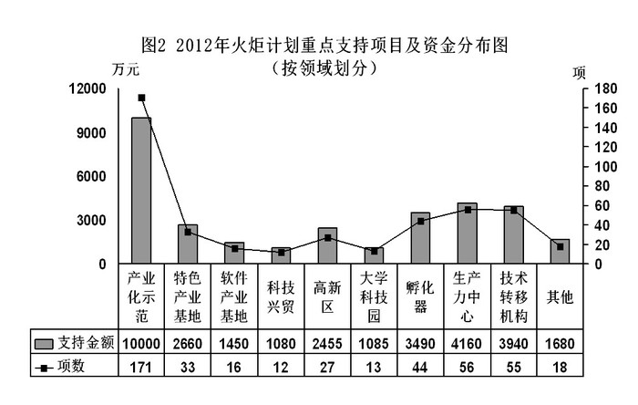

### 第 126 题

2012年国家火炬计划总立项数中，产业化示范项目占比约为：

A. 75%

B. 79%

C. 83%

D. 87%

第 126 题 · 答案与解析

**参考答案（粉笔题库参考内容）**

D

**解析**

根据题干“2012年······占比”，可判定本题为现期比重问题。定位材料第一段：

“2012年国家火炬计划项目总立项数2108项，其中产业化示范项目1834项”。故。

故正确答案为D。

**考点**：现期比重、综合资料

**来源**：2014年北京市公务员录用考试《行测》题第126题

### 第 127 题

产业化示范项目中，立项数最高的技术领域占产业化示范项目总立项数的比重比立项数最低的领域高约多少个百分点：

A. 25

B. 28

C. 32

D. 37

第 127 题 · 答案与解析

**参考答案（粉笔题库参考内容）**

B

**解析**

根据题干“······占······的比重”，可判定本题为现期比重问题。定位材料第一段和图1：2012年，产业化示范项目1834项，其中立项最高的是光机电一体化590项，立项最低的是环境与保护81项。故，即28个百分点。

故正确答案为B。

**考点**：现期比重、综合资料

**来源**：2014年北京市公务员录用考试《行测》题第127题

### 第 128 题

在火炬计划重点支持项目中，平均每个项目获得的支持资金最少的领域是：

A. 孵化器

B. 技术转移机构

C. 大学科技园

D. 产业化示范

第 128 题 · 答案与解析

**参考答案（粉笔题库参考内容）**

D

**解析**

根据题干“平均每个项目获得的支持资金”，可判定本题为现期平均数问题。定位图2，可知每个项目支持资金及项数。，孵化器：；技术转移机构：；大学科技园：；产业化示范：，因此产业化示范平均每个项目获得资金最少。

故正确答案为D。

**考点**：现期平均数、综合资料

**来源**：2014年北京市公务员录用考试《行测》题第128题

### 第 129 题

在2012年火炬计划重点支持项目中有几个领域获得的支持资金超过中央财政安排经费总额的10%？

A. 4

B. 5

C. 3

D. 6

第 129 题 · 答案与解析

**参考答案（粉笔题库参考内容）**

A

**解析**

定位材料第一段：2012年，国家火炬计划项目中央财政安排经费3.2亿元支持重点项目，其10%为3200万元；定位图2可知，产业化示范（10000）、孵化器（3490）、生产力中心（4160）、技术转移机构（3940）获得的支持资金超过3200万元，共4个项目。

故正确答案为A。

**考点**：直接找数、综合资料

**来源**：2014年北京市公务员录用考试《行测》题第129题

### 第 130 题

关于2012年国家火炬计划重点支持项目，能够从上述资料中推出的是：

A. 重点支持项目中产业化示范项目不到1/3

B. 所有的环境建设项目都是重点支持项目

C. 有5个领域的项目数少于重点支持项目总数的5%

D. 产业化示范项目支持经费在重点支持项目中的比重约为40%

第 130 题 · 答案与解析

**参考答案（粉笔题库参考内容）**

B

**解析**

A项：定位材料第一段和图2可知，2012年火炬计划重点支持项目445项，其中产业化示范项目171项。故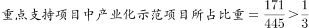，错误；

B项：根据材料第一段可知，所有项目被划分为两个部分：产业化示范项目（1834）和环境建设项目（274）。定位图2，在重点支持项目445项中，产业化示范项目有171项，剩下的445-171=274项全部为环境建设项目，故所有的环境建设项目都是重点支持项目，正确；

C项：定位材料第一段可知，2012年火炬计划重点支持项目445项，总数的5%为22.25项。定位图2，少于22.25项的有软件产业基地（16）、科技兴贸（12）、大学科技园（13）和其他（18）4个领域，错误；

D项：定位材料第一段和图2：重点支持项目经费为3.2亿元，产业化示范项目支持经费1亿元。故，错误。

故正确答案为B。

**考点**：综合分析、综合资料

**来源**：2014年北京市公务员录用考试《行测》题第130题

## 材料 10

据统计，2012年1-10月我国农产品进出口总额1414.48亿美元，较上年同期增长16.27%。其中，出口500.52亿美元，增长4.49%，进口913.96亿美元，增长23.92%。

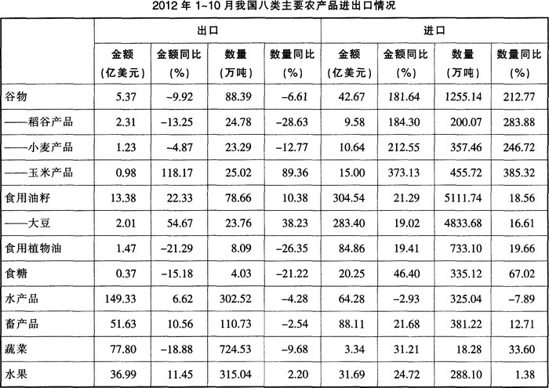

### 第 131 题

2012年1-10月我国八类主要农产品中，进口数量最多的三类是：

A. 食用油籽、畜产品、食用植物油

B. 蔬菜、水果、水产品

C. 食用油籽、谷物、食用植物油

D. 蔬菜、畜产品、水产品

第 131 题 · 答案与解析

**参考答案（粉笔题库参考内容）**

C

**解析**

定位表格可知，食用油籽、谷物、食用植物油的进口数量分别为5111.74万吨、1255.14万吨、733.10万吨，是八大类主要农产品中进口数量最多的三类。

故正确答案为C。

**考点**：排序类、综合资料

**来源**：2014年北京市公务员录用考试《行测》题第131题

### 第 132 题

2011年1-10月我国小麦产品的出口量约比大豆：

A. 少0.5万吨

B. 少3.5万吨

C. 多3.5万吨

D. 多9.5万吨

第 132 题 · 答案与解析

**参考答案（粉笔题库参考内容）**

D

**解析**

根据题干“2011年1-10月我国小麦产品的出口量约比大豆”，结合材料数据为2012年1-10月，可判定本题为基期和差问题。定位表格：2012年1-10月小麦出口23.29万吨，增长-12.77%；大豆出口23.76万吨，增长38.23%。故2011年1-10月我国小麦产品的出口量与大豆相差≈—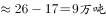。

故正确答案为D。

**考点**：基期和差、综合资料

**来源**：2014年北京市公务员录用考试《行测》题第132题

### 第 133 题

2011年1-10月我国农产品约实现：

A. 贸易逆差413亿美元

B. 贸易逆差259亿美元

C. 贸易顺差413亿美元

D. 贸易顺差259亿美元

第 133 题 · 答案与解析

**参考答案（粉笔题库参考内容）**

B

**解析**

根据题干“2011年1-10月我国农产品约实现”，结合选项顺差逆差，且材料数据为2012年1-10月，可判定本题为基期和差问题。定位材料第一段：“2012年1-10月，农产品出口500.52亿美元，增长4.49%，进口913.96亿美元，增长23.92%”。显然2011年1-10月进口比出口多，贸易为逆差，排除C、D项，，与B项最为接近。

故正确答案为B。

**考点**：基期和差、综合资料

**来源**：2014年北京市公务员录用考试《行测》题第133题

### 第 134 题

与上年同期相比，2012年1-10月我国蔬菜和水果的平均出口单价：

A. 均有所提高

B. 均有所下降

C. 只有蔬菜价格提高

D. 只有水果价格提高

第 134 题 · 答案与解析

**参考答案（粉笔题库参考内容）**

D

**解析**

根据题干“与上年同期相比，2012年1-10月我国蔬菜和水果的平均出口单价”，可判定本题为两期平均数比较问题。定位表格：2012年蔬菜出口金额同比增长-18.88%，出口数量同比增长-9.68%，水果出口金额同比增长11.45%，出口数量同比增长2.20%。根据两期平均数比较结论，当a＞b，平均数较去年提高，当a＜b，平均数较去年下降，，蔬菜：a（-18.88%）＜b（-9.68%），平均数较去年下降；水果：a（11.45%）＞b（2.20%），平均数较去年提高。

故正确答案为D。

**考点**：两期平均数比较、综合资料

**来源**：2014年北京市公务员录用考试《行测》题第134题

### 第 135 题

下列关于我国2012年1-10月八类主要农产品进出口状况的描述与资料相符的是：

A. 有7类主要农产品的出口量同比下降

B. 大豆进口量与食用油籽总进口量的比重不足9成

C. 玉米产品进口金额的同比增速高于稻谷产品和小麦产品

D. 食用植物油的平均进口单价高于水产品

第 135 题 · 答案与解析

**参考答案（粉笔题库参考内容）**

C

**解析**

A项：定位表格可知，谷物、食用植物油、食糖、水产品、畜产品、蔬菜的出口量的同比增长率为负数，即有6类主要农产品的出口量同比下降，错误；

B项：定位表格可知，大豆进口量4833.68万吨，油籽总进口量5111.74万吨。故大豆进口量与食用油籽总进口量的比重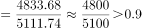，即超过9成，错误；

C项：定位表格可知，玉米、小麦、稻谷进口金额的同比增速分别为373.13%、212.55%、184.3%。故玉米产品进口金额的同比增速高于稻谷和小麦，正确；

D项：定位表格可知，食用植物油进口金额为84.86亿美元，进口数量733.10万吨，水产品进口金额为64.28亿美元，进口数量325.04万吨。，，故食用植物油的平均进口单价低于水产品，错误。

故正确答案为C。

**考点**：综合分析、综合资料

**来源**：2014年北京市公务员录用考试《行测》题第135题

