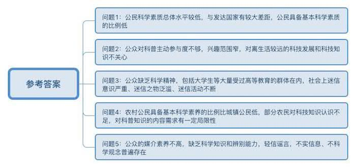
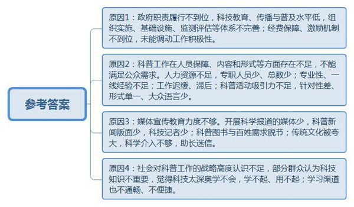
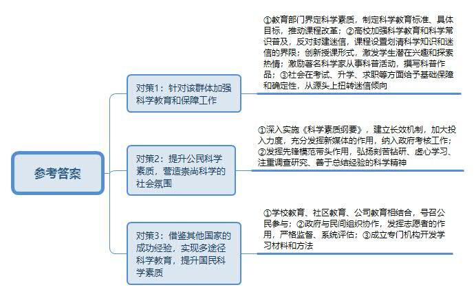
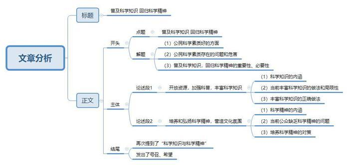

# 2015年北京市公考《申论》题

<!-- gwy:overview:start -->
> **北京 · 2015 · 申论 · 统考** ｜ 4 题 · 图片 4 处 · 答案随题折叠

导航：[题目](#题目) · [材料 1](#材料-1)
<!-- gwy:overview:end -->

> 候选采集稿。参考答案及解析来自粉笔页面，不代表官方答案或真实高分答卷；来源使用许可与原卷对应关系仍需人工核实。

## 给定材料

### 材料 1

科学素质是公民素质的重要组成部分。公民具备基本科学素质一般指了解必要的科学技术知识，掌握基本的科学方法，树立科学思想，崇尚科学精神，并具有一定的应用它们处理实际问题、参与公共事务的能力。

公民科学素质通常用公民科学素质指标（Civic Scientific Literacy，简称CSL）来测量。它是综合性指标，由了解科学知识、理解科学方法、理解科技对个人和社会的影响等三部分构成。

经国家统计局批准，自1992年起，我国共开展了八次公民科学素质调查。调查将“公民对科学的理解程度”作为核心指标，用以测算CSL值。一个公民如果在“了解科学知识”“理解科学方法”“理解科技对个人和社会的影响”三方面都达标了，我们就将其视为“具备基本科学素质的公民”。“具备基本科学素质的公民”数占全体公民数的比值，就是CSL值，通常用百分数表示。

2010年进行的第八次公民科学素质调查结果表明，2010年中国大陆的CSL值为3.27％，比2001年有“明显提升”，但总体水平相对较低，相当于日本、加拿大、欧盟等主要发达国家和地区20年前的水平。另据报道，我国和美国曾同时公布了截止到2007年年底的CSL值，当时美国为25％，我国只有2.25％。

### 材料 2

中共中央、国务院印发的《关于深化科技体制改革加快国家创新体系建设的意见》，明确要求到2015年我国公民具备基本科学素质的比例超过5％。2012年9月北京市委、市政府发布的《关于深化科技体制改革加快首都创新体系建设的意见》中明确提出“到2015年北京公众科学素质达标率超过12％”。2013年9月11日，中国科协和北京市政府签署了《落实全民科学素质行动计划纲要共建协议》，提出的共建目标是：北京市到2015年实现本辖区公民具备基本科学素质的比例超过13.04％。

北京市于1997年首次开展全市公民科学素质调查。据悉，1997年全市具备基本科学素质的公众比例为4.0％，2002年增至6.6％，2007年达到9.2％，2010年升至10.0％。在2010年全国公民科学素质省市排名中，北京市位居全国第二，略低于上海。

调查还显示，虽然不少市民表示对科普感兴趣，但多数人只是口头说说，仅有两成左右主动参观过“高校和科研院所实验室”。这也说明当前的科普活动对公众仍然吸引力不够。市民对“医学与健康”感兴趣的程度远远高于其他方面的科技信息，是排在第二位的“环境科学与污染治理”的1.77倍；“材料科学与纳米技术”“遗传学与转基因技术”“天文学与空间探索”等与生活距离较远的科技发展领域，市民并不关心。

### 材料 3

2006年2月6日，国务院发布了《全民科学素质行动计划纲要（2006~2010~2020）》（以下简称《科学素质纲要》），确定了“政府推动，全民参与”的方针，明确提出了“十一五”至“十二五”期间全民科学素质行动计划的基本目标：到2010年，科学技术教育、传播与普及有较大发展，公民科学素质明显提高，达到世界主要发达国家20世纪80年代末的水平；到2020年，科学技术教育、传播与普及有长足发展，形成比较完善的公民科学素质建设的组织实施、基础设施、条件保障、监测评估等体系，公民科学素质在整体上有大幅度的提高，达到世界主要发达国家21世纪初的水平。

为确保到2015年实现我国公民具备基本科学素质的比例超过5％的目标，国家有关部门提出加强以下几方面的工作：一是着力推动工作长效机制建设，深入实施《科学素质纲要》。二是加大投入力度，为《科学素质纲要》实施提供强力保障。三是做好重点人群工作，扎实推动全民科学素质提升。大力组织实施未成年人、农民、城镇劳动者、领导干部和公务员、社区居民科学素质行动。努力提高城镇居民、青少年、农村妇女、边境地区群众等重要群体的科学素质。四是充分发挥新媒体的作用，大力提升科技传播能力。五是完善政策措施，进一步调动科技工作者从事科普工作的积极性。

为推动《全民科学素质行动计划纲要》，2013年，中国科协先后与北京、山东、江苏等20个省级政府及新疆生产建设兵团，签订《落实全民科学素质行动计划纲要共建协议》。与此同时，河北、山西、江苏、浙江等省将全民科学素质工作纳入了政府考核工作中。有些省级政府还分别与其所辖市县签订目标责任书，对其所辖地区“十二五”末公民科学素质的目标值和科普经费保障能力提出具体要求。

### 材料 4

华罗庚是一位当代自学成才的蜚声中外的数学家，是中国理论数学的创始人与开拓者。他的研究涉及多元复变函数、数论、代数及应用数学几个领域。华罗庚一共发表学术论文150多篇，著有10部专著（其中8部在国外出版，有些被译成俄、日、德、匈、英等文字），由于其成就杰出，被选为美国科学院外籍院士，第三世界科学院院士，德国南锡大学、美国伊利诺大学、香港中文大学荣誉博士，德国巴伐利亚科学院院士。

在研究之余，华罗庚坚持从事科普活动，一共写了10余部科普作品。他还是中国中学生数学竞赛活动的首倡者和主导者，从1956年至1979年，在中国倡导组织了全国中学生数学竞赛活动。为指导这个活动，他还亲自为中学生写过5本通俗易懂的小册子。

### 材料 5

1994年，中共中央、国务院下发了《关于加强科学技术普及工作的若干意见》，把科普工作提到国家兴旺和民族强盛的战略高度。2002年，《中华人民共和国科学技术普及法》出台，明确规定了政府及相关部门在科普方面的职责，提出科普是全社会的共同任务。

科普工作的推进需要大量的人力资源。统计数据显示，2009年全国共有科普人员180.84万人。其中，科普专职人员23.42万人，占科普人员总数的12.95％。也就是说，加上兼职人员，全国每万人口中拥有的科普人员仅为13.55人（2009年全国科普兼职人员人均投入工作量为1.46个月）。

“我们要号召科技战线的人员都投入到科普工作第一线去，研究怎么将科普工作、科学道德和社会的道德精神建设结合起来。”某专家向媒体这样表示。

### 材料 6

某专家发表文章说，文革前，由于多年科学常识的普及和反对封建迷信的教育，虽然在民间可能残留一定的迷信观念，但是至少在人们的行为和思维上，这种东西基本没有什么市场。文革结束后，原来的极“左”政策得到迅速纠正，但与此同时，一些宣扬封建迷信的东西也死灰复燃。

文章中提到，气功本是我国传统文化优秀宝库中的一部分，但在上世纪80年代至90年代，由于科学介入得不够，气功中很多超乎实际的功能被无限夸大，为一些骗子行骗开了绿灯。再往后，迷信的东西逐渐泛滥。算命、看相、风水、卜卦等活动，一一浮现，像野草一样疯长。某些高校借着弘扬传统文化的旗号，提出要开风水课，说这不是迷信。

文章指出，现在不要说文化程度不高的人们，就是在接受过高等教育的群体中，迷信意识严重，迷信行为甚至成为一种时髦。他们的行为，丝毫都没有体现出他们受过科学教育。这让人感到很困惑。

### 材料 7

某省的调查显示，目前该省农村公民具备基本科学素养的比例为2.1％，即100人中有2.1人达标，比城镇公民基本科学素养2.8％的比例低0.7个百分点。有65.03％的农民认为科学知识重要，有农业科普方面的需求，他们中多数人受惠于农业科技，并通过农业科技发展起致富项目。认为科技知识一般或不重要的占34.97％，他们觉得科技太深奥学不会，或是没钱学不起、学得起用不起。

电视、广播和互联网是该省农民了解科技知识最主要的三种渠道，比例分别为45.71％、17.40％和12.70％，而通过报刊了解的较低，只有9.51％。农民最喜欢的交流方式是“农科110”，接近60％的农民认为打电话询问专家既清楚又方便。“专家大院”虽然是近几年才开展的便民活动，但还是有37.0％的人爱向专家问长问短。

在科普知识的内容方面，有47.90％的被调查者认为重点应放在特色经济上，指导发展高效农业；有38.80%的农民希望重点放在大宗农作物上。

### 材料 8

某报记者对全国部分媒体的抽样调查显示，目前我国开展科学报道的媒体相对较少。中国发行量最大的都市报、晚报等，几乎都没有设置科学新闻版面。这些报纸一般都有专门的时政记者、娱乐记者、体育记者和财经记者，但鲜有科技记者。报纸上即使有科技新闻，一般也是安排在比较靠后的版面，篇幅不大。

就图书而言，国家每年印刷的科普图书数量并不算少，但与百姓需求还有一定的距离。现在经济高速发展、物质极大丰富，国内却出不来一套能够像《十万个为什么》那样包罗万象、融汇古今又通俗易懂、妙趣横生的百科全书。

该记者指出，广大科技人员本应是科普工作的依靠力量，是科普作品的源头，但目前科技工作者的科普热情不高，在科普工作中的作用远没有发挥出来。从事科普创作20余年的某教授坦言：“写科普作品无名，科普既不能当研究成果，不能为提职添砖加瓦，也没有多大的经济效益。现在的科技工作者，大部分人都对科普创作不感兴趣。”

该记者还指出，“用大众语言把科学问题讲清楚很难，并不是所有科研工作者都适合做科普工作者，我们需要更专业的科普工作者。”

### 材料 9

近年来，每一个成为热点的科普话题，几乎都是由公众关注的社会事件引发的，诸如“非典”的肆虐，让公共卫生及健康教育成为热点；日本核事故及中国出现的所谓“盐荒”，也再次掀起一波与核相关的科普宣传；近期出现的食品安全问题，又使人们对添加剂倍加关注……与此同时，诘问之声不断：从三聚氰胺、绿豆治病到食用盐脱销、西瓜膨大剂，为什么总是在食品等安全问题发生后，专家学者才出来解答？为什么科普工作总是滞后？

突发性公共事件中，公众急切想要了解相应的科技知识、消除不必要的恐慌，但与此同时，科学家的声音却十分微弱和迟缓。对此，一些人认为，“这与我国普遍存在的轻科普现象有很大的关系。”

### 材料 10

高考期间，网络上大量转载“丢准考证”的消息，这是网络骗子在利用人们“助人为乐”的心理进行电话吸费诈骗；热点事件中，网络上充斥着大量“现场照片”，其实大部分是陈年旧图，事后证明此类信息多为子虚乌有；诸多反复出现的“生活小窍门”“养生知识”，其实已被权威机构证伪……

2013年8月1日，在北京市互联网信息办公室、首都互联网协会的指导下，6家网站共同发起的北京地区网站联合辟谣平台正式上线。这是全国首个集宣传、教育、举报、公示、互动等功能于一体的互联网联合辟谣平台，一上线即整合汇集数据10万余条。前述的网络谣言、不实信息，被一一呈现，轮流曝光。

北京地区网站联合辟谣平台还有一大使命——对公众的媒介素养教育。平台相关负责人介绍，下一步将增强平台互动性，陆续推出谣言有奖举报、谣言分级评估、防忽悠互动游戏、谣言识别测试等特色栏目。

此外，还将依托“谣言粉碎报告”“谣言识别测试”等素材，制作辟谣社区宣传册，加大对非主力上网群体的辟谣知识普及力度。

### 材料 11

在2010年的公民科学素质调查中，相对于劳动者，大学生群体的CSL值相对较高。但近年来，媒体报道的一些高校学生的迷信活动，引起了社会的广泛关注。一是星座占卜。学生中流行用星座占卜来预测运程、解说个性，不少学生对星座占卜中所谓的幸运日、幸运数字和幸运色痴迷。二是算命。一份调查显示，“有点相信”“很相信”网上算命的学生分别达到了41%和5%。此外，还有11%的学生表示遇到某些难以决定的事，会以网上算命为决定依据。三是烧香、膜拜，佩带护身符。遇到考试、升学、求职等问题的时候去烧香拜佛，乞求神灵的保佑。不少学生佩戴护身符以求得平安。再比如有段时间，不少大学生到北京卧佛寺烧香，他们竟然能将“卧佛寺”跟英语“office”（“办公室”的谐音）联系在一起。

对此，一位专家评论说，“过去说科普，我们总是在说发了多少书，做了多少讲座，搞了多少活动。现在信息传播这么发达，获取科学知识比以前要容易许多。当前，公众特别缺乏的是科学精神，这是科普工作更应当关注的。”

### 材料 12

2013年6月20日上午，神舟十号航天员在天宫一号上开展了别开生面的太空授课。太空授课由女航天员王亚平担任主讲。10时04分设在中国人民大学附属中学的地面课堂开始上课，师生们共同观看了讲述航天员太空生活的电视短片《航天员在太空的衣食住行》。10时11分，地面课堂建立与天宫一号的双向通信链路，太空授课正式开始。在大约40分钟的授课中，航天员通过质量测量、单摆运动、陀螺运动、水膜和水球等5个基础物理实验，展示了失重环境下物体运动特性、液体表面张力特性等物理现象，并通过视频通话形式与地面课堂上的师生们进行了互动。据统计，全国8万余所中学6000余万名师生同步组织了收听收看。

对于此次太空授课，很多网友表达了欣喜之情，网友“流弊”留言道，“多有意思的太空一课，久别课堂的我也享受了美妙的一刻！还可以让更多孩子对宇宙和太空产生兴趣！”网友“杨衒之”说，“直播太空授课把科学的种子播撒在孩子们的心灵。它将激发许多孩子的潜在兴趣和探索热情，未来中国优秀的科学家、宇航员就从他们中产生。”网友王康景说，“以前总是在国际空间站里看到这些有趣的东西，如今我们国家自己也可以做到了。这只是开始。”

### 材料 13

1985年，美国科学促进协会联合美国科学院等12个机构启动“2061计划”，致力于中小学课程改革，提升国民科学素质。之后，美国科学教育界又着手制定了全美科学教育标准，界定了科学素质，确定了本国公民科学素质教育的内容，并特别强调工程／技术教育、环境教育、健康教育；制定了具体的目标和学习标准；提出了多阶段实施的计划及其策略。美国公民科学素养建设的主要实施途径有三种：一是学校教育；二是社区教育；三是公司继续教育。

英国公民科学素质建设主要实施途径有两种：一是学校教育，包括科学课程、设计与技术课程等。政府规定，在学段三之前，学生都要学习科学课程；学段四时，学生可以根据实际情况选择单学科或双学科科学课程。二是非学校教育。非学校教育中公民科学素质建设的实施，主要通过政府、研究机构、学术团体、某些基金组织、企业、社区以及各类媒体、博物馆、图书馆等进行。公民参与是英国公民科学素质教育的重要特点。

印度于1988年开始实施“国家素质行动计划”（National Literacy Mission，简称NLM）。该运动获得了1999年联合国教科文组织颁发的NOMA素质奖。自成立之日起，印度“国家素质行动计划”就采取措施加强与非政府组织的合作伙伴关系，促使志愿者组织在国家素质运动中发挥作用。NLM对在其议程下发起的成人教育项目强调严格的监督和系统的评估，并制定颁发了有关项目过程、最终结果的评估条例及项目资助比例，在NLM项目中，中央和邦政府对一般地区的资助比例为2：1。

加拿大于1987年专门成立国家素质秘书处，负责公民科学素质建设工作。秘书处的工作目标主要是开发学习资料和方法，改进申请项目的途径与范围，增大项目受益面及加强科学素质建设协调与资源共享等。秘书处还与省一级政府、非政府组织、商业和劳工组织等密切合作，共同推进加拿大素质建设。

### 材料 14

焦裕禄只有4年小学文化程度。1953年，在洛阳矿山机器厂工作的焦裕禄，硬是通过刻苦学习弄懂了工厂生产的相关专业知识；1956年，他被任命为车间主任。为了试制国内尚且没有的重达108吨的大型卷扬机，他住在车间，吃在机器旁，带领工人夜以继日、合力奋战，攻克一个个难关，终于试制成功了直径4米的卷扬机。1962年12月，焦裕禄调任兰考县任县委书记。

焦裕禄刚到兰考时，兰考风沙为害甚烈，他为治沙费了不少心血。他在张庄调研时听说村里有一座坟，不知道用什么方法封固的，几年来一直没让风沙搬走。焦裕禄当时就把坟主人找来，坟主人说他先用沙土封，然后把沙土底下的胶泥挖出来，盖在坟上，这样无论刮多大风，坟都没动过。随后焦裕禄就搞了一个封固沙丘的实验，4个小时封固了一个30亩大小的沙丘，后来，焦裕禄总结出三条治沙经验：第一条是翻淤压沙，立竿见影；第二条是育草固沙，当年见效；第三条是造林固沙，这是百年大计。这三条经验都是他在精心调研过程中向当地群众虚心学来的。

焦裕禄治理盐碱地的经验也来自群众，他在乡村走访时发现，有一家农户种的菜比其他人都要好得多，就连忙向这家农户请教。原来，这家农户只是种菜时对盐碱地进行了较深的翻整。焦裕禄在这家农户经验的基础上经过反复摸索，最后确定了在盐碱斑处挖深沟，将挖出的土堆在两边，经太阳暴晒后再回填，同时加入杂草，然后灌水、洗盐压碱来改良。从此兰考人民治碱有了良方。

## 题目

### 第 1 题

**阅读给定材料，概括当前我国公民科学素质方面存在的主要问题。（20分）**

关联材料：材料 1、材料 2、材料 3、材料 4、材料 5、材料 6、材料 7、材料 8、材料 9、材料 10、材料 11、材料 12、材料 13、材料 14

作答要求：

要求：概括准确全面；语言简练；字数不超过300字。

第 1 题 · 答案与解析

**参考答案（粉笔题库参考内容）**

一、公民科学素质总体水平较低，与发达国家有较大差距，公民具备基本科学素质的比例低。

二、公众对科普主动参与度不够，兴趣范围窄，对离生活较远的科技发展和科技知识不关心。

三、公众缺乏科学精神，包括大学生等大量受过高等教育的群体在内，社会上迷信意识严重、迷信之物泛滥、迷信活动不断。

四、农村公民具备基本科学素养的比例比城镇公民低，部分农民对科技知识认识不足，对科普知识的内容需求有一定局限性。

五、公众的媒介素养不高，缺乏科学知识和辨别能力，轻信谣言，不实信息、不科学观念普遍存在。

**解析**

**参考答案说明：**参考答案从“总体水平”“科普参与度”“科学精神”“媒介素养”等不同的方面进行了分条撰写。各条答案要点之间在内容上是并列关系，没有交叉。

**考点**：问题类

**来源**：2015年北京市公考《申论》题

### 第 2 题

**阅读给定材料，结合实际，请对当前我国社会“轻科普”的原因进行分析。（20分）**

关联材料：材料 1、材料 2、材料 3、材料 4、材料 5、材料 6、材料 7、材料 8、材料 9、材料 10、材料 11、材料 12、材料 13、材料 14

作答要求：

要求：分析合理；条理清楚，语言简练，字数不超过300字。

第 2 题 · 答案与解析

**参考答案（粉笔题库参考内容）**

一、政府职责履行不到位，科技教育、传播与普及水平低，组织实施、基础设施、监测评估等体系不完善；经费保障、激励机制不到位，未能调动工作积极性。

二、科普工作在人员保障、内容和形式等方面存在不足，不能满足公众需求。人力资源不足，专职人员少、总数少；专业性、一线经验不足；工作迟缓、滞后；科普活动吸引力不足，针对性差、形式单一、大众语言少。

三、媒体宣传教育力度不够。开展科学报道的媒体少，科普新闻版面少，科技记者少；科普图书与百姓需求脱节；传统文化被夸大，科学介入不够，助长迷信。

四、社会对科普工作的战略高度认识不足，部分群众认为科技知识不重要，觉得科技太深奥学不会，学不起、用不起；学习渠道也不通畅、不便捷。

**解析**

**参考答案说明**：参考答案从“政府职责履行不到位”“科普工作存在不足““媒体宣传教育力度不够”“社会对科普工作认识不足”这四个方面进行了分条撰写。各条要点之间在内容上是并列关系，没有交叉。

**考点**：原因类

**来源**：2015年北京市公考《申论》题

### 第 3 题

**阅读给定材料，结合实际，请就如何解决大学生等受过高等教育的群体的迷信问题，提出自己的建议。（20分）**

关联材料：材料 1、材料 2、材料 3、材料 4、材料 5、材料 6、材料 7、材料 8、材料 9、材料 10、材料 11、材料 12、材料 13、材料 14

作答要求：

要求：建议合理可行，内容全面、条理清楚、语言简练，字数不超过400字。

第 3 题 · 答案与解析

**参考答案（粉笔题库参考内容）**

一要针对该群体加强科学教育和保障工作。1.教育部门界定科学素质，制定科学教育标准、具体目标，推动课程改革。2.高校加强科学教育和科学常识普及，反对封建迷信，课程设置划清科学知识和迷信的界限；创新授课形式，激发学生潜在兴趣和探索热情；激励著名科学家从事科普活动，撰写科普作品。3.社会在考试、升学、求职等方面给予基础保障和确定性，从源头上扭转迷信倾向。

二要提升公民科学素质，营造崇尚科学的社会氛围。1.深入实施《科学素质纲要》，建立长效机制，加大投入力度，充分发挥新媒体的作用，纳入政府考核工作。2.发挥先锋模范带头作用，弘扬刻苦钻研、虚心学习、注重调查研究、善于总结经验的科学精神。

三要借鉴其他国家的成功经验，实现多途径科学教育，提升国民科学素质。1.学校教育、社区教育、公司教育相结合，号召公民参与。2.政府与民间组织协作，发挥志愿者的作用，严格监督、系统评估。3.成立专门机构开发学习资料和方法。

**解析**

**参考答案说明**：答案从“针对该群体加强科学教育和保障工作”“提升公民科学素质，营造崇尚科学的社会氛围”“实现多途径科学教育，提升国民科学素质”这三个方面对问题进行了分条撰写，且对每条要点提炼出了总括词并前置。每条要点之间内容上没有交叉。

**考点**：提出对策类

**来源**：2015年北京市公考《申论》题

### 第 4 题

**根据给定材料，结合首都实际情况和发展定位，围绕“科学知识与科学精神”这一话题，自选角度、自拟题目，写一篇文章。（40分）**

关联材料：材料 1、材料 2、材料 3、材料 4、材料 5、材料 6、材料 7、材料 8、材料 9、材料 10、材料 11、材料 12、材料 13、材料 14

作答要求：

要求：主题明确，内容充实，结构合理，语言流畅，字数控制在800—1000字。

第 4 题 · 答案与解析

**参考答案（粉笔题库参考内容）**

**普及科学知识** **回归科学精神**

2010年北京市公民科学素质调查结果显示，北京市具备基本科学素质的公民比例为10.0%，居全国第二位。成绩值得肯定，但仍有不少市民对科普兴趣索然，甚至并不关心科普。除了对基本科学知识了解不足外，伪科学、迷信泛滥等更暴露了北京市科学精神方面的欠缺。科学知识和科学精神的缺位已成为首都提升创新能力，全面实施创新驱动发展战略，迈向“世界城市”的“掣肘之痛”。

如果科学知识是一个城市发展的引擎，那么科学精神就是一个城市的灵魂。**普及科学知识，回归科学精神**，大力提升科学素质，是实现“人文北京、科技北京、绿色北京”的根本要求。

**开放资源，加强科普，丰富科学知识是前提。**科学知识是人类通过对物质世界及精神世界的探索总结出的规律性认识。科学知识包含诸多方面，如物理、生物、医学等各种知识。科学知识的获得和普及，需要资源的配合，需要科普的推进。但现实的情况是非常令人担忧的。一方面，北京一直重视科技馆、图书馆、文化馆、科研机构和高等学校建设，为全体市民提供了良好的科普环境。然而相较于市民的需求，这些资源的开放性仍显不足。另一方面，在全面科普的过程中，采用“线上”和“线下”的途径，为百姓提供了贴近生活的科学知识。但科普人员的专业性不够，科学知识的普及内容太过单一，使得科普效果不尽如人意。因此，应加大科技资源的社会开放程度，同时在“大数据”时代的背景下，智慧科普，推进科普信息化和现代化，并在群众需求的基础上，不断丰富科学知识，从整体上提升首都市民的科学素质。

**培养和弘扬科学精神，营造文化氛围。**较之于科学知识，科学精神是人们在长期的科学实践活动中形成的价值标准和行为规范的总称。当下，“盐荒”、绿豆治百病等缺少科学依据的风潮一再出现，大学生等受过高等教育的群体被伪科学欺骗，一些高校出现学术不端行为……这些都表明人们并没有本着求实、求真、实证、执着、严格精确等科学精神去对待科学。当前北京市民并不是不爱科学，而是对科学关注不够。人们不关注科学，又怎能具备良好的科学精神、开展有效的科普、熟知丰富的科学知识？所以说，我们要有勇于探索的科学精神，要有求真务实的科学精神，要有去伪存真的科学精神。当科学精神真正渗透到每一个市民灵魂深处的时候，必然有助于形成讲科学、学科学、用科学的社会风气，从而大力提升首都市民的科学素质。

一花独放不是春，百花齐放春满园。让我们全力普及首都市民的科学知识，回归科学精神，大幅提升科学素质，让科学在北京的上空播洒阳光！

**解析**

**文章分析：**

**普及科学知识** **回归科学精神**

【**标题的优点：**首先，范文的标题“普及科学知识 回归科学精神”突出了“科学知识与科学精神”这一主题。其次，形式上，文字简洁明快。】

2010年北京市公民科学素质调查结果显示，（1）北京市具备基本科学素质的公民比例为10.0%，居全国第二位。成绩值得肯定，但（2）仍有不少市民对科普兴趣索然，甚至并不关心科普。除了对基本科学知识了解不足外，伪科学、迷信泛滥等更暴露了北京市科学精神方面的欠缺。（3）科学知识和科学精神的缺位已成为首都提升创新能力，全面实施创新驱动发展战略，迈向“世界城市”的“掣肘之痛”。

如果（4）科学知识是一个城市发展的引擎，那么科学精神就是一个城市的灵魂。**普及科学知识，回归科学精神**，（5）大力提升科学素质，是实现“人文北京、科技北京、绿色北京”的根本要求。

【**开头的优点：**★内容方面。范文的开头是紧扣题目给定的“科学知识与科学精神”这一主题展开的。首先，开头点出主题，做到了主题明确。其次，对“科学知识与科学精神”这一主题进行了分析阐述，指出了（1）北京市公民科学素质好的方面。（2）北京市公民科学素质存在的问题。（3）科学知识和科学精神缺位的危害。（4）科学知识和科学精神的重要性。（5）普及科学知识，回归科学精神的必要性。★文字表达方面：使用了“但”“除了”等关联词，使语言表达有逻辑性；使用了排比、比喻等修辞手法，使文字表达更加形象、有力。】

**开放资源，加强科普，丰富科学知识是前提。**（1）科学知识是人类通过对物质世界及精神世界的探索总结出的规律性认识。科学知识包含诸多方面，如物理、生物、医学等各种知识。（2）科学知识的获得和普及，需要资源的配合，需要科普的推进。但现实的情况是非常令人担忧的。一方面，（3）北京一直重视科技馆、图书馆、文化馆、科研机构和高等学校建设，为全体市民提供了良好的科普环境。然而相较于市民的需求，这些资源的开放性仍显不足。另一方面，（4）在全面科普的过程中，采用“线上”和“线下”的途径，为百姓提供了贴近生活的科学知识。但科普人员的专业性不够，科学知识的普及内容太过单一，使得科普效果不尽如人意。因此，（5）应加大科技资源的社会开放程度，同时在“大数据”时代的背景下，智慧科普，推进科普信息化和现代化，并在群众需求的基础上，不断丰富科学知识，从整体上提升首都市民的科学素质。

【**论述段1的优点：**★观点句：范文的观点句是紧扣“科学知识与科学精神”这一文章主题提出的。形式上，它在段首处直接写出，位置突出，容易发现。内容上，关键词突出，内容要点明确，可以明显看出它是从“开放资源，加强科普”的角度入手，指出了“丰富科学知识的对策”。★论述内容：（1）介绍了科学知识的内涵；（2）（3）（4）介绍了当前丰富科学知识的做法和局限性；（5）介绍了丰富科学知识的正确做法。注意：以上几个方面的内容都是紧扣“开放资源，加强科普，丰富科学知识是前提”这个观点句进行分析论述的，论述的针对性强，内容层次丰富。最后，在论述方法和论据的选取上做到了讲道理、举例子相结合，做到了丰富多样。】

**培养和弘扬科学精神，营造文化氛围。**较之于科学知识，（1）科学精神是人们在长期的科学实践活动中形成的价值标准和行为规范的总称。当下，“盐荒”、绿豆治百病等缺少科学依据的风潮一再出现，大学生等（2）受过高等教育的群体被伪科学欺骗，一些高校出现学术不端行为……这些都表明人们并没有本着求实、求真、实证、执着、严格精确等科学精神去对待科学。当前（3）北京市民并不是不爱科学，而是对科学关注不够。人们不关注科学，又怎能具备良好的科学精神、开展有效的科普、熟知丰富的科学知识？所以说，我们（4）要有勇于探索的科学精神，要有求真务实的科学精神，要有去伪存真的科学精神。当科学精神真正渗透到每一个市民灵魂深处的时候，必然有助于形成讲科学、学科学、用科学的社会风气，从而大力提升首都市民的科学素质。

【**论述段2的优点：**★观点句：范文的观点句是紧扣“科学知识与科学精神”这一文章主题提出的。形式上，它在段首处直接写出，位置突出，容易发现。内容上，关键词突出，内容要点明确，可以明显看出它是从“培养科学精神，营造文化氛围”的角度入手，指出了“弘扬科学精神的对策”。★论述内容：（1）介绍了科学精神的内涵；（2）（3）介绍了当前公众缺乏科学精神的问题；（4）介绍了培养科学精神的对策。注意：以上几个方面的内容都是紧扣“培养和弘扬科学精神，营造文化氛围”这个观点句进行分析论述的，论述的针对性强，内容层次丰富。最后，在论述方法和论据的选取上做到了讲道理、举例子、相结合，做到了丰富多样。】

【**论述段之间的关系**：★内容的内在逻辑：范文的论述段之间是依照“并列”的逻辑展开的。论述段1先写了“丰富科学知识”，论述段2再写了“培养科学精神”。★段与段的外在衔接：论述段2的段首处的过渡句“较之于科学知识”，起到了承接论述段1、引出了论述段2的作用。】

一花独放不是春，百花齐放春满园。让我们（1）全力普及首都市民的科学知识，回归科学精神，大幅提升科学素质，（2）让科学在北京的上空播洒阳光！

【**结尾的优点**：范文的结尾回扣了“科学知识与科学精神”这一主题。（1）再次提到了“科学知识与科学精神”；（2）发出了号召希望。】

**考点**：文章写作题

**来源**：2015年北京市公考《申论》题

