# 2015年北京市公务员录用考试《行测》题

<!-- gwy:overview:start -->
> **北京 · 2015 · 行测 · 统考** ｜ 135 题 · 图片 85 处 · 答案随题折叠

| 题型模块 | 题量 | 题号 |
| --- | ---: | ---: |
| 常识判断 | 35 | 1–35 |
| 言语理解与表达 | 35 | 36–70 |
| 数量关系 | 15 | 71–85 |
| 判断推理 | 30 | 86–115 |
| 资料分析 | 20 | 116–135 |
| **合计** | **135** | |

导航：[题型与作答说明](#题型与作答说明) · [题目](#题目) · [材料 1](#材料-1)
<!-- gwy:overview:end -->

> 候选采集稿。参考答案及解析来自粉笔页面，不代表官方答案或真实高分答卷；来源使用许可与原卷对应关系仍需人工核实。

## 题型与作答说明

常识判断

（35题）

本部分包含两种类型的题目，请根据题目要求做出正确选择，多选题错选、多选、少选均不得分，也不扣分。

言语理解与表达

（35题）

本部分包括表达与理解两方面的内容。请根据题目要求，在四个选项中选出一个最恰当的答案。

数量关系

（15题）

在这部分试题中，每道题呈现一段表述数字关系的文字，要求你迅速、准确地计算出答案。

判断推理

（30题）

本部分包括图形推理、定义判断、与演绎推理三种类型的试题。

资料分析

（20题）

所给出的图、表、文字或综合性资料具有若干问题要你回答。你应根据资料提供的信息进行分析、比较、计算和判断处理。

## 题目

### 第 1 题

从新中国成立到党的十八届四中全会，中国法治建设经历了多个重大节点。下列关于我国法治建设过程中的重大举措，按时间先后排序正确的一项是（    ）。

①宣布中国特色社会主义法律体系形成

②提出依法治国并写入宪法

③提出发展社会主义民主与社会主义法制

④提出全面推进依法治国

A. ③②①④

B. ①②③④

C. ③①④②

D. ①③④②

第 1 题 · 答案与解析

**参考答案（粉笔题库参考内容）**

A

**解析**

本题考查新思想。

③1978年党的十一届三中全会提出发展社会主义民主，健全社会主义法制；②1997年中国共产党第十五次全国代表大会提出依法治国，并将其写入党的十五大报告，在1999年第九届全国人民代表大会第二次会议通过的《中华人民共和国宪法修正案》中，把“依法治国”写入宪法；①2011年3月，原全国人大常委会委员长吴邦国作全国人大常委会工作报告时宣布，中国特色社会主义法律体系已经形成；④2014年党的十八届四中全会提出全面推进依法治国。按时间先后的顺序为③②①④。

故正确答案为A。

**考点**：其他建设

**来源**：2015年北京市公务员录用考试《行测》题第1题

### 第 2 题

2014年9月3日，纪念中国人民抗日战争暨世界反法西斯战争胜利69周年座谈会在人民大会堂举行。中共中央总书记、国家主席、中央军委主席习近平发表重要讲话，强调（  ）。

A. 以史为鉴，可以知兴替

B. 历史无法重来，未来可以开创

C. 勿忘国耻，圆梦中华

D. 缅怀革命先烈，感恩幸福生活

第 2 题 · 答案与解析

**参考答案（粉笔题库参考内容）**

B

**解析**

B项正确，中共中央、国务院、中央军委举行座谈会纪念中国人民抗日战争暨世界反法西斯战争胜利69周年，习近平发表讲话指出：“历史无法重来，未来可以开创，万众一心实现民族复兴伟业。”

A项错误，习近平在中共中央政治局第十八次集体学习时强调，“以史为鉴、文化自信”。

C项错误，习主席在纪念全民族抗战爆发77周年纪念仪式上发表重要讲话中提到“勿忘国耻，圆梦中华”。

D项错误，习近平总书记在纪念中国人民抗日战争暨世界反法西斯战争胜利70周年大会上发表重要讲话中提到“缅怀革命先烈、讴歌民族英雄”，并没有提到“感恩幸福生活”。

故正确答案为B。

**考点**：文化建设、重要会议讲话

**来源**：2015年北京市公务员录用考试《行测》题第2题

### 第 3 题

2014年11月5日至11日，2014年亚太经合组织（APEC）领导人会议周各项活动由北京市主办，其间11月10日至11日召开了APEC第二十二次领导人非正式会议。下列有关APEC的说法有误的是（  ）。

A. 采取自主自愿、协调一致的合作方式

B. 是亚太地区层级最高、领域最广、最具影响力的经济合作机制

C. 本次领导人非正式会议的主题是参与、合作，促进共同繁荣

D. 其运行机制包括领导人非正式会议、部长级会议、高官会、委员会和工作组、秘书处五个层次

第 3 题 · 答案与解析

**参考答案（粉笔题库参考内容）**

C

**解析**

A、B、D三项正确，2014年11月5日-11日，亚太经合组织领导人会议在京举行，本次APEC领导人会议的主题是“共建面向未来的亚太伙伴关系”。在这个主题下有三个重要的议题：推动区域经济一体化、促进经济创新发展、改革与增长，加强全方位互联互通和基础设施建设。

C项错误，选项C中的是2001年上海APEC会议主题：新世纪、新挑战：参与、合作，促进共同繁荣。

本题为选非题，故本题答案为C。

**考点**：其他建设、重要事件

**来源**：2015年北京市公务员录用考试《行测》题第3题

### 第 4 题

2014年9月25日，北京市有关部门发布《北京市社会公益性就业组织管理试行办法》。自10月1日起，本市在部分街道、乡镇试点设立社会公益性就业组织，负责公益性岗位管理和困难人员安置，以充分开发利用公益性岗位，帮助（  ）就业困难人员实现就业。

A. 郊区

B. 社区

C. 乡镇

D. 城镇和农村

第 4 题 · 答案与解析

**参考答案（粉笔题库参考内容）**

D

**解析**

《北京市社会公益性就业组织管理试行办法》第一条规定：为充分开发利用公益性岗位，帮助城乡就业困难人员实现就业，根据《北京市就业援助规定》及国家和本市有关规定，制定本办法。城乡就是指城镇和农村。其他选项不符合规定的要求。

故正确答案为D。

**来源**：2015年北京市公务员录用考试《行测》题第4题

### 第 5 题

2014年7月，国务院印发《关于加快发展生产性服务业，促进产业结构调整升级的指导意见》，提出以产业转型升级需求为导向，引导企业进一步打破“大而全”、“小而全”的格局，分离和外包（  ），促进我国产业逐步由生产制造型向生产服务型转变。

A. 非生产业务

B. 生产业务

C. 核心业务

D. 非核心业务

第 5 题 · 答案与解析

**参考答案（粉笔题库参考内容）**

D

**解析**

国务院《关于加快发展生产性服务业促进产业结构调整升级的指导意见》指出，以产业转型升级需求为导向，进一步加快生产性服务业发展，引导企业进一步打破“大而全”、“小而全”的格局，分离和外包非核心业务，向价值链高端延伸，促进我国产业逐步由生产制造型向生产服务型转变。A选项非生产业务也包括一些研发等价值链高端的业务；B选项生产业务是最主要的业务，不可能外包；C选项核心业务也不可能外包。

故正确答案为D。

**考点**：经济建设、重要文件

**来源**：2015年北京市公务员录用考试《行测》题第5题

### 第 6 题

日前，习近平主席在亚太经合组织工商领导人峰会上表示，新常态将给中国带来新的发展机遇。下列关于我国经济发展“新常态”的主要特点描述正确的一项是（  ）。

A. 从高速增长转为低速增长

B. 从投资驱动转向要素驱动

C. 经济结构不断优化升级

D. 面临的挑战趋于常态化

第 6 题 · 答案与解析

**参考答案（粉笔题库参考内容）**

C

**解析**

国家主席习近平出席2014年亚太经合组织工商领导人峰会开幕式并发表题为《谋求持久发展 共筑亚太梦想》的主旨演讲。习近平强调，当前中国经济呈现出新常态，将给中国带来新的发展机遇。我们将坚定不移把改革事业推向深入。新常态有三个特点：速度--“从高速增长转为中高速增长”；结构--“经济结构不断优化升级”；动力--“从要素驱动、投资驱动转向创新驱动”，故A、B、D三项错误，C项正确。

故正确答案为C。

**考点**：经济建设、重要会议讲话

**来源**：2015年北京市公务员录用考试《行测》题第6题

### 第 7 题

如果其他各种不变，人民币对美元升值理论上会导致（  ）。

A. 我国对美国出口增加

B. 我国对美国出口减少

C. 美国从我国进口增加

D. 美国对我国出口减少

第 7 题 · 答案与解析

**参考答案（粉笔题库参考内容）**

B

**解析**

人民币升值将会导致我国产品在国外市场价格上失去竞争力，在其他质量等方面没有变化的情况下，会导致我国对美国的出口减少，A项错误；美国从我国的进口减少，C项错误；美国对我国的出口增多，D项错误。

故正确答案为B。

**考点**：宏观经济与调控政策

**来源**：2015年北京市公务员录用考试《行测》题第7题

### 第 8 题

下列对经济概念的理解，不正确的是（    ）。

A. 恩格尔系数的降低，反映了人们生活水平的提高

B. 利率水平的变化与国外资金的流入流出具有相关性

C. 国内生产总值又称GDP，是衡量我国经济状况的经济指标之一

D. 一个城市要提高GDP的增长速度，就必须发展工业，招商引资

第 8 题 · 答案与解析

**参考答案（粉笔题库参考内容）**

D

**解析**

A项：恩格尔系数是指食品支出总额（生活必需品，非奢侈品）占家庭个人消费支出总额的比重。一个家庭收入越少，家庭收入中（或总支出中）用来购买食物的支出所占的比例就越大，随着家庭收入的增加，家庭收入中（或总支出中）用来购买食物的支出比例则会下降，表述正确，排除。

B项：利率上升，存、贷款利息均上升。国外资金流入我国后无论是存入银行，还是用于贷款，均可获得更高收益，资本是逐利的，则国外资金会更多地涌入，表述正确，排除。

C项：国内生产总值又称GDP，是衡量国家经济状况的经济指标之一，表述正确，排除。

D项：为了盲目追求“GDP”，不惜损害地方长远利益和群众根本利益，追逐那些总量大、见效快却污染重、能耗高、产能过剩的行业，会把招商引资引入误区。因此不能说“必须”招商引资，招商引资要结合当地的实际情况，发挥区域比较优势，同时注重环保效益和社会效益，表述错误，当选。

本题为选非题，故正确答案为D。

**考点**：市场经济

**来源**：2015年北京市公务员录用考试《行测》题第8题

### 第 9 题

下列不需要设定和实施行政许可的是（  ）。

A. 有限自然资源的开发利用需要赋予特定权利的事项

B. 提供公众服务并且直接关系公共利益的职业，需要确定具备特殊条件的事项

C. 行政机关采用事后监督等其他行政管理方式能够解决的事项

D. 企业或者其他组织的设立，需要确定主体资格的事项

第 9 题 · 答案与解析

**参考答案（粉笔题库参考内容）**

C

**解析**

《中华人民共和国行政许可法》第十二条规定，下列事项可以设定行政许可：（一）直接涉及国家安全、公共安全、经济宏观调控、生态环境保护以及直接关系人身健康、生命财产安全等特定活动，需要按照法定条件予以批准的事项；（二）有限自然资源开发利用、公共资源配置以及直接关系公共利益的特定行业的市场准入等，需要赋予特定权利的事项；（三）提供公众服务并且直接关系公共利益的职业、行业，需要确定具备特殊信誉、特殊条件或者特殊技能等资格、资质的事项；（四）直接关系公共安全、人身健康、生命财产安全的重要设备、设施、产品、物品，需要按照技术标准、技术规范，通过检验、检测、检疫等方式进行审定的事项；（五）企业或者其他组织的设立等，需要确定主体资格的事项；（六）法律、行政法规规定可以设定行政许可的其他事项。”故A、B、D三项需要设定和实施行政许可。

《中华人民共和国行政许可法》第十三条规定，本法第十二条所列事项，通过下列方式能够予以规范的，可以不设行政许可：（一）公民、法人或者其他组织能够自主决定的；（二）市场竞争机制能够有效调节的；（三）行业组织或者中介机构能够自律管理的；（四）行政机关采用事后监督等其他行政管理方式能够解决的。故C项不需要设定和实施行政许可。

本题为选非题，故正确答案为C。

**考点**：行政法

**来源**：2015年北京市公务员录用考试《行测》题第9题

### 第 10 题

甲向乙购买了一只羊，钱已付，因天黑路滑，甲决定明天再来牵羊，乙将甲所买的羊与自己的羊一起拴在门口树下，当晚雷雨交加，将甲所买的羊与乙的羊一起击死，此事件中乙是否需要赔偿甲？

下列说法正确的是（    ）。

A. 乙有过错，乙应该承担全部赔偿责任

B. 乙有小部分过错，乙要承担小部分赔偿责任

C. 乙有大部分过错，乙要承担大部分赔偿责任

D. 乙没有任何过错，乙不用承担任何赔偿责任

第 10 题 · 答案与解析

**参考答案（粉笔题库参考内容）**

D

**解析**

本题考查法律常识。

根据《民法典》第八百八十八条第一款的规定：“保管合同是保管人保管寄存人交付的保管物，并返还该物的合同。”以及《民法典》第八百九十七条的规定：“保管期内，因保管人保管不善造成保管物毁损、灭失的，保管人应当承担赔偿责任。但是，无偿保管人证明自己没有故意或者重大过失的，不承担赔偿责任。”本题中，甲乙的买卖合同已经成立并且交付完成，由于甲的原因没能带走所购买的羊，甲乙之间成立了保管合同关系。羊的死亡是因为雷雨交加，乙没有重大过失，故不承担赔偿责任。

故正确答案为D。

**考点**：民法典

**来源**：2015年北京市公务员录用考试《行测》题第10题

### 第 11 题

通常所说的“五险一金”，包括养老保险、医疗保险、失业保险、工伤保险、生育保险和住房公积金。其内容可能因不同地区、不同工作条件和不同的工作内容而有所不同。但除（  ）之外，其他的几项都是国家法定的，必须包含在劳动合同中。

A. 养老保险和失业保险

B. 医疗保险

C. 住房公积金

D. 工伤保险和生育保险

第 11 题 · 答案与解析

**参考答案（粉笔题库参考内容）**

C

**解析**

《中华人民共和国社会保险法》第二条规定：“国家建立基本养老保险、基本医疗保险、工伤保险、失业保险、生育保险等社会保险制度，保障公民在年老、疾病、工伤、失业、生育等情况下依法从国家和社会获得物质帮助的权利。”

《中华人民共和国劳动合同法》第十七条规定：“劳动合同应当具备以下条款：（一）用人单位的名称、住所和法定代表人或者主要负责人；（二）劳动者的姓名、住址和居民身份证或者其他有效身份证件号码；（三）劳动合同期限；（四）工作内容和工作地点；（五）工作时间和休息休假；（六）劳动报酬；（七）社会保险；（八）劳动保护、劳动条件和职业危害防护；（九）法律、法规规定应当纳入劳动合同的其他事项。”故A、B、D三项排除。

本题为选非题，故正确答案为C。

**考点**：劳动法和经济法

**来源**：2015年北京市公务员录用考试《行测》题第11题

### 第 12 题

甲、乙两镇分别位于某市的两个区。因一块林地的权属纠纷向市政府申请解决。市政府裁定林地属于甲镇，乙镇不服裁定，向省政府申请复议。复议机关确认争议的林地归属于乙镇。甲镇不服复议决定，于是提起行政诉讼。本案中，有管辖权的法院是（  ）。

A. 甲镇所在的区人民法院

B. 乙镇所在的区人民法院

C. 市中级人民法院

D. 省高级人民法院

第 12 题 · 答案与解析

**参考答案（粉笔题库参考内容）**

C

**解析**

根据《行政诉讼法》第15条级别管辖的规定，“中级人民法院管辖下列第一审行政案件：（一）对国务院部门或者县级以上地方人民政府所作的行政行为提起诉讼的案件；”题目中，甲镇不服省政府作出的复议决定，被告为省政府的案件应该由中级人民法院管辖。《行政诉讼法》第18条第1款规定的是地域管辖，“行政案件由最初作出行政行为的行政机关所在地人民法院管辖。经复议的案件，也可以由复议机关所在地人民法院管辖。”也就是说该案可以由市政府所在地或省政府所在地的中级人民法院管辖，而非AB选项所说的区人民法院及D选项所说的省高级人民法院。

故正确答案为C。

**考点**：行政法

**来源**：2015年北京市公务员录用考试《行测》题第12题

### 第 13 题

根据《民法典》的规定，下列不属于国家所有的是（    ）。

A. 农村宅基地

B. 国家建设征用的土地

C. 河流

D. 矿藏

第 13 题 · 答案与解析

**参考答案（粉笔题库参考内容）**

A

**解析**

本题考查法律常识。

A项错误，根据《民法典》第三百六十二条规定：“宅基地使用权人依法对集体所有的土地享有占有和使用的权利，有权依法利用该土地建造住宅及其附属设施。”由此可知，宅基地属于集体所有。

B项正确，根据《民法典》第三百四十四条规定：“建设用地使用权人依法对国家所有的土地享有占有、使用和收益的权利，有权利用该土地建造建筑物、构筑物及其附属设施。”由此可知，建设用地属于国家所有，国家建设征用的土地当然也属于国家所有。

C、D两项正确，根据《民法典》第二百四十七条规定：“矿藏、水流、海域属于国家所有。”河流属于水流，因此河流、矿藏均属于国家所有。

本题为选非题，故正确答案为A。

**考点**：民法典

**来源**：2015年北京市公务员录用考试《行测》题第13题

### 第 14 题

小篆是中国第一个由国家规定的标准汉字形态，但是书写起来比较慢，不能够适应实际生活中快速书写的要求，随后（    ）简化了小篆的笔画和书写方式，从而得到广泛地采用。

A. 行书

B. 隶书

C. 草书

D. 楷书

第 14 题 · 答案与解析

**参考答案（粉笔题库参考内容）**

B

**解析**

A项错误，行书出现于西汉末年东汉初年，“行”是“行走”的意思，因此它不像草书那样潦草，也不像楷书那样端正。实质上它是楷书的草化或草书的楷化。

B项正确，隶书由小篆演变而来，产生于秦，通行于汉，为后世楷书、草书、行书的产生和演变奠定了基础。

C项错误，草书是汉字的一种字体，特点是结构简省、笔画连绵，形成于汉代，是为了书写简便在隶书基础上演变出来的。

D项错误，楷书也叫正楷、真书、正书，从程邈创立的隶书逐渐演变而来，更趋简化，横平竖直，不符合题意。

故正确答案为B。

**考点**：文化常识

**来源**：2015年北京市公务员录用考试《行测》题第14题

### 第 15 题

下列关于果酒、果醋、泡菜等的制作，叙述正确的一项是（    ）。

A. 均使用原核细胞发酵菌群

B. 均可以使用自然菌种

C. 均需高温高压灭菌

D. 均需控制无氧条件

第 15 题 · 答案与解析

**参考答案（粉笔题库参考内容）**

B

**解析**

A项错误：果酒的制作需用酵母菌，酵母菌是真核细胞，而非原核细胞。

B项正确：果酒、果醋、泡菜等的制作均可以使用自然菌种使其自然发酵。

C项错误：三者制作都需要利用菌种，而非灭菌。

D项错误：果酒的制作过程中酵母菌无氧呼吸产生酒精，不需要氧气；泡菜的制作过程中乳酸菌将葡萄糖发酵为乳酸，不需要氧气；果醋的制作过程中醋酸杆菌有氧呼吸产生乙酸，需要氧气。

故正确答案为B。

**考点**：生物常识

**来源**：2015年北京市公务员录用考试《行测》题第15题

### 第 16 题

下列关于哈雷彗星的说法，错误的是（    ）。

A. 哈雷彗星的运行周期最早是英国人爱德蒙•哈雷测量出来的

B. 公元前613年，我国在世界上第一次确切记录了哈雷彗星的回归

C. 哈雷彗星的平均公转周期为100年

D. 哈雷彗星是人类首颗有记录的周期彗星

第 16 题 · 答案与解析

**参考答案（粉笔题库参考内容）**

C

**解析**

哈雷彗星是著名的短周期彗星，每隔75～76年就能从地球上用肉眼看到，因英国物理学家爱德蒙·哈雷（1656—1742）首先测定其轨道数据并成功预言回归时间而得名，因此A项正确，C项错误。

公元前613年，《春秋》中记载“有星孛入于北斗”，这是世界上公认的首次关于哈雷彗星的确切记录，因此B项正确。

自秦始皇七年（公元前240年）至清宣统二年（1910年），哈雷彗星共有29次记录，并符合计算结果，是人类首颗有记录的周期彗星，故D项正确。

本题为选非题，故正确答案为C。

**考点**：科技理论与成就

**来源**：2015年北京市公务员录用考试《行测》题第16题

### 第 17 题

父母血型分别是A和AB，其子女可能的血型是（    ）。

A. A、B、AB

B. A、B、AB、O

C. B、AB、O

D. A、B、O

第 17 题 · 答案与解析

**参考答案（粉笔题库参考内容）**

A

**解析**

一般来说血型是终生不变的。人类的血型通常分为A、B、O和AB四种。血型遗传借助于细胞中的染色体。人类细胞中共有23对染色体，每对染色体分别由两条染色体组成，其中一条来自父亲，另一条来自母亲。

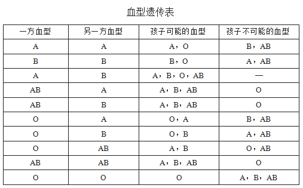

故正确答案为A。

**考点**：生物常识

**来源**：2015年北京市公务员录用考试《行测》题第17题

### 第 18 题

下列有关长城的说法，错误的是（    ）。

A. 今天所指的长城多指明代修建的长城，它东起鸭绿江，西至甘肃省的嘉峪关

B. 长城是中国也是世界上修建时间最长、工程量最大的一项古代防御工程

C. 国家文物局2012年宣布中国历代长城总长度为两万余千米

D. 长城始建于战国时期的秦国

第 18 题 · 答案与解析

**参考答案（粉笔题库参考内容）**

D

**解析**

A、B两项正确：今天所说的万里长城多指明代修建的长城。国家文物局和国家测绘局于2009年4月18日首次公布明长城数据：其东起鸭绿江畔辽宁虎山，西至祁连山东麓甘肃嘉峪关，从东向西行经辽宁、河北、天津、北京、山西、内蒙古、陕西、宁夏、甘肃、青海十个省（自治区、直辖市）的15个县域，总长度8851.8公里，是世界上修建时间最长、工程量最大的一项古代防御工程。

C项正确：国家文物局2012年宣布中国历代长城总长度为21196.18千米。

D项错误：长城始建于周朝，周幽王烽火戏诸侯是最早的关于长城的典故。早在公元前7世纪的春秋时代，楚国最早修筑了防御别国入侵的“楚方城”，揭开了中国历史上记载的长城修建的帷幕。战国时期，齐、魏、赵、秦、燕和中山等国也相继修建了“诸侯互防长城”，被称为“先秦长城”，秦始皇在此基础上继续修筑，筑起了“西起临洮（今甘肃山尼县），东止辽东（今辽宁省），蜿蜒一万余里”的长城。自秦始皇筑长城之后，始有“万里长城”之称。

本题为选非题，故正确答案为D。

**考点**：文化常识

**来源**：2015年北京市公务员录用考试《行测》题第18题

### 第 19 题

下列有关传统文化常识的表述有误的一项是（    ）。

A. 《四库全书》按照经、史、子、集四部分类，所以称为“四库”

B. “五岳”即东岳泰山、南岳黄山、西岳华山、北岳恒山、中岳嵩山

C. 京剧人物分为生、旦、净、丑四种行当

D. 我国古代的四大发明包括造纸术、火药、印刷术、指南针

第 19 题 · 答案与解析

**参考答案（粉笔题库参考内容）**

B

**解析**

A项正确：《四库全书》编纂于清朝乾隆年间，按照经、史、子、集四部分类，所以称为“四库”。

B项错误：五岳分别是东岳泰山、南岳衡山、西岳华山、北岳恒山、中岳嵩山，南岳不是黄山。

C项正确：京剧是中国戏曲艺术的瑰宝，其角色分为生、旦、净、丑四种行当。

D项正确：我国古代的四大发明包括造纸术、火药、印刷术、指南针。

本题为选非题，故正确答案为B。

**考点**：文化常识

**来源**：2015年北京市公务员录用考试《行测》题第19题

### 第 20 题

2014年5月10日，“聚焦丝绸之路经济带——2014甘肃国际经贸合作研讨会”在甘肃敦煌举行。下列关于“丝绸之路经济带”的表述有误的是（    ）。

A. 是在“古丝绸之路”概念基础上形成的一个新的经济发展区域

B. 其东边牵着亚太经济圈，西边系着欧洲经济圈，被认为是“世界上最长、最具有发展潜力的经济大走廊”

C. 建设“丝绸之路经济带”能带动我国经济实力较为薄弱的西部地区发展，有望形成新的开放前沿

D. 是紧密型一体化合作组织，在区域合作模式上，通过建立互惠的贸易和投资安排，确立统一的关税政策，然后建立超国家的机构来实现深入合作

第 20 题 · 答案与解析

**参考答案（粉笔题库参考内容）**

D

**解析**

A项正确：“丝绸之路经济带”就是在古代丝绸之路所涉及地域的基础上形成的一个涵盖亚、欧、非的新的经济发展区域。

B项正确：“丝绸之路”连接着中亚、北非和欧洲，东边牵着亚太经济圈，西边系着欧洲经济圈，被认为是“世界上最长、最具有发展潜力的经济大走廊”。

C项正确：古代陆上丝绸之路是从长安出发往西，因此“丝绸之路经济带”主要是经过我国西北地区，可以连接起我国西部省份，推动西部经济的发展。

D项错误：“丝绸之路经济带”的发展，使各国可以就经济发展战略和对策进行充分交流，本着求同存异原则，协商制定推进区域合作的规划和措施，在政策和法律上为区域经济融合“开绿灯”。但不是以制定统一的关税政策和建立超国家的机构来达到目的，每个国家的利益和诉求是不相同的，因此“超国家的机构”表述有误。

本题为选非题，故正确答案为D。

**考点**：文化常识

**来源**：2015年北京市公务员录用考试《行测》题第20题

### 第 21 题

近日，二十国集团（G20）领导人第九次峰会在澳大利亚布里斯班举行。二十国集团包括8个经济发达体成员国、11个重要新兴工业国家以及欧盟经济实体。2016年的二十国集团领导人峰会将在（    ）举办。

A. 韩国

B. 法国

C. 中国

D. 日本

第 21 题 · 答案与解析

**参考答案（粉笔题库参考内容）**

C

**解析**

2014年11月，二十国集团领导人第九次峰会在澳大利亚布里斯班举行。中国国家主席习近平出席并发表讲话。会议决定由中国主办2016年二十国集团领导人峰会。

A项韩国是2010年第五次峰会举办地；B项法国是2011年第六次峰会举办地；D项日本没有举办过二十国集团峰会。

故正确答案为C。

**考点**：其他建设、重要事件

**来源**：2015年北京市公务员录用考试《行测》题第21题

### 第 22 题

我国水能资源分布不均，水能资源最集中的地区是（    ）。

A. 东北地区

B. 中南地区

C. 西南地区

D. 东部沿海地区

第 22 题 · 答案与解析

**参考答案（粉笔题库参考内容）**

C

**解析**

A项错误：东北地区以平原为主，地势变化小，水能资源不丰富。

B项错误：中南地区多为丘陵、平原等，水能资源没有西南地区丰富。

C项正确：水能资源丰富需要满足有大江大河、水量丰沛且落差较大等条件。贵州、西藏、云南、四川等省区多大江大河，且横断山脉等地地势高低起伏变化较大，水流湍急，蕴藏着丰富的水能资源。

D项错误：东部沿海地区虽然降水量大，但地势变化较小，水能资源也不丰富。

故正确答案为C。

**考点**：中国地理

**来源**：2015年北京市公务员录用考试《行测》题第22题

### 第 23 题

圆周率是一个在数学及物理学领域普遍存在的数学常数。它被定义为圆形之周长与直径之比，是精确计算圆周长、圆面积、球体积等几何形状的关键值。世界上最早计算圆周率数值的是（  ）。

A. 中国数学家祖冲之

B. 中国数学家刘徽

C. 印度数学家阿耶波多

D. 古希腊数学家阿基米德

第 23 题 · 答案与解析

**参考答案（粉笔题库参考内容）**

D

**解析**

古希腊数学家阿基米德（公元前287—前212 年）开创了人类历史上通过理论计算圆周率近似值的先河；公元263年，我国古代著名数学家刘徽提出用“割圆术”计算圆周率；公元480年左右，南北朝时期的数学家祖冲之进一步得出圆周率精确到小数点后7位的结果；约在公元530年，印度数学大师阿耶波多对圆周率进行计算，并得出圆周率数值可能是无理数的结论。

故正确答案为D。

**考点**：科技理论与成就

**来源**：2015年北京市公务员录用考试《行测》题第23题

### 第 24 题

飞到月亮上去是人类千百年来的梦想，随着空间技术的发展，人类登月已经实现。下列有关人类登月的说法有误的是（  ）。

A. 前苏联宇航员加加林于1961年乘东方1号宇宙飞船奔向月球

B. 美国宇航员阿姆斯特朗1969年在月球上率先跨出人类历史“一大步”

C. 2013年我国成功将“玉兔号”巡视器顺利送抵月球表面

D. 美国是人类最早登上月球的国家

第 24 题 · 答案与解析

**参考答案（粉笔题库参考内容）**

A

**解析**

A项错误：1961年4月12日，加加林乘坐东方1号宇宙飞船完成了世界上首次载人宇宙飞行，实现了人类进入太空的愿望，而不是奔向月球。

B项正确：美国宇航员阿姆斯特朗1969年登月成功，在月球上率先跨出人类历史的“一大步”。

C项正确：2013年我国成功将“玉兔号”巡视器顺利送抵月球表面。

D项正确：1969年7月，美国阿波罗11号宇宙飞船实现了人类首次登月的壮举，美国是人类最早登上月球的国家。

本题为选非题，故正确答案为A。

**考点**：科技理论与成就

**来源**：2015年北京市公务员录用考试《行测》题第24题

### 第 25 题

2014年3月1日至2日，北京市委召开十一届五次全会，市委书记郭金龙指出，学习贯彻习近平总书记重要讲话精神，关键是要在事关首都发展的全局性、战略性问题上提高认识，要在首都城市战略定位上有新认识。北京的城市战略定位是（  ）。

A. 全国政治中心、文化中心、国际交往中心、科技创新中心

B. 全国政治中心、文化中心、国际商贸中心、科技创新中心

C. 全国政治中心、经济中心、国际交往中心、医疗服务中心

D. 全国政治中心、经济中心、国际商贸中心、医疗服务中心

第 25 题 · 答案与解析

**参考答案（粉笔题库参考内容）**

A

**解析**

2014年2月26日,习近平总书记在北京考察工作时强调了北京是全国政治中心、文化中心、国际交往中心、科技创新中心的城市战略定位，要求坚持和强化首都核心功能，深入实施人文北京、科技北京、绿色北京战略，努力把北京建设成为国际一流的和谐宜居之都。

故正确答案为A。

**来源**：2015年北京市公务员录用考试《行测》题第25题

### 第 26 题

为进一步加快本市技术创新体系建设和产业发展，北京市制定了《北京技术创新行动计划（2014-2017年）》，其主要目标包括（  ）。

A. 科技体制改革取得重要突破

B. 科技支撑城市可持续发展和服务民生重大需求的能力显著提升

C. 科技支撑经济发展方式转变的作用更加突出

D. 以企业为主体的技术创新体系进一步完善

第 26 题 · 答案与解析

**参考答案（粉笔题库参考内容）**

ABCD

**解析**

《北京技术创新行动计划(2014-2017年)》指出：主要目标包括以下四个方面：（1）科技体制改革取得重要突破；（2）以企业为主体的技术创新体系进一步完善；（3）科技支撑经济发展方式转变的作用更加突出；（4）科技支撑城市可持续发展和服务民生重大需求的能力显著提升。

故正确答案为A、B、C、D。

**来源**：2015年北京市公务员录用考试《行测》题第26题

### 第 27 题

十多年前，科学家发现人类的几十种疾病的致病原因是基因突变。现在已经把三千种左右的疾病的病因与基因突变挂上钩，但尚未完全搞清基因突变与疾病病因的关系。这是因为（  ）。

A. 认识总要受到主客观条件的限制

B. 人们不可能完全掌握认识对象的本质

C. 客观世界总在不断地变化中

D. 认识对象的本质的暴露与展现有一个过程

第 27 题 · 答案与解析

**参考答案（粉笔题库参考内容）**

ACD

**解析**

A项正确：人类的认识能力和科技水平在不断发展进步，因此可以和基因突变挂钩的疾病越来越多，但是又由于认识水平和客观条件的限制，还没完全搞清楚病因和突变之间的关系；

B项错误：只存在尚未被认识的事物，不存在不可能被认识的事物；

C项正确：事物处于不断地发展变化中，正是由于变化的复杂性，才导致不能完全搞清楚二者的关系；

D项正确：认识对象的本质的暴露与展现不是一蹴而就的，是有一个过程的。

故正确答案为A、C、D。

**考点**：认识论

**来源**：2015年北京市公务员录用考试《行测》题第27题

### 第 28 题

中关村国家自主创新示范区是我国第一个国家自主创新示范区。下列有关中关村国家自主创新示范区的表述，正确的有（  ）。

A. 中关村国家自主创新示范区的目标是成为具有全球影响力的科技创新中心

B. 中关村国家自主创新示范区起源于二十世纪八十年代初的“中关村电子一条街”

C. 十二五期间，中关村国家自主创新示范区将重点建设“两城两带”，两城即中关村科学城、未来科技城

D. 中关村国家自主创新示范区目前“一区多园”的空间格局包括海淀园、丰台园、昌平园、亦庄园、顺义园等十个园区

第 28 题 · 答案与解析

**参考答案（粉笔题库参考内容）**

ABC

**解析**

A项正确，2009年3月，国务院批复同意建设中关村国家自主创新示范区，要求把中关村建设成为具有全球影响力的科技创新中心，成为创新型国家建设的重要载体，掀开了中关村发展新的篇章；

B项正确，中关村国家自主创新示范区起源于二十世纪八十年代初的“中关村电子一条街”；

C项正确，北京市“十二五”规划纲要指出：集中力量打造中关村科学城和未来科技城，着力加快建设北部研发服务和高技术产业带、南部高技术制造业和战略性新兴产业发展带，基本形成国家创新中心的新格局；

D项错误，中关村当下“一区多园”的空间格局包括东城园、西城园、朝阳园、海淀园、丰台园、石景山园、门头沟园、房山园、通州园、顺义园、大兴-亦庄园、昌平园、平谷园、怀柔园、密云园、延庆园等十六个园区。

故正确答案为A、B、C。

**考点**：经济建设

**来源**：2015年北京市公务员录用考试《行测》题第28题

### 第 29 题

“中国式过马路”，不仅体现出我国部分公民规则意识缺失，也在一定程度上折射出我国交通设施、法规和管理等方面的问题，为改变这一状况（  ）。

A. 检察机关应该公正审判，严厉处罚违法行为

B. 人大代表应行使提案、审议、决定权，推动相关法律完善

C. 公民应该提高文明素养，自觉履行公民义务

D. 政府应该加强行政执法，切实履行管理职能

第 29 题 · 答案与解析

**参考答案（粉笔题库参考内容）**

CD

**解析**

A项错误，检察院是公诉机关，主要是对犯罪行为代表国家提起公诉，不处理一般行政违法案件；

B项错误，根据《全国人民代表大会和地方各级人民代表大会代表法》第三条的规定：“代表享有下列权利：（一）出席本级人民代表大会会议，参加审议各项议案、报告和其他议题，发表意见；（二）依法联名提出议案、质询案、罢免案等；（三）提出对各方面工作的建议、批评和意见；（四）参加本级人民代表大会的各项选举；（五）参加本级人民代表大会的各项表决；（六）获得依法执行代表职务所需的信息和各项保障；（七）法律规定的其他权利。”因此人大代表并没有决定权；

C项正确，作为中国公民，提高文明素养，自觉履行公民义务，杜绝中国式过马路；

D项正确，道路交通安全是政府交管部门重要的工作职责之一，政府应该加强行政执法，切实履行管理职能。

故正确答案为C、D。

**考点**：宪法

**来源**：2015年北京市公务员录用考试《行测》题第29题

### 第 30 题

生物质能是太阳能以化学能形式贮存在生物质中的能量形式，即以生物质为载体的能量。以下属于生物质能的有（  ）。

A. 畜禽粪便

B. 天然气

C. 厨余垃圾

D. 农作物秸秆

第 30 题 · 答案与解析

**参考答案（粉笔题库参考内容）**

ACD

**解析**

生物质能是太阳能以化学能形式贮存在生物质中的能量形式，即以生物质为载体的能量。我国目前可利用的生物质能资源主要是传统生物质，包括农作物秸秆、薪柴、禽畜粪便、生活垃圾、工业有机废渣与废水沼气类等。故 A、C、D 三项正确。

天然气是指蕴藏于地层中天然的烃类和非烃类气体的混合物，主要存在于油田气、气田气、煤层气、泥火山气和生物生成气中，成因复杂，有煤气型、油气型，它不属于传统意义上的生物质能。

故正确答案为A、C、D。

**考点**：物理常识

**来源**：2015年北京市公务员录用考试《行测》题第30题

### 第 31 题

依据我国相关法律规定，行政违法的构成要件包括（  ）。

A. 行政行为符合执法人对法律的理解

B. 行政法律关系主体具有不履行法定义务的行为

C. 行为主体必须是行政法律关系主体

D. 行政法律关系主体具有相关的法定义务

第 31 题 · 答案与解析

**参考答案（粉笔题库参考内容）**

BCD

**解析**

行政违法的构成要件是指行政法律规范所规定的，构成行政违法所必须具备的条件：（1）行为主体须是行政法主体。行为人具备行政法主体资格，是行政违法的前提，是构成行政违法的首要条件。（2）行政法主体负有相关的法定义务。（3）行政法主体具有不履行法定义务的行为。（4）行政违法的主观要件依法律的具体规定，而不是执法人对法律的理解，因此A项错误。故本题答案为B、C、D选项。

**考点**：行政法

**来源**：2015年北京市公务员录用考试《行测》题第31题

### 第 32 题

下列关于基因的说法，正确的有（  ）。

A. 基因是遗传的物质基础，通过复制把遗传信息传给下一代

B. 人类大约有几万个基因，储存着生命过程的全部信息

C. 近年来人们逐渐认识到，基因是决定人体健康的内在因素

D. 遗传学家通过试验认识到，基因是染色体的载体

第 32 题 · 答案与解析

**参考答案（粉笔题库参考内容）**

ABC

**解析**

A项正确：基因（遗传因子）是遗传的物质基础，可以通过复制把遗传信息传给下一代；

B项正确：人类大约有几万个基因，储存着生命的种族和血型以及孕育、生长、凋亡过程的全部信息；

C项正确：环境和遗传互相依赖，演绎着生命的繁衍、细胞分裂和蛋白质合成等重要生理过程。生物体的生、长、病、老、死等一切生命现象都与基因有关。它也是决定生命健康的内在因素；

D项错误：染色体是基因的主要载体，而不是基因是染色体的载体。

故正确答案为A、B、C。

**考点**：生物常识

**来源**：2015年北京市公务员录用考试《行测》题第32题

### 第 33 题

下列关于唐宋八大家的说法，正确的有（  ）。

A. 唐宋八大家是主持唐宋时期古文运动的中心人物，他们提倡散文，反对骈文

B. 韩愈和柳宗元政见不同，但并未影响他们共同携手倡导古文运动，强调文章内容的重要性

C. 唐宋八大家包括苏洵、苏轼、苏辙、韩愈、柳宗元、欧阳修、杜甫和王安石

D. 柳宗元写了不少寓言故事，如《黔之驴》《永某氏之鼠》等，“黔驴技穷”是尽人皆知的成语

第 33 题 · 答案与解析

**参考答案（粉笔题库参考内容）**

ABD

**解析**

A项正确，唐宋八大家是主持唐宋时期古文运动的中心人物，他们提倡散文，反对骈文。其中韩愈、柳宗元是唐代古文运动的领袖，欧阳修、三苏等四人是宋代古文运动的核心人物，王安石、曾巩是临川文学的代表人物。他们先后掀起的古文革新浪潮，使诗文发展的陈旧面貌焕然一新；

B项正确，韩愈是唐代著名的散文家和重要诗人。他和柳宗元政见很不和，但并未影响他们共同携手倡导古文运动；

C项错误，唐宋八大家包括唐代的韩愈、柳宗元，宋代的苏洵、苏轼、苏辙、欧阳修、王安石、曾巩，不包括杜甫；

D项正确，柳宗元写了不少寓言故事，如《黔之驴》《永某氏之鼠》等，“黔驴技穷”是尽人皆知的成语，有的寓言篇幅虽短，但也同他的山水记一样，被千古传诵。

故正确答案为A、B、D。

**考点**：文化常识

**来源**：2015年北京市公务员录用考试《行测》题第33题

### 第 34 题

2014年3月5日，李克强总理在作政府工作报告时指出，要加强环渤海及京津冀地区经济协作。下列有关“京津冀一体化”的表述，正确的有（  ）。

A. 目前，京津冀海关区域通关一体化已经实现

B. “京津冀一体化”由京津唐工业基地的概念发展而来，包括北京市、天津市及河北省

C. 2014年8月北京、天津两市签署了《贯彻落实京津冀协同发展重大国家战略推进实施重点工作协议》

D. 2014年8月北京市和河北省签署了两省市《共同打造曹妃甸协同发展示范区框架协议》《共建北京新机场临空经济合作区协议》等七项协议

第 34 题 · 答案与解析

**参考答案（粉笔题库参考内容）**

BCD

**解析**

A项错误，海关总署日前出台《京津冀海关区域通关一体化改革方案》，但目前属于“计划实施”还没有“已经实现”；

B项正确，京津冀一体化由京津唐工业基地的概念发展而来，包括北京市、天津市以及河北省，涉及到京津和河北省11个地级市的80多个县（市）；

C项正确，京津两市于2014年8月6日在京签署《贯彻落实京津冀协同发展重大国家战略推进实施重点工作协议》；

D项正确，王安顺、张庆伟代表北京、河北签署了两省市《共同打造曹妃甸协同发展示范区框架协议》《共建北京新机场临空经济合作区协议》等七项协议。

故正确答案为B、C、D。

**考点**：经济建设、重要文件

**来源**：2015年北京市公务员录用考试《行测》题第34题

### 第 35 题

北京的山由两大山脉组成，分别位于北京的西部和北部。这两大山脉是（  ）。

A. 灵山山脉

B. 太行山脉

C. 军都山脉

D. 燕山山脉

第 35 题 · 答案与解析

**参考答案（粉笔题库参考内容）**

BD

**解析**

B、D两项正确，北京的山区由燕山山脉和太行山山脉组成。北面是燕山山脉，西面是太行山山脉；

A项错误，灵山位于京西门头沟的西北部，不属于北京的两大山脉之一；

C项错误，军都山是北京市主要山脉，属燕山山脉，处于燕山山脉和太行山山脉的接合部位，不属于北京的两大山脉之一。

故正确答案为B、D。

**考点**：中国地理

**来源**：2015年北京市公务员录用考试《行测》题第35题

## 材料 1

各区县政府、市政府各部门及相关单位要把办理人大代表建议工作列入重要议事日程，按照“\_\_\_\_\_\_\_\_\_\_\_\_”的思路，健全办理工作机制，明确工作任务和工作要求，严格落实责任制。领导班子要加强对办理工作的组织领导和统筹协调，对于涉及与人民群众生活密切相关的重要建议，承办单位主要领导要亲自组织研究，了解进展情况，推动问题解决；承办单位主管领导要及时协调解决办理建议中遇到的困难和问题，必要时亲自答复；要明确内部责任处室、承办责任人和办理时限及工作要求；市政府各部门之间要加大沟通协调和解决问题的力度；对于涉及全局，本单位难以协调解决的问题，要及时向上级机关请示报告。

### 第 36 题

对上述文字的基本精神，概括最准确的是（  ）。

A. 增强履职意识

B. 认真分析问题

C. 科学分类指导

D. 加强组织领导

第 36 题 · 答案与解析

**参考答案（粉笔题库参考内容）**

D

**解析**

文段为“总-分”结构，开篇提出观点即“健全办理工作机制，明确工作任务和工作要求，严格落实责任制”。接着后文分别从三个角度，详细展开说明了以何种方式来实现观点中提出的要求。即从“领导班子”“承办单位”“市政府各部门”这三个方面共同努力实现目标，综合起来即为 “加强组织领导”。

A项“增强履职意识”和B项“认真分析问题”均体现不出对这一事件有专门的人去负责，排除A、B两项。

C项“科学分类指导”侧重于工作的分类指导，D项“组织领导”侧重于人员的安排，而文段主要谈论不同的主体应如何分工，而非把工作进行分类，故排除C项。

故正确答案为D。

**来源**：2015年北京市公务员录用考试《行测》题第36题

### 第 37 题

办理人大代表重要建议时，承办单位主要领导的职责是（  ）。

A. 亲自答复问题

B. 推动解决问题

C. 及时请示汇报

D. 协调各方关系

第 37 题 · 答案与解析

**参考答案（粉笔题库参考内容）**

B

**解析**

根据文段“承办单位主要领导要亲自组织研究，了解进展情况，推动问题解决”可知，B项表述正确。

A项“亲自答复问题”、D项“协调各方关系”均为承办单位“主管领导”的工作职责，而非“主要领导”的职责，故排除A、D两项；

C项“及时请示汇报”是“本单位”的工作职责，故排除C项。

故正确答案为B。

**来源**：2015年北京市公务员录用考试《行测》题第37题

### 第 38 题

根据文意，填入文中划横线处表述最恰当的是（  ）。

A. 诚恳明确答复、认真分类研究、积极恰当处理、加强统筹协调

B. 积极恰当处理、认真分类研究、诚恳明确答复、加强统筹协调

C. 认真分类研究、积极恰当处理、诚恳明确答复、加强统筹协调

D. 加强统筹协调、积极恰当处理、认真分类研究、诚恳明确答复

第 38 题 · 答案与解析

**参考答案（粉笔题库参考内容）**

C

**解析**

文段为“总—分”结构，横线处所填文字表述的顺序应该与下文解释说明文字的逻辑顺序对应。

后文首先指出“领导班子要加强对办理工作的组织领导和统筹协调，对于涉及与人民群众生活密切相关的重要建议，承办单位主要领导要亲自组织研究······”即不同问题分类研究、恰当处理；接着指出“承办单位主管领导要及时协调解决办理建议中遇到的困难和问题，必要时亲自答复”即明确答复；再指出“市政府各部门之间要加大沟通协调和解决问题的力度”即统筹协调。按照此逻辑顺序，对应C项。

故正确答案为C。

**来源**：2015年北京市公务员录用考试《行测》题第38题

### 第 39 题

根据文意，文中4个划线部分使用不恰当的是（  ）。

A. 领导班子

B. 承办单位主管领导

C. 承办责任人

D. 市政府各部门

第 39 题 · 答案与解析

**参考答案（粉笔题库参考内容）**

D

**解析**

注意语句之间的逻辑关系，主体不统一是病句、歧义句的高频考点。

D项：“市政府各部门”引导的语句与后句主体不一致。后句的主体为“本单位”，两句话其实都是在围绕“承办单位”阐述。故这里用“市政府各部门”表述不准确，修改成“各承办单位”更加准确恰当，符合行文逻辑。

故正确答案为D。

**来源**：2015年北京市公务员录用考试《行测》题第39题

### 第 40 题

本文的公文类型最可能是（  ）。

A. 通知

B. 纪要

C. 批复

D. 函

第 40 题 · 答案与解析

**参考答案（粉笔题库参考内容）**

A

**解析**

本题考查公文的基本特征和公文种类。此时注意抬头、对象、落款等特征。文段对象是“各区县政府、市政府各部门及相关单位”，正文是需要去具体执行的相关的内容。对应A项“通知”。

“通知”，是运用广泛的知照性公文，主要用来发布法规、规章，转发上级机关、同级机关和不相隶属机关的公文，批转下级机关的公文，要求下级机关办理某项事务等。

“纪要”，是用文字记录的要点。

“批复”，是指“答复下级机关的请示事项”时使用的文种。它是机关应用写作活动中的一种常用公务文书。

“函”，是不相隶属机关之间相互商洽工作、询问和答复问题，或者向有关主管部门请求批准事项时所使用的公文。函是应用写作实践中的一种常用文体。

故正确答案为A。

**来源**：2015年北京市公务员录用考试《行测》题第40题

## 材料 2

现代医院制度的历史很短。古代医院制度大约始于四世纪初，基督教把救死扶伤作为教会慈善事业的重要组成部分。325年，基督教第一次大公会议规定，凡教会建立之处必须配备慈善场所，凡建教堂之处都要有医护馆舍。巴勒斯坦地区的凯撒利亚主教建立了第一所基督教医护所，法碧奥拉修女在罗马、兰德里主教在巴黎也相继建立起同样的机构。

        在美国，早期医院仅仅作为宗教活动与贫民救助的场所，由慈善或宗教人士主持，提供非功利性服务。1713年，威廉·佩恩在费城建立第一所慈善医院，主要功能是济贫，其次是照顾病人。以治疗为主要功能的医院是1751年建立的宾夕法尼亚医院。1794年之后的50年中，医院逐渐成为医学教育和研究的中心，在医学职业机构中的地位大幅提升。战争中的战地救护强化了医生与医院的结合，也凸显了护理的职能。20世纪后，随着物理技术向医疗技术的渗透与转移，辅助诊疗设备、器械在医疗中的作用越来越明显，医生与医院的技术地位越来越强势。

        在医院的发展历程中，南丁格尔是一位重要的推手，她是现代护理学的开创者，也是现代医院制度的反思者和变革者。她的反思与变革主要聚焦于“治疗与照顾”的关系。她的不朽著作《护理札记》积极倡导以照顾为中心的专业化服务，认为医院的核心价值是人性的呵护、周到的生活料理、身心的照顾、配合治疗的养护、病中的温暖和舒适。她的另一部重要著作《医院札记》则开启了以舒适为中心的设施改造运动，认为医院首先必须提供良好的“生活”境遇，然后才是良好的“治疗”环境。

        当代医学史家卢森伯格系统考察了医院制度的源流，他洞悉了医院制度的致命弱点，即伤病者、求助者必须依赖“陌生人的帮助与照顾”。医患关系的缔约双方是陌生人，凭着小小一张挂号单，医生成为病人个人生活的“闯入者”；患者要将个人的秘密告诉医生，甚至冒着巨大风险去接受伤害性药物与手术的干预，而他们对医生的德行技艺却知之甚少。

        医学不仅只是知识体系，还是生命信仰；不仅面对患者的躯体，还面对患者的心灵。科学与人学、技术与人性、工具与价值的思考应该伴随其始终。

### 第 41 题

关于古代医院制度，以下说法正确的是（    ）。

A. 医生通常提供上门服务

B. 一般和教堂建在一起

C. 最早由法碧奥拉修女创建

D. 第一所基督教医护所建在罗马

第 41 题 · 答案与解析

**参考答案（粉笔题库参考内容）**

B

**解析**

题目问的是“古代医院制度”，因此，定位第1段。根据“凡建教堂之处都要有医护馆舍”可知，医护馆舍常与教堂建在一起，B项表述正确，当选。

A项：文段未提及“提供上门服务”，属于无中生有，排除。

C项：由“巴勒斯坦地区的凯撒利亚主教建立了第一所基督教医护所，法碧奥拉修女在罗马······”可知，古代医院最早由凯撒利亚主教创建，法碧奥拉修女后续建立，故“最早由法碧奥拉修女创建”表述有误，排除。

D项：由“巴勒斯坦地区······第一所基督教医护所”可知，第一所基督教医护所建在巴勒斯坦地区，故“第一所基督教医护所建在罗马”表述有误，排除。

故正确答案为B。

【出处】《医院制度：从身体照顾到心灵抚慰》

**来源**：2015年北京市公务员录用考试《行测》题第41题

### 第 42 题

根据第2段，战地救护强化了医院在哪方面的职能？

A. 治疗

B. 护理

C. 科研

D. 教育

第 42 题 · 答案与解析

**参考答案（粉笔题库参考内容）**

B

**解析**

定位第2段，由“战争中的战地救护强化了医生与医院的结合，也凸显了护理的职能”可知，战地救护强化的是医院在“护理”方面的职能，对应 B 项。

A项“治疗”、C项“科研”、D项“教育”均与“护理”职能无关，排除。

故正确答案为B。

【出处】《医院制度：从身体照顾到心灵抚慰》

**来源**：2015年北京市公务员录用考试《行测》题第42题

### 第 43 题

文中引用南丁格尔的事例是为了说明（    ）。

A. 医院应重视人文关怀

B. 医院环境变革势在必行

C. 《医院札记》具有重要价值

D. 护士在医院系统中十分重要

第 43 题 · 答案与解析

**参考答案（粉笔题库参考内容）**

A

**解析**

定位第3段，文段论述了南丁格尔开创现代护理学，反思和变革医院制度，重视医院在“治疗与照顾”方面的职能，为患者提供人性的呵护等，是为了说明医院应加强照顾，注重人文关怀，对应A项，当选。

B项：“医院环境变革”非重点，文段重点论述的是人文关怀的重要性，而非外在环境的变革，排除。

C项：“《医院札记》”是南丁格尔例子中的内容，而非例子论证的观点主体，排除。

D项：“护士在医院系统中十分重要”，属于无中生有，排除。

故正确答案为A。

【出处】《医院制度：从身体照顾到心灵抚慰》

**来源**：2015年北京市公务员录用考试《行测》题第43题

### 第 44 题

第4段中，卢森伯格认为医院制度的致命弱点是（    ）。

A. 医患双方信息不对等

B. 医患双方存在陌生感

C. 医院环境十分冷漠

D. 缺乏考核医德的标准

第 44 题 · 答案与解析

**参考答案（粉笔题库参考内容）**

B

**解析**

定位第4段，首句提出“致命弱点”，接着“即”之后的内容对其进行解释说明，后文通过分号连接两个分句，指出医患双方是陌生的，患者对医生知之甚少，故要全面概括，提取共性，强调患者对医生不够了解，比较陌生，对应B项。

A项：“信息不对等”仅对应第二个分句的内容，表述片面，且“信息不对等”与文段强调的“陌生感”属于不同的概念，即使很熟悉的情况下也有可能出现信息不对等的情况，排除。

C项：文段论述医患之间的陌生感，而非“医院环境十分冷漠”，排除。

D项：文段未提及“缺乏考核医德的标准”，属于无中生有，排除。

故正确答案为B。

【出处】《医院制度：从身体照顾到心灵抚慰》

**来源**：2015年北京市公务员录用考试《行测》题第44题

### 第 45 题

本文最适合的标题是（    ）。

A. 医院制度:从身体照顾到心灵抚慰

B. 南丁格尔:冰冷医院中的一盏明灯

C. 基督教:古代医院制度的重要推手

D. 卢森伯格:现代医院制度的批判者

第 45 题 · 答案与解析

**参考答案（粉笔题库参考内容）**

A

**解析**

文章前两段论述古代医院制度的内容，接着通过南丁格尔、卢森伯格的例子论证医院进行人文关怀的必要性，最后一段进行总结，即“医学不仅只是知识体系，还是生命信仰；不仅面对患者的躯体，还面对患者的心灵。科学与人学、技术与人性、工具与价值的思考应该伴随其始终”。A项“医院制度”为篇章论述的核心话题，“从身体照顾到心灵抚慰”是对文段进行的概括，当选。

B项“南丁格尔”、D项“卢森伯格”均为例子的表述，非重点，排除。

C项“古代医院制度”为前两段论述的内容，非全文重点，排除。

故正确答案为A。

【出处】《医院制度：从身体照顾到心灵抚慰》

**来源**：2015年北京市公务员录用考试《行测》题第45题

## 材料 3

阅读以下文字，完成46-50题。

        世界银行《东亚经济发展报告(2006)》提出了“中等收入陷阱”概念，描述了世界经济发展史的怪现象：一些国家经济在达到人均国民生产总值3000美元的门槛之后，便陷入困顿之中，难以继续前行。二战结束以来，能够成功突破“中等收入魔咒”、进入发达水准的国家和地区，也只有日本及东亚“四小龙”。

        英国人口学家马尔萨斯曾经描绘了一幅人类生存的悲惨图景——“贫困陷阱”：人口的指数增长会将一个稍微富足的社会重新拖入贫困，人类便在贫困的泥潭中挣扎。马尔萨斯的理论适用于农业社会，因为他生活在工业革命前夜，未能意识到技术可以改变经济发展模式。工业革命之后，马尔萨斯的预言似乎被打破了，工业发展将一些地区率先带出“贫困陷阱”。某些东亚国家依靠低廉的劳动力与资源，通过出口导向型的工业发展战略，跳出“贫困陷阱”，进入中等收入阶段。

        但是进入中等收入阶段后，既有的依靠劳动力的发展模式便遇到了瓶颈。农业社会中存在着严重的人口过剩，因此一个农业国家在向工业国家转型的过程中，面临着如何转移与消化农村剩余劳动力的问题。工业与农业并存的二元经济结构中存在着“劳动力无限供给”的现象，农村成为劳动力的“蓄水池”，这也压低了劳动力的价格，为劳动密集型产业发展提供了成本优势，这种“人口红利”与低水平的工资是息息相关的。当劳动力的“蓄水池”枯竭后，劳动力成本便会依据市场供需以及劳动生产率进行定价，“民工荒”以及工资急剧上涨出现。这种情况下，政府需要顺应劳动力向人力资源转换的潮流，发掘“第二次人口红利”。第一次红利源于劳动力的数量，第二次则来自人口的质量。第二次人口红利不仅依赖人的创造性，还要回归到经济增长的目的本身——“人民幸福”。这不仅意味着较高的收入和消费水平，还要有更好的教育、培训、医疗以及适合发挥特长的职业，在尊重个人权利的基础上，实现经济与社会秩序的重塑。因此，中等收入阶段也意味着“过渡”与“转型”。这一阶段，既失去了人口数量的优势，又没有确立人口质量的优势，经济增长处于“比较优势真空期”。由此可见，跨越“贫困陷阱”需要的是一支纪律严明的劳动力大军，而跨越“中等收入陷阱”则需要具有创造力的公民。

### 第 46 题

关于“中等收入陷阱”，以下说法正确的是（    ）。

A. 第一次世界大战结束后在世界范围蔓延

B. 在人均国民生产总值到一定水平后出现

C. 目前还没有哪个国家能摆脱其负面影响

D. 描述的是经济即将崩溃之前的一种状态

第 46 题 · 答案与解析

**参考答案（粉笔题库参考内容）**

B

**解析**

A项：“第一次世界大战结束后在世界范围蔓延”属无中生有的表述，排除。

B项：定位第1段，由“一些国家经济在达到人均国民生产总值3000美元的门槛之后，便陷入困顿之中”可知，“在人均国民生产总值达到一定水平后出现”表述正确，当选。

C项：定位第1段，由“能够成功突破‘中等收入魔咒’、进入发达水准的国家和地区，也只有日本及东亚‘四小龙’”可知，日本与东亚“四小龙”突破了“中等收入魔咒”，故“目前还没有哪个国家能摆脱其负面影响”表述错误，排除。

D项：由文段可知，“中等收入陷阱”是指一些国家经济在达到一定门槛后，陷入困顿，难以前行，即“经济停滞”，而非“经济即将崩溃”，表述错误，排除。

故正确答案为B。

**来源**：2015年北京市公务员录用考试《行测》题第46题

### 第 47 题

第2段主要说明（    ）。

A. 人口学家马尔萨斯的理论的优势与缺陷

B. 工业化是突破“贫困陷阱”的有效途径

C. 人口的指数增长对社会经济发展的限制

D. 人类社会最终走向共同富裕的发展前景

第 47 题 · 答案与解析

**参考答案（粉笔题库参考内容）**

B

**解析**

第2段首先介绍了马尔萨斯的“贫困陷阱”理论，即“人口的指数增长会将一个稍微富足的社会重新拖入贫困”，并指出该理论只适用于“农业社会”，同时分析了原因，后文指出“工业革命之后，马尔萨斯的预言似乎被打破了，工业发展将一些地区率先带出‘贫困陷阱’”，最后以某些东亚国家为例加以证明。故文段重在强调“工业化对摆脱‘贫困陷阱’”的作用，对应B项。

A项：“马尔萨斯的理论”不是文段重点，文段重在说明“工业化”对摆脱“贫困陷阱”的作用，排除。

C项：对应“贫困陷阱”理论的具体内容，非重点，排除。

D项：文段未涉及，属于无中生有，排除。

故正确答案为B。

【文段出处】《跨越“中等收入陷阱”的正义之桥》

**来源**：2015年北京市公务员录用考试《行测》题第47题

### 第 48 题

第3段中的“瓶颈”指的是（    ）。

A. 曾经低成本的劳动力现在却变得稀缺了

B. 农村剩余劳动力不愿意通过工业发展转移

C. 生产技术水平低下无法实现工业的转型

D. 劳动密集型生产方式无法实现可持续发展

第 48 题 · 答案与解析

**参考答案（粉笔题库参考内容）**

A

**解析**

首先定位原文，“瓶颈”出现在首句，后文对其进行具体解释说明，首先指出农业社会，劳动力过剩，在向工业转型时，面临如何消化过剩劳动力的问题，而随着社会经济的发展，“劳动力‘蓄水池’枯竭造成‘民工荒’”。故“瓶颈”指由最初的低成本劳动力过剩到劳动力日渐枯竭的问题，对应A项，当选。

B项：“不愿意”为无中生有的表述，排除；

C项：“瓶颈”表达的是“劳动力模式遇到的问题”，与“生产技术水平低下”无关，排除；

D项：“无法实现可持续发展”属于无中生有，排除。

故正确答案为A。

【文段出处】《跨越“中等收入陷阱”的正义之桥》

**来源**：2015年北京市公务员录用考试《行测》题第48题

### 第 49 题

作者所论述的“中等收入陷阱”，与下列哪项关联最密切？

A. “金融陷阱”，表现为金融体系出现问题，拖累整个实体经济

B. “资产泡沫陷阱”，表现为房地产等市场的泡沫化，背离经济发展规律

C. “人口陷阱”，表现为劳动适龄人口绝对数量减少和老年人口数量激增

D. “福利陷阱”，表现为社会保障超过经济发展水平，成为财政的沉重包袱

第 49 题 · 答案与解析

**参考答案（粉笔题库参考内容）**

C

**解析**

根据第3段“这一阶段，既失去了人口数量的优势，又没有确立人口质量的优势”可知，“中等收入陷阱”与“劳动力人口”有关，C项“劳动适龄人口绝对数量减少和老年人口数量激增”，体现了劳动力数量和质量方面的不足，符合文意，当选。

文段未涉及“金融体系”及“房地产等市场”相关内容，故A、B两项为无中生有的表述，排除。

D项：文段只强调中等收入阶段人口红利会消失，而“社会保障······成为财政的沉重包袱”无从体现，排除。

故正确答案为C。

【文段出处】《跨越“中等收入陷阱”的正义之桥》

**来源**：2015年北京市公务员录用考试《行测》题第49题

### 第 50 题

作者认为，为跨越“中等收入陷阱”，政府最应该（    ）。

A. 改善收入分配体系，减缓因贫富差距而引起的社会矛盾和冲突

B. 在自主创新和人力资本方面持续增加投入，培育新的竞争优势

C. 加强对宏观经济的管理，建立相应的有效制度，维持政策稳定性

D. 努力拓展国内外市场，实行积极的出口导向战略，大力推进出口

第 50 题 · 答案与解析

**参考答案（粉笔题库参考内容）**

B

**解析**

文章首先介绍了“中等收入陷阱”的具体内容，接着分别指出了“中等收入陷阱”产生的背景及“民工荒”“人口红利消失”等表现与影响，文章尾句“由此可见”总结前文内容，提出对策——“跨越‘中等收入陷阱’则需要具有创造力的公民”。 B项是针对“提升公民创造力”提出的具体措施，当选。

A项“减缓······社会矛盾和冲突”、C项“加强对宏观经济的管理”、D项“拓展国内外市场”均体现不出对“提升公民创造力”的作用，排除。

故正确答案为B。

【文段出处】《跨越“中等收入陷阱”的正义之桥》

**来源**：2015年北京市公务员录用考试《行测》题第50题

## 材料 4

近百年来，全球气候变暖是个不争的事实，对于全球气候变暖，之前普遍认为“极其可能”是人类影响造成的。但是中科院地质地球所最近提出了一个新观点——气候变暖变化存在约500年的自然周期，近百年来的全球气候变暖，刚好位于最近一次500年周期的暖相位上。该研究还认为：今年已经达到这一暖相位的峰值位置，接下来有进入冷相位的趋势，即将开始百年气候变冷周期，这有可能减缓人类活动导致的全球变暖。

        通过东北龙岗火山区的小龙湾玛珥湖年纹层沉积可以准确定年，中科院地质地球所的科学家就利用这一优势，分析了5350年以来（截至2005年）小龙湾玛珥湖周边地区植物花粉种类的变化。在植物花粉含量的变化中，有两种花粉（适合寒冷气候的松树花粉和适合温暖气候的栎属花粉）的含量相互消长，呈现周期性变化。

        根据松树花粉增加和栎属花粉减少的峰值，指示的气候最寒冷时期先后出现在公元前2700年、公元前2200年、公元前1600年、公元前1200年、公元前900年、公元前600年、公元前300年，以及公元200年、700年、1200年和1800年前后，约每500年出现一次寒冷期。花粉含量的谱分析结果也呈现出显著的500年周期。

        在中国历史上，1550年至1851年，明嘉靖至清道光年间，中国曾发生大规模极寒天气，被称为“明清小冰期”。我国著名科学家竺可桢在这方面卓有成果，他注意到，清朝初年历史学家谈迁写了一本《北游录》，里面提到当时不但中国北方寒冷，就连江南也出现了河面结冰的情形。1654年（顺治十一年）11月，京杭大运河的吴江段冰厚三尺多，从吴江一直冻到嘉兴，要壮士凿冰，每天才能前行3、4公里。阳历11月南运河封冻，这在历史上是少有的。

        由于温度下降，中国的农业经济也遭受了打击。清朝叶梦珠编辑的《阅世编》记载，江西柑橘本是贡品，当地家家户户广泛栽种。然而，在“明清小冰期”最盛的顺治、康熙年间，橘树常常被冻死，橘农吓得不敢再种橘树。

        “明清小冰期”应该算得上是距今最近的一次寒冷时期了。中科院的研究认为，大约从公元1830年开始了一个暖期，现在处于最近一次500年周期的暖相位上，可能已经达到峰值位置，有进入冷相位的趋势，这有可能减缓人类活动导致的全球变暖。

### 第 51 题

下列最适合作为本文关键词的一项是（    ）。

A. 500年周期 全球气候

B. 明清小冰期 竺可桢

C. 峰值 花粉含量谱分析

D. 暖相位 冷相位

第 51 题 · 答案与解析

**参考答案（粉笔题库参考内容）**

A

**解析**

整篇文章是“总—分”结构，先提出了中科院地质地球所的新观点，即“气候变暖变化存在约500年的自然周期”，接下来通过“小龙湾玛珥湖花粉的研究”和“明清小冰期”两个例子进行解释说明。因此，文章的核心话题就是“全球变暖”和“500年周期”。A项正确。

B、C、D三项都属于文段解释说明部分，不是文章的重点内容。

故正确答案为A。

**来源**：2015年北京市公务员录用考试《行测》题第51题

### 第 52 题

关于中科院的研究，下列说法不正确的是（    ）。

A. 全球气候变暖为自然周期所致

B. 东北气候变化研究的时间跨度超过5000年

C. 未来有进入气候冷相位的趋势

D. 花粉含量分析是气候研究的最有效手段

第 52 题 · 答案与解析

**参考答案（粉笔题库参考内容）**

D

**解析**

A项：定位第1段，由“气候变暖变化存在约500年的自然周期”可知，“全球气候变暖为自然周期所致”表述正确，排除；

B项：定位第2段，由“通过东北龙岗火山区······分析了5350年以来······的变化”可知，“时间跨度超过5000年”表述正确，排除；

C项：定位最后一段，由“现在处于最近一次500年周期的暖相位上，可能已经达到峰值位置，有进入冷相位的趋势”可知，“未来有进入气候冷相位的趋势”表述正确，排除；

D项：“最有效手段”表述过于绝对，且无中生有，当选。

本题为选非题，故正确答案为D。

**来源**：2015年北京市公务员录用考试《行测》题第52题

### 第 53 题

根据本文，下列说法正确的是（    ）。

A. 小龙湾玛珥湖年纹层沉积可以显示气候变暖

B. 松树和栎属植物适合在寒冷气候中生长

C. 花粉含量变化显示气候变化呈现冷暖周期

D. 气候研究最可靠的数据多集中在公元前

第 53 题 · 答案与解析

**参考答案（粉笔题库参考内容）**

C

**解析**

由第2段“有两种花粉（适合寒冷气候的松树花粉和适合温暖气候的栎属花粉）的含量相互消长，呈现周期性变化”以及第3段“花粉含量的谱分析结果也呈现出显著的500年周期”可知，C项正确。

A项：定位第2段，由首句“通过东北龙岗火山区的小龙湾玛珥湖年纹层沉积可以准确定年”可知，沉积层本身不能显示气候冷暖，故“小龙湾玛珥湖年纹层沉积可以显示气候变暖”表述错误，排除；

B项：定位第2段，由“适合温暖气候的栎属花粉”可知，栎属植物并不适合在寒冷气候中生长，故“松树和栎属植物适合在寒冷气候中生长”表述错误，排除；

D项：文中并未提及最可靠数据集中的时段，且选项中的“最可靠”表述过于绝对，排除。

故正确答案为C。

**来源**：2015年北京市公务员录用考试《行测》题第53题

### 第 54 题

关于“明清小冰期”，下列说法有误的是（    ）。

A. 京杭运河南段出现了少有的封冻现象

B. 竺可桢的《北游录》记载了当时的状况

C. 江西的柑橘种植遭受了严重打击

D. 曾出现过中国历史上大规模的极寒天气

第 54 题 · 答案与解析

**参考答案（粉笔题库参考内容）**

B

**解析**

A项：由文章第4段“京杭大运河的吴江段冰厚三尺多······这在历史上是少有的”可知，京杭运河确实出现了封冻现象，表述正确；

B项：《北游录》是谈迁的著作，故“竺可桢的《北游录》”表述错误；

C项：由文章第5段“橘树常常被冻死，橘农吓得不敢再种橘树”可知，表述正确；

D项：由文章第4段“中国曾发生大规模极寒天气，被称为‘明清小冰期’”可知，表述正确。

本题为选非题，故正确答案为B。

**来源**：2015年北京市公务员录用考试《行测》题第54题

### 第 55 题

这段文字主要（    ）。

A. 预测全球气候变化的趋势

B. 探讨全球气候变暖的原因

C. 介绍气候变化研究的新成果

D. 论证人类活动对气候的影响

第 55 题 · 答案与解析

**参考答案（粉笔题库参考内容）**

C

**解析**

整篇文章为“总-分”结构，先提出了中科院地质地球所的气候变暖新观点：“气候变暖变化存在约500年的自然周期”，随后通过“小龙湾玛珥湖花粉的研究”和“明清小冰期”两个例子来证明观点，因此，文章围绕的内容就是气候变化研究的新成果，对应C项。

A项“预测全球气候变化趋势”、B项“探讨全球气候变暖的原因”、D项“论证人类活动的影响”均不是主要内容，排除。

故正确答案为C。

**来源**：2015年北京市公务员录用考试《行测》题第55题

## 材料 5

科技对学术进程影响巨大，影响中国学术进程的科技活动，有三个重要的关键点，一是纸的发明，二是印刷技术的普及，三是网络信息技术的异军突起（古籍数字化为其中之一）。前二者对学术的巨大作用已被历史证明，现代信息技术左右学术的趋向也初露端倪。

        不过，人们在认识科技与学术的关系时，往往关注积极方面。比如人们认为纸张的发明和应用，促进了书籍的出版和文学的繁荣；汉末魏晋时期纸张取代简牍极大地促进了知识普及和文化传播。雕版印刷的积极作用也被充分认识。两宋时期的刻书最大限度地促进了教育文化传播，并且作为一种产业加速了商业经济的发展，改变了都市文化的布局，对文学的发展也产生了巨大影响。

        \_\_\_\_\_\_\_\_\_\_\_\_\_\_\_\_\_。不讲或少讲并不等于不存在，事实上早在北宋，苏轼等人已经开始思考印刷流行对文人的影响。苏轼认为，书籍多且易得，反而使记忆力衰退。对此问题，叶梦得亦颇有体悟。其《石林燕语》指出刻本书籍广泛传播后的两个弊端：一是读书人诵读灭裂，和苏轼的担忧相同；二是刻本流行后，其据以刊刻的刻本反而不被重视，导致讹谬之处无法刊正。

        古籍数字化与纸和印刷术的发明一样，虽然也对学术有一定的负面作用，却是历史的必然，无可逆转。根据历史经验预测数字化进程，可能有两个特点：一是数字化古籍最终取代纸本书籍，二是这个过程是漫长的。从历史来看，纸书取代简牍，印刷取代抄写，都经历了相当长的过程。究其原因，一是因为经济成本的降低需要技术改进的支持，需要一个较长的过程。比如纸张起初很稀有，只有特权阶层才能享用，随着技术改进、成本降低，纸张才逐渐普及。二是因为观念的变化也需要一个较长的过程。汉末魏初重简轻纸，对粗糙的纸张并不认同，纸的应用往往与俗文化连在一起。但最终纸张的轻便廉价等好处慢慢为人接受，逐渐取代简牍。纸简替代的完成约在魏晋时期，刻本取替写本则在明清刻书产业全面兴隆之后方才完成，均完成了较长的一段时期。可以设想，电子文本全面取代纸本同样需要一个漫长的过程，比如电子出版得到官方认可，电子文献征引获得“合法性”，各种电子书籍和电子商品全面普及等等，均需漫长的时日。

### 第 56 题

填入划横线部分最恰当的一项是（    ）。

A. 人们很少将学术与政治环境联系起来

B. 没有比纸和印刷更重要的发明了

C. 科技进步会影响人的“心理”活动

D. 科技对学术的负面作用却鲜少提及

第 56 题 · 答案与解析

**参考答案（粉笔题库参考内容）**

D

**解析**

横线位于第3段的开头，横线处所填内容承接第2段，并对第3段的内容起到总结的作用。第2段讲述的是科技对学术的积极影响，第3段横线之后的“不讲或少讲并不等于不存在”，以及“使记忆力衰退”“两个弊端”“不被重视”“导致讹谬之处无法刊正”等均在叙述其消极影响，故根据前后文联系，横线处应表达“科技对学术的消极影响谈论较少”之意，对应D项。

A、B、C三项的意思均不能和前后文构成语义衔接，排除。

故正确答案为D。

**来源**：2015年北京市公务员录用考试《行测》题第56题

### 第 57 题

下列哪项属于科技对学术的消极影响？

A. 纸张的发明和应用促成文化普及

B. 两宋刻书作为一种产业加速商业经济的发展

C. 印刷术的推广促进教育文化传播

D. 刻本流行使得据以刊刻的抄本反而不被重视

第 57 题 · 答案与解析

**参考答案（粉笔题库参考内容）**

D

**解析**

定位文章第3段，由“其《石林燕语》指出刻本书籍广泛传播后的两个弊端：一是······ ；二是刻本流行后，其据以刊刻的刻本反而不被重视，导致讹谬之处无法刊正”可知，D项为消极影响，当选。

A、B、C三项均是积极影响，排除。

故正确答案为D。

**来源**：2015年北京市公务员录用考试《行测》题第57题

### 第 58 题

下列哪项最有可能是苏轼的观点？

A. 近岁市人转相摹刻······而后生科举之士，皆束书不观，游谈无根

B. 世既一以板本为正，而藏本日亡，其讹谬者遂不可正，甚可惜也

C. 牛童马走之口无不道，至于缮写模勒，烨卖于市井

D. 轻于蝉翼薄于纱，栏画乌丝整又斜。不用文人愁纸贵，淡黄遍种瑞香花

第 58 题 · 答案与解析

**参考答案（粉笔题库参考内容）**

A

**解析**

根据第三段中“苏轼认为，书籍多且易得，反而使记忆力衰退”“读书人诵读灭裂，和苏轼的担忧相同”可知，苏轼的观点是：书读多了反而让读书人不喜欢读书，书籍容易得到反而导致记忆力衰退。

A项强调的是人们摹刻、文人全都不看书了，正是苏轼的观点体现，当选；

B项的“讹谬者”与C项的“缮写模勒”都是对应《石林燕语》中强调的第二个弊端，即刻本流行后，其据以刊刻的刻本反而不被重视，导致讹谬之处无法刊正，均没有体现苏轼的担忧，故B、C两项错误，排除；

D项“轻于蝉翼薄于纱”描述的是纸张很好，与苏轼观点无关，排除。

故正确答案为A。

**来源**：2015年北京市公务员录用考试《行测》题第58题

### 第 59 题

下列哪项与最后一段的内容不符？

A. 数字化古籍最终可能取代纸本书籍

B. 成本降低是纸张取代简牍的重要前提

C. 纸简替代在明清刻书产业全面兴隆后方才完成

D. 电子文献合法征引是电子文本取代纸本的必要条件

第 59 题 · 答案与解析

**参考答案（粉笔题库参考内容）**

C

**解析**

A项：定位最后一段首句，由“古籍数字化与纸和印刷术的发明一样，虽然也对学术有一定的负面作用，却是历史的必然，无可逆转”可知，数字化是趋势，可能会取代纸本书籍，表述正确，排除；

B项：由文中所举的例子“比如纸张起初很稀有······成本降低，纸张才逐渐普及”可知，表述正确，排除；

C项：根据“纸简替代的完成约在魏晋时期，刻本取替写本则在明清刻书产业全面兴隆之后方才完成”可知，表述错误，当选；

D项：由文段最后一句话“电子文本全面取代纸本同样需要一个漫长的过程，比如……电子文献征引获得‘合法性’······等等”可知，电子文献合法征引是必要的，表述正确，排除。

本题为选非题，故正确答案为C。

**来源**：2015年北京市公务员录用考试《行测》题第59题

### 第 60 题

文章接下来最有可能探讨的是（    ）。

A. 古籍数字化有无必要

B. 古籍数字化对学术的影响

C. 科技对当代文化传播的新影响

D. 纸本与电子文本共存时代的特点

第 60 题 · 答案与解析

**参考答案（粉笔题库参考内容）**

B

**解析**

文段开篇指出科技对学术的进程影响巨大，并指出三个关键点，纸的发明、印刷技术的普及和网络信息技术的异军突起（古籍数字化为其中之一），紧接着指出前二者对学术的巨大作用已被历史证明，现代信息技术左右学术的趋向也初露端倪。然后文段从纸和印刷术的角度分析二者对于学术的积极作用和消极影响，并指出虽然古籍数字化也有一定负面作用，却是历史的必然，所以古籍数字化对学术的作用也是肯定的，接下来应该具体介绍古籍数字化对学术产生的影响，对应B项。

A项“有无必要”为已经论述的内容，文段明确说了是大势所趋，排除；C、D两项均没有提到“古籍数字化”，偏离文段核心话题，排除。

故正确答案为B。

**来源**：2015年北京市公务员录用考试《行测》题第60题

## 材料 6

克里米亚半岛位于乌克兰的最南部，南临黑海，东扼亚速海，仅在北部有狭长地带与乌克兰大陆相连，东部与俄罗斯相邻，克里米亚自古就有“黑海门户”之称，对于俄罗斯来说，几百年来，黑海都是其通向地中海的重要通道，通过克里米亚可以遏制与之隔海相望的土耳其，染指东南欧门户巴尔干，南下地中海、印度洋。

        今天的俄罗斯版图是400年扩张的结果。16世纪中叶，由于北方海域冰冻期长，俄国是个地处东欧平原的内陆国家。当时在位的伊凡四世强烈意识到俄国需要出海口。他提出：“海水的分量是值得用金子来衡量的。”

        18世纪初，彼得一世通过吞并大体上包括爱沙尼亚、拉脱维亚和芬兰附近的领土，获得了波罗的海上的一个出口，得以“瞭望欧洲”。到了18世纪后半期，沙皇叶卡捷琳娜瞄准了黑海，她的目标就是克里米亚：“它是俄国和土耳其领地的钥匙，当它属于土耳其时始终是危险的，当它属于俄国时，俄国的安全就可靠而稳固，亚速海和黑海也会处于俄国的统治之下。”

        由于处在东西方交汇的十字路口，克里米亚在历史上从未获得过长久的平静。考古发现认为，克里米亚半岛最早的居民是凯尔特人，即今天苏格兰、爱尔兰人的祖先。公元前7世纪，中亚和南俄草原上的斯基泰人取代凯尔特人。希腊人随后抵达，陆续建立了一些城邦殖民国家。公元前15年，罗马人征服了克里米亚半岛。此后随着罗马帝国分裂，哥特人、匈奴人、保加尔人、可萨人、钦察人、蒙古人如潮水般先后占领过克里米亚。成吉思汗西征后，克里米亚归其长子术赤一系所建的金帐汗国所有。1430年，术赤的后代建立信奉伊斯兰教的克里米亚汗国，臣属于强大的奥斯曼帝国。在那个时候，鞑靼骑兵经常深入东欧大草原，捕捉白人并卖给土耳其人为奴。

        16世纪，当莫斯科公国逐渐走上对外扩张的道路时，奥斯曼帝国已经开始衰败。从1676年开始的200多年中，共爆发了11次俄土战争。在沙皇叶卡捷琳娜的主导下，1768年，通过第五次俄土战争，沙俄强迫土耳其签订《凯纳尔基条约》，其要求之一就是让土耳其承认克里米亚汗国独立，接着又通过第六次俄土战争迫使土耳其在《雅西合约》中正式承认克里米亚归属俄国。1787年，叶卡捷琳娜为了宣示对克里米亚的主权，特意邀请奥地利国王约瑟夫二世一同前往克里米亚半岛“度假”，她甚至赞美说，克里米亚是她的嫁妆。

### 第 61 题

第2段中伊凡四世说“海水的分量是值得用金子来衡量的”，意思是（    ）。

A. 海上贸易非常重要

B. 海洋渔业资源丰富

C. 海水中富含多种矿物质

D. 海洋是天然的安全屏障

第 61 题 · 答案与解析

**参考答案（粉笔题库参考内容）**

D

**解析**

词句理解题，需根据上下文来分析语句含义。根据上文可知，伊凡四世说这句话的原因是16世纪中叶的俄国地处内陆，需要出海口。又根据后文沙皇叶卡捷琳娜瞄准黑海的观点“当它属于俄国时，俄国的安全就可靠而稳固”可知，文段想表明海洋与国家安全有关，对应D项。

A、B、C三项均无法从原文得出。

故正确答案为D。

【文段出处】《克里米亚：“黑海门户”的历史与现实》

**来源**：2015年北京市公务员录用考试《行测》题第61题

### 第 62 题

关于俄国觊觎克里米亚半岛的原因，文中未提到的是（    ）。

A. 为了此地丰富的油气资源

B. 俄国深处内陆缺少出海口

C. 占据有利的国际地理位置

D. 为了维护自身的边疆安全

第 62 题 · 答案与解析

**参考答案（粉笔题库参考内容）**

A

**解析**

A项：文段并未提及“油气资源”，属于无中生有，当选；

B项：定位文章第2段，根据“当时在位的伊凡四世强烈意识到俄国需要出海口”可知，文中已提到“俄国深处内陆缺少出海口”，排除；

C项：定位文章第1段，根据“克里米亚自古就有‘黑海门户’之称，对于俄罗斯来说，几百年来，黑海都是其通向地中海的重要通道”可知，文中已提到“占据有利的国际地理位置”，排除；

D项：定位文章第3段，根据“沙皇叶卡捷琳娜瞄准了黑海，她的目标就是克里米亚······当它属于俄国时，俄国的安全就可靠而稳固”可知，文中已提到“为了维护自身的边疆安全”，排除。

本题为选非题，故正确答案为A。

【文段出处】《克里米亚：“黑海门户”的历史与现实》

**来源**：2015年北京市公务员录用考试《行测》题第62题

### 第 63 题

下列说法与原文不符的是（  ）。

A. 最早在克里米亚建国的是希腊人

B. 克里米亚汗国是信奉伊斯兰教的国家

C. 叶卡捷琳娜统治时期克里米亚正式归属俄国

D. 《雅西合约》中土耳其承认克里米亚汗国独立

第 63 题 · 答案与解析

**参考答案（粉笔题库参考内容）**

D

**解析**

A项：定位文章第4段，根据“希腊人随后抵达，陆续建立了一些城邦殖民国家”可知，表述正确，排除；

B项：定位文章第4段，根据“术赤的后代建立信奉伊斯兰教的克里米亚汗国”可知，表述正确，排除；

C项：定位文章第5段，根据“在沙皇叶卡捷琳娜的主导下······通过第六次俄土战争迫使土耳其在《雅西合约》中正式承认克里米亚归属俄国”可知，表述正确，排除；

D项：定位文章第5段，根据“通过第六次俄土战争迫使土耳其在《雅西合约》中正式承认克里米亚归属俄国”可知，“承认克里米亚汗国独立”的表述错误，当选。

本题为选非题，故正确答案为D。

【文段出处】《克里米亚：‘黑海门户’的历史与现实》

**来源**：2015年北京市公务员录用考试《行测》题第63题

### 第 64 题

下列最适合作为文章标题的是（  ）。

A. 叶卡捷琳娜的“嫁妆”

B. “黑海门户”的坎坷史

C. 历史上的克里米亚汗国

D. 走向衰落的奥斯曼帝国

第 64 题 · 答案与解析

**参考答案（粉笔题库参考内容）**

A

**解析**

文章首先说明克里米亚位置的特殊性，即沙皇叶卡捷琳娜觊觎的原因，接着介绍克里米亚的发展及归于俄国的历史，最终说明克里米亚是沙皇叶卡捷琳娜的“嫁妆”。即全篇文章围绕克里米亚和俄国的关系展开，对应A项，且“嫁妆”表述生动形象，吸引读者，适合作为文章标题。

B、C、D三项均未体现两者关系及最终归属的结果，与文段中心不符，故不适合作为标题，排除。

故正确答案为A。

【文段出处】《克里米亚：‘黑海门户’的历史与现实》

**来源**：2015年北京市公务员录用考试《行测》题第64题

### 第 65 题

文章接下来最可能描述的是（  ）。

A. 叶卡捷琳娜对国内的统治及对外扩张

B. 克里米亚在归属俄国后直到现代的历史

C. 奥斯曼帝国失去克里米亚后的应对策略

D. 俄土战争后俄国与奥斯曼帝国的关系

第 65 题 · 答案与解析

**参考答案（粉笔题库参考内容）**

B

**解析**

文章末尾说明克里米亚经过《雅西合约》后归属于俄国，谈论的是“克里米亚”和“俄国”的关系，故后文应围绕这两个话题继续展开，讲述克里米亚归属俄国后的事情，对应B项。

A、D两项均没有提到“克里米亚”这一话题，排除；C项谈论的是“奥斯曼帝国”与“克里米亚”的关系，而文段尾句论述的是“俄国”与“克里米亚”的关系，故与尾句核心话题不一致，排除。

故正确答案为B。

【文段出处】《克里米亚：“黑海门户”的历史与现实》

**来源**：2015年北京市公务员录用考试《行测》题第65题

## 材料 7

斑头雁冬天的栖息地与海平面齐平，为了飞到夏繁殖地，斑头雁至少要飞到海拔5000米的高度，才能飞越横亘其间的喜马拉雅山脉。在这个高度，空气密度大概只有海平面的一半，因此鸟通过振动翅膀产生升力就要消耗更多能量。然而研究发现，它们通常一天之内就可以飞越喜马拉雅山，这些鸟本可以充分借助白天吹上山脊的南风来减少能量消耗，然而它们却要等到相对平静的夜晚，完全靠体力完成这一飞越。在飞行中，后面的鸟通常飞在前一只鸟的侧后方，形成“人”字队形。关于这种队形，有两种观点比较流行。

        第一种观点认为，人字队形与定向有关。斑头雁飞越喜马拉雅山时，需要找到和穿越几个高海拔的通道。斑头雁一生中会多次迁徙，通常由年长而有经验的斑头雁在前面带路。但为什么鸟要保持人字形，而不是一只紧跟一只？另外，似乎只有斑头雁这种体形较大的鸟才保持队形，小型候鸟成群迁飞时，通常是没有队形的，虽然它们也需要定向。

        第二种观点认为，这与速滑团体项目类似。为了减少因克服空气阻力而产生的体能消耗，速滑运动员会以一种紧凑队形前进，一名运动员在前，另外三名依次紧随其后。开路的运动员由于需要克服全部阻力，很容易筋疲力尽，因此他们会轮流在前。与之类似，带路的斑头雁也会不时与后面的鸟换位，但是为什么斑头雁不以直线队形飞行？飞行运动除了要克服水平方向上的空气阻力，还需要产生上升力以保持飞行状态。也许飞行时稍微偏移位于前面的同伴，虽然不能在最大程度上减少空气阻力，却能在某种程度上减少为保持升力而消耗的体能。

        事实上，我们有足够的理由相信这一推断。飞行中，鸟的翅膀会形成一股涡旋状的循环气流。来自右翅的涡流逆时针旋转，来自左翅的涡流则顺时针旋转，在鸟正后方，两股涡流都是向下的，两侧的气流都是向上的。如果鸟飞在同伴的正后方，则将处在向下的气流中，这会增加维持飞行状态的能耗；当位于同伴的后侧方时，则可利用向上的气流，得到升力。因为鸟的翅膀上下振动，所产生的涡流会随时间、空气不断变化。若想从空气涡流中获益，飞行时所处的位置必须非常精确。有人认为，这可能解释了为何只有体型较大的鸟类才以一定队形迁飞，因为鸟拍打翅膀的频率与体型成反比。体型较小的鸟不太可能准确跟踪涡流。

### 第 66 题

关于斑头雁从冬天的栖息地到夏天的繁殖地的迁徙过程，下列说法正确的是（    ）。

A. 会利用喜马拉雅山所独有的山风来飞行

B. 至少需要飞行两天才能越过喜马拉雅山

C. 需要克服因空气稀薄而增加的能量消耗

D. 更倾向于在白天飞越高耸的喜马拉雅山

第 66 题 · 答案与解析

**参考答案（粉笔题库参考内容）**

C

**解析**

A项：定位文章第1段，根据“这些鸟本可以充分借助白天吹上山脊的南风来减少能量消耗，然而它们却要等到相对平静的夜晚，完全靠体力完成这一飞越”可知，“会利用喜马拉雅山所独有的山风来飞行”表述错误，排除；

B项：定位文章第1段，根据“它们通常一天之内就可以飞越喜马拉雅山”可知，“至少需要飞行两天”表述错误，排除；

C项：定位文章第1段，根据“在这个高度，空气密度大概只有海平面的一半，因此鸟通过振动翅膀产生升力就要消耗更多能量”可知，“需要克服因空气稀薄而增加的能量消耗”表述正确，当选；

D项：定位文章第1段，根据“然而它们却要等到相对平静的夜晚，完全靠体力完成这一飞越”可知，“在白天飞越高耸的喜马拉雅山”表述错误，排除。

故正确答案为C。

【文段出处】《最省力的队形》

**来源**：2015年北京市公务员录用考试《行测》题第66题

### 第 67 题

下列哪项说法被用来反驳第一种观点？（  ）

A. 由于迁徙路途遥远，斑头雁一生只会迁徙一次

B. 在队伍中领头的斑头雁是年轻而且强壮的公雁

C. 体型小的候鸟在迁徙时无需定向也能找到目的地

D. 体型小的候鸟在迁徙时往往不会保持固定的队形

第 67 题 · 答案与解析

**参考答案（粉笔题库参考内容）**

D

**解析**

明确此题的提问方式“被用来反驳第一种观点”，定位“第一种观点”，出现在文章的第二段，第一种观点是“人字队形与定向有关”，若要反驳此观点则需指出“人字队形与定向之间没有必然关系”，第二段最后一句话提及“小型候鸟成群迁飞时，通常是没有队形的，虽然它们也需要定向。”即用小型候鸟需要定向但并没有保持固定队形来反驳第一种观点，据此可知，D项当选。

A、B两项，均与“队形”、“定向”无关，故无法反驳观点，排除；

C项，“小型候鸟无需定向”是反驳了第二段尾句的观点，即作者的观点，而非反驳“第一种观点”，排除。

故正确答案为D。

【文段出处】《最省力的队形》

**来源**：2015年北京市公务员录用考试《行测》题第67题

### 第 68 题

根据本文，速滑团体项目与斑头雁迁徙活动之间的主要区别在于（  ）。

A. 前者需要不时更换领头者，后者无需更换

B. 前者是滑行，后者是飞行，还需维持升力

C. 前者追求速度的均衡，后者需迅速提升到某一速度

D. 前者需最大程度地克服空气阻力，后者是最大程度地利用

第 68 题 · 答案与解析

**参考答案（粉笔题库参考内容）**

B

**解析**

定位文章第3段，根据“与之类似，带路的斑头雁也会不时与后面的鸟换位，但是为什么斑头雁不以直线队形飞行？”可知，速滑项目与斑头雁迁徙的差别在于队形不同，文章解释了队形不同的原因，即“飞行运动除了要克服水平方向上的空气阻力，还需要产生上升力以保持飞行状态”，对应B项。

A项：定位文章第3段，根据“带路的斑头雁也会不时与后面的鸟换位”可知，后者也需更换，表述错误，排除；

C项“迅速提升到某一速度”、D项“最大程度地利用”文章均没有相关说明，属于无中生有，排除。

故正确答案为B。

【文段出处】《最省力的队形》

**来源**：2015年北京市公务员录用考试《行测》题第68题

### 第 69 题

第4段中的“这一推断”是指（  ）。

A. 人字队形可最大程度地降低体能消耗

B. 直线队形可最大程度地减少空气阻力

C. 直线队形更有利于斑头雁的迅速迁徙

D. 速滑运动模仿了斑头雁迁徙时的队形

第 69 题 · 答案与解析

**参考答案（粉笔题库参考内容）**

A

**解析**

本题为代词指代题，首先定位原文，“这一推断”出现在第4段的首句，故应到上文结尾处寻找答案。根据“也许飞行时稍微偏移位于前面的同伴，虽然不能在最大程度上减少空气阻力，却能在某种程度上减少为保持升力而消耗的体能”可知，“这一推断”指的是“人字队形可减少为保持升力而消耗的体能”，对应A项。

B、C两项均强调“直线队形”，与文段“人”字队形表述不符，排除；D项，没有提及“体能消耗”，故不属于代词所指代的内容，排除。

故正确答案为A。

【文段出处】《最省力的队形》

**来源**：2015年北京市公务员录用考试《行测》题第69题

### 第 70 题

本文主要说明了（  ）。

A. 斑头雁的迁徙旅程

B. 鸟类迁徙时最省力的队形

C. 地理环境对迁徏的影响

D. 人类从鸟类学到的本领

第 70 题 · 答案与解析

**参考答案（粉笔题库参考内容）**

B

**解析**

文章首段提出，斑头雁为了横越喜马拉雅山，需形成“人”字形的队伍，接着用两种观点分别解释了形成这一队形的原因。故文章围绕斑头雁的队形来叙述，对应B项。

A、C、D三项均偏离文段中心，文段重点围绕队形来阐述，排除。

故正确答案为B。

【文段出处】《最省力的队形》

**来源**：2015年北京市公务员录用考试《行测》题第70题

### 第 71 题

四人年龄为相邻的自然数列且最年长者不超过30岁，四人年龄之乘积能被2700整除且不能被81整除。则四人中最年长者多少岁？

A. 30

B. 29

C. 28

D. 27

第 71 题 · 答案与解析

**参考答案（粉笔题库参考内容）**

C

**解析**

由条件“四人年龄之乘积能被 2700 整除”可以推出，四人年龄之乘积能被 100 整除。结合条件“四人年龄为相邻的自然数······且不能被 81 整除（81=27×3）”，依次代入选项进行排除。

A 项：若四人中年龄最大的为 30 岁，则四人年龄之积 =30×29×28×27，所得之积尾数只有一个 0，不能被 100 整除，排除。

B 项：若四人中年龄最大的为 29 岁，则四人年龄之积 =29×28×27×26，所得之积尾数不为 0，故一定不能被 100 整除，排除。

C 项：若四人中年龄最大的为 28 岁，则四人年龄之积 =28×27×26×25，其中28×25=7×4×25=7×100，故所得之积可以被 100 整除。虽然可以被 27 整除，但不存在其他 3 因子，故不能被 81 整除，满足要求。

D 项：若四人中年龄最大的为 27 岁，则四人年龄之积 =27×26×25×24，其中27×24=27×3×8=81×8，含有 81 因子，故可以被 81 整除，排除。

故正确答案为C。

**考点**：年龄问题

**来源**：2015年北京市公务员录用考试《行测》题第71题

### 第 72 题

张家和李家都使用90米的篱笆围成了长方形的菜园，已知李家的长方形菜园的长边比张家短5米，但是菜园面积却比张家大50平方米，则李家的长方形菜园面积为（  ）。

A. 550平方米

B. 500平方米

C. 450平方米

D. 400平方米

第 72 题 · 答案与解析

**参考答案（粉笔题库参考内容）**

B

**解析**

设李家菜园的长边为x米，则宽 =(90÷2)– x=(45–x)米；张家菜园的长边则为（x+5）米，宽 =(90÷2)–(x+5)=(40–x)米。因李家菜园面积比张家大50平方米，则可依此列出方程：x(45–x)–(x+5)(40–x)=50，解得x=25。即李家菜园的长边为25米，宽边为45-25=20米，故李家菜园的面积=25×20=500平方米。

故正确答案为B。

**考点**：几何公式类-平面图形

**来源**：2015年北京市公务员录用考试《行测》题第72题

### 第 73 题

某贸易公司有三个销售部门，全年分别销售某种重型机械38台、49台和35台，问该公司当年销售该重型机械数量最多的月份，至少卖出了多少台？

A. 10

B. 11

C. 12

D. 13

第 73 题 · 答案与解析

**参考答案（粉笔题库参考内容）**

B

**解析**

根据条件可知，公司全年共售出重型机械38+49+35=122台。因要求该公司售出机械数量最多的月份售出机械数量尽可能少，则其他月份应尽可能多。

全年平均每月最多可售出122÷12=10……2台。即平均每月售出10台后还剩余2台，可再次分配给其中两个月每月1台，即销售数量最多的月份至少卖出了11台。

故正确答案为B。

**考点**：构造数列

**来源**：2015年北京市公务员录用考试《行测》题第73题

### 第 74 题

一扇玻璃门连门框玻璃共重80公斤，如果门框和玻璃的材质都不变但将玻璃厚度增加50%，重量将达到105公斤。则门框重多少公斤？

A. 20

B. 25

C. 30

D. 35

第 74 题 · 答案与解析

**参考答案（粉笔题库参考内容）**

C

**解析**

因玻璃材质不变，玻璃厚度增加了50%，玻璃的重量也一定增加了50%。且门框材质也不变，故所增加的重量均为玻璃增厚所增加的重量。设玻璃原重量为x公斤，增厚后的重量应为1.5x公斤，则1.5x-x=105-80，解得x=50。则门框的重量=80-50=30公斤。

故正确答案为C。

**考点**：和差倍比问题

**来源**：2015年北京市公务员录用考试《行测》题第74题

### 第 75 题

某公司计划通过四周的市场活动为其官方微博拉动人气。第一周该公司微博的关注人数增加了300人，往后三周每周的关注人数增量都是上一周增量的两倍。活动结束时该公司微博的关注人数是活动之前的4倍。则该公司活动前微博的关注人数是多少？

A. 1200

B. 1500

C. 1800

D. 2100

第 75 题 · 答案与解析

**参考答案（粉笔题库参考内容）**

B

**解析**

第一周微博的关注人数增加了300人，往后三周每周的增量都是上一周增量的两倍，则后面三周每周增加的人数分别为600人、1200人、2400人。设活动前关注该公司微博的人数为 x 人，则活动结束时关注人数增长为x+300+600+1200+2400=(x+4500）人。根据“活动结束时该公司微博的关注人数是活动之前的4倍”可得，x+4500=4x，解得x=1500。

故正确答案为B。

**考点**：和差倍比问题

**来源**：2015年北京市公务员录用考试《行测》题第75题

### 第 76 题

某条道路安装了60盏功率相同的路灯，如将其中24盏的灯泡换为200瓦的节能灯泡，则所有路灯的耗电量将比之前节约20％。如将所有灯的灯泡换为150瓦的节能灯泡，则耗电量能比之前节约多少？

A. 62.5％

B. 50％

C. 75％

D. 64％

第 76 题 · 答案与解析

**参考答案（粉笔题库参考内容）**

A

**解析**

设原路灯的功率为x瓦，则原总耗电量为60x。当更换24盏200瓦的节能灯泡后总耗电量节约20%，即（60–24）x+24×200=（1–20%）×60x，解得x=400。若全部灯泡更换为150瓦节能灯泡，每个灯泡耗电量比之前均可节约，总耗电量也将比之前节约62.5%。

故正确答案为A。

**考点**：和差倍比问题

**来源**：2015年北京市公务员录用考试《行测》题第76题

### 第 77 题

甲、乙两工厂接到一批成衣订单，如一起生产，需要20天时间完成任务，如乙工厂单独生产，需要50天时间才能完成任务。已知甲工厂比乙工厂每天多生产100件成衣，则订单总量是多少件成衣？

A. 8000

B. 10000

C. 12000

D. 15000

第 77 题 · 答案与解析

**参考答案（粉笔题库参考内容）**

B

**解析**

方法一：设乙工厂的效率为x，则甲工厂的效率为x+100，工作总量为：（x+100+x）×20=50x，解得x=200。所以，工作总量为200×50=10000件。

方法二：根据工作总量一定，所用时间与效率成反比可得：时间比为（甲+乙）：乙=2：5，则效率比为（甲+乙）：乙=5：2，化简得，甲：乙=3：2。假设甲的效率为3份，乙的效率为2份，二者相差1份，对应实际效率相差100件，则甲工厂每天生产300件，乙工厂每天生产200件。两厂一起生产需20天完成，则工作总量 =（300+200）×20=10000件。

故正确答案为B。

**考点**：给具体单位型

**来源**：2015年北京市公务员录用考试《行测》题第77题

### 第 78 题

小王在每周的周一和周三值夜班，某月他共值夜班10次，则下月他第一次值夜班可能是几号？

A. 2

B. 3

C. 4

D. 5

第 78 题 · 答案与解析

**参考答案（粉笔题库参考内容）**

D

**解析**

小王在每周的周一和周三值夜班，本月他共值夜班10次，说明本月周一和周三出现的总次数为10。而一个月中前28天（4 周）必然有周一和周三的总次数为8，若想出现10次，则剩余的2次必须出现在本月余下的天数中。从周一到周三有三天，说明本月要有31天，且31号为星期三才能满足条件。此时下月的1号为星期四，以此类推，下月第一次值夜班是星期一，应为5号。

故正确答案为 D。

**考点**：星期日期问题

**来源**：2015年北京市公务员录用考试《行测》题第78题

### 第 79 题

小王乘坐匀速行驶的公交车，和人行道上与公交车相对而行、匀速行走的小李相遇，30秒后公交车到站，小王立即下车与小李同一方向匀速快步行走。已知他行走的速度比小李的速度快一倍但比公交车的速度慢一半，则他多久之后追上小李？

A. 3分钟

B. 2分钟30秒

C. 2分钟

D. 1分钟30秒

第 79 题 · 答案与解析

**参考答案（粉笔题库参考内容）**

B

**解析**

根据题干中的比例关系，设最慢的小李的速度为1，则小王的速度为2，公交车的速度为4。公交车与小李迎面相遇后又行驶了30秒，则此时公交车与小李之间的距离为：（1+4）×30=150。到站后，小李与小王之间为追及关系，追及路程为150。根据追及路程公式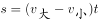可得：150=（2-1）t，解得t=150秒，即2分30秒。

故正确答案为B。

**考点**：相遇追及

**来源**：2015年北京市公务员录用考试《行测》题第79题

### 第 80 题

某商店进了5件工艺品甲和4件工艺品乙，如将甲加价110%，乙加价90%出售，利润为302元；如将乙加价110%，甲加价90%出售，利润为298元。则甲的进价为每件多少元？

A. 14

B. 32

C. 35

D. 62.5

第 80 题 · 答案与解析

**参考答案（粉笔题库参考内容）**

B

**解析**

设5件甲的总进价为x元，4件乙的总进价为y元，根据条件可得1.1x+0.9y=302；0.9x+1.1y=298。解得x=160，y=140。则每件甲的进价=160÷5=32元。

故正确答案为B。

**考点**：经济利润问题

**来源**：2015年北京市公务员录用考试《行测》题第80题

### 第 81 题

某工厂有甲、乙两个车间，其中甲车间有15名、乙车间有12名工人。每个车间都安排工人轮流值班，其中周一到周五每天安排一人、周六和周日每天安排两人。某个星期一甲车间的小张和乙车间的小赵一起值班，则他们下一次一起值班是星期几？

A. 周一、周二或周三中的一天

B. 周四或周五中的一天

C. 周六

D. 周日

第 81 题 · 答案与解析

**参考答案（粉笔题库参考内容）**

C

**解析**

已知甲车间有15人，乙车间有12人，两个车间的人下一次一起值班一定要轮过15与12的最小公倍数，即60人次之后。因周一到周五每天1人值班，周六和周日每天2人值班，每周共5+4=9人轮班。60÷9=6……6，即经历6周之后，两个车间还剩余6人没有轮完。第7周周一至周五值班5人，剩余1人周六值班。而周六要求两人值班，故甲、乙两车间需补一人周六值班，可将甲车间的小张、乙车间的小赵补充到周六一起值班，此时60人结束，需从头开始轮班。

故正确答案为C。

**考点**：周期相遇问题、星期日期问题

**来源**：2015年北京市公务员录用考试《行测》题第81题

### 第 82 题

有8人要在某学术报告会上作报告，其中张和李希望被安排在前三个作报告，王希望最后一个作报告，赵不希望在前三个作报告，其余4人没有要求。如果安排作报告顺序时要满足所有人的要求，则共有多少种可能的报告序列?

A. 441

B. 484

C. 529

D. 576

第 82 题 · 答案与解析

**参考答案（粉笔题库参考内容）**

D

**解析**

因王希望最后一个作报告，故可先将王固定在最后一个位置（8号位置）。张和李希望在前三个作报告，可从前3号位置中抽出两个进行排列（有先后之分），有种排法。赵不希望在前三个作报告，可在其他位置（4、5、6、7号）中任意抽出一个进行排列，则有种选法。剩余四人没有要求，则可在剩余位置进行全排列，共有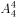种排法。分步计算用乘法，故全部的排法数一共有：种。

故正确答案为D。

**考点**：基础排列组合

**来源**：2015年北京市公务员录用考试《行测》题第82题

### 第 83 题

小王围着人工湖跑步，跑第二圈用时是第一圈的两倍，是第三圈的一半，三圈共用时35分钟。如小王跑第四圈和第五圈的时间分别是上一圈的一半，则他跑完5圈后，平均每圈的用时为多少分钟？

A. 8

B. 9

C. 10

D. 11

第 83 题 · 答案与解析

**参考答案（粉笔题库参考内容）**

C

**解析**

设跑第一圈用时为1份，根据题干条件，所跑5圈用时之比应为1:2:4:2:1。前三圈共用时7份，对应35分钟，则每份为 5 分钟。由此可得，平均每圈用时 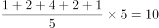分钟。

故正确答案为C。

**考点**：和差倍比问题

**来源**：2015年北京市公务员录用考试《行测》题第83题

### 第 84 题

甲、乙两个班各有40多名学生，男女生比例甲班为5：6，乙班为5：4。则这两个班的男生人数之和比女生人数之和？

A. 多1人

B. 多2人

C. 少1人

D. 少2人

第 84 题 · 答案与解析

**参考答案（粉笔题库参考内容）**

A

**解析**

因甲班男女生之比为5：6，共11份，故总人数应为11的倍数；乙班男女生之比为5：4，共9份，故总人数应为9的倍数。甲、乙两班均各有40多名学生，则甲班只能为44人，其中男生20人，女生24人；乙班只能为45人，其中男生25人，女生20人。两个班男生人数之和=20+25=45人，女生人数之和=24+20=44人。故这两个班的男生人数之和比女生人数之和多 1 人。

故正确答案为A。

**考点**：和差倍比问题

**来源**：2015年北京市公务员录用考试《行测》题第84题

### 第 85 题

小张工作的时间是12点到19点，某天小张在上班时间先后参加了两个时长为半小时的讨论会，两个讨论会开始时小张手表上的时针和分针都呈90度角。则两个会议的开始时间最多间隔（  ）。

A. 6小时

B. 6小时4分

C. 6小时30分

D. 6小时35分

第 85 题 · 答案与解析

**参考答案（粉笔题库参考内容）**

A

**解析**

要使两个会议间隔时间尽可能长，则第一个讨论会开始的时间应尽可能早，第二个讨论会开始的时间应尽可能晚。

第一个讨论会：工作从 12 点开始，会议最早开始时间应为 12 点后时针与分针第一次呈 90 度角，即 12 点整点后分针比时针多走了 90 度。

第二个讨论会：工作在 19 点结束，会议最晚开始时间应为 18 点后时针与分针第一次呈 90 度角。如果是第二次呈 90 度角（18 点 50 分左右），此时讨论会无法在下班之前结束。18 点后时针与分针第一次呈 90 度角，也即 18 点整点后分针比时针多走了 90 度。

两次会议的开始时间分针均比时针多走了 90 度，则两次分针所指的分钟数应完全相同，仅需考虑时针所指的小时数之间的间隔即可，两次会议之间间隔 18–12=6小时。

故正确答案为 A。

**考点**：非典型最值问题

**来源**：2015年北京市公务员录用考试《行测》题第85题

### 第 86 题

请从四个选项中选出最恰当的一项填在问号处，使图形呈现一定的规律性。

A. A

B. B

C. C

D. D

第 86 题 · 答案与解析

**参考答案（粉笔题库参考内容）**

D

**解析**

元素组成相似，优先考虑样式规律。此题为九宫格类型，优先横向看规律。其中第一行的第三个图形是前两个图形叠加形成的；第二行也符合这个规律；因此第三行也应该符合此规律。

A 项：图形右下角的三角形应该是灰色的，而A项是白色的，排除。

B 项：图形右上角的外侧应该有一条竖线，而B项没有，排除。

C 项：图形左上方应该有一个灰色的三角形，而C项没有，排除。

D 项：图形完全符合题干要求，与该行的第一个图形相加，正好形成了该行的第三个图形，当选。

故正确答案为 D。

**考点**：样式规律-加减同异

**来源**：2015年北京市公务员录用考试《行测》题第86题

### 第 87 题

请从四个选项中选出最恰当的一项填在问号处，使图形呈现一定的规律性。

A. A

B. B

C. C

D. D

第 87 题 · 答案与解析

**参考答案（粉笔题库参考内容）**

D

**解析**

元素组成不同，无法通过属性规律解题，因此考虑数量规律。此题为九宫格类型，优先横向看规律。题干中所有图形都存在明显的空白区域，优先考虑面数量。第一行的每个图形都包含2个面；第二行的每个图形都包含3个面；而第三行中第二个图形和第三个图形都包含4个面，因此可以确定问号处应该为包含4个面的图形。

A 项：包含3个面，排除。

B 项：包含3个面，排除。

C 项：包含3个面，排除。

D 项：完全符合题干要求，包含4个面，当选。

故正确答案为 D。

**考点**：数量规律-面

**来源**：2015年北京市公务员录用考试《行测》题第87题

### 第 88 题

请从四个选项中选出最恰当的一项填在问号处，使图形呈现一定的规律性。

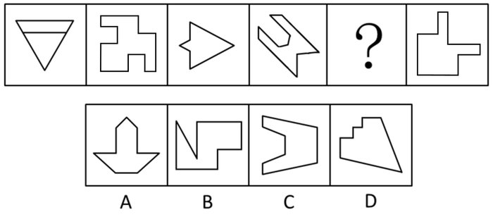

A. A

B. B

C. C

D. D

第 88 题 · 答案与解析

**参考答案（粉笔题库参考内容）**

A

**解析**

元素组成不同，优先考虑属性规律。每个图形均为轴对称图形，且对称轴依次顺时针旋转 45°。因此问号处应为竖轴对称的图形。

A 项：完全符合题干要求，为竖轴对称图形，当选。

B 项：非轴对称图形，排除。

C 项：为横轴对称图形，排除。

D 项：为斜轴对称图形，排除。

故正确答案为 A。

**考点**：属性规律-对称性

**来源**：2015年北京市公务员录用考试《行测》题第88题

### 第 89 题

请从四个选项中选出最恰当的一项填在问号处，使图形呈现一定的规律性。

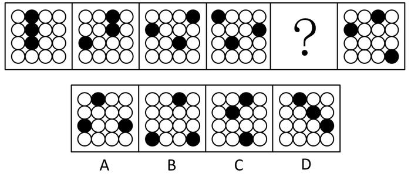

A. A

B. B

C. C

D. D

第 89 题 · 答案与解析

**参考答案（粉笔题库参考内容）**

A

**解析**

元素组成相同，优先考虑位置规律。每个图形小黑球的位置均发生了平移，采取邻近假设的方式来找规律。

根据标注“1”的小黑球运动轨迹，可知“1”的小黑球是沿着外圈进行顺时针移动一格转动，排除B、C两项；

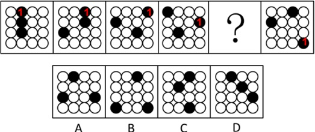

根据标注“2”的小黑球运动轨迹，可知“2”的小黑球是顺时针移动一格转动，D项排除。

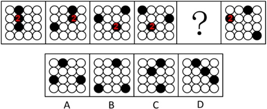

继续观察，根据标注“3”的小黑球运动轨迹，可知“3”的小黑球是顺时针移动一格转动。

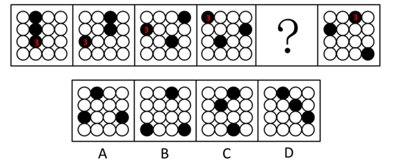

故正确答案为A。

**考点**：位置规律-平移

**来源**：2015年北京市公务员录用考试《行测》题第89题

### 第 90 题

请从四个选项中选出最恰当的一项填在问号处，使图形呈现一定的规律性。

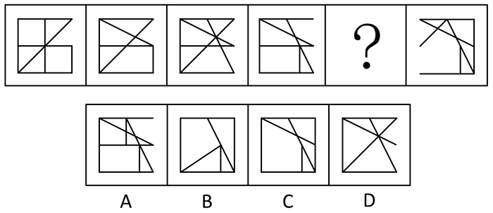

A. A

B. B

C. C

D. D

第 90 题 · 答案与解析

**参考答案（粉笔题库参考内容）**

C

**解析**

元素组成相似，优先考虑样式规律。比较相邻的两个图形发现没有样式规律，其中第二个图形比第一个图形少了一条中间的竖线，但是多了上半部分的一条斜线；继续观察发现，第三个图形比第二个图形少了右下方一条小竖线，但是多了一条斜线；第四个图形比第三个图形少了一条对角线，但是右下方多了一条小竖线。

由此我们可以发现规律，即后面的图形相较于前面的图形少了一条本来存在的线，但又多了一条新的线。

A项：相较于第四个图形只是多了中间的一条小竖线，并没有少一条原来存在的线，排除。

B项：相较于第四个图形少了中间的一条横线和上面的一条斜线，多了最右侧的一条竖线和左下角的一条斜线，排除。

C项：相较于第四个图形少了中间的一条横线，但是多了最右侧的一条竖线，当选。

D项：相较于第四个图形少了中间的一条横线和右下方的一条小竖线，多了一条对角线，排除。

故正确答案为C。

**考点**：数量规律-线

**来源**：2015年北京市公务员录用考试《行测》题第90题

### 第 91 题

关于某商务宾馆前台的15名服务员，有如下三个判断：

Ⅰ.有人会熟练地说英语；

Ⅱ.有人不会熟练地说英语；

Ⅲ.新来的小刘不会熟练地说英语。

若这三个判断中只有一句为真，以下哪项也一定为真？

A. 15名服务员都会熟练地说英语

B. 15名服务员都不会熟练地说英语

C. 仅有一人会熟练地说英语

D. 仅有一人不会熟练地说英语

第 91 题 · 答案与解析

**参考答案（粉笔题库参考内容）**

A

**解析**

分析题干的逻辑关系。

Ⅰ和Ⅱ属于反对关系，必有一真，而题干中明确说明三句话中只有一句是真的，因此可以判断Ⅲ一定是假的，即小刘会熟练地说英语。

因为“某个”为真，“有的”一定为真，即“小刘会熟练地说英语”为真，那么“有人会熟练地说英语”一定为真，因此可以判断Ⅰ一定是真的。

因为三句话中只有一句话是真的，因此可以判断Ⅱ一定是假的。

因为“有的不”与“所有都”是矛盾命题，必然一真一假，而“有人不会熟练地说英语”是假的，因此可以得出结论：“所有人都会熟练地说英语”是真的。

故正确答案为A。

**考点**：只有一真/一假

**来源**：2015年北京市公务员录用考试《行测》题第91题

### 第 92 题

配方奶被阪崎肠杆菌污染主要有两个来源：一是奶粉本身就含有少量阪崎肠杆菌；二是通过周围的环境和被细菌污染的器具或者双手进入配方奶。因此，世界卫生组织建议用不低于70摄氏度的水来冲调婴儿的配方奶。

以下陈述如果为真，哪项是上述结论的前提？

A. 婴幼儿腹泻的主要原因是阪崎肠杆菌

B. 70摄氏度以上的水可杀死阪崎肠杆菌

C. 水温低于70摄氏度不会影响奶粉的营养

D. 绝大多数细菌无法在沸水中存活

第 92 题 · 答案与解析

**参考答案（粉笔题库参考内容）**

B

**解析**

第一步：找出论点和论据。

论点：用不低于70摄氏度的水来冲调婴儿的配方奶。

论据：配方奶被阪崎肠杆菌污染。

第二步：逐一分析选项。

A项：题干中并没有提到婴幼儿腹泻的问题，而且也没说为什么用不低于70摄氏度的水来冲泡奶粉的问题，属于无关项，排除；

B项：在不低于70摄氏度和阪崎肠杆菌之间建立联系，是对论点和论据的搭桥，属于加强项，当选；

C项：提到的是奶粉的营养问题，属于无关项，排除；

D项：题干中说的是不低于70摄氏度，而选项中说的是沸水，属于偷换了概念，而且说的是绝大部分细菌，是否包含阪崎肠杆菌并不明确，属于无关项，排除。

故正确答案为B。

**考点**：搭桥

**来源**：2015年北京市公务员录用考试《行测》题第92题

### 第 93 题

有许多美丽的人并不善良，但没有一个善良的人是不美丽的。

以下不能从上述论断中推出的是（  ）。

A. 没有一个不美丽的人是善良的

B. 有些美丽的人是善良的

C. 有些善良的人不是美丽的

D. 有些不善良的人是美丽的

第 93 题 · 答案与解析

**参考答案（粉笔题库参考内容）**

C

**解析**

第一步：翻译题干。

“有许多美丽的人并不善良”，可翻译为：①“有的美丽→善良”；

“没有一个善良的人是不美丽的”等同于“所有善良的人都是美丽的”，可翻译为：②“善良→美丽”。

第二步：逐一分析选项。

A项：“没有一个不美丽的人是善良的”等同于“所有不美丽的人都是不善良的”，可翻译为“-美丽→善良”，根据否后推否前，结合条件②，可以推出，排除；

B项：可翻译为“有的美丽→善良”，根据“所有A都是B”可以推出“有的B是A”，结合条件②，可以推出，排除；

C项：可翻译为“有的善良→美丽”，与条件②矛盾，无法推出，当选；

D项：可翻译为“有的-善良→美丽”，根据“有的A是B”可以推出“有的B是A”，结合条件①，可以推出，排除。

本题为选非题，故正确答案为C。

**考点**：集合推理

**来源**：2015年北京市公务员录用考试《行测》题第93题

### 第 94 题

某超市举行店庆促销活动。其中，具体规定如下：

只有在店庆当天的一次消费中购买甲类商品和乙类商品至少各一样，才能获得小熊赠品一只。

只有VIP会员并且当天一次性消费至少一件甲类商品或乙类商品，当次所购全部商品才能获得八折优惠。

如果购买乙类商品的件数在五件以上，则可以申请成为VIP会员。

假如店庆当天张丽仅在该超市消费一次，但没有购买乙类商品，则以下哪项一定为真？（  ）

A. 张丽所购商品不可能得到八折优惠

B. 张丽是VIP会员并购买了甲类商品

C. 张丽不能获得小熊赠品

D. 张丽有可能获得小熊赠品

第 94 题 · 答案与解析

**参考答案（粉笔题库参考内容）**

C

**解析**

第一步：分析题干的逻辑关系。

①小熊→店庆当天且甲且乙；

②八折→VIP且（甲或乙）；

③乙（＞5）→VIP；

④消费一次且-乙；

第二步：逐一分析选项。

A项：-乙并不代表着是否买了甲，也不知道是不是VIP，因此不构成对②的否后，所以不清楚是否享受到了八折优惠，排除；

B项：因为根据③，一次性购买大于5件乙类商品才可能申请VIP，而现在张丽没有购买乙类商品，属于否前，得不到确定性结论，排除；

C项：因为张丽没有购买乙类商品，因此对①形成了否后，可以得到否前的结论，即-小熊，当选；

D项：根据对上个选项的分析我们可以得知张丽是没有得到小熊赠品的，排除。

故正确答案为C。

**考点**：常规翻译

**来源**：2015年北京市公务员录用考试《行测》题第94题

### 第 95 题

2009年法国航空公司一架客机失事。如果法国及其他多国没有采取积极的搜救行动，就不会尽早发现失事飞机的残骸。如果失事飞机设计公司提供技术支持并且派专家参与失事原因分析，那么关于失事事件的调查报告就会更客观。

以上陈述如果为真，以下哪项不可能为假？（  ）

A. 或者法国及其他多国采取积极的搜救行动，或者不会尽早发现失事飞机的残骸

B. 除非失事飞机设计公司提供技术支持，否则就不会尽早发现失事飞机的残骸

C. 如果法国及其他多国采取积极的搜救行动，就会尽早发现失事飞机的残骸

D. 如果失事飞机设计公司提供技术支持，那么关于失事事件的调查报告就会更客观

第 95 题 · 答案与解析

**参考答案（粉笔题库参考内容）**

A

**解析**

第一步：翻译题干。

①-积极搜救→发现残骸；

②技术支持且分析原因→报告客观。

第二步：逐一分析选项。

A项：积极搜救或-发现残骸，由或命题否1推1可知，-积极搜救→发现残骸，跟①的表述完全一致，当选；

B项：发现残骸→技术支持，题干当中两者没有明显的逻辑关系，排除；

C项：积极搜救→发现残骸，这句话是对①的否前，无法得到确定的结论，排除；

D项：技术支持→报告客观，因为②的前件是“且”关系，所以技术支持无法构成②的肯前，也就无法得到肯后的结论，排除。

故正确答案为A。

**考点**：常规翻译

**来源**：2015年北京市公务员录用考试《行测》题第95题

### 第 96 题

幼儿园马老师和三个小朋友情情、可可和安安一起玩“猜一猜，我最棒”游戏，马老师对小朋友们说：“我把手中的红球、黄球和蓝球分别放在这个柜子的三个抽屉里，请你们猜一猜每只抽屉里放的是什么颜色的球？猜对了奖励小红花！”然后，她请小朋友们闭上眼睛，把三只球分别放在三个抽屉里，小朋友猜的情况如下：

情情说：“红球在最上层的抽屉，黄球在中间抽屉。”

可可说：“红球在中间抽屉，蓝球在最上层的抽屉。”

安安说：“红球在最底层的抽屉，黄球在最上层的抽屉。”

老师告诉她们，每人都只猜对了一半。

请问：红球、黄球和蓝球各在哪一层抽屉里？

A. 红球在中间抽屉，黄球在最上层的抽屉，蓝球在最底层的抽屉

B. 红球在中间抽屉，黄球在最底层的抽屉，蓝球在最上层的抽屉

C. 红球在最上层的抽屉，黄球在最底层的抽屉，蓝球在中间抽屉

D. 红球在最底层的抽屉，黄球在中间抽屉，蓝球在最上层的抽屉

第 96 题 · 答案与解析

**参考答案（粉笔题库参考内容）**

D

**解析**

此题目为排列组合题型，题干信息不确定，优先考虑代入法解题。

A项：代入到题干中去我们发现，情情猜测的都是错的，不符合题干，排除；

B项：代入到题干中去我们发现，情情猜测的都是错的，不符合题干，排除；

C项：代入到题干中去我们发现，可可猜测的都是错的，不符合题干，排除；

D项：代入到题干中去我们发现，每个人的猜测都对了一半，符合题干，正确。

故正确答案为D。

**考点**：框架题

**来源**：2015年北京市公务员录用考试《行测》题第96题

### 第 97 题

某单位组织职工进行体检，职工可自愿报名参加。老王碰到新来的小李，聊起此事，老王提醒小李说：“单位组织体检呢，赶紧报名去吧。”小李说：“我身体健康着呢，不用报了。”

以下除哪项外，都可以作为小李的回答所包含的假设？（  ）

A. 如果身体不健康，则要报名参加体检

B. 只要我身体健康，我就不必参加体检

C. 凡是报名参加体检的，都是身体不健康的

D. 只有身体不健康的人，才报名参加体检

第 97 题 · 答案与解析

**参考答案（粉笔题库参考内容）**

A

**解析**

第一步：翻译题干。

“我身体健康，不用体检”可以理解为“身体健康就不用体检”

这句话可以翻译为：健康→—体检。

第二步：逐一分析选项。

A项：翻译为：-健康→体检，是对题干推出关系的否前，否前无必然结论，无法推出，当选；

B项：翻译为：健康→—体检，是对题干推出关系的肯前，肯前必肯后，可以推出，排除；

C项：翻译为：体检→—健康，是对题干推出关系的否后，否后必否前，可以推出，排除；

D项：翻译为：体检→—健康，是对题干推出关系的否后，否后必否前，可以推出，排除。

本题为选非题，故正确答案为A。

**考点**：常规翻译

**来源**：2015年北京市公务员录用考试《行测》题第97题

### 第 98 题

某次英语期末考试成绩公布后，有如下情况：王东比董强分数低，吴平比岳丽分数低，赵梅比吴平分数高，王东和赵梅得分一样。

如果以上陈述为真，则以下哪项也一定为真？（  ）

A. 王东比吴平分数低

B. 岳丽比董强分数高

C. 岳丽比赵梅分数高

D. 董强比吴平分数高

第 98 题 · 答案与解析

**参考答案（粉笔题库参考内容）**

D

**解析**

题干条件确定，但不能直接排除选项，只能将条件一一列出进行推理。由于出现分数大小比较，可借助符号推理。

第一步：翻译题干。

（1）王东＜董强；（2）吴平＜岳丽；（3）吴平＜赵梅；（4）王东=赵梅。整理条件有：①吴平＜王东=赵梅＜董强；②吴平＜岳丽。

第二步：逐一分析选项。

A 项：根据①可知，王东高于吴平，排除。

B 项：根据①②可知，岳丽和董强无法比较，排除。

C 项：根据①②可知，岳丽和赵梅无法比较，排除。

D 项：根据①可知，董强高于吴平，当选。

故正确答案为D。

**考点**：从确定信息开始推

**来源**：2015年北京市公务员录用考试《行测》题第98题

### 第 99 题

某中学甲班学生中，所有喜欢奥数的同学也都喜欢下围棋。

若以上陈述为真，再加上以下哪项，则可以合乎逻辑地推出：有些喜欢看话剧的同学不喜欢奥数？（  ）

A. 有些喜欢看话剧的同学也喜欢下围棋

B. 有些喜欢奥数的同学不喜欢看话剧

C. 有些不喜欢下围棋的同学喜欢看话剧

D. 有些不喜欢看话剧的同学喜欢下围棋

第 99 题 · 答案与解析

**参考答案（粉笔题库参考内容）**

C

**解析**

第一步：翻译题干。

条件：奥数→围棋；

结论：有的话剧→奥数；

第二步：逐一分析选项。

A选项，有的话剧→围棋，这句话和题目中的条件是无法得到题干中的结论的，排除；

B选项，有的奥数→话剧，这句话和题目中的条件是无法得到题干中的结论的，排除；

C选项，有的-围棋→话剧，这句话可以推出“有的话剧→围棋”，根据题干条件“奥数→围棋”可知“-围棋→奥数”，因此可以得到“有的话剧→奥数”，当选。

D选项，有的-话剧→围棋，这句话和题目中的条件是无法得到题干中的结论的，排除。

故正确答案为C。

**考点**：集合推理

**来源**：2015年北京市公务员录用考试《行测》题第99题

### 第 100 题

某知名跨国公司的总部员工中，所有懂英语的都不精通印尼语，有些懂英语的不精通西班牙语，有些懂韩语的精通印尼语，所有懂韩语的都精通西班牙语，有些懂韩语的精通英语。

如果以上陈述为真，以下除哪项外也一定为真？（  ）

A. 有些懂韩语的员工不精通印尼语

B. 有些懂印尼语的不精通西班牙语

C. 有些懂韩语的职工不精通英语

D. 有些懂英语的不精通韩语

第 100 题 · 答案与解析

**参考答案（粉笔题库参考内容）**

B

**解析**

第一步：翻译题干。

①英语→印尼语；

②有的英语→西班牙语；

③有的韩语→印尼语；

④韩语→西班牙语；

⑤有的韩语→英语。

第二步：逐一分析选项。

A选项，有的韩语→印尼语，根据①和⑤可知此项正确，排除；

B选项，有的印尼语→西班牙语，根据③和④可知“有的印尼语→西班牙语”，无法得知B选项的真假，错误，当选；

C选项，有的韩语→英语，根据①和③可知此项正确，排除；

D选项，有的英语→韩语，根据②和④可知此项正确，排除。

本题为选非题，故正确答案为B。

**考点**：集合推理

**来源**：2015年北京市公务员录用考试《行测》题第100题

### 第 101 题

2014年索契冬奥会的男子冰壶项目，甲队和乙队都进入了前八强，关于甲、乙两队是否最终能够夺得奖牌，有如下断言：

Ⅰ.甲、乙两队至少有一队能夺得奖牌。

Ⅱ.甲队不一定夺得奖牌。

Ⅲ.乙队夺得了奖牌。

Ⅳ.甲队不可能夺不到奖牌。

已知以上断言有两句为真，两句为假，由此可以推知（  ）。

A. 甲队夺得了奖牌，乙队未夺得

B. 甲、乙两队都夺得了奖牌

C. 甲、乙两队都没夺得奖牌

D. 乙队夺得了奖牌，甲队未夺得

第 101 题 · 答案与解析

**参考答案（粉笔题库参考内容）**

A

**解析**

翻译题干。

①甲或乙；

②可能-甲；

③乙；

④必然甲；

因为题干中有两真两假，②和④为矛盾关系，一真一假，因此①和③一真一假。因为③如果是真的，①一定为真，因此③不可能为真的，即③是假的，①是真的，由此得到结论，乙没有得奖牌，甲获得了奖牌。

故正确答案为A。

**考点**：两真两假

**来源**：2015年北京市公务员录用考试《行测》题第101题

### 第 102 题

对气候变暖的治理应当是为二氧化碳找出路，而不仅仅是减少排放或简单地掩埋它，为此科学家提出富碳农业的理念，将人类活动特别是工业生产中产生的二氧化碳捕集后，以高于大气中二氧化碳含量几倍的浓度，释放在密闭的人造气候小区域中，利用相关科学技术，创造一个高效率的光合作用环境，从而极大提高农林作物的产量，科学家认为富碳农业将成为解决气候变暖问题的重要途径。

下列陈述如果为真，哪项最能支持科学家的结论？

A. 传统农业需要使用阳光下的土地，而富碳农业可以不受此限制

B. 人造气候区域很难高效地使用太阳光来促进光合作用的发生

C. 现代技术能以较低的成本实现二氧化碳的捕集、运输和在密闭场所的释放

D. 富碳农业可以利用盐碱地、沙漠地、荒漠地等解决土地短缺问题

第 102 题 · 答案与解析

**参考答案（粉笔题库参考内容）**

C

**解析**

第一步：找到论点论据。

论点：富碳农业将成为解决气候变暖问题的重要途径。

论据：将人类活动特别是工业生产中产生的二氧化碳捕集后，以高于大气中二氧化碳含量几倍的浓度，释放在密闭的人造气候小区域中，利用相关科学技术，创造一个高效率的光合作用环境，从而极大提高农林作物的产量。

第二步：逐一分析选项。

A项：题干并没有提到“阳光下的土地”在多大程度上会影响农业，无关项，排除；

B项：人造气候区域很难有效利用光合作用，这是在说明可行性不高，属于削弱论据，排除；

C项：较低的成本，说的是这种富碳农业在现实的情况下是可行的，确实能够成为重要途径，补充论据加强，当选；

D项：说富碳农业会解决土地短缺问题，而论点讲的是能解决气候变暖问题，无关项，排除。

故正确答案为C。

**考点**：必要条件

**来源**：2015年北京市公务员录用考试《行测》题第102题

### 第 103 题

研究人员对父母及其子女进行DNA测序，发现父亲的年龄与子女基因突变存在联系，高龄父亲的子女DNA存在着与孤独症、精神分裂症等有关的基因突变。因此，研究人员得出结论，男性要趁早要孩子，年纪越大，孩子的疾病风险越高。

以下论述如果为真，最能质疑该结论的是（  ）。

A. 男性年龄越大，精子质量下降，包含基因突变片段越多

B. 受试群体中男性孤独症、精神分裂症的发病率显著高于女性

C. 许多受试夫妻年龄相仿，子女的基因突变更可能来自高龄母亲

D. 男性最佳育龄期晚于女性，但整个育龄期显著长于女性

第 103 题 · 答案与解析

**参考答案（粉笔题库参考内容）**

C

**解析**

第一步：分析题目，找到论点论据。

论点：男性要趁早要孩子，年纪越大，孩子的疾病风险越高。

论据：父亲的年龄与子女基因突变存在联系，高龄父亲的子女DNA存在着与孤独症、精神分裂症等有关的基因突变。

第二步：逐一分析选项。

A项，属于解释论点，为什么年纪越大，疾病风险越高，加强项，排除；

B项，说的是受试男性的问题，没有提到其孩子的问题，无关项，排除；

C项，强调了子女的基因突变更可能来自高龄母亲，加入了一个其他的也可能导致该结论的原因，属于他因削弱，当选；

D项，没有提到孩子疾病风险的问题，无关项，排除。

故正确答案为C。

**考点**：他因削弱

**来源**：2015年北京市公务员录用考试《行测》题第103题

### 第 104 题

人体免疫细胞可分为两类，一种是保卫人体不受侵犯的“军队”型细胞，另一类则是维持内部治安的“警察”型细胞。前者是通过抗原抗体反应来实现抗病毒感染，其作用反应通常需要一定的时间；后者又称为自然杀伤细胞（NK细胞），人体体内每天会诞生100万个新细胞，其中约有5000个不良细胞，它们可能导致癌变，NK细胞能够尽早发现并攻击这些不良细胞和感染细胞，有研究证实，酸奶中的R-1乳酸菌可以提高NK细胞活性。

由此可以推出（    ）。

A. NK细胞缺乏将导致人体部分细胞癌变

B. 对付流感，酸奶甚至比药物起效更快

C. “军队”型免疫细胞抗感染能力更强

D. “警察”型免疫细胞有助于机体抗癌

第 104 题 · 答案与解析

**参考答案（粉笔题库参考内容）**

D

**解析**

日常结论题，根据题干信息逐一分析选项。

A项：根据题干中“其中约有5000个不良细胞，它们可能导致癌变，NK细胞能够尽早发现并攻击这些不良细胞和感染细胞”可知，是“不良细胞可能导致癌变”，而缺乏这种NK细胞是否导致癌变并不清楚，无法推出，排除；

B项：根据题干中“酸奶中的R-1乳酸菌可以提高NK细胞活性”可知，并未比较酸奶和药物的起效速度，无中生有，无法推出，排除；

C项：根据题干可知，只是分别介绍了“军队”型细胞和“警察”型细胞的作用，并未进行比较，无中生有，无法推出，排除；

D项：根据题干中“其中约有5000个不良细胞，它们可能导致癌变，NK细胞能够尽早发现并攻击这些不良细胞和感染细胞”可知，“警察”型免疫细胞确实有助于机体抗癌，可以推出，当选。

故正确答案为D。

**考点**：日常结论

**来源**：2015年北京市公务员录用考试《行测》题第104题

### 第 105 题

伦敦某研究团队使用结构性磁共振成像技术对18名16岁至21岁的吸烟青少年和此年龄段24名不吸烟的青少年的大脑进行了检测。结果发现，吸烟者的右脑岛比非吸烟者右脑岛体积要小，脑岛周围被大脑皮层包裹，与大脑的记忆、意识和语言功能区彼此相连。研究者认为，吸烟改变了大脑发育过程，这一改变将对青少年产生终身影响。

下列哪项最能质疑研究者的结论？

A. 右侧脑岛有大量尼古丁感受体，脑岛受到破坏后，烟瘾会戒除

B. 吸烟的青少年其大脑发育明显受到激素水平的影响

C. 先天右脑岛体积小的人，更容易对吸烟产生兴趣并导致依赖

D. 青少年因好奇而吸烟，随着年龄增长会逐渐失去对烟草的兴趣

第 105 题 · 答案与解析

**参考答案（粉笔题库参考内容）**

C

**解析**

第一步：找出论点和论据。

论点：吸烟改变了大脑发育过程，这一改变将对青少年产生终身影响。

论据：吸烟者的右脑岛比非吸烟者右脑岛体积要小，脑岛周围被大脑皮层包裹，与大脑的记忆、意识和语言功能区彼此相连。

第二步：逐一分析选项。

A项：选项是说当脑岛受到破坏后，烟瘾会戒除，并没有提及吸烟是否改变了大脑的发育过程，为无关项，排除；

B项：选项是说吸烟的青少年其大脑发育明显受到激素水平的影响，表明吸烟在一定程度上改变了大脑的发育过程，有加强的意思，排除；

C项：选项说明并不是因为吸烟而改变了大脑的发育过程，而是先天右脑体积小的人，更容易对吸烟产生兴趣，是对论点因果倒置的削弱，当选；

D项：选项说的青少年对吸烟的兴趣，并没有提及吸烟者大脑发育的过程，为无关项，排除。

故正确答案为C。

**考点**：因果倒置

**来源**：2015年北京市公务员录用考试《行测》题第105题

### 第 106 题

政府失灵，是指个人对公共物品的需求在现代民主政治中得不到很好的满足，公共部门在提供公共物品时趋向于浪费和滥用资源，致使公共支出规模过大或者效率降低，政府的活动或干预措施缺乏效率，或者说政府做出了降低经济效率的决策或不能实施改善经济效率的决策。

根据上述定义，下列属于政府失灵的是（    ）。

A. 私立医院的优质医疗服务只有少数富人群体可以享用

B. 购买国产汽车可以享受政府补贴的政策使得进口汽车销量受到严重影响

C. 因资格审查政策有漏洞，大批经济适用房被有多套住房的人买走

D. 政府的西部开发计划使得不少高科技人才流向西部边远地区

第 106 题 · 答案与解析

**参考答案（粉笔题库参考内容）**

C

**解析**

第一步：找出定义关键词。

“个人对公共物品的需求得不到很好的满足”、“公共部门在提供公共物品时趋向于浪费和滥用资源”。

第二步：逐一分析选项。

A项：私立医院的优质医疗服务不是公共物品的需求，不符合“个人对公共物品的需求得不到很好的满足”，不符合定义，排除；

B项：进口汽车并不是公共物品，不符合“个人对公共物品的需求得不到很好的满足”，不符合定义，排除；

C项：经济适用房是公共物品，被多套住房的人买走说明公共物品趋向于浪费，导致的结果是公共支出没有起到应有的效果，也即公共支出效率降低，符合“个人对公共物品的需求得不到很好的满足”、“公共部门在提供公共物品时趋向于浪费和滥用资源”，符合定义，当选；

D项：高科技人才不是公共物品，不符合“个人对公共物品的需求得不到很好的满足”，不符合定义，排除。

故正确答案为C。

**考点**：原因结果

**来源**：2015年北京市公务员录用考试《行测》题第106题

### 第 107 题

内耗效应，是指在社会或部门内部因不协调或矛盾等造成的人力消耗而产生的负效应现象，其本质是它对外没有作功而只是内部消耗能量。

根据上述定义，下列属于内耗效应的是（    ）。

A. 经过很长时间的广告战、价格战之后，两大饮料公司两败俱伤

B. 游戏机商贩李某在学校内兜售游戏机，很多同学因此无心学习

C. 甲国球队大比分战胜乙国球队，引发场下两国球迷的肢体冲突

D. 集团董事会成员之间因利益纷争上演闹剧，导致该集团股票大跌

第 107 题 · 答案与解析

**参考答案（粉笔题库参考内容）**

D

**解析**

第一步：找出定义关键词。

“社会或部门内部因不协调或矛盾”、“造成的人力消耗而产生的负效应”、“本质只是内部消耗能量”。

第二步：逐一分析选项。

A项：两大饮料公司之间的广告战、价格战发生在社会内部，但最后的结果没有体现出对人力消耗，不符合定义，排除；

B项：学生无心学习是由于游戏机商贩兜售游戏机导致的，并不是因内部不协调或矛盾，不符合定义，排除；

C项：两国球迷的矛盾并不属于内部矛盾，不符合定义，排除；

D项：董事会成员之间上演闹剧属于内部矛盾，成员之间的利益纷争也是人力的消耗，股票下跌属于负效应，符合定义，当选。

故正确答案为D。

**考点**：原因结果

**来源**：2015年北京市公务员录用考试《行测》题第107题

### 第 108 题

藕合效应也称互动效应，是指群体中两个或以上的个体通过相互作用而彼此影响从而联合起来产生增力的现象。

根据上述定义，下列不属于藕合效应的是（    ）。

A. 众人合心，其利断金

B. 水涨船高，柴多火旺

C. 鹬蚌相持，渔人得利

D. 三个臭皮匠顶一个诸葛亮

第 108 题 · 答案与解析

**参考答案（粉笔题库参考内容）**

C

**解析**

第一步：找出定义关键词。

“两个或以上的个体”、“相互作用而彼此影响”、“联合起来产生增力”。

第二步：逐一分析选项。

A项：众人合力体现了两个以上的个体通过相互作用联合起来产生增力，从而可以断金，符合定义，排除；

B项：柴多体现了两个以上的个体通过相互作用联合起来产生增力，从而火旺，符合定义，排除；

C项：鹬蚌相持说的是个体之间相互争斗，并没有产生增力，不符合定义，当选；

D项：三个臭皮匠体现了两个以上的个体通过相互作用联合起来产生增力，从而顶一个诸葛亮，符合定义，排除。

本题为选非题，故正确答案为C。

**考点**：方式目的

**来源**：2015年北京市公务员录用考试《行测》题第108题

### 第 109 题

行政职务侵权，是指国家行政机关或者行政机关人员在执行行政职务过程中侵害公民、法人或者其他组织的合法权益的行为。

根据上述定义，下列属于行政职务侵权的是（    ）。

A. 某警官在未找到确凿证据时，对嫌疑人实施殴打造成其人身伤害

B. 城管工作人员暂扣了某无证摊贩所出售的所有商品并勒令其离开

C. 超市保安怀疑王某偷窃，将其非法拘禁在保安室并实施搜身检查

D. 航空公司某空姐利用工作之便非法携带免税化妆品入境，获取牟利

第 109 题 · 答案与解析

**参考答案（粉笔题库参考内容）**

A

**解析**

第一步：找出定义关键词。

“国家行政机关或者行政机关人员”、“在执行行政职务过程中”、“侵害公民、法人或者其他组织的合法权益”。

第二步：逐一分析选项。

A项：警官属于行政机关工作人员，符合“国家行政机关或者行政机关人员”，在未找到确凿证据时殴打嫌疑人造成其人身伤害，符合“在执行行政职务过程中”、“侵害公民、法人或者其他组织的合法权益”，符合定义，当选；

B项：城管属于行政机关工作人员，符合“国家行政机关或者行政机关人员”，但暂扣了某无证摊贩所出售的所有商品属于正常执行行政职务，并没有侵害法人的合法权益，不符合“侵害公民、法人或者其他组织的合法权益”，不符合定义，排除；

C项：超市保安不是行政机关工作人员，不符合“国家行政机关或者行政机关人员”，不符合定义，排除；

D项：航空公司的空姐不是行政机关工作人员，不符合“国家行政机关或者行政机关人员”，不符合定义，排除。

故正确答案为A。

**考点**：拆词

**来源**：2015年北京市公务员录用考试《行测》题第109题

### 第 110 题

善意取得又称为即时取得，无权处分人在不法将其受托占有的他人的财物（动产或者不动产）转让给第三人的，如受让人在取得该财物时系出于善意，则受让人取得该物的所有权，原权利人丧失所有权。

根据上述定义，下列属于善意取得的是（    ）。

A. 甲委托乙存放自己的汽车，在甲出国期间，乙将汽车卖给丙，丙在不知道乙没有处置权的情况下以正当价格完成交易

B. 中介李某以低廉的价格从房主那里租到房屋，以较高的价格租给张某，张某以为李某就是房东，并与其签署租赁合同

C. 甲公司租赁一乙公司的大型3D打印设备，因业务额较小，该设备长期处于闲置状态，甲公司又将该设备转租给丙公司

D. 中学生小贾偷了父母的婚戒，并将其拿到典当行抵押，典当行老板得知该婚戒的来历后，立即转手卖掉

第 110 题 · 答案与解析

**参考答案（粉笔题库参考内容）**

A

**解析**

第一步：找出定义关键词。

“无权处分人在不法将其受托占有的他人的财物（动产或者不动产）转让给第三人”、“受让人在取得该财物时系出于善意”、“原权利人丧失所有权”。

第二步：逐一分析选项。

A项：乙将甲存放的汽车转卖给丙，属于无权处分人乙在不法将其受托占有的他人的财物转让给第三人，丙不知道乙没有处置权，说明丙在取得该财物时系出于善意，甲此时丧失了所有权，符合定义，当选；

B项：张某取得的是房屋的使用权，并非受人所托占有他人财物，房屋所有权仍属于房东，不符合定义，排除；

C项：丙公司取得的是该3D打印机的使用权，乙公司并没有丧失其所有权，题中行为均为租用，并不涉及所有权转让，不符合定义，排除；

D项：典当行老板得知该婚戒的来历不合法，说明典当行在取得该财物时不是出于善意，不符合定义，排除。

故正确答案为A。

**考点**：单定义-其他句式

**来源**：2015年北京市公务员录用考试《行测》题第110题

### 第 111 题

外部性又称外部影响，指某个体或团体的行动和决策使其他个体或团体受损或受益的情况，分为正外部性和负外部性。正外部性是某个经济行为个体的活动使他人或社会受益，而受益者无须花费代价。负外部性是某个经济行为个体的活动使他人或社会受损,而造成负外部性的人却没有为此承担成本。

根据上述定义，下列说法不正确的是（    ）。

A. 私人别墅的美丽花园让过往的行人看到也心旷神怡，属于正外部性

B. 火车道附近的居民饱受噪音干扰但又无法起诉铁道公司，属于负外部性

C. 荔枝园主养一大群蜜蜂帮助荔枝授粉，同时蜜蜂利用荔枝花粉产蜜，属于正外部性

D. 农民在种植瓜果蔬菜时使用剧毒农药除害虫，对消费者健康造成隐患，属于负外部性

第 111 题 · 答案与解析

**参考答案（粉笔题库参考内容）**

C

**解析**

第一步：找出定义关键词。

正外部性：“使他人或社会受益，而受益者无须花费代价”；

负外部性：“使他人或社会受损，而造成负外部性的人却没有为此承担成本”。

第二步：逐一分析选项。

A项：私人别墅的美丽花园让过往的行人看到也心旷神怡符合使他人受益，而行人无须付出代价，符合正外部性定义，排除；

B项：火车道附近的居民饱受噪音干扰符合使他人受损，铁道公司并没有为此承担成本，符合负外部性定义，排除；

C项：荔枝园主养蜜蜂的目的是帮助荔枝授粉，是自己付出代价、为自己谋得利益，不符合正外部性定义，当选；

D项：使用剧毒农药的瓜果蔬菜对消费者健康造成隐患符合使他人受损，菜农没有为此承担成本，符合负外部性定义，排除。

本题为选非题，故正确答案为C。

**考点**：特殊问法

**来源**：2015年北京市公务员录用考试《行测》题第111题

### 第 112 题

柠檬市场，也称次品市场，是指信息不对称的市场，即在市场中，产品的卖方对产品的质量拥有比买方更多的信息。柠檬市场效应则是指在信息不对称的情况下，往往好的商品遭受淘汰，而劣等品会逐渐占领市场，从而取代好的商品，导致市场中都是劣等品。

根据上述定义，下列描述不符合柠檬市场效应的是（    ）。

A. 二手车市场买家不知道车的真实信息，只好压低价格，导致性能好价格高的二手车退出市场

B. 新品牌的商品以较低价格上市，消费者无法评估该商品实际价值，但价格低的优势使该品牌很快占据市场

C. 人才市场上雇佣方不了解每一位应聘者的能力一律采用最低工资标准雇佣，使得有能力的人才流向其他地区

D. 消费者很难辨别冬虫夏草的质量好坏，商家使用断裂的虫草以次充好，市场上很难再见到真正的高质量虫草

第 112 题 · 答案与解析

**参考答案（粉笔题库参考内容）**

B

**解析**

第一步：找出定义关键词。

“在信息不对称的情况下，往往好的商品遭受淘汰，而劣等品会逐渐占领市场”

第二步：逐一分析选项。

A项：买家不知道车的真实信息体现了买家与卖家的信息不对等，性能好价格高的二手车退出市场体现了好的商品遭受淘汰，而劣等品会逐渐占领市场，符合定义，排除；

B项：价格低的品牌占据市场不一定就是劣等品占据市场，不符合定义，当选；

C项：人才市场上雇佣方不了解每一位应聘者的能力体现了买家与卖家的信息不对等，有能力的人才流向其他地区体现了好的商品遭受淘汰，而劣等品会逐渐占领市场，符合定义，排除；

D项：消费者很难辨别冬虫夏草的质量好坏体现了买家与卖家的信息不对等，市场上很难再见到真正的高质量虫草体现了好的商品遭受淘汰，而劣等品会逐渐占领市场，符合定义，排除。

本题为选非题，故正确答案为B。

**考点**：常规问法

**来源**：2015年北京市公务员录用考试《行测》题第112题

### 第 113 题

非正规就业，指就业者个人的一种状态，它是与正规就业处于同等地位的，并明显区别于违法就业，理应纳入就业统计体系的一种就业方式，具有偶然性、季节性、临时性等特点。

根据上述定义，下列不属于非正规就业的是(    )。

A. 某建筑工地由于工期紧，聘用了一些当地老乡介绍来的农民工

B. 每当冬季时，某滑雪胜地的度假村总是多招聘一些服务员

C. 大学生小朱毕业后专职准备研究生考试期间，通过做家教赚取生活费

D. 某农场与具有一定劳动能力的残疾人签订劳动合同，以减免部分税负

第 113 题 · 答案与解析

**参考答案（粉笔题库参考内容）**

D

**解析**

第一步：找出定义关键词。

“区别于违法就业”、“具有偶然性、季节性、临时性等特点”。

第二步：逐一分析选项。

A项：建筑工地由于工期紧，聘用了一些农民工不属于违法就业，符合偶然性、临时性的特点，符合定义，排除；

B项：冬季时滑雪胜地的度假村多招服务员体现了季节性的特点，符合定义，排除；

C项：大学生准备研究生考试期间做家教体现了临时性的特点，符合定义，排除；

D项：农场与残疾人签订劳动合同属于正规的就业形势，没有体现偶然性、季节性、临时性的特点，不符合定义，当选。

本题为选非题，故正确答案为D。

**考点**：拆词

**来源**：2015年北京市公务员录用考试《行测》题第113题

### 第 114 题

网络集群行为，指一定数量的相对无组织的网民，在网络环境中或在网络传播影响下，针对某一共同影响或刺激产生的群体性行为。

根据上述定义，下列属于网络集群行为的是（  ）。

A. 网友们为抵制非理智追星而发起的“69”圣战

B. 为调查网上热传的“陈易卖身救母”事件，一名深圳网友前往四川调查真相

C. 某高校要求学生通过教室微信扫二维码完成签到工作

D. 暴雪公司开发的“魔兽世界”游戏中的公会成员线下不定期聚会

第 114 题 · 答案与解析

**参考答案（粉笔题库参考内容）**

A

**解析**

第一步：抓住定义中的关键词。

“无组织的网民”、“网络环境中”、“群体性行为”。

第二步：逐一判断选项。

A选项，“网友们”符合无组织网民和网络环境下，“发起圣战”符合群体性行为，当选；

B选项，“一名深圳网友”不符合一定数量的相对无组织的网民，排除；

C选项，“某高校要求学生”不符合一定数量的相对无组织的网民，排除；

D选项，“线下不定期聚会”不符合通过网络环境，排除。

故正确答案为A。

**考点**：拆词

**来源**：2015年北京市公务员录用考试《行测》题第114题

### 第 115 题

可持续消费，指既能满足当代人的消费发展需要又不对后代人满足其消费发展需要的能力构成危害的消费。

根据上述定义，下列属于可持续消费的是（  ）。

A. 某富翁要求其子女自己挣钱支付吃穿住行的费用

B. 某著名帝王的陵墓内部一直没有发掘，游人可浏览周边风景

C. 某国水资源缺乏，运用“海水淡化”技术增加淡水量

D. 一些手机生产商鼓励消费者每年更换一部手机

第 115 题 · 答案与解析

**参考答案（粉笔题库参考内容）**

C

**解析**

第一步：抓住定义中的关键词

满足当代人的消费发展，不对后代人满足其消费发展需要的能力构成危害的消费。

第二步：逐一判断选项

A项，某富翁要求子女自己挣钱支付吃穿住行的费用，没有体现不对后代人的消费造成危害，不符合定义，排除；

B项，供游人游览周边环境，不确定是否满足当代人消费的发展，不符合定义，排除；

C项，利用技术增加淡水量，可以满足当代人的消费发展，而且海水的淡化也不对后代人的消费造成危害，符合定义，当选；

D项，每年更换一部手机，一定会造成环境的污染，而且不涉及是否会对后代的消费发展能否满足构成危害，不符合定义，排除。

故正确答案为C。

**考点**：单定义-其他句式

**来源**：2015年北京市公务员录用考试《行测》题第115题

## 材料 8

2013年，全国商品房销售面积130551万平方米，比上年增长17.3%，增速比1-11月份回落3.5个百分点，比2012年提高15.5个百分点；其中，住宅销售面积增长17.5%，办公楼销售面积增长27.9%，商业营业用房销售面积增长9.1%。商品房销售额81428亿元，增长26.3%，增速比1-11月份回落4.4个百分点，比2012年提高16.3个百分点；其中，住宅销售额增长26.6%，办公楼销售额增长35.1%，商业营业用房销售额增长18.3%。

        2013年末，全国商品房待售面积49295万平方米，比11月末增加2489万平方米，比2012年末增加12835万平方米。其中，住宅待售面积比11月末增加1696万平方米，办公楼待售面积增加156万平方米，商业营业用房待售面积增加346万平方米。

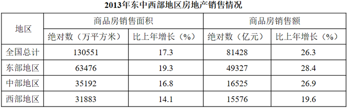

### 第 116 题

2011年全国商品房销售面积约为多少亿平方米？

A. 8.4

B. 9.2

C. 9.8

D. 10.9

第 116 题 · 答案与解析

**参考答案（粉笔题库参考内容）**

D

**解析**

资料给的是2013年的数据，题干让求2011年全国商品房销售面积，可判定此题为间隔基期问题。定位文字资料第一段，“2013年，全国商品房销售面积130551万平方米，比上年增长17.3%······比2012年提高15.5个百分点”，可知2012年增长率为17.3%-15.5%=1.8%，则2013年相对于2011年的增长率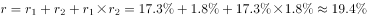。2011年全国商品房销售面积为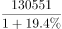，首位商1，只有D项符合。

故正确答案为D。

**考点**：综合资料、间隔基期

**来源**：2015年北京市公务员录用考试《行测》题第116题

### 第 117 题

2013年全国商品房单位面积的平均销售价格约比上年增长了（  ）。

A. 4.4%

B. 7.7%

C. 11.1%

D. 15.5%

第 117 题 · 答案与解析

**参考答案（粉笔题库参考内容）**

B

**解析**

由题干中“平均销售价格约比上年增长了”，判定此题为平均数的增长率问题。

定位表格资料：商品房销售额比上年增长26.3%(a)，销售面积比上年增长17.3%(b)，代入平均数增长率公式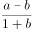：

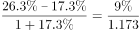，首位商7，只有B项符合。

故正确答案为B。

**考点**：平均数的增长率、综合资料

**来源**：2015年北京市公务员录用考试《行测》题第117题

### 第 118 题

与同年11月末相比，2013年12月末全国住宅、办公楼和商业营业用房待售面积的增量之和约占商品房总待售面积增量的（  ）。

A. 79%

B. 88%

C. 94%

D. 100%

第 118 题 · 答案与解析

**参考答案（粉笔题库参考内容）**

B

**解析**

根据题干“2013年12月末······约占······”，结合选项均为百分数，且材料数据为2013年，可判定本题为现期比重问题。定位文字材料第二段可得：2013年末，全国商品房待售面积比11月末增加2489万平方米。其中，住宅待售面积比11月末增加1696万平方米，办公楼待售面积增加156万平方米，商业营业用房待售面积增加346万平方米。根据公式：比重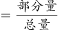，2013年12月末三者的增量之和占商品房总待售面积增量的比重为。

故正确答案为B。

**考点**：现期比重、综合资料

**来源**：2015年北京市公务员录用考试《行测》题第118题

### 第 119 题

以下哪张统计图准确地表示了2013年东部、中部和西部地区商品房销售面积占当年全国总销售面积的比重？

A. 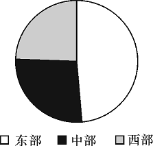

B. 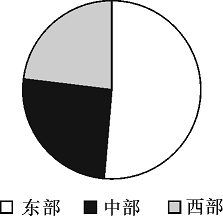

C. 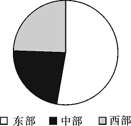

D. 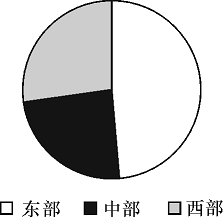

第 119 题 · 答案与解析

**参考答案（粉笔题库参考内容）**

A

**解析**

根据题干“2013年······占······的比重”，且材料数据为2013年，可判定本题为现期比重问题。定位表格材料可得：2013年全国商品房销售面积130551万平方米、东部地区63476万平方米、中部地区35192万平方米、西部地区31883万平方米。根据公式：比重，东部地区商品房销售面积占全国的比重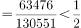，排除B、C两项；当总量一定时，部分量越大，则比重越高，35192＞31883，故中部地区所占比重高于西部地区，排除D项。

故正确答案为A。

**考点**：现期比重、综合资料

**来源**：2015年北京市公务员录用考试《行测》题第119题

### 第 120 题

关于2013年房地产市场，能够从上述资料中推出的是（  ）。

A. 12月当月全国商品房销售额同比增速超过30%

B. 中部地区商品房销售单价超过5000元/平方米

C. 东部地区商品房销售额占全国比重低于上年

D. 平均每个月新增1000多万平方米待售商品房

第 120 题 · 答案与解析

**参考答案（粉笔题库参考内容）**

D

**解析**

A项：定位文字材料第一段可得，2013年全国商品房销售额81428亿元，增长26.3%，增速比1-11月份回落4.4个百分点，则2013年1-11月份增长率=26.3%+4.4%=30.7%，根据混合增长率的结论，整体增长率介于部分增长率之间，可判定：12月份增长率＜全年增长率（26.3%）＜1-11月份增长率（30.7%），故12月的同比增速没有超过30%，错误；

B项：定位表格材料可得，2013年中部地区商品房销售额16525亿元，销售面积35192万平方米，销售单价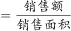，中部地区商品房销售单价，错误；

C项：定位表格材料可得，2013年东部地区与全国商品房销售额增长率分别为28.4%、26.3%。根据两期比重比较结论，当部分量增长率a大于整体增长率b时，比重上升。a=28.4%，b=26.3%，a>b，故东部地区商品房销售额占全国比重上升，错误；

D项：定位文字材料第二段可得，2013年末商品房待售面积比2012年末增加12835万平方米。平均每月新增待售面积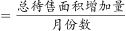，故平均每月新增待售商品房面积万平方米，超过1000万平方米，正确。

故正确答案为D。

**考点**：综合分析、综合资料

**来源**：2015年北京市公务员录用考试《行测》题第120题

## 材料 9

2014年1-5月，我国软件和信息技术服务业实现软件业务收入13254亿元，同比增长20.9%，5月份完成收入2968亿元，同比增长20.6%，1-5月，软件业实现出口182亿美元，同比增长14.8%，增速比去年同期高4.7个百分点。

        1-5月，东部地区（不含东北地区）完成软件业务收入10254亿元，同比增长20%，中部完成软件业务收入491亿元，同比增长28.8%，西部和东北地区分别完成软件业务收入1184亿元和1325亿元，同比增长24.1%和22.6%。

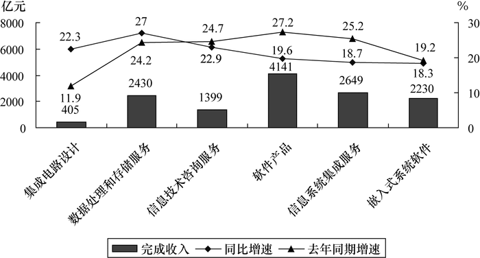

2014年1-5月软件业务分行业收入及增速

### 第 121 题

2014年1-4月，我国软件和信息技术服务业月均实现软件业务收入约多少亿元？

A. 2241

B. 2572

C. 2914

D. 3286

第 121 题 · 答案与解析

**参考答案（粉笔题库参考内容）**

B

**解析**

根据题干“2014年1-4月······月均······亿元”，且材料数据为2014年，可判定本题为现期平均数问题。定位文字材料第一段可得：2014年1-5月，我国软件和信息技术服务业实现软件业务收入13254亿元，5月份完成收入2968亿元。月均收入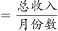，故2014年1-4月我国软件和信息技术服务业月均实现软件业务收入=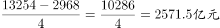，与B项最接近。

故正确答案为B。

**考点**：现期平均数、综合资料

**来源**：2015年北京市公务员录用考试《行测》题第121题

### 第 122 题

2014年1-5月，软件业出口额比两年前增长的比例在以下哪个范围之内？

A. 低于20%

B. 20%～30%之间

C. 30%～40%之间

D. 高于40%

第 122 题 · 答案与解析

**参考答案（粉笔题库参考内容）**

B

**解析**

根据题干“2014年1-5月······比两年前增长的比例······”，可判定本题为间隔增长率问题。定位文字材料第一段可得：2014年1-5月，软件业实现出口182亿美元，同比增长14.8%（），增速比去年同期高4.7个百分点。则2013年1-5月相对于2012年1-5月的增长率=14.8%-4.7%=10.1%（），根据公式：，则2014年1-5月相对于2012年1-5月的增长率=

，在B项范围之内。

故正确答案为B。

**考点**：综合资料、间隔增长率

**来源**：2015年北京市公务员录用考试《行测》题第122题

### 第 123 题

2014年1—5月中部地区完成软件业务收入占全国的比重与2013年同期相比上升了约多少个百分点？

A. 0.2

B. 1.9

C. 4.7

D. 7.9

第 123 题 · 答案与解析

**参考答案（粉笔题库参考内容）**

A

**解析**

根据题干“2014年1—5月······占······比重与2013年同期相比上升了······百分点”，可判定本题为两期比重问题。定位文字材料第一段可得：2014年1-5月，我国软件和信息技术服务业实现软件业务收入13254亿元（B），同比增长20.9%（b）；定位文字材料第二段可得：中部完成软件业务收入491亿元（A），同比增长28.8%（a），根据公式：两期比重差，则2014年1-5月中部地区完成软件业务收入占全国的比重比2013年同期上升了，即上升了约0.2个百分点。

故正确答案为A。

**考点**：两期比重、综合资料

**来源**：2015年北京市公务员录用考试《行测》题第123题

### 第 124 题

2014年1-5月完成收入同比增速低于上年同期水平的行业有几个？

A. 2

B. 3

C. 4

D. 5

第 124 题 · 答案与解析

**参考答案（粉笔题库参考内容）**

C

**解析**

定位图形材料可得：2014年1-5月完成收入同比增速低于上年同期水平的行业有；信息技术咨询服务（22.9%＜24.7%）、软件产品（19.6%＜27.2%）、信息系统集成服务（18.7%＜25.2%）、嵌入式系统软件（18.3%＜19.2%），共4个。

故正确答案为C。

**考点**：直接找数、综合资料

**来源**：2015年北京市公务员录用考试《行测》题第124题

### 第 125 题

能够从上述资料中推出的是（  ）

A. 2013年5月软件业务收入超过2500亿元

B. 2014年1-5月东北地区软件业务收入占全国的比重比上年同期有所下降

C. 2014年1-5月集成电路设计业日均收入超过3亿元

D. 2014年1-5月完成收入同比增速最快的行业在上年同期增速排名第四

第 125 题 · 答案与解析

**参考答案（粉笔题库参考内容）**

D

**解析**

A项：定位文字材料第一段可得，2014年5月份完成软件业务收入2968亿元，同比增长20.6%。根据公式：基期量，2013年5月软件业务收入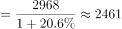亿元&lt;2500亿元，错误；

B项：定位文字材料第一段可得，2014年1—5月，我国软件和信息技术服务业实现软件业务收入同比增长20.9%（b）；定位文字材料第二段可得，2014年1-5月东北地区软件业务收入同比增长22.6%（a）。根据两期比重比较结论：若部分增长率（a）>整体增长率（b），则比重上升。由于a（22.6%）>b（20.9%），可判定比重上升，并非下降，错误；

C项：定位图形材料可得，2014年1-5月集成电路设计完成收入405亿元。日均收入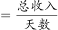，故2014年1-5月集成电路设计业日均收入=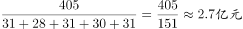，低于3亿元，错误；

D项，定位图形材料可得：2014年1—5月完成收入同比增速最快的行业为数据处理和存储服务（27%），其上年同期增速为24.2%，小于信息技术咨询服务（24.7%）、软件产品（27.2%）、信息系统集成服务（25.2%）三个行业，排名第四，正确。

故正确答案为D。

**考点**：综合分析、综合资料

**来源**：2015年北京市公务员录用考试《行测》题第125题

## 材料 10

抽样调查数据显示，2014年1-5月A区农村居民人均现金收入9053元，同比增长10.3%，增速较去年同期提高0.4个百分点，其中人均工资性收入为5421元，同比增长8.5%；人均家庭经营性收入为760元，同比下降0.6%；人均财产性收入为1241元，同比增长28.7%；人均转移性收入为1631元，同比增长10%。

        2014年1-5月A区农村居民人均消费性支出5081元，同比增长9.9%，增速较去年同期下降1.7个百分点。

2014年1-5月A区农村居民人均生活消费支出情况

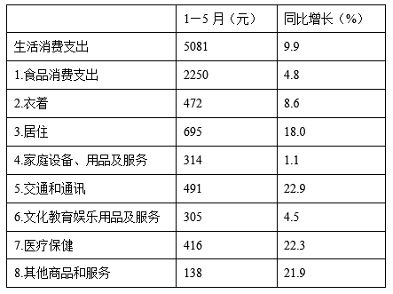

### 第 126 题

2013年1-5月A区农村居民人均现金收入增速比人均消费性支出增速（  ）。

A. 高0.4个百分点

B. 高2.1个百分点

C. 低1.3个百分点

D. 低1.7个百分点

第 126 题 · 答案与解析

**参考答案（粉笔题库参考内容）**

D

**解析**

定位文字材料第一段可得：2014年1-5月A区农村居民人均现金收入同比增长10.3%，增速较去年同期提高0.4个百分点；定位文字材料第二段可得：2014年1-5月A区农村居民人均消费性支出同比增长9.9%，增速较去年同期下降1.7个百分点。则2013年1-5月农村居民人均现金收入同比增长=10.3%－0.4%=9.9%，2013年1-5月A区农村居民人均消费性支出同比增长9.9%＋1.7%=11.6%，则题目所求=9.9%-11.6%=-1.7%，即低1.7个百分点。

故正确答案为D。

**考点**：简单加减计算、综合资料

**来源**：2015年北京市公务员录用考试《行测》题第126题

### 第 127 题

2014年1-5月A区农村居民四项人均现金收入同比增量由高到低依次为（  ）。

A. 工资性收入、转移性收入、财产性收入、经营性收入

B. 财产性收入、转移性收入、工资性收入、经营性收入

C. 工资性收入、财产性收入、转移性收入、经营性收入

D. 经营性收入、工资性收入、转移性收入、财产性收入

第 127 题 · 答案与解析

**参考答案（粉笔题库参考内容）**

C

**解析**

根据题干“······同比增量由高到低······”，可判定本题为增长量比较问题。定位文字材料第一段可得：人均工资性收入为5421元，同比增长8.5%；人均家庭经营收入为760元，同比下降0.6%；人均财产性收入为1241元，同比增长28.7%；人均转移性收入为1631元，同比增长10%。经营性收入增长率为负，故增量最小，排除D项；

根据增长量公式：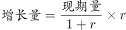，代入数据可得：工资性收入、财产性收入、转移性收入增长量分别为：

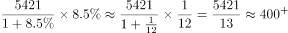；

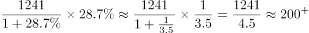；

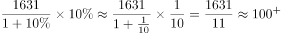。

故按同比增量由高到低依次为工资性收入＞财产性收入＞转移性收入，只有C项符合。

故正确答案为C。

**考点**：增长量比较、综合资料

**来源**：2015年北京市公务员录用考试《行测》题第127题

### 第 128 题

一个支出水平与平均水平相当的A区农村居民三口之家，其2014年1-5月月均居住支出为多少元？（  ）

A. 139

B. 417

C. 695

D. 2085

第 128 题 · 答案与解析

**参考答案（粉笔题库参考内容）**

B

**解析**

根据题干“······2014年1-5月月均······元”，结合材料数据为2014年，可判定本题为现期平均数问题。定位表格材料可得：2014年1-5月A区农村居民人均居住支出695元。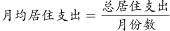，故。

故正确答案为B。

**考点**：现期平均数、综合资料

**来源**：2015年北京市公务员录用考试《行测》题第128题

### 第 129 题

2013年1-5月A区农村居民8类生活消费支出中，人均支出最多的三类是（  ）。

A. 家庭设备、用品及服务、文化教育娱乐用品及服务、其他商品和服务

B. 交通和通讯、居住、食品消费支出

C. 交通和通讯、医疗保健、其他商品和服务

D. 食品消费支出、衣着、居住

第 129 题 · 答案与解析

**参考答案（粉笔题库参考内容）**

D

**解析**

根据题干“2013年······人均支出最多的三类”，结合材料数据为2014年，可判定本题为基期比较问题。，观察表格材料发现，2014年1-5月，食品消费支出现期量（2250元）远高于其他支出，而增长率（4.8%）较小，故食品消费支出的基期值最大，排除A、C两项。观察B、D选项，只需比较交通和通讯、衣着二者基期量即可。定位表格材料可得，交通和通讯491元，同比增长22.9%；衣着472元，同比增长8.6%。则两者的基期量分别为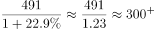，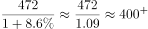，衣着大于交通和通讯，排除B项。

故正确答案为D。

**考点**：基期比较、综合资料

**来源**：2015年北京市公务员录用考试《行测》题第129题

### 第 130 题

下列关于2014年1-5月A区农村居民收入和支出情况的说法，正确的是（  ）。

A. 人均现金收入比人均消费性支出高4000多元

B. 人均食品消费支出超过生活消费支出的一半

C. 人均医疗保健支出同比增量高于人均衣着支出同比增量

D. 人均交通和通讯支出占消费性支出比重低于上年水平

第 130 题 · 答案与解析

**参考答案（粉笔题库参考内容）**

C

**解析**

A项：定位文字材料第一段可得，2014年1-5月A区农村居民人均现金收入9053元；定位文字材料第二段可得：2014年1-5月A区农村居民人均消费性支出5081元。前者比后者高9053-5081=3972元，不到4000元，错误；

B项：定位表格材料可得：2014年1-5月A区农村居民人均食品消费支出2250元、人均生活消费支出5081元。，前者未超过后者的一半，错误；

C项：定位表格材料可得：2014年1-5月A区农村居民人均医疗保健支出416元，同比增长22.3%；人均衣着支出472元，同比增长8.6%。根据公式：，人均医疗保健支出同比增量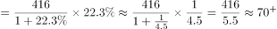；人均衣着支出同比增量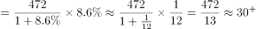，前者大于后者，正确；

D项：定位表格材料可得：2014年1-5月A区农村居民人均交通和通讯支出同比增长22.9%；定位文字材料第二段可得：人均消费性支出同比增长9.9%。根据两期比重比较结论，部分增长率a大于整体增长率b，则比重上升。a=22.9%，b=9.9%，故比重上升，而非低于上年水平，错误。

故正确答案为C。

**考点**：综合分析、综合资料

**来源**：2015年北京市公务员录用考试《行测》题第130题

## 材料 11

2014年上半年，北京市接待旅游总人数1.16亿人次，比上年同比增长5.9%；实现旅游总收入1907.2亿元，同比增长8.2%。

        上半年，北京市接待国内游客1.14亿人次，比上年同期增长6.2%，实现国内旅游总收入1774.1亿元，增长9.5%。其中，外地来京旅客6891.1万人次，同比增长4.9%，旅游总消费1607.6亿元，增长8.7%，北京居民在京游4543.9万人次，同比增长8.1%，旅游总消费166.5亿元，增长17.1%。

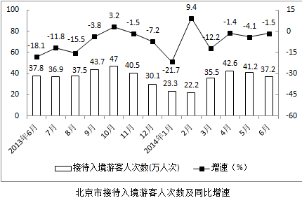

### 第 131 题

2014年上半年，北京市平均接待每人次旅游者创造旅游收入约多少元？（    ）

A. 1450

B. 1644

C. 1783

D. 1907

第 131 题 · 答案与解析

**参考答案（粉笔题库参考内容）**

B

**解析**

根据题干“2014年上半年······平均接待每人次······元”，结合材料数据为2014年，可判定本题为现期平均数问题。定位文字材料第一段可得：2014年上半年，北京市接待旅游总人数1.16亿人次，实现旅游总收入1907.2亿元。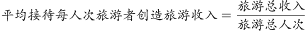，故北京市平均接待每人次旅游者创收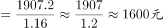，与B项最接近。

故正确答案为B。

**考点**：现期平均数、综合资料

**来源**：2015年北京市公务员录用考试《行测》题第131题

### 第 132 题

与上年同期相比，2014年上半年北京市接待外地来京游客占接待国内游客数量的比重（    ）。

A. 下降了不到1个百分点

B. 下降了超过1个百分点

C. 上升了不到1个百分点

D. 上升了超过1个百分点

第 132 题 · 答案与解析

**参考答案（粉笔题库参考内容）**

A

**解析**

根据题干“与上年同期相比，······占······的比重”，结合选项“百分点”，可判定本题为两期比重问题。定位文字材料第二段可得：2014年上半年，北京市接待国内游客1.14亿人次，比上年同期增长6.2%。其中，外地来京旅客6891.1万人次，同比增长4.9%。根据两期比重差公式：，2014年上半年与2013年同期的比重差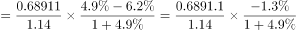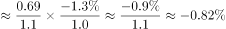，即下降了不到1个百分点，只有A项符合。

故正确答案为A。

**考点**：两期比重、综合资料

**来源**：2015年北京市公务员录用考试《行测》题第132题

### 第 133 题

下列选项中，北京市接待入境游客人次数量最低的是（    ）。

A. 2013年第三季度

B. 2013年第四季度

C. 2014年第一季度

D. 2014年第二季度

第 133 题 · 答案与解析

**参考答案（粉笔题库参考内容）**

C

**解析**

定位图形材料可得：2013年7月-2014年6月北京市接待入境游客人次数分别为36.9万人次、37.5万人次、43.7万人次、47万人次、40.5万人次、30.1万人次、23.3万人次、22.2万人次、35.5万人次、42.6万人次、41.2万人次、37.2万人次。

2013年第三季度北京市接待入境游客人次数=36.9+37.5+43.7=118.1万人次；

2013年第四季度北京市接待入境游客人次数=47+40.5+30.1=117.6 万人次；

2014年第一季度北京市接待入境游客人次数==23.3+22.2+35.5=81万人次；

2014年第二季度北京市接待入境游客人次数=42.6+41.2+37.2=121 万人次。

故北京市接待入境游客人次数量最低的是2014年第一季度。

故正确答案为C。

**考点**：简单加减计算、综合资料

**来源**：2015年北京市公务员录用考试《行测》题第133题

### 第 134 题

2013年7月到2014年6月，北京市接待入境游客人次数同比、环比均下降的月份有几个？（    ）

A. 6

B. 7

C. 8

D. 9

第 134 题 · 答案与解析

**参考答案（粉笔题库参考内容）**

A

**解析**

定位图形材料可得：2013年7月-2014年6月北京市接待入境游客人次数同比下降（同比增速为负）的有：2013年7、8、9、11、12月，2014年1、3、4、5、6月；环比下降（人次数比上月减少）的有：2013年7、11、12月，2014年1、2、5、6月。其中同比、环比均下降的有2013年7、11、12月，2014年1、5、6月，共6个月份。

故正确答案为A。

**考点**：直接找数、综合资料

**来源**：2015年北京市公务员录用考试《行测》题第134题

### 第 135 题

关于北京市旅游产业状况，能够从上述资料中推出的是（    ）。

A. 2012年7月接待入境游客人次数多于同年8月

B. 2014年上半年北京居民在京游人均旅游消费超过400元

C. 2014年第二季度北京市接待入境游客人次高于上年同期水平

D. 2014年上半年接待入境游客人次数最低的月份也是同比增速最高的月份

第 135 题 · 答案与解析

**参考答案（粉笔题库参考内容）**

D

**解析**

A项：定位图形材料可得，2013年7月北京市接待入境游客36.9万人次，同比增速为-11.8%；2013年8月接待入境游客37.5万人次，同比增速为-15.5%。根据公式：，2012年7月、8月北京市接待入境游客人次数分别为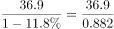、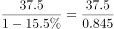，2012年7月的分子小且分母大，则其数值小，因此7月接待入境游客人次数少于8月，错误；

B项：定位文字材料第二段可得，2014年上半年北京居民在京游4543.9万人次，旅游总消费166.5亿元。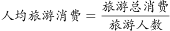，故2014年上半年北京居民在京游人均旅游消费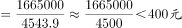，错误；

C项：定位图形材料可得，2014年4-6月北京市接待入境游客同比增速分别为-1.4%、-4.1%、-1.5%。增长率均为负数，故2014年第二季度接待入境游客人次低于上年同期水平，而并非高于，错误；

D项：定位图形材料可得，2014年上半年接待入境游客人次数最低的是2月（22.2万人次），且其同比增速（9.4%）也是2014年上半年最高的，正确。

故正确答案为D。

**考点**：综合分析、综合资料

**来源**：2015年北京市公务员录用考试《行测》题第135题

