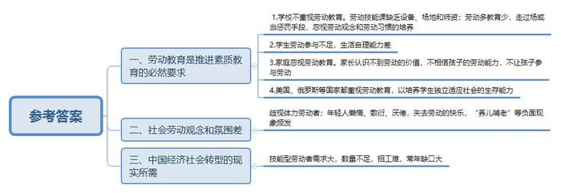
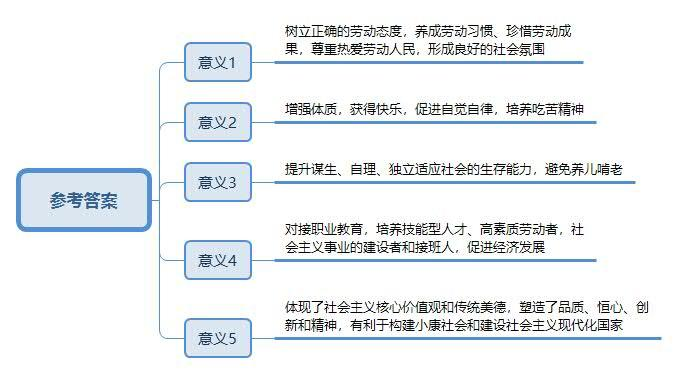
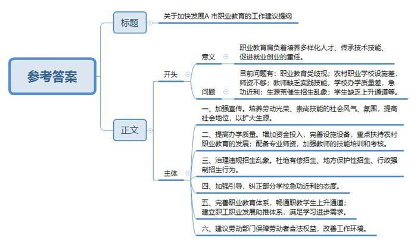
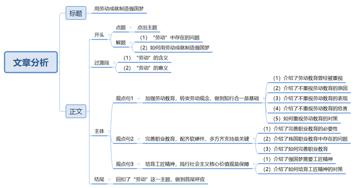

# 2016年北京市公考《申论》题

> 候选采集稿。参考答案及解析来自粉笔页面，不代表官方答案或真实高分答卷；来源使用许可与原卷对应关系仍需人工核实。

## 给定材料

### 材料 material-76ac5e753fef7182

2015年8月3日，教育部、共青团中央、全国少工委联合印发《关于加强中小学劳动教育的意见》（以下简称《意见》）。《意见》明确指出，义务教育阶段三至九年级要切实开设劳动与技术教育课，高中阶段要开好通用技术课。地方和学校可结合实际在地方和校本课程中加强劳动教育，开设家政、烹饪、手工、园艺、非物质文化遗产等相关课程。积极组织开展校内劳动，普及校园种植或养殖，进行手工制作、电器维修等实践活动。小学、初中、高中每个学段都要安排一定时间的农业生产、工业体验、商业和服务业实习等劳动实践，还要鼓励学生积极参加家务劳动。力争用3~5年时间，推动建立课程完善、资源丰富、模式多样、机制健全的劳动教育体系，形成普遍重视劳动教育的氛围。

劳动创造了人类，创造了世界，创造了文明。劳动是人维持自我生存与自我发展的唯一手段。按照传统的劳动分类理论，劳动可分为脑力劳动和体力劳动两大类。上述《意见》所言“劳动教育”中的“劳动”，特指需要一定体力和技能的体力劳动，主要通过家务劳动、生产劳动和公益劳动等方面来实施。加强中小学劳动教育，旨在使学生树立正确的劳动观点和劳动态度，尊重和热爱劳动和劳动人民，养成劳动习惯和珍惜劳动成果，努力把广大少年儿童培养成热爱劳动、勤于劳动、善于劳动的高素质劳动者，使之成为全面发展的社会主义事业的建设者和接班人，这是党和国家对教育的根本要求。其实，劳动教育曾是我国学校教育的传统。20世纪我国几乎所有的大中小学校都开设了劳动课。之后劳动课在边缘化的过程中纷纷被取消。而今随着学生素质教育的推进，劳动教育又将回归校园。

有专家指出，当前一些学校缺乏设备、场地和师资，有的学校将劳动教育只看作春游、秋游和参观，有的把劳动当惩罚手段，劳动多教育少，忽视劳动观念和劳动习惯的培养，如果指望这样的劳动技能课来拯救“劳动教育”，恐怕“道阻且长”。

## 题目

### 第 1 题

**根据给定资料，概括说明当前我国提出加强中小学劳动教育的主要背景。（20分）**

关联材料：material-76ac5e753fef7182

作答要求：

要求：概括准确全面，语言简练。字数不超过300字。

### 第 2 题

**根据给定资料，结合社会实际，分析让孩子从小爱劳动、会劳动有什么社会意义。（15分）**

关联材料：material-76ac5e753fef7182

作答要求：

要求：分析合理，条理清晰，语言简练，字数不超过300字。

### 第 3 题

**假设你是A市教育局的一名工作人员，如果材料**5**中网友们提出的问题都出现在A市职业教育中，请你就如何加快发展A市职业教育撰写一份工作建议提纲。（25分）**

关联材料：material-76ac5e753fef7182

作答要求：

要求：建议合理可行，内容全面，条理清楚，语言简练，字数不超过350字。

### 第 4 题

**根据给定材料，结合当前实际，以“用劳动成就\_\_\_\_\_”为题，题中划线部分自拟，自选角度，写一篇文章。（40分）**

关联材料：material-76ac5e753fef7182

作答要求：

要求：主题明确，内容充实，结构合理，语言流畅，字数控制在800-1000字。

## 答案与解析

第 1 题

**参考答案（粉笔题库参考内容）**

一、劳动教育是推进素质教育的必然要求。

1.学校不重视劳动教育：劳动技能课缺乏设备、场地和师资；劳动多教育少，走过场或当惩罚手段，忽视劳动观念和劳动习惯的培养。

2.学生劳动参与不足，生活自理能力差。

3.家庭忽视劳动教育：家长认识不到劳动的价值，不相信孩子的劳动能力，不让孩子参与劳动。

4.美国、俄罗斯等国家都重视劳动教育，以培养学生独立适应社会的生存能力。

二、社会劳动观念和氛围差：歧视体力劳动者；年轻人懒惰、敷衍、厌倦，失去劳动的快乐，“养儿啃老”等负面现象频发。

三、中国经济社会转型的现实所需：技能型劳动者需求大，数量不足，招工难，常年缺口大。

**解析**

**参考答案说明：**本题按照“劳动教育是推进素质教育的必然要求”“社会劳动观念和氛围差”“经济社会转型的现实所需”这三方面分条撰写，其中，第一大条“推进素质教育的必然要求”又从“学校方面”“学生方面”“家庭方面”“其他国家劳动教育现状”这四小点展开，每条要点之间内容上没有交叉。

**考点**：考点其他类

**来源**：来源2016年北京市公考《申论》题

第 2 题

**参考答案（粉笔题库参考内容）**

一、树立正确的劳动态度，养成劳动习惯、珍惜劳动成果，尊重热爱劳动人民，形成良好的社会氛围。

二、增强体质，获得快乐，促进自觉自律，培养吃苦精神。

三、提升谋生、自理、独立适应社会的生存能力，避免养儿啃老。

四、对接职业教育，培养技能型人才、高素质劳动者，社会主义事业的建设者和接班人，促进经济发展。

五、体现了社会主义核心价值观和传统美德，塑造了品质、恒心、创新和精神，有利于构建小康社会和建设社会主义现代化国家。

**解析**

**参考答案说明：**答案从“劳动态度”“生存能力”等不同的层面进行了分条撰写，且每条要点之间内容上没有交叉。

**考点**：考点影响类

**来源**：来源2016年北京市公考《申论》题

第 3 题

**参考答案（粉笔题库参考内容）**

关于加快发展A市职业教育的工作建议提纲

职业教育肩负着培养多样化人才、传承技术技能、促进就业创业的重任。目前问题有：职业教育受歧视；农村职业学校设施差，师资不够；教师缺乏实践技能，学校办学质量差，急功近利；生源荒催生招生乱象；学生缺乏上升通道等。

建议：一、加强宣传。培养劳动光荣、崇尚技能的社会风气、氛围，提高社会地位，以扩大生源。二、提高办学质量。增加资金投入，完善设施设备，重点扶持农村职业教育的发展；配备专业师资，加强教师的技能培训和考核。三、治理违规招生乱象。杜绝有偿招生、地方保护性招生、行政强制招生行为。四、加强引导，纠正部分学校急功近利的态度。五、完善职业教育体系，畅通职教学生上升通道；建立职工职业发展助推体系，满足学习进步需求。六、建议劳动部门保障劳动者合法权益，改善工作环境。

**解析**

**参考答案说明：**（1）本题不需要考虑格式，只写正文即可，但为了保险起见，建议加上标题。（2）正文部分，一方面从内容来看，围绕着“A市职业教育”这一主题，本参考答案的开头先写到了“发展职业教育的意义和存在的问题”；主体部分从“加强宣传”“提高办学质量”“治理招生乱象”等几个方面给出了具体的建议。另一方面，形式上，本参考答案做到了分段、分条撰写，整体上条理较为清晰。

**考点**：考点方案类

**来源**：来源2016年北京市公考《申论》题

第 4 题

**参考答案（粉笔题库参考内容）**

**用劳动成就制造强国梦**

无论是劳动课在中小学教育中不断被边缘化，还是职业教育发展面临诸多难题，抑或是泱泱大国制造圆珠笔笔芯滚珠困难重重……不难看出，劳动课、技术教育、职业教育、制造业发展是相互关联的整体，休戚与共。**从这个角度出发，只有注重劳动教育、完善职业教育、培育工匠精神，才能用劳动成就制造强国梦。**

劳动是人维持自我生存与自我发展的唯一手段，它创造了人类、创造了世界、创造了文明。在提质增效、转型升级、供给侧结构性改革的要求下，高素质劳动者和技术技能型人才成为一种刚需，精益求精的“大国工匠”成为一种标配。

**加强劳动教育，转变劳动观念，做到知行合一是基础**。劳动教育曾是我国学校教育的传统，20世纪我国几乎所有的大中小学都开设了劳动课，之后在边缘化的过程中纷纷被取消。加之“万般皆下品，惟有读书高”的传统观念作祟，多数家长和孩子的劳动观点和态度发生偏差，知行不一，甚至鄙视劳动，导致身体健康状况和学习成绩“双下降”。因此，中小学校需要设置劳动课程，积极组织开展校内劳动；家长也需要转变劳动观念，在适当的家务劳动中给予孩子更多锻炼的机会；学生更需要做到知行合一，在劳动实践中全面发展。

**完善职业教育，配齐软硬件，多方齐支持是关键**。高素质劳动者和技术技能型人才是实体经济发展的中坚力量，而实体经济的发展是经济社会的压舱石。不可否认，13300多所职业院校，每年近1000万名毕业生，为加工制造、高速铁路、民航等领域输送了高素质劳动大军。但是，我们也要看到职业教育的教学模式单一；农村职业学校师资力量薄弱，教学硬件设施严重不足；职业技能人员社会地位低等问题。因此，无论是社会舆论的引导，还是职业教育主管部门对职业院校的业务指导，抑或是职业院校在师资队伍建设、资金筹集、合作办学等诸多方面都亟待改进。

**培育工匠精神，践行社会主义核心价值观是保障**。实现制造强国梦，更需要富有创造性和精益求精的工匠精神为其保驾护航。高级技师胡双钱，30多年来创造了手工打磨过的零件百分百合格的纪录，这些零件都被装在新一代大飞机C919首架样机上。正是靠着传承和钻研，凭着专注和坚守，他才成为自己所在领域不可或缺的高技能人才，弘扬着大国工匠精神，践行着社会主义核心价值观。同时，工匠精神的培育，不仅需要自身的努力和坚持，更需要政府、社会、企业在薪资待遇、社会保障、社会地位等方面不断完善，为实现制造强国梦提供坚实可靠的保障。

不积跬步，无以至千里。制造强国梦的实现，需要在加强劳动教育、完善职业教育、培育工匠精神等多方面着力。唯其如此，中国经济的航船方能识水性，顺洋流，乘风破浪，稳健前行。

**解析**

**文章分析**

**用劳动成就制造强国梦**

【**标题的优点：**首先，严格按照题目要求的“用劳动成就\_\_\_\_\_”这一结构来写。其次，它针对横线部分补充的内容突出了“劳动”这一主题词，使文章标题内容更完整。】

无论是（1）劳动课在中小学教育中不断被边缘化，还是职业教育发展面临诸多难题，抑或是泱泱大国制造圆珠笔笔芯滚珠困难重重……不难看出，劳动课、技术教育、职业教育、制造业发展是相互关联的整体，休戚与共。**从这个角度出发，只有**（2）**注重劳动教育、完善职业教育、培育工匠精神****，才能用劳动成就制造强国梦。**

【**开头的优点：**★内容方面。范文的开头是紧扣题目给定的“劳动”这一主题词展开，并对其进行了分析阐述，指出了（1）“劳动”中存在的问题。（2）如何用劳动成就制造强国梦**。**注意以上2个方面的阐述在逻辑上有先后顺序：先写“问题”，再写“对策”。★文字表达方面：使用了“无论……还是……”关联词，使语言表达有逻辑性，使语言表达有节奏感。】

劳动是人维持自我生存与自我发展的唯一手段，它创造了人类、创造了世界、创造了文明。在提质增效、转型升级、供给侧结构性改革的要求下，高素质劳动者和技术技能型人才成为一种刚需，精益求精的“大国工匠”成为一种标配。

【**过渡段的优点：**范文过渡段进一步分析了“劳动”的含义、意义等方面的内容，此外，还要注意过渡段末尾的“在提质增效、转型升级、供给侧结构性改革的要求下，高素质劳动者和技术技能型人才成为一种刚需，精益求精的‘大国工匠’成为一种标配”是用来引起下文的过渡句。】

**加强劳动教育，转变劳动观念，做到知行合一是基础**。（1）劳动教育曾是我国学校教育的传统，20世纪我国几乎所有的大中小学都开设了劳动课，之后在边缘化的过程中纷纷被取消。加之（2）“万般皆下品，惟有读书高”的传统观念作祟，（3）多数家长和孩子的劳动观点和态度发生偏差，知行不一，甚至鄙视劳动，导致（4）身体健康状况和学习成绩“双下降”。因此，（5）中小学校需要设置劳动课程，积极组织开展校内劳动；家长也需要转变劳动观念，在适当的家务劳动中给予孩子更多锻炼的机会；学生更需要做到知行合一，在劳动实践中全面发展。

【**论述段****1****的优点：**★观点句：范文的观点句是紧扣“劳动”这一文章主题提出的。形式上，它在段首处直接写出，位置突出，容易发现。内容上，关键词突出，内容要点明确，可以明显看出它是从“对策”入手，指出了“加强劳动教育，转变劳动观念”。★论述内容：（1）介绍了劳动教育曾经被重视；（2）介绍了不重视劳动教育的原因；（3）介绍了不重视劳动教育的表现；（4）介绍了不重视劳动教育的危害；（5）如何重视劳动教育的对策。注意：以上几个方面的内容都是紧扣“加强劳动教育，转变劳动观念，做到知行合一是基础”这个观点句进行分析论述的，论述的针对性强，内容层次丰富。并且这几个方面的论述是有内在逻辑顺序的，先讲我们曾经重视劳动教育，然后讲劳动教育不被重视的原因、表现及危害，最后讲如何重视劳动教育。最后，在论述方法和论据的选取上做到了讲道理与举例子相结合，做到了丰富多样。】

**完善职业教育，配齐软硬件，多方齐支持是关键**。（1）高素质劳动者和技术技能型人才是实体经济发展的中坚力量，而实体经济的发展是经济社会的压舱石。不可否认，13300多所职业院校，每年近1000万名毕业生，为加工制造、高速铁路、民航等领域输送了高素质劳动大军。但是，（2）我们也要看到职业教育的教学模式单一；农村职业学校师资力量薄弱，教学硬件设施严重不足；职业技能人员社会地位低等问题。因此，（3）无论是社会舆论的引导，还是职业教育主管部门对职业院校的业务指导，抑或是职业院校在师资队伍建设、资金筹集、合作办学等诸多方面都亟待改进。

【**论述段****2****的优点：**★观点句：范文的观点句是紧扣“劳动”这一文章主题提出的。形式上，它在段首处直接写出，位置突出，容易发现。内容上，关键词突出，内容要点明确，可以明显看出它是从“对策”入手，指出了“完善职业教育”。★论述内容：（1）介绍了完善职业教育的必要性；（2）介绍了我国职业教育中存在的问题；（3）介绍了如何完善职业教育。注意：以上几个方面的内容都是紧扣“完善职业教育，配齐软硬件，多方齐支持是关键”这个观点句进行分析论述的，论述的针对性强，内容层次丰富。并且这几个方面的论述是有内在逻辑顺序的，先讲完善职业教育的必要性，再讲问题，最后讲对策。最后，在论述方法和论据的选取上做到了讲道理与举例子相结合，做到了丰富多样。】

**培育工匠精神，践行社会主义核心价值观是保障**。（1）实现制造强国梦，更需要富有创造性和精益求精的工匠精神为其保驾护航。高级技师胡双钱，30多年来创造了手工打磨过的零件百分百合格的纪录，这些零件都被装在新一代大飞机C919首架样机上。（2）正是靠着传承和钻研，凭着专注和坚守，他才成为自己所在领域不可或缺的高技能人才，弘扬着大国工匠精神，践行着社会主义核心价值观。同时，工匠精神的培育，不仅需要自身的努力和坚持，更需要政府、社会、企业在薪资待遇、社会保障、社会地位等方面不断完善，为实现制造强国梦提供坚实可靠的保障。

【**论述段****3****的优点：**★观点句：范文的观点句是紧扣“劳动”这一文章主题提出的。形式上，它在段首处直接写出，位置突出，容易发现。内容上，关键词突出，内容要点明确，可以明显看出它是从“对策”入手，指出了“培育工匠精神”。★论述内容：（1）介绍了强国梦需要工匠精神；（2）介绍了如何培育工匠精神的对策。注意：以上几个方面的内容都是紧扣“培育工匠精神，践行社会主义核心价值观是保障”这个观点句进行分析论述的，论述的针对性强，内容层次丰富。并且这几个方面的论述是有内在逻辑顺序的，先讲工匠精神是时代所需，再讲如何培育工匠精神。最后，在论述方法和论据的选取上做到了讲道理与举例子相结合，做到了丰富多样。】

【**论述段之间的关系**：★内容的内在逻辑：范文的论述段之间是依照“并列”的逻辑展开的。论述段1先写了“加强劳动教育，转变劳动观念，做到知行合一是基础”，论述段2再写了“完善职业教育，配齐软硬件，多方齐支持是关键”，论述段3接着写了“培育工匠精神，践行社会主义核心价值观是保障”。】

不积跬步，无以至千里。制造强国梦的实现，需要在加强劳动教育、完善职业教育、培育工匠精神等多方面着力。唯其如此，中国经济的航船方能识水性，顺洋流，乘风破浪，稳健前行。

【**结尾的优点**：范文的结尾回扣了“劳动”这一主题。（1）再次提到了“劳动”；（2）阐述了深远意义。】

**考点**：考点文章写作题

**来源**：来源2016年北京市公考《申论》题

