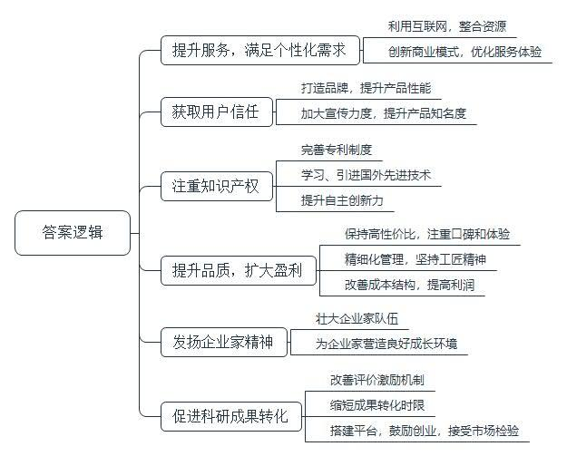
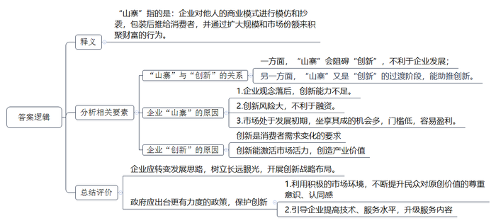
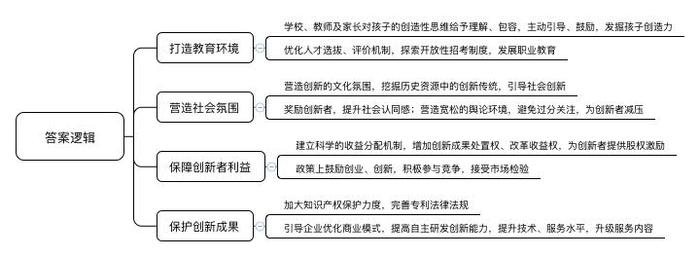
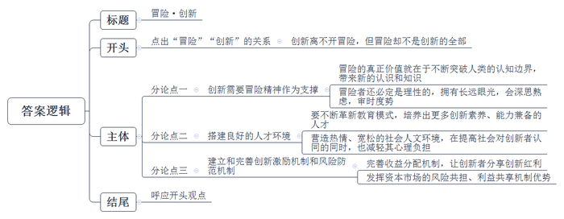

# 2017年北京市公考《申论》题

> 候选采集稿。参考答案及解析来自粉笔页面，不代表官方答案或真实高分答卷；来源使用许可与原卷对应关系仍需人工核实。

## 给定材料

### 材料 material-6c279675a9601b41

上午10点，厨师老张准时敲开了北京一家普通公寓的门。今天中午，这间公寓里有一群年轻人聚会，他们提前在老张登记注册的某厨师APP上下了订单，选择预约老张上门做菜。

下单时，客户已经填好了吃饭时间、住址、菜品和口味需求，同时请老张代买食材。老张与客户联系确认后，特地提前了一个半小时上门。进门前，老张套上了鞋套、换上厨师服，然后开始进厨房忙活起来。过了一会儿，厨房开始飘出香味。老张把菜一盘盘端出来放在桌上，然后返回厨房，将灶台打扫干净，与这群年轻人告别，并将垃圾带走。

在北京、上海、广州、深圳等4座城市，这样的情景平均每天要发生3500次。

老张登记的这个厨师APP，于2014年上线。研发该APP的公司创始人老王，同时是一家家政服务公司的老板。他说，“我们做家政服务时，发现很多客户都有叫小时工阿姨帮做饭的需求，但大部分小时工做饭水准一般。我们就想能不能找一种新的方式来解决现代人‘吃饭愁’的问题，于是就想到了厨师上门服务。”

“最开始就难在厨师招聘。”老王回忆说，“最开始我们找厨师，要么是朋友介绍，要么靠在餐厅门口蹲点，等到厨师下班后攀谈，还被怀疑是骗子。后来，随着订单量不断增多，口碑渐渐好了，再加上开通了各种招聘渠道，厨师也就逐渐累积起来了。”

如今，该公司已经拥有5000名厨师。他们随时等待召唤，为130万注册用户上门服务。老王总结道，“公司的创新举措在于将厨师这种资源用网络进行了优化利用。厨师从酒店后厨走出来，直接到用户家中提供服务，用户足不出户就能吃到高品质的饭菜，方便、实惠又安全。”

### 材料 material-e703a6d1625154db

Z来自美国，是一名著名的市场咨询师。今年，他基于5万份消费者调查报告和对多位商界人士的访谈，出版了《山寨中国的终结》一书。在书中，他认为，在上世纪90年代末中国众多公司中，没有一家是以特别有创新力而著称的。他们模仿西方公司的商业模式，然后包装一下推给中国消费者，通过扩大规模和市场份额来积聚财富。Z甚至说，那时候，只要硅谷的一个科技初创企业获得了投资，几百个山寨它的中国企业就会在几个小时内成立。

Z为中国公司经历的漫长的山寨时期进行了辩护。他指出，试图创新在当时反而不利于融资，因为创新可能会带来风险。“在中国（当时）那个尚未成熟而又迅速发展的市场中，坐享其成的机会太多了，‘低垂的果实’还有大把可摘。如果有那么多美味的苹果挂在你面前，又何必为难自己爬上更高的枝头呢？”Z反问道。

Z指出，有人持中国人就会山寨、不会创新的观点，典型例子是美国经济学教授帕诺斯·穆都库塔斯。2012年，他在《福布斯》杂志上撰文称，中国人“儒家的顺从性”阻碍了创新，中国永远都不能成为创新的温床。Z很不认同这种观点。

在Z看来，中国公司的山寨行为是外部环境造成的。而现在，这种环境正在剧烈地改变着，中国公司也正从“山寨阶段”向“创新阶段”过渡。Z举例了某设计公司的例子。2010年，在深圳注册和能查到的设计公司就有1.3万家，其中绝大部分以模仿、山寨为主，该公司也是其中之一。2012年，公司领导决心改变战略，走原创的路子。3年后，深圳的设计公司只剩下400多家，但该公司却从当年只有一间房子的小公司，成为今天在10个城市设立办事处、拥有800多名设计师的行业翘楚。“中国公司不再简单地山寨美国和欧洲。中国消费者需求的变化要求中国公司更注重创新。创新所带来的市场激活和产业价值也正在逐渐显现出来。”Z在书中总结道。

Z在书中也展现了创新型公司发展面临的一些问题。一些公司在推出一些新产品后，市场马上会出现大量山寨仿造产品。“创新产品会遭到山寨仿造，这是个难解的课题，企业也很无奈。”一位公司负责人说，“我们呼吁相关部门能出台更有力度的政策，来保护创新。但现在，创新者也不必过于担心被山寨的问题，因为大众对原始创新、对设计师的智力价值的尊重在不断提升，包括粉丝经济，都使得市场的方向是积极的。而且，随着互联网技术和产品智能化发展，山寨只能仿造形式，仿造服务和内容的成本则太高。所以，我们也呼吁企业去做大产品创新，也就是带有附加服务价值和数据价值的产品创新，这样抵御山寨的能力会有所增加。”

### 材料 material-c49d30aa3f0feac5

中国是文明古国，为世界文明的发展做出了卓越贡献。根据有关专家的说法，从公元6世纪到17世纪初的世界重大科技成果中，中国人创造的成果一直占比在50%以上。然而，到了17世纪中叶之后，中国的科学技术发展速度慢了下来。这种局面，直到新中国成立后才出现巨大改变。上世纪50年代以来，尤其是80年代后，我国科技发展迅速。2016年7月中国科学技术发展战略研究院发布的《国家创新指数报告2015》显示，在世界40个主要国家中，中国创新能力排名第18位，与排名靠前国家的差距进一步缩小。中国国家创新指数远远超过处于同一经济发展水平的国家（如印度和南非），得分接近人均国内生产总值（GDP）在5万美元左右的欧洲国家。报告显示，中国主要指标已达到世界领先水平。2014年，中国在被列入美国《科学论文索引》（SCI）中的学术刊物上发表的论文数量达到25.0万篇，居全球第2位，占到全球总量的13.3%。2014年，中国国内发明专利申请量达到80.1万件，占世界总量的47.5%，连续5年居世界首位；国内发明专利授权量达到16.3万件，占世界总量的24.8%。2014年，中国高技术产业出口占制造业出口的比重达到27.0%，占比居世界第3位。知识密集型服务业增加值占世界比重由2000年的2.8%提高到10.4%。

另外，由世界知识产权组织、康奈尔大学、英士国际商学院共同发布的2016年全球创新指数显示，中国位列世界最具创新力经济体第25位，较前一年上升4位。世界知识产权组织表示，在过去9年的调查中，高度发达经济体在全球创新指数中一直占据主导地位，此次中国进入25强，标志着中等收入国家的创新能力首次达到了高度发达经济体水平。

## 题目

### 第 1 题

**概括“给定资料**3**\-**8**”中反映的中国经济领域创新应该注意的事项。（20分）**

关联材料：material-6c279675a9601b41

作答要求：

要求：概括准确全面，语言简练，字数不超过250字。

### 第 2 题

**根据“给定资料**2**”，解释“山寨”一词的涵义，并分析“山寨”和“创新”之间的关系。（20分）**

关联材料：material-e703a6d1625154db

作答要求：

要求：分析合理，条理清楚，语言简练，字数不超过350字。

### 第 3 题

**根据给定材料，结合实际，谈谈如何营造有利于创新型人才成长的社会氛围。（20分）**

关联材料：material-c49d30aa3f0feac5

作答要求：

要求：建议合理可行，内容全面，条理清楚，语言简练，字数不超过350字。

### 第 4 题

**根据给定材料，联系实际，以“冒险•创新”为题，写一篇文章。（40分）**

关联材料：material-c49d30aa3f0feac5

作答要求：

要求：观点明确、正确，分析深入、合理，语言流畅，字数在800-1000字。

## 答案与解析

第 1 题

**参考答案（粉笔题库参考内容）**

1.提升服务，满足个性化需求。利用互联网，整合资源；创新商业模式，优化服务体验。

2.获取用户信任。打造品牌，提升产品性能；加大宣传力度，提升产品知名度。

3.注重知识产权。完善专利制度；学习、引进国外先进技术；提升自主创新力。

4.提升品质，扩大盈利。保持高性价比，注重口碑和体验；精细化管理，坚持工匠精神；改善成本结构，提高利润。

5.发扬企业家精神。壮大企业家队伍；为企业家营造良好成长环境。

6.促进科研成果转化。改善评价激励机制；缩短成果转化时限；搭建平台，鼓励创业，接受市场检验。

**解析**

**参考答案说明：**本参考答案思路上从“提升服务，满足个性化需求”“获取用户信任”“注重知识产权”“提升品质，扩大盈利”“发扬企业家精神”“促进科研成果转化”这六个方面进行对策的阐述。此外，各条的要点之间是并列关系，内容之间不存在重复、交叉。

**考点**：考点概括措施类

**来源**：来源2017年北京市公考《申论》题

粉笔申论页面对本题只提供「解析视频」入口，该入口是会员推广位，页面无视频地址与文字解析。

第 2 题

**参考答案（粉笔题库参考内容）**

“山寨”指的是企业对他人的商业模式进行模仿和抄袭，包装后推给消费者，并通过扩大规模和市场份额来积聚财富的行为。

一方面，“山寨”会阻碍“创新”，不利于企业发展；另一方面，“山寨”又是“创新”的过渡阶段，能助推创新。企业之所以“山寨”，是因为：1.企业观念落后，创新能力不足。2.创新风险大，不利于融资。3.市场处于发展初期，坐享其成的机会多，门槛低，容易盈利。而企业应摒弃“山寨”，不断创新，是因为：创新是消费者需求变化的要求，能激活市场活力，创造产业价值。

因此，企业应转变发展思路，树立长远眼光，开展创新战略布局。政府应出台更有力度的政策，保护创新：1.利用积极的市场环境，不断提升民众对原创价值的尊重意识、认同感；2.引导企业提高技术、服务水平，升级服务内容。

**解析**

**参考答案说明：**思路方面，本参考答案按照词句解释题“释义+分析相关要素+总结评价”的一般答题思路展开。内容方面，本参考答案先对“山寨”的含义进行了解释：“分析相关要素”部分先分析了“山寨”和“创新”的关系，接着企业“山寨”的原因以及应该摒弃“山寨”去创新的原因；最后进行了总结评价。词句表达方面，本答案加上了“是因为”“因此”等连接词来承接上下文。

**考点**：考点词句解释类

**来源**：来源2017年北京市公考《申论》题

粉笔申论页面对本题只提供「解析视频」入口，该入口是会员推广位，页面无视频地址与文字解析。

第 3 题

**参考答案（粉笔题库参考内容）**

一、打造教育环境。1.学校、教师及家长对孩子的创造性思维给予理解、包容，主动引导、鼓励，发掘孩子创造力。2.优化人才选拔、评价机制，探索开放性招考制度，发展职业教育。

二、营造社会氛围。1.营造创新的文化氛围，挖掘历史资源中的创新传统，引导社会创新。2.奖励创新者，提升社会认同感；营造宽松的舆论环境，避免过分关注，为创新者减压。

三、保障创新者利益。1.建立科学的收益分配机制，增加创新成果处置权、改革收益权，为创新者提供股权激励。2.政策上鼓励创业、创新，积极参与竞争，接受市场检验。

四、保护创新成果。1.加大知识产权保护力度，完善专利法律法规。2.引导企业优化商业模式，提高自主研发创新能力，提升技术、服务水平，升级服务内容。

**解析**

**参考答案说明：**本参考答案从“打造教育环境”“营造社会氛围”“保障创新者利益”“保护创新成果”这四个不同的方面对如何营造有利于创新型人才成长的社会氛围进行了分条撰写，各条要点之间内容上没有交叉。

**考点**：考点概括措施类

**来源**：来源2017年北京市公考《申论》题

第 4 题

**参考答案（粉笔题库参考内容）**

**冒险·创新**

提到冒险，相信许多人会自然地想到勇敢、探索。的确，冒险是对新事物的探索，是一种牺牲奉献的精神，更是一种富有创造性的行为。在人类发展历史中，正是前人一次次的冒险，才带来了一次又一次的创新。可以说，创新离不开冒险，但冒险却不是创新的全部。**当下，要完成全面深化改革、建设创新型国家的历史使命，离不开冒险精神，也需要社会环境、制度环境的支持。**

**创新需要冒险精神作为支撑。冒险的真正价值就在于不断突破人类的认知边界，带来新的认识和知识，而真正高明的冒险者，不但拥有勇气、担当、精明与敏锐，而且还必定是理性的，拥有长远眼光，会深思熟虑，审时度势，谋定而后动。**在国际科技竞争日趋白热化的今天，没有冒险精神、不去创新，才是最大风险所在。此时，有胆量、敢下注，想赢也敢输的人才有可能成功。当然，创新也需理性，需要创新者眼光长远，更需要积累资源。回顾历史，任何新技术的发明都是“站在巨人的肩膀上”。“微信”不是国内第一款即时通信软件，却成了“国民软件”的代表；电子商务不是亚马逊的首创，但亚马逊却凭借它打造了商业帝国。可见，打有准备之仗，冒有把握的险，才是理性创新的表现。

**归根结底，人才是创新的主体，要建设创新型国家，必须搭建起良好的人才环境。一方面，要不断革新教育模式，培养出更多创新素养、能力兼备的人才；另一方面，也需要营造热情、宽松的社会人文环境，在提高社会对创新者认同的同时，也减轻其心理负担。**学生不是“知识内存”，更不应是“考试机器”，每个人可能是奇迹的缔造者、未来的创造者。必须积极转变教育理念、培养模式、管理体制，鼓励、包容孩子看起来“离经叛道”的创新思维，才能发掘、发挥学生的创造力，为未来储备更多的创新人才。社会更要有鼓励冒险和创新精神的舆论导向，给予创新者更多尊重，增加对失败的理解与包容，让他们在勇于创新的同时，不惧怕失败带来的舆论压力。

我们也要认识到，创新过程中的困难、挫折甚至失败不是只会带来精神上的打击，经济上的压力往往会来的更加凶猛。这就需要我们激发创新者的积极性，减少创新者的后顾之忧。

**建立和完善创新激励机制和风险防范机制，是当前创新工作的重点。我们要完善收益分配机制，让创新者分享创新红利，也要保护知识、技术等宝贵创新成果，还要进一步发挥资本市场的风险共担、利益共享机制优势，为创新者化解创新带来的风险。**对于创新者，我们要在投资、机遇、制度等方面为他们提供保障。比如，股权激励、收益分红等方式，可以让创新者获得更多的物质鼓励、精神归属，直接提升创新的积极性。再比如，风险投资是一种商业行为，可以让投资者从中获利，但是相对于创新成功的低概率而言，它又像是一种慈善行为，有效减轻了失败的压力。我们需要进一步探索这样的风险化解机制，鼓励更多人创新。

最美丽的花总是开在最危险的悬崖上。采摘创新的果实，需要大无畏而又审慎的冒险精神。创新看似是一种冒险，实则孕育着伟大，孕育着新的发展和进步。

**解析**

**文章分析**

**冒险****·创新**

【**标题的优点：**首先，范文的标题“冒险·创新”突出了“冒险·创新”这一主题。其次，形式上，文字表达简洁明快，不拖沓。】

（1）提到冒险，相信许多人会自然地想到勇敢、探索。的确，冒险是对新事物的探索，是一种牺牲奉献的精神，更是一种富有创造性的行为。在人类发展历史中，（2）正是前人一次次的冒险，才带来了一次又一次的创新。可以说，创新离不开冒险，但冒险却不是创新的全部。**当下，**（3）**要完成全面深化改革****、****建设创新型国家的历史使命****，****离不开冒险精神****，****也需要社会环境****、****制度环境的支持****。**

【**开头的优点：****★内容方面：**范文的开头是紧扣“冒险·创新”这一主题展开的。首先，开头在段首处点出主题，做到了主题明确。其次，对“冒险·创新”这一主题进行了分析阐述，指出了（1）冒险的含义；（2）冒险和创新的关系；（3）建设创新型国家的对策。**★文字表达方面：**使用了“的确……”“可以说……”等关联词，使语言表达有逻辑性。】

**创新需要冒险精神作为支撑。**（1）**冒险的真正价值就在于不断突破人类的认知边界****，****带来新的认识和知识****，而**（2）**真正高明的冒险者****，****不但拥有勇气****、****担当****、****精明与敏锐****，****而且还必定是理性的****，****拥有长远眼光****，****会深思熟虑****，****审时度势****，****谋定而后动****。**在国际科技竞争日趋白热化的今天，没有冒险精神、不去创新，才是最大风险所在。此时，有胆量、敢下注，想赢也敢输的人才有可能成功。当然，创新也需理性，需要创新者眼光长远，更需要积累资源。回顾历史，任何新技术的发明都是“站在巨人的肩膀上”。“微信”不是国内第一款即时通信软件，却成了“国民软件”的代表；电子商务不是亚马逊的首创，但亚马逊却凭借它打造了商业帝国。可见，打有准备之仗，冒有把握的险，才是理性创新的表现。

【**论述段****1的优点：★观点句：**范文的观点句是紧扣“冒险·创新”这一文章主题提出的。形式上，它在段首处直接写出，位置突出，容易发现。内容上，关键词突出，内容要点明确，可以明显看出它是从“创新需要冒险精神作为支撑”这个角度入手，指出了如何创新。**★论述内容：**（1）介绍了冒险的价值；（2）介绍了冒险者需具备的素质。以上两个方面的内容都是紧扣“创新需要冒险精神作为支撑”这个观点句进行分析论述的，论述的针对性强，内容层次丰富。最后，在论述方法上主要采取了讲道理和举例子相结合，做到了丰富多样。】

**归根结底，人才是创新的主体，要建设创新型国家，必须搭建起良好的人才环境。一方面，**（1）**要不断革新教育模式****，****培养出更多创新素养****、****能力兼备的人才****；另一方面，也**（2）**需要营造热情****、****宽松的社会人文环境****，****在提高社会对创新者认同的同时****，****也减轻其心理负担****。**学生不是“知识内存”，更不应是“考试机器”，每个人可能是奇迹的缔造者、未来的创造者。必须积极转变教育理念、培养模式、管理体制，鼓励、包容孩子看起来“离经叛道”的创新思维，才能发掘、发挥学生的创造力，为未来储备更多的创新人才。社会更要有鼓励冒险和创新精神的舆论导向，给予创新者更多尊重，增加对失败的理解与包容，让他们在勇于创新的同时，不惧怕失败带来的舆论压力。

【**论述段****2的优点：★观点句：**范文的观点句是紧扣“冒险·创新”这一文章主题提出的。形式上，它在段首处直接写出，位置突出，容易发现。内容上，关键词突出，内容要点明确，可以明显看出它是从“搭建良好的人才环境”这个角度入手，指出了如何创新。**★论述内容：**（1）介绍了革新教育模式方面的对策；（2）介绍了营造人文环境方面的对策。以上两个方面的内容都是紧扣“人才是创新的主体，要建设创新型国家，必须搭建起良好的人才环境”这个观点句进行分析论述的，论述的针对性强，内容层次丰富。最后，在论述方法上采取了讲道理的方式进行展开，做到了论述有力。】

我们也要认识到，创新过程中的困难、挫折甚至失败不是只会带来精神上的打击，经济上的压力往往会来的更加凶猛。这**就需要我们激发创新者的积极性，减少创新者的后顾之忧**。

【范文过渡段分析了支持创新的对策方面的内容，此外，还要注意过渡段末尾的“这就需要我们激发创新者的积极性，减少创新者的后顾之忧”是用来引出下文的过渡句，起到了承上启下的作用。】

**建立和完善创新激励机制和风险防范机制，是当前创新工作的重点。我们要**（1）**完善收益分配机制****，****让创新者分享创新红利****，****也要保护知识****、****技术等宝贵创新成果****，还要进一步**（2）**发挥资本市场的风险共担****、****利益共享机制优势****，****为创新者化解创新带来的风险****。**对于创新者，我们要在投资、机遇、制度等方面为他们提供保障。比如，股权激励、收益分红等方式，可以让创新者获得更多的物质鼓励、精神归属，直接提升创新的积极性。再比如，风险投资是一种商业行为，可以让投资者从中获利，但是相对于创新成功的低概率而言，它又像是一种慈善行为，有效减轻了失败的压力。我们需要进一步探索这样的风险化解机制，鼓励更多人创新。

【**论述段****3的优点：★观点句：**范文的观点句是紧扣“冒险·创新”这一文章主题提出的。形式上，它在段首处直接写出，位置突出，容易发现。内容上，关键词突出，内容要点明确，可以明显看出它是从“完善创新激励机制和风险防范机制”这个角度入手，指出了如何创新。**★论述内容：**（1）介绍了完善收益分配机制方面的对策；（2）介绍了发挥资本市场优势方面的对策。以上两个方面的内容都是紧扣“建立和完善创新激励机制和风险防范机制，是当前创新工作的重点”这个观点句进行分析论述的，论述的针对性强，内容层次丰富。最后，在论述方法上主要采取了讲道理和举例子相结合，做到了丰富多样。】

【**论述段之间的关系：****★内容的内在逻辑：**范文的论述段之间是依照递进的逻辑展开的。论述段1先围绕创新离不开冒险精神，论述段2与论述段3围绕“人才环境”“机制环境”两个层面提出如何创新。**★段与段的外在衔接：**论述段2首处的“归根结底”，起到了引出论述段2的作用。论述段2之后的过渡段“我们也要认识到，创新过程中的困难、挫折甚至失败不是只会带来精神上的打击，经济上的压力往往会来的更加凶猛。这就需要我们激发创新者的积极性，减少创新者的后顾之忧”，起到了承接论述段2，引出论述段3的作用。】

最美丽的花总是开在最危险的悬崖上。（1）采摘创新的果实，需要大无畏而又审慎的冒险精神。（2）创新看似是一种冒险，实则孕育着伟大，孕育着新的发展和进步。

【**结尾的优点：**范文的结尾回扣了“冒险·创新”这一主题。（1）再次提到了“冒险”“创新”；（2）阐述了创新的伟大意义。】

**考点**：考点文章写作题

**来源**：来源2017年北京市公考《申论》题

