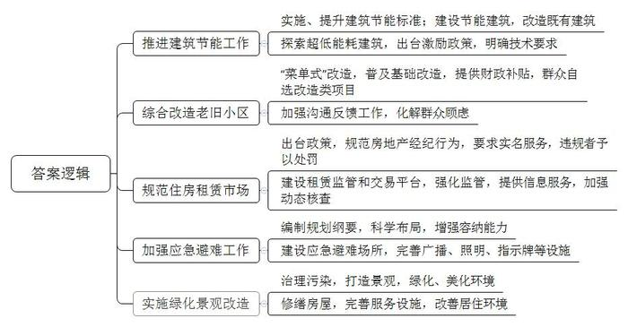
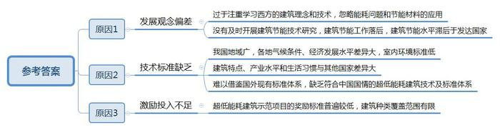
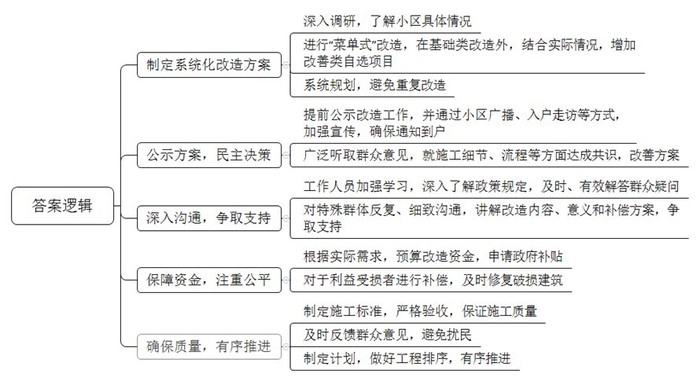
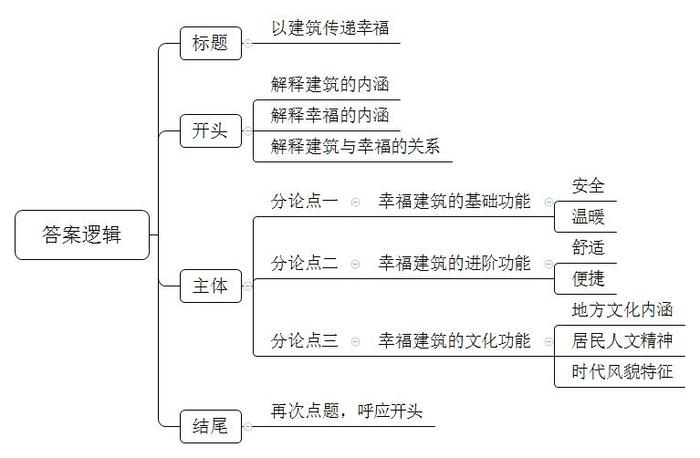

# 2018年北京市公考《申论》题

> 候选采集稿。参考答案及解析来自粉笔页面，不代表官方答案或真实高分答卷；来源使用许可与原卷对应关系仍需人工核实。

## 给定材料

### 材料 material-9b4cbe4eb0c758c0

建筑能耗是我国能源消费的重要组成部分，其占比逐年增长。在我国，已建房屋中有400亿平方米属于高能耗建筑，节能建筑不到总建筑面积的3%；预计到2020年，全国高能耗建筑面积将达到700亿平方米，建筑能耗将达到1089亿吨标准煤，将形成极大的能源损耗。

在北京，建筑能耗问题也较为严重。2014年底，全市城镇民用建筑总面积达到77059万平方米，总能耗达到3114万吨标准煤，占全市能源消费总量的45.6%。

近年来，北京市不断加大建筑节能的工作力度。自2013年起，在全国率先实施节能75%的居住建筑节能设计标准，将居住建筑采暖耗热量指标由原来的14.65瓦/平方米降至10.5瓦/平方米。自2015年11月1日起，又实施了新的公共建筑节能设计标准，提高了围护结构热工性能、采暖空调设备和照明设备能效的标准，全年采暖、通风、空气调节和照明的总能耗减少约20%～23%。

北京市大力建设节能建筑，占比由2009年的55.18%提高至2015年的74.4%。同时，对既有建筑进行节能改造。近几年来，北京市共完成6257万平方米既有民用建筑围护结构节能改造。其中，居住建筑改造5657万平方米，惠及200多万居民；公共建筑改造600万平方米。这些改造，不仅提高了室内舒适度，而且节省了能源。北京市还大力实施了农村建筑节能改造，完成农民住宅新建翻建、抗震节能综合改造和节能单项改造共计53.57万户，改造后的农宅冬季不但室内温度提高了4℃～6℃，而且节约燃煤30%以上；夏季室内明显感觉凉爽，不但室内温度比室外温度低5℃～6℃，而且减少了耗电量。

### 材料 material-a29932da5f128ddd

北京市海淀区M小区X号楼，是40年前的老建筑。前期有关单位经过抗震计算，认为这栋老楼已经不符合鉴定标准要求，必须进行抗震加固。

问题不仅仅是抗震。整栋楼的外墙根本没有保温层，屋顶是平面，单元门和楼道窗都不是节能的，甚至有些住户的阳台都没做封闭。在日常生活中，冬天冷、夏天热，刮风时风顺着门窗“嗖嗖”地进。

不过，X号楼很快就将“旧貌换新颜”。作为北京市首个“三合一”老旧小区综合改造试点项目，该楼所在的M小区将进行“菜单式”改造。所谓“菜单式”改造，是指在老旧小区的楼体节能、室内给排水、小区环境综合整治等基础类改造项目之外，政府以财政补贴的形式鼓励老旧小区的居民自选加装电梯、建设立体停车设施、建设老年服务驿站等改造项目。

经过近3个月的改造，M小区老楼节能保温等改造已完成，厨卫间上下水管道改造正在施工，室外管线更新及环境综合整治施工即将展开，这些基础类改造项目将在几个月后完工。针对小区活动空间狭窄、老年人上下楼不便、停车难等问题，M小区计划在楼房的单元门口加装54部外挂电梯，继两部外挂试点电梯建成后，还有29部外挂电梯即将建成，剩下的23个单元电梯加装计划一旦获居民同意，也将陆续施工。位于小区北门的立体停车楼共4层，可新增车位近百个，目前场地已平整，具备施工条件。而老年服务驿站是利用原有物业用房进行改造的，可提供日间照料、短期入住、老年餐桌、健身和心理慰藉等服务。停车楼和老年服务驿站有望在几个月后建成并投入使用。

“我试乘了几次，上上下下特别稳当，也没什么噪音。”家住M小区的成大妈，最近一阵子心情很好。作为小区里签署加装电梯同意书的第一人，成大妈看见家门口簇新的电梯厅，就数着能投入使用的日子。社区居委会谢主任看到居民欣喜的样子，心里也终于松了一口气。她一个写满字的笔记本上，记录着小区加装电梯的曲折过程。笔记本上，每一户不同意加装电梯的原因都全部注明。有些的确是对居民有影响、待解决的难题，要反馈给建设施工团队；还有一些则是居民的担心和顾虑，需要反复沟通，给居民吃颗定心丸。

据统计，“十二五”期间，北京市共完成6562万平方米市属老旧小区综合整治，惠及1678个小区81.9万户居民，超额完成预定计划。北京市政府常务会议审议通过的《老旧小区综合整治工作方案（2017-2020）》指出，将开展新一轮老旧小区综合整治工作，实施范围有所扩大：“十三五”时期，将优先完成抗震节能性能不足的老旧小区综合整治工作。除了常规的抗震加固、加层保温、屋顶整治外，未来老旧小区改造将着重解决增设停车位、加装电梯、飞线入地等重点问题。“六治七补三规范”成为这一轮的工作目标，即治危房、治违法建设、治开墙打洞、治群租、治地下空间违规使用、治乱搭架空线，补抗震节能、补市政基础设施、补停车设施、补居民上下楼设施、补社区综合服务设施、补小区治理体系、补小区信息化应用能力，规范小区自治管理、规范物业管理、规范地下空间利用。

## 题目

### 第 1 题

**根据给定材料，简要概括北京市近年来在人居方面采取的主要措施。（20分）**

关联材料：material-9b4cbe4eb0c758c0

作答要求：

要求：概括准确全面，语言简练，字数不超过300字。

### 第 2 题

**阅读材料**1**\-**3**，结合实际，分析导致我国现代建筑普遍能耗较高的主要原因。（15分）**

关联材料：material-9b4cbe4eb0c758c0

作答要求：

要求：分析合理，条理清楚，语言简练，字数不超过250字。

### 第 3 题

**假如要将材料**5**中提到的L街道作为北京市老旧小区改造工程的试点，如果你是该街道办事处的工作人员，请你提出推动街道老旧小区改造工作的思路。（25分）**

关联材料：material-a29932da5f128ddd

作答要求：

要求：内容全面、合理可行，条理清晰，语言简练，字数不超过350字。

### 第 4 题

**结合给定材料，以“幸福的建筑”为话题，自拟题目，自选角度，联系实际，写一篇文章。（40分）**

关联材料：material-9b4cbe4eb0c758c0

作答要求：

要求：观点鲜明、正确，分析深入、合理，语言流畅，字数控制在800-1000字。

## 答案与解析

第 1 题

**参考答案（粉笔题库参考内容）**

1.推进建筑节能工作。实施、提升建筑节能标准；建设节能建筑，改造既有建筑；探索超低能耗建筑，出台激励政策，明确技术要求。

2.综合改造老旧小区。“菜单式”改造，普及基础改造，提供财政补贴，群众自选改造类项目；加强沟通反馈工作，化解群众顾虑。

3.规范住房租赁市场。出台政策，规范房地产经纪行为，要求实名服务，违规者予以处罚；建设租赁监管和交易平台，强化监管，提供信息服务，加强动态核查。

4.加强应急避难工作。编制规划纲要，科学布局，增强容纳能力；建设应急避难场所，完善广播、照明、指示牌等设施。

5.实施绿化景观改造。治理污染，打造景观，绿化、美化环境；修缮房屋，完善服务设施，改善居住环境。

**解析**

**参考答案说明：**本参考答案思路上从“推进建筑节能工作”“综合改造老旧小区”“规范住房租赁市场”“加强应急避难工作”“实施绿化景观改造”这五方面入手，进行措施的展开。此外，各条的要点之间是并列关系，内容之间不存在重复、交叉。

**考点**：考点概括措施类

**来源**：来源2018年北京市公考《申论》题

粉笔申论页面对本题只提供「解析视频」入口，该入口是会员推广位，页面无视频地址与文字解析。

第 2 题

**参考答案（粉笔题库参考内容）**

1.发展观念偏差。过于注重学习西方的建筑理念和技术，忽略能耗问题和节能材料的应用；没有及时开展建筑节能技术研究，建筑节能工作落后，建筑节能水平滞后于发达国家。

2.技术标准缺乏。我国地域广，各地气候条件、经济发展水平差异大，室内环境标准低，建筑特点、产业水平和生活习惯与其他国家差异大，难以借鉴国外现有标准体系，缺乏符合中国国情的超低能耗建筑技术及标准体系。

3.激励投入不足。超低能耗建筑示范项目的奖励标准普遍较低，建筑种类覆盖范围有限。

**解析**

**参考答案说明：**本参考答案思路上从“发展观念偏差”“技术标准缺乏”“激励投入不足”这三方面入手，进行问题的展开。此外，各条的要点之间是并列关系，内容之间不存在重复、交叉。

**考点**：考点原因类

**来源**：来源2018年北京市公考《申论》题

粉笔申论页面对本题只提供「解析视频」入口，该入口是会员推广位，页面无视频地址与文字解析。

第 3 题

**参考答案（粉笔题库参考内容）**

1.制定系统化改造方案。深入调研，了解小区具体情况；进行“菜单式”改造，在基础类改造外，结合实际情况，增加改善类自选项目；系统规划，避免重复改造。

2.公示方案，民主决策。提前公示改造工作，并通过小区广播、入户走访等方式，加强宣传，确保通知到户；广泛听取群众意见，就施工细节、流程等方面达成共识，改善方案。

3.深入沟通，争取支持。工作人员加强学习，深入了解政策规定，及时、有效解答群众疑问；对特殊群体反复、细致沟通，讲解改造内容、意义和补偿方案，争取支持。

4.保障资金，注重公平。根据实际需求，预算改造资金，申请政府补贴；对于利益受损者进行补偿，及时修复破损建筑。

5.确保质量，有序推进。制定施工标准，严格验收，保证施工质量；及时反馈群众意见，避免扰民；制定计划，做好工程排序，有序推进。

**解析**

**参考答案说明：**本参考答案思路上从“制定系统化改造方案”“公示方案，民主决策”“深入沟通，争取支持”“保障资金，注重公平”“确保质量，有序推进”这五方面入手，进行对策的展开。此外，各条的要点之间是并列关系，内容之间不存在重复、交叉。

**考点**：考点提出对策类

**来源**：来源2018年北京市公考《申论》题

粉笔申论页面对本题只提供「解析视频」入口，该入口是会员推广位，页面无视频地址与文字解析。

第 4 题

**参考答案（粉笔题库参考内容）**

**以建筑传递幸福**

建筑作为人类活动的居所，凝结着建筑师们对人居环境设计的心血和智慧，反映的其实是一种生活方式。而幸福则是人对生活境遇的一种积极的肯定，并希望一直保持现状的正面心理情绪。幸福的建筑，反映出了建筑的终极目的是服务于人，让生活在其中的人们达到幸福的状态。如此，**建筑不仅是人类物质上栖身处，更是精神上的庇护所，幸福的建筑本质上是以人为本理念的生动实践**。

**建筑最初的意义就是片瓦遮头，避免日晒雨淋，让人拥有一个安全、温暖、安定的栖身之地。这需求背后是对建筑质量、实用功能的期许。**小到私人的一宅一院，大到公共的楼堂馆所，都是人类活动的空间载体。在建筑设计和改造过程中，应先考虑空间的安全性和实用性，其他一切因素包括幸福都要建立在它的基础上。房屋施工要严格遵照施工标准，杜绝偷工减料行为。同时还要建设应急避难场所，有效防灾减灾。此外，人类为了御寒防冻，建筑能耗问题也较为严重。当前，我国正积极探索建立符合我国国情的超低能耗建筑技术和标准体系，并出台了经济激励政策，寻求生存需求和资源环境可持续发展间的平衡。

随着时代的发展，建筑早就不仅仅是家的载体，更是通向美好生活的路径、是城市文明的容器。

**在安全、温暖的基础上，人们还希望生活得舒适、便利，环境更加优美。这希望背后是对政府城市规划科学性、公共服务以及配套设施完备性的考验。**人类的活动是开放的，不局限于建筑内部的室内生活，更依赖于建筑外部的公共空间。一个高品质的公共空间能够让幸福大大提升。何谓高品质空间？在安全的大前提下，满足人们舒适、便捷的生活需求。这涉及到公共服务设施的合理布局和居住环境的改造提升。因此，各地政府既要加大人财物投入，抓好绿化、美化、亮化等改造工程，给予人们游憩休闲的品质享受；又要科学规划布局公共资源，大力推进医院、学校、养老服务站等公共基础设施的建设，更好地方便市民生活需要。

**幸福的建筑既是物质财富，又是精神产品，还应当体现一个地方的文化内涵，反映当地居民的人文精神，承袭这个地域的历史记忆、时代风貌。**建筑作为一个客观存在，总是扎根于特定地域的环境中，受到当地经济、社会、人文、气候地形等因素影响，是地域性、文化性、时代性的集合体。仔细端详一个地方的标志性建筑，从中可以推断出它所在城市的地理概貌，触摸到它曾经的历史积淀，感受到居民的追求。北京的四合院、湘西的吊脚楼、陕北的窑洞，都是华夏子孙世代居住的建筑形式，却又各有千秋，与当地环境浑然一体。不得不感叹，远古先人在造物时所呈现出的“天人合一”的哲学思想。今天，我们要结合时代要求和特点，创新传承传统建筑文化，设计出更多符合现代生活、展现时代风貌的幸福建筑。

幸福，千般好，万万种，其中有一种，是建筑给的。幸福的建筑，给人以视觉的享受，内心的安宁，思想的沉思，文明的叩问。

**解析**

**文章分析**

**以建筑传递幸福**

【**标题的优点：**首先，范文的标题“以建筑传递幸福”突出了“幸福的建筑”这一主题。其次，形式上，文字简洁明快。】

（1）建筑作为人类活动的居所，凝结着建筑师们对人居环境设计的心血和智慧，反映的其实是一种生活方式。（2）而幸福则是人对生活境遇的一种积极的肯定，并希望一直保持现状的正面心理情绪。（3）幸福的建筑，反映出了建筑的终极目的是服务于人，让生活在其中的人们达到幸福的状态。如此，**建筑不仅是人类物质上栖身处，更是精神上的庇护所，幸福的建筑本质上是以人为本理念的生动实践**。

【**开头的优点：**★内容方面。范文的开头是紧扣题目给定的“幸福的建筑”这一主题展开的。首先，开头即点出主题，做到了主题明确。其次，对“幸福的建筑”这一主题进行了分析阐述，指出了（1）“建筑的内涵”。（2）“幸福的内涵”。（3）“建筑与幸福的关系”，注意以上三个方面的阐述在逻辑上有先后顺序：先写“建筑”，再写“幸福”，最后写“二者的关系”。★文字表达方面：使用了“而”“不仅……更是……”等关联词，使语言表达更有逻辑性。】

**建筑最初的意义就是片瓦遮头，避免日晒雨淋，让人拥有一个安全、温暖、安定的栖身之地。这需求背后是对建筑质量、实用功能的期许。**（1）小到私人的一宅一院，大到公共的楼堂馆所，都是人类活动的空间载体。在建筑设计和改造过程中，应先考虑空间的安全性和实用性，其他一切因素包括幸福都要建立在它的基础上。房屋施工要严格遵照施工标准，杜绝偷工减料行为。同时还要建设应急避难场所，有效防灾减灾。（2）此外，人类为了御寒防冻，建筑能耗问题也较为严重。当前，我国正积极探索建立符合我国国情的超低能耗建筑技术和标准体系，并出台了经济激励政策，寻求生存需求和资源环境可持续发展间的平衡。

【**论述段****1****的优点：**★观点句：范文的观点句是紧扣“幸福的建筑”这一文章主题提出的。形式上，它在段首处直接写出，位置突出，容易发现。内容上，关键词突出，内容要点明确，可以明显看出它是从“基础功能”入手，指出了“什么是幸福建筑”。★论述内容：（1）介绍了“幸福的建筑具有安全性、实用性”；（2）介绍了“幸福的建筑温暖且环保”。注意：以上两个方面的内容都是紧扣“建筑最初的意义就是片瓦遮头，避免日晒雨淋，让人拥有一个安全、温暖、安定的栖身之地。这需求背后是对建筑质量、实用功能的期许”这个观点句进行分析论述的，论述的针对性强，内容层次丰富。在论述方法和论据的选取上做到了讲道理和举例子相结合，做到了丰富多样。】

随着时代的发展，**建筑早就不仅仅是家的载体，更是通向美好生活的路径、是城市文明的容器。**

**在安全、温暖的基础上，人们还希望生活得舒适、便利，环境更加优美。这希望背后是对政府城市规划科学性、公共服务以及配套设施完备性的考验。**（1）人类的活动是开放的，不局限于建筑内部的室内生活，更依赖于建筑外部的公共空间。一个高品质的公共空间能够让幸福大大提升。何谓高品质空间？在安全的大前提下，满足人们舒适、便捷的生活需求。这涉及到公共服务设施的合理布局和居住环境的改造提升。（2）因此，各地政府既要加大人财物投入，抓好绿化、美化、亮化等改造工程，给予人们游憩休闲的品质享受；又要科学规划布局公共资源，大力推进医院、学校、养老服务站等公共基础设施的建设，更好地方便市民生活需要。

【**论述段****2****的优点：**★观点句：范文的观点句是紧扣“幸福的建筑”这一文章主题提出的。形式上，它在段首处直接写出，位置突出，容易发现。内容上，关键词突出，内容要点明确，可以明显看出它是从“进阶功能”入手，指出了“什么是幸福建筑”。★论述内容：（1）介绍了“幸福的建筑具有高品质，舒适、便捷”；（2）介绍了“建设幸福建筑的具体对策”。注意：以上两个方面的内容都是紧扣“在安全、温暖的基础上，人们还希望生活得舒适、便利，环境更加优美。这希望背后是对政府城市规划科学性、公共服务以及配套设施完备性的考验”这个观点句进行分析论述的，论述的针对性强，内容层次丰富。在论述方法和论据的选取上做到了讲道理和举例子相结合，做到了丰富多样。】

**幸福的建筑既是物质财富，又是精神产品，还应当体现一个地方的文化内涵，反映当地居民的人文精神，承袭这个地域的历史记忆、时代风貌。**（1）建筑作为一个客观存在，总是扎根于特定地域的环境中，受到当地经济、社会、人文、气候地形等因素影响，是地域性、文化性、时代性的集合体。仔细端详一个地方的标志性建筑，从中可以推断出它所在城市的地理概貌，触摸到它曾经的历史积淀，感受到居民的追求。北京的四合院、湘西的吊脚楼、陕北的窑洞，都是华夏子孙世代居住的建筑形式，却又各有千秋，与当地环境浑然一体。不得不感叹，远古先人在造物时所呈现出的“天人合一”的哲学思想。（2）今天，我们要结合时代要求和特点，创新传承传统建筑文化，设计出更多符合现代生活、展现时代风貌的幸福建筑。

【**论述段****3****的优点：**★观点句：范文的观点句是紧扣“幸福的建筑”这一文章主题提出的。形式上，它在段首处直接写出，位置突出，容易发现。内容上，关键词突出，内容要点明确，可以明显看出它是从“文化功能”入手，指出了“什么是幸福建筑”。★论述内容：（1）介绍了“幸福建筑能够体现地方内涵、人文精神、时代风貌等”；（2）介绍了“具体对策”。注意：以上两个方面的内容都是紧扣“幸福的建筑既是物质财富，又是精神产品，还应当体现一个地方的文化内涵，反映当地居民的人文精神，承袭这个地域的历史记忆、时代风貌”这个观点句进行分析论述的，论述的针对性强，内容层次丰富。在论述方法和论据的选取上做到了讲道理和举例子相结合，做到了丰富多样。】

【**论述段之间的关系：**★内容的内在逻辑：范文的论述段之间是并列关系。论述段1先写了“基础功能”，论述段2再写了“进阶功能”，论述段3最后写了“文化功能”。★段与段的外在衔接：论述段2的段首处的过渡句“在安全、温暖的基础上”，起到了承接论述段1、引出了论述段2的作用。论述段3的段首处的过渡句“幸福的建筑既是物质财富，又是精神产品，还应当体现一个地方的文化内涵”，起到了承接论述段2、引出了论述段3的作用。】

幸福，千般好，万万种，其中有一种，是建筑给的。幸福的建筑，给人以视觉的享受，内心的安宁，思想的沉思，文明的叩问。

【**结尾的优点：**范文的结尾回扣了“幸福的建筑”这一主题。阐述了“幸福的建筑”的深远意义。】

**考点**：考点文章写作题

**来源**：来源2018年北京市公考《申论》题

粉笔申论页面对本题只提供「解析视频」入口，该入口是会员推广位，页面无视频地址与文字解析。

