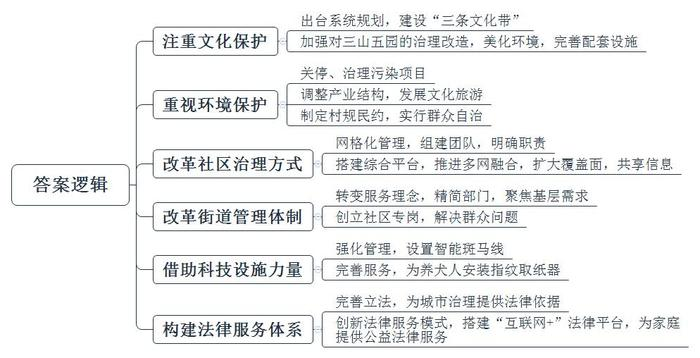
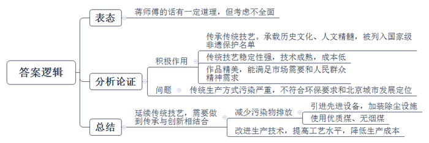
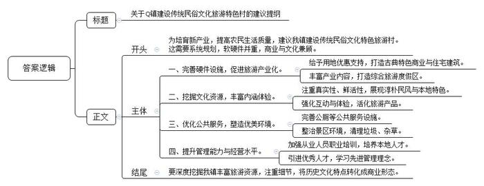
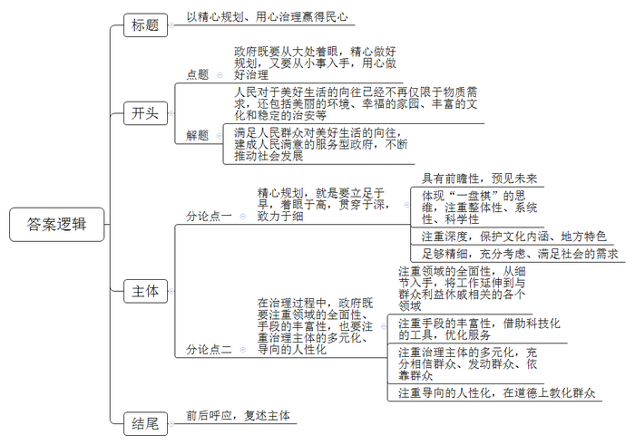

# 2019年北京市公考《申论》题

> 候选采集稿。参考答案及解析来自粉笔页面，不代表官方答案或真实高分答卷；来源使用许可与原卷对应关系仍需人工核实。

## 给定材料

### 材料 material-96090b42f23bdf89

放眼北京城，自然风韵与人文风情在西部汇聚成盛景。“北京的灵性，全在西山那一抹晚霞”，徐志摩的诗句道出了这里特有的诗意。西山作为西山永定河文化带上的一环，淋漓尽致地展现了“三条文化带”的魅力。

“三条文化带”指的是北部长城文化带、东部大运河文化带和西部西山永定河文化带。它作为一个全新的概念，于2015年底由北京市提出，2016年被写入北京市“十三五”规划纲要，2017年被正式写入《北京城市总体规划（2016年-2035年）》（以下简称“总规”）。总规明确指出，要加强“三条文化带”的整体保护利用。“三条文化带”的建设，有利于疏通古都北京的历史文脉，保护古都风貌，依托北京丰富的自然历史文化资源优势，促进北京全国文化中心建设。

作为“三条文化带”之一，西山永定河文化带承载着多样的文化形态，包括以清代“三山五园”为代表的特征鲜明的皇家文化；以大觉寺、卧佛寺等为代表的历史悠久的寺庙文化；以妙峰山为代表的传统民俗文化；还有以景泰陵等为代表的陵墓文化等。对于西山永定河文化带，总规提出，依托三山五园地区、八大处地区、永定河沿岸、大房山地区等历史文化资源密集地区，加强琉璃河等大遗址保护，修复永定河生态功能，恢复重要文化景观，整理商道、香道、铁路等历史古道，形成文化线路。

### 材料 material-9427ecfb9d0a4eb4

蜿蜒流淌的永定河孕育了千年古都北京厚重博大的历史文化和人文精髓。古老而美丽的L村就位于永定河畔。传承了近千年的琉璃窑火，曾在这里生生不息，将一代代精美的琉璃制品远播华夏九州。走进村里，目之所及，都是精美的琉璃构件。村里人为此感到很骄傲：故宫三大殿、北海九龙壁、颐和园……北京城里所有与琉璃有关的皇家建筑，几乎都是L村制作的。目前，琉璃烧造工艺已被列入国家级非物质文化遗产保护名单。

2017年4月，L村某琉璃厂因烧煤不符合环保要求而被关停。该厂负责人孙经理无奈地表示：“区里在严格整治烧煤产业，我们厂主要因为烧煤、没有除尘设施而被停产。此前由于烧煤没出过什么事，厂里也未想过改进生产方式。停工对我们影响挺大的。我现在就想着怎么完成之前的订单。我们厂一直沿用传统的‘官式’做法，琉璃的规格、尺寸及纹饰完全按照《清式营造则例》的规定执行。厂里也曾讨论过要不要外迁，但门头沟琉璃烧制的要诀不仅在于传统技艺，更离不开当地的坩土。非遗传承应该保留原汁原味的技艺，搬走之后就不是这个东西了。”

60岁的蒋师傅是厂里的老艺人，同时也是“琉璃烧制技艺”国家级非遗传承人。“门头沟琉璃艺人间流传着‘火里求财’的说法。把握好火候，一窑的制品会有80%的完好性；把握不好，一窑的东西就全毁了。”蒋师傅说，“一直烧煤是因为烧煤时的火是逐渐升温的，稳定性比较强。我们也曾尝试用天然气烧制，只是天然气温度控制技术还不成熟，成本也会提高。我希望厂子还是用原来的生产方式恢复生产，让近千年的传统技艺延续下去。”

这次停产让孙经理和蒋师傅等人陷入了深深的思考。“我知道烧煤确实不符合环保标准，也不符合北京城市发展定位。虽然琉璃的市场不大，可有的地方也离不开琉璃这类传统制品呀！琉璃的发展更离不开现代人的日常和精神生活。”孙经理仍对未来充满期待。

### 材料 material-13a09e611c25ebe2

M区Q镇距离北京城区100多公里，是北京西部山区一个较偏远的镇。全镇64%的面积位于国家级自然保护区范围内。“以前，很多城镇都是先出现环境问题，而后再治理。我们这的发展思路却不一样。为了保护生态，我镇近年来进行了两次大的产业调整。”镇党委书记贾某说，“一次是在2010年，全镇100多家煤矿全部退出，千年采煤史划上了句号。另一次是在近两年，传统的畜牧业分批次退出，从源头上减少了破坏和污染。”

传统产业退出去了，新的产业还没有培育起来，农民的收入来源是摆在镇政府面前一道切实的难题。为了能尽快培育起新产业，提高当地农民的生活质量，Q镇拟规划建设一批传统民俗文化旅游特色村，打造集民俗文化体验、农事活动体验、生态农业观光及乡村精品休闲度假等为一体的文化旅游综合项目。在该项目的调研论证会上，参会人员各抒己见：

Q镇某村村支书：对于建设传统民俗文化旅游特色村，我们的初步想法是，在用地上予以优惠支持，吸引高端房地产公司来开发建设具有古典特色的商业与住宅建筑。通过仿古建筑、美食特产、传统技艺表演等形式打造集生态与文化旅游开发等为一体的综合性旅游度假区。这种模式在我市及全国各地已有诸多成功案例，我们打算借鉴这种模式。

文化特色小镇策划人王先生：现在有的民俗文化村，大多是各种仿古建筑展示、商铺产品兜售、艺人技艺展演，处处要钱，处处收费，却没有真实的生活与体验，缺乏那种充满市井气息的鲜活的生活图景。一味复制城市建设模式，一味地去模仿古建筑，一窝蜂地做小吃一条街，就把乡村淳朴民风和本地特色文化的“魂儿”弄丢了。

旅游学者容女士：现在的游客，并不满足于对景区景点的观光，更注重对另一种生活方式的体验。风俗、风情、风物和风味产品是最容易增加旅游者体验和互动的，产品可延伸、可演绎、可创意的空间大得不得了，为什么偏偏生硬地去展示，而不肯独辟蹊径地去活化呢？

民俗文化学者沈先生：某省的B民俗文化村曾经红极一时。然而，短短数年间，这一区域就分布了十多家同一文化主题的特色乡村旅游项目，都是清一色的以本地风味小吃和传统技艺为主的业态。偶尔可见一些摆放的“老物件”，但数量稀少，都被淹没在浓郁的商业氛围中。很多地方连个像样的厕所都没有。现在的B民俗文化村，小吃街上还残留着各种招牌，景区路边野草丛生，除了当地村民外，几乎看不到游客身影。

Q镇村民代表：过去我经营过煤矿，也开过养鸡场，收入都还可以。如今让我们来搞民俗村，我觉得主意也挺好。就是我们这些人实在没有这方面的经验，怕搞不好。

区旅游部门负责人赵主任：Q镇具有优美的山水风景、传统村落古道、现代绿色农业等旅游资源，应好好挖掘。一个地方传统民俗文化的精髓应是当地生命活动中形成的传统、风俗、生存方式、思想观念等。文化转化成商业形态，需要根据历史文化特点去转化，要从细节入手，否则就会对本地文化资源造成伤害。

## 题目

### 第 1 题

**根据给定的材料，概括北京市近年来在基层社会治理方面的主要做法。（20分）**

关联材料：material-96090b42f23bdf89

作答要求：

要求：准确全面，语言简练，不超过300字。

### 第 2 题

**对于给定材料**3**中划线部分蒋师傅的想法，谈谈你的看法。（15分）**

关联材料：material-9427ecfb9d0a4eb4

作答要求：

要求：观点明确，分析合理，不超过250字。

### 第 3 题

**假如你是Q镇政府的一名工作人员，根据给定资料**4**，撰写一份关于Q镇建设传统民俗文化旅游特色村的建议提纲。（25分）**

关联材料：material-13a09e611c25ebe2

作答要求：

要求：内容全面，建议合理可行，条理清晰，语言简练，不超过350字。

### 第 4 题

**结合给定材料，围绕“精心规划和用心治理”，联系实际，自选角度，自拟题目，写一篇文章。（40分）**

关联材料：material-96090b42f23bdf89

作答要求：

要求：观点鲜明、正确，分析深入、合理，语言流畅，字数控制在800-1000字。

## 答案与解析

第 1 题

**参考答案（粉笔题库参考内容）**

一、注重文化保护。出台系统规划，建设“三条文化带”；加强对三山五园的治理改造，美化环境，完善配套设施。

二、重视环境保护。关停、治理污染项目；调整产业结构，发展文化旅游；制定村规民约，实行群众自治。

三、改革社区治理方式。网格化管理，组建团队，明确职责；搭建综合平台，推进多网融合，扩大覆盖面，共享信息。

四、改革街道管理体制。转变服务理念，精简部门，聚焦基层需求；创立社区专岗，解决群众问题。

五、借助科技设施力量。强化管理，设置智能斑马线；完善服务，为养犬人安装指纹取纸器。

六、构建法律服务体系。完善立法，为城市治理提供法律依据；创新法律服务模式，搭建“互联网+”法律平台，为家庭提供公益法律服务。

**解析**

**参考答案说明：**本参考答案从“注重文化保护”“重视环境保护”“改革社区治理方式”“改革街道管理体制”“借助科技设施力量”“构建法律服务体系”等不同的方面进行了分条撰写。各条要点之间在内容上是并列关系，没有交叉。

**考点**：考点概括措施类

**来源**：来源2019年北京市公考《申论》题

粉笔申论页面对本题只提供「解析视频」入口，该入口是会员推广位，页面无视频地址与文字解析。

第 2 题

**参考答案（粉笔题库参考内容）**

蒋师傅的话有一定道理，但考虑不全面。

保护传统生产方式有积极作用：1.传承传统技艺。承载历史文化、人文精髓，被列入国家级非遗保护名单。2.传统技艺稳定性强，技术成熟，成本低。3.作品精美，能满足市场需要和人民群众精神需求。但是，传统生产方式污染严重，不符合环保要求和北京城市发展定位。

延续传统技艺，需要做到传承与创新相结合：1.减少污染物排放。引进先进设备，加装除尘设施；使用优质煤、无烟煤。2.改进生产技术，提高工艺水平，降低生产成本。

**解析**

**参考答案说明：**思路方面，本参考答案按照观点现象分析题“表态+分析论证+总结”的一般答题思路展开。内容方面，本参考答案先对蒋师傅的想法进行了表态；“分析论证”部分先分析了保护传统生产方式的积极作用，接着分析了传统生产方式存在的问题；最后给出了对策。词句表达方面，本答案加上了“但是……”等连接词来承接上下文。

**考点**：考点观点现象分析类

**来源**：来源2019年北京市公考《申论》题

粉笔申论页面对本题只提供「解析视频」入口，该入口是会员推广位，页面无视频地址与文字解析。

第 3 题

**参考答案（粉笔题库参考内容）**

关于Q镇建设传统民俗文化旅游特色村的建议提纲

为培育新产业，提高农民生活质量，建议我镇建设传统民俗文化特色旅游村。这需要系统规划，软硬件并重，商业与文化兼顾。具体建议如下：

一、完善硬件设施，促进旅游产业化。给予用地优惠支持，打造古典特色商业与住宅建筑；丰富产业内容，打造综合旅游度假区。

二、挖掘文化资源，丰富内涵体验。注重真实性、鲜活性，展现淳朴民风与本地特色；强化互动与体验，活化旅游产品。

三、优化公共服务，塑造优美环境。完善公厕等公共服务设施；整治景区环境，清理垃圾、杂草。

四、提升管理能力与经营水平。加强从业人员职业培训，培养本地人才；引进优秀人才，学习先进管理理念。

总之，要深度挖掘我镇丰富旅游资源，注重细节，将历史文化特点转化成商业形态。

**解析**

**参考答案说明：**（1）本题虽然不要求考虑格式，但为了保险起见，建议加上标题。（2）正文部分，一方面从内容来看，围绕着“建设传统民俗文化旅游特色村”这一主题，本参考答案的开头先写到了“建设传统民俗文化旅游特色村”的目的和背景信息；主体部分从“完善硬件设施，促进旅游产业化”“挖掘文化资源，丰富内涵体验”“优化公共服务，塑造优美环境”“提升管理能力与经营水平”等几个方面给出了具体的建议，并且将总括性较强的要点作为结尾。另一方面，形式上，本参考答案做到了分段、分条撰写，整体上条理较为清晰。

**考点**：考点方案类

**来源**：来源2019年北京市公考《申论》题

粉笔申论页面对本题只提供「解析视频」入口，该入口是会员推广位，页面无视频地址与文字解析。

第 4 题

**参考答案（粉笔题库参考内容）**

**以精心规划、用心治理赢得民心**

当下，人民对于美好生活的向往已经不再仅限于物质需求，还包括美丽的环境、幸福的家园、丰富的文化和稳定的治安等。习近平总书记曾说过：“人民对美好生活的向往，就是我们的奋斗目标。”想要满足人民群众对美好生活的向往，建成人民满意的服务型政府，不断推动社会发展，**政府既要从大处着眼，精心做好规划，又要从小事入手，用心做好治理。**

**精心规划，就是要立足于早，着眼于高，贯穿于深，致力于细。好的规划，要具有前瞻性，预见未来；要体现****“一盘棋”的思维，注重整体性、系统性、科学性；还应注重深度，保护文化内涵、地方特色；最终要足够精细，充分考虑、满足社会的需求。**大片的绿地、美丽多变的景观、串联三山五园的绿道、绿道沿途的避雨亭及座椅等……在北京三山五园地区规划上，政府将整体性、科学性、系统性作为贯穿始终的关键词，听取群众的心声，做足了细节文章。这既保护了古都风貌，还为群众提供了游憩休闲、旅游观光的好去处。然而，当下，一些地方做规划时，不去挖掘当地的自然景观、历史文化和风土人情等，只知道一味地复制其他地方的成功经验，还沾沾自喜。殊不知，盲目地生搬照抄，违背了本地原有的发展机理，忽视了原真性、独特性，只会断送未来，闹出“邯郸学步”的笑话。

在科技日新月异、矛盾复杂多样的今天，建设让群众满意的政府，光有精心的规划是不足的。影响群众生活幸福感、社会稳定程度的，恰恰都是一些具体的事物，这要求政府用心做好治理，解决好具体问题。

**在治理过程中，政府既要注重领域的全面性、手段的丰富性，也要注重治理主体的多元化、导向的人性化。要从细节入手，将工作延伸到与群众利益休戚相关的各个领域，借助科技化的工具，优化服务；并充分相信群众、发动群众、依靠群众，最终教化群众。**时代在发展，新的领域不断涌现，并逐渐融入了群众的生活，像“出门靠滴滴，吃饭靠外卖”之类的景象，已经成为都市人生活的常态。这就要求政府应当加快步伐，不断消灭治理的盲区，并且创新治理手段，借助科技的手段，以快打快，以新治新。同时，随着政府管理和服务职能的此消彼长，社会治理也需要更多其他社会主体的参与，政府应当引导群众、社会组织、企业等主体，参与到社会治理中来。各地推行的社区“网格化治理”、村庄制定“村规民约”，都是其中的典范，通过居民自治，不但能及时消灭问题，更能够培养群众的责任感，加强自我约束，进而实现社会风气、道德水平的提升。

在政府工作中，精心规划与用心治理犹如车之两轮、鸟之双翼，两者相辅相成，缺一不可。政府既要做好精心规划，又要做到用心治理，如此才能满足群众需求，赢得民心！

**解析**

**文章分析**

**以精心规划、用心治理赢得民心**

【**标题的优点：**首先，范文的标题“以精心规划、用心治理赢得民心”突出了“精心规划和用心治理”这一主题。其次，形式上，文字简洁明快。】

当下，（1）人民对于美好生活的向往已经不再仅限于物质需求，还包括美丽的环境、幸福的家园、丰富的文化和稳定的治安等。习近平总书记曾说过：“人民对美好生活的向往，就是我们的奋斗目标。”想要（2）满足人民群众对美好生活的向往，建成人民满意的服务型政府，不断推动社会发展，**政府既要从大处着眼，精心做好规划，又要从小事入手，用心做好治理。**

【**开头的优点：**★内容方面：范文的开头是紧扣题目给定的“精心规划和用心治理”这一主题展开的。首先，开头开门见山点出主题，做到了主题明确。其次，对“精心规划和用心治理”这一主题进行了分析阐述，指出了（1）介绍了人民对美好生活的要求；（2）介绍了政府工作的目标。★文字表达方面：长短句配合使用，使语言表达有节奏感。】

**精心规划，就是要立足于早，着眼于高，贯穿于深，致力于细。好的规划，要具有前瞻性，预见未来；要体现****“一盘棋”的思维，注重整体性、系统性、科学性；还应注重深度，保护文化内涵、地方特色；最终要足够精细，充分考虑、满足社会的需求。**大片的绿地、美丽多变的景观、串联三山五园的绿道、绿道沿途的避雨亭及座椅等……在北京三山五园地区规划上，（1）政府将整体性、科学性、系统性作为贯穿始终的关键词，听取群众的心声，做足了细节文章。（2）这既保护了古都风貌，还为群众提供了游憩休闲、旅游观光的好去处。然而，当下，一些地方做规划时，（3）不去挖掘当地的自然景观、历史文化和风土人情等，只知道一味地复制其他地方的成功经验，还沾沾自喜。殊不知，盲目地生搬照抄，违背了本地原有的发展机理，忽视了原真性、独特性，只会断送未来，闹出“邯郸学步”的笑话。

【**观点句****1论述段的优点：**★观点句：范文的观点句是紧扣“精心规划和用心治理”这一文章主题提出的。形式上，它在段首处直接写出，位置突出，容易发现。内容上，关键词突出，可以明显看出它是从“前瞻性、‘一盘棋’思维、注重深度、精细规划”入手，指出了“实现精心规划”的对策。★论述内容：（1）介绍了政府注重规划整体性、科学性，听取群众心声；（2）介绍了政府有效规划的意义；（3）介绍了当前政府规划面临的困境及其危害。注意：以上几个方面的内容都是紧扣“精心规划，就是要立足于早，着眼于高，贯穿于深，致力于细。好的规划，要具有前瞻性，预见未来；要体现‘一盘棋’的思维，注重整体性、系统性、科学性；还应注重深度，保护文化内涵、地方特色；最终要足够精细，充分考虑、满足社会的需求”这个观点句进行分析论述的，论述的针对性强，内容层次丰富。最后，在论述方法和论据的选取上做到了讲道理、举例子相结合，做到了丰富多样。】

在科技日新月异、矛盾复杂多样的今天，建设让群众满意的政府，光有精心的规划是不足的。影响群众生活幸福感、社会稳定程度的，恰恰都是一些具体的事物，这要求政府用心做好治理，解决好具体问题。

【**过渡段的优点：**范文过渡段分析了时代背景等方面的内容，介绍了当前的时代背景。此外，还要注意过渡段中的“建设让群众满意的政府，光有精心的规划是不足的。影响群众生活幸福感、社会稳定程度的，恰恰都是一些具体的事物，这要求政府用心做好治理，解决好具体问题”是用来引起下文的过渡句。】

**在治理过程中，政府既要注重领域的全面性、手段的丰富性，也要注重治理主体的多元化、导向的人性化。要从细节入手，将工作延伸到与群众利益休戚相关的各个领域，借助科技化的工具，优化服务；并充分相信群众、发动群众、依靠群众，最终教化群众。**时代在发展，新的领域不断涌现，并逐渐融入了群众的生活，像“出门靠滴滴，吃饭靠外卖”之类的景象，已经成为都市人生活的常态。（1）这就要求政府应当加快步伐，不断消灭治理的盲区，并且创新治理手段，借助科技的手段，以快打快，以新治新。同时，（2）随着政府管理和服务职能的此消彼长，社会治理也需要更多其他社会主体的参与，政府应当引导群众、社会组织、企业等主体，参与到社会治理中来。各地推行的社区“网格化治理”、村庄制定“村规民约”，都是其中的典范，（3）通过居民自治，不但能及时消灭问题，更能够培养群众的责任感，加强自我约束，进而实现社会风气、道德水平的提升。

【**观点句****2****论述段的优点：**★观点句：范文的观点句是紧扣“精心规划和用心治理”这一文章主题提出的。形式上，它在段首处直接写出，位置突出，容易发现。内容上，关键词突出，可以明显看出它是从“领域的丰富性、主体的多元化、导向的人性化”入手，指出了“实现用心治理”的对策。★论述内容：（1）介绍了政府创新手段、借助科技消灭治理盲区；（2）介绍了政府引导多主体参与消灭治理盲区；（3）介绍了居民自治的积极作用。注意：以上几个方面的内容都是紧扣“在治理过程中，政府既要注重领域的全面性、手段的丰富性，也要注重治理主体的多元化、导向的人性化。要从细节入手，将工作延伸到与群众利益休戚相关的各个领域，借助科技化的工具，优化服务；并充分相信群众、发动群众、依靠群众，最终教化群众”这个观点句进行分析论述的，论述的针对性强，内容层次丰富。最后，在论述方法和论据的选取上做到了讲道理、举例子相结合，做到了丰富多样。】

【**论述段之间的关系**：★内容的内在逻辑：范文的论述段之间是依照“并列”的逻辑展开的。论述段1先写了“精心规划，就是要立足于早，着眼于高，贯穿于深，致力于细。好的规划，要具有前瞻性，预见未来；要体现‘一盘棋’的思维，注重整体性、系统性、科学性；还应注重深度，保护文化内涵、地方特色；最终要足够精细，充分考虑、满足社会的需求”，论述段2再写了“在治理过程中，政府既要注重领域的全面性、手段的丰富性，也要注重治理主体的多元化、导向的人性化。要从细节入手，将工作延伸到与群众利益休戚相关的各个领域，借助科技化的工具，优化服务；并充分相信群众、发动群众、依靠群众，最终教化群众”。】

在政府工作中，（1）精心规划与用心治理犹如车之两轮、鸟之双翼，两者相辅相成，缺一不可。政府既要做好精心规划，又要做到用心治理，如此才能（2）满足群众需求，赢得民心！

【**结尾的优点**：范文的结尾回扣了“精心规划和用心治理”这一主题。（1）再次提到“精心规划和用心治理”这一主题；（2）发出了展望。】

**考点**：考点文章写作题

**来源**：来源2019年北京市公考《申论》题

粉笔申论页面对本题只提供「解析视频」入口，该入口是会员推广位，页面无视频地址与文字解析。

