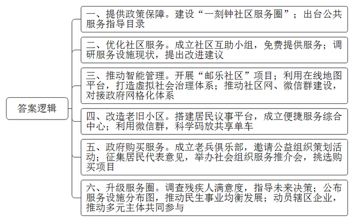
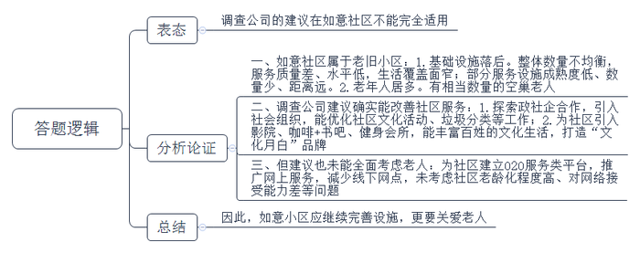
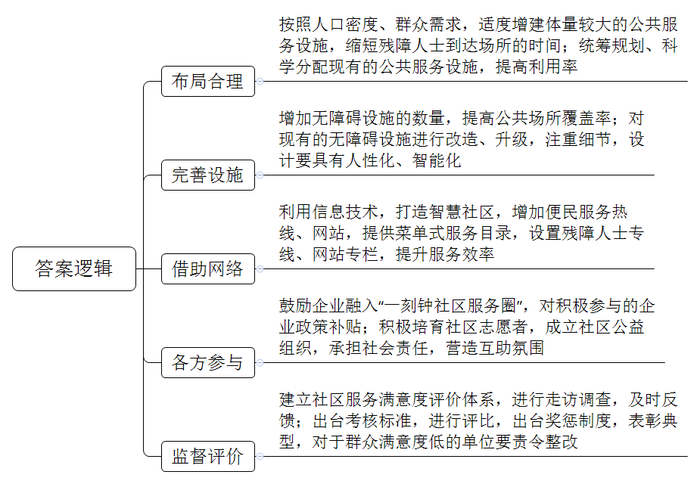
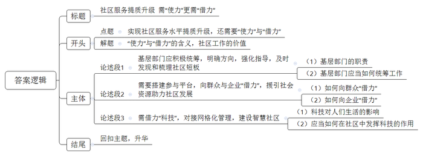

# 2020年北京市公考《申论》题（乡镇）

<!-- gwy:overview:start -->
> **北京 · 2020 · 申论 · 乡镇卷** ｜ 4 题 · 图片 4 处 · 答案随题折叠

导航：[题目](#题目)
<!-- gwy:overview:end -->

> 候选采集稿。参考答案及解析来自粉笔页面，不代表官方答案或真实高分答卷；来源使用许可与原卷对应关系仍需人工核实。

## 给定材料

### 材料 material-863a46a21ee03429

早九点，北京市某社区的早餐店里人来人往，一缕缕水蒸气飘出窗外，在气温偏低的北京初冬格外显眼。早餐店的旁边是干洗店和建材五金店，不远处还有便民商店、药店、理发店等等。社区门口就有一家果蔬超市，出售水果、蔬菜、肉类、面食等各类食品。“我现在都是十点多过来买菜准备午饭，走几分钟就到，非常方便。”家住该社区的张阿姨说。

张阿姨说，社区生活变得这么方便，是近几年的事，是托了政策的福。近几年，北京市大力建设“一刻钟社区服务圈”，社区服务设施建设被纳入了政府的工作重点。便民商店、便民理发店、小餐馆、家电维修店、益民书屋、健身室，张阿姨所在社区的服务设施愈来愈多。“小区虽然不大，但服务可是一应俱全。”张阿姨说。

所谓“一刻钟社区服务圈”，是指社区居民从居住地出发，在步行15分钟的范围内即可享受到方便、快捷、舒适的社区服务，包括由政府提供的基本公共服务、社会力量和居民个人提供的志愿互助服务、市场机制提供的便民利民服务以及特色服务等。社区服务并不局限于本社区，还辐射到周边社区，形成一个“服务圈”。

近年来，建设“一刻钟社区服务圈”成为北京市政府为民办实事的重点项目。为加强北京市社区服务工作，有关部门下发了《北京市社区基本公共服务指导目录（试行）》，列举了10大类、60项社区基本公共服务，要求各政府部门对这60项基本公共服务提供保障。凡依法应由社区协助的事项，政府部门应当为社区提供必要的经费和工作条件；对社区组织能够实施且有优势的公共服务，政府部门应按照“权随责走、费随事转”的原则，委托社区组织承担，并落实相应的工作经费和人员保障。

截至2018年底，全市已累计建成1580个“一刻钟社区服务圈”，社区覆盖率达到92%，越来越多的北京居民受惠于“一刻钟社区服务圈”的建设。到2020年，北京将实现“一刻钟社区服务圈”在全市范围内全覆盖。

### 材料 material-6fce7f9f4695f99c

A区在《北京市社区基本公共服务指导目录（试行）》的基础上，制定了《A区社区基本公共服务指导目录》（以下简称《A区指导目录》），列出了10大类、69项基本公共服务，作为辖区“一刻钟社区服务圈”建设的标准。这些服务项目主要包括：（一）社区的劳动就业咨询、职业介绍、困难人员再就业、“零就业家庭”就业帮扶、自主创业就业等社区就业服务；（二）社区的老年人（残疾人）的居家养老、精神关怀、出行、就餐送餐和电子辅助服务，残疾人无障碍设施建设服务，老年人信息档案服务，企业退休人员服务，托老（残）服务等特殊人群服务；（三）社区的低保人员救助、特殊群体帮扶、临时救助等救助服务；（四）社区的公共卫生和基本医疗、居民健康档案、社区居民转诊、计划生育、独生子女家庭、急救保健等卫生和计划生育服务；（五）社区的群众文化、教育培训、早教、中小学生社会实践、科普、居民阅览、体育设施建设、群众性体育组织建设、群众体育健身、居民体质测试、健身宣传培训等文化教育体育服务；（六）社区流动人口和出租房屋相关服务；（七）社区的治安信息、矫正、帮教安置、禁毒宣传、青少年自护和不良青少年帮教、法律、消防安全、应急、警务设施和警力配备、技防设施建设、社区安全稳定等社区安全服务；（八）社区的环境综合治理、绿化美化、环境保护、节能、市政公共设施建设等环境美化服务；（九）社区便民商业、家政、代收代缴服务等便民服务；（十）社区心理咨询服务和社区网络信息服务等。

《A区指导目录》出台一年后，A区月白街道办事处为全面了解、详细掌握辖区“一刻钟社区服务圈”基础及各项便民服务水平情况，委托某调查公司对辖区范围内的公共服务设施现状进行了仔细摸底。月白街道下辖5个社区，其中如意、祈福两个社区是老旧社区，居民以老年人居多，特别是还有相当数量的空巢老人。紫薇庭、书香苑两个社区是新兴社区，居民以中青年居多，平时都上班，社区里很少有人出行，周末却是热闹非常，多是一对对年轻父母带孩子在公共空间活动的。另一个金星社区是一个典型的现代楼宇与老街商铺共存、常住人口与流动人口共居的社区。通过对各个社区便民服务设施配备情况调查，得出以下结论：（1）新兴社区基础设施普遍比老旧社区好，数量更为均衡，服务质量较好、水平较高，基本可覆盖居民生活的各个方面。（2）从服务类型看，便利办事类、基本生活类、方便出行类成熟率较高，分别为90%、82%、80%，公共配套类、生活配套类、文化休闲体育类成熟度偏低，分别为60%、56%、51%。（3）调查问卷数据显示，“较成熟”占比较高的项目是早餐店、水果店、理发店、公交站点、警务室、医疗卫生服务机构、社区办事机构，均高达95%；“设施数量少”和“距离较远”占比高达35%以上的项目是废品回收站、日用品维修点、洗衣店、衣鞋缝补店，占比在20%-35%的项目是图书阅览室、儿童游乐场；“完全没有”占比较高的项目是透明厨房、托儿所、水电气购买点，平均高于30%。依据调查结果，调查公司向街道提出了几项工作建议：一是在辖区所有社区推广探索政社企合作模式，让更多的社会组织加入服务队伍，特别是社区文化活动、垃圾分类工作；二是为每个社区建立O2O服务类平台，推广网上服务，减少线下网点；三是为每个社区引入一家影院、一家咖啡+书吧、一家健身会所，丰富百姓的文化生活，打造“文化月白”品牌。

### 材料 material-015230b8fab8a08f

我国有8500多万名残疾人，涉及7000多万个家庭、2.6亿家庭人口。和普通人相比，残疾人的活动困难，对环境设施的要求更高。为了让残疾人更好享受北京“一刻钟社区服务圈”的建设成果，某研究机构受政府委托，就北京市残疾人对“一刻钟社区服务圈”的满意度进行了调查。

调查表明，在残疾人中，肢残人占比最高。他们也是残疾人出行的主体。他们对菜市场、医院、大超市、银行和公交站5类场所使用频率最高，其次为广场公园、运动场所、餐馆和地铁站等。

到达场所时间是肢残人在当前“一刻钟社区服务圈”无障碍环境下到达场所的时间距离。调查结果显示，大多数体量较小的公共服务设施如小区物业、小商店、棋牌室、运动场所、诊所和公交站等一刻钟可达性良好，而体量较大的公共服务设施如菜市场、地铁站、大超市和医院等一刻钟可达性较差。总体上看，到达场所时间越短，其使用频率就越高（医院等刚性需求场所除外）。

参与调查的肢残人对医院与银行的满意度最高，这与医院无障碍环境建设较为完善、银行业集中进行了无障碍环境改造有关；餐馆、公交站的满意度最低，其他场所环境满意度整体偏低。

问卷中“不得不去的场所”是指肢残人刚性需求的场所。调查结果显示，肢残人群体刚性需求最强的5类场所分别为菜市场、医院、大超市、银行和公交站，与前面的场所总体重要性评价结果一致。

问卷中“想去却去不了的场所”是肢残人群需求度很高但因无障碍建设现状不完善，不能满足其出行需求的场所。这种情况在各类场所均有不同程度体现，以广场、公园、运动场等最明显。

该研究机构在报告中提到，希望政府部门能够将这个报告中所包含的有用信息，用于未来“一刻钟社区服务圈”建设的决策中。

## 题目

### 第 1 题

**根据给定材料，概括材料中所反映的北京市在社区服务圈建设和社区服务工作方面的主要做法。（20分）**

关联材料：材料 material-863a46a21ee03429

作答要求：

要求：准确全面，语言简练，不超过300字。

第 1 题 · 答案与解析

**参考答案（粉笔题库参考内容）**

1.提供政策保障。建设“一刻钟社区服务圈”；出台公共服务指导目录。

2.优化社区服务。成立社区互助小组，免费提供服务；调研服务设施现状，提出改进建议。

3.推动智能管理。开展“邮乐社区”项目；利用在线地图平台，打造虚拟社会治理体系；推动社区网、微信群建设，对接政府网格化体系。

4.改造老旧小区。搭建居民议事平台，成立便捷服务综合中心；利用微信群，科学码放共享单车。

5.政府购买服务。成立老兵俱乐部，邀请公益组织策划活动；征集居民代表意见，举办社会组织服务推介会，挑选购买项目。

6.升级服务圈。调查残疾人满意度，指导未来决策；公布服务设施分布图，推动民生事业均衡发展；动员辖区企业，推动多元主体共同参与。

**解析**

**参考答案说明**：答案从“提供政策保障”“优化社区服务”“推动智能管理”“改造老旧小区”“政府购买服务”“升级服务圈”六个方面进行了分类撰写，各条要点之间在内容上是并列且没有交叉的。

**考点**：考点概括措施类

**来源**：来源2020年北京市公考《申论》题（乡镇）

粉笔申论页面对本题只提供「解析视频」入口，该入口是会员推广位，页面无视频地址与文字解析。

### 第 2 题

**阅读给定材料**4**，假如你是月白街道如意社区的工作人员，针对调查公司提出的建议在如意社区的适用性，请谈谈你的看法。（20分）**

关联材料：材料 material-6fce7f9f4695f99c

作答要求：

要求：观点明确，分析合理，不超过300字。

第 2 题 · 答案与解析

**参考答案（粉笔题库参考内容）**

调查公司的建议在如意社区不能完全适用。

一、如意社区属于老旧小区：1.基础设施落后。整体数量不均衡，服务质量差、水平低，生活覆盖面窄；部分服务设施成熟度低、数量少、距离远。2.老年人居多。有相当数量的空巢老人。

二、调查公司建议确实能改善社区服务：1.探索政社企合作，引入社会组织，能优化社区文化活动、垃圾分类等工作；2.为社区引入影院、咖啡+书吧、健身会所，能丰富百姓的文化生活，打造“文化月白”品牌。

三、但建议也未能全面考虑老人：为社区建立O2O服务类平台，推广网上服务，减少线下网点，未考虑社区老龄化程度高、对网络接受能力差等问题。

因此，如意小区应继续完善设施，更要关爱老人。

**解析**

**参考答案说明：**按照观点现象分析题的内在逻辑，本题除了先表态，再分析论证，最后进行总结之外，还需要加上“因此……”“应……”“但……”等连接词承接上下文。

**考点**：考点观点现象分析类

**来源**：来源2020年北京市公考《申论》题（乡镇）

粉笔申论页面对本题只提供「解析视频」入口，该入口是会员推广位，页面无视频地址与文字解析。

### 第 3 题

**假如你是某街道办事处的工作人员，请谈谈给定材料**9**中的信息对“一刻钟社区服务圈”建设工作有哪些借鉴？（20分）**

关联材料：材料 material-015230b8fab8a08f

作答要求：

要求：建议合理可行，针对性强，条理清晰，语言简练，不超过350字。

第 3 题 · 答案与解析

**参考答案（粉笔题库参考内容）**

一、布局合理。按照人口密度、群众需求，适度增建体量较大的公共服务设施，缩短残障人士到达场所的时间；统筹规划、科学分配现有的公共服务设施，提高利用率。

二、完善设施。增加无障碍设施的数量，提高公共场所覆盖率；对现有的无障碍设施进行改造、升级，注重细节，设计要具有人性化、智能化。

三、借助网络。利用信息技术，打造智慧社区，增加便民服务热线、网站，提供菜单式服务目录，设置残障人士专线、网站专栏，提升服务效率。

四、各方参与。鼓励企业融入“一刻钟社区服务圈”，对积极参与的企业政策补贴；积极培育社区志愿者，成立社区公益组织，承担社会责任，营造互助氛围。

五、监督评价。建立社区服务满意度评价体系，进行走访调查，及时反馈；出台考核标准，进行评比，出台奖惩制度，表彰典型，对于群众满意度低的单位要责令整改。

**解析**

**参考答案说明**：本参考答案从“布局合理”“完善设施”“借助网络”“各方参与”“监督评价”五个方面给出了促进“一刻钟社区服务圈”建设的对策，并进行了分类、分条撰写。各条要点彼此独立、没有交叉。

**考点**：考点经验启示类

**来源**：来源2020年北京市公考《申论》题（乡镇）

粉笔申论页面对本题只提供「解析视频」入口，该入口是会员推广位，页面无视频地址与文字解析。

### 第 4 题

**请结合对给定材料**10**中画线句的理解，以“提升社区服务质量”为中心，自拟题目，写一篇文章。（40分）**

关联材料：材料 material-863a46a21ee03429

作答要求：

要求：联系实际，观点鲜明、正确，分析深入、合理，语言流畅，字数控制在800-1000字。

第 4 题 · 答案与解析

**参考答案（粉笔题库参考内容）**

**社区服务提质升级** **需“使力”更需“借力”**

**“基础不牢，地动山摇”。社区是构建国家管理格局的微观基础，街道是最直接****面对政府****工作的“毛细血管”，社区工作的好坏直接体现着政府工作的落实情况。**小小社区连万家，社区的重要性不言而喻。当下，我国的社区在不断满足居民多样化需求的道路上不断探索，正走在发展的快车道上，但**要实现社区服务水平提质升级，还需要“使力”与“借力”**。

**所谓“使力”，便是需要基层部门当好“掌舵人”，积极进取，勇于担当，增加社区服务的普惠性、便捷性与多样性；而所谓“借力”，则是需要街道社区借助社会力量，积极推进社区治理与服务的全面自治。**

**要实现社区服务的提档升级，基层部门应积极统筹，明确方向，强化指导，及时发现和梳理社区短板。**街道掌握着居民的大部分基本信息，从孩子托管、老人看护，到困难家庭、特殊人群照顾，每个社区的情况都各不相同，对辖区居民的不同需求进行合理区分与规划，是每个街道单位的责任。这需要社区工作在开展的过程中，针对不同阶段、不同居民的家庭状况推出不同的服务套餐，更需要社区工作者密切贴近居民，唯有在了解居民所需的基础上不断解决居民困难，完善社区服务功能，才能更好地提升居民幸福感。

**“内功”要练，“外力”也不可少。这就需要搭建参与平台，向群众与企业“借力”，援引社会资源助力社区发展。**最了解居民需求的当然是居民本身，发挥居民主体作用，不仅让社区服务更加具有针对性，还能增强居民的主人翁意识，进而对社区产生责任感与归属感。也唯有大胆发挥居民自治，才能让群众力量发挥最大能效。应积极借鉴“互助小组”“小巷管家”等典范制度，对社区的自我管理进行更有益的探索。另外，社区与企业合作，不仅能为社区治理带来经验，更能为社区生活增添活力。要不断加强辖区企业与社区之间的互动，通过开展展览、宣传等活动，将企业的好项目、好产品引入社区，丰富居民生活。

**当然，除了“借力”于人，社区服务要升级，还需借力“科技”，对接网格化管理，建设智慧社区。**当前是数字经济时代，我国居民的衣食住行早已离不开科技的支持。当下我国的社区发展过程中，或多或少还存在服务等待时间长、途径不够便捷或信息交流不畅等问题，新技术的引入是解决这些问题的一剂“良方”，手机地图APP的应用，“邮乐社区”项目的开展，均是最好的体现。近年来，我们看到很多的物业在开始围绕着社区O2O做着各种的尝试，可以想象，当我们有更多的互联网便民服务站时；当更多的老年人也开始使用APP缴纳水电费，社区生活将具有未来科技化的初始模样。

相信在不久的将来，我们会有更多城市，更多区域实现“高效社区、便捷生活”的美好愿景！

**解析**

**文章分析**

**社区服务提质升级** **需“使力”更需“借力”**

【**标题的优点**：首先，范文的标题突出了“提升社区服务质量”这一主题。其次，形式上，前半句是主题，后半句点明提升社区服务质量的方向，使标题更加完整、饱满，且与文章结构对应，富有逻辑性。】

**“基础不牢，地动山摇”。（****1****）****社区是构建国家管理格局的微观基础****，****街道是最直接面对****政府工作的“毛细血管”****，****社区工作的好坏直接体现着政府工作的落实情况****。**小小社区连万家，社区的重要性不言而喻。（2）当下，我国的社区在不断满足居民多样化需求的道路上不断探索，正走在发展的快车道上，（3）但**要实现社区服务水平提质升级，还需要“使力”与“借力”**。

【**开头的优点**：★内容方面：范文的开头是紧扣题目给定的“提升社区服务质量”这一主题展开的。首先，开头点出了“社区工作”等主题词。其次，对“提升社区服务质量”这一主题进行了分析阐述，指出了：（1）社区工作的价值；（2）当下社区工作的开展情况；（3）社区服务工作的发展方向。★文字表达方面：使用了“毛细血管”“快车道”等形象生动的修辞方法，让语言生动、有感染力。】

**所谓“使力”，便是需要基层部门当好“掌舵人”，积极进取，勇于担当，增加社区服务的普惠性、便捷性与多样性；而所谓“借力”，则是需要街道社区借助社会力量，积极推进社区治理与服务的全面自治。**

【**过渡段的优点**：★内容方面：首句首先点出“使力”的含义，接着点出“借力”的含义。★文字表达方面：使用了“而”“则是”等关联词语，让逻辑更加严谨。】

**要实现社区服务的提档升级，基层部门应积极统筹，明确方向，强化指导，及时发现和梳理社区短板。**（1）街道掌握着居民的大部分基本信息，从孩子托管、老人看护，到困难家庭、特殊人群照顾，每个社区的情况都各不相同，对辖区居民的不同需求进行合理区分与规划，是每个街道单位的责任。（2）这需要社区工作在开展的过程中，针对不同阶段、不同居民的家庭状况推出不同的服务套餐，更需要社区工作者密切贴近居民，唯有在了解居民所需的基础上不断解决居民困难，完善社区服务功能，才能更好地提升居民幸福感。

【**论述段****1****的优点**：★观点句：范文的观点句是紧扣“提升社区服务质量”这一文章主题提出的。形式上，它在段首处直接写出，位置突出，容易被发现；内容上，内容要点明确，可以明显看出它是从“积极统筹”“梳理短板”等角度入手，指出了要提升社区服务质量，需要基层部门积极作为。★论述内容：指出了（1）基层部门的职责；（2）基层部门应当如何统筹工作。注意：以上两个方面的内容都是紧扣观点句“要实现社区服务的提档升级，基层部门应积极统筹，明确方向，强化指导，及时发现和梳理社区短板”进行分析论述的，针对性强、内容层次丰富。并且，这两个方面的论述有内在逻辑顺序：先写“基层部门的职责”，再写“针对这一职责该怎么做”。最后，在论证方法和论据选取方面，讲道理和举例子相结合，做到了丰富多样。】

**“内功”要练，“外力”也不可少。这就需要搭建参与平台，向群众与企业“借力”，援引社会资源助力社区发展。**（1）最了解居民需求的当然是居民本身，发挥居民主体作用，不仅让社区服务更加具有针对性，还能增强居民的主人翁意识，进而对社区产生责任感与归属感。也唯有大胆发挥居民自治，才能让群众力量发挥最大能效。应积极借鉴“互助小组”“小巷管家”等典范制度，对社区的自我管理进行更有益的探索。（2）另外，社区与企业合作，不仅能为社区治理带来经验，更能为社区生活增添活力。要不断加强辖区企业与社区之间的互动，通过开展展览、宣传等活动，将企业的好项目、好产品引入社区，丰富居民生活。

【**论述段****2****的优点**：★观点句：范文的观点句是紧扣“提升社区服务质量”这一文章主题提出的。形式上，它在段首处直接写出，位置突出，容易被发现；内容上，内容要点明确，可以明显看出它是从“搭建参与平台，向群众和企业‘借力’”等角度入手，指出了如何更好的借力于社会力量。★论述内容：指出了（1）如何向群众“借力”；（2）如何向企业“借力”。注意：以上两个方面的内容都是紧扣观点句“这就需要搭建参与平台，向群众与企业‘借力’，援引社会资源助力社区发展”进行分析论述的，针对性强、内容层次丰富。并且，这两个方面的论述属于并列逻辑。最后，在论证方法和论据选取方面，讲道理和举例子相结合，做到了丰富多样。】

**当然，除了“借力”于人，社区服务要升级，还需借力“科技”，对接网格化管理，建设智慧社区。**（1）当前是数字经济时代，我国居民的衣食住行早已离不开科技的支持。当下我国的社区发展过程中，或多或少还存在服务等待时间长、途径不够便捷或信息交流不畅等问题，新技术的引入是解决这些问题的一剂“良方”，手机地图APP的应用，“邮乐社区”项目的开展，均是最好的体现。（2）近年来，我们看到很多的物业在开始围绕着社区O2O做着各种的尝试，可以想象，当我们有更多的互联网便民服务站时；当更多的老年人也开始使用APP缴纳水电费，社区生活将具有未来科技化的初始模样。

【**论述段****3****的优点**：★观点句：范文的观点句是紧扣“提升社区服务质量”这一文章主题提出的。形式上，它在段首处直接写出，位置突出，容易被发现；内容上，内容要点明确，可以明显看出它是从“社区需要借力科技，进行科技管理”“进行科技服务”等角度入手，指出社区如何更好地履行职责，服务群众。★论述内容：指出了（1）科技对人们生活的影响；（2）应当如何在社区中发挥科技的作用。注意：以上两个方面的内容都是紧扣观点句“社区服务要升级，还需借力‘科技’，对接网格化管理，建设智慧社区”进行分析论述的，针对性强、内容层次丰富。最后，在论证方法和论据选取方面，讲道理和举例子相结合，做到了丰富多样。】

【**论述段之间的关系**：★内在逻辑上：范文的论述段之间是依照先说“社区服务质量的提升需要‘使力’”，再说“社区服务质量的提升需要‘借力’”，“借力”中又按照“‘借力’于人”和“‘借力’于科技”的逻辑展开。论述段1围绕社区服务质量的提升需要发挥基层部门主观能动性展开，论述段2和论述段3从“‘借力’于人”和“‘借力’于科技”两个角度指出提升社区服务质量的发展方向，“借力于人”中又分为群众和企业两方面。★外在衔接上：过渡段“要提升社区服务质量，这两方面需同时做到”承接上文“‘使力’与‘借力’”，引出下文的“如何‘使力’与‘借力’”；论述段2“‘内功’要练，‘外力’也不可少”，论述段3“当然，除了‘借力’于人，社区服务要升级，还需借力‘科技’”均起到了引出下文的作用。】

相信在不久的将来，我们会有更多城市，更多区域实现“高效社区、便捷生活”的美好愿景！

【**结尾的优点**：范文结尾是回扣题目给定的“提升社区服务质量”这一主题展开的，对于未来社区服务的进步和发展提出了展望。】

**考点**：考点文章写作题

**来源**：来源2020年北京市公考《申论》题（乡镇）

粉笔申论页面对本题只提供「解析视频」入口，该入口是会员推广位，页面无视频地址与文字解析。

