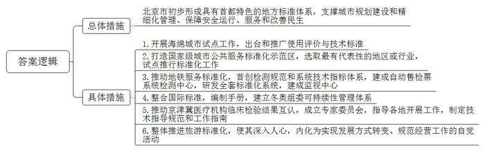
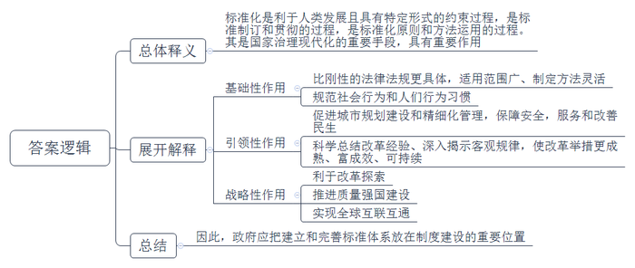
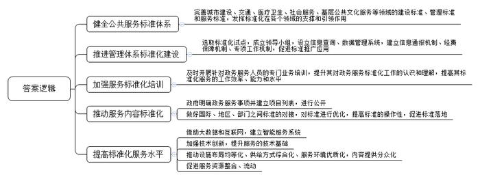
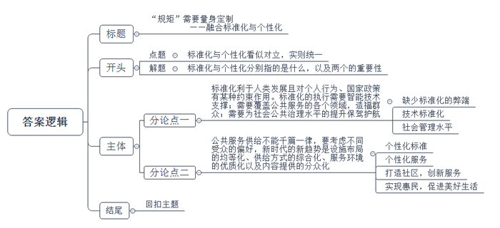

# 2020年北京市公考《申论》题（区级）

<!-- gwy:overview:start -->
> **北京 · 2020 · 申论 · 区级** ｜ 4 题 · 图片 4 处 · 答案随题折叠

导航：[题目](#题目)
<!-- gwy:overview:end -->

> 候选采集稿。参考答案及解析来自粉笔页面，不代表官方答案或真实高分答卷；来源使用许可与原卷对应关系仍需人工核实。

## 给定材料

### 材料 material-a5c79f8b2440c34a

截至目前，北京市已累计发布地方标准1750项，其中京津冀区域协同标准50项，初步形成了具有首都特色的地方标准体系。全市累计投入自主创新技术标准制修订补助资金1.5亿元，推动企业作为主体，积极主导或参与技术标准创制。围绕新兴产业，在大数据、云计算、物联网、新能源汽车等重点领域，形成了一批国际标准，为全球互联互通作出贡献。

2019年前三季度，北京市已累计发布地方标准123项，为支撑首都城市规划建设和精细化管理、保障安全运行、服务和改善民生发挥了重要作用。其中为坚决打好污染防治攻坚战，发布《电子工业大气污染物排放标准》《加油站油气排放控制和限值》等地方标准，污染物排放控制要求国内最严格，达到国际先进水平。组织开展了一批重点领域标准专项工程，其中《大型公共建筑制冷能耗限额》《数据中心能效监测与评价技术导则》等节能低碳和循环经济专项标准为推进绿色低碳发展、实现可持续发展提供技术支撑。《居家养老服务规范》《食品冷链宅配服务规范》《京津冀旅游直通车服务规范》等服务标准，有力促进了服务业提质增效，增强百姓获得感。

标准化在首都经济社会发展中的作用越来越凸显。某专家指出，要发挥好标准化在推进国家治理体系和治理能力现代化建设中的基础性、引领性、战略性作用，以首善标准加快首都转型发展，全力推进质量强国首善之区建设。

### 材料 material-17fd838a169031f2

生活中，同一种类的电池可以在不同产品上使用，既可以用在电视遥控器上，也可以用在闹钟或手电筒上。按照既定的大小和形状生产出来的电池，不管是哪个厂家生产的都能使用，从而确保了同一种类的电池具有互换性。这种能够互换的特性就是标准化。

在我国，标准和标准化的历史源远流长。孟子说“不以规矩，无以成方圆”，是古代标准化的经典表述。《史记》记载大禹治水“左准绳、右规矩”，都体现了标准规范一致的属性。秦始皇统一度量衡，并实现“车同轨、书同文、行同伦”，是历史上以标准化手段治理国家的范例。到了近代，标准化在工业生产领域得到了广泛应用，在工业生产的操作和工作方法、工时定额、培训方法、工资等方面实行了标准化。

随着社会的发展，标准化领域不断扩大，不仅限于生产技术领域，而且延伸到服务领域，渗透到社会的各个方面。无论是生产与服务，还是具体工作和管理工作，建立社会各方面的最佳秩序，都需要符合客观需要和用可能的章程加以约束，以期达到人们预期的目的。这种有利于人类发展的，具有某种特定形式的约束就是标准，这种约束过程就是标准化。具体来说，标准是以科学、技术和实践经验的综合成果为基础的，“是对重复性事物和概念所做的统一规定”，是需要共同遵守的准则和依据。标准需要各方面协商并取得一致，由主管机构批准，以特定的形式发布。而标准化则是标准的制订和贯彻的过程，以及标准化原则和方法运用的过程。

## 题目

### 第 1 题

**根据给定材料**3**\-**9**，概括近年来北京市在标准化建设方面开展了哪些工作。（20分）**

关联材料：材料 material-a5c79f8b2440c34a

作答要求：

要求：准确全面，语言简练，不超过300字。

第 1 题 · 答案与解析

**参考答案（粉笔题库参考内容）**

北京市初步形成具有首都特色的地方标准体系，支撑城市规划建设和精细化管理、保障安全运行、服务和改善民生。

1.开展海绵城市试点工作，出台和推广使用评价与技术标准。

2.打造国家级城市公共服务标准化示范区，选取最有代表性的地区或行业，试点推行标准化工作。

3.推动地铁服务标准化，首创检测规范和系统技术指标体系，建成自动售检票系统检测中心，研发全套标准化系统，建成监视中心。

4.整合国际标准，编制手册，建立冬奥组委可持续性管理体系。

5.推动京津冀医疗机构临床检验结果互认，成立专家委员会，指导各地开展工作，制定技术指导规范和工作指南。

6.整体推进旅游标准化，使其深入人心，内化为实现发展方式转变、规范经营工作的自觉活动。

**解析**

**参考答案说明：**本参考答案采用“总-分”的逻辑结构。先介绍了北京市标准化建设的总体措施，然后再分别从“海绵城市试点工作”“国家级城市公共服务标准化示范区”“地铁服务标准化”“整合国际标准”“京津冀医疗机构临床检验结果互认”和“旅游标准化”六个方面，对具体措施内容进行了分条撰写。各条要点之间在内容上是并列关系，没有交叉。

**考点**：考点概括措施类

**来源**：来源2020年北京市公考《申论》题（区级）

粉笔申论页面对本题只提供「解析视频」入口，该入口是会员推广位，页面无视频地址与文字解析。

### 第 2 题

**结合给定材料，请谈谈对给定材料**3**中画线部分的理解。（15分）**

关联材料：材料 material-17fd838a169031f2

作答要求：

要求：观点明确，分析合理，不超过250字。

第 2 题 · 答案与解析

**参考答案（粉笔题库参考内容）**

标准化是利于人类发展且具有特定形式的约束过程，是标准制订和贯彻的过程，是标准化原则和方法运用的过程。其是国家治理现代化的重要手段，具有重要作用：

1.基础性作用：比刚性的法律法规更具体，适用范围广、制定方法灵活；规范社会行为和人们行为习惯。2.引领性作用：促进城市规划建设和精细化管理，保障安全，服务和改善民生；科学总结改革经验、深入揭示客观规律，使改革举措更成熟、富成效、可持续。3.战略性作用：利于改革探索；推进质量强国建设；实现全球互联互通。因此，政府应把建立和完善标准体系放在制度建设的重要位置。

**解析**

**参考答案说明：**思路方面，本参考答案按照词句解释题“总体释义+展开解释+总结”的一般答题思路展开。内容方面，本参考答案先对画线句子“标准化在推进国家治理中的作用”的含义进行了解释；“展开解释”部分先分析了基础性作用，接着分析了引领性作用，而后分析了战略性作用；最后进行了总结。词句表达方面，本答案加上了“因此”等连接词来承接上下文。

**考点**：考点词句解释类

**来源**：来源2020年北京市公考《申论》题（区级）

粉笔申论页面对本题只提供「解析视频」入口，该入口是会员推广位，页面无视频地址与文字解析。

### 第 3 题

**结合给定材料，请从政府部门的角度，就标准化工作如何助推****公共服务质量****的提升提出对策建议。（25分）**

关联材料：材料 material-17fd838a169031f2

作答要求：

要求：建议合理可行，针对性强，条理清晰，语言简练，不超过400字。

第 3 题 · 答案与解析

**参考答案（粉笔题库参考内容）**

1.健全公共服务标准体系。完善城市建设、交通、医疗卫生、社会服务、基层公共文化服务等领域的建设标准、管理标准和服务标准，发挥标准化在各个领域的支撑和引领作用。

2.推进管理体系标准化建设。选取标准化试点，成立领导小组，设立信息查询、数据管理系统，建立信息通报机制、经费保障机制、专项工作机制，促进标准推广应用。

3.加强服务标准化培训。及时开展针对政务服务人员的专门业务培训，提升其对政务服务标准化工作的认识和理解，提高其标准化服务的工作效率、能力和水平。

4.推动服务内容标准化。政府明确政务服务事项并建立项目列表，进行公开；做好国际、地区、部门之间标准的对接，对标准进行优化，提高标准的操作性，促进标准落地。

5.提高标准化服务水平。借助大数据和互联网，建立智能服务系统；加强技术创新，提升服务的技术基础；推动设施布局均等化、供给方式综合化、服务环境优质化，内容提供分众化；促进服务资源整合、流动。

**解析**

**参考答案说明：**答案从“健全公共服务标准体系”“推进管理体系标准化建设”“加强服务标准化培训”“推动服务内容标准化”“提高标准化服务水平”等不同的对策进行了分条撰写。各条要点之间在内容上是并列关系，无交叉。

**考点**：考点提出对策类

**来源**：来源2020年北京市公考《申论》题（区级）

粉笔申论页面对本题只提供「解析视频」入口，该入口是会员推广位，页面无视频地址与文字解析。

### 第 4 题

**结合给定材料，围绕****“标准化与个性化”这一主题，自拟题目，写一篇文章。（40分）**

关联材料：材料 material-17fd838a169031f2

作答要求：

要求：联系实际，观点鲜明、正确，分析深入、合理，语言流畅，字数控制在800-1000字。

第 4 题 · 答案与解析

**参考答案（粉笔题库参考内容）**

**“规矩”需要量身定制**

**——融合标准化与个性化**

开放多变的时代、姿态万千的社会，我们的祖先却用标准化、规范化、原则性“衡量”出了五千年的文明。**标准化与个性化看似对立，实则统一。**当今社会的发展，需要“标准”的约束、制约、管理；也需要“个性”的绚丽、多姿、丰富。融合两者，才能拥有无限可能的未来，实现持续的发展。

所谓“标准化”就是规范，是“不以规矩，无以成方圆”中的“规矩”，是“车同轨、书同文、行同伦”中的“同”；“个性化”就是不同，是多元性，是差异性，是可以满足群众不同诉求的。

**标准化利于人类发展且对个人行为、国家政策有某种约束作用。标准化的执行需要智能技术支撑；需要覆盖公共服务的各个领域，造福群众；需要为社会公共治理水平的提升保驾护航。**标准多等于无标准，某省的咖啡产品生产技术认证标准不成体系，各个企业处于“八仙过海，各显神通”的境地，形成技术性壁垒，阻碍发展。依托技术，通过标准化投料、配方，保证食材品质，把“舌尖上的中国”装到盒子里，送到全世界；利用技术，标准化延伸到餐饮、旅游、医疗等公共服务的各领域，医卡通的便利，智慧交通的链接，规范的“银发族”旅游服务等，让老百姓有了深深的幸福感、体验感。同时，社会管理水平的提升是标准化的体现，它让世界看到的中国，不单单是“和谐中平稳发展”，还是“有序中体现责任”，更是“服务中展现专业”。

在科技日新月异、矛盾复杂多样的当今，建设让群众放心、百姓满意的政府，标准化的流程必不可少，但无法满足群众多样化、差异化的需求。因此，**公共服务既要有标准化，也要兼顾个性化**。

**公共服务****供给不能千篇一律，要考虑不同受众的偏好，新时代的新趋势是设施布局的均等化、供给方式的综合化、服务环境的优质化以及内容提供的分众化。**个性化是在标准化的基础上，为服务群体“量体裁衣”，满足群众吃住用行的“最后一公里”。在大数据等先进技术的精准控制下，为衣服的每道工序添加“身份证”，满足你对西装的所有幻想；在具有场地、音响等标配的文化广场，根据人们不同的需求，个性化设置开放时间等场馆资源。同理，以老年人居住为主的老旧社区改造，丰富娱乐生活是关键；以年轻人居住为主的新社区，在建设中增设咖啡馆、电影院是创新需求。只有这样，才能实现真正惠民，为人民的美好生活添彩加色。

标准化是发展的基础，个性化是持续进步的保障，兼顾两者，才能在中国历史上留下创造性的一笔，才能为中国文明的发展保驾护航。

**解析**

**文章分析**

**“规矩”需要量身定制**

**——融合标准化与个性化**

【**标题的优点：**内容上，范文的标题“‘规矩’需要量身定制——融合标准化与个性化”突出了“标准”“个性”等主题词，同时，副标题对主标题作了具体解释，即要统筹兼顾、融合发展标准化与个性化。形式上，采用了主副搭配的结构，使文章主题、角度都很清晰。】

（1）开放多变的时代、姿态万千的社会，我们的祖先却用标准化、规范化、原则性“衡量”出了五千年的文明。**标准化与个性化看似对立，实则统一。**（2）当今社会的发展，需要“标准”的约束、制约、管理；也需要“个性”的绚丽、多姿、丰富。（3）融合两者，才能拥有无限可能的未来，实现持续的发展。

【**开头的优点：**★内容方面。范文的开头是紧扣题目给定的“标准化与个性化”这一主题展开的。首先，开头开门见山点出主题，做到了主题明确。其次，对“标准化与个性化”这一主题进行了分析阐述，指出了（1）当前社会时代背景；（2）标准化、个性化对社会发展的重要性；（3）标准化与个性化融合的意义。★文字表达方面。长短句配合使用，使语言表达更加丰富、带有节奏感。】

（1）所谓“标准化”就是规范，是“不以规矩，无以成方圆”中的“规矩”，是“车同轨、书同文、行同伦”中的“同”；（2）“个性化”就是不同，是多元性，是差异性，是可以满足群众不同诉求的。

【**过渡段的优点：**范文过渡段分别介绍了什么是“标准化与个性化”，阐释了（1）标准化的内涵；（2）个性化的内涵。】

**标准化利于人类发展且对个人行为、国家政策有某种约束作用。标准化的执行需要智能技术支撑；需要覆盖公共服务的各个领域，造福群众；需要为社会公共治理水平的提升保驾护航。**标准多等于无标准，（1）某省的咖啡产品生产技术认证标准不成体系，各个企业处于“八仙过海，各显神通”的境地，形成技术性壁垒，阻碍发展。（2）依托技术，通过标准化投料、配方，保证食材品质，把“舌尖上的中国”装到盒子里，送到全世界；（3）利用技术，标准化延伸到餐饮、旅游、医疗等公共服务的各领域，医卡通的便利，智慧交通的链接，规范的“银发族”旅游服务等，让老百姓有了深深的幸福感、体验感。同时，（4）社会管理水平的提升是标准化的体现，它让世界看到的中国，不单单是“和谐中平稳发展”，还是“有序中体现责任”，更是“服务中展现专业”。

【**论述段****1****的优点：**★观点句：范文的观点句是紧扣“标准化与个性化”这一文章主题提出的。形式上，它在段首处直接写出，位置突出，容易发现。内容上，关键词突出，可以明显看出它是从“有利发展、约束、技术、服务、社会治理”入手，指出了标准化的作用及如何做到标准化。★论述内容：（1）以咖啡产业为例，介绍了缺少标准化的弊端；（2）以“舌尖上的中国”为例，介绍了向全世界传递中国的技术标准化；（3）介绍了利用技术，拓宽标准化应用领域，造福百姓；（4）介绍了标准化对社会管理水平提升的意义。注意：以上几个方面的内容都是紧扣“标准化利于人类发展且对个人行为、国家政策有某种约束作用。标准化的执行需要智能技术支撑；需要覆盖公共服务的各个领域，造福群众；需要为社会公共治理水平的提升保驾护航”这个观点句进行分析论述的，论述的针对性强，内容层次丰富。最后，在论述方法和论据的选取上做到了讲道理、举例子相结合，做到了丰富多样。】

在科技日新月异、矛盾复杂多样的当今，建设让群众放心、百姓满意的政府，标准化的流程必不可少，但无法满足群众多样化、差异化的需求。因此，公共服务既要有标准化，也要兼顾个性化。

【**过渡段的优点：**范文过渡段指出了“标准化与个性化”二者之间的关系，阐释了标准化的作用和缺点，此外，还要注意过渡段末尾的“公共服务既要有标准化，也要兼顾个性化”是用来引起下文的过渡句。】

**公共服务****供给不能千篇一律，要考虑不同受众的偏好，新时代的新趋势是设施布局的均等化、供给方式的综合化、服务环境的优质化以及内容提供的分众化。**（1）个性化是在标准化的基础上，为服务群体“量体裁衣”，满足群众吃住用行的“最后一公里”。（2）在大数据等先进技术的精准控制下，为衣服的每道工序添加“身份证”，满足你对西装的所有幻想；在具有场地、音响等标配的文化广场，（3）根据人们不同的需求，个性化设置开放时间等场馆资源。同理，（4）以老年人居住为主的老旧社区改造，丰富娱乐生活是关键；以年轻人居住为主的新社区，在建设中增设咖啡馆、电影院是创新需求。只有这样，才能（5）实现真正惠民，为人民的美好生活添彩加色。

【**论述段****2****的优点：**★观点句：范文的观点句是紧扣“标准化与个性化”这一文章主题提出的。形式上，它在段首处直接写出，位置突出，容易发现。内容上，关键词突出，可以明显看出它是从“统筹兼顾、融合统一”入手，指出了如何处理标准化和个性化之间的关系。★论述内容：（1）介绍了个性化的积极作用；（2）以西装定制为例，介绍了个性化服务可以精准把握；（3）以文化广场为例，介绍了个性化服务可以提高资源使用效率；（4）介绍了如何打造不同年龄段人群的生活社区；（5）介绍了兼顾标准化与个性化的意义。注意：以上几个方面的内容都是紧扣“公共服务供给不能千篇一律，要考虑不同受众的偏好，新时代的新趋势是设施布局的均等化、供给方式的综合化、服务环境的优质化以及内容提供的分众化”这个观点句进行分析论述的，论述的针对性强，内容层次丰富。最后，在论述方法和论据的选取上做到了讲道理、举例子相结合，做到了丰富多样。】

【**论述段之间的关系：**★内容的内在逻辑：范文的论述段之间是依照“并列”的逻辑展开的。论述段1写了“标准化利于人类发展且对个人行为、国家政策有某种约束作用。标准化的执行需要智能技术支撑；需要覆盖公共服务的各个领域，造福群众；需要为社会公共治理水平的提升保驾护航”，论述段2写了“公共服务供给不能千篇一律，要考虑不同受众的偏好，新时代的新趋势是设施布局的均等化、供给方式的综合化、服务环境的优质化以及内容提供的分众化”。】

（1）标准化是发展的基础，个性化是持续进步的保障，兼顾两者，（2）才能在中国历史上留下创造性的一笔，才能为中国文明的发展保驾护航。

【**结尾的优点：**范文的结尾回扣了“标准化与个性化”这一主题。（1）再次提到“标准化”“个性化”等主题词及其同义词；（2）阐述了二者兼顾发展的意义。】

**考点**：考点文章写作题

**来源**：来源2020年北京市公考《申论》题（区级）

粉笔申论页面对本题只提供「解析视频」入口，该入口是会员推广位，页面无视频地址与文字解析。

