# 2020年北京市公务员录用考试《行测》题（乡镇卷）（网友回忆版）

<!-- gwy:overview:start -->
> **北京 · 2020 · 行测 · 乡镇卷** ｜ 130 题 · 图片 153 处 · 答案随题折叠

| 题型模块 | 题量 | 题号 |
| --- | ---: | ---: |
| 常识判断 | 35 | 1–35 |
| 言语理解与表达 | 35 | 36–70 |
| 数量关系 | 10 | 71–80 |
| 判断推理 | 30 | 81–110 |
| 资料分析 | 20 | 111–130 |
| **合计** | **130** | |

导航：[题型与作答说明](#题型与作答说明) · [题目](#题目) · [材料 1](#材料-1)
<!-- gwy:overview:end -->

> 候选采集稿。参考答案及解析来自粉笔页面，不代表官方答案或真实高分答卷；来源使用许可与原卷对应关系仍需人工核实。

## 题型与作答说明

常识判断

（35题）

本部分包含两种类型的题目，请根据题目要求做出正确选择，多选题错选、多选、少选均不得分，也不扣分。

言语理解与表达

（35题）

本部分包括表达与理解两方面的内容。请根据题目要求，在四个选项中选出一个最恰当的答案。

数量关系

（10题）

在这部分试题中，每道题呈现一段表述数字关系的文字，要求你迅速、准确地计算出答案。

判断推理

（30题）

本部分包括图形推理、定义判断、与演绎推理三种类型的试题。

资料分析

（20题）

所给出的图、表、文字或综合性资料具有若干问题要你回答。你应根据资料提供的信息进行分析、比较、计算和判断处理。

## 题目

### 第 1 题

党的十九大提出了新时代党的建设总要求。下列关于新时代党的建设总要求的说法中，正确的有

①党的建设以党的政治建设为统领

②党的建设要坚持党要管党，全面从严治党

③党的建设以调动全党的积极性、纪律性、创造性为主线

④要把党建设成为始终走在时代前列、人民衷心拥护、勇于自我革命、经得起各种风浪考验、朝气蓬勃的马克思主义执政党

A. ①②③

B. ①③④

C. ①②④

D. ②③④

第 1 题 · 答案与解析

**参考答案（粉笔题库参考内容）**

C

**解析**

本题考查政治常识。

党的十九大报告提出：“新时代党的建设总要求是：坚持和加强党的全面领导，坚持党要管党、全面从严治党，以加强党的长期执政能力建设、先进性和纯洁性建设为主线，以党的政治建设为统领，以坚定理想信念宗旨为根基，以调动全党积极性、主动性、创造性为着力点，全面推进党的政治建设、思想建设、组织建设、作风建设、纪律建设，把制度建设贯穿其中，深入推进反腐败斗争，不断提高党的建设质量，把党建设成为始终走在时代前列、人民衷心拥护、勇于自我革命、经得起各种风浪考验、朝气蓬勃的马克思主义执政党。”

①②④正确；③错误，党的建设以加强党的长期执政能力建设、先进性和纯洁性建设为主线，并非以调动全党的积极性、纪律性、创造性为主线。

故正确答案为C。

### 第 2 题

2019年2月18日北京市召开街道工作会议，提出要加强新时代街道工作。下列有关街道工作的说法中，正确的有：

①街道在超大城市基层治理体系中发挥着不可替代的中枢作用

②街道社区党组织在基层治理中处于领导地位，基层党建引领基层治理创新

③街道对辖区党的建设、公共服务、城市管理、社会治理四个方面行使综合管理职能

④街道内设机构要分领域精细化设置，从为民服务型向行政管理型街道转变

A. ②③④

B. ①②④

C. ①③④

D. ①②③

第 2 题 · 答案与解析

**参考答案（粉笔题库参考内容）**

D

**解析**

本题考查政治常识。

2019年2月23日，北京市委、市政府正式印发《关于加强新时代街道工作的意见》，以下简称《意见》。

①正确，《意见》指出：“街道是城市管理和社会治理的基础，是巩固基层政权、落实党和国家路线方针政策的依托，是联系和服务群众的纽带，在超大城市基层治理体系中发挥着不可替代的中枢作用。”

②正确，《意见》指出：“以基层党建引领基层治理创新，强化街道社区党组织在基层治理中的领导地位，充分发挥总揽全局、协调各方、服务群众的战斗堡垒作用，夯实党的执政基础。”

③正确，《意见》指出：“街道党工委、办事处依据法律、法规、规章和上级党委、政府的授权，代表区委区政府对辖区党的建设、公共服务、城市管理、社会治理等行使综合管理职能，全面负责辖区地区性、社会性、群众性工作的统筹协调。”

④错误，《意见》指出：“深化街道机构综合设置改革。坚持精简、效能、便民的原则，整合相近职能，按照综合化、扁平化方向，街道一般设置党群工作、民生保障、城市管理、平安建设、社区建设、综合保障等6个内设机构和1个街道综合执法队。编制规模较小的街道可进一步综合设置。”故街道内设机构不是精细化设置，而且现在提倡的是由行政管理型向为民服务型街道转变。

故①②③正确，④错误。

故正确答案为D。

### 第 3 题

2019年是推动京津冀协同发展的重要一年，下列关于京津冀协同发展的说法中，不正确的是

A. 建设雄安新区是千年大计

B. 京津冀协同发展目前处于谋思路、打基础、寻突破的阶段

C. 积极稳妥有序疏解北京非首都功能是京津冀协同发展战略首要的任务

D. 京津冀协同发展在交通、生态、产业等重点领域实现了率先突破

第 3 题 · 答案与解析

**参考答案（粉笔题库参考内容）**

B

**解析**

本题考查政治。

A项正确，2019年1月16日至18日，习近平总书记在京津冀三省市考察，主持召开京津冀协同发展座谈会并发表重要讲话。他强调，建设雄安新区是千年大计。新区首先就要新在规划、建设的理念上，要体现出前瞻性、引领性。要全面贯彻新发展理念，坚持高质量发展要求，努力创造新时代高质量发展的标杆。

B项错误，2019年1月18日，习近平总书记在京津冀三省市考察并主持召开京津冀协同发展座谈会上指出：“过去的5年，京津冀协同发展总体上处于谋思路、打基础、寻突破的阶段，当前和今后一个时期进入到滚石上山、爬坡过坎、攻坚克难的关键阶段，需要下更大气力推进工作。”

C项正确，2019年1月16日至18日，习近平总书记在京津冀三省市考察，主持召开京津冀协同发展座谈会并发表重要讲话。他对推动京津冀协同发展提出了6个方面的要求。其中，第一条要求紧紧抓住“牛鼻子”不放松，积极稳妥有序疏解北京非首都功能。即稳妥有序疏解北京非首都功能是京津冀协同发展战略首要的、也是最核心的任务。

D项正确，2019年1月11日，国务院新闻办举行新闻发布会，京津冀协同发展领导小组办公室副主任、国家发展改革委副主任林念修介绍河北雄安新区和北京城市副中心规划建设有关情况。他指出：“到目前为止，雄安新区和北京城市副中心规划建设正在高标准、高质量推进，北京非首都功能疏解正在积极稳妥开展。交通、生态、产业等重点领域也实现了率先突破。”

本题为选非题，故正确答案为B。

### 第 4 题

农村承包地“三权”分置是继家庭联产承包责任制后农村改革又一重大制度创新，是农村基本经营制度的自我完善。“三权”分置的重点是放活

A. 所有权

B. 承包权

C. 经营权

D. 收益权

第 4 题 · 答案与解析

**参考答案（粉笔题库参考内容）**

C

**解析**

本题考查政治。

《关于完善农村土地所有权承包权经营权分置办法的意见》，明确指出“三权分置”是继家庭联产承包责任制后农村改革又一重大制度创新。“三权分置”是指形成所有权、承包权、经营权三权分置，经营权流转的格局。在该制度下，所有权、承包权和经营权既存在整体效用，又有各自功能。从当前实际出发，实施“三权分置”的重点是放活经营权，核心要义就是明晰赋予经营权应有的法律地位和权能。

故正确答案为C。

### 第 5 题

根据国家《“十三五”脱贫攻坚规划》，到2020年稳定实现现行标准下农村贫困人口“两不愁、三保障”。“两不愁、三保障”具体是指

A. 不愁吃、不愁穿，义务教育、基本医疗和住房安全有保障

B. 不愁吃、不愁花，义务教育、基本医疗和住房安全有保障

C. 不愁吃、不愁穿，义务教育、基本医疗和就业有保障

D. 不愁吃、不愁住，义务教育、基本医疗和就业有保障

第 5 题 · 答案与解析

**参考答案（粉笔题库参考内容）**

A

**解析**

本题考查政治常识。

2016年11月23日，国务院公开发布了《“十三五”脱贫攻坚规划》。《规划》提出：“到2020年，稳定实现现行标准下农村贫困人口不愁吃、不愁穿，义务教育、基本医疗和住房安全有保障（以下称‘两不愁、三保障’）。”

故正确答案为A。

### 第 6 题

2019年5月31日，习近平总书记在“不忘初心、牢记使命”主题教育工作会议上发表重要讲话指出，要坚持思想建党、理论强党，坚持学思用贯通、知信行统一，推动广大党员干部筑牢信仰之基、补足精神之钙、把稳思想之舵。这段话体现的哲学原理是

①社会存在决定社会意识

②精神对物质、社会意识对社会存在具有反作用

③矛盾无时无处不在，具有普遍性和客观性

④先进的社会意识对社会发展起推动作用

A. ①④

B. ②③

C. ①③

D. ②④

第 6 题 · 答案与解析

**参考答案（粉笔题库参考内容）**

D

**解析**

本题考查政治常识。

①错误，社会存在决定社会意识，社会意识是社会存在的反映，社会存在的性质和变化决定社会意识的性质和变化。题干并未体现。

②④正确，精神（意识）对物质具有反作用，社会意识具有相对独立性，社会意识反映社会存在并对社会存在起促进或阻碍的作用，先进的社会意识对社会发展起推动作用。习近平总书记这句话的意思是广大党员干部要以党的理论武装头脑，学习并树立先进的社会意识，发挥主观能动性，利用意识对物质的反作用，才能更好地认识世界、改造世界，才能更好地服务群众。

③错误，矛盾指事物自身所包含的既相互排斥又相互吸引、既对立又统一的趋势、倾向和方面。矛盾是客观事物所固有的，具有客观性、普遍性。题干并未体现。

故正确答案为D。

### 第 7 题

明代名臣于谦曾写下《石灰吟》：“千锤万凿出深山，烈火焚烧若等闲。粉骨碎身浑不怕，要留清白在人间”。诗中“烈火焚烧若等闲”描写的是：

A. 生石灰变成熟石灰的过程

B. 利用石灰石生产生石灰的过程

C. 石灰浆固化的过程

D. 熟石灰改良酸性土壤的过程

第 7 题 · 答案与解析

**参考答案（粉笔题库参考内容）**

B

**解析**

本题考查科技常识。

首句“千锤万凿出深山”描写的是石灰石的开采，石灰石的主要成分为碳酸钙，碳酸钙经过高温煅烧，会生成氧化钙和二氧化碳，反应式：。生成的氧化钙就是我们通常所讲的生石灰。

A项错误，生石灰的主要成分为氧化钙，熟石灰的主要成分为氢氧化钙。生石灰与水反应变成熟石灰，反应式：。该反应会放出大量的热，不需要烈火焚烧。

B项正确，“烈火焚烧若等闲”描写的就是石灰石（碳酸钙）经过烈火焚烧（高温煅烧）生成生石灰（氧化钙）和二氧化碳这个反应过程，即利用石灰石生产生石灰的过程。

C项错误，石灰浆的固化是在干燥、结晶、碳酸化等几个作用下共同进行的，不需要烈火焚烧。

D项错误，熟石灰呈弱碱性，可以与土壤中的酸性物质发生中和反应，从而改良酸性土壤，不需要进行烈火焚烧。

故正确答案为B。

### 第 8 题

绿色食品是我国对无污染、安全的、优质的、营养类食品的总称。下列标志属于我国绿色食品标志的是

A. 

B. 

C. 

D. 

第 8 题 · 答案与解析

**参考答案（粉笔题库参考内容）**

A

**解析**

本题考查人文常识。

A项正确，是绿色食品标志。

B项错误，是无公害农产品标志。

C项错误，是质量安全标志。

D项错误，是可回收物标志。

故正确答案为A。

### 第 9 题

“修身齐家治国平天下”体现以下哪一学派的人生理想和志趣？

A. 道家

B. 法家

C. 墨家

D. 儒家

第 9 题 · 答案与解析

**参考答案（粉笔题库参考内容）**

D

**解析**

本题考查科技人文常识。“修身齐家治国平天下”出自《礼记·大学》。修身就是完善自己，使行为有规范；齐家就是管理好一个家族，成为宗族的楷模、效仿学习的样板；治国就是治理好一个小小的诸侯国，这里的国不是我们现代意义的国家，古代的诸侯国是要对周王室负责，也就是我们平时所说的“邦”；平天下就是安抚天下黎民百姓，使他们能够丰衣足食、安居乐业，而不是用武力平定天下。“平天下”是儒家的终极目标，即达到一种在等级秩序基础上的平等和公平。

法家思想强调以法治国、法术势相结合，墨家思想强调兼爱、非攻、尚贤，道家思想强调无为而治、齐物论。

故正确答案为D。

### 第 10 题

下列选项中，与王国维在《人间词话》中谈到治学三境界时引用的“衣带渐宽终不悔，为伊消得人憔悴”内涵最相近的是

A. 海内存知己，天涯若比邻

B. 宝剑锋从磨砺出，梅花香自苦寒来

C. 会当凌绝顶，一览众山小

D. 劝君更尽一杯酒，西出阳关无故人

第 10 题 · 答案与解析

**参考答案（粉笔题库参考内容）**

B

**解析**

本题考查人文常识。“衣带渐宽终不悔，为伊消得人憔悴”字面意思是沉溺于热恋中的情人对爱情的执着，人消瘦了，但决不后悔，就如学者在追求知识的过程中所表现出一种认定了目标就呕心沥血、孜孜以求的执着精神。

A项错误，诗句出自唐代诗人王勃的作品《送杜少府之任蜀州》，是送别诗的名作，此诗意在慰勉友人勿在离别之时悲哀。

B项正确，此句字面意思是说宝剑的锐利刃锋是从不断地磨砺中得到的，挨过寒冷冬季的梅花更加的幽香，喻义要想拥有珍贵品质或美好才华等是需要不断的努力、修炼、克服一定的困难才能达到的。

C项错误，出自杜甫的名篇《望岳》，诗句意为当人登上泰山的顶峰，俯瞰那众山，而众山就会显得极为渺小。表达了诗人敢攀顶峰、俯视一切的雄心和气概。

D项错误，出自唐代诗人王维的《送元二使安西》，是一首送朋友去西北边疆的诗。表达依依惜别的情谊，而且包含着对远行者处境、心情的深情体贴，包含着前路珍重的殷勤祝愿。

故正确答案为B。

### 第 11 题

根据《中华人民共和国行政诉讼法》，下列诉讼事项中，人民法院不予受理的是：

A. 对公安机关作出的行政拘留的决定不服

B. 认为行政机关违法摊派费用

C. 对行政机关作出的有关行政许可的决定不服

D. 对行政机关作出的有关工作人员奖惩的决定不服

第 11 题 · 答案与解析

**参考答案（粉笔题库参考内容）**

D

**解析**

本题考查法律常识。

根据《行政诉讼法》第十二条第一款规定：“人民法院受理公民、法人或者其他组织提起的下列诉讼：(一)对行政拘留、暂扣或者吊销许可证和执照、责令停产停业、没收违法所得、没收非法财物、罚款、警告等行政处罚不服的；(二)对限制人身自由或者对财产的查封、扣押、冻结等行政强制措施和行政强制执行不服的；(三)申请行政许可，行政机关拒绝或者在法定期限内不予答复，或者对行政机关作出的有关行政许可的其他决定不服的；……(九)认为行政机关违法集资、摊派费用或者违法要求履行其他义务的；……”

A项正确，符合上述第（一）项的情形，人民法院应当受理。

B项正确，符合上述第（九）项的情形，人民法院应当受理。

C项正确，符合上述第（三）项的情形，人民法院应当受理。

D项错误，根据《行政诉讼法》第十三条规定：“人民法院不受理公民、法人或者其他组织对下列事项提起的诉讼：(一)国防、外交等国家行为；(二)行政法规、规章或者行政机关制定、发布的具有普遍约束力的决定、命令；(三)行政机关对行政机关工作人员的奖惩、任免等决定；(四)法律规定由行政机关最终裁决的行政行为。”故对行政机关作出的有关工作人员奖惩的决定不服的，不能提起行政诉讼。

本题为选非题，故正确答案为D。

### 第 12 题

贾某经相亲与李某确立恋爱关系，贾某按照习俗给李某家送了彩礼。办理结婚登记手续后，开始准备婚礼。之后因贾某与李某感情破裂，办理了离婚登记手续，贾某要求李某返还彩礼，以下哪个理由可以得到法律支持？

A. 彩礼金额远远超过当地平均水平

B. 两人还未开始共同生活

C. 贾某家当前因发生变故生活困难

D. 两人还未举行婚礼

第 12 题 · 答案与解析

**参考答案（粉笔题库参考内容）**

B

**解析**

本题考查法律常识。

《最高人民法院关于适用<中华人民共和国民法典>婚姻家庭编的解释（一）》第五条规定：“当事人请求返还按照习俗给付的彩礼的，如果查明属于以下情形，人民法院应当予以支持：（一）双方未办理结婚登记手续；（二）双方办理结婚登记手续但确未共同生活；（三）婚前给付并导致给付人生活困难。适用前款第二项、第三项的规定，应当以双方离婚为条件。”

A项错误，彩礼金额超过了当地平均水平并非是法院支持退还彩礼的情形。

B项正确，贾某与李某办理了婚姻登记手续，但两人还未开始共同生活的，可以得到法院的支持。

C项错误，夫妻双方离婚，婚前给付彩礼并导致给付人生活困难的，是法院支持退还彩礼的情形。贾某家是在离婚后因变故导致生活困难，并非是因给付彩礼导致生活困难，不可以得到法院的支持。

D项错误，两人未举行婚礼不是法院支持退还彩礼的情形。

故正确答案为B。

### 第 13 题

在浮力应用的过程中，下列有关说法正确的是

A. 潜水艇——通过改变排水的多少来实现下沉和上浮

B. 热气球——在上升过程中球囊内的气体密度小于外界空气密度

C. 轮船——在风力更大的江面上吃水会变深

D. 密度计——测量不同密度的液体时所受到的浮力不同

第 13 题 · 答案与解析

**参考答案（粉笔题库参考内容）**

B

**解析**

本题考查科技常识。

A项错误，潜水艇外形、体积固定，因此排水量一定，潜入海中所受海水浮力也一定，故只有改变自身重量才能控制下沉和浮起。下沉时潜水艇打开压舱入水口，海水进入潜艇内部的水舱，使艇重超过浮力而下沉；需浮起时潜艇应用内部贮备的压缩空气，将水舱内的海水排出艇外，此时，艇重小于浮力而向上浮起。

B项正确，微观来讲，气体受热之后分子之间的距离变大，导致体积变大、密度变小。热气球就是利用这一原理，喷火装置启动后，将热气球气囊中的空气加热，空气受热膨胀，密度变小，热气球所受大气浮力为气囊所排开的空气重力，即，大于气囊内空气重力。随着加热的进行，气囊内部空气密度进一步减小，当大气浮力大于气囊内空气重力和热气球附属设备重力之和时，热气球便缓缓上升。

C项错误，根据伯努利效应，流体的速度越大，压力越小，这时候整体的大气压力减小了，因此轮船会获得一个向上的升力，而自身重力不变的情况下，需要水的浮力会变小，吃水变浅。风力越大，吃水越浅。

D项错误，密度计是根据阿基米德原理和物体浮在液面上平衡的条件制成的。它是一根密闭的玻璃管，上部粗细均匀，内壁贴有刻度纸，下部较粗，下端装有铅丸或水银，使玻璃管能竖直浮在液面上。测量液体密度时，密度计漂浮在液体中达到二力平衡，自身重力与所受浮力方向相反、大小相同，由于密度计自身重力始终不变，所以测量不同密度的液体时所受到的浮力也不变。

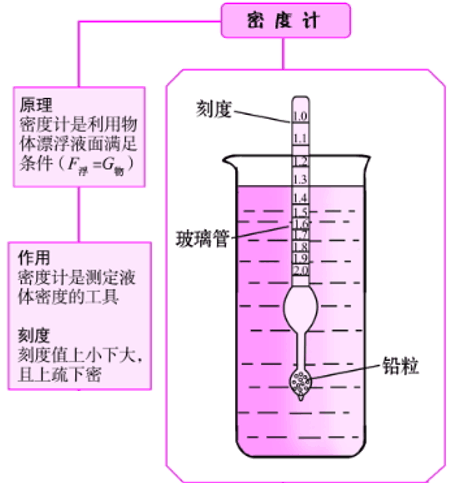

故正确答案为B。

### 第 14 题

某县地处黄土高原，水土流失严重。如果你是该县相关部门的工作人员，你认为采取以下哪些措施能有效治理水土流失？

①压缩农业用地，扩大林草种植面积

②调整种植结构，发展棉花产业

③施用石灰，降低土壤酸性

④打坝淤地，平整土地

A. ①②

B. ②③

C. ①④

D. ③④

第 14 题 · 答案与解析

**参考答案（粉笔题库参考内容）**

C

**解析**

本题考查地理国情。

①正确，实行退耕还林还草，扩大林草种植面积可有效防风固沙，减少水土流失。

②错误，大面积种植棉花会导致自然植被被破坏、土地退化、水土流失加剧。

③错误，黄土高原水土流失主要是降水集中和土质疏松等原因导致，与土壤酸碱性无关，且黄土高原土层富含碳酸钙和磷、钾、硼、锰等元素，土壤反应多偏碱性。

④正确，在黄土高原塬面平整土地可以增加水分下渗，在沟谷处修建挡土坝，打坝淤地可减少水土流失。

综上，①④项措施可以达到治理水土流失的目的。

故正确答案为C。

### 第 15 题

电磁波包括无线电波、微波、红外线、可见光、紫外线等。下列关于电磁波的说法正确的是：

A. 红外线是电磁波粒子性的体现

B. 微波在真空中的传播速度小于可见光

C. 紫外线在遥控和热成像仪中普遍应用

D. 雷达可以通过无线电波的反射测距

第 15 题 · 答案与解析

**参考答案（粉笔题库参考内容）**

D

**解析**

本题考查科技常识。

A项错误，电磁波的波长越短，粒子性越强；波长越长，波动性越强。而红外线的波长较长，其更多体现的是波动性。

B项错误，微波和可见光在真空中的传播速度是一样的，都是光速，速度为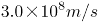。

C项错误，遥控和热成像仪应用的是红外线。红外遥控具有抗干扰、电路简单、容易编码和解码、功耗小、成本低的优点，因此应用广泛。自然界中一切物体都可以辐射红外线，热成像仪利用这个原理，将物体辐射出的红外线的功率信号转换为电信号，经过处理，从而得到物体的热像图。

D项正确，“雷达”一词是音译，原意为“无线电探测和测距”，其实际含义是利用目标对电磁波的反射现象来发现目标并测定其位置。因此雷达可以通过无线电波的反射测距。

故正确答案为D。

## 材料 1

1949年3月23日，中共中央和毛泽东同志离开西柏坡前往北平，25日进驻北京香山，这里成为党中央所在地。在庆祝新中国成立70周年前夕，习近平总书记前往中共中央北京香山革命纪念地，回顾中国共产党领导中国人民夺取全国胜利和党中央筹建中华人民共和国的光辉历史。习总书记在视察北京香山革命纪念地时强调，全党全国各族人民要紧密团结起来，不忘初心、牢记使命，锐意进取、开拓创新，沿着中国特色社会主义道路，满怀信心继续把新中国巩固好、发展好，为实现“两个一百年”奋斗目标、实现中华民族伟大复兴中国梦而不懈奋斗。

### 第 16 题

下列历史事件中，发生在中共中央进驻香山期间的有：

①渡江战役吹响了解放全中国的进军号角

②毛泽东同志发表《论人民民主专政》

③《中国人民政治协商会议共同纲领》起草通过

④人民解放军举行盛大的北平入城式

A. ①②③

B. ①②④

C. ①③④

D. ②③④

第 16 题 · 答案与解析

**参考答案（粉笔题库参考内容）**

A

**解析**

本题考查毛中特。

①正确，渡江战役是1949年4月21日至6月2日，中国人民解放军第二、第三野战军和第四野战军一部，在长江中下游强渡长江，对国民党军汤恩伯、白崇禧两集团进行的战略性进攻战役。

②正确，《论人民民主专政》是1949年6月30日，毛泽东为纪念中国共产党成立二十八周年而写的一篇论文。该论文论述了即将成立的中华人民共和国的国家性质，各阶级在国家中的地位及其相互关系，国家对内、对外政策等。

③正确，1949年9月29日，中国人民政治协商会议通过了具有临时宪法性质的《中国人民政治协商会议共同纲领》，选举产生了中央人民政府委员会，宣告了中华人民共和国的成立。

④错误，1949年2月3日，人民解放军举行盛大的进驻北平入城式，这次入城仪式在整个中国和世界都引起了强烈反响。该历史事件发生在1949年3月25日进驻香山之前。

故正确答案为A。

### 第 17 题

随着政治形势的发展和工作重心的转移，中共中央早期所在地也相应地发生过多次变迁。以下选项中，中共中央早期所在地不包括：

A. 上海

B. 武汉

C. 江西瑞金

D. 长春

第 17 题 · 答案与解析

**参考答案（粉笔题库参考内容）**

D

**解析**

本题考查毛中特。

A项正确，1920年8月，陈独秀、李达等人在上海建立中国第一个共产党早期组织，上海成为中国共产党的发祥地。1921年7月23日，中国共产党第一次全国代表大会在上海召开，会后成立的由陈独秀、张国焘、李达组成的中共中央局即驻上海。

B项正确，1927年初，大革命期间国民党中央和国民政府由广州迁至武汉。中共中央秘书厅、中央组织部、中央军委等机关也分别于1926年底到1927年春完成了从上海到武汉的搬迁工作。武汉成为中共中央的第二个驻扎地。

C项正确，1931年11月，中华苏维埃共和国临时中央政府在江西瑞金宣告成立，瑞金成为中国共产党领导下的第一个全国性红色政权首府，也成为中共中央的第三个驻扎地。

D项错误，中国共产党早期所在地不包括长春。

本题为选非题，故正确答案为D。

### 第 18 题

缅怀这段历史，就是要继承和发扬老一辈革命家“宜将剩勇追穷寇，不可沽名学霸王”的：

A. 革命到底精神

B. 团结奋进、勇于创新精神

C. 舍生取义、视死如归精神

D. 勇于担当精神

第 18 题 · 答案与解析

**参考答案（粉笔题库参考内容）**

A

**解析**

本题考查人文常识。

“宜将剩勇追穷寇，不可沽名学霸王”出自毛泽东的《七律·人民解放军占领南京》，意思是：应该趁现在这敌衰我盛的大好时机，痛追残敌，解放全中国。不可学那贪图虚名，放纵敌人而造成自己失败的楚霸王项羽。2019年9月12日，在庆祝新中国成立70周年前夕，习近平前往中共中央北京香山革命纪念地，并发表重要讲话。他强调：“我们缅怀这段历史，就是要继承和发扬老一辈革命家‘宜将剩勇追穷寇，不可沽名学霸王’的革命到底精神，不断增强中国特色社会主义的道路自信、理论自信、制度自信、文化自信，勇于进行具有许多新的历史特点的伟大斗争。”因此，BCD项不符合题意。

故正确答案为A。

### 第 19 题

新中国成立前夕，毛泽东同志把中国共产党在全国执政比作进京“赶考”。多年来，习近平总书记在许多场合多次重提“赶考”。这种“赶考”意识主要体现了中国共产党和中国共产党人的：

A. 奉献精神

B. 忧患意识

C. 学习意识

D. 钻研精神

第 19 题 · 答案与解析

**参考答案（粉笔题库参考内容）**

B

**解析**

本题考查政治常识。

70年来，从毛泽东进京、中国共产党准备在全国执政，到习近平总书记在许多场合多次重提“赶考”，在中国共产党的领导人的意识里，“赶考”这根弦一直绷得很紧，不曾松懈。要经受住人民的“考试”，中国共产党要深刻认识党面临的执政考验、改革开放考验、市场经济考验、外部环境考验“四大考验”的长期性和复杂性，深刻认识党面临的精神懈怠危险、能力不足危险、脱离群众危险、消极腐败危险“四大危险”的尖锐性和严峻性，必须保持清醒自觉，必须时刻绷紧“赶考”这根弦，就像习近平总书记在十九届一中全会上指出的那样：“担当这份重任，我们既充满信心，又如履薄冰。”

综上所述，“赶考”意识体现了中国共产党和共产党人的忧患意识。

故正确答案为B。

### 第 20 题

中共中央在北京香山虽然只有半年时间，但这里是中国革命重心        的重要标志，在中国共产党历史、中华人民共和国历史上具有非常重要的地位。

A. 从城市转向农村

B. 从旧民主主义革命转向新民主主义革命

C. 从农村转向城市

D. 从新民主主义革命转向社会主义现代化建设

第 20 题 · 答案与解析

**参考答案（粉笔题库参考内容）**

C

**解析**

本题考查政治常识。

1949年3月23日，中共中央和毛泽东同志离开西柏坡前往北平，25日进驻北京香山，这里成为党中央所在地。中共中央在北京香山虽然只有半年时间，但这里是我们党领导解放战争走向全国胜利、新民主主义革命取得伟大胜利的总指挥部，是中国革命重心从农村转向城市的重要标志，在中国共产党历史、中华人民共和国历史上具有非常重要的地位。

故正确答案为C。

## 材料 2

12345市民服务热线是北京市政府设立的非紧急救助服务，前身是1987年设立的“市长电话”。通过接听市民来电，解答公众咨询，收集整理社情民意，受理市民提出的诉求、问题、建议等，通过交办妥善解决市民遇到的非紧急类问题。

北京市提出“接诉即办”，即提高对“诉”的重视，加强“办”的力度。2019年1月1日起12345市民服务热线开始将街道（乡镇）管辖权属清晰的群众诉求，直接派给街乡镇。街乡镇迅速回应“接诉即办”，区政府同时接到派单，负责督办。一般性问题7天反馈办理结果。

“接诉即办”推行以来收到很大成效，据不完全统计，2019年截至6月底，12345共受理群众来电241万件，向街乡镇派单41万多件，一批市民集中关心、老大难问题得到解决。在这个机制的推动下，基层探索出24小时值班、群众诉求首接责任、“四微”工作法、新媒体派单、未诉先办等颇具实效的机制。

### 第 21 题

自2019年1月1日起，北京市逐步将各类热线整合到12345市民服务热线，实现“一号通”集中受理市民群众各类诉求。以下关于北京市这种整合热线改革举措的表述中，正确的是

①意在打通城市治理的“最后一公里”，由各级监察机关直接对接百姓诉求

②打破过去各个单位各自受理、分别办理的局限，更加方便了市民诉求的表达

③引导政府部门“一竿子插到底”，到基层解决群众反映的现实难题

④重点为了解决街道职能定位不准、责权利不匹配等问题

A. ①②

B. ②③

C. ①③

D. ③④

第 21 题 · 答案与解析

**参考答案（粉笔题库参考内容）**

B

**解析**

本题考查政治常识。

①错误，集中受理市民群众各类诉求，这种模式的创新找准了服务群众“最后一公里”的痛点和难点，极大提高了为民办事的效率，从而真正回应群众的诉求，体现出“为人民服务”的改革宗旨。根据《监察法》第三条规定：“各级监察委员会是行使国家监察职能的专责机关，依照本法对所有行使公权力的公职人员(以下简称公职人员)进行监察，调查职务违法和职务犯罪，开展廉政建设和反腐败工作，维护宪法和法律的尊严。”由此可知①后半句表述错误，各级监察机关不直接对接百姓诉求。

②正确，整合热线、实现“一号通”的改革，打破了过去各个单位各自受理、分别办理、效率低下的局限，更加方便市民诉求的表达。

③正确，集中受理市民群众各类诉求的方式在过去“街乡吹哨，部门报到”机制的基础上，把更多的力量下沉到基层，引导政府部门“一竿子插到底”，到基层解决群众反映的现实难题。

④错误，“接诉即办”把管辖权属清晰的群众诉求直接派给街道（乡镇），并从响应率、解决率、满意率三方面进行考核，不仅省去了不必要的中间环节，更重要的是实现了案件办理在时间上、速度上、效果上的显著提升。

因此②③正确。

故正确答案为B。

### 第 22 题

根据“接诉即办”的工作流程，对于市民诉求类电话。以下说法**不正确**的是

A. 可直接派单到街乡镇

B. 所有派单需要报党政一把手签阅

C. 所有工单在答复市民前须经主责领导审阅

D. 对审核通过的各街乡镇的工单要向市民进行回访

第 22 题 · 答案与解析

**参考答案（粉笔题库参考内容）**

C

**解析**

本题考查政治常识。

A项正确，根据职能职责、问题归属来判定具体承办单位，对于管辖权属清晰的群众诉求直接派给街乡镇，并从响应率、解决率、满意率三方面进行考核。

B项正确，在准确判定具体承办单位后进行派单，值班员发现派单后需要马上签收，并及时报党政一把手签阅。

C项错误，工单签收后需要对其进行判别，一般工单可以直接回复或联系市民现场处理，重点工单需要经主责领导审阅，进行快速处理。

D项正确，针对审核通过的各区、各街乡镇的工单要向市民进行回访，向群众反馈诉求处置过程和办理结果，耐心解答问题，与群众零距离真诚沟通，并认真记录群众后续需求，虚心接受群众意见建议。

本题为选非题，故正确答案为C。

### 第 23 题

为积极响应市民诉求，做到“闻风而动、接诉即办”，A镇实行闭环管理，全程督办。近日，市民安女士反映社区附近垃圾站散发臭味的问题，A镇政府在签收工单后采取了一系列措施，以下措施中**不符合**工作流程要求的是

A. 直接将安女士反映的问题派单至A镇所在区的城市管理委员会

B. 联系镇环卫部门具体承办，安女士所在社区全程盯办，并及时和安女士沟通

C. 在整件事情解决的过程中，镇纪委牵头，区监察专员参与，对履职情况和办理实效等进行全程监督

D. 在工单办结后及时回访安女士，确认办理结果

第 23 题 · 答案与解析

**参考答案（粉笔题库参考内容）**

C

**解析**

本题考查政治常识。

A项正确，根据材料，安女士反映的问题（社区附近垃圾站散发臭味）管辖权属清晰，直接派单至A镇所在区的城市管理委员会符合工作流程要求。

B项正确，题干中垃圾站的问题应当由对口的镇环卫部门负责承办；安女士所在的社区为相关方，应当全程盯办，并及时和安女士沟通。

C项错误，根据材料，A镇政府回应“接诉即办”后，区政府同时接到派单并负责督办。因此，在整件事情解决的过程中，应当由区政府的纪委监察委牵头，对履职情况和办理实效进行全程监督。

D项正确，根据材料，工单办结后应当对反映问题的市民进行回访，确认办理结果。

本题为选非题，故正确答案为C。

### 第 24 题

2019年1月1日以来，12345受理市民来电数百万件。根据12345群众来电诉求的“大数据”，北京市加强规律性研究，梳理形成违法建设、物业管理、群租房等11项专项整治问题清单，由市领导分工负责推动解决。

下列对在“接诉即办”工作中开展大数据分析和规律性研究的目的意义理解**不正确**的是

A. 推动“接诉即办”从“有一办一”“举一反三”向主动治理、未诉先办深化

B. 大大增强了政府工作的靶向性

C. 推动工作模式转变，从一类诉求打包办，到一个诉求一个诉求精细办

D. 引导各区增加公共服务有效供给，有针对性补短板、强弱项

第 24 题 · 答案与解析

**参考答案（粉笔题库参考内容）**

C

**解析**

本题考查管理学常识。

A项正确，通过分析群众来电“大数据”，政府部门可以总结规律，形成专项整治问题清单，从而推动“接诉即办”从“有一办一”“举一反三”向主动治理、未诉先办深化。

B项正确，“接诉即办”机制依托大数据，能够做到从一个诉求一个诉求地办理，到一类诉求的打包解决，再到民生大问题的根本性梳理，从而实现未诉先办，大大增强了政府工作的靶向性。

C项错误，从题干可知，北京市政府在分析群众来电“大数据”的基础上，不断总结规律，形成专项整治问题清单，体现了政府在解决民生问题上的创新，即从一个诉求一个诉求地办理，到一类诉求的打包解决，再到民生大问题的根本性梳理。

D项正确，北京市依托12345市民服务热线平台，以“接诉即办”机制为抓手，撬动基层治理大变革，从“民有所呼”的大数据积累中，梳理出高频问题、重点区域，未诉先办、主动治理，最终引导各区增加公共服务有效供给，有针对性地补短板、强弱项，真正做到为人民办实事、办好事，满足人民群众的需求。

本题为选非题，故正确答案为C。

### 第 25 题

北京市已探索出一套保障和提升“接诉即办”效率的机制，定期分析研判群众诉求，对群众反映集中的热点问题加大“点穴”式督办力度，并将相关考核数据分别纳入各部门党组织书记年度考核和政府年度绩效考评。这一做法意在

①推动各部门切实改进工作作风，保障“接诉即办”的效果

②指导各部门把量化指标作为唯一依据开展各项工作

③进一步创新政府绩效考评体系，强化政府在“接诉即办”效果评估中的主导地位

④通过排名传导压力，形成各部门努力解决问题的态势

A. ①②

B. ②③

C. ②④

D. ①④

第 25 题 · 答案与解析

**参考答案（粉笔题库参考内容）**

D

**解析**

本题考查管理学常识。

①正确，北京市政府的这一做法其目的是了解各部门在某一阶段的工作效率和工作成果，最终推动各部门切实改进工作作风，保障“接诉即办”的效果和“接诉即办”制度的有效落实。

②错误，把量化指标作为唯一依据开展各项工作不利于各部门有针对性的解决问题，可能会导致各部门陷入数据竞争而忽略真正为群众解决实际问题。

③错误，虽然政府在“接诉即办”过程中处于主导地位，但是“接诉即办”效果评估应该充分了解群众的满意度和反馈，保证考核数据的准确性。该说法与题干无关，排除。

④正确，通过排名，可以使各部门看到差距和不足，在此基础上不断提高解决问题的能力和效率，最终实现从上到下形成努力解决问题的态势。

因此，①④正确，②③错误。

故正确答案为D。

### 第 26 题

2019年是“基层减负年”，考核评价一个地方和单位的工作关键看：

A. 有没有解决实际问题

B. 群众的评价怎么样

C. 有没有出台专门的制度措施

D. 有没有完整的工作笔记

第 26 题 · 答案与解析

**参考答案（粉笔题库参考内容）**

AB

**解析**

本题考查政治。

2019年3月11日，中共中央办公厅印发《关于解决形式主义突出问题为基层减负的通知》文件指出：“考核评价一个地方和单位的工作，关键看有没有解决实际问题、群众的评价怎么样。”

故正确答案为AB。

### 第 27 题

北京大兴国际机场于2019年国庆前投入运营。下列有关北京大兴国际机场的说法中，正确的有：

A. 北京大兴国际机场坐落于北京大兴区与河北廊坊市交界

B. 北京大兴国际机场航站楼是目前全球最大规模的单体航站楼

C. 北京大兴国际机场航站楼成为全球首座高铁地下穿行的机场航站楼

D. 北京大兴国际机场与首都国际机场形成国际一流的双枢纽机场

第 27 题 · 答案与解析

**参考答案（粉笔题库参考内容）**

ABCD

**解析**

本题考查政治。

2019年9月25日上午，在新中国成立70周年之际，北京大兴国际机场投运仪式在北京举行，北京大兴国际机场正式投入运营。北京大兴国际机场，是建设在北京市大兴区与河北省廊坊市广阳区之间的超大型国际航空综合交通枢纽。大兴机场航站楼，是目前全球最大规模的单体航站楼，以其独特的造型设计、精湛的施工工艺、便捷的交通组织、先进的技术应用，创造了许多世界之最。大兴国际机场是全球首座高铁从地下穿行的机场，也是全球首座双层出发双层到达的航站楼。北京大兴国际机场将与首都国际机场形成国际一流的双枢纽机场，进而与京津冀周边机场一道建设世界级机场群。

故正确答案为ABCD。

### 第 28 题

下列北京市城市治理新实践中，体现共建共治共享理念的有：

A. 探索在街区成立商户协会，发挥自律自管作用

B. 在街道乡镇建立实体化综合执法中心

C. 建立社区月协商制度，推进议事协商常态化、机制化

D. 建立驻社区单位和各类社会组织广泛参与、协同联动的社区治理体系

第 28 题 · 答案与解析

**参考答案（粉笔题库参考内容）**

ACD

**解析**

本题考查政治。

党的十九大报告对新时代社会治理做了富有深刻内涵的表述，提出要“打造共建共治共享的社会治理格局”，其中共建即共同参与社会建设；共治即共同参与社会治理；共享即共同享有治理成果。

A项正确，2019年2月23日，中共北京市委北京市人民政府印发《关于加强新时代街道工作的意见》，在“强化共建共治共享，激发社区治理活力”中指出：“深化‘门前三包’责任制，提升单位个人参与城市管理、维护城市环境的积极性和自觉性。探索在街区成立商户协会，发挥自律自管作用。”

B项错误，综合执法平台建设的核心内容是建立街乡统筹，由基层公安、城管、工商、交通、食药等部门共同组成的实体化综合执法中心。该项举措体现了政府各部门共同治理，但并没有社会参与，不符合“共治”理念。

C项正确，《关于加强新时代街道工作的意见》在“强化共建共治共享，激发社区治理活力”中指出：“建立分层协商和公共沟通互动制度，完善区、街道、社区三级协商联动机制，建立社区月协商制度，推进议事协商常态化、机制化。”

D项正确，《关于加强新时代街道工作的意见》在“强化共建共治共享，激发社区治理活力”中指出：“加大街道对社区支持、指导和相关保障力度，完善以社区党组织为核心，社区居委会为主体，社区服务站为平台，物业、市政公用等服务企业、驻社区单位和各类社会组织广泛参与、协同联动的社区治理体系”。

故正确答案为ACD。

### 第 29 题

俗话说“麻雀虽小，五脏俱全”，所以人们在进行调查研究工作时，应该抓住典型，学会“解剖麻雀”，达到举一反三、“窥一斑而知全豹”的效果。这体现的哲学原理有

A. 矛盾的普遍性和矛盾的特殊性之间的辩证关系

B. 认识事物的过程通常是先由个性到共性，再由共性到个性

C. 意识的能动性能使人认识和发展规律

D. 人们能够根据事物的固有联系来建立新的联系

第 29 题 · 答案与解析

**参考答案（粉笔题库参考内容）**

AB

**解析**

本题考查政治常识。

A项正确，“麻雀小”反映了这一事物的特殊性，“五脏全”反映了这一类事物的普遍性。“麻雀虽小，五脏俱全”反映了矛盾的普遍性寓于矛盾的特殊性之中，通过特殊性表现出来。

B项正确，人们对客观事物的认识，总是由个别到一般、由个性到共性，再由一般到个别、由共性到个性，这样不断循环往复和向前发展的。因此，人们在进行调查研究工作时，要抓住典型，“解剖麻雀”，重视特殊性在认识过程中所起的作用，从而达到举一反三、“窥一斑而知全豹”，认识到事物的普遍性。

C项错误，规律是客观的，人们可以发挥主观能动性，认识和利用规律，但是不能发展规律。

D项错误，选项本身说法正确，但是与题干无关。联系是客观的，人们可以根据事物固有的联系，改变事物的状态，建立新的具体的联系。

故正确答案为AB。

### 第 30 题

在长期的革命、建设、改革过程中，我国已经结成的爱国统一战线包括

A. 全体社会主义劳动者

B. 社会主义事业的建设者

C. 拥护社会主义的爱国者

D. 拥护祖国统一和致力于中华民族伟大复兴的爱国者

第 30 题 · 答案与解析

**参考答案（粉笔题库参考内容）**

ABCD

**解析**

本题考查法律常识。

我国《宪法》在序言中明确提到：“在长期的革命、建设、改革过程中，已经结成由中国共产党领导的，有各民主党派和各人民团体参加的，包括全体社会主义劳动者、社会主义事业的建设者、拥护社会主义的爱国者、拥护祖国统一和致力于中华民族伟大复兴的爱国者的广泛的爱国统一战线，这个统一战线将继续巩固和发展。”

故正确答案为ABCD。

### 第 31 题

下列关于我国社会主义基本经济制度的表述正确的有

A. 公有制经济和非公有制经济都是社会主义市场经济的重要组成部分，都是我国经济社会发展的重要基础

B. 必须毫不动摇巩固和发展公有制经济，坚持公有制主体地位，发挥国有经济主导作用，推动国有资本做强做优做大

C. 必须毫不动摇鼓励、支持、引导非公有制经济发展，激发非公有制经济活力和创造力

D. 我国民营经济只能壮大、不能弱化，而且要走向更加广阔的舞台

第 31 题 · 答案与解析

**参考答案（粉笔题库参考内容）**

ABCD

**解析**

本题考查经济。

A项正确，党的十八届三中全会提出，公有制为主体、多种所有制经济共同发展的基本经济制度，是中国特色社会主义制度的重要支柱，也是社会主义市场经济体制的根基。公有制经济和非公有制经济都是社会主义市场经济的重要组成部分，都是我国经济社会发展的重要基础。

B、C项正确，党的十八届三中全会提出，必须毫不动摇巩固和发展公有制经济，坚持公有制主体地位，发挥国有经济主导作用，不断增强国有经济活力、控制力、影响力。必须毫不动摇鼓励、支持、引导非公有制经济发展，激发非公有制经济活力和创造力。

D项正确，2018年11月，习近平在民营企业座谈会上的讲话明确指出，“民营经济是我国经济制度的内在要素，民营企业和民营企业家是我们自己人”，“我国民营经济只能壮大、不能弱化，不仅不能‘离场’，而且要走向更加广阔的舞台”。

故正确答案为ABCD。

### 第 32 题

对于保健食品广告，我国法律做了特殊的限制，下列广告内容违反法律规定的有

A. 服用甲保健食品可以有效预防糖尿病

B. 服用乙保健食品是保障老年人骨骼健康所必需

C. 服用丙保健食品的效果得到某明星的推荐和证明

D. 购买丁保健食品是聪明人都会为健康做的投资

第 32 题 · 答案与解析

**参考答案（粉笔题库参考内容）**

ABCD

**解析**

本题考查法律常识。

根据《广告法》第十八条规定：“保健食品广告不得含有下列内容：（一）表示功效、安全性的断言或者保证；（二）涉及疾病预防、治疗功能；（三）声称或者暗示广告商品为保障健康所必需；（四）与药品、其他保健食品进行比较；（五）利用广告代言人作推荐、证明；（六）法律、行政法规规定禁止的其他内容。保健食品广告应当显著标明‘本品不能代替药物’。”

A项错误，“服用甲保健食品可以有效预防糖尿病”，涉及疾病预防、治疗功能，违反法律规定（二）。

B、D项错误，“服用乙保健食品是保障老年人骨骼健康所必需”、“购买丁保健食品是聪明人都会为健康做的投资”，均声称或者暗示广告商品为保障健康所必需，违反法律规定（三）。

C项错误，“服用丙保健食品的效果得到某明星的推荐和证明”，利用广告代言人作推荐、证明，违反法律规定（五）。

本题为选非题，故正确答案为ABCD。

### 第 33 题

下列选项中，涉及植物呼吸活动的有

A. 大棚水果栽培中夜间适当降温

B. 适当延长光照时间提高蔬菜产量

C. 通过立体栽培提高土地利用率

D. 给土壤松土以促进植物根部生长

第 33 题 · 答案与解析

**参考答案（粉笔题库参考内容）**

AD

**解析**

本题考查科技常识。

植物呼吸活动分为有氧呼吸和无氧呼吸，绝大多数情况下进行的是有氧呼吸。有氧呼吸是指植物在有氧条件下，将有机化合物氧化，产生二氧化碳和水的过程。

A项正确，大棚水果栽培中夜间适当降温：通过增加二氧化碳的含量可以抑制储存蔬菜水果等的呼吸作用；充氮气也可以降低氧气的浓度，抑制呼吸作用。所以“大棚水果栽培中夜间适当降温”涉及植物呼吸作用。

B项错误，光合作用通常是指绿色植物（包括藻类）吸收光能，把二氧化碳和水合成富能有机物，同时释放氧气的过程。延长光照时间，会增强光合作用，产生更多的有机物，从而提高产量，但基本不影响呼吸作用。

C项错误，立体栽培也叫垂直栽培，是立体化的无土栽培，这种栽培是在不影响平面栽培的条件下，通过四周竖立起来的柱形栽培或者以搭架、吊挂形式按垂直梯度分层栽培，向空间发展，充分利用温室空间和太阳能，以提高土地利用率3～5倍，可提高单位面积产量2～3倍。所以“通过立体栽培提高土地利用率”与植物呼吸作用无关。

D项正确，松土可以增大土壤间的空隙，方便植物的根进行呼吸作用。所以“给土壤松土以促进植物根部生长”涉及植物呼吸作用。

故正确答案为AD。

### 第 34 题

体检报告中的指标值往往反映了人体的健康状况，下列说法正确的有

A. 血小板减少意味着出血的危险性增加

B. 高密度胆固醇升高会增加患冠心病的风险

C. 血红蛋白是判断贫血的重要指标之一

D. 谷丙转氨酶和谷草转氨酶同时升高可能是肝细胞受损

第 34 题 · 答案与解析

**参考答案（粉笔题库参考内容）**

ACD

**解析**

本题考查科技常识。

A项正确，血小板减少症是外周血液中血小板数量异常减少（采用血小板直接计数法时低于10^10/L）的现象。通常情况下，血小板<50×10^9/L时，即存在皮肤、黏膜出血的危险性；<20×10^9/L时，有自发性出血的高度危险性；<10×10^9/L时则有极高度危险性。综上所述，血小板减少意味着出血的危险性增加。

B项错误，胆固醇又分为高密度胆固醇和低密度胆固醇两种，前者对心血管有保护作用，通常称之为“好胆固醇”；后者偏高，冠心病的危险性就会增加，通常称之为“坏胆固醇”。

C项正确，血色素又称血红蛋白，红细胞里一种含铁质的蛋白质，是人体血液中的血红蛋白的主要成分，是判断病人是否贫血的一个重要指标。如果发现血红蛋白低于正常标准，就是贫血。贫血会危害人体中造血器官的功能，还会导致其他病变。所以血色素成为观察人体健康的一个重要方面。

D项正确，转氨酶大体分为：谷丙转氨酶和谷草转氨酶等。谷丙转氨酶（ALT）主要存在于各种细胞中，尤以肝细胞为最，整个肝脏内转氨酶含量约为血中含量的100倍。正常时，只要少量释放入血中，血清中其酶的活性即可明显升高。在各种病毒性肝炎的急性期、药物中毒性肝细胞坏死时，ALT大量释放入血中，因此它是诊断病毒性肝炎、中毒性肝炎的重要指标。肝细胞内谷丙转氨酶的浓度比血清高1000～3000倍。只要有1%的肝细胞坏死，便可使血中酶活性增高1倍，因此转氨酶（尤其是ALT）是急性肝细胞损害的敏感标志。谷草转氨酶（AST）主要分布在心肌，其次是肝脏、骨骼肌和肾脏等组织中。正常时血清中的AST含量较低，但相应细胞受损时，细胞膜通透性增加，胞浆内的AST释放入血，故其血清浓度可升高，临床一般常作为心肌梗死和心肌炎的辅助检查。综上所述，谷丙转氨酶和谷草转氨酶同时升高可能是肝细胞受损。

故正确答案为ACD。

### 第 35 题

古代长城沿线上建有许多关口，下列位于北京的关口有

A. 居庸关

B. 雁门关

C. 九门口

D. 古北口

第 35 题 · 答案与解析

**参考答案（粉笔题库参考内容）**

AD

**解析**

本题考查地理国情。

A项正确，居庸关在距北京市区50余公里外的昌平区境内。居庸关得名始自秦代，相传秦始皇修筑长城时，将囚犯、士卒和强征来的民夫徙居于此，取“徙居庸徒”之意。

B项错误，雁门关，位于山西省忻州市代县县城以北约20公里处的雁门山中，是长城上的重要关隘，以“险”著称，被誉为“中华第一关”，有“天下九塞，雁门为首”之说。

C项错误，九门口长城坐落在辽宁省葫芦岛市绥中县李家乡新台子村境内，距山海关15公里，全长1704米，是中国万里长城中唯一的一段水上长城。

D项正确，古北口长城位于北京市密云区古北口镇东南，是中国长城史上最完整的长城体系。由北齐长城和明长城共同组成，包括卧虎山、蟠龙山、金山岭和司马台4个城段。

故正确答案为AD。

### 第 36 题

“致天下之治者在人才。”在当今人才竞争日趋激烈的背景下，如何网罗天下英才为我所用？如何让专家人才            地贡献才智、施展才华、创新创业？标准答案就是：对专家人才要多关心、多联系、多支持。

填入画横线部分最恰当的一项是

A. 心无旁骛

B. 责无旁贷

C. 无拘无束

D. 义无反顾

第 36 题 · 答案与解析

**参考答案（粉笔题库参考内容）**

A

**解析**

横线处形容可以让专家人才更好地贡献才智、施展才华，且对应后文的“答案就是多关心、多联系、多支持”，即为专家人才提供保障，让专家人才安心工作，对应A项， “心无旁骛”指心中没有另外的杂念，形容心思集中，专心致志，可体现让专家人才心思集中地施展才华，符合文意，当选。

B、D两项“责无旁贷”指自己的责任，不能推卸给别人；“义无反顾”指从道义上只有勇往直前，不能犹豫回顾，二者均强调做某件事是自己义务、责任，与文段语境不符，排除。

C项“无拘无束”形容自由自在，没有限制，不受约束，与文意无关，排除。

故正确答案为A。

【文段出处】《人才服务莫忘“三多”》

### 第 37 题

伴随新型智能终端的加速普及，以5G为代表的移动通信技术有力地推动着人工智能、物联网、大数据、云计算等技术蓬勃发展，连接服务的内涵正在从人与人通信延伸到人与物、物与物的智能连接，万物互联的5G时代      。

填入画横线部分最恰当的一项是

A. 初露头角

B. 迫在眉睫

C. 粉墨登场

D. 指日可待

第 37 题 · 答案与解析

**参考答案（粉笔题库参考内容）**

D

**解析**

由文意和“加速普及”“蓬勃发展”可知，横线处词语表意为5G时代就要到来，D项“指日可待”指不久就可以实现，符合文意，当选；

A项“初露头角”比喻刚开始显示出才华或力量，一般搭配人或物，与“5G时代”搭配不当，排除；

B项“迫在眉睫”比喻事情临近眼前十分紧迫，文中并无紧迫之意，排除；

C项“粉墨登场”比喻坏人经过一番乔装打扮爬上政治舞台，为贬义，文中并无贬义色彩，排除。

故正确答案为D。

【文段出处】《1G到5G：从“见字如面”到“万物互联”》

### 第 38 题

现在手机地图除了能查询路线外，还能显示与自驾车相比，乘坐公共交通所节约的碳排放量。这类小创意不仅能帮我们加深对绿色生活方式的认知，还能在      中促进自我行动的达成。想想看，有了      的数据对比以及因此带来的小小的精神激励，我们是不是多了一些选择绿色生活方式的动力？

依次填入画横线部分最恰当的一项是

A. 耳濡目染 真实

B. 司空见惯 形象

C. 潜移默化 直观

D. 身体力行 简洁

第 38 题 · 答案与解析

**参考答案（粉笔题库参考内容）**

C

**解析**

第一空，根据前文可知，横线处意指因为有了这类小创意，让我们在使用手机地图时，不仅加深了对绿色生活方式的认知，并且使我们的行为不知不觉受到影响。B项“司空见惯”指常见之事不足为奇，文段并未强调“常见”，也未体现对绿色出行方式已经习以为常，不符合语境，排除；D项“身体力行”指亲身体验，努力实行，侧重自发、主动地做，而文段意指手机地图的小创意促进了自我行动的达成，而非主动的，排除。A项“耳濡目染”比喻见得多、听得多了之后，无形中受到影响，C项“潜移默化”指人的思想或性格不知不觉受到感染、影响而发生了变化，两项均符合文意。

第二空，根据文段可知，横线处用来形容数据。A项“真实”表示跟客观事实相符合，该数据是否准确真实文段并未体现，且数据真实并不一定能对人带来精神激励，排除。C项“直观”指用感官直接感受，因为人们能够通过手机地图直接观察到乘坐公交车所节约的碳排放量，所以更加激励人们选择绿色出行方式，符合文意，当选。

故正确答案为C。

【文段出处】《让低碳生活更具象》

### 第 39 题

毋庸置疑，歪曲原意、难以卒读的译文断不可取；但表达与表意、本意与诗意，如同难以兼顾的跷跷板。正如专家所说：从      的逐字翻译到忠实而又自由的重述，到模仿、再创造、变化、解释性的对应，可以排成一个连续性的光谱······从哪一点出发，都可以产生      的译文。

依次填入画横线部分最恰当的一项是：

A. 严格 精彩

B. 简单 直白

C. 刻板 妥帖

D. 认真 恰当

第 39 题 · 答案与解析

**参考答案（粉笔题库参考内容）**

A

**解析**

第一空，根据转折词“但”可知，上下文表意及感情色彩相反，通过“歪曲原意、难以卒读”可知前文感情色彩消极，且根据“忠实而又自由”可知，横线处所填词性为积极词，A、D两项置于文段均可，而C项“刻板”指呆板，不灵活，感情色彩消极，排除；根据“逐字翻译”可知此处表达对于每一个字都认真且严谨，B项“简单”与文意相悖，排除。

第二空，根据“逐字翻译···连续性的光谱”可知，此处感情色彩积极，且表达从任何一点出发所创造的译文都是优秀的，A项“精彩”符合文意，而D项“恰当”指合适、正好，与A项“精彩”相比，并未体现译文之优秀，排除。

故正确答案为A。

【文段出处】《多一分语言自觉，让汉语更美》

### 第 40 题

1796年，英国医生爱德华·詹纳偶然发现，大多数得过牛痘的挤奶工不会再得天花。为了证明这个发现，他大胆地在一个男孩身上做了实验，幸运的是，实验成功了，世界上的第一支疫苗就这么产生了。但是令人\_\_\_\_\_\_\_的是，最初人们非常\_\_\_\_\_\_他的发明，因为他们相信接种牛痘之后会长出牛角。

依次填入画横线部分最恰当的一项是：

A. 始料未及 怀疑

B. 啼笑皆非 抗拒

C. 匪夷所思 敌视

D. 痛心疾首 憎恨

第 40 题 · 答案与解析

**参考答案（粉笔题库参考内容）**

B

**解析**

此题可从第二空入手，根据后文“因为他们相信接种牛痘后会长出牛角”可知，横线处应表示人们害怕长出牛角而不敢使用疫苗的意思， B项“抗拒”指抵抗并拒绝，符合文段意思，保留；

A项“怀疑”指心中存疑，也指猜测，文段并未体现出人们怀疑他的发明，而是不敢用，排除；

C项“敌视”指当做敌人看待，仇视，文段并未体现出仇视的意思，且与“发明”搭配不当，排除；

D项“憎恨”指厌恶痛恨，文段表达的意思是人们不使用疫苗，但并未提到憎恨、厌恶，排除。

第一空代入文段验证，“啼笑皆非”形容处境尴尬或既令人难受又令人发笑的行为，可以跟后文“因为他们相信接种牛痘后会长出牛角”形成对应，体现出最初人们的想法让人哭笑不得的心情。

故正确答案为B。

【文段出处】《疫苗发明以前，人们迷信国王的触摸可以治结核》

### 第 41 题

北京以大运河北京段运河沿线地区古城古镇、运河古道、仓储码头、寺庙街巷、传统村落等遗产保护挖掘和利用为        ，通过系统保护运河文化遗产，提升运河文化价值，打造凝聚悠久历史、荟萃古今文化历史文脉的“千古运河”，        出了一套具有全国示范效应的“北京方案”。

依次填入画横线部分最恰当的一项是：

A. 先导 构建

B. 抓手 摸索

C. 主线 琢磨

D. 契机 提炼

第 41 题 · 答案与解析

**参考答案（粉笔题库参考内容）**

B

**解析**

本题可从第二空入手，横线处词语搭配“北京方案”，B项“摸索”寻找方向、方法、经验、道路等，搭配恰当，保留；A项“构建”指建立，搭配尚可；C项“琢磨”意为思考，多用于口语化语境，与文段语体风格不符，排除；D项“提炼”与“方案”搭配不当，排除。

第一空，由文意可知，北京以遗产保护挖掘与利用为切入点进行运河的系统保护，B“抓手”有依托的含义，符合文意，当选。A项“先导”指引领、指导，遗产保护挖掘与利用不能起到指导的作用，排除。

故正确答案为B。

【文段出处】《孙杰：让千年大运河“活”起来》

### 第 42 题

粉笔暂未收录本题（来源缺题，题位保留）

第 42 题 · 答案与解析

**答案状态：unknown（来源未提供）**

**解析状态：unknown（来源未提供）**

### 第 43 题

辞书的“互联网基因”，似乎是            的。对于网络阅读，人们常常有“碎片化”的        ，而辞书恰是由众多“碎片化”的条目组成的，并且也是供人们“碎片化”检索使用的。因为有了数字化、互联网，辞书检索变得空前        ：只要把那个字、那个词放入搜索框，轻点一下鼠标，古音、今音，古义、今义，例句乃至翻译，都可以同时呈现在眼前。

依次填入画横线部分最恰当的一项是

A. 得天独厚 质疑 顺利

B. 不言而喻 批评 轻松

C. 与生俱来 忧虑 简便

D. 毋庸置疑 烦恼 容易

第 43 题 · 答案与解析

**参考答案（粉笔题库参考内容）**

C

**解析**

本题可从第二空入手，横线处表明通常人们对“碎片化”的态度，根据后文辞书检索中“碎片化”的积极作用可知，横线处应表明通常人们对“碎片化”所持的是消极态度。A项“质疑”、C项“忧虑”置于此处均可，保留。B项“批评”是指对缺点错误提出意见，文段并无此意，排除；D项“烦恼”是指烦闷苦恼，文段所指的是通常人们对“碎片化”的态度，而非自身感情，与文意不符，排除。

第三空，后文即是对横线处的解释，根据后文解释的内容可知，文段意在表达辞书检索比较方便、快捷之意。C项“简便”即指简单方便，符合文意。A项“顺利”指做事没有阻碍或很少遇到困难，与文意不符，排除。

第一空代入验证，C项“与生俱来”指一生下来就具备，与前文“互联网基因”对应恰当，当选。

故正确答案为C。

【文段出处】《激活辞书的“互联网基因”》

### 第 44 题

生鲜品线下销售渠道的        是直观，消费者可以现场挑选和检查质量，这种面对面的交易也是人们            的消费习惯。尽管网购的普及已经在逐渐        这一习惯，但对于生鲜品这类非标准化商品来说，目前阶段人们还是习惯“眼见为实”。

依次填入画横线部分最恰当的一项是

A. 特点 喜闻乐见 改变

B. 价值 习以为常 打破

C. 要领 由来已久 破除

D. 优势 根深蒂固 颠覆

第 44 题 · 答案与解析

**参考答案（粉笔题库参考内容）**

D

**解析**

第一空，所填词语应体现出“生鲜品线下销售”与“直观”之间的关系。A项“特点”、D项“优势”均符合文意，保留。B项“直观”并非一种“价值”，搭配不当，排除。C项“要领”指要点、关键的部分，文段并未论及“直观”是销售渠道的关键部分，排除。

第二空，根据“消费习惯”可知，所填词语应体现出不易改变之意。D项“根深蒂固”比喻基础深厚，不容易动摇，符合文意，保留。A项“喜闻乐见”指喜欢听、乐意看，无法体现出“不易改变”之意，与文意不符，排除。

第三空，验证D项，互联网“颠覆”人们的习惯，用词恰当，符合文意。

故正确答案为D。

【文段出处】《生鲜品的线上化》

### 第 45 题

腰封也叫书腰，定义为“于书籍中间地带另置一条类似腰带的文字介绍，以配合行销或书籍推荐”。在腰封的编辑和设计中，应将营销策略        于腰封的设计过程中，以便更好地推广图书。这也是有助于读者        了解图书内容的信息沟通手段，应该说，优秀的腰封应是件            的事儿。

依次填入画横线部分最恰当的一项是

A. 贯穿 迅速 锦上添花

B. 凝聚 简单 相得益彰

C. 整合 方便 一举两得

D. 内化 初步 水到渠成

第 45 题 · 答案与解析

**参考答案（粉笔题库参考内容）**

A

**解析**

本题可从第一空入手，文段表示的含义是“将营销策略体现在整个腰封的设计过程中”，A项“贯穿”语义吻合，且与“过程”搭配恰当。B项“凝聚”强调聚集，文段并非说明将多个营销策略聚集在一个腰封中，且“凝聚”通常搭配的是人心、力量，排除；C项“整合”强调通过整顿、协调重新组合，文段未提及“整顿、协调”的语义，排除；D项“内化”表示向内在转化，常用搭配为“内化于心”，文段搭配的是“设计过程”，用于此处搭配不当，排除。

验证后两空，第二空文段表示“腰封这一文字介绍”能让读者短时间内了解这本书的内容，故“迅速”适合填入文段；第三空文段表示一个好的腰封能够让图书推广、读者了解图书产生更好的效果，“锦上添花”表示让美好的事物更加美好，符合语境。

故正确答案为A。

【文段出处】《腰封之“妖”如何破》

### 第 46 题

社会和文化推崇慷慨行为，但这种行为往往要求一个人为他人利益贡献自己的资源，所以这很难用一般的经济理论解释。然而，有神经科学论文指出，即使会牺牲自我利益，有些人也会对他人慷慨大方，这是因为当人表现慷慨时，会激活大脑中的特定区域，而这些区域与产生幸福感的区域相互关联。

根据这段文字，下列说法正确的是

A. 对牺牲自我利益去满足他人的行为不应过多推崇

B. 人类做出慷慨行为与产生幸福感时的大脑机制相同

C. 慷慨行为能增加幸福感是人们慷慨待人的原因之一

D. 经济学理论能够充分阐述人类利他行为的机制

第 46 题 · 答案与解析

**参考答案（粉笔题库参考内容）**

C

**解析**

A项，根据“社会和文化推崇慷慨行为”可知，“不应过多推崇”与文意相悖，排除；

B项，根据“人表现慷慨时，会激活大脑中的特定脑区，而这些区域与产生幸福感的区域相互关联”可知，“相互关联”并不意味着“机制相同”，排除；

C项，根据“人表现慷慨时，会激活大脑中的特定脑区，而这些区域与产生幸福感的区域相互关联”可知，人们的慷慨行为与幸福感增加有直接的联系，这可能是人们慷慨待人的原因，该项表述正确；

D项，根据“社会和文化推崇慷慨行为······所以这很难用一般的经济理论解释”可知，表述错误，排除。

故正确答案为C。

### 第 47 题

在传统金融体系中，长期以来对“三农”的金融支持服务还不够，农村、农业、农民的金融服务获得感不明显。传统金融体系受“短期绩效”“资本至上”以及“规模偏好”等观念的影响，对规模小抗风险能力差的中小企业、创业者的金融服务相对不足。另外，风险控制与监管、市场之间还存在一定失衡情况。这些难点和痛点，在一定程度上影响了实体经济高质量发展，影响了广大人民群众对美好生活向往的满足。基于此，面对和解决传统金融体系无法解决的难点、痛点和服务障碍正是新金融崛起的出发点。

这段文字主要介绍了

A. 市场对金融服务的新需求

B. 建设新金融的现实背景

C. 农村金融体系面临的问题

D. 传统金融体系的新发展

第 47 题 · 答案与解析

**参考答案（粉笔题库参考内容）**

B

**解析**

文段首先指出传统金融体系对“三农”支持不足，接下来指出其对中小企业、创业者的金融服务也相对不足，“另外”在其他方面还存在一定的失衡情况。随后通过“这些难点和痛点”总结前文，指出这些问题对经济发展和人民生活都带来了不好的影响。尾句“基于此”得出结论，说明传统金融体系存在的问题正是新金融崛起的出发点。故文段意在强调“新金融崛起的出发点”即现实背景，B项当选。

A项，“市场的需求”文段并未提及，属于无中生有，排除；C项，“问题”对应尾句之前的内容，非重点，排除；D项，“传统金融体系”非重点，文段重点论述的是“新金融”的崛起，偏离文段主题，排除。

故正确答案为B。

【文段出处】《建设服务经济社会高质量发展的新金融》

### 第 48 题

基因和性状、疾病之间有着非常复杂的关系，破译这一关系最原始的方法是上个世纪中叶建立的基因连锁分析：通过比较受遗传疾病影响的家族中不同成员的染色体条带或遗传标记的异同，在染色体上定位致病基因。这种方法在研究单基因遗传病方面取得了很多成绩，但其缺点是分辨率有限，很难准确地定位到单个基因上。

这段文字意在说明：

A. 基因和疾病的关系难以准确破译

B. 基因连锁分析方法存在明显缺陷

C. 单基因遗传病更容易找出病因

D. 基因分析有助于精准治疗遗传病

第 48 题 · 答案与解析

**参考答案（粉笔题库参考内容）**

B

**解析**

文段首先指出破译基因、性状和疾病之间的复杂关系，最原始的方法是基因连锁分析法，紧接着通过冒号对其解释说明。尾句通过转折词“但”指出“这种方法”的缺点是分辨率有限，很难准确定位到单个基因上，“这种方法”指代“基因连锁分析法”。故文段为“转折”结构，转折之后为重点，强调“基因连锁分析法”的缺点，对应B项。

A项“基因和疾病的关系”、C项“单基因遗传病”均偏离文段中心，文段主要围绕“基因连锁分析”的方法进行阐述，排除；D项“治疗遗传病”对应尾句转折之前的内容，非重点，排除。

故正确答案为B。

【文段出处】《身高的秘密》

### 第 49 题

为了躲避天敌和高温日晒，许多候鸟迁徙时选择夜间飞行。当必须飞越某些天然地理屏障如墨西哥湾时，它们甚至会不眠不休地连续飞行24小时。与人一样，长期缺乏睡眠会令鸟儿极度疲惫，灵活性降低，这必然导致它们在中途休息时面临更大的危险。然而一项最新研究表明，候鸟们自有一套聪明的解决办法。科学家观测了7只捕获到的斯文氏夜鸫，发现这种惯常夜间飞行的候鸟白天休息时并非完全放松，通常会睁着一只眼睛。而脑电波也显示，它们只有半个大脑处于标准休眠状态。

下列哪项最适合作这段文字的标题？

A. 半梦半醒之间

B. 斯文氏夜鸫的秘技

C. 睁一只眼，闭一只眼

D. 你的夜晚，我的白天

第 49 题 · 答案与解析

**参考答案（粉笔题库参考内容）**

A

**解析**

文段开篇论述候鸟迁徙时多选择夜间飞行，并指出长期缺乏睡眠会使鸟类在中途休息时面临更大的危险。前文指出问题，后文通过“然而”引出最新的研究结论，给出解决办法，即鸟类在白天休息时大脑并非完全放松，一般会睁一只眼，且只有半个大脑处于休眠状态。故文段重点即候鸟可通过半休眠半醒着的方式，解决迁徙途中休息时面临的危险，对应A项。

B项，“斯文氏夜鸫”对应转折后例子中的内容，非重点，且“秘技”表述不够明确，排除；C项，“睁一只眼，闭一只眼”表述片面，文段还指出了半个大脑的休眠状态，排除；D项，“你的夜晚，我的白天”与转折之后的最新研究结论无关，排除。

故正确答案为A。

### 第 50 题

①用人的关键并不在于用这个人而不用那个人，而在于怎样使组织中的每个成员都能得到最适当的位置，发挥最大的潜能

②在不同的情景和条件下，长与短都会向自己的对立面转化，长的可以变短，短的可以变长

③扬长避短是用人的基本方略

④这种长与短互换的规律，是长短辩证关系中最容易被人忽视的一部分

⑤管理者的高明之处，就在于短中见长，善用其短

⑥然而，在现实生活中，人的长处和短处并不是绝对的，没有静止不变的长，也没有一成不变的短

将以上6个句子重新排列，语序最恰当的是

A. ③⑥②④①⑤

B. ⑤④⑥②①③

C. ②⑤④①③⑥

D. ①⑤⑥③②④

第 50 题 · 答案与解析

**参考答案（粉笔题库参考内容）**

A

**解析**

对比选项，确定首句。①论述用人的关键在于让人尽其用，②阐述了长与短互换的规律，③论述扬长避短为用人的基本策略，⑤指出管理者的高明之处在于善用其短，很难判断出首句。

进一步观察句子，④出现指代词“这种长与短互换的规律”，根据选项提示，④之前为②、⑤，②论述了长与短互换的规律，⑤指出管理者的高明之处在于善用其短，分析可知，②④捆绑更加合适，排除B、C两项。

对比A、D两项的尾句，④指出长短辩证的关系是最容易被忽视的部分，提出问题，⑤论述管理者的高明做法，即为解决问题的对策，对比后⑤更适合做尾句，排除D项。

故正确答案为A。

【文段出处】《谈用人》

## 材料 3

优化营商环境是党中央、国务院在新形势下作出的重大决策部署，是促进高质量发展的重要举措。近年来，各地区、各部门认真贯彻落实党中央、国务院决策部署，深入推进“放管服”改革，深刻转变政府职能，持续优化营商环境，取得积极成效。其中，北京市、上海市聚焦市场主体反映的突出问题，对标国际先进，推出大量改革举措，形成了一批典型经验做法。经国务院同意,现就在全国复制推广借鉴京沪两地优化营商环境改革举措有关事项通知如下。

一、在全国复制推广借鉴改革举措的主要内容

(一)在全国复制推广的改革举措。主要包括：实行开办企业全程网上办，压缩企业设立登记时间，全面推广电子营业执照，优化印章刻制服务，实行社保用工登记“二合一”；实行客户用电线上报装；提供不动产登记、交易和缴税“一窗受理、并行办理”服务，提供不动产登记信息网上查询和现场自助查询服务；纳税“最多跑一次”；推广应用国际贸易“单一窗口”，公开口岸收费目录清单，口岸通关提前申报；建立“基本解决执行难”联动机制等13项改革举措。

(二)供全国借鉴的改革举措。主要包括：提供企业档案“容e查”服务；优化环境影响评价分类分级管理，实行数字化联合审图，推行工程招投标交易全过程电子化，实行施工许可证全程网上办；提供低压小微企业接电“零上门零审批零投资”服务，提供客户接电移动作业终端实时响应服务，实行接电工程双经理负责制；推行不动产登记信息和地籍管理信息互联互通，实行不动产登记电子证照协同互认，建立健全不动产登记和土地权籍测绘投诉机制及土地纠纷相关信息公开制度；住房公积金缴存业务全程网上办、“通缴通取”，实行纳税人线上“一表申请”“一键报税”；实行通关全流程电子化，推行海关内部核批“一步作业”，推行集装箱设备交接单无纸化，实行口岸分类验放，实行跨境贸易大数据监管，优化关税征管全流程服务，同步通关和物流作业；推行法院网上立案与司法数据常态化公开，推行全流程网络化办案，构建诉讼服务平台等23项改革举措。

二、高度重视复制推广借鉴工作

各地区、各部门要坚决贯彻落实党中央、国务院决策部署，深刻认识复制推广借鉴京沪两地优化营商环境改革举措的重大意义，加快（甲）政府管理理念和方式，着力推动制度创新，以简审批优服务便利投资兴业、以公证监督促进公平竞争、以改革推动降低涉企收费，下硬功夫（乙）好发展软环境，持续提升政府服务水平和办事效率，加快建立健全统一开放、竞争有序的现代市场体系，持续（丙）改革红利，进一步(丁)市场主体活力和社会创造力。

三、切实做好组织实施

各地区要主动对标先进，相互学习借鉴，将优化营商环境改革举措复制推广借鉴工作纳入本地区重点工作，加强组织领导，落实工作责任，确保复制推广借鉴工作顺利推进。国务院各有关部门要结合工作职责，积极协调、指导推进复制推广借鉴工作。国务院办公厅、国家发展改革委要加强跟踪督促，及时总结推广典型经验做法，进一步改善全国营商环境。复制推广借鉴工作中遇到的重大问题，要及时报告国务院。

### 第 51 题

依次填入文中甲、乙、丙、丁四处，最恰当的一组词语是

A. 转变、打造、释放、激发

B. 转化、创建、激发、释放

C. 转变、打造、激发、释放

D. 转化、创建、释放、激发

第 51 题 · 答案与解析

**参考答案（粉笔题库参考内容）**

A

**解析**

第一空，搭配“政府管理理念和方式”，“转变”指从一种形式、状态或特点变为另一种形式、状态或特点，“转化”指在一定条件下，各自向着和自己相反的方面转变，向着对立方面所处的地位转变，对比可发现，“转变”搭配更恰当，排除B、D两项。

第三空，搭配“改革红利”，“释放”和“激发”均搭配恰当，无法排除。

第四空，根据“加快建立健全统一开放、竞争有序的现代市场体系”“打造市场化、法治化、国际化营商环境”可知，复制推广借鉴工作的目的是为了增强市场的活力，“激发”指激励使奋起，符合文意，当选。“释放”指把所含的物质或能量释放出来，无法体现增强市场活力的意思，排除。

故正确答案为A。

【文段出处】《国务院办公厅关于做好优化营商环境改革举措复制推广借鉴工作的通知》

### 第 52 题

L省认真落实本公文要求，并于半年后将工作情况进行报送。下列哪项可以作为报送的文件标题？

A. 《L省关于复制推广借鉴京沪两地优化营商环境改革举措的请示》

B. 《L省关于总结推广京沪两地优化营商环境典型经验做法的通知》

C. 《L省关于复制推广借鉴京沪两地优化营商环境改革举措的报告》

D. 《L省关于总结推广京沪两地优化营商环境典型经验做法的批复》

第 52 题 · 答案与解析

**参考答案（粉笔题库参考内容）**

C

**解析**

“报送”意思是报告并送交上级或有关部门，由题干可知，文件标题需体现“报送”这一性质，C项，“报告”用口头或书面的形式向上级或群众所做的正式陈述，适用于向上级机关汇报工作，反映情况，提出意见或者建议，答复上级机关的询问等，符合文意，当选。

A项，“请示”适用于向上级请求指示、批准，需要写在事前，而L省已经落实了相关工作，故不需要再进行“请示”，排除；

B项，“通知”是要求下级机关、组织或人员办理或周知的事项；发布行政法规和规章；批转下级机关公文，转发上级、同级或不相隶属机关公文时所使用的一种公文。题干要求将工作情况报送，而不是告知下级或其他机关某些事项，排除；

D项，“批复”是指答复下级机关的请示事项时使用的文种，题干没有体现答复下级申请，排除。

故正确答案为C。

【文段出处】《国务院办公厅关于做好优化营商环境改革举措复制推广借鉴工作的通知》

### 第 53 题

根据本文，在全国复制推广借鉴的改革举措可能会带来以下哪些具体效果？

①企业无须申领营业执照

②纳税人纳税更加便捷

③口岸收费项目更加透明

④执行难问题得到根本解决

A. ①③

B. ②③

C. ①④

D. ③④

第 53 题 · 答案与解析

**参考答案（粉笔题库参考内容）**

B

**解析**

定位到文章第三段，由“纳税‘最多跑一次’”可知，“②纳税人纳税更加便捷”，表述正确，由“推广应用国际贸易‘单一窗口’，公开口岸收费目录清单，口岸通关提前申报”可知，“③口岸收费项目更加透明”，表述正确，B项当选。

由“实行开办企业全程网上办，压缩企业设立登记时间，全面推广电子营业执照”可知，“企业无须申领营业执照”表述错误，文段提到办理电子执照而非“无须申领营业执照”，①错误，排除A、C两项；

“执行难问题得到根本解决”，无中生有，④错误，排除D项。

故正确答案为B。

【文段出处】《国务院办公厅关于做好优化营商环境改革举措复制推广借鉴工作的通知》

### 第 54 题

《在全国复制推广借鉴的京沪两地优化营商环境改革举措清单》是所选公文的附件，关于附件的说法**不正确**的是

A. 附件是公文正文的说明、补充或者参考资料

B. 一篇公文可以有多个附件

C. 公文正文中的附件名称之后不加标点符号

D. 公文正文中的附件名称位置是发文机关署名之后

第 54 题 · 答案与解析

**参考答案（粉笔题库参考内容）**

D

**解析**

本题主要考查公文常识。公文附件是公文正文的说明、补充或者参考资料，A项表述正确，排除；一篇公文可以有多个附件，只要各个附件之间做好区分，标明序号即可，B项表述正确，排除；公文正文中的附件名称之后不需要加标点符号，直接写明附件名称即可，C项表述正确，排除。

公文正文中的附件名称位置位于发文机关署名之前，D项表述错误，当选。

故正确答案为D。

【文段出处】《国务院办公厅关于做好优化营商环境改革举措复制推广借鉴工作的通知》

### 第 55 题

本文的发文机关最可能是

A. 国务院办公厅

B. 国家发展和改革委员会

C. 国家市场监督管理总局

D. 北京市人民政府

第 55 题 · 答案与解析

**参考答案（粉笔题库参考内容）**

A

**解析**

该公文对“国务院各有关部门、国务院办公厅、国家发展改革委”提出了工作要求，依照上级对下级工作提出要求的原则，本文的发文机关最可能是国务院办公厅，A项当选。

B、C、D项均为国务院下级部门，不能对国务院各有关部门、国务院办公厅提出工作要求，不可能是本文的发文机关，排除。

故正确答案为A。

【文段出处】《国务院办公厅关于做好优化营商环境改革举措复制推广借鉴工作的通知》

## 材料 4

《流浪地球》以超过22亿的票房成为春节电影票房冠军。然而，在小说原著中，电影讲述的故事只是地球路过木星时的几小段文字而已。这样一部小说，也给了“中国科幻”一个宏阔的背景。人类带着地球在宇宙流浪，距离将以4.3光年为计、时间将以2500年为计，其间该有多少惊心动魄的故事。也就是说，这是一个有着无限可能性的故事，更是一个能够不断拓展想象力边界的舞台。从这个角度看，《流浪地球》开启的，可能将是一个新的电影世界。

在《流浪地球》这个电影世界中，我们还能看到许多熟悉的中国元素。不仅是地下的北京、冰封的上海，甚至是对“流浪”与“回家”这一组关系的理解，都充满了中国式的对家的向往、对故土的眷恋——面对危机的人类，竟然带着地球这个家园一起去往远方。这或许也是很多人对这样一部电影开启的世界更为期待的原因。我们期待能看到更多中国价值、东方理念，在人类想象力的疆域里延伸，在更为极端与特殊的情况下处理人类面临的永恒拷问。

一部成熟的电影，不是偶然出现的，而是源于强大文化体系的支撑。刘慈欣的《三体》等作品屡获国际大奖，带热了中国科幻文学；从《战狼II》到《无名之辈》等风格各异的电影作品，在抬高电影创作水准的同时，也一次次抬高中国电影票房——刚刚过去的春节档期，电影总票房已接近60亿。这些也反映着观众对中国科幻电影充满期待的文化与心理背景。

更重要的是，就像刘慈欣所说，今天的中国有着强烈的“未来感”。科技创新的“中国浪潮”让世界侧目，也打开了中国人对于科学的认知。在这个春节假期，贵州山区的“中国天眼”，成为一个旅游热点，人们渴望在这里了解未知、聆听未来。这与一部“硬核科幻电影”成为热点话题一样，都可以说是当代中国科学热情高涨的缩影。而中国科协的调查显示，2018年我国具备基本科学素质的公民比例达8.47%，其中上海、北京两地的比例超过20%。可以说，今天的中国科幻文艺创作，既有改革开放40年科技巨大进步这一“巨人的肩膀”，又有着公众不断增强的科学向往这一“深厚的土壤”，中国的科幻人、电影人有能力也有责任抓住机遇，为世界的科幻文艺创作提供更多更好的中国经验、中国故事，拓展人类对于未来的想象空间。

应该说，相对影视经典、科幻大片，《流浪地球》都还有一些差距。①但一部电影能成为公共话题、激发公共讨论，也意味着这部影片有讨论的价值，更意味着观众对中国科幻有着进一步的期待。②对于观众而言，对电影的评价，或许可以少一些哗众取宠、意气之争，多一些中肯建议、理性之言。③指出电影甚至原著的不足，也给予足够的支持和鼓励，才能让我们的想象力跟着小说、跟着电影一起激荡，迎接中国科幻真正的春天。④

### 第 56 题

第1段中的“这个角度”指的是：

A. 高票房有可能一举扭转中国电影市场的惨淡现状

B. 原著给电影剧本留下了丰富的再创作线索和空间

C. 电影体现出了有史以来中国科幻电影的最好水平

D. 科普与文学意识在中国科幻文学创作中相得益彰

第 56 题 · 答案与解析

**参考答案（粉笔题库参考内容）**

B

**解析**

定位原文第一段，“这个角度”指代前文的内容，文段开篇阐述电影讲述的故事在小说原著中只是几小段文字，这为中国科幻提供了一个宏阔的背景。接着均是在具体阐述电影是通过时间来体现宏阔的背景。最后通过“也就是说”表总结，强调《流浪地球》所展现出的无限可能性以及不断拓展的想象力。故“这个角度”指的是小说原著为电影剧本所留下的广阔空间，对应B项。

A项“扭转······惨淡现状”、C项“有史以来······最好水平”在第一段中均未提及，无中生有，排除；

D项“相得益彰”强调的是两者结合发挥更好的作用，而文段只是提及小说为电影提供了一个宏阔的背景，与文意不符合，排除。

故正确答案为B。

【文段出处】《<流浪地球>提升期待的水位》

### 第 57 题

第2段中提到电影中体现的中国文化价值观是：

A. 功崇惟志，业广惟勤

B. 天下之本在国，国之本在家

C. 宰相必起于州部，猛将必发于卒伍

D. 志之所趋，无远勿届，穷山距海，不能限也

第 57 题 · 答案与解析

**参考答案（粉笔题库参考内容）**

B

**解析**

定位第二段，文段首句提及《流浪地球》电影出现了许多中国元素，接着阐述这些元素均是体现了中国式的对家的向往、对故土的眷恋，对应B项“天下之本在国，国之本在家”，意为天下的基础是国，国的基础是家。

A项“功崇惟志，业广惟勤”意思是取得伟大的功业，是由于有伟大的志向；完成伟大的功业，在于辛勤不懈地工作，未提及对家国的向往眷恋之情，不符合文意，排除；

C项“宰相起于州部,猛士起于卒伍”意思是宰相一定从基层州部兴起，猛将一定从基层卒伍发端，强调国家的文臣武将，特别是选拔高层的官员和将领，一定要从有基层实际工作经验的人中选拔，未提及对家国的向往眷恋之情，不符合文意，排除；

D项“志之所趋，无远勿届，穷山距海，不能限也”意思是一个人如果有足够的志向,他要到达的地方不论多远,他最终都能到达，穷山距海也不能限制，未提及对家国的向往眷恋之情，不符合文意，排除。

故正确答案为B。

【文段出处】《<流浪地球>提升期待的水位》

### 第 58 题

第3段作者意在强调：

A. 中国科幻电影发展动力强劲

B. 中国电影的商业前景非常可观

C. 中国科幻文学的发展带来了科幻电影热

D. 中国科幻产业的发展需要更多科幻作家

第 58 题 · 答案与解析

**参考答案（粉笔题库参考内容）**

A

**解析**

定位第3段，段首说明成熟的电影需要有强大的文化体系支撑，后文通过并列，分别介绍了科幻文学的发展带来了人们对科幻的热情，以及中国电影票房的总体向好趋势。尾句“这”总结前文，强调科幻文学热和人们对电影的热情，助推人们对科幻电影充满期待，可对应A项“中国科幻电影发展动力强劲”，当选。

B项“中国电影”表述错误，结论句中强调的是“中国科幻电影”，排除；

C项“科幻文学”表述片面，仅对应文段中并列的第一个方面，未提及中国电影票房的走高趋势，排除；

D项“中国科幻产业”概念扩大，文段重点在于“科幻电影”，排除。

故正确答案为A。

【文段出处】《<流浪地球>提升期待的水位》

### 第 59 题

以下说法符合作者观点的是：

A. 中国式科幻的发展亟待科学知识的普及来推动

B. 培养年轻观众对国产科幻电影的热情卓有成效

C. 中国科幻电影的制作水平已达到世界一流水平

D. 中国科幻类文艺作品的创作遇到了最好的时代

第 59 题 · 答案与解析

**参考答案（粉笔题库参考内容）**

A

**解析**

本题为细节判断题，根据文意可知，当代中国科学热情高涨，推动了中国科幻的发展，A项符合文意，当选。

B项“培养年轻观众”无中生有，排除；

C项“已达到世界一流水平”表述绝对，与文段不符，文段中为“与经典还有一些差距”，排除；

D项“最好的时代”表述绝对，根据文段尾句可知，当前还不是中国科幻真正的春天，排除。

故正确答案为A。

【文段出处】《<流浪地球>提升期待的水位》

### 第 60 题

“既看到长处也看到短板，既不棒杀也不捧杀，才能激励文化产品质量的进一步提升。”这句话应放到最后一段中的：

A. ①处

B. ②处

C. ③处

D. ④处

第 60 题 · 答案与解析

**参考答案（粉笔题库参考内容）**

C

**解析**

题干文字表意为要对文化产品客观公正地看待才能提升质量，且题干文字要与上下文连接紧密。分析可知，③处之前介绍观众要多提中肯建议，题干文字可以对其进行进一步解释，③处之后进一步提到指出不足和给予支持的意义，题干放在③处与上下文连接紧密，C项当选；

A项，若放在①句处，不能与“但”之后构成转折，排除；

B项，②处之前介绍了电影成为公共话题，体现观众对中国科幻的期待，与题干文字的话题连接不紧密，排除；

D项，④处之前提到“迎接中国科幻真正的春天”，是对文段的总结升华，而题干内容只是提及客观评价激励文化产品质量提升，程度不及文段尾句，不宜放在④处，排除。

故正确答案为C。

【文段出处】《<流浪地球>提升期待的水位》

## 材料 5

“                    ”。自古以来，小到黎民百姓的生产生活，大到国家民族间的兵戎相见，都免不了受到当时天气的影响和制约。古人对于天气的预测大多来自千万年口耳相传的观测经验，偶然性相当大。近代以来，随着雷达技术、卫星技术以及计算机技术的进步，人类不光能从地面获知大气层的变化动态，更能从遥远的太空俯瞰广大的地表区域，实现对灾害性天气事件的预防和日常天气的预报。

现代的天气预报系统，主要分为地上气象观测站、地面气象雷达系统、高层大气气象观测、气象卫星以及数据解析中心等几种分工不同、各有侧重的观测网络体系。①地上气象观测站主要负责采集各地的气压、气温、湿度、风向、风速、降水量、积雪深度、日照时间、云量以及空气质量等气象数据。这些数据一方面与其他途径采集的大气活动信息进行汇总，以便进行实时天气预报；另一方面则形成数据库，作为长期研究气候变动的宝贵资料。②地面气象雷达系统通过建立在各地的雷达设施向所在空域云层发射厘米级波长的电磁波，来观测数百公里范围内云层中的凝结核、冰晶以及雨滴或雪花的形成情况。雷达获得的数据再与地面观测站的实测结果进行汇总分析，从而实现对雨雪天气的预报。③高层大气气象观测主要通过释放无线电探空仪和布置风廓线雷达实现。前者可以认为是地上气象观测站的高空版，可以实现收集约三十千米高空处气象数据的功能。后者可以认为是地面雨雪气象雷达的孪生兄弟，主要测量高空中的风速和风向等信息。气象卫星位于这个由低到高层次分明的观测网络的最上方，主要负责监测大范围区域内的气象变化，特别是台风一类的灾害性气象事件。④以超级计算机作为核心的数据解析中心堪称整个气象监控与预报网络的大脑。各级观测设施装置中收集到的无数琐碎信息，经过超级计算机的运算，即使是多重因素复合作用下的复杂动态过程亦可轻松模拟。小到当天某时某地的天气精准预报，大到全国范围内整个季节中降水量与往年平均值的相对大小，超级计算机可谓是无所不知。

天气预报会“报不准”吗？即使有了这么强大的预报系统，我们还是不得不承认，天气预报确实有时会“报不准”。为什么呢？这个问题一般来说受到两个因素制约。首先，现代天气预报早已不是曾经的全市统一，一天播报一次，而是定位精准并且实时更新。正如上面所述，天气变化是一个多因素作用下的极端复杂体系，现今的技术很难实现数小时后的精确预报，但是大城市局地的短时预报精准度还是相当高的。很多人还保持着头天晚上收听第二天天气预报的习惯，这样发生偏差也就在情理之中了。其次，夏天的锋面雨等短时强对流天气突发性强，即便是超级计算机也时常有心无力，无法精准预知。但是，做到在强对流天气发生一两个小时前实现应急预警，目前的技术还是把握颇大的。

在气象预报方面，人类从无知懵懂到小有所成，技术进步的脚步仍然坚定向前，天气预报的精准度和有效预测时间还会逐渐增加。

### 第 61 题

下列选项中，最适合回填至文中第1段画线处的是

A. 东风不与周郎便，铜雀春深锁二乔

B. 忽如一夜春风来，千树万树梨花开

C. 不知细叶谁裁出，二月春风似剪刀

D. 黑云压城城欲摧，甲光向日金鳞开

第 61 题 · 答案与解析

**参考答案（粉笔题库参考内容）**

A

**解析**

横线在开头，需结合后文内容理解。分析后句可知，语句主要论述生产生活、战争受到天气影响和制约的内容，故横线处所填诗句也需表达出此意。

A项“东风不与周郎便，铜雀春深锁二乔”的意思是假如东风不给周瑜以方便，结局恐怕是曹操取胜，二乔被关进铜雀台了，表示战事结局受到天气的影响，与后句语义一致，当选。

B项“忽如一夜春风来，千树万树梨花开”意为挂在枝头的积雪，在诗人的眼中就像一夜盛开的梨花，似乎是美丽的春天突然到来了一样，描述的是北国雪景；C项“不知细叶谁裁出，二月春风似剪刀” 不知那丝丝柳叶是谁裁出，原来二月的春风像巧匠手中的剪刀，诗句是对大自然生化万物所唱的赞歌；D项“黑云压城城欲摧，甲光向日金鳞开”意为敌兵滚滚而来，犹如黑云翻卷，想要摧倒城墙，我军严待以来，阳光照耀铠甲，一片金光闪烁，诗句描述的是战争的悲壮。B、C、D三项均未提及天气对生产生活、战争的影响，排除。

故正确答案为A。

【文段出处】《说高温就高温，天气预报这么准，我也很绝望啊》

### 第 62 题

此外，云层在数天内的变化趋势，大范围的海水温度分布，森林火灾的预警和监测，对于气象卫星来说都不过是略施身手，农业害虫的迁徙，火山活动的监测，海水潮位的异常变化也都难逃气象卫星法眼。

以上文字回填至第2段哪一处最恰当？

A. ①处

B. ②处

C. ③处

D. ④处

第 62 题 · 答案与解析

**参考答案（粉笔题库参考内容）**

D

**解析**

文章第2段的首句介绍了现代天气预报系统有地上气象观测站、地面气象雷达系统、高层大气气象观测、气象卫星、数据解析中心这几种观测网络体系，后文按照首句的顺序，依次对这几种观测网络体系进行了具体论述。题干中的文字主要论述了气象卫星能够监测的具体内容，且开头“此外”表并列，说明该段文字之前应论述了气象卫星。

A项，①之前整体介绍观测网络体系；B项，②之前论述了地上气象观测站；C项，③之前论述了地面气象雷达系统，均未介绍气象卫星，排除。

D项，④之前论述了气象卫星的位置和主要监测任务，该段文字填入此处最恰当，当选。

故正确答案为D。

【文段出处】《说高温就高温，天气预报这么准，我也很绝望啊》

### 第 63 题

关于各级气象观测体系，下列描述正确的是

A. 地上气象观测站主要观测云层中雨雪等形成情况

B. 地面气象雷达系统主要负责采集气象数据

C. 高层大气气象观测主要负责监测大范围气象变化

D. 气象卫星特别对灾害性气象事件有监测功能

第 63 题 · 答案与解析

**参考答案（粉笔题库参考内容）**

D

**解析**

对应第二段。

A项，由“地面气象雷达系统通过建立在各地的雷达设施......来观测数百公里范围内云层中的凝结核、冰晶以及雨滴或雪花的形成情况”可知，是地面气象雷达系统观测云层中雨雪等形成情况，而不是地上气象观测站，不符合文意，排除；

B项，由“地上气象站主要负责采集各地的气压、气温......日照时间、云量以及空气质量等气象数据”可知，是地上气象站负责采集气象数据，而不是地面气象雷达系统，不符合文意，排除；

C项，由“气象卫星位于这个由低到高层次分明的观测网络的最上方，主要负责监测大范围区域内的气象变化”可知，是气象卫星负责监测大范围区域的气象变化，而不是高层大气气象观测，不符合文意，排除；

D项，由“气象卫星主要负责监测大范围区域内的气象变化，特别是台风一类的灾害性气象事件”可知，气象卫星特别对灾害性气象事件有监测功能，符合文意，当选。

故正确答案为D。

【文段出处】《说高温就高温，天气预报这么准，我也很绝望啊》

### 第 64 题

下列叙述符合作者观点或态度的是：

A. 古人对气象的预测经验至今仍普遍有效

B. 对城镇地区的天气预报准确度要高于农村地区

C. 现有天气预报系统还不足以支持大范围的短时精准预报

D. 天气预报的有效观测已经发展到一个瓶颈状态

第 64 题 · 答案与解析

**参考答案（粉笔题库参考内容）**

C

**解析**

A项，由第一段“古人对于天气的预测大多来自千万年口耳相传的观测经验，偶然性相当大。近代以来，随着雷达技术、卫星技术······实现对灾害性天气事件的预防和日常天气的预报”可知，古人对天气的预测偶然性大，近代以来我们开始用科技手段观测天气，“古人对气象的预测经验至今仍普遍有效”不符合文意，排除。

B项，文段第三段只是介绍大城市局地的短时预报精准度还是相当高的，没有关于城镇地区和农村地区天气预报准确度对比的描述，属于无中生有，排除。

C项，由第三段“天气变化是一个多因素作用下的极端复杂体系，现今的技术很难实现数小时后的精确预报，但是大城市局地的短时预报精准度还是相当高的”可知最多是局部地区可以实现，但是现有天气预报系统确实还不足以支持大范围的短时精准预报，符合文意，当选。

D项，由最后一段“在气象预报方面，技术进步的脚步仍然坚定向前，天气预报的精准度和有效预测时间还会逐渐增加”气象预报的科技是一直在不断进步的，天气预报的有效观测已经发展到一个瓶颈状态不符合文意，排除。

故正确答案为C。

【文段出处】《说高温就高温，天气预报这么准，我也很绝望啊》

### 第 65 题

这篇文章主要介绍了

A. 精准天气预报的实现途径

B. 人类的气象预报发展历程

C. 现代气象预报技术的局限性

D. 天气预报与人类生活的关系

第 65 题 · 答案与解析

**参考答案（粉笔题库参考内容）**

A

**解析**

文段首先由古人对天气的预测引出现代利用高科技观测气象的话题，然后大篇幅介绍现代天气预报系统的观测体系，接着介绍现代天气预报报不准的原因，最后介绍随着科技的进步，气象预报的精准度和有效预测时间还会进步，故文段重点强调现代精准天气预报的实现途径，对应A项。

B项，文段由古代对天气的预测，引出现代用高科技预报气象的话题，大篇幅介绍天气预报系统是同时利用这些气象观测体系来精准的观测天气，文段没有介绍气象预报发展的过程，偏离文意，排除；

C项，只在第三段介绍了天气预报报不准的原因，所以现代气象预报技术的局限性概括片面，排除；

D项，文段没有关于天气预报与人类生活关系的描述，不符合文意，排除。

故正确答案为A。

【文段出处】《说高温就高温，天气预报这么准，我也很绝望啊》

## 材料 6

①我们正在进入一个“算法”的时代。我们究竟应该买什么东西、看什么新闻、去哪里上学……在作出这些决策时，我们通常会遵循算法的指引。算法让我们完成过去难以完成的任务，还能为我们提供个性化的服务。

②在这样的背景下，如何对算法进行有效规制，让算法的好处得到充分发挥呢？有专家认为，必须让算法实现透明化；另一些专家认为，应该让算法可以被共享。这些观点在操作中面临的困难很大。以算法的透明性为例，尽管很多人都呼吁将算法公开，以便其被监督，但这很不现实。一方面，对于企业来说，算法是核心资产。强行要求将这些算法公开，是对企业知识产权的一种侵犯。另一方面，由于很多算法十分复杂，就算被公开、被共享了，要想对它们进行有效的监管，会面临很高的成本。由此，需要探索一条更为有效的路径。

③虽然，现在很难有一套完整的、明晰的算法规制思路。不过，有两条原则可以被参考，分别是：“将人的事情留给人，将算法的事情留给算法”，以及“用规制人的思路来规制算法”。

④先看第一条原则。在很多情况下，算法本身只是一种工具，要负责任的应该是人。例如，一些电商平台利用算法对用户进行分级，然后根据分级状况决定商品的销售价格。这就是价格歧视，要对此负责的是人，而非算法。

⑤再看第二条原则。很多人认为算法是一个黑箱，不知道里面的运行机制，因此难以被规制。这听上去有道理，但却存在纰漏。教科书上算法的定义是，为解决特定问题而规定的一系列操作。据此，人为了解决问题而进行的思考也是一种算法。虽然机器的算法很复杂，但至少我们还知道它所应用的编程语言和编程原则；而对于人脑中的算法，尽管我们已经研究多年，但却始终不了解其使用的“编程语言”，尽管如此，但这并不妨碍我们对人的行为进行规制，那么，我们为什么不能用类似的思路来思考对算法的规制呢？

⑥按照这一思路，举例来说，如果要指挥电工安装灯泡，一种思路是，在一边观察电工，一有问题就纠正。但这个思路成本很高，还会损害电工的积极性。另外一种思路是，告诉电工“你若安好，便是晴天；你若安不好，就要赔钱”。电工同意后，他一定会仔细地把灯泡安好。

⑦其中的道理在于，我们通过调整电工的支付状况，让他自身的利益和我们达成了一致。在经济学上，这被称为“激励相容条件”。对于算法规制而言，规制者只要设法调整算法的输入目标，保证它和我们想要的目标一致，就可以引导它达到我们想要的结果。

### 第 66 题

但与此同时，算法的普遍应用也会产生很多问题。例如，个性化推荐的算法可能限制人的信息来源，让人们陷入“信息茧房”；企业可能利用算法，对消费者进行价格歧视······这些，都是过去不曾遇到过的。

以上段落填入文中哪一位置最恰当？

A. ①②之间

B. ②③之间

C. ③④之间

D. ④⑤之间

第 66 题 · 答案与解析

**参考答案（粉笔题库参考内容）**

A

**解析**

本题为语句填空题的变形，需结合上下文进行分析。题干段落通过转折词“但”强调算法的普遍应用产生很多问题，接着进行举例说明，①段介绍了算法可以完成过去难以完成的任务、提供个性化服务，为算法优点的表述，可与题干内容构成转折，且②段通过指代词“这样”指代上文，提出要对算法进行规制的对策，故题干段落放在①②段之间衔接紧密，A项当选。

②段介绍要探索对算法规制的路径，与题干不能构成转折关系，故不宜放在②③段之间，排除B项；③段介绍了两条规制算法的原则，④⑤段分别介绍了具体原则，③④⑤衔接紧密，不能放入题干段落，排除C、D项。

故正确答案为A。

【文段出处】《今天，你被算法“算计”了吗？》

### 第 67 题

根据文章，作者最可能赞同的是

A. 算法在本质上仅仅是一种工具

B. 算法公开是算法规制的有效手段

C. 有效规制算法的关键是监管其运行过程

D. 难以对“人的算法”产生的行为进行规制

第 67 题 · 答案与解析

**参考答案（粉笔题库参考内容）**

A

**解析**

本题为细节判断题。

A项，根据第④段“在很多情况下，算法本身只是一种工具，要负责任的应该是人”以及结合第⑤段算法的定义可知，表述正确，当选；

B项，根据第②段“尽管很多人都呼吁将算法公开，以便其被监督，但这很不现实。……强行要求将这些算法公开，是对企业知识产权的一种侵犯。……就算被公开、被共享了，要想对它们进行有效的监管，会面临很高的成本”可知，算法公开不是有效手段，故表述错误，排除；

C项，“有效规制算法的关键是监管其运行过程”在文章中未有体现，且根据篇章第②段“由于很多算法十分复杂，就算被公开、被共享了，要想对它们进行有效的监管，会面临很高的成本”可知，要求监管算法的运行过程很不现实，故表述错误，排除；

D项，根据第⑤段“而对于人脑中的算法，尽管我们已经研究多年，但却始终不了解其使用的‘编程语言’，尽管如此，但这并不妨碍我们对人的行为进行规制”可知，“难以规制”表述错误，排除。

故正确答案为A。

【文段出处】《用规制人的思路规制算法》

### 第 68 题

根据文章，作者举电工的例子是为了说明

A. 对人的管理需要以利益考量为主

B. 激励措施有助于效用最大化

C. 对人的规制可借用来规制算法

D. 人的创造性需要宽松的管理氛围

第 68 题 · 答案与解析

**参考答案（粉笔题库参考内容）**

C

**解析**

首先定位例子所在位置为第六段，故观点位于第五段中，根据“尽管如此，但这并不妨碍我们对人的行为进行规制，那么，我们为什么不能用类似的思路来思考对算法的规制呢？”可知，作者举电工的例子是希望通过借鉴对人行为的规制方法来规制算法，对应C项。

A项“对人的管理”、D项“人的创造性”均偏离了“规制算法”这一核心话题，排除A、D两项。

B项，“激励措施”为第七段中原因解释的部分，故不属于例子所论证的观点，排除。

故正确答案为C。

【文段出处】《用规制人的思路规制算法》

### 第 69 题

这篇文章最可能有益于下列哪一群体？

A. 编程教育机构负责人

B. 信息管理相关的政府部门

C. 计算机爱好者

D. 互联网消费者

第 69 题 · 答案与解析

**参考答案（粉笔题库参考内容）**

D

**解析**

根据文段第①段可知，我们在做决策时，算法可以给出指引且为我们提供更针对性的服务，根据56题所给题干可知，算法的普遍应用会对消费者产生不利影响，根据第⑥⑦自然段所提出解决算法有效规制的新思路通过所举“电工”的例子可知，作为消费者我们支付给电工费用，让其利益与我们达成一致，方可让我们得到效益，尾句“对于算法规制而言，规制者只要设法调整算法的输入目标，保证它和我们想要的目标一致，就可以引导它达到我们想要的结果。”可知，这种算法的有效规制可以更好的服务于我们，让我们得到好处，能够通过算法有效规制得到好处的是支付费用的“消费者”，对应 D项。

A、B、C三项均不是算法有效规制的受益群体，排除。

故正确答案为D。

### 第 70 题

这篇文章主要介绍了

A. 算法对人生活的影响

B. 算法被称作“黑箱”的原因

C. 算法规制的困境与出路

D. 算法透明化的有效路径

第 70 题 · 答案与解析

**参考答案（粉笔题库参考内容）**

C

**解析**

第①段交代背景引出“算法”的话题，并指出算法可以完成难以完成的任务以及为我们提供个性化服务；第②段提出问题，即如何对“算法进行有效规制”让其好处得到充分发挥，随后指出一些专家的不同看法，通过“这些观点”指出“算法有效规制”面临的困难大，并以此进行举例说明，尾句通过“由此”进行总结，强调要“探索有效路径”去解决问题，即如何对“算法进行有效规制”。第③段指出可以参考的两条原则；第④、⑤段分别详细阐述两条原则并在第⑤段尾句指出一种思路对“算法进行规制”；第⑥、⑦段用“这一思路”进行举例，并阐述其中的道理，文章尾句给出结论，即对于“算法规制”的做法，并阐明这种做法可以达到我们想要的结果。故整个文段围绕“算法规制”展开了详细分析，且讲述了两部分内容，一是“算法规制”所面临的问题，二是针对“算法规制”问题给出的对策，对应C项。

A、B、D三项均不是文段的核心话题“算法规制”，且A项“对人生活的影响”属于文段开篇提到的内容，非重点，排除；

B项，“被称作‘黑箱’的原因”仅能对应第⑤段，并非文段重点所在，排除；

D项，“算法透明化”属于第②段另一些专家所提出的观点，表述片面，排除。

故正确答案为C。

### 第 71 题

A公园规定，个人票每张10元，团体票每张60元（可供10人参观），无其他票价优惠政策。五年级二班共有58人逛A公园，则最少应付多少元？

A. 350

B. 360

C. 380

D. 390

第 71 题 · 答案与解析

**参考答案（粉笔题库参考内容）**

B

**解析**

每张团体票可供10人参观，若58人均使用团体票，共需6张团体票，需花费60×6=360元。若50人使用团体票，8人使用个人票，需花费5×60+10×8=380元。可知最少需花费360元，购买6张团体票。

故正确答案为B。

### 第 72 题

一个长方体零件的长、宽和高分别为x+4、x+2和x厘米，其所有棱长之和为168厘米，则该长方体零件的体积为多少立方厘米？

A. 1680

B. 2184

C. 2688

D. 2744

第 72 题 · 答案与解析

**参考答案（粉笔题库参考内容）**

C

**解析**

长方体的棱长总和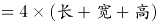，即168=4(x+4+x+2+x)，解得x=12厘米。则长方体的长宽高分别为16、14、12厘米，体积为长×宽×高=16×14×12=2688立方厘米。

故正确答案为C。

### 第 73 题

某单位实行弹性工作制，不严格规定上下班时间，但是上班打卡时间与下班打卡时间差应不少于9小时。某天上午小刘到单位打卡时，从镜子里看到时钟显示如右图。则小刘当天最早的下班打卡时间为？

A. 18：05

B. 18：35

C. 12：05

D. 17：55

第 73 题 · 答案与解析

**参考答案（粉笔题库参考内容）**

D

**解析**

将钟表左右翻转后得到实际时间如下图所示，可知此时为上午8:55，则最早下班打卡时间为8:55+9=17:55。

故正确答案为D。

### 第 74 题

某单位随机安排张、王、刘、李、陈5名职工去甲、乙、丙三个地方开展调研。要求甲、乙两地各去2人，且张、王两人不能同组，刘、陈二人必须同组，则共有多少种不同的安排方式？

A. 4

B. 6

C. 12

D. 24

第 74 题 · 答案与解析

**参考答案（粉笔题库参考内容）**

A

**解析**

刘、陈二人必须同组，且甲乙两地各需两人，则刘陈二人组成的队伍可在甲乙两地中选择一个，情况数为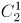；张、王二人不能同组，则在二人中选择一人前往丙地，此时剩余二人自动组成小组，情况数为。则不同的安排方式共有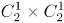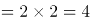种。

故正确答案为A。

### 第 75 题

劳务费计税方式为总额不高于4000元时，应纳税额=（总额-800）×20%；高于4000元时，应纳税额=（总额-总额×20%）×20%。某单位甲、乙两部门在同一月份要为某专家发放劳务费，金额均不超过4000元，如果两笔劳务费分别计税，应纳税额之和为780元，但按照规定，两笔劳务费应合并计税，则该专家实际应纳税额为

A. 780元

B. 815元

C. 880元

D. 940元

第 75 题 · 答案与解析

**参考答案（粉笔题库参考内容）**

C

**解析**

设两笔劳务费分别为x、y元，根据题意可列式为：（x-800）×20%+（y-800）×20%=780，化简可得，x+y=5500。则合并纳税时，应缴税额为（5500-5500×20%）×20%=4400×20%=880元。

故正确答案为C。

### 第 76 题

甲、乙两个学校的在校生人数之比为5：3，甲学校如果转入30名学生，再将85名学生转到乙学校，则两个学校在校生人数相同。则此时乙学校学生人数在以下哪个范围内？

A. 不到200人

B. 在200～240人之间

C. 在241～280人之间

D. 超过280人

第 76 题 · 答案与解析

**参考答案（粉笔题库参考内容）**

D

**解析**

设甲学校的在校生人数为5x，乙学校的在校生人数为3x。当“甲学校转入30名学生，再将85名学生转到乙学校”后，甲学校的在校生人数变为5x+30-85=5x-55人，乙学校的在校生人数变为(3x+85)人。根据“两个学校在校生人数相同”，可得5x-55=3x+85，解得x=70，此时乙学校的在校生人数为3x+85=295人，对应D项。

故正确答案为D。

### 第 77 题

以下为4款银行理财产品：

注：年化收益率按365天计算。产品未到投资期限赎回，不享受收益。

如果希望在1年内投资10万元资金，那么投资哪款产品能获得最大收益?

A. 1号

B. 2号

C. 3号

D. 4号

第 77 题 · 答案与解析

**参考答案（粉笔题库参考内容）**

D

**解析**

投资各产品的收益情况如下：

投资1号产品：，故一年内可以投资1次，最多可以收益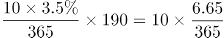万元。

投资2号产品：不够起购金额；

投资3号产品：，故一年内可以投资1次，最多可以收益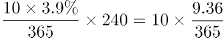万元。

投资4号产品：，故一年内可以投资2次，假设第二次投资仍以本金投资，而且以最低收益率计算，可以收益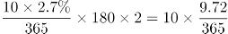万元。

综上，4号产品的最小收益大于其他3号产品。所以投资4号产品能够获得最大收益。

故正确答案为D。

### 第 78 题

某家电维修公司的职工每人每天最多完成5次修理任务。维修工小张上个月工作了20天，总计完成修理任务98次。则他上个月每天完成的修理任务次数有多少种不同的可能？

A. 190

B. 210

C. 380

D. 400

第 78 题 · 答案与解析

**参考答案（粉笔题库参考内容）**

B

**解析**

若小张工作时每天都完成5次维修任务，则上个月应完成次维修任务，而上个月实际共完成98次维修任务，说明有以下两种情况：

一、某一天完成3次维修任务，其余的工作时间每天完成5次维修任务：从工作的20天中选出1天，有种情况；

二、某两天是每天完成4次维修任务，其余的工作时间每天完成5次维修任务：从工作的20天中选出2天，有种情况。

所以他上个月每天完成的维修任务次数有20+190=210种情况，对应B项。

故正确答案为B。

### 第 79 题

某商品成本为200元，售价为292元，公司根据市场情况调整了销售方案，将售价调整为268元，预计日销量将上涨15%。现欲通过改进生产线降低成本，以保持降价前的单日利润，则单件产品的生产成本至少需要降低

A. 4%

B. 5%

C. 6%

D. 8%

第 79 题 · 答案与解析

**参考答案（粉笔题库参考内容）**

C

**解析**

赋值销量为100，上涨15%后销量变为115。设改进生产线之后，单件产品的生产成本降低了x。根据题意可得表格：

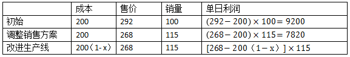

根据要“保持降价前的单日利润”，可得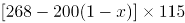，解得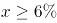，单件产品的生产成本至少需要降低6%，对应C项。

故正确答案为C。

### 第 80 题

一个7层楼的酒店，每层有20间客房。酒店的房间号为一个3位数字，其中第一位为楼层，第二、三位为从01到20的房间编号。相邻的房间房号也相邻。某个楼层三个相邻房间的房号之和为一个各位数字均不相同、且各位数字之和为6的四位数。则这三个相邻房间的房号组合有多少种不同的可能？

A. 2

B. 1

C. 6

D. 4

第 80 题 · 答案与解析

**参考答案（粉笔题库参考内容）**

A

**解析**

房号之和为一个各位数字均不同，且各位数字之和为6的四位数。故这四个数字只能是0、1、2、3。同时，房号的后两位最大为20，故后两位相加不可能产生进位。因此，三个百位数字相加（即百位数字×3）必须要产生进位至千位才能得到一个四位数。故百位数字必须4，分情况讨论：

（1）若百位数字为4，则和的前两位为12，故后两位只能是03或者30，但是不可能有三个连续的数和为3，故后两位不能为03，只能是30。此时30只能由09、10、11三个连续的房号加和而成。因此，此时三个房号分别为409、410、411。

（2）若百位数字为5和6，则和的前两位分别为15和18，不符合。

（3）若百位数字为7，则和的前两位为21，则后两位只能是03或者30，与情况（1）同理可得，此时房号为709、710、711。

所以三间连续的房间为409、410、411或者709、710、711两种情况。

故正确答案为A。

### 第 81 题

每道题包含两套图形和可供选择的4个图形。这两套图形具有某种相似性，也存在某种差异。要求你从四个选项中选择最适合取代问号的一个。正确的答案应不仅使两套图形表现出最大的相似性，而且使第二套图形也表现出自己的特征。

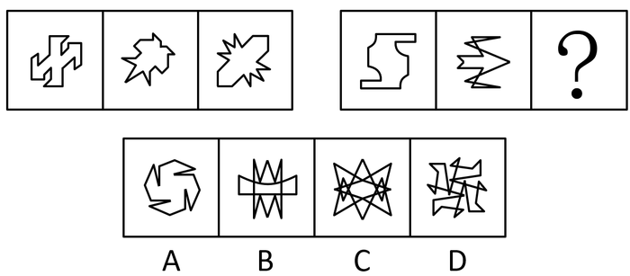

A. A

B. B

C. C

D. D

第 81 题 · 答案与解析

**参考答案（粉笔题库参考内容）**

C

**解析**

元素组成不同，优先考虑属性规律。观察可知，题干图形比较规整，考虑对称性。第一组图分别为中心对称，轴对称，轴对称+中心对称，第二组图遵循规律，分别是中心对称，轴对称，所以？处应选择轴对称+中心对称图形，符合的只有C项。

故正确答案为C。

### 第 82 题

每道题包含两套图形和可供选择的4个图形。这两套图形具有某种相似性，也存在某种差异。要求你从四个选项中选择最适合取代问号的一个。正确的答案应不仅使两套图形表现出最大的相似性，而且使第二套图形也表现出自己的特征。

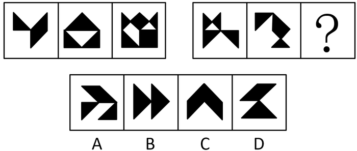

A. A

B. B

C. C

D. D

第 82 题 · 答案与解析

**参考答案（粉笔题库参考内容）**

A

**解析**

元素组成相似，优先考虑样式规律。第一组图中，第一幅图上半部分左右两边有竖线，第二幅图没有，第三幅图上半部分两条竖线保留下来，因此规律为第一幅图和第二幅图去同求异后得到第三幅图；第二组图也应该满足此规律，第一幅图上半部分没有横线，第二幅图上半部分的左侧有横线，去同求异后，左上侧应该保留横线，只有A项符合。

故正确答案为A。

### 第 83 题

每道题包含两套图形和可供选择的4个图形。这两套图形具有某种相似性，也存在某种差异。要求你从四个选项中选择最适合取代问号的一个。正确的答案应不仅使两套图形表现出最大的相似性，而且使第二套图形也表现出自己的特征。

A. A

B. B

C. C

D. D

第 83 题 · 答案与解析

**参考答案（粉笔题库参考内容）**

C

**解析**

元素组成不同，且无明显属性规律，优先考虑数量规律。题干出现多个封闭空间，考虑数面，题干图形的面数量均为3，但是ABCD项均为3个面，选不出唯一答案。继续观察发现，第一组每个图形的边框条数分别为4、5、6，呈递增规律；第二组每个图形的边框条数分别为1、2，所以？处图形的边框条数应为3，C项满足。

故正确答案为C。

### 第 84 题

每道题包含一套图形和四个选项，请从四个选项中选出最恰当的一项填在问号处，使图形呈现一定的规律性。

A. A

B. B

C. C

D. D

第 84 题 · 答案与解析

**参考答案（粉笔题库参考内容）**

A

**解析**

题干阴影部分的形状分别为三角形，四边形，五边形，六边形，图形的边数依次递增一条，所以？处的图形应为有两条边的图形，排除C、D项；对比A、B项发现位于阴影部分图形左上和左下的小图形的边数不同，观察题干可知，小图形的边数依次为两条边，三条边，四条边，五条边，小图形的边数也依次递增，所以？处图形小图形的边数应为一条边，A项满足。

故正确答案为A。

### 第 85 题

每道题包含一套图形和四个选项，请从四个选项中选出最恰当的一项填在问号处，使图形呈现一定的规律性。

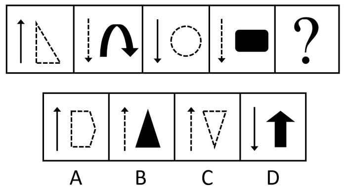

A. A

B. B

C. C

D. D

第 85 题 · 答案与解析

**参考答案（粉笔题库参考内容）**

A

**解析**

题干每幅图都是由左右两个图形构成，且图形线条有虚有实，左右两图形分开看，观察发现，图一左实右虚，图二左虚右实，图三左实右虚，图四左虚右实，左右虚实线条交替出现，故？处图形应为左实右虚，只有A项左右两个图是左实右虚。

故正确答案为A。

### 第 86 题

神机妙算：老谋深算

A. 兴高采烈：得意忘形

B. 顽固不化：坚韧不拔

C. 聚精会神：全神贯注

D. 生机勃勃：朝气蓬勃

第 86 题 · 答案与解析

**参考答案（粉笔题库参考内容）**

C

**解析**

第一步：判断题干词语间逻辑关系。

神机妙算指惊人的机智，巧妙的计谋，形容善于估计复杂的变化情势，决定策略；老谋深算，指周密的筹划，深远的打算，形容人办事精明老练。二者是近义关系。

第二步：判断选项词语间逻辑关系。

A项：兴高采烈形容兴致高，精神饱满；得意忘形指因心意得到满足而高兴得失去常态，二者不是近义关系，与题干逻辑关系不一致，排除；

B项：顽固不化表示坚持自己的意见，不肯改变，形容人十分固执；坚韧不拔形容信念坚定，意志顽强，不可动摇，二者不是近义关系，与题干逻辑关系不一致，排除；

C项：聚精会神形容人专心致志、注意力高度集中的样子；全神贯注是指全部精神集中在一点上，形容注意力高度集中，二者是近义关系，与题干逻辑关系一致，保留；

D项：生机勃勃形容生命力旺盛的样子；朝气蓬勃形容充满生气和活力的样子，二者是近义关系，与题干逻辑关系一致，保留；

比较C、D两项，题干两个词都可以用来形容“人”有深远打算，C项两个词都可以用来形容“人”注意力集中，D项的“生机勃勃”不能用来形容“人”，对比择优，C项与题干更为接近。

故正确答案为C。

### 第 87 题

跷跷板：天平

A. 踢毽子：口琴

B. 丢手绢：魔术

C. 滑滑梯：杠杆

D. 荡秋千：钟摆

第 87 题 · 答案与解析

**参考答案（粉笔题库参考内容）**

D

**解析**

第一步：判断题干词语间逻辑关系。

跷跷板和天平的原理均为杠杆原理，二者是并列关系，是原理相同的事物。

第二步：判断选项词语间逻辑关系。

A项：踢毽子是一项用脚踢毽球的健身运动，口琴是一种用嘴吹或吸气，使金属簧片振动发声的多簧片乐器，二者原理不同，与题干逻辑关系不一致，排除；

B项：丢手绢是我国传统的民间儿童游戏，魔术是以不断变化让人捉摸不透并带给观众惊奇体验为核心的一种表演艺术，二者原理不同，与题干逻辑关系不一致，排除；

C项：滑滑梯是利用滑梯光滑表面来产生快乐的儿童娱乐活动，杠杆是在力的作用下可绕固定点转动的硬棒，二者原理不同，与题干逻辑关系不一致，排除；

D项：荡秋千是利用秋千单摆原理产生愉悦的一项运动，钟摆是摆钟机件的一部分，其利用的是单摆原理，二者是并列关系，是原理相同的事物，与题干逻辑关系一致，当选。

故正确答案为D。

### 第 88 题

出国：护照：签证

A. 升学：录取：成绩

B. 开会：时间：地点

C. 乘高铁：身份证：车票

D. 跟团游：旅行社：机票

第 88 题 · 答案与解析

**参考答案（粉笔题库参考内容）**

C

**解析**

第一步：判断题干词语间逻辑关系。

出国需要护照和签证，且护照是办理签证的必要条件，二者为必要条件的对应关系。

第二步：判断选项词语间逻辑关系。

A项：先录取再升学，二者为时间先后的对应关系；依据成绩的高低进行录取，二者为依据的对应关系，与题干逻辑关系不一致，排除；

B项：开会一般需要确定好时间和地点，但时间不是地点的必要条件，与题干逻辑关系不一致，排除；

C项：乘高铁需要身份证和车票，身份证是购买车票的必要条件，二者为必要条件的对应关系，与题干逻辑关系一致，当选；

D项：跟团游可能需要通过旅行社，但旅行社不是购买机票的必要条件，与题干逻辑关系不一致，排除。

故正确答案为C。

### 第 89 题

粉笔暂未收录本题（来源缺题，题位保留）

第 89 题 · 答案与解析

**答案状态：unknown（来源未提供）**

**解析状态：unknown（来源未提供）**

### 第 90 题

沙漠 对于（ ）相当于（ ）对于 荒岛

A. 骆驼 飞鸟

B. 绿洲 海洋

C. 水 人

D. 戈壁 珊瑚岛

第 90 题 · 答案与解析

**参考答案（粉笔题库参考内容）**

B

**解析**

逐一代入选项。

A项：骆驼生活在沙漠里，二者为场所的对应关系；飞鸟生活在荒岛上，二者为场所的对应关系，但是前后顺序相反，前后逻辑关系不一致，排除；

B项：绿洲指沙漠中有水、草的地方，绿洲是沙漠的组成部分，二者为组成关系；荒岛是海洋的组成部分，二者为组成关系，前后逻辑关系一致，当选；

C项：沙漠里缺少水，二者为对应关系；荒岛上缺少人，二者为对应关系，但是前后顺序相反，前后逻辑关系不一致，排除；

D项：戈壁指地面几乎被粗沙、砾石所覆盖，植物稀少的荒漠地带；沙漠指地面完全被沙所覆盖，缺乏流水，气候干燥，植物稀少的地区。两者为并列关系；珊瑚岛是海中的珊瑚虫遗骸堆筑的岛屿，按照构成成分进行划分，荒岛是按照是否有人烟进行划分，二者为交叉关系，前后逻辑关系不一致，排除。

故正确答案为B。

### 第 91 题

某国研究人员招募大学生被试进行情绪与大脑活动的研究，先让大学生读一些能够激发嫉妒和幸灾乐祸的情绪的故事，然后用功能磁共振成像仪对被试脑部血流变化进行测定，发现，嫉妒情绪与大脑前扣带回皮层的活跃度有关，幸灾乐祸与大脑纹状体的活跃度有关，而且，在产生嫉妒情绪时前扣带回皮层的活动越活跃的人，其纹状体的活跃程度就越高。

根据上述研究，最有可能得出以下哪项结论？

A. 大脑的功能变化可以证明，嫉妒和幸灾乐祸都是人之常情

B. 喜欢嫉妒别人的人，大脑前扣带回皮层的功能要比其他人更强

C. 那些爱嫉妒别人的人，更有可能在别人不顺利时幸灾乐祸

D. 喜欢幸灾乐祸的人，大脑的纹状体活跃程度要比喜欢嫉妒的人更高

第 91 题 · 答案与解析

**参考答案（粉笔题库参考内容）**

C

**解析**

日常结论题，根据题干信息逐一分析选项。

A项：题中只是对嫉妒和幸灾乐祸这两种情绪进行研究，并没有涉及到嫉妒和幸灾乐祸都是人之常情，无中生有，排除；

B项：题干只是提到嫉妒情绪与大脑前扣带回皮层的活跃度有关，但是没有提及大脑扣带回皮层的功能和其他人之间的比较，无中生有，排除；

C项：据最后一句话可知，在产生嫉妒情绪时前扣带回皮层的活动越活跃的人，其纹状体的活跃程度就越高，而幸灾乐祸和纹状体的活跃度有关，可以推出，那些爱嫉妒别人的人，更有可能在别人不顺利时幸灾乐祸，当选；

D项：题干中没有涉及幸灾乐祸的人大脑的纹状体活跃程度如何，无中生有，排除。

故正确答案为C。

### 第 92 题

翻转课堂是随着信息技术的发展出现的一种新的教学模式，在这种模式下，重新调整了课堂内外的时间，学生在上课前完成对教学视频等学习资源的观看和学习，师生在课堂上一起完成作业答疑、协作探究和互动交流等活动，将学习的决定权从教师转移给了学生。有人认为，应该在我国的中小学中大力推广这一教学模式，以便提高教学效果。

以下选项中，除了哪个选项，都是上述论述所依赖的假设？

A. 教师能把以往的教学技能快速地应用于翻转课堂

B. 学生会主动地在课前学习相关内容

C. 学校能够有效协调师生课堂内外的教与学

D. 与之配套的软件与系统可很好地替代板书

第 92 题 · 答案与解析

**参考答案（粉笔题库参考内容）**

D

**解析**

第一步：找出论点和论据。

论点：应该在我国的中小学中大力推广翻转课堂这一教学模式，以便提高教学效果。

论据：翻转课堂是随着信息技术的发展出现的一种新的教学模式，在这种模式下，重新调整了课堂内外的时间，学生在上课前完成对教学视频等学习资源的观看和学习，师生在课堂上一起完成作业答疑、协作探究和互动交流等活动。

本题论点论据均在讨论翻转课堂，话题一致，且本题为选非题，将不是前提的选项排除即可。

第二步：逐一分析选项。

A项：该项说的是教师能把教学技能快速应用于翻转课堂，若教学技能无法快速应用，则无法推广翻转课堂，也无法保证教学效果，是论证所依赖的假设，可以加强，排除；

B项：该项说的是学生会主动地在课前学习相关内容，若学生没有主动在课前学习相关内容，就无法在上课前完成对教学资源的观看，从而无法保证提高教学效果，是论证所依赖的假设，可以加强，排除；

C项：该项说的是学校能够有效协调师生课堂内外的教与学，若学校无法协调课堂内外的教与学，则无法合理调整课堂内外的时间，就无法推广该教学模式，是论证所依赖的假设，可以加强，排除；

D项：该项说的是配套的软件与系统可很好地代替板书，即使相关软件和系统无法很好地替代板书，也可以采用传统板书讲解，其并不影响教学模式的大力推广，因此无法成为论证所依赖的假设，无法加强，当选。

本题为选非题，故正确答案为D。

### 第 93 题

智能手表近几年发展迅速，它有很多传统手表所不具备的功能，比如，实时收发短信、邮件；实时监测运动状态；获取血压、脉搏数据等。也正因为智能手表的这些优点，越来越多的人购买智能手表。据此，张楠预计，再过若干年，制造传统手表的工厂最终会倒闭。

以下哪项如果为真，最能削弱张楠的结论？

A. 因为智能手表价格较为昂贵，一些消费者不会购买智能手表

B. 虽然传统手表功能单一，戴习惯的人不愿意改戴智能手表

C. 大多数传统手表制造厂不仅制造传统手表也制造智能手表

D. 许多智能手表需要与智能手机配套使用，令许多人感到麻烦

第 93 题 · 答案与解析

**参考答案（粉笔题库参考内容）**

C

**解析**

第一步：找出论点和论据。

论点：再过若干年，制造传统手表的工厂最终会倒闭。

论据：智能手表的这些优点，越来越多的人购买智能手表。

论据说智能手表与传统手表相比，有很多优点，论点说制造传统手表的工厂会倒闭，话题一致，优先考虑削弱论点。

第二步：逐一分析选项。

A项：智能手表价格昂贵，一些消费者不会购买，但是究竟是多少消费者不会购买，范围不清晰，而且不会购买智能手表的消费者是否会购买传统手表，也不明确，无法削弱，排除；

B项：戴习惯传统手表的人不愿意改戴智能手表，虽然有人不愿换下传统手表，但是这部分人数量多少不明确，如果只有少部分人坚持佩戴传统手表，购买量较少的情况下，传统手表工厂依然可能倒闭，无法削弱，排除；

C项：大多数传统手表制造厂不仅制造传统手表也制造智能手表，那么无论智能手表和传统手表在未来谁卖得更好，传统手表的制造厂都不会倒闭，可以削弱，当选；

D项：智能手表令许多人感到麻烦，只说了智能手表的缺点，但是和传统手表相比谁更受欢迎，不明确，无法削弱，排除。

故正确答案为C。

### 第 94 题

某宿舍住着小华、小峰、小明、小刚和小强五名本科生，在确定学年论文指导老师时，他们将分别被分给张老师、王老师和李老师当中的一人。张老师只研究古代文学，王老师只研究词汇学和古文字学，李老师只研究句法学和词汇学。每位指导老师最多可指导两人，每位同学仅对所分配指导老师的一个研究方向感兴趣。已知：

（1）小峰和小刚被分给了王老师；

（2）小华被分给了李老师。

若每位同学都按照自己的兴趣被分配给了指导老师，则以下各项都是符合题干的陈述，除了哪项？

A. 小明对词汇学感兴趣，小强对古代文学感兴趣

B. 小明对句法学感兴趣，小强对古代文学感兴趣

C. 小明对古代文学感兴趣，小强对句法学感兴趣

D. 小明对古代文学感兴趣，小强对古文字学感兴趣

第 94 题 · 答案与解析

**参考答案（粉笔题库参考内容）**

D

**解析**

第一步：分析题干。

（1）张老师只研究古代文学；

（2）王老师只研究词汇学和古文字学；

（3）李老师只研究句法学和词汇学；

（4）每位指导老师最多可指导两人；

（5）每位同学仅对所分配指导老师的一个研究方向感兴趣；

（6）小峰和小刚被分给了王老师；小华被分给了李老师。

第二步：根据题干条件分析选项。

提问方式为哪项不符合题干的陈述，因此，可以考虑代入法。

代入A项，小明对词汇学感兴趣可以分配给李老师，小强对古代文学感兴趣可以分配给张老师，此时满足题干所有条件，排除；

代入B项，小明对句法学感兴趣只能分配给李老师，小强对古代文学感兴趣可以分配给张老师，此时满足题干所有条件，排除；

代入C项，小明对古代文学感兴趣可以分配给张老师，小强对句法学感兴趣可以分配给李老师，此时满足题干所有条件，排除；

代入D项，小明对古代文学感兴趣可以分配给张老师，小强对古文字学感兴趣只能分配给王老师，此时王老师已经指导了三个学生，与条件（4）矛盾，当选。

本题为选非题，故正确答案为D。

### 第 95 题

几位同事在小王家喝茶聊天。他们讨论正在喝的这种茶是什么茶。小刘说：“不是龙井，不是碧螺春”，小赵说：“不是龙井，是乌龙茶”，小李说：“不是乌龙茶，是龙井。”最后，经小王确认，三人中有一人的判断完全正确，一个人只说对了一半，另外一个人则完全说错。

据此，可以推出：

A. 小刘的判断完全正确，他们喝的是乌龙茶

B. 小赵的判断完全正确，他们喝的不是龙井

C. 小李的判断完全正确，他们喝的是龙井

D. 小李只说对了一半，他们喝的是碧螺春

第 95 题 · 答案与解析

**参考答案（粉笔题库参考内容）**

C

**解析**

此题目为组合排列题型，题干信息不确定，优先考虑代入法解题。

A项：代入到题干中发现，小刘完全正确，小赵也完全正确，不符合题干，排除；

B项：代入到题干中发现，小赵完全正确，小刘也完全正确，不符合题干，排除；

C项：代入到题干中发现，小刘对一半，小赵全错，小李完全正确，符合题干，当选；

D项：代入到题干中发现，小刘对一半，小赵也对一半，不符合题干，排除。

故正确答案为C。

### 第 96 题

某位记者说道：“金钱和幸福是人们苦苦追求的。但是，一个人有钱并不意味着他一定幸福。而一个人幸福也不意味着他一定有钱。我采访过的人中：有的人有钱，有的人幸福，多数人并不同时具备这两者。”

若该记者所述为真，关于他所采访的人中，哪项陈述一定为真？

A. 只有少数人既有钱又幸福

B. 有钱人比幸福的人要多

C. 幸福的人比有钱的人更多些

D. 有的人既没钱，又不幸福

第 96 题 · 答案与解析

**参考答案（粉笔题库参考内容）**

A

**解析**

日常结论题，根据题干信息逐一分析选项。

A项：根据记者的表述，多数人并不同时具备这两者，可以推出只有少数人既有钱又幸福，当选；

B项：题干中并没有比较有钱人的人数和幸福的人的人数，无中生有，排除；

C项：同B项，题干中并没有比较有钱人的人数和幸福的人的人数，无中生有，排除；

D项：题干只论述有的人有钱，有的人幸福，并没有不幸福、没钱的表述，有的是推不出有的不是，逻辑错误，排除。

故正确答案为A。

### 第 97 题

某校规定，对于学校的任一实验室，除非有教师在国际期刊上发表论文，否则没资格申报国家重点实验室。该校甲实验室有教师在国际期刊上发表论文。该校乙实验室有资格申报国家重点实验室。

若上述陈述为真，则以下哪项也一定为真？

A. 该校甲实验室有资格申报国家重点实验室

B. 该校甲实验室有教师没有在国际期刊上发表过论文

C. 该校乙实验室有教师在国际期刊上发表论文

D. 该校乙实验室有教师没有在国际期刊上发表过论文

第 97 题 · 答案与解析

**参考答案（粉笔题库参考内容）**

C

**解析**

第一步：翻译题干。

① 有资格申报国家重点实验室有教师发表论文；

② 甲实验室有教师发表论文；

③ 乙实验室有资格申报国家重点实验室。

第二步：逐一分析选项。

A项：题干中②是对①的肯后，但肯后得不到确定性的结论，因此推不出甲实验室是否有资格申报国家重点实验室，排除；

B项：题干中②甲实验室有教师发表论文，有老师发表过无法推出有老师没发表过，排除；

C项：题干中③是对①的肯前，肯前必肯后，可以推出乙实验室有教师发表论文，当选；

D项：题干中③是对①的肯前，肯前必肯后，得到的是乙实验室有教师发表论文，有教师发表论文无法推出有教师没有发表论文，无法推出，排除。

故正确答案为C。

### 第 98 题

人非圣贤，孰能无过。我不是圣贤，所以，我也有犯错误的时候。

以下除哪项外，均与题干的论证结构相似？

A. 金无足赤，人无完人。张灵灵是人，所以，张灵灵也不是完美的

B. 无知者无畏。小张见多识广，所以，他做事谨小慎微

C. 志不强者智不达。曹芳意志不坚定，所以，曹芳不能充分发挥她的智慧

D. 狭路相逢勇者胜。苏梅是勇者，所以，她最终会取得胜利

第 98 题 · 答案与解析

**参考答案（粉笔题库参考内容）**

B

**解析**

翻译题干，找到题干的论证结构。

人非圣贤，孰能无过。我不是圣贤，所以，我也有犯错误的时候。

即ab，因为a，所以得到b。推理形式为：肯前必肯后。

第二步：逐一分析选项。

A项：人不完美。因为张灵灵是人，所以推出张灵灵不是完美的。即ab，因为a，所以得到b，推理形式为：肯前必肯后，与题干推理结构相似，排除；

B项：无知者无畏。因为小张见多识广，所以推出他做事谨小慎微。即ab，因为-a，所以得到-b，推理形式为：否前得到否后，与题干推理结构不相似，当选；

C项：志不强者智不达。因为曹芳意志不坚定，所以推出曹芳不能充分发挥她的智慧。即ab，因为a，所以得到b，推理形式为：肯前必肯后，与题干推理结构相似，排除；

D项：勇者胜。因为苏梅是勇者，所以推出她最终会取得胜利。即ab，因为a，所以得到b，推理形式为：肯前必肯后，与题干推理结构相似，排除。

本题为选非题，故正确答案为B。

### 第 99 题

近年来，某地交通状况日趋恶化，相关部门在调研之前开了一次碰头会讨论相关事宜，有人提议，应在早上6点到9点与晚上5点到8点间禁止大货车通行，这样能极大缓解交通拥堵状况。

以下哪项如果为真，最能支持上述论断？

A. 通常情况下大货车的车速都比较快

B. 这两个时间段里该地区行驶的车辆以大货车为主

C. 大货车的车身比较宽，而该地区的道路相对狭窄

D. 大货车的司机相对其他车辆驾驶员更不注意交通安全

第 99 题 · 答案与解析

**参考答案（粉笔题库参考内容）**

B

**解析**

第一步：找出论点和论据。

论点：应在早上6点到9点与晚上5点到8点间禁止大货车通行，这样能极大缓解交通拥堵状况。

论据：无。

本题只有论点没有论据，加强优先考虑补充论据。

第二步：逐一分析选项。

A项：该项指出大货车车速较快，而车速与交通拥堵关系未知，不明确选项，不能加强，排除；

B项：该项指出这两个时间段里该地区行驶的车辆以大货车为主，则在该时间段内限制大货车可以缓解交通拥堵，补充论据，可以加强，当选；

C项：该项指出大货车的车身比较宽，而道路较窄，但不明确禁止时段里大货车的数量，因此不明确该时段禁止大货车能否缓解交通拥堵，不明确选项，不能加强，排除；

D项：该项指出大货车司机的安全意识，与该时段交通拥堵无必然联系，不能加强，排除。

故正确答案为B。

### 第 100 题

人的大脑聪明与否不仅是天生的，我们后天的行为也会对大脑产生深刻的影响。“用进废退”的生物科学原则，同样适用于人脑。大脑神经细胞和其他组织器官一样，越用越能保持其充沛的活力；总不用的话，人可能会变得越来越笨。

以下哪项如果为真，最能支持上述结论？

A. 人在专注思考时大脑的血流情况可能发生变化，从而使某些区域的温度过高导致疲劳

B. 随着年龄增长，大脑神经元会慢慢衰亡

C. 当一个人完成单调任务时，大脑便会自动转换为“安眠模式”

D. 学习新的语言可以促使脑区之间建立更高效灵活的沟通模式

第 100 题 · 答案与解析

**参考答案（粉笔题库参考内容）**

D

**解析**

第一步：找出论点和论据。

论点：大脑神经细胞和其他组织器官一样，越用越能保持其充沛的活力；总不用的话，人可能会变得越来越笨。

论据：人的大脑聪明与否不仅是天生的，我们后天的行为也会对大脑产生深刻的影响，“用进废退”的生物科学原则，同样适用于人脑。

论点论据话题一致，优先考虑补充论据进行加强。

第二步：逐一分析选项。

A项：该项讨论的是用脑与疲劳的关系，而论点说的是用脑与聪明的关系，话题不一致，不能加强，排除；

B项：该项讨论的是年龄与脑神经元的关系，而论点说的是用脑与聪明的关系，话题不一致，不能加强，排除；

C项：该项讨论的是完成单调任务时大脑会转换为“安眠模式”，但没有提及“安眠模式”与聪明之间的关系，不能加强，排除；

D项：“学习新的语言”属于用脑，“促使脑区之间建立更高效灵活的沟通模式”说明大脑变得更灵活、更聪明，举用脑的例子说明用脑能变聪明，可以加强，当选。

故正确答案为D。

### 第 101 题

周边产品，指利用动画、漫画、游戏等作品中的人物或动物造型，经授权后制成的商品。

根据上述定义，以下属于周边产品的是：

A. 某文化公司请美术大师绘制了一套《红楼梦》金陵十二钗的明信片，印刷售卖

B. 小涛制作了一套孙悟空七十二变的泥塑，参加区文化馆组织的手工艺术品比赛

C. 某娱乐公司开发了一部非常受欢迎的动画片，同步推出主人公形象的玩具和服装

D. 小樱把自己的偶像明星曾经饰演过的所有角色的照片集结成册，在粉丝群里销售

第 101 题 · 答案与解析

**参考答案（粉笔题库参考内容）**

C

**解析**

第一步：找出定义关键词。

“动漫、漫画、游戏等作品中的人物或动物造型”、“经授权后制成的商品”。

第二步：逐一分析选项。

A项：《红楼梦》金陵十二钗是小说中的人物，不符合“动漫、漫画、游戏等作品中的人物或动物造型”，不符合定义，排除；

B项：孙悟空是小说中的人物，不符合“动漫、漫画、游戏等作品中的人物或动物造型”；参加区文化馆的比赛，并不是要售卖的商品，不符合“经授权后制成的商品”，不符合定义，排除；

C项：娱乐公司开发动画片，并且推出主人公形象的玩具和服装，符合“动漫、漫画、游戏等作品中的人物或动物造型”、“经授权后制成的商品”，符合定义，当选；

D项：小樱集结自己偶像饰演的角色的照片，并且销售，不符合“动漫、漫画、游戏等作品中的人物或动物造型”、“经授权后制成的商品”，不符合定义，排除。

故正确答案为C。

### 第 102 题

绿色运输，是指以节约能源、减少废气排放为特征的运输。其实施途径主要包括：合理选择运输工具和运输路线，克服迂回运输和重复运输，以实现节能减排的目标；改进内燃机技术和使用清洁燃料，以提高能效；防止运输过程中的泄露，以免对局部地区造成严重的环境危害。

根据上述定义，以下**不属于**绿色运输的是：

A. 进口的水果、零食和日用品，航空运输且市内全程冷链配送，由多级经销商逐级分销

B. 电商对同一区域进行集约化配送，统一集货、统一送货，尽量减少货流和空载率

C. 某快递公司引入拥有更高燃油效率和更大载货量的新机型，耗油更省，飞行更远

D. 某地的物流运输全面使用可再生燃料和混合动力技术，还定期对驾驶员进行培训

第 102 题 · 答案与解析

**参考答案（粉笔题库参考内容）**

A

**解析**

第一步：找出定义关键词。
“以节约能源、减少废气排放为特征的运输”、“合理选择运输工具和运输路线，克服迂回运输和重复运输，以实现节能减排的目标”、“改进内燃机技术和使用清洁燃料，以提高能效”、“防止运输过程中的泄露，以免对局部地区造成严重的环境危害”。
第二步：逐一分析选项。
A项：进口的水果、零食和日用品用冷链配送，由多级经销商逐级分销，没有体现节能减排，不符合“以节约能源、减少废气排放为特征的运输”，不符合“合理选择运输工具和运输路线，克服迂回运输和重复运输，以实现节能减排的目标”，不符合“改进内燃机技术和使用清洁燃料，以提高能效”，也不符合“防止运输过程中的泄露，以免对局部地区造成严重的环境危害”，不符合定义，当选；
B项：电商集约化配送尽量减少货流和空载率，符合“合理选择运输工具和运输路线，克服迂回运输和重复运输，以实现节能减排的目标”，符合定义，排除；
C项：某快递公司引入拥有更高燃油效率和更大载货量的新机型，耗油更省，符合“合理选择运输工具和运输路线，克服迂回运输和重复运输，以实现节能减排的目标”，也符合“改进内燃机技术和使用清洁燃料，以提高能效”，符合定义，排除；
D项：某地的物流运输全面使用可再生燃料和混合动力技术，定期对驾驶员进行培训，符合“改进内燃机技术和使用清洁燃料，以提高能效”，符合定义，排除。
本题为选非题，故正确答案为A。

### 第 103 题

兼语句，是由兼语短语充当谓语或独立成句的句子。兼语句具有如下特点：第一，兼语句的谓语由动宾短语套接主谓短语构成，动宾短语的宾语兼做主谓短语的主语。第二，兼语句多有使令的意思，所以句中前一个谓语多由使令动词充当。第三，兼语句中兼语的谓语是前边动作所要达到的目的或产生的结果，即兼语前后两个动词在语意上有一定联系。“我请他作报告”就是一个兼语句。

根据上述定义，以下句子**不属于**兼语句的是：

A. 老师叫我告诉你这件事

B. 我去图书馆借本书看

C. 学校号召毕业生去支教

D. 同学们选小明当班长

第 103 题 · 答案与解析

**参考答案（粉笔题库参考内容）**

B

**解析**

第一步：找出定义关键词。

“由兼语短语充当谓语或独立成句的句子”、“兼语句的谓语由动宾短语套接主谓短语构成，动宾短语的宾语兼做主谓短语的主语”、“兼语句多有使令的意思，所以句中前一个谓语多由使令动词充当”、“兼语句中兼语的谓语是前边动作所要达到的目的或产生的结果，即兼语前后两个动词在语意上有一定联系”。

第二步：逐一分析选项。

A项：老师叫我告诉你这件事，“叫我”是动宾短语，“我告诉你”是主谓短语，符合“由兼语短语充当谓语或独立成句的句子”“兼语句的谓语由动宾短语套接主谓短语构成，动宾短语的宾语兼做主谓短语的主语”；“老师叫我”是命令语句，符合“兼语句多有使令的意思，所以句中前一个谓语多由使令动词充当”；“告诉你这件事”是老师的目的，符合“兼语句中兼语的谓语是前边动作所要达到的目的或产生的结果，即兼语前后两个动词在语意上有一定联系”，符合定义，排除。

B项：我去图书馆借本书看，“去图书馆”是动宾短语，“图书馆借本书”，图书馆不是借书的主语而是地点状语，不符合“兼语句的谓语由动宾短语套接主谓短语构成，动宾短语的宾语兼做主谓短语的主语”，不符合定义，当选。

C项：学校号召毕业生去支教，“号召毕业生”是动宾短语，“毕业生去支教”是主谓短语，符合“由兼语短语充当谓语或独立成句的句子”“兼语句的谓语由动宾短语套接主谓短语构成，动宾短语的宾语兼做主谓短语的主语”；“毕业生去支教”是学校的目的，符合“兼语句中兼语的谓语是前边动作所要达到的目的或产生的结果，即兼语前后两个动词在语意上有一定联系”，符合定义，排除。

D项：同学们选小明当班长，“选小明”是动宾短语，“小明当班长”是主谓短语，符合“由兼语短语充当谓语或独立成句的句子”“兼语句的谓语由动宾短语套接主谓短语构成，动宾短语的宾语兼做主谓短语的主语”；“小明当班长”是同学们的目的，符合“兼语句中兼语的谓语是前边动作所要达到的目的或产生的结果，即兼语前后两个动词在语意上有一定联系”，符合定义，排除。

本题为选非题，故正确答案为B。

### 第 104 题

回赎权，是指出典人在典期届满时享有的要求偿付原典价并支付其他合理的费用和利息，赎回原典物的权利。回赎权有一定的期限限制。根据我国有关法规和司法解释的规定，出典人在典期届满10年不回赎，或无典期经过30年不回赎的，视为绝卖，典物的所有权即归典权人所有。

根据上述定义，以下判断正确的是：

A. 小张因投资需要资金，在典当行典当了一件传家宝，约定三年后赎回，三年后小张投资失利，无法按时回赎，典当行即拥有该宝贝的所有权

B. 王某二十年前无典期典当了自己的房屋，现在仍未赎回，该房屋可视为绝卖，王某无法再赎回

C. 李某在1999年与典当行达成协议，以3万元典当了一块古董手表，未明确典当期限，直至2009年李某仍没有赎回，此时典当行可以将手表公开拍卖

D. 赵某十五年前典当了一套房屋的产权，当时协议典期为两年，赵某至今仍无能力回赎，该房屋可视为绝卖

第 104 题 · 答案与解析

**参考答案（粉笔题库参考内容）**

D

**解析**

第一步：找出定义关键词。

“出典人在典期届满时享有的要求偿付原典价并支付其他合理的费用和利息，赎回原典物的权利”、“出典人在典期届满10年不回赎，或无典期经过30年不回赎的，视为绝卖”。

第二步：逐一分析选项。

A项：约定三年后赎回，即典期为三年，而三年后小张无法按时回赎，不符合“出典人在典期届满10年不回赎”，不符合定义，排除；

B项：王某二十年前无典期典当了自己的房屋，属于无典期经过20年不回赎，不符合“无典期经过30年不回赎”，不符合定义，排除；

C项：李某在1999年典当一块古董手表，未明确典当期限，直至2009年李某仍没有赎回，属于无典期经过10年不回赎，不符合“无典期经过30年不回赎”不符合定义，排除；

D项：赵某十五年前典当了一套房屋的产权，当时协议典期为两年，属于典期届满13年不回赎，符合“出典人在典期届满10年不回赎”，符合定义，当选。

故正确答案为D。

### 第 105 题

商业混同行为，是指经营者采用欺骗手段从事市场交易，使自己经营的商品或服务与特定竞争对手的商品或服务相混淆，造成或足以使购买者误认误购的不正当竞争行为。

根据上述定义，以下属于商业混同行为的是：

A. 某啤酒厂家出售的一款“白威”啤酒，跟知名品牌百威啤酒的外包装非常相似，售价却只有百威啤酒的一半

B. 泰山旅游宣传海报的图片上山峦起伏、白云缭绕，当地一家卷烟厂生产的“泰山”牌香烟，也将海报的图片复制在烟盒上

C. 某娱乐演艺公司经营一家名为“晚亭”的会所，并在门前张挂其公司旗下艺人张婉婷的电影剧照，不少人以为是张婉婷本人开的会所

D. 某饼干生产厂家的外包装使用知名动画片“小猪佩奇”的剧照，里面还随饼干附赠小猪佩奇的玩偶，吸引了很多小顾客

第 105 题 · 答案与解析

**参考答案（粉笔题库参考内容）**

A

**解析**

第一步：找出定义关键词。

“使自己经营的商品或服务与特定竞争对手的商品或服务相混淆”、“造成或足以使购买者误认误购的不正当竞争行为”。

第二步：逐一分析选项。

A项：某啤酒厂家出售的啤酒跟知名品牌外包装非常相似，符合“使自己经营的商品或服务与特定竞争对手的商品或服务相混淆”、也符合“造成或足以使购买者误认误购的不正当竞争行为”，符合定义，当选；

B项：泰山旅游宣传海报和卷烟厂之间并非竞争对手的关系，不符合定义，排除；

C项：某娱乐演艺公司经营的会所和其公司旗下艺人并非竞争对手的关系，不符合定义，排除；

D项：某饼干生产厂家和知名动画片“小猪佩奇”并非竞争对手的关系，不符合定义，排除。

故正确答案为A。

### 第 106 题

交互记忆，指的是当由两个或以上的个体组成的团体经过长时间一起工作生活之后，他们之间会分享存储的记忆。个体不一定需要记忆所有的信息，而只需要记住群体内那些成员是哪方面信息的专家即可，当需要这方面信息时就可以向其询问。通过这种方式，本应存储于每个个体中的记忆被分散到组成群体的不同成员的头脑中去了，就好像所有的成员的头脑组成了一个具有更大容量的记忆库一样。

根据上述定义，以下不属于交互记忆的是：

A. 小郭对实验室各种设备都非常熟悉，课题组成员在讨论实验数据的误差时都会询问小郭的意见，排除设备造成重大误差的可能性

B. 小梅和小芳经常在一起学习，考前复习时，她们相互提问，相互考核，发现各自没有掌握的知识点，有效提高了学习效率

C. 小涛在家里找以前的家庭聚会合影，怎么也找不到，他问爸爸：“您记得咱家那些合影都放哪儿了吗?”爸爸回答：“家里的东西，你得问你妈。”

D. 研究生夏江找不到某个理论的原始出处，他记得同课题组一位师兄以前介绍过这方面的研究，就去找该师兄求助，师兄告诉他可在哪本书中查到

第 106 题 · 答案与解析

**参考答案（粉笔题库参考内容）**

B

**解析**

第一步：找出定义关键词。

“个体不一定需要记忆所有的信息，而只需要记住那些成员是哪方面的专家即可”、“当需要这方面的信息时就可以向其询问”。

第二步：逐一分析选项。

A项：课题组成员在讨论实验数据的误差时都会询问小郭的意见，即大多数人不用知道所有信息，直接询问小郭即可，符合“个体不一定需要记忆所有的信息”、“当需要这方面的信息时就可以向其询问”，符合定义，排除；

B项：小梅和小芳一起学习，相互提问、考核，发现各自没有掌握的知识点，说明双方都需要掌握所有知识点，不符合“个体不一定需要记忆所有的信息，而只需要记住那些成员是哪方面的专家即可”，不符合定义，当选；

C项：小涛找不到家庭合影，询问父亲，父亲让他询问妈妈，即家庭成员之间有分工，每个家庭成员不需要记住所有信息，需要时直接询问别人即可，符合“个体不一定需要记忆所有的信息”、“当需要这方面的信息时就可以向其询问”，符合定义，排除；

D项：夏江找不到理论出处，就去找师兄求助，说明夏江不需要记住所有信息，需要时直接询问他人即可，符合“个体不一定需要记忆所有的信息”、“当需要这方面的信息时就可以向其询问”，符合定义，排除。

本题为选非题，故正确答案为B。

### 第 107 题

湿租，是航空公司之间的一种特殊租赁方式，在提供飞机的同时提供机组和乘务组为对方服务，而且在租赁过程中，被租赁飞机的标志不变、飞机号不变。民航规章体系将其定义为：是指按照租赁协议，承租方租赁飞机时携带出租方一名或者多名机组成员的租赁。

根据上述定义，以下属于湿租的是：

A. 某航线由甲航空公司销售机票，乙航空公司独立执行飞行，两公司达成协议，合作期间使用甲公司的航班号

B. 某航空公司为了开辟欧洲新航线，从甲国进口五架最新机型飞机，同时聘请甲国飞行员和专业维修技师为新航线服务

C. 某航空公司因季节原因人员短缺，从乙航空公司临时借调部分工作人员承担飞行任务

D. 圣诞将至，甲国航空公司为了缓解客运压力，从乙国租借了三架民用飞机，机组和维修员工仍为乙国航空公司原有资源

第 107 题 · 答案与解析

**参考答案（粉笔题库参考内容）**

D

**解析**

第一步：找出定义关键词。

“在提供飞机的同时提供机组和乘务组为对方服务”、“被租赁飞机的标志不变、飞机号不变”。

第二步：逐一分析选项。

A项：某航线由甲航空公司销售机票，乙航空公司独立执行飞行，即乙航空公司提供飞机，是租赁方，但最后使用甲公司的航班号，不符合“被租赁飞机的标志不变、飞机号不变”，不符合定义，排除；

B项：某航空公司从甲国进口飞机，属于直接购买，不是“租赁”，不符合定义，排除；

C项：某航空公司只是从乙航空公司临时借调部分工作人员，并没有租赁对方公司的飞机，不符合“在提供飞机的同时提供机组和乘务组为对方服务”，不符合定义，排除；

D项：甲国航空公司从乙国租借了三架民用飞机，存在“租赁”的行为，机组和维修员工仍为乙国航空公司原有资源，说明乙国航空公司“在提供飞机的同时提供机组和乘务组为对方服务”，符合定义，当选。

故正确答案为D。

### 第 108 题

黄金标准法则，指的是在品牌定位和广告表现上，为品牌设立一个可使之与同类品牌相比更加出色的说辞，从而体现出该品牌的高出一筹，胜人一筹；黄金标准的内容可以有：强调领导性和专业性；突出产品的优越品质；建立科学的使用规则；突出品牌在技术、工艺等方面的先进性；传播惟我独尊的品牌价值与形象等。

根据上述定义，以下没有应用黄金标准法则的是：

A. 某保健品的宣传语是“鹤舞长山，我心飞翔！”

B. 某肉类食品品牌的宣传语是“世界领先的肉类供应商！”

C. 某电视品牌的广告语是“不闪的，才是最好的！”

D. 某房地产的广告语是“我是你今生唯一的选择！”

第 108 题 · 答案与解析

**参考答案（粉笔题库参考内容）**

A

**解析**

第一步：找出定义关键词。

“品牌设立与同类品牌相比更加出色的说辞”、“体现出该品牌的高出一筹，胜人一筹”。

第二步：逐一分析选项。

A项：某保健品的宣传语是“鹤舞长山，我心飞翔！”，强调的是该公司的保健品本身效果佳，让消费者长寿健康，心情好，不符合“品牌设立与同类品牌相比更加出色的说辞”、“体现出该品牌的高出一筹，胜人一筹”，不符合定义，当选；

B项：某肉类食品品牌的宣传语是“世界领先的肉类供应商！”，“世界领先”符合“品牌设立与同类品牌相比更加出色的说辞”、“体现出该品牌的高出一筹，胜人一筹”，符合定义，排除；

C项：某电视品牌的广告语是“不闪的，才是最好的！”，突出了品牌在技术、工艺等方面的先进性，符合“品牌设立与同类品牌相比更加出色的说辞”、“体现出该品牌的高出一筹，胜人一筹”，符合定义，排除；

D项：某房地产的广告语是“我是你今生唯一的选择！”，选项中的“唯一”体现了唯我独尊的品牌价值，比其他品牌更加出色，更胜一筹，符合“体现出该品牌的高出一筹，胜人一筹”，符合定义，排除。

本题为选非题，故正确答案为A。

### 第 109 题

合同可以根据价款分为开口合同和闭口合同，“开口价”是指按一定的计价方式通过计算最终才能确定的价格，“闭口价”是指订立合同时已确定的价格。没有确定价格的买卖合同是“开口合同”。

根据上述定义，以下属于开口合同的是：

A. 李先生和装修公司签订合同，约定装修总价为12万。结账时装修公司提出，装修过程中李先生要求使用的是更高标准的五金件，因此要求李先生额外支付2000元

B. 甲、乙两公司签订供货合同，约定供货单价，甲公司每月下达次月订单给乙公司，月底按甲公司的入库数量进行结算，如原材料市场价格波动超过本合同价10%以上可再协商

C. 方先生和妻子离异时约定，女儿由女方抚养，方先生每月支付2000元抚养费给女方，直至孩子成年，如果孩子生病等需要额外支出，费用支出由双方协商决定

D. 江阿姨年事已高，她的三个儿子经江阿姨同意后约定，将她名下的两居室转到大儿子名下，其他儿子放弃对房产的要求，由大儿子照顾江阿姨并负责所有费用

第 109 题 · 答案与解析

**参考答案（粉笔题库参考内容）**

B

**解析**

第一步：找出定义关键词。

“没有确定价格的买卖合同”。

第二步：逐一分析选项。

A项：李先生与装修公司签订合同，约定合同总价为12万，不符合“没有确定价格的买卖合同”，装修过程中李先生要求使用更高标准的五金件，因此要额外支付2000元，也不符合“没有确定价格的买卖合同”，不符合定义，排除；

B项：甲、乙两公司签订供货合同，约定供货单价，如原材料市场价格波动超过本合同价10%以上可再协商，原材料市场价格波动符合“没有确定价格的买卖合同”，符合定义，当选；

C项：夫妻双方对女儿的抚养费用约定，不符合“买卖合同”，不符合定义，排除；

D项：兄弟之间约定照顾母亲，不符合“买卖合同”，不符合定义，排除。

故正确答案为B。

### 第 110 题

“热炉效应”，是指组织中任何人触犯规章制度都要受到处罚。它是由于触摸热炉与实行惩罚之间有许多相似之处而得名。“热炉”形象地阐述了惩处原则：一、警告性原则。热炉火红，不用手去摸也知道炉子是热的。例如企业领导要经常对下属进行规章制度教育。二、一致性原则。每当你碰到热炉，肯定会被灼伤。只要触犯规章制度，就一定会受到惩处。三、即时性原则。当你碰到热炉时，立即就被灼伤。惩处必须在错误行为发生后立即进行，绝不能拖泥带水。四、公平性原则。不管是谁碰到热炉，都会被灼伤。

根据上述定义，以下**并未**体现“热炉效应”的是：

A. 王子犯法，与庶民同罪

B. 明慎所职，毋以身试法

C. 民不举，官不究

D. 法不阿贵，绳不挠曲

第 110 题 · 答案与解析

**参考答案（粉笔题库参考内容）**

C

**解析**

第一步：找出定义关键词。

“组织中任何人触犯规章制度都要受到处罚”、“警告性原则”、“一致性原则”、“即时性原则”、“公平性原则”。

第二步：逐一分析选项。

A项：王子犯法，与庶民同罪的意思是，王子违背了法律，会和老百姓一样处以惩罚，没有特殊对待，符合“组织中任何人触犯规章制度都要受到处罚”、“公平性原则”，符合定义，排除；

B项：明慎所职，毋以身试法的意思是，要知道自己的职责，不要试着亲身去做触犯法律的事，符合“组织中任何人触犯规章制度都要受到处罚”“警告性原则”，符合定义，排除；

C项：民不举，官不究意思是，虽有不当行为，但当事人不向当局提出追诉请求，当局就不应追究，不符合“组织中任何人触犯规章制度都要受到处罚”，不符合定义，当选；

D项：法不阿贵，绳不挠曲意思是，法律不偏袒有权有势的人，墨线不向弯曲的地方倾斜，符合“组织中任何人触犯规章制度都要受到处罚”“公平性原则”，符合定义，排除。

本题为选非题，故正确答案为C。

## 材料 7

2017年全国共有各级各类民办学校17.76万所，占全国学校总数34.57%；各类民办教育在校生达5120.47万人，比上年增长6.12%。其中：民办幼儿园16.04万所，比上年增长4.00%；在园儿童2572.34万人，比上年增长5.53%。民办普通小学6107所，比上年增长2.21%；在校生814.17万人，比上年增长7.65%。民办初中5277所，比上年增长3.78%；在校生577.68万人，比上年增长8.42%。民办普通高中3002所，比上年增长7.71%；在校生306.26万人，比上年增长9.74%。民办中等职业学校2069所，比上年下降2.17%；在校生197.33万人，比上年增长7.16%。

### 第 111 题

2017年全国学校总数在以下哪个范围内？

A. 不到50万所

B. 50～60万所之间

C. 60～70万所之间

D. 超过70万所

第 111 题 · 答案与解析

**参考答案（粉笔题库参考内容）**

B

**解析**

根据“2017年全国学校总数在以下哪个范围内”，结合材料所给数据为2017年的比重数据，判断本题为现期比重问题。定位材料，“2017年全国共有各级各类民办学校17.76万所，占全国学校总数34.57%”。因此全国的学校总数为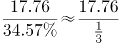万所，在B选项范围内。

故正确答案为B。

### 第 112 题

2017年民办幼儿园在园儿童人数占民办教育在校生总人数的比例约为

A. 30%

B. 50%

C. 70%

D. 90%

第 112 题 · 答案与解析

**参考答案（粉笔题库参考内容）**

B

**解析**

根据“2017年······占······的比例约为多少”，结合材料时间为2017年，判断本题为现期比重问题。定位材料，各类民办教育在校生达5120.47万人，民办幼儿园在园儿童2572.34万人。根据公式：，则2017年民办幼儿园在园儿童人数占民办教育在校生总人数的比例约为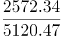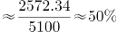。

故正确答案为B。

### 第 113 题

以下民办学校类型中，2017年学校数量同比增长最多的是

A. 民办普通高中

B. 民办普通小学

C. 民办初中

D. 民办幼儿园

第 113 题 · 答案与解析

**参考答案（粉笔题库参考内容）**

D

**解析**

根据“······2017年学校数量同比增长最多的是”，判断本题为增长量比较问题。定位材料可得，“民办普通小学6107所，比上年增长2.21%；民办初中5277所，比上年增长3.78%，民办幼儿园16.04万所，比上年增长4.00%”，根据增长量比较口诀“大大则大”，民办幼儿园的现期量（16.04万所=160400所）和增长率（4.00%）均大于民办普通小学与民办初中，所以民办幼儿园的增长量大于民办普通小学与民办初中。

根据增长量计算公式：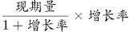，计算比较民办普通高中和民办幼儿园的增长量。

民办普通高中的增长量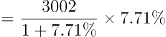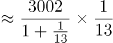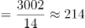；

民办幼儿园的增长量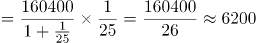。

故2017年学校数量同比增长最多的是民办幼儿园。

故正确答案为D。

### 第 114 题

2016年平均每所民办中等职业学校在校生人数约为

A. 871人

B. 991人

C. 1091人

D. 1181人

第 114 题 · 答案与解析

**参考答案（粉笔题库参考内容）**

A

**解析**

由题干“2016年平均每······”，结合材料时间是2017年，可判定本题为基期平均数问题。定位文字材料，“2017年，······民办中等职业学校2069所（B），比上年下降2.17%（b）；在校生197.33万人（A），比上年增长7.16%（a）。”根据基期平均数公式：，可计算出2016年平均每所民办中等职业学校在校生人数约为：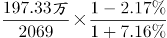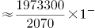 人＜953人，满足的只有A项。

故正确答案为A。

### 第 115 题

能够从上述资料中推出的是

A. 2017年平均每所民办学校在校生人数超过300人

B. 2017年民办中等职业学校在校生人数同比增加了20多万人

C. 2017年民办初中学校数量占民办学校总数的5%以上

D. 2017年民办普通高中在校生人数同比增速快于民办普通小学

第 115 题 · 答案与解析

**参考答案（粉笔题库参考内容）**

D

**解析**

A项：定位文字材料，“2017年全国共有各级各类民办学校17.76万所（B），······各类民办教育在校生达5120.47万人（A），比上年增长6.12%”。根据现期平均数公式：，可以计算出2017年平均每所民办学校在校生人数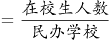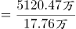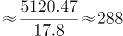人＜300人。错误；

B项：定位文字材料，“2017年，······民办中等职业学校······在校生197.33万人，比上年增长7.16%”。根据增长量，可计算出2017年民办中等职业学校在校生人数同比增加了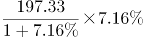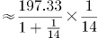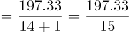万人＜20万人。错误；

C项：定位文字材料，“2017年全国共有各级各类民办学校17.76万所，······民办初中5277所”。根据公式：比重，可计算出2017年民办初中学校数量占民办学校总数的比重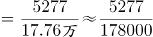。错误；

D项：定位文字材料，“2017年民办普通小学在校生814.17万人，比上年增长7.65%；民办普通高中在校生306.26万人，比上年增长9.74%”。可知2017年民办普通高中在校生人数同比增速（9.74%）快于民办普通小学（7.65%）。正确。

故正确答案为D。

## 材料 8

2016年末，A自治区城镇人口为1542.1万人，城镇化率(城镇人口占总人口比重)为61.2%。

2016年末A自治区城镇人均居住面积达32.20平方米，比1978年末增长了5.5倍；农村牧区人均居住面积达27.40平方米，比1985年末增长103%。2016年末A自治区城镇居民家庭每百户拥有家用汽车38.48辆、家用电脑62台、移动电话222.21部；农牧民家庭每百户拥有家用汽车27.29辆、家用电脑23台、移动电话231.53部。

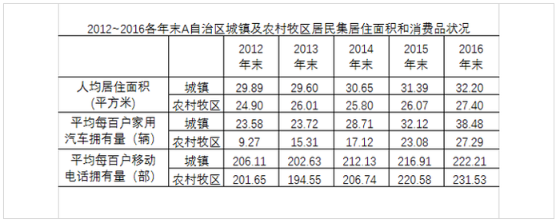

### 第 116 题

2016年末A自治区城镇人口总居住面积约为多少亿平方米？

A. 3

B. 5

C. 7

D. 9

第 116 题 · 答案与解析

**参考答案（粉笔题库参考内容）**

B

**解析**

根据题干所求“2016年末······人口总居住面积约为······”，结合材料可判定此题为现期平均数问题。定位文字材料第一段“2016年末，A自治区城镇人口为1542.1万人”，定位文字材料第二段“2016年末A自治区城镇人均居住面积达32.20平方米”。由城镇人均居住面积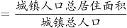得，城镇人口总居住面积=城镇人均居住面积×城镇总人口=32.2平方米/人×1542.1万人≈32平方米/人×0.15亿人≈4.8亿平方米，与B项最接近。

故正确答案为B。

### 第 117 题

以下折线图最能准确反映2013～2016年A自治区哪一类居民的哪一类产品拥有量同比增量变化趋势？

A. 城镇居民，家用汽车

B. 农村牧区居民，家用汽车

C. 城镇居民，移动电话

D. 农村牧区居民，移动电话

第 117 题 · 答案与解析

**参考答案（粉笔题库参考内容）**

A

**解析**

根据题干所求“以下折线图······同比增量变化趋势”，可判定此题为增长量比较问题。定位表格材料，由增长量=现期-基期可得，2013~2016年A自治区城镇居民、农村牧区居民不同产品拥有量同比增量分别为：

A项：城镇居民，家用汽车：0.14辆、4.99辆、3.41辆、6.36辆，满足折线图变化趋势，当选。

B项：农村牧区居民，家用汽车：6.04辆、1.81辆、5.96辆、4.21辆，观察折线图第一个点应为最低点，与数据不符，排除；

C项：城镇居民，移动电话：-3.48部、9.5部、4.78部、5.3部，由折线图第四个点应为最高点，排除；

D项：农村牧区居民，移动电话：-7.1部、12.19部、13.84部、10.95部，由折线图第四个点应为最高点，排除。

故正确答案为A。

### 第 118 题

2013～2016各年末，A自治区城镇、农村牧区居民人均居住面积、户均家用汽车和移动电话拥有量均高于上年的年份有几个？

A. 1

B. 2

C. 3

D. 4

第 118 题 · 答案与解析

**参考答案（粉笔题库参考内容）**

B

**解析**

定位表格材料可得，2012年末A自治区城镇居民人均居住面积为29.89平方米，2013年末为29.60平方米，2013年末低于上年，则2013年末排除；2013年末农村牧区居民人均居住面积为26.01平方米，2014年末为25.80平方米，2014年末低于上年，则2014年末排除；2015年末、2016年末A自治区城镇、农村牧区居民人均居住面积、户均家用汽车和移动电话拥有量均高于上年，即2015年、2016年这2个年份满足。

故正确答案为B。

### 第 119 题

假设平均每户城镇居民家庭的人口数与农牧民家庭相同，则2016年末A自治区城镇居民拥有的家用电脑总量约是农村牧区居民的多少倍？

A. 1.6

B. 2.1

C. 2.7

D. 4.3

第 119 题 · 答案与解析

**参考答案（粉笔题库参考内容）**

D

**解析**

由题干“2016年末······是······的多少倍”，且材料数据为2016年，可判定本题为现期倍数问题。定位文字材料第二段“2016年末A自治区城镇居民家庭每百户拥有家用电脑62台；农牧家庭每百户拥有家用电脑23台”。城镇居民家庭拥有电脑总量是农村牧区居民的倍数为：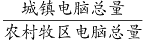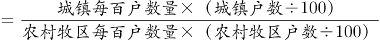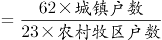。由题干“平均每户城镇居民家庭人口数与农牧家庭相同”，可知平均每户人口数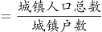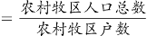，则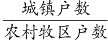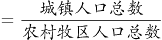，因此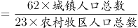。定位文字材料第一段“A自治区城镇人口为1542.1万人，城镇化率为61.2%”，可知A自治区农村牧区人口比例为（1-61.2%），则人口总数为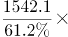，因此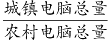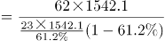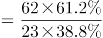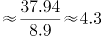倍。

故正确答案为D。

### 第 120 题

关于A自治区的以下信息，能够从上述资料中推出的是

A. 1978年末城镇人均居住面积高于1985年末农村牧区人均居住面积

B. 2016年末城镇人口数量是农村牧区人口数量的2倍以上

C. 2016年末城镇居民户均移动电话拥有量比2012年末增长了10%以上

D. 2014年末农村牧区平均每6户农牧民拥有的汽车数量在1辆以上

第 120 题 · 答案与解析

**参考答案（粉笔题库参考内容）**

D

**解析**

A项：定位文字材料第二段“2016年末A自治区城镇人均居住面积达32.20平方米，比1978年末增长了5.5倍；农村牧区人均居住面积达27.40平方米，比1985年末增长103%”，则1978年末城镇人均居住面积为：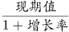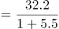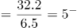平方米；1985年末农村牧区人均居住面积为：平方米，因此前者小于后者，错误；

B项：定位文字材料第一段“2016年末，A自治区城镇人口为1542.1万人，城镇化率(城镇人口占总人口比重)为61.2%”，则2016年末农村牧区人口占比=1-61.2%=38.8%，2016年末城镇人口数量是农村牧区人口数量的倍数为：，错误；

C项：定位表格，2016年末、2012年末城镇居民户均移动电话拥有量分别为222.21部、206.11部，则2016年增长率，错误；

D项：定位表格，2014年末农村牧区平均每百户家用汽车拥有量为17.12辆，则平均每6户农牧民拥有的汽车数量为辆，正确。

故正确答案为D。

## 材料 9

截至2015年12月底，北京市文化及相关产业企业共有198948户，同比增长16.49%，占全市企业总数的16.63%；2015年新设文化及相关产业企业30323户，同比增长3.91%。

### 第 121 题

截至2015年12月底北京市企业总数约为多少万户？

A. 120

B. 23

C. 17

D. 3

第 121 题 · 答案与解析

**参考答案（粉笔题库参考内容）**

A

**解析**

根据题干“截至2015年12月底北京市企业总数约为多少万户”，结合材料时间为2015年，可判定本题为现期比重计算问题。定位文字材料可得：“截至2015年12月底，北京市文化及相关产业企业共有198948户······”，占全市企业总数的16.63%；故北京市企业总数。

故正确答案为A。

### 第 122 题

北京市2015年12月底前成立的文化及相关产业企业中，约有多少万户在2015年注销（上年末企业数＋本年内新增企业数-本年内注销企业数＝本年末企业数）？

A. 20.1

B. 17.1

C. 1.1

D. 0.2

第 122 题 · 答案与解析

**参考答案（粉笔题库参考内容）**

D

**解析**

根据题干“······约有多少万户在2015年注销”，结合材料时间为2015年，可判定本题为现期计算问题。定位文字材料：“截至2015年12月底，北京市文化及相关产业企业共有198948户，同比增长16.49%，2015年新设文化及相关产业企业30323户”。结合题干给出的等式：上年末企业数＋本年内新增企业数-本年内注销企业数＝本年末企业数，可得：，本年内注销企业数。

故正确答案为D。

### 第 123 题

截至2015年12月底北京市文化及相关产业各行业中，企业数量最多的行业的企业户数比企业数量最少的行业多多少倍？

A. 5.6

B. 22.7

C. 47.5

D. 93.3

第 123 题 · 答案与解析

**参考答案（粉笔题库参考内容）**

C

**解析**

根据题干“截至2015年12月底······多多少倍”，结合材料时间为2015年，可判定本题为现期倍数计算问题。定位材料表格可得：企业数量最多的行业是文化艺术服务业，其企业数量为95928户；企业数量最少的行业是广播电视电影服务业，其企业数量为1977户，代入公式：多几倍。

故正确答案为C。

### 第 124 题

2015年文化及相关产业新设企业中，新设户数排名前三位的行业合计占全市文化及相关产业新设企业户数的：

A. 64.1%

B. 70.2%

C. 76.1%

D. 82.9%

第 124 题 · 答案与解析

**参考答案（粉笔题库参考内容）**

D

**解析**

由题干“2015年，······占······”，判定本题为现期比重问题。定位表格可得：2015年文化及相关产业各行业全年新设企业户数排名前三位的行业分别为：文化艺术服务（18586户）、文化创意和设计服务（4850户）和文化产品生产的辅助生产（1710户）；定位文字材料可得：“2015年新设文化及相关产业企业30323户”，根据公式：比重，则所求比重，与D项最接近。

故正确答案为D。

### 第 125 题

下列有关北京市文化及相关产业各行业企业的表述中，错误的是：

A. 截至2015年12月底文化休闲娱乐服务业的企业中，一成以上为2015年新设企业

B. 截止2015年12月底北京市文化及相关产业各行业企业数量都比上年有一定增加

C. 北京市文化及相关产业各行业中，在2015年新设企业户数同比降幅最大的行业是文化用品的生产业

D. 截至2015年12月底企业数量同比增速最快的三个行业是广播电视电影服务业、文化艺术服务业、工艺美术品的生产业

第 125 题 · 答案与解析

**参考答案（粉笔题库参考内容）**

A

**解析**

A项：定位表格可得，文化休闲娱乐服务业2015年年末企业总数为2456户，全年新设企业数为244户。根据公式：比重，则所求，即不足一成，错误；

B项：定位表格可得，截至2015年12月底，北京市文化及相关产业各行业企业总数同比增速均大于0，说明企业数量都比上年有一定增加，正确；

C项：定位表格可得，2015年新设企业户数同比增速为负数的行业有：文化休闲娱乐服务（-10.95%）、文化创意和设计服务（-14.05%）、文化专用设备的生产（-17.95%）、文化用品的生产（-32.65%）、工艺美术品的生产（-9.29%）、文化产品生产的辅助生产（-11.54%），降幅比较的是增长率的绝对值，则降幅最大的为文化用品生产业，正确；

D项：定位表格可得，2015年各行业年末企业总数同比增速最快的三个行业是广播电视电影服务（94.4%）、文化艺术服务（22.87%）和工艺美术品的生产（20.38%），正确。

本题为选非题，故正确答案为A。

## 材料 10

2016年“一带一路”沿线64个国家GDP之和约为12.0万亿美元，占全球GDP的16.0%；人口总数约为32.1亿人，占全球人口的43.4%；对外贸易总额约为71885.5亿美元，占全球贸易总额的21.7%。

### 第 126 题

2016年东南亚“一带一路”沿线国家人口总数约占“一带一路”沿线64个国家人口总数的：

A. 35.6%

B. 29.7%

C. 19.9%

D. 8.6%

第 126 题 · 答案与解析

**参考答案（粉笔题库参考内容）**

C

**解析**

由题干“2016年······约占······的”，结合选项为百分数，可判定本题为现期比重问题。定位文字材料可得，2016年“一带一路”沿线64个国家人口总数约为32.1亿人，定位表格可得，2016年东南亚“一带一路”沿线国家人口总数为63852.5万人。则所求比重，与C项最接近。

故正确答案为C。

### 第 127 题

2016年“一带一路”沿线国家人均GDP约是全球水平的多少倍：

A. 2.7

B. 1.6

C. 0.9

D. 0.4

第 127 题 · 答案与解析

**参考答案（粉笔题库参考内容）**

D

**解析**

由题干“2016年······约是······的多少倍”，可判定本题为现期倍数问题。定位文字材料可得，2016年“一带一路”沿线64个国家GDP之和约为12.0万亿美元，占全球GDP的16.0%；人口总数约为32.1亿人，占全球人口的43.4%。则2016年“一带一路”沿线国家人均GDP美元/人，全球人均GDP美元/人，所求倍数，与D项最接近。

故正确答案为D。

### 第 128 题

2016年东南亚“一带一路”沿线国家有几个呈现贸易逆差（进口额高于出口额）：

A. 5

B. 6

C. 7

D. 8

第 128 题 · 答案与解析

**参考答案（粉笔题库参考内容）**

B

**解析**

定位表格查找可得，2016年东南亚“一带一路”沿线国家进口额高于出口额的有越南、菲律宾、缅甸、柬埔寨、老挝、东帝汶，共6个国家。

故正确答案为B。

### 第 129 题

2016年东南亚人均GDP最低的“一带一路”沿线国家，当年其进出口额约占东南亚“一带一路”沿线国家：

A. 不到0.1%

B. 0.1%-1%之间

C. 1%-5%之间

D. 5%以上

第 129 题 · 答案与解析

**参考答案（粉笔题库参考内容）**

C

**解析**

由题干“······占······”，结合材料时间与题干一致，可判定本题为现期比重问题。需先找到2016年东南亚人均GDP最低的“一带一路”沿线国家，也就是找最小的国家，反过来就是找最大的国家。定位表格，发现明显最大的是缅甸和柬埔寨，直除比较，，，即2016年东南亚人均GDP最低的“一带一路”沿线国家是柬埔寨。其当年进出口额占东南亚“一带一路”沿线国家的比重为，即在1%～5%之间。

故正确答案为C。

### 第 130 题

以下信息，可从资料中推出的有几条：

①2012-2016年，每年“一带一路”沿线国家对外贸易占全球份额均低于上年水平

②2016年东南亚“一带一路”沿线国家GDP占全球GDP的比重在4%-6%之间

③2016年东南亚“一带一路”沿线国家中，人口最多的2个国家进出口总额均未排进前三

A. 0

B. 1

C. 2

D. 3

第 130 题 · 答案与解析

**参考答案（粉笔题库参考内容）**

B

**解析**

①定位折线图，发现2012年和2013年“一带一路”沿线国家对外贸易占全球份额是不变的，均为24.0%，不满足均低于上年水平，因此说法错误；

②方法一：定位表格，已知2016年东南亚“一带一路”沿线国家GDP合计为25802.2亿美元；定位文字材料，已知2016年“一带一路”沿线64个国家GDP之和约为12.0万亿美元，占全球GDP的16%。那么2016年全球GDP为万亿美元，那么所求比重为，不在4%～6%之间，因此说法错误。

方法二：定位表格，已知2016年东南亚“一带一路”沿线国家GDP合计为25802.2亿美元；定位文字材料，已知2016年“一带一路”沿线64个国家GDP之和约为12.0万亿美元，占全球GDP的16%。全球GDP的16%为12.0万亿美元，全球GDP的4%为3.0万亿美元，25802.2亿美元=2.58022万亿美元＜3.0万亿美元，说明不到4%，因此说法错误；

③定位表格，发现2016年东南亚“一带一路”沿线国家中，人口数最多的2个国家分别是印度尼西亚和菲律宾，进出口总额排在前三名的国家分别是新加坡、泰国、越南，印度尼西亚和菲律宾均未排进前三名，因此说法正确。能推出的只有③。

故正确答案为B。

