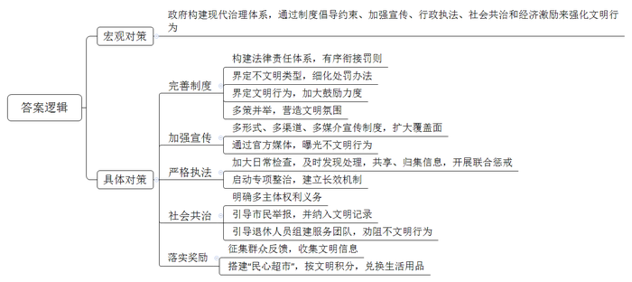
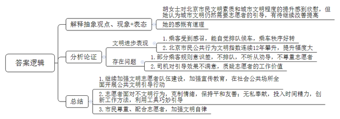
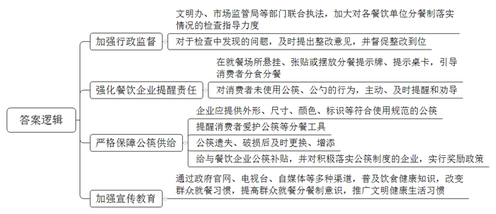
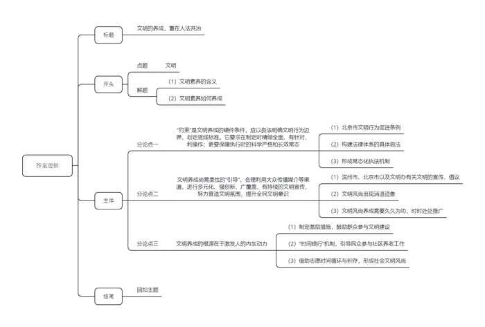

# 2021年北京市公考《申论》题（区级）

> 候选采集稿。参考答案及解析来自粉笔页面，不代表官方答案或真实高分答卷；来源使用许可与原卷对应关系仍需人工核实。

## 给定材料

### 材料 material-20ed0e473e7122dc

近年来，随着法治国家建设进程的推进，法律规范愈来愈多地被用于精神文明建设领域，成为推动核心价值观建设、促进社会文明行为的重要手段。

2020年6月1日，《北京市文明行为促进条例》正式施行，明确了各个领域的不文明行为以及值得倡导的文明行为。该条例是对以往相关法律规章的梳理、总括和深化。在此之前，已有《北京市市容环境卫生条例》《北京市控制吸烟条例》《北京市物业管理条例》《北京市环境噪声污染防治办法》等地方法规规章，对促进各个领域的文明进步作出了相应的规定。如2003年1月1日，《北京市公园条例》施行，其中特别对影响园容和游览秩序的行为作出了明确的处罚规定；2016年9月19日，《北京市旅游不文明行为记录管理暂行办法》出台，意在提升人们文明出游意识。此外，全国各地如贵州省、天津市，以及深圳、太原、杭州等24个城市，也先后制定出台了地方文明行为促进条例；沈阳、南昌等16个城市也在积极启动文明行为立法进程。

这些地方立法明确了不文明行为的主要类型和处罚办法。《北京市文明行为促进条例》明确了重点治理六大领域不文明行为，包括遛犬不牵引，犬便不清理；采挖景区植物，攀折花木，损坏草坪、树木；拨打骚扰电话，发送骚扰短信等。《郑州市文明行为促进条例》明确规定，随地吐痰、便溺，现场拒不整改的，将被处以50元的罚款。

各地的立法也加大了对文明行为的鼓励力度。《昆明市文明行为促进条例》鼓励用人单位在签订劳动合同时，同等条件下优先聘用道德模范、身边好人、文明市民、见义勇为人员、优秀志愿者等先进人物。《天津市促进精神文明建设条例》规定，对于获得国家或者市级精神文明表彰的人员，市、区人民政府应当将其纳入政府公共就业服务范围，对符合就业困难条件的优先纳入就业援助；对申请在本市落户的，予以加分奖励；鼓励用人单位在招聘招录时，同等条件下优先聘用录用获得精神文明表彰的人员。

各地还多策并举，努力创造更好的文明氛围。《无锡市文明行为促进条例》明确提出，鼓励和支持国家机关、企业事业单位和社会组织利用本单位场所、设施设立学雷锋志愿服务站、爱心服务点，为环卫工人和其他需要帮助的人员提供饮水、加热饭菜、遮风避雨等便利服务。《滨州市文明行为促进条例》规定，大众传播媒介应当按规定刊播公益广告。户外广告牌、电子广告屏、地名牌、公交候车亭、建筑围挡等社会媒介设置公益广告总量占比不低于广告数量的30%。鼓励、支持、引导单位和个人以提供资金、技术、劳动力、智力成果、媒介资源等方式参与文明宣传。《太原市文明行为促进条例》规定，机场、车站、医院、大型商场等公共场所应当配备独立母婴室；女职工集中的国家机关、企业事业单位可以按照有关规定配备独立的母婴室。道路广场、公园绿地、商业经营场所、文化娱乐活动场所、体育活动场所、医院、住宅小区等公共场所，应当按照规定的标准配套建设公共厕所并保持开放。

### 材料 material-84ac43b005803712

早晨6时，天蒙蒙亮，胡女士就穿着“柠檬黄”上衣、戴着红袖标、拎着小马扎和暖水壶出门了。6点40分，胡女士在宽街路口东西行站上岗。她拿出抹布，仔细擦拭着站台护栏，同一站台其他同事也各自忙着……

胡女士今年60岁，是北京市公共文明引导员。公共文明引导志愿服务队始建于2001年。该年7月，北京申奥成功，为了改进乘车秩序乱的问题，北京市组织了上千名退休人员组成“文明乘车监督员”队伍，在重点公交车站宣传文明乘车，劝阻不文明行为。2014年，“文明乘车监督员”更名为“公共文明引导员”。目前，整个队伍人员达到近万人，主要在公交地铁站台、交通路口、赛场、公园、校园周边等社会公共场所，围绕“做文明有礼的北京人”这一主题，全面开展公共文明引导行动。

胡女士是最早加入公共文明引导队伍的人员之一。当时，她并不觉得这工作有多难，可真正干起来后才发现，自己开始想得太简单了。

“请乘客们有序排队上车。”胡女士不知道自己一天要重复多少遍这句话。有一次，一辆车进站，有位女士没排队，想从胡女士背后挤上车，胡女士一侧身挡住了她。没想到，那女士抬手就是一巴掌。胡女士心中的火儿腾地就上来了，可看了看手中的小红旗，她又压下了火气，平静地提醒对方，“请您排队上车，谢谢合作。”那位女士低下了头，默默排到队尾。

有一次，一辆公交车刚停稳，几名拿着尖嘴钳、扳手、电锯、水桶等施工工具的乘客一拥而上。胡女士赶紧上前劝阻：“请大家别挤，按顺序一个一个地上车！”可那几位根本不听，工具也横七竖八地堵着车门。公交司机也来气了，冲着胡女士喊：“要你们有什么用呀？还不够添乱的！”

虽然胡女士很委屈，可她也觉得文明不能只靠提醒，还要靠巧妙引导。她和队友们一商量，决定用一根绳子，绑上指挥旗，做成简易“隔离绳”固定在车门一侧，另一侧，两名队员手持指挥旗、伸展双臂站立，形成夹道，引导乘客从夹道中排队上车。“隔离绳”一挂，站台秩序果然好转。

但还是有乘客钻绳子、加塞，甚至冷嘲热讽：“还拉绳子呢，就是画条线都不见得有人听。”这话提醒了胡女士，她还真要试试“排队线”。此后几天，她和队友们白天上岗执勤，晚上加班画线……连干了几个晚上，胡女士团队负责的16座公交站台画上了150多条停车线、300多条排队线，标上了160多组线路数字。

乘客们一见到站台上突然冒出这么多线，很好奇，听说是引导员利用休息时间义务画的，大家都很感动，自觉按照线路排队候车。这样，不用大声喊叫，胡女士和同伴们就能维持良好的乘车秩序了。

胡女士和同伴们的辛苦付出，取得了极大的成功。据不完全统计，20年来，他们服务乘客总量达900多亿人次。其中，共为群众咨询指路5250万人次，敬老助残超过1518万人次，义务助民服务近800万小时。

近年来，北京市民文明素质和城市文明程度明显提升。根据2018年北京市民公共行为文明指数研究基地的报告，2017年北京市民公共行为文明指数首次突破85分，达85.68分，连续12年攀升，与2005年比上升了20.47分。对此，胡女士虽然感到欣慰，但并不满足。“什么时候北京发展到不再需要我们‘引导’文明了，在北京的街头也看不到‘柠檬黄’了，我就真正心满意足了。”胡女士说。

### 材料 material-af011f4166f7eff9

2020年，A省计划在全省推广餐饮分餐制，使用公筷公勺。该省B市于4月初制定并实施了《餐饮分餐公筷公勺分餐夹使用规范》，并拟将其作为全省地方标准予以发布。值得注意的是，《规范》极为细致，操作性很强：“公筷外形尺寸应当明显区别于其他备用筷，其长度比普通筷子长3-4厘米，便于取食，避免混用；在公筷公勺上宜印制‘公筷（勺）’的标识或提示语；公筷公勺和私筷私勺之间宜通过造型、质料和色彩来区分；公筷公勺宜为红色或白色，明显区别于其他备用筷”。在推广和使用中，B市还明确，餐饮经营者应提供公筷、公勺和分餐夹，消费者应“积极配合”“自觉使用”。

据B市有关单位负责人介绍，这一政策是分类分步实施推进，从大、中型餐馆入手，逐步向集体聚餐场所、小型餐馆拓展延伸。市文明办、市场监管局、商务局持续加大对各餐饮单位落实公筷公勺分餐夹情况检查指导力度，不按要求设置摆放的要立即整改。据统计，实施首月，公筷公勺在全市3600余家大、中型餐饮服务单位推广实施，成为城市用餐的新风尚。

近期，这股刚刮起来的“餐饮新风尚”出现了消退的迹象。记者走访B市多家餐饮企业发现，部分店家曾经悬挂、张贴或摆放的提示牌或提示桌卡已经“黯然褪色”，甚至不知所踪。在一些餐企，公筷公勺、分餐制处于“不反对”“不提醒”“不敢说”的随意状态。如果消费者不提出使用公筷公勺，餐厅不闻不问。

一家餐馆经营者介绍说：“开始，我们会特意在餐桌上多摆放一双公筷，虽然没有烫金字‘公筷’但这双筷子会比普通筷子长出一段来，客人也很容易区分。但最近一段时间，我们发现大部分的公筷用着用着就不知去向了。出于成本的考虑，我们就不再购买新的公筷，只在摆桌子的时候另外多放一双普通的筷子，但顾客的使用率不是很高。”

26岁的王来在B市一家国企工作，周末经常会约着朋友聚餐。“我喜欢大排档的氛围，夏天和朋友在一起吃小龙虾、喝啤酒，轻松又解压，这时谁还记得用什么公筷公勺啊，要是那么讲究，氛围就被破坏了。”

有关人士分析指出，推广“分餐夹”“公筷公勺”“分餐制”等餐饮新风，立法仅仅是第一步。“公筷公勺”政策的落实，要打通“最后一公里”，还面临着诸多困难，需要“市场”与“公益”的多方加持。

## 题目

### 第 1 题

**根据给定资料，概括当前政府为提升人们文明行为水平所采取的具体措施。（20分）**

关联材料：material-20ed0e473e7122dc

作答要求：

要求：准确全面，语言简练，字数不超过300字。

### 第 2 题

**阅读给定材料**4**的画线部分，针对胡女士的感慨，谈谈你的看法。（20分）**

关联材料：material-84ac43b005803712

作答要求：

要求：观点明确，分析合理，字数不超过300字。

### 第 3 题

**根据给定材料**7**，针对B市在实施《规范》中出现的问题，就A省推广使用公筷公勺提出对策建议。（20分）**

关联材料：material-af011f4166f7eff9

作答要求：

要求：建议合理可行，针对性强，条理清晰，语言简练，不超过400字。

### 第 4 题

**结合给定资料，以“文明的养成，重在** **”为题，题中画线部分自拟，自选角度，写一篇文章。（40分）**

关联材料：material-20ed0e473e7122dc

作答要求：

要求：联系实际，观点鲜明、正确，分析深入、合理，语言流畅，字数控制在800-1000字。

## 答案与解析

第 1 题

**参考答案（粉笔题库参考内容）**

政府构建现代治理体系，通过制度倡导约束、加强宣传、行政执法、社会共治和经济激励来强化文明行为。

1.完善制度。构建法律责任体系，有序衔接罚则；界定不文明类型，细化处罚办法；界定文明行为，加大鼓励力度；多策并举，营造文明氛围。

2.加强宣传。多形式、多渠道、多媒介宣传制度，扩大覆盖面；通过官方媒体，曝光不文明行为。

3.严格执法。加大日常检查，及时发现处理，共享、归集信息，开展联合惩戒；启动专项整治，建立长效机制。

4.社会共治。明确多主体权利义务；引导市民举报，并纳入文明记录；引导退休人员组建服务团队，劝阻不文明行为。

5.落实奖励。征集群众反馈，收集文明信息；搭建“民心超市”，按文明积分，兑换生活用品。

**解析**

**参考答案说明：**本参考答案分为宏观对策和具体对策两个部分。具体对策从“完善制度”“加强宣传”“严格执法”“社会共治”“落实奖励”这五个方面进行了分条撰写。各条答案要点之间在内容上相互并列，没有交叉。

**考点**：考点概括措施类

**来源**：来源2021年北京市公考《申论》题（区级）

粉笔申论页面对本题只提供「解析视频」入口，该入口是会员推广位，页面无视频地址与文字解析。

第 2 题

**参考答案（粉笔题库参考内容）**

胡女士对北京市民文明素质和城市文明程度的提升感到欣慰，但她认为城市文明仍然需要志愿者的引导，有待继续改善提高。她的感慨有道理。

一、文明进步表现在：1.乘客受到感召，能自觉排队候车，乘车秩序好转。2.北京市民公共行为文明指数连续12年攀升，提升幅度大。

二、存在问题：1.部分乘客规则意识差，不排队，不听从劝导，不尊重志愿者。2.司机对引导效果不满意，质疑志愿者的工作价值。

三、对此需要：1.继续加强文明志愿者队伍建设，加强宣传教育，在社会公共场所全面开展公共文明引导行动。2.志愿者面对不文明行为，克制情绪，保持平和友善；无私奉献，投入时间精力，创新工作方法，利用工具巧妙引导。3.市民尊重、配合志愿者，加强文明自律。

**解析**

**参考答案说明**：思路方面，本参考答案按照观点现象分析题“解释抽象观点、现象+表态+分析论证+总结”的一般答题思路展开。内容方面，本参考答案先对胡女士的感慨进行了解释并表态；“分析论证”部分分析文明进步的表现以及文明存在的问题；最后“总结”部分提出了对策。

**考点**：考点观点现象分析类

**来源**：来源2021年北京市公考《申论》题（区级）

粉笔申论页面对本题只提供「解析视频」入口，该入口是会员推广位，页面无视频地址与文字解析。

第 3 题

**参考答案（粉笔题库参考内容）**

1.加强行政监督。文明办、市场监管局等部门联合执法，加大对各餐饮单位分餐制落实情况的检查指导力度；对于检查中发现的问题，及时提出整改意见，并督促整改到位。

2.强化餐饮企业提醒责任。在就餐场所悬挂、张贴或摆放分餐提示牌、提示桌卡，引导消费者分食分餐；对消费者未使用公筷、公勺的行为，主动、及时提醒和劝导。

3.严格保障公筷供给。企业应提供外形、尺寸、颜色、标识等符合使用规范的公筷；提醒消费者爱护公筷等分餐工具；公筷遗失、破损后及时更换、增添；给与餐饮企业公筷补贴，并对积极落实公筷制度的企业，实行奖励政策。

4.加强宣传教育。通过政府官网、电视台、自媒体等多种渠道，普及饮食健康知识，改变群众就餐习惯，提高群众就餐分餐制意识，推广文明健康生活习惯。

**解析**

**参考答案说明：**本参考答案从“加强行政监督”“强化餐饮企业提醒责任”“严格保障公筷供给”“加强宣传教育”这四个方面展开。各条要点之间在内容上相互并列，没有交叉。

**考点**：考点提出对策类

**来源**：来源2021年北京市公考《申论》题（区级）

粉笔申论页面对本题只提供「解析视频」入口，该入口是会员推广位，页面无视频地址与文字解析。

第 4 题

**参考答案（粉笔题库参考内容）**

**文明的养成，重在人法共治**

古语云：“礼也者，犹体也”。文明素养是人在现代社会中安身立命的根本，也是社会良序发展的基石。文明素养的形成非一日而就，它需要“外在有力”，以法律约束行为底线；它需要感召共鸣，以宣传强化意识；它更需要“内在有核”，以自发积蓄力量。

**“约束”是文明养成的硬件条件，应以良法明确文明行为边界，划定底线标准。它要求在制定时精细全面、有针对、利操作；更要保障执行时的科学严格和长效常态。**《北京市文明行为促进条例》明确了各领域不文明行为的范围，倒逼居民养成文明素养。在构建法律体系时，一方面要与其他法规进行衔接，填补空白且要针对突出问题加强处罚力度；另一方面也要明确执法的具体措施，使其具有可行性。此外，在执法过程中，要形成常态化执法机制，通过灵活的方式严格落实法律法规，增强执法的有效性。

**文明养成尚需柔性的“引导”，合理利用大众传播媒介等渠道，进行多元化、强创新、广覆盖、有持续的文明宣传，努力营造文明氛围，提升全民文明意识。**正如滨州市和北京市通过多形式、多渠道、多媒介刊播广告，让文明法规走进千家万户。今年疫情防控期间，文明办也发出了“公筷公勺摆上桌，分餐进食好处多”的倡议。但我们也应看到，“变成法易，变世风难”，刚刮起来的文明风尚出现了消退的迹象。文明风尚的养成最忌一曝十寒、三心二意，更强调锲而不舍、久久为功，应该时时处处推广文明风尚，一定能让文明之花长开，精神之河长清。

然而，法律和引导，终究是被动的推进。“止寒莫若重裘，止谤莫若自修”，文明素养的培育，主动为之才是题中之义。

**文明养成的根源在于激发人的内生动力。**通过制定激励措施，广泛发动社会力量，鼓励群众积极参与到公共文明建设、社会共治的队伍中来，以自治增活力、强保障，扬社会正气。为积极应对老龄化问题，各地社区推出“时间银行”机制，力争在全国各地通存通兑志愿者帮扶时间，引导民众主动参与到社区养老工作中来。借助志愿时间的循环与积存，为老年群体增添公益保障，降低社会综合养老成本，形成向上向善、互助互爱的社会文明风尚。

社会文明是现代文明的重要组成部分，只有提升了公民的教养和素质，才能打造文明城市、实现文明强国。

**解析**

**文章分析**

**文明的养成，重在人法共治**

【**标题的优点：**标题中含有“文明”主题词，使文章主题更突出、清晰。】

古语云：“礼也者，犹体也”。（1）文明素养是人在现代社会中安身立命的根本，也是社会良序发展的基石。（2）文明素养的形成非一日而就，它需要“外在有力”，以法律约束行为底线；它需要感召共鸣，以宣传强化意识；它更需要“内在有核”，以自发积蓄力量。

【**开头的优点：**★内容方面。范文的开头是紧扣题目给定的“文明”这一主题展开的。首先，首句用典引出文明的话题；其次，对“文明”这一主题进行了分析阐述：（1）先指出文明素养的含义；（2）然后指出文明素养如何养成。★文字表达方面。使用了“也”“更”等词，使语言表达有逻辑性。】

**“约束”是文明养成的硬件条件，应以良法明确文明行为边界，划定底线标准**。**它要****求在制定时精细全面、有针对、利操作；更要保障执行时的科学严格和长效常态。**（1）《北京市文明行为促进条例》明确了各领域不文明行为的范围，倒逼居民养成文明素养。（2）在构建法律体系时，一方面要与其他法规进行衔接，填补空白且要针对突出问题加强处罚力度；另一方面也要明确执法的具体措施，使其具有可行性。（3）此外，在执法过程中，要形成常态化执法机制，通过灵活的方式严格落实法律法规，增强执法的有效性。

【**论述段****1的优点：**★观点句：范文的观点句是紧扣“文明”这一文章主题提出的。形式上，它在段首处直接写出，位置突出，容易发现。内容上，关键词突出，内容要点明确，可以明显看出它是从“法律约束”入手，指出了文明养成的硬件条件。★论述内容：（1）先介绍了北京市文明行为促进条例；（2）其次指出构建法律体系的具体做法；（3）最后指出要形成常态化执法机制。注意：以上三个方面的内容都是紧扣“‘约束’是文明养成的硬件条件，应以良法明确文明行为边界，划定底线标准。它要求在制定时精细全面、有针对、利操作；更要保障执行时的科学严格和长效常态”这个观点句进行分析论述的，论述的针对性强，内容层次丰富。★论述方法：主要采用了讲道理、举例子相结合的方式，做到了论证的丰富多样。】

**文明养成尚需柔性的****“引导”，合理利用大众传播媒介等渠道，进行多元化、强创新、广覆盖、有持续的文明宣传，努力营造文明氛围，提升全民文明意识**。（1）正如滨州市和北京市通过多形式、多渠道、多媒介刊播广告，让文明法规走进千家万户。今年疫情防控期间，文明办也发出了“公筷公勺摆上桌，分餐进食好处多”的倡议。（2）但我们也应看到，“变成法易，变世风难”，刚刮起来的文明风尚出现了消退的迹象。（3）文明风尚的养成最忌一曝十寒、三心二意，更强调锲而不舍、久久为功，应该时时处处推广文明风尚，一定能让文明之花长开，精神之河长清。

【**论述段****2****的优点：**★观点句：范文的观点句是紧扣“文明”这一文章主题提出的。形式上，它在段首处直接写出，位置突出，容易发现。内容上，关键词突出，内容要点明确，可以明显看出它是从“柔性引导”入手，指出了文明养成的软件条件。★论述内容：（1）先介绍了滨州市、北京市以及文明办有关文明的宣传、倡议；（2）其次指出文明风尚出现消退迹象；（3）最后指出文明风尚养成需要久久为功，时时处处推广。注意：以上三个方面的内容都是紧扣“文明养成尚需柔性的‘引导’，合理利用大众传播媒介等渠道，进行多元化、强创新、广覆盖、有持续的文明宣传，努力营造文明氛围，提升全民文明意识”这个观点句进行分析论述的，论述的针对性强，内容层次丰富。★论述方法：主要采用了讲道理、举例子相结合的方式，做到了论证的丰富多样。】

然而，法律和引导，终究是被动的推进。“止寒莫若重裘，止谤莫若自修”，文明素养的培育，主动为之才是题中之义。

【**过渡段的优点：**过渡段首先承接上文文明养成需要“法律”和“引导”，其次，过渡段末尾的“文明素养的培育，主动为之才是题中之义”是用来引起下文的过渡句。】

**文明养成的根源在于激发人的内生动力**。（1）通过制定激励措施，广泛发动社会力量，鼓励群众积极参与到公共文明建设、社会共治的队伍中来，以自治增活力、强保障，扬社会正气。（2）为积极应对老龄化问题，各地社区推出“时间银行”机制，力争在全国各地通存通兑志愿者帮扶时间，引导民众主动参与到社区养老工作中来。（3）借助志愿时间的循环与积存，为老年群体增添公益保障，降低社会综合养老成本，形成向上向善、互助互爱的社会文明风尚。

【**论述段****3****的优点：**★观点句：范文的观点句是紧扣“文明”这一文章主题提出的。形式上，它在段首处直接写出，位置突出，容易发现。内容上，关键词突出，内容要点明确，可以明显看出它是从“人的主动性”入手，指出了文明养成的内生动力。★论述内容：（1）先介绍了通过制定激励措施，鼓励群众参与文明建设；（2）其次指出通过“时间银行”机制，引导民众参与社区养老工作；（3）最后介绍了借助志愿时间循环与积存，形成社会文明风尚。注意：以上三个方面的内容都是紧扣“文明养成的根源在于激发人的内生动力”这个观点句进行分析论述的，论述的针对性强，内容层次丰富。★论述方法：主要采用了讲道理、举例子相结合的方式，做到了论证的丰富多样。】

【**论述段之间的关系：**★内容的内在逻辑：论述段1从“法律约束”方面论证文明养成的硬性条件，论述段2从“柔性引导”方面论证文明养成的软性条件，论述段3从“主动性”方面论证文明养成的内在条件。三个论述段相互并列，逻辑清晰。★段与段的外在衔接：论述段2之后的过渡段“然而，法律和引导，终究是被动的推进。‘止寒莫若重裘，止谤莫若自修’，文明素养的培育，主动为之才是题中之义”，起到了承接论述段1、段2，引出了论述段3的作用。】

社会文明是现代文明的重要组成部分，只有提升了公民的教养和素质，才能打造文明城市、实现文明强国。

【**结尾的优点：**范文的结尾回扣了“文明”这个主题词，发出了展望。此外，语言精悍，不拖沓。】

**考点**：考点文章写作题

**来源**：来源2021年北京市公考《申论》题（区级）

粉笔申论页面对本题只提供「解析视频」入口，该入口是会员推广位，页面无视频地址与文字解析。

