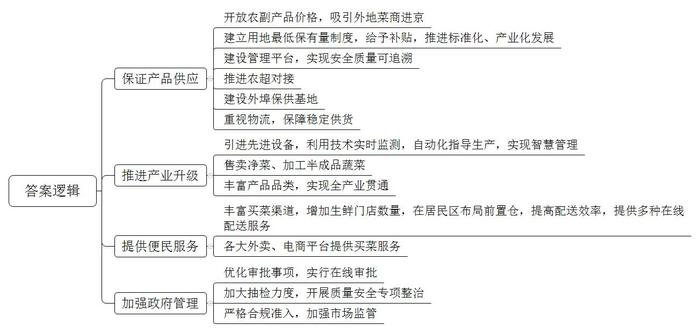
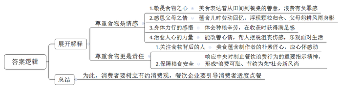
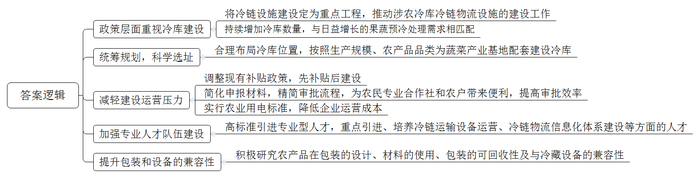
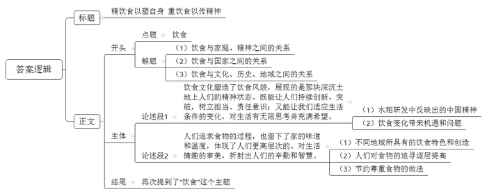

# 2021年北京市公考《申论》题（乡镇）

> 候选采集稿。参考答案及解析来自粉笔页面，不代表官方答案或真实高分答卷；来源使用许可与原卷对应关系仍需人工核实。

## 给定材料

### 材料 material-ee2a7aebd0ccd802

老百姓过日子，开门七件事，柴米油盐酱醋茶。

从1988年国务院推动实施“菜篮子”工程、2010年推进新一轮“菜篮子”工程以来，北京市大力推动与“菜篮子”相关的产业生态建设和发展，保障“菜篮子”供应无忧，让百姓的“菜篮子”越拎越安心。

1985年以前，北京的蔬菜主要由本地供应，季节性十分明显。这对爱吃西红柿打卤面的田大爷一家一直是个考验。从1968年开始，田大爷一家走上了自制西红柿酱的路。

“说出来您都不信，我们全家总动员，一年做120多瓶，全码在床底下，直到20世纪80年代末我家小作坊才正式‘关张’。”80岁的田大爷笑着说，“那时候一年到头只有十几种蔬菜，冬储大白菜上市时我家还要购买一车大白菜，保障冬天有菜吃。而现在蔬菜多种多样，想什么时候吃，市场上都能买到。”1985年，北京放开了肉、蛋、蔬菜等5种农副产品的价格，各地菜商纷纷进京，蔬菜交易也就热闹起来了。

2010年以来，北京市建立了蔬菜生产用地最低保有量制度，实施每亩500元标准的菜田补贴政策，推动村镇蔬菜产业化、设施蔬菜标准化，创建国家级示范育种场和养殖场；2018年1800多家农业龙头企业和农民合作社被纳入平台管理，5000多个产品实现质量安全可追溯。北京市统计数据显示，2019年全市农副产品产量中蔬菜及食用菌产量为111.5万吨，禽蛋9.6万吨，牛奶26.4万吨，生猪出栏数28.4万头，为北京的农副产品稳定供应提供了巨大保障。

“我们的蔬菜主要是直供超市，同时合作社也为市民提供农业休闲和采摘项目。”北京B区一家种植合作社负责人张经理说，“2019年，我们引进了水肥一体机等设备，劳动力上节约了三分之一，肥料节约与节水方面效益显著，蔬菜品质也有所提升，综合效益提高了25％左右。我们还利用大数据等远程实时监测墒情、环境、气象等，以自动化的方式指导蔬菜园的生产，效率提高了近20％。”

北京某批发菜市场管理负责人介绍，现在市场卖的基本都是净葱，只有在每年11月份的冬储菜季节，有10％左右的毛葱进来，方便市民储存。同时，净菜公司也大量将土豆、胡萝卜、洋葱、芹菜等加工成半成品。这些举措既可提高商户的产品附加值，又可实现消费者厨余垃圾减量。现在，这个市场每天实现垃圾减量20％，预计全年可减少7000吨果蔬垃圾。

为提升生活性服务业品质，居民生鲜果蔬“最后一公里”的便民商业服务也在行动。2017年以来，H生鲜店已经在京开设26家门店，2019年以来又有越来越多的前置仓开到居民区周边，30分钟内就能把新鲜蔬菜送上门。某大型连锁超市的采购负责人郭先生介绍，超市各门店已全部上线“到家服务”，通过超市小程序、社区小店APP以及第三方平台入口，为周边3-10公里的消费者提供1小时达、同城半日配送和一日三送等多种服务。此外，其他各大外卖平台、电商平台也提供轻松、便捷的买菜服务。丰富多样的买菜渠道，琳琅满目的蔬菜品种，让北京市民餐桌上的菜品越来越丰富了。

在保障菜品丰富的同时，政府管理也随之悄然发生着变革。近年，北京市农业农村局对134项涉农行政审批服务事项进行优化改革，农机管理、种业管理、畜牧渔业管理等方面实行在线审批。以中国M工商集团有限公司为例，在审批改革后就避免了以往因不能及时通关产生的超期仓储费用，每年可节省费用累计超过100万元。

“去年我们加大了市场抽检力度，在批发市场抽检，合格率达到98.41%。同时开展了为期两个月的农产品质量安全专项整治。”北京市市场监督管理局一位负责人表示，今后将继续严格合规准入，加强市场监管，保障餐桌安全。

### 材料 material-67c272f134ec061b

“一粥一饭，当思来之不易；半丝半缕，恒念物力维艰。”厉行节约，反对浪费，是对食物的尊重，对农民的尊重，也是对自己的尊重，对社会文明的尊重。近来，各地积极践行中央对制止餐饮浪费行为的重要指示精神，进一步加强宣传教育，培养节约习惯，推动“浪费可耻、节约为荣”成为社会新风尚。餐饮浪费现象，不只是个人消费习惯问题，更是事关国家粮食安全的大问题。全国各大媒体也都在讨论制止食品浪费行动，某网站的“优雅吃货吧”里，吧主也抛出一个讨论话题：从田间到餐桌，你有哪些记忆？

下面摘录部分网友晒出的经历和体会：

网友甲：我母亲总是说，端上餐桌的每一份美食都表达着从田间到餐桌的善意。她每次一看到孩子们吃饭掉饭粒，总是说“罪过啊，罪过啊”从母亲说的“罪过”这个词，我能深深感觉到，老一辈人对食物怀有的那种敬畏之心。

网友乙：小时候，父母收割完稻谷，都会要我提着竹篮再到田里去，将散落的稻穗一根根拾回来，颗粒归仓。现在，我也见不得有人将米饭弃之不顾，因为眼前总会出现父母躬耕风雨的身影。

网友丙：作为在城市长大的孩子，虽然之前也读过“粒粒皆辛苦”这样的诗句，但一直没机会和粮食亲密接触，对其也没什么特别的感受。直到在大学劳动课程中，我的认识发生了巨大的变化。那时，从买种子、播种，到除草、翻地，再到收割、销售，都是我们自己来做。大家都一顶草帽、一副手套，手持镰刀，躬身割水稻、打谷子，还在农场里挖出了一个池塘养鱼。挖池塘的时候，好多同学手上都磨出好几个水泡。但到了收获季节，看到累累果实大家都很有满足感。记得一位同学情不自禁地感慨，对食物的尊重不仅仅是一种情感，更是一种责任！

网友丁：一次去吃馄饨，我囫囵吞枣吃得很快。老板娘从厨房捧了一个小碗出来，一看我已吃完了就着急地说：“哎呀，糟糕了，刚才给你的调料里少了一种酱汁！”结账时，她死活不肯收钱，并对我说：“馄饨本来应当更美味的！是我调味不正宗，对不起您啊！”她对食物的朴素匠心让我感动。关注餐桌上丰美的食物，更应关注食物背后的那些人。

网友戊：今天在单位被各种烦心糟心事纠缠，下班回家途中，带上耳机听着伤感的歌曲，感到极度沮丧！不料，转过一个街角，突然闻到一阵杂粮香味，这香味牵引着我来到了煎饼铺子前。我迫不及待地说：“老板，请帮我摊个煎饼，加个鸡蛋和里脊，少放点辣椒。”之后，捧起热腾腾的煎饼，狠狠地咬上那么一口，我发现，生活原来也不是那么糟糕啊！

网友己：有的消费者总觉得，我花我自己的钱消费，剩了就扔了，这是我的自由和权力，关他人什么事？有的餐饮企业也认为，消费者自己点餐买单，他自己愿意多花钱我们也能多赚钱，我们有什么理由去阻拦呢？

### 材料 material-73dc24890ddfcea6

不去新疆，也可吃到吐鲁番的葡萄；在采摘季过去3个多月后，仍能在市场上买到新鲜的樱桃……改变我们生活的，正是农产品产地“最先一公里”冷链物流的飞快发展。农产品产地“最先一公里”，是指农产品在产地采摘后至移交物流运输之前，为了保持农产品质量、延长保质期，需要进行的一系列活动，包括预冷、分级、加工、包装及仓储等系列工作。其中，预冷、分级、加工是农产品产地冷链的早期质量控制环节，在整个供销链条中的地位是极其重要的，因为无论从控制效果还是控制成本上考虑，事前控制都是最优的。

“2019年，我国农产品总产量19.80亿吨，其中生鲜农产品产量超过11亿吨。”扶贫开发研究专家郭先生介绍，由于存在保鲜和腐烂问题，无法及时销售的生鲜农产品损失达到20%~30%，这一损失主要由农户来承担。

近年来，各级政府陆续出台了农产品冷链物流方面的系列政策。2020年4月21日发布的《国务院办公厅关于加快发展冷链物流保障食品安全促进消费升级的意见》中，就明确提出要聚焦农产品产地“最先一公里”，鼓励各地加快补齐这一短板。2020年7月国家发展和改革委员会发布了首批国家骨干冷链物流基地建设名单，推动国家骨干冷链物流的发展。

目前，越来越多的企业也在产地冷链物流方面进行布局、开拓和发力。如2020年7月30日L电商公司宣布，将在四川、陕西、山东建设3个产地集运加工中心（即产地仓），在多个省会城市打造20余个销地仓，形成“产地仓+销地仓”的农产品流通网络；F农慧集团在武陵山区中心城市建设生鲜农产品物流产业园，在乡村建立配套冷库，形成一套农产品冷链预加工、储存、配送等的物流体系，既能大幅缓解农产品的损耗问题，又能让优质农产品卖出好价钱，让老百姓能够吃到好东西。

H市永昌县是一个农业大县，其农产品不仅在本地销售，而且还是北京、上海等城市“菜篮子”的保障。近年来，永昌县调整农业产业结构，结合易地扶贫搬迁建设了大批蔬菜产业扶贫基地，已有七万多亩土地种上了各种蔬菜，蔬菜产业已成为全县支柱产业。不过由于冷库等设施不足，农产品口感品质、保存时间、质量标准难以保证，使产品附加值较低，运营成本高，损耗也较高。为了有效推动和保障蔬菜产业发展，县政府将冷链设施建设定为2019～2020年的重点工程，制发了《关于促进涉农冷库建设工作的意见》，推动涉农冷库冷链物流设施的建设工作。

“目前全县共有20个冷库约4000吨的容量，而到2022年全县每年需要预冷处理的外销蔬菜就有300万吨，现有的冷库远远满足不了日益增长的果蔬预冷处理的需求。”永昌县果蔬产业发展中心的夏主任介绍说，按照年产预冷外销蔬菜300万吨的计划，冷库容量必须达到15000吨以上，增加冷库建设迫在眉睫。夏主任还提到，产地冷库等设施的建设投入大，回报周期长，回报率低，很少有大量资金投入，而大部分农民自己又投建不起。

据了解，目前永昌县已有的冷库主要布局在县城郊区，蔬菜产业基地建有冷库的很少。2019年以来，县里为承担冷库建设项目的农民专业合作社和农户提供财政资金补贴，不过来申报的却寥寥无几。

“拿到补贴哪有那么容易呀！政府采取的是先建设后补贴，我哪有那么多钱把冷库先建起来？即使建好了，还要报各种材料，经过层层审批。所以，我还是自行采收，简单分类，然后等待蔬菜基地的大卡车来装货运到外地超市，超市自己去分类处理吧。虽说我的菜卖得确实便宜些，但我也就不用自己花钱建冷库，也不用去了解那些搞不懂的什么预冷保鲜技术，这也算省心了。”

“冷链物流运营成本高在一定程度上增加了农民负担，企业在基地建设冷库的意愿也受到成本影响。”永昌县F农业发展公司的负责人Z说，当前永昌县生鲜农产品冷库用电是按照工业用电收取费用，与农业用电标准相比差价大，用电费用成为制约产地农村冷库项目建设的重要因素之一。Z同时表示，冷链物流对技术的专业性要求很高，冷链运输设备运营、冷链物流信息化体系建设都需要专业人才。他也坦言，目前县里大部分被初加工的农产品在包装的设计、材料的使用、包装的可回收性及与冷藏设备的兼容性方面，仍需下大力气进一步提高。

## 题目

### 第 1 题

**根据给定材料**1**\-**2**，概括北京市为了保障市民餐桌的丰富安全所采取的主要措施。（****20****分）**

关联材料：material-ee2a7aebd0ccd802

作答要求：

要求：准确全面，语言简练，字数不超过300字。

### 第 2 题

**给定材料**3**中有网友认为“对食物的尊重不仅仅是一种情感，更是一种责任”，谈谈你对这句话的理解。（****15****分）**

关联材料：material-67c272f134ec061b

作答要求：

要求：分析合理，条理清楚，语言简练，字数不超过250字。

### 第 3 题

**结合给定材料**4**，联系实际，请你谈谈解决永昌县冷库建设问题的主要思路。（****25****分）**

关联材料：material-73dc24890ddfcea6

作答要求：

要求：建议合理可行，针对性强，条理清晰，语言简练，不超过400字。

### 第 4 题

**阅读给定材料，结合对材料**5**中画线部分的思考，自拟题目，自选角度，写一篇文章。（****40****分）**

关联材料：material-ee2a7aebd0ccd802

作答要求：

要求：联系实际，观点鲜明、正确，分析深入、合理，语言流畅，字数控制在800-1000字。

## 答案与解析

第 1 题

**参考答案（粉笔题库参考内容）**

1.保证产品供应。开放农副产品价格，吸引外地菜商进京；建立用地最低保有量制度，给予补贴，推进标准化、产业化发展；建设管理平台，实现安全质量可追溯；推进农超对接；建设外埠保供基地；重视物流，保障稳定供货。

2.推进产业升级。引进先进设备，利用技术实时监测，自动化指导生产，实现智慧管理；售卖净菜、加工半成品蔬菜；丰富产品品类，实现全产业贯通。

3.提供便民服务。丰富买菜渠道，增加生鲜门店数量，在居民区布局前置仓，提高配送效率，提供多种在线配送服务；各大外卖、电商平台提供买菜服务。

4.加强政府管理。优化审批事项，实行在线审批，加大抽检力度，开展质量安全专项整治；严格合规准入，加强市场监管。

**解析**

**参考答案说明**：本参考答案从“保证产品供应”“推进产业升级”“提供便民服务”“加强政府管理”四个方面进行分条撰写，各条要点在内容上是并列且无交叉的。

**考点**：考点概括措施类

**来源**：来源2021年北京市公考《申论》题（乡镇）

粉笔申论页面对本题只提供「解析视频」入口，该入口是会员推广位，页面无视频地址与文字解析。

第 2 题

**参考答案（粉笔题库参考内容）**

尊重食物是情感：1.敬畏食物之心。美食表达着从田间到餐桌的善意，浪费有负罪感。2.感恩父母之情。蕴含儿时劳动回忆，浮现颗粒归仓、父母躬耕风雨身影。3.身体力行的感悟。体会种粮辛劳，在收获时获得满足感。4.治愈人心的力量。能改善心情，帮人摆脱沮丧伤感，乐观面对生活。

尊重食物更是责任：1.关注食物背后的人。美食蕴含制作者的朴素匠心，应心怀感动。2.保障粮食安全。响应中央对制止餐饮浪费行为的重要指示精神，形成“浪费可耻、节约为荣”社会新风尚。

为此，消费者要树立节约消费观，餐饮企业要引导消费者适度点餐。

**解析**

**参考答案说明：**本参考答案从“尊重食物是情感”“尊重食物更是责任”这两方面进行了展开解释；最后总结部分指出了“尊重食物”应采取的做法。

**考点**：考点词句解释类

**来源**：来源2021年北京市公考《申论》题（乡镇）

粉笔申论页面对本题只提供「解析视频」入口，该入口是会员推广位，页面无视频地址与文字解析。

第 3 题

**参考答案（粉笔题库参考内容）**

一、政策层面重视冷库建设。将冷链设施建设定为重点工程，推动涉农冷库冷链物流设施的建设工作；持续增加冷库数量，与日益增长的果蔬预冷处理需求相匹配。

二、统筹规划，科学选址。合理布局冷库位置，按照生产规模、农产品品类为蔬菜产业基地配套建设冷库。

三、减轻建设运营压力。调整现有补贴政策，先补贴后建设；简化申报材料，精简审批流程，为农民专业合作社和农户带来便利，提高审批效率；实行农业用电标准，降低企业运营成本。

四、加强专业人才队伍建设。高标准引进专业型人才，重点引进、培养冷链运输设备运营、冷链物流信息化体系建设等方面的人才。

五、提升包装和设备的兼容性。积极研究农产品在包装的设计、材料的使用、包装的可回收性及与冷藏设备的兼容性。

**解析**

**参考答案说明：**本参考答案从“政策层面重视冷库建设”“统筹规划，科学选址”“减轻建设运营压力”“加强专业人才队伍建设”“提升包装和设备的兼容性”这五个方面进行了分条撰写。各条要点之间在内容上是并列关系，没有交叉。

**考点**：考点提出对策类

**来源**：来源2021年北京市公考《申论》题（乡镇）

粉笔申论页面对本题只提供「解析视频」入口，该入口是会员推广位，页面无视频地址与文字解析。

第 4 题

**参考答案（粉笔题库参考内容）**

**精饮食以塑自身 重饮食以传精神**

家，生命开始的地方，精神依托的港湾；食，平淡无奇的锅碗瓢盆中，记录着家乡的味道。自古以来，民以食为天，粮食安全事关国家稳定。经历岁月积淀的中国饮食文化，顺着历史的脉络传承、延续，也造就了不同地域多样的饮食面貌，满足着人们对饮食的无限遐想。

人如其食，食物总是与人联系在一起，那些生动鲜活、令人垂涎的食物，**反映了、改变着、影响着人们的生活环境和生活态度，更在一定层面上传承中华优秀文化，传扬精神气质。**

**饮食文化塑造了饮食风貌，展现的是那块深沉土地上人们的精神状态。既能让人们持续创新、突破，树立担当、责任意识；又能让我们适应生活条件的变化，对生活有无限思考并充满希望。**从“南优2号”到超级稻再到“海水稻”，几十年来，袁隆平秉持拓荒式的创新精神，在常年累月的辛勤探索中不断改良杂交水稻，不仅养活了几十亿人，更传递出中国精神中的“责任”与“担当”。“长江绕郭知鱼美，好竹连山觉笋香。”靠海则渔，靠山吃山。我们在变化中成长，如果你拒绝了变化，你就拒绝了新的美丽和新的机遇，正如“杂交水稻”在多个国家的“生根发芽”，既能满足单纯的温饱问题，让百姓安身立命，有保障、有尊严地活着，更能让其抬头仰望星空，有追求、有梦想地享受生活。

**当然，****人们追求食物的过程，****也****留下了家的味道和温度，体现了人们更高层次的、对生活情趣的审美，折射出人们的辛勤和智慧**。有史以来，人们一直在为食物迁徙，也因此促成了食物的融合，造就了独特的“乡味”，川渝地区好辣，两广地区爱汤，藏区酷爱青稞酒，不同的食物在改良时结合了当地独特的情况，展现了人们在饮食当中的思考和辛勤创造。从过去的追求单纯吃饱，到如今人们对品质饮食的追求、对绿色食材的探索，百姓的饮食有了更高层次的变化，逐渐形成了一种食“好”、食“精”的生活情趣。因而，为了这份对食物持久的追求，我们在生活中要秉持“一粥一饭当思来之不易”的尊重，厉行节约，这不仅是对食物和农民的尊重，更是对低级趣味的排斥，对懒惰浪费的摒除。

千百年来，食物就这样随着人们的脚步，不停迁徙、流变；人们也随着食物的步伐，不断改变、充实。我们充分相信食物影响着生活在世界上的你我他，不同的饮食文化塑造了不同的精神气质。

**解析**

**文章分析**

**精饮食以塑自身 重饮食以传精神**

【**标题的优点：**范文的标题根据材料内容，突出“饮食”这一主题。】

（1）家，生命开始的地方，精神依托的港湾；食，平淡无奇的锅碗瓢盆中，记录着家乡的味道。（2）自古以来，民以食为天，粮食安全事关国家稳定。（3）经历岁月积淀的中国饮食文化，顺着历史的脉络传承、延续，也造就了不同地域多样的饮食面貌，满足着人们对饮食的无限遐想。

【**开头的优点：**★内容方面。范文的开头是紧扣“饮食”这一主题展开的。（1）介绍了饮食与家庭、精神之间的关系。（2）介绍了饮食与国家之间的关系。（3）介绍了饮食与文化、历史、地域之间的关系。】

（1）人如其食，食物总是与人联系在一起，（2）那些生动鲜活、令人垂涎的食物，反映了、改变着、影响着人们的生活环境和生活态度，（3）更在一定层面上传承中华优秀文化，传扬精神气质。

【**过渡段的优点：**★内容方面。将画线句子中的“饮食”“人”“精神气质”进行了介绍。（1）解释“人”与“食物”之间的关系。（2）介绍了“食物”对“人”的生活影响。（3）介绍了“食物”对“文化、精神”的影响。】

**饮食文化塑造了饮食风貌，展现的是那块深沉土地上人们的精神状态。****既能让人们持续创新、突破，树立担当、责任意识；又能让我们适应生活条件的变化，对生活有无限思考并充满希望****。**（1）从“南优2号”到超级稻再到“海水稻”，几十年来，袁隆平秉持拓荒式的创新精神，在常年累月的辛勤探索中不断改良杂交水稻，不仅养活了几十亿人，更传递出中国精神中的“责任”与“担当”。（2）“长江绕郭知鱼美，好竹连山觉笋香。”靠海则渔，靠山吃山。我们在变化中成长，如果你拒绝了变化，你就拒绝了新的美丽和新的机遇，正如“杂交水稻”在多个国家的“生根发芽”，既能满足单纯的温饱问题，让百姓安身立命，有保障、有尊严地活着，更能让其抬头仰望星空，有追求、有梦想地享受生活。

【**论述段****1****的优点：**★观点句：范文的观点句是紧扣“饮食”这一文章主题提出的。形式上，它在段首处直接写出，位置突出，容易被发现；内容上，关键词突出，内容要点明确，可以明显看出它是从“饮食文化与精神”这一角度出发。★论述内容：（1）指出了水稻研发中反映出的中国精神。（2）指出了饮食变化带来机遇和问题。注意：以上几个方面的内容都是紧扣观点句“饮食文化塑造了饮食风貌，展现的是那块深沉土地上人们的精神状态”进行分析论述的，针对性强、内容层次丰富。最后，在论述方法上采取了摆事实、讲道理的方式进行展开，做到了论述有力。】

**当然，人们追求食物的过程，也留下了家的味道和温度，体现了人们更高层次的、对生活情趣的审美，折射出人们的辛勤和智慧。**（1）有史以来，人们一直在为食物迁徙，也因此促成了食物的融合，造就了独特的“乡味”，川渝地区好辣，两广地区爱汤，藏区酷爱青稞酒，不同的食物在改良时结合了当地独特的情况，展现了人们在饮食当中的思考和辛勤创造。（2）从过去的追求单纯吃饱，到如今人们对品质饮食的追求、对绿色食材的探索，百姓的饮食有了更高层次的变化，逐渐形成了一种食“好”、食“精”的生活情趣。（3）因而，为了这份对食物持久的追求，我们在生活中要秉持“一粥一饭当思来之不易”的尊重，厉行节约，这不仅是对食物和农民的尊重，更是对低级趣味的排斥，对懒惰浪费的摒除。

【**论述段****2****的优点：**★观点句：范文的观点句是紧扣“饮食”这一文章主题提出的。形式上，它在段首处直接写出，位置突出，容易被发现；内容上，关键词突出，内容要点明确，可以明显看出它是从“情感审美”这一角度出发。★论述内容：（1）指出了不同地域所具有的饮食特色和创造。（2）指出了人们对食物的追寻逐层提高。（3）指出了“节约尊重食物”的做法。注意：以上几个方面的内容都是紧扣观点句“人们追求食物的过程，也留下了家的味道和温度，体现了人们更高层次的、对生活情趣的审美，折射出人们的辛勤和智慧”进行分析论述的，针对性强、内容层次丰富。最后，在论述方法上采取了摆事实、讲道理的方式进行展开，做到了论述有力。】

【**论述段之间的关系：**★内容的内在逻辑：范文的论述段之间是依照并列逻辑展开的。论述段1先写了“饮食文化塑造了饮食风貌，展现的是那块深沉土地上人们的精神状态”，论述段2又写了“当然，人们追求食物的过程，也留下了家的味道和温度，体现了人们更高层次的、对生活情趣的审美，折射出人们的辛勤和智慧”。★段与段的外在衔接：论述段1、2都在开头直接点题，用“饮食文化”“饮食风貌”“追求食物”这样的表述，直接点明具体做法，使文章整体上看起来逻辑清晰。】

千百年来，食物就这样随着人们的脚步，不停迁徙、流变；人们也随着食物的步伐，不断改变、充实。我们充分相信食物影响着生活在世界上的你我他，不同的饮食文化塑造了不同的精神气质。

【**结尾的优点：**范文的结尾回扣了“饮食”这一主题。】

**考点**：考点文章写作题

**来源**：来源2021年北京市公考《申论》题（乡镇）

粉笔申论页面对本题只提供「解析视频」入口，该入口是会员推广位，页面无视频地址与文字解析。

