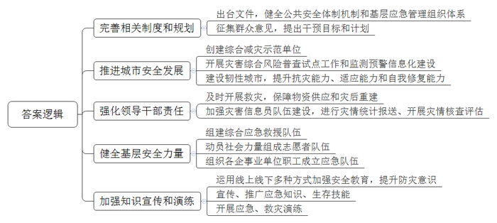
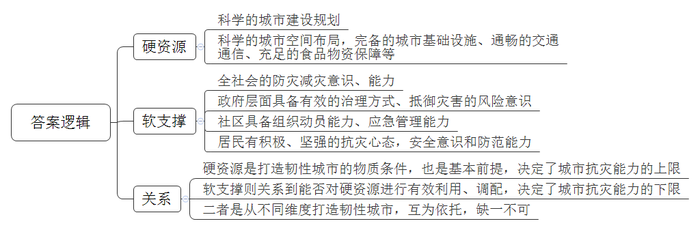
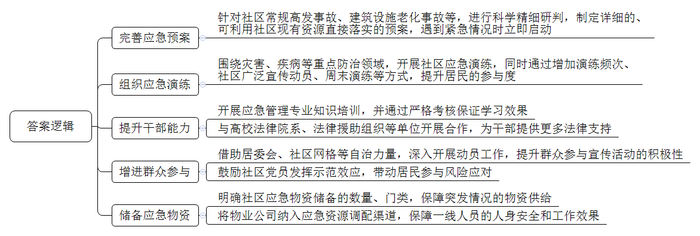
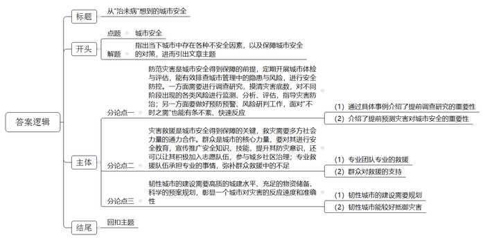

# 2022年北京市公考《申论》题

> 候选采集稿。参考答案及解析来自粉笔页面，不代表官方答案或真实高分答卷；来源使用许可与原卷对应关系仍需人工核实。

## 给定材料

### 材料 material-f95ec525bb0e0b8b

应急管理是国家治理体系和治理能力的重要组成部分，承担防范化解重大安全风险、及时应对处置各类灾害事故的重要职责，担负保护人民群众生命财产安全和维护社会稳定的重要使命，我国始终高度重视应急管理工作，从推进安全生产领域改革发展、推进城市安全发展、强化地方党政领导干部履行“促一方发展、保一方平安”的政治责任，到组建应急管理部、积极推进我国应急管理体系和能力现代化……一项项强有力的改革举措，彰显了全面加强应急管理工作的决心。

《中共中央关于坚持和完善中国特色社会主义制度、推进国家治理体系和治理能力现代化若干重大问题的决定》提出，“健全公共安全体制机制。完善和落实安全生产责任和管理制度，建立公共安全隐患排查和安全预防控制体系。构建统一指挥、专常兼备、反应灵敏、上下联动的应急管理体制，优化国家应急管理能力体系建设，提高防灾减灾救灾能力。”

中共中央、国务院印发《关于加强基层治理体系和治理能力现代化建设的意见》，将增强乡镇（街道）应急管理能力作为加强基层治理体系和治理能力现代化的重要措施，明确提出要健全基层应急管理组织体系，构建多方参与的社会动员响应体系，为基层应急管理工作制定了任务书和路线图。

### 材料 material-c8401b397d978e0f

社区作为最基层的组织，在应急工作中扮演着非常重要的角色，承担着事故发生第一时间组织协调社区居民自救和互救，保护人民群众生命、财产安全，有效减轻灾难破坏影响的功能。社区应急管理是介于个人、家庭事故应急管理和政府事故应急管理之间的救援活动，是联结政府与家庭个人的纽带，在整个灾难应对过程中起着十分重要的作用。“社区的安全工作是提高城市韧性的关键。”某专家表示。

在日常生活中，社区面临各类风险。X研究中心“城市与社区治理研究团队”连续三年在全国开展调研，所回收的7266份调查问卷表明，社区面临着各类事故发生却不被重视的风险。在社区生活中，遭遇过电梯事故的居民比例达到46.5%，住处遭遇偷盗的比例达18.4%，遭遇交通事故的占17.6%，遭遇自然灾害的占14.5%，在小区内经历威胁或打架的占11.8%。

在一些地区，还存在“人在家中坐，祸从天上来”的现象。例如一些城市因发生危化品仓库爆炸、天然气管道爆炸、地铁施工导致路面塌陷等，导致周围小区住宅受到不同程度损害；还有一些城市小区地下水管爆裂，住宅楼地基长期被积水浸泡，导致楼房坍塌、人员伤亡等等。

针对上述调查，J市应急管理局组织了一场研讨会，就“社区的应急管理问题”展开讨论。以下是部分会议记录。X研究中心调研人员：我们在调研中，发现有42.11%的社区没有应急管理预案。有的社区尽管制定了应急预案，但只是照抄上级。紧急情况来临时依旧是等待上级政策和指示，不敢、不想也不能马上进入状态。而且J市现在有越来越多的住宅小区进入高风险的“保养期”，公共设施老化、房屋内外墙面容易脱落，面临更多的风险，还是要引起重视。

应急管理局相关负责人：根据以往经验，社区应急演练对风险防控效果明显。参加过社区应急演练的居民中反映对风险防控有效的达到75.2%。不过，参加过关于疾病、灾害等防治演练的居民比例仅有17.4%。

某社区干部：我们现在工作时间紧、任务重，社区应急工作要求又很高，感觉我们自己也很缺乏应急管理方面的专业知识。现在的居民法律意识都很强，还经常质疑我们的一些举措是否合法呢！我们平时得到的法律支持也不多，工作起来真是心有余而力不足啊！

某街道办事处负责人：现在我们社区的风险应对工作主要依赖社区干部，社区居民参与意愿不足，“干部干、群众看”的现象比较突出。我们社区其实经常开展一些风险防控的宣传活动，但是参与的居民并不多，有一部分居民对此漠不关心。

某物业公司负责人：我看我们社区好像没什么应急储备物资。可能上级部门会有一些吧，但往往注重粮食、帐篷、棉被等，医疗物资储备比较少。例如此次新冠肺炎疫情爆发初期，有的地区短时间缺乏消毒液，一些社区口罩、酒精、防护服、护目镜等配给不到位，使得基层社区干部直接暴露于风险之中。这些风险应急压力直接传给了我们物业公司，导致物业管理成本急剧上升。我们物业公司并未被纳入应急资源调配渠道，没有稳定有效的防疫物资调配很难保障一线人员的人身安全和防疫工作效果。

## 题目

### 第 1 题

**请根据给定材料，概括近年来我国应急管理工作方面的主要做法。（20分）**

关联材料：material-f95ec525bb0e0b8b

作答要求：

要求：准确全面，语言简练，字数不超过300字。

### 第 2 题

**材料**6**中的画线部分提到，打造韧性城市既需要“硬资源”，也需要“软支撑”，请指出这两者分别包含哪些内容，以及两者之间的关系。（15分）**

关联材料：material-f95ec525bb0e0b8b

作答要求：

要求：分析合理，条理清晰，语言简练，字数不超过250字。

### 第 3 题

**假如你是****J市应急管理局的相关工作人员，请针对材料**9**中研讨会反映的社区在应急管理方面存在的问题，提出相应的建议。（****25****分）**

关联材料：material-c8401b397d978e0f

作答要求：

要求：建议合理可行，针对性强，条理清晰，语言简练，字数不超过400字。

### 第 4 题

**“治未病”思想，不仅对城市应急管理，而且对城市的日常管理有深刻启示。请你参考给定材料，联系实际，以“从‘治未病’想到的\_\_\_”为题，题中画线部分自拟，自选角度，写一篇文章。（40分）**

关联材料：material-f95ec525bb0e0b8b

作答要求：

要求：观点鲜明、正确，分析深入、合理，语言流畅，字数要求800-1000字。

## 答案与解析

第 1 题

**参考答案（粉笔题库参考内容）**

1.完善相关制度和规划。出台文件，健全公共安全体制机制和基层应急管理组织体系；征集群众意见，提出干预目标和计划。

2.推进城市安全发展。创建综合减灾示范单位；开展灾害综合风险普查试点工作和监测预警信息化建设；建设韧性城市，提升抗灾能力、适应能力和自我修复能力。

3.强化领导干部责任。及时开展救灾，保障物资供应和灾后重建；加强灾害信息员队伍建设，进行灾情统计报送、开展灾情核查评估。

4.健全基层安全力量。组建综合应急救援队伍；动员社会力量组成志愿者队伍；组织各企事业单位职工成立应急队伍。

5.加强知识宣传和演练。运用线上线下多种方式加强安全教育，提升防灾意识；宣传、推广应急知识、生存技能；开展应急、救灾演练。

**解析**

**参考答案说明：**本参考答案从“完善相关制度和规划”“推进城市安全发展”“强化领导干部责任”“健全基层安全力量”“加强知识宣传和演练”五个方面进行了分条撰写。各条要点之间在内容上相互并列，没有交叉。

**考点**：考点概括措施类

**来源**：来源2022年北京市公考《申论》题

粉笔申论页面对本题只提供「解析视频」入口，该入口是会员推广位，页面无视频地址与文字解析。

第 2 题

**参考答案（粉笔题库参考内容）**

硬资源指的是科学的城市建设规划，具体包括：科学的城市空间布局，完备的城市基础设施、通畅的交通通信、充足的食品物资保障等。

软支撑指的是全社会的防灾减灾意识、能力：政府层面具备有效的治理方式、抵御灾害的风险意识；社区具备组织动员能力、应急管理能力；居民有积极、坚强的抗灾心态，安全意识和防范能力。

硬资源是打造韧性城市的物质条件，也是基本前提，决定了城市抗灾能力的上限；而软支撑则关系到能否对硬资源进行有效利用、调配，决定了城市抗灾能力的下限。综上所述，二者是从不同维度打造韧性城市，互为依托，缺一不可。

**解析**

**参考答案说明：**本参考答案宏观上分成了“硬资源的内容”“软支撑的内容”“关系”三个方面。在“软支撑的内容”方面，分别从“政府”“社区”“居民”这三个层次进行了分条撰写；在“关系”方面，分别从“硬资源的作用”“软支撑的作用”“二者共同作用于韧性城市”这三个层次进行了分条撰写。各条要点之间在内容上相互并列，没有交叉。

**考点**：考点多要素组合类

**来源**：来源2022年北京市公考《申论》题

粉笔申论页面对本题只提供「解析视频」入口，该入口是会员推广位，页面无视频地址与文字解析。

第 3 题

**参考答案（粉笔题库参考内容）**

1.完善应急预案。针对社区常规高发事故、建筑设施老化事故等，进行科学精细研判，制定详细的、可利用社区现有资源直接落实的预案，遇到紧急情况时立即启动。

2.组织应急演练。围绕灾害、疾病等重点防治领域，开展社区应急演练，同时通过增加演练频次、社区广泛宣传动员、周末演练等方式，提升居民的参与度。

3.提升干部能力。开展应急管理专业知识培训，并通过严格考核保证学习效果；与高校法律院系、法律援助组织等单位开展合作，为干部提供更多法律支持。

4.增进群众参与。借助居委会、社区网格等自治力量，深入开展动员工作，提升群众参与宣传活动的积极性；鼓励社区党员发挥示范效应，带动居民参与风险应对。

5.储备应急物资。明确社区应急物资储备的数量、门类，保障突发情况的物资供给；将物业公司纳入应急资源调配渠道，保障一线人员的人身安全和工作效果。

**解析**

**参考答案说明**：本参考答案从“完善应急预案”“组织应急演练”“提升干部能力”“增进群众参与”“储备应急物资”这五个方面进行了分条撰写。各条要点之间在内容上相互并列，没有交叉。

  

**考点**：考点提出对策类

**来源**：来源2022年北京市公考《申论》题

粉笔申论页面对本题只提供「解析视频」入口，该入口是会员推广位，页面无视频地址与文字解析。

第 4 题

**参考答案（粉笔题库参考内容）**

**从****“治未病”想到的城市安全**

“治未病”是一种调养身体预防疾病的思想，城市的管理也要在“治未病”中防范化解灾害风险，筑牢安全发展基础。各种危机，各种不安全因素也会在难以预料的时间、空间内到达，承担防范化解各类安全风险、应对各类灾害事故就显得尤为重要。中共中央站在战略高点，由上至下构建公共安全体制机制，注重顶层设计、高位推动，让城市的安全在预防中得到保障，在救援中稳步发展，在发展中彰显韧性。

**防范灾害是城市安全得到保障的前提，定期开展城市体检与评估，能有效排查城市管理中的隐患与风险，进行安全防控。一方面需要进行调查研究，摸清灾害底数，对不同阶段出现的各类风险进行监测、分析、评估，指导灾害防治；另一方面要做好预防预警、风险研判工作，面对****“不时之需”也能有条不紊、快速反应**。不管是北京开展的“应急管理事业发展统计公报”，还是贵州的“雪凝冻灾害机理研究”，都是在调查研究的基础上，提前预测，让群众在灾害前“逃离”。也只有这样才能进一步提升城市安全系数，让我们的城市更加宜业、宜居、宜乐、宜游。

**灾害救援是城市安全得到保障的关键，救灾需要多方社会力量的通力合作。群众是城市的核心力量，要对其进行安全教育，宣传推广安全知识、技能，提升其防灾意识，还可以让其积极加入志愿队伍，参与城乡社区治理；专业救援队伍承担专业的事情，弥补群众救援中的不足**。群众的专业性、科学性在灾害面前略有不足，这时就需要专业团队来解疑排难，比如作为一名“灾害信息员”，职责之一就是查看灾情、及时预警，体现其专业性。同时，在北京构建的“市-区-乡-村”四级灾害信息员队伍，需要社区工作人员等群众的支持，才能使灾情报送工作有质的提高。

城市的安全保障，不仅体现在灾前的防范、灾后的救援，更体现在灾害发生时，城市的抵御能力，以及灾害冲击后迅速恢复的能力。

抵御力、恢复力是韧性城市的基本特征。**韧性城市的建设需要高质的城建水平、充足的物资储备、科学的预案规划，彰显一个城市对灾害的反应速度和准确性。**韧性城市的建设需要细化、优化城市规划，让其具备抵御冲击、适应变化及自我修复的能力，这种能力不管城市规模的大小、处在何种发展阶段，亦或是不同的灾害隐患，都能把灾害指数降到最低，让其在灾害中“全身而退”。

城市的安全需要灾前预防、灾来救援，更需要提升承灾能力。城市安全体现在灾害来前能预防，灾害发生之时积极、快速救援，灾害发生之后快速恢复、持续发展。

**解析**

**文章分析**

**从****“治未病”想到的城市安全**

【**标题的优点：**首先，严格按照题目要求的“从‘治未病’想到的\_\_\_\_\_\_”这一结构来写。其次，它针对横线部分补充的内容突出了“城市安全”这一主题词，使文章写作主题更明确。】

“治未病”是一种调养身体预防疾病的思想，城市的管理也要在“治未病”中防范化解灾害风险，筑牢安全发展基础。（1）各种危机，各种不安全因素也会在难以预料的时间、空间内到达，承担防范化解各类安全风险、应对各类灾害事故就显得尤为重要。（2）中共中央站在战略高点，由上至下构建公共安全体制机制，注重顶层设计、高位推动，**让城市的安全在预防中得到保障，在救援中稳步发展，在发展中彰显韧性**。

【**开头的优点**：内容方面，范文的开头是紧扣“城市安全”这一主题词展开的。首先，开头第一句话点出主题，做到了主题明确。其次，对“城市安全”这一主题进行了分析阐述，指出了（1）城市中存在各种不安全因素；（2）保证城市安全的对策。注意以上两个方面的阐述在逻辑上有先后顺序：先写“问题”，再写“对策”。文字表达方面：长短句配合使用，使文字表达更加有力。】

**防范灾害是城市安全得到保障的前提，定期开展城市体检与评估，能有效排查城市管理中的隐患与风险，进行安全防控。一方面需要进行调查研究，摸清灾害底数，对不同阶段出现的各类风险进行监测、分析、评估，指导灾害防治；另一方面要做好预防预警、风险研判工作，面对****“不时之需”也能有条不紊、快速反应**。（1）不管是北京开展的“应急管理事业发展统计公报”，还是贵州的“雪凝冻灾害机理研究”，都是在调查研究的基础上，提前预测，让群众在灾害前“逃离”。（2）也只有这样才能进一步提升城市安全系数，让我们的城市更加宜业、宜居、宜乐、宜游。

【**论述段****1的优点**：★观点句：范文的观点句是紧扣“城市安全”这一文章主题提出的。形式上，它在段首处直接写出，位置突出，容易发现。内容上，关键词突出，内容要点明确，可以明显看出它是从“排查城市中的风险，进行安全防控”入手，指出了“防范灾害对城市安全的重要性”。★论述内容：（1）通过具体事例介绍了提前调查研究的重要性；（2）介绍了提前预测灾害对城市安全的重要性。注意：以上两个方面的内容都是紧扣“防范灾害是城市安全得到保障的前提，定期开展城市体检与评估，能有效排查城市管理中的隐患与风险，进行安全防控”这个观点句进行分析论述的，论述的针对性强，内容层次丰富。】

**灾害救援是城市安全得到保障的关键，救灾需要多方社会力量的通力合作。群众是城市的核心力量，要对其进行安全教育，宣传推广安全知识、技能，提升其防灾意识，还可以让其积极加入志愿队伍，参与城乡社区治理；专业救援队伍承担专业的事情，弥补群众救援中的不足**。（1）群众的专业性、科学性在灾害面前略有不足，这时就需要专业团队来解疑排难，比如作为一名“灾害信息员”，职责之一就是查看灾情、及时预警，体现其专业性。（2）同时，在北京构建的“市-区-乡-村”四级灾害信息员队伍，需要社区工作人员等群众的支持，才能使灾情报送工作有质的提高。

【**论述段****2的优点**：★观点句：范文的观点句是紧扣“城市安全”这一文章主题提出的。形式上，它在段首处直接写出，位置突出，容易发现。内容上，关键词突出，内容要点明确，可以明显看出它是从“社会力量通力合作”入手，指出了“灾害救援对城市安全的重要性”。★论述内容：（1）专业团队专业的救援；（2）群众对救援的支持。注意：以上两个方面的内容都是紧扣“灾害救援是城市安全得到保障的关键，救灾需要多方社会力量的通力合作”这个观点句进行分析论述的，论述的针对性强，内容层次丰富。】

城市的安全保障，不仅体现在灾前的防范、灾后的救援，更体现在灾害发生时，城市的抵御能力，以及灾害冲击后迅速恢复的能力。

【**过渡段的优点：**范文过渡段分析了保障城市安全的主要内容，此外，还要注意过渡段末尾的“在灾害发生时，城市的抵御能力，以及灾害冲击后迅速恢复的能力”是用来引起下文的过渡句。】

抵御力、恢复力是韧性城市的基本特征。**韧性城市的建设需要高质的城建水平、充足的物资储备、科学的预案规划，彰显一个城市对灾害的反应速度和准确性。**（1）韧性城市的建设需要细化、优化城市规划，让其具备抵御冲击、适应变化及自我修复的能力，（2）这种能力不管城市规模的大小、处在何种发展阶段，亦或是不同的灾害隐患，都能把灾害指数降到最低，让其在灾害中“全身而退”。

【**论述段****3的优点**：★观点句：范文的观点句是紧扣“城市安全”这一文章主题提出的。形式上，它在段首处直接写出，位置突出，容易发现。内容上，关键词突出，内容要点明确，可以明显看出它是从“城市的抵御力、恢复力”入手，指出了“韧性城市的建设”。★论述内容：（1）韧性城市的建设需要规划；（2）韧性城市能较好抵御灾害。注意：以上两个方面的内容都是紧扣“韧性城市的建设需要高质的城建水平、充足的物资储备、科学的预案规划，彰显一个城市对灾害的反应速度和准确性”这个观点句进行分析论述的，论述的针对性强，内容层次丰富。】

城市的安全需要灾前预防、灾来救援，更需要提升承灾能力。城市安全体现在灾害来前能预防，灾害发生之时积极、快速救援，灾害发生之后快速恢复、持续发展。

【**结尾的优点：**范文的结尾回扣了“城市安全”这个主题，对全文进行了总结提升。】

**考点**：考点文章写作题

**来源**：来源2022年北京市公考《申论》题

粉笔申论页面对本题只提供「解析视频」入口，该入口是会员推广位，页面无视频地址与文字解析。

