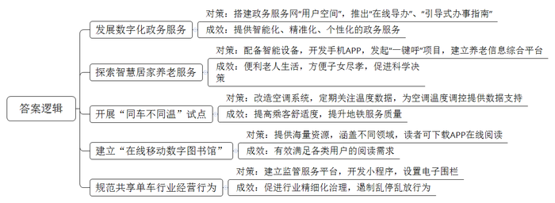
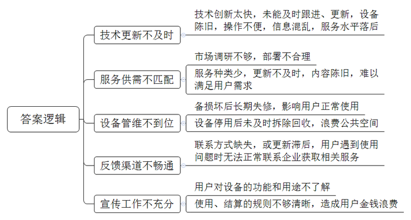
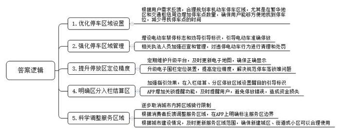
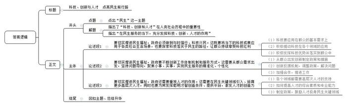

# 2023年北京市公考《申论》题

> 候选采集稿。参考答案及解析来自粉笔页面，不代表官方答案或真实高分答卷；来源使用许可与原卷对应关系仍需人工核实。

## 给定材料

### 材料 material-7aa35c8905dd117f

我们生活在一个科学技术快速发展的时代。现代信息和通讯技术的发展，不仅为经济发展提供了强大的动力引擎，也为社会治理和服务提供了先进的工具和手段。党的二十大报告指出，采取惠民生、暖民心举措，着力解决好人民群众急难愁盼问题，健全基本公共服务体系，提高公共服务水平。近年来，科技赋能已经成为服务民生的一种新途径：运用大数据、云计算、区块链、人工智能等前沿技术不断进行服务创新，这不但节省了服务所消耗的资源、降低了服务成本，而且提升了服务的便捷度、舒适性和安全性，以及人民群众的获得感，正是坚持以人民为中心、持续提升为民服务质量的重要途径和保障。

为了让先进技术服务于民，北京市以市政务服务网“用户空间”为重要载体，利用大数据、人工智能、区块链等技术，研判用户需求，为企业和群众提供精准、主动、个性且安全可靠的数字专属服务，实现从“人（企业）找政策、服务”向“政策、服务找人（企业）”的服务模式转变。同时，建立了个性化的“一人一档、一企一档”，将原来分散在各部门的办事信息、电子证照等分类归集管理、集中应用。目前已归集12类信息167类电子证照，并与办事表单、材料相关联，实现办事免填报、减材料。打造了“政策直达专区”，企业可通过政策月历查看现行政策与申报信息，通过政策体检查验申报条件符合度，根据自身条件匹配适合的政策等，这就使得惠企利企政策直达企业身边，大大节省企业的时间成本。“用户空间”自上线以来，已为企业和群众提供主动提醒、政策推送等个性化服务510万余次。

在保障企业、群众办事“找得到”的基础上，北京市还着力解决“问得清”的问题，推出了“在线导办”服务：依托市、区、街道（乡镇）三级政务服务中心综合窗口服务团队，组建了一支精通业务的“在线导办”团队，为办事人提供“一对一”网上办事问题解答、信息填报指导、申请材料审核等服务，打造实时性交互式、有温度的“线上办事窗口”。截至目前，“在线导办”服务已累计接待咨询群众33万人次，满意度达97%。

除了依托“在线导办”实时互动，针对部分事项办理情形多不同情形需要提供不同材料的情况，市政务服务网还推出了“引导式办事指南”，系统可根据办事人的基本信息，结合不同情形下的事项办理要求，逐一对应匹配后，导出定制化材料清单和办事清单，有效提升办事指引的精准度。如办理机动车登记，以往办事人需要根据户籍所在地、申请人身份类型、是否代办等，从完整的办事指南中筛选出自己属于哪种办事情况，并确认需要准备的材料清单。而现在只要通过“引导式办事指南”，系统将通过“一问一答”的形式，根据办事人的选择结果，自动生成符合办事人条件的定制化、个性化材料清单和办事流程。截至目前，北京市政务服务网已提供1.45万个情景引导式办事指南。

有关部门表示，下一步，北京市将全面贯彻落实数字政府建设要求，以企业和群众需求为导向，积极探索新技术与政府服务的深度融合，为企业和群众提供更加智能化、精准化、个性化的政务服务。

### 材料 material-64bfb4b94b53d141

科学技术发展日新月异，有些新发展和应用的服务技术，没过几年又会被新技术所取代。因而，在利用科技创新为民服务的工作中，如何跟进技术创新的步伐，在服务中及时采纳更新的技术，保持服务的先进水平，是一项重要议题。近日，某报记者对北京市利用科技创新为民服务的有关情况进行了调查。

记者首先调查了小区中电动自行车智能充电柜的使用情况。随着电动自行车的日益推广和充电的日益规范，这两年不少住宅小区都引入了智能充电柜，大大方便了群众并且提高了电动车使用的安全性。然而，记者发现，在有些小区，智能充电柜的使用和维护情况不尽如人意。如在A小区，有公司曾在前年安装了两台智能充电柜，可同时供16台电动自行车充电。目前智能充电柜外观上并无明显损坏，但16个充电箱仅有2个能正常使用，柜体侧面张贴的售后电话也是空白。居民徐大爷说，充电柜放在这里很长时间了，由于小区居民以老年人居多，电动车并不是出行首选，因而使用频率不高。记者在其他的小区也发现了类似情况。

某小区一位物业负责人告诉记者，智能设备属于小区新增的设施，物业公司只是收取管理费且提供电力保障，设备的运营维护还是归智能设备企业管理。记者找到某智能充电柜公司的服务电话，拨打后转入自动语音服务。如果想要报修，需要先下载某APP，登录APP后再填写相应的报修信息。记者找到该APP，发现由于APP版本太低，已经不能安装在手机上了。

记者还调查了一些小区的智能旧衣回收柜的使用情况。HX公司2018年就在某小区设置了智能旧衣回收柜。为了鼓励居民捐赠旧衣，该智能旧衣回收柜设计了旧衣自动称重和支付终端扫码功能。居民向回收柜投放旧衣后，只要扫一下衣柜上的二维码，就可在自己的名下生成一个捐赠记录；凭此记录，居民可以在某平台上领取相应的“绿色能量奖励”。据了解，HX公司在全市部分小区中先后共投放了3000多台同样的设备，公司也被评为循环经济模范企业。然而，记者调查发现，有些小区的智能旧衣回收柜已不能正常使用。很多回收柜根本投不进去衣服，柜旁许多旧衣物以及其他杂物胡乱堆积在地上。居民们表示，不少人并不了解这些柜子的用途和回收要求，以为就是垃圾回收箱。

在M胡同30号院，记者看到一处写着“垃圾分类兑换驿站”字样的智能垃圾分类兑换柜。过去，居民参与垃圾分类就能获取一定积分，可以用来兑换相应的生活用品。然而，这一垃圾分类兑换柜运行没多长时间就停摆了。记者看到，兑换柜里面还有一些物品，可扫码后页面却提示为错误代码，已无法正常兑换。居民刘女士表示，既然设备不管用了，那就不应该继续放在小区，太占地方了。

### 材料 material-19cbf3bf7a96471a

近年来，共享单车发展很快。在北京市，截至2022年9月底，全市范围内报备的共享单车运营车辆为100万辆，累计骑行量已达7.62亿人次，日均骑行量278.95万人次，同比增长了12.64%。作为一种绿色、环保、健康的出行方式，共享单车有效解决了市民出行“最后一公里”难题，在缓解交通拥堵、助力减排降碳等方面发挥了积极作用。

为了促进共享单车行业更好发展，北京市采取了一系列措施。从2018年开始，北京市交通委就对全市共享单车运行情况进行了持续监测，并进行了车辆规模总量的测算，以此作为车辆总量调控的依据。北京市逐渐构建起行业监管政策体系，2018年出台的《北京市非机动车管理条例》中便纳入了共享单车行业监管的相关内容。随后，又出台一系列文件，用以规范行业企业经营行为。

目前，北京已建成集运行监测、服务考核、数据分析、信息共享为一体的市级监管服务平台。截至目前，平台已接入全市100万辆共享单车动静态数据，为市区监管部门、各街道乡镇以及行业企业提供数据服务和决策支持。此外，北京还基于该平台开发了车辆调度小程序和车辆合规性扫码小程序，考察企业是否按照要求投放车辆和接入动静态数据，帮助企业及时响应街道和市民诉求，清理淤积车辆，促进行业的精细化治理。

为加强共享单车停放管理，制止个别用户的不文明行为，2022年1月26日，北京市自行车电动车行业协会牵头，会同北京市运营规模最大的三家共享单车运营企业，共同签署了《北京区域互联网租赁自行车行业规范用户停放行为联合限制性公约（试行）》（以下简称《公约》）。《公约》明确规定，在一个自然月度内，如果用户将共享单车停放在市域内高速公路、城市快速路主路（含主辅路出入口与隔离带、桥区路段）一次及以上、禁停区三次及以上、入栏管理区电子围栏以外区域六次及以上，或因恶意破坏共享单车、私自占有共享单车、利用共享单车实施违法犯罪行为而被企业采取封控措施，则该用户将被三家共享单车运营企业联合限制骑行。据统计，上半年共有482人被列入“北京区域违规停放联合限制骑行名单”。

《公约》中提到的电子围栏，是近年来共享单车管理领域的一个新事物。其做法是，共享单车运营企业按照有关管理部门的要求，对规定的“入栏管理区”进行测绘定位，并在停车区内装上信号发射器。用户还车时，如果没有将车放在停车区内，车锁就接收不到信号发射器的特定信号，车辆就锁不上，用户无法结束行程，手机APP将一直计价；如果用户强行锁车，共享单车运营公司会收取一定的处罚费用。

电子围栏是高科技在社会治理中的一项运用。随着电子围栏这类设施的出现，曾经频繁出现的共享单车乱停乱放、占道等现象在一定程度上得到遏制。在北京几个有名的路口，可以看到过去随意停放在地铁口、公交站、人行通道上的共享单车，如今被统一停放在白色划线区域内。然而，电子围栏运行中也存在一些问题。有些共享单车用户反映，一些街道的非机动车停车区设置数量太少，越繁华的地方共享单车停放区越少，车越不好停。需要寻找好长时间（平均下来是骑行时间的三分之一），才能找到停车点。有的用户说，APP上的定位有时也“混乱”，跟着APP上电子地图划分的停放区寻找，怎么走都找不到停车区；有的用户说，电子围栏内的空间有时被各种电动车占满了，怎么也停不进去；也有用户表示，有的电子围栏定位不精准，归还车辆时，手机上明明显示在规范停车区域，但是却无法落锁；还有用户说，部分区域的非机动车停放区、入栏结算区分不清楚，到底哪儿能停哪儿不能停，让人挺头疼，有时没有停到规定的地方，也没有及时收到提醒，往往离开很久了才发现停的地方不对，从而白白花了很多钱。

除了电子围栏外，各个共享单车运营企业还在城市中划分了共享单车的服务区域。共享单车不能跨区域骑行，也不能在服务区域外停放。在某些地区，这种服务区域的划分有时不甚合理，骑行者也很难具体知晓服务区的边界，可能直到停车时才发现驶出了服务区，还得折返回去。有些城市发展很快，但共享单车服务没有及时跟上，造成一些新建城区或街道、小区不能使用共享单车。

## 题目

### 第 1 题

**根据给定材料，概括近年来北京市在利用科技创新服务民生方面所采取的主要举措及成效。（****20分）**

关联材料：material-7aa35c8905dd117f

作答要求：

要求：准确全面，语言简练，字数不超过300字。

### 第 2 题

**阅读****“给定材料**4**\-**6**”，分析当前科技惠民服务民生工作仍然存在一些问题的主要原因。（15分）**

关联材料：material-64bfb4b94b53d141

作答要求：

要求：分析合理，条理清晰，语言简练，字数不超过250字。

### 第 3 题

**假如你是政府相关部门的工作人员，针对****“给定材料**6**”中反映的共享单车电子围栏和服务区域所引发的问题，提出对策建议。（25分）**

关联材料：material-19cbf3bf7a96471a

作答要求：

要求：建议合理可行，针对性强，条理清晰，语言简练，不超过400字。

### 第 4 题

**党的二十大报告指出，科技是第一生产力、人才是第一资源、创新是第一动力。请你围绕****“在服务民生方面，如何更好地发挥科技、创新、人才方面的作用”这一话题，结合给定材料，自拟题目，自选角度，写一篇文章。（40分）**

关联材料：material-7aa35c8905dd117f

作答要求：

要求：观点鲜明、正确，分析深入、合理，语言流畅，字数控制在800-1000字。

## 答案与解析

第 1 题

**参考答案（粉笔题库参考内容）**

1.发展数字化政务服务。搭建政务服务网“用户空间”，推出“在线导办”、“引导式办事指南”，提供智能化、精准化、个性化的政务服务。

2.探索智慧居家养老服务。配备智能设备，开发手机APP，发起“一键呼”项目，建立养老信息综合平台，便利老人生活，方便子女尽孝，促进科学决策。

3.开展“同车不同温”试点。改造空调系统，定期关注温度数据，为空调温度调控提供数据支持，提高乘客舒适度，提升地铁服务质量。

4.建立“在线移动数字图书馆”。提供海量资源，涵盖不同领域，读者可下载APP在线阅读，有效满足各类用户的阅读需求。

5.规范共享单车行业经营行为。建立监管服务平台，开发小程序，设置电子围栏，促进行业精细化治理，遏制乱停乱放行为。

**解析**

**参考答案说明**：本参考答案从“发展数字化政务服务”“探索智慧居家养老服务”“开展‘同车不同温’试点”“建立‘在线移动数字图书馆’”“规范共享单车行业经营行为”这五个方面，介绍了其举措和成效。做法和成效是一一对应的关系。各条答案要点之间在内容上相互并列，没有交叉。

**考点**：考点多要素组合类

**来源**：来源2023年北京市公考《申论》题

粉笔申论页面对本题只提供「解析视频」入口，该入口是会员推广位，页面无视频地址与文字解析。

第 2 题

**参考答案（粉笔题库参考内容）**

1.技术更新不及时。技术创新太快，未能及时跟进、更新，设备陈旧，操作不便，信息混乱，服务水平落后。

2.服务供需不匹配。市场调研不够，部署不合理；服务种类少，更新不及时，内容陈旧，难以满足用户需求。

3.设备管维不到位。设备损坏后长期失修，影响用户正常使用；设备停用后未及时拆除回收，浪费公共空间。

4.反馈渠道不畅通。联系方式缺失，或更新滞后，用户遇到使用问题时无法正常联系企业获取相关服务。

5.宣传工作不充分。用户对设备的功能和用途不了解；使用、结算的规则不够清晰，造成用户金钱浪费。

**解析**

**参考答案说明**：本参考答案从“技术更新不及时”“服务供需不匹配”“设备管维不到位”“反馈渠道不畅通”“宣传工作不充分”这五个方面展开，各条答案要点之间在内容上相互并列，没有交叉。

**考点**：考点原因类

**来源**：来源2023年北京市公考《申论》题

粉笔申论页面对本题只提供「解析视频」入口，该入口是会员推广位，页面无视频地址与文字解析。

第 3 题

**参考答案（粉笔题库参考内容）**

1.优化停车区域设置。根据用户需求反馈，合理规划非机动车停车区域，尤其是在繁华地区和交通枢纽周边增加停车点数量，确保用户能够方便地找到停车位，减少寻找停车点的时间。

2.强化停车区域管理。增设电动车禁停标志和劝导引导标识，引导电动车准确停放；相关执法人员加强巡查和管理，对违停电动车行为进行清理和处罚。

3.提升停放区定位精度。定期维护升级平台，及时更新电子地图，确保正确显示；升级电子围栏定位装置，提高定位精度，解决规范停车落锁难问题。

4.明确区分入栏结算区。加强指引效果，在入栏结算、分区停放区域设置醒目的引导标识；APP增加关锁提醒功能，及时提醒用户，避免停放错误，造成资金损失。

5.科学调整服务区域。逐步取消城市内跨区域骑行限制；根据消费者反馈调整服务区域，在APP上明确标注服务区边界；根据城市建设情况，及时更新服务区域范围，确保新建城区、街道或小区可以合理使用。

**解析**

**参考答案说明**：本参考答案从“优化停车区域设置”“强化停车区域管理”“提升停放区定位精度”“明确区分入栏结算区”“科学调整服务区域”五个方面展开，各条答案要点之间在内容上相互并列，没有交叉。

**考点**：考点提出对策类

**来源**：来源2023年北京市公考《申论》题

粉笔申论页面对本题只提供「解析视频」入口，该入口是会员推广位，页面无视频地址与文字解析。

第 4 题

**参考答案（粉笔题库参考内容）**

**科技、创新与人才 点亮民生前行路**

在人类社会的进步历程中，科技、创新和人才一直扮演着重要的角色，在二十大报告中，更是明确了三者的重要作用。在政府职能转型，注重民生服务的当下，我们更是应当充分利用科技的力量，发挥创新的智慧，培养人才的潜能，以更好地满足人民对美好生活的向往。

**要切实增进民生福祉，政府必须做到与时偕行、科技兴民。这既要将当下的科技成果应用于各类社会生活场景，也要探索科技落实于民生的路径，让群众持续享受科技红利。**科技的持续发展给社会带来了诸多改变，政府应当与时并进，充分利用科技成果来改善民生，提高公共服务的效率与质量，从而满足人们对医疗、教育、交通等基本需求。同时，政府还应积极推动科技在农业、环保等领域的应用，以提高生产效率和资源利用效率，创造更多就业机会。只有充分发挥科技的优势并落实到群众中，政府才能实现民生福祉改善，推动社会的和谐发展。

**要切实增进民生福祉，政府要不断创新工作体制机制和服务方式。这需要从群众需求出发，坚持问题导向，聚焦小事、实事，实现民生服务的精准化、个性化。**正如孙中山先生在《建国方略》中所说：“以民为本，以民为师”。通过从群众需求出发，政府可以更好地理解民生问题，针对性地制定政策和措施，解决群众关切。一方面，政府可以建立多层级反馈机制，通过听取和回应群众意见，及时调整政策，解决局部问题。另一方面，政府可以加强与社区组织和民间力量的合作，共同推进民生工作，进一步提升民众的幸福感和满意度。  
**要切实增进民生福祉，政府还需要重视人才的作用。这需要在民生关键领域引入、培育更多高层次人才，同时也要为其发挥聪明才智创造条件、提供平台，激发人才的创造力。**正如亚历山大·弗莱明所说：“人才是未雨绸缪的基础。”在现代社会，科技创新、经济发展等领域需要更多高层次人才的支持。政府可以通过提供优质的教育资源，为人才提供良好的学习环境和专业培训，提高其综合素质和专业能力。另外，政府还应制定相关政策，鼓励人才投身民生关键领域，如教育、医疗、环境等，解决社会问题，为民众提供更好的生活服务。只有充分发挥人才的智慧和能力，政府才能在民生福祉方面取得实质性进展。

让科技的发展温暖人心，让创新的力量点亮未来，让人才的智慧造福社会。只有这样，我们的生活才能真正变得富饶和幸福。

**解析**

**文章分析**

**科技、创新与人才 点亮民生前行路**

【**标题的优点：**标题中含有“民生”这一主题，使文章主题更突出、清晰。】

（1）在人类社会的进步历程中，科技、创新和人才一直扮演着重要的角色，在二十大报告中，更是明确了三者的重要作用。（2）在政府职能转型，注重民生服务的当下，我们更是应当充分利用科技的力量，发挥创新的智慧，培养人才的潜能，以更好地满足人民对美好生活的向往。

【**开头的优点：**★内容方面。范文的开头是紧扣“民生”这个主题展开的。首先，开头点出主题，做到了主题明确，并对主题进行了分析阐述，（1）指出了“科技、创新和人才”在人类社会历程中的重要性；（2）指出“在民生服务的当下，充分发挥科技、创新、人才的作用”。★文字表达方面。使用了“更是……”等关联词，语言表达有逻辑严谨。】

**要切实增进民生福祉，政府必须做到与时偕行、科技兴民。这既要将当下的科技成果应用于各类社会生活场景，也要探索科技落实于民生的路径，让群众持续享受科技红利。**（1）科技的持续发展给社会带来了诸多改变，政府应当与时并进，充分利用科技成果来改善民生，提高公共服务的效率与质量，从而满足人们对医疗、教育、交通等基本需求。同时，（2）政府还应积极推动科技在农业、环保等领域的应用，以提高生产效率和资源利用效率，创造更多就业机会。（3）只有充分发挥科技的优势并落实到群众中，政府才能实现民生福祉改善，推动社会的和谐发展。

【**论述段****1的优点：**★观点句：范文的观点句是紧扣“民生”这一文章主题提出的。形式上，它在段首处直接写出，位置突出，容易发现。内容上，关键词突出，内容要点明确，可以明显看出主要论述“如何发挥科技对民生的作用”。★论述内容：介绍了（1）科技要应用在群众的基本需求上；（2）积极推动科技在各个领域的应用；（3）积极发挥科技优势并落实到群众中。注意：以上三个方面的内容都是紧扣“要切实增进民生福祉，政府必须做到与时偕行、科技兴民。这既要将当下的科技成果应用于各类社会生活场景，也要探索科技落实于民生的路径，让群众持续享受科技红利”这个观点句进行分析论述的，论述的针对性强，内容层次丰富。在论述方法上主要采用了讲道理、举例子相结合的方式，论证内容充实、合理。】

**要切实增进民生福祉，政府要不断创新工作体制机制和服务方式。这需要从群众需求出发，坚持问题导向，聚焦小事、实事，实现民生服务的精准化、个性化。**正如孙中山先生在《建国方略》中所说：“以民为本，以民为师”。（1）通过从群众需求出发，政府可以更好地理解民生问题，针对性地制定政策和措施，解决群众关切。（2）一方面，政府可以建立多层级反馈机制，通过听取和回应群众意见，及时调整政策，解决局部问题。（3）另一方面，政府可以加强与社区组织和民间力量的合作，共同推进民生工作，进一步提升民众的幸福感和满意度。  
【**论述段****2****的优点：**★观点句：范文的观点句是紧扣“民生”这一文章主题提出的。形式上，它在段首处直接写出，位置突出，容易发现。内容上，关键词突出，内容要点明确，可以明显看出主要论述“如何发挥创新对民生工作的作用”。★论述内容：介绍了（1）从群众出发创新制定政策和措施；（2）创新反馈机制，调整政策，解决问题；（3）加强合作，推进工作。注意：以上三个方面的内容都是紧扣“要切实增进民生福祉，政府要不断创新工作体制机制和服务方式。这需要从群众需求出发，坚持问题导向，聚焦小事、实事，实现民生服务的精准化、个性化”这个观点句进行分析论述的，论述的针对性强，内容层次丰富。在论述方法上主要采用了讲道理、举例子相结合的方式，论证内容充实、合理。】

**要切实增进民生福祉，政府还需要重视人才的作用。这需要在民生关键领域引入、培育更多高层次人才，同时也要为其发挥聪明才智创造条件、提供平台，激发人才的创造力**。正如亚历山大·弗莱明所说：“人才是未雨绸缪的基础。”（1）在现代社会，科技创新、经济发展等领域需要更多高层次人才的支持。（2）政府可以通过提供优质的教育资源，为人才提供良好的学习环境和专业培训，提高其综合素质和专业能力。另外，（3）政府还应制定相关政策，鼓励人才投身民生关键领域，如教育、医疗、环境等，解决社会问题，为民众提供更好的生活服务。只有充分发挥人才的智慧和能力，政府才能在民生福祉方面取得实质性进展。

【**论述段****3****的优点：**★观点句：范文的观点句是紧扣“民生”这一文章主题提出的。形式上，它在段首处直接写出，位置突出，容易发现。内容上，关键词突出，内容要点明确，可以明显看出主要论述“如何发挥人才对民生工作的作用”。★论述内容：（1）各个领域都需要高层次人才的支持；（2）如何提高人才的综合素质和专业能力；（3）制定政策，鼓励人才投身民生关键领域。注意：以上三个方面的内容都是紧扣“要切实增进民生福祉，政府还需要重视人才的作用。这需要在民生关键领域引入、培育更多高层次人才，同时也要为其发挥聪明才智创造条件、提供平台，激发人才的创造力”这个观点句进行分析论述的，论述的针对性强，内容层次丰富。在论述方法上主要采用了讲道理、举例子相结合的方式，论证内容充实、合理。】

【**论述段之间的关系：**★内容的内在逻辑：论述段1先写了“要切实增进民生福祉，政府必须做到与时偕行、科技兴民”，论述段2接着写了“要切实增进民生福祉，政府要不断创新工作体制机制和服务方式”，论述段3最后写了“要切实增进民生福祉，政府还需要重视人才的作用”，各论述段分别从“科技”“创新”“人才”展开，论述段之间相互并列，逻辑清晰。】

让科技的发展温暖人心，让创新的力量点亮未来，让人才的智慧造福社会。只有这样，我们的生活才能真正变得富饶和幸福。

【**结尾的优点：**范文的结尾回扣了“民生”这个主题，提到了“民生”或其同义表述，进一步进行了总结提升。】

**考点**：考点文章写作题

**来源**：来源2023年北京市公考《申论》题

粉笔申论页面对本题只提供「解析视频」入口，该入口是会员推广位，页面无视频地址与文字解析。

