# 2024年北京市各级机关录用公务员考试《行测》题（第三方整理版）

<!-- gwy:overview:start -->
> **北京 · 2024 · 行测 · 统考** ｜ 135 题 · 图片 18 处 · 答案随题折叠

| 题型模块 | 题量 | 题号 |
| --- | ---: | --- |
| 常识判断 | 30 | 1–30 |
| 言语理解与表达 | 30 | 31–60 |
| 数量关系 | 20 | 61–80 |
| 判断推理 | 35 | 81–115 |
| 资料分析 | 20 | 116–135 |
| **合计** | **135** | |

> 第三方题库PDF整理版；非官方来源。答案由答案PDF逐页转写，题图由PDF提取；未做官方原卷认证。

<!-- gwy:overview:end -->

## 题目

## 一、常识判断

### 第 1 题

准确把握习近平新时代中国特色社会主义思想的核心要义，是正确认识这一思想的理论主题和精神实质 的关键所在。习近平新时代中国特色社会主义思想的核心要义就是：（ ）

**A**. 坚持两个维护

**B**. 坚持丰富和发展马克思主义

**C**. 坚持和发展中国特色社会主义

**D**. 促进人类和平发展

第 1 题 · 答案与解析

**参考答案（第三方答案PDF转写；非官方）**

C

**来源**：2024年北京市考行测答案PDF 第1页；第三方题库PDF包；非官方

### 第 2 题

党的二十大报告提出，在社会基层坚持和发展新时代“枫桥经验”，完善正确处理新形势下人民内部矛盾 机制，及时把矛盾纠纷化解在基层、化解在萌芽状态。下列关于新时代枫桥经验的表述不正确的是：（ ）

**A**. 党建引领是新时代“枫桥经验”的政治灵魂

**B**. 人民主体是新时代“枫桥经验”的核心价值

**C**. 新时代“枫桥经验”是以制度现代化为优先价值导向的基层治理现代化经验

**D**. 新时代“枫桥经验”主要内容是变群众上访为领导下访，深入基层，联系群众，真下真访民情，实心实 意办事

第 2 题 · 答案与解析

**参考答案（第三方答案PDF转写；非官方）**

D

**来源**：2024年北京市考行测答案PDF 第1页；第三方题库PDF包；非官方

### 第 3 题

要以“一带一路”建设为重点，坚持引进来和走出去并重，遵循 原则，加强创新能力开放合作， 形成陆海内外联动、东西双向互济的开放格局。

**A**. 平等互利、合作共赢

**B**. 维护世界和平、促进共同发展

**C**. 创新、协调、绿色、开放、共享

**D**. 共商共建共享

第 3 题 · 答案与解析

**参考答案（第三方答案PDF转写；非官方）**

D

**来源**：2024年北京市考行测答案PDF 第1页；第三方题库PDF包；非官方

### 第 4 题

党的二十大报告指出，要拓展世界眼光，深刻洞察人类发展进步潮流，积极回应各国人民普遍关切，为 解决人类面临的共同问题作出贡献，以海纳百川的宽阔胸襟借鉴吸收人类一切优秀文明成果，推动建设更 加美好的世界。这说明开辟马克思主义中国化时代化新境界必须坚持：（ ）

**A**. 人民至上

**B**. 自信自立

**C**. 问题导向

**D**. 胸怀天下

第 4 题 · 答案与解析

**参考答案（第三方答案PDF转写；非官方）**

D

**来源**：2024年北京市考行测答案PDF 第1页；第三方题库PDF包；非官方

### 第 5 题

下列关于学习贯彻习近平新时代中国特色社会主义思想主题教育的说法正确的是：（ ）

**A**. “以学铸魂、以学增智、以学正风、以学促干”是此次主题教育的总要求

**B**. 此次主题教育从 2023 年 4 月开始自上而下分三批进行

**C**. 此次主题教育将理论学习、调查研究、推动发展、检视整改进行了有机融合

**D**. 各级党委（党组）应组建指导组，对所属地区、部门和单位开展的主题教育进行督促指导

第 5 题 · 答案与解析

**参考答案（第三方答案PDF转写；非官方）**

C

**来源**：2024年北京市考行测答案PDF 第1页；第三方题库PDF包；非官方

### 第 6 题

党的二十大报告指出，我们要构建高水平社会主义市场经济体制，坚持和完善社会主义基本经济制度。 下列有关表述正确的是：（ ）

**A**. 毫不动摇鼓励、支持、引导公有制经济发展

**B**. 坚持把发展经济的着力点放在科技创新上

**C**. 全面推进乡村振兴，坚持农业农村优先发展

**D**. 加快建设制造强国、质量强国、航天强国、交通强国、网络强国、数字强国

第 6 题 · 答案与解析

**参考答案（第三方答案PDF转写；非官方）**

C

**来源**：2024年北京市考行测答案PDF 第2页；第三方题库PDF包；非官方

### 第 7 题

2023 年 11 月 6 日，习近平在京会见全国“枫桥式工作法”入选单位代表，勉励他们再接再厉，坚持和发 展好新时代“枫桥经验”，为推进更高水平的平安中国建设作出新的更大贡献。 关于“枫桥经验”的说法正确的有几项？（ ） ①20 世纪 60 年代初、浙江省诸暨县（现诸暨市）枫桥镇干部群众创造的“发动和依靠群众，坚持矛盾不上 交，就地解决，实现捕人少，治安好”的经验 ②“小事不出村，大事不出镇，矛盾不上交”是枫桥经验的核心内涵 ③2023 年是毛泽东批示学习推广“枫桥经验”60 周年 ④“立足预防、立足调解、立足法治、立足基层，切实做到预防在前、调解优先、运用法治、就地解决”， 是新时代“枫桥经验”的实践要求

**A**. 1 项

**B**. 2 项

**C**. 3 项

**D**. 4 项

第 7 题 · 答案与解析

**参考答案（第三方答案PDF转写；非官方）**

D

**来源**：2024年北京市考行测答案PDF 第2页；第三方题库PDF包；非官方

### 第 8 题

近年来，有价证券作为常见的虚拟资本的形式而为大众所了解。下列关于有价证券说法正确的是：（ ）

**A**. 本身没有价值，但有价格

**B**. 只有公司可以发行，政府不可以发行

**C**. 所有的证券均可以在市场上快速流通

**D**. 所有证券的收益都是固定的

第 8 题 · 答案与解析

**参考答案（第三方答案PDF转写；非官方）**

A

**来源**：2024年北京市考行测答案PDF 第2页；第三方题库PDF包；非官方

### 第 9 题

长江流域、黄河流域和西北内陆地区（新疆棉区）是我国三大产棉区。下列关于我国三大产棉区，说法 错误的是：（ ）

**A**. 新疆棉区日照充足，雨量稀少，是我国唯一的海岛棉产区

**B**. 西北内陆棉区灌溉条件差、棉花品级不高

**C**. 长江流域棉区所产棉花病虫害比较严重

**D**. 我国是世界上十大棉花生产国之一

第 9 题 · 答案与解析

**参考答案（第三方答案PDF转写；非官方）**

B

**来源**：2024年北京市考行测答案PDF 第3页；第三方题库PDF包；非官方

### 第 10 题

当前，我国面临的经济形势依然复杂严峻，应对外部挑战，推动经济高质量发展，必须从供求两端精准 发力，破除各种障碍，加快形成国内大循环。以下举措中不符合这些要求的是：（ ）

**A**. 引导企业立足国内市场，推动出口商品进入内销市场

**B**. 加快“新基建”、新型城镇化和重大工程建设投资

**C**. 完善市场监管机制，不断优化营商环境

**D**. 打造夜经济，推进服务业转型发展

第 10 题 · 答案与解析

**参考答案（第三方答案PDF转写；非官方）**

A

**来源**：2024年北京市考行测答案PDF 第3页；第三方题库PDF包；非官方

### 第 11 题

党的二十大报告指出，加快构建新发展格局，着力推动高质量发展。 关于高质量发展，下列说法正确的有几项？（ ） ①高质量发展是全面建设社会主义现代化国家的首要任务 ②党的十九大明确提出，我国经济已由高速增长阶段转向高质量发展阶段 ③高质量发展，就是从“有没有”转向“好不好” ④推动高质量发展，不仅要重视量的发展，更要重视解决质的问题，在质的大幅提升中实现量的有效增长

**A**. 1项

**B**. 2 项

**C**. 3 项

**D**. 4 项

第 11 题 · 答案与解析

**参考答案（第三方答案PDF转写；非官方）**

D

**来源**：2024年北京市考行测答案PDF 第4页；第三方题库PDF包；非官方

### 第 12 题

根据党的二十大报告，下列说法正确的是：（ ）

**A**. 新中国成立一百周年是二十大提出的三件大事之

**B**. 我国成为一百五十多个国家和地区的主要贸易伙伴，货物贸易总额居世界第二

**C**. 到二〇三五年，国家安全体系和能力全面加强，基本实现国防和军队现代化

**D**. 全党必须牢记坚持党的全面领导是实现中华民族伟大复兴的必由之路

第 12 题 · 答案与解析

**参考答案（第三方答案PDF转写；非官方）**

C

**来源**：2024年北京市考行测答案PDF 第4页；第三方题库PDF包；非官方

### 第 13 题

江山就是人民，人民就是江山。中国共产党领导人民打江山、守江山，守的是人民的心。 下列各项与上述体现的哲学原理一致的是：（ ）

**A**. 些小吾曹州县吏，一枝一叶总关情

**B**. 长风破浪会有时，直挂云帆济沧海

**C**. 东风不与周郎便，铜雀春深锁二乔

**D**. 海内存知己，天涯若比邻

第 13 题 · 答案与解析

**参考答案（第三方答案PDF转写；非官方）**

A

**来源**：2024年北京市考行测答案PDF 第5页；第三方题库PDF包；非官方

### 第 14 题

宪法的最高效力表现在：（ ）

**A**. 宪法的内容涉及国家的根本制度

**B**. 宪法是普通法律制定的基础和依据

**C**. 宪法的制定和修改程序均不同于普通法律

**D**. 宪法是一国政治力量对比关系的全面、集中表现

第 14 题 · 答案与解析

**参考答案（第三方答案PDF转写；非官方）**

B

**来源**：2024年北京市考行测答案PDF 第5页；第三方题库PDF包；非官方

### 第 15 题

刚满 18 周岁的小李是一名大一新生，在校期间沉迷于网络游戏，用信用卡借贷了 3 万元却无力偿还。 根据我国相关法律规定，这笔钱应由谁偿还？（ ）

**A**. 小李

**B**. 小李所就读的学校

**C**. 小李的父母

**D**. 小李和他父母

第 15 题 · 答案与解析

**参考答案（第三方答案PDF转写；非官方）**

A

**来源**：2024年北京市考行测答案PDF 第6页；第三方题库PDF包；非官方

### 第 16 题

全面深化改革要以促进社会公平正义、增进人民福祉为出发点和落脚点。不论处在什么发展水平上， ______都是社会公平正义的重要保证。

**A**. 政策

**B**. 制度

**C**. 体制

**D**. 程序

第 16 题 · 答案与解析

**参考答案（第三方答案PDF转写；非官方）**

B

**来源**：2024年北京市考行测答案PDF 第6页；第三方题库PDF包；非官方

### 第 17 题

党的二十大报告指出，十年来，我们经过接续奋斗，实现了______这个中华民族的千年梦想，打赢了人 类历史上规模最大的脱贫攻坚战，历史性解决了绝对贫困问题，为全球减贫事业作出了重大贡献。

**A**. 脱贫

**B**. 温饱

**C**. 富裕

**D**. 小康

第 17 题 · 答案与解析

**参考答案（第三方答案PDF转写；非官方）**

D

**来源**：2024年北京市考行测答案PDF 第6页；第三方题库PDF包；非官方

### 第 18 题

下列关于北京行政区划说法错误的是：（ ）

**A**. 北京市全市共辖 16 个区

**B**. 16 个区分为首都核心功能区、城市功能拓展区、城市发展新区、生态涵养发展区

**C**. 首都核心功能区包括东城区和朝阳区

**D**. 密云区属于生态涵养发展区

第 18 题 · 答案与解析

**参考答案（第三方答案PDF转写；非官方）**

C

**来源**：2024年北京市考行测答案PDF 第6页；第三方题库PDF包；非官方

### 第 19 题

_______北京和平解放。

**A**. 1939 年

**B**. 1945 年

**C**. 1949 年

**D**. 1954 年

第 19 题 · 答案与解析

**参考答案（第三方答案PDF转写；非官方）**

C

**来源**：2024年北京市考行测答案PDF 第6页；第三方题库PDF包；非官方

### 第 20 题

北京的宗教寺庙遍布京城，下列寺庙所对应的宗教错误的是：（ ）

**A**. 雍和宫－-佛教

**B**. 白云观--道教

**C**. 潭柘寺--佛教

**D**. 八大处--伊斯兰教

第 20 题 · 答案与解析

**参考答案（第三方答案PDF转写；非官方）**

D

**来源**：2024年北京市考行测答案PDF 第6页；第三方题库PDF包；非官方

### 第 21 题

“五四运动”是 1919 年 5 月 4 日发生在北京的一场以青年学生为主，广大群众、市民、工商人士等阶 层共同参与的，通过示威游行、请愿、罢工、暴力对抗政府等多种形式进行的爱国运动，又称“五四风雷”。 下列关于“五四运动”的说法，错误的是：（ ）

**A**. 促进了马克思主义在工人中的传播

**B**. 起因是巴黎和会上中国外交的失败

**C**. 是中国人民彻底地反帝反封建的爱国运动

**D**. 是一场无产阶级的社会主义革命

第 21 题 · 答案与解析

**参考答案（第三方答案PDF转写；非官方）**

D

**来源**：2024年北京市考行测答案PDF 第6页；第三方题库PDF包；非官方

### 第 22 题

近年来，我国在航天领域取得了巨大的成就，实现了从地月系到行星际的跨越。 下列航天器或者星体距离地球从近到远，排序正确的是：（ ） ①“天问一号”环绕器 ②在轨驻留的神舟十五号载人飞船 ③中国天眼 FAST 探测到的太阳系外的脉冲星 ④“玉兔”月球车

**A**. ②①④③

**B**. ①③②④

**C**. ②④①③

**D**. ③④①②

第 22 题 · 答案与解析

**参考答案（第三方答案PDF转写；非官方）**

C

**来源**：2024年北京市考行测答案PDF 第6页；第三方题库PDF包；非官方

### 第 23 题

下列毛泽东的诗词名句，按其创作时间排序正确的是（ ） ①江山如此多娇，引无数英雄竞折腰 ②往事越千年，魏武挥鞭，东临碣石有遗篇 ③我欲因之梦寥廓，芙蓉国里尽朝晖 ④踏遍青山人未老，风景这边独好

**A**. ①②③④

**B**. ④①②③

**C**. ②③①④

**D**. ④①③②

第 23 题 · 答案与解析

**参考答案（第三方答案PDF转写；非官方）**

B

**来源**：2024年北京市考行测答案PDF 第7页；第三方题库PDF包；非官方

### 第 24 题

下列关于生活常识的表述，正确的是：（ ）

**A**. 居室中污染最重的地方是厕所

**B**. 复印机在复印过程中会产生臭氧从而损害人体健康

**C**. 含磷洗衣粉中的磷酸是造成水体富营养化的罪魁祸首

**D**. 蛇毒作为药用具有麻醉功效

第 24 题 · 答案与解析

**参考答案（第三方答案PDF转写；非官方）**

B

**来源**：2024年北京市考行测答案PDF 第7页；第三方题库PDF包；非官方

### 第 25 题

下列经济常识表述错误的是：（ ）

**A**. B 股是用外币来认购和买卖的

**B**. 债券型基金的债券投资比重必须在 80%以上

**C**. 目前我国大陆主要有三大证券交易所

**D**. 我国期货交易实行的是“T+1”交易机制

第 25 题 · 答案与解析

**参考答案（第三方答案PDF转写；非官方）**

D

**来源**：2024年北京市考行测答案PDF 第8页；第三方题库PDF包；非官方

### 第 26 题

下列著作、作者及主人公对应错误的是： （ ）

**A**. 《巴黎圣母院》--雨果--卡西莫多

**B**. 《呼啸山庄》--艾米莉·勃朗特一-希斯克利夫

**C**. 《红与黑》--薄伽丘--于连

**D**. 《茶花女》--小仲马--玛格丽特

第 26 题 · 答案与解析

**参考答案（第三方答案PDF转写；非官方）**

C

**来源**：2024年北京市考行测答案PDF 第8页；第三方题库PDF包；非官方

## 材料 1

从西南门走进北京首钢园，不远处，在高耸烟幕掩映下，2023 年中国国际服务贸易交易会（以下简称
“服贸会”）设立的北京老字号创新发展体验区，人头攒动。北冰洋汽水，戴月轩毛笔，铜牛数字工坊···各
种老字号产品和体验服务不时吸引参观者驻足。近年来老字号创新步伐一直在加快，2023 年 9 月，北京市
商务局等 9 部门印发了《进一步促进北京老字号创新发展的行动方案（2023—2025 年）》       （以下简称《方案》
                                                             ），
促进北京市老字号创新发展，进一步挖掘老字号潜力，发挥老字号在全面促进消费等方面的积极作用。

### 第 27 题

北京老字号创新发展体验区在 2023 年服贸会上实现了“三个首次”，其中不包括（ ）

**A**. 首次结合 AR 技术办展

**B**. 首次在服贸会上以专题展的形式展示北京老字号形象

**C**. 首次以企业集团形式展示老字号品牌组合矩阵

**D**. 首次引入市场化机制办展

第 27 题 · 答案与解析

**参考答案（第三方答案PDF转写；非官方）**

A

**来源**：2024年北京市考行测答案PDF 第9页；第三方题库PDF包；非官方

### 第 28 题

根据《进一步促进北京老字号创新发展的行动方案（2023—2025 年）》，北京市相关部门将通过十大行动， 三十项工作举措，四个保障措施，全面促进老字号创新发展。关于《方案》中提出的相关举措说法错误的 是（ ）

**A**. 鼓励重点公园、旅游景区引进老字号企业入驻

**B**. 鼓励老字号根据市场需求自主搬迁，增强品牌影响力

**C**. 推动以数字化方式讲好老字号故事

**D**. 支持老字号技艺传承人到院校兼职任教

第 28 题 · 答案与解析

**参考答案（第三方答案PDF转写；非官方）**

B

**来源**：2024年北京市考行测答案PDF 第9页；第三方题库PDF包；非官方

### 第 29 题

关于北京老字号，下列说法错误的是（ ）

**A**. “内联升”这三个字既是字号，同时又是一个品牌

**B**. “瑞蚨祥”提供了解放后天安门广场升起的第一面五星红旗的面料

**C**. “六必居”最出名的是它的酱菜，有六种传统产品

**D**. “一得阁”生产的墨汁分为“油烟”类和“松烟”类

第 29 题 · 答案与解析

**参考答案（第三方答案PDF转写；非官方）**

C

**来源**：2024年北京市考行测答案PDF 第10页；第三方题库PDF包；非官方

### 第 30 题

老字号企业在创新发展过程中，可设置体现历史文化的传统匾额。匾额是中国古建筑的重要组成部分， 显示建筑物的性质，下列匾额与建筑物对应正确的一组是（ ）。

**A**. 万世师表--孔庙大成殿

**B**. 正大光明--养心殿

**C**. 中正仁和--乾清宫

**D**. 学达性天--应天书院

第 30 题 · 答案与解析

**参考答案（第三方答案PDF转写；非官方）**

A

**来源**：2024年北京市考行测答案PDF 第10页；第三方题库PDF包；非官方

## 二、言语理解与表达

### 第 31 题

“高精尖”产业是辐射带动力强的产业集群，对经济具有极强的拉动作用，不仅能实现中心城市的经济 高质量发展，而且能带动周边地区的产业联动转型。京津冀协同发展中，产业对接协作是区域战略的核心 内容之一，产业升级是三地的共同任务，在疏解非首都核心功能的过程中，天津和河北是北京产业转移的 主要承接者。然而，两地仅简单承接北京转移的一般产业是远远不够的，迫切需要发展“高精尖”产业， 带动区域科技创新与成果转化，促进区域产业联动，形成经济协同发展的格局 这段文字意在说明：（ ）

**A**. “高精尖”产业承担着高水平创新的重大使命

**B**. 形成“高精尖”产业是城市群建设的长远目标

**C**. 我国区域经济发展应以“高精尖”产业为依托

**D**. “高精尖”产业对京津冀协同发展有重要意义

第 31 题 · 答案与解析

**参考答案（第三方答案PDF转写；非官方）**

D

**来源**：2024年北京市考行测答案PDF 第10页；第三方题库PDF包；非官方

### 第 32 题

在国家教育政策引导高校要加强“有组织科研”后，许多高校普遍开始考虑如何有效回应国家的政策导 向。一些高校似乎迅速将“有组织科研”作为学校优先项，而无组织的自由探索科研则被定位为教师和科 研人员自己的事。 “有组织科研”和“无组织地自由探索科研”究竟是什么关系？即便从经验上来看，上述 两者也不应该是此消彼长、替代与被替代的关系。有组织科研并不否定自由探索。 这段文字主要介绍：（ ）

**A**. 高校应加强有组织科研和自由探索科研

**B**. 应该鼓励更多自由探索科研开拓新领域

**C**. 无组织的自由探索不能替代有组织科研

**D**. 提倡“有组织科研”并不否定自由探索

第 32 题 · 答案与解析

**参考答案（第三方答案PDF转写；非官方）**

D

**来源**：2024年北京市考行测答案PDF 第11页；第三方题库PDF包；非官方

### 第 33 题

普通感冒通常由病毒感染引起，如鼻病毒、呼吸道合胞病毒、腺病毒等，这些病毒可以进入鼻腔、口腔、 咽喉等，导致相关部位的症状，如鼻塞、流涕、咽喉疼痛等。由于这些病毒流行性非常强，人体又缺少有 效地抵御病毒的疫苗和抗体，所以被感染的概率很高。在低温状态下，病毒存活时间更久，再加上冬季开 窗通风较少，空气流通较少，导致病毒无法扩散稀释，因此似乎“感冒都是被冻出来的” “忽冷忽热爱感冒”。 这段文字没有谈到的是：（ ）

**A**. 感冒形成原因

**B**. 感冒病毒类型

**C**. 感冒治疗方法

**D**. 感冒感染症状

第 33 题 · 答案与解析

**参考答案（第三方答案PDF转写；非官方）**

C

**来源**：2024年北京市考行测答案PDF 第11页；第三方题库PDF包；非官方

### 第 34 题

长江是中华民族的母亲河，也是中华民族发展的重要支撑。保护好长江的重要性不言而喻。党的十八大 以来，以习近平同志为核心的党中央把长江流域保护摆到更加突出位置，先后三次主持召开推动长江经济 带发展座谈会，强调要把修复长江生态环境摆在压倒性位置，共抓大保护、不搞大开发。因此在这样的背 景下，制定出台长江保护法，就是把以习近平同志为核心的党中央关于长江保护的重大决策部署转化为国 家意志和全社会的行为准则，为长江母亲河永生机活力、中华民族永续发展提供法治保障，意义重大。 这段文字接下来最可能讲的是：（ ）

**A**. 保护长江对中华民族的意义

**B**. 长江保护法的具体实施细则

**C**. 长江保护面临的机遇和挑战

**D**. 长江保护法意义的具体表现

第 34 题 · 答案与解析

**参考答案（第三方答案PDF转写；非官方）**

D

**来源**：2024年北京市考行测答案PDF 第11页；第三方题库PDF包；非官方

### 第 35 题

客观而言，在脱贫攻坚战中，虽然一些地方探索出了农民入股合作社当股东分红的经营模式，但由于农 民是个体分散入股，在合作社中也只是小股东，各类决策经营权都由合作社说了算，农民的主体地位和作 用发挥不明显，积极性也不是很高。改变这种状况，需要集体经济组织出面，整合各类资源要素，比如各 类“三农”资金、土地资源以及其他闲置资源等，以集体经济组织的名义加入专业的合作社，从而增加农 民的话语权和经营决策权，更有效地维护农民的利益。 这段文字意在说明：（ ）

**A**. 农民在合作社中积极性不高的原因

**B**. 当前巩固脱贫攻坚成果的主要途径

**C**. 在合作社中引入集体经济组织的意义

**D**. 专业合作社在整合资源要素中的作用

第 35 题 · 答案与解析

**参考答案（第三方答案PDF转写；非官方）**

C

**来源**：2024年北京市考行测答案PDF 第11页；第三方题库PDF包；非官方

### 第 36 题

宪法不进入实施过程，就会被束之高阁，丧失宪法的基本功能；宪法的价值在于实施，宪法不进入实施 过程，人民的根本利益就难以实现，人民的权利和自由就无法保障，人民当家作主就没有保证，党和国家 的事业就难以顺利发展；宪法的生命在于实施，不进入实施过程的宪法，无异于废纸一张；宪法的权威在 于实施，不进入实施过程的宪法毫无权威可言，其崇高地位就一定被悬空：宪法的效力在于实施，不进入 实施过程，宪法的最高效力就无从体现。 这段文字的主要观点是：（ ）

**A**. 加强宪法实施，必须树立宪法权威

**B**. 要把宪法实施摆在更加突出位置

**C**. 宪法是法治国家的基础与核心

**D**. 没有宪政的宪法就是一纸空文

第 36 题 · 答案与解析

**参考答案（第三方答案PDF转写；非官方）**

B

**来源**：2024年北京市考行测答案PDF 第11页；第三方题库PDF包；非官方

### 第 37 题

形式主义、官僚主义的主要特点是“虚” “浮”，不实事求是。究其本质是功利主义和实用主义作祟、政 绩观错位、责任心缺失，以及官本位思想严重、价值观走偏、权力观扭曲。因此，纠治“四风”应综合发 力。一是构建立体监督网络，开展常态化明察暗访。运用微信号、“随手拍”互联网“四风”举报平台等， 为群众举报搭建便利、快捷、直接的监督平台。二是紧盯责任不落实的人和事，深挖倒查背后的问题。借 助市民热线等“大数据”信息平台，提升发现问题的能力三是坚持边查处问题、边完善制度，做实以案促 改促治促建，从共性问题、突出问题入手，深入分析，找准症结，督促相关地方和单位举一反三、吸取教 训，把解决问题和建章立制统一起来，不断巩固拓展作风治理成效。 这段文字主要想说明：（ ）

**A**. 压实主体责任，整治“四风”

**B**. 整治“四风”应加强作风建设

**C**. 力戒“四风”应当综合施治

**D**. 多措并举整治形式及官僚主义

第 37 题 · 答案与解析

**参考答案（第三方答案PDF转写；非官方）**

C

**来源**：2024年北京市考行测答案PDF 第11页；第三方题库PDF包；非官方

### 第 38 题

透过皮肤的表皮层和真皮层，人体皮下组织与肌肉的连接处被一层薄薄的膜所覆盖，这就是膜。别看它 薄如蝉翼，却有着难以替代的作用一－人体的所有器官，包括肌肉、内脏、骨骼等，都被筋膜所包围，具 有保持肌肉位置正常、协助肌肉活动的作用。因皮肤肌肉受潮着凉、慢性劳损，背部筋膜以及肌肉组织发 生水肿、渗出及纤维性变，筋膜炎疼痛便会发作。中医认为，类患者多为阴阳失调、气血阻滞，通过针灸 将发炎或损伤的增厚筋膜剥离通畅，疼痛便会减轻。 根据这段文字，下列说法不正确的一项是：（ ）

**A**. 筋膜位于人体表皮层和真皮层之下

**B**. 筋膜薄如蝉翼却能够协助肌肉活动

**C**. 筋膜炎疼痛可以通过中医针灸缓解

**D**. 筋膜炎可能是由受寒或是创伤所致

第 38 题 · 答案与解析

**参考答案（第三方答案PDF转写；非官方）**

D

**来源**：2024年北京市考行测答案PDF 第12页；第三方题库PDF包；非官方

### 第 39 题

近来，“付费自习室”这一新场景走进大众视野，成为经济新风口。这些自习室多为格子间除学习必需 的台灯、储物柜外没有过多其他装饰，暗光的环境、独立的空间、安静的氛围都是人们愿意为其付费的原 因。目前上海的付费自习室价格在 10\~45 元之间，但是也出现了缺乏管理个人物品丢失等现象。共享经济 是近年来互联网创业热词，但从早些年的共享单车、共享充电宝开始，经历了资本和创业者大规模进场、 重量不重质的粗放发展、资源损耗严重而企业巨亏等过程，不少企业失意退场。共享自习室要谨防重蹈共 享单车的覆辙，如果在平衡用户体验与收支关系方面存在矛盾，那么共享自习室能走多远值得考量。 这段文字意在说明：（ ）

**A**. 共享自习室行业发展亟须出台规范

**B**. “付费”自习室发展前景令人担忧

**C**. 共享自习室谨防重蹈共享单车覆辙

**D**. 共享经济，“共赢”才是“王道”

第 39 题 · 答案与解析

**参考答案（第三方答案PDF转写；非官方）**

C

**来源**：2024年北京市考行测答案PDF 第12页；第三方题库PDF包；非官方

### 第 40 题

在住宅中实现集中供冷，在技术层面上并不困难，但集中供冷面临的首要问题，在于人们的认知度。现 阶段，我国冬季供热取暖属于“温饱型”的刚性需求，夏季供冷则属于“享受型”的软性消费，对于很多 用户而言，供冷是一种生活质量的改善而非保障性因素，因此并不是所有的人都愿意为此买单。理论上来 说，只要有集中供热的地方都能实现集中供冷，无论是对原有的热力站加以改造，安装制冷设备，还是重 新铺设冷暖同供管网。然而在实际操作层面上，要面对的问题却有很多。吴小龙曾做过估算， “成本并不低”。 下列不属于集中供冷面临的问题的是：（ ）

**A**. 改造牒设备冭棣旸羡和管道问题多

**B**. 集中供冷技术难以实现

**C**. 消费者认知度存在差异

**D**. 安装制冷设备费用不低

第 40 题 · 答案与解析

**参考答案（第三方答案PDF转写；非官方）**

B

**来源**：2024年北京市考行测答案PDF 第12页；第三方题库PDF包；非官方

### 第 41 题

①虽然与企业员工相比，多数博士生仍属于“廉价劳动力” ②其负面效应恐怕还要大于正面效应 ③在这样的背景下，给博士生和硕士生许诺超过其他高校两三倍的高额资助，不仅会引发一系列连锁反应 ④其中包括国家补助金、城市生活补助、各种级别或类型的奖学金、导师资助金、助教或助研津贴以及课 题组的劳务费等 ⑤但多重角色获得的多种“工资”实实在在地吊高了所有博士生或准博士生的胃口，通过攻读博士学位赚 钱或养家也俨然成了一种理想 ⑥在国内，研究生的“资助”一向都由许多部分组成 将以上 6 个句子重新排列，语序正确的一项是：（ ）

**A**. ④⑤①③②⑥

**B**. ⑥③②④①⑤

**C**. ⑥④①⑤③②

**D**. ⑥③④②①⑤

第 41 题 · 答案与解析

**参考答案（第三方答案PDF转写；非官方）**

C

**来源**：2024年北京市考行测答案PDF 第12页；第三方题库PDF包；非官方

### 第 42 题

此前，科学家曾在陨石和彗星内发现了有机材料、糖和一些被认为是氨基酸前体的其他分子也在彗星和 陨石中发现了完全成型的氨基酸。但迄今为止，还没有人在地外物体内发现蛋白质。最近，研究人员首次 在一块陨石内发现了一种名为血石蛋白的蛋白质。科学家 1990 年在阿尔及利亚发现了这块陨石。这个血石 蛋白很小，主要由甘氨酸和氨基酸组成。它的末端还带有、锂和铁原子，科学家以前从未见过这种排列。 而且，蛋白质尖端上的原子团形成了一种铁氧化物，而此前的研究显示，这种氧化物可以吸收光子，这一 过程可以将水分解为氧气和氢气，从而产生对生命生长不可或缺的能量。 这段文字意在强调：（ ）

**A**. 陨石中血石蛋白的发现推进了生命演化的研究

**B**. 地球上的生命或许起源于地外太空的其他地方

**C**. 蛋白质是生命起源和生长不可或缺的组成物质

**D**. 血石蛋白或可证明地外天体有产生生命的条件

第 42 题 · 答案与解析

**参考答案（第三方答案PDF转写；非官方）**

D

**来源**：2024年北京市考行测答案PDF 第12页；第三方题库PDF包；非官方

### 第 43 题

科学以客观自然世界为研究对象，其人文意蕴，首先在于它拓展了人们的审美空间。如果说以文学、音 乐为代表的艺术创作，打开的是感性审美世界，科学活动则将美延伸到理性世界，给人以智性的享受。数 学是科学描绘世界的主要语言，数学家兼哲学家罗素认为： “数学，如果我们正确地看它，它不但拥有真理， 而且也具有至高的美。”大到宇宙星云，小到基本粒子，长如百亿年，短到一瞬间，都能用简洁的方程式呈 现。这些方程就像美妙的诗篇，用最浓缩的“语言”表达了无边无际的时空存在。正如有人赞叹的，数学 家创立的公式犹如但丁《神曲》中的诗句，黎曼几何与钢琴协奏曲一样优美。 为这段文字添加标题最恰当的是：（ ）

**A**. 科学琴键演奏着人文旋律

**B**. 大美科学拓展审美的空间

**C**. 数学公式犹如诗篇般美妙

**D**. 理性科学传递出智性享受

第 43 题 · 答案与解析

**参考答案（第三方答案PDF转写；非官方）**

B

**来源**：2024年北京市考行测答案PDF 第13页；第三方题库PDF包；非官方

### 第 44 题

中科院青藏高原所高寒环境质量与安全团队系统梳理了持久性有机污染物在森林生态系统中的迁移循 环机制。研究揭示森林拦截了持久性有机污染物在大气中的传输，但林火等会儿使存储在森林土壤中的持 久性有机污染物二次释放，将可能部分抵消《斯德哥尔摩公约》全球减排的实施效果。在人类活动和气候 变化双重驱动下，全球森林正发生着显著变化，比如热带雨林快速消失中纬度地区植树造林和愈发频繁的 大面积林火正改变着全球森林的分布。这些变化不仅改变了野生动物和人类的生存环境，也深刻影响着全 球物质和能量流的运行方向与程度。 文段中“这些变化”指的是：（ ）

**A**. 中纬度地区频繁的大面积林火改变全球森林分布

**B**. 持久性有机污染物在大气中的传输会被林火改变

**C**. 人类活动和气候变化驱动全球森林发生显著变化

**D**. 森林改变了全球物质和能量流的运行方向与程度

第 44 题 · 答案与解析

**参考答案（第三方答案PDF转写；非官方）**

C

**来源**：2024年北京市考行测答案PDF 第13页；第三方题库PDF包；非官方

### 第 45 题

文学评论与文学创作本为文学之双翼，是一种相互砥砺、并驾齐驱的关系。但很长时间以来，文学评论 似乎只会说“好话”了。并非文学评论不能褒扬，也并非文学评论必须吹毛求疵，这里所说的“好话”，实 际上指的是那种“强将笑语供主人”式的言不由衷的“好话”，或是那种“矮人看戏何曾见，都是随人说短 长”式的人云亦云的“好话”，或是那种“皇帝的新衣”式的自欺欺人的“好话”。假如文学作品确实达到 了炉火纯青之境，又何尝不可以拍手称赞、逢人说项呢？这种毫无保留的“叫好”，同样亦是“有力量”的 评论，而且意义重大。 这段文字意在：（ ）

**A**. 强调对好作品“叫好”也是有力量的评论

**B**. 介绍文学评论与文学创作是相辅相成的关系

**C**. 批评文学评论自欺欺人只说“好话”的现象

**D**. 说明“实话实说”应是文学评论的第一要义

第 45 题 · 答案与解析

**参考答案（第三方答案PDF转写；非官方）**

A

**来源**：2024年北京市考行测答案PDF 第13页；第三方题库PDF包；非官方

### 第 46 题

当机器人的脸与人类高度相似时，这也给我们的大脑一种讯息，迅速关注与了解有关生存的信息。人类 衍生出与生俱来对“脸孔”的辨识能力，其实是一种生存的保护机制。同类的表情就是了解当前局势的一 种明显信号。比如在旷野中如果能够快速发现面孔，并且解读面孔的讯息来决策下一步的行为，是非常重 要的生存方法。事实上，人脑从视觉图像中识别出人脸的速度，比意识活动产生更快。这给了人类在生存 与进化中充裕的时间察觉到危险。 这段文字意在说明：（ ）

**A**. 人类对脸孔的辨识能力是一种生存保护机制

**B**. 人脑可以从视觉图像中快速地识别出人脸

**C**. 人脑能够迅速关注与自我高度相似的事物

**D**. 同类的表情有助于我们判断了解未知的局势

第 46 题 · 答案与解析

**参考答案（第三方答案PDF转写；非官方）**

A

**来源**：2024年北京市考行测答案PDF 第13页；第三方题库PDF包；非官方

### 第 47 题

习近平总书记强调，我们辽阔的疆域是各民族共同开拓的，我们悠久的历史是各民族共同书写的，我们 灿烂的文化是各民族共同创造的，我们伟大的精神是各民族共同培育的。一部中国史，就是一部各民族交 融汇聚成多元一体中华民族的历史，就是各民族共同缔造、发展、巩固统一伟大祖国的历史。西南茶马古 道的千年往事，集中印证了我国西南地区各民族共同开拓辽阔疆域共同书写悠久历史、共同创造灿烂文化、 共同培育伟大精神的文明进程，堪称_________ 填入画横线部分最恰当的一项是：（ ）

**A**. 人类命运共同体的文化根源

**B**. 一部波澜壮阔的民族发展史

**C**. 中华民族共同体意识的典范

**D**. 民族交流与融合的情感纽带

第 47 题 · 答案与解析

**参考答案（第三方答案PDF转写；非官方）**

C

**来源**：2024年北京市考行测答案PDF 第14页；第三方题库PDF包；非官方

### 第 48 题

俗话说，药食同源。作为传统食品，黑芝麻中不仅含有大量的脂肪和蛋白质，还含有维生素、卵磷脂、 钙、铁等营养成分，向来是佐餐、零食之佳品。但众所知，_________尽管黑芝麻里的 B 族维生素在理论上 可以预防脂溢性脱发，要想依靠芝麻九中的含量达到缓解脱发甚至乌发功效，需要持续、大量、长期的摄 入，绝不是商家、网红推荐的那样，一阵愉快地吃吃吃之后，就能达到期望中的效果。 填入画横线部分最恰当的一项是：（ ）

**A**. 黑芝麻只是生活中的普通食品

**B**. 食疗的效果是温和而缓慢的

**C**. 单一食品的营养成分是有限的

**D**. 抛开量谈营养价值没有意义

第 48 题 · 答案与解析

**参考答案（第三方答案PDF转写；非官方）**

B

**来源**：2024年北京市考行测答案PDF 第14页；第三方题库PDF包；非官方

### 第 49 题

①正是在这个意义上，我们更加需要自觉的历史意识，需要长时段的、大历史的眼光 ②文艺创作中，艺术天赋、艺术素养至关重要，但决定一个文学家艺术家之大小的，最终在于他有没有深 邃的历史眼光和宏阔的现实视野 ③我们身处一个更为复杂的巨变的时代，剧烈的甚至根本性的变化和变革，常常汇聚在信息的洪流之中、 常常沉潜于日常经验之中 ④相比于前辈，今天的人们认识时代和现实，的确面临许多新的困难 ⑤学习党史、新中国史、改革开放史、社会主义发展史，这是共产党员的必修课，也是文学家艺术家的必 修课 ⑥前辈文学家艺术家，经受着革命与战争的洗礼、血与火的考验，历史以鲜明尖锐的方式为他们的生活和 经验赋予形式和节奏 将以上 6 个句子重新排列，排列正确的是：（ ）

**A**. ⑤②③⑥④①

**B**. ②④⑥③①⑤

**C**. ③①④⑥⑤②

**D**. ④③⑥①②⑤

第 49 题 · 答案与解析

**参考答案（第三方答案PDF转写；非官方）**

B

**来源**：2024年北京市考行测答案PDF 第14页；第三方题库PDF包；非官方

### 第 50 题

爱国主义教育不应该割裂于一个个独立的活动中，因为一日生活中蕴含着的教育契机，材料、环境中都 渗透着教育哲学。但是很多幼儿园的爱国主义教育多是应景式活动多，渗透式养成少他们常常采用关键节 点应景或心血来潮恶补的方式，比如单纯借助国庆节、建军节等重要时间节点开展“契机式”爱国主义教 育，忽视了爱国主义养成的长期性、持续性和渗透性。而爱国主义教育中的情感教育是潜移默化中的观念 渗透和情感启蒙，是一个循序渐进、由浅入深的过程，要在幼儿园一日生活中、在游戏中去渗透。 最适合做这段文字标题的是：（ ）

**A**. 爱国主义教育要坚持从娃娃抓起

**B**. 幼儿爱国主义教育需要润物无声

**C**. “契机式”幼儿爱国主义教育不可取

**D**. 幼儿爱国主义教育要渗透在生活中

第 50 题 · 答案与解析

**参考答案（第三方答案PDF转写；非官方）**

D

**来源**：2024年北京市考行测答案PDF 第14页；第三方题库PDF包；非官方

## 材料 2

优化电子电器产品准入管理制度
    ①改革完善电子电器产品强制性认证制度。根据技术和产品发展实际情况，动态调整强制产品认证目
录。将安全风险较高的锂离子电池、电源适配器/充电器纳入强制性认证管理，对安全风险较低、技术较为
成熟的数据终端、多媒体终端等 9 种产品不再实行强制性认证管理。调整优化强制性认证程序，加强产品
一致性监督检查。
    ②改革完善电信设备进网许可制度。_______调整实行进网许可制度的电信设备目录。将下行互联网设
备、功能虚拟化设备纳入进网许可管理，对与电信安全关联较小、技术较为成熟的固定电话终端、传真机
等 11 种电信设备不再实行进网许可管理。将进网试用批文的有效期由 1 年长至 2 年。推行进网许可标志电
子化，逐步_______纸质标志贴签，不再要求电信设备产品包装内置信息、广告等处标注进网许可证编号，
便利产品取得进网许可后尽快上市，但产品取得进网许可前不得销售或者使用。
    ③优化无线电发射设备型号核准制度。将无线电发射设备型号核准的审批承诺时限压减至 15 个工作日。
除受限于无线电频率规划调整和频率使用许可期限要求外，将《无线电发射设备型号核准证》有效期限短
于 2 年的延长至 2 年以上。优化无线电发射设备型号核准代码编码模式，工业和信息化部制定发布编码规
则，由企业自主按照编码规则编制核准代码，便利企业安排生产计划，但产品取得型号核准前不得销售或
者使用。
    ④推动电子电器产品准入自检自证。2022 年底前确定一批条件完备、具有良好质量管理水平和信用的
电信设备、无线电发射设备、信息技术设备和家用电器生产企业开展自检自证试点。试点企业申请办理电
信设备进网许可、无线电发射设备型号核准、强制性认证时，除网络安全等特殊检测项目外，可以采用本
企业检测报告替代第三方检测报告；可以在作出相关承诺的前提下，免于提交本企业或者其委托生产企业
的生产能力、技术力量、质量保证体系方面的申请材料。自检自证开展情况向社会公示，接受社会和行业
监督。根据试点效果，逐步推广电子电器产品准入自检自证制度。

### 第 51 题

选文最可能出自下列哪篇公文？（ ）

**A**. 《国务院办公厅关于调整无线电发射设备型号的通知》

**B**. 《国务院办公厅关于电子电器产品准入自检自证的整改意见》

**C**. 《国务院办公厅关于进一步规范管理电子电器产品的意见》

**D**. 《国务院办公厅关于深化电子电器行业管理制度改革的意见》

第 51 题 · 答案与解析

**参考答案（第三方答案PDF转写；非官方）**

D

**来源**：2024年北京市考行测答案PDF 第15页；第三方题库PDF包；非官方

### 第 52 题

依次填入文中画横线处最恰当的一项是： （ ）

**A**. 灵活 安排

**B**. 动态 替代

**C**. 合理 调整

**D**. 改良 更换

第 52 题 · 答案与解析

**参考答案（第三方答案PDF转写；非官方）**

B

**来源**：2024年北京市考行测答案PDF 第15页；第三方题库PDF包；非官方

### 第 53 题

实行电信设备产品系族管理，对取得进网许可的产品，特殊企业新增、变更委托生产企业，或者进行不 改变主要功能、核心元器件的技术和外形改动的，无需重新办理检测和许可。这一措施最可能出自文中的 哪一段？（ ）

**A**. ①

**B**. ②

**C**. ③

**D**. ④

第 53 题 · 答案与解析

**参考答案（第三方答案PDF转写；非官方）**

B

**来源**：2024年北京市考行测答案PDF 第15页；第三方题库PDF包；非官方

### 第 54 题

下列哪一情景不涉及选文部署的工作事项？（ ）

**A**. 支持基础电子企业研发制造新型基础电子产品

**B**. 无线电发射设备型号核准审批需要在 15 个工作日内完成

**C**. 安全风险较高的充电器和电源适配器将纳入强制性认证管理

**D**. 2022 年底前确定一批条件完备的家电生产企业开展自检自证试点

第 54 题 · 答案与解析

**参考答案（第三方答案PDF转写；非官方）**

A

**来源**：2024年北京市考行测答案PDF 第15页；第三方题库PDF包；非官方

### 第 55 题

落实选文中提及的各项措施，有助于达到下列哪些效果？（ ） ①提升产品监管效能 ②提升通关便利化水平 ③精简试点企业申办手续 ④提高武器装备生产效能

**A**. ①④

**B**. ②④

**C**. ①③

**D**. ②③

第 55 题 · 答案与解析

**参考答案（第三方答案PDF转写；非官方）**

C

**来源**：2024年北京市考行测答案PDF 第16页；第三方题库PDF包；非官方

## 材料 3

裤子已是一种稀松平常的服饰，无论东方西方、高低贵贱、男女老幼，都有材质各异、款式繁多的裤
装可供选择。然而，裤子的“年龄”并非想象中久远，全民都有裤子可穿的历史也不过才一百多年。裤子
的演化史，更和文明交锋、阶层划分乃至性别权利有着密切的关系。
    起初，是游牧文明较农耕文明穿上了裤子，在这件事情上，东西方像是一部电影的不同译本，几乎是
同一时间，以同样的剧情在不同的地域上映。
    一边是西欧文明发源地，希腊城邦与罗马帝国。地中海气候下，古希腊人喜爱松弛舒展的希顿式长袍，
流行一整张白色方巾将身体自上而下围绕；希腊士兵身着的卡利密斯露肩短篷长至膝盖，腰间系带。继承
希腊的古罗马人普遍认为文明人的服饰只有一种，就是可以同时遮住上下身的翩翩罩袍。无论是罗马男人
的“丘尼卡”   “托加” ，还是罗马妇女的“斯托拉”和“帕拉”，均是宽敞的披挂式或套头式长袍--“裤子这
种使'两腿分立的粗鄙服饰是游荡在草原的野蛮
人的标志，只有类似高卢这样未开化的游牧民族才会穿着。”
    另一边，同一时期的黄河流域，中原文化正熠熠生辉。文化中心、礼仪之邦里的常服是上衣下裳。衣
同“依”，人依以庇寒暑，裳又作“障”，人依以障蔽。裳不是裤子，只是一个外罩，所以天冷时裳内还会
添加套在胫上的裤管用以防寒，裤管中部不相连，因为套在胫上又被称作“胫衣”。战国时，胫衣上达于股、
系于腰间，股间依旧不缝合，就又有了“绔”；有钱人家的公子以丝罗作绔，“纨绔子弟”一词由此而来。
连档的裤子在汉族人眼里被视为胡服，同样是被的蛮夷装扮。所以当时无论东西方，在农耕文明眼里有块
布料将身体围住已经足够，新奇的裤子与蛮夷相连，被视作低人一等。
    而欧亚大陆上的游牧民族之所以会穿上裤子，并非为使“两腿分立”，而是与马背上的生。密切相关。
只有缝合严责裤子的保护，才能确保身体不会在长期的戎马生涯中摩擦破损。不子，就无法骑马，不能骑
马作战，就会形同废人被部落淘汰。
    相比之下，农耕文明虽然也有战争，但无论是在罗马时期还是战国以前，东西方主要文明作战方式都
是战车与步兵。步兵徒步前行，士兵立于战车上，裤子都无关紧要。虽然免去了穿子，但遇上速度和冲击
力都不在一个量级上的游骑兵时，免不了的是吃亏。
    公元前 302 年，赵武灵王在与北方匈奴交战的过程中就常常吃这种亏：重的战车难以周灵活机动的匈
奴骑兵，中原华夏的宽衣博带也不利于习武射箭，发展自己的骑兵迫在眉睫。而加上战马驰骋，首先得穿
上裤子。抛弃了对服饰的偏见，赵武灵王从实际出发，决定改良服饰、变作战习惯，最终成就一番丰功伟
绩。
    虽然古罗马人数百年间的征服主要依靠的是其步兵军团而非骑兵，但在北上征服的过程中因为寒冷天
气的鞭笞，罗马士兵们在哆哆嗦嗦中第一次穿上了裤子。而出现在公元 1 世纪的罗马骑兵，其兵源主要依
靠同盟国和依附国的蛮族提供，在服装装备上自然也逐渐接受了裤装。

### 第 56 题

本文第 2 段中画线部分“同样的剧情”指的是：（ ）

**A**. 东西方都将裤子与粗鄙的蛮夷联系在一起

**B**. 东西方的文明演进史在很多方面如出一辙

**C**. 东西方对裤子由鄙视到迫于现实接受的过程

**D**. 东西方农耕文明均有被游牧民族同化的历史

第 56 题 · 答案与解析

**参考答案（第三方答案PDF转写；非官方）**

C

**来源**：2024年北京市考行测答案PDF 第16页；第三方题库PDF包；非官方

### 第 57 题

农耕文明接受裤装的原因不包括：（ ）

**A**. 便于骑马作战

**B**. 能够抵御寒冷

**C**. 蛮族兵源的加入

**D**. 生活方式的转变

第 57 题 · 答案与解析

**参考答案（第三方答案PDF转写；非官方）**

D

**来源**：2024年北京市考行测答案PDF 第16页；第三方题库PDF包；非官方

### 第 58 题

根据全文，下列说法正确的是：（ ）

**A**. 希腊士兵最喜爱宽松的希顿式长袍

**B**. 裤子的接受史可追溯到一百多年前

**C**. “上衣下裳”曾是中国古代人民的常服

**D**. “胫衣”是在“绔”的基础上发展而来

第 58 题 · 答案与解析

**参考答案（第三方答案PDF转写；非官方）**

C

**来源**：2024年北京市考行测答案PDF 第16页；第三方题库PDF包；非官方

### 第 59 题

下列对文章主旨的概括，正确的是（ ）

**A**. 历史的演化与文明的交锋息息相关

**B**. 游牧民族在历史演化中占一席之地

**C**. 游牧民族促使农耕文明进一步发展

**D**. 裤装的演变历程反映了文明的变迁

第 59 题 · 答案与解析

**参考答案（第三方答案PDF转写；非官方）**

A

**来源**：2024年北京市考行测答案PDF 第16页；第三方题库PDF包；非官方

### 第 60 题

文章接下来最有可能叙述的是（ ）

**A**. 古罗马接受裤装的多重原因

**B**. 女性获得穿裤装的权利的过程

**C**. 裤子在东西方的不同阶层走向

**D**. 近代的裤装更注重实用和便利

第 60 题 · 答案与解析

**参考答案（第三方答案PDF转写；非官方）**

C

**来源**：2024年北京市考行测答案PDF 第17页；第三方题库PDF包；非官方

## 三、数量关系

### 第 61 题

为绿化环境，某园林局组织植树造林活动，甲、乙、丙、丁四队参加，活动结束后，统计发现乙队和丙队共植树 30 棵，甲队、丙队和丁队共植树 45 棵。其中丙队植的果树恰好占总数的 2/13。问一共植树多少棵？

**A**. 65

**B**. 68

**C**. 75

**D**. 78

第 61 题 · 答案与解析

**参考答案（第三方答案PDF转写；非官方）**

A

**来源**：2024年北京市考行测答案PDF 第17页；第三方题库PDF包；非官方

### 第 62 题

某校若干名学生参加数学竞赛选拔赛，最终有 25%的学生被淘汰。经统计，入选的最低分较总人数的平 均分多 2 分，较入选学生的平均分少 11 分，且是被淘汰学生平均分的 2 倍。问入选的最低分为多少分？（ ）

**A**. 41

**B**. 50

**C**. 78

**D**. 82

第 62 题 · 答案与解析

**参考答案（第三方答案PDF转写；非官方）**

D

**来源**：2024年北京市考行测答案PDF 第17页；第三方题库PDF包；非官方

### 第 63 题

6 名战士在枪上写上自己的名字后放进同一个盒子里，第二天这 6 名战士随机拿枪，求恰有 2 名战士拿 对自己枪的情况有多少种？（ ）

**A**. 15

**B**. 45

**C**. 135

**D**. 265

第 63 题 · 答案与解析

**参考答案（第三方答案PDF转写；非官方）**

C

**来源**：2024年北京市考行测答案PDF 第18页；第三方题库PDF包；非官方

### 第 64 题

现有 10 篇毕业论文，每篇论文的总页数恰好构成公差为 1 的等差数列，其中总页数是 3 的倍数的论文 总页数之和为 99，总页数为偶数的论文总页数之和为 170，问这些论文中总页数最少的有多少页？（ ）

**A**. 29

**B**. 30

**C**. 31

**D**. 32

第 64 题 · 答案与解析

**参考答案（第三方答案PDF转写；非官方）**

A

**来源**：2024年北京市考行测答案PDF 第18页；第三方题库PDF包；非官方

### 第 65 题

甲、乙两个工程队共同承包一项工程，甲队有 15 人，乙队有 10 人，已知每人每天的工作量相同，甲队 单独完成该工程需要 60 天。因甲队临时有其他任务，该项工程先由乙队做 30 天，之后甲队加入直到完成。 工程完成后，两队共获得酬劳 90000 元，现按照实际工作量分配，问甲队每人可分得多少酬劳？（ ）

**A**. 2000 元

**B**. 2400 元

**C**. 3000 元

**D**. 5400 元

第 65 题 · 答案与解析

**参考答案（第三方答案PDF转写；非官方）**

B

**来源**：2024年北京市考行测答案PDF 第18页；第三方题库PDF包；非官方

### 第 66 题

某职业学院在某省有两所分校，其中第一所分校的本省与外省生源人数之比为 1:4，第二所分校的本省 与外省生源人数之比为 11∶9。若职业学院在该省的本省生源占总人数的 40%，问第一所分校和第二所分校 的总人数之比为多少？（ ）

**A**. 2:5

**B**. 3:4

**C**. 4:3

**D**. 5:2

第 66 题 · 答案与解析

**参考答案（第三方答案PDF转写；非官方）**

B

**来源**：2024年北京市考行测答案PDF 第18页；第三方题库PDF包；非官方

### 第 67 题

某车间有不到 10 名员工，每天可装配 41 件产品，其中男员工每人每天可装配 5 件，女员工每人每天可装配 4 件。现在要从该车间选择 2 名员工参加技能比赛，问选出的人中至少有 1 名男员工的概率为多少？

**A**. 1/5

**B**. 1/6

**C**. 4/5

**D**. 5/6

第 67 题 · 答案与解析

**参考答案（第三方答案PDF转写；非官方）**

D

**来源**：2024年北京市考行测答案PDF 第18页；第三方题库PDF包；非官方

### 第 68 题

小张前两年在金价低谷时买进了一些黄金，其间金价一直稳中有升，以 20% 的收益抛出五分之二后，金价突然开始下降，余下部分都以 5% 的亏损抛出，除去成交价 2% 的交易费，小张最终只盈利 2900 元。问小张当时买进黄金的成本为多少元？

**A**. 100000

**B**. 92000

**C**. 104200

**D**. 102600

第 68 题 · 答案与解析

**参考答案（第三方答案PDF转写；非官方）**

A

**来源**：2024年北京市考行测答案PDF 第19页；第三方题库PDF包；非官方

### 第 69 题

甲、乙、丙三人共购买了两笼乌鸡，其中甲购买的乌鸡数为总数的 1/3，丙购买的乌鸡数是甲、乙购买的乌鸡总数的 4/5，已知第二笼乌鸡数是第一笼的 4/5，如果第一笼拿出 10 只乌鸡放入第二笼，则两笼乌鸡数相等，问乙购买了多少只乌鸡？

**A**. 36

**B**. 40

**C**. 60

**D**. 78

第 69 题 · 答案与解析

**参考答案（第三方答案PDF转写；非官方）**

B

**来源**：2024年北京市考行测答案PDF 第19页；第三方题库PDF包；非官方

### 第 70 题

某市有 A、B 两货运站。早上 9 点，快、慢两辆货车同时分别从两站出发，不断往返于两站。已知快车 的速度比慢车的速度快四分之一，若两车在站内停留的时间忽略不计，两车第二次和第三次相遇地点相距 24 千米，问 A、B 两站的距离为多少千米？（ ）

**A**. 50

**B**. 54

**C**. 60

**D**. 63

第 70 题 · 答案与解析

**参考答案（第三方答案PDF转写；非官方）**

B

**来源**：2024年北京市考行测答案PDF 第19页；第三方题库PDF包；非官方

### 第 71 题

某班有 9 名同学报名参加了百分制的数学竞赛，他们的平均分为 83 分，每人得分为各不相同的整数。 若未有满分出现，且及格人数与不及格人数都是质数，问排名第四的同学最低考了多少分？（ ）

**A**. 85

**B**. 86

**C**. 87

**D**. 88

第 71 题 · 答案与解析

**参考答案（第三方答案PDF转写；非官方）**

B

**来源**：2024年北京市考行测答案PDF 第20页；第三方题库PDF包；非官方

### 第 72 题

有若干名学生要参加夏令营活动，如果用中型客车送学生需要 7 辆，还多出 11 人；如果用小型客车送 学生需要 15 辆，其中有一辆还有 4 个座位没人坐。问至少有多少名学生参加活动？（ ）

**A**. 56

**B**. 66

**C**. 116

**D**. 176

第 72 题 · 答案与解析

**参考答案（第三方答案PDF转写；非官方）**

C

**来源**：2024年北京市考行测答案PDF 第20页；第三方题库PDF包；非官方

### 第 73 题

某高校组织了 22 名志愿者参加为期三天的植树活动，其中三天都参加的有 3 人，只参加前两天的有 3 人，其他人都只参加一天活动。在这 22 人中，参加第一天活动的人数比参加第二天的多 4 人比参加第三天 活动的多 2 倍。问只参加第一天活动的有几人？（ ）

**A**. 3

**B**. 6

**C**. 9

**D**. 12

第 73 题 · 答案与解析

**参考答案（第三方答案PDF转写；非官方）**

C

**来源**：2024年北京市考行测答案PDF 第20页；第三方题库PDF包；非官方

### 第 74 题

某市顺风车 1 人乘坐时，拼车和不拼车的计价标准如下：

|  | 3 公里以内 | 3-10 公里 | 10-20 公里 | 20 公里以上 |
| --- | --- | --- | --- | --- |
| 拼车 | 9.6 元 | 1.2 元/公里 | 0.9 元/公里 | 0.72 元/公里 |
| 不拼车 | 12 元 | 1.5 元/公里 | 1.5 元/公里 | 1.2 元/公里 |

李老师到距家 15 公里处的教师培训中心参加一个会议，去时采用顺风车拼车方式，会议结束后，学校临时有事，李老师花费 15 元，乘坐顺风车不拼车到学校。已知李老师的家、教师培训中心、学校依次坐落在同一条直线上，若李老师乘坐顺风车拼车从学校到家，会比去程节省多少元钱？

**A**. 12

**B**. 10.5

**C**. 8

**D**. 4.5

第 74 题 · 答案与解析

**参考答案（第三方答案PDF转写；非官方）**

B

**来源**：2024年北京市考行测答案PDF 第20页；第三方题库PDF包；非官方

### 第 75 题

张某于 20 世纪 50 年代出生，在今年之前的某一年，他的年龄是 8 的倍数并且是这一年的各位数字之和。 已知今年是 20 世纪 90 年代，且各位数字之和是完全平方数，那么今年他多少岁？（ ）

**A**. 40

**B**. 41

**C**. 42

**D**. 43

第 75 题 · 答案与解析

**参考答案（第三方答案PDF转写；非官方）**

D

**来源**：2024年北京市考行测答案PDF 第21页；第三方题库PDF包；非官方

### 第 76 题

舞台上有两束相同的圆形灯光交汇，并且互相通过对方的圆心（如图），且交汇处的灯光相比其他地方的灯光更亮一些，是剧目主角独白的地方，假设圆形半径为 1 米，请问主角所在区域的面积为多少平方米？

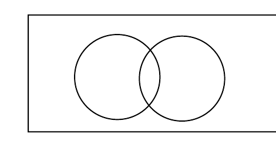

**A**. π − √3

**B**. 2π − 2√3

**C**. (2√3/3)π − 2

**D**. (2/3)π − √3/2

第 76 题 · 答案与解析

**参考答案（第三方答案PDF转写；非官方）**

D

**来源**：2024年北京市考行测答案PDF 第21页；第三方题库PDF包；非官方

### 第 77 题

甲、乙抽水机的抽水效率比为 4:3。现有一池水，单独打开甲抽水机恰好可在规定时间内将水抽完：单 独打开乙抽水机，抽完水所用时间比规定时间多 2 小时。若同时打开两台抽水机 3 小时，之后关闭甲抽水 机，还需要多少小时才能将水池中的水抽完？（ ）

**A**. 1

**B**. 1.5

**C**. 1.8

**D**. 2

第 77 题 · 答案与解析

**参考答案（第三方答案PDF转写；非官方）**

A

**来源**：2024年北京市考行测答案PDF 第21页；第三方题库PDF包；非官方

### 第 78 题

三对夫妻，其中有一对夫妻有一个孩子，他们买了同一排的 7 个相连的座位观看演出，要求每个家庭必 须坐在一起，孩子要坐在父母中间，家庭之间必须同性相邻而坐。问共有多少种不同的坐法？（ ）

**A**. 8 种

**B**. 12 种

**C**. 16 种

**D**. 24 种

第 78 题 · 答案与解析

**参考答案（第三方答案PDF转写；非官方）**

B

**来源**：2024年北京市考行测答案PDF 第22页；第三方题库PDF包；非官方

### 第 79 题

某社区响应全民运动的号召，举办了一场跑步比赛，并准备在一条直线跑道边上每隔 10 米布置一面彩 旗。现有 20 名志愿者，每名志愿者负责布置一面彩旗。运输车将这批彩旗集中运至跑道边上某点，每位志 愿者从各自彩旗布置点出发前来领取彩旗，问志愿者往返所走的路程最少为多少米？（ ）

**A**. 1800

**B**. 2000

**C**. 2200

**D**. 2400

第 79 题 · 答案与解析

**参考答案（第三方答案PDF转写；非官方）**

B

**来源**：2024年北京市考行测答案PDF 第22页；第三方题库PDF包；非官方

### 第 80 题

如图所示，要在一个侧面均为正三角形的正四棱锥 O-ABCD 材料中切割出一个由小正四棱锥 O-EFGH 和 长方体组成的零件，已知大、小两个四棱锥的体积之比为 8:1，则正四棱锥 O-ABCD 材料的利用率为： （ ）

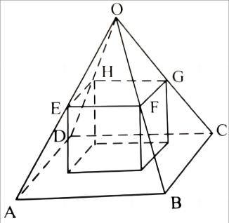

**A**. 50%

**B**. 40%

**C**. 60%

**D**. 30%

第 80 题 · 答案与解析

**参考答案（第三方答案PDF转写；非官方）**

A

**来源**：2024年北京市考行测答案PDF 第22页；第三方题库PDF包；非官方

## 四、判断推理

### 第 81 题

从所给的四个选项中，选择最合适的一个填入问号处，使之呈现一定的规律性：（ ）

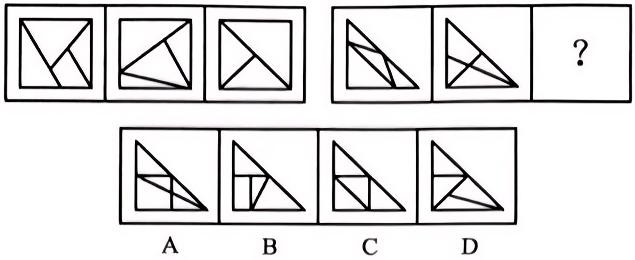

**A**. 见图A

**B**. 见图B

**C**. 见图C

**D**. 见图D

第 81 题 · 答案与解析

**参考答案（第三方答案PDF转写；非官方）**

D

**来源**：2024年北京市考行测答案PDF 第22页；第三方题库PDF包；非官方

### 第 82 题

从所给的四个选项中，选择最合适的一个填入问号处，使之呈现一定的规律性：（ ）

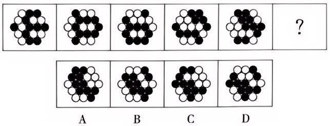

**A**. 见图A

**B**. 见图B

**C**. 见图C

**D**. 见图D

第 82 题 · 答案与解析

**参考答案（第三方答案PDF转写；非官方）**

B

**来源**：2024年北京市考行测答案PDF 第22页；第三方题库PDF包；非官方

### 第 83 题

从所给的四个选项中，选择最合适的一个填入问号处，使之呈现一定的规律性：（ ）

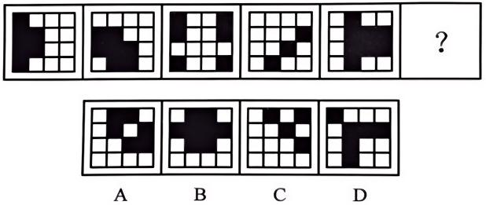

**A**. 见图A

**B**. 见图B

**C**. 见图C

**D**. 见图D

第 83 题 · 答案与解析

**参考答案（第三方答案PDF转写；非官方）**

A

**来源**：2024年北京市考行测答案PDF 第23页；第三方题库PDF包；非官方

### 第 84 题

从所给的四个选项中，选择最合适的一个填入问号处，使之呈现一定的规律性（ ）

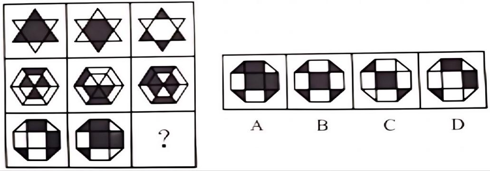

**A**. 见图A

**B**. 见图B

**C**. 见图C

**D**. 见图D

第 84 题 · 答案与解析

**参考答案（第三方答案PDF转写；非官方）**

C

**来源**：2024年北京市考行测答案PDF 第23页；第三方题库PDF包；非官方

### 第 85 题

把下面的六个图形分为两类，使每一类图形都有各自的共同特征或规律，分类正确的一项是：（ ）

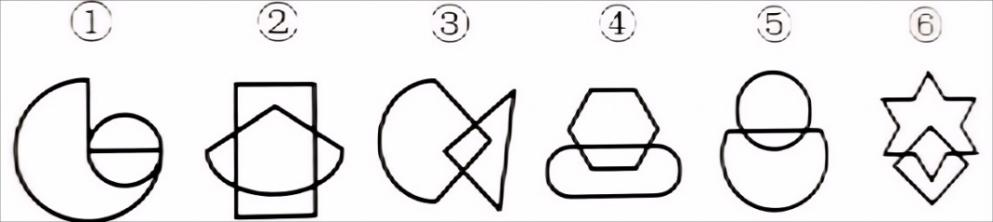

**A**. ①③④,②⑤⑥

**B**. ①③⑤,②④⑥

**C**. ①②⑥,③④⑤

**D**. ①②④,③⑤⑥

第 85 题 · 答案与解析

**参考答案（第三方答案PDF转写；非官方）**

D

**来源**：2024年北京市考行测答案PDF 第23页；第三方题库PDF包；非官方

### 第 86 题

把下面的六个图形分为两类，使每一类图形都有各自的共同特征或规律，分类正确的一项是：（ ）

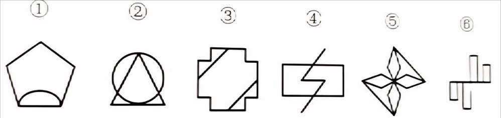

**A**. ①②③,④⑤⑥

**B**. ①②⑤,③④⑥

**C**. ①④⑤,②③⑥

**D**. ①③⑤,②④⑥

第 86 题 · 答案与解析

**参考答案（第三方答案PDF转写；非官方）**

B

**来源**：2024年北京市考行测答案PDF 第23页；第三方题库PDF包；非官方

### 第 87 题

把下面的六个图形分为两类，使每一类图形都有各自的共同特征或规律，分类正确的一项是：（ ）

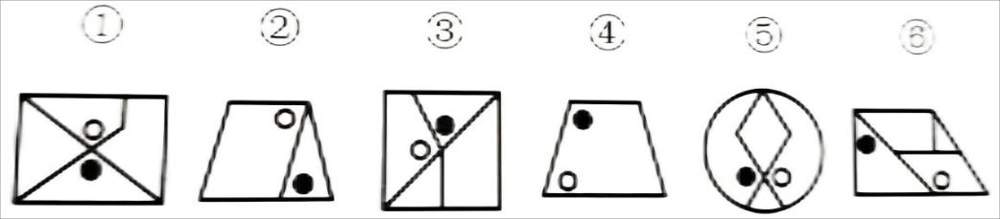

**A**. ①③⑥,②④⑤

**B**. ①②⑤,③④⑥

**C**. ①③④,②⑤⑥

**D**. ①②④,③⑤⑥

第 87 题 · 答案与解析

**参考答案（第三方答案PDF转写；非官方）**

B

**来源**：2024年北京市考行测答案PDF 第23页；第三方题库PDF包；非官方

### 第 88 题

下面四个选项中，符合左边立体图形的俯视图和主视图的是：（ ）

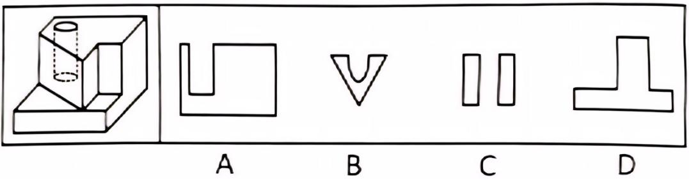

**A**. 见图A

**B**. 见图B

**C**. 见图C

**D**. 见图D

第 88 题 · 答案与解析

**参考答案（第三方答案PDF转写；非官方）**

D

**来源**：2024年北京市考行测答案PDF 第23页；第三方题库PDF包；非官方

### 第 89 题

左边给定的是正方体的外表面展开图，右边哪一项能由它折叠而成？（ ）

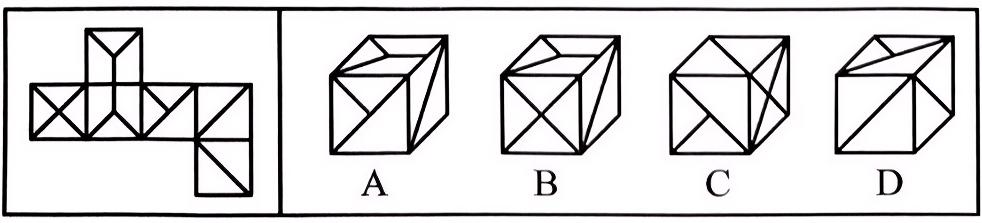

**A**. 见图A

**B**. 见图B

**C**. 见图C

**D**. 见图D

第 89 题 · 答案与解析

**参考答案（第三方答案PDF转写；非官方）**

D

**来源**：2024年北京市考行测答案PDF 第23页；第三方题库PDF包；非官方

### 第 90 题

左图为给定的多面体，在上层挖掉一个圆柱体，将其从任一面剖开，哪项不可能是该多面体的截面？ （ ）

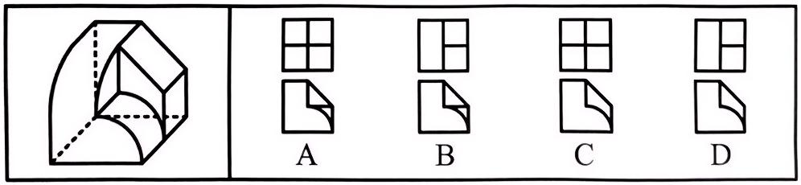

**A**. 见图A

**B**. 见图B

**C**. 见图C

**D**. 见图D

第 90 题 · 答案与解析

**参考答案（第三方答案PDF转写；非官方）**

C

**来源**：2024年北京市考行测答案PDF 第23页；第三方题库PDF包；非官方

### 第 91 题

幽默可以淡化人的消极情绪，消除沮丧与痛苦。许多看起来令人痛苦烦恼之事，具有幽默感的人却应付 得轻松自如。用幽默来处理烦恼与矛盾，会使人感到和谐愉快，相融友好。研究发现具有幽默感的人与其 他人相比，平均社交能力更强。研究者据此发出倡议：若想提升你的社交能力，不妨让自己变得幽默一些。 以下哪项如果为真，最能质疑上述结论？（ ）

**A**. 大部分刻板严肃不幽默的人，社交能力是很强的

**B**. 一个人的幽默能力和其情商成正比关系，而情商不是能轻易改变的

**C**. 幽默的人大都具有丰富的知识储备以及人生经历，并且还乐于与人分享

**D**. 幽默感取决于人的认知能力，社交能力越强使得认知能力也会越高

第 91 题 · 答案与解析

**参考答案（第三方答案PDF转写；非官方）**

D

**来源**：2024年北京市考行测答案PDF 第24页；第三方题库PDF包；非官方

### 第 92 题

某学校的五位老师根据前三个月的月考成绩统计，对本次月考的情况做了如下预测：语文老师：“这次 语文和数学都会进步。” 数学老师：如果语文这次进步，那么数学就不会进步。 英语老师：“如果物理这次没进步，那么英语也没进步。” 物理老师：“这次物理会进步。 ” 班主任：“这次英语不会进步，但语文会进步。” 该次月考成绩统计完成以后，发现上述五个预测中只有两个符合事实。 关于该次月考各科的进步情况，以下哪项一定为真？（ ）

**A**. 语文老师预测错误，数学没进步

**B**. 数学老师预测正确，语文没进步

**C**. 英语老师预测错误，英语没进步

**D**. 班主任预测正确，物理没进步

第 92 题 · 答案与解析

**参考答案（第三方答案PDF转写；非官方）**

B

**来源**：2024年北京市考行测答案PDF 第24页；第三方题库PDF包；非官方

### 第 93 题

人们普遍认为是人类活动增加了大气中温室气体的浓度，从而导致了全球变暖。然而，这一观点并不能 解释为什么北极气温有时会急剧上升。自从研究人员开始监测北边的温度以来，该地区经历了两次突然变 暖。而在每次变暖之前，离北极最近的地震活跃区域阿留申弧都会发生一系列大地震。据此研究者认为这 一系列大地震可能是北极突然变暖的背后推手。 下列哪项如果为真，最能支持上述观点？（ ）

**A**. 阿留申弧是世界上最活跃的地震带之一，因地处环太平洋火山地震带而火山地震活动异常频繁

**B**. 岩石圈震动从阿留申弧传播到北极是以每年大约 100 公里的速度传播，传播时间与每次大地震和随后的 温度上升之间的延迟一致

**C**. 阿留申弧到达北极的地震波可以破坏储存甲烷的永久冻土，甲烷释放到冰架和大气的水中，导致该地区 突然变暖

**D**. 北极地区出现的轻微变暖就足以突然引发大规模的永久冻土融化，并引发包括阿留申弧在内的大片区域 的气候变暖

第 93 题 · 答案与解析

**参考答案（第三方答案PDF转写；非官方）**

C

**来源**：2024年北京市考行测答案PDF 第24页；第三方题库PDF包；非官方

### 第 94 题

最新研究表明，烹饪燃料的种类与重大疾病的死亡风险密切相关。某大学对中国慢性疾病前瞻性队列研 究中的五个区域、超过 17 万的调查对象展开了为期 4 年的研究，发现使用固体燃料（煤柴或木炭等）进行 烹饪的一组调查对象的全病因死亡风险、心血管疾病死亡风险和呼吸系统疾病死亡风险均高于使用清洁燃 料（天然气、液化石油气等）进行烹饪的一组。研究人员据此推测，使用固体燃料烹饪会增加死亡风险。 以下哪项如果为真，最能削弱研究人员的推测？（ ）

**A**. 在烹饪过程中使用通风设施即可降低患重大疾病的风险

**B**. 将固体燃料替换为清洁燃料后，心血管疾病的死亡风险有所降低

**C**. 参与调查的对象中，使用固体燃料的多为村镇居民，村镇居民抽烟的比例比较大

**D**. 通常情况下，居民只有在冬季才会使用固体燃料进行烹饪

第 94 题 · 答案与解析

**参考答案（第三方答案PDF转写；非官方）**

C

**来源**：2024年北京市考行测答案PDF 第25页；第三方题库PDF包；非官方

### 第 95 题

所有参与过年级数学竞赛的学生都是本校大三年级的优秀干部，没有一个物理学专业的学生大三年级 的学生，有些土木工程专业的学生参加过年级数学竞赛，有些化学专业的学生没参加这年级数学竞赛，所 有在校内兼职的学生都参与过年级数学竞赛。 根据以上信息，一定可以得出以下哪项：（ ）

**A**. 有些在校内兼职的学生是学化学专业的

**B**. 所有在校内兼职的学生都是大三年级的优秀干部

**C**. 有些土木工程专业的学生不是大三年级的优秀干部

**D**. 有些物理学专业的学生参加过年级数学竞赛

第 95 题 · 答案与解析

**参考答案（第三方答案PDF转写；非官方）**

B

**来源**：2024年北京市考行测答案PDF 第25页；第三方题库PDF包；非官方

### 第 96 题

对于以飞沫方式传播的病毒，人们应该在大风和下雨时特别做好病毒防护措施，因为刮风会把病毒吹得 到处都是，下雨会让病毒更快繁殖，它们都会加速病毒在空气中的传播。 以下各项如果为真，除哪项外均能质疑上述观点？（ ）

**A**. 在潮湿的环境中，细菌可能会更快繁殖

**B**. 病毒只能寄生在宿主体内繁殖，潮湿环境不会增加病毒数量

**C**. 大风会将高浓度的病毒吹散，可以起到“稀释”效果

**D**. 病毒赖以附着和传播的飞沫会随降雨沉降被冲走，降低其在空气中的含量

第 96 题 · 答案与解析

**参考答案（第三方答案PDF转写；非官方）**

A

**来源**：2024年北京市考行测答案PDF 第25页；第三方题库PDF包；非官方

### 第 97 题

对那些最先给封建主义定义的作家来说，封建主义的存在也就预先假定了贵族阶级的存在。然而正确地 说来，贵族阶级是不可能存在的，除非那些表明较高的贵族地位的头衔和这些头衔的继承权被法律所认可。 尽管封建主义早在 8 世纪时就已经存在，但是直到 12 世纪，当许多封建机构处于衰落时，法律上承认的世 袭贵族头衔才第一次出现。 因此，可以推出：（ ）

**A**. 认为从封建主义定义上讲，要求贵族阶级的存在就是在使用一个歪曲历史的定义

**B**. 某个社会团体具有与众不同的法律地位的事实本身并不足以说明这个团体可被合情合理地认为是一个社 会阶层

**C**. 12 世纪之前，欧洲的封建制度与机构是在没有统治阶级存在的情况下运行的

**D**. 按照贵族阶级这一词的最严格的定义来讲，先前的封建机构的存在是贵族阶级出现的先决条件

第 97 题 · 答案与解析

**参考答案（第三方答案PDF转写；非官方）**

A

**来源**：2024年北京市考行测答案PDF 第26页；第三方题库PDF包；非官方

### 第 98 题

适合于实验用的小动物必须繁殖快而且其基因要尽可能多地与人的相似；有些小动物虽然繁殖快但与人 相似的基因很少；所以，有些繁殖快的小动物并不适合用于实验。 以下哪项的逻辑结构与题干的最为类似？（ ）

**A**. 按相关规定，要获得国家贫困生奖学金，申请者必须家庭贫困并且成绩优秀；有些这一奖学金的获得者 家庭非常贫困，但成绩并不优秀；显然，评定国家贫困生奖学金的规定没有得到严格地执行

**B**. 一部电影要获得好的票房，必须既有可看性又有成功的市场发行；有些票房好的电影其实可看性并不强： 所以，有些电影的票房之所以好主要靠的是成功的市场发行

**C**. 要修读《认知科学的哲学》这门课，必须已经修过《知识论》，并且对认知科学感兴趣：有些学生虽然对 认知科学很感兴趣，但没有修过《知识论》       ；因此，有些对认知科学感兴趣的学生不能修读《认知科学的哲 学》这门课

**D**. 一般来说，不是每周进行系统维护的电脑在使用一年后都要拿到专卖店去维修：有些电脑在用了很长时 间后也不需要拿到专卖店去维修；因此，有些电脑每周都进行了系统维护

第 98 题 · 答案与解析

**参考答案（第三方答案PDF转写；非官方）**

C

**来源**：2024年北京市考行测答案PDF 第26页；第三方题库PDF包；非官方

### 第 99 题

互联网让迎合细分观众群体的媒体繁荣起来，这些媒体不受传统新闻标准的束缚。有一项研究在国外某 互联网平台上追踪了 2006 年至 2017 年的 12.6 万条新闻，结果显示，我们更有可能分享虚假新闻，而不是 真实新闻，这表明人们渴望新奇的内容。 要得到上述研究结论，需要补充的重要前提是：（ ）

**A**. 12.6 万条新闻中大部分是假的

**B**. 假新闻不受传统新闻标准的束缚

**C**. 假新闻不受现实束缚，更具新奇感

**D**. 人们传播假新闻是因为不知道真相

第 99 题 · 答案与解析

**参考答案（第三方答案PDF转写；非官方）**

C

**来源**：2024年北京市考行测答案PDF 第26页；第三方题库PDF包；非官方

### 第 100 题

位于英格兰威尔特郡索尔兹伯里平原的英国巨石阵由巨大的石头组成，每块约重 50 吨，约建于公元前 4000 年。如果站在巨石阵的中央观察，那么第 93 号石头正好指向立夏和立秋这两天日落的位置。于是科学 家推测巨石阵大概是远古时代人们为观测天象所建造的，它很可能就是一座非常非常古老的“天文台”。 以下哪项如果为真，最能削弱科学家的推测？（ ）

**A**. 考古学家在当地一座山上发现了采石的痕迹，山上的石头与巨石阵的巨石石质类似

**B**. 考古发现巨石阵附近的古代居民都信奉德鲁伊教，德鲁伊教士一般都精通物理

**C**. 十八世纪中期，一些修补人员对这座史前纪念碑进行了修补和加固，并对巨石的位置随机进行了重新摆 放

**D**. 通过巨石阵石环和土环的结构关系，可以精确了解太阳和月亮的 12 个方位

第 100 题 · 答案与解析

**参考答案（第三方答案PDF转写；非官方）**

C

**来源**：2024年北京市考行测答案PDF 第26页；第三方题库PDF包；非官方

### 第 101 题

概念是人脑对客观事物本质特征的认识，事物的本质特征决定事物的性质，是一事物区别于其他事物 的本质特征。根据概念所包含的属性的抽象与概括程度，概念可分为具体概念和抽象概念。按事物的指认 属性形成的概念称为具体概念，按事物的内在本质属性形成的概念称为抽象概念。 下列哪项是抽象概念？（ ）

**A**. 香蕉和木棒都是长的，而球和西瓜都是圆的

**B**. 香蕉和西瓜都是水果，而白菜和土豆都是蔬菜

**C**. 巧克力和土地都是棕色的，而雪和面粉都是白色的

**D**. 冰和雪都是冷的，火和血液都是热的

第 101 题 · 答案与解析

**参考答案（第三方答案PDF转写；非官方）**

B

**来源**：2024年北京市考行测答案PDF 第27页；第三方题库PDF包；非官方

### 第 102 题

愧疚救赎心理指的是在由于自己的过错而造成对他人的伤害时，有意无意地会认为被伤害的人也有责 任，从而减轻自己的负罪感。 根据上述定义，下列哪项涉及愧疚救赎心理？（ ）

**A**. 早年家庭条件不好，女儿吃了不少苦，现在条件好了，妈妈常常逼迫女儿吃这吃那

**B**. 看到不少老人、儿童孤苦伶仃，晓华决心从事国际慈善事业，救助世界上的困苦者

**C**. 小陈开车遇堵，等待慢行时看手机，和旁边插队的车辆撞在一起，小陈认为对方需要承担主要责任

**D**. 小黄随手扔在路边的香蕉皮绊倒了路过的张大娘，小黄本想扶起她，但转念一想，觉得都怪她自己走路 不仔细，自己没必要多管闲事

第 102 题 · 答案与解析

**参考答案（第三方答案PDF转写；非官方）**

D

**来源**：2024年北京市考行测答案PDF 第27页；第三方题库PDF包；非官方

### 第 103 题

蒸发冷却是指液体在蒸发成气体的过程中会吸热，从而降低周围的温度起到冷却的效果。蒸发冷却效 应是指在目的或志趣相同的人们组成的社会团体中，团体的价值跟个体的整体温度类似，当价值较高的成 员离开社团后，社团自身的平均价值会降低。 根据上述定义，下列属于蒸发冷却效应的是：（ ）

**A**. 某高校的街舞社团的团长毕业离开学校后，该社团便再没有在街舞比赛中取得较好的名次

**B**. 某知名流行音乐演唱组合中的一名歌手因意外去世，大批歌迷认为这个歌手的离开导致该组合整体演唱 水平大打折扣

**C**. 某教育机构的一些老师离开该机构创办自己的教育公司，使该机构在市场竞争中的形势变得更加严峻

**D**. 某社交网站的影评小组建立之初时人数较少，影评质量较高，后来有大量人加入这个小组上影评，使这里 整体的影评质量有所下降

第 103 题 · 答案与解析

**参考答案（第三方答案PDF转写；非官方）**

A

**来源**：2024年北京市考行测答案PDF 第27页；第三方题库PDF包；非官方

### 第 104 题

行政指令是指行政主体依靠行政组织的权威，运用行政手段，包括行政命令、指示、规定条例及规章制 度等措施，按照行政组织的系统和层次进行行政管理活动的方法。 根据上述定义，下列描述不属于行政指令的是：（ ）

**A**. 市消防大队对未经消防设计预案擅自施工的违法工程下发《责令改正通知书》

**B**. 体育局局长签发嘉奖令，表彰在全运会上取得优异成绩的运动员和教练员

**C**. 消费者协会同中国家用电器协会正式发布《太阳能热水器选购指南》

**D**. 市教育局紧急电话通知，要求全市中小学、幼儿园加强校园安全管理

第 104 题 · 答案与解析

**参考答案（第三方答案PDF转写；非官方）**

C

**来源**：2024年北京市考行测答案PDF 第27页；第三方题库PDF包；非官方

### 第 105 题

文化晴老是指在物质利益的驱动之下，文化没有表现出应有的创造力，而只靠稀释或颠覆终典、争夺 古人的遗产来吸引大众的注意力。 根据上述定义，下列未体现文化古老的是：（ ）

**A**. 《水浒传》《三国演义》等名著被改过一遍又一遍，但对名著诠释的深度和准确性却不尽如人意

**B**. 随着网络文学的兴起，穿越小说越来越多，一些优秀的穿越小说也被改编成电视剧

**C**. 近些年名人故里纷争四起，从木兰故里到孔明故里，历朝历代名人都引发过一轮又一轮的争抢

**D**. 狮子楼本来是武松把西门庆杀了的地方，现在的景象却是武松和西门庆在此地“相逢一笑泯恩仇”，两个 人携手为当地经济做贡献

第 105 题 · 答案与解析

**参考答案（第三方答案PDF转写；非官方）**

B

**来源**：2024年北京市考行测答案PDF 第27页；第三方题库PDF包；非官方

### 第 106 题

鸟类：蝙蝠（ ）

**A**. 中枢神经：脊髓

**B**. 古体诗：律诗

**C**. 间谍：军官

**D**. 北极星：织女星

第 106 题 · 答案与解析

**参考答案（第三方答案PDF转写；非官方）**

B

**来源**：2024年北京市考行测答案PDF 第28页；第三方题库PDF包；非官方

### 第 107 题

劫富济贫：凶多吉少（ ）

**A**. 深居简出：悲欢离合

**B**. 明争暗斗：天翻地覆

**C**. 吐故纳新：前倨后恭

**D**. 承上启下：左支右绌

第 107 题 · 答案与解析

**参考答案（第三方答案PDF转写；非官方）**

C

**来源**：2024年北京市考行测答案PDF 第28页；第三方题库PDF包；非官方

### 第 108 题

通货膨胀：产出供给：现实购买力（ ）

**A**. 成本控制：预算：决算

**B**. 逆流而上：船速：水速

**C**. 免疫力低：饮食：运动

**D**. 物体上浮：重力：浮力

第 108 题 · 答案与解析

**参考答案（第三方答案PDF转写；非官方）**

D

**来源**：2024年北京市考行测答案PDF 第28页；第三方题库PDF包；非官方

### 第 109 题

轮胎：橡胶：天然橡胶（ ）

**A**. 纸张：草浆：纸浆

**B**. 镜片：玻璃：树脂

**C**. 棉布：棉线：棉纱

**D**. 家具：木材：檀木

第 109 题 · 答案与解析

**参考答案（第三方答案PDF转写；非官方）**

D

**来源**：2024年北京市考行测答案PDF 第29页；第三方题库PDF包；非官方

### 第 110 题

食品业 对于 ( ) 相当于 赤潮 对于 （ ）

**A**. 工业 气象

**B**. 纺织业 自然灾害

**C**. 小麦 海藻

**D**. 轻工业 海洋灾害

第 110 题 · 答案与解析

**参考答案（第三方答案PDF转写；非官方）**

D

**来源**：2024年北京市考行测答案PDF 第29页；第三方题库PDF包；非官方

### 第 111 题

如图所示，在北半球中纬度高空，一架飞机自东向西飞行，飞机左侧是高压，右侧是低压则飞机飞行 方向与风向的关系是：（ ）

**A**. 顺风飞行

**B**. 逆风飞行

**C**. 风从南侧吹来

**D**. 风从北侧吹来

第 111 题 · 答案与解析

**参考答案（第三方答案PDF转写；非官方）**

B

**来源**：2024年北京市考行测答案PDF 第29页；第三方题库PDF包；非官方

### 第 112 题

如图所示为某种伴 X 染色体隐性遗传病的遗传系谱图，下列说法中正确的是：（ ）

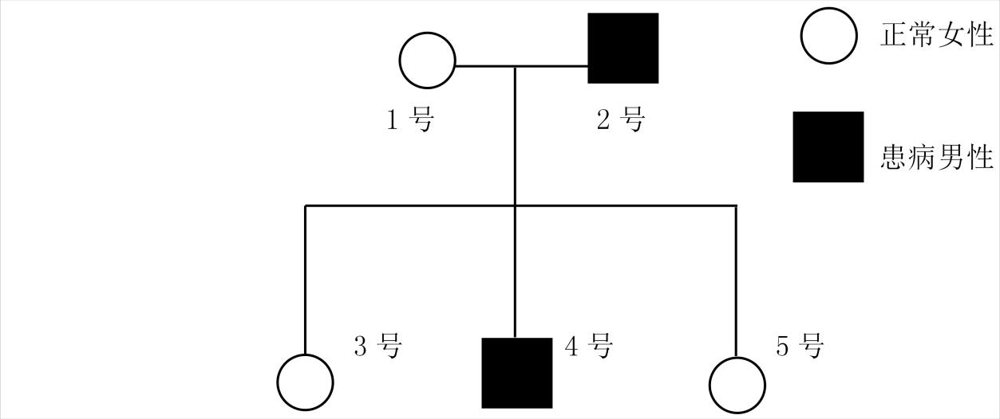

**A**. 4 号的致病基因来自 2 号

**B**. 5 号一定带有致病基因

**C**. 若 1 号与 2 号再生一个男孩，则该男孩一定患病

**D**. 若 1 号与 2 号再生一个女孩，则该女孩一定不患病

第 112 题 · 答案与解析

**参考答案（第三方答案PDF转写；非官方）**

B

**来源**：2024年北京市考行测答案PDF 第29页；第三方题库PDF包；非官方

### 第 113 题

下图为地球公转示意图，已知北京某天的白昼时间为 10 个小时，黑夜时间为 14 个小时，关于当天地 球在公转轨道上所处的位置，下列说法正确的是：（ ）

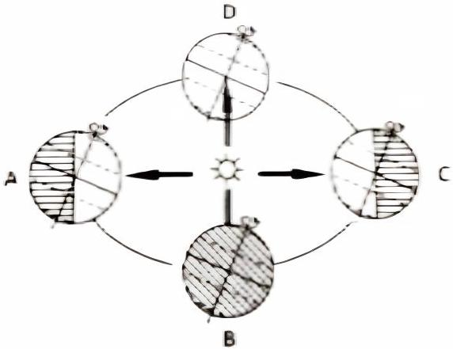

**A**. 可能在 AB 之间

**B**. 一定在 BC 之间

**C**. 一定在 CD 之间

**D**. 不可能在 DA 之间

第 113 题 · 答案与解析

**参考答案（第三方答案PDF转写；非官方）**

D

**来源**：2024年北京市考行测答案PDF 第30页；第三方题库PDF包；非官方

### 第 114 题

化学与生活、生产密切相关，下列有关说法正确的是：（ ）

**A**. “84”消毒液无色，有漂白作用，无需密封保存

**B**. 晶体硅是优良的半导体材料，可用于制取光导纤维和太阳能电池

**C**. 二氧化硫不仅可以漂白纸浆，还可以杀菌消毒

**D**. 汽车尾气中的 NO 主要来源于汽油、柴油的燃烧

第 114 题 · 答案与解析

**参考答案（第三方答案PDF转写；非官方）**

C

**来源**：2024年北京市考行测答案PDF 第30页；第三方题库PDF包；非官方

### 第 115 题

从地转偏向力考虑，下列示意图中，空心箭头表示水流初始运动方向，虚线箭头表示水流实际运动方 向，下列表示正确的是（ ）

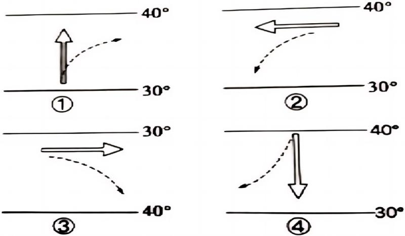

**A**. ②④

**B**. ②③

**C**. ①③

**D**. ①④

第 115 题 · 答案与解析

**参考答案（第三方答案PDF转写；非官方）**

D

**来源**：2024年北京市考行测答案PDF 第30页；第三方题库PDF包；非官方

## 五、资料分析

## 材料 4

表 2021 年一季度软件和信息技术服务业主要指标
   指标名称                单位          本期累计     同比增长（%）
   单位个数                个           39719    4.8
   软件业务收入              亿元          ------   26.5
   其中：1.软件产品收入         亿元          5456     23.4
       2.信息技术服务收入      亿元          11375    29.2
       3.信息安全收入        亿元          264      24.8
       4.嵌入式系统软件收入     亿元          1934     20.7
   软件业务出口              亿美元         111      15.4
   利润总额                亿元          2371     25.9
   从业人员工资总额            亿元          2606     ------
   从业人员总人数             万人          697      ------
注：软件业务收入由软件产品收入、信息技术服务收入、信息安全收入、嵌入式系统软件收入组成。

### 第 116 题

2021 年一季度，软件和信息技术服务业平均每个单位的软件产品收入比上年同期增加：（ ）

**A**. 166 万元

**B**. 186 万元

**C**. 207 万元

**D**. 237 万元

第 116 题 · 答案与解析

**参考答案（第三方答案PDF转写；非官方）**

C

**来源**：2024年北京市考行测答案PDF 第30页；第三方题库PDF包；非官方

### 第 117 题

2021 年一季度，软件和信息技术服务业软件业务收入中，占比较上年同期上升的收入类别，其收入所 占的比重为：（ ）

**A**. 28.8%

**B**. 59.8%

**C**. 1.4%

**D**. 10.2%

第 117 题 · 答案与解析

**参考答案（第三方答案PDF转写；非官方）**

B

**来源**：2024年北京市考行测答案PDF 第30页；第三方题库PDF包；非官方

### 第 118 题

2020 年一季度，软件和信息技术服务业软件业务收入利润率约为： （ ）

**A**. 12.5%

**B**. 24.3%

**C**. 8.2%

**D**. 3.8%

第 118 题 · 答案与解析

**参考答案（第三方答案PDF转写；非官方）**

A

**来源**：2024年北京市考行测答案PDF 第31页；第三方题库PDF包；非官方

### 第 119 题

2021 年一季度，对软件和信息技术服务业软件业务收入增长的贡献率最大的收入类别是： （ ）

**A**. 软件产品收入

**B**. 信息技术服务收入

**C**. 信息安全收入

**D**. 嵌入式系统软件收入

第 119 题 · 答案与解析

**参考答案（第三方答案PDF转写；非官方）**

B

**来源**：2024年北京市考行测答案PDF 第31页；第三方题库PDF包；非官方

### 第 120 题

能够从上述资料中推出的是：（ ）

**A**. 2020 年一季度，软件和信息技术服务业软件业务进口额不足 100 亿美元

**B**. 2021 年一季度，软件和信息技术服务业单位个数同比增长超过 1900 个

**C**. 2020 年一季度，软件和信息技术服务业软件业务出口额超过 100 亿美元

**D**. 2021 年一季度，软件和信息技术服务业从业人员人均工资超过 3 万元

第 120 题 · 答案与解析

**参考答案（第三方答案PDF转写；非官方）**

D

**来源**：2024年北京市考行测答案PDF 第31页；第三方题库PDF包；非官方

## 材料 5

2020 年中国碳纤维的总消费量为 4.88 万吨，同比增长 29.1%。同时，随着国内碳纤维产能的提升，国产碳
纤维占比也呈现上升趋势。2020 年，国产碳纤维消费量占总消费量的 37.8%，较上年提升 6.1 个百分点。

               图 1 2016—2020 年中国碳纤维消费量（万吨，%）

                        图 2 2020 年中国碳纤维应用领域分布情况

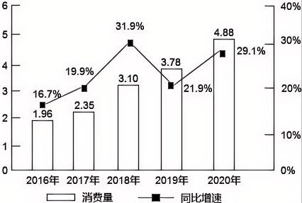

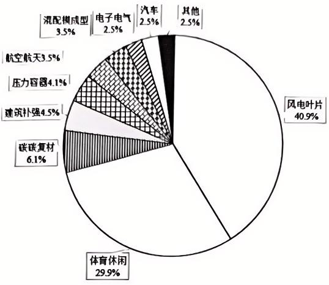

### 第 121 题

与 2015 年相比，2016 年中国碳纤维消费量增长约：（ ）

**A**. 0.11 万吨

**B**. 0.17 万吨

**C**. 0.28 万吨

**D**. 0.39 万吨

第 121 题 · 答案与解析

**参考答案（第三方答案PDF转写；非官方）**

C

**来源**：2024年北京市考行测答案PDF 第31页；第三方题库PDF包；非官方

### 第 122 题

2020 年国产碳纤维消费量比 2019 年增长了：（ ）

**A**. 42%

**B**. 54%

**C**. 22%

**D**. 12%

第 122 题 · 答案与解析

**参考答案（第三方答案PDF转写；非官方）**

B

**来源**：2024年北京市考行测答案PDF 第31页；第三方题库PDF包；非官方

### 第 123 题

2020 年中国碳纤维应用领域中，碳纤维消费量超过 2000 吨的领域有几个？（ ）

**A**. 5

**B**. 4

**C**. 3

**D**. 2

第 123 题 · 答案与解析

**参考答案（第三方答案PDF转写；非官方）**

A

**来源**：2024年北京市考行测答案PDF 第31页；第三方题库PDF包；非官方

### 第 124 题

若 2020 年中国体育休闲领域碳纤维消费量 80%为国产碳纤维，则风电叶片领域的进口碳纤维消费量至 少为：（ ）

**A**. 1.5 万吨

**B**. 0.8 万吨

**C**. 0.2 万吨

**D**. 1.3 万吨

第 124 题 · 答案与解析

**参考答案（第三方答案PDF转写；非官方）**

D

**来源**：2024年北京市考行测答案PDF 第31页；第三方题库PDF包；非官方

### 第 125 题

能够从上述材料中推出的是：（ ）

**A**. 2016—2020 年，中国碳纤维消费量年均增速约为 20%

**B**. 2017—2020 年，中国碳纤维消费量同比增长最多的是 2018 年

**C**. 2020 年中国碳纤维消费量占总消费量比重排名第二的应用领域，其碳纤维消费量约为占比最低的应用领 域的 12 倍

**D**. 2020 年中国碳碳复材领域碳纤维消费量比压力容器领域多 976 吨

第 125 题 · 答案与解析

**参考答案（第三方答案PDF转写；非官方）**

D

**来源**：2024年北京市考行测答案PDF 第32页；第三方题库PDF包；非官方

## 材料 6

2022 年一季度，S 市实现进出口总值 10079.1 亿元，比去年同期增长 14.6%。其中，出口值增长 23.8%：
进口值增长 8.9%；贸易逆差 1808.3 亿元。
    一季度，S 市外商投资企业进出口总值增长 13.5%。其中，出口 2427.5 亿元，增长 23.2%；进口 3871.6
亿元，增长 8.2%。民营企业进出口 2760.5 亿元，增长 20.4%。
    一季度，S 市机电产品出口值增长 22.9%，占同期全市出口总值的 68.7%。其中，集成电路出口值增长
18.6%，占机电产品出口值的 15.2%；笔记本电脑出口值增长 34.2%，占机电产品出口值的 10.9%；汽车出
口值增长 194.4%，占机电产品出口值的 8.5%；手机出口值增长 280.7%，占机电产品出口值的 6.9%；锂离
子蓄电池出口 33.8 亿元，增长 221.8%；其他产品出口 1627.6 亿元。同期，劳动密集型产品出口 448.6
亿元，去年同期为 420 亿元。
    一季度，S 市进口高新技术产品 1790.9 亿元，增长 6.5%。其中，集成电路进口 780.4 亿元，增长 18.3%；
自动数据处理设备及其零部件进口 158 亿元，增长 2.6%。同期，部分大宗商品进口增长较快，未锻轧铜及
铜材进口 177.3 亿元，增长 32.8%；大豆进口 110 亿元，增长 57.9%；铜矿砂及其精矿进口 54.3 亿元，
增长 36.7%；液化天然气进口 52.6 亿元，增长 23.7%。此外，文化产品进口 112.1 亿元，增长 30.8%。

### 第 126 题

2021 年一季度，S 市实现贸易：（ ）

**A**. 顺差 1578 亿元

**B**. 逆差 1578 亿元

**C**. 顺差 2118 亿元

**D**. 逆差 2118 亿元

第 126 题 · 答案与解析

**参考答案（第三方答案PDF转写；非官方）**

D

**来源**：2024年北京市考行测答案PDF 第32页；第三方题库PDF包；非官方

### 第 127 题

如保持 2022 年一季度同比增量不变，则在（ ）年一季度 S 市劳动密集型产品出口值将比 2022 年一 季度翻一番。

**A**. 2037

**B**. 2038

**C**. 2039

**D**. 2040

第 127 题 · 答案与解析

**参考答案（第三方答案PDF转写；非官方）**

B

**来源**：2024年北京市考行测答案PDF 第32页；第三方题库PDF包；非官方

### 第 128 题

将 S 市①未锻轧铜及铜材②大豆③文化产品按 2022 年一季度进口值同比增量从高到低排列，正确的是： （ ）

**A**. ③>①>②

**B**. ①>③>②

**C**. ①>②>③

**D**. ③>②>①

第 128 题 · 答案与解析

**参考答案（第三方答案PDF转写；非官方）**

C

**来源**：2024年北京市考行测答案PDF 第33页；第三方题库PDF包；非官方

### 第 129 题

2022 年一季度，S 市出口机电产品中，除其他产品外，出口值同比增速最低的类别出口值约是最高类 别出口值的多少倍？（ ）

**A**. 1.2

**B**. 1.5

**C**. 2.2

**D**. 2.5

第 129 题 · 答案与解析

**参考答案（第三方答案PDF转写；非官方）**

C

**来源**：2024年北京市考行测答案PDF 第33页；第三方题库PDF包；非官方

### 第 130 题

下列选项不能从上述资料推出的是：（ ）

**A**. 2022 年一季度，民营企业进出口值占 S 市进出口总值的比重同比下降

**B**. 与去年同期相比，2022 年一季度 S 市汽车、手机、锂离子蓄电池出口值成倍增长

**C**. 2022 年一季度，S 市汽车出口值占同期全市出口总值的比重超过 5.5%

**D**. 2022 年一季度，S 市进口高新技术产品中，集成电路和自动数据处理设备及其零部件进口总值比其他产 品进口值多 85.9 亿元

第 130 题 · 答案与解析

**参考答案（第三方答案PDF转写；非官方）**

A

**来源**：2024年北京市考行测答案PDF 第33页；第三方题库PDF包；非官方

## 材料 7

2020 年，全国粮食播种面积 116768 千公顷，比 2019 年增长 0.6%，增速比上年提高 1.4 个百分点。其
中谷物播种面积 97964 千公顷，比 2019 年增长 0.1%。全国粮食单位面积产量 5734 公斤/公顷，比 2019 年
增长 0.2%，增速比上年降低 1.6 个百分点，其中谷物单位面积产量 6296 公斤/公顷，比 2019 年增长 0.4%。
                   表 1 2020 年全国粮食播种面积和单位面积产量情况
                          播种面积（千公顷）       单位面积产量（公斤/公顷）
          全年粮食                116768              5734
         分季节：夏粮               26172               5458
              早稻               4715               5745
              秋粮              85845               5817
         分品种：谷物               97964               6296
               豆类             11593               1973
               薯类              7210               4143

注：表中部分数据因四舍五入，分项数合计与全年数据略有差异。
         表 2 2020 年部分省份（区）粮食播种面积和单位面积产量情况
                    播种面积（千公顷）    单位面积产量（公斤/公顷）
         河北             6389           5941
         内蒙古            6833           5362
         吉林             5682           6694
         黑龙江            14438          5223
         山东             8282           6577
         河南             10739          6356
         湖南             4755           6341
         四川             6313           5588

### 第 131 题

2019 年全国粮食播种面积比上年约减少：（ ）

**A**. 579 千公顷

**B**. 696 千公顷

**C**. 819 千公顷

**D**. 936 千公顷

第 131 题 · 答案与解析

**参考答案（第三方答案PDF转写；非官方）**

D

**来源**：2024年北京市考行测答案PDF 第33页；第三方题库PDF包；非官方

### 第 132 题

2020 年，夏粮和早稻产量占全国粮食产量的比重约为：（ ）

**A**. 25%

**B**. 37%

**C**. 49%

**D**. 61%

第 132 题 · 答案与解析

**参考答案（第三方答案PDF转写；非官方）**

A

**来源**：2024年北京市考行测答案PDF 第34页；第三方题库PDF包；非官方

### 第 133 题

2020 年谷物产量同比增长约： （ ）

**A**. 0.1%

**B**. 0.4%

**C**. 0.5%

**D**. 0.6%

第 133 题 · 答案与解析

**参考答案（第三方答案PDF转写；非官方）**

C

**来源**：2024年北京市考行测答案PDF 第34页；第三方题库PDF包；非官方

### 第 134 题

表中，2020 年粮食单位面积产量最少的省份（区）其播种面积比粮食单位面积产量最多的省份（区） 多：（ ）

**A**. 1.5 倍

**B**. 2 倍

**C**. 2.5 倍

**D**. 3 倍

第 134 题 · 答案与解析

**参考答案（第三方答案PDF转写；非官方）**

A

**来源**：2024年北京市考行测答案PDF 第34页；第三方题库PDF包；非官方

### 第 135 题

能够从上述资料中推出的是：（ ）

**A**. 2020 年谷物播种面积占全国粮食播种面积的比重同比上升

**B**. 2020 年表中所给省份（区）的粮食单位面积产量高于全国的有 4 个

**C**. 2019 年全国粮食单位面积产量低于上年同期水平

**D**. 2020 年豆类和薯类播种面积之和占全国粮食播种面积的比重不足 20%

第 135 题 · 答案与解析

**参考答案（第三方答案PDF转写；非官方）**

D

**来源**：2024年北京市考行测答案PDF 第34页；第三方题库PDF包；非官方

