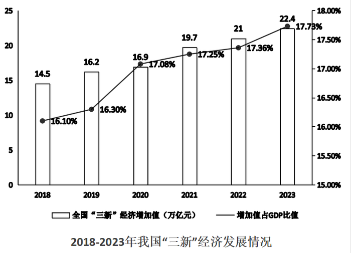
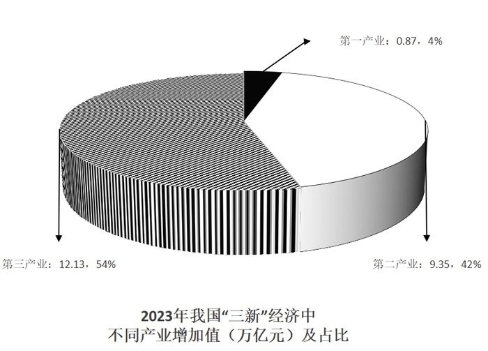
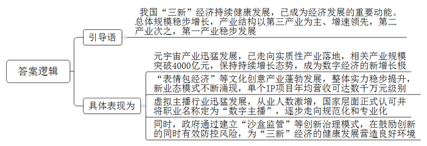
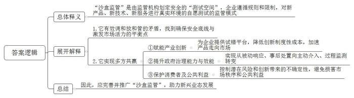
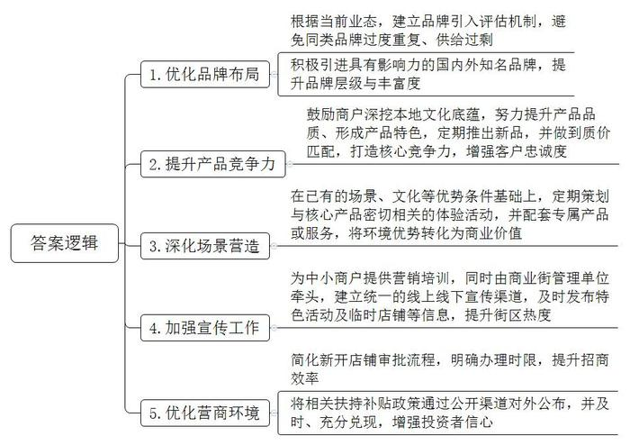
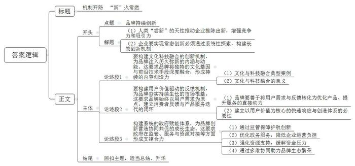

# 2025年北京市公考《申论》题

> 候选采集稿。参考答案及解析来自粉笔页面，不代表官方答案或真实高分答卷；来源使用许可与原卷对应关系仍需人工核实。

## 给定材料

### 材料 material-c1ecbe735c2221b9

“三新”经济是以新产业、新业态、新商业模式为核心内容的经济活动的集合。新产业是指应用新科技成果、新兴技术而形成一定规模的新型经济活动。具体表现为：一是新技术应用产业化直接催生的新产业；二是传统产业采用现代信息技术形成的新产业；三是由于科技成果、信息技术推广应用，推动产业的分化、升级、融合而衍生出的新产业。

新业态指顺应多元化、多样化、个性化的产品或服务需求，依托技术创新和应用，从现有产业和领域中衍生叠加出的新环节、新链条、新活动形态。具体表现为：一是以互联网为依托开展的经营活动；二是商业流程、服务模式或产品形态的创新；三是提供更加灵活快捷的个性化服务。

新商业模式指为实现用户价值和企业持续盈利目标，对企业经营的各种内外要素进行整合和重组，形成高效并具有独特竞争力的商业运行模式。具体表现为：一是将互联网与产业创新融合；二是把硬件融入服务；三是提供消费、娱乐、休闲、服务的一站式服务。

国家统计局于2017年正式开展“三新”经济核算，2018年首次发布我国“三新”经济增加值数据，以下为2018年-2023年我国“三新”经济的发展情况。

分三次产业看，2023年“三新”经济中，第一产业增加值为8728亿元，比上年增长3.2%，占比为3.9%；第二产业增加值为93491亿元，比上年增长0.7%，占比为41.8%；第三产业增加值为121309亿元，比上年增长11.5%，占比为54.3%。

### 材料 material-96d6982e4accdaa8

“沙盒监管”作为一种针对新兴业态的监管创新模式，其核心在于由监管机构为创新主体划定一个安全的“测试空间”。在这个空间内，企业可以遵循预先设定的规则和限制，对新产品、新技术、新服务进行真实环境的自愿测试。其首要目标是控制潜在风险，确保创新带来的不确定性被限制在特定范围内，防止其“溢出”并对市场秩序或公众利益造成实质性损害。这种模式变“堵”为“疏”，为高风险的创新活动提供了宝贵的“试错”机会。

我国在“沙盒监管”的探索上已迈出实质性步伐。北京市率先在金融科技领域展开试点，为一批金融科技创新项目设置了风险隔离区，在保护金融消费者权益的前提下，有效验证了多项服务的可行性与安全性。随后，这一理念被引入智能网联汽车领域。面对自动驾驶技术带来的复杂数据安全与道路交通安全挑战，传统的车辆准入标准已难以适用。通过设立监管沙盒，允许企业在真实道路但受限的场景下进行测试，不仅加速了技术迭代，更为制定科学合理的行业标准与法规积累了关键数据，有效应对了新技术发展伴生的数据安全与公共安全治理难题。

随着人工智能产业的迅猛发展，“沙盒监管”的应用价值得到进一步延伸。AI技术的跨界融合性与数据依赖性，对传统分行业、分领域的监管框架构成了新挑战。在人工智能领域推行沙盒监管，鼓励企业在可控环境中探索数据协同应用的边界，促进了产业链上下游的“价值共创”。它向市场传递出一个明确信号：监管并非创新的对立面，而是希望通过构建一个包容、审慎、拥有良好“容错”机制的环境，激励企业大胆创新，同时履行社会责任，实现负责任的创新。

总结来看，“沙盒监管”构建了一个多方参与、风险共担的新型治理平台。对于企业而言，它提供了一个以往难以获得的、合法的“试错”平台，显著降低了创新的制度性成本，加快了产品从实验室走向市场的进程。对于政府监管部门而言，则实现了从被动响应、事后处置的“救火队”角色，向主动介入、过程监测的“引导员”角色转变。长期以来，在市场监管中，“放”与“管”如同一对难以调和的矛盾：管得过死，容易扼杀市场活力；放得过开，又可能导致风险积聚。而“沙盒监管”模式，通过设置防护栏的“放行”，恰恰在确保安全底线与激发市场活力之间找到了那个恰到好处的平衡点。它既保护了消费者权益和社会公共利益，又赋能了产业创新，还提升了政府自身的治理能力与效能。推行“沙盒监管”，无疑恰到好处地找到了平衡点，这是一个多方共赢的创新之举。

### 材料 material-86873cb2756576a6

幸福广场作为K市新兴的商业地标，近年来吸引了大量消费者和商家。为深入了解该区域商业发展现状及存在的问题，K市商务局调研组近期开展了专题调研。以下是调研中收集到的具体情况：

整条商业街聚集了数十家奶茶店，品牌重复度高，供给远超需求。有本地消费者反映：“我们本地有深厚的茶文化底蕴，但这条街上放眼望去全是各式奶茶店，看得我都不想进了，感觉缺乏特色。”

一家法式甜品蛋糕店，因其产品香气浓郁、风格独特，吸引了众多市民和游客前来打卡、试吃、拍照，在网络平台上有一定热度。特色店铺初显吸引力。

某国际运动品牌店投入资源，在店内营造了丛林、攀岩等户外自然沉浸式景观，并配套开设了咖啡区域，意图提升消费体验。但调研发现，店内实际顾客流量并不理想，场景优势未能有效转化为销售业绩。

一家设计感较强的书店，其内部陈设、装修及书柜均颇具特色，同时经营咖啡与文创产品。然而，其文化属性与商业价值的结合效能尚未充分释放。

多位消费者表示，对街区内的特色活动或临时店铺知晓度低。例如，有消费者提及：“今天来了才知道这个（指某店或活动）到月底就结束了，但我们刚知道，之前也没看到什么宣传。”

有消费者谈到某奶茶店：“刚开始营业时排队要两小时，人气非常旺。但我前两天也尝试了，并没觉得特别惊艳，价格还挺贵的，以后应该不会再特意来喝了。”反映出部分“网红”店铺面临客户忠诚度不高、产品力支撑不足的问题。

有店家坦言：“来我们店里打卡拍照的人确实不少，主要是这条街整体环境好吸引来的。但对实际销售额提升帮助有限，看的人多，买的人少。”

不少中小商户表示缺乏专业营销知识与渠道。一位店主说：“我们自己不会宣传，也不认识可靠的推广公司，不懂、不专业，也不敢盲目投入。公司规模小，资金有限，专门拨付推广经费压力很大。”

一位有意引入知名乐高品牌店的投资者反映：“申请材料提交后，审批流程耗时较长，至今未有明确结果。同时，之前沟通中提及的相关开店补贴政策，也未能及时兑现到位，影响了投资进度和信心。”

商业街管理机构负责人指出：“目前我们这条街在品牌能级上仍有提升空间，缺乏足够数量的、具有较强影响力的国内知名品牌和国际一线品牌，品牌丰富度和层级感不足。”

专家建议：“首发经济”推出新产品、新服务、新业态，通过其独特性与新鲜感吸引客流。发展首发经济，不能仅仅看重品牌自带的短期流量效益，更应注重与城市文化特色、本地消费能力、品牌内在质量以及产业生态的深度融合。专家提出：“要推动品牌产业的本土化连接与潜能挖掘，让‘网红’变‘长红’，实现首发经济的可持续健康发展，避免昙花一现。”

## 题目

### 第 1 题

**根据给定材料**1**\-**5**，用一段话概括我国“三新****”****经济的发展状况。（****20分）**

关联材料：材料 material-c1ecbe735c2221b9

作答要求：

要求：准确全面，语言简练，不列条目。不超过300字。

### 第 2 题

**给定材料**5**中提到：“推行‘沙盒监管’，无疑恰到好处地找到了平衡点，这是一个多方共赢的创新之举。”谈谈你对这句话的理解。（15分）**

关联材料：材料 material-96d6982e4accdaa8

作答要求：

要求：分析合理，条理清晰，语言简练。不超过250字。

### 第 3 题

**假如你是给定材料**7**中K市商务局调研组成员，针对调研中发现的问题，提出推进幸福广场周边首发经济发展的意见建议。（25分）**

关联材料：材料 material-86873cb2756576a6

作答要求：

要求：建议合理可行，针对性强，条理清晰，语言简练。不超过400字。

### 第 4 题

**给定材料**8**中提到：“尝新本就不寻常，要从‘尝新’到‘常新’，更需要不断地探索和实践。”深入思考这句话，参考但不拘泥于所有给定材料，自选角度，自拟题目，写一篇文章。（40分）**

关联材料：材料 material-c1ecbe735c2221b9

作答要求：

要求：观点鲜明、正确，分析深入、合理，语言流畅。字数控制在800-1000字。

## 答案与解析

第 1 题

**参考答案（粉笔题库参考内容）**

我国“三新”经济持续健康发展，已成为经济发展的重要动能。总体规模稳步增长，产业结构以第三产业为主、增速领先，第二产业次之，第一产业稳步发展。具体表现为：元宇宙产业迅猛发展，已走向实质性产业落地，相关产业规模突破4000亿元，保持持续增长态势，成为数字经济的新增长极；“表情包经济”等文化创意产业蓬勃发展，整体实力稳步提升，新业态模式不断涌现，单个IP项目年均营收可达数千万元级别；虚拟主播行业迅猛发展，从业人数激增，国家层面正式认可并将职业名称定为“数字主播”，逐步走向规范化和专业化。同时，政府通过建立“沙盒监管”等创新治理模式，在鼓励创新的同时有效防控风险，为“三新”经济的健康发展营造良好环境。

**解析**

**参考答案说明：**本参考答案按照“总结性引导语+我国‘三新’经济的发展状况”的结构，先总体介绍了我国“三新”经济的总体规模和产业结构，再具体从“元宇宙产业”“‘表情包经济’等文化创意产业”“虚拟主播行业”“‘沙盒监管’等创新治理模式”四个方面展开介绍了我国“三新”经济的发展状况。答案用一段话的形式呈现，符合题目要求。

**考点**：考点其他类

**来源**：来源2025年北京市公考《申论》题

粉笔申论页面对本题只提供「解析视频」入口，该入口是会员推广位，页面无视频地址与文字解析。

第 2 题

**参考答案（粉笔题库参考内容）**

“沙盒监管”是由监管机构划定安全的“测试空间”，企业遵循规则和限制，对新产品、新技术、新服务进行真实环境的自愿测试的监管模式。1.它有效调和放和管的矛盾，找到确保安全底线与激发市场活力的平衡点。2.它实现多方共赢：①赋能产业创新。为企业提供试错平台，降低创新制度性成本，加速产品走向市场。②提升政府治理能力与效能。实现从被动响应、事后处置向主动介入、过程监测转变。③保护消费者及公共利益。控制潜在风险和创新带来的不确定性，避免损害市场秩序和公共利益。因此，应完善并推广“沙盒监管”，助力新兴业态发展。

**解析**

**参考答案说明：**（1）思路方面，本参考答案按照词句解释题“总体释义+展开解释+总结”的一般答题思路展开。（2）内容方面，本参考答案先解释了题干指定句子的总体含义，然后分别从“找到‘平衡点’的表现”和“实现多方共赢的表现”两个层面进行了展开解释，最后进行总结。（3）词句表达方面，本参考答案加上了“因此”等连接词来承接上下文，使上下衔接更顺畅。

**考点**：考点词句解释类

**来源**：来源2025年北京市公考《申论》题

粉笔申论页面对本题只提供「解析视频」入口，该入口是会员推广位，页面无视频地址与文字解析。

第 3 题

**参考答案（粉笔题库参考内容）**

1.优化品牌布局。根据当前业态，建立品牌引入评估机制，避免同类品牌过度重复、供给过剩；积极引进具有影响力的国内外知名品牌，提升品牌层级与丰富度。

2.提升产品竞争力。鼓励商户深挖本地文化底蕴，努力提升产品品质、形成产品特色，定期推出新品，并做到质价匹配，打造核心竞争力，增强客户忠诚度。

3.深化场景营造。在已有的场景、文化等优势条件基础上，定期策划与核心产品密切相关的体验活动，并配套专属产品或服务，将环境优势转化为商业价值。

4.加强宣传工作。为中小商户提供营销培训，同时由商业街管理单位牵头，建立统一的线上线下宣传渠道，及时发布特色活动及临时店铺等信息，提升街区热度。

5.优化营商环境。简化新开店铺审批流程，明确办理时限，提升招商效率；将相关扶持补贴政策通过公开渠道对外公布，并及时、充分兑现，增强投资者信心。

**解析**

**参考答案说明：**本参考答案从“品牌布局”“产品竞争力”“场景营造”“宣传工作”“营商环境”五个维度分条撰写。各条要点之间在内容上相互并列，没有交叉。

**考点**：考点提出对策类

**来源**：来源2025年北京市公考《申论》题

粉笔申论页面对本题只提供「解析视频」入口，该入口是会员推广位，页面无视频地址与文字解析。

第 4 题

**参考答案（粉笔题库参考内容）**

**机制开路** **“新”火常燃**

“尝新”是人类探索未知的天性，在消费领域，新产品、新场景、新科技应用等也更容易得到人们的青睐。因此，企业在建设自身品牌的过程中，都会尝试推陈出新，以增强竞争力和吸引力。然而，初次创新的惊喜容易获得，若想让创新之火从零星火花发展为燎原之势，从偶然突破转化为常态能力，则必须构建品牌长效创新机制，这要求企业超越表层的营销尝试，进行系统性的探索，铸就品牌可持续发展的坚实根基。

**要构建文化科技融合的创新机制，为品牌注入历久弥新的内涵与动能。这要求品牌将独特的文化基因与前沿技术手段深度融合，形成持续的内容创造力****。**茅台通过“巽风数字世界”APP构建虚实结合的酒文化体验空间，让用户在虚拟世界中参与酿酒工艺并兑换实体产品。安踏在冬奥产品设计中融合中国文化图腾与航天科技材料，打造出兼具国风美学与顶尖性能的“冠军龙服”。文化与科技的融合，不仅丰富了品牌的叙事维度，更推动品牌建设从单向传播走向双向互动、从功能满足迈向情感共鸣，为品牌生命力提供不竭的滋养。

**要构建用户价值驱动的反馈机制，为品牌夯实持续生长的市场根基。这要求品牌始终以用户需求为原点，建立消费者反馈与产品服务迭代的闭环。**无论是通过虚拟试穿、在线体验等方式精准洞察消费者个性化偏好，并将数据实时反馈至研发端，还是通过社群运营、情感连接深度理解用户的精神需求，成功的品牌都善于将海量互动信息转化为优化产品、提升服务的直接动力。唯有建立起这种以用户价值为核心的快速响应与创造体系，品牌才能将初次关注的“流量”转化为长期信赖的“留量”，实现从“网红”到“长红”的质变。

品牌在市场上的活力迸发，离不开宏观制度环境的有效支持与规范引导。当品牌在前端积极探索创新时，来自政府层面的支持，将成为其行稳致远的重要支撑。

**构建系统的政府赋能体系，为品牌创新营造协同共促的成长生态。这要求政府在监管、服务与资源对接等方面形成支撑合力。**监管上，可通过“沙盒监管”等新型模式，为品牌在新模式、新服务上的探索提供试错机会，降低创新制度性成本。服务上，应优化审批流程、强化知识产权保护，以高效政务服务降低企业运营负担。资源上，需引导金融活水精准灌溉创新主体，通过专项基金、融资支持等方式缓解资金压力。由此，通过监管保障、服务优化与资源支持的多维协同，必能奠定品牌生态繁荣的基石。

从“尝新”到“常新”的跨越，需要文化科技融合注入内涵、用户反馈驱动迭代、包容监管提供保障。只有建立起这样一套支撑体系，方能成就植根中国、面向未来的长青品牌。

**解析**

**文章分析**

**机制开路** **“新”火常燃**

【**标题的优点：**首先，标题中含有主题词，使文章主题更突出、清晰。其次，形式上，文字简洁明快有力，不拖沓。】

（1）“尝新”是人类探索未知的天性，在消费领域，新产品、新场景、新科技应用等也更容易得到人们的青睐。因此，企业在建设自身品牌的过程中，都会尝试推陈出新，以增强竞争力和吸引力。（2）然而，初次创新的惊喜容易获得，若想让创新之火从零星火花发展为燎原之势，从偶然突破转化为常态能力，则必须构建品牌长效创新机制，这要求企业超越表层的营销尝试，进行系统性的探索，铸就品牌可持续发展的坚实根基。

【**开头的优点：**★内容方面。范文的开头是紧扣“品牌持续创新”这一主题展开的。首先，开头点出主题，做到了主题明确。其次，对“品牌持续创新”这一主题进行了分析阐述，指出了（1）人类“尝新”的天性推动企业推陈出新，增强竞争力和吸引力；（2）企业要实现常态创新必须通过系统性探索，构建长效创新机制。★文字表达方面。使用了“因此……”“然而……”等关联词，使语言表达有逻辑性。】

**要构建文化科技融合的创新机制，为品牌注入历久弥新的内涵与动能。这要求品牌将独特的文化基因与前沿技术手段深度融合，形成持续的内容创造力**。（1）茅台通过“巽风数字世界”APP构建虚实结合的酒文化体验空间，让用户在虚拟世界中参与酿酒工艺并兑换实体产品。安踏在冬奥产品设计中融合中国文化图腾与航天科技材料，打造出兼具国风美学与顶尖性能的“冠军龙服”。（2）文化与科技的融合，不仅丰富了品牌的叙事维度，更推动品牌建设从单向传播走向双向互动、从功能满足迈向情感共鸣，为品牌生命力提供不竭的滋养。

【**论述段****1的优点：**★观点句：范文的观点句是紧扣“品牌持续创新”这一文章主题提出的。形式上，它在段首处直接写出，位置突出，容易发现。内容上，关键词突出，内容要点明确，可以明显看出是从“品牌持续创新需要构建文化科技融合的创新机制”的角度展开论述。★论述内容：（1）先介绍了文化与科技融合的典型案例；（2）接着阐述了文化与科技融合的意义。注意：以上两个方面的内容都是紧扣“要构建文化科技融合的创新机制，为品牌注入历久弥新的内涵与动能。这要求品牌将独特的文化基因与前沿技术手段深度融合，形成持续的内容创造力”这个观点句进行分析论述的，论述的针对性强，内容层次丰富。在论述方法上主要采用了举例子和讲道理结合的方式，论述清晰透彻。】

**要构建用户价值驱动的反馈机制，为品牌夯实持续生长的市场根基。这要求品牌始终以用户需求为原点，建立消费者反馈与产品服务迭代的闭环**。（1）无论是通过虚拟试穿、在线体验等方式精准洞察消费者个性化偏好，并将数据实时反馈至研发端，还是通过社群运营、情感连接深度理解用户的精神需求，成功的品牌都善于将海量互动信息转化为优化产品、提升服务的直接动力。（2）唯有建立起这种以用户价值为核心的快速响应与创造体系，品牌才能将初次关注的“流量”转化为长期信赖的“留量”，实现从“网红”到“长红”的质变。

【**论述段****2的优点：**★观点句：范文的观点句是紧扣“品牌持续创新”这一文章主题提出的。形式上，它在段首处直接写出，位置突出，容易发现。内容上，关键词突出，内容要点明确，可以明显看出是从“品牌持续创新需要构建用户价值驱动的反馈机制”的角度展开论述。★论述内容：（1）先介绍了品牌要善于将用户需求与反馈转化为优化产品、提升服务的直接动力；（2）接着阐明建立以用户价值为核心的快速响应与创造体系的必要性。注意：以上两个方面的内容都是紧扣“要构建用户价值驱动的反馈机制，为品牌夯实持续生长的市场根基。这要求品牌始终以用户需求为原点，建立消费者反馈与产品服务迭代的闭环”这个观点句进行分析论述的，论述的针对性强，内容层次丰富。在论述方法上主要采用了举例子和讲道理结合的方式，论述清晰深刻。】

品牌在市场上的活力迸发，离不开宏观制度环境的有效支持与规范引导。当品牌在前端积极探索创新时，来自政府层面的支持，将成为其行稳致远的重要支撑。

【**过渡段的优点：**范文的过渡段指出制度环境及政府支持对品牌探索创新的重要作用，为下文政府方面的内容做好铺垫。】

**构建系统的政府赋能体系，为品牌创新营造协同共促的成长生态。这要求政府在监管、服务与资源对接等方面形成支撑合力**。（1）监管上，可通过“沙盒监管”等新型模式，为品牌在新模式、新服务上的探索提供试错机会，降低创新制度性成本。（2）服务上，应优化审批流程、强化知识产权保护，以高效政务服务降低企业运营负担。（3）资源上，需引导金融活水精准灌溉创新主体，通过专项基金、融资支持等方式缓解资金压力。（4）由此，通过监管保障、服务优化与资源支持的多维协同，必能奠定品牌生态繁荣的基石。

【**论述段****3的优点：**★观点句：范文的观点句是紧扣“品牌持续创新”这一文章主题提出的。形式上，它在段首处直接写出，位置突出，容易发现。内容上，关键词突出，内容要点明确，可以明显看出是从“品牌持续创新需要构建系统的政府赋能体系”的角度展开论述。★论述内容：（1）先介绍了通过监管保障护航创新；（2）接着介绍了优化政务服务，降低企业运营负担；（3）再介绍了强化资源支持，缓解资金压力；（4）最后，总结指出通过多维协同助力品牌生态繁荣。注意：以上四个方面的内容都是紧扣“构建系统的政府赋能体系，为品牌创新营造协同共促的成长生态。这要求政府在监管、服务与资源对接等方面形成支撑合力”这个观点句进行分析论述的，论述的针对性强，内容层次丰富。在论述方法上主要采用了讲道理的方式，论述清晰有力。】

【**论述段之间的关系：**三个论述段分别从“构建文化科技融合的创新机制”“构建用户价值驱动的反馈机制”“构建系统的政府赋能体系”的角度，对文章主题“品牌持续创新”展开了论述，整体逻辑较为清晰。】

从“尝新”到“常新”的跨越，需要文化科技融合注入内涵、用户反馈驱动迭代、包容监管提供保障。只有建立起这样一套支撑体系，方能成就植根中国、面向未来的长青品牌。

【**结尾的优点：**范文的结尾回扣了“品牌持续创新”这个主题，并且进行了总结升华。】

**考点**：考点文章写作题

**来源**：来源2025年北京市公考《申论》题

粉笔申论页面对本题只提供「解析视频」入口，该入口是会员推广位，页面无视频地址与文字解析。

