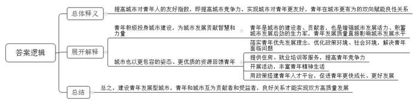
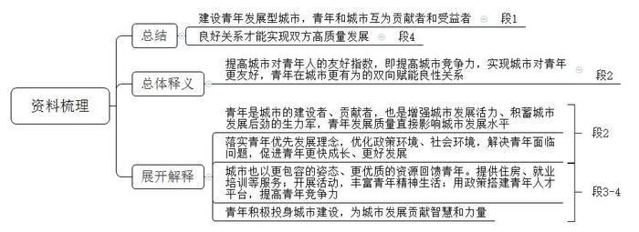
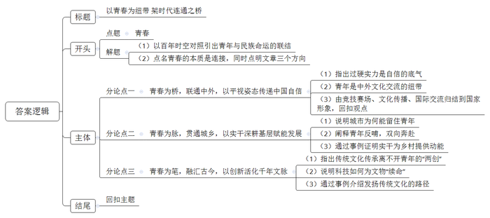
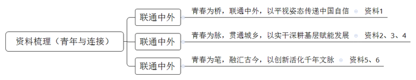

# 2025年北京市定向选调生考试《申论》题（网友回忆版）

<!-- gwy:overview:start -->
> **北京 · 2025 · 申论 · 选调生** ｜ 2 题 · 图片 4 处 · 答案随题折叠

导航：[题目](#题目) · [材料 1](#材料-1)
<!-- gwy:overview:end -->

> 候选采集稿。参考答案及解析来自粉笔页面，不代表官方答案或真实高分答卷；来源使用许可与原卷对应关系仍需人工核实。

## 给定材料

### 材料 1

在巴黎奥运会的聚光灯下，中国“00后”运动员数量以超七成之势，成为中国年轻一代的鲜活力量。赛场内外，他们胸怀祖国、敢打敢拼、勇于追梦；他们风华正茂、自信大方、神采飞扬；他们传递友谊结交朋友，也正面回击恶意挑衅。在争金夺银的同时，他们更让世界看到新一代中国青年的风采。这群在网络时代浪潮中成长起来的青年，以更加开放的心态和自信的表达，向全世界展示中国面貌。

自古英雄出少年。赛场上，“小孩哥”“小孩姐”们在各自项目上勇于拼搏，用实力说话，扛起中国体育的大旗。16天里，中国体育代表团收获40金27银24铜，创造夏季奥运会境外参赛最佳战绩。17岁的黄雨婷和19岁的盛李豪携手射落首金后，两人无厘头的网名“阿条姐”“干饭哥”迅速走红网络。以“00后”为主的新一代中国奥运健儿，千人千面很鲜活，真实松弛不紧绷。有“e”人性格张扬、妙语迭出，也有“i”人性格内敛、谦逊有礼，但相同的是他们心中有梦，眼底有光。

湖北妹子郑钦文连续进行了两场3个多小时的鏖战后说：“我很累，但我可以再为我的国家战斗3个小时。”潘展乐出征巴黎奥运会前立了一个小目标：“争取在20岁生日那天的男子混接决赛中，接棒后干进46秒！”他说到做到，游出45秒92让质疑者闭嘴，用实力“打脸”外媒的持续诋毁抹黑。

场上争气，场下霸气。当覃海洋不满自己在男子4×100米混合泳决赛的分段成绩时，潘展乐说：“我们是冠军！不满意的应该是别人。”而张雨霏更是直接回怼恶意炒作兴奋剂问题的外媒：“为什么中国运动员游得快要被质疑？美国的菲尔普斯、莱德茨基那么厉害，你们怎么不去质疑？！”

面对恶意，敢于犀利反击；面对善意，中国运动员会投桃报李。

站在羽毛球女单亚军领奖台上，何冰娇一直在展示手里的西班牙奥委会徽章。此前的半决赛中，何冰娇的对手、西班牙名将马林因伤中途退赛，何冰娇将自己“微小而美丽的致敬”带到了领奖台上。这个举动引发广泛赞誉，国际奥委会在社交账号发布了何冰娇手持徽章的照片，并评论道：“这就是奥林匹克价值观的意义。”

场上是对手，场下是朋友，越来越开放的中国运动员在赛场内外广交朋友，传递友谊。跳水女子三米板颁奖仪式上，当冠军陈艺文跃上最高领奖台，左右分立的亚军、澳大利亚选手基尼和季军昌雅妮双双摆出欢迎“巨星”登场的动作。而英国跳水选手斯彭多利尼·西里埃会用中文词“闺蜜”“妹妹”称呼全红婵，表示她们生活中会在网上“像家人一样”联系。

“00后”已经挑起大梁。作为新一代中国体育人，时代塑造了他们更加平视世界的姿态，祖国给予了他们自信从容的底气。他们不仅是中国体育的未来，更是新时代青年力量的象征。在赛场上，他们以无畏的拼搏和卓越的技艺，为国争光，后浪激荡，初露峥嵘，这群“00后”运动员正以自己的方式，作为桥梁，连接了中国和世界，展现了中国形象。

### 材料 2

一百年前“五四”青年高呼“中国不亡，有我！”13位平均年龄只有28岁的青年，代表着全国50多名党员走进了法租界贝勒路上的树德里3号，出席具有历史意义的党的第一次代表大会，宣告了中国共产党的正式诞生。这个以年轻人为主组成的政党，充满活力，生机勃勃。一百年后，新时代青年依然高呼“中国必强，有我！”这是历史的回声，也是时代的新声。

回顾百年，一代又一代青年发挥了最积极、最有生气的特质，激发了青春活力和青春理想，成为时代先锋力量。中共一大召开时毛泽东是28岁，周恩来参加中国共产党时是23岁，邓小平参加旅欧中国少年共产党时是18岁。航天报国的“嫦娥团队”“神舟团队”平均年龄是33岁，“北斗团队”平均年龄是35岁。这样的青年英杰数不胜数！

青年工作，抓住的是当下，传承的是根脉，面向的是未来，攸关党和国家前途命运。党对青年工作的全面领导，是做好青年工作的根本保证。

在庆祝中国共产主义青年团成立100周年大会上的讲话中，习近平总书记指出：“青春孕育无限希望，青年创造美好明天。一个民族只有寄望青春、永葆青春，才能兴旺发达。”党的十八大以来，习近平总书记高度重视青年工作，从党的事业薪火相传、后继有人的战略高度出发，2017年4月，在习近平总书记亲自提议、亲自推动下，党中央、国务院制定出台《中长期青年发展规划（2016-2025年）》（简称《规划》），这是新中国第一部全面促进青年发展的国家级专项规划，是指导新时代中国青年发展事业的纲领性文件，系统回答了做好青年工作的方向性、根本性、战略性、全局性问题，是新时代做好青年工作的根本遵循。

### 材料 3

2022年，共青团中央联合中央宣传部、国家发展改革委等17部门印发《关于开展青年发展型城市建设试点的意见》，致力于促进青年高质量发展。城市的竞争，很大程度上是人才的竞争，青年是其中最具活力与潜力的群体。可以说，赢得青年才能赢得未来，塑造青年才能塑造未来。建设青年发展型城市，青年和城市互为贡献者和受益者。在区域经济竞争日益激烈的当下，“青和力”地位越来越突出，越来越成为城市竞争力的重要组成部分。

何谓“青和力”？就是指城市“对青年人的友好指数”。青年是城市的建设者、贡献者，也是增强城市发展活力、积蓄城市发展后劲的生力军，青年发展质量直接影响城市发展水平。建设青年发展型城市，最核心的就是落实“青年优先发展”理念，推动城市对青年的政策环境、社会环境不断优化，更加友好，更好解决青年工作、生活中面临的各种问题挑战，促进青年更快成长、更好发展。这种双向赋能的良性关系即实现“城市对青年更友好，青年在城市更有为”。可见，<u>“青和力”是城市的核心竞争力，让青年和城市双向奔赴，才能共同创造美好未来。</u>

在青年发展型城市试点进程中，北京市尤为重视青年科技人才的培养与支持。专门出台《北京高等学校卓越青年科学家计划项目和经费管理办法》，明确面向北京地区本科层次以上高校，遴选青年科研领军人才，培育一批有发展潜力的青年科学家，旨在破解一批重大科学难题和关键技术。一系列“英才计划”“青年拔尖人才项目”等政策的实施，为青年科技人才搭建起广阔的创新舞台，助力他们在科研领域不断突破。与此同时，为缓解青年住房压力，通过多种渠道筹集建设青年优惠房源，推出租房补贴、公租房定向配租等政策；在就业方面，积极开展大型招聘会，举办各类就业指导活动，为青年求职者提供精准的就业服务。这是北京近年来持续优化青年发展环境，实现青年与城市双向奔赴的最新举措。着力解决青年面临的现实问题，让青年更加安心、更加舒展地拼搏奋斗，助力营造青年创新创造活力与城市创新创造活力相互激荡、青年高质量发展和城市高质量发展相互促进的良好政策环境和社会环境。

每年举办的“北京读书月”活动，不仅丰富了青年的精神文化生活，更为青年搭建起知识共享与技能提升的平台；各类专业化的就业培训课程，紧密贴合市场需求，有效提升了青年的职业技能和就业竞争力。在这些举措的推动下，青年与城市之间形成了良性互动，青年积极投身城市建设，为城市发展贡献智慧和力量；城市也以更包容的姿态、更优质的资源回馈青年，实现双方的高质量发展。

习近平总书记深刻指出：“青年兴则国家兴，中国发展要靠广大青年挺膺担当。”城市是一个区域经济、政治、文化、社会等方面活动的中心，是现代化的重要载体。青年因城市而聚，城市因青年而兴。唯有让青年与城市双向奔赴，才能奏响高质量发展的时代强音。青年发展型城市建设，是时代赋予城市发展的新命题，也是实现青年与城市共同成长的必由之路。

### 材料 4

“乡村振兴，青年先行！”怀揣着这样的想法，2021年底，北京青少年网络文化发展中心的小王被选派到怀柔区渤海镇四渡河村担任驻村第一书记。驻村前，他主动置办了《中央和国家机关驻村第一书记扶贫典型案例集》等资料反复阅读，还向“前辈”们请教驻村经验，了解农村工作，学习农村工作方法，为开展驻村帮扶工作奠定基础。

四渡河村地处燕山山脉，村辖2个自然村，164户305人，主产为板栗和民宿旅游，板栗年产量40万-50万斤，特色民宿32家，是一个远郊山区的小山村。驻村伊始，小王就走进村内农户、民宿庭院以及板栗园林开展调查研究，了解掌握四渡河村的地理位置、人口结构、产业模式等村情村况。“这么年轻的小伙儿能帮忙把板栗多卖些钱吗？”面对村民的殷殷期待，面对村内产业结构单一、无产业带头人、产品认可度低、销路渠道有限等不利因素，他立下了打破村集体经济发展困境的决心，一心要发展出四渡河村全产业模式，让村民钱包鼓起来、村集体经济壮大起来。

小王同村“两委”充分发挥党建引领作用，制定《党建引领促振兴》系列方案，涵盖美丽乡村、平安建设和人居环境等工作，凝聚村内力量。同时，不断挖掘合作内容，与中农集团、海底捞集团及抖音集团等40家帮扶企业党组织开展党建共建，聚合多方力量，助力四渡河村集体经济发展。

四渡河村的板栗文化已有几百年历史，具备打造文旅融合项目的条件，小王用大家喜闻乐见的形式将科旅、文旅、影旅融合，激活乡村产业发展新业态。他巧用本地板栗文化，通过派出单位的资源，联系了研学机构，从板栗和民宿入手，用时百余天制作了独具板栗特色的民宿文化导航系统，全面展示了院落改造前后对比图、民宿文化中英文互译及村委会微信公众号二维码。村口值班的村民老黄说道：“路过的人都会过来看看，有些还要停下车来看。导航图设计得太美了，不少游客看完后还会合影拍照打卡。”通过科旅融合打造北京首个村级系列研学品牌——四渡河村“种”星星，将板栗文化、民宿体验及组装天文望远镜观星等活动串点成线。创新开发实习村长和民宿经验实践，让学生在实践中体验村党组织工作内容和民宿经营实践，创收近10万元。还通过影旅融合开发定制影戏剧本杀露营、中国艺术乡村实践等40多节课程内容。

如今的四渡河村已成为怀柔区收入水平靠前的明星村，获得了“全国生态文化村”“全国乡村旅游重点村”“中国最有魅力休闲乡村”等荣誉称号。随着小王驻村工作的开展，渤海镇四渡河村产业越来越兴，人气越来越旺，而他曾立下的振兴目标“天天有人气，月月有固收”正走进现实，让四渡河村的绿水青山成为带动村集体致富的金山银山。未来，四渡河村将持续探索乡村功能的多元价值，谱写乡村振兴的新篇章，打造农文旅深度融合的新范本。

### 材料 5

《黑神话：悟空》爆了。作为中国首款3A游戏，它在8月20日面世后，便以尖端的游戏技术以及精彩的中国神话背景，受到全球玩家的狂热追捧和讨论，“中国玩家终于能回到家乡，听着《云宫迅音》，以‘天命人’的身份，闯苍狼林，探沙门村……”这部作品不仅是中国传统文化在游戏领域的璀璨绽放，更是科技创新与艺术创意深度融合的典范。

在这场技术革命的背后，隐藏着一支来自北京的青年科技团队——虚拟动点公司。虽然这支队伍中的成员大多是90后，但40余名成员的实力却个个不可小觑。而他们的“杀手锏”，正是他们的原创技术——“空间计算-OptiTrack光学定位捕捉技术”。这项技术能够将空间位置精确至0.1毫米，旋转误差小于0.1度，延时最低2.8毫秒，哪怕进行多人动作捕捉，也能做到定位准、捕捉快、抗遮挡。在他们的技术赋能下，游戏角色的每一次跳跃、每一次挥棒，都仿佛跨越了现实与虚拟的边界，展现了前所未有的沉浸体验，实现了视频网友说的“一眼真”效果。

《黑神话：悟空》不仅仅是一个游戏产品或合作项目，更是中国游戏行业的新标杆，也是中国文化输出在漫漫取经路上的一大步。

虚拟动点公司董事长刘耀东提到，随着《黑神话：悟空》在全球的爆火，现在很多外国人也在视频网站上开始看翻译成英文版的《西游记》电视剧。“《西游记》的IP也随之爆火，山西古建、河南武功山、敦煌莫高窟、重庆宝顶山石窟等名胜古迹也随之出现在人们面前，我觉得特别自豪。”尽管已取得了显著成就，但虚拟动点的青年团队并未止步。他们正着手研发无需标点、穿戴设备的下一代动捕技术，旨在进一步降低技术门槛，拓宽应用领域。面对国际竞争，他们坚信通过持续的技术革新和文化融合，能够逐步缩小与国际先进水平的差距，甚至实现超越。

总之，《黑神话：悟空》不仅是一款游戏的胜利，更是中国青年科技人才创新精神的胜利。这群年轻人用实际行动证明，当传统文化遇上现代科技，不仅能激发出令人惊叹的艺术火花，更能推动中国游戏产业迈向新的高度，让世界见证中国创造的力量。

### 材料 6

“国风热”在年轻人中悄然兴起，一股传统文化热潮席卷全国。“新中式”服装成为越来越多年轻人的“心头好”，“围炉煮茶”成为青年社交新宠，跳古典舞、制作古风美食、练“八段锦”、学非遗技艺……“国风”凭借其独特的文化韵味和丰富的表现力，迅速在青年群体中“圈粉”。在被“圈粉”的同时，新一代的青年也正在为古老的中华传统文化赋予更多“年轻态”的表达方式。以“数字藏经洞”为支点，一群平均年龄不足30岁的年轻人，用代码和创意为古老文明装上数字引擎，让敦煌艺术突破时空桎梏。

藏经洞被称为20世纪最重要的考古大发现之一和“打开世界中世纪历史的钥匙”，但因为历史原因，如今无法在真实的物理空间再看到典藏着文物的藏经洞，同时因为藏经洞存在文物体量大、文本难理解等客观原因，大众也较难了解文物深厚的文化底蕴和价值。敦煌研究院的数字展示中心里，95后数字修复师林悦正紧盯屏幕，运用AI图像识别技术修复斑驳壁画。“每一次像素级的修复，都是在与古人对话。”她和团队历时三年，将4.5万平方米壁画转化为高清数字图像，构建起全球最大的石窟数字资源库。这种“数字孪生”技术不仅让珍贵文物得以永续保存，更催生了“数字藏经洞”这一文化IP——通过VR全景漫游、AI文物讲解等交互技术，用户可在线体验112个经典洞窟，日均访问量突破50万人次。

这种文化自信还体现在日常生活方式中。成都的“敦煌茶寮”里，年轻人围坐在复刻唐代团花锦案几旁，品着九色鹿主题茶点，用手机扫描茶席上的AR码，就能观赏飞天凌空起舞；敦煌研究院文创团队从壁画中的唐代襦裙汲取灵感，联合设计师将忍冬纹、联珠纹等元素融入马面裙设计，推出“丝路华章”系列；数字艺术家与考古学家组成“混搭团队”，用游戏引擎开发《敦煌秘境》互动体验项目；短视频博主通过“沉浸式修复”直播，让百万网友见证壁画重生过程；高校学生发起的“敦煌密码”文创设计大赛，累计收到1.2万件融合现代设计语言的参赛作品……

这种创新生态正在形成文化传承的良性循环。当00后修复师的鼠标点击声与千年壁画的呼吸同频，当马面裙的裙摆掠过繁华都市的街巷，我们看到的不仅是传统文化的复兴，更是一个古老文明在新时代的青春蝶变。新一代的青年，正在以全新的方式让国风文化焕发青春，同时又从国风文化、国风生活中得到精神的滋养。当青春的风华正茂和国风的韵味悠长相互交织，我们有理由相信传统文化的魅力将依旧在新的时代熠熠发光。

## 题目

### 第 1 题

**结合给定材料3，谈谈对“‘青和力’是城市的核心竞争力，让青年和城市双向奔赴，才能共同创造美好未来。”这句话的理解。（15分）**

关联材料：材料 3

作答要求：

要求：分析合理，条理清晰，语言简练，字数不超过300字。

第 1 题 · 答案与解析

**参考答案（粉笔题库参考内容）**

提高城市对青年人的友好指数，即提高城市竞争力，实现城市对青年更友好，青年在城市更有为的双向赋能良性关系。表现在：青年积极投身城市建设，为城市发展贡献智慧和力量。青年是城市的建设者、贡献者，也是增强城市发展活力、积蓄城市发展后劲的生力军，青年发展质量直接影响城市发展水平。城市也以更包容的姿态、更优质的资源回馈青年。落实青年优先发展理念，优化政策环境、社会环境，解决青年面临问题；提供住房、就业培训等服务，提高青年竞争力；开展活动，丰富青年精神生活；用政策搭建青年人才平台，促进青年更快成长、更好发展。

总之，建设青年发展型城市，青年和城市互为贡献者和受益者，良好关系才能实现双方高质量发展。

**解析**

**参考答案说明：**（1）思路方面，本参考答案按照词句解释题“总体释义+展开解释+总结”的一般答题思路展开。（2）内容方面，本参考答案首先对“‘青和力’是城市的核心竞争力，让青年和城市双向奔赴，才能共同创造美好未来”进行总体释义，接着从“青年积极投身城市建设，为城市发展贡献智慧和力量”“城市也以更包容的姿态、更优质的资源回馈青年”两个方面展开解释。（3）词句表达方面，本参考答案加上了“总之”等连接词来承接上下文，使上下衔接更顺畅。

**答题演示（粉笔页面原文，含审题—读料—要点提取全过程）**

> 以下为粉笔页面本题「答题演示」分区的原文转写；它不是官方答案，也不是参考作答，与上方参考答案并列存放。

**第一步——审题**

通过勾画题干关键词，明确题型、题目的主题、答题要素、资料范围和要求等。

<u>结合给定材料</u><u>3</u>【出现“结合”一词，提示我们需重点阅读材料3，并兼顾与主题相关的材料】，<u>谈谈对</u>“‘<u>青和力</u>’<u>是城市的核心竞争力</u>，<u>让青年和城市双向奔赴</u>，<u>才能共同创造美好未来</u>。”这句话<u>的理解</u>【①“谈谈对……的理解”提示本题为词句解释题，一般作答思路是：总体释义（解释句子的字面含义）+展开解释（围绕主题展开阐释、分析，如问题、原因、影响、表现等要素，依据题干和资料确定写哪些）+总结（一般为对策，材料中有则摘抄；材料中没有，字数允许则补充）。②结合本题，作答思路可能为：总体释义（解释给定句子的字面含义）+展开解释（“让青年和城市双向奔赴”属于对策表述，同时“‘青和力’是城市的核心竞争力”“共同创造美好未来”表述积极，提示在阅读资料时可重点关注积极信息以及对策表述所在的句子）+总结（一般为对策，材料中有则摘抄；材料中没有，字数允许则补充）。以上作答思路，具体内容还要结合资料进一步确定】。（15分）

要求：分析合理，条理清晰，语言简练，字数不超过300字。

**第二步——阅读资料，寻找要点，梳理逻辑**

【**资料预览：**浏览全篇资料可知，只有资料3重点介绍与“青和力”这一主题相关的内容，因此本题只需阅读资料3即可。】

**材料**3

**段1：**2022年，共青团中央联合中央宣传部、国家发展改革委等17部门印发《关于开展青年发展型城市建设试点的意见》，致力于促进青年高质量发展。城市的竞争，很大程度上是人才的竞争，青年是其中最具活力与潜力的群体。可以说，赢得青年才能赢得未来，塑造青年才能塑造未来。<u>建设青年发展型城市</u>，<u>青年和城市互为贡献者和受益者</u>。在区域经济竞争日益激烈的当下，“青和力”地位越来越突出，越来越成为城市竞争力的重要组成部分。

〖段1首先提到17部门印发《关于开展青年发展型城市建设试点的意见》，用以引出话题，对城市竞争的本质作了简要说明，进而引出城市与青年的关系“建设青年发展型城市，青年和城市互为贡献者和受益者”，可**摘抄**出要点：**建设青年发展型城市，青年和城市互为贡献者和受益者。**〗

**段1话题梳理：**

段1以政策文件引出城市与青年的关系，即二者互为贡献者和受益者，总结性较强，因此本段要点可放在本题最后一部分作为“总结”内容。

**段1要点总结：**

总结：建设青年发展型城市，青年和城市互为贡献者和受益者。

**段2：**<u>何谓</u>“<u>青和力</u>”？<u>就是指城市</u>“<u>对青年人的友好指数</u>”。<u>青年是城市的建设者</u>、<u>贡献者</u>，<u>也是增强城市发展活力</u>、<u>积蓄城市发展后劲的生力军</u>，<u>青年发展质量直接影响城市发展水平</u>。建设青年发展型城市，<u>最核心的就是落实</u>“<u>青年优先发展</u>”<u>理念</u>，<u>推动城市对青年的政策环境</u>、<u>社会环境不断优化</u>，<u>更加友好</u>，<u>更好解决青年工作</u>、<u>生活中面临的各种问题挑战</u>，<u>促进青年更快成长</u>、<u>更好发展</u>。<u>这种双向赋能的良性关系即实现</u>“<u>城市对青年更友好</u>，<u>青年在城市更有为</u>”。可见，“青和力”是城市的核心竞争力，让青年和城市双向奔赴，才能共同创造美好未来。

〖段2为题干句子所在段落，其中，（1）段首处“何谓‘青和力’？就是指城市‘对青年人的友好指数’”提示“青和力”的内涵，说明“青和力”是城市对青年人的友好指数，结合划线句“‘青和力’是城市的核心竞争力”，可知城市对青年人的友好指数，决定着城市竞争力，据此可**概括**出要点：**提高城市对青年人的友好指数，即提高城市竞争力。**（2）接着阅读“青年是城市的建设者、贡献者，……增强城市发展活力、积蓄城市发展后劲的生力军，青年发展质量直接影响城市发展水平”“最核心的就是落实‘青年优先发展’理念，推动城市对青年的政策环境、社会环境不断优化，更加友好，更好解决青年工作、生活中面临的各种问题挑战，促进青年更快成长、更好发展”，是对城市与青年关系的进一步说明，即“二者双向赋能”的表现，从中可**摘抄**出要点：**青年是城市的建设者、贡献者，也是增强城市发展活力、积蓄城市发展后劲的生力军，青年发展质量直接影响城市发展水平。落实青年优先发展理念，优化政策环境、社会环境，解决青年面临问题，促进青年更快成长、更好发展。**（3）段尾处“这种双向赋能的良性关系即实现‘城市对青年更友好，青年在城市更有为’”，说明“青和力”的关键是实现城市对青年更友好，青年在城市更有为，可作为总体释义，**概括**为：**实现城市对青年更友好，青年在城市更有为的双向赋能良性关系。**〗

**段2要素及其话题梳理：**

段2主要围绕题干句子展开，主要介绍了两个方面内容：一方面点明“青和力”即城市“对青年人的友好指数”，明确“青和力”的关键内涵；另一方面展开说明了城市与青年双向赋能的表现。

**段2要点总结：**

总体释义：提高城市对青年人的友好指数，即提高城市竞争力，实现城市对青年更友好，青年在城市更有为的双向赋能良性关系。

青年赋能城市：青年是城市的建设者、贡献者，也是增强城市发展活力、积蓄城市发展后劲的生力军，青年发展质量直接影响城市发展水平。

城市赋能青年：落实青年优先发展理念，优化政策环境、社会环境，解决青年面临问题，促进青年更快成长、更好发展。

**段3：**在青年发展型城市试点进程中，北京市尤为重视青年科技人才的培养与支持。<u>专门出台</u>《<u>北京高等学校卓越青年科学家计划项目和经费管理办法</u>》，明确面向北京地区本科层次以上高校，遴选青年科研领军人才，培育一批有发展潜力的青年科学家，旨在破解一批重大科学难题和关键技术。一系列“英才计划”“青年拔尖人才项目”等政策的实施，为青年科技人才搭建起广阔的创新舞台，助力他们在科研领域不断突破。与此同时，<u>为缓解青年住房压力</u>，<u>通过多种渠道筹集建设青年优惠房源</u>，<u>推出租房补贴</u>、<u>公租房定向配租等政策</u>；<u>在就业方面</u>，<u>积极开展大型招聘会</u>，<u>举办各类就业指导活动</u>，<u>为青年求职者提供精准的就业服务</u>。这是北京近年来持续优化青年发展环境，实现青年与城市双向奔赴的最新举措。着力解决青年面临的现实问题，让青年更加安心、更加舒展地拼搏奋斗，助力营造青年创新创造活力与城市创新创造活力相互激荡、青年高质量发展和城市高质量发展相互促进的良好政策环境和社会环境。

**段4：**<u>每年举办的</u>“<u>北京读书月</u>”<u>活动</u>，<u>不仅丰富了青年的精神文化生活</u>，<u>更为青年搭建起知识共享与技能提升的平台</u>；<u>各类专业化的就业培训课程</u>，紧密贴合市场需求，<u>有效提升了青年的职业技能和就业竞争力</u>。在这些举措的推动下，青年与城市之间形成了良性互动，<u>青年积极投身城市建设</u>，<u>为城市发展贡献智慧和力量</u>；<u>城市也以更包容的姿态</u>、<u>更优质的资源回馈青年</u>，<u>实现双方的高质量发展</u>。

〖段4-5主要介绍了北京市培养和支持青年的做法，可合并阅读。（1）段3中的并列关联词“与此同时”引导的前后文“出台《北京高等学校卓越青年科学家计划项目和经费管理办法》”“为缓解青年住房压力……在就业方面，……为青年求职者提供精准的就业服务”，以及段4中的“‘北京读书月’活动，不仅丰富了青年的精神文化生活，更为青年搭建起知识共享与技能提升的平台”“各类专业化的就业培训课程，……有效提升了青年的职业技能和就业竞争力”，提示城市对青年的赋能表现在为青年提供住房等服务，开展丰富青年精神生活的各类活动，并用政策搭建青年人才平台等，据此可**概括**出要点：**提供住房、就业培训等服务；开展活动，丰富青年精神生活；用政策搭建青年人才平台，提高青年竞争力。**（2）段4中的“青年积极投身城市建设，为城市发展贡献智慧和力量；城市也以更包容的姿态、更优质的资源回馈青年，实现双方的高质量发展”，一方面介绍了青年对城市的影响；另一方面介绍了城市对青年的作用，从中可**摘抄**出要点：**青年积极投身城市建设，为城市发展贡献智慧和力量，城市也以更包容的姿态、更优质的资源回馈青年，良好关系才能实现双方高质量发展。**注意：段4中提到的出台管理办法与上文提到的“政策环境”相近，此处不重复提炼要点。〗

**段3\-4要素及其话题梳理：**

段3-4通过北京市培养和支持青年的做法，提示城市赋能青年，具体包括提供服务、丰富精神、搭建平台等方面，其次对城市与青年“双向赋能”再次作了阐释说明，高度总结了二者关系。

**段3\-4要点总结：**

城市赋能青年：城市也以更包容的姿态、更优质的资源回馈青年。提供住房、就业培训等服务；开展活动，丰富青年精神生活；用政策搭建青年人才平台，提高青年竞争力。

青年赋能城市：青年积极投身城市建设，为城市发展贡献智慧和力量。

总结：良好关系才能实现双方高质量发展。

**段5：**习近平总书记深刻指出：“青年兴则国家兴，中国发展要靠广大青年挺膺担当。”城市是一个区域经济、政治、文化、社会等方面活动的中心，是现代化的重要载体。青年因城市而聚，城市因青年而兴。唯有让青年与城市双向奔赴，才能奏响高质量发展的时代强音。青年发展型城市建设，是时代赋予城市发展的新命题，也是实现青年与城市共同成长的必由之路。

〖本段引用习近平总书记的观点，从民族、时代的高度强调了青年发展型城市建设的重要性。无具体要点，可略读。〗

**第三步——整合要点，根据答题思路，组织答案**

【回扣题目，注意满足题目要求。将要点按相同答题要素合并，再按照词句解释题的答题思路：总体释义（解释给定句的字面含义）+展开解释（主要展开阐释城市与青年双向赋能的表现等）+总结（根据资料，可将城市与青年的关系作为总结），整理组织要点，优化完善，得出答案。】

**1.总体释义**

【段2围绕题干句子展开，点明了“青和力”即城市“对青年人的友好指数”，明确了“青和力”的关键是实现城市对青年更友好，青年在城市更有为的双向赋能良性关系，可作为总体释义部分】提高城市对青年人的友好指数，即提高城市竞争力，实现城市对青年更友好，青年在城市更有为的双向赋能良性关系。

**2.展开解释**

【段2-4从青年赋能城市、城市赋能青年两个层面对“青和力”的表现进行阐释，可合并为一条】青年积极投身城市建设，为城市发展贡献智慧和力量。青年是城市的建设者、贡献者，也是增强城市发展活力、积蓄城市发展后劲的生力军，青年发展质量直接影响城市发展水平。城市也以更包容的姿态、更优质的资源回馈青年。落实青年优先发展理念，优化政策环境、社会环境，解决青年面临问题；提供住房、就业培训等服务，提高青年竞争力；开展活动，丰富青年精神生活；用政策搭建青年人才平台，促进青年更快成长、更好发展。

**3.总结**

【段1、段4均总结性指出城市与青年的关系，可将其合并放在总结部分】总之，建设青年发展型城市，青年和城市互为贡献者和受益者，良好关系才能实现双方高质量发展。

### 第 2 题

**请结合全篇材料，以“青春和连接”为主题，自拟题目，写一篇作文。（35分）**

关联材料：材料 1、材料 2、材料 3、材料 4、材料 5、材料 6

作答要求：

要求：

（1）立意深刻，角度自选；

（2）联系材料，但不拘泥材料；

（3）语言流畅，内容充实；

（4）字数800-1000字。

第 2 题 · 答案与解析

**参考答案（粉笔题库参考内容）**

**以青春为纽带** **架时代连通之桥**

百年风雨兼程，青春薪火相传。百年前，先辈青年立下“中国不亡，有我”的铮铮誓言；百年后，新时代青年扛起“中国必强，有我”的时代重任。青春的本质，是联结与奔赴。新时代青年生逢盛世、肩负重任，以蓬勃朝气为纽带，联通中外、贯通城乡、融汇古今，绽放青春光彩。

**青春为桥，联通中外，以平视姿态传递中国自信。**新时代青年以开放包容的姿态搭建中外对话桥梁，成为国家形象最鲜活的名片。巴黎奥运会00后运动员既凭过硬实力斩获佳绩、为国争光，又致敬海外对手，生动诠释了新时代中国青年的自信从容。放眼域外，青年群体正持续担当中外交流的纽带。南开大学青年学子杨瑷银远赴南美传播中华文化，以语言为媒、以真诚为纽带，向海外民众立体讲述中国发展故事、传递中国温度。新时代青年在竞技赛场、文化传播、国际交流中联通中外，让世界读懂可信、可爱、可敬的中国。

**青春为脉，贯通城乡，以实干深耕基层赋能发展。**青年与城市双向奔赴、共生共长，北京深耕青年发展型城市建设，出台安居、就业、创业等暖心政策，厚植青年成长沃土，让青年扎根基层。城市给予青年成长平台，青年反哺城市乡村发展，以实干搭建城乡融通桥梁。北京选调生杨儒楷扎根昌平乡村一线，驻村期间深耕田间地头、了解民情民意，立足村庄资源禀赋，助力乡村优化治理、盘活本土产业资源，用点滴实干破解基层发展难题。一代代首都青年干部下沉乡土，激活基层发展内生动力，为首都乡村振兴、城乡高质量融合发展注入源源不断的青春动能。

**青春为笔，融汇古今，以创新活化千年文脉。**传统文化永续传承，离不开青年的创造性转化与创新性发展。敦煌95后青年团队以数字技术修复千年壁画、搭建数字藏经洞，用科技赋能文物保护，让千年敦煌文脉突破时空桎梏、走向大众。贵州青年非遗传承人杨昌芹深耕竹编技艺，跳出传统手艺局限，将现代审美与传统工艺融合，打造非遗文创、研学产业，让小众非遗技艺走出深山、走红全国。从数字活化文物到文创赋能非遗，青年让中华优秀传统文化在新时代落地生根、薪火相传。

青年的连接，是时代发展的动能，更是民族复兴的底气。作为首都选调生，以青春之我、奋斗之我，架起融通中外、串联城乡、贯通古今的时代之桥，在首都高质量发展的生动实践中挺膺担当，书写新时代青年的奋进答卷。

**解析**

**文章分析**

**以青春为纽带** **架时代连通之桥**

**【标题的优点：**★内容方面。标题中含有“青春”“连接”这一组主题词，“纽带”“连通之桥”两个喻体把抽象的“连接”化为可感可触的形象，使文章主题更突出、更清晰；同时“架桥”的意象与结尾“时代之桥”首尾照应。★形式方面。标题采用“以……为……”的对称式结构，前后两个分句字数相近、节奏一致，庄重而富有气势。】

（1）<u>百年风雨兼程</u>，<u>青春薪火相传</u>。百年前，先辈青年立下“中国不亡，有我”的铮铮誓言；百年后，新时代青年扛起“中国必强，有我”的时代重任。（2）<u>青春的本质</u>，<u>是联结与奔赴</u>。（3）新时代青年生逢盛世、肩负重任，<u>以蓬勃朝气为纽带</u>，联通中外、贯通城乡、融汇古今，<u>绽放青春光彩</u>。

**【开头的优点：**★内容方面。开头紧扣“青春和连接”这一主题展开：先以百年时空对照引出青年与民族命运的联结，再以“青春的本质，是联结与奔赴”直接点题，最后用“联通中外、贯通城乡、融汇古今”三个短语概括下文三个分论点，亮明文章主要观点，起笔即完成“点题—释义—立论”三步。★文字表达方面。运用“百年前……百年后……”的对照结构和“中国不亡，有我”“中国必强，有我”的呼告式短句，形成历史纵深感；“纽带”“联结与奔赴”等词语前后照应，语言凝练而有感染力。】

**青春为桥，联通中外，以平视姿态传递中国自信。**新时代青年以开放包容的姿态搭建中外对话桥梁，成为国家形象最鲜活的名片。（1）巴黎奥运会00后运动员<u>既凭过硬实力斩获佳绩</u>、为国争光，又致敬海外对手，<u>生动诠释了新时代中国青年的自信从容</u>。（2）放眼域外，<u>青年群体正持续担当中外交流的纽带</u>。南开大学青年学子杨瑷银远赴南美传播中华文化，以语言为媒、以真诚为纽带，<u>向海外民众立体讲述中国发展故事</u>、传递中国温度。（3）新时代青年在竞技赛场、文化传播、国际交流中<u>联通中外</u>，让世界读懂可信、可爱、可敬的中国。

**【论述段1的优点：**★观点句：观点句紧扣“青春和连接”这一文章主题提出，形式上置于段首，位置突出、一目了然；内容上，关键词突出，内容要点明确，可以明显看出主要论述“青春为桥，联通中外，以平视姿态传递中国自信”。★论述内容：（1）以巴黎奥运会00后运动员为例，说明过硬实力是自信的底气；（2）以南开大学杨瑷银为例，说明青年是中外文化交流的纽带；（3）由竞技赛场、文化传播、国际交流归结到国家形象，回扣观点。三个层次按“个体—群体—整体”递进，论据兼顾材料之内与材料之外，举例与说理结合，末尾以“让世界读懂可信、可爱、可敬的中国”收束，针对性强、层次丰富。】

**青春为脉，贯通城乡，以实干深耕基层赋能发展。**（1）<u>青年与城市双向奔赴</u>、共生共长，北京深耕青年发展型城市建设，出台安居、就业、创业等暖心政策，<u>厚植青年成长沃土</u>，让青年扎根基层。（2）<u>城市给予青年成长平台</u>，青年反哺城市乡村发展，<u>以实干搭建城乡融通桥梁</u>。（3）北京选调生杨儒楷扎根昌平乡村一线，<u>驻村期间深耕田间地头</u>、了解民情民意，立足村庄资源禀赋，助力乡村优化治理、盘活本土产业资源，<u>用点滴实干破解基层发展难题</u>。一代代首都青年干部下沉乡土，激活基层发展内生动力，为首都乡村振兴、城乡高质量融合发展<u>注入源源不断的青春动能</u>。

**【论述段2的优点：**★观点句：观点句紧扣文章主题，置于段首，位置突出；内容上，关键词突出，内容要点明确，可以明显看出主要论述“青春为脉，贯通城乡，以实干深耕基层赋能发展”。★论述内容：（1）从城市一端写政策供给与青年成长的关系，说明城市为何能留住青年；（2）由“城市给予”转向“青年反哺”，点出双向奔赴的逻辑；（3）以北京选调生杨儒楷驻村的具体事例坐实“实干”，最后以“一代代首都青年干部”收束，由个别推及群体，回扣观点。三个层次由“城”到“乡”、由“理”到“事”，论述紧扣观点句展开，论据具体、说服力强。】

**青春为笔，融汇古今，以创新活化千年文脉。**（1）传统文化永续传承，离不开<u>青年的创造性转化与创新性发展</u>。（2）敦煌95后青年团队<u>以数字技术修复千年壁画</u>、搭建数字藏经洞，用科技赋能文物保护，<u>让千年敦煌文脉突破时空桎梏</u>、走向大众。（3）贵州青年非遗传承人杨昌芹深耕竹编技艺，跳出传统手艺局限，<u>将现代审美与传统工艺融合</u>，打造非遗文创、研学产业，让小众非遗技艺<u>走出深山</u>、走红全国。从数字活化文物到文创赋能非遗，<u>青年让中华优秀传统文化在新时代落地生根</u>、薪火相传。

**【论述段3的优点：**★观点句：观点句紧扣文章主题，位于段首；内容上，关键词突出，内容要点明确，可以明显看出主要论述“青春为笔，融汇古今，以创新活化千年文脉”。★论述内容：（1）先立论，指出传统文化传承离不开青年的“两创”；（2）以敦煌95后团队的数字修复为例，说明科技如何为文物“续命”；（3）以杨昌芹的竹编文创为例，说明审美转化如何让非遗“出山”；最后以“从数字活化文物到文创赋能非遗”归纳两种路径并回扣观点。三个层次由“理”入“事”、由“文物”到“非遗”，论据典型且互补，收束有力。】

**【论述段之间的关系：**★内容的内在逻辑：三个论述段都紧紧围绕“青春和连接”这一主题展开，依照“并列”的逻辑依次推进：论述段1写青年“联通中外”，是空间上向外的连接；论述段2写青年“贯通城乡”，是空间上向内的连接；论述段3写青年“融汇古今”，是时间上纵向的连接。三者从“外—内—纵”三个维度共同支撑“青春是连接的纽带”这一中心论点，角度互补、边界清晰。形式上三段均以“青春为X”的句式起笔，形成整齐的排比，使文章气势贯通、层次分明。】

青年的连接，<u>是时代发展的动能</u>，更是民族复兴的底气。作为首都选调生，以青春之我、奋斗之我，<u>架起融通中外</u>、<u>串联城乡</u>、<u>贯通古今</u>的时代之桥，在首都高质量发展的生动实践中挺膺担当，<u>书写新时代青年的奋进答卷</u>。

**【结尾的优点：**范文的结尾回扣了“青春和连接”这个主题，并且进行了总结与升华。结尾先以“青年的连接，是时代发展的动能，更是民族复兴的底气”总结全文，把“连接”从青年的具体作为提升到时代发展与民族复兴的高度；再以“融通中外、串联城乡、贯通古今”概括三个分论点，与开头形成首尾呼应；最后落到“首都选调生”的身份定位和“挺膺担当”的行动要求，升华自然、收束有力。】

**答题演示（粉笔页面原文，含审题—读料—要点提取全过程）**

> 以下为粉笔页面本题「答题演示」分区的原文转写；它不是官方答案，也不是参考作答，与上方参考答案并列存放。

**第一步——审题**

通过勾画题目的关键信息，去找出文章的主题及其写作角度（即：文章写作的主要话题及切入点）以及资料范围，写作要求等。

请<u>结合全篇材料</u>【本题未具体资料，需通读全篇六则材料；就“小题出点”而言，小题1已使用资料2，故优先重点限阅读小题未涉及的资料1、资料3、资料4、资料5、资料6，同时结合小题及答案理解资料2的内容】，以“<u>青春和连接</u>”为主题【本文主题确定，即“青春与连接”。据此可初步构思文章写作思路：第一，“连接”是什么；第二，青年为什么能成为连接的力量，可能从青年对国家、社会、时代的作用入手论述其意义；第三，青年如何实现“连接”。上述写作思路，具体还要结合资料进一步明确】，自拟题目，写一篇作文。（35分）

要求：

（1）立意深刻，角度自选；

（2）联系材料，但不拘泥材料；

（3）语言流畅，内容充实；

（4）字数800-1000字

**第二步——优先阅读重点资料，来寻找文章的主题和角度（核心观点）**

**（一）阅读题干指定资料**

**资料**1

**段1：**在巴黎奥运会的聚光灯下，中国“00后”运动员数量以超七成之势，成为中国年轻一代的鲜活力量。赛场内外，他们胸怀祖国、敢打敢拼、勇于追梦；他们风华正茂、自信大方、神采飞扬；他们传递友谊结交朋友，也正面回击恶意挑衅。在争金夺银的同时，他们更让世界看到新一代中国青年的风采。这群在网络时代浪潮中成长起来的青年，<u>以更加开放的心态和自信的表达</u>，向全世界展示中国面貌。

**段2：**自古英雄出少年。赛场上，“小孩哥”“小孩姐”们在各自项目上勇于拼搏，<u>用实力说话</u>，扛起中国体育的大旗。16天里，中国体育代表团收获40金27银24铜，创造夏季奥运会境外参赛最佳战绩。17岁的黄雨婷和19岁的盛李豪携手射落首金后，两人无厘头的网名“阿条姐”“干饭哥”迅速走红网络。以“00后”为主的新一代中国奥运健儿，千人千面很鲜活，真实松弛不紧绷。有“e”人性格张扬、妙语迭出，也有“i”人性格内敛、谦逊有礼，但相同的是他们心中有梦，眼底有光。

**段3：**湖北妹子郑钦文连续进行了两场3个多小时的鏖战后说：“我很累，<u>但我可以再为我的国家战斗</u><u>3个小时</u>。”潘展乐出征巴黎奥运会前立了一个小目标：“争取在20岁生日那天的男子混接决赛中，接棒后干进46秒！”他说到做到，游出45秒92让质疑者闭嘴，用实力“打脸”外媒的持续诋毁抹黑。

**段4：**场上争气，场下霸气。当覃海洋不满自己在男子4×100米混合泳决赛的分段成绩时，潘展乐说：“<u>我们是冠军</u>！不满意的应该是别人。”而张雨霏更是直接回怼恶意炒作兴奋剂问题的外媒：“为什么中国运动员游得快要被质疑？美国的菲尔普斯、莱德茨基那么厉害，你们怎么不去质疑？！”

**段5：**面对恶意，<u>敢于犀利反击</u>；面对善意，中国运动员会投桃报李。

**段6：**站在羽毛球女单亚军领奖台上，何冰娇一直在展示手里的西班牙奥委会徽章。此前的半决赛中，何冰娇的对手、西班牙名将马林因伤中途退赛，何冰娇将自己“<u>微小而美丽的致敬</u>”带到了领奖台上。这个举动引发广泛赞誉，国际奥委会在社交账号发布了何冰娇手持徽章的照片，并评论道：“这就是奥林匹克价值观的意义。”

**段7：**场上是对手，场下是朋友，<u>越来越开放的中国运动员在赛场内外广交朋友</u>，传递友谊。跳水女子三米板颁奖仪式上，当冠军陈艺文跃上最高领奖台，左右分立的亚军、澳大利亚选手基尼和季军昌雅妮双双摆出欢迎“巨星”登场的动作。而英国跳水选手斯彭多利尼·西里埃会用中文词“闺蜜”“妹妹”称呼全红婵，表示她们生活中会在网上“像家人一样”联系。

**段8：**“00后”已经挑起大梁。作为新一代中国体育人，时代塑造了他们<u>更加平视世界的姿态</u>，祖国给予了他们自信从容的底气。他们不仅是中国体育的未来，更是新时代青年力量的象征。在赛场上，他们以无畏的拼搏和卓越的技艺，为国争光，后浪激荡，初露峥嵘，这群“00后”运动员正以自己的方式，作为桥梁，<u>连接了中国和世界</u>，展现了中国形象。

〖资料1主要介绍了巴黎奥运会上中国“00后”运动员在赛场内外的表现。（1）阅读段1中的“以更加开放的心态和自信的表达”、段8中的“更加平视世界的姿态”可知，这一代青年成长于国家日益走近世界舞台中央的时代，物质条件和国际视野都更为充分，因而不再仰视外部世界，而是以平视的目光看待对手、看待差异，这份心态本身就是国家发展给予青年的底气；段2中的“用实力说话”、段4中的“我们是冠军”、段5中的“敢于犀利反击”可知，面对质疑与诋毁，青年不回避、不退缩，以过硬本领和坦率表达正面回应，这份从容来自实力，也来自自信。（2）阅读段6中的“微小而美丽的致敬”、段7中的“越来越开放的中国运动员在赛场内外广交朋友”“连接了中国和世界”可知，奥运赛场是青年与世界对话的窗口，青年的一言一行都在向世界介绍中国，他们事实上已经成为中外沟通的桥梁，让世界看到一个可亲的中国。由此可以提炼出观点：**青春为桥，联通中外，以平视姿态传递中国自信**〗

**资料**1**逻辑梳理：**

资料1从赛场表现、待人态度、面对质疑的姿态等侧面，呈现了新时代青年以自信的姿态与世界对话，以平视的视角与世界相处的方式。可作为文章的观点之一。

**资料**1**观点总结：**

观点：青春为桥，联通中外，以平视姿态传递中国自信。

**资料**2

**段1：**<u>一百年前</u>“<u>五四</u>”<u>青年高呼</u>“<u>中国不亡</u>，<u>有我</u>！”13位平均年龄只有28岁的青年，代表着全国50多名党员走进了法租界贝勒路上的树德里3号，出席具有历史意义的党的第一次代表大会，宣告了中国共产党的正式诞生。这个以年轻人为主组成的政党，充满活力，生机勃勃。一百年后，新时代青年依然高呼“中国必强，有我！”这是历史的回声，也是时代的新声。

**段2：**回顾百年，一代又一代青年发挥了最积极、最有生气的特质，激发了青春活力和青春理想，成为时代先锋力量。中共一大召开时毛泽东是28岁，周恩来参加中国共产党时是23岁，邓小平参加旅欧中国少年共产党时是18岁。航天报国的“嫦娥团队”“神舟团队”平均年龄是33岁，“北斗团队”平均年龄是35岁。<u>这样的青年英杰数不胜数</u>！

**段3：**青年工作，<u>抓住的是当下</u>，<u>传承的是根脉</u>，<u>面向的是未来</u>，<u>攸关党和国家前途命运</u>。党对青年工作的全面领导，是做好青年工作的根本保证。

**段4：**在庆祝中国共产主义青年团成立100周年大会上的讲话中，习近平总书记指出：“<u>青春孕育无限希望</u>，<u>青年创造美好明天</u>。一个民族<u>只有寄望青春</u>、<u>永葆青春</u>，<u>才能兴旺发达</u>。”党的十八大以来，习近平总书记高度重视青年工作，从党的事业薪火相传、后继有人的战略高度出发，2017年4月，在习近平总书记亲自提议、亲自推动下，党中央、国务院制定出台《中长期青年发展规划（2016-2025年）》（简称《规划》），这是新中国第一部全面促进青年发展的国家级专项规划，是指导新时代中国青年发展事业的纲领性文件，系统回答了做好青年工作的方向性、根本性、战略性、全局性问题，是新时代做好青年工作的根本遵循。

〖段1-2介绍了百年来青年始终与国家命运同频共振，段3-4中“青春孕育无限希望”“青年创造美好明天”“只有寄望青春”“永葆青春”“才能兴旺发达”再次强调青年对国家发展的重要性，以及国家卫保障青年健康成长的战略规划。这部分内容可作为文章开头或论据写入文章〗

**资料**4

**段1：**四渡河村地处燕山山脉，村辖2个自然村，164户305人，主产为板栗和民宿旅游，板栗年产量40万-50万斤，特色民宿32家，是一个远郊山区的小山村。驻村伊始，小王就走进村内农户、民宿庭院以及板栗园林<u>开展调查研究</u>，了解掌握四渡河村的地理位置、人口结构、产业模式等村情村况。“这么年轻的小伙儿能帮忙把板栗多卖些钱吗？”面对村民的殷殷期待，面对村内产业结构单一、无产业带头人、产品认可度低、销路渠道有限等不利因素，他立下了打破村集体经济发展困境的决心，<u>一心要发展出四渡河村全产业模式</u>，让村民钱包鼓起来、村集体经济壮大起来。

**段2：**小王同村“两委”<u>充分发挥党建引领作用</u>，制定《党建引领促振兴》系列方案，涵盖美丽乡村、平安建设和人居环境等工作，凝聚村内力量。同时，不断挖掘合作内容，与中农集团、海底捞集团及抖音集团等40家帮扶企业党组织开展党建共建，<u>聚合多方力量</u>，助力四渡河村集体经济发展。

**段3：**四渡河村的板栗文化已有几百年历史，具备打造文旅融合项目的条件，小王用大家喜闻乐见的形式将科旅、文旅、影旅融合，<u>激活乡村产业发展新业态</u>。他巧用本地板栗文化，通过派出单位的资源，联系了研学机构，从板栗和民宿入手，用时百余天制作了独具板栗特色的民宿文化导航系统，全面展示了院落改造前后对比图、民宿文化中英文互译及村委会微信公众号二维码。村口值班的村民老黄说道：“路过的人都会过来看看，有些还要停下车来看。导航图设计得太美了，不少游客看完后还会合影拍照打卡。”通过科旅融合打造北京首个村级系列研学品牌——四渡河村“种”星星，将板栗文化、民宿体验及组装天文望远镜观星等活动串点成线。创新开发实习村长和民宿经验实践，让学生在实践中体验村党组织工作内容和民宿经营实践，创收近10万元。还通过影旅融合开发定制影戏剧本杀露营、中国艺术乡村实践等40多节课程内容。

**段4：**如今的四渡河村<u>已成为怀柔区收入水平靠前的明星村</u>，获得了“全国生态文化村”“全国乡村旅游重点村”“中国最有魅力休闲乡村”等荣誉称号。随着小王驻村工作的开展，渤海镇四渡河村产业越来越兴，人气越来越旺，而他曾立下的振兴目标“天天有人气，月月有固收”正走进现实，<u>让四渡河村的绿水青山成为带动村集体致富的金山银山</u>。未来，四渡河村将持续探索乡村功能的多元价值，谱写乡村振兴的新篇章，打造农文旅深度融合的新范本。

〖资料4主要介绍了小王在四渡河村开展驻村帮扶的具体做法与成效。（1）阅读段1中的“开展调查研究”、段1中的“一心要发展出四渡河村全产业模式”可知，青年小王到村后做的第一件事是摸清家底，从村情实际出发确定产业方向，实干的第一步是把情况搞清楚。（2）阅读段2-4中的“充分发挥党建引领作用”“聚合多方力量”“激活乡村产业发展新业态”“已成为怀柔区收入水平靠前的明星村”介绍了小王的实干经历，即把党组织的引领作用和帮扶企业的资源优势结合起来，用新业态打开增收空间最终实现产业兴、人气旺、村民富上。这一段主要体现出青年然扎根乡村，用实干实现乡村振兴，缩小城乡差距的事例，由此可以提炼出观点：**青春为脉，贯通城乡，以实干深耕基层赋能发展**〗

**资料**4**逻辑梳理：**

资料4介绍小王扎根乡镇，通过实干深耕基层、连接城乡的事例，说明青年以实干把城市与乡村连接起来。这部分内容可作为文章的观点之一。

**资料**3**\-**4**观点总结：**

观点：青春为脉，贯通城乡，以实干深耕基层赋能发展

**资料**5

**段1：**《黑神话：悟空》爆了。作为中国首款3A游戏，它在8月20日面世后，便以尖端的游戏技术以及精彩的中国神话背景，受到全球玩家的狂热追捧和讨论，“中国玩家终于能回到家乡，听着《云宫迅音》，以‘天命人’的身份，闯苍狼林，探沙门村……”这部作品不仅是中国传统文化在游戏领域的璀璨绽放，更是<u>科技创新与艺术创意深度融合的典范</u>。

**段2：**在这场技术革命的背后，<u>隐藏着一支来自北京的青年科技团队</u>——虚拟动点公司。虽然这支队伍中的成员大多是90后，但40余名成员的实力却个个不可小觑。而他们的“杀手锏”，正是<u>他们的原创技术</u>——“空间计算-OptiTrack光学定位捕捉技术”。这项技术能够将空间位置精确至0.1毫米，旋转误差小于0.1度，延时最低2.8毫秒，哪怕进行多人动作捕捉，也能做到定位准、捕捉快、抗遮挡。在他们的技术赋能下，游戏角色的每一次跳跃、每一次挥棒，都仿佛跨越了现实与虚拟的边界，展现了前所未有的沉浸体验，实现了视频网友说的“一眼真”效果。

**段3：**《黑神话：悟空》不仅仅是一个游戏产品或合作项目，更是中国游戏行业的新标杆，也是<u>中国文化输出在漫漫取经路上的一大步</u>。

**段4：**虚拟动点公司董事长刘耀东提到，随着《黑神话：悟空》在全球的爆火，现在<u>很多外国人也在视频网站上开始看翻译成英文版的《西游记》电视剧</u>。“《西游记》的IP也随之爆火，山西古建、河南武功山、敦煌莫高窟、重庆宝顶山石窟等名胜古迹也随之出现在人们面前，我觉得特别自豪。”尽管已取得了显著成就，但虚拟动点的青年团队并未止步。他们正着手研发无需标点、穿戴设备的下一代动捕技术，旨在进一步降低技术门槛，拓宽应用领域。面对国际竞争，他们坚信通过持续的技术革新和文化融合，能够逐步缩小与国际先进水平的差距，甚至实现超越。

**段5：**总之，《黑神话：悟空》不仅是一款游戏的胜利，更是<u>中国青年科技人才创新精神的胜利</u>。这群年轻人用实际行动证明，<u>当传统文化遇上现代科技</u>，不仅能激发出令人惊叹的艺术火花，更能推动中国游戏产业迈向新的高度，让世界见证中国创造的力量。

〖资料5主要介绍了《黑神话：悟空》爆火背后青年科技团队的原创技术及其文化意义。（1）阅读段1中的“科技创新与艺术创意深度融合的典范”、段2中的“隐藏着一支来自北京的青年科技团队”、段5中的“当传统文化遇上现代科技”“中国青年科技人才创新精神的胜利”可知，让千年神话“活”在当下屏幕上的，不是对传统的简单复刻，而是青年用原创技术为传统文化找到了当代表达，技术是手段，文化是根脉。（2）阅读段3中的“中国文化输出在漫漫取经路上的一大步”、段4中的“很多外国人也在视频网站上开始看翻译成英文版的《西游记》电视剧”可知，作品出海带动了文化出海，青年用世界通行的表达方式讲述中国故事，让古老文脉在跨文化传播中获得新的生命。既体现了青年人连接世界，传递中国自信，这一观点上文已出；又体现了青年人用技术让中国传统文化得到传承的同时，也大放异彩。由此可以提炼出观点：**青春为笔，融汇古今，以创新活化千年文脉**〗

**资料**6

**段1：**“国风热”在年轻人中悄然兴起，一股传统文化热潮席卷全国。“新中式”服装成为越来越多年轻人的“心头好”，“围炉煮茶”成为青年社交新宠，跳古典舞、制作古风美食、练“八段锦”、学非遗技艺……“国风”凭借其独特的文化韵味和丰富的表现力，迅速在青年群体中“圈粉”。在被“圈粉”的同时，<u>新一代的青年也正在为古老的中华传统文化赋予更多</u><u>“年轻态”的表达方式</u>。以“数字藏经洞”为支点，一群平均年龄不足30岁的年轻人，<u>用代码和创意为古老文明装上数字引擎</u>，让敦煌艺术突破时空桎梏。

**段2：**藏经洞被称为20世纪最重要的考古大发现之一和“打开世界中世纪历史的钥匙”，但因为历史原因，如今无法在真实的物理空间再看到典藏着文物的藏经洞，同时因为藏经洞存在文物体量大、文本难理解等客观原因，大众也较难了解文物深厚的文化底蕴和价值。敦煌研究院的数字展示中心里，95后数字修复师林悦正紧盯屏幕，运用AI图像识别技术修复斑驳壁画。“每一次像素级的修复，<u>都是在与古人对话</u>。”她和团队历时三年，将4.5万平方米壁画转化为高清数字图像，<u>构建起全球最大的石窟数字资源库</u>。这种“数字孪生”技术不仅让珍贵文物得以永续保存，更催生了“数字藏经洞”这一文化IP——通过VR全景漫游、AI文物讲解等交互技术，用户可在线体验112个经典洞窟，日均访问量突破50万人次。

**段3：**这种文化自信还体现在日常生活方式中。成都的“敦煌茶寮”里，年轻人围坐在复刻唐代团花锦案几旁，品着九色鹿主题茶点，用手机扫描茶席上的AR码，就能观赏飞天凌空起舞；敦煌研究院文创团队从壁画中的唐代襦裙汲取灵感，联合设计师将忍冬纹、联珠纹等元素融入马面裙设计，推出“丝路华章”系列；数字艺术家与考古学家组成“混搭团队”，用游戏引擎开发《敦煌秘境》互动体验项目；短视频博主通过“沉浸式修复”直播，让百万网友见证壁画重生过程；高校学生发起的“敦煌密码”文创设计大赛，累计收到1.2万件融合现代设计语言的参赛作品……

**段4：**这种创新生态正在形成文化传承的良性循环。当00后修复师的鼠标点击声与千年壁画的呼吸同频，当马面裙的裙摆掠过繁华都市的街巷，我们看到的不仅是传统文化的复兴，更是<u>一个古老文明在新时代的青春蝶变</u>。新一代的青年，正在<u>以全新的方式让国风文化焕发青春</u>，同时又从国风文化、国风生活中得到精神的滋养。当青春的风华正茂和国风的韵味悠长相互交织，我们有理由相信传统文化的魅力将依旧在新的时代熠熠发光。

〖资料6主要介绍了青年群体中兴起的“国风热”以及青年用数字技术活化敦煌文化的实践。（1）阅读段1中的“赋予更多‘年轻态’的表达方式”、段4中的可知，青年对传统文化不是被动接受，而是主动改写表达方式，把汉服穿进日常，把壁画搬上屏幕，传统因此有了当代的生活场景。（2）阅读段1中的“新一代的青年也正在为古老的中华传统文化赋予更多“年轻态”的表达方式”“用代码和创意为古老文明装上数字引擎”、段2中的“构建起全球最大的石窟数字资源库”“都是在与古人对话”，以及段4中的“一个古老文明在新时代的青春蝶变”“以全新的方式让国风文化焕发青春”可知，青年对传统文化不是被动接受，而是主动改写表达方式，青年既是传统文化的继承者，也是新的文化形态的创造者，古与今在他们身上完成交接。进一步印证了上文观点：**青春为笔，融汇古今，以创新活化千年文脉**〗

**资料**5**\-**6**逻辑梳理：**

资料5聚焦青年科技团队以原创技术让中国神话走向世界，资料6聚焦青年以数字技术与日常生活方式活化敦煌文化，两者共同说明青年是传统与现代之间的转译者。可作为文章观点之一；其中《黑神话：悟空》出海带动文化出海的一面，也可为第一个论述段提供补充例证。

**资料**5**\-**6**观点总结：**

观点：青春为笔，融汇古今，以创新活化千年文脉

**（二）浏览其他资料，进一步丰富文章的论点**

1.小题1对应资料3，主要围绕城市“青和力”以及青年与城市双向奔赴展开，与文章主题关联度较大。一方面，由答案要点“青年是城市的建设者、贡献者，也是增强城市发展活力、积蓄城市发展后劲的生力军”可知，城市的竞争力在很大程度上取决于能否留住青年、成就青年，青年是城市发展的活水。另一方面，由答案要点“落实青年优先发展理念”、“提供住房、就业培训等服务，提高青年竞争力”可知，城市对青年的友好不是口号，而要落到住房、就业、培训这些具体安排上，让青年能够安心扎根。再一方面，由答案要点“青年积极投身城市建设，为城市发展贡献智慧和力量”可知，青年获得支持之后，又以自己的创造力反哺城市，城市与青年互为贡献者和受益者。综合资料2的城市维度与资料3、资料4的乡村维度可知，青年的“连接”既发生在城市内部，也发生在城乡之间，青年向下扎根乡村、向上服务城市，正是贯通城乡的纽带。进一步印证了上文观点：“青春为脉，贯通城乡，以实干深耕基层赋能发展”

**资料**3**逻辑梳理：**

资料3从城市政策供给的角度说明了青年与城市的双向奔赴，为“贯通城乡”提供了“城市”一端；资料4则提供了“乡村”一端。两者合并，构成青年以实干连接城乡的完整图景，可作为主体第二个论述段的论据。

**资料**2**观点总结：**

观点：青春为脉，贯通城乡，以实干深耕基层赋能发展

**第三步——根据第一步的审题、第二步的阅读，确立文章框架**

**标题：**【突出“青春和连接”这一主题，“纽带”“连通之桥”两个喻体使“连接”这一抽象话题变得可感，标题中含有主题词，便于阅卷时快速把握文章立意】以青春为纽带 架时代连通之桥。

**开头：**结合资料阐释“青春”与“连接”的内涵，亮明文章主要观点。

**观点1：**【资料1主要介绍了“00后”运动员在巴黎奥运赛场内外以平视姿态与世界对话的表现，可整理得出观点1】青春为桥，联通中外，以平视姿态传递中国自信。【具体论述层次可考虑：（1）青年为何能以平视的姿态面对世界；（2）青年在哪些领域成为中外沟通的桥梁；（3）青年如何以自身言行塑造可信、可爱、可敬的中国形象】

**观点2：**【资料3、资料4主要介绍了青年干部驻村帮扶、以实干改变山村面貌的实践，资料2又从小题1答案要点中补充了城市对青年的友好与青年对城市的反哺，可整理得出观点2】青春为脉，贯通城乡，以实干深耕基层赋能发展。【具体论述层次可考虑：（1）城市如何为青年成长提供支撑；（2）青年如何以实干反哺乡村；（3）城乡之间如何因青年而实现要素流动与双向奔赴】

**观点3：**【资料5、资料6主要介绍了青年科技团队以原创技术让中国神话走向世界、青年以数字技术活化敦煌文化，可整理得出观点3】青春为笔，融汇古今，以创新活化千年文脉。【具体论述层次可考虑：（1）传统文化为何需要当代表达；（2）青年如何借助技术创新完成创造性转化；（3）文化传承如何反过来滋养青年的精神世界】

**结尾：**回扣主题，适当总结、升华。

