# 2025 北京市公务员录用考试 行测（统考）

> **待核（2026-10-28）**：本卷 93 题答案块由华图同卷（paperId 4092439）空白交卷后补入，但下列题号的题干未能在两侧取得文本锚点（多为资料分析/图表题或题干极短），**答案与旧题面的对应关系尚未逐题确认**，不得当作已验收：
>
> 1、6、7、8、9、15、23、25、26、27、28、31、67、68、69、70、71、78

<!-- gwy:overview:start -->
> **北京 · 2025 · 行测 · 统考** ｜ 93 题 · 图片 22 处

<!-- gwy:overview:end -->

> 行测 · 93 题 · 北京 2025

## 第 1 题　qid 1072211

下列有关天文现象的分析，正确的是：

- **A**. 月球只有一面朝向地球是因为其自转周期与围绕地球的公转周期相同
- **B**. 月食出现的时候，太阳位于地球和月亮之间
- **C**. 我们看到的流星“尾巴”是太阳光反射形成的
- **D**. 我们看到不同季节北斗七星斗柄指向不同，是因为地球自转

第 1 题 · 答案与解析

**参考答案（华图在线，2026-10-28 采集）**

A

**解析**

答案与解析
正确答案：A
各选项解析：
A项正确
- 月球除绕地球公转外还会自转，且自转周期与公转周期均为27天7小时43分11.47秒。
- 所以任何时候，地球上只能看到月球的一面。
B项错误
- 月食出现时，地球位于太阳和月球中间，并非太阳在地球和月亮之间。
C项错误
- 流星通过大气层与大气摩擦产生热能，热能转化为光能使流星发光。
- 所以流星“尾巴”不是太阳光反射形成的。
D项错误
- 不同季节北斗七星斗柄指向不同是因地球公转，而非自转。
- 其斗柄春季指向东，夏季指向南，秋季指向西，冬季指向北。
因此正确的是A选项。

**来源**：2024年12月8日北京公务员考试《行测》（考生回忆版）第1题

## 第 2 题　qid 1072212

干支纪年法是我国古代常用的一种纪年法，一直沿用至今。已知1900年为庚子年，则利用干支纪年法可推算出1963年为：

- **A**. 辛丑年
- **B**. 癸卯年
- **C**. 乙亥年
- **D**. 壬寅年

第 2 题 · 答案与解析

**参考答案（华图在线，2026-10-28 采集）**

B

**解析**

答案与解析
正确答案：B
各选项解析：
A项错误
- 天干算法：（年份-3）/10的余数，取余数对应的天干；地支的算法：（年份-3）/12的余数，取余数对应的地支。
- 辛丑年对应天干为辛，地支为丑。
- 根据公式计算，1963年天干非“辛”，地支也非“丑”。
B项正确
- 天干 =（1963－3）÷10 的余数 = 1960 ÷ 10 = 余0 → 余数为0时对应天干“癸”。
- 地支 =（1963－3）÷12 的余数 = 1960 ÷ 12 = 余4 → 余4对应地支“卯”。 癸卯年对应天干为癸，地支为卯。
- 故1963年为癸卯年。
C项错误
- 乙亥年对应天干为乙，地支为亥。
- 计算结果不符。
D项错误
- 壬寅年对应天干为壬，地支为寅。
- 计算结果不符合。
因此，正确的是B选项。

**来源**：2024年12月8日北京公务员考试《行测》（考生回忆版）第2题

## 第 3 题　qid 1072213

关于篮球比赛中涉及的物理知识，下列说法正确的是：

- **A**. 投篮过程中，篮球离开手掌后继续飞行时仍受到了推力的作用
- **B**. 运动员带球时需要持续运球，说明物体的运动需要力来维持
- **C**. 扣篮时，脚用力蹬地起跳，利用了力是相互作用的
- **D**. 运球时，篮球从地上弹起时，篮球的重力势能转化为了动能

第 3 题 · 答案与解析

**参考答案（华图在线，2026-10-28 采集）**

C

**解析**

答案与解析
正确答案：C
各选项解析：
A项错误
- 投篮时，篮球离开手掌后推力消失。
- 此时篮球继续飞行是因为惯性，并非受推力作用。
B项错误
- 运动员持续运球，是因篮球受力改变运动状态。
- 物体运动不需要力维持，力是改变物体运动状态的原因。
C项正确
- 扣篮时，脚用力蹬地，对地施加向后的力。
- 由于力的作用是相互的，地对人施加向前的力，使人跳起。
D项错误
- 运球时，篮球从地上弹起，高度增加。
- 此过程中篮球的动能转化为重力势能。
因此正确的是C选项。

**来源**：2024年12月8日北京公务员考试《行测》（考生回忆版）第3题

## 第 4 题　qid 1072214

红树林是构建生物性海岸的重要生物之一，下列说法不正确的是：

- **A**. 红树林是珍稀濒危水禽重要的栖息地
- **B**. 退塘还林、治污减排等措施有利于保护红树林生态系统
- **C**. 红树林的海岸防护作用体现了红树林生态系统的经济价值
- **D**. 红树林能阻挡风力、吸收波浪，从而减少对海岸的侵蚀

第 4 题 · 答案与解析

**参考答案（华图在线，2026-10-28 采集）**

C

**解析**

答案与解析
正确答案：C
各选项解析：
A项正确
- 红树林是生长在热带、亚热带海岸潮间带的湿地木本植物群落。
- 在净化海水、维护生物多样性等方面作用重大，是珍稀濒危水禽重要栖息地。
B项正确
- 退塘还林、治污减排等措施可提高生态系统的物种丰富度。
- 对保护红树林生态系统具有积极意义。
C项错误
- 红树林能防风消浪、促淤护岸，削减海浪力量，保护海岸免受侵蚀。
- 其海岸防护作用体现的是生态价值，并非经济价值。
D项正确
- 红树林根系发达，可固定土壤。
- 植株能阻挡风力、吸收波浪能量，减少海浪对海岸的侵蚀。
因此，不正确的是C选项。

**来源**：2024年12月8日北京公务员考试《行测》（考生回忆版）第4题

## 第 5 题　qid 1072215

小王进行了一次环球旅行。下列选项中，不可能出现的场景是：

- **A**. 在摩洛哥欣赏雪景
- **B**. 在土耳其探索幼发拉底、底格里斯河发源地
- **C**. 在英国脚跨“本初子午线”两侧拍照留念
- **D**. 在俄罗斯攀登高加索山脉从而跨越亚欧两大洲

第 5 题 · 答案与解析

**参考答案（华图在线，2026-10-28 采集）**

D

**解析**

答案与解析
正确答案：D
各选项解析：
A项正确
- 摩洛哥气候多样，沿海平原气候宜人，内陆山区差异明显。
- 其内陆山区冬季寒冷多降雪，所以能在摩洛哥欣赏雪景。
B项正确
- 幼发拉底河和底格里斯河都发源于土耳其境内的山区。
- 因此可以在土耳其探索这两条河的发源地。
C项正确
- 本初子午线即地球上的零度经线，国际上以英国伦敦格林尼治天文台原址的经线为0°经线。
- 所以能够在英国脚跨“本初子午线”两侧拍照留念。
D项错误
- 高加索山脉是亚欧地理分界线之一，主体在亚洲的格鲁吉亚、阿塞拜疆等国境内，欧洲部分占比小。
- 俄罗斯只有山脉北坡部分地区，并非跨越亚欧两大洲的典型路线，所以不能在俄罗斯通过攀登高加索山脉跨越两大洲。
因此，本题不可能出现的场景选D选项。

**来源**：2024年12月8日北京公务员考试《行测》（考生回忆版）第5题

## 第 6 题　qid 1072216

下列与海啸有关的说法正确的是：

- **A**. 全球的海啸发生区大致与地震带一致
- **B**. 风浪、海啸、洋流是海水运动的三种形式
- **C**. 海啸是风浪过大引起的，破坏力极大
- **D**. 发生海啸时，海上航行的船只应尽快回港或靠岸

第 6 题 · 答案与解析

**参考答案（华图在线，2026-10-28 采集）**

A

**解析**

答案与解析
正确答案：A
各选项解析：
A项正确
- 海啸主要由地震时海底地壳迅速垂直升降造成。
- 全球海啸发生区大致与地震带一致。
B项错误
- 海水运动形式多样，简单分为波浪、潮汐、洋流三种。
- 并非风浪、海啸、洋流。
C项错误
- 海啸由海底地震、火山爆发或海底滑坡等引发。
- 并非由风浪过大引起。
D项错误
- 发生海啸时，海上航行船只回港或靠岸危险。
- 应驶向深海区，深海比海岸更安全。
因此正确的是A选项。

**来源**：2024年12月8日北京公务员考试《行测》（考生回忆版）第6题

## 第 7 题　qid 1072217

下列关于光合作用的说法，错误的是：

- **A**. 光合作用的全反应过程都需要光参与
- **B**. 衣藻、苔藓、小麦都可以进行光合作用
- **C**. 植物通过光合作用把太阳能转变为化学能
- **D**. 叶绿体是植物进行光合作用的场所

第 7 题 · 答案与解析

**参考答案（华图在线，2026-10-28 采集）**

A

**解析**

答案与解析
正确答案：A
各选项解析：
A项错误
- 植物光合作用包括光反应和暗反应。
- 光反应需光，暗反应不需光，可在暗处进行，并非全反应过程都需光参与。
B项正确
- 苔藓、衣藻、小麦分别属于苔藓类、藻类、被子植物。
- 它们体内均有叶绿体，都能进行光合作用。
C项正确
- 植物同化无机碳化物时，会将太阳能转变为化学能。
- 此化学能供植物、异养生物及人类利用，光合作用是主要能源来源。
D项正确
- 光合作用的场所是叶绿体。
- 绿色植物仅在含叶绿体部位进行光合作用。
因此，错误的是A选项。

**来源**：2024年12月8日北京公务员考试《行测》（考生回忆版）第7题

## 第 8 题　qid 1072218

影视剧中出现的下列情形合理的是：

- **A**. 郑板桥解读甲骨文
- **B**. 王维欣赏《清明上河图》
- **C**. 唐太宗喜欢王羲之的《兰亭集序》
- **D**. 陶渊明读《资治通鉴》

第 8 题 · 答案与解析

**参考答案（华图在线，2026-10-28 采集）**

C

**解析**

答案与解析
正确答案：C
各选项解析：
A项错误
- 郑板桥是清代书画家、文学家，生活在1693年至1765年。
- 甲骨文于1899年被发现，郑板桥生活的时代尚未发现甲骨文，因此他不可能解读甲骨文。
B项错误
- 《清明上河图》是北宋张择端的作品，描绘了北宋都城汴京的市井生活。
- 王维是唐代诗人，早于北宋时期，无法欣赏《清明上河图》。
C项正确
- 王羲之是东晋著名书法家，被誉为“书圣”。
- 唐太宗是唐朝皇帝，对王羲之的书法极为推崇，《兰亭集序》正是其珍爱之作，因此该情形合理。
D项错误
- 《资治通鉴》是北宋司马光主编的编年体史书，成书于北宋时期。
- 陶渊明是东晋末至南朝宋初期的诗人，早于北宋时期，因此不可能阅读《资治通鉴》。
因此，合理的是C选项。

**来源**：2024年12月8日北京公务员考试《行测》（考生回忆版）第8题

## 第 9 题　qid 1072219

下列关于应急处理的说法正确的是：

- **A**. 在野外被毒蛇咬伤后，应立即奔走寻求路人的帮助
- **B**. 脚扭伤后应当立即用热毛巾热敷，防止扭伤处形成瘀血
- **C**. 进行人工呼吸过程中，吹气者应始终捏紧被救者的鼻孔
- **D**. 突然遇到雷雨，可以蹲下，降低自己的高度，同时将双脚并拢

第 9 题 · 答案与解析

**参考答案（华图在线，2026-10-28 采集）**

D

**解析**

答案与解析
正确答案：D
各选项解析：
A项错误
- 野外被毒蛇咬伤，不可惊慌失措和奔跑。
- 应使伤口处放低并固定，减缓蛇毒扩散和吸收。
B项错误
- 脚扭伤后应尽快冰敷。
- 冰敷可降温、缩血管，起到消肿止痛功效。
C项错误
- 人工呼吸时，救援人员深吸气捏住病人鼻孔。
- 吹气使胸廓扩张后，应放松鼻孔让气体排出。
D项正确
- 遇雷雨时蹲下并降低高度。
- 双脚并拢可减少跨步电压带来的危害。
因此，正确的是D选项。

**来源**：2024年12月8日北京公务员考试《行测》（考生回忆版）第9题

### 材料 1（第10、11题共用）

阅读以下材料，完成题目。
2024年1月，《国务院关于进一步优化政务服务提升行政效能推动“高效办成一件事”的指导意见》发布，就在更多领域更大范围实现“高效办成一件事”提出了具体要求。
近年来，北京市选取企业和个人全生命周期具有典型和示范作用的场景、共建设完成新生儿出生、义务教育入学、灵活就业、开办餐饮店等62个“一件事”办事场景。2024年6月，《北京市第二批新建和优化“高效办成一件事”场景工作方案》发布，本市拟新建临时立体停车设施建设运营、传统商业设施更新改造项目审批服务、文明养犬等11个“一件事”场景；同时，还将优化社会保障卡服务、新生儿出生等11个“高效办成一事”场景。

## 第 10 题　qid 1072220

下列事项中，属于“高效办成一件事”的有：
①律师姜某办理的公司破产案件涉及破产企业信息核查。之前需逐一向各部门申请查询信息。现在向服务大厅有关窗口提交一张表单，可查询到该企业的房产、社保、税务等信息
②某镇灵活就业参保人员马某计划办理退休，在服务大厅有关窗口帮办人员的指导下，从线上的网办专区直接一键办理，成功办理退休
③薛女士到派出所办理进京业务，表示几次联系原户籍所在地有关部门都无法获得无业证明。民警告知可以书面保证符合办理条件并先期提交材料。后派出所进行核查完善相关手续材料，薛女士的申请很快得到审批
④某企业负责人到服务大厅办理《道路运输经营许可证》，窗口工作人员全程指导并协助其通过首都之窗相应模块进行线上申报，实时跟踪审批进度、大大缩短审批周期

- **A**. ①②④
- **B**. ①②③
- **C**. ①③④
- **D**. ②③④

第 10 题 · 答案与解析

**参考答案（华图在线，2026-10-28 采集）**

A

**解析**

一、题目分析
本题考查“高效办成一件事”改革实践的具体体现，重点在于是否实现办事流程简化、材料精简、效率提升、利企便民等核心目标。
二、核心概念
- 高效办成一件事：指通过整合资源、优化流程、线上线下融合等方式，推动群众和企业办事由“多头跑”变为“一窗受理”，实现办事更便捷、更高效、更规范的政务服务改革目标。
三、政策依据
（一）《国务院办公厅关于加快推进“一件事一次办”打造政务服务升级版的指导意见》（国办发〔2022〕32号）
（二）各地政务服务中心推进“一网通办”“一窗受理”“帮办代办”等服务机制的相关政策文件
四、选项分析
①
- 判断：正确
- 解析：根据（一），原需逐一向多个部门申请查询信息，现只需提交一张表单即可完成多部门信息查询，体现了“一件事一次办”的集成服务理念，符合“高效办成一件事”的要求。
②
- 判断：正确
- 解析：根据（一），灵活就业人员通过线上网办专区一键办理退休手续，体现了线上服务便捷化、流程最简化的特点，符合“高效办成一件事”的本质。
③
- 判断：错误
- 解析：根据（一），薛女士在办理过程中遇到原籍部门无法提供证明的问题，虽最终得以解决，但流程并不顺畅，未完全实现“高效办成一件事”所强调的“材料最简化、流程最优化”。
④
- 判断：正确
- 解析：根据（一），窗口工作人员协助进行线上申报并实时跟踪进度，有效缩短审批周期，体现了服务的全程化、数字化与高效化，符合“高效办成一件事”的标准。
五、答案确定
- 正确选项：正确选项为①②④，因此选A。

**来源**：2024年12月8日北京公务员考试《行测》（考生回忆版）第10题

## 第 11 题　qid 1072221

“高效办成一件事”改革之所以坚持试点先行，以点带面，批次推进。主要原因在于：

- **A**. 政府行政资源难以一次性满足改革需要
- **B**. 对新生事物的规律性认识是逐步深入的
- **C**. 直接全面推进要以牺牲服务质量和效率为代价
- **D**. 新技术的发展往往具有不确定性

第 11 题 · 答案与解析

**参考答案（华图在线，2026-10-28 采集）**

B

**解析**

答案与解析
正确答案：B
各选项解析：
A项错误
- “政府行政资源难以一次性满足改革需要”并非“高效办成一件事”改革坚持试点先行、以点带面、批次推进的主要原因。即使资源充足，也需通过试点来验证可行性和有效性。
B项正确
- 对于新生事物改革，人们对其规律性的认识是逐步深入的。
- “高效办成一件事”是复杂的系统性改革，试点先行可摸索规律、总结经验、解决问题，确保改革有效且成功。
C项错误
- “直接全面推进要以牺牲服务质量和效率为代价”不是该改革采取此推进方式的主要原因。
D项错误
- “新技术的发展往往具有不确定性”与“高效办成一件事”改革试点先行、以点带面、批次推进的原因无关。
因此正确的是B选项。

**来源**：2024年12月8日北京公务员考试《行测》（考生回忆版）第11题

## 第 12 题　qid 1072222

康庄大道并不等于________。要把中国式现代化五个方面的中国特色变为成功实践，把鲜明特色变成独特优势，需要付出艰巨努力。
填入画横线部分最恰当的一项是

- **A**. 和风细雨
- **B**. 海阔天空
- **C**. 一马平川
- **D**. 沧海桑田

第 12 题 · 答案与解析

**参考答案（华图在线，2026-10-28 采集）**

C

**解析**

第一步：分析语境
- 关键点：文段强调“康庄大道”并不等于完全顺利、毫无阻碍；要实现中国式现代化，仍需艰苦努力，说明横线处应体现“顺利、无障碍”的含义。
第二步：分析选项
- A项“和风细雨”：比喻温和的方式，与“道路是否平坦”无关，排除。
- B项“海阔天空”：形容胸襟开阔或话题无拘束，无法表达“平坦、顺利”之意，排除。
- C项“一马平川”：形容地势平坦，畅通无阻，符合文意。
- D项“沧海桑田”：形容世事变化巨大，与“康庄大道”的平稳特征无关，排除。
因此，选择C选项。

**来源**：2024年12月8日北京公务员考试《行测》（考生回忆版）第12题

## 第 13 题　qid 1072223

对一个地方来说，户外运动产业为推动“绿水青山”转化为“金山银山”提供了新________，能够实现经济效益、生态效益和社会效益的多赢。
填入画横线部分最恰当的一项是：

- **A**. 路径
- **B**. 框架
- **C**. 模板
- **D**. 理念

第 13 题 · 答案与解析

**参考答案（华图在线，2026-10-28 采集）**

A

**解析**

第一步：分析语境
- 关键点：文段强调户外运动产业为“绿水青山”转化为“金山银山”提供方法、途径，并实现多重效益共赢。
第二步：分析选项
- A项“路径”：指通达目标的道路，契合“提供方法、实现转化”的语义，符合文意。
- B项“框架”：比喻结构或轮廓，侧重整体设计，无法体现“实现转化的途径”之意，排除。
- C项“模板”：指固定格式或范本，多用于形式化场景，不符合文意，排除。
- D项“理念”：指观念或思想指导，偏抽象，缺乏“实际转化手段”的具体指向，排除。
因此，选择A选项。

**来源**：2024年12月8日北京公务员考试《行测》（考生回忆版）第13题

## 第 14 题　qid 1072224

金沙遗址的一系列考古发现，犹如一块块文明的碎片，为我们________出一幅成都平原三千多年前，一座规模________、规划严密、社会组织结构清晰的古老都邑华美的文明画卷。
依次填入画横线部分最恰当的一项是：

- **A**. 勾勒 成熟
- **B**. 拼接 庞大
- **C**. 延展 完整
- **D**. 搭配 宏伟

第 14 题 · 答案与解析

**参考答案（华图在线，2026-10-28 采集）**

B

**解析**

第一步：分析[第一空]
- 关键点：根据“犹如一块块文明的碎片，为我们________出一幅……文明画卷”，可知该空应体现“碎片整合为完整画卷”的过程。
- A项“勾勒”：指用线条画出轮廓，无法体现“碎片整合”的过程，不符合文意，排除。
- B项“拼接”：指拼合连接，能准确表达由碎片整合成画卷的过程，符合文意。
- C项“延展”：指延伸扩展，不能体现“由碎片变为完整画卷”的含义，排除。
- D项“搭配”：指按一定要求安排分配，与语境无关，排除。

答案锁定B选项。
第二步：验证[第二空]
- 关键点：结合“规模”一词判断，“庞大”形容体积、数量等方面非常可观，常用于描述都邑的宏伟程度，搭配得当。
因此，选择B选项。

**来源**：2024年12月8日北京公务员考试《行测》（考生回忆版）第14题

## 第 15 题　qid 1072225

镍钛形状记忆合金是新型功能材料的“________”，是由镍和钛组成的元合金。形状记忆效应是它________的性质，同时它还具有超弹性、耐腐性和生物相容性。
依次填入画横线部分最恰当的一项是：

- **A**. 中流砥柱 鲜为人知
- **B**. 源头活水 与众不同
- **C**. 明日黄花 无与伦比
- **D**. 后起之秀 独树一帜

第 15 题 · 答案与解析

**参考答案（华图在线，2026-10-28 采集）**

D

**解析**

第一步：分析[第一空]
- 关键点：根据“镍钛形状记忆合金是新型功能材料的‘_______’”，该空应体现其作为“新型材料”的创新性和代表性。
- A项“中流砥柱”：比喻坚强力量在艰难局面中起支柱作用，未体现“新型”之意，排除。
- B项“源头活水”：比喻事物发展的动力或源泉，不贴合“新型材料”的语境，排除。
- C项“明日黄花”：比喻过时的事物，与“新型”相矛盾，不符合文意，排除。
- D项“后起之秀”：指新成长起来的优秀人物或事物，恰好形容镍钛合金为新型、后来崛起的功能材料，符合文意。

答案锁定D选项。
第二步：验证[第二空]
- 关键点：根据“形状记忆效应是它________的性质”，此空应体现其独特性。
- D项“独树一帜”：指自成一家或别具风格，突出其独特性，符合镍钛合金特性的描述。

因此，选择D选项。

**来源**：2024年12月8日北京公务员考试《行测》（考生回忆版）第15题

## 第 16 题　qid 1072226

生态环境治理是一项系统工程，需要统筹考虑环境要素的复杂性、生态系统的完整性、自然地理单元的连续性、经济社会发展的可持续性。这就要求我们立足全局，坚持系统观念，________________。
填入画横线部分最恰当的一项是：

- **A**. 谋定而后动
- **B**. 知止而后有定
- **C**. 睫在眼前犹不见
- **D**. 不日新者必日退

第 16 题 · 答案与解析

**参考答案（华图在线，2026-10-28 采集）**

A

**解析**

一、文段内容概述
- 文段逻辑拆解：文段开头指出生态环境治理是一项系统工程，需统筹考虑多个方面，包括环境要素、生态系统、地理单元以及社会发展。接着提出要求，即要立足全局、坚持系统观念。横线处作为尾句，应对前文内容进行总结与呼应，强调在全面谋划之后再行动的逻辑关系。
二、选项匹配验证
1. 正确项依据
- A项：“谋定而后动”意思是谋划准确周到而后行动，知道目的地才能够有所收获，对应“全面考虑之后再进行具体行动”的主旨，契合文意。
2. 错误项排除
- B项：“知止而后有定”指的是知道应达到的境界才能够志向坚定，而文段并未提及“志向坚定”相关内容，属于话题不符。
- C项：“睫在眼前犹不见”说明人们常忽略近在眼前的事物，与文段强调的“系统谋划、统筹考虑”无关，偏离焦点。
- D项：“不日新者必日退”强调持续学习和进步的重要性，但文段讨论的是生态环境治理的整体规划问题，非学习或进步的主题，属无关干扰项。
因此，选择A选项。

**来源**：2024年12月8日北京公务员考试《行测》（考生回忆版）第16题

## 第 17 题　qid 1072227

菌斑是由许多微生物组成的复杂的、多层的、附着在牙齿上的生物膜。菌斑在牙齿表面的堆积会导致牙龈软组织炎症和釉质脱矿，最终导致牙周病和牙齿龋坏。迄今为止，通过口腔卫生维护清除菌斑是避免生物膜成熟和实现疾病预防的最有效措施。
这段文字没有提及菌斑的：

- **A**. 医学定义
- **B**. 健康危害
- **C**. 产生原因
- **D**. 清除措施

第 17 题 · 答案与解析

**参考答案（华图在线，2026-10-28 采集）**

C

**解析**

1. 正确项依据
- C项：文段未涉及菌斑的产生原因，此项为正确答案。
2. 错误项依据
- A项：对应文段第一句“菌斑是由许多微生物组成的复杂的、多层的、附着在牙齿上的生物膜”，提及了医学定义，排除。
- B项：对应第二句“菌斑在牙齿表面的堆积会导致牙龈软组织炎症和釉质脱矿，最终导致牙周病和牙齿龋坏”，提及了健康危害，排除。
- D项：对应最后一句“通过口腔卫生维护清除菌斑是避免生物膜成熟和实现疾病预防的最有效措施”，提及了清除措施，排除。
因此，选择C选项。

**来源**：2024年12月8日北京公务员考试《行测》（考生回忆版）第17题

## 第 18 题　qid 1072228

脱氧核糖核酸（DNA）本身就是天然的“硬盘”，存储着生命的遗传信息，也可以存储其他信息。其原理就是将计算机中0和1的保存模式变为4种碱基（ATGC）的编码模式。根据编码合成DNA序列，解码时通过基因测序仪测出序列。我国科学家将敦煌壁画信息存到了细胞当中，在70℃高温下保存了70天，完美恢复了敦煌壁画的数据。
这段文字意在强调：

- **A**. 生命遗传信息仍然有价值
- **B**. DNA信息存储具有可行性
- **C**. 敦煌壁画的信息容量巨大
- **D**. 碱基编码模式的效率较高

第 18 题 · 答案与解析

**参考答案（华图在线，2026-10-28 采集）**

B

**解析**

一、文段内容概述
- 文段逻辑拆解：先指出DNA具有存储生命遗传信息和其他信息的功能，接着阐述其存储信息的原理，即把计算机0和1的保存模式变为4种碱基的编码模式，最后举例说明我国科学家借助该技术将敦煌壁画信息存到细胞中并完美恢复数据。
二、选项匹配验证
1. 正确项依据
- B项：符合文段的主要内容，准确概括了文段围绕“DNA的存储功能”展开论述，体现了DNA信息存储具有可行性。
2. 错误项排除
- A项：未提到关键词“DNA”，偏离了文段核心话题。
- C项：未提到关键词“DNA”，与文段重点讨论的“DNA的存储功能”无关。
- D项：未提到关键词“DNA”，没有围绕文段核心对象展开。
因此，选择B选项。

**来源**：2024年12月8日北京公务员考试《行测》（考生回忆版）第18题

## 第 19 题　qid 1072229

通过引入社会力量办博物馆有其独特的优势：富有趣味性、风格灵活多变。非国有博物馆摆脱了严肃与厚重，更多了一丝特立独行的味道。这与社会审美需求的多元化是息息相关的。在非国有博物馆建设方面，要警惕盲目跟风。博物馆，一定是基于当地的独特文化传统、风俗习惯而创新打造的。脱离了文化根脉的博物馆无法立足，没有了创新灵魂的博物馆没有未来。
这段文字意在说明：

- **A**. 社会力量对于博物馆建设的独特作用
- **B**. 博物馆建设实现创新发展的可能路径
- **C**. 传统文化资源对于博物馆的重要价值
- **D**. 非国有博物馆的优势与未来建设重点

第 19 题 · 答案与解析

**参考答案（华图在线，2026-10-28 采集）**

D

**解析**

一、文段内容概述
- 文段逻辑拆解：先阐述引入社会力量办博物馆具有富有趣味性、风格灵活多变的独特优势，接着指出非国有博物馆特立独行且与社会审美需求多元化相关，随后重点强调非国有博物馆建设要警惕盲目跟风，应基于当地独特文化传统和风俗习惯进行创新打造，并通过反面论证说明脱离文化根脉和缺乏创新灵魂的不良后果。
二、选项匹配验证
1. 正确项依据
- D项：概括了文段前半部分非国有博物馆的优势，以及后半部分关于其未来建设重点（警惕盲目跟风、基于当地文化传统创新打造）的内容，符合文段意图。
2. 错误项排除
- A项：属于文段的引入部分，并非文段重点内容。
- B项：文段围绕“非国有博物馆”论述，该项话题不一致，且“创新发展”只是最后的一部分内容，表述片面。
- C项：虽然文段提到基于当地文化传统建设博物馆，但这只是非国有博物馆建设重点的一部分，不能全面概括文段内容。
因此，选择D选项。

**来源**：2024年12月8日北京公务员考试《行测》（考生回忆版）第19题

## 第 20 题　qid 1072230

湿地被誉为“地球之肾”，是自然界中自净能力最强的生态系统。湿地低平的地势和缓慢的水流，可以让污染物中的悬浮物在重力的作用下沉降；芦苇、香蒲、狐尾藻等湿地植物可直接吸收水体中的氮磷等营养物质，并对水体中的重金属等污染物质进行富集；广泛分布于水体、基质和植物根系等环境中的微生物能够参与多种氧化还原反应，降解、去除各类污染物。
这段文字主要介绍了湿地：

- **A**. 在地理学上的判断标准
- **B**. 各类植物的分类方式
- **C**. 对地球生态系统的价值
- **D**. 自净的原理以及过程

第 20 题 · 答案与解析

**参考答案（华图在线，2026-10-28 采集）**

D

**解析**

一、文段内容概述
- 文段逻辑拆解：先指出湿地是自净能力最强的生态系统，随后通过并列的方式分别阐述湿地的地势、植物、微生物实现自净的过程。
二、选项匹配验证
1. 正确项依据
- D项：与文段重点话题“湿地的自净”一致，准确概括了文段中关于湿地自净原理以及过程的内容。
2. 错误项排除
- A项：未提到“自净”这一话题词，偏离文段核心内容。
- B项：未提及“自净”，与文段讨论的重点话题不相关。
- C项：没有涉及“自净”这一关键话题，不符合文段主旨。
因此，选择D选项。

**来源**：2024年12月8日北京公务员考试《行测》（考生回忆版）第20题

## 第 21 题　qid 1072231

在地球的演变历程中，曾出现过几次大规模物种灭绝事件，如0.66亿年前恐龙灭绝事件，但没有任何物种灭绝事件比发生在2.52亿年前二叠纪末期的“大灭绝事件”更具破坏性。这次事件之后地球生态系统恢复速度较慢。多样性生态系统崩溃，导致二叠纪物种灭绝事件比其他灭绝事件对生态平衡的破坏性更大。
这段文字意在强调：

- **A**. “大灭绝事件”的重要影响
- **B**. 了解古生命对认识现代物种的意义
- **C**. 物种灭绝的一般规律
- **D**. 生态多样性是生命繁衍的保障

第 21 题 · 答案与解析

**参考答案（华图在线，2026-10-28 采集）**

A

**解析**

一、文段内容概述
- 文段逻辑拆解：先提及地球演变中存在大规模物种灭绝事件，接着通过转折词“但”引出重点，即2.52亿年前的“大灭绝事件”更具破坏性，随后对其破坏性的表现及原因进行解释。
二、选项匹配验证
1. 正确项依据
- A项：是对文段重点“2.52亿年前的大灭绝事件更具破坏性”的概括。
2. 错误项排除
- B项：未提到“大灭绝事件”这一话题词，与题干无关。
- C项：未涉及“大灭绝事件”，偏离焦点讨论对象。
- D项：没有提及“大灭绝事件”，与文段核心话题不相关。
因此，选择A选项。

**来源**：2024年12月8日北京公务员考试《行测》（考生回忆版）第21题

### 材料 2（第22、23、24、25、26题共用）

材料一
长城是中华民族的代表性符号和中华文明的重要象征，凝聚着中华民族自强不息的奋斗精神和众志成城、坚韧不屈的爱国情怀。保护好，传承好这一历史文化遗产，是我们共同的责任。希望大家接续努力、久久为功。像守护家园一样守护好长城，弘扬长城文化，讲好长城故事，带动更多人了解长城、保护长城，把祖先留下的这份珍贵财富世世代代传下去，为建设社会主义文化强国，推进中国式现代化贡献力量。
材料二
（Ⅰ）让更多文物和文化遗产活起来，营造传承中华文明的浓厚社会氛围。文物和文化遗产承载着中华民族的基因和血脉，是不可再生、不可替代的中华优秀文明资源。我们要积极推进文物保护利用和文化遗产保护传承，挖掘文物和文化遗产的多重价值，传播更多承载中华文化、中国精神的价值符号和文化产品。
中国共产党人不是历史虚无主义者、文化虚无主义者，不能数典忘祖，妄自菲薄。各级领导干部都要敬畏历史，敬畏优秀传统文化，重视文物保护利用和文化遗产保护传承工作，（Ⅱ）为历史和考古工作者开展研究、学习深造，研修交流提供更多政策支持。（Ⅲ）要营造传承中华文明的浓厚社会氛围，广泛宣传中华文明探源工程等研究成果，（Ⅳ）教育引导群众特别是青少年更好认识和认同中华文明，增强做中国人的志气、骨气、底气。
材料三
新时代，在社会各界凝心聚力的保护下，古老长城焕发出新的生命力。长城所在地政府科学划定公布长城保护范围，建设控制地带，在全国开展数十个长城重要点段监测试点工作，持续推进长城本体保护。
文物是活着的历史，也是文化自信的底气。像守护家园一样守护好长城，首要的就是继续坚持保护第一的原则和共识。保护长城，首先是保护长城建筑遗产。长城保护的总目标，就是对长城遗址遗存实施整体保护，即对长城文化遗产的真实性、完整性的全面保护。长城保护修缮要坚持预防为主、原状保护原则。各时代的长城遗迹保存状况不一，长城修缮既要抢险又要避免不当干预，真实、完整地保存长城承载的各类历史信息。长城修缮一定要把抢救放在首位，采取措施妥善解决长城本体病害，发动社会力量积极投身其中。
长城整体保护应坚持价值优先。对长城进行整体保护的同时，根据保护需求和客观条件，针对文物本体类型功能丰富性、形制材料多样性、保存状况差异性和地理文化环境复杂性实施分级和分类保护。此外，长城周边民俗文化等与长城修筑和驻守相关的生业方式、民族习俗等内容也都是长城文化的构成，都应纳入保护范畴。各地需坚持因地制宜制定个性化保护管理措施，更好保护长城本体和长城文化景观。

## 第 22 题　qid 1072232

材料一源自习近平总书记的一封回信，回信的对象是：

- **A**. 四川省南充市嘉陵区之江小学学生
- **B**. 北京市八达岭长城脚下的乡亲们
- **C**. 建设和守护密云水库的乡亲们
- **D**. 中国国家博物馆的老专家

第 22 题 · 答案与解析

**参考答案（华图在线，2026-10-28 采集）**

B

**解析**

一、文段内容概述
- 文段逻辑拆解：先阐述长城在中华民族和中华文明中的意义，指出其是自强不息、坚韧不屈的象征，接着呼吁久久为功守护长城、弘扬长城文化并传承长城精神，重点围绕长城承载的意义以及传承长城文化助力建设社会主义文化强国和推进中国式现代化展开论述。
二、选项匹配验证
1. 正确项依据
- B项：“北京市八达岭长城脚下的乡亲们”与文段围绕长城展开论述的内容相呼应。
2. 错误项排除
- A项：未提及“长城”话题，与题干讨论的核心内容无关。
- C项：未提及“长城”话题，与题干讨论的核心内容无关。
- D项：未提及“长城”话题，与题干讨论的核心内容无关。
因此，选择B选项。

**来源**：2024年12月8日北京公务员考试《行测》（考生回忆版）第22题

## 第 23 题　qid 1072233

下列符合材料一观点的是：

- **A**. 历史文化遗产承载着中华民族的基因和血脉，积极推进历史文化遗产保护传承，弘扬中华优秀传统文化
- **B**. 世界由丰富多彩的文明构成，不同文明间应相互理解和尊重，各种文明之间应交流互鉴、包容合作
- **C**. 每一种文明都延续着一个国家和民族的精神血脉，既需要薪火相传、代代守护，更需要与时俱进、勇于创新
- **D**. 加强历史文化遗产保护传承，提高研究阐释和展示传播水平，让其成为加强社会主义精神文明建设的深厚滋养

第 23 题 · 答案与解析

**参考答案（华图在线，2026-10-28 采集）**

D

**解析**

一、文段内容概述
- 文段逻辑拆解：先明确材料一围绕长城这一历史文化遗产展开，强调保护和传承长城是共同责任，要世代传承，最后突出长城保护传承对建设社会主义文化强国等的重要价值意义。
二、选项匹配验证
1. 正确项依据
- D项：强调加强历史文化遗产保护传承，使其成为加强社会主义精神文明建设的深厚滋养，与材料一强调历史文化遗产（长城）保护传承的重要作用和意义相契合，且都涉及文化建设方面内涵。
2. 错误项排除
- A项：表述宽泛，未具体指出历史文化遗产保护传承能为建设社会主义文化强国、推进中国式现代化贡献力量。
- B项：论述的是不同文明间的交流互鉴，与材料一长城保护传承的主题无关。
- C项：提到文明需“与时俱进、勇于创新”，材料一未提及该内容。
因此，选择D选项。

**来源**：2024年12月8日北京公务员考试《行测》（考生回忆版）第23题

## 第 24 题　qid 1072234

下列案例与材料二中画横线句子对应错误的是：

- **A**. Ⅰ：国家博物馆推出“三维珍品”在线展示，人们可以直接在电脑或手机上观看以及旋转拖拽藏品三维模型，360度查看文物局部细节
- **B**. Ⅱ：根据《中华人民共和国劳动法》有关规定，人力资源和社会保障部、国家文物局共同制定了考古探掘工国家职业标准
- **C**. Ⅲ：《国家宝藏》《中国国宝大会》《中国考古大会》等一系列文化遗产类电视节目诞生
- **D**. Ⅳ：某中学举办青少年“寻根华夏”研学夏令营，在中国文字博物馆探索汉字起源，体会汉字承载的历史厚重与文化积淀

第 24 题 · 答案与解析

**参考答案（华图在线，2026-10-28 采集）**

B

**解析**

一、定位原文
材料二中画横线句子分别强调：
- 横线I：文物和文化遗产要“活起来”；
- 横线II：为历史和考古工作者提供更多政策支持；
- 横线III：广泛宣传中华文明探源工程等研究成果；
- 横线IV：引导青少年更好认同中华文明。
二、选项匹配验证
1. 正确项依据
- B项：主要体现从职业规范角度制定考古探掘工国家职业标准，不是直接针对历史和考古工作者的研究、学习深造和研修交流的政策支持，与横线II无法形成对应，当选。
2. 错误项依据
- A项：体现让文物“活起来”的方式，与横线I形成对应，排除。
- C项：通过文化遗产类电视节目进行广泛宣传，与横线III形成对应，排除。
- D项：通过研学活动引导青少年认同中华文明，与横线IV形成对应，排除。
因此，选择B选项。

**来源**：2024年12月8日北京公务员考试《行测》（考生回忆版）第24题

## 第 25 题　qid 1072235

材料二对以下哪项进行了说明？

- **A**. 文物和文化遗产的多重价值
- **B**. 文化虚无主义的现实危害
- **C**. 承载中国精神的文化产品
- **D**. 保护中华优秀文明资源的原因

第 25 题 · 答案与解析

**参考答案（华图在线，2026-10-28 采集）**

A

**解析**

一、文段内容概述
- 文段逻辑拆解：先提出要推进文物保护利用和文化遗产保护传承、挖掘其多重价值的观点，接着从让文物活起来、开展研究、营造社会氛围、教育引导群众等多个方面阐述文物和文化遗产的价值体现。
- 文本结构：分—总—分
二、选项匹配验证
1. 正确项依据
- A项：与文段重点内容相符，文段重点对文物和文化遗产的多重价值进行了说明。
2. 错误项排除
- B项：原文仅提及“中国共产党人不是历史虚无主义者、文化虚无主义者，不能数典忘祖，妄自菲薄”，未提及文化虚无主义的现实危害，属于无中生有。
- C项：原文虽提到“中国精神的价值符号和文化产品”，但未具体介绍文化产品，不符合文段说明重点。
- D项：材料二没有着重说明保护中华优秀文明资源的原因，而是侧重于阐述如何保护文物和文化遗产以及挖掘其价值等方面，没有详细围绕原因展开，排除。
因此，选择A选项。

**来源**：2024年12月8日北京公务员考试《行测》（考生回忆版）第25题

## 第 26 题　qid 1072236

最适合作材料三标题的是：

- **A**. 为长城文化遗产保护夯实法治根基
- **B**. “守城人”：为后代留下长城的样貌
- **C**. 凝聚保护和传承长城文化的磅礴力量
- **D**. 讲好长城故事传播长城文化

第 26 题 · 答案与解析

**参考答案（华图在线，2026-10-28 采集）**

C

**解析**

一、文段内容概述
- 文段逻辑拆解：首先指出新时代社会各界合力保护古老长城并推进本体保护，接着强调守护长城要坚持保护第一的原则以及多方力量保护，最后说明保护长城要坚持价值优先、因地制宜保护，重点围绕“保护长城”展开。
二、选项匹配验证
1. 正确项依据
- C项：“凝聚保护和传承长城文化的磅礴力量”与材料三的三个自然段呼应，能体现文段围绕“保护长城”的核心内容，可以作为文章的标题。
2. 错误项排除
- A项：文段中未提及“夯实法治根基”，属于无中生有。
- B项：“留下长城样貌”表述片面，不能涵盖文段强调的多方力量保护、多种保护原则等内容。
- D项：“讲好长城故事传播长城文化”与文段重点“保护长城”无关联。
因此，选择C选项。

**来源**：2024年12月8日北京公务员考试《行测》（考生回忆版）第26题

### 材料 3（第27、28、29、30、31题共用）

阅读以下文字，完成46--50题
2023年8月，中国科学院科研团队在河北省廊坊市建设了国内首个百千瓦液态二氧化碳储能示范验证项目。二氧化碳储能系统具有显著的规模效应，________________。以一套100兆瓦/400兆瓦时的二氧化碳储能系统为例：从发电的角度来看，100兆瓦指的是它的发电功率，400兆瓦时指的是发电容量。该系统能够发出40万度电，按照每户每月用电 350—450度来算，该系统完成一次充放电可供近千户用户用电一个月。而该系统完成一次充电和一次放电均仅需几小时。在系统的整个寿命期内，每度电的成本可降至0.2元，几乎可以和传统火电持平。从碳减排的角度来看，该系统能带来近六千吨的碳减排，相当于近6000辆普通的燃油车不眠不休从北京穿越3700千米的路程到达乌兰巴托。
二氧化碳储能是一种新型的环保、高效、长时储能技术，其储能系统主要由二氧化碳高低压储罐、压缩机、透平和蓄热蓄冷子系统组成。对照充电宝的充电过程和放电过程，其工作原理可分为储能阶段（“充电”）和释能阶段（“放电”）两个过程。
在储能阶段，首先为整个系统充注二氧化碳，当前一般是采购工业级二氧化碳产品。在风光资源足发电量多而用电量少时开启储能过程。低压储罐中的二氧化碳经过蓄冷换热器吸热汽化后通过压缩机压缩到高压状态，利用蓄热介质吸收并储存压缩热，释放热量冷凝后的高压液态二氧化碳进入高压储罐中储存。
在释能阶段，在风光资源匮乏发电量少而用电量多时开启释能过程。高压储罐中的二氧化碳经过再热器升温汽化后进入膨胀机膨胀，带动发电机发电。再热器中的热量就是储存的压缩热，膨胀后的二氧化碳再经冷后储存在低压储罐。
二氧化碳和蓄热介质都实现了闭式循环，系统一次充注可以保持长期稳定运行，实现了可再生能源平滑并网和电网蓄能调峰，同时系统运行伴随热负荷也可实现区域供热，依托区域分布式能源系统实现高效多能联供。
除了在发电侧充当风、光等新能源电站的“充电宝”和火力发电厂的“充电宝"，二氧化碳储能技术在电网侧也大有用处，可以缓解电网运行中的震荡阻塞等问题。
中国正在大力发展新型储能技术的研发应用，国家层面出台了一系列的宏观政策鼓励长时储能的发展。目前已有26个省市规划了“十四五”新型储能装机目标，总规模接近6.7万兆瓦。根据中关村储能产业技术联盟预计，“十四五”时期，新型储能年复合增长率保持在55%-70%，市场规模将再创新高，由此，储能系统建设所带来的就业拉动、经济增长以及二氧化碳资源利用对环境的积极影响都将是极其可观的。

## 第 27 题　qid 1072237

填入文章画横线处最适当的是：

- **A**. 储能密度越大，系统储存的能量就越多
- **B**. 可有效提高用电稳定性，降低用电成本
- **C**. 随系统容量的增加，单位成本会明显下降
- **D**. 相同容量下，系统压力和储存容积更小

第 27 题 · 答案与解析

**参考答案（华图在线，2026-10-28 采集）**

C

**解析**

一、文段内容概述
- 文段逻辑拆解：横线前提出“二氧化碳储能系统具有显著的规模效应”，后文通过具体例子说明该系统的功率高、容量大、成本低等优势。因此，横线处的内容应能承接“规模效应”这一概念，并与后文提到的成本降低形成呼应。
二、选项匹配验证
1. 正确项依据
- C项：“随系统容量的增加”承接前文“规模效应”，“单位成本会明显下降”与后文中“每度电的成本可降至0.2元”形成直接呼应，符合语境。
2. 错误项排除
- A项：“储能密度”在前后文中均未提及，话题不一致。
- B项：“用电稳定性”和“用电成本”虽涉及“成本”，但“用电稳定性”并未在上下文中出现，偏离焦点。
- D项：“系统压力”与“储存容积”前后文话题皆未提及，属于无中生有，不符合语境。
因此，选择C选项。

**来源**：2024年12月8日北京公务员考试《行测》（考生回忆版）第27题

## 第 28 题　qid 1072238

文中画横线处所举例子意在说明：

- **A**. 碳减排是储能系统评估的关键指标
- **B**. 大型燃油车是碳排放重要来源之一
- **C**. 交通运输业需在碳减排中发挥作用
- **D**. 二氧化碳储能系统能带来碳减排效果

第 28 题 · 答案与解析

**参考答案（华图在线，2026-10-28 采集）**

D

**解析**

一、文段内容概述
- 文段逻辑拆解：首先引出“二氧化碳储能系统”的话题，接着介绍该系统具备规模效应的特征并举例说明，然后指出该系统能带来另一个特点：碳减排的特点，最后通过划线句子对这一特点进一步举例说明。
二、选项匹配验证
1. 正确项依据
- D项：是对文段第四句“该系统能带来碳减排”内容的同义替换。
2. 错误项排除
- A项：“储能系统评估的关键指标”在文中未提及，属于无中生有。
- B项：“大型燃油车”是举例内容，并非文段要说明的重点。
- C项：“交通运输业”在文中未出现，属于无中生有。
因此，选择D选项。

**来源**：2024年12月8日北京公务员考试《行测》（考生回忆版）第28题

## 第 29 题　qid 1072239

根据材料推测，二氧化碳储能系统能量转换过程为：

- **A**. 电能——二氧化碳的内能、压力势能和蓄热介质的热能——电能
- **B**. 二氧化碳的内能——风能——压力势能和蓄热介质的热能——电能
- **C**. 风能——二氧化碳的内能、压力势能和蓄热介质的热能——电能
- **D**. 电能——蓄热介质的热能——二氧化碳的内能、压力势能——电能

第 29 题 · 答案与解析

**参考答案（华图在线，2026-10-28 采集）**

A

**解析**

第一步，定位原文。提及“二氧化碳储能系统能量转换”的内容主要在文章第三段和第四段。依据第三段“在风光资源足发电量多而用电量少时开启储能过程”及“二氧化碳通过蓄冷转换器吸热汽化后通过压缩机压缩到高压状态，利用蓄热介质吸收并储存压缩热”可知，最开始储能阶段应是把风光资源发电获得的电能转换为蓄热介质的热能、二氧化碳的内能和压力势能，之后再根据第四段“高压储罐中的二氧化碳经过再热器升温汽化后进入膨胀机膨胀，带动发电机发电”，可知释能阶段应为将之前储存的能量再次转化为电能。
第二步，对比选项。A项与分析所得的过程一致，符合上述语境。
因此，选择A选项。

**来源**：2024年12月8日北京公务员考试《行测》（考生回忆版）第29题

## 第 30 题　qid 1072240

关于新型储能系统建设的效益，本文没有提及的是：

- **A**. 社会效益
- **B**. 经济效益
- **C**. 生态效益
- **D**. 安全效益

第 30 题 · 答案与解析

**参考答案（华图在线，2026-10-28 采集）**

D

**解析**

一、定位原文
文章尾段提及了“储能系统建设所带来的就业拉动”“经济增长”“二氧化碳资源利用对环境的积极影响”等内容，分别对应社会、经济和生态三方面效益。
二、选项匹配验证
1. 正确项依据
- D项：文章未提及“安全效益”，属于无中生有，当选。
2. 错误项依据
- A项：对应“储能系统建设所带来的就业拉动”，属于社会效益，文中已提及。
- B项：对应“经济增长”，属于经济效益，文中已提及。
- C项：对应“二氧化碳资源利用对环境的积极影响”，属于生态效益，文中已提及。
因此，选择D选项。

**来源**：2024年12月8日北京公务员考试《行测》（考生回忆版）第30题

## 第 31 题　qid 1072241

最适合做本文标题的是：

- **A**. 二氧化碳变身超“充电宝”
- **B**. 新型储能技术的“新蓝海”
- **C**. 储电装置如何“削峰填谷”
- **D**. 二氧化碳储能的“前世今生”

第 31 题 · 答案与解析

**参考答案（华图在线，2026-10-28 采集）**

A

**解析**

一、文段内容概述
- 文段逻辑拆解：文章先介绍二氧化碳储能系统的特点、储释能原理、技术应用规划和市场前景，接着将其类比为“充电宝”，阐述其在发电侧、电网侧等的功能，如在风光资源足时储能、匮乏时释能以及缓解电网运行问题等。
二、选项匹配验证
1. 正确项依据
- A项：是文章主旨的同义替换，形象体现了二氧化碳储能的功能特点，可作为本文标题。
2. 错误项排除
- B项：“新型储能技术”表述不明确，没有突出文章核心的二氧化碳储能系统。
- C项：“储电装置”及“削峰填谷”偏离了文章核心话题“二氧化碳储能系统”。
- D项：“前世今生”在文中未提及，属于无中生有。
因此，选择A选项。

**来源**：2024年12月8日北京公务员考试《行测》（考生回忆版）第31题

## 第 32 题　qid 1072242

A、B两条生产线每小时共可生产100 个零件，其中A的生产效率是B的1.5倍。则8小时A比B多生产多少个零件？

- **A**. 80
- **B**. 120
- **C**. 160
- **D**. 200

第 32 题 · 答案与解析

**参考答案（华图在线，2026-10-28 采集）**

C

**解析**

一、题目分析:
本题考查工程问题。
二、题目关键信息:
- A、B两条生产线每小时共生产100个零件。
- A的生产效率是B的1.5倍。
- 要求8小时A比B多生产零件的数量。
三、解题步骤:
- 设未知数并建立方程：
设B每小时生产个零件，因为A的生产效率是B的1.5倍，所以A每小时生产个零件。
根据A、B两条生产线每小时共可生产100个零件，可列方程：。
- 解方程求出A、B的生产效率：
合并同类项得，解得。
则A每小时生产的零件数为个，B每小时生产40个零件。
- 计算8小时A比B多生产的零件数：
A每小时比B多生产个零件，那么8小时A比B多生产的零件数为个。
四、结论:
因此，选择C选项。

**来源**：2024年12月8日北京公务员考试《行测》（考生回忆版）第32题

## 第 33 题　qid 1072243

一艘海船出港后向正北方向匀速行驶3小时后，加速20%向正南方向又行驶了1小时30分，这时距离出发港口还有27千米。则这艘船出发时的速度是多少千米/小时?

- **A**. 21
- **B**. 22.5
- **C**. 24
- **D**. 25.5

第 33 题 · 答案与解析

**参考答案（华图在线，2026-10-28 采集）**

B

**解析**

一、题目分析:
本题考查行程问题。
二、题目关键信息:
- 船先向正北方向匀速行驶3小时。
- 之后加速20%向正南方向行驶1小时30分（即1.5小时）。
- 此时距离出发港口还有27千米。
三、解题步骤:
- 设未知数并表示行驶距离：
设向正北行驶时船速为千米/小时，因为向正南行驶时加速，所以向正南行驶时船速为千米/小时。
根据路程 = 速度×时间，可得向正北行驶距离为千米，向正南行驶距离为千米。
- 建立方程并求解：
由于船先向北行驶，再向南行驶，最后距离出发港口千米，所以可列方程。
化简方程得，解得千米/小时。
四、结论:
因此，选择B选项。

**来源**：2024年12月8日北京公务员考试《行测》（考生回忆版）第33题

## 第 34 题　qid 1072244

A、B、C三家中小企业共有员工80名，B企业的员工比C企业多12人，比A企业少2人。则三家企业中员工最多的有多少人？

- **A**. 30
- **B**. 32
- **C**. 34
- **D**. 36

第 34 题 · 答案与解析

**参考答案（华图在线，2026-10-28 采集）**

B

**解析**

一、题目分析:
本题考查基础应用题。
二、题目关键信息:
- A、B、C三家企业员工总数为80名。
- B企业员工比C企业多12人。
- B企业员工比A企业少2人。
- 需求出三家企业中员工最多的人数。
三、解题步骤:
- 设未知数：
设C企业人数为。
- 表示出其他企业人数：
因为B企业的员工比C企业多12人，所以B企业人数为；又因为B企业比A企业少2人，所以A企业人数为。
- 列方程并求解：
根据三家企业共有员工80名，可列方程。

- 计算各企业人数：
A企业人数：（人）
B企业人数：（人）
C企业人数：（人）
四、结论:
因此，选择B选项。

**来源**：2024年12月8日北京公务员考试《行测》（考生回忆版）第34题

## 第 35 题　qid 1072245

将1万元奖金按一、二等奖分配给20名获奖者。其中一等奖共有8人平分奖金，二等奖获得者平分4800元奖金。则每个一等奖获得者分配的奖金比每个二等奖获得者多多少元?

- **A**. 250
- **B**. 350
- **C**. 300
- **D**. 200

第 35 题 · 答案与解析

**参考答案（华图在线，2026-10-28 采集）**

A

**解析**

一、题目分析:
本题考查基础应用题。
二、题目关键信息:
- 奖金总额为10000元，分配给20名获奖者。
- 一等奖有8人平分奖金，二等奖获得者平分4800元奖金。
三、解题步骤:
- 计算二等奖人数：
因为总共有20名获奖者，一等奖有8人，所以二等奖人数为人。
- 计算一等奖奖金总额：
奖金总额是10000元，二等奖奖金总额是4800元，所以一等奖奖金总额为元。
- 计算一、二等奖平均每人分得奖金：
- 一等奖平均每人分得元。
- 二等奖平均每人分得元。

- 计算差值：
每个一等奖获得者分配的奖金比二等奖多元。
四、结论:
因此，选择A选项。

**来源**：2024年12月8日北京公务员考试《行测》（考生回忆版）第35题

## 第 36 题　qid 1072246

甲车每小时行驶70千米，乙车3小时行驶的距离比甲车2小时行驶的距离多25千米。甲、乙两车从某车站同时出发向相反方向行驶，4 小时后相距多少千米?

- **A**. 480
- **B**. 540
- **C**. 520
- **D**. 500

第 36 题 · 答案与解析

**参考答案（华图在线，2026-10-28 采集）**

D

**解析**

一、题目分析:
本题考查行程问题。
二、题目关键信息:
- 甲车速度为70千米/小时。
- 乙车3小时行驶的距离比甲车2小时行驶的距离多25千米。
- 甲、乙两车同时从某车站向相反方向行驶4小时。
三、解题步骤:
- 计算乙车速度：
设乙车速度为千米/小时，根据“乙车3小时行驶的距离比甲车2小时行驶的距离多25千米”可列方程：

解得千米/小时。
- 计算4小时后两车相距的距离：
因为两车是相反方向行驶，所以它们的相对速度为两车速度之和，即千米/小时。
根据路程 = 速度×时间，可得4小时后相距的距离为：
（千米）
四、结论:
因此，选择D选项。

**来源**：2024年12月8日北京公务员考试《行测》（考生回忆版）第36题

## 第 37 题　qid 1072247

一块正方形田地的一条边朝向正南，其中有一个半径10米的圆形蓄水池，蓄水池到东、南、西面的最短距离分别为70、50和120米。则蓄水池到北面的最短距离是多少米?

- **A**. 130
- **B**. 140
- **C**. 150
- **D**. 160

第 37 题 · 答案与解析

**参考答案（华图在线，2026-10-28 采集）**

B

**解析**

一、题目分析:
本题考查几何问题。
二、题目关键信息:
- 有一块正方形田地，其中一条边朝向正南。
- 圆形蓄水池半径为10米。
- 蓄水池到东、南、西面的最短距离分别为70米、50米和120米。
- 需要求蓄水池到北面的最短距离。
三、解题步骤:
- 分析正方形边长与各距离的关系：
- 正方形边长 = 圆形蓄水池直径 + 蓄水池距离东面最短距离 + 蓄水池距离西面最短距离。
- 正方形边长 = 圆形蓄水池直径 + 蓄水池距离北面最短距离 + 蓄水池距离南面最短距离。
- 由此可得：蓄水池距离东面最短距离 + 蓄水池距离西面最短距离 = 蓄水池距离北面最短距离 + 蓄水池距离南面最短距离。

- 代入数据计算：
已知蓄水池距离东面最短距离为70米，距离西面最短距离为120米，距离南面最短距离为50米，设蓄水池到北面的最短距离为米。
则，移项可得，计算得米。
四、结论:
因此，选择B选项。

**来源**：2024年12月8日北京公务员考试《行测》（考生回忆版）第37题

## 第 38 题　qid 1072248

甲开车从山脚的县城去15千米外的山上某村办事，去程速度是回程的60%，去程比回程多花12分钟。则去程速度是多少千米/小时?

- **A**. 30
- **B**. 40
- **C**. 50
- **D**. 60

第 38 题 · 答案与解析

**参考答案（华图在线，2026-10-28 采集）**

A

**解析**

一、题目分析：
本题考查行程问题。
二、题目关键信息：
- 路程：从山脚县城到山上某村为千米。
- 速度关系：去程速度是回程的。
- 时间关系：去程比回程多花分钟。
三、解题步骤：
- 设未知数：
设甲去程速度为千米/小时，回程速度为千米/小时。
- 根据时间关系列方程：
已知路程千米，根据时间，去程时间为小时，回程时间为小时，又因为去程比回程多花分钟，分钟小时，可列方程：

- 解方程：
对进行化简：

解得。
- 计算去程速度：
去程速度为千米/小时，把代入可得去程速度为千米/小时。
四、结论：
因此，选择A选项。

**来源**：2024年12月8日北京公务员考试《行测》（考生回忆版）第38题

## 第 39 题　qid 1072249

张和李购买某种商品，张买了2件总价打八折，李买了3件且每件减价50元，张节约的钱数比李多10元。则这种商品定价是每件多少元？

- **A**. 300
- **B**. 400
- **C**. 600
- **D**. 800

第 39 题 · 答案与解析

**参考答案（华图在线，2026-10-28 采集）**

B

**解析**

一、题目分析：
本题考查经济利润问题。
二、题目关键信息：
- 张买了件商品，总价打八折。
- 李买了件商品，每件减价元。
- 张节约的钱数比李多元。
三、解题步骤：
- 设未知数：设这种商品定价是每件元。
- 分别表示出张和李节约的钱数：
- 张买件商品，总价打八折，那么张节约的钱数为。
- 李买件商品，每件减价元，那么李节约的钱数为。

- 根据数量关系列方程并求解：
已知张节约的钱数比李多元，可列方程，
即，
，
解得。
四、结论：
因此，选择B选项。

**来源**：2024年12月8日北京公务员考试《行测》（考生回忆版）第39题

## 第 40 题　qid 1072250

企业更新生产设备，如生产效率提升20％，生产3万个零件将比以前少用2天时间。如生产效率提升40％，每天能生产多少个零件？

- **A**. 2500
- **B**. 3000
- **C**. 3500
- **D**. 4000

第 40 题 · 答案与解析

**参考答案（华图在线，2026-10-28 采集）**

C

**解析**

一、题目分析:
本题考查工程问题。
二、题目关键信息:
- 生产效率提升时，生产万个零件比以前少用天。
- 需要求生产效率提升后每天生产零件的数量。
三、解题步骤:
- 设未知数并建立方程：
设原每天生产个零件，根据生产万个零件时，效率提升比原来少用天，可列方程：

- 解方程求出原生产效率：
方程两边同乘可得：

- 计算效率提升后的生产效率：
效率提升后每天生产零件数为：
（个）
四、结论:
因此，选择C选项。

**来源**：2024年12月8日北京公务员考试《行测》（考生回忆版）第40题

## 第 41 题　qid 1072251

某种洗衣液有大瓶和小瓶两种包装，3大瓶和2小瓶总重9.5千克，且2大瓶比3小瓶重2千克。则1大瓶比1小瓶重多少千克？

- **A**. 0.5
- **B**. 1
- **C**. 1.5
- **D**. 2

第 41 题 · 答案与解析

**参考答案（华图在线，2026-10-28 采集）**

C

**解析**

一、题目分析:
本题考查基础应用问题。
二、题目关键信息:
- 3大瓶和2小瓶洗衣液总重9.5千克
- 2大瓶洗衣液比3小瓶洗衣液重2千克
- 需要求1大瓶比1小瓶重多少千克
三、解题步骤:
- 设未知数：
设大瓶洗衣液重量为千克，小瓶洗衣液重量为千克。
- 列方程组：
根据已知条件可列方程组
- 解方程组：
对第一个方程两边同时乘以3，得到；
对第二个方程两边同时乘以2，得到；
将上述两个新方程相加：，即，解得。
把代入，可得，即，，解得。
- 计算重量差：
（千克）
四、结论:
因此，选择C选项。

**来源**：2024年12月8日北京公务员考试《行测》（考生回忆版）第41题

## 第 42 题　qid 1072252

甲、乙两艘轮船在某条河流上游A港和下游B港之间往返送货。甲船在静水中的速度是乙船的2倍，是河水流动速度的4倍。则乙船在A、B港之间行驶一个往返的用时是甲船的多少倍？

- **A**. 2.4
- **B**. 2.5
- **C**. 3.0
- **D**. 3.2

第 42 题 · 答案与解析

**参考答案（华图在线，2026-10-28 采集）**

B

**解析**

一、题目分析：
本题考查行程问题，涉及流水行船问题。
二、题目关键信息：
- 甲船在静水中的速度是乙船的倍，是河水流动速度的倍。
- 甲、乙两艘轮船在A港（上游）和B港（下游）之间往返送货。
- 需求出乙船在A、B港之间行驶一个往返的用时是甲船的多少倍。
三、解题步骤：
- 赋值相关速度：
- 因为题目中存在倍数关系，采用赋值法。设水速。
- 根据条件“甲船在静水中的速度是乙船的倍，是河水流动速度的倍”，可得乙船在静水中的速度，甲船在静水中的速度。

- 计算甲船往返时间：
- 顺流速度，逆流速度。
- 甲船顺流速度，逆流速度。
- 设A、B两港之间的距离为，根据时间，则甲船往返时间。

- 计算乙船往返时间：
- 乙船顺流速度，逆流速度。
- 则乙船往返时间。

- 计算时间倍数关系：
- 乙船时间与甲船时间比为。

四、结论：
因此，选择B选项。

**来源**：2024年12月8日北京公务员考试《行测》（考生回忆版）第42题

## 第 43 题　qid 1072253

商店购入某种时令水果，每千克进价和定价分别为80元和100元。销售过程中因试吃损耗了5％的水果，其余均按定价卖出，总利润为1.35万元。则商店购入多少千克这种水果？

- **A**. 750
- **B**. 800
- **C**. 850
- **D**. 900

第 43 题 · 答案与解析

**参考答案（华图在线，2026-10-28 采集）**

D

**解析**

一、题目分析:
本题考查经济利润问题。
二、题目关键信息:
- 水果每千克进价80元，定价100元。
- 销售过程中试吃损耗5%的水果，其余按定价卖出。
- 总利润为1.35万元，即13500元。
- 需要求商店购入水果的千克数。
三、解题步骤:
- 设未知数：
设商店共购入千克水果。
- 分析销售情况：
因为试吃损耗了的水果，所以按定价售卖的水果为千克。
- 根据利润公式列方程：
总利润总销售额总成本，可得到方程。
- 解方程：
先化简方程左边：。
则方程变为，解得。
四、结论:
因此，选择D选项。

**来源**：2024年12月8日北京公务员考试《行测》（考生回忆版）第43题

## 第 44 题　qid 1072254

甲和乙两个单位分别有m和n名职工。如从甲单位调0.5n名职工到乙单位，则两个单位人数比为3∶4。则m与n的关系为：

- **A**. $m=\frac{3n}{7}$
- **B**. $m=\frac{7n}{3}$
- **C**. $m=\frac{8n}{13}$
- **D**. $m=\frac{13n}{8}$

第 44 题 · 答案与解析

**参考答案（华图在线，2026-10-28 采集）**

D

**解析**

一、题目分析:
本题考查基础应用题。
二、题目关键信息:
- 甲单位有名职工，乙单位有名职工。
- 从甲单位调名职工到乙单位后，两个单位人数比为。
三、解题步骤:
- 根据题目所给条件列出等式。
- 对等式进行求解：

四、结论:
因此，选择D选项。

**来源**：2024年12月8日北京公务员考试《行测》（考生回忆版）第44题

## 第 45 题　qid 1072255

某单位的门牌号码是100—200之间的数字，其每位数字都不相同，十位数字比个位数字小但比百位数字大，且只有1位是奇数。则满足条件的门牌号码有多少种不同的可能性？

- **A**. 3
- **B**. 6
- **C**. 12
- **D**. 24

第 45 题 · 答案与解析

**参考答案（华图在线，2026-10-28 采集）**

B

**解析**

一、题目分析：
本题考查排列组合问题。
二、题目关键信息：
- 门牌号码在100 - 200之间，所以百位数字是1。
- 每位数字都不相同。
- 十位数字比个位数字小但比百位数字大。
- 只有1位是奇数。
三、解题步骤：
- 确定百位数字：因为门牌号码在100 - 200之间，所以百位数字固定为1。
- 分析十位数字的可能情况：
- 由于只有一位奇数且百位数字1是奇数，所以十位和个位数字为偶数。又因为十位数字比百位数字大且比个位数字小，所以十位数字可以为2、4、6。

- 分别计算不同十位数字对应的个位数字情况：
- 当十位数字为2时，个位数字要比2大且为偶数，所以个位数字可以为4、6、8，共3种情况。
- 当十位数字为4时，个位数字要比4大且为偶数，所以个位数字可以为6、8，共2种情况。
- 当十位数字为6时，个位数字要比6大且为偶数，所以个位数字只能为8，共1种情况。

- 计算总的情况数：将不同十位数字对应的个位数字情况数相加，即种。
四、结论：
因此，选择B选项。

**来源**：2024年12月8日北京公务员考试《行测》（考生回忆版）第45题

## 第 46 题　qid 1072256

8:00士兵甲从营地出发，向北匀速巡逻；10分钟后士兵乙从营地出发向东匀速巡逻。已知乙的速度是甲的2倍，则以下哪个时间段内会出现甲、乙之间距离是甲与营地之间距离2倍的情形？

- **A**. 8:50以前
- **B**. 8:50～9:00之间
- **C**. 9:00～9:10之间
- **D**. 9:10以后

第 46 题 · 答案与解析

**参考答案（华图在线，2026-10-28 采集）**

D

**解析**

一、题目分析:
- 本题考查几何问题。
二、题目关键信息:
- 8:00 士兵甲从营地向北匀速巡逻，10 分钟后士兵乙从营地向东匀速巡逻。
- 乙的速度是甲的 2 倍。
- 要求甲、乙之间距离是甲与营地之间距离 2 倍的情形出现的时间段。
三、解题步骤:
- 构建几何模型：
甲、乙和营地构成直角三角形。当甲乙之间的距离是甲与营地之间距离的两倍时，根据勾股定理，直角三角形三边关系为，即乙与营地的距离 = 甲与营地的距离×。
- 赋值与设未知数：
赋值甲的速度为，则乙的速度为。设乙出发后时间为分钟。
- 建立方程：
乙与营地的距离为，甲与营地的距离为，根据上述关系可得方程，其中。
- 解方程求时间：

- 计算具体时刻：
乙 8:10 出发，经过分钟，此时时间为 8 点 10 分+分 = 9 点分。

四、结论:
- 因此，选择D选项。

**来源**：2024年12月8日北京公务员考试《行测》（考生回忆版）第46题

## 第 47 题　qid 1072257

商店第一天按原价打八折售出20件A商品，第二天每件比原价降价20元售出20件A商品，第二天的销售额比第一天高32元。则两天的总销售额在以下哪个范围内?

- **A**. 不到3500元
- **B**. 3500—3550元之间
- **C**. 3550—3600元之间
- **D**. 超过3600元

第 47 题 · 答案与解析

**参考答案（华图在线，2026-10-28 采集）**

A

**解析**

一、题目分析：
- 本题考查经济利润问题。
二、题目关键信息：
- 第一天按原价打八折售出件商品。
- 第二天每件比原价降价元售出件商品。
- 第二天的销售额比第一天高元。
三、解题步骤：
- 设未知数：
设商品原价为元，则第一天售价为元，第二天售价为元。
- 根据销售额关系列方程：
已知第二天的销售额比第一天高元，可列方程。
- 解方程求出原价：

- 分别计算两天的销售额：
- 第二天销售额为元。
- 第一天销售额为元。

- 计算两天总销售额：
两天总销售额为元。
四、结论：
- 因此，选择A选项。

**来源**：2024年12月8日北京公务员考试《行测》（考生回忆版）第47题

## 第 48 题　qid 1072258

一个公园的地图如右图所示，其中灰色部分为人工湖。其中长方形土地ABCD的面积为3.15万平方米，AED和CFE为等腰直角三角形，AE∶EF=4∶3，HB=BC。则两个人工湖的面积相差：
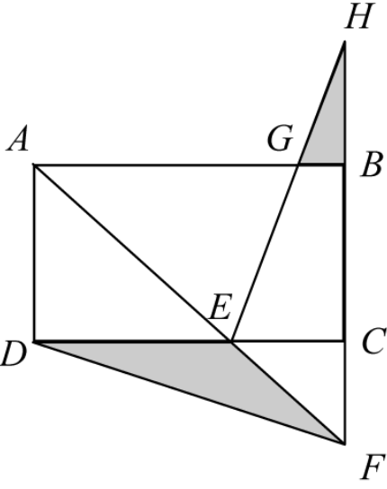

- **A**. 3500～4000平方米之间
- **B**. 超过4000平方米
- **C**. 不到3000平方米
- **D**. 3000～3500平方米之间

第 48 题 · 答案与解析

**参考答案（华图在线，2026-10-28 采集）**

D

**解析**

一、题目分析:
- 本题考查几何问题。
二、题目关键信息:
- 长方形面积为万平方米。
- 和为等腰直角三角形，且。
- 。
- 要求两个人工湖的面积差。
三、解题步骤:
- 根据相似三角形及比例关系设未知数：
因为与相似，且，所以。设，则。
- 计算的值：
长方形面积为，已知长方形面积为万平方米，所以，则。
- 分别计算相关三角形面积：
- 面积：。
- 面积：因为，，所以，则。
- 由于与相似，且，根据相似三角形面积比等于相似比的平方，可得，所以。

- 计算两个人工湖面积差：
两个人工湖面积差为，将代入可得万平方米，万平方米平方米。
四、结论:
- 因此，选择D选项。

**来源**：2024年12月8日北京公务员考试《行测》（考生回忆版）第48题

## 第 49 题　qid 1072259

工厂制造一种设备需要用到甲和乙两种零部件，甲价格如上涨m%，则设备成本将上涨1%。乙价格如上涨2%，则设备成本将上涨n%。则以下哪个等式最能准确描述m和n之间的关系?

- **A**. m=$\frac{2}{n}$
- **B**. m=$\frac{1}{2n}$
- **C**. m=$\frac{2}{2-n}$
- **D**. m=2n

第 49 题 · 答案与解析

**参考答案（华图在线，2026-10-28 采集）**

C

**解析**

一、题目分析:
- 本题考查基础应用题。
二、题目关键信息:
- 甲价格上涨，设备成本上涨。
- 乙价格上涨，设备成本上涨。
三、解题步骤:
- 根据条件列方程组：
设甲零部件价格为甲，乙零部件价格为乙，设备成本为甲 + 乙。
由“甲价格如上涨，则设备成本将上涨”可得：甲×；
由“乙价格如上涨，则设备成本将上涨”可得：乙×。
- 化简方程组：
由甲×可得：，进一步变形为；
由乙×可得：，进一步变形为。
所以。
- 求解与的关系：
由交叉相乘可得：，
展开式子：，
，
消去可得：，
，
，
解得。
四、结论:
- 因此，选择C选项。

**来源**：2024年12月8日北京公务员考试《行测》（考生回忆版）第49题

## 第 50 题　qid 1072260

一块面积为10亩的等腰直角三角形土地中内接有一块正三角形土地，且该正三角形土地中又内接一个正方形人工湖如右图中黑色部分所示，且人工湖的底边与等腰直角三角形的底边平行。现在等腰直角三角形土地中标为灰色的部分种植甲作物，则甲作物的种植面积为多少亩?
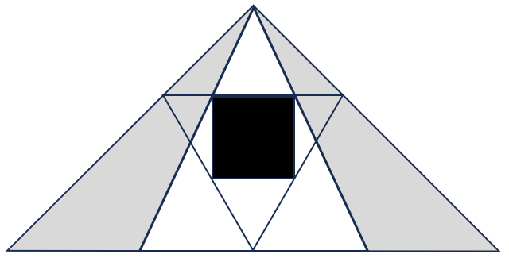

- **A**. 3$\sqrt{3}$
- **B**. 10（$\sqrt{3}$-1）
- **C**. $20（\sqrt{3}$-$\sqrt{2}$）
- **D**. 20（2-$\sqrt{3}$）

第 50 题 · 答案与解析

**参考答案（华图在线，2026-10-28 采集）**

D

**解析**

第一步，本题考查几何问题。
第二步，如下图，△ABC是等边三角形，四边形DEFM为其内接正方形，AH是三角形垂线，与DM交于G。设三角形边长AB=a，则AH=。△ADM与△ABC相似，则，设正方形边长为x，则，解得x=（2）a。即等边三角形与其内接正方形的边长之比为1：（2）。

回到原题，如下图。作A点到BC的垂线AF。人工湖底边与等腰直角三角形的底边平行，则，即，则BG=。△ABG与△ABF同高，则面积之比为底之比，则△ABG的面积=△ABF的面积=亩，则甲作物的种植面积=亩。

因此，选择D选项。

**来源**：2024年12月8日北京公务员考试《行测》（考生回忆版）第50题

## 第 51 题　qid 1072261

现用1台仪器对32台性能不同的设备进行性能测试，仪器每次运行都能从6台设备中选出性能最好的1台，或者从8台设备中选出性能最好的2台（仅选出但不分名次）。则最少要运行几次仪器，一定能选出32台设备中性能最好的4台?

- **A**. 8
- **B**. 7
- **C**. 10
- **D**. 9

第 51 题 · 答案与解析

**参考答案（华图在线，2026-10-28 采集）**

C

**解析**

一、题目分析：
- 本题考查其他杂题。
二、题目关键信息：
- 有1台仪器对32台性能不同的设备进行性能测试。
- 仪器运行规则：可从6台设备中选出性能最好的1台，或从8台设备中选出性能最好的2台（不分名次）。
- 目标是一定能选出32台设备中性能最好的4台。
三、解题步骤：
- 第一轮分组测试：
将32台设备分为4组，每组8台。根据仪器运行规则，从8台设备中选出性能最好的2台，每组测试1次，4组共测试4次，这样选出了每组最好的2台，共台。
- 第二轮测试确定前2台：
对这8台设备进行1次测试，可确定所有设备中最好的前2台，此时这8台中还剩余6台。
- 寻找第三、四好的设备：
- 原来每组选出最好的2台后，每组剩余台，4组共剩余台。将这24台分为3组，每组8台，每组测试1次，3组共测试3次，选出每组性能好的2台，共台。
- 这6台与之前剩下的6台组成12台，分为8台和4台。对8台那组进行1次测试，选出最好的2台。
- 从剩下的台和刚选出的台中任选台搭配剩下的台组成8台一组，进行1次测试，可选出剩余里面最好的2台。

- 计算总测试次数：
总共测试的次数为次。
四、结论：
- 因此，选择C选项。

**来源**：2024年12月8日北京公务员考试《行测》（考生回忆版）第51题

## 第 52 题　qid 1072262

从所给的四个选项中，选择最合适的一个填入问号处，不仅使两套图形表现出最大的相似性，而且使第二套图形也表现出自己的特征。
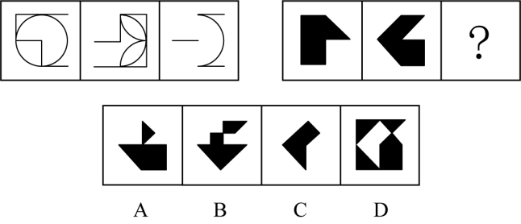

- **A**. 如图所示
- **B**. 如图所示
- **C**. 如图所示
- **D**. 如图所示

第 52 题 · 答案与解析

**参考答案（华图在线，2026-10-28 采集）**

C

**解析**

第一步，观察特征。
图形组成相似，所有图形均由两部分构成，优先考虑样式。
第二步，两段式，第一段找规律，第二段应用规律。
第一段找规律，图一与图二去异求同得到图三；第二段应用规律，图一与图二去异求同得到问号处，只有C项符合。
因此，选择C选项。

**来源**：2024年12月8日北京公务员考试《行测》（考生回忆版）第52题

## 第 53 题　qid 1072263

从所给的四个选项中，选择最合适的一个填入问号处，不仅使两套图形表现出最大的相似性，而且使第二套图形也表现出自己的特征。
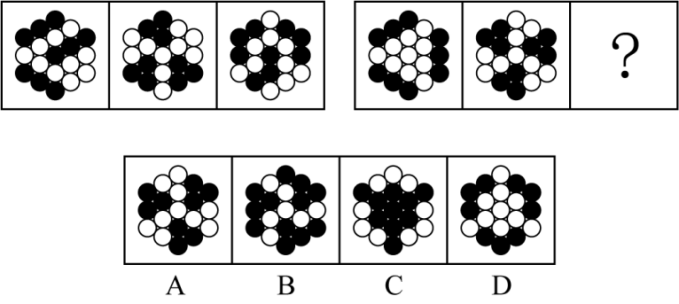

- **A**. 如图所示
- **B**. 如图所示
- **C**. 如图所示
- **D**. 如图所示

第 53 题 · 答案与解析

**参考答案（华图在线，2026-10-28 采集）**

D

**解析**

第一步，观察特征。
组成元素不同，优先考虑数量或属性。
第二步，两段式，第一段找规律，第二段应用规律
第一段找规律，黑球都是3部分，且每部分为3个黑球；第二段应用规律，排除B、C两项。继续观察，第一段每幅图形中黑色部分的形状都不同，故排除A项。
因此，选择D选项。

**来源**：2024年12月8日北京公务员考试《行测》（考生回忆版）第53题

## 第 54 题　qid 1072264

从所给的四个选项中，选择最合适的一个填入问号处，不仅使两套图形表现出最大的相似性，而且使第二套图形也表现出自己的特征。
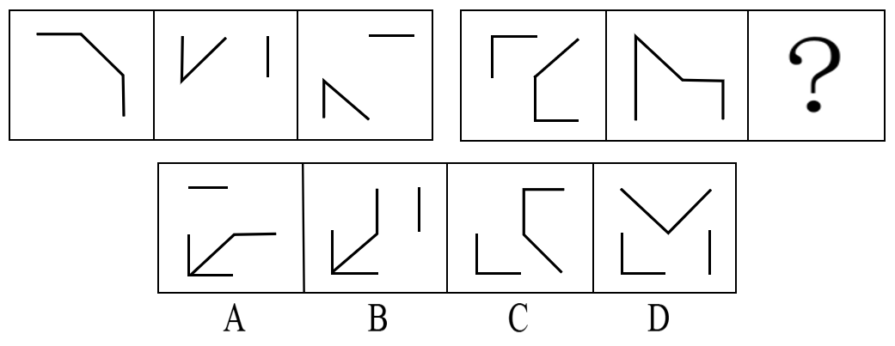

- **A**. 如图所示
- **B**. 如图所示
- **C**. 如图所示
- **D**. 如图所示

第 54 题 · 答案与解析

**参考答案（华图在线，2026-10-28 采集）**

B

**解析**

第一步，观察特征。
组成元素相同（第一组每个图形都是由三条直线构成），但每一幅图中线条发生明显位置变化，考虑动态位置。
第二步，两段式，第一段找规律，第二段应用规律。
第一段找规律，外框2个线条沿着外部区域依次逆时针平移一个位置，内部1个线条沿着内部区域依次逆时针平移一个位置；第二段应用规律，外框3个线条沿着外部区域依次逆时针平移一个位置，内部2个线条依次逆时针旋转90度，如图所示：

因此，选择B选项。

**来源**：2024年12月8日北京公务员考试《行测》（考生回忆版）第54题

## 第 55 题　qid 1072265

从所给的四个选项中，选择最合适的一个填入问号处，使图形呈现一定的规律性。
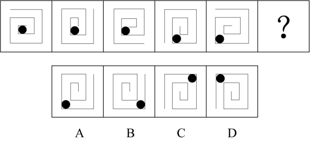

- **A**. 如图所示
- **B**. 如图所示
- **C**. 如图所示
- **D**. 如图所示

第 55 题 · 答案与解析

**参考答案（华图在线，2026-10-28 采集）**

A

**解析**

第一步，观察特征。
组成元素相同（每个图形都是由一个黑球和漩涡状的直线构成），但每一幅图中黑球发生明显位置变化，考虑动态位置。
第二步，一条式，从左到右找规律。
由内向外看，小黑球所在的线条位置由最内侧逐渐向外侧移动，且黑球永远在左下角位置，只有A项符合。
因此，选择A选项。

**来源**：2024年12月8日北京公务员考试《行测》（考生回忆版）第55题

### 材料 4（第56、57、58题共用）

下面呈现一组操作规则，根据要求完成75--77题

## 第 56 题　qid 1072266

对左侧的图形依次进行相应的操作后，可以得到右侧哪个图形?

- **A**. 如图所示
- **B**. 如图所示
- **C**. 如图所示
- **D**. 如图所示

第 56 题 · 答案与解析

**参考答案（华图在线，2026-10-28 采集）**

A

**解析**

第一步，观察特征。
题干给了一幅图和相关公式要求，考察动态位置等相关知识。
第二步，利用题干要求推理答案。
图形首先左半部分反色，如图：；再将该图进行黑白反色，如图：；后进行下半部分镜像，此时上半部分不会发生变化，只有A项与该图上半部分相同。
因此，选择A选项。

**来源**：2024年12月8日北京公务员考试《行测》（考生回忆版）第56题

## 第 57 题　qid 1072267

对左侧的图形依次进行相应的操作后，可以得到右侧哪个图形?
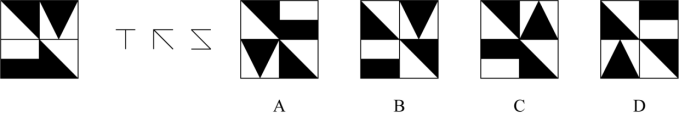

- **A**. 如图所示
- **B**. 如图所示
- **C**. 如图所示
- **D**. 如图所示

第 57 题 · 答案与解析

**参考答案（华图在线，2026-10-28 采集）**

A

**解析**

第一步，观察特征。
题干给了一幅图和相关公式要求，考察动态位置等相关知识。
第二步，利用题干要求推理答案。
图形首先进行左右换位，如图：；后将图形进行逆时针旋转90度，如图：，后将图形在四个角的每个小方格各自顺时针选择90度，左下角三角形顺时针旋转90度后，三角形顶点应该向下，只有A项符合。
因此，选择A选项。

**来源**：2024年12月8日北京公务员考试《行测》（考生回忆版）第57题

## 第 58 题　qid 1072268

对左侧的图形依次进行相应的操作后，可以得到右侧哪个图形?
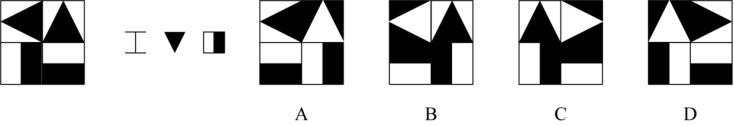

- **A**. 如图所示
- **B**. 如图所示
- **C**. 如图所示
- **D**. 如图所示

第 58 题 · 答案与解析

**参考答案（华图在线，2026-10-28 采集）**

A

**解析**

第一步，观察特征。
题干给了一幅图和相关公式要求，考察动态位置等相关知识。
第二步，利用题干要求推理答案。
图形首先左右镜像，就是沿着竖轴翻转，翻转后如图：，后将该图形上半部分左右镜像，就是沿着竖轴翻转，翻转后如图：，后将该图形右半部分反色，左侧不变，只有A选项符合。
因此，选择A选项。

**来源**：2024年12月8日北京公务员考试《行测》（考生回忆版）第58题

## 第 59 题　qid 1072269

从所给的四个选项中，选择最合适的一个填入问号处，使图形呈现一定的规律性。
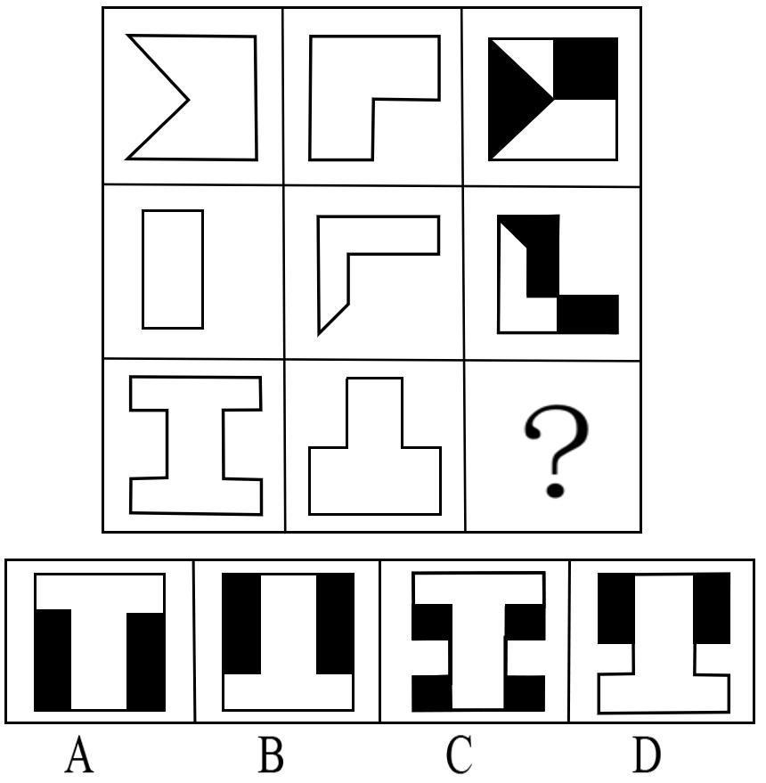

- **A**. 如图所示
- **B**. 如图所示
- **C**. 如图所示
- **D**. 如图所示

第 59 题 · 答案与解析

**参考答案（华图在线，2026-10-28 采集）**

C

**解析**

第一步，观察特征。
元素组成相似，优先考虑样式。
第二步，九宫格，横向规律较为常见，优先考虑。
第一行寻找规律，图一和图二求异，把求异部分涂黑，再上下翻转得到图三；第二行验证规律，符合；第三行应用规律，只有C项符合。

因此，选择C选项。

**来源**：2024年12月8日北京公务员考试《行测》（考生回忆版）第59题

## 第 60 题　qid 1072270

以下除哪一项外，都是同一正方体纸盒的外表面展开图?
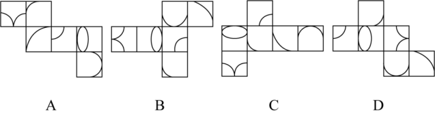

- **A**. 如图所示
- **B**. 如图所示
- **C**. 如图所示
- **D**. 如图所示

第 60 题 · 答案与解析

**参考答案（华图在线，2026-10-28 采集）**

A

**解析**

第一步，本题考查六面体折纸盒。
第二步，分析选项。
A项：观察1、2两面的相对位置关系；如下图所示，面1的椭圆在左半面，面2的弧线在右半面，在2个面的整个面中（框出的区域）的不同的半面，和其余选项不同。
B项：将面2旋转，如下图所示，B选项的位置，观察1、2两面的相对位置关系；面1的椭圆和面2的弧线在2个面的整个面的相同的半面，排除。
C项：将面1平移，如下图所示，C选项的位置，观察1、2两面的相对位置关系；面1的椭圆和面2的弧线在2个面的整个面的相同的半面，排除。
D项：将面2旋转，如下图所示，D选项的位置，观察1、2两面的相对位置关系；面1的椭圆和面2的弧线在2个面的整个面的相同的半面，排除。
因此，选择A选项。

**来源**：2024年12月8日北京公务员考试《行测》（考生回忆版）第60题

## 第 61 题　qid 1072271

下图为20个等大的白色正方体组合而成的多面体，至少在其中再添加几个同样的正方体后，其主视图、左视图和俯视图将是相同的图形?
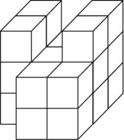

- **A**. 1
- **B**. 2
- **C**. 3
- **D**. 4

第 61 题 · 答案与解析

**参考答案（华图在线，2026-10-28 采集）**

B

**解析**

第一步，明确设问内容。
题目中要求增加正方体后三视图相同。
第二步，观察原图形的主视图、左视图和俯视图，如下：
俯视图左视图
主视图
若想让三视图一样，则让俯视图第一行增加一个正方体，主视图第二列增加一个，左视图第三列增加一个。左视图第三列增加的正方体即主视图第二列，结合俯视图增加一个，可知，至少增加2个即可，如图所示：

因此，选择B选项。

**来源**：2024年12月8日北京公务员考试《行测》（考生回忆版）第61题

## 第 62 题　qid 1072272

左图为给定的多面体，将其沿A、B、C三个顶点切开，其截面是？
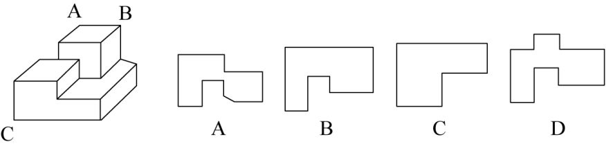

- **A**. 如图所示
- **B**. 如图所示
- **C**. 如图所示
- **D**. 如图所示

第 62 题 · 答案与解析

**参考答案（华图在线，2026-10-28 采集）**

B

**解析**

第一步，明确设问内容。
沿A、B、C三个顶点切开，其截面是？
第二步，分析选项。
经过A、B、C三个点斜切，如下图所示：

因此，选择B选项。

**来源**：2024年12月8日北京公务员考试《行测》（考生回忆版）第62题

## 第 63 题　qid 1072273

小高乘汽车外出时，在司机倒车过程中，透过左侧车窗沿路用连拍拍下了几张照片。请按照时间先后顺序重新排列画面。
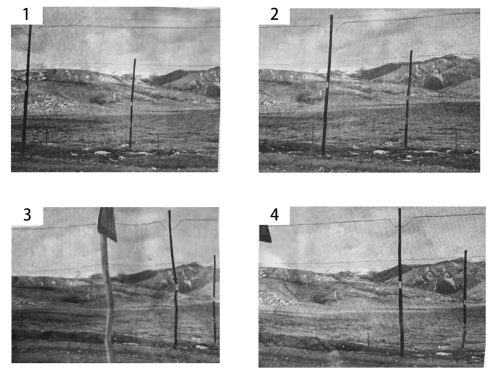

- **A**. 1-2-3-4
- **B**. 1-2-4-3
- **C**. 3-4-2-1
- **D**. 4-3-2-1

第 63 题 · 答案与解析

**参考答案（华图在线，2026-10-28 采集）**

B

**解析**

第一步，观察特征。
题干要求让观察照片先后。
第二步，找规律。
这是倒车，向左看，很明显34相关，如果3-4倒车，那么图形是向右看才行，4-3倒车符合向左看，同理24关系应该是2-4才是向左看，12关系是1-2，连起来就是1-2-4-3。
因此，选择B选项。

**来源**：2024年12月8日北京公务员考试《行测》（考生回忆版）第63题

## 第 64 题　qid 1072274

小张在太阳处于正西方向时看到了一栋长方体形状的建筑，建筑四个墙面分别面向东西南北四个方向。他将当时看到的建筑和投影一起画了下来（如右图所示）。小张看到这景象时在建筑的哪个方向?
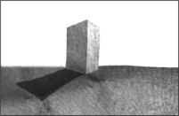

- **A**. 东北
- **B**. 西北
- **C**. 东南
- **D**. 西南

第 64 题 · 答案与解析

**参考答案（华图在线，2026-10-28 采集）**

A

**解析**

第一步，观察特征。
题干要求让观察建筑影子，这是一道视图题。
第二步，找规律。
根据影子是背光，太阳处于正西方向，所以影子是正东方向。上北下南左西右东，画一个坐标。人就在东北方位。

因此，选择A选项。

**来源**：2024年12月8日北京公务员考试《行测》（考生回忆版）第64题

## 第 65 题　qid 1072275

下面的5块拼图能拼成哪个选项对应的形状?
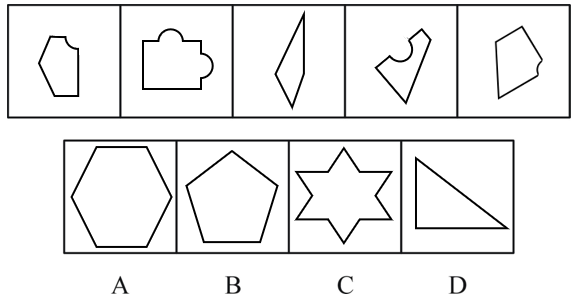

- **A**. 如上图所示
- **B**. 如上图所示
- **C**. 如上图所示
- **D**. 如上图所示

第 65 题 · 答案与解析

**参考答案（华图在线，2026-10-28 采集）**

A

**解析**

第一步，明确设问内容。
题目中要求各图平移后拼合。
第二步，观察图形特征，按下图所示进行拼合：

因此，选择A选项。

**来源**：2024年12月8日北京公务员考试《行测》（考生回忆版）第65题

## 第 66 题　qid 1072276

小鹏将一个光源和三个相同的圆柱体摆在桌子上，并从一旁观察三个物体的影子。如果观察时小鹏、光源和三个圆柱体的位置关系如下图所示，那么小鹏当时看到的画面最可能是哪个?
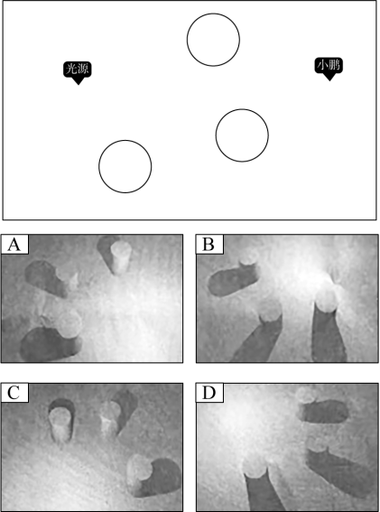

- **A**. 如图所示
- **B**. 如图所示
- **C**. 如图所示
- **D**. 如图所示

第 66 题 · 答案与解析

**参考答案（华图在线，2026-10-28 采集）**

B

**解析**

第一步，观察特征。
题干让找光源及影子位置，这是一道视图题。
第二步，找规律。
光源照向圆柱时候，影子是在另一侧，投向小鹏的位置，排除A、C选项。小鹏的右侧有一个圆柱，只有B项符合。

因此，选择B选项。

**来源**：2024年12月8日北京公务员考试《行测》（考生回忆版）第66题

## 第 67 题　qid 1072277

安塞腰鼓∶翼城花鼓

- **A**. 宾阳炮龙节∶瑶族盘王节
- **B**. 节日祭典∶清明祭祖
- **C**. 武夷茶∶扬州漆
- **D**. 宜兴紫砂∶龙泉青瓷

第 67 题 · 答案与解析

**参考答案（华图在线，2026-10-28 采集）**

D

**解析**

题干逻辑分析
安塞腰鼓与翼城花鼓均为传统舞蹈，二者构成并列关系；
且两者均以地理位置命名（“安塞”和“翼城”分别为地名）。
选项辨析
D选项正确
宜兴紫砂与龙泉青瓷均为工艺品，构成并列关系；
同时两者也均以地理位置命名（“宜兴”和“龙泉”分别为地名）；
与题干逻辑关系一致。
错误选项分析
A选项：
宾阳炮龙节与瑶族盘王节均为节日，属于并列关系；
但宾阳炮龙节是以地理位置命名，而瑶族盘王节是以民族命名，命名方式不一致，
与题干逻辑关系不一致。
B选项：
清明祭祖是节日祭典的一种，二者属于种属关系（包容关系），
与题干的并列关系不一致。
C选项：
武夷茶属于茶类，扬州漆属于漆类，二者不属于同一类别，
且无明确对应关系，与题干逻辑关系不一致。
因此，选择D选项。

**来源**：2024年12月8日北京公务员考试《行测》（考生回忆版）第67题

## 第 68 题　qid 1072278

信息∶记忆∶大脑

- **A**. 食物∶消化∶肠道
- **B**. 色彩∶生成∶眼睛
- **C**. 血液∶制造∶心脏
- **D**. 蛋白∶合成∶基因

第 68 题 · 答案与解析

**参考答案（华图在线，2026-10-28 采集）**

A

**解析**

题干逻辑分析
信息通过大脑被记忆，三者构成功能对应关系。
其中，大脑是人体器官，承担对信息进行记忆的功能。
选项辨析
A选项正确
食物通过肠道被消化，三者构成功能对应关系。
肠道是人体器官，承担对食物进行消化的功能，
与题干逻辑关系一致。
错误选项分析
B选项：
眼睛能够识别色彩，但“生成”色彩与“眼睛”无直接逻辑关系，
不属于功能对应关系，与题干逻辑关系不一致。
C选项：
心脏可以推动血液流动，但并不负责制造血液，
“制造血液”与“心脏”功能不符，与题干逻辑关系不一致。
D选项：
基因指导蛋白质的合成，虽然存在功能关系，但基因不是人体器官，
与题干中“大脑”作为器官的角色不符，逻辑关系不一致。
因此，选择A选项。

**来源**：2024年12月8日北京公务员考试《行测》（考生回忆版）第68题

## 第 69 题　qid 1072279

无人机∶侦察∶电子对抗

- **A**. 警犬∶搜毒∶搜捕
- **B**. 红外线∶测温仪∶成像
- **C**. 雨林∶地球肺脏∶生态平衡
- **D**. 沟渠∶废水∶灌溉

第 69 题 · 答案与解析

**参考答案（华图在线，2026-10-28 采集）**

A

**解析**

题干逻辑分析
无人机具有侦察的功能，二者构成功能对应关系；
无人机可以用于电子对抗，二者也构成功能或应用领域对应关系。
选项辨析
A选项正确
警犬具有搜毒的功能，二者构成功能对应关系；
警犬也可以用于搜捕，二者同样构成功能对应关系；
与题干逻辑关系一致。
错误选项分析
B选项：
测温仪的工作原理是基于红外线，二者属于工具与原理对应关系，非功能对应关系，与题干逻辑关系不一致。
C选项：
雨林被称为地球肺脏，是一种比喻说法，二者属于比喻关系；
“地球肺脏”与“生态平衡”之间也不是功能对应关系，整体不符合题干逻辑。
D选项：
废水存在于沟渠中，二者属于场所与内容物的对应关系，非功能关系，与题干逻辑关系不一致。
因此，选择A选项

**来源**：2024年12月8日北京公务员考试《行测》（考生回忆版）第69题

## 第 70 题　qid 1072280

石油∶石蜡

- **A**. 水∶重水
- **B**. 卤水∶井盐
- **C**. 豆腐∶豆浆
- **D**. 纸张∶纸浆

第 70 题 · 答案与解析

**参考答案（华图在线，2026-10-28 采集）**

B

**解析**

题干逻辑分析
石油与石蜡之间构成原材料对应关系，即石蜡是从石油中提取的产物。
选项辨析
B选项正确
卤水与井盐之间也构成原材料对应关系，即井盐是从卤水中提取的。
与题干逻辑关系一致。
错误选项分析
A选项：
水与重水属于种属关系（重水是水的一种特殊形式），并非原材料关系，与题干逻辑关系不一致。
C选项：
豆腐与豆浆之间是制作过程中的中间产物关系，豆浆是豆腐的前期形态，并非直接提取物，与题干逻辑关系不一致。
D选项：
纸浆是纸张的原材料，二者确实属于原材料对应关系，但顺序为“成品←原料”，与题干“原料→成品”的顺序相反，因此逻辑顺序不一致，排除。
因此，选择B选项

**来源**：2024年12月8日北京公务员考试《行测》（考生回忆版）第70题

## 第 71 题　qid 1072281

自动控制∶开环控制∶闭环控制

- **A**. 压力传感器∶敏感元件∶信号处理
- **B**. 数控机床∶伺服系统∶反馈系统
- **C**. 扭矩∶力矩∶转矩
- **D**. 光反射∶镜面反射∶漫反射

第 71 题 · 答案与解析

**参考答案（华图在线，2026-10-28 采集）**

D

**解析**

第一步，确定题干逻辑关系。
“开环控制”和“闭环控制”都是“自动控制”的一种，二者与“自动控制”属于包含关系中的种属关系；“开环控制”和“闭环控制”属于并列关系。
A项：“敏感元件”是“压力传感器”的组成部分，二者属于包容关系中的组成关系，排除。
B项：“伺服系统” 和 “反馈系统” 是 “数控机床” 的组成部分，二者与“数控机床” 属于包含关系中的组成关系，排除。
C项：“扭矩”和“转矩”都属于“力矩”的一种， 二者与“力矩”属于包含关系中的种属关系，但词语顺序与题干不一致，排除。
D项：“镜面反射”和“漫反射”都是“光反射”的一种，二者与“光反射”属于包含关系中的种属关系；“镜面反射”和“漫反射”属于并列关系，与题干逻辑关系一致，符合。
因此，选择D选项。

**来源**：2024年12月8日北京公务员考试《行测》（考生回忆版）第71题

## 第 72 题　qid 1072282

近年来，手指操获得越来越多的青睐，越来越多的人练习手指操。有医生提出，支配手指的神经元在大脑皮层占据很大面积，老年人坚持做手指操，能锻炼运动神经，预防跌倒。
以下各项如果为真，哪项最能支持该医生的结论?

- **A**. 手指各种运动可以促进脑部血液循环，延缓神经细胞的老化，维护大脑健康
- **B**. 手部有全身各个部位对应的反射区，以特定方式活动双手能改善身体不良状况，促进身体健康
- **C**. 特定模式的手指操可以在锻炼大脑的同时提升平衡感，帮助身体在快要跌倒时依靠双手找回平衡
- **D**. 提高手指灵活性可以让老人在失去平衡时握紧支撑物维持姿势，有效减轻跌倒后受伤程度

第 72 题 · 答案与解析

**参考答案（华图在线，2026-10-28 采集）**

C

**解析**

第一步，确定题型。
根据提问方式中的“最能支持”，确定为加强论证。
第二步，找论点和论据。
论点：老年人坚持做手指操，能锻炼神经，预防跌倒。
论据：支配手指的神经元在大脑皮层占据很大面积。
第三步，辨析选项。
A项：不明确项。该项讨论的是“手指的各种运动”，并不是在说手指操，不能说明坚持做手指操，能锻炼神经，预防跌倒，不具有加强作用，排除。
B项：不明确项。该项讨论的是“手部有反射区能改善身体健康”，身体健康并不能代表预防跌倒，不具有加强作用，排除。
C项：增加正向论据。该项讨论的是“手指操确实对保持身体平衡有作用”，从而可以预防摔倒，为论点补充了新论据，具有加强作用。
D项：无关选项。该项讨论的是“手指灵活可以在跌倒之后减少受伤的程度”，与论点“老年人坚持做手指操，能锻炼神经，预防跌倒”无关，论题不一致，排除。
因此，选择C选项。

**来源**：2024年12月8日北京公务员考试《行测》（考生回忆版）第72题

## 第 73 题　qid 1072283

石油燃烧会释放二氧化硫，煤油燃烧会释放二氧化硫，纯酒精燃烧不会释放二氧化硫。现有一种未知液体，燃烧后没有释放二氧化硫。以下对该未知液体的判断一定为真的有：
Ⅰ.它是纯酒精
Ⅱ.它要么是石油要么是煤油要么是纯酒精
Ⅲ.它不是石油
IV.它不是煤油

- **A**. 仅Ⅰ
- **B**. 仅Ⅱ
- **C**. 仅Ⅲ和IV
- **D**. Ⅰ、Ⅲ和IV

第 73 题 · 答案与解析

**参考答案（华图在线，2026-10-28 采集）**

C

**解析**

第一步，确定题型。
根据题干关联词“要么……要么”，确定为翻译推理。
第二步，翻译题干。
①石油→燃烧产生二氧化硫
②煤油→燃烧产生二氧化硫
③纯酒精→燃烧不产生二氧化硫
第三步，进行推理。
Ⅰ.未知液体燃烧不产生二氧化硫是对③的肯后推理，根据肯后不确定，不一定是纯酒精，排除。
Ⅱ.未知液体燃烧不产生二氧化硫是对③的肯后推理，无法确定是不是纯酒精；未知液体燃烧不产生二氧化硫是对②的否后推理，根据否后必否前，可以确定它不是煤油；未知液体燃烧不产生二氧化硫是对①的否后推理，根据否后必否前，可以确定它不是石油，所以无法推出Ⅱ，排除。
Ⅲ.未知液体燃烧不产生二氧化硫是对①的否后推理，根据否后必否前，可以确定它不是石油，可以推出。
Ⅳ.未知液体燃烧不产生二氧化硫是对②的否后推理，根据否后必否前，可以确定它不是煤油，可以推出。
因此，选择C选项。

**来源**：2024年12月8日北京公务员考试《行测》（考生回忆版）第73题

## 第 74 题　qid 1072284

某乡自来水厂为减少本乡的自来水浪费问题，将出台一项自来水调价措施：根据家庭人口数量规定每户的月自来水消费限额，不超过限额的，按最低水价收费；超过限额的，按最低水价的两倍收费。据估计，新措施实施后，全乡自来水的月消耗量至少可以节省20%。为使上述估计成立，必须假设？
Ⅰ.自来水价格偏低是造成该乡自来水浪费这一现象的重要原因
Ⅱ.调整后的自来水价格足以给浪费自来水的用户带来经济上的压力
Ⅲ.该乡至少有 20%的自来水用户存在自来水使用上的浪费问题
IV.该乡当前至少有20%的自来水使用属于浪费

- **A**. Ⅰ、Ⅱ、Ⅲ和IV
- **B**. 仅Ⅰ、Ⅱ和Ⅲ
- **C**. 仅Ⅱ、Ⅲ和IV
- **D**. 仅Ⅰ、Ⅱ和IV

第 74 题 · 答案与解析

**参考答案（华图在线，2026-10-28 采集）**

D

**解析**

一、题型判断
题干提问含“必须假设” → 加强论证（前提假设类）
二、论点与论据
- 论点：新措施实施后，全乡自来水的月消耗量至少可以节省20%
- 论据：通过设定用水限额和阶梯水价来减少浪费
三、辨析选项
Ⅰ项（建立联系）：
- 关键依据：价格偏低是浪费的重要原因
- 推理：若水价不是浪费的原因，则调价措施无法有效减少浪费，说明该前提是成立论点的必要条件
Ⅱ项（增加正向论据）：
- 关键依据：调整后的水价能带来经济压力
- 推理：只有当用户感受到经济压力，才会减少浪费行为，从而实现节水目标，因此是论点成立的重要支撑
Ⅲ项（无关选项）：
- 关键依据：浪费用户数量占比与总节约量无直接关系
- 推理：即使有20%用户存在浪费行为，也不能保证总用水量能减少20%，论据与论点无关，排除
Ⅳ项（补充前提）：
- 关键依据：当前至少有20%的用水属于浪费
- 推理：若当前浪费水量不足20%，则即便完全杜绝浪费也无法实现20%的节水目标，否定该项将直接削弱论点，因此为必要前提
四、关键结论
- 成立的前提组合：Ⅰ、Ⅱ、Ⅳ
- 核心逻辑：论点要成立，必须假设当前存在足够多的浪费水量（Ⅳ），且调价能有效抑制浪费（Ⅰ、Ⅱ）；而浪费用户的数量（Ⅲ）不影响整体节水比例。
因此，选择D选项。

**来源**：2024年12月8日北京公务员考试《行测》（考生回忆版）第74题

## 第 75 题　qid 1072285

某加工车间新增加了一条流水线。有人称，在试运行期间对流水线上的所有组装机都进行了测试，没有发现不合格的组装机。
如果上述论断为假，那么以下一定为真的有？
Ⅰ.流水线上有的组装机尚未经测试，同时发现了不合格的组装机。
Ⅱ.或者有的组装机尚未经测试，或者发现了不合格的组装机。
Ⅲ.如果对流水线上的所有组装机都进行了测试，则可发现不合格的组装机。

- **A**. 仅Ⅰ和Ⅱ
- **B**. 仅Ⅱ和Ⅲ
- **C**. 仅Ⅰ和Ⅲ
- **D**. Ⅰ、Ⅱ和Ⅲ

第 75 题 · 答案与解析

**参考答案（华图在线，2026-10-28 采集）**

B

**解析**

第一步，确定题型。
根据题干关联词“或者……或者”“如果……则”，确定为翻译推理。
第二步，翻译题干。
①所有组装机都进行了测试且没有发现不合格的组装机
第三步，进行推理。
已知题干“所有组装机都进行了测试且没有发现不合格的组装机”为假，则其矛盾“有的组装机没有进行测试或发现不合格的组装机”为真。
Ⅰ句，已知“有的组装机没有进行测试或发现不合格的组装机”为真，则无法确定“有的组装机没有进行测试”和“发现不合格的组装机”哪个是真的，排除。
Ⅱ句与题干推理一致，一定为真。
Ⅲ句，已知“有的组装机没有进行测试或发现不合格的组装机”为真，Ⅲ句“对流水线上的所有组装机都进行了测试”是对“有的组装机没有进行测试”的否定，根据否定肯定式，否定一个则必然肯定另一个，可得“发现不合格的组装机”，一定为真。
因此，选择B选项。

**来源**：2024年12月8日北京公务员考试《行测》（考生回忆版）第75题

## 第 76 题　qid 1072286

所有传递弱作用力的粒子都有质量，所有有质量的粒子，或者与希格斯场发生“强相互作用”而获得大的质量，或者与希格斯场发生“弱相互作用”而获得小的质量，所有与希格斯场发生“相互作用”的粒子都不传递电磁作用力，因此，甲粒子不传递弱作用力。
以下选项中，哪项可能是上述论证所假设的?
Ⅰ.甲粒子没有质量
Ⅱ.甲粒子不与希格斯场发生：“相互作用”
Ⅲ .甲粒子传递电磁作用力

- **A**. 仅Ⅰ
- **B**. 仅Ⅱ
- **C**. 仅Ⅲ
- **D**. 仅Ⅰ、Ⅱ和Ⅲ

第 76 题 · 答案与解析

**参考答案（华图在线，2026-10-28 采集）**

D

**解析**

一、题型判断
题干提问含“假设” → 加强论证（前提假设类）
二、论点与论据
- 论点：甲粒子不传递弱作用力
- 论据：
- 所有传递弱作用力的粒子都有质量
- 有质量的粒子要么与希格斯场强相互作用，要么弱相互作用
- 与希格斯场发生相互作用的粒子都不传递电磁作用力

可翻译为逻辑链
传递弱作用力的粒子→有质量→与希格斯场发生“强相互作用”或与希格斯场发生“弱相互作用”→不传递电磁作用力
三、辨析选项
Ⅰ. 甲粒子没有质量：
- 关键依据：“没有质量”是否定“有质量”
- 推理：根据论据“传递弱作用力 → 有质量”，若甲无质量，则它一定不传递弱作用力（否后推否前）→ 是必要前提
Ⅱ. 甲粒子不与希格斯场发生“相互作用”：
- 关键依据：“不与希格斯场相互作用”是否定 与希格斯场发生“强相互作用”或与希格斯场发生“弱相互作用”
- 推理：根据论据“有质量 →与希格斯场发生“强相互作用”或与希格斯场发生“弱相互作用””，若甲不与希格斯场作用，则它没有质量，进而不能传递弱作用力（否后推否前）→ 是必要前提
Ⅲ. 甲粒子传递电磁作用力：
- 关键依据：“传递电磁作用力”是否定“不传递电磁作用力”
- 推理：根据论据“传递弱作用力的粒子→有质量→与希格斯场发生“强相互作用”或与希格斯场发生“弱相互作用”→不传递电磁作用力”，若甲传递电磁作用力，则它不与希格斯场作用，从而也没有质量，进而不能传递弱作用力（层层否定）→ 是必要前提
四、关键结论
- Ⅰ、Ⅱ、Ⅲ均为必要前提：D
- 核心逻辑：三项分别从“质量”、“希格斯场作用”、“电磁作用力”三个层面进行否定，均能推出甲不传递弱作用力，构成推理链条中的必要条件。
- 因此，选择D选项。

**来源**：2024年12月8日北京公务员考试《行测》（考生回忆版）第76题

## 第 77 题　qid 1072287

某大学某课程期中考试同学们成绩不太理想，该课教师做了次随堂调查，50%的同学认为难题比较多，40%的同学认为计算量太大，20%的同学不确定主要问题出在哪里。
以下哪项最能合理地解释上述看来包含矛盾的陈述?

- **A**. 有的同学既认为难题比较多又认为计算量太大
- **B**. 有的同学改变了自己的看法
- **C**. 该门课程这学期总共有110名同学
- **D**. 称不确定主要问题出在哪里的同学实际上是认为自己没有充分复习

第 77 题 · 答案与解析

**参考答案（华图在线，2026-10-28 采集）**

A

**解析**

第一步，确定题型。
根据提问方式“解释矛盾”，确定为原因解释。
第二步，分析题干。
题干中50%的同学认为难题较多，40%的同学认为计算量太大，20%的同学不确定问题出在哪，总人数比例超过100%是该题的矛盾点。
第三步，辨析选项。
A项：有的同学既认为难题多又认为计算量大，说明两种同学有重合，比例也会有交叉，总比例就会比100%大，可以解释。
B项：有的同学改变了自己的看法，但是最后的结果只能有一个，无法解释比例超过100%的问题，排除。
C项：比例的大小与总人数没有直接关系，无法解释，排除。
D项：该项讨论的是学生找不到问题出在哪的原因，无法解释比例超过100%的问题，排除。
因此，选择A选项。

**来源**：2024年12月8日北京公务员考试《行测》（考生回忆版）第77题

## 第 78 题　qid 1072288

为了验证“全麦面包更健康”的说法，科学家将20名健康被试者随机分为两组，第一组吃白面包，第二组吃全麦面包，连续三周之后测量餐后血糖水平，竟然发现两组被试餐后血糖水平无显著差异，于是科学家得出结论，全麦面包并不比白面包更健康。
以下陈述如果为真，哪项无法质疑科学家的结论?

- **A**. 第一组被试的平均餐后血糖水平在进入研究之前就比第二组被试高
- **B**. 第二组被试的其他跟疾病相关的血生化检测指标在三周后显著优于第一组
- **C**. 餐后血糖水平不是健康的唯一指标
- **D**. 有些人对全麦面包中的麦麸过敏因而只能选择白面包

第 78 题 · 答案与解析

**参考答案（华图在线，2026-10-28 采集）**

A

**解析**

一、题型判断
题干提问含“无法质疑” → 削弱论证选非题
二、论点与论据
- 论点：全麦面包并不比白面包更健康。
- 论据：两组被试三周后餐后血糖水平无显著差异。
三、选项分析
A项（增加正向论据）：
- 关键依据：第一组被试的平均餐后血糖水平在进入研究之前就比第二组被试高。
- 推理：说明吃白面包后血糖水平并未显著升高，支持了全麦面包不比白面包更健康的结论。
B项（增加反向论据）：
- 关键依据：第二组被试的其他血生化检测指标在三周后显著优于第一组。
- 推理：说明全麦面包在其他健康指标上优于白面包，削弱了全麦面包不比白面包更健康的论点。
C项（切断联系）：
- 关键依据：餐后血糖水平不是健康的唯一指标。
- 推理：指出仅凭血糖水平不能全面评估健康状况，削弱了论点和论据之间的联系。
D项（无关选项）：
- 关键依据：有些人对全麦面包中的麦麸过敏因而只能选择白面包。
- 推理：讨论的是个体选择面包的原因，与论点“全麦面包是否更健康”无关，不具有削弱作用。
四、强度比较
- A项增加正向论据，直接支持论点。
- D项为无关选项，不涉及论点的核心内容。
五、关键结论
不能质疑科学家结论的选项：A。
核心逻辑：A项通过补充论据支持全麦面包不比白面包更健康的结论；B、C项从不同角度削弱论点，D项无关。
因此，选择A选项。

**来源**：2024年12月8日北京公务员考试《行测》（考生回忆版）第78题

### 材料 5（第79、80题共用）

做文献研究的王教授计划暑假时去西安旅行，除来回路途时间外，他还有周一至周六完整的六天时间。他为这六天做了一个计划：除周四这天休息、不安排活动之外，其他五天他每天上午和下午均有日程安排，而且每个半天他只进行一种活动，晚上不安排活动。具体计划如下:
（1）1个上午去陕西历史博物馆，该馆周一闭馆。
（2）3个上午去陕西图书馆古籍阅览室阅览，该阅览室周六闭馆。
（3）如果周一去陕西图书馆古籍阅览室阅览，则周二不去。
（4）在连续的两天下午会友，周六不会友。
（5）另外的时段去参观西安的一些旅游景点。

## 第 79 题　qid 1072289

按照王教授的计划，则以下哪项有可能为真？

- **A**. 王教授周一上午去陕西图书馆古书籍阅览室阅览，周一下午会友
- **B**. 王教授周一上午去西安的某旅游景点，周二上午去陕西历史博物馆
- **C**. 王教授周三上午去陕西历史博物馆，周三下午会友
- **D**. 王教授周五上午和下午都去西安的一些旅游景点参观

第 79 题 · 答案与解析

**参考答案（华图在线，2026-10-28 采集）**

A

**解析**

第一步，确定题型。
题干有明显的信息匹配特征，确定为分析推理。
第二步，分析条件，进行推理。
根据条件（1）可知，历史博物馆可能在周二、三、五、六的上午；
根据条件（2）可知，古籍阅览室可能在周一、二、三、五的上午；
根据条件（3）可知，周一古籍阅览室→周二不去；
根据条件（4），结合题干中“周四不安排活动”可知，连续两天会友可能在周一周二或周二周三。
A项：王教授周一上午去古籍阅读室，则根据（3），肯前必肯后，周二不去。因为一共去3次，可知周三、周五上午去古籍阅读室，周一下午会友，则周二下午也会友，此时，历史博物馆可以周二或周六上午去，其他时间参观旅游景点，符合条件，当选。
B项：王教授周一上午去旅游景点，周二上午去历史博物馆，则古籍阅读室只能周三、周五上午，周六闭馆，此时古籍阅读室无法安排3个上午，不符合题干，排除。
C项：王教授周三上午去历史博物馆，则古籍阅读室只能周一、二、五上午去，但根据（3）周一去古籍阅读室，周二则不能去，此时，无法安排3个古籍阅读室，不符合题干，排除。
D项：王教授周五上午下午都去景点旅游，则古籍阅读室只能周一、二、三上午去，但根据（3）周一去古籍阅读室，则周二不能去，此时，无法安排3个古籍阅读室，不符合题干，排除。
因此，选择A选项。

**来源**：2024年12月8日北京公务员考试《行测》（考生回忆版）第79题

## 第 80 题　qid 1072290

按照王教授的计划，下面哪一天他一定会友?

- **A**. 周一
- **B**. 周五
- **C**. 周三
- **D**. 周二

第 80 题 · 答案与解析

**参考答案（华图在线，2026-10-28 采集）**

D

**解析**

第一步，确定题型。
题干有明显的信息匹配特征，确定为分析推理。
第二步，分析条件，进行推理。
根据条件（4）周六不会友，结合题干中“周四不安排活动”可知，连续两天会友可能在周一周二或周二周三，则周二一定会友。
因此，选择D选项。

**来源**：2024年12月8日北京公务员考试《行测》（考生回忆版）第80题

## 第 81 题　qid 1072291

赵、钱、孙、李、周、吴参加某次考试，成绩各不相同，但其中有一人有作弊行为。已知:
（1）钱的成绩是周和孙成绩的平均数。
（2）孙的成绩比李差，周的成绩比吴差。
（3）周和钱的成绩之和与赵和吴的成绩之和相同。
（4）吴的成绩在钱和孙之间。
（5）作弊者的成绩高于吴，但不是第一名。
如作弊者被发现且成绩被判为最后一名，则哪几个人的名次将会有所上升?

- **A**. 赵、钱、孙
- **B**. 孙、周、吴
- **C**. 赵、孙、李、周
- **D**. 赵、钱、周、吴

第 81 题 · 答案与解析

**参考答案（华图在线，2026-10-28 采集）**

D

**解析**

第一步，确定题型。
题干有明显的信息匹配特征，确定为分析推理。
第二步，分析条件，进行推理。
题干设问的是哪些人的名次会上升，只有原本排在作弊者后面的人名次会上升，排在作弊者前面的名次不受影响。
根据（5）可知，吴的名次一定会受到影响，排除A、C项。
根据条件（1）可知：钱、周、孙三人的成绩从高到低可能有2种情况：①周＞钱＞孙；②孙＞钱＞周。
根据条件（2）可知：李＞孙；吴＞周。
根据条件（3）可知：周+钱=赵+吴，结合吴＞周得：钱＞赵。
根据条件（4）可知：吴、钱、孙三人成绩由高到低有2种情况：①钱＞吴＞孙；②孙＞吴＞钱。
假设（1）是①周＞钱＞孙，根据吴＞周，即：吴＞周＞钱＞孙。那么与（4）吴的成绩在钱和孙之间相矛盾。所以（1）是②孙＞钱＞周。此时根据（4）吴的成绩在钱和孙之间，所以孙＞吴＞钱＞周。根据（2）李＞孙，所以李＞孙＞吴＞钱＞周。作弊者的成绩高于吴，排在作弊者后面一定会提升，所以吴后面的钱、周一定会影响，排除B项。
因此，选择D选项。

**来源**：2024年12月8日北京公务员考试《行测》（考生回忆版）第81题

## 第 82 题　qid 1072292

主动收入，是指需持续付出劳动才能得到的固定收入，最大的特点是必须花费时间和精力去获得。与之相对的是被动收入，是指不需要花费多少时间精力就可以自动获得的收入。
根据上述定义，以下判断不正确的是：

- **A**. 每月的薪水属于主动收入
- **B**. 每月收的房租属于被动收入
- **C**. 每年的存款利息属于主动收入
- **D**. 每月的退休金属于被动收入

第 82 题 · 答案与解析

**参考答案（华图在线，2026-10-28 采集）**

C

**解析**

一、题目属性：
多定义-选非题
二、关键信息：
①主动收入：需持续付出劳动才能得到的固定收入，必须花费时间和精力。
②被动收入：不需要花费多少时间精力就可以自动获得的收入。
三、辨析选项：
A项：每月的薪水需要花费时间和精力才能获得（符合“主动收入”定义），判断正确，排除。
B项：每月收的房租无需花费太多时间和精力即可获得（符合“被动收入”定义），判断正确，排除。
C项：每年的存款利息无需花费时间和精力即可获得（应属于“被动收入”，不符合“主动收入”定义），判断错误，当选。
D项：每月的退休金无需花费时间和精力即可获得（符合“被动收入”定义），判断正确，排除。
因此，选择C选项。

**来源**：2024年12月8日北京公务员考试《行测》（考生回忆版）第82题

## 第 83 题　qid 1072293

体育旅游是指人们以参与和观看体育运动为目的，或以体育为主要内容的一种旅游活动形式，具有明显的娱乐性、健身性、参与性以及观赏性等特征。
根据上述定义，以下属于体育旅游的是：

- **A**. 北京奥运期间各国游客络绎不绝，欣赏赛事的同时领略北京风土人情
- **B**. 世界杯赛事期间，小镇夜晚的大排档格外热闹，很多人边看球边撸串
- **C**. 小李买了张机票飞往巴西，想偶遇自己的偶像球星罗纳尔多
- **D**. 某地“村超”开幕式现场表演和足球比赛吸引了各地民众线上观看

第 83 题 · 答案与解析

**参考答案（华图在线，2026-10-28 采集）**

A

**解析**

一、题目属性：
单定义-选是题
二、关键信息：
①以参与和观看体育运动为目的，或以体育为主要内容的旅游活动形式。
②具有娱乐性、健身性、参与性及观赏性。
三、辨析选项：
A项：各国游客因奥运赛事而来，欣赏赛事同时领略北京风土人情（符合“以观看体育运动为目的的旅游活动”），符合关键信息，当选。
B项：小镇大排档边看球边撸串（主要目的是撸串，非旅游活动），不符合关键信息，排除。
C项：小李飞往巴西只为偶遇球星（目的非参与或观看体育运动），不符合关键信息，排除。
D项：各地民众线上观看比赛（非实地旅游活动），不符合关键信息，排除。
因此，选择A选项。

**来源**：2024年12月8日北京公务员考试《行测》（考生回忆版）第83题

## 第 84 题　qid 1072294

个性化契约是由雇佣者与被雇佣者通过谈判协商的方式达成的一种满足双方利益的、非标准化的灵活工作安排。
根据上述定义，以下体现出个性化契约的是：

- **A**. 李老师和学生们通过协商，制定了个性化作业规则，每次月考满分的学生，接下来一个月可以自由选择是否写数学作业
- **B**. 王经理的妻子生病急需照顾，王经理提出居家办公三个月，老板同意，但要求他每周来公司半天，王经理表示可以做到
- **C**. 某公司规定，哺乳期的女员工可选择弹性工作时间，自行决定到岗和离岗时间，只需要保证每日在岗不少于6小时即可
- **D**. 某公司需搬迁到城市另一端，发现很多员工因通勤困难考虑离职，于是宣布为有需要的员工在办公地点附近安排宿舍

第 84 题 · 答案与解析

**参考答案（华图在线，2026-10-28 采集）**

B

**解析**

一、题目属性：
单定义-选是题
二、关键信息：
①雇佣者与被雇佣者通过谈判协商达成。
②满足双方利益，非标准化的灵活工作安排。
三、辨析选项：
A项：李老师和学生（不符合“雇佣者与被雇佣者”关系），排除。
B项：王经理与老板（符合“雇佣者与被雇佣者”关系），通过协商达成居家办公及每周到岗半天的安排（符合“满足双方利益，非标准化的灵活工作安排”），当选。
C项：公司规定弹性时间（不符合“通过谈判协商达成”），排除。
D项：公司宣布宿舍安排（不符合“通过谈判协商达成”），排除。
因此，选择B选项。

**来源**：2024年12月8日北京公务员考试《行测》（考生回忆版）第84题

## 第 85 题　qid 1072295

生态位是指每个个体或种群在种群或群落中的时空位置及功能关系。生态位重叠是指两个或两个以上生态位相似的物种生活于同一空间时分享或竞争共同资源的现象。
根据上述定义，以下不存在生态位重叠的是：

- **A**. 深海的蓝鲸与鲨鱼共同分享同一片海域
- **B**. 老虎和豹子都喜欢生活在植被茂盛且猎物数量种类都非常多的同一片森林
- **C**. 5种鸣禽在针叶林里一起生活，均以昆虫为食，对营巢地点也有相似要求
- **D**. 非洲大草原上的牛羚和斑马都以草为食

第 85 题 · 答案与解析

**参考答案（华图在线，2026-10-28 采集）**

A

**解析**

一、题目属性：
多定义-选非题
二、关键信息：
生态位重叠：
①两个或两个以上生态位相似；
②同一空间时分享或竞争共同资源。
三、辨析选项：
A项：蓝鲸以浮游生物为食，鲨鱼以鱼类和其他海洋生物为食，二者食物资源不同，不符合“生态位相似”和“竞争共同资源”，不符合定义，当选。
B项：老虎和豹子生活在同一片森林，捕食相似猎物，符合“生态位相似”和“竞争共同资源”，符合定义，排除。
C项：5种鸣禽生活在针叶林中，均以昆虫为食且对营巢地点有相似要求，符合“生态位相似”和“竞争共同资源”，符合定义，排除。
D项：牛羚和斑马生活在非洲大草原，均以草为食，符合“生态位相似”和“竞争共同资源”，符合定义，排除。
因此，选择A选项。

**来源**：2024年12月8日北京公务员考试《行测》（考生回忆版）第85题

## 第 86 题　qid 1072296

薄暮效应，指人眼视觉在光线减弱时，会从优先感知色彩转为优先感知明暗，从而产生无法辨别色彩的视觉现象。明度是眼睛对光源和物体表面的明暗程度的感觉，主要是由光线强弱决定的一种视觉经验。在明亮光线下，红色与蓝色明度相近，在昏暗光线下，蓝色比红色明度强16倍。
根据上述定义，以下没有呈现出薄暮效应的是：

- **A**. 卡车司机在黄昏时发生了事故。司机坚称当时自己精神专注，车速正常，但伤者穿着一身黑色的衣服，和远处黑色景物融为一体。但实际上伤者穿着鲜艳的红色夹克
- **B**. 某偶像团体选择了蓝紫色代表团体，一旦进入昏暗的表演场地，穿着蓝紫色团服的该团体粉丝就会比穿着红色团服的对手团队的粉丝更加抢眼
- **C**. 电影院往往选择红色座椅，因为室内灯光熄灭后，红色座椅会显得更暗，不会影响观众欣赏影片过程中的注意力和专注度
- **D**. 黑陶是我国的国家级非物质文化遗产。手工制作的黑陶制品在不同光线下能呈现紫、靛、银等色泽

第 86 题 · 答案与解析

**参考答案（华图在线，2026-10-28 采集）**

D

**解析**

一、题目属性：
单定义-选非题
二、关键信息：
①光线减弱时，人眼优先感知明暗而非色彩，导致无法辨别色彩。
②明亮光线下，红色与蓝色明度相近。
③昏暗光线下，蓝色比红色明度强16倍。
三、辨析选项：
A项：黄昏时光线减弱，司机因优先感知明暗而将伤者红色夹克误认为黑色（符合“光线减弱时优先感知明暗”），符合定义，排除。
B项：昏暗场地中蓝紫色团服比红色团服更抢眼（符合“昏暗光线下蓝色明度更强”），符合定义，排除。
C项：熄灯后红色座椅显得更暗（符合“光线减弱时红色明度低”），说明优先感知明暗，符合定义，排除。
D项：黑陶在不同光线下呈现色泽变化（未涉及“光线减弱时优先感知明暗导致无法辨别色彩”），不符合定义，当选。
因此，选择D选项。

**来源**：2024年12月8日北京公务员考试《行测》（考生回忆版）第86题

## 第 87 题　qid 1072297

圆柱形容器的水中，一个塑料盆里盛着土豆，共同浮在水面上（如右图所示）。若将所有土豆从盆里取出来放入水中，最后容器中水面的高度将：
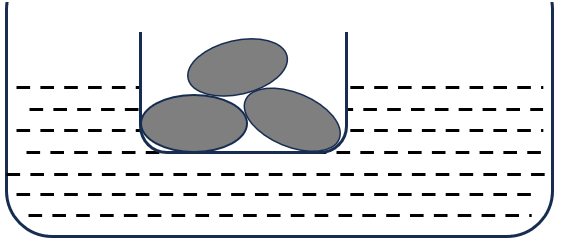

- **A**. 不变
- **B**. 上升
- **C**. 下降
- **D**. 无法判断

第 87 题 · 答案与解析

**参考答案（华图在线，2026-10-28 采集）**

C

**解析**

第一步，本题考查科学推理。
第二步，将空碗和土豆看作一个整体，碗和土豆都在共同浮在水面上，总浮力和总重力的关系是F（浮力碗）+F（浮土豆）=G（碗）+G（土豆）。当一只空碗在水面上漂浮，土豆沉在水底时，可由浮沉条件得出题目的总浮力与重力的关系：F（浮力碗）=G（碗），F（浮土豆）＜G（土豆），所以F（浮总）= F（浮力碗）+ F（浮土豆）＜G（碗）+G（土豆），根据浮力变小，利用阿基米德原理可判断排开水的体积减少，故水平面下降。
因此，选择C选项。

**来源**：2024年12月8日北京公务员考试《行测》（考生回忆版）第87题

## 第 88 题　qid 1072298

元素周期表是化学家的得力工具。共中，原子半径大小具有递变性的规律，比如：碳>氧、氮<砷。下表是元素周期表的一部分。下列关于原子半径的推断，一定正确的有：
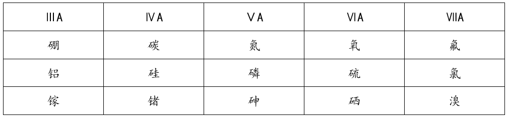
①硅<砷 ②铝<镓 ③硒>溴 ④磷<锗

- **A**. 1项
- **B**. 2项
- **C**. 3项
- **D**. 4项

第 88 题 · 答案与解析

**参考答案（华图在线，2026-10-28 采集）**

C

**解析**

第一步，本题考查科学推理。
第二步，根据题干，总结规律，同一行左边原子半径比右边大（电子层数相同，核电荷数越大，原子核对最外层电子的吸引力越强，半径减小），同一列上边原子半径比下边小（电子层数增加，半径增大），按规律，②铝<镓，③硒>溴，④磷<砷<锗，一定正确。①不能确定。
因此，选择C选项。

**来源**：2024年12月8日北京公务员考试《行测》（考生回忆版）第88题

## 第 89 题　qid 1072299

现有以下两个情景。下列选项正确的是：
情景一：分别在甲、乙两个房间同时用相同火力的燃气灶烧20度的水，结果相同时长后在甲房间产生的白气更多，则哪个房间的温度更高?（水壶、水量、水的沸点等变量均相同）
情景二：在同一个房间有丙、丁两台同品牌同型号的冰箱，打开冰箱门时发现丙冰箱周围的白气更少，则哪个冰箱的温度更低?

- **A**. 甲；丙
- **B**. 乙；丁
- **C**. 乙；丙
- **D**. 甲；丁

第 89 题 · 答案与解析

**参考答案（华图在线，2026-10-28 采集）**

B

**解析**

第一步，本题考查科学推理。
第二步，“白气”是水蒸气液化的小水滴，水蒸气液化的条件是降低温度。“白气”是由水蒸气遇冷液化形成的，温度越低，液化现象越明显；甲“白气”多，表明房间温度低；乙“白气”少，表明房间温度高。所以房间温度高的是乙房间，排除A、D选项。
第三步，打开冰箱门，冰箱内温度远远低于外界空气的温度，空中的水蒸气遇冷变成小水珠，飘散在空中，就是我们看到的“白气”，属于液化现象。丙冰箱的白气少，说明丙冰箱的温度和室温相差小。丁冰箱温差白气多，说明，丁冰箱温差大，所以丁冰箱温度更低，排除C选项。
因此，选择B选项。

**来源**：2024年12月8日北京公务员考试《行测》（考生回忆版）第89题

## 第 90 题　qid 1072300

在一个智能道闸系统中，当车辆靠近时，其闸门（简化为OMN模型）通过系统，使M点围绕O点进行匀速圆周运动。在整个运动过程中，M、N两点始终保持在同一高度。同时，OM段和MN段的杆长被设计成相同长度。在抬杆的过程中，下列说法正确的是：
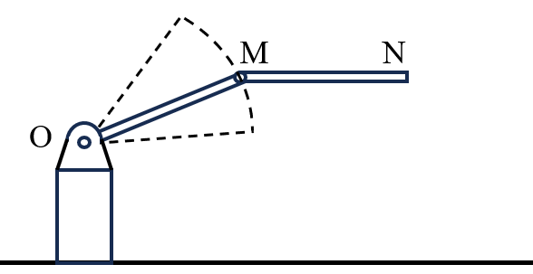

- **A**. M、N点的运动方向始终相同
- **B**. M、N点的速度大小始终不同
- **C**. N点在竖直方向的分运动是匀速运动
- **D**. N点在水平方向的分运动是匀速运动

第 90 题 · 答案与解析

**参考答案（华图在线，2026-10-28 采集）**

A

**解析**

第一步，本题考查科学推理。
第二步，M、N始终保持水平，是平移运动，所以M、N点的运动是完全一致的，A选项正确，B选项错误。N点与M点运动一致，所以分速度也相同，显然M点围绕O点做匀速圆周运动时，竖直与水平方向都不是匀速，C、D选项错误。
因此，选择A选项。

**来源**：2024年12月8日北京公务员考试《行测》（考生回忆版）第90题

## 第 91 题　qid 1072301

一条河流的河道平直，河道宽24米，河水深4米，流速3米/秒。现于河中拦腰修筑一座高5米的河坝，坝体的正视图和侧视图如下。修坝后，坝前水位上升，河水经坝顶流往坝后。假设坝前流量保持不变，则坝后的流速和水位情况最可能是：
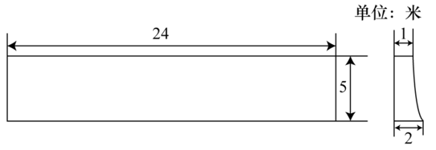

- **A**. 流速降低，水位升高
- **B**. 流速升高，水位升高
- **C**. 流速降低，水位降低
- **D**. 流速升高，水位降低

第 91 题 · 答案与解析

**参考答案（华图在线，2026-10-28 采集）**

D

**解析**

第一步，本题考查科学推理。
第二步，修坝后，坝前水位上升，且题目假设坝前流量保持不变，所以坝前的流速仍要保持3米/秒，坝顶水深仍为4米（否则流速减慢，水位要更高才能保持流速）。在这种情况下，水从高处流下，重力势能会转化为动能，流速会进一步提高，所以坝后的流速升高，相同的流量下，水位会降低。
因此，选择D选项。

**来源**：2024年12月8日北京公务员考试《行测》（考生回忆版）第91题

## 第 92 题　qid 1072302

小张十分热爱蹦极运动，下列选项符合他从跳台跳下到蹦极绳拉至最长时的感受的是

- **A**. 失重感先不变，后逐步减弱为超重感，并且超重感逐步增强
- **B**. 失重感先增加，后逐步减少，在拉至最长时失重感减至消失
- **C**. 失重感逐步增加，在拉至最长时到达极限
- **D**. 一开始便有超重感并且在拉直时到达极限，并在拉至最长时减至消失

第 92 题 · 答案与解析

**参考答案（华图在线，2026-10-28 采集）**

A

**解析**

第一步，本题考查科学推理。
第二步，从跳台跳下后，在弹性绳被拉直之前，只受重力作用，因此会处于完全失重状态，失重感保持不变‌。当弹性绳被拉直后，小张开始受到拉力的作用，但此时拉力小于重力，人仍然向下加速，不过加速度逐渐减小，失重感开始逐渐减弱‌。随着弹性拉力的增加，当拉力等于重力时，人的速度达到最大，此时既不失重也不超重‌。随后，拉力大于重力，人开始减速，此时会感受到超重，并且随着拉力的继续增大，超重感觉也会逐步增强，直到人停止下落，速度减为零，此时超重感达到最强‌。
因此，选择A选项。

**来源**：2024年12月8日北京公务员考试《行测》（考生回忆版）第92题

## 第 93 题　qid 1072303

氯碱工业的主要原料粗食盐中，除了含有难溶性杂质外，还含有钙离子、镁离子、硫酸根离子等可溶性杂质，现采用沉淀法除去粗食盐水中的钙离子、镁离子、硫酸根离子。下列试剂的选择正确的是：
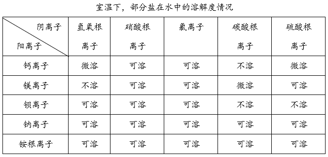

- **A**. 使用氢氧化钠除去镁离子
- **B**. 使用碳酸钡除去钙离子
- **C**. 使用氯化铵除去钙离子
- **D**. 使用硝酸钡除去硫酸根离子

第 93 题 · 答案与解析

**参考答案（华图在线，2026-10-28 采集）**

A

**解析**

第一步，本题考查科学推理。
第二步，A.镁离子可以与氢氧根离子反应生成难溶的氢氧化镁沉淀，同时粗食盐水中本来含有钠离子，没新增杂质，因此氢氧化钠是有效的除镁试剂，正确。
B.碳酸钙虽然沉淀，但碳酸钡本身不溶于水，无法与溶液中的钙离子充分反应，错误。
C.氯化钙可溶，无法发生沉淀反应，因此不能除去钙离子，错误。
D.虽然钡离子可以与硫酸根离子反应生成硫酸钡沉淀，但引入的硝酸根离子会成为新的杂质，不是合理选择，错误。
因此，选择A选项

**来源**：2024年12月8日北京公务员考试《行测》（考生回忆版）第93题

