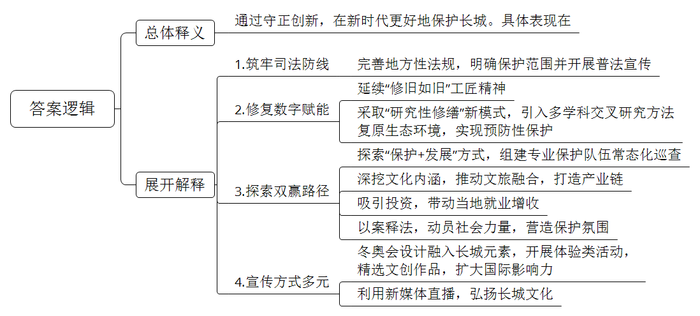
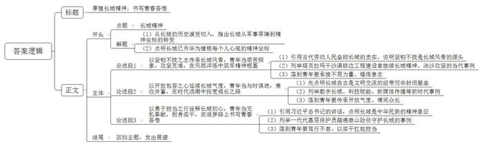

# 2026年北京市定向选调生考试《申论》题（网友回忆版）

<!-- gwy:overview:start -->
> **北京 · 2026 · 申论 · 选调生** ｜ 2 题 · 图片 2 处 · 答案随题折叠

导航：[题目](#题目) · [材料 1](#材料-1)
<!-- gwy:overview:end -->

> 候选采集稿。参考答案及解析来自粉笔页面，不代表官方答案或真实高分答卷；来源使用许可与原卷对应关系仍需人工核实。

## 给定材料

### 材料 1

长城，作为中华民族的代表性符号和中华文明的重要象征，于1987年被列入《世界文化遗产名录》。它不仅是一项举世闻名的伟大工程，更是中华民族坚韧不拔、充满创造力的精神象征。自古至今，长城的建设历程凝聚了无数古代劳动人民的血汗与智慧，其所承载的伟大“长城精神”，早已融入中华民族的血脉，成为我们不断前行的动力源泉。

长城的历史最早可追溯至春秋战国时期。当时，各诸侯国为防御北方游牧民族的侵扰，纷纷修筑城墙。这些早期的城墙虽规模不一、互不连贯，但已初步具备了防御功能。秦始皇统一六国后，为巩固边防，将原有各国的城墙连接起来，并加以扩建，形成了西起临洮、东至辽东的万里长城。此后，汉、北魏、北齐、隋、唐、宋、辽、金、明等朝代，都根据自身需要对长城进行了不同程度的修筑与完善。其中，明朝是最后一个大规模修筑长城的朝代，我们今天所看到的长城，大部分是明长城的遗迹。历经两千多年的风雨沧桑，见证了中国历史的兴衰更替。

根据不同地理条件，工匠们灵活选用建筑材料。在山区，就地开采碎石垒砌；在黄土高原，用黄土版筑夯成；在沙漠地带，以红柳条、芦苇与砂粒层层铺筑；在辽东地区，甚至以柞木构筑“木长城”。这种因材施用的做法，最大程度节约了人力物力。在黏合材料上，古人将糯米汁与石灰、细沙按比例混合，制成“糯米灰浆”。这种复合材料黏结力强、防水性好、耐久性佳，历经千年风雨依然坚固如初，体现了古代工匠对材料科学的深刻理解。面对石料运输的难题，工匠们巧妙运用斜坡和滚轴原理：先修建斜坡连接山上山下，以圆木为底座，将巨石置于其上，靠人推拉送至高处；对巨型石材，则架设杠杆逐级运送。此外，长城的设计还充分考虑了排水功能，在城墙适当位置预留排水孔，合理设定间距与倾斜角度，确保雨水及时排出，避免墙体侵蚀。正是这些看似细微却至关重要的巧思，使长城得以在千百年风雨中巍然屹立。

“长城精神”不仅体现在古代劳动人民的建设过程中，也贯穿于长城自古至今的历史传承之中。在历史上，长城曾多次成为抵御外敌入侵的重要防线，为保卫国家的安全和人民的幸福作出了巨大贡献。在近代，长城又成为了中华民族团结抗战、抵御外敌的精神象征。在和平年代，长城则成为了中华民族的文化瑰宝和旅游胜地，吸引着无数中外游客前来参观游览。无论时代如何变迁，这种坚韧不屈、自强不息的“长城精神”始终激励着中华民族不断前进。

### 材料 2

保护是传承利用的前提，更是对历史和未来负责的必然要求。2024年5月14日，习近平总书记给北京市延庆区八达岭镇石峡村的乡亲们的回信中强调，长城是中华民族的代表性符号和中华文明的重要象征，保护好、传承好这一历史文化遗产，是我们共同的责任。同时，勉励基层工作者“希望大家接续努力、久久为功，像守护家园一样守护好长城”。

2021年，国家文化公园建设工作领导小组发布《长城国家文化公园建设保护规划》，旨在整合长城沿线15个省区市的文物和文化资源，形成“核心点段支撑、线性廊道牵引、区域连片整合、形象整体展示”的总体空间格局。规划明确“保护的对象，除了长城本体，还应包括其周边的自然赋存环境、沿线村镇、相关文物，以及非物质文化遗产等”。

面对长城保护面临地域管辖分散、案件类型复杂、破坏行为屡禁不止的严峻挑战，各地首先将长城保护写入地方性法规，筑牢法治根基。同时，广泛开展宣传。长城沿线法院、检察院、文物部门联合开展“送法进乡村”“以案释法”等活动，通过设立普法驿站、发放宣传册、设置法律咨询点、发布典型案例等方式，向长城周边居民和游客普及文物保护法律法规，明确告知刻画污损、非法攀爬、取土取砖等行为的法律后果，使“保护长城、人人有责”的法治观念深入人心。河北省秦皇岛市山海关区人民法院于2022年6月设立全国首家长城文化保护人民法庭，集中管辖全市涉长城案件，构建“立审执”一体化与“三审合一”机制，实现了对长城文化资源的统一司法保护；北京市延庆区人民法院与河北省怀来县人民法院针对九类跨区域破坏行为，联合发布长城司法保护令，划定法治红线，建立跨域协作机制，推动保护从“末端惩处”向“源头防控”延伸。对拒不履行处罚决定的违法行为，法院依法启动行政非诉执行，确保处罚落地见效；京津冀三地法院通过建立协同机制，形成“司法+行政+社会”保护大格局，有效遏制了破坏长城本体及周边环境的不法行为。各地一系列司法创新推进司法保护进入新阶段，为守护中华民族的文化瑰宝筑牢了司法防线。

我国不仅为长城保护提供了坚实的政策保障和资源支持，更在新时代背景下赋予了长城新的文化内涵与时代价值，使其成为凝聚民族精神、展示中华文明的重要窗口。

### 材料 3

长城，在岁月的侵蚀下，逐渐出现破损，修缮工作迫在眉睫。然而，长城修缮并非简单的修复，随着科技手段的深度介入和文物保护理念的持续革新，长城修缮不仅延续了“修旧如旧”的工匠精神，更在数字化、智能化的驱动下，迈入科学化、系统化的新阶段。

箭扣长城五期保护修缮项目的工程，启动即引入考古发掘环节，坚持“先考古后动土”，由考古人员对修缮区域进行系统清理与发掘，精准掌握长城原始建筑结构、病害根源及历史信息。这种“慢慢修长城，边修边研究”的新模式，实现了考古与施工的无缝衔接，有效降低了因土层剥离打破原有稳定平衡而引发的二次坍塌风险，确保了工程遵循“最小干预”“科学保护”“原状保护”原则，最大程度保留了长城的历史真实性与建筑完整性。在这一过程中，年轻的考古工作者成为推动“研究性修缮”的中坚力量。他们引入植物、动物、材料、金属、环境等多学科交叉研究方法，对出土文物如石碑、种子、石雷等进行科技考古分析，复原当时长城周边的生态环境。

在修缮技术方面，数字化手段的应用成为一大亮点。无人机、传感器、卫星航拍等技术被广泛运用，通过对长城进行数字化扫描，获取其精确的三维数据；机器人巡逻也已在重点段落常态化运行，能够自动识别墙体裂缝、植被侵入等险情，并实时整理巡检报告。这些数据不仅为还原长城重要文物史料、高水平文物修缮保护提供了更全面科学的参考依据，还能实时监测长城的保存状况，及时发现潜在问题。借助数字化手段，长城的保护方式正逐步从抢救性保护转向预防性保护，保护效率得到极大提升，也为未来的文化遗产保护工作树立了新的标杆。正如一线修缮专家所言，“像绣花一样修长城”，一砖一瓦的修复背后，是大数据、人工智能与传统工艺的深度融合。

长城修缮理念从传统的抢险加固到“最小干预”，再到多学科参与、数字化保护，每一次转变都是对历史的敬畏与对未来的探索。这不仅是一次物质文化遗产的修复之旅，更是一场文化传承与创新的实践。

### 材料 4

延庆区八达岭镇石峡村，清晨7点，梅兰芬像往常一样，沿着多年巡查踏出的羊肠小道，往山上的石峡关长城走去。过节也不休息？梅兰芬摆摆手，“过节和平日一样，每天得瞧瞧这些宝贝好不好，心里才踏实。”梅兰芬今年46岁，是村里的第二代长城守护者。40多年前，梅兰芬的父亲梅景田就自愿上山巡长城、捡垃圾，发起成立了一支长城志愿保护队，如今守护长城的接力棒，传到了像梅兰芬一样的青年群体手中，他们用脚步丈量责任，用坚守诠释担当。

石峡关长城，坐落在举世闻名的八达岭长城西南，历史上也是著名的军事要塞。长城怀抱着村，村依偎着长城，村民们祖祖辈辈对长城有着特殊的感情。在守护长城的同时，村民们也积极探索“保护+发展”的双赢路径。青年志愿者保护队主动作为，深挖长城文化内涵，推动文旅融合，打造“长城人家”品牌。通过创新非遗菜、研发特色菜品、培育精品民宿等，将长城文化元素融入餐饮、住宿、体验各环节，形成独具魅力的乡村旅游产业链。来自江西的一家人在“长城人家”民宿体验中感慨：“不仅看到了壮美长城，更吃到了有故事的饭菜，感受到了原汁原味的长城文化。”

企业家贺女士正是被石峡村丰富的长城资源和淳朴的民风所吸引，毅然前来投资创业。她租下12个院落，精心打造“石光长城”民宿品牌，将传统建筑风貌与现代居住体验巧妙融合，成为远近闻名的文旅标杆。在她的带动下，村里陆续建起酒坊、咖啡厅、文创空间等，30位村民实现就地就业。石峡村党支部李书记激动地说：“村子每年接待游客超过4万人次，全村人均收入突破4.5万元。”围绕八达岭、石峡关、水关等长城，岔道村、石佛寺村、里炮村等八达岭镇多个村庄开起精品民宿，数量成百上千，形式百花齐放，为当地村民带来了实实在在的收入增长。

“法律明白人”刘红岩，通过“以案说法”的方式，向村民和游客普及长城保护法律知识。刘红岩是石峡村的村民，也是长城保护员，他每天巡山时都会随身携带《长城保护条例》宣传册，遇到游客有不文明行为时，他会及时制止并结合案例讲解，让游客深刻认识到严重后果。在刘红岩的带动下，石峡村形成了“人人都是保护员”的良好氛围，村民自发组建了“长城护砖队”，定期对长城周边的散失城砖进行收集和保护。

这不仅是发展理念的升华，更是实践路径的指引。长城保护意识已深入人心，不仅有专业保护员的常态化巡查，更有越来越多社会力量投身长城文化传承与利用。<u>在守正中实现创造性转化与创新性发展，推动长城保护迈入提质的新阶段。</u>唯有以守正筑牢根基、以创新注入活力，方能让万里长城在新时代绽放更加璀璨的文化光芒。

### 材料 5

新时期，长城被赋予了新的内涵。它不仅是横亘于中华大地的巍峨建筑、凝聚民族精神的文化图腾，更化作一道绵延万里的“绿色长城”。2024年4月3日，习近平总书记在参加首都义务植树活动时深刻指出：“三北地区是国土绿化的主战场，要把更多力量集中到‘三北’工程建设上来，筑牢北疆绿色长城。”

近半个世纪以来，三北地区广大干部职工和人民群众坚持不懈防沙治沙，涌现出王有德、石光银、八步沙“六老汉”等造林治沙英雄，培育了塞罕坝、右玉、库布其等生态治理典型，孕育形成了艰苦奋斗、无私奉献、锲而不舍、久久为功的“三北精神”。几代人筚路蓝缕、接续奋斗，不仅为祖国北疆筑起了万里绿色屏障，更铸就了一座座精神丰碑，诠释着中华民族的高尚品格。

与此同时，在遥远的南极冰原上，也矗立着一座以“长城”命名的科考站。1985年2月20日，中国第一个南极科学考察站——中国南极长城站，在乔治王岛举行落成典礼，五星红旗在南极上空高高飘扬。南极冰原上，考察队员克服了发电、取暖、照明、交通等各种难以想象的困难，在冰天雪地中实现了“当年建站、当年越冬”的壮举，创造了各国在南极建站的最快速度。长城站的建成，填补了我国科学发展的一项空白，标志着我国成为能够开展完整南极活动的国家，为我国和平利用南极奠定了坚实基础。此后，一代代极地工作者继续奔赴南极，在极端自然环境中接续奋斗，推动我国极地事业从无到有、由弱到强。在长城站的建设历程中，考察队员们远离故土、不畏艰险，用汗水、泪水甚至热血建起这座南极丰碑，彰显了科学家持续探索自然奥秘、勇攀科学高峰的不屈意志，更向世界宣告了“中国人民有志气、有能力为人类发展作出卓越贡献”。

长城精神已深深融入民族血脉，成为推动国家发展、民族复兴的强大精神动力。它激励着我们在生态文明建设中保持战略定力，在科技创新征程中勇攀高峰。无论时代如何变迁，这种坚韧不拔、艰苦探索的精神，始终是我们攻坚克难、从胜利走向胜利的宝贵财富。

### 材料 6

当奥林匹克的圣火再次照亮北京的夜空，长城这一中华民族的文化图腾，与冰雪盛会交相辉映，共同谱写了文明交流互鉴的华彩乐章。“吃饺子，过大年，长城内外看冬奥”，这是2015年中国申办冬奥会时的美好愿景。2022年，这一愿景终于变成现实。

冬奥会开幕式上，长城影像多次闪现；张家口赛区“坡面障碍技巧”场地被巧妙设计成“雪长城”，赛道蜿蜒如城墙连绵；赛场内外，城楼与烽火台元素随处可见。在崇礼赛区，紧邻场馆的6公里长城本体及7座烽火台实施了亮化工程，夜色中勾勒出一道蜿蜒闪耀的金色轮廓。长城不再是沉默的遗迹，而是成为赛场最生动的背景。多国运动员在长城自拍的影像走红海外，美国运动员安娜·霍夫曼惊叹：“紧挨着长城比赛，真不可思议！”冬奥会期间，八达岭长城迎来32家中外媒体的63名记者，他们登长城、赏民俗，亲身感受中国文化魅力。更为重要的是，长城作为和平与交流的象征，其“构建和平秩序”的深层内涵与奥林匹克精神高度契合。

延庆区从2000余种“长城礼物”中精选632种文创产品，走进冬奥村、冬奥酒店等24个点位。“明小兵”长城滑雪版笔筒被赠送给乌拉圭驻华使馆副馆长和尼泊尔驻华使馆二等秘书，两人爱不释手。长城礼物不仅是友情的纪念，更成为情谊的见证，让中华文化在方寸之间走向世界。

在弘扬长城文化的过程中，年轻人正成为一股不可忽视的力量。“大家好，欢迎进入‘每日司马台’的直播间……现在，美景就在我们眼前。”太阳西斜，一点点迫近远方绵延的山峦，焕发出柔美的红色，“周小帅”举着手机，正在司马台长城“顶峰”直播这场震撼的日落，粉丝们纷纷点赞。巡查长城是他每天的工作，而直播长城是他最大的乐趣。“周小帅”本名周文军，是司马台段长城保护员，住在长城脚下的密云新城子村，拥有7万多粉丝。他每天“追着太阳”走，在日出、日落时开直播。这个“五一”，司马台长城成了热门打卡地，周文军每天至少直播一场，和粉丝们“不见不散”。2023年3月，他第一次将手机摄像头对准自己。他坦言，做保护员多年，对长城文化兴趣很大，看到“邻居”金山岭长城的保护员做直播，深受启发：“他们能做好，我也行，咱北京的长城也得好好宣传！”最初不懂就查资料、请教专家，两年多下来讲解越来越专业。周文军说：“一代人有一代人的长城，新时代长城的内涵已经发生变化，年轻人要树立自己内心的长城，走好这一代的征程。”在周文军的带动下，包括蔡瑞宏、李凯力等一同巡长城的10多名保护员也开始录视频，保持每周两次的更新频率。他们都有一个共同的梦想，就是为家乡引流带客，为弘扬长城文化尽一份力。

## 题目

### 第 1 题

**给定资料4中提到：“在守正中实现创造性转化与创新性发展，推动长城保护迈入提质的新阶段。”请结合资料，谈谈你对这句话的理解。（15分）**

关联材料：材料 1、材料 2、材料 3、材料 4、材料 5、材料 6

作答要求：

要求：要点全面，分析深入，条理清晰，语言简明，不超过300字。

第 1 题 · 答案与解析

**参考答案（粉笔题库参考内容）**

通过守正创新，在新时代更好地保护长城。具体表现在：1.筑牢司法防线。完善地方性法规，明确保护范围并开展普法宣传。2.修复数字赋能。延续“修旧如旧”工匠精神。采取“研究性修缮”新模式，引入多学科交叉研究方法复原生态环境，实现预防性保护。3.探索双赢路径。探索“保护+发展”方式，组建专业保护队伍常态化巡查；深挖文化内涵，推动文旅融合，打造产业链；吸引投资，带动当地就业增收；以案释法，动员社会力量，营造保护氛围。4.宣传方式多元。冬奥会设计融入长城元素，开展体验类活动，精选文创作品，扩大国际影响力；利用新媒体直播，弘扬长城文化。

**解析**

**参考答案说明：**（1）思路方面，本参考答案按照词句解释题“总体释义+展开解释+总结”的一般答题思路展开，其中总结部分酌情省略。（2）内容方面，本参考答案先对划线句子进行了总体释义，再从“筑牢司法防线”“修复数字赋能”“探索双赢路径”“宣传方式多元”这四个方面展开解释。（3）词句表达方面，本参考答案加上了“具体表现在”等连接词来承接上下文，使答案更加顺畅。

### 第 2 题

**给定资料6中划线句子提到：“一代人有一代人的长城，新时代长城的内涵已经发生变化，年轻人要树立自己内心的长城，走好这一代的征程。”请你对这句话进行深入思考，参考给定资料，联系实际，自选角度，自拟题目，写一篇文章。（35分）**

关联材料：材料 1、材料 2、材料 3、材料 4、材料 5、材料 6

作答要求：

要求：观点鲜明，见解深刻，逻辑严密，800-1000字。

第 2 题 · 答案与解析

**参考答案（粉笔题库参考内容）**

**厚植长城精神，书写青春答卷**

从秦筑长城到明修边墙，两千多年来，长城横亘山河，是抵御外侮的军事屏障，更是划定疆域的地理界标。然而时代变迁，长城早已超越砖石本身，化作植根在每个人心底的精神坐标。人人心中都矗立着一座长城，新征程上，青年一代当筑牢心中长城，秉持坚韧不拔之志、开放包容之怀、勇担时代之责，在实干之中赓续长城精神。

**以坚韧不拔之志传承长城风骨，青年当艰苦探索，攻坚克难，在风雨淬炼中筑牢精神根基。**古代劳动人民于崇山峻岭间垒砌长城，在悬崖戈壁上搬石夯土，以血汗筑起绵延万里的城垣，这份不畏艰难、百折不挠的毅力，正是长城风骨的源头。放眼当代，塔克拉玛干沙漠锁边工程建设者接续长城精神，面对漫天黄沙、极端干旱的恶劣环境，一代代治沙人扎根大漠，历经数十年攻坚，建成三千多公里环沙漠绿色屏障，实现锁边合龙。新征程上，青年更要承接这份不屈的力量，直面学习、工作中的重重考验，在磨砺坚守中锤炼意志，筑起心中的精神长城。

**以开放包容之心延续长城气度，青年当与时俱进，兼收并蓄，在时代浪潮中拓宽成长之路。**长城自古并非封闭壁垒，而是文明交流的纽带。岁月流转，长城的开放品格跨越古今，在新时代焕发生机。如今，数字长城借助三维扫描技术复原古关风貌，科技赋能让长城突破传统修缮模式，长城文化展演依托新媒体平台走向世界。古老长城拥抱科技、融汇时尚，在交流互鉴中讲述中国故事。文明因交流而多彩，因互鉴而丰富。新时代青年当传承这份开放气度，博采众长、兼收并蓄，怀揣文化自信，在文明互鉴中练就开阔视野。

**以勇于担当之行诠释长城初心，青年当无私奉献，躬身实干，在追梦路上书写青春答卷。**习近平总书记强调，长城是中华民族的精神象征，要做好长城文化价值发掘和文物遗产传承保护工作。在长城沿线，一代代基层保护员踏遍崇山险径，日复一日巡护墙体、排查隐患，以平凡坚守守护古老遗存。这份守护，正是新时代对长城担当精神的生动践行。勇担时代责任，从来不是响亮的口号，而是一步一个脚印的笃行。新时代青年当笃行不怠，以实干践行使命，扛起属于这一代人的担当。

长城巍巍，精神永续。青年当承长城风骨，怀坚韧、持包容、勇担当，把长城精神化为前行动力，筑就永不坍塌的精神长城。

**解析**

**文章分析**

**厚植长城精神，书写青春答卷**

**【标题的优点：**首先，范文的标题突出了“长城精神”这一主题，“厚植长城精神”点明了文章的核心——传承弘扬长城精神，“书写青春答卷”点明了写作主体——新时代青年，两者结合精准概括了文章内容。其次，形式上，采用对偶句式，文字简洁明快、朗朗上口。】

（1）<u>从秦筑长城到明修边墙，两千多年来</u>，<u>长城横亘山河</u>，<u>是抵御外侮的军事屏障</u>，<u>更是划定疆域的地理界标</u>。（2）然而时代变迁，<u>长城早已超越砖石本身，化作植根在每个人心底的精神坐标</u>。（3）<u>人人心中都矗立着一座长城</u>，新征程上，<u>青年一代当筑牢心中长城</u>，秉持坚韧不拔之志、开放包容之怀、勇担时代之责，在实干之中赓续长城精神。

**【开头的优点：**★内容方面：（1）从长城的历史演变切入，指出长城从军事屏障到精神坐标的转变；（2）点明长城已升华为植根每个人心底的精神坐标；（3）引出“青年一代筑牢心中长城、赓续长城精神”的核心观点，并总起坚韧不拔、开放包容、勇担时代之责三个分论点。★文字表达方面：使用了“是……更是……”“早已超越……化作……”等句式，使语言表达有层次感、逻辑清晰。】

**以坚韧不拔之志传承长城风骨，青年当艰苦探索，攻坚克难，在风雨淬炼中筑牢精神根基。**（1）古代劳动人民于崇山峻岭间垒砌长城，在悬崖戈壁上搬石夯土，以血汗筑起绵延万里的城垣，这份不畏艰难、百折不挠的毅力，正是长城风骨的源头。（2）放眼当代，<u>塔克拉玛干沙漠锁边工程建设者接续长城精神</u>，面对漫天黄沙、极端干旱的恶劣环境，一代代治沙人扎根大漠，历经数十年攻坚，建成三千多公里环沙漠绿色屏障，实现锁边合龙。（3）新征程上，<u>青年更要承接这份不屈的力量</u>，直面学习、工作中的重重考验，在磨砺坚守中锤炼意志，筑起心中的精神长城。

**【论述段1的优点：**★观点句：范文的观点句是紧扣“长城精神”这一文章主题提出的。形式上，它在段首处直接写出，位置突出，容易发现。内容上，关键词突出，内容要点明确，可以明显看出是从“坚韧不拔、攻坚克难”这个角度入手论述青年如何传承长城风骨。★论述内容：（1）引用古代劳动人民垒砌长城的史实，说明坚韧不拔是长城风骨的源头；（2）列举塔克拉玛干沙漠锁边工程建设者接续长城精神、治沙攻坚的当代事例；（3）落到青年要承接不屈力量、锤炼意志。注意：以上三个方面的内容都是紧扣“以坚韧不拔之志传承长城风骨”这个观点句进行分析论述的，论述的针对性强，内容层次丰富。最后，在论述方法上主要采用了讲道理和举例子相结合的方式，从古代到当代层层递进，论述有力。】

**以开放包容之心延续长城气度，青年当与时俱进，兼收并蓄，在时代浪潮中拓宽成长之路。**（1）<u>长城自古并非封闭壁垒，而是文明交流的纽带</u>。（2）岁月流转，长城的开放品格跨越古今，在新时代焕发生机。如今，数字长城借助三维扫描技术复原古关风貌，科技赋能让长城突破传统修缮模式，长城文化展演依托新媒体平台走向世界。（3）古老长城拥抱科技、融汇时尚，在交流互鉴中讲述中国故事。<u>文明因交流而多彩，因互鉴而丰富</u>。新时代青年当传承这份开放气度，博采众长、兼收并蓄，怀揣文化自信，在文明互鉴中练就开阔视野。

**【论述段2的优点：**★观点句：范文的观点句是紧扣“长城精神”这一文章主题提出的。形式上，它在段首处直接写出，位置突出，容易发现。内容上，关键词突出，内容要点明确，可以明显看出是从“开放包容、与时俱进”这个角度入手论述青年如何延续长城气度。★论述内容：（1）先点明长城自古是文明交流的纽带而非封闭壁垒；（2）列举数字长城、科技赋能、新媒体传播等新时代事例；（3）落到青年要传承开放气度、博采众长。注意：以上三个方面的内容都是紧扣“以开放包容之心延续长城气度”这个观点句进行分析论述的，论述的针对性强，内容层次丰富。最后，在论述方法上主要采用了讲道理和举例子相结合的方式，论述丰富多样。】

**以勇于担当之行诠释长城初心，青年当无私奉献，躬身实干，在追梦路上书写青春答卷。**（1）习近平总书记强调，长城是中华民族的精神象征，要做好长城文化价值发掘和文物遗产传承保护工作。（2）在长城沿线，一代代基层保护员踏遍崇山险径，日复一日巡护墙体、排查隐患，以平凡坚守守护古老遗存。（3）这份守护，正是新时代对长城担当精神的生动践行。<u>勇担时代责任，从来不是响亮的口号，而是一步一个脚印的笃行</u>。新时代青年当笃行不怠，以实干践行使命，扛起属于这一代人的担当。

**【论述段3的优点：**★观点句：范文的观点句是紧扣“长城精神”这一文章主题提出的。形式上，它在段首处直接写出，位置突出，容易发现。内容上，关键词突出，内容要点明确，可以明显看出是从“勇于担当、躬身实干”这个角度入手论述青年如何诠释长城初心。★论述内容：（1）引用习近平总书记的讲话，点明长城是中华民族的精神象征；（2）列举一代代基层保护员踏遍崇山险径守护长城的事例；（3）落到青年要笃行不怠、以实干扛起担当。注意：以上三个方面的内容都是紧扣“以勇于担当之行诠释长城初心”这个观点句进行分析论述的，论述的针对性强，内容层次丰富。最后，在论述方法上主要采用了讲道理和举例子相结合的方式，论述有力。】

**【论述段之间的关系：**★内容的内在逻辑：范文的论述段之间是依照“精神根基—成长路径—价值担当”的逻辑展开的。论述段1先写了“以坚韧不拔之志传承长城风骨”，论述段2接着写了“以开放包容之心延续长城气度”，论述段3最后写了“以勇于担当之行诠释长城初心”。这三个论述段分别按照“坚韧不拔”“开放包容”“勇于担当”展开，相互并列、层层递进，逻辑清晰。】

长城巍巍，精神永续。<u>青年当承长城风骨，怀坚韧、持包容、勇担当</u>，把长城精神化为前行动力，筑就永不坍塌的精神长城。

**【结尾的优点：**范文的结尾回扣了“长城精神”这个主题，用“长城巍巍，精神永续”呼应开头，并以“怀坚韧、持包容、勇担当”总结三个分论点，最后落到“筑就永不坍塌的精神长城”，进行了总结提升。】

