# 2026 北京市公务员录用考试 行测（网友回忆版残卷）

> **收录边界：** 仅取得67道有完整题干、选项或原图的原号回忆题，不是完整真题卷。未收录的原号不以占位题补齐，资料分析只剩主题和数值速记，未当成题目。两篇阅读、α定义及9种操作符图例由配套解析PDF的题前黑字恢复。

> **来源与校勘：** 用户提供[公开分享](https://pan.quark.cn/s/c247e6f348cb)内扫描题本15页、配套解析45页，页脚均为“公众号你注定会上岸整理分享”。作者及原解题机构未署名；不是官方答案或已认证高分答卷。除第1题另作AI示范解析外，其余66题逐号保留来源答案及完整解析原图；补充验算明确另标AI。原稿中的遮字、错别字、姓名混用及不严密表述不擅自改写成所谓原题。第26题源选项与解析冲突，已单独提示。

| 用户原文件 | SHA-256 |
|---|---|
| 2026年北京公务员考试《行测》真题（网友回忆版）.pdf | `480edc71d66655abae4c77187c70cc2b2459b5550d05fad9ee0` |
| 2026年北京公务员考试《行测》答案及解析（网友回忆版）.pdf | `9787d5cdb9818716e5f6f4da101e27aa7d7e043be2cc621a36a9209f9477e63b` |

未取得题号（仅1—118范围）：2、3、4、5、6、7、8、9、10、11、12、13、14、15、16、17、18、22、31、34、35、36、37、38、39、40、41、42、43、44、89、90、96、97、98、99、100、101、102、103、104、105、106、107、108、109、110、112、114、115、117。题本章节还含“2道：十五五……”等速记，未据此编造题干。

## 第 1 题

****指出，科技兴则民族兴，科技强则国家强。中国式现代化要靠科技现代化作支撑，实现高质量发展要靠科技创新培育新动能。下列有关表述错误的是：

- **A**. 国家最高科学技术奖是中国科技界的最高荣誉，不分等级
- **B**. D的十八大以来，D中Y坚持把科技创新摆在国家发展全局的核心位置
- **C**. D的十一届三中全会首次作出科学技术是生产力的重要论断
- **D**. 中国科学院、中国工程院是国家科学技术界和工程科技界的最高学术机构

原题扫描核对

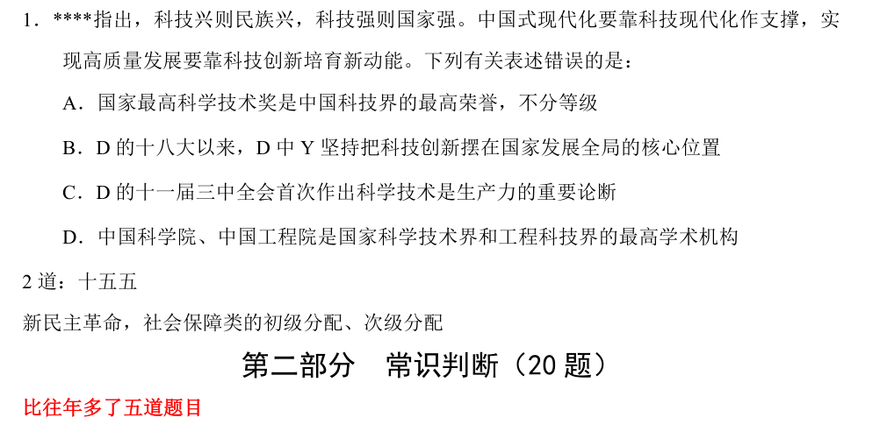

---

## 第 19 题

以下情况可以申请行政复议的是：

- **A**. 公务员年度考核不称职，被降级
- **B**. 宿舍分配方案不满意
- **C**. 企业排污超标被吊销执照
- **D**. 物业费涨价不满意，未得到回复

原题扫描核对

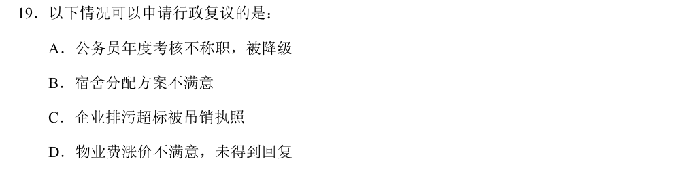

---

## 第 20 题

以下对公务员处分的说法错误的是？

- **A**. 张某醉酒驾驶犯危险驾驶罪开除公职
- **B**. 刘某在公务员部门任职并且在最低服务期限内，不可离职
- **C**. 王某为H县县长，任职期间妻子不能任职于H县审计局局长
- **D**. 丁某在公务员任职期间受到警告处分，不能晋升及薪资调档

原题扫描核对

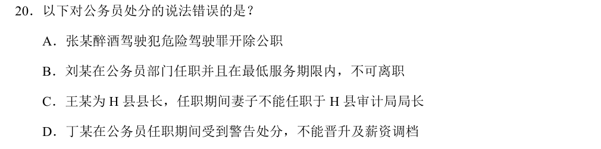

---

## 第 21 题

王某为某大学校友，为了支持母校，签署了慈善协议，以下说法不正确的是：

- **A**. 王某可以将自己的股份捐赠于学校
- **B**. 该慈善协议未在公共平台公示，若后续违反慈善法王某未履行慈善义务，校方可以要求交付
- **C**. 王某公司出现经济问题，严重影响经营情况，经过部门的核查和对外公示后，可以不履行捐赠义务
- **D**. 在履行捐赠后，王某可以复制和查阅捐献资产的使用情况

原题扫描核对

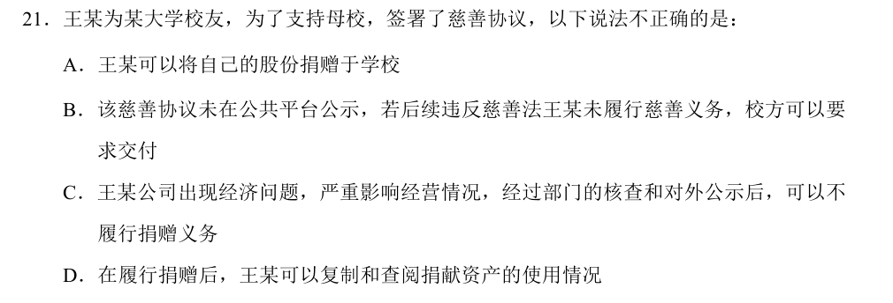

---

## 第 23 题

李大爷家庭条件不好，平时会收废弃家具，捡废弃纸壳摆放至小区楼道内，邻居多次沟通未果，向社区投诉，社区工作者小刘负责，跟大爷沟通后大爷由于家庭条件不好，拒绝配合，以下最先需要做的事项是：

- **A**. 根据消防法的规定，下发整改通知书，责令立刻整改
- **B**. 等待大爷经济情况好转后，再清理杂物
- **C**. 通知物业和警方，科普消防法，协助出整改方案
- **D**. 联系社区，派出志愿者协助清理和变卖，钱给大爷

原题扫描核对

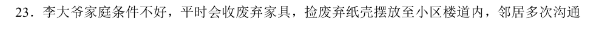

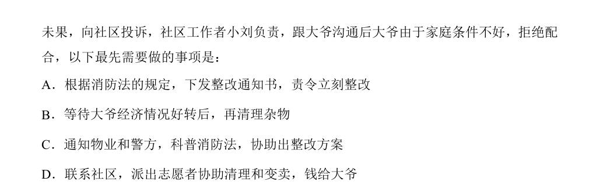

---

## 第 24 题

游泳过程中的物理现象，下列说法错误的是？

- **A**. 人体能感受到水的压强，随深度加深而变大
- **B**. 仰头出水时能改变浮力
- **C**. 人将肌肉中的化学能转化为机械能，驱动人在水中前进
- **D**. 站在岸边看水很浅，是因为水的反射

原题扫描核对

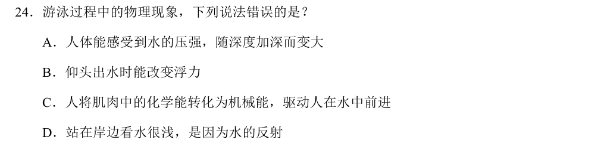

---

## 第 25 题

关于细胞，下列说法正确的是

- **A**. 体细胞分裂后，生成的细胞遗传物质是之前的一半
- **B**. 生物生长是因为细胞体积变大或数量变多
- **C**. 细胞膜是植物细胞独有的，动物细胞不具备
- **D**. 切水果流出的液体是水果细胞的液泡

原题扫描核对

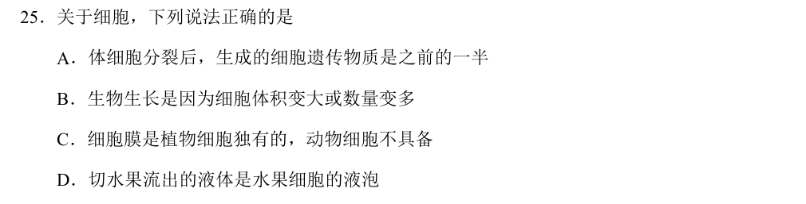

---

## 第 26 题

以下说法正确的是：

- **A**. 硫是植物光合作用的重要部分
- **B**. 氮氨磷是肥料的重要部分
- **C**. 硅便宜，导热性强，是半导体的重要材料
- **D**. 氯没有毒，可以做消毒和过滤水的材料

原题扫描核对

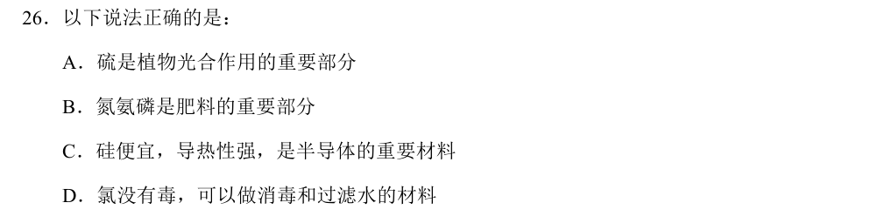

> **源文争议：** 原题B项确印“氮氨磷”，来源解析却按常见肥料三要素“氮、磷、钾”解释并选B。这里保留源题和源答案，不把错字静默改成真题，也不能凭现有文本认证B为唯一正确项。

---

## 第 27 题

关于计算机硬件的组成，错误的是：

- **A**. 内存用于电脑的存储和记录功能，内存断电也可以存储
- **B**. 显卡主要负责图像处理与显示输出
- **C**. 固态硬盘读写速度高于机械硬盘
- **D**. CPU散热器由散热材料和风扇组成，主要功能是给电脑降温避免烧坏

原题扫描核对

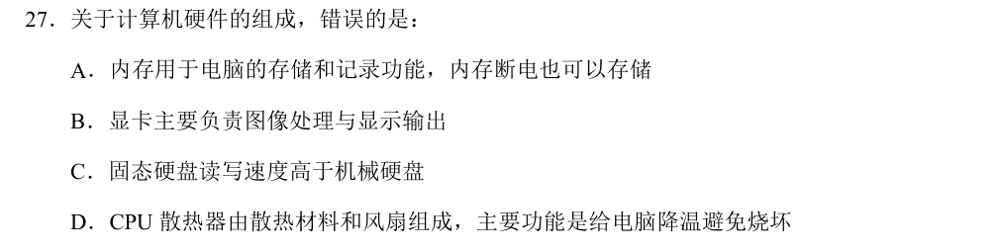

---

## 第 28 题

关于火山的描述，错误的是：

- **A**. 火山活动以地震和气体溢出为先兆
- **B**. 火山喷发的岩浆来自于软流层
- **C**. 火山喷发受地热内部作用和外部作用
- **D**. 火山可以分为活火山、死火山、休眠火山

原题扫描核对

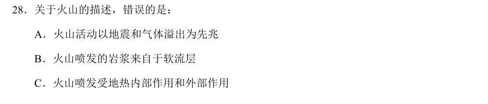

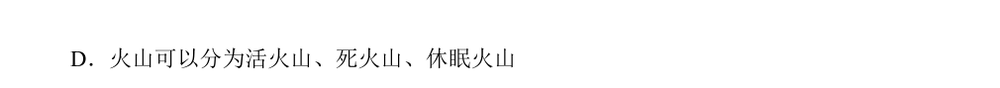

---

## 第 29 题

蚊子的速度小于车速，但是蚊子在车内却可以正常飞行，以下说法正确的是：

- **A**. 蚊子体积小，惯性小，可以随时换方向
- **B**. 在汽车里，相对静止
- **C**. 在车内可以抵消惯性
- **D**. 蚊子反应速度快

原题扫描核对

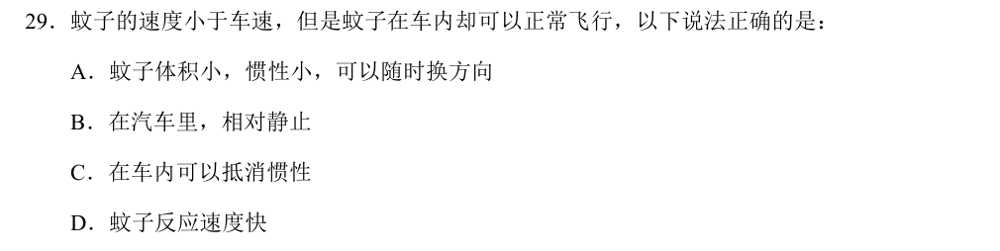

---

## 第 30 题

载人飞船的返回舱表面会出现“烧焦”痕迹的原因是？

- **A**. 离子反冲
- **B**. 大气层气流摩擦
- **C**. 太阳能光电效应
- **D**. 真空环境辐射

原题扫描核对

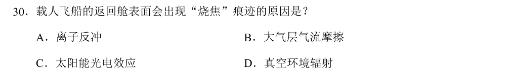

---

## 第 32 题

下列哪个选项不属于魏晋南北朝时期的历史剧：

- **A**. 兰亭集序
- **B**. 蜀锦
- **C**. 三国故事绘本
- **D**. 活字印刷术的书籍

原题扫描核对

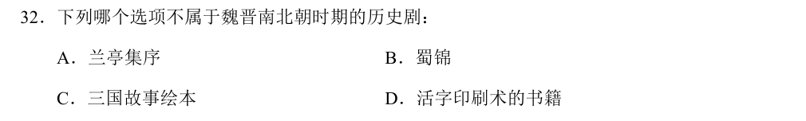

---

## 第 33 题

“居庸叠翠”位于：

- **A**. 怀柔区
- **B**. 密云区
- **C**. 昌平区
- **D**. 延庆区

原题扫描核对

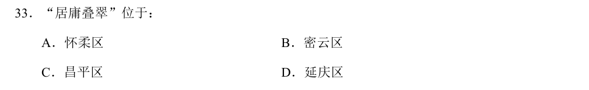

---

## 第 45 题

小尺度溯源技术，作为一种环境监测方法，致力于通过详细分析环境样本中的微观成分，实现污染源的精准定位和路径追踪。该技术通常涉及多种分析技术，包括质谱分析、色谱分析和同位素标记等。该技术依赖精细的数据处理算法，能够在空间上构建高分辨率的污染物分布图，在时间上追踪污染物的动态变化。这段文字主要介绍了小尺度溯源技术的：

- **A**. 发展历程
- **B**. 优势不足
- **C**. 机制原理
- **D**. 发展趋势

原题扫描核对

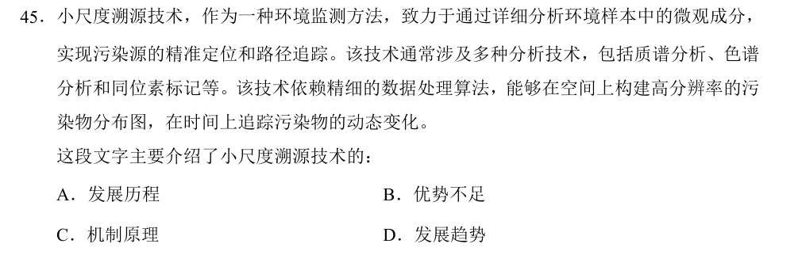

---

## 材料 1（第46—50题）

材料一打造韧性城市是实现人民城市可持续发展的重要目标。韧性城市强调城市在面对自然和社会外在冲击时保持抗压、存续、适应和保障城市生命线的能力，要在面临自然和社会外在冲击时“打不垮”“恢复快”。韧性城市建设是一个系统性工程，涉及发展与安全的方方面面。随着城市系统的日益扩大，城市发展在取得繁荣成就的同时，也涌现出一系列问题，迫切要求城市韧性不断提升。

习近平总书记强调，“________”。实施城市更新行动中，打造韧性城市是重要内容。《中共中央办公厅国务院办公厅关于推进新型城市基础设施建设打造韧性城市的意见》指出，要“持续提升城市设施韧性、管理韧性、空间韧性，推动城市安全发展”，为深化城市安全韧性提升行动提出了总体要求和重点任务。

材料二建设坚强韧性城市生命线。科学确定韧性规划设计标准，预留适度冗余，加强设施适应性，确保城市基本框架和主要功能具备防御风险和快速恢复能力。应用数字化技术，提升水电油气热等系统智能化管理水平，推动城市生命线系统由集中化、大型化的中心放射式布局，向分布式、微循环、多向联通的多节点网格化布局转变。健全地下管线隐患排查治理工作机制，严防施工等外力破坏地下管线，有效杜绝马路拉链现象。依法界定市政专业企业管理界面，解决小区市政管线“最后一公里”失管问题。推动检查井病害源头预防和病害治理常态化、规范化、标准化。

材料三

近年来，我国韧性城市建设加快推进。国家标准GB/T40947—2021《安全韧性城市评价指南》于2022年5月1日开始实施，明确安全韧性城市的概念、评价内容及具体依据，为我国推进韧性城市建设、开展城市安全韧性的衡量对比提供了标准支撑。北京市地方标准DB11/T2280—2024《城市韧性评价导则》已于2024年10月1日正式实施。标准参考了北京城市总体规划和北京市“十四五”相关规划文件，结合北京市风险特点，从空间韧性、工程韧性、管理韧性和社会韧性4个维度构建了

城市韧性评价指标体系。

城市韧性评价指标体系分为三个层级。一级指标包括空间韧性、工程韧性、管理韧性、社会韧性，同时涵盖了城市描述性框架中“结构、相互作用、社会”三项基本要素；二级指标21项，全面响应了北京韧性城市建设指导意见工作任务（如应急救援能力、建筑防灾性能、韧性制度体制等），并补充了反映城市韧性本底情况的指标（如人口基本属性、京津冀协同能力）；三级指标87项，覆盖了北京市主要的3大类、23种突发事件。

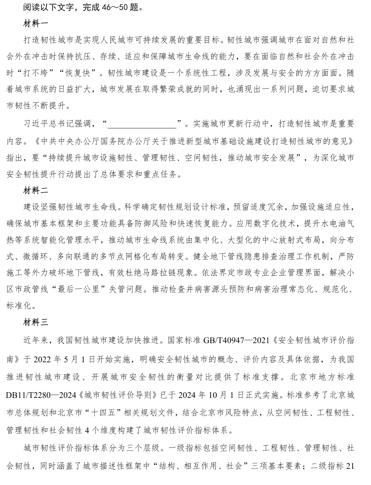

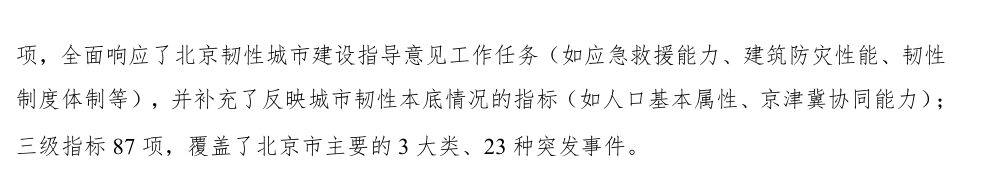

> 材料直接来自配套解析卷题前黑字，未依据答案反推。

### 第 46 题

符合材料一的观点是

- **A**. 要全面提升科技对韧性城市的支撑能力
- **B**. 开展韧性城市建设应统筹发展和安全
- **C**. 我国韧性城市建设在迎接挑战中加快推进
- **D**. 科学有效的城市安全管理可以更好地应对突发事件

原题扫描核对

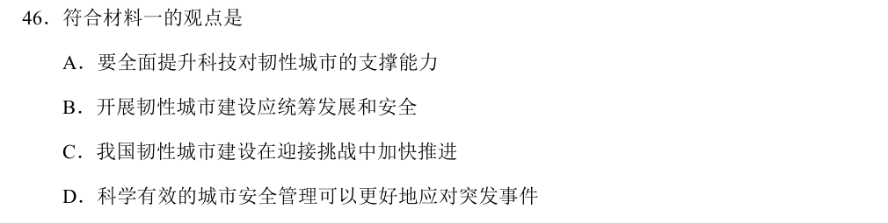

---

### 第 47 题

填入材料一画横线处最恰当的一项是

- **A**. 从数字化到智能化再到智慧化，让城市更聪明一些、更智慧一些，是推动城市治理体系和治理能力现代化的必由之路，前景广阔
- **B**. 城市更新要因地制宜，同社区建设结合起来，一切着眼于便民、利民、安民，特别要更好地关心呵护“一老一小”
- **C**. 城市发展不能只考虑规模经济效益，必须把生态和安全放在更加突出的位置，统筹城市布局的经济需要、生活需要、生态需要、安全需要
- **D**. 城市不仅要有高度，更要有温度

原题扫描核对

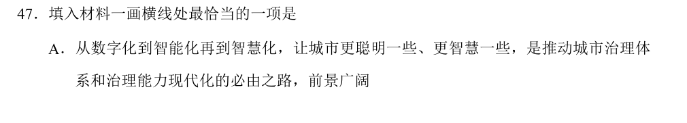

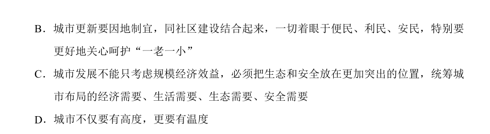

---

### 第 48 题

下列措施中，不属于材料二工作内容的是：
①北京市在2760平方公里城乡建设用地范围内统筹划定了约132平方公里战略留白用地，
并在分区规划数据库落图落位
②国网北京市电力公司应用“电网一张图”，为电网生产运行提供图形化、可视化服务，
实时感知电网运行状态
③北京燃气构建了基于PaaS云服务的物联网云平台，为燃气管网与厂站设施管理等业务
领域的智能化提供了基础技术支撑
④加大重点河道生态水量补充，推进西郊、密怀顺等地下水储备区建设，建立地下水战略
储备机制
⑤截至2023年，北京城市副中心已建成应急避难场所19处，总面积达331万平方米

- **A**. ①③④
- **B**. ①④⑤
- **C**. ②③⑤
- **D**. ③④⑤

原题扫描核对

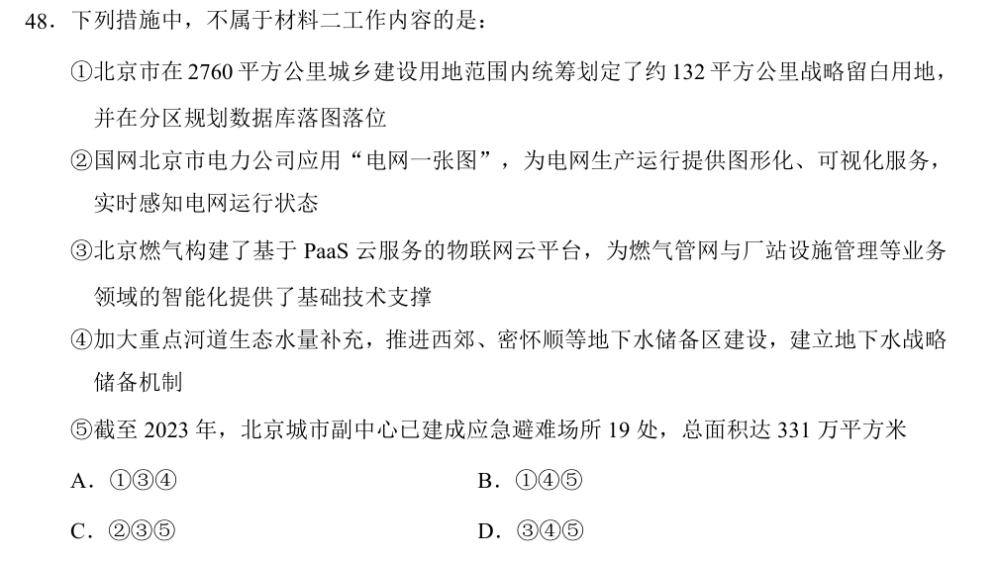

---

### 第 49 题

根据材料三，下列一级指标和二级指标对应正确的是

- **A**. 空间韧性　应急救援能力
- **B**. 社会韧性　韧性制度体制
- **C**. 管理韧性　人口基本属性
- **D**. 工程韧性　建筑防灾性能

原题扫描核对

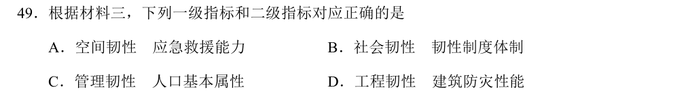

---

### 第 50 题

材料三最可能选自下列哪篇文章?

- **A**. 《城市韧性评价导则》标准解读
- **B**. 《安全韧性城市评价指南》出台
- **C**. 韧性城市建设面临的机遇与挑战
- **D**. 韧性城市建设的意义、进展与展望

原题扫描核对

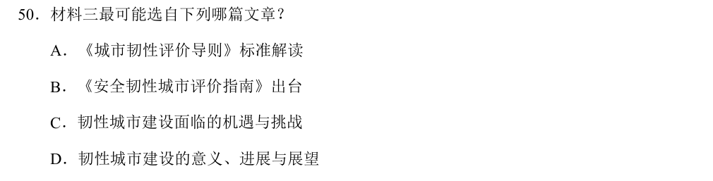

---

## 材料 2（第51—55题）

随着我国核能快速发展，伴随而来的大量核废料中含有半衰期长达数千年的锕系核素，长期被视为环境负担。这些原本需要封存数万年的“危险品”，因其在衰变过程中持续释放高能α射线的特性，________。

核电池是利用放射性同位素衰变放出载能粒子，如α粒子、β粒子和γ射线，并将其能量转换为电能的装置。其使用寿命与所用放射性同位素的半衰期高度相关。核电池虽有多种形状，但外壳都由耐高温材料制成密封，保护电池和散热；次外层是辐射屏蔽层；第三层就是核电池的核心，换能器，在这里热能被转换成电能；最后是电池的心脏部分，放射性同位素原子在这里不断地发生蜕变并放出热量。

辐射光伏核电池是一种利用放射性核素衰变释放的粒子激发荧光材料，再通过光生伏特效应将光能转换为电能的核电池。由于该设计避免了辐射粒子与半导体直接作用，显著提升了电池的稳定性与使用寿命，成为近年来的研究热点。

传统的辐射光伏核电池通常采用β核素作为放射源，β射线穿透深度较长，能够有效地将能量沉积到能量转换材料中。而辐射光伏核电池较少使用α粒子是因为其在传输过程中，自吸收效应会显著损失衰变能量。目前已报道的最大α辐射光伏核电池能量转换效率不足0.5%，严重制约了锕系核素在辐射光伏核电池的功能化利用。

针对这一难题，研究团队提出了一种基于“聚结型能量转换器”的锕系辐射光伏核电池架构，在分子级别上将放射性核素与能量转换单元紧密耦合。实验结果表明，放射性核素内置模式下从衰变能到光能的能量转化效率，比传统金属源结构提高近8000倍。能量转换器的辐射屏蔽层采用新型材料，在有效阻挡α粒子的同时，将中子吸收效率提升至98%。这种设计使转换器可根据需求灵活组合，从微型传感器到兆瓦级发电站均可适配。

研究团队选择“聚结型能量转换器”与光伏电池相结合，并选择了混合阳离子卤化铅钙钛矿薄膜作为活性层，开发了一种新的锕系微型辐射光伏核电池，实现了此类电池最高的总能量转换效率和单位活度功率。同时，在持续运行200小时内，性能参数几乎没有衰减，表现出优异的性能稳定性。

未来，基于“聚结型能量转换器”的锕系辐射光伏核电池让我们既能安全利用核能，又能解决深海检测、供电难题，更为可持续发展提供了新思路。

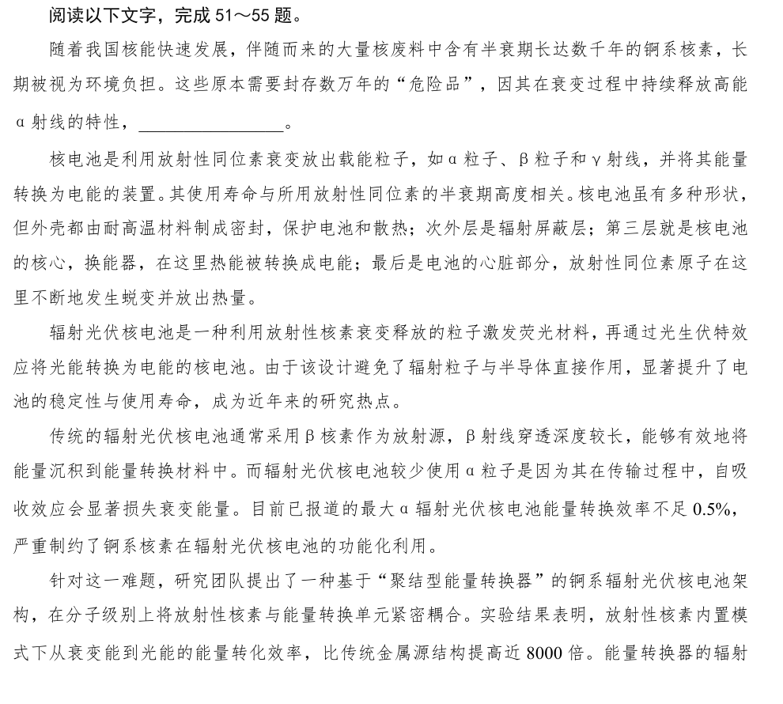

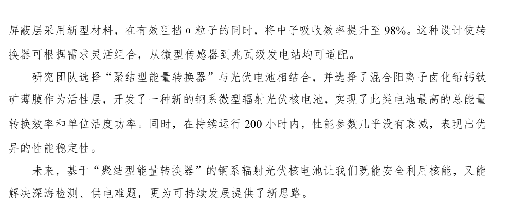

> 材料直接来自配套解析卷题前黑字，未依据答案反推。

### 第 51 题

填入文中画横线部分最恰当的一项是

- **A**. 彻底消除了人们心里关于核电的恐惧
- **B**. 引发了全球对于核能替代能源的探索
- **C**. 恰恰成为制造微型核电池的理想原料
- **D**. 但却并不能减少其放射性以及衰变能

原题扫描核对

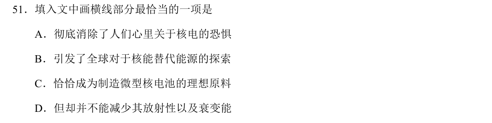

---

### 第 52 题

关于“核电池”，下列哪项错误？

- **A**. 换能器在结构设计上处于其的最内层
- **B**. 所用放射性同位素决定了其使用寿命
- **C**. 近年来的研究重点是辐射光伏核电池
- **D**. 其能量来自于核素放射性衰变的过程

原题扫描核对

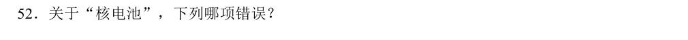

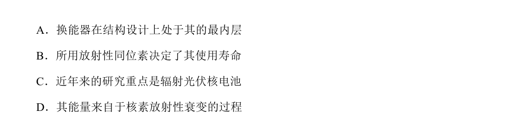

---

### 第 53 题

文中的“这一难题”指的是

- **A**. α辐射光伏核电池的能量转化效率低
- **B**. α射线的穿透深度过长
- **C**. 现有材料不能有效屏蔽核辐射
- **D**. 沉积到能量转换材料的能量过多

原题扫描核对

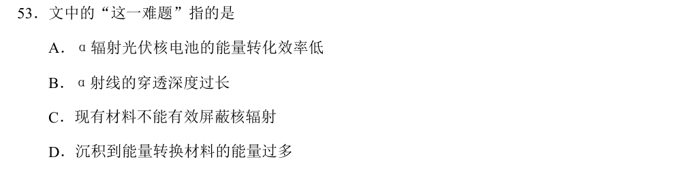

---

### 第 54 题

该研究当选为2024年度“中国科学十大进展”，对其评价最恰当的是
①突破了轻型耐高温材料的温度极限
②在高效微型核电池开发方面具有开创性
③制备了一种全新的锕系元素能量转换器件
④为放射性废物的资源化利用提供了新的思路
⑤有望改变全球核废物分离提炼技术的基本范式
⑥能满足深海等环境中电子监测器材的供电需求

- **A**. ①②③⑤
- **B**. ①③④⑥
- **C**. ②③④⑤
- **D**. ②③④⑥

原题扫描核对

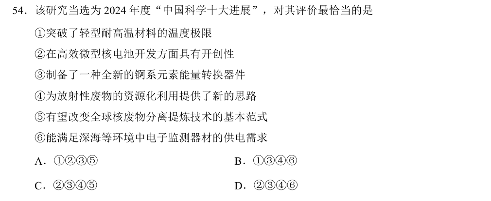

---

### 第 55 题

最适合做上文标题的是

- **A**. 让清洁低碳能源“风光无限”
- **B**. “黑科技”让核废料变“千年电池”
- **C**. 一种解决环境负担的新方式
- **D**. 核电离拿到绿色“身份证”还有多远

原题扫描核对

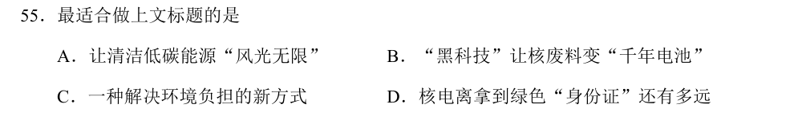

---

## 第 56 题

运输公司派出一批货车运输一批货物，每车每次运5吨正好3次运完，如果增加6辆车，每车每次多运1吨，正好2次运完。则原来有多少辆车？

- **A**. 54
- **B**. 36
- **C**. 24
- **D**. 18

原题扫描核对

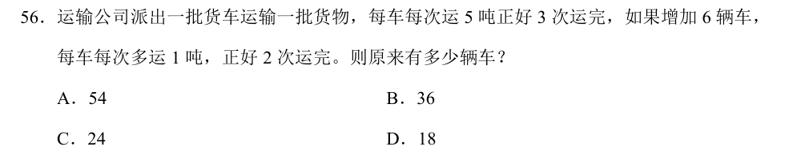

---

## 第 57 题

一件商品的定价为成本的2.5倍，如果每件降价100元出售，单件利润比打八折出售低40元。则这种商品的成本是多少元/件？

- **A**. 100
- **B**. 120
- **C**. 125
- **D**. 150

原题扫描核对

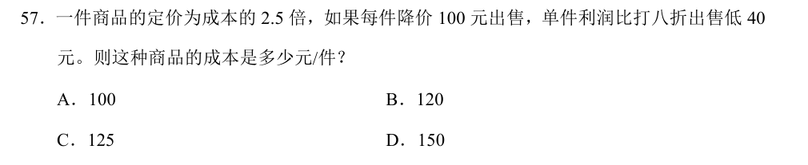

---

## 第 58 题

连锁便利店26个门店共招聘112名店员，每个门店招3人、5人或6人。已知招3人的门店数是招6人的2倍，则有几个门店招5人？

- **A**. 5
- **B**. 14
- **C**. 11
- **D**. 8

原题扫描核对

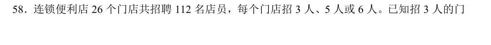

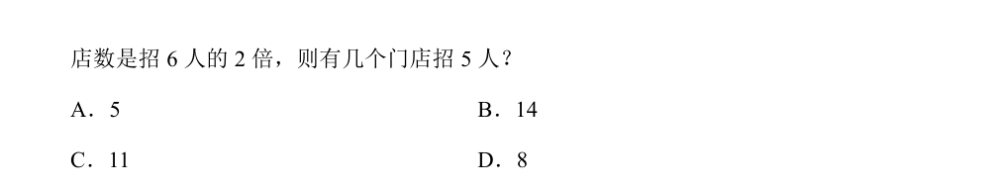

---

## 第 59 题

一辆车从甲地出发在甲、乙两地之间不间断匀速往返，前3次到达两地之间的丙地时间分别为8:00、8:40和9:50。则这辆车是几点出发的?

- **A**. 7:25
- **B**. 7:30
- **C**. 7:35
- **D**. 7:40

原题扫描核对

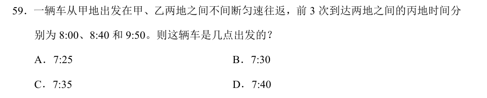

---

## 第 60 题

下图为某个岛屿4块不同地区的地图，现用红、黄、蓝三种颜色为这4块地区上色，要求每块地区用一种颜色，相邻的地区用不同的颜色，有多少种不同的上色方法？

- **A**. 3
- **B**. 6
- **C**. 12
- **D**. 24

原题扫描核对（含题图及图形选项）

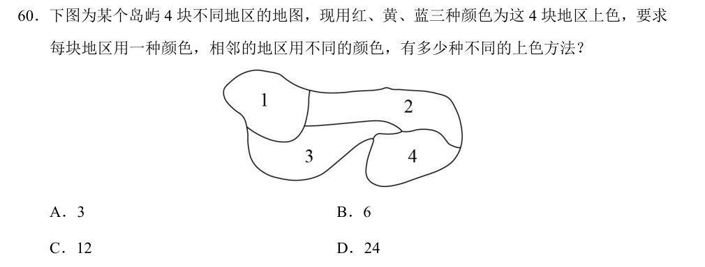

---

## 第 61 题

某茶馆喝茶的人中有50%还点了饼。客人中有60%的人喝茶，客人中有40%点饼。则点饼的人中，喝茶的人占：

- **A**. 75%
- **B**. 33%
- **C**. 96%
- **D**. 20%

原题扫描核对

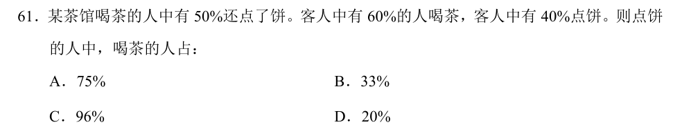

---

## 第 62 题

如果一个三位数的各位数字依次是aba（a≠b），称该三位数为回转数。则共有多少个回转数？

- **A**. 90
- **B**. 81
- **C**. 72
- **D**. 45

原题扫描核对

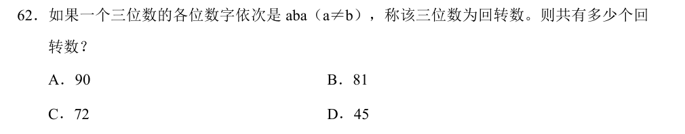

---

## 第 63 题

小明在面包店挑了4个面包，结账时获知该面包店有优惠活动，每买五个面包，其中最便宜的一个免费。若小明买这4个面包需要a元，则他再挑一个芒果面包后，下列选项中属于购买这5个面包可能需要金额的是：

| 面包品种 | 甜甜圈 | 芒果面包 | 蒜香面包 | 牛角面包 | 巧克力面包 |
|---|---:|---:|---:|---:|---:|
| 价格（元/个） | 5 | 6 | 7.5 | 10 | 12 |

- **A**. （a-1）元
- **B**. （a+1）元
- **C**. （a+1.5）元
- **D**. （a+2）元

原题扫描核对

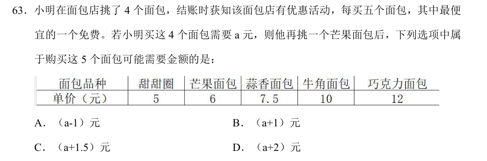

---

## 第 64 题

某20人的旅行团在参观时可以选择步行往返、单程乘坐或往返均乘坐观光车。其中，单程、往返观光车票价分别为30元、50元。如去程、回程分别有12人、18人坐车。则这个团的观光车票总费用至少为多少元？

- **A**. 740
- **B**. 760
- **C**. 780
- **D**. 800

原题扫描核对

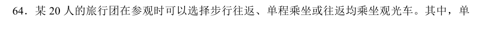

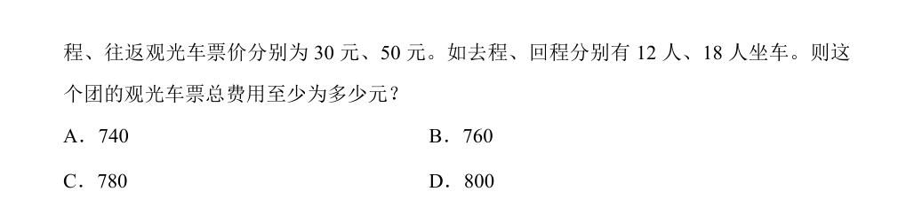

---

## 第 65 题

某企业200名职工参观红色景区，每人都随机选择次序参观了景区内的全部4个景点，则一定能找到最多多少名游览景点次序相同的职工?

- **A**. 7
- **B**. 8
- **C**. 9
- **D**. 10

原题扫描核对

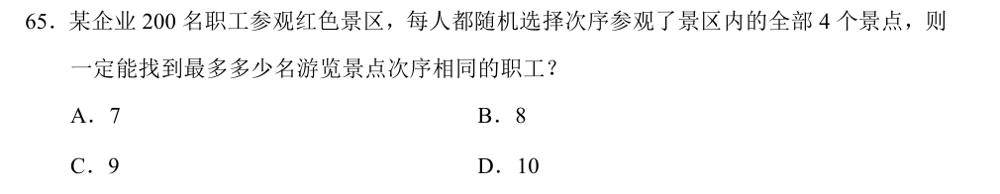

---

## 第 66 题

小刘的手表分针长度是时针的2倍，分针每小时扫过的面积为20n，他今天长跑期间，时针扫过的面积为n。则他的跑步时长在以下哪个范围内?

- **A**. 不到2小时
- **B**. 2小时—2小时30分
- **C**. 2小时30分—3小时
- **D**. 超过3小时

原题扫描核对

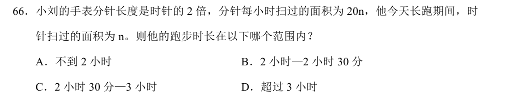

---

## 第 67 题

将张、王等12人分成若干小组。分成4个3人小组时，张和王在一组的概率比分成3个4人小组时

- **A**. 少1/11
- **B**. 少1/12
- **C**. 多1/11
- **D**. 多1/12

原题扫描核对

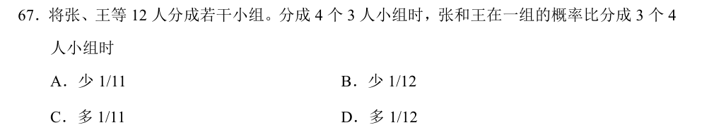

---

## 第 68 题

张、王、刘、李4人进行网球比赛，每2个人之间都要比赛1场分出胜负。已知张胜了王但总胜场数少于王，则总胜负关系有多少种不同的可能性？

- **A**. 2
- **B**. 4
- **C**. 6
- **D**. 8

原题扫描核对

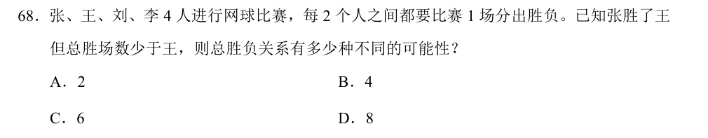

---

## 第 69 题

将111人分成若干组，任意2组的人数至少相差2人，则最多能分成几组？

- **A**. 13
- **B**. 12
- **C**. 11
- **D**. 10

原题扫描核对

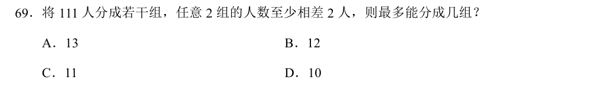

---

## 第 70 题

一个棋子从6*6的棋盘右下角格内出发，每次只能向上、下、左或右的方向移动1格，不重复地走完整个棋盘的每一个格子，全过程中最多向上移动多少次?

- **A**. 9
- **B**. 12
- **C**. 15
- **D**. 19

原题扫描核对

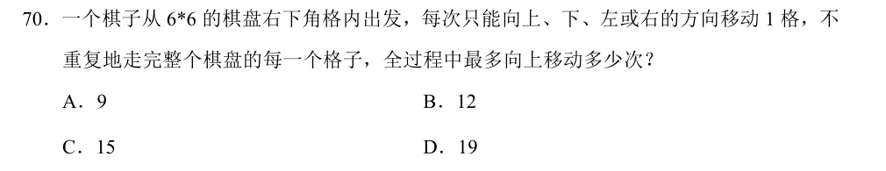

---

## 第 71 题

将2个不等大的正方体粘接为一个多面体，表面积比原来2个正方体表面积之和最多可能减少1/15，则原来较大正方体的棱长是较小正方体的多少倍？

- **A**. 1.5
- **B**. 2
- **C**. 3
- **D**. 4

原题扫描核对

---

## 第 72 题

公司早上8:30上班，小张上班有两段路：每段用时有一定随机性，且A段、B段用时互不影响。每10个连续工作日，A段、B段不同的用时出现的天数如下。假设一个月有22个工作日，小明每天固定7:45出门，他一个月最可能迟到几次？

| A段用时（分钟） | 7 | 8 | 10 |
|---|---:|---:|---:|
| 天数 | 2 | 6 | 2 |

| B段用时（分钟） | 32 | 34 | 36 |
|---|---:|---:|---:|
| 天数 | 3 | 5 | 2 |

- **A**. 0
- **B**. 1
- **C**. 2
- **D**. 3

原题扫描核对

---

## 第 73 题

用长2米、3米和4米的3根钢管作为3条边，再利用一堵呈直线的墙作为第4条边，最大可能围出n平方米的直角梯形土地。则n 的值在以下哪个范围内?

- **A**. (0，9)
- **B**. [9,9.5)
- **C**. [9.5，10)
- **D**. [10，+∞)

原题扫描核对

---

## 材料 3（第74—75题）

将任意自然数x各位的数字相加，若结果不为个位数则将结果的各位数相加，直至结果为个位数，这被称为将x进行一次α运算，例如对123进行α运算结果为1+2+3=6。

> 材料直接来自配套解析卷题前黑字，未依据答案反推。

### 第 74 题

对100及以内的数均进行α运算，结果之和为：

- **A**. 496
- **B**. 495
- **C**. 451
- **D**. 450

原题扫描核对

---

### 第 75 题

若b是一个三位数，其经过α运算后结果为偶数的概率为

- **A**. 1/2
- **B**. 2/5
- **C**. 3/7
- **D**. 4/9

原题扫描核对

---

## 第 76 题

从所给的四个选项中，选择最合适的一个填入问号处，不仅使两套图形表现出最大的相似性，而且使第二套图形也表现出自己的特征。

- **A**. 见原题图中标注的A项
- **B**. 见原题图中标注的B项
- **C**. 见原题图中标注的C项
- **D**. 见原题图中标注的D项

原题扫描核对（含题图及图形选项）

---

## 第 77 题

从所给的四个选项中，选择最合适的一个填入问号处，不仅使两套图形表现出最大的相似性，而且使第二套图形也表现出自己的特征。

- **A**. 见原题图中标注的A项
- **B**. 见原题图中标注的B项
- **C**. 见原题图中标注的C项
- **D**. 见原题图中标注的D项

原题扫描核对（含题图及图形选项）

---

## 第 78 题

从所给的四个选项中，选择最合适的一个填入问号处，不仅使两套图形表现出最大的相似性，而且使第二套图形也表现出自己的特征。

- **A**. 见原题图中标注的A项
- **B**. 见原题图中标注的B项
- **C**. 见原题图中标注的C项
- **D**. 见原题图中标注的D项

原题扫描核对（含题图及图形选项）

---

## 第 79 题

从所给的四个选项中，选择最合适的一个填入问号处，使图形呈现一定的规律性。

- **A**. 见原题图中标注的A项
- **B**. 见原题图中标注的B项
- **C**. 见原题图中标注的C项
- **D**. 见原题图中标注的D项

原题扫描核对（含题图及图形选项）

---

## 材料 4（第80—82题）

下面呈现一组操作规则，根据要求完成80～82题。

> 材料直接来自配套解析卷题前黑字，未依据答案反推。

### 第 80 题

对左侧的图形依次进行相应的操作后，可以得到右侧哪个图形？

- **A**. 见原题图中标注的A项
- **B**. 见原题图中标注的B项
- **C**. 见原题图中标注的C项
- **D**. 见原题图中标注的D项

原题扫描核对（含题图及图形选项）

---

### 第 81 题

对左侧的图形依次进行相应的操作后，可以得到右侧哪个图形？

- **A**. 见原题图中标注的A项
- **B**. 见原题图中标注的B项
- **C**. 见原题图中标注的C项
- **D**. 见原题图中标注的D项

原题扫描核对（含题图及图形选项）

---

### 第 82 题

对左侧的图形依次进行相应的操作后，可以得到右侧哪个图形？

- **A**. 见原题图中标注的A项
- **B**. 见原题图中标注的B项
- **C**. 见原题图中标注的C项
- **D**. 见原题图中标注的D项

原题扫描核对（含题图及图形选项）

---

## 第 83 题

以下除哪一项外，均为同一正方体纸盒的外表面展开图？

- **A**. 见原题图中标注的A项
- **B**. 见原题图中标注的B项
- **C**. 见原题图中标注的C项
- **D**. 见原题图中标注的D项

原题扫描核对（含题图及图形选项）

---

## 第 84 题

左图为12个白色、3个灰色正方体组合成的多面体，问以下哪一项不可能是该多面体的视图？

- **A**. 见原题图中标注的A项
- **B**. 见原题图中标注的B项
- **C**. 见原题图中标注的C项
- **D**. 见原题图中标注的D项

原题扫描核对（含题图及图形选项）

---

## 第 85 题

以下4个图形中，能够与最左边图形组合成实心正方体的是。

- **A**. 见原题图中标注的A项
- **B**. 见原题图中标注的B项
- **C**. 见原题图中标注的C项
- **D**. 见原题图中标注的D项

原题扫描核对（含题图及图形选项）

---

## 第 86 题

左图为5个黑色和22个白色正方体组成的三阶魔方。以下哪个图形不可能是将该魔方拧动1次（位于同一平面的9个正方体旋转90°、180°或270°）后某个面的外观？

- **A**. 见原题图中标注的A项
- **B**. 见原题图中标注的B项
- **C**. 见原题图中标注的C项
- **D**. 见原题图中标注的D项

原题扫描核对（含题图及图形选项）

---

## 第 87 题

将左图所示的物体沿A、B、C三个点所在的面切开，则哪一项可能是其截面？

- **A**. 见原题图中标注的A项
- **B**. 见原题图中标注的B项
- **C**. 见原题图中标注的C项
- **D**. 见原题图中标注的D项

原题扫描核对（含题图及图形选项）

---

## 第 88 题

小冯外出散步时，在一个山坡上看到了一高一低两座塔，并拍下了照片。则当时小冯和两座塔的位置关系（俯视图）可能是哪种？

- **A**. 见原题图中标注的A项
- **B**. 见原题图中标注的B项
- **C**. 见原题图中标注的C项
- **D**. 见原题图中标注的D项

原题扫描核对（含题图及图形选项）

---

## 第 91 题

时刻 之于（ ）相当于（ ）之于 地图

- **A**. 历史；地点
- **B**. 刻度；坐标
- **C**. 日晷；位置
- **D**. 周期；经纬

原题扫描核对

---

## 第 92 题

文献检索：论文：图书馆

- **A**. 休闲娱乐：民众：假期
- **B**. 促销推广：价格：商场
- **C**. 检查诊断：疾病：医院
- **D**. 嫁接修剪：果树：果农

原题扫描核对

---

## 第 93 题

光缆：激光信号：通信

- **A**. 摄像头：图像：监控
- **B**. 水管：水流：排水
- **C**. 电池：电流：电器
- **D**. 摩托车：燃油：驾驶

原题扫描核对

---

## 第 94 题

有理数：整数：分数

- **A**. 热量：温度：内能
- **B**. 相变：蒸发：冷凝
- **C**. 材料：导电性：绝缘性
- **D**. 固体：晶体：非晶体

原题扫描核对

---

## 第 95 题

进气阀：气流：内燃机

- **A**. 滤镜：图片：相机
- **B**. 编程：自动化：计算机
- **C**. 加速器：电压：电动机
- **D**. 阀门：水流：水库

原题扫描核对

---

## 第 111 题

密封的食品包装袋随着飞机飞上高空，包装袋会膨胀，如果飞机内温度全程不变，则以下说法正确的是

- **A**. 机舱内气压小于飞机在地面上的时候
- **B**. 食品包装袋内的气压小于外面的气压
- **C**. 食品包装袋内的空气密度变大
- **D**. 食品包装袋内的空气向外界放热

原题扫描核对

---

## 第 113 题

小明在公园荡秋千，小明爸爸在同一位置推他助力，每次推力相同，时间一样，且与小明运动方向相同，则以下说法正确的是：

- **A**. 在最高点的时候推秋千，小明荡的最高
- **B**. 在最低点的时候推秋千，小明荡的最高
- **C**. 小明体重越大，秋千荡的周期越长
- **D**. 小明体重越小，秋千荡的周期越长

原题扫描核对

---

## 第 116 题

水龙头向某半球形状凹面洗手池匀速流水，若洗手池漏水孔被塞住，则下列说法正确的是：

- **A**. 洗手池受到的压力匀速变化，底部受到的压强匀速变化
- **B**. 洗手池受到的压力非匀速变化，底部受到的压强非匀速变化
- **C**. 洗手池受到的压力匀速变化，底部受到的压强非匀速变化
- **D**. 洗手池受到得到压力非匀速变化，底部受到的压强匀速变化

原题扫描核对

---

## 第 118 题

某种进位方法下十进制数字73显示为111，则在此进位方法下显示为36的数，在二进制下表达为：

- **A**. 11011
- **B**. 11110
- **C**. 10010
- **D**. 10001

原题扫描核对

---

## 答案与解析

第 1 题

**答案**：C

**解析（AI辅助原创示范，非官方）**：C项将“科学技术是生产力”论断首次提出的时间归于十一届三中全会，不正确。该论断在此前即已提出；十一届三中全会召开前，1978年全国科学大会也已强调科学技术是生产力。原稿遮字照录。大扫描解析卷本题没有答案，不能把第19题的行政复议解析移接于此。

第 19 题

**答案**：C

**解析来源**：用户配套解析PDF第2、3页；未署原解题机构/个人作者，非官方。完整原稿如下，公式与图示保留原像素。

第 20 题

**答案**：D

**解析来源**：用户配套解析PDF第3页；未署原解题机构/个人作者，非官方。完整原稿如下，公式与图示保留原像素。

第 21 题

**答案**：B

**解析来源**：用户配套解析PDF第4页；未署原解题机构/个人作者，非官方。完整原稿如下，公式与图示保留原像素。

第 23 题

**答案**：D

**解析来源**：用户配套解析PDF第5页；未署原解题机构/个人作者，非官方。完整原稿如下，公式与图示保留原像素。

第 24 题

**答案**：D

**解析来源**：用户配套解析PDF第5、6页；未署原解题机构/个人作者，非官方。完整原稿如下，公式与图示保留原像素。

第 25 题

**答案**：B

**解析来源**：用户配套解析PDF第6页；未署原解题机构/个人作者，非官方。完整原稿如下，公式与图示保留原像素。

第 26 题

**答案**：B

**解析来源**：用户配套解析PDF第7页；未署原解题机构/个人作者，非官方。完整原稿如下，公式与图示保留原像素。

第 27 题

**答案**：A

**解析来源**：用户配套解析PDF第7、8页；未署原解题机构/个人作者，非官方。完整原稿如下，公式与图示保留原像素。

第 28 题

**答案**：C

**解析来源**：用户配套解析PDF第8、9页；未署原解题机构/个人作者，非官方。完整原稿如下，公式与图示保留原像素。

第 29 题

**答案**：B

**解析来源**：用户配套解析PDF第9、10页；未署原解题机构/个人作者，非官方。完整原稿如下，公式与图示保留原像素。

第 30 题

**答案**：B

**解析来源**：用户配套解析PDF第10页；未署原解题机构/个人作者，非官方。完整原稿如下，公式与图示保留原像素。

第 32 题

**答案**：D

**解析来源**：用户配套解析PDF第10、11页；未署原解题机构/个人作者，非官方。完整原稿如下，公式与图示保留原像素。

第 33 题

**答案**：C

**解析来源**：用户配套解析PDF第11页；未署原解题机构/个人作者，非官方。完整原稿如下，公式与图示保留原像素。

第 45 题

**答案**：C

**解析来源**：用户配套解析PDF第11、12页；未署原解题机构/个人作者，非官方。完整原稿如下，公式与图示保留原像素。

第 46 题

**答案**：B

**解析来源**：用户配套解析PDF第13页；未署原解题机构/个人作者，非官方。完整原稿如下，公式与图示保留原像素。

第 47 题

**答案**：C

**解析来源**：用户配套解析PDF第13、14页；未署原解题机构/个人作者，非官方。完整原稿如下，公式与图示保留原像素。

第 48 题

**答案**：B

**解析来源**：用户配套解析PDF第14页；未署原解题机构/个人作者，非官方。完整原稿如下，公式与图示保留原像素。

第 49 题

**答案**：D

**解析来源**：用户配套解析PDF第14、15页；未署原解题机构/个人作者，非官方。完整原稿如下，公式与图示保留原像素。

第 50 题

**答案**：D

**解析来源**：用户配套解析PDF第15页；未署原解题机构/个人作者，非官方。完整原稿如下，公式与图示保留原像素。

第 51 题

**答案**：C

**解析来源**：用户配套解析PDF第16页；未署原解题机构/个人作者，非官方。完整原稿如下，公式与图示保留原像素。

第 52 题

**答案**：A

**解析来源**：用户配套解析PDF第16、17页；未署原解题机构/个人作者，非官方。完整原稿如下，公式与图示保留原像素。

第 53 题

**答案**：A

**解析来源**：用户配套解析PDF第17页；未署原解题机构/个人作者，非官方。完整原稿如下，公式与图示保留原像素。

第 54 题

**答案**：D

**解析来源**：用户配套解析PDF第18页；未署原解题机构/个人作者，非官方。完整原稿如下，公式与图示保留原像素。

第 55 题

**答案**：B

**解析来源**：用户配套解析PDF第18页；未署原解题机构/个人作者，非官方。完整原稿如下，公式与图示保留原像素。

第 56 题

**答案**：C

**解析来源**：用户配套解析PDF第19页；未署原解题机构/个人作者，非官方。完整原稿如下，公式与图示保留原像素。

**AI辅助独立验算（非官方）**：设原有x辆车，同一批货物满足15x=12(x+6)，解得x=24。

第 57 题

**答案**：B

**解析来源**：用户配套解析PDF第19页；未署原解题机构/个人作者，非官方。完整原稿如下，公式与图示保留原像素。

**AI辅助独立验算（非官方）**：设成本c元，定价2.5c。降价100与八折两种售价相差40：0.8×2.5c−(2.5c−100)=40，得c=120。

第 58 题

**答案**：D

**解析来源**：用户配套解析PDF第19页；未署原解题机构/个人作者，非官方。完整原稿如下，公式与图示保留原像素。

**AI辅助独立验算（非官方）**：设招6人的门店x个、招5人的y个，则招3人的2x个。3x+y=26，12x+5y=112，得x=6、y=8。

第 59 题

**答案**：A

**解析来源**：用户配套解析PDF第20页；未署原解题机构/个人作者，非官方。完整原稿如下，公式与图示保留原像素。

**AI辅助独立验算（非官方）**：8:00到8:40是丙至乙再返丙，用时40分，丙至乙20分；8:40到9:50是丙至甲再返丙，用时70分，甲至丙35分。首次到丙8:00前35分钟出发，为7:25。

第 60 题

**答案**：B

**解析来源**：用户配套解析PDF第20、21页；未署原解题机构/个人作者，非官方。完整原稿如下，公式与图示保留原像素。

第 61 题

**答案**：A

**解析来源**：用户配套解析PDF第21页；未署原解题机构/个人作者，非官方。完整原稿如下，公式与图示保留原像素。

**AI辅助独立验算（非官方）**：把客人总数设为100，则喝茶60人，既喝茶又点饼30人，点饼40人；所求30/40=75%。

第 62 题

**答案**：B

**解析来源**：用户配套解析PDF第21页；未署原解题机构/个人作者，非官方。完整原稿如下，公式与图示保留原像素。

**AI辅助独立验算（非官方）**：百位a可取1—9共9种，十位b可取除a外的9个数字，个位固定为a，故9×9=81。

第 63 题

**答案**：B

**解析来源**：用户配套解析PDF第21、22页；未署原解题机构/个人作者，非官方。完整原稿如下，公式与图示保留原像素。

第 64 题

**答案**：C

**解析来源**：用户配套解析PDF第22页；未署原解题机构/个人作者，非官方。完整原稿如下，公式与图示保留原像素。

**AI辅助独立验算（非官方）**：令往返均乘车人数x，则去回程合计30人次，单程乘车30−2x人，费用50x+30(30−2x)=900−10x。x最多12，最低780元。

第 65 题

**答案**：C

**解析来源**：用户配套解析PDF第22页；未署原解题机构/个人作者，非官方。完整原稿如下，公式与图示保留原像素。

**AI辅助独立验算（非官方）**：四个景点的游览次序共4!=24种。200=24×8+8，抽屉原理保证至少9人次序相同，且不能保证10人。

第 66 题

**答案**：B

**解析来源**：用户配套解析PDF第23页；未署原解题机构/个人作者，非官方。完整原稿如下，公式与图示保留原像素。

**AI辅助独立验算（非官方）**：分针扫过的整圆面积为20n，时针半径是其一半，所以时针整圆面积5n。时针扫过n为整圆1/5，所需12/5小时=2小时24分。这里沿用原稿字母n，不擅改成π。

第 67 题

**答案**：A

**解析来源**：用户配套解析PDF第23页；未署原解题机构/个人作者，非官方。完整原稿如下，公式与图示保留原像素。

**AI辅助独立验算（非官方）**：固定张所在小组，从另外11人中选同组者；三人组中王同组概率2/11，四人组为3/11，两者相差1/11。

第 68 题

**答案**：A

**解析来源**：用户配套解析PDF第23、24页；未署原解题机构/个人作者，非官方。完整原稿如下，公式与图示保留原像素。

第 69 题

**答案**：D

**解析来源**：用户配套解析PDF第24页；未署原解题机构/个人作者，非官方。完整原稿如下，公式与图示保留原像素。

**AI辅助独立验算（非官方）**：k组人数最少为1、3、…、2k−1，总计k²。10²≤111<11²，最多10组；把多出的11人加到最大组即可实现。

第 70 题

**答案**：C

**解析来源**：用户配套解析PDF第24页；未署原解题机构/个人作者，非官方。完整原稿如下，公式与图示保留原像素。

第 71 题

**答案**：B

**解析来源**：用户配套解析PDF第25页；未署原解题机构/个人作者，非官方。完整原稿如下，公式与图示保留原像素。

**AI辅助独立验算（非官方）**：设小立方体棱长a、大立方体棱长b，最大重叠面为a²，减少的面积为2a²。2a²/[6(a²+b²)]=1/15，解得b²=4a²，故b=2a。

第 72 题

**答案**：A

**解析来源**：用户配套解析PDF第25、26页；未署原解题机构/个人作者，非官方。完整原稿如下，公式与图示保留原像素。

**AI辅助独立验算（非官方）**：迟到要求两段合计超过45分钟；只有10+36=46满足。A段10分钟和B段36分钟的概率均为2/10，独立时迟到概率p=0.04。22天迟到次数服从二项分布，其众数为⌊23×0.04⌋=0次。原题小张/小明名称混用照录，不影响计算。

第 73 题

**答案**：D

**解析来源**：用户配套解析PDF第26、27页；未署原解题机构/个人作者，非官方。完整原稿如下，公式与图示保留原像素。

**AI辅助独立验算（非官方）**：可令高为2米、短底为4米、斜边为3米，墙作为长底，长底为4+√5米，面积为8+√5≈10.236平方米。因此最大可能面积至少超过10，只有D项范围符合，无需求出精确最大值。

第 74 题

**答案**：A

**解析来源**：用户配套解析PDF第27页；未署原解题机构/个人作者，非官方。完整原稿如下，公式与图示保留原像素。

**AI辅助独立验算（非官方）**：1—99的数字根按1—9循环11次，和为11×(1+…+9)=495；100的数字根为1，合计496。

第 75 题

**答案**：D

**解析来源**：用户配套解析PDF第28页；未署原解题机构/个人作者，非官方。完整原稿如下，公式与图示保留原像素。

**AI辅助独立验算（非官方）**：100—999共900个数，数字根1—9各出现100次。偶数根有2、4、6、8四种，概率400/900=4/9。

第 76 题

**答案**：A

**解析来源**：用户配套解析PDF第28页；未署原解题机构/个人作者，非官方。完整原稿如下，公式与图示保留原像素。

第 77 题

**答案**：D

**解析来源**：用户配套解析PDF第29页；未署原解题机构/个人作者，非官方。完整原稿如下，公式与图示保留原像素。

第 78 题

**答案**：D

**解析来源**：用户配套解析PDF第29页；未署原解题机构/个人作者，非官方。完整原稿如下，公式与图示保留原像素。

第 79 题

**答案**：C

**解析来源**：用户配套解析PDF第30页；未署原解题机构/个人作者，非官方。完整原稿如下，公式与图示保留原像素。

第 80 题

**答案**：C

**解析来源**：用户配套解析PDF第30、31页；未署原解题机构/个人作者，非官方。完整原稿如下，公式与图示保留原像素。

第 81 题

**答案**：A

**解析来源**：用户配套解析PDF第31页；未署原解题机构/个人作者，非官方。完整原稿如下，公式与图示保留原像素。

第 82 题

**答案**：A

**解析来源**：用户配套解析PDF第31、32页；未署原解题机构/个人作者，非官方。完整原稿如下，公式与图示保留原像素。

第 83 题

**答案**：B

**解析来源**：用户配套解析PDF第32页；未署原解题机构/个人作者，非官方。完整原稿如下，公式与图示保留原像素。

第 84 题

**答案**：A

**解析来源**：用户配套解析PDF第32、33页；未署原解题机构/个人作者，非官方。完整原稿如下，公式与图示保留原像素。

第 85 题

**答案**：B

**解析来源**：用户配套解析PDF第33、34页；未署原解题机构/个人作者，非官方。完整原稿如下，公式与图示保留原像素。

第 86 题

**答案**：C

**解析来源**：用户配套解析PDF第34、35页；未署原解题机构/个人作者，非官方。完整原稿如下，公式与图示保留原像素。

第 87 题

**答案**：A

**解析来源**：用户配套解析PDF第35页；未署原解题机构/个人作者，非官方。完整原稿如下，公式与图示保留原像素。

第 88 题

**答案**：A

**解析来源**：用户配套解析PDF第36页；未署原解题机构/个人作者，非官方。完整原稿如下，公式与图示保留原像素。

第 91 题

**答案**：C

**解析来源**：用户配套解析PDF第37页；未署原解题机构/个人作者，非官方。完整原稿如下，公式与图示保留原像素。

第 92 题

**答案**：C

**解析来源**：用户配套解析PDF第37页；未署原解题机构/个人作者，非官方。完整原稿如下，公式与图示保留原像素。

第 93 题

**答案**：A

**解析来源**：用户配套解析PDF第38页；未署原解题机构/个人作者，非官方。完整原稿如下，公式与图示保留原像素。

第 94 题

**答案**：D

**解析来源**：用户配套解析PDF第38、39页；未署原解题机构/个人作者，非官方。完整原稿如下，公式与图示保留原像素。

第 95 题

**答案**：D

**解析来源**：用户配套解析PDF第39页；未署原解题机构/个人作者，非官方。完整原稿如下，公式与图示保留原像素。

第 111 题

**答案**：A

**解析来源**：用户配套解析PDF第40页；未署原解题机构/个人作者，非官方。完整原稿如下，公式与图示保留原像素。

第 113 题

**答案**：B

**解析来源**：用户配套解析PDF第40、41页；未署原解题机构/个人作者，非官方。完整原稿如下，公式与图示保留原像素。

第 116 题

**答案**：C

**解析来源**：用户配套解析PDF第41、42页；未署原解题机构/个人作者，非官方。完整原稿如下，公式与图示保留原像素。

第 118 题

**答案**：B

**解析来源**：用户配套解析PDF第42页；未署原解题机构/个人作者，非官方。完整原稿如下，公式与图示保留原像素。

**AI辅助独立验算（非官方）**：设进制底数b，则b²+b+1=73，正整数解为b=8。八进制36=3×8+6=30，转成二进制为11110。

