# 2008年吉林省公务员录用考试《行测》题（乙级）

<!-- gwy:overview:start -->
> **吉林 · 2008 · 行测 · 乙级** ｜ 100 题 · 图片 47 处 · 答案随题折叠

| 题型模块 | 题量 | 题号 |
| --- | ---: | ---: |
| 数量关系 | 10 | 1–10 |
| 言语理解与表达 | 30 | 11–40 |
| 判断推理 | 30 | 41–70 |
| 常识判断 | 10 | 71–80 |
| 资料分析 | 20 | 81–100 |
| **合计** | **100** | |

导航：[题型与作答说明](#题型与作答说明) · [题目](#题目) · [材料 1](#材料-1)
<!-- gwy:overview:end -->

> 候选采集稿。参考答案及解析来自粉笔页面，不代表官方答案或真实高分答卷；来源使用许可与原卷对应关系仍需人工核实。

## 题型与作答说明

数量关系

（10题）

本部分包括数字推理与数学运算两种类型的题目。

言语理解与表达

（30题）

本部分包括选词填空、语句表达与阅读理解三种类型的题目。

判断推理

（30题）

本部分包括事件排序、图形推理、定义判断、演绎推理四种类型的题目。

常识判断

（10题）

根据题目要求，在四个选项中选出一个最恰当的答案。

资料分析

（20题）

针对下列文字、表或图回答问题。你应根据资料提供的信息进行了分析、比较计算、处理。

## 题目

### 第 1 题

2，，4，，（   ）

A. 6

B. 8

C. 714

D. 716

第 1 题 · 答案与解析

**参考答案（粉笔题库参考内容）**

B

**解析**

这是一个以√2为公比的等比数列，所以第五项是8。

故正确答案为B。

**来源**：2008年吉林省公务员录用考试《行测》题（乙级）第1题

### 第 2 题

0，4，5，11，14，（    ）

A. 20

B. 21

C. 22

D. 23

第 2 题 · 答案与解析

**参考答案（粉笔题库参考内容）**

C

**解析**

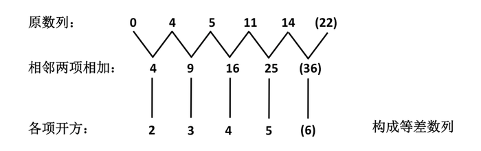

则数列下一项为。

故正确答案为C。

**来源**：2008年吉林省公务员录用考试《行测》题（乙级）第2题

### 第 3 题

0，1/2 ，0， ，0，  ，0，（  ）

A. 

B. 

C. 

D. 

第 3 题 · 答案与解析

**参考答案（粉笔题库参考内容）**

D

**解析**

奇数项都是0，偶数项是以1/4为公比的等比数列，所以第八项为。

故正确答案为D。

**来源**：2008年吉林省公务员录用考试《行测》题（乙级）第3题

### 第 4 题

2，6，15，28，55，（    ）

A. 75

B. 76

C. 77

D. 78

第 4 题 · 答案与解析

**参考答案（粉笔题库参考内容）**

D

**解析**

原数列各项因式分解：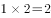，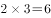，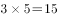，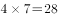，，为自然数列和质数列的乘积，所以括号内为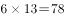。

故正确答案为D。

**来源**：2008年吉林省公务员录用考试《行测》题（乙级）第4题

### 第 5 题

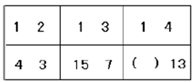

A. 18

B. 20

C. 24

D. 40

第 5 题 · 答案与解析

**参考答案（粉笔题库参考内容）**

D

**解析**

每一项中，从左上角数字开始顺时针排列，分别得到：1、2、3、4；1、3、7、15；1、4、13、（40）；分别用后项减去前项，得到新数列：1、1、1；2、4、8；3、9、（27），都构成等比数列。则未知项为27＋13＝40。

故正确答案为D。

**来源**：2008年吉林省公务员录用考试《行测》题（乙级）第5题

### 第 6 题

2＋4＋6＋8＋10＋······＋50的值是：

A. 640

B. 650

C. 660

D. 670

第 6 题 · 答案与解析

**参考答案（粉笔题库参考内容）**

B

**解析**

根据等差数列求和公式，。

故正确答案为B。

**考点**：数列问题

**来源**：2008年吉林省公务员录用考试《行测》题（乙级）第6题

### 第 7 题

的值为：

A. 1440

B. 14400

C. 144000

D. 1440000

第 7 题 · 答案与解析

**参考答案（粉笔题库参考内容）**

B

**解析**

。

故正确答案为B。

**来源**：2008年吉林省公务员录用考试《行测》题（乙级）第7题

### 第 8 题

3名学生和2名老师站成一排照相，2名老师必须站在一起且不在边上的不同排法共有：

A. 12种

B. 24种

C. 36种

D. 48种

第 8 题 · 答案与解析

**参考答案（粉笔题库参考内容）**

B

**解析**

把2名老师看成一个整体，捆绑法，有种情况。

方法一：

老师不能站在两端，则可利用插空法，先排3名学生，有种情况，再让老师插入学生形成的空隙，有2种情况，分步用乘法，共有种排列方法。

方法二：

反向求解。老师站在两端的情况数为种情况，老师组成的整体与3名学生排列共有种情况，则不在两端的情况；则符合题干要求的情况共有种。

故正确答案为B。

**考点**：相邻问题

**来源**：2008年吉林省公务员录用考试《行测》题（乙级）第8题

### 第 9 题

一吨土豆的价格是200元，一吨洋葱的价格是300元。如果土豆的价格1个月提高15%，而洋葱的价格保持不变。那么，要使一吨洋葱的价格低于一吨土豆的价格，需要：

A. 2个月

B. 3个月

C. 4个月

D. 5个月

第 9 题 · 答案与解析

**参考答案（粉笔题库参考内容）**

B

**解析**

设需要x个月，根据题意可得，，，，所以需要3个月。

故正确答案为B。

**考点**：经济利润问题

**来源**：2008年吉林省公务员录用考试《行测》题（乙级）第9题

### 第 10 题

假定一对刚出生的小兔一个月能长成大兔，再过一个月便能生下一对小兔，并且此后每个月都生一对小兔。如果一切正常没有死亡，公母兔也比例适调，那么一对刚出生的兔子，一年可以繁殖成多少对兔子：

A. 144

B. 233

C. 288

D. 466

第 10 题 · 答案与解析

**参考答案（粉笔题库参考内容）**

A

**解析**

先列举出经过一到六个月兔子的对数分别是1、1、2、3、5、8。很容易发现这个数列的特点：即从第三项起，每一项都等于前两项之和。按这个规律写下去，便可得出一年内兔子繁殖的对数：1、1、2、3、5、8、13、21、34、55、89、144。可见一年内兔子共有144对。

故正确答案为A。

**考点**：数列问题

**来源**：2008年吉林省公务员录用考试《行测》题（乙级）第10题

### 第 11 题

依次填入横线处的词语，最恰当的一组是：

为英雄全训华守墓37年的陈健，获得了“感动中国”2005年度人物的称号。评委会给他的颁奖词是：一个生者对一个死者的承诺，只是良心的自我\_\_\_\_\_\_，但是他却为此坚守37年，放弃了梦想、幸福和骨肉亲情。\_\_\_\_\_\_火红的时代背景，他身上有古典意识的风范······

A. 约束，淡去

B. 制约，淡忘

C. 约束，淡忘

D. 制约，淡去

第 11 题 · 答案与解析

**参考答案（粉笔题库参考内容）**

A

**解析**

本题考查实词的辨析填空。

第一空中，“约束”指限制，使不越出范围，多与纪律、协议、道德、良心等搭配。“制约”意思是甲事物本身的存在和变化以乙事物本身的存在和变化为条件，则甲事物为乙事物所制约。根据前面词语“良心”的提示，应该选“约束”，即不越出良心的范围。

第二空中，“淡忘”指印象逐渐淡薄以至于忘记，与“淡去”相比，含有更多的主观色彩。根据材料的语境，句子只是在陈述一种事实，并没有涉及过多的主观因素，故选“淡去”。

故正确答案为A。

**考点**：实词填空、词的辨析-词义侧重

**来源**：2008年吉林省公务员录用考试《行测》题（乙级）第11题

### 第 12 题

下列各项中词语意思最接近的一项是：

A. 大吹大擂，大言不惭，大摇大摆

B. 言外之意，弦外之音，话中有话

C. 颠倒黑白，混淆是非，指鹿为马

D. 人山人海，水泄不通，摩肩接踵

第 12 题 · 答案与解析

**参考答案（粉笔题库参考内容）**

C

**解析**

此题考查成语语义辨析。

C选项中“颠倒黑白”指把黑的说成白的，白的说成黑的，比喻歪曲事实，混淆是非。“混淆是非”指故意把正确的说成错误的，把错误的说成正确的。“指鹿为马”形容一个人是非不分，颠倒黑白。三个成语都带有一定程度的贬义色彩，且意思相近，当选；

A选项中“大吹大擂”指许多乐器同时吹打，比喻大肆宣扬。 “大言不惭”指说大话，不感到难为情。“大摇大摆”指走路时身子摇摇摆摆，形容自以为了不起的傲慢神态。成语意思不相近，排除；

B选项中“言外之意”指有这个意思，但没有在话里明说出来。“弦外之音”原指音乐的余音，比喻言外之意，即在话里间接透露，而不是明说出来的意思。“话中有话”指话里含有别的意思。 前两词强调话外深意，后一词强调话中深意，成语意思不相近，排除；

D选项中“人山人海”指人群如山似海，形容人聚集得非常多。“水泄不通”形容拥挤或包围得非常严密。“摩肩接踵”指肩碰着肩，脚碰着脚，形容人多拥挤。成语意思不相近，排除。

故正确答案为C。

**来源**：2008年吉林省公务员录用考试《行测》题（乙级）第12题

### 第 13 题

依次填入横线处的词语，最恰当的一组是：

（1）科学传播不可能起到立竿见影的效果，谁这样想，谁就会\_\_\_\_\_\_科学，最终将会危害科学。

（2）近几年我国出土了大量先秦时期的典籍，使我们有可能对过去被批判为伪书的作品重新加以\_\_\_\_\_\_。

A. 误解，甄别

B. 曲解，鉴别

C. 误解，鉴别

D. 曲解，甄别

第 13 题 · 答案与解析

**参考答案（粉笔题库参考内容）**

A

**解析**

本题考查近义实词的程度辨析和语境搭配。

第一空中，“误解”指理解得不正确。“曲解”指错误地解释原意，词义程度较深。根据语意，对科学传播可能会认识理解得不正确，这种错误的理解并不是故意的，语义程度并不深，因此“误解”更符合语意。

第二空中，“甄别”指仔细鉴别、审察。“鉴别”指辨别，词义程度较轻。空格的搭配对象是先秦的典籍作品，因此辨别的态度应当认真谨慎，故“甄别”更符合语境。

故正确答案为A。

**考点**：实词填空、词的辨析-程度轻重

**来源**：2008年吉林省公务员录用考试《行测》题（乙级）第13题

### 第 14 题

依次填入横线处的词语，最恰当的一组是：

(1)有人说日本汽车比德国汽车更舒适，也有人说德国汽车比日本汽车更稳重，但这\_\_\_\_\_\_只是个人的不同感受，购车人还是要亲自驾驶一下才能作出判断。

(2)世界上生产维生素C最先进的两步发酵法技术是由我国发明的，由于制药成本大大降低，迫使两个国际药业巨头“辉瑞”和“罗氏”也不得不\_\_\_\_\_\_这一技术。

A. 毕竟，采纳

B. 毕竟，采用

C. 不过，采用

D. 不过，采取

第 14 题 · 答案与解析

**参考答案（粉笔题库参考内容）**

B

**解析**

本题为实词和虚词混搭的词语填空。

第一空中，“毕竟”常用在肯定句中，强调原因或结果。“不过”作连词，表示转折，只是。根据句中语境，“只是个人的不同感受，购车人还是要亲自驾驶一下才能作出判断”所表达的“强调”意味大于“转折”，且“不过”与“只是”有点重复，故选“毕竟”来表强调。

第二空中，“采纳”指听他人意见来完善自己的见解，常用“采纳建议”。“采用”指采纳应用，多与技术、计划搭配。“采取”指采纳听取，选取实施，多用“采取措施”。根据材料， 后面为“技术”，故选“采用”。

故正确答案为B。

**考点**：混搭填空、词的辨析-搭配对象、词的辨析-词义侧重

**来源**：2008年吉林省公务员录用考试《行测》题（乙级）第14题

### 第 15 题

人类正面临着全球变暖的挑战，联合国的一份报告为我们　　　了气候变化将会产生的灾难性后果。

A. 概括

B. 描述

C. 记录

D. 记述

第 15 题 · 答案与解析

**参考答案（粉笔题库参考内容）**

B

**解析**

本题考查实词填空。

B项正确，“描述”意思是“形象地叙述”。联合国的报告应该是“描述”后果。

A项“概括”意思是“把事物的共同特点归结在一起”，C项“记录”指把听到的话或发生的事写下来，D项“记述”指用文字叙述。A、C、D三项填入空格处都不符合语境。

故正确答案为B。

**考点**：实词填空、对应关系-前后呼应

**来源**：2008年吉林省公务员录用考试《行测》题（乙级）第15题

### 第 16 题

以下句子中关联词使用不正确的是：

A. 不仅中药疗效好，而且价格低廉，无副作用

B. 即使干部和群众，毫无例外，都必须遵守社会主义法制

C. 由于《古文观止》具有特色，自问世以后三百年来，广为传布，经久不衰，至今仍不失为一部有价值的选本

D. 贪图小利的人往往只看到自己的小圈子，打自己的小算盘，从而忽视了集体和国家的利益。

第 16 题 · 答案与解析

**参考答案（粉笔题库参考内容）**

B

**解析**

本题主要考查关联词的使用。

B选项中的关联词“即使”使用不对，应改为“无论”。

A、C两项虽然关联词的位置不正确，A选项中“不仅”应放在“中药”后，C选项中“由于”应放在《古文观止》后，但关联词语使用还是正确的。

故正确答案为B。

**来源**：2008年吉林省公务员录用考试《行测》题（乙级）第16题

### 第 17 题

中国语言丰富多彩，有时相反的词语表达相同的意思，请选出两个句子表意不同的一组：

A. 中国队大胜美国队；中国队大败美国队

B. 他差点踩到蛇；他差点没踩到蛇

C. 他朝思暮想，好不容易盼来了相见的日子；他朝思暮想，好容易盼来相见的日子

D. 谁不知道你不会计算机；谁知道你不会计算机

第 17 题 · 答案与解析

**参考答案（粉笔题库参考内容）**

D

**解析**

D选项中的前一句意思为人人都知道你不会计算机，后一句意思是没人知道你不会计算机，意思不同，为正确答案。

A、B、C中前后两句虽用相反的词语，但意思相同，为习惯用法。

故正确答案为D。

**来源**：2008年吉林省公务员录用考试《行测》题（乙级）第17题

### 第 18 题

下列各句中没有语病的一句是：

A. 一贯以技术领先、功能创新闻名的微软科技电脑公司，在近期计划率先推出具有国际领先水平的新一代家用电脑产品

B. 阅读优秀的外国文学作品可以帮助我们了解外国人民的生活，但它们是译本，所以比起读原著味道要差些

C. 一部优秀的传记，不仅要真实地记叙传主的生平经历，更重要的是要挖掘和展现传主生活经历中存在的一种精神

D. 反病毒专家发现，代号为野玫瑰的电脑病毒发作是由接收邮件和共享资源两条途径侵袭硬盘系统感染的

第 18 题 · 答案与解析

**参考答案（粉笔题库参考内容）**

C

**解析**

此题考查病句辨析的能力。

A选项语序不当，应为“计划在近期”；

B选项中前半句强调的是“阅读”，后半句又强调“外国文学作品”，前后主语不一致，应把“阅读”去掉；

D选项句式杂糅，应去掉“发作”，在“系统感染”前添加“造成”一词。

故正确答案为C。

**来源**：2008年吉林省公务员录用考试《行测》题（乙级）第18题

### 第 19 题

下列各句中成语使用不当的一句是：

A. 人们对充满这大千世界的色彩、形象所构成的画面习以为常，对到了手的东西往往漠不关心。

B. 一般人对身边的事物只看到特别触目的部分，有的人比别的人看到的多一些，然而能把视觉范围内的事物全部都看到的人却寥寥无几。

C. 翻开《红楼梦》的任何一个篇章，往往都能使人流连忘返，一个重要的原因，恐怕就在于《红楼梦》创造了各种各样引人入胜的艺术境界。

D. 中原的战火也造成了南粤大乱，冼夫人只得自己跨上马背，为了民生，为了民族间的和睦，她几十年一直指挥若定，恩威并施，成了南粤地区最有威望的统治者。

第 19 题 · 答案与解析

**参考答案（粉笔题库参考内容）**

C

**解析**

此题考查成语使用辨析。

C选项中“流连忘返”形容留恋景物或某种事物而不愿离去，常用在欣赏风景的时候，用在此处形容看书不合适。“引人入胜”指带人进入风景优美的地方，后形容风景、作品很吸引人，用在此处可以。所以答案为C。

A选项中“习以为常”指某种事情经常去做，或某种现象经常看到，就成了常规或习惯，觉得很平常了。“漠不关心”形容对人或事物态度冷淡，毫不在意或一点也不关心。两个词均符合语意；

B选项中“寥寥无几”指很少，没有几个，形容数量极少，放入句中合适；

D选项中“指挥若定”意思是指挥起来就像一切都事先规定好了似的，形容指挥者胸有成竹，镇定从容。“恩威并施”指用恩惠进行笼络，用威势进行威慑，两种手段一起使用。两个词都形容了冼夫人的治国之道，符合语义。

故正确答案为C。

**来源**：2008年吉林省公务员录用考试《行测》题（乙级）第19题

### 第 20 题

如果你不会指法，那么你就不会打字，你就不可能使用电脑来写论文，除非你会打字。

下列最符合上述推论的是：

A. 如果你会指法，那么你就能使用电脑来写论文

B. 如果你不能使用电脑来写论文，那么你就不可能会指法

C. 如果你能使用电脑来写论文，那么你至少会指法

D. 如果你能打字，你就有可能使用电脑来写论文

第 20 题 · 答案与解析

**参考答案（粉笔题库参考内容）**

C

**解析**

本题为逻辑能力很强的细节推断题。

从材料来分析，“会指法”不一定就“会打字”，可能还需要其他的技能，但“会打字”必须要“会指法”，而“会打字”是“会使用电脑来写论文”的充分条件，所以“如果你能使用电脑来写论文，那么你至少会指法”是正确的。故C项正确。

A选项中“会指法”为“能使用电脑来写论文”的必要条件，而非充分条件，错误；

B选项中“不能使用电脑来写论文”的原因是“不会打字”，而“不会打字”可能是“不会指法”造成的，但也可能是“会指法”而不会其他的技能，错误；

D选项由文中的最后一句“你就不可能使用电脑来写论文，除非你会打字”可知，“会打字”是“会使用电脑来写论文”的充分条件，所以能打字，就一定能使用电脑来写论文，而不是有可能，错误。

故正确答案为C。

**考点**：细节判断题

**来源**：2008年吉林省公务员录用考试《行测》题（乙级）第20题

### 第 21 题

下列句子没有语病的一句是：

A. 法国国家健康研究所以及法国变态反应学联合会日前的一份调查显示，用美沙酮和盐酸叮丙诺啡等毒品替代物进行的戒毒治疗可以取得很好效果

B. 近期，北京、河南等地幼儿园连续发生两起重大意外伤害事故，幼儿伤亡惨重，广泛引起社会各界的关注

C. 在减少婴儿死亡率和提高孕妇健康方面，东南亚、北非和加勒比地区取得进步，但西亚和非洲撒哈拉以南地区几乎有了进展

D. 驻伊拉克美军作战部队官兵阵亡数达到999人，其中当日一天就有7名美军在巴格达及其附近地区与当地人的武装冲突中被打死

第 21 题 · 答案与解析

**参考答案（粉笔题库参考内容）**

A

**解析**

此题考查病句辨析的能力。

B项语序不当，应改为“引起社会各界的广泛关注”；

C项的关联词“但”使用不当，前后两句之间不存在转折关系；

D项“当日”与“一天”重复，且表意不明，不知道指的是哪一天。

故正确答案为A。

**来源**：2008年吉林省公务员录用考试《行测》题（乙级）第21题

### 第 22 题

下列几句话中有语病的一句是：

A. 长江干流含沙量猛增、水质污染严重的问题，至今没有引起有关地方党委政府重视

B. 令郎不愧是丹青世家子弟，他画的马惟妙惟肖，栩栩如生

C. 文章里的中心思想确定以后，还要根据中心思想的需要，认真地组织、选择材料

D. 在众星簇拥下，被草帽状美丽光环围绕的土星和光芒四射的月亮彼此依偎，常常会引起人们的无限遐想

第 22 题 · 答案与解析

**参考答案（粉笔题库参考内容）**

C

**解析**

此题考查病句辨析的能力。

C句语序不对，应为“认真地选择、组织材料”，先选择了材料才能进行组织。

故正确答案为C。

**来源**：2008年吉林省公务员录用考试《行测》题（乙级）第22题

### 第 23 题

下列四句话中容易引起歧义的是：

A. 这是一门学生愿意学习的课程

B. 我已经和你父亲说定了，周末我们一起走

C. 那是一个大家乐于接受的方案

D. 老师告诉一位同学叫小明到办公室

第 23 题 · 答案与解析

**参考答案（粉笔题库参考内容）**

B

**解析**

此题考查歧义辨析的能力。

B选项中的“我们”产生歧义，既可以理解为“我和你”，也可以理解为“我和你父亲”。

故正确答案为B。

**来源**：2008年吉林省公务员录用考试《行测》题（乙级）第23题

### 第 24 题

下列各句中没有语病的一句是：

A. 松下公司这个新产品14毫米的厚度给人的视觉感觉，并不像索尼公司的产品那样，有一种比实际厚度稍薄的错觉

B. 世界抗击艾滋病会议的代表中有中国中央电视台台长和东方电视台台长，香港凤凰卫视总裁也应邀列席了会议

C. 这一桩发生在普通家庭中的杀人悲剧在亲戚当中也有着不解和议论，要说小莉的妈妈不爱她家里人谁也不相信

D. 美国政府表示仍然支持强势美元，但这到底只是嘴上说说还是要采取果断措施，经济学家对此的看法是否定的

第 24 题 · 答案与解析

**参考答案（粉笔题库参考内容）**

B

**解析**

此题考查语病中的歧义辨析。

A句指代不明。“有一种比实际厚度稍薄的错觉”是指“松下公司的这个新产品”还是“索尼公司的产品”，指代不明；

C选项断句不明产生歧义，第一种理解为：要说小莉的妈妈不爱她，家里人谁也不相信；第二种理解为：要说小莉的妈妈不爱她家里人，谁也不相信；

D选项中“此”指代不明，是指“到底只是嘴上说说”还是指“采取果断措施”不明确。

故正确答案为B。

**来源**：2008年吉林省公务员录用考试《行测》题（乙级）第24题

### 第 25 题

“我最爱阅读外国文学作品，英国的、法国的、古典的，我都爱读。”

上述陈述犯的错误是：

A. 划分外国文学作品的标准混乱，前按国别，后按时代

B. 外国文学作品，没有分诗歌、小说还是戏剧等

C. 没有说是外文原版还是翻译本

D. 没有说明最喜好什么

第 25 题 · 答案与解析

**参考答案（粉笔题库参考内容）**

A

**解析**

根据该陈述句的结构，“英国的、法国的、古典的”为并列关系，一般构成并列关系的词语和短语都应该属于同类别，而句中的“英国的、法国的”是按照国别划分的，而“古典的”是按照时代划分的，三者并不构成并列关系，故A选项指出“划分外国文学作品的标准混乱”。

B、C、D所说的并非该句陈述所犯的错误，故排除。

故正确答案为A。

**来源**：2008年吉林省公务员录用考试《行测》题（乙级）第25题

### 第 26 题

环境污染已经成为全世界普遍关注的问题。科学家和环境保护组织不断发出警告，如果我们不从现在起就重视环境保护，那么人类总有一天将无法在地球上生存。

以下解释最符合以上警告含义的是：

A. 如果从后天而不是从明天起就重视环境保护，人类的厄运就要早一天到来

B. 如果我们从现在起开始重视环境保护，人类就可以在地球上永久地生存下去

C. 对污染问题的严重性要有高度的认识，并且要尽快采取行动做好环保工作

D. 只要我们从现在起开始重视环境保护，人类就不至于在地球上无法生存下去

第 26 题 · 答案与解析

**参考答案（粉笔题库参考内容）**

C

**解析**

根据“符合”一词可知本题为细节判断题。材料主要是给了我们一个警告：要从现在起就重视环境保护，否则将会产生非常严重的后果。所以“对污染问题的严重性要有高度的认识，并且要尽快采取行动做好环保工作”最切合题意。

A选项中的“从后天而不是明天起”与文中的“现在起”不相符，且表意过于表面；B项“永久地生存下去”表达过于绝对；人类要想在地球上长久地生存下去，就要从现在起重视环境保护，但不是只“重视环境保护”就能做到的，D项错误。

故正确答案为C。

**考点**：细节判断题

**来源**：2008年吉林省公务员录用考试《行测》题（乙级）第26题

### 第 27 题

尽管幼儿园老师反复叮咛，我的孩子总难以养成临睡前刷牙的习惯。我做出样子，希望他能模仿；我给他讲道理，临睡前刷牙甚至比清晨更重要，但总难以奏效。后来，我在他临睡前给他讲一个故事，并要求他听故事前去刷牙。几周后，每天晚上临睡前，只要我一拿起故事书，他就会立即去刷牙。

以下对上述家长意见概括最恰当的是：

A. 喜欢听故事是幼儿的天性，家长应学会这一点对孩子进行有益的诱导

B. 家长在教育幼儿方面比幼儿园老师更有效，是因为他们对孩子更具爱心

C. 榜样比说教对幼儿更有效

D. 孩子的习惯是靠重复某个行为养成的，即使他们并不理解一行为的意义

第 27 题 · 答案与解析

**参考答案（粉笔题库参考内容）**

D

**解析**

跟据材料和提问可知此题为中心理解题。

材料主要讲家长如何让孩子养成“临睡前刷牙”的习惯。从材料可以看出，“我在给他讲故事之前要求他去刷牙”这一行为持续了几周，从而养成了他每天“临睡前刷牙”的习惯。而从前面“幼儿园老师的叮咛”“我自己做出的样子”和“我给他讲道理”都未起到好的效果可知，“他”对“临睡前刷牙”这一行为的意义并不理解，所以“孩子的习惯是靠重复某个行为养成的，即使他们并不理解一行为的意义”正确。

A选项缺乏证据，材料并没有说“喜欢听故事是幼儿的天性”；B项说法错误，家长给他“做榜样”和“讲道理”，同样难以奏效，并不是比幼儿园老师更有效，同样C选项也错误。

故正确答案为D。

**考点**：分述句特征-引入铺垫

**来源**：2008年吉林省公务员录用考试《行测》题（乙级）第27题

### 第 28 题

先天的遗传因素和后天的环境影响对人的发展所起的作用到底哪个重要？双胞胎的研究对于回答这一问题有重要的作用。唯环境影响决定论者预言，如果把一对双胞胎婴儿完全分开抚养，同时把一对不相关的婴儿放在一起抚养，那么，待他们长大成人后，在性格等特征上，前两者之间决不会比后两者之间有更多的类似。实际的统计数据并不支持这种极端的观点，但也不支持另一种极端观点，即唯遗传因素决定论。

从以上论述最能推出的结论是：

A. 为了确定上述两种极端观点哪一个正确，还需要进一步的研究工作

B. 虽然不能说环境影响对于人的发展起唯一决定作用，但实际上起最重要的作用

C. 环境影响和遗传因素对人的发展都起着重要的作用

D. 双胞胎研究是不能令人满意的，因为它得出了自相矛盾的结论

第 28 题 · 答案与解析

**参考答案（粉笔题库参考内容）**

C

**解析**

首句提出问题：先天的遗传因素和后天的环境影响对人的发展所起的作用到底哪个重要。然后以对双胞胎的研究为例，最后举出对双胞胎的研究所得到的实际的统计数据得出结论，否定了两种极端观点：“唯环境影响决定论”和“唯遗传因素决定论”，即不能片面强调两种因素中的任何一种。从反面说明：两种因素“都起着重要的作用”。所以答案为C。

A选项，观点有误，两个极端观点可能都是错误的，文段也说明统计数据不支持这两个极端观点，“两个极端观点中有一个正确”的说法有误，排除；

B选项，文段否定了两种极端观点，且没有对“环境”“遗传”的作用大小进行比较，B项说法没有依据，排除；

D选项，文段中肯定了双胞胎研究的“重要作用”，且从文段可以看出，双胞胎研究的结论并不是自相矛盾，而是不支持两种极端观点，D项说法错误，排除。

故正确答案为C。

**考点**：细节判断题

**来源**：2008年吉林省公务员录用考试《行测》题（乙级）第28题

### 第 29 题

几年来，我国许多餐厅使用一次性筷子，这种现象受到越来越多的批评。资源环境工作者呼吁：为了保护森林资源，让山变绿、水变清，是采取坚决措施，禁用一次性筷子的时候了。

以下说法不能对批评者的观点提供支持的是：

A. 我国森林资源十分匿乏，把宝贵的木材用来做一次性筷子，实在是莫大的浪费

B. 1998年的特大水灾不但与天气有关，也与多年的滥砍滥伐有很大关系

C. 森林和种绿色植被对涵养水分、调节气候、防止水土流失具有不可替代的作用

D. 保护森林不能只保不用。合理使用，适量采伐，发展林区经济，也能促进保护

第 29 题 · 答案与解析

**参考答案（粉笔题库参考内容）**

D

**解析**

此题属于非典型的细节判断题，实际上属于判断推理中前提支持型试题。

“批评者的观点”是指“要采取坚决措施，保护森林资源，禁用一次性筷子”，D项中所表达的观点是要合理利用森林资源，适量采伐，那么言外之意就是可以利用部分的森林资源来制造一次性筷子，强调的是“用”而不是“保护”，故不能对题干中批评者的观点提供支持。

A选项指出我国宝贵的森林资源不能浪费在“一次性筷子”上；B选项提出“滥砍滥伐”对我国的生态环境造成了很大的破坏，该行为应被禁止；C选项指出了“森林和绿色植被”对保护生态环境的重要作用，应该保护森林资源。这三项都支持题干中的观点主张。

故正确答案为D。

**考点**：细节判断题

**来源**：2008年吉林省公务员录用考试《行测》题（乙级）第29题

### 第 30 题

统计数据表明，相对于各种交通工具，包括人力驱动的自行车，飞机事故的发生率最低，因而安全系数最高。即便了解了这一点，很多乘客登机后仍有不同程度的恐惧感，而这种恐惧感在他们骑自行车时是不会有的。

最合理解释上述现象的一句话是：

A. 在避免空难的发生方面，乘客几乎是无能为力的，而自行车交通事故的肇事者大都是骑车人自己

B. 空难要比自行车交通事故后果大到无法比拟

C. 近年来空难事故率有所上升对人们形成了很大的心理压力

D. 有些乘客有恐高症

第 30 题 · 答案与解析

**参考答案（粉笔题库参考内容）**

A

**解析**

据提问知此题属于非典型的细节判断题。

从材料中可以看出，很多乘客在知道“飞机事故的发生率比其他交通工具低很多”的客观事实之后，依然会对乘飞机产生恐惧感，相反的心理感受只能从主观能动性来解释，即“在避免空难方面，乘客几乎是无能为力的，而自行车交通事故肇事者大都是骑车人自己，即事故可以由自己来控制”，故A正确。

B项“大到无法比拟”不准确，自行车交通事故后果有时也很严重；C选项为干扰项，“空难事故率”虽然有所上升，但是和其他交通工具相比，其事故的发生率仍是最低的；D项的解释不具有代表性，有恐高症的只是“部分乘客”。

故正确答案为A。

**考点**：细节判断题

**来源**：2008年吉林省公务员录用考试《行测》题（乙级）第30题

### 第 31 题

下列诗句不能预测天气的是（    ）。

A. “日晕三更雨，月晕午时风”

B. “朝霞不出门，晚霞行千里”

C. “东虹轰隆西虹雨”

D. “东边日出西边雨”

第 31 题 · 答案与解析

**参考答案（粉笔题库参考内容）**

D

**解析**

本题考查对与天气相关的古诗词的理解。

A项，“日晕三更雨，月晕午时风”的意思是，若出现日晕，夜半三更将会下雨，若出现月晕，次日中午将会刮风。日晕月晕某种程度上可以成为天气变化的前兆，可用于预测天气变化。

B项，“朝霞不出门，晚霞行千里”的意思是，早上有霞的时候不要出门，因为可能会有不好的天气，晚上有霞的时候预示着第二天天气很好，可以出行。霞的出现时间也能用于预测天气变化。

C项，“东虹轰隆西虹雨”的意思是，彩虹出现在东面时，只打雷不下雨，出现在西面时，会下雨。彩虹的位置可以用于预测天气变化。

D项，“东边日出西边雨”是唐朝诗人刘禹锡的诗句，仅仅在描述东边太阳升起的同时西边在下雨的自然现象，并不能够预测天气。

本题为选非题，故正确答案为D。

**来源**：2008年吉林省公务员录用考试《行测》题（乙级）第31题

### 第 32 题

俗话说：十年树木，百年树人。受教育的目的不是为了应试，学生的天职也不单是学习文化知识。教育的基本目的是为了人的生存、生活和发展。学校教育必须遵循人的发展规律，促进人的全面和可持续发展。

下列推断不正确的是：

A. 可持续发展是教育模式改革的指导思想

B. 现代教育的弊端是市场经济功利性副作用的体现

C. 学习文化知识是为了生存

D. 现代教育的弊端是只注重知识传授，忽略了人的生活价值和意义

第 32 题 · 答案与解析

**参考答案（粉笔题库参考内容）**

C

**解析**

据提问可知本题为细节判断题。

从材料可知，“学生学习文化知识”只是教育的一方面，而“教育”的目的是为了人的生存、生活和发展，所以学习文化知识不止是为了生存，还有生活和发展。C项过于片面，只指出了教育的基本目的中的一种，推断不正确。

A选项可由“学校教育促进人的全面和可持续发展”得出；

B、D选项都指出“现代教育的弊端”，根据材料“受教育的目的不是为了应试，学生的天职也不单是学习文化知识”可知，现代教育大多都把“应试”作为教育的目的，只注重“文化知识”的传授，这实则为市场经济功利性副作用的体现，忽略了人的生活价值和意义，B、D正确。

故正确答案为C。

**考点**：细节判断题

**来源**：2008年吉林省公务员录用考试《行测》题（乙级）第32题

### 第 33 题

人人不断拥有时间，人人又不断丧失时间。正如老年是从青年过来的，青年的未来必然是老年，如果有足够年龄可称得上老年的话，任何人的时间都是有限的。

这段话支持的论点是：

A. 历史无情，岁月不饶人

B. 老年也是从青年过渡来的

C. 时间对每个人都是公正的

D. 老年和青年的此消彼长

第 33 题 · 答案与解析

**参考答案（粉笔题库参考内容）**

C

**解析**

据提问知此题是中心理解题。

材料的第一句表达了时间的客观性和相对性，“人人都在不断地拥有和失去时间”；第二句以青年和老年为例来进行论述；最后一句为材料的总结，提出“任何人的时间都是有限的”。这段话为典型的“总——分——总”结构，从“人人都经历着相同的‘时间’遭遇”可以得出：时间对每个人都是公正的，并没有偏袒任何一个人或一类人，C项符合。

A、B、D三项未抓住重点。

故正确答案为C。

**考点**：分述句特征-举例子、特殊问法

**来源**：2008年吉林省公务员录用考试《行测》题（乙级）第33题

### 第 34 题

人们常把黄河比喻为中华民族的母亲河；把大运河比作中华民族的生命之河、智能之河。那是因为大运河是世界上开凿时间最早、规模最大、里程最长的运河。它经历了上千年的沧桑风雨，养育了一代又一代的中华儿女，积淀了内容丰富、底蕴深厚的运河文化，记录了中国古代政治、经济、文化、科技、军事等方方面面的丰富信息。它是中国悠久历史的缩影，是中国人民智慧和勤劳的结晶，是中华民族弥足珍贵的物质和精神财富，是中华文明传承发展的纽带，有人称它是一个“魂”。

题干中它所指的“魂”是：

A. 黄河

B. 大运河

C. 中国人民的智慧和勤劳

D. 母亲河

第 34 题 · 答案与解析

**参考答案（粉笔题库参考内容）**

C

**解析**

根据“它是······是······是······是”句式，句首的“它”为大运河，结尾“有人称它是一个‘魂’”可知，这里的“魂”指“大运河”的精神特征，即“历史的缩影、智慧和勤劳的结晶、物质和精神财富、中华文明传承发展的纽带”，对应C项。A项“黄河”和D项“母亲河”均与文段主语不一致，排除；B项“大运河”仅指“它”而非“魂”，排除。

故正确答案为C。

**考点**：实词

**来源**：2008年吉林省公务员录用考试《行测》题（乙级）第34题

### 第 35 题

以“探索与发展”为主题的“2007第五媒体高峰论坛”12月36日在北京开幕。近年来，以手机为终端的“第五媒体”发展迅猛，截至2007年6月底，全国手机用户突破五亿户。手机在从短信、彩信、手机电视、手机网站等多种业务形式逐渐发展的过程中，功能越来越强大，内容不断丰富和多样化，真正具备了媒体的特征。手机媒体巨大的市场前景引起了方方面面的关注。

这段话主要告诉我们：

A. 手机的使用日益普遍

B. 手机的功能越来越强大

C. 手机媒体的市场广阔

D. 手机成为“第五媒体”

第 35 题 · 答案与解析

**参考答案（粉笔题库参考内容）**

C

**解析**

该段材料为“分总”结构，先介绍“2007第五媒体高峰论坛”的开幕，进而引出手机的快速发展，具体表现为“用户突破五亿户”“功能越来越强大，内容不断丰富和多样化”，最后总结出“手机媒体巨大的市场前景引起了方方面面的关注”。这段话的主要观点体现在最后一句话，C选项“手机媒体的市场广阔”为主旨句的同义转换，为最佳答案。

A、B、D三项均是片面的现象描述，不能完整地体现出文章的主旨，排除。

故正确答案为C。

**考点**：分述句特征-引入铺垫

**来源**：2008年吉林省公务员录用考试《行测》题（乙级）第35题

### 第 36 题

近日《中国青年报》报道说，2008年甘肃省各级财政将投资8000万元，建设4000个农家书屋。“十一五”期间，甘肃省将在农村建设1万个“农家书屋”，此举将覆盖甘肃省三分之二的农村人口。按照规划，到2015年，甘肃省每个行政村都将有一个“农家书屋”。

对本段文字理解正确的是：

A. 建设农家书屋是甘肃省2008年财政的主要投资

B. 建设农家书屋是甘肃省“十一五”期间财政的主要投资

C. 建设农家书屋是甘肃省提高农村人民文化生活水平的重要手段

D. 农家书屋是甘肃省三分之二农民日常生活的需求

第 36 题 · 答案与解析

**参考答案（粉笔题库参考内容）**

C

**解析**

材料为“分—分—分”结构，主要介绍甘肃省对“农家书屋”的建设情况。2008年建设4000个；“十一五”期间，将建设1万个；预计到2015年，每个行政村都将有一个“农家书屋”。从各个分句的时间关系以及甘肃省对“农家书屋”建设规划可以看出，甘肃省很重视“农家书屋”的建设。C项可以从文中推测，甘肃省投资建设农家书屋的目的就是提高农村人民文化生活水平。

A、B两项都属于主观臆断，材料中并未公布甘肃省的总财政投资，故无法得出甘肃省财政主要投资在“建设农家书屋”上；D项未在材料中体现。

故正确答案为C。

**考点**：细节判断题

**来源**：2008年吉林省公务员录用考试《行测》题（乙级）第36题

### 第 37 题

啤酒中有酒精成分和镇定成分。专家指出运动后不喝啤酒的人患心血管疾病的几率高于适量饮用啤酒的人。同时，啤酒成分具有抗氧化作用，而运动造成肌肉酸痛的原因在于运动中肌肉纤维进行了重要的氧化活动。

下列推断正确的是：

A. 啤酒中酒精和镇定成分有抗氧化作用

B. 运动后喝啤酒就不会患心血管疾病

C. 啤酒有益运动后健康，原因在于酒精有镇静作用

D. 运动后喝啤酒可减轻肌肉酸痛

第 37 题 · 答案与解析

**参考答案（粉笔题库参考内容）**

D

**解析**

材料中由“运动造成肌肉酸痛的原因在于运动中肌肉纤维进行了重要的氧化活动”及“啤酒成分具有抗氧化作用”可以推断出运动后喝啤酒可减轻肌肉酸痛。故D选项正确。

A选项无法得出，从“啤酒中有酒精成分和镇定成分”和“啤酒成分具有抗氧化作用”无法判断，氧化作用是来自于酒精成分还是镇定成分，或者是两种成分都有；

B选项说法过于绝对，文中只说“不喝啤酒的人患心血管疾病的几率高于适量饮用啤酒的人”；

C选项说法错误，“酒精具有镇静作用”文中并未具体提到。

故正确答案为D。

**考点**：细节判断题

**来源**：2008年吉林省公务员录用考试《行测》题（乙级）第37题

## 材料 1

根据下面文字完成各题。

        ①本书从历史学、民俗学等角度，对山东人“闯关东”这一罕见的移民现象作了全面而深刻的解读，深入分析了山东人“闯关东”的历史背景、规模状况，揭示了东北人和山东人那剪不断、理还乱的历史文化情结。②其中山东人是“闯关东”主体。③“闯关东”不仅是中国历史上持续时间最长的移民史，其迁徙人数也是中国历史及世界历史上最多的。④从清朝顺治年间到中华民国这个历史时期内，300年间大约有3000万人涌入茫茫关东大地。

### 第 38 题

对上面四句话进行排序正确的是：

A. ①②③④

B. ③②④①

C. ④③②①

D. ③④②①

第 38 题 · 答案与解析

**参考答案（粉笔题库参考内容）**

D

**解析**

该题考查语句排序。

通览各句，从②句的“其中”可知，②句应该紧接着④句，故④②两句够成捆绑。再看选项，只有D项符合。

再看D选项的排序，③句总起全文，④句对③句具体阐述，对应“持续时间最长”和“迁徙人数最多”，①句从前文引出全书的主要内容。

故正确答案为D。

**来源**：2008年吉林省公务员录用考试《行测》题（乙级）第38题

### 第 39 题

这段文字可能选自：

A. 科普读物

B. 文学常识

C. 历史教材

D. 报纸

第 39 题 · 答案与解析

**参考答案（粉笔题库参考内容）**

D

**解析**

这一段话主要介绍了一本书的主要内容和历史背景，因此结合四个选项，可以断定最有可能选自报纸上的图书推荐类栏目，故选D。

该段文字并不属于科普类的读物摘要，故A不选；该书虽然属于文学，但是算不上“常识”，故排除B；该书虽然涉及历史，但为文学著作，该段文字是著作的介绍，不能被用作教材使用，故排除C。

故正确答案为D。

**来源**：2008年吉林省公务员录用考试《行测》题（乙级）第39题

### 第 40 题

这段文字告诉我们：

A. “闯关东”的主体是3000万山东人

B. “闯关东”是世界历史上持续最长的移民史

C. “闯关东”不仅是历史行为也是社会文化行为

D. “闯关东”是中国近代史上的一次大的移民现象

第 40 题 · 答案与解析

**参考答案（粉笔题库参考内容）**

C

**解析**

该题为隐含主旨题。

C项概括的内容正确。

A项错误，“闯关东”的人数大约有3000万人，其主体是山东人，而并非闯关东的山东人就是3000万；

B项错误，“闯关东”是中国历史上持续时间最长的移民史，而不是世界历史上持续最长的；

D项错误，中国近代史是从1840年至1949年，而“闯关东”是从清顺治年间（1644—1661）就开始的。

故正确答案为C。

**来源**：2008年吉林省公务员录用考试《行测》题（乙级）第40题

### 第 41 题

①贯彻落实

②调整步伐

③中期检查

④调查研究

⑤制定计划

A. ⑤-④-③-①-②

B. ④-⑤-③-①-②

C. ④-⑤-①-③-②

D. ②-③-⑤-④-①

第 41 题 · 答案与解析

**参考答案（粉笔题库参考内容）**

C

**解析**

第一步：先确定逻辑关系最为明显的事件顺序。

观察题干，五个事件主要描述“政策的制定到落实”的过程。逻辑关系的先后顺序比较明显的是事件④和事件⑤，“制定计划”之前应先“调查研究”，因此事件④应在事件⑤之前。同时容易判断事件①和事件⑤，“制定计划”之后应“贯彻落实”，所以事件①应在事件⑤之后。应在检查后进行调整，所以事件②应在事件③之后。

第二步：逐一对照选项并判断正确答案。

根据第一步得到的结果可以判断只有C项符合。

故正确答案为C。

**来源**：2008年吉林省公务员录用考试《行测》题（乙级）第41题

### 第 42 题

①退耕还草

②沙漠化严重

③垦荒屯围

④沙尘暴突起

⑤粮食匮乏

A. ⑤-①-③-②-④

B. ⑤-③-②-④-①

C. ⑤-②-③-①-④

D. ①-③-④-②-⑤

第 42 题 · 答案与解析

**参考答案（粉笔题库参考内容）**

B

**解析**

第一步：先确定逻辑关系最为明显的事件顺序。

观察题干，五个事件主要围绕“环境恶化”的过程展开论述。逻辑关系的先后顺序比较明显的是事件③和事件⑤，由于“粮食匮乏”，才会造成“垦荒屯围”，因此事件③应在事件⑤之后。同时容易判断事件②和事件③，由于“垦荒屯围”，才会造成“沙漠化严重”，事件②应在事件③之后。

第二步：逐一对照选项并判断正确答案。

根据第一步得到的结果可以判断只有B项符合。

故正确答案为B。

**来源**：2008年吉林省公务员录用考试《行测》题（乙级）第42题

### 第 43 题

①火药被广泛应用于军事

②道士炼丹时发现硝石具有强烈的助燃作用

③火药被传到国外

④火药被应用于庆典

⑤中国人发现火药

A. ⑤-①-③-④-②

B. ①-③-⑤-④-②

C. ②-⑤-④-③-①

D. ②-①-⑤-④-③

第 43 题 · 答案与解析

**参考答案（粉笔题库参考内容）**

C

**解析**

第一步：先确定逻辑关系最为明显的事件顺序。

观察题干，五个事件主要围绕“火药的发明、发展”的过程展开论述。逻辑关系的先后顺序比较明显的是事件②和事件⑤，火药最早是在道士炼丹时发现的，经过后人的反复试验发明了真正意义上的火药，因此事件⑤应在事件②之后。同时容易判断事件③和事件④，发明火药最早是用在庆典上做烟花爆竹，后来传到国外，被运用到了军事上。因此事件④应在事件③之前，而事件①应在事件③之后。

第二步：逐一对照选项并判断正确答案。

根据第一步得到的结果可以判断只有C项符合。

故正确答案为C。

**来源**：2008年吉林省公务员录用考试《行测》题（乙级）第43题

### 第 44 题

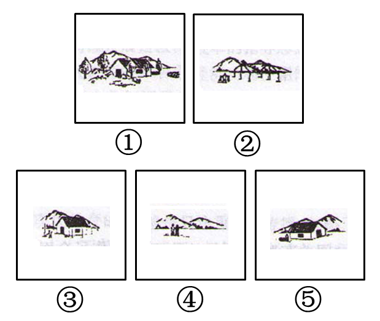

A. ④-②-③-⑤-①

B. ④-②-⑤-③-①

C. ④-②-⑤-①-③

D. ②-④-⑤-③-①

第 44 题 · 答案与解析

**参考答案（粉笔题库参考内容）**

B

**解析**

第一步：先确定逻辑关系最为明显的事件顺序。

观察题干，五个事件主要围绕“人们建造家园”的过程展开论述。逻辑关系的先后顺序比较明显的是事件②和事件④，面对一片荒原，人们打算在这里用自己的双手建造家园，然后是开始建房，有了房子的雏形，因此事件②应在事件④之后。同时容易判断事件③和事件⑤，房子盖好之后，应该在房子周围栽种树木，事件⑤应在事件③之前。而随着栽种的树木长大成林，周围环境变得更加美好，事件①应在事件③之后。

第二步：逐一对照选项并判断正确答案。

根据第一步得到的结果可以判断只有B项符合。

故正确答案为B。

**来源**：2008年吉林省公务员录用考试《行测》题（乙级）第44题

### 第 45 题

①变单一种植为多种经营

②农户喜建新居

③大白菜卖不掉

④出口创汇

⑤改变投资方向

A. ③-⑤-①-④-②

B. ③-①-⑤-④-②

C. ⑤-③-①-④-②

D. ②-③-④-⑤-①

第 45 题 · 答案与解析

**参考答案（粉笔题库参考内容）**

A

**解析**

第一步：先确定逻辑关系最为明显的事件顺序。

观察题干，五个事件主要围绕“农民如何走上致富道路”的过程展开论述。逻辑关系的先后顺序比较明显的是事件③和事件⑤，因为“大白菜卖不掉”，所以要“改变投资方向”，因此事件⑤应在事件③之后。同时容易判断事件①和事件⑤，“变单一种植为多种经营”是针对“改变投资方向”的具体措施，应该在“改变投资方向”之后，事件①应在事件⑤之后。而“出口创汇”是“变单一种植为多种经营是”的结果。最后农民致富，“农户喜建新居”。

第二步：逐一对照选项并判断正确答案。

根据第一步得到的结果可以判断只有A项符合。

故正确答案为A。

**来源**：2008年吉林省公务员录用考试《行测》题（乙级）第45题

### 第 46 题

从所给四个选项中，选择最合适的一个填入问号处，使之呈现一定的规律性：

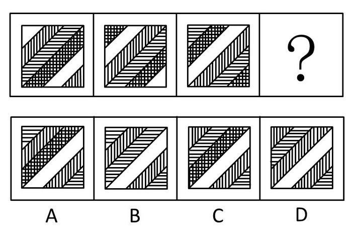

A. A

B. B

C. C

D. D

第 46 题 · 答案与解析

**参考答案（粉笔题库参考内容）**

C

**解析**

观察发现，题干条状部分顺序不变，依次为空白、竖条、横条、网格，且依次下移一格。因此图三第一行的横条应移动到图四第二行处，排除A、B两项，图三第二行的网格部分应移到图四第三行的位置，排除D项，只有C项符合。

故正确答案为C。

**考点**：位置规律-平移

**来源**：2008年吉林省公务员录用考试《行测》题（乙级）第46题

### 第 47 题

从所给四个选项中，选择最合适的一个填入问号处，使之呈现一定的规律性：

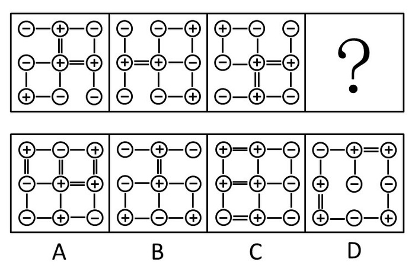

A. A

B. B

C. C

D. D

第 47 题 · 答案与解析

**参考答案（粉笔题库参考内容）**

B

**解析**

考点特殊，是图形内部的特征考查，＋与＋之间是“＝”连接，＋与－之间是“－”连接，－与－之间无连接。

故正确答案为B。

**来源**：2008年吉林省公务员录用考试《行测》题（乙级）第47题

### 第 48 题

从所给四个选项中，选择最合适的一个填入问号处，使之呈现一定的规律性：

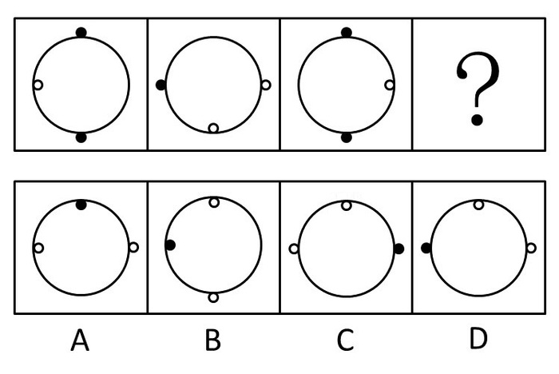

A. A

B. B

C. C

D. D

第 48 题 · 答案与解析

**参考答案（粉笔题库参考内容）**

C

**解析**

思路一：图形元素组成相同，优先考虑位置规律。观察发现，大圆圈内部的小白圆每次逆时针旋转90°，故？处内部的小白圆应该处在上方，排除A项。继续观察发现，图一大圆外圈有两个小黑圆，分开来看，上面的小黑圆每次逆时针旋转90°，故？处小黑圆应在右侧，只有C项符合。验证图一下面的小黑圆每次逆时针旋转90°且颜色交替出现，即黑、白、黑、白，左侧是个小白圆，验证符合规律。

故正确答案为C。

思路二：图形元素组成相同，优先考虑位置规律。观察发现，将图1旋转可以得到图3，故？处应由图2旋转得到，只有C项符合。

故正确答案为C。

**考点**：位置规律-旋转

**来源**：2008年吉林省公务员录用考试《行测》题（乙级）第48题

### 第 49 题

从所给四个选项中，选择最合适的一个填入问号处，使之呈现一定的规律性：

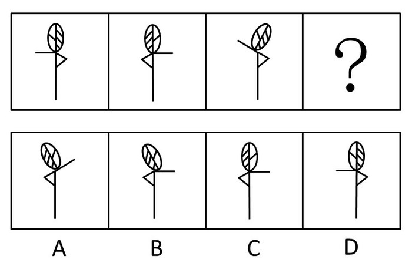

A. A

B. B

C. C

D. D

第 49 题 · 答案与解析

**参考答案（粉笔题库参考内容）**

A

**解析**

解析1：

前两个图形左右对称，后两个图形左右对称。

故正确答案为A。

解析2：

也可以看成是图1翻转为图2，图3翻转得到？处图形。

故正确答案为A。

**考点**：属性规律-对称性

**来源**：2008年吉林省公务员录用考试《行测》题（乙级）第49题

### 第 50 题

从所给四个选项中，选择最合适的一个填入问号处，使之呈现一定的规律性：

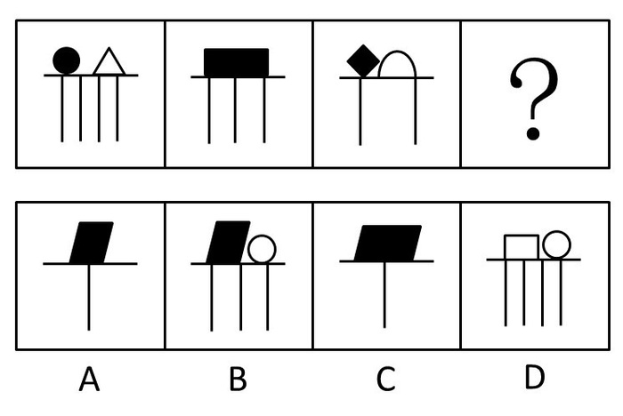

A. A

B. B

C. C

D. D

第 50 题 · 答案与解析

**参考答案（粉笔题库参考内容）**

C

**解析**

图形下部分的竖线依次减少一条，所以排除B、D两项；而上部分要么是两个小图形，要么是一个大图形，并且交替变换，所以上部分应该是一个大图形。

故正确答案为C。

**考点**：数量规律-复合

**来源**：2008年吉林省公务员录用考试《行测》题（乙级）第50题

### 第 51 题

见义勇为是指非因法定职责或者约定义务，为保护国家利益、集体利益或者他人的人身、财产安全，不顾个人安危，与违法犯罪行为作斗争或者抢险救灾的行为。

以下一定不属于见义勇为行为的是：

A. 制止犯罪

B. 抢险救灾

C. 救死扶伤

D. 监护人救助被监护人

第 51 题 · 答案与解析

**参考答案（粉笔题库参考内容）**

D

**解析**

第一步：抓住定义中的关键词。

关键词包括“非因法定职责或者约定义务”、“为保护他人的人身、财产安全”、“与违法犯罪行为作斗争或者抢险救灾”。

第二步：逐一判断选项。

A项符合题干“与违法犯罪行为作斗争”；

B项符合题干“抢险救灾”；

C项“救死扶伤”符合题干为“为保护他人的人身、财产安全”；

D项“监护人救助被监护人”是在法定职责范围之内，不符合“非因法定职责或者约定义务”。

故正确答案为D。

**考点**：拆词

**来源**：2008年吉林省公务员录用考试《行测》题（乙级）第51题

### 第 52 题

形象思维是指以形象为思维载体的思维，与抽象思维相对。

以下不是形象思维的是：

A. 画家笔下的花、鸟、虫、鱼

B. 人类从鸟会飞得到启示，最终发明了飞机

C. 毛泽东同志在谈工作方法时作出的“十个指头弹琴”的比喻

D. 以概念组成判断，以判断构成推理，从而认识和把握客观事物规律

第 52 题 · 答案与解析

**参考答案（粉笔题库参考内容）**

D

**解析**

第一步：抓住定义中的关键词。

关键词包括“以形象为思维载体”、“与抽象思维相对”。

第二步：逐一判断选项。

A项中画家笔下的花、鸟、虫、鱼是对客观事物的直观反应，B项中从鸟飞中得到启示发明飞机和C项中“十个指头弹琴”的比喻，都属于形象思维，体现了“以形象为思维载体”、“与抽象思维相对”；

D项中概念、判断、认识和把握客观事物规律，属于典型的抽象思维。

故正确答案为D。

**考点**：主客体

**来源**：2008年吉林省公务员录用考试《行测》题（乙级）第52题

### 第 53 题

绿色消费是指消费者选购产品时，考虑到产品对生态环境的影响，而选择对环境危害较少，甚至是有利的产品。主要包括三层含义：一是倡导消费者在消费时选择未被污染或有助于公众健康的绿色产品；二是在消费过程中注重对垃圾的处置，不造成环境污染；三是引导消费者转变消费观念，崇尚自然，追求健康，在追求生活舒适的同时，注重环保，节约资源和能源，实现可持续消费。

根据上述定义，下列各项中属于绿色消费的是：

A. 某餐馆推出以野生动物为主的菜式，因其主要材料来自非人工饲养的纯天然的野生动物，甚至包括某些珍稀动物，吸引了一部分消费者

B. 小高热衷于购买本地生产的商品，他认为本地商品即使价格高、样式陈旧、质地较差，但是由于减少了运输过程的资源消耗和包装浪费，也是对环境保护的一种支持

C. 小五出于对健康的考虑，喜欢食用无农药污染的绿色蔬菜，为了保持蔬菜的新鲜，他用塑料保鲜膜将蔬菜分类贮藏

D. 小张是一个注重生活品质的人，所以在装修新居时，不惜花费大价钱，全部使用价格比较昂贵的绿色环保建材

第 53 题 · 答案与解析

**参考答案（粉笔题库参考内容）**

B

**解析**

第一步：抓住定义中的关键词。

关键词包括“考虑到产品对生态环境的影响”、“不造成环境污染”、“节约资源和能源，实现可持续消费”。

第二步：逐一判断选项。

A项中餐馆利用珍稀动物吸引消费者属于违法行为，显然不符合“节约资源和能源，实现可持续消费”；

B项中小高购买本地商品的原因就在于考虑到本地商品可以减少资源消耗和浪费，符合“考虑到产品对生态环境的影响”、“不造成环境污染”；

C项“小五出于对健康的考虑”以及D项小王的“注重生活品质”均不符合“考虑到产品对生态环境的影响”。

故正确答案为B。

**考点**：原因结果

**来源**：2008年吉林省公务员录用考试《行测》题（乙级）第53题

### 第 54 题

科学发展观就是坚持以人为本，树立全面、协调、可持续的发展观，促进经济社会和人的全面发展。

下列不符合科学发展观的是：

A. 节约能源同时提高可再生能源利用比例

B. 提高存款利息，增加人民的利息收入

C. 关注民生问题，改善人民生活

D. 坚持走生产发展、生活富裕、生态良好的文明发展道路

第 54 题 · 答案与解析

**参考答案（粉笔题库参考内容）**

B

**解析**

第一步：抓住定义中的关键词。

关键词包括“以人为本”、“全面、协调、可持续”、“促进经济社会和人的全面发展”。

第二步：逐一判断选项。

B选项提高了存款利息，增加了人民的利息收入，但却违背了可持续发展的原则，因为存款利息的调整应根据经济发展水平及周期来调整。而其他三项均符合科学发展观的定义，体现了“全面、协调、可持续”。

故正确答案为B。

**考点**：单定义-其他句式

**来源**：2008年吉林省公务员录用考试《行测》题（乙级）第54题

### 第 55 题

次级群体是指其成员为了某种特定的目标集合在一起，通过明确的规章制度结成正规关系的社会群体。

下列属于次级群体的是：

A. 军队中的“老乡”群

B. 同一班飞机上的旅客

C. 某中等职业学校学生

D. 某家庭的家庭成员

第 55 题 · 答案与解析

**参考答案（粉笔题库参考内容）**

C

**解析**

第一步：抓住定义中的关键词。

关键词包括“为了某种特定的目标集合”、“通过明确的规章制度结成”。

第二步：逐一判断选项。

根据定义，次级群体的构成要有明确的规章制度的制约，在四个备选答案中只有中等职业学校的学生才符合这一定义，A项“军队中的‘老乡’群”和B项“同一班飞机上的旅客”都不符合“通过明确的规章制度结成正规关系”；

D项本身就是正规关系，无需通过明确的规章制度结成。

故正确答案为C。

**考点**：方式目的

**来源**：2008年吉林省公务员录用考试《行测》题（乙级）第55题

### 第 56 题

从众是个人在群体压力下，放弃自己的意见，转变原有的态度，采取与大多数人一致的行为。

下列属于从众行为的是：

A. 驾驶汽车的司机在路口遇见红灯亮时，会自觉地把车停下来，等待绿灯信号的出现

B. 在一次工作会议中，张某虽然不同意一项提议，但由于在座的其他人都表示赞同，张某也举手表示同意

C. 班级组织春游活动，班中有少数几位同学提议到桃花岛，大多数同学都没有去过，在少数同学的坚持下，大家一致决定同赴桃花岛

D. 王某误上贼船，成了流氓帮派的一员，在首领的威逼下，他被迫昧着良心和其他人一起去干坏事

第 56 题 · 答案与解析

**参考答案（粉笔题库参考内容）**

B

**解析**

第一步：抓住定义中的关键词。

关键词包括“在群体压力下”、“与大多数人一致的行为”。

第二步：逐一判断选项。

A选项中司机的行为属于自觉行为，不符合“在群体压力下”；

B项“由于在座的其他人都表示赞同”符合定义中“在群体压力下”，“张某也举手表示同意”体现了“与大多数人一致的行为”；

C项“在少数同学的坚持下”和D项“在首领的威逼下”均不符合“在群体压力下”。

故正确答案为B。

**考点**：拆词

**来源**：2008年吉林省公务员录用考试《行测》题（乙级）第56题

### 第 57 题

企业文化是指企业在长期的生产经营过程中所形成的那种区别于其他组织的本企业所特有的精神风貌和信念，以及一系列保证这种精神风貌和信念得以持久存在的制度和措施。

下列不属于企业文化的是：

A. 企业经营管理哲学

B. 企业规定的行为准则

C. 企业的经营理念

D. 企业的核心竞争力

第 57 题 · 答案与解析

**参考答案（粉笔题库参考内容）**

D

**解析**

第一步：抓住定义中的关键词。

关键词包括“区别于其他组织的本企业所特有的”、“精神风貌和信念”、“持久存在的制度和措施”。

第二步：逐一判断选项。

A项“经营管理哲学”、C项“经营理念”都属于“精神风貌和信念”；

B项“行为准则”属于“持久存在的制度和措施”；

D项“核心竞争力”不属于企业文化范畴。

故正确答案为D。

**考点**：拆词

**来源**：2008年吉林省公务员录用考试《行测》题（乙级）第57题

### 第 58 题

侵犯行为是指有意伤害他人的行为。侵犯行为是有意图的行为，是外显的行为，并且对他人的身心健康造成伤害。缺少上述任何二个特点的行为，都不能称为侵犯行为。

下列属于侵犯行为的是：

A. 一位高尔夫球员在一次比赛中，击出的球打中了一位观众，给这位观众造成了伤害

B. 王某对张某很不满，在自己的房间里对其加以咒骂，但并未被任何人听见

C. 一名警察在追捕过程中，开枪击中歹徒，使其负伤而被擒获

D. 医生给病人动手术，把折断的骨头接上，手术使得病人非常痛苦

第 58 题 · 答案与解析

**参考答案（粉笔题库参考内容）**

C

**解析**

第一步：抓住定义中的关键词。

关键词包括“有意图的、外显的行为”、“对他人的身心健康造成伤害”。

第二步：逐一判断选项。

A项高尔夫球员击球击中观众属于无意伤害，不符合“有意图的行为”；

B项“并未被任何人听见”不属于“外显的行为”；

C项“警察在追捕过程中”符合“有意图的、外显的行为”，“开枪击中歹徒，使其负伤”也符合“对他人的身心健康造成伤害”，满足两个条件；

D项“医生给病人动手术”是帮助病人减轻痛苦，不是“有意伤害他人的行为”。

故正确答案为C。

**考点**：单定义-其他句式

**来源**：2008年吉林省公务员录用考试《行测》题（乙级）第58题

### 第 59 题

错觉是指由于主观的和客观的原因，人们有时不能完全正确地感知外界事物，会产生各种歪曲。人在特定条件下对客观事物必然产生的，某种有固定倾向的，受到歪曲的知觉。

下列不属于错觉的是：

A. 在黑暗中人长时间注视一个发光点，会发现发光点在动

B. 当月亮在头顶上时，你会发现无论你走到哪里，它总是跟在你的背后

C. 穿白衣服会使瘦小的人略为丰满，而穿黑衣服会使肥胖者显得苗条；横线条的衣服使人显得胖些，竖线条的衣服使人显得瘦

D. 一个人躺在床上，但觉得自己像是在轿子里被抬着走，有一种颠颠的感觉

第 59 题 · 答案与解析

**参考答案（粉笔题库参考内容）**

B

**解析**

第一步：抓住定义中的关键词。

关键词包括“有时不能完全正确地感知”、“产生各种歪曲”、“有固定倾向”。

第二步：逐一判断选项。

B项月光照射引起人的这种感觉并非是错觉，是因为相对月亮而言，人类行走的位移相当于零。其他三项符合错觉的定义。

故正确答案为B。

**考点**：拆词

**来源**：2008年吉林省公务员录用考试《行测》题（乙级）第59题

### 第 60 题

定型思考又叫团体定型思维。所谓“定型思考”是指讨论决策时，团体成员的思路被纳入某种轨道或框架的现象。定型思考会造成一种特殊的气氛，限制团体成员的思路，使讨论不能充分展开。

下列不属于定型思考的是：

A. 某团体在一次决策过程中，为了尽快作出决策，出现了多数人对少数有不同意见的人施加压力的现象

B. 甲公司领导在作出一项决策时，总是首先广泛收集各类信息，并且积极鼓励团体成员提出自己的想法

C. 某些人以为一贯正确，对不同意见总是采取排斥的态度，使得持不同意见的其他同事不愿表达自己的意见

D. 在某公司的一次会议讨论中，由于领导者首先表态，其他成员慑于其权威而保持沉默

第 60 题 · 答案与解析

**参考答案（粉笔题库参考内容）**

B

**解析**

第一步：抓住定义中的关键词。

关键词包括“限制团体成员的思路”、“讨论不能充分展开”。

第二步：逐一判断选项。

B项中领导“广泛收集各类信息，并积极鼓励团体成员提出自己的想法”是一种发散性思维的做法；A项中“多数人对少数有不同意见的人施加压力”、C项中“持不同意见的其他同事不愿表达自己的意见”和D项“其他成员慑于其权威而保持沉默”均符合“限制团体成员的思路”、“讨论不能充分展开”，符合定型思考的定义。

故正确答案为B。

**考点**：原因结果

**来源**：2008年吉林省公务员录用考试《行测》题（乙级）第60题

### 第 61 题

信仰支配着人生观，对人生起着重要作用，它是人生杠杆的支点，杠杆离不开支点，没有支点，杠杆起不到作用。所以：

A. 人生都有支点

B. 没有信仰，人生也就失去了意义

C. 凡是杠杆都有支点

D. 人人都有自己的信仰

第 61 题 · 答案与解析

**参考答案（粉笔题库参考内容）**

B

**解析**

第一步：翻译题干。

①事实信息：信仰是人生杠杆的支点，②-支点→—杠杆起到作用，根据逆否规则可知，③杠杆起到作用→支点，

从①开始推导可知，④人生有意义→信仰。

第二步：逐一判断选项。

B项：-信仰→—人生有意义，根据第一步④可知，B项推断是④的逆否命题，符合题干推断；

A、D项只是一般性陈述，与题干无关；

C项不符合题干推断，由③杠杆起到作用→支点可知，不起作用的杠杆不一定有支点。

故正确答案为B。

**考点**：常规翻译

**来源**：2008年吉林省公务员录用考试《行测》题（乙级）第61题

### 第 62 题

关于小王、小李和小张，我们知道他们三人中一位是律师，一位是医生，一位是教师，并且我们还知道：小张比教师的年龄大；小王和医生不同岁；医生比小李年龄小。

由此可知：

A. 小王是律师，小李是医生，小张是教师

B. 小王是医生，小李是教师，小张是律师

C. 小王是教师，小李是律师，小张是医生

D. 小王是教师，小李是医生，小张是律师

第 62 题 · 答案与解析

**参考答案（粉笔题库参考内容）**

C

**解析**

第一步：找突破口。

本题突破口是信息量最大的对象，即小张。由小王和医生不同岁和医生比小李年龄小可知，小王和小李都不是医生，那么小张必然是医生。

第二步：抄信息于表中，将题干和第一步的所有信息放在一个表中。

第三步：填空，即填上表中的每一个空格。

故正确答案为C。

**考点**：排除法

**来源**：2008年吉林省公务员录用考试《行测》题（乙级）第62题

### 第 63 题

针对作弊屡禁不止的现象，某学院某班承诺，只要全班同学都在承诺书上签字，那么，如果全班有一人作弊，全班同学的考试成绩都以不及格计。校方接受并实施了该班的这一承诺。结果班上还是有人作弊，但班长的考试成绩是优秀。

从上述判断逻辑得出的结论是：

A. 班长采取不正当的手段使校方没有严格实施承诺

B. 全班多数人没有作弊

C. 全班没有人在承诺书上签字

D. 全班有人没在承诺书上签字

第 63 题 · 答案与解析

**参考答案（粉笔题库参考内容）**

D

**解析**

第一步：翻译题干。

①全班同学都在承诺书上签字 且 有人作弊→全班同学不及格。

②有人作弊，班长的考试成绩是优秀。

第二步：从事实信息开始推导并判断选项。

题干中“②有人作弊，班长的考试成绩是优秀”是事实信息。由条件②可知，-全班同学不及格。根据逆否规则可知：-全班同学不及格→—都在承诺书上签 或 -有人作弊，这是一个相容选言命题，如果否定其中一个选言支，必然推出肯定另一个选言支。根据条件②可知“有人作弊”，这属于否定一个选言支，那么必然推出肯定另一个选言支，即“全班同学不都在承诺书上签字”，也就是说“全班有人没在承诺书上签字”。

故正确答案为D。

**考点**：常规翻译

**来源**：2009年湖南省公务员录用考试《行测》题第100题

### 第 64 题

某工厂产品的合格率为95%，抽查其中100件产品，没有发现不合格的。

下列正确的说法是：

A. 再抽查一次，也许会有7件不合格

B. 该产品的合格率应为100%

C. 那么下次抽查肯定有10件不合格

D. 该产品的合格率应大于95%

第 64 题 · 答案与解析

**参考答案（粉笔题库参考内容）**

A

**解析**

第一步：抓住题干主要信息。

题干说明合格率是95%，抽查其中100件产品都合格。

第二步：分析题干信息，并结合选项得出答案。

A项说再抽查一次也许会有7件不合格，说明了每次样品抽查合格的数目是不确定的，符合推断；

B、D两项与题干信息产品的合格率为95%矛盾；

题干抽查的只是样本，样本合格数量占抽查总数不能代表整体情况，因此抽查的样品合格的数目是不确定的，只能说可能。因此C项说法下次抽查肯定有10件不合格，不符合推断。

故正确答案为A。

**考点**：日常结论

**来源**：2008年吉林省公务员录用考试《行测》题（乙级）第64题

### 第 65 题

经过实验室实验和临床试用观察表明，现在有些常用的抗菌类药物，应该空腹服用。因为饭后服用，食物可影响药物的吸收，或使药物利用率明显降低。

下列选项最能支持上述论断的是：

A. 抗菌类药，对胃肠的刺激性不大，可以空腹服用

B. 适宜空腹服用的抗菌类药物只是所有抗菌类药物中的一小部分

C. 人们服用药物时都想增加药物的疗效

D. 以往人们对抗菌类药物的使用存在明显不合理

第 65 题 · 答案与解析

**参考答案（粉笔题库参考内容）**

C

**解析**

第一步：找到论点和论据。

论点是有些常用的抗菌类药物应该空腹服用。论据是饭后服用，食物可能影响药物的吸收，或使药物利用率明显降低。

第二步：判断加强方式。

论点和论据之间存在因果关系，需要加强论点。

第三步：逐一判断选项的作用。

A项中“对胃肠的刺激性不大”与题干没有联系，属于无关项，无法加强；

B项说空腹服用的抗菌类药物只是所有抗菌类药物中的一小部分只是对题干已有信息的陈述，不能起到加强作用；

论点强调饭后服用抗菌类药物会降低药物的利用率，从提高药效这个角度出发，C项说人们都想增加药效，直接加强了论点；

D项说明以往使用存在明显不合理不能说明现在的情况，不能加强论点。

故正确答案为C。

**考点**：搭桥

**来源**：2008年吉林省公务员录用考试《行测》题（乙级）第65题

### 第 66 题

随着中东局势的步步升级，国际石油市场的原油价格急剧上升。但是，也有许多经济分析人士乐观地认为，除非需求突增或者中东产油国集体抵制，否则油价不可能继续上升。如果中东产油国并没有一致采取石油禁运或其它类似行动，国际市场对石油的需求也没有突增。

根据上述文字，能推出的是：

A. 国际石油市场的价格继续上涨

B. 中东局势进一步恶化

C. 经济分析人士将对石油价格涨跌的原因重作分析

D. 各国股票市场中石油股价格上涨

第 66 题 · 答案与解析

**参考答案（粉笔题库参考内容）**

C

**解析**

第一步：翻译题干。

①中东局势升级→原油价格急剧上升。

②油价继续上升→需求突增 或 中东产油国集体抵制。

第二步：找到事实信息。

本题的事实信息是“中东产油国并没有一致采取石油禁运或其它类似行动，国际市场对石油的需求也没有突增”。

第三步：从事实信息开始推导。

“-（一致采取石油禁运 或 其它类似行动） 且 -需求突增”否定了②的后件，可以推出否定②的前件的结论，即油价不会继续上升，A项错误；

“油价不会继续上升”否定了①的后件，可以推出否定①的前件的结论，即中东局势没有升级，B项错误；

由现今国际油价上升，而“中东产油国并没有一致采取石油禁运或其它类似行动，国际市场对石油的需求也没有突增”可知有其他因素导致油价变化，所以需对原因重作分析，C项正确；

“油价不会继续上升”不能说明各国股票市场中石油股价格是否会上涨，D项错误。

故正确答案为C。

**考点**：常规翻译

**来源**：2008年吉林省公务员录用考试《行测》题（乙级）第66题

### 第 67 题

得了感冒，很多人会采用食疗的方法。既然风热感冒出现了咽痛口干、咳嗽痰黄等热性症状，就应该以性质寒凉的西瓜、梨等水果，以及蒲公英等清热药物泡茶饮用来食疗。

最能直接削弱上述结论的一项是：

A. 感冒初期，风寒邪气入侵人体肌肤体表，可以喝一碗红糖姜汤，姜中的姜辣素、姜酮可以发汗驱邪

B. 性质寒凉的食物具有清热解毒的作用，其中有些还可以为人体补充必要的蛋白质和维生素

C. 得了热伤风，正确的做法是既要清热，又要给邪气以出路

D. 寒性药物和食物的大量运用，会使得气血凝滞，从而妨碍了风热病邪的排出

第 67 题 · 答案与解析

**参考答案（粉笔题库参考内容）**

D

**解析**

第一步：找到论点和论据。

论点是很多人得了感冒会采用食疗的方法。没有明显论据。

第二步：判断削弱方式。

只有论点，要构成削弱，对其论点进行削弱。

第三步：逐一判断选项的作用。

A项“喝一碗红糖姜汤，可以发汗驱邪”和B项“性质寒凉的食物具有清热解毒的作用”加强了题干结论；

C项“正确的做法”与题干结论无关，属于无关项；

D项寒性药物和食物的大量运用妨碍了风热病邪的排出，直接否定了得了感冒采用清热药物泡茶饮用来食疗的观点，削弱了题干论点。

故正确答案为D。

**考点**：削弱论点

**来源**：2008年吉林省公务员录用考试《行测》题（乙级）第67题

### 第 68 题

某公司在选派与外商谈判的人员时，有甲、乙、丙、丁四位候选人。为了组成最佳谈判阵容，公司有如下安排：如果派甲去，而且不派乙去，那么丙和丁中至少要派一人去。

如果公司没有派甲去，最能支持这一结论的是：

A. 派乙去，不派丙和丁去

B. 不派乙去，派丙和丁去

C. 乙、丙、丁都没派去

D. 乙、丙、丁都派去

第 68 题 · 答案与解析

**参考答案（粉笔题库参考内容）**

C

**解析**

第一步：翻译题干。

题干：派甲去 且 -派乙去→派丙去 或 派丁去。

第二步：根据结论逆推条件。

本题的结论是“公司没有派甲去” 。

对于题干推导关系，本结论是否定前件之一，所以一定需要否后件的条件，即-（派丙去 或 派丁去），根据德摩根规则，-派丙去 且 -派丁去。

否后件后继续推导为-派丙去 且 -派丁去→—（派甲去 且 -派乙去）根据德摩根规则，-派甲去 或 派乙去。此为选言命题，为得到“-派甲去”，需要否定派乙去。即需要的条件为乙、丙、丁都没派去，C项正确。

故正确答案为C。

**考点**：常规翻译

**来源**：2008年吉林省公务员录用考试《行测》题（乙级）第68题

### 第 69 题

张华、张光、张亮是同学，他们的妹妹张美、张丽、张俏也是就读于同一所学校。张美说：“我的哥哥和张光都是学校篮球队的队员，并且在三个人中长得最矮。”张丽说：“张亮的个子比张俏哥哥的个子高。”

如果上述情况全部属实，可以推出三对兄妹组合是：

A. 张华和张美，张光和张丽，张亮和张俏

B. 张华和张俏，张光和张美，张亮和张丽

C. 张华和张丽，张光和张俏，张亮和张美

D. 张华和张美，张光和张俏，张亮和张丽

第 69 题 · 答案与解析

**参考答案（粉笔题库参考内容）**

D

**解析**

通过张美的话，得出她的哥哥最矮且不是张光，从张丽的话中得出张亮的个子不是最矮，即不是张美的哥哥，所以张美的哥哥是张华。再从张丽的话中得出张俏的哥哥不是张亮，所以张俏的哥哥是张光，张丽的哥哥是张亮。

故正确答案为D。

**考点**：排除法

**来源**：2008年吉林省公务员录用考试《行测》题（乙级）第69题

### 第 70 题

心理学家认为，人一般都有沟通交流的渴望，都有对真情的需要。部分厌倦了群发祝福的现代人开始重新定位节日祝福，抵制祝福群发。细心的人会发现，与前两年全是雷同短信相比，今年的原创短信明显增多，而沉寂多年的拜年贺卡也悄然而至。

上述论证所依据的假设是：

A. 由于节日祝福短信内容多是“克隆”而来，大面积群发自然不可避免地出现重复

B. 祝福群发冲淡了真情，甚至会让人产生不被重视或尊重的感觉

C. 据估算，春节7天长假全国手机短信发送量预计为120亿条左右，上一年春节假期这一数字为110亿条

D. 现代人在发送节日祝福短信时缺乏创新性，读多了难免让人产生厌倦情绪

第 70 题 · 答案与解析

**参考答案（粉笔题库参考内容）**

B

**解析**

第一步：找到论点和论据。

论点是人都有对真情的需要，开始重新定位节日祝福，论据是厌倦了群发祝福，原创短信明显增多，拜年贺卡也悄然而至。

第二步：逐一判断选项。

题干论证的是真情与群发信息之间的关系，那么前提一定是真情与群发信息有关系。

A项“大面积群发”信息只是对题干已有现象的重复，显然不能起到加强作用；

B项祝福群发冲淡了真情，满足题意，符合推断；

C项与论点、论据没有关系，属于无关项；

D项“短信缺乏创新性”削弱了题干结论。

故正确答案为B。

**考点**：搭桥

**来源**：2008年吉林省公务员录用考试《行测》题（乙级）第70题

### 第 71 题

国家体育场“鸟巢”是2008年北京奥运会主体育场，将美轮美奂的“鸟巢”设计成东西两头高，南北两头低是因为：

A. 运动赛场具有方向性的缘故

B. 体现太阳东升西落的理念

C. 受中国地理位置影响，为了减少东西风干扰

D. 取鸟向东方迎着太阳飞的意向

第 71 题 · 答案与解析

**参考答案（粉笔题库参考内容）**

A

**解析**

将“鸟巢”设计成东西两头高、南北两头低，是因为运动赛场具有方向性的缘故。通常比较正规的运动场都是南北走向，一方面是因为地球自转的方向是自西向东的，太阳总是东升西落。只有运动场是南北走向的时候，太阳光才是从运动员的侧面照射过来的，运动员才能避免受到太阳直射，不至于影响到比赛的发挥。另一方面，运动赛场是南北走向的话，东西方向看台观众的视线是均衡的，因为观众可以均衡地看到两端的比赛情况。此外，东西两头高还可以尽量遮挡一部分上午和下午的太阳，最大程度地减少太阳光对运动员的干扰。

故正确答案为A。

**考点**：生活常识

**来源**：2008年吉林省公务员录用考试《行测》题（乙级）第71题

### 第 72 题

福娃设计组的韩美林说：“我要设计出一种形象，表现出源远流长的中国文化，表达出中国人民的热情，在这个千载难逢的机会里，我要让福娃的每一个细胞里都揉进‘中国’这两个字。”

从哲学上看，设计师的灵感和创意：

A. 是不受客观存在的制约的，是可遇不可求的

B. 来源于善于思辨，富于创造的头脑

C. 是发挥能动性，对中国文化的能动反映

D. 说明设计师善于捕捉稍纵即逝的意识

第 72 题 · 答案与解析

**参考答案（粉笔题库参考内容）**

C

**解析**

灵感和创意属于思维范畴，来源于生活，同时又是设计师主观能动性的体现。设计师想通过设计福娃的形象来表现中国文化，表达中国人民的热情，这反映出设计师通过发挥主观能动性来发扬中国文化。所以从哲学上看，设计师的灵感和创意是发挥能动性，对中国文化的能动反映。

故正确答案为C。

**考点**：唯物论

**来源**：2008年吉林省公务员录用考试《行测》题（乙级）第72题

### 第 73 题

在全国人民为即将举行的奥运会而欢欣时，藏独分子和CNN不实报道在祖国人民的心口上撒上了一把盐。

面对这些，下列做法最合适的是：

A. 小孙用不去“家乐福”等法国超市的实际行动来表示不满和抗议

B. 小李呼吁游行、示威来表示中国人民的不满

C. 小王认为我们应该集中精力做好本职工作

D. 小赵通过QQ、因特网等现代信息渠道来表明不满和抗议

第 73 题 · 答案与解析

**参考答案（粉笔题库参考内容）**

C

**解析**

本题考查新思想。

面对藏独活动和不实报道，最合理的做法应该是冷静理智地对待，而不是盲目示威反抗。做好本职工作，迎接奥运会的召开，向世人展示文明大国的形象，才是最合适的做法，C项正确。

解答本题时，对比四个选项，会发现A、B、D三项谈到的都是通过不同的渠道来表达“不满”或“抗议”，在行为性质上没有什么差别。本题作为单选题，正确答案只有一个，C项也言之有理。

故正确答案为C。

**考点**：其他建设

**来源**：2008年吉林省公务员录用考试《行测》题（乙级）第73题

### 第 74 题

2008年初，我国南方各省连续发生多次降雪，形成了新中国成立以来最严重的一场雪灾。面对灾情，政府制定了一系列措施。

下列依据哲学原理解释有误的一项是：

A. 雪灾造成道路、交通、通讯等设施严重受损，群众生活和工农业生产受到极大影响，这说明自然的规律不可战胜

B. 用抗洪的精神抗击雪灾，全力以赴开展抗灾救灾，体现了人的主观能动性，是人类重视精神力量的体现

C. 以紧紧依靠广大军民，把抗雪灾作为最紧迫的任务，体现了人民群众是实践的主体，是历史创造者的观点，是坚持群众路线的表现

D. 针对低温冰冻雪灾的特点，千方百计保通畅、保供电、保民生、保稳定，体现了具体问题具体分析，集中主要力量抓主要矛盾的观点

第 74 题 · 答案与解析

**参考答案（粉笔题库参考内容）**

A

**解析**

A项”规律不可战胜”有悖于马克思哲学认识论,马克思主义告诉我们规律是可以被认识的，只有认识了规律才能按照规律办事。根据题干可知政府带领广大人民群众积极应对雪灾造成的严重影响，全力抗灾救灾，可见规律是可以被认识的，错误；

B、C、D三项都针对政府应对南方雪灾采取的措施进行了正确的分析，体现了人的主观能动性、人民群众是实践的主体以及具体问题具体分析等，符合马克思主义原理。

故正确答案为A。

**考点**：认识论

**来源**：2008年吉林省公务员录用考试《行测》题（乙级）第74题

### 第 75 题

2007年老百姓衣、食、住、行、学的价格和费用有涨有落，牵动着民生忧喜，针对物价上涨我国政府采取了多种措施，下列有利于抑制物价上涨的措施是：

A. 增加财政支出

B. 扩大消费需求

C. 提高工资水平

D. 提高存贷款利率

第 75 题 · 答案与解析

**参考答案（粉笔题库参考内容）**

D

**解析**

国家采取了一系列措施来抑制物价上涨，其中央行提高存贷款利率是一项主要措施。提高存款利率，存款就会多，消费就要减少，买的少了，东西就要降价，反之，物价就会回升。提高贷款利率，人们就不愿意去银行贷款，由此就降低了人民币的流动性，就抑制了通货膨胀。

故正确答案为D。

**考点**：宏观经济与调控政策

**来源**：2008年吉林省公务员录用考试《行测》题（乙级）第75题

### 第 76 题

在雪地说话声音不那么响的原因是：

A. 因为雪地疏松多孔，它们起到了消声的作用

B. 与说话人心理有关

C. 因为雪地空旷、不扰音

D. 因为下雪后空气稀薄，声音传导受限制

第 76 题 · 答案与解析

**参考答案（粉笔题库参考内容）**

A

**解析**

在雪地说话声音不那么响，是雪地吸声造成的，这是因为雪落在地上比较松软，中间有许多的空隙，声音一旦进入里面后，反射出来的很少，所以声音就小了。

故正确答案为A。

**考点**：生活常识

**来源**：2008年吉林省公务员录用考试《行测》题（乙级）第76题

### 第 77 题

有关6岁儿童的行为措述不正确的一项是：

A. 6岁的儿童可以练长跑

B. 6岁的儿童用石头把人打伤，应该由父母承担责任

C. 6岁的儿童认知水平具有相对具体和刻板性特点

D. 《关于开展全民义务植树运动的实施办法》中6岁以上的儿童在责任人协助下，每人每年植树3-5棵

第 77 题 · 答案与解析

**参考答案（粉笔题库参考内容）**

A

**解析**

从保护儿童的健康出发，让6岁的孩子跟成人一起长跑是不合适的。儿童机体各部分的功能还不成熟，从6岁孩子的骨骼、肌肉的发育特点看，骨骼弹性大，硬度小，容易发生变形，肌肉的纤维较细，易疲劳和受损伤。呼吸、循环方面，儿童的肺活量相对较小，所以呼吸频率要比成人快，才能满足身体的需要，孩子的心脏只有成人的三分之一大，心脏壁薄，每搏输出量少。显然，儿童的身体对较激烈的运动适应能力差，同样不能耐受如长跑、举重之类的运动项目，所以A项不正确。

本题为选非题，故正确答案为A。

**考点**：生活常识

**来源**：2008年吉林省公务员录用考试《行测》题（乙级）第77题

### 第 78 题

下列关于杨利伟的宇航服是白色的原因，说法正确的一项是：

A. 由宇航员的工作性质决定的，像医生一样，白色符合他职业特点

B. 什么颜色的衣服都可以，杨利伟喜欢白色衣服，因为白色圣洁

C. 其他颜色的衣服会分散宇航员的注意力，影响飞行操作

D. 白色宇航服反射光和热，可以阻隔太阳的热量，以保护宇航员身体

第 78 题 · 答案与解析

**参考答案（粉笔题库参考内容）**

D

**解析**

因为白色具有最广的光谱范围，有良好的反辐射功能以及最低的热辐射率。在太空中的宇航员，直接暴露在各类宇宙射线和强烈的太阳热辐射下，需要能防止射线穿透的材料来制作宇航服，以保证宇航员的健康。

故正确答案为D。

**考点**：生活常识

**来源**：2008年吉林省公务员录用考试《行测》题（乙级）第78题

### 第 79 题

“宁可终身不饮酒，不可三餐无饮茶”，茶文化在中国源远流长，下面对茶的解释有误的一项是：

A. 绿茶利于清热利尿，因此凉性体质的人不宜多喝，红茶提神醒目，降血脂的功能较强

B. 空腹饮浓茶或者素食充饥后饮浓茶，以及不常喝茶的人忽然喝了浓茶，都可能物极必反引起醉茶

C. 喝茶也要挑时间，饭前、晚睡前饮茶有助于消化和睡眠，茶冲出来不应放置时间过长

D. 花茶对理气解郁有帮助，适宜心情郁抑时饮用。乌龙茶能起消脂减肥的功效

第 79 题 · 答案与解析

**参考答案（粉笔题库参考内容）**

C

**解析**

为保证身体能够充分接纳和消化食物，饭前饭后半小时内最好不喝茶，因为茶会刺激中枢神经系统，把本应更多地参与到消化中的物质与能量，消耗到其它方面。同样的，为保证良好睡眠，睡前也不适宜喝茶，C项错误。

故正确答案为C。

**考点**：生活常识

**来源**：2008年吉林省公务员录用考试《行测》题（乙级）第79题

### 第 80 题

对盐的作用，下列解说不正确的是：

A. 盐是烹调时必不可少的调味料，它能去掉鱼的腥味

B. 盐有助于健康和美容，牙膏、洗面奶、浴液、按摩剂、枕头等都可以加入盐

C. 盐有抑制氧化酶的作用，可以使绿色的蔬菜耐煮，也可以防止削了皮的苹果变成棕色

D. 盐能促进蛋白质的分解，所以烤鱼和烤肉时用盐浸泡时间越长，肉质越鲜美多汁

第 80 题 · 答案与解析

**参考答案（粉笔题库参考内容）**

D

**解析**

盐分过多会造成水分的缺失，导致肉质变味，而非使肉质鲜美多汁，D项错误。

本题为选非题，故正确答案为D。

**考点**：生活常识

**来源**：2008年吉林省公务员录用考试《行测》题（乙级）第80题

## 材料 2

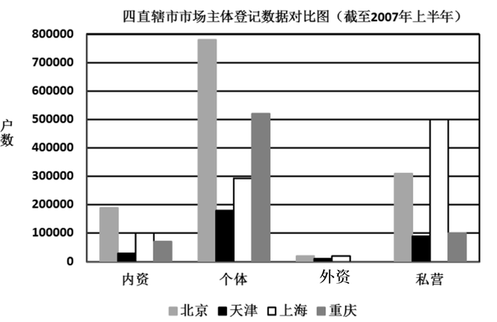

### 第 81 题

截至2007年上半年末，四直辖市市场主体登记数据中市场主体户数最少的是：

A. 内资企业

B. 个体企业

C. 外资企业

D. 私营企业

第 81 题 · 答案与解析

**参考答案（粉笔题库参考内容）**

C

**解析**

如图所示，四直辖市市场主体登记数据中外资企业户数都是最少的。

故正确答案为C。

**考点**：直接找数、统计图

**来源**：2008年吉林省公务员录用考试《行测》题（乙级）第81题

### 第 82 题

截至2007年上半年末，在所登记的私营企业中上海的私营企业户数比重庆的私营企业户数大约多：

A. 300000户

B. 400000户

C. 500000户

D. 600000户

第 82 题 · 答案与解析

**参考答案（粉笔题库参考内容）**

B

**解析**

上海的私营企业户数减去重庆的私营企业户数，大约是500000－100000＝400000户。

故正确答案为B。

**考点**：简单加减计算、统计图

**来源**：2008年吉林省公务员录用考试《行测》题（乙级）第82题

### 第 83 题

从上图可知，个体企业户数最多的直辖市是：

A. 北京市

B. 天津市

C. 上海市

D. 重庆市

第 83 题 · 答案与解析

**参考答案（粉笔题库参考内容）**

A

**解析**

四直辖市中，个体企业户数：北京＞重庆＞上海＞天津。

故正确答案为A。

**考点**：直接找数、统计图

**来源**：2008年吉林省公务员录用考试《行测》题（乙级）第83题

### 第 84 题

截至2007年上半年末，在所登记的内资企业中户数最少的直辖市是：

A. 北京市

B. 天津市

C. 上海市

D. 重庆市

第 84 题 · 答案与解析

**参考答案（粉笔题库参考内容）**

B

**解析**

内资企业户数：北京＞上海>重庆＞天津。

故正确答案为B。

**考点**：直接找数、统计图

**来源**：2008年吉林省公务员录用考试《行测》题（乙级）第84题

### 第 85 题

截至2007年上半年末，在所登记的个体企业中户数排在第二位的直辖市是：

A. 北京市

B. 天津市

C. 上海市

D. 重庆市

第 85 题 · 答案与解析

**参考答案（粉笔题库参考内容）**

D

**解析**

四直辖市中，个体企业户登记数：北京＞重庆＞上海＞天津。重庆是个体企业户数第二多的。

故正确答案为D。

**考点**：排序类、统计图

**来源**：2008年吉林省公务员录用考试《行测》题（乙级）第85题

## 材料 3

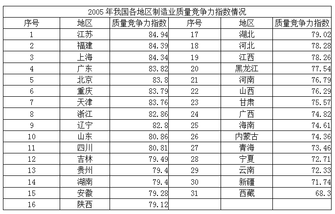

### 第 86 题

排在第一位的江苏省制造业的质量竞争力指数领先西藏：

A. 16.64

B. 17.51

C. 16.19

D. 17.19

第 86 题 · 答案与解析

**参考答案（粉笔题库参考内容）**

A

**解析**

江苏省的竞争力指数减去西藏的竞争力指数。即：84.94－68.30＝16.64。

故正确答案为A。

**考点**：简单加减计算、统计表

**来源**：2008年吉林省公务员录用考试《行测》题（乙级）第86题

### 第 87 题

地区质量竞争力指数处在较高水平（80以上）的省份有：

A. 8个

B. 9个

C. 10个

D. 11个

第 87 题 · 答案与解析

**参考答案（粉笔题库参考内容）**

D

**解析**

表中排在11位的四川以上的省份（含四川）竞争力指数均大于80。

故正确答案为D。

**考点**：直接找数、统计表

**来源**：2008年吉林省公务员录用考试《行测》题（乙级）第87题

### 第 88 题

制造业的质量竞争力指数排在第二十位的省份是：

A. 黑龙江

B. 河北

C. 江西

D. 河南

第 88 题 · 答案与解析

**参考答案（粉笔题库参考内容）**

A

**解析**

表中排在第二十位是黑龙江。

故正确答案为A。

**考点**：排序类、统计表

**来源**：2008年吉林省公务员录用考试《行测》题（乙级）第88题

### 第 89 题

东北三省中，制造业的质量竞争力最强的是：

A. 黑龙江

B. 吉林

C. 辽宁

D. 三个省份没有差别

第 89 题 · 答案与解析

**参考答案（粉笔题库参考内容）**

C

**解析**

辽宁第9位，吉林第12位，黑龙江第20位，所以最强的是辽宁。

故正确答案为C。

**考点**：直接找数、统计表

**来源**：2008年吉林省公务员录用考试《行测》题（乙级）第89题

### 第 90 题

下列表述中正确的是：

A. 制造业质量竞争力较强的地区大部分是西部地区

B. 制造业质量竞争力指数超过80分的地区中，西部地区有两个

C. 制造业质量竞争力指数与地区经济发展状况无关

D. 西部地区中制造业质量竞争力指数最高的是四川

第 90 题 · 答案与解析

**参考答案（粉笔题库参考内容）**

B

**解析**

A、C两项错误，根据常识即可判断A、C两项说法均错误；

B项正确，竞争力指数超过80的地区中，西部地区中有重庆和四川，共2个；

D项错误，重庆高于四川，四川并非最高。

故正确答案为B。

**考点**：统计表、综合分析

**来源**：2008年吉林省公务员录用考试《行测》题（乙级）第90题

## 材料 4

2005年底，全国城镇房屋建筑面积164.51亿平方米，其中住宅建筑面积107.69亿平方米，占房屋建筑面积的比重为65.46%。东部地区房屋建筑面积83.8亿平方米，中部地区45.22亿平方米，西部地区35.48亿平方米，分别占全国城镇房屋建筑面积的50.94%、27.49%和21.57%。东部地区城镇住宅建筑面积53.67亿平方米，中部地区30.33亿平方米，西部地区23.69亿平方米，分别占全国城镇住宅建筑面积的49.84%、28.16%和22%。

        2005年全国城镇人均住宅建筑面积26.11平方米，其中东部地区28平方米，中部地区23.9平方米，西部地区25.24平方米。

        全国城镇户均住宅建筑面积83.2平方米，户均成套住宅套数0.85套。东部地区户均住宅建筑面积85.32平方米，中部地区77.96平方米，西部地区85.75平方米，户均成套住宅套数分别为0.89套、0.79套和0.83套。

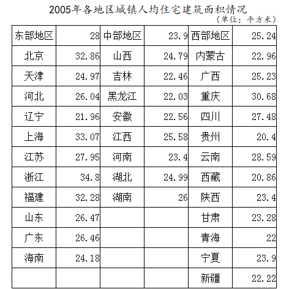

### 第 91 题

2005年底，全国城镇房屋建筑面积中非住宅建筑面积为：

A. 58.62亿平方米

B. 56.82亿平方米

C. 52.86亿平方米

D. 53.86亿平方米

第 91 题 · 答案与解析

**参考答案（粉笔题库参考内容）**

B

**解析**

全国城镇房屋建筑面积164.51亿平方米减去其中住宅建筑面积107.69亿平方米，即为非住宅建筑面积，164.51－107.69＝56.82亿平方米。

故正确答案为B。

**考点**：简单加减计算、综合资料

**来源**：2008年吉林省公务员录用考试《行测》题（乙级）第91题

### 第 92 题

2005年底，东部地区房屋建筑面积高于西部地区：

A. 48.32亿平方米

B. 43.82亿平方米

C. 42.83亿平方米

D. 52.83亿平方米

第 92 题 · 答案与解析

**参考答案（粉笔题库参考内容）**

A

**解析**

东部地区房屋建筑面积高于西部地区83.8－35.48＝48.32亿平方米。

故正确答案为A。

**考点**：简单加减计算、综合资料

**来源**：2008年吉林省公务员录用考试《行测》题（乙级）第92题

### 第 93 题

2005年在全国31个省市自治区中，城镇人均住宅建筑面积最大的是：

A. 北京市

B. 上海市

C. 福建省

D. 浙江省

第 93 题 · 答案与解析

**参考答案（粉笔题库参考内容）**

D

**解析**

北京32.86，上海33.07，福建32.28，浙江34.80。浙江的城镇人均住宅建筑面积最大。

故正确答案为D。

**考点**：直接找数、综合资料

**来源**：2008年吉林省公务员录用考试《行测》题（乙级）第93题

### 第 94 题

2005年在全国31个省市自治区中，高于全国城镇人均住宅建筑面积的省市自治区有：

A. 8个

B. 9个

C. 10个

D. 11个

第 94 题 · 答案与解析

**参考答案（粉笔题库参考内容）**

C

**解析**

2005年全国城镇人均住宅建筑面积26.11平方米，其中北京，上海，江苏，浙江，福建，山东，广东，重庆，四川，云南这10个省市自治区高于26.11。

故正确答案为C。

**考点**：直接找数、综合资料

**来源**：2008年吉林省公务员录用考试《行测》题（乙级）第94题

### 第 95 题

下列说法不正确的是：

A. 2005年底，全国城镇住宅建筑面积占房屋建筑面积不足五成

B. 东部地区城镇人均住宅建筑面积高于中部和西部地区

C. 全国城镇户均成套住宅套数不足一套

D. 辽宁省城镇人均住宅建筑面积多于贵州省1.56平方米

第 95 题 · 答案与解析

**参考答案（粉笔题库参考内容）**

A

**解析**

A项错误，2005年底全国城镇住宅建筑面积占房屋建筑面积65.46%，超过五成；

B项正确，东部地区城镇人均住宅建筑面积28平方米高于中部地区（23.9平方米）和西部地区（25.24平方米）；

C项正确，全国城镇户均成套住宅套数0.85套，不足一套；

D项正确，辽宁省城镇人均住宅建筑面积比贵州省多21.96－20.4＝1.56平方米。

本题为选非题，故正确答案为A。

**考点**：综合分析、综合资料

**来源**：2008年吉林省公务员录用考试《行测》题（乙级）第95题

## 材料 5

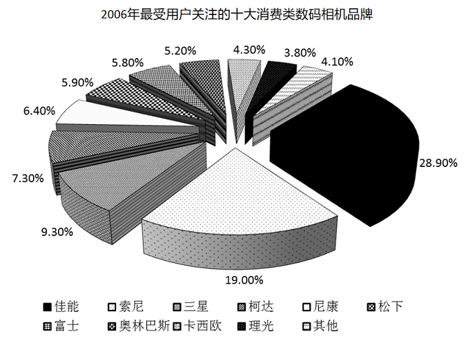

### 第 96 题

2006年最受关注的品牌是：

A. 卡西欧

B. 三星

C. 索尼

D. 佳能

第 96 题 · 答案与解析

**参考答案（粉笔题库参考内容）**

D

**解析**

佳能的关注程度达到28.9%，是最高的。

故正确答案为D。

**考点**：直接找数、统计图

**来源**：2008年吉林省公务员录用考试《行测》题（乙级）第96题

### 第 97 题

2006年最受关注的两大品牌合计占所有品牌的比重为：

A. 19.0%

B. 47.9%

C. 28.9%

D. 50.8%

第 97 题 · 答案与解析

**参考答案（粉笔题库参考内容）**

B

**解析**

最受关注的两大品牌佳能28.9%和索尼19.0%，共47.9%。

故正确答案为B。

**考点**：简单加减计算、统计图

**来源**：2008年吉林省公务员录用考试《行测》题（乙级）第97题

### 第 98 题

根据上图，消费者关注的十大品牌合计占所有品牌的比重为：

A. 97.4%

B. 95.9%

C. 67.8%

D. 56.9%

第 98 题 · 答案与解析

**参考答案（粉笔题库参考内容）**

B

**解析**

除十大品牌的其它品牌关注度为4.1%，十大品牌关注度即为100%－4.1%＝95.9%。

故正确答案为B。

**考点**：简单加减计算、统计图

**来源**：2008年吉林省公务员录用考试《行测》题（乙级）第98题

### 第 99 题

下列说法正确的是：

A. 2006年富士和松下两个品牌合计受关注程度要高于索尼品牌

B. 2006年理光和卡西欧两个品牌合计受关注程度要高于三星品牌

C. 2006年尼康和柯达两个品牌合计受关注程度要高于索尼品牌

D. 以上选项都不正确

第 99 题 · 答案与解析

**参考答案（粉笔题库参考内容）**

D

**解析**

A选项错误，富士5.8%，松下5.9%，合计11.7%，小于索尼（19.0%）；

B选项错误，理光3.8%，卡西欧4.3%，合计8.1%，小于三星（9.3%）；

C选项错误，尼康6.4%，柯达7.3%，合计13.7%，小于索尼（19.0%）。

综上，A、B、C均不正确。

故正确答案为D。

**考点**：统计图、综合分析

**来源**：2008年吉林省公务员录用考试《行测》题（乙级）第99题

### 第 100 题

下列说法正确的是：

A. 2006年索尼和三星两个品牌的受关注程度要高于佳能品牌

B. 2006年三星和柯达合计占所有品牌比重为16.6%

C. 2006年富士和奥林巴斯合计占所有品牌的比重为12.6%

D. 2006年理光和卡西欧合计占所有品牌的比重为10.2%

第 100 题 · 答案与解析

**参考答案（粉笔题库参考内容）**

B

**解析**

A选项错误，索尼19.0%，三星9.3%，小于佳能（28.9%）；

B选项正确，三星9.3%，柯达7.3%，9.3%＋7.3%＝16.6%；

C选项错误，富士5.8%，奥林巴斯5.2%，5.8%＋5.2%＝11%，并非12.6%；

D选项错误，理光3.8%，卡西欧4.3%，3.8%＋4.3%＝8.1%，并非10.2%。

故正确答案为B。

**考点**：统计图、综合分析

**来源**：2008年吉林省公务员录用考试《行测》题（乙级）第100题

