# 2008年吉林省公务员录用考试《行测》题（甲级）

<!-- gwy:overview:start -->
> **吉林 · 2008 · 行测 · 甲级** ｜ 110 题 · 图片 14 处 · 答案随题折叠

| 题型模块 | 题量 | 题号 |
| --- | ---: | ---: |
| 数量关系 | 10 | 1–10 |
| 言语理解与表达 | 30 | 11–40 |
| 判断推理 | 40 | 41–80 |
| 常识判断 | 10 | 81–90 |
| 资料分析 | 20 | 91–110 |
| **合计** | **110** | |

导航：[题型与作答说明](#题型与作答说明) · [题目](#题目) · [材料 1](#材料-1)
<!-- gwy:overview:end -->

> 候选采集稿。参考答案及解析来自粉笔页面，不代表官方答案或真实高分答卷；来源使用许可与原卷对应关系仍需人工核实。

## 题型与作答说明

数量关系

（10题）

本部分包括数字推理与数量关系两种类型的试题。

言语理解与表达

（30题）

本部分包括语句表达与阅读理解两种类型的题目。

判断推理

（40题）

本部分包括定义判断、图形推理、逻辑推理与常识经验判断四种类型的试题。

常识判断

（10题）

根据题目要求，在四个选项中选出一个最恰当的答案。

资料分析

（20题）

针对下列文字、表或图回答问题。你应根据资料提供的信息进行分析、比较、计算、处理。

## 题目

### 第 1 题

0，0，3，20，115，（  ）

A. 710

B. 712

C. 714

D. 716

第 1 题 · 答案与解析

**参考答案（粉笔题库参考内容）**

C

**解析**

变倍递推数列，具体规律为：(0 + 0) × 2 = 0，(0+1)×3=3，(3 + 2) × 4 = 20，(20+3) × 5 = 115，(115 + 4) × 6 = 714。

故正确答案为C。

**来源**：2008年吉林省公务员录用考试《行测》题（甲级）第1题

### 第 2 题

2008，2006，2003，1998，1991，1980，（  ）

A. 1982

B. 1965

C. 1967

D. 1969

第 2 题 · 答案与解析

**参考答案（粉笔题库参考内容）**

C

**解析**

前项减去后项，得到质数列2、3、5、7、11、(13)，下一项应为1980-13=1967。

故正确答案为C。

**来源**：2008年吉林省公务员录用考试《行测》题（甲级）第2题

### 第 3 题

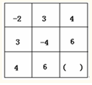

A. －2

B. －3

C. －4

D. －5

第 3 题 · 答案与解析

**参考答案（粉笔题库参考内容）**

D

**解析**

每行每列加起来的和都是5，则未知项为5－4－6＝－5。

故正确答案为D。

**来源**：2008年吉林省公务员录用考试《行测》题（甲级）第3题

### 第 4 题

| | | |
| ---: | ---: | ---: |
| 4 | 7 | 14 |
| 9 | 16 | ( ) |
| 18 | 33 | 64 |

A. 30

B. 31

C. 32

D. 33

第 4 题 · 答案与解析

**参考答案（粉笔题库参考内容）**

B

**解析**

看斜对角的数字变化：64 = 4 × 4 × 4，16 = 4 × 4，4，9-7=2，18-16=16-14=2，则未知项为33－2＝31。

故正确答案为B。

**来源**：2008年吉林省公务员录用考试《行测》题（甲级）第4题

### 第 5 题

0，3，2，5，4，7，（  ）

A. 6

B. 7

C. 8

D. 9

第 5 题 · 答案与解析

**参考答案（粉笔题库参考内容）**

A

**解析**

方法一：观察数列没有明显特征，考虑多级数列。后一项减去前一项得到新数列3、-1、3、-1、3，新数列构成3、-1循环的周期数列，下一项为-1，则（  ）=7+(-1)=6。

方法二：考虑递推数列，观察可知：5=3+2-0；4=2+5-3；7=5+4-2，相邻三项中，后两项之和减去第一项等于下一项，则所求项=4+7-5=6。

故正确答案为A。

**来源**：2010年黑龙江省公务员录用考试《行测》题第40题

### 第 6 题

中国是现代电子计算机二进制的发源地，二进制中只有“0”和“1”两个数码，因“二”没有单独数码代表，因此“逢二进一”，这样便可以表示一切自然数。请选出下列十进制数中，用二进制表示不正确的一项是：

A. 1为1，2为10

B. 3为11，5为110

C. 4为100，7为111

D. 8为1000，10为1010

第 6 题 · 答案与解析

**参考答案（粉笔题库参考内容）**

B

**解析**

根据二进制的计算方式，计算每个选项是否正确，所以5应该为101，而不是110。

本题为选非题，故正确答案为B。

**来源**：2008年吉林省公务员录用考试《行测》题（甲级）第6题

### 第 7 题

四点半钟后，时针与分针第一次成直线的时刻为：

A. 4点40分

B. 4点45又4/11分

C. 4点54又6/11分

D. 4点57分

第 7 题 · 答案与解析

**参考答案（粉笔题库参考内容）**

C

**解析**

时针一小时走5格，每分钟走1/12格；分针1分钟走一格。四点半时，时针与分针相距7格半，则第一次成直线需要(30−7.5)÷(1−1/12)=270/11分，即24又6/11分，相加可得4点54又6/11分。

故正确答案为C。

**来源**：2008年吉林省公务员录用考试《行测》题（甲级）第7题

### 第 8 题

有个人发现图书馆的那本《大英百科全书》的第21、42、64、65、121、137、138、190页对他有用，便把这几页偷偷的撕下带走了。那么他一共撕去了：

A. 4页

B. 6页

C. 7页

D. 8页

第 8 题 · 答案与解析

**参考答案（粉笔题库参考内容）**

C

**解析**

根据书本的特点，137和138是在同一页的正反面，所以共撕去了7页。

故正确答案为C。

**来源**：2008年吉林省公务员录用考试《行测》题（甲级）第8题

### 第 9 题

一个四边形去掉一个角，还剩几个角？下列不可能的是：

A. 3

B. 4

C. 5

D. 6

第 9 题 · 答案与解析

**参考答案（粉笔题库参考内容）**

D

**解析**

从对角线方向切割，可以得到一个三角形，即剩下3个角；从一个顶点和这个顶点不在的两条边之一切割，得到一个四边形，即剩下4个角；从两条邻边切割，得到一个五边形，即剩下5个角。因此不可能的是6个角。

本题为选非题，故正确答案为D。

**考点**：几何其他题型

**来源**：2008年吉林省公务员录用考试《行测》题（甲级）第9题

### 第 10 题

某日人民币的外汇牌价如下表（货币单位：人民币元），按照这一汇率，100元人民币可以兑换：

| 货币名称 | 中间价 |
| --- | ---: |
| 100 美元 | 786.97 |
| 100 欧元 | 1003.53 |
| 100 日元 | 6.6704 |
| 100 港币 | 101.102 |

A. 10.07欧元

B. 1490.16日元

C. 12.71美元

D. 99.98港币

第 10 题 · 答案与解析

**参考答案（粉笔题库参考内容）**

C

**解析**

A项错误，100元人民币可兑换100 × 100/1003.53 ≈ 9.96欧元；

B项错误，100元人民币可兑换100 × 100/6.6704 ≈ 1499.16日元；

C项正确，100元人民币可兑换100 × 100/786.97 ≈ 12.71美元；

D项错误，100元人民币可兑换100 × 100/101.102 ≈ 98.91港币。

故正确答案为C。

**来源**：2008年吉林省公务员录用考试《行测》题（甲级）第10题

### 第 11 题

中国艺术品市场又让经验丰富的专业人士瞠目结舌，美国一家主流媒体认为，无论以何种标准来衡量，目前在克里斯蒂拍卖行取得的2630万美元总拍卖额也属非比寻常的巨大成功。《国际先驱论坛报》就此刊发文章说：中国艺术品热拉动了纽约拍卖市场。出席拍卖会的人士似乎有一种疯狂的购买热情。一般的出席者来自中国大陆、香港和台湾。114只鼻烟壶最终以428万美元的总价被拍出，这股购买热潮因此平添了几分传奇色彩。

题中运用的说明方法有：

A. 举例子、列数字、引资料

B. 作诠释、列数字、作比较

C. 打比方、作比较、举例子

D. 下定义、列数字、作诠释

第 11 题 · 答案与解析

**参考答案（粉笔题库参考内容）**

A

**解析**

从“2630万美元”、“114只鼻烟壶”、“428万美元的总价”可以看出，题干运用了列数字的说明方法；引用《国际先驱论坛报》的文章是引资料的说明方法；为了说明购买热潮的传奇色彩，又举出：“114只鼻烟壶最终以428万美元的总价被拍出”的例子，这是举例子的方法，A项正确。

作诠释是从一个侧面，就事物的某一个特点做些解释；

下定义是一种用简洁明确的语言对事物的本质特征作概括说明的方法；

作比较是将两种类别相同或不同的事物、现象等加以比较来说明事物特征的说明方法；

打比方是利用两种不同事物之间的相似之处作比较，以突出事物的形状特点，增强说明的形象性和生动性。

作诠释、打比方、作比较、下定义这四种方法在材料中都没有体现出来，所以都不选。

故正确答案为A。

**来源**：2008年吉林省公务员录用考试《行测》题（甲级）第11题

### 第 12 题

以下句子中没有语病的一项是：

A. 三年当中，这个县粮食总产量，以平均每年递增百分之二十的速度，大踏步地向前发展。

B. 我市各单位首批赴北京参观的代表均由先进生产者组成。

C. 老师问清了原因，沉思了少许，慢慢地走到我身边。

D. 为争取高速度，我们必须狠抓科学技术的现代化，用先进的科学技术把国民经济搞上去。

第 12 题 · 答案与解析

**参考答案（粉笔题库参考内容）**

D

**解析**

此题考查病句辨析。

A项的错误在于主谓搭配不当，“产量”不能与“发展”搭配，可以说“产量的增长”；

B项“代表”不是一个集合名词，不能用“由······组成”来说，可以改为：代表均是先进生产者；

C项中“沉思”与“少许”搭配不当，应该改为“沉思了片刻”；

D项语义连贯，表述正确。

故正确答案为D。

**来源**：2008年吉林省公务员录用考试《行测》题（甲级）第12题

### 第 13 题

下列关联词使用恰当的一项是：

A. 有些炎症，中药西药都能治。不但中药能与一般抗菌素媲美，而且副作用小、成本也低。

B. 尽管你的帮助多么微薄，但在他的心上，却像千斤重的砝码。

C. 新加坡的竹节虫，不仅体色几乎和竹子一样，而且体形在安静时完全像一根树枝。

D. 如要能掌握各种类型的调查报告的特点，有助于调查研究过程中抓住中心，突出重点。

第 13 题 · 答案与解析

**参考答案（粉笔题库参考内容）**

C

**解析**

此题考查关联词的运用辨析。

A项错在关联词位置不当，前后分句主语应该一致，“中药”应放在“不但”之前；

B项中搭配不当，“尽管”后边通常用表确指的“这么”或“那么”与之呼应，“不管”后边通常用表任指的“怎么”或“多么”与之呼应，本句中应将“多么”改成“这么”；

D项中关联词使用不完整，应该是“如果······那么（将）”。

故正确答案为C。

**来源**：2008年吉林省公务员录用考试《行测》题（甲级）第13题

### 第 14 题

下列句子没歧义的一项是：

A. 他的哥哥和妹妹的三个朋友一起出去郊游。

B. 两个报社的记者和编辑出席了高考听证会。

C. 这是一部现代战争小说。

D. 售货员的意见我们已经开会讨论了。

第 14 题 · 答案与解析

**参考答案（粉笔题库参考内容）**

D

**解析**

此题考查语句歧义辨析。

A选项可以产生两种意思：1，他的哥哥、妹妹的三个朋友等四个人去郊游。2，三个朋友一起去郊游，这三个朋友是他的哥哥和妹妹共同的朋友；

B选项可以产生三种意思：1，两个记者和编辑出席了听证会，这两个记者是报社的。2，记者和编辑两个人出席了听证会，他俩是报社的。3，记者和编辑等人出席了听证会，他们分属两个报社；

C选项也会引起歧义：1，这是一部现代的小说，小说是关于战争的。2，这是一部小说，反映现代战争。现代战争可以指时间上的，与古代战争相对，也可以是指作战技术上的先进性，是现代化的战争；

D选项语义明确，没有歧义。

故正确答案为D。

**来源**：2008年吉林省公务员录用考试《行测》题（甲级）第14题

### 第 15 题

下列句子中分句间逻辑关系相同的一组是：

①不是鱼死，就是网破

②学习可以增长知识，又能提升气质

③天气虽然冷，但是外面仍然有人晨练

④团结既是工作需要，又是中华美德

A. ①②

B. ②③

C. ①③

D. ②④

第 15 题 · 答案与解析

**参考答案（粉笔题库参考内容）**

D

**解析**

此题考查语句表达多元及关联词的运用。

①是选择关系复句；③是转折关系复句；而②和④逻辑关系相同，都属于并列关系。

故正确答案为D。

**来源**：2008年吉林省公务员录用考试《行测》题（甲级）第15题

### 第 16 题

下列句子中有升迁之意的是：

A. 予除右丞相兼枢密使

B. 腾子京谪守巴陵郡

C. 迁客骚人，多会于此

D. 公将黜太子申生

第 16 题 · 答案与解析

**参考答案（粉笔题库参考内容）**

A

**解析**

此题属于语句多元考查字义辨析题。

A项中的“除”，就是授予官职的意思；

B项中的“谪”意为降职贬官或调往边远地区；

C项中的“迁客骚人”泛指失意的文人，因此也没有升迁之意；

D项中的“黜”与“罢、免、夺”都是免去官职的意思。

故正确答案为A。

**来源**：2008年吉林省公务员录用考试《行测》题（甲级）第16题

### 第 17 题

目前，首家“自助图书馆”现身深圳，由深圳研制出的“城市街区24小时自助图书馆系统”样机问世，摆放在深圳图书馆门前接受市民检阅与试用，标志着深圳图书馆之城与公共文化服务体系建设迈向新台阶。

题中“标志”的主语是：

A. 样机

B. 样机问世

C. 首家“自助图书馆”现身深圳

D. 接受市民检阅与试用

第 17 题 · 答案与解析

**参考答案（粉笔题库参考内容）**

B

**解析**

据提问知此题属于非典型的细节判断题。

“标志”主语的查找首先要明确“标志着什么”，根据文中所述“深圳图书馆之城与公共文化服务体系建设迈向新台阶”说明“标志”的前项应该是一个事件，由此可以排除A项。回到原文，这段短文的第一句是总起句：首家“自助图书馆”现身深圳。后面是对总句的解释，因此排除C项。

原文中“标志”的内容是“······新台阶”应该属于一个新的表现，经分析可知“样机问世”属于一个标志性的事件，二者刚好适合。

“接受市民检阅与试用”是事件的描述，并不能体现出“新”台阶，所以D项不选。

故正确答案为B。

**考点**：实词

**来源**：2008年吉林省公务员录用考试《行测》题（甲级）第17题

### 第 18 题

《中国青年报》载文指出，数十名经济学家认为我国城市贫困问题明显加重。专家们认为，这样一个庞大的贫困群体可能来自于：国有企业改革和调整导致的失业群体，资源枯竭型城市里大量具有正常劳动能力的城市居民，退休较早、仅依靠退休金的老年人，流入城市、成为城市新贫困阶层的大量农村人口。同时，社会保险、教育培训、医疗保障等制度上的缺位与失效，也在随时随地制造和产生着新的城市贫困人群。

关于这段话，下列说法正确的是：

A. 我国城市贫困群体由多种原因形成

B. 流入城市的大量农村人口不能算作城市新贫困阶层

C. 资源枯竭型城市里具有劳动能力的市民不会贫困

D. 退休较早、仅依靠退休金的老年人生活有保障不会贫困

第 18 题 · 答案与解析

**参考答案（粉笔题库参考内容）**

A

**解析**

据提问可知此题属于细节判断题。

A项，是对文中形成城市贫困人群原因的概括，是正确的说法。

B项，与原文“流入城市、成为城市新贫困阶层的大量农村人口”意思相悖；

C项，根据原文的意思，资源枯竭型城市里大量具有正常劳动能力的城市居民有可能构成贫困群体，故C项表述错误；

D项，退休较早、仅依靠退休金的老年人也有可能成为贫困群体，故排除D项。

故正确答案为A。

**考点**：细节判断题

**来源**：2008年吉林省公务员录用考试《行测》题（甲级）第18题

### 第 19 题

中国的专利申请平均每年以48%的速度增长。中国的专利实施只占专利总量的20%～30%，与国外达80%的实施率相比，专利差距很大。在中国专利申报总量中只有15%来自于企业，而发达国家的专利申请80%来自于企业。

这段话支持了这样一种观点，即：

A. 中国科技创新进步势头迅猛

B. 中国的科技创新不仅要注重开发研究，更要加强推广和实施科技成果

C. 中国科技创新水平与国外相比差距很大

D. 中国企业不像科研院所和高校那样重视科技创新活动

第 19 题 · 答案与解析

**参考答案（粉笔题库参考内容）**

B

**解析**

文段首句介绍专利申请增长速度，第二句以数据说明中国的专利实施率与国外相比差距很大，第三句比较中外企业申报专利比重的不同，佐证第二句的数据观点，盖因企业是推广和实施创新成果的主要主体。B项中“加强推广和实施科技成果”是提高实施率的对策，而“注重开发研究”则可由专利申请的增长速度佐证，故选择B项。

A项“进步势头迅猛”并无绝对参照标准，文段支持不足，且文段重点是指出中国创新推广不足这一问题，A项没有抓住重点，排除；

C项中文段只说明中国专利实施率与国外相比差距很大，并没有对“科技创新水平”进行全面比较，C项所述“科技创新水平”“差距很大”过度拓展，排除；

D项中的“科研院所”“高校”文段未提及，也没有与企业比较，排除。

故正确答案为B。

**考点**：关联词-对策

**来源**：2008年吉林省公务员录用考试《行测》题（甲级）第19题

### 第 20 题

一位哲人这样解释乐观与悲观：譬如面对着桌子上的半杯水，乐观主义者说这个杯子的一半是满的，悲观主义者说这个杯子的一半是空的。显然，＿＿＿＿＿＿＿＿＿，使我们在任何时候、任何条件下都不会失去信心和追求。一旦遇到困难，我们黯淡的心情也能够很快豁然开朗，从种种苦恼中自我解脱。

填入划横线处最恰当的是：

A. 观察事物时善于选择生活中积极的一面

B. 人与人的观察角度和思维方式是不同的

C. 乐观主义比悲观主义更有利于人类进步

D. 这两种理解有其合理性，也有一些片面性

第 20 题 · 答案与解析

**参考答案（粉笔题库参考内容）**

A

**解析**

据提问可知本题属于语句填空题。

根据横线后紧接着的“使我们在任何时候、任何条件下都不会失去信心和追求”可知，横线处强调乐观主义的价值取向，对应A项。

B、D两项并没有点明要用积极的方式去看待问题，排除；横线后的文字并未涉及对“乐观主义”和“悲观主义”的评价与比较，排除C项。

故正确答案为A。

**考点**：横线在中间

**来源**：2008年吉林省公务员录用考试《行测》题（甲级）第20题

### 第 21 题

随着石油的不断涨价，一些国家利用微生物将甘蔗、甜菜、木薯发酵成酒精，替代石油。这种酒精具有燃烧完全、效率高、无污染等特点，用其稀释汽油可得到“乙醇汽油”。比如，巴西已经将几十万辆汽车改装为使用“乙醇汽油”或酒精作为燃料，大大减轻了大气污染。

根据本文，理解正确的是：

A. 燃油涨价影响汽车业

B. 酒精完全可替代汽油

C. 可以将植物制成酒精

D. 巴西的污染非常严重

第 21 题 · 答案与解析

**参考答案（粉笔题库参考内容）**

A

**解析**

据提问可知本题属于细节判断题。

本段文字是说石油不断涨价，一些国家正在试图把“汽油车”改为“乙醇汽油车”，所以A项的理解正确。

B项具有很强的干扰性，酒精在汽车燃油方面可替代汽油，但是能否“完全替代”从本文推断不出，排除；C项的错误是以偏概全；D项属于无中生有，文中并未提及巴西的污染情况。

故正确答案为A。

**考点**：细节判断题

**来源**：2008年吉林省公务员录用考试《行测》题（甲级）第21题

### 第 22 题

森林与水血脉相依，森林作为陆地生态系统的主体和自然界功能最完善的资源库，具有调节气候、涵养水源、保持水土、防风固沙、改良土壤、减少污染等多种功能，对保护人类生态环境起着决定性和不可替代的作用。森林可以涵养水源。据专家研究，森林对降雨有着重新分配的作用，25%的降雨量可为植被蓄存吸收。一般认为，5万亩的林木就相当于一座100万立方米的水库。

这段话主要谈论的是：

A. 保护森林的重要性

B. 保护水源的重要性

C. 人类生存的生态环境

D. 水与森林的依存关系

第 22 题 · 答案与解析

**参考答案（粉笔题库参考内容）**

A

**解析**

据提问方式可知本题属于中心理解题。

文段先论述了森林具有的多种功能，“对保护人类生态环境起着决定性和不可替代的作用”，接着引用专家的研究结果来说明保护森林的重要性，“决定性和不可替代”就是说我们要保护森林，对应A项。

B项，文段谈论的主要对象是森林而非水源，排除；

C项，文段讨论的主体——森林，只是生态环境的一部分，并非全部生态环境，该项过度拓展，排除；

D项，文段中只提到了森林可以“调节气候、涵养水源、保持水土”，只讲了森林对水的重要性，没有讲到水对森林重要性，不能说是水和森林的依存关系，排除。

故正确答案为A。

**来源**：2008年吉林省公务员录用考试《行测》题（甲级）第22题

### 第 23 题

纠风工作要按照“为民、务实、清廉”的要求抓好抓实，要坚持“谁主管谁负责”、“管行业必须管行风”的原则，着力构建长效机制，建立和完善齐抓共管的责任机制、纠建并举的预防机制、群众广泛参与的监督机制、着眼治本的创新机制，不断铲除源头上滋生不正之风的土壤和条件。

最能准确复述这段话的是：

A. 纠风工作要多管齐下、标本兼治

B. 纠风工作要建立和完善齐抓共管的责任机制

C. 纠风工作要依靠广大群众参与监督

D. 纠风工作要从源头治理，做到长治久安

第 23 题 · 答案与解析

**参考答案（粉笔题库参考内容）**

A

**解析**

据提问可知此题为中心理解题。

材料先说纠风工作要抓好抓实，然后再具体介绍如何对纠风工作抓好抓实。A项精炼全面地概括了此内容。“构建各种机制”对应“多管齐下”，“铲除源头上滋生不正之风的土壤和条件”对应“标本兼治”，所以A项正确。

B、C、D三项都属于如何抓好纠风工作的一部分，并不能涵盖材料讲述的所有内容，所以不选。

故正确答案为A。

**考点**：关联词-并列、特殊问法

**来源**：2008年吉林省公务员录用考试《行测》题（甲级）第23题

### 第 24 题

人们谈到要培养儿童成才，首先考虑的是如何提高他们的智力、如何提高他们的学习成绩。似乎成绩好的孩子将来就有出息。其实，这种看法是不全面的。不少研究资料表明，世界上有名的科学家、企业家、社会活动家，其成功的因素中，智力因素才占了三分之二。

这段话主要支持的观点是（    ）。

A. 考虑如何提高孩子的智力是错误的

B. 应当关注儿童成才培养过程中智力和非智力的全面发展

C. 科学家的成功归根结底取决于非智力因素

D. 只有提高儿童智力，才能提高他们的学习成绩

第 24 题 · 答案与解析

**参考答案（粉笔题库参考内容）**

B

**解析**

本题属于中心理解题。文段首先指出现在很多人只关注儿童的智力和成绩；后对这种看法进行评价，即“这种看法是不全面的”；最后通过引用研究结果——“其成功的因素中，智力因素才占了三分之二”，通过“才”可以看出作者的观点，即“除了智力因素外，其他因素也很重要”。结合选项，B项准确地表述了作者的观点，当选。

A项，文段强调的是非智力因素也很重要，而不是对提高孩子智力的评价，偏离中心，排除；

C项，表述过于绝对，忽略了智力因素的作用，不符合文意，排除；

D项，与原文观点相悖，排除。

故正确答案为B。

【文段出处】

《注重对孩子非智力因素的培养》

**考点**：关联词-转折

**来源**：2008年吉林省公务员录用考试《行测》题（甲级）第24题

### 第 25 题

中国资源价格主要存在两大方面的问题，一是资源价格基本上是政府定价或政府指导价，只反映了资源开发成本，没有全面覆盖环境破坏成本和安全生产成本，资源税也很低，更重要的是没能真实反映市场供求关系和资源稀缺程度，致使资源价格偏低；二是资源性产品之间比价关系不合理。

最能准确复述这段话的主要意思的是：

A. 中国资源价格没有真实反映市场供求关系和资源稀缺程度

B. 中国资源性产品之间比价关系不合理

C. 中国资源价格基本上是政府定价或政府指导价

D. 中国资源价格存在着盲目定价和比价关系不合理的问题

第 25 题 · 答案与解析

**参考答案（粉笔题库参考内容）**

D

**解析**

据提问“主要意思”可知此题属于中心理解题。

材料首先提出中国资源价格存在两大主要方面的问题，然后具体介绍这两方面的问题是什么。

D项中“盲目定价”对应第一个问题“没能真实反映市场供求关系资源稀缺程度”，“比价关系不合理”对应第二个问题，对材料做出了全面精炼的总结，所以D项正确。

A、C两项表述的是第一个问题，B项表述的是第二个问题，均属于片面的表达，不能概括整个材料。

故正确答案为D。

**考点**：关联词-并列、特殊问法

**来源**：2008年吉林省公务员录用考试《行测》题（甲级）第25题

### 第 26 题

大多数传译人员都认为，最不好办的就是讲话人用难以翻译的文字游戏开玩笑。人们讲话时最注意的恐怕莫过于自己说的笑话所引起的反应了。如果讲话人由于自己的幽默而忍俊不禁，听众却一个个莫名其妙，那么谁都不会感到舒服了。

关于这段话，下列说法正确的是：

A. 大多数传译人员对翻译讲话人用文字游戏开的玩笑多少力不从心

B. 对外国人说话不应该搞文字游戏

C. 讲话人喜欢用文字游戏讲笑话

D. 即使听众听了莫名其妙，讲话人讲笑话也会忍俊不禁

第 26 题 · 答案与解析

**参考答案（粉笔题库参考内容）**

A

**解析**

据提问和选项可知此题属于细节判断题。

材料首先提出“传译人员认为最不好办（最不好翻译）的就是讲话人用难以翻译的文字游戏开玩笑”这个观点。然后进一步解释为什么这样是难办的。从材料中的“听众却一个个莫名其妙，那么谁都不会感到舒服了”可以推出大多数传译人员认为讲话人用难以翻译的文字游戏开玩笑这个问题很难办，也就是对这个问题力不从心，所以A项当选。

材料只是指出用难以翻译的文字游戏开玩笑对译员来说“很难办”，B项“不应该搞文字游戏”的态度过于绝对，在原文中也找不到依据，C项很明显与材料意思相悖，D项听众听了不明白的笑话后反应是“不会感到舒服”，均排除。

故正确答案为A。

**考点**：细节判断题

**来源**：2008年吉林省公务员录用考试《行测》题（甲级）第26题

### 第 27 题

森林是人类文明的摇篮，是最直接影响人类能否生存下去的生态因子。森林吸收二氧化碳，释放氧气，以此平衡着大气二氧化碳的比例，据估计，世界上的森林和植物每年产4000亿吨氧气。森林是造雨者，不但影响降水量，而且减缓山坡上的土壤侵蚀。

这段话主要支持了这样一种论点，即森林：

A. 是造雨者

B. 是“天然氧吧”

C. 是人类文明的摇篮

D. 是人类生存环境的重要组成部分

第 27 题 · 答案与解析

**参考答案（粉笔题库参考内容）**

D

**解析**

据提问“主要”可知此题为中心理解题。

材料首先提出“森林是直接影响人类能否生存下去的生态因子”，然后用“制造氧气”“造雨”来说明森林对人类生存的重要作用，所以材料主要表达的是森林是人类生存环境的重要组成部分，D项符合文意。

A、B两项只是表现森林重要作用的其中一部分，所以不选；

C项是干扰项，“摇篮”指发源地，材料重点说的是森林对于人类生存的重要性，而非说起源。

故正确答案为D。

**考点**：分述句特征-多角度论述、特殊问法

**来源**：2008年吉林省公务员录用考试《行测》题（甲级）第27题

### 第 28 题

电子游戏为我们展现了一个不同于现实生活的新世界，人们在游戏里取得的成功是可以清晰定义的而且是可以实现的。玩家可以在游戏中控制整个世界，从而摆脱现实生活的焦虑感，使自己的行为在虚拟世界中变得举足轻重，成为一名英雄，游戏结束，他并没有真的输掉或赢得什么东西。

这段话直接支持这样一种观点，即：

A. 电子游戏完全是虚拟的东西，所以没有必要去浪费时间

B. 人们可以通过电子游戏在真实世界和欲望世界中寻求心理平衡

C. 人们在电子游戏中的成功是实在的，而且可以用来赚钱

D. 游戏让人们不付出代价，轻松地满足成就感

第 28 题 · 答案与解析

**参考答案（粉笔题库参考内容）**

D

**解析**

据提问可知此题属于中心理解题。

本段文字说“玩家可以在游戏中控制整个世界······成为一名英雄”，最后说“他并没有真的输掉或赢得什么东西”，说明这段文字是对“游戏让人们不付出代价，轻松地满足成就感”这一观点的论证，D项当选。

题干说“人们在游戏里取得的成功是可以清晰定义的而且是可以实现的”，A项与原文内容相悖，排除；B项原文未提及，排除；根据题意，游戏结束后，玩家没有真的输掉或赢得什么东西，C项说法错误，排除。

故正确答案为D。

**考点**：分述句特征-引入铺垫

**来源**：2008年吉林省公务员录用考试《行测》题（甲级）第28题

### 第 29 题

瑞士汽车的普及率很高，平均两人就有一辆，对富有的瑞士人来说，买辆豪华的“奔驰”或“林肯”轿车根本不在话下。然而，瑞士公路上行驶的大多数是“本田”、“大众”等普及型轿车，以及一些叫不出名的甲壳虫车。瑞士是“手表王国”，所产的“劳力士”、“雷达”和“欧米茄”等品牌手表名扬世界。以瑞士人的收入，花几千元买块“劳力士”只是很小的开支，但瑞士人大都戴普通手表，有的年轻人戴的甚至是塑胶电子表。

最适合做本段文字标题的是：

A. 手表王国

B. 汽车乐园

C. 富裕的瑞士人

D. 瑞士人的时尚

第 29 题 · 答案与解析

**参考答案（粉笔题库参考内容）**

C

**解析**

文段首先指出“富有的瑞士人”能够轻松购买豪车，之后通过转折关联词“然而”强调“富有的瑞士人”购买的都是普通车，之后文段指出“瑞士人”买名牌手表只是“很小的开支”，但他们大多却购买普通手表，故文段为并列结构，分别通过“富有的瑞士人”购买普通汽车及普通手表来论述“瑞士人”的消费观念，对应C项。

A项“手表”及B项“汽车”均对应文段一部分内容，表述片面，故排除A、B两项；

D项，文段重在论述“瑞士人”虽然富有，但是多购买普通物品，是一种普遍的消费观念，并非“时尚”，偏离文段核心话题，排除。

故正确答案为C。

**考点**：标题填入题

**来源**：2008年吉林省公务员录用考试《行测》题（甲级）第29题

### 第 30 题

环境问题一旦发生，再来治理，非但费事劳神，而且难以转变，甚至不可逆转。因而，“先发展，后治理”的观点不仅是片面的，而且是非常危险的。

这段话主要支持了这样的观点，即：

A. 环境问题是一个复杂的问题

B. 对环境问题必须防治结合，以防为主

C. 对重大工程必须先进行环境综合评价

D. 治理环境问题费事劳神

第 30 题 · 答案与解析

**参考答案（粉笔题库参考内容）**

B

**解析**

据提问“主要支持”可知此题为中心理解题。

本段文字主要论述对于环境问题“先发展，后治理”的观点是片面的、危险的，主张“防治结合，以防为主”，所以这段话主要支持了B项的观点。

A、C、D三项都偏离了主题，排除。

故正确答案为B。

**考点**：关联词-因果

**来源**：2008年吉林省公务员录用考试《行测》题（甲级）第30题

### 第 31 题

肤色是人体美的重要特征。面部皮肤是最引人注目的地方，健美的面部皮肤可以增添人的姿色，反映人的健康状况和精神面貌。中国人大多是黄肤色人种，光洁柔润、白里透红的颜面，往往被人们称道和羡慕。

这段话，下列说法正确的是：

A. 中国人肤色最美丽

B. 世界各地的人们都喜欢中国人

C. 面部皮肤是肤色美的集中体现

D. 观察面部肤色就可以透视人的内心

第 31 题 · 答案与解析

**参考答案（粉笔题库参考内容）**

C

**解析**

据提问可知此题属于细节判断题。

由文中第一句话“肤色是人体美的重要特征。面部皮肤是最引人注目的地方”可知，C项是正确的。

A、B两项从原文推断不出；D项属于混淆概念，文中说“健美的面部皮肤可以增添人的姿色，反映人的健康状况和精神面貌”但不等于“透视人的内心”，这是两个概念，故不正确。

故正确答案为C。

**考点**：细节判断题

**来源**：2008年吉林省公务员录用考试《行测》题（甲级）第31题

### 第 32 题

多年以来，医生和家属对待癌症患者大多采用这样的态度：即向患者隐瞒已得癌症的实情，这种做法在医学上叫做“保护性医疗”，其目的在于减少患者的心理负担。但是，某肿瘤医院新设立的康复科的张主任却主张实行“公开性治疗”。由此可推知下文将要论述的是：

A. 医生和家属在实行“公开性治疗”过程中如何具体分配

B. “保护性医疗”的弊端

C. “公开性治疗”将使病情得到控制和好转

D. “公开性治疗”的含义和形式

第 32 题 · 答案与解析

**参考答案（粉笔题库参考内容）**

D

**解析**

文段的前半部分主要讲述的是保护性医疗，然后话锋突转“某肿瘤医院新设立的康复科的张主任却主张实行‘公开性治疗’”，可见前面只是在做铺垫，换句话说就是在造势，真正要进行论述的是“公开性治疗”。既然有人主张公开性治疗，根据语句连贯性原则，原文先解释了什么是“保护性医疗”，所以下文也要解释一下什么是“公开性医疗”，然后再证明公开性治疗的好处和优势，最后再谈一谈怎么实施。因此，接下来最可能出现的就是D项。

A项，是公开性治疗如何做，但是公开性治疗是什么，好处在哪里还没有讲，就谈怎么去做，跨越度太大，排除；

B项，文段的话题是“公开性治疗”，“保护性医疗”是铺垫，排除；

C项，含义和形式先还未解释清楚，直接谈优势，会让读者一头雾水，逻辑性也会出现混乱，排除。

故正确答案为D。

**考点**：接语选择题

**来源**：2008年吉林省公务员录用考试《行测》题（甲级）第32题

### 第 33 题

如何提防偷自行车大盗？别拿24小时监控录像说事儿，摄像头经常生成海量的图像资料，即使录到窃案，也往往在回放时被忽略，在监控录像非常普及的英国，每年超过50万辆自行车被窃，其中只有不到5%的能够最终物归原主。

这段话主要说明：

A. 自行车偷窃案侦破率非常低

B. 回放监控录像资料时应该更加细心

C. 自行车偷盗是一项非常普及的犯罪

D. 用监控录像防范自行车偷窃效果不佳

第 33 题 · 答案与解析

**参考答案（粉笔题库参考内容）**

D

**解析**

据提问方式可知该题属于中心理解题。

文段首句提到自行车盗窃，其后的内容都在论述监控录像在缉盗过程的局限性。又根据“其中只有不到5％的能够最终物归原主”，可推出D项。

A、C两项侧重于自行车偷盗，没提到监控录像，偏离主旨；B项不是文段叙述的重点。

故正确答案为D。

**考点**：分述句特征-其他

**来源**：2008年吉林省公务员录用考试《行测》题（甲级）第33题

### 第 34 题

目前，研究人员尚不能确定，是先有抑郁症，还是先有沉溺网络，但有一点是肯定的，即两者之间是一种恶性循环。抑郁症可以使青少年更加沉溺于网络，有抑郁症状的青少年基本没有生活目标，网络游戏中获得的虚拟奖励对他们来讲很有吸引力，虽然网络世界四通八达，但沉溺其中的青少年的内心却异常孤独。

这段话支持了这样一种观点，即：

A. 抑郁症和沉溺网络两者之间存在一种恶性循环，对青少年的负面影响极大

B. 网络世界四通八达，但沉溺其中的青少年内心却是异常的孤独

C. 抑郁症可以使青少年更加沉溺于网络世界

D. 有抑郁症状的青少年基本没有生活目标，网络游戏中获得的虚拟奖励对他们来讲很有吸引力

第 34 题 · 答案与解析

**参考答案（粉笔题库参考内容）**

A

**解析**

据提问和选项可知此题为中心理解题。

材料首先提出抑郁症和沉溺网络两者之间是一种恶性循环，然后具体论述这两者如何对青少年形成负面影响。为总分结构，主旨在“总”的部分。即抑郁症和沉溺网络两者恶性循环，对青少年有极大的负面影响。A项概括性最强的、表述最准确。

B、C、D三项都是这种恶性循环的体现。

故正确答案为A。

**考点**：关联词-转折、分述句特征-其他、特殊问法

**来源**：2008年吉林省公务员录用考试《行测》题（甲级）第34题

### 第 35 题

尼龙的强度，比棉花高两三倍，比羊毛高四五倍。一般直径为1毫米的尼龙丝，可以吊起100公斤的东西，一根手指粗细的尼龙绳，可以吊起一辆满载的卡车！

这段话主要讲的是：

A. 尼龙的强度

B. 尼龙的用途

C. 尼龙的神奇

D. 尼龙、棉花和羊毛的比较

第 35 题 · 答案与解析

**参考答案（粉笔题库参考内容）**

A

**解析**

据提问“主要讲的是”可知此题为中心理解题。

材料第一句说“尼龙的强度，比棉花高两三倍，比羊毛高四五倍”，然后具体举例阐述尼龙的强度，属于总分结构，主旨句为“总”的部分，即第一句。所以材料主要讲的是尼龙的强度，A项当选。

B、C、D三项都不是材料主要讲述的内容，排除。

故正确答案为A。

**考点**：分述句特征-其他

**来源**：2008年吉林省公务员录用考试《行测》题（甲级）第35题

### 第 36 题

支持男孩和女孩分开受教育的理论是，我们在生理或社会经验与社会需要上十分不同。以绘画来说，女孩喜欢画安静的生活、宠物或花朵，用10多种彩笔，喜欢红色、黄色等暖色调；男孩喜欢画动态的东西，用不超过6种彩笔，喜欢灰色、蓝色和黑色等冷色调。这种区别是天生的，而老师夸奖女孩们的作品，会让男孩们觉得他们画得不对。但反对者担心，将男孩和女孩分开，会让人以为性别之间的差异是根本的，这有违教育的根本宗旨。

这段文字意在说明：

A. 男女分校的理论与现实存在矛盾

B. 男孩和女孩的性别差异非常明显

C. 关于男女分校在认识上存在分歧

D. 教育实践应符合教育的根本宗旨

第 36 题 · 答案与解析

**参考答案（粉笔题库参考内容）**

C

**解析**

据提问“意在”可知此题为中心理解题。

文中描述了支持和反对这两种不同观点和原因。既有不分校的不当之处“这种区别是天生的，而老师夸奖女孩们的作品，会让男孩们觉得他们画的不对”，也有分校的不当之处“会让人以为性别之间的差异是根本的”

A项片面理解了文章的内容，只看到了反对者的观点；

B项文章主要是写的男女分校的问题，重点不在性别差异上；

D项也属于片面的理解了文章内容；

C项全面的表达了文章的主要意思，即男女分校问题上存在支持和反对观点，有分歧。

故正确答案为C。

**考点**：关联词-并列

**来源**：2008年吉林省公务员录用考试《行测》题（甲级）第36题

### 第 37 题

古往今来，没有一场真正的根本性变革，不是大大推动社会生产力发展的。

“真正的根本性变革”对“社会生产力发展”是否有推动作用：

A. 怎能会有

B. 怎能没有

C. 可能会有

D. 可能没有

第 37 题 · 答案与解析

**参考答案（粉笔题库参考内容）**

B

**解析**

“没有······不是”是一个双重否定句，意思是所有的都是，与B项“怎能没有”的意思相同。

故正确答案为B。

**考点**：关联词-并列

**来源**：2008年吉林省公务员录用考试《行测》题（甲级）第37题

### 第 38 题

俄罗斯首都莫斯科计划斥资20亿英镑兴建全球最大型建筑物，起名“水晶岛”。 “水晶岛”外层均采用玻璃材质。水晶岛的总占地面积是直径365米的伦敦“千年穹顶”的近2倍，高度为457.2米，仅次于世界第一高楼台北101大厦。它的建筑面积是美国国防部五角大楼建筑面积的4倍多，堪称世界之最。该建筑物内还设立了一家可容纳500名学生的国际学校、一个电影院、一个博物馆、一个剧院、一个综合体育馆和数十家商店。该建筑物离地面980英尺处还设立了一个观景台，可全方位眺望莫斯科全景。建筑物四周冬季还将开辟越野滑雪场和溜冰场。

根据上文，“水晶岛”被称为“世界上最雄心勃勃的建筑物”的原因是：

A. 它的高度和宽度

B. 它是世界上最大的建筑物

C. 它的面积广阔和独特的设计

D. 它是俄罗斯大国地位的象征

第 38 题 · 答案与解析

**参考答案（粉笔题库参考内容）**

C

**解析**

据选项和提问可知此题为细节判断题。

“雄心勃勃”形容雄心很大，很有理想。“最雄心勃勃的建筑物”应该要体现这一点。

A项中的高度和宽度不能体现这点，原文中“高度为457.2米，仅次于世界第一高楼台北101大厦。”说明并不是最高的；

B项中“世界上最大的建筑物”并不能全面概括出“雄心勃勃”的含义，故排除；

C项突出了“水晶岛”的独特之处以及面积之广阔；

D项与题干描述无关。

故正确答案为C。

**考点**：细节判断题

**来源**：2008年吉林省公务员录用考试《行测》题（甲级）第38题

### 第 39 题

工作并不是一种必要的痛苦，相反，它是愉悦和价值的内在来源。工作并不只是实现目的的手段，而有大量的内在价值。

这段话的主要意思是：

A. 如果没有认识到工作的深刻意义，那么工作就变成了一种痛苦；如果认识到工作的深刻意义，那么工作就变成了一种快乐

B. 如果没有认识到工作的深刻意义，那么工作就失去了它真正的价值；如果认识到工作的深刻意义，那么工作就会让你实现自身的价值

C. 只有认真端正工作的态度，才能体会工作的价值，才能实现自身的价值

D. 只有深刻理解工作的态度，才能快乐地工作，才能最大限度地实现自身价值

第 39 题 · 答案与解析

**参考答案（粉笔题库参考内容）**

C

**解析**

本题属于中心理解题。

根据题干：工作是“愉悦和价值的内在来源”“有大量的内在价值”可以判断主题是端正工作态度的积极意义。C项符合文意。

A、B两项表述片面；D项的“最大限度”从题干中无法推出。

故正确答案为C。

**考点**：关联词-并列

**来源**：2008年吉林省公务员录用考试《行测》题（甲级）第39题

### 第 40 题

在公路发展的早期，它们的走势还能顺从地貌，即沿河流或森林的边缘发展。可如今，公路已无所不在，狼、熊等原本可以自由游荡的动物种群被分割得七零八落。与大型动物的种群相比，较小动物的种群在数量上具有更大的被动性，更容易发生杂居的现象。

这段话主要讲述的是：

A. 公路的发展造成了动物生存状态的改变

B. 公路越发展，对动物越不利

C. 公路发展的程度不同，动物所受影响的程度也不同

D. 公路的发展应考虑到对动物的影响

第 40 题 · 答案与解析

**参考答案（粉笔题库参考内容）**

A

**解析**

据提问可知此题属于中心理解题。

从“自由游荡的动物种群被分割得七零八落”到较小动物的种群发生杂居的现象这些都说明动物的生存状态发生了改变，而这些改变就来源于公路的发展，A项正确。

B项表述片面；材料只说明了公路发展对动物造成的影响，并不是主要说动物受影响的“不同”程度，所以C项不选；D项不是材料表述的主要内容。

故正确答案为A。

**考点**：关联词-转折

**来源**：2008年吉林省公务员录用考试《行测》题（甲级）第40题

### 第 41 题

绿色消费是指消费者选购产品时，考虑到产品对生态环境的影响，而选择对环境危害较少，甚至是有利的产品。主要包括三层含义：一是倡导消费者在消费时选择未被污染或有助于公众健康的绿色产品；二是在消费过程中注重对垃圾的处置，不造成环境污染；三是引导消费者转变消费观念，崇尚自然，追求健康，在追求生活舒适的同时，注重环保，节约资源和能源，实现可持续消费。

根据上述定义，下列各项中属于绿色消费的是：

A. 某餐馆推出以野生动物为主的菜式，因其主要材料来自非人工饲养的纯天然的野生动物，甚至包括某些珍稀动物，吸引了一部分消费者

B. 小高热衷于购买本地生产的商品，他认为本地商品虽然价格高、样式陈旧、质地较差，但是由于减少了运输过程的资源消耗和包装浪费，也是对环境保护的一种支持

C. 小王出于对健康的考虑，喜欢食用无农药污染的绿色蔬菜，为了保持蔬菜的新鲜，他用塑料保鲜膜将蔬菜分类储藏

D. 小张是一个注重生活品质的人，所以在装修新居时，不惜花费大价钱，全部使用价格比较昂贵的绿色环保建材

第 41 题 · 答案与解析

**参考答案（粉笔题库参考内容）**

B

**解析**

第一步：抓住定义中的关键词。

关键词包括“考虑到产品对生态环境的影响”、“注重对垃圾的处置，不造成环境污染”、“转变消费观念，崇尚自然”。

第二步：逐一判断选项。

A项“以野生动物为主的菜式”不符合“转变消费观念，崇尚自然”；

B项“小高热衷于购买本地生产的商品”“减少了运输过程的资源消耗和包装浪费”体现了“考虑到产品对生态环境的影响”、“注重对垃圾的处置”等；

C项“小王出于对健康的考虑”以及D项小张“注重生活品质”均是出于对个人利益的考虑，不符合“考虑到产品对生态环境的影响”。

故正确答案为B。

**考点**：原因结果

**来源**：2008年吉林省公务员录用考试《行测》题（甲级）第41题

### 第 42 题

生物性需要是指与保持个体生命安全和种族延续相联系的需要，是人所共有的，人的这种需要如果在相当长的时间里得不到满足，人就会死亡或者不能繁殖后代。

根据上述定义，下列各项中属于生物性需要的是：

A. 王某大学毕业后努力找工作，最终在一家公司找到了技术员的工作，他对这个工作很满意

B. 赵某在一家公司从事管理工作，常常事事亲历亲为，他感觉很疲惫，想要放假休息一下

C. 张某退休后觉得无事可做，于是报读了老年大学，学习园艺

D. 李某在工作中吃苦耐劳，积极肯干，他希望自己的工作得到领导和同志们的肯定

第 42 题 · 答案与解析

**参考答案（粉笔题库参考内容）**

B

**解析**

第一步：抓住定义中的关键词。

关键词包括“需要”、“与保持个体生命安全和种族延续相联系的”、“人所共有的”。

第二步：逐一判断选项。

A项中王某对工作的满意属于自我实现的高级需要，而非生物性需要；

B项中赵某的身体疲惫，如果这种休息的需要长期得不到满足就会危及生命健康，因此是生理需求，属于生物性需要；

C项和D项中，张某学习园艺属于高层次的欣赏，李某渴望得到肯定，是自我实现善求，这两个都是高层次的需求。

故正确答案为B。

**考点**：原因结果

**来源**：2008年吉林省公务员录用考试《行测》题（甲级）第42题

### 第 43 题

再造想象是指根据语言的描述或根据图样、图解、符号记录等在头脑中产生新的形象的过程。

根据上述定义，下列各项中不属于再造想象的是：

A. 鲁迅先生根据辛亥革命前后中国社会和中国人的真实面貌，创造了阿Ｑ这一形象

B. 当我们读到唐代诗人张维的《枫桥夜泊》时，头脑中会出现一幅深秋夜晚旅客寄宿城外舟中的图景

C. 在幼儿园中，从一个简单的圆圈，孩子们可以想象出许多千奇百怪的事物

D. 古文字学家从甲骨文是象形文字这一特点出发，在四千六百多个甲骨文单字中，已经辨识出一千七百多个

第 43 题 · 答案与解析

**参考答案（粉笔题库参考内容）**

D

**解析**

第一步：抓住定义中的关键词。

关键词包括“新的形象”、“在头脑中产生”。

第二步：逐一判断选项。

A项中“创造了阿Ｑ这一形象”、B项中“深秋夜晚旅客寄宿城外舟中的图景”以及C项中“想象出许多千奇百怪的事物”都强调创造“新”形象，符合定义要求；

D项只是对甲骨文字的辨识，没有创出新形象。

本题为选非题，故正确答案为D。

**考点**：方式目的

**来源**：2008年吉林省公务员录用考试《行测》题（甲级）第43题

### 第 44 题

社会认识是指个体在与他人的交往过程中，观察、了解他人并形成判断的一种心理活动。

根据上述定义，下列各项中不属于社会认识的是：

A. 中医通过望、闻、问、切来诊断病情

B. 父母可以从孩子的面部表情和身体动作中得知孩子的喜、怒、哀、乐

C. 科学研究证实，一个人更愿意和自己性格相似的人接近，一个人在选择交往对象时，颇为注意对方与自己是否相似

D. 突然降温，人们感觉外面很冷

第 44 题 · 答案与解析

**参考答案（粉笔题库参考内容）**

D

**解析**

第一步：抓住定义中的关键词。

关键词包括“与他人交往过程”、“观察、了解他人并形成判断”、“心理活动”。

第二步：逐一判断选项。

A项中医对病人的观察形成对病情的判断，符合定义；

B项中父母通过对孩子行为的观察来判断孩子的情绪，符合定义；

C项中人们通过对他人性格的观察和了解形成是否与其成为交往对象的判断都是属于社会认识，符合定义；

D项人们感觉到外面很冷，是个体对外部环境做出的反应，不属于定义中的“与他人交往过程”中的反应。

本题为选非题，故正确答案为D。

**考点**：拆词

**来源**：2008年吉林省公务员录用考试《行测》题（甲级）第44题

### 第 45 题

非对称性相倚是指在人际沟通过程中，沟通的一方只按照自己预定计划进行沟通，而另一方则根据对方的行为反馈来调节自己的言行。

根据上述定义，下列各项中属于非对称性相倚的是：

A. 求职者在求职的过程中常常会遇到这样的情况，即用人单位只是按照事先准备好的问题发问，有些问题根本没有顾及到求职者的感觉，甚至有些问题涉及到了求职者的隐私，而求职者根本无法获得向用人单位发问或展示自己能力的空间

B. 小王准备到商场购买一台电视机，结果发现售货员态度冷漠而大发脾气，售货员则以更加强硬的态度对待小王，于是双方互不相让，甚至恶言相向，小王最终放弃了购买电视机的计划，售货员也因对顾客态度不好而受到了商场的纪律处分

C. 研究人员发现，学前儿童与异龄伙伴的社会交往中，年长儿童对于年幼儿童有更大的权利和更高的社会地位，年长儿童做出榜样、展现出更高的技能、教授新的游戏玩法、提供解决问题的线索或策略等；年幼儿童主要模仿年长儿童的行为，他们在模仿过程中挑战自己的动作和意志，同时锻炼了社会交往能力

D. 小刘因工作中出错而受到领导批评，同事小张见状准备劝慰小刘一番，结果他发现小刘的情绪并未因此而受到影响，于是放弃了劝慰小刘的打算

第 45 题 · 答案与解析

**参考答案（粉笔题库参考内容）**

A

**解析**

第一步：抓住定义中的关键词。

关键词包括“人际沟通过程中”、“沟通的一方只按照自己预定计划进行沟通”、“另一方则根据对方的行为反馈来调节自己的言行”。

第二步：逐一判断选项。

A项中给出的情形属于非对称性相倚，用人单位作为面试中沟通的一方按照自己预定的计划进行沟通、考察被试者，而被试者只能根据面试者的问题做出反馈调节言行；

B项中双方在沟通时互不相让，不属于非对称性相倚；

C项中年幼儿童在模仿中锻炼了社交能力，是一种主动行为，不同于非对称性相倚中被动一方的言行；

D项中小张放弃了劝慰小刘的打算不属于“人际沟通”，也没有体现非对称性相倚的概念。

故正确答案为A。

**考点**：单定义-其他句式

**来源**：2008年吉林省公务员录用考试《行测》题（甲级）第45题

### 第 46 题

晕轮效应亦称光环效应，是指利用一种一致的突出的特性作为评价一个人的其他方面特性根据的一种倾向。

根据上述定义，下列各项中属于晕轮效应的是：

A. 我们通常认为，世界上任何一位杰出的科学家之所以取得令人瞩目的成就，均来自其百分之一的灵感及百分之九十九的努力

B. 老师在面对学生时，容易产生这样的心理，即学习成绩好的学生往往会被认为是智商高、聪明、热情、有创造性的学生；成绩不好的学生或调皮捣蛋的学生往往就被认为是什么事情都做不好、一无是处的学生

C. 中国有一句老话，叫“情人眼里出西施”，意思是说如果男女双方产生了爱慕之情，即便一方的容貌不是那么美丽漂亮，在另一方眼里也会被认为美丽得如同西施一般；或者尽管一方有诸多缺点，也会被另一方看作是无与伦比的优点

D. 王某因涉嫌盗窃机动车辆被公安机关逮捕，但王某的同村人都认为他平时很热心，独自出钱帮助村里修筑公路，并经常出钱帮助孤寡老人看病买药，是村里有名的“大善人”，因而不可能是盗窃机动车辆的盗贼

第 46 题 · 答案与解析

**参考答案（粉笔题库参考内容）**

B

**解析**

第一步：抓住定义中的关键词。

关键词包括“一种一致的突出的特性”、“评价一个人的其他方面特性根据的一种倾向”。

第二步：逐一判断选项。

A项没有体现题目定义，属于无关选项；

B项较为典型，学习成绩好作为一种特性在老师脑中已形成定势，此后在评价方面时也认为非常好；反之亦然；

C项“情人眼里出西施”中情人表现出来的不属于“一种一致的突出的特性”；

D项容易与定义混淆，D项是依据王某的一贯行为去评价他的一次的特殊行为，而不是依据一种特殊特性来评价其他特性，因此不符合定义。

故正确答案为B。

**考点**：单定义-其他句式

**来源**：2008年吉林省公务员录用考试《行测》题（甲级）第46题

### 第 47 题

表现者－观察者效应是指人们倾向于把他人的行为解释为由他们自身原因引起，而把自己的行为解释为由外部因素引起。

根据上述定义，下列各项中符合表现者－观察者效应的是：

A. 小王与小张出差时将公司的笔记本电脑丢失，小张认为这是由于他们两个人粗心所致

B. 小王与小张出差时将公司的笔记本电脑丢失，小王认为自己还要保管公司的其他重要文件，无暇顾及该电脑，这是由于小张粗心大意所致

C. 小王与小张出差时将公司的笔记本电脑丢失，小王认为自己还要保管公司的其他重要文件，无暇顾及该电脑，而小张认为这是由于消防的房间安全设施较差，以致被盗

D. 小王与小张出差时将公司的笔记本电脑丢失，小王认为自己还要保管公司的其他重要文件，这是由于自己粗心大意所致

第 47 题 · 答案与解析

**参考答案（粉笔题库参考内容）**

B

**解析**

第一步：抓住定义中的关键词。

关键词包括“他人的行为解释为由他们自身原因引起”、“自己的行为解释为由外部因素引起”。

第二步：逐一判断选项。

A项小张把自身的行为归结为自身原因与题目“自己的行为解释为由外部因素引起”不符；

B项小王把自己的行为归结为他因，而把小张的失误归结为小张自身的原因。两点都符合定义；

C项中把自己和行为解释都归结为他因，只说明了定义中的一部分；

D项将问题归因于自己，显然与题目定义不符。

故正确答案为B。

**考点**：原因结果

**来源**：2008年吉林省公务员录用考试《行测》题（甲级）第47题

### 第 48 题

首因效应是指人们根据最初获得的信息所形成的印象不易改变，甚至会左右对后来获得的新信息的解释。

根据上述定义，下列各项中属于首因效应的是：

A. 小王一直认为同事小张是一个冷漠、不喜欢帮助别人的人，直到最近小张在工作上给了小王很大帮助，小王对小张的印象才有所改变

B. 新学期开始的时候，小李的勤奋、踏实给赵老师留下了深刻的印象，果然小李不负赵老师的期望，在学习过程中非常勤奋刻苦，期末的时候小李还因学习成绩突出获得了一等奖学金

C. 在某公司招聘员工的面试中，小黄因过于紧张在回答考官提出的前面几个问题时有些口吃，尽管小黄及时调整了自己的状态，完整流利地回答了考官随后提出的几个问题，但考官给小黄的评价仍然是思维缺乏敏捷性、不善于表达自己

D. 科学家做过这样的测试，要求被测试者分别描述“热情”和“冷淡”的人的个性特征，90%以上的被测试者认为热情的人同时也是慷慨的、富有幽默感的、勤奋的和有礼貌的，而大多数被测试者认为冷淡的人是粗鲁的

第 48 题 · 答案与解析

**参考答案（粉笔题库参考内容）**

C

**解析**

第一步：抓住定义中的关键词。

关键词包括“根据最初获得的信息”、“印象不易改变”、“甚至会左右对后来获得的新信息的解释”。

第二步：逐一判断选项。

A项前后印象发生了改变，不符合“印象不易改变”；

B项前后一致，但后来的印象仍然是对最初印象的延续，不符合“甚至会左右对后来获得的新信息的解释”；

C项中考官根据小张最初回答问题口吃的表现，得出小黄不善表达的初始印象。即使小黄后来表现很好，这种初步印象也左右了考官的判断，仍然认为小黄缺乏敏捷性，不善表达；

D项没有体现题目定义，属于无关选项。

故正确答案为C。

**考点**：原因结果

**来源**：2008年吉林省公务员录用考试《行测》题（甲级）第48题

### 第 49 题

马太效应是指任何个体、群体或地区，一旦在某一方面（如金钱、名誉、地位等）获得成功和进步，就会产生一种积累优势，就会有更多的机会取得更大的成功和进步。

下列各项中不属于马太效应的是：

A. 我国在“十一五”期间，要着力提高低收入者收入水平，逐步扩大中等收入者比重，调节过高收入，规范个人收入分配秩序，努力缓解地区之间和部分社会成员之间收入分配差距扩大的趋势

B. 美国科学史研究者罗伯特·莫顿说：“对已有相当声誉的科学家做出的科学贡献给予的荣誉越来越多，而对那些不出名的科学家则不承认他们的成绩。”

C. 同普通商品市场相反，股票市场的价格机制对需求和供给都具有一种正反馈性的激励功能。这种价格正反馈机制总是强化着供给与需求的逆向变动趋势，从而拉大或维持着供求不平衡关系。因此，在股票市场上，价格的上升会推动价格的上升；相反，价格的下跌则会导致价格的进一步下跌

D. 在有些行业中，人员的流动是单向的，只能升迁不能降格，一旦升迁后，即意味着可以扶摇直上，而不能升迁者只能在原地踏步

第 49 题 · 答案与解析

**参考答案（粉笔题库参考内容）**

A

**解析**

第一步：抓住定义中的关键词。

关键词包括“在某一方面获得成功和进步”、“积累优势势”、“更大的成功和进步”。马太效应反应的是好的愈好，差的愈差。

第二步：逐一判断选项。

A项“规范个人收入分配秩序”旨在缩小收入过大的差距，避免出现好的愈好，差的愈差的情况；

B项罗伯特·莫顿的话和C项股票市场“价格的上升会推动价格的上升，价格的下跌则会导致价格的进一步下跌”体现了好的愈好，差的愈差；

D项人员的“单向流动”和“只能升迁不能降格”体现了“积累优势”，符合好的愈好。

本题为选非题，故正确答案为A。

**考点**：原因结果

**来源**：2008年吉林省公务员录用考试《行测》题（甲级）第49题

### 第 50 题

公共关系危机管理是指社会组织有组织、有计划和有措施地预防公共关系危机和在公共关系危机来临时有效化解危机的活动。公共关系危机管理有四个基本要素：预防第一、公众第一、公开第一、实践第一。

根据上述定义，下列各项中属于成功的公共关系危机管理的是：

A. 11月下旬，某国外知名运动品牌的广告在全国各地电视台播出后，涉嫌侮辱中国人的形象，引起全国观众的强烈反对。11月30日，该公司发表声明，称该广告无意伤害中国消费者的感情。该广告被禁播后，该公司正式向中国观众道歉，但全球其他地方的播出计划照旧进行

B. 国庆节期间，某商场举行“满200，送300”促销活动，但当消费者以返券消费时发现，91个品牌商品专柜拒收返券，而可凭返券购买的商品中疑有大量库存商品，消费者不满致使事态扩大，引来众多媒体采访，该商场为保持企业形象，拒绝记者进入商场采访，尽量缩小该事件的曝光率

C. 6月，在一次会议上，一台笔记本电脑突然着火。后经调查发现，某公司生产的笔记本电脑电池是引起多宗火灾发生的原因。10月24日，该公司执行副总裁在新闻发布会上向消费者道歉，并开始召回所生产的电池，至10月止，该公司为大约1000万块笔记本电脑电池支付了4.11亿美元

D. 11月30日，某数码控股公司董事局主席及执行董事因涉嫌盗取公司4800万元资金而被起诉，该公司股票也被停牌。第二天，该公司董事局七名董事召开媒体见面会通报事件情况，表明公司运转正常；同日，四家家电连锁企业以及所有供应商及国内七家银行的分支机构发出声明表示支持该公司。不久之后，该公司在证券交易所获得发布公告的机会，这被业内人士看作是能够复牌的关键一步

第 50 题 · 答案与解析

**参考答案（粉笔题库参考内容）**

C

**解析**

第一步：抓住定义中的关键词。

关键词包括“危机来临时有效化解”、“预防第一、公众第一、公开第一、实践第一”。

第二步：逐一判断选项。

A项“但全球其他地方的播出计划照旧进行”并没有“危机来临时有效化解”，更没有体现“公众第一”，不符合定义；

B项“拒绝记者进入商场采访”不符合“公众第一、公开第一”，不符合定义；

C项“向消费者道歉并开始召回”符合“公众第一、公开第一”并且经过道歉和赔偿及时地化解危机，符合定义要求；

D项“该公司股票也被停牌”不符合“危机来临时有效化解”，而“不久之后，该公司在证券交易所获得发布公告的机会”不符合“公众第一、公开第一”，不符合定义。

故正确答案为C。

**考点**：单定义-其他句式

**来源**：2008年吉林省公务员录用考试《行测》题（甲级）第50题

### 第 51 题

从所给四个选项中，选择最合适的一个填入问号处，使之呈现一定的规律性：

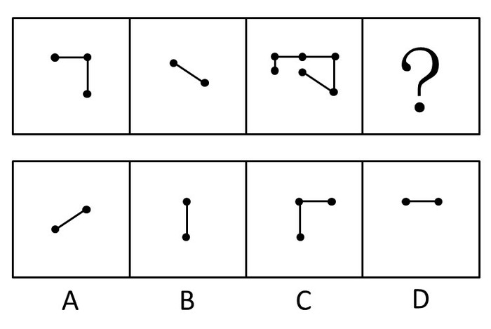

A. A

B. B

C. C

D. D

第 51 题 · 答案与解析

**参考答案（粉笔题库参考内容）**

C

**解析**

平面拼图，第三个图形是由前两个图形和第四个图形构成，所以第三个图形中除掉第一个图形和第二个图形，得到C项。

故正确答案为C。

**来源**：2008年吉林省公务员录用考试《行测》题（甲级）第51题

### 第 52 题

下面左边的图形折叠后将成为右边四个图形中的一个。请选出折叠后的正确图案。

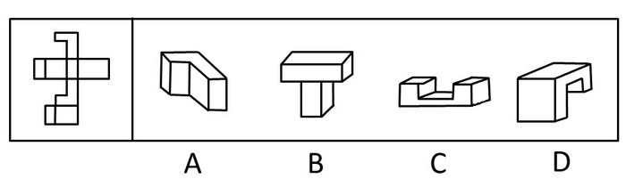

A. A

B. B

C. C

D. D

第 52 题 · 答案与解析

**参考答案（粉笔题库参考内容）**

A

**解析**

经观察，左边的图形上下左右有对称部分，折叠后图形的中间那个四边形会成为一个折角，而B、C、D三项均有两个折角，只有A项符合要求的。

故正确答案为A。

**来源**：2008年吉林省公务员录用考试《行测》题（甲级）第52题

### 第 53 题

从所给四个选项中，选择最合适的一个填入问号处，使之呈现一定的规律性：

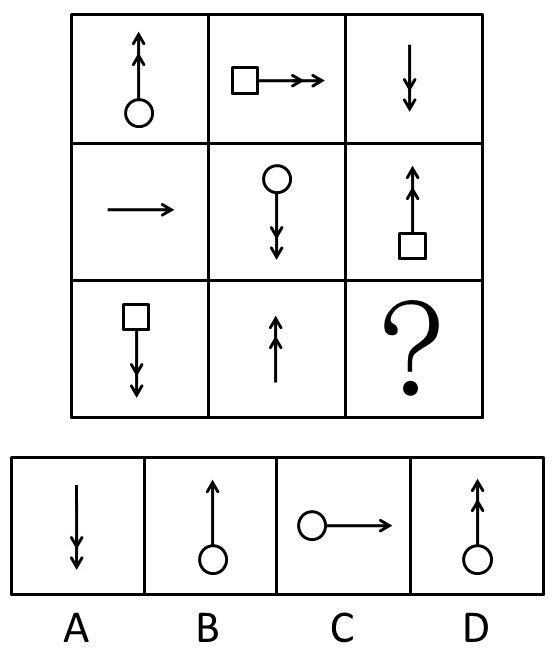

A. A

B. B

C. C

D. D

第 53 题 · 答案与解析

**参考答案（粉笔题库参考内容）**

C

**解析**

元素组成相似，元素遍历。

每行每列的3个图形中，箭头方向为向上、下、右的图形各一个。

故正确答案为C。

**考点**：样式规律-遍历

**来源**：2008年吉林省公务员录用考试《行测》题（甲级）第53题

### 第 54 题

以下的四边形中，每个都包括一个大写字母和一个数字，请选出与其他三个差别最大的图形。

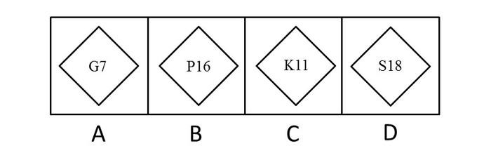

A. A

B. B

C. C

D. D

第 54 题 · 答案与解析

**参考答案（粉笔题库参考内容）**

D

**解析**

题目考点特殊，考查字母的顺序。

字母表中，G排第7位，P排第16位，K排第11位，S排第19位，只有S后的数字跟它的排列位数不一致。

故正确答案为D。

**考点**：文字/字母/数字类

**来源**：2008年吉林省公务员录用考试《行测》题（甲级）第54题

### 第 55 题

一个立方体的六个面分别写着A、B、C、D、E、F，根据以下四张图推测B对面的字母。

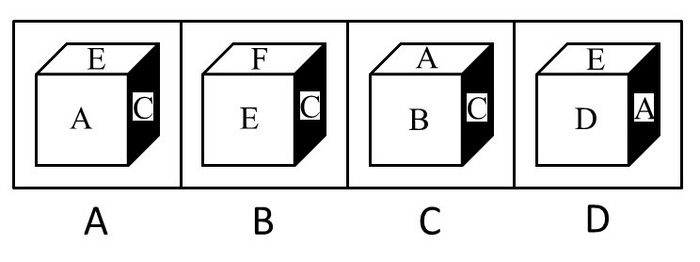

A. “D”

B. “E”

C. “F”

D. 无法推测

第 55 题 · 答案与解析

**参考答案（粉笔题库参考内容）**

B

**解析**

由前三个图形可知，以右侧C面为参考，在其余四个面中，呈现“A”、“E”、“F”、“B”排列，所以“A”的对面是“F”，而“B”的对面是“E”。

故正确答案为B。

**考点**：空间类-空间重构-六面体

**来源**：2008年吉林省公务员录用考试《行测》题（甲级）第55题

### 第 56 题

下图左边的图形折叠后将成为右边四个图形中的一个，请选出折叠后的正确图案。

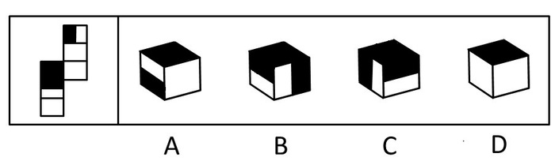

A. A

B. B

C. C

D. D

第 56 题 · 答案与解析

**参考答案（粉笔题库参考内容）**

D

**解析**

以全黑的面作为底面来折叠时，两个半黑的面是相邻的，并且它们两个全黑的那条边都在全黑的面上，排除A、B、C三项，D项当选。

故正确答案为D 。

**考点**：空间类-空间重构-六面体

**来源**：2008年吉林省公务员录用考试《行测》题（甲级）第56题

### 第 57 题

从所给四个选项中，选择最合适的一个填入问号处，使之呈现一定的规律性：

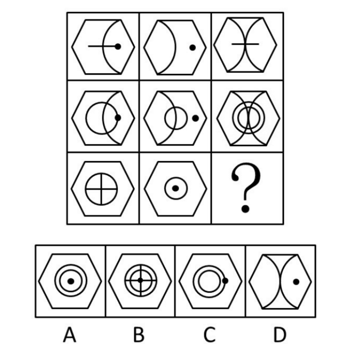

A. A

B. B

C. C

D. D

第 57 题 · 答案与解析

**参考答案（粉笔题库参考内容）**

B

**解析**

元素组成相似，叠加运算。

前两行每行的三个图形中，外面的六边形不变，前两个图形内部去同存异得到第三个图形。

故正确答案为B。

**考点**：样式规律-加减同异

**来源**：2008年吉林省公务员录用考试《行测》题（甲级）第57题

### 第 58 题

请从下面的四个图形中选出与其他三个不同的一个图形。

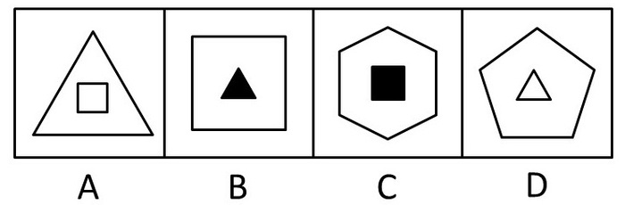

A. A

B. B

C. C

D. D

第 58 题 · 答案与解析

**参考答案（粉笔题库参考内容）**

A

**解析**

元素内部特征，内外分开数数。

分析内外边数的关系。B、C、D三项的外部图形边数大于内部图形，A向的外部图形边数小于内部图形。

故正确答案为A。

**考点**：数量规律-线

**来源**：2008年吉林省公务员录用考试《行测》题（甲级）第58题

### 第 59 题

从所给四个选项中，选择最合适的一个填入问号处，使之呈现一定的规律性：

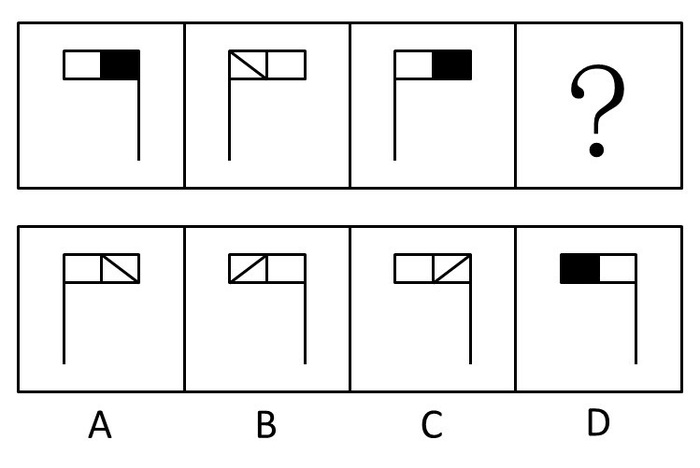

A. A

B. B

C. C

D. D

第 59 题 · 答案与解析

**参考答案（粉笔题库参考内容）**

B

**解析**

第三个图形是由第一个图形以第二个图形为对称轴后，两黑白正方形方格相互调换位置后得到的。同样，第四个图形是第二个图形经过轴对称后，再调换位置后得到B项的图形。

故正确答案为B。

**考点**：位置规律-综合

**来源**：2008年吉林省公务员录用考试《行测》题（甲级）第59题

### 第 60 题

从所给四个选项中，选择最合适的一个填入问号处，使之呈现一定的规律性：

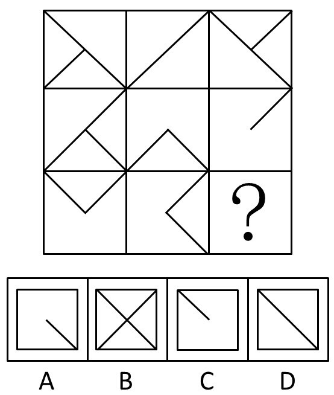

A. A

B. B

C. C

D. D

第 60 题 · 答案与解析

**参考答案（粉笔题库参考内容）**

D

**解析**

元素组成相似，先看横行， 第1、2个图形相加去同存异得到第3个图形。本题数列看也可以，去同存异，得到D项。

故正确答案为D。

**考点**：样式规律-加减同异

**来源**：2008年吉林省公务员录用考试《行测》题（甲级）第60题

### 第 61 题

固若金汤：不堪一击

A. 指鹿为马：实事求是

B. 雪中送炭：锦上添花

C. 安居乐业：丰衣足食

D. 废寝忘食：发愤图强

第 61 题 · 答案与解析

**参考答案（粉笔题库参考内容）**

A

**解析**

第一步：判断题干词语间逻辑关系。

固若金汤形容防守非常坚固；不堪一击形容力量薄弱，经不起一击，二者为反义关系。

第二步：判断选项词语间逻辑关系。

A项：指鹿为马比喻故意颠倒黑白，混淆是非；实事求是指从实际情况出发，不夸大，不缩小，正确地对待和处理问题，二者为反义关系，与题干逻辑关系一致，当选；

B项：雪中送炭比喻在别人急需的时候给以帮助；锦上添花比喻使美好的事物更加美好，二者为近义关系，与题干逻辑关系不一致，排除；

C项：安居乐业指生活安定，对所从事的工作感到满意；丰衣足食形容生活富裕，二者为近义关系，与题干逻辑关系不一致，排除；

D项：废寝忘食形容非常勤奋专心；发愤图强指决心奋斗，谋求强盛，二者没有必然联系，与题干逻辑关系不一致，排除。

故正确答案为A。

**考点**：语义关系-反义关系

**来源**：2008年吉林省公务员录用考试《行测》题（甲级）第61题

### 第 62 题

清明节：扫墓

A. 中秋节：吃月饼

B. 庆祝胜利：开香槟

C. 传达上级精神：下发文件

D. 年终：财务结算

第 62 题 · 答案与解析

**参考答案（粉笔题库参考内容）**

A

**解析**

第一步：判断题干词语间逻辑关系。

题干两词是对应关系。前面是节日，后面是与之对应的节日活动，扫墓是清明节重要的节日活动。

第二步：判断选项词语间逻辑关系。

A项吃月饼是中秋节重要的节日活动，符合题干逻辑；

B、C、D三项均不是节日与其对应的活动。

故正确答案为A。

**考点**：逻辑关系-对应关系

**来源**：2008年吉林省公务员录用考试《行测》题（甲级）第62题

### 第 63 题

投资：股票

A. 房地产：中介

B. 银行：利润

C. 上市公司：证券公司

D. 资产：负债

第 63 题 · 答案与解析

**参考答案（粉笔题库参考内容）**

D

**解析**

第一步：判断题干词语间逻辑关系。

题干两词是包容关系，且是包容关系中的种属关系，股票是一种投资方式。

第二步：判断选项词语间逻辑关系。

A项中房地产和中介是对应关系；

B项银行和利润之间没有明显的逻辑关系；

C项上市公司和证券公司是交叉关系，上市公司可能是证券公司，而证券公司也可能是上市公司；

D项负债是一种资产流动的方式。

故正确答案为D。

**考点**：逻辑关系-包容关系

**来源**：2008年吉林省公务员录用考试《行测》题（甲级）第63题

### 第 64 题

汽车：倒车雷达：备用轮胎

A. 显示器：打印机：复印机

B. 手枪：消声器：枪套

C. 手表：表盘：指针

D. 手机：电池：耳机

第 64 题 · 答案与解析

**参考答案（粉笔题库参考内容）**

B

**解析**

第一步：判断题干词语间逻辑关系。

题干词语是包容关系，且是包容关系中的或然组成关系。倒车雷达与备用轮胎是汽车的装配件，但并非必需品。

第二步：判断选项词语间逻辑关系。

A项词语间没有直接关系；

本题中一个关键的信息是后二者不是前者必不可少的部分，这样就可以直接排除C、D两项。

故正确答案为B。

**考点**：逻辑关系-包容关系

**来源**：2008年吉林省公务员录用考试《行测》题（甲级）第64题

### 第 65 题

东北虎：熊猫：哺乳动物

A. 绘画：国画：才能

B. 音高：音色：音乐

C. 销售：销售人员：销售渠道

D. 老挝语：阿尔及利亚语：语言

第 65 题 · 答案与解析

**参考答案（粉笔题库参考内容）**

D

**解析**

第一步：判断题干词语间逻辑关系。

题干词语之间有并列关系和包容关系。东北虎与熊猫是并列关系，又都属于哺乳动物，前两者与后者构成包容关系。

第二步：判断选项词语间逻辑关系。

A项中绘画和国画不是并列关系；

B项音高和音色也不是并列关系；

C项销售和销售人员也构不成并列关系；

D项老挝语与阿尔及利来语是并列关系，又都属于语言的一种，符合题干逻辑。

故正确答案为D。

**考点**：逻辑关系-包容关系、逻辑关系-并列关系

**来源**：2008年吉林省公务员录用考试《行测》题（甲级）第65题

### 第 66 题

在一起食物中毒事件的调查过程中，医生经过询问发现，同一天就诊的中毒者吃的食物各有不同，但是所有人都吃了某农贸市场出售的一种蘑菇，据此断定，中毒可能是由这种蘑菇有毒引起的。

下列推论的方式与题干相似的是：

A. 科学家经过研究发现，健康人的头发中钙的含量平均高于患有心肌梗塞的人的头发中的钙的含量，因此，根据头发含钙量的变化，就能推断心肌梗塞的程度

B. 人们发现，夏天过夜的食物如馒头、米饭、肉制品都会变质，他们的质地各不相同，但由于都是在高温季节，易于细菌繁殖，因此，高温条件是食物变质的原因

C. 搓手可以发热，撞击石头可以发热，摩擦可以发热，这些都是摩擦，没有相反事例发生，所以，摩擦可以发热

D. 人们通过观察企鹅滑雪姿势，设计了一种极地越野车，时速可达50千米，速度超过企鹅

第 66 题 · 答案与解析

**参考答案（粉笔题库参考内容）**

B

**解析**

第一步：翻译题干。

题干信息可以抽象为：一般→特殊→一般，是从一般的共性中找出特殊的，再从特殊的个性中找出一般的共性的结论。

第二步：逐一判断选项。

A项可以抽象为：一般→一般，是从共性中寻找共性的推理过程，与题干推理过程不符；

B项可以抽象为：一般→特殊→一般，都是在高温季节，质地各不相同的馒头、米饭、肉制品都会变质，得到高温条件是食物变质的原因，符合题干推理过程；

C项可以抽象为：特殊→一般，从搓手和撞击石头总结出摩擦可以发热，是从特殊的个性中找出一般的共性的结论，不符合题干推理过程；

D项是通过模仿生物制造极地越野车，不符合题干推理过程。

故正确答案为B。

**考点**：论证结构

**来源**：2008年吉林省公务员录用考试《行测》题（甲级）第66题

### 第 67 题

韩国传统医学有“天人合一”的理论，也就是人体内的小环境要与自然界的大环境相协调，才能使人更顺应自然界的变化，增加人体对外界不利影响的抵抗力。

根据这一理论，在炎炎夏日里，韩国人更倾向于食用：

A. 冷的食物，以降低人体的温度，适应外界环境的需要

B. 热的食物，以“热补”的方式补充人体因大量排汗而流失的热量和营养

C. 冷、热食物的合理搭配，以保持人体温度和营养的均衡

D. 不冷不热的食物，以避免因人体与外界环境温度相差过大和营养流失

第 67 题 · 答案与解析

**参考答案（粉笔题库参考内容）**

B

**解析**

第一步：抓住题干的对象及关键。

题干强调“天人合一”理论是人和自然在本质上是一致与相通的，故一切人事均应顺乎自然规律，达到人与自然和谐。

第二步：判断整体关系。

用在医学上，要求体内小环境与自然界大环境协调，顺应自然界的变化。

第三步：逐一判断选项的作用。

B项以“热补”的方式补充符合题干中“小环境要与自然界的大环境相协调”的观点，是答案；

C项“冷、热食物的合理搭配”和D项“不冷不热的食物”不是“顺应自然界变化”和“增加人体对外界不利影响的抵抗力”；

A项中恰好与B项相反，显然不对。

故正确答案为B。

**考点**：日常结论

**来源**：2008年吉林省公务员录用考试《行测》题（甲级）第67题

### 第 68 题

日本北海道大学进化生物研究小组对三个分别由30只蚂蚁组成的蚂蚁群的活动进行了观察。结果发现：大部分蚂蚁都很勤快地寻找、搬运食物，少数蚂蚁却整日无所事事、东张西望。有趣的是，当生物学家在这些“懒蚂蚁”身上做上标记，并且断绝蚁群的食物来源时，那些平时工作很勤快的蚂蚁表现的一筹莫展，而“懒蚂蚁”们则“挺身而出”，带领众蚂蚁向他们早已侦察到的新的食物源转移。

如果我们把一个分工协调的组织视为一个“蚂蚁群”的话，那么一个组织在面临生存和发展危机时，更需要的是：

A. 善于根据人才的类型和特点加以分工和配置的领导者

B. 无所事事、不求上进的懒惰者

C. 勤勤恳恳、脚踏实地的勤奋者

D. 怠于具体事务，专心于组织创新、发展大局方向的顾全大局者

第 68 题 · 答案与解析

**参考答案（粉笔题库参考内容）**

D

**解析**

第一步：抓住题干主要信息。

题干强调大部分蚂蚁都很勤快地寻找、搬运食物，少数蚂蚁却整日无所事事、东张西望。而在面临生存和发展危机时，“懒蚂蚁”们则“挺身而出”，带领众蚂蚁向他们早已侦察到的新的食物源转移。

第二步：分析题干信息，并结合选项得出答案。

由“‘懒蚂蚁’们则‘挺身而出’，带领众蚂蚁向他们早已侦察到的新的食物源转移”可知，题干侧重于分析平时看似“懒惰”的蚂蚁在蚁群面临生存危机时所起到的组织协调作用，因此意在表达一个组织面临发展危机时需要那种能够制定发展方向、顾全大局的领导者，尽管平时看上去在具体事务的工作上并非勤勤恳恳。因此，可以推出D项符合题意。

A项“根据人才的类型和特点加以分工和配置”不符合题意；

B项这些“懒蚂蚁”并非真正无所事事、不求上进；

C项勤勤恳恳、脚踏实地是对大部分蚂蚁的写照，而不是“懒蚂蚁”。

故正确答案为D。

**考点**：日常结论

**来源**：2008年吉林省公务员录用考试《行测》题（甲级）第68题

### 第 69 题

美国管理学家提出了著名的“木桶原理”，这一原理告诉我们，由多块木板构成的木桶，其价值在于其盛水量的多少，但决定木桶盛水量多少的关键因素不是其最长的木板，而是其最短的板块。

如果我们把一个企业看做是一个木桶的话，那么决定企业整体能力的是：

A. 企业在产品质量、技术开发、品牌建设等方面的综合实力

B. 企业建设和发展中的薄弱环节

C. 企业在竞争中表现出的核心优势

D. 企业构成中各环节的协调与配合

第 69 题 · 答案与解析

**参考答案（粉笔题库参考内容）**

B

**解析**

第一步：抓住题干主要信息。

最短的木板决定木桶的盛水量。

第二步：分析题干信息，并结合选项得出答案。

这一原理应用在企业发展中，决定整体能力的也是“最短的木板”，即企业发展中的薄弱环节。符合这层意思的只有B项。

A项中综合实力、C项中核心优势、D项中协调与配合均不是企业的薄弱环节。

故正确答案为B。

**考点**：日常结论

**来源**：2008年吉林省公务员录用考试《行测》题（甲级）第69题

### 第 70 题

某市瑞奇商场服装部在今年第三季度的销售中，大打“节日牌”，充分利用节日开展促销活动，使第三季度的营业额连续增长。据统计，7月份的销售额增长8%，8月份增长10%，9月份增长13%，该商场的管理层希望在今年的第四季度向整个商场推广这种节日促销策略，力争全商场所有销售部门的营业额有跨越式的增长。

以下哪项如果为真，能够最有效地说明该商场管理层的这种希望可能会落空？

A. 节日期间逛街买衣服已经成为人们的一种消费习惯，但对于在节日期间购买其他商品，人们似乎并不热衷

B. 辛苦工作了一年，很多人在年底腰包鼓起来，希望为自己、亲人或朋友购买称心的商品，以表示对自己的犒劳，以及对亲人和朋友的慰问

C. 瑞奇商场服装部在第三季度大力开发消费者在中国传统节日的消费潜力，并针对不同的节日将宣传对象的重点放在不同的消费者身上

D. 该市打“节日牌”的商场不止瑞奇商场一家，但这些商场多年来已经形成了各自比较固定的消费者群体

第 70 题 · 答案与解析

**参考答案（粉笔题库参考内容）**

A

**解析**

第一步：找到论点和论据。

本题论据是商场服装部充分利用节日开展促销活动，使第三季度的营业额连续增长。论点是管理层希望在今年的第四季度向整个商场推广这种节日促销策略。

第二步：判断削弱方式。

论点强调整个商场所有商品推广这种节日促销策略，论据强调服装部充分利用节日开展促销活动取得良好效果。论点和论据之间不存在直接的因果关系，要构成削弱，可削弱论证，在服装和所有商品间拆桥。

第三步：逐一判断选项的作用。

A项说明人们对服装和其他商品的不同态度，削弱了论证，使得适用于服装部的促销策略并不一定适用于所有商品；

B、C两项对整个商场所有商品推广这种节日促销策略有加强作用；

D项说打“节日牌”的商场不止一家，与题干论点整个商场所有商品推广这种节日促销策略没有关系，属于无关项。

故正确答案为A。

**考点**：拆桥

**来源**：2008年吉林省公务员录用考试《行测》题（甲级）第70题

### 第 71 题

根据官方公布的数据显示，2008年全国共有64万人参加国家公务员考试，考生人数较上一年增加12%，今年公务员各职位平均竞争比例为60：1，远远超出2007年的42：1。竞争最激烈的中央党群机关参照公务员管理的事业单位，竞争比例平均高达162：1。从某种角度来说，国家公务员考试已经成了当今中国竞争最激烈的考试之一。众多大学生对公务员职业的追捧，特别是对公务员职业的不正确认识，造成了“公务员报考热”的出现。

最能削弱上述论断的一项是：

A. 在巨大的就业压力下，众多高校毕业生将报考公务员作为重要的就业机会和出路

B. 公务员考试录用制度的公正性吸引大学生参与到这种公平竞争中来

C. 相对于其他职业，公务员不仅职业较为稳定，同时具有相对完备、良好的待遇和保障体系

D. 近年来，在职人员报考公务员的人数呈逐年上升趋势

第 71 题 · 答案与解析

**参考答案（粉笔题库参考内容）**

D

**解析**

第一步：找到论点和论据。

本题论据是官方公布的数据显示，参加国家公务员考试考生人数较上一年显著增加。论点是大学生对公务员职业的不正确认识造成报考热的出现。

第二步：判断削弱方式。

论点和论据之间存在因果关系，需要削弱论点，使得论点和论据不搭桥。

第三步：逐一判断选项的作用。

A、B、C三项均涉及到大学生对公务员的认识问题，起到加强作用；

D项中提到报考人数上升的是在职人员而非大学生，极大削弱了这一论断。

故正确答案为D。

**考点**：削弱论点

**来源**：2008年吉林省公务员录用考试《行测》题（甲级）第71题

### 第 72 题

根据对2005年全国出版社申报的引进国外图书的选题分析，总计引进选题6737种，其中自然科学类占13.65%，经济类占14.36%。

从这段文字可以推出：

A. 那些虽有学术价值但会有市场风险的国外图书，往往受到国内出版者的冷遇

B. 对外国先进科技书引进的比例明显偏低，人文社会科学引进数量不仅偏大，而且偏重某一类

C. 外国文学古典名著，因为无需买版权，市场一直有稳定的读者群，因而被大量重复出版

D. 自然科学类图书的引进，翻译质量要求比较高、周期比较长，致使翻译出版的比例比较低

第 72 题 · 答案与解析

**参考答案（粉笔题库参考内容）**

D

**解析**

第一步：抓住题干主要信息。

题干强调“引进国外图书的选题分析，总计引进选题6737种，其中自然科学类占13.65%，经济类占14.36%”。

第二步：分析题干信息，并结合选项得出答案。

A、B、C三项无法推出，题干并没有涉及到“学术价值高市场风险高”“先进科技类书籍”“外国文学古典名著”；

D项针对自然科学所占的比例较低，得出原因是这类图书翻译质量要求比较高、周期比较长，符合题干推断。

故正确答案为D。

**考点**：日常结论

**来源**：2008年吉林省公务员录用考试《行测》题（甲级）第72题

### 第 73 题

据世界卫生组织估计，目前全球患抑郁症的人多达1.2亿，几乎每4人中便有1人会在一生中某个阶段出现精神或行为问题。到2020年，抑郁症将位居全球疾病排行榜第二位，仅次于心脏病。中国目前约有2600万人患有不同程度的抑郁症，不过，与抑郁症的高发病率形成鲜明对比的是，90%的抑郁症患者因没有意识到自己可能患有抑郁症而未能及时就医。

根据这段文字，可以知道：

A. 全球患抑郁症的人多达总人口的1/4

B. 目前心脏病居全球疾病排行榜第一位

C. 不能及时就医是造成抑郁症发病率高的原因

D. 中国抑郁症患者中及时就医者不超过300万

第 73 题 · 答案与解析

**参考答案（粉笔题库参考内容）**

D

**解析**

第一步：抓住题干主要信息。

第一句强调“几乎每4人中便有1人会在一生中某个阶段出现精神或行为问题”。第二句强调“与抑郁症的高发病率形成鲜明对比的是，90%的抑郁症患者因没有意识到自己可能患有抑郁症而未能及时就医”。

第二步：分析题干信息，并结合选项得出答案。

题干中“几乎每4人中便有1人会在一生中某个阶段出现精神或行为问题”，但这些人并不是同时发病，所以并不能说明全球患抑郁症的人多达总人口的1/4，故A项错误；

题目中指出在2020年，心脏病会位于全球疾病排行榜第一，但并不是现在，故B项错误；

题目中并没有指出高发病率是不能及时就医造成的，故C项错误；

中国2600万患有抑郁症，有90%的患者及时就医，大概10%的人，即260万人能够及时就医，因此不超过300万是正确的。

故正确答案为D。

**考点**：日常结论

**来源**：2008年吉林省公务员录用考试《行测》题（甲级）第73题

### 第 74 题

要治服坏人，有时候要以坏治坏，以小坏对付大坏，以假坏对付真坏，坏人也会做好事，但好人只要做过坏事就变成了坏人。

由此可以推出：

A. 好人不可能治服坏人

B. 世界上不可能有好人

C. 做过好事的人未必是好人

D. 做过坏事的人未必是坏人

第 74 题 · 答案与解析

**参考答案（粉笔题库参考内容）**

C

**解析**

日常结论题，根据题干信息逐一分析选项。

A项：根据题干中“要治服坏人，有时候要······以假坏对付真坏”、“好人只要做过坏事就变成了坏人”可知，好人可以通过假坏来制服坏人，该项无法推出，排除；

B项：根据题干中“要治服坏人，有时候要······以假坏对付真坏”、“好人只要做过坏事就变成了坏人”可知，好人可以通过假坏来制服坏人，因此世界上可能有好人，该项无法推出，排除；

C项：根据题干中“坏人也会做好事”可知，做过好事的人可能是坏人，该项可以推出，当选；

D项：根据题干中“好人只要做过坏事就变成了坏人”可知，做过坏事的人必定是坏人，该项无法推出，排除。

故正确答案为C。

**考点**：日常结论

**来源**：2008年吉林省公务员录用考试《行测》题（甲级）第74题

### 第 75 题

美国著名的经济学家阿瑟·奥肯发现了周期波动中经济增长率和失业率之间的经验关系，即当实际GDP增长相对于潜在GDP增长（美国一般将之定义为3%）下降2%时，失业率上升大约1%；这条经验法则以其发现者为名，称为奥肯定律。潜在GDP这个概念是奥肯首先提出的，它是指在保持价格相对稳定情况下，一国经济所产生的最大产值。潜在GDP也称充分就业GDP。

下列和上述的分析方法相同的是：

A. 青蛙的双腿对水面的蹬力很大，水给青蛙的反作用力也很大，人们从中受到启示，模仿青蛙发明了蛙泳的游泳方式

B. 齿轮的转速和齿数成反比，即齿轮的齿数越多，齿轮转速越慢

C. 蝙蝠在夜间能够快速飞行，可以躲避障碍物，这是因为它的耳朵能听到超声波遇到障碍物时产生的回声。如果把蝙蝠的耳朵堵上，它就会撞到障碍物；如果把蝙蝠的眼睛蒙上，它却不会撞到障碍物

D. 天上有了扫帚云，不出三天大雨淋

第 75 题 · 答案与解析

**参考答案（粉笔题库参考内容）**

D

**解析**

第一步：分析题干。

奥肯定律是指周期波动中经济增长率和失业率之间的经验关系。

第二步：逐一分析选项。

A项“模仿青蛙发明了蛙泳的游泳方式”、B项“齿轮的转速和齿数成反比”、C项“蝙蝠在夜间能够快速飞行”都属于科学实验，而不是经验推断；

D项是从日常经验中获取的，符合题干逻辑。

故正确答案为D。

**考点**：日常结论

**来源**：2008年吉林省公务员录用考试《行测》题（甲级）第75题

### 第 76 题

经过实验室实验和临床试用观察表明，现在有些常用的抗菌类药物，应该空腹服用。因为饭后服用，食物可能影响药物的吸收，或使药物利用率明显降低。

下列最能支持上述论断的是：

A. 抗菌类药，对胃肠的刺激性不大，可以空腹服用

B. 空腹服用的抗菌类药物只是所有抗菌类药物中的一小部分

C. 人们服用药物时都想增加药物的疗效

D. 以往人们对抗菌类药物的使用存在明显不合理

第 76 题 · 答案与解析

**参考答案（粉笔题库参考内容）**

C

**解析**

第一步：找到论点和论据。

论点是有些常用的抗菌类药物应该空腹服用。论据是饭后服用，食物可能影响药物的吸收，或使药物利用率明显降低。

第二步：判断加强方式。

论点和论据之间存在因果关系，需要加强论点。

第三步：逐一判断选项的作用。

题干强调饭后服用抗菌类药物会降低药物的利用率，从提高药效这个角度出发，C项说人们都想增加药物的疗效，直接加强了论点。

A项中“对胃肠的刺激性不大”与题干没有关系，属于无关项；

B项中空腹服用的抗菌类药物只是所有抗菌类药物中的一小部分，只是对题干已有信息的陈述，不能起到加强作用；

D项说明以往使用存在明显不合理，不能说明现在的情况，不能加强论点。

故正确答案为C。

**考点**：搭桥

**来源**：2008年吉林省公务员录用考试《行测》题（甲级）第76题

### 第 77 题

近年来，立氏化妆品的销量有了明显的增长，同时，该品牌用于广告的费用也有同样明显的增长。业内人士认为，立氏化妆品销量的增长，得益于其广告的促销作用。

以下哪项如果为真，最能削弱上述结论？

A. 立氏化妆品的广告费用，并不多于其他化妆品

B. 立氏化妆品的购买者中，很少有人注意到该品牌的广告

C. 注意到立氏化妆品广告的人中，很少有人购买该产品

D. 近年来，化妆品的销售总量有明显增长

第 77 题 · 答案与解析

**参考答案（粉笔题库参考内容）**

B

**解析**

第一步：找到论点和论据。

论点是业内人士认为，立氏化妆品销量的增长，得益于其广告的促销作用，即购买→广告，论据是立氏化妆品的销量有了明显的增长，同时，该品牌用于广告的费用也有同样明显的增长。

第二步：逐一判断选项的作用。

A项：立氏化妆品的广告费用不多于其他化妆品，与“购买→广告”无直接关系，属无关选项；

B项：立氏化妆品的购买者中，很少有人注意到该品牌的广告，即是对“购买→广告”的直接否定，直接削弱了论点；

C项：注意到立氏化妆品广告的人中，很少有人购买该产品，不明确这些为数不多的购买的人是否是因为注意到广告才购买该产品的，据此无法判断销量增长是否得益于广告促销，无法削弱论点；

D项：化妆品的销售总量与“购买→广告”无直接关系，为无关项。

故正确答案为B。

**考点**：削弱论点

**来源**：2008年吉林省公务员录用考试《行测》题（甲级）第77题

### 第 78 题

根据美国人口普查报告，扣除通货膨胀因素后，1983年中等家庭收入比1982年增加了1.6%。通常情况下，随着家庭收入上升，贫困人数就会减少，然而1983年全国贫困率是18年来的最高水平。人口普查司提供了两种可能的原因：影响深、持续时间长的1981—1982年经济衰退的持续影响；由妇女赡养的家庭人口数量和不与亲戚同住的成年人数量的增多，这两种人都比整体人口更加贫困。

这个报告能得出以下哪个结论？

A. 全国贫困率在18年里一直稳步增长

B. 如果早期的经济衰退仍带来持续的影响，那么全国贫困率会升高

C. 即使人口中有些家庭收入下降或未增加，中等家庭收入依然可能增加

D. 中等家庭收入受家庭形式变化的影响比受国民经济扩张或衰退程度的影响更大

第 78 题 · 答案与解析

**参考答案（粉笔题库参考内容）**

C

**解析**

第一步：抓住题干主要信息。

文段先讲述事实“1983年中等家庭收入比1982年增加了1.6%，但1983年全国贫困率是18年来的最高水平”，与“随着家庭收入上升，贫困人数就会减少”的常规情况冲突，可能的两个原因是1981—1982年经济衰退的持续影响、由妇女赡养的家庭人口数量和不与亲戚同住的成年人数量的增多。

第二步：逐一判断选项。

A项，1983年的贫困率是18年来的最高水平，并不能推出18年来贫困率“稳步增长”；

B项，题干列出的是两种可能的原因，经济衰退是其中的一种可能原因，并非一定导致全国贫困率的升高，无法推出；

C项，“可能增加”仅仅表示一种可能性，对比1982年和1983年，1983年贫困率比1982年高，即人口中有些家庭收入下降或未增加，但中等家庭收入增加了1.6%，即中等家庭收入依然可能增加，可以推出；

D项，题干中提到了贫困率增加的两种原因，但并未分辨哪个因素影响更大，无法推出。

故正确答案为C。

**考点**：日常结论

**来源**：2008年吉林省公务员录用考试《行测》题（甲级）第78题

### 第 79 题

美国前总统林肯说过：“最高明的骗子，可能在某个时刻欺骗所有的人，也可能所有的时刻欺骗某些人，但不可能在所有的时刻欺骗所有的人。”

如果上述断定是真的，那么下述哪项断定必定是假的？

A. 林肯可能在某个时刻受骗

B. 林肯可能在任何时候都不受骗

C. 不存在某一时刻有人可能不受骗

D. 不存在某一时刻所有的人都必然不受骗

第 79 题 · 答案与解析

**参考答案（粉笔题库参考内容）**

C

**解析**

第一步：翻译题干。

①可能在某个时刻欺骗所有的人；

②可能在所有的时刻欺骗某些人；

③不可能在所有的时刻欺骗所有的人。

第二步：逐一分析选项。

A项：根据①可知最高明的骗子可能在某个时刻欺骗所有的人，“所有的人”包括林肯，所以可以推出林肯可能在某个时刻受骗，排除；

B项：题干中①和②只是可能性的描述，没有明确指出所有人都必然会受骗，所以可能存在林肯在任何时候都不受骗，排除；

C项：选项可以转化为“存在所有时刻所有人必然受骗”，与③矛盾，一定为假，当选；

D项：选项可以转化为“存在所有时刻有的人可能受骗”，与②相同，可以推出，排除。

本题为选非题，故正确答案为C。

**来源**：2008年吉林省公务员录用考试《行测》题（甲级）第79题

### 第 80 题

如果丽丽参加同学聚会，那么小强、大壮和李铁也将一起参加同学聚会。

如果上述断定是真的，则以下哪项也一定是真的？

A. 如果丽丽不参加同学聚会，那么小强也不参加

B. 如果小强、大壮和李铁在一起参加同学聚会，那么丽丽也参加

C. 如果丽丽和小强参加同学聚会，那么大壮和李铁不会参加

D. 如果李铁不参加同学聚会，那么丽丽也不参加

第 80 题 · 答案与解析

**参考答案（粉笔题库参考内容）**

D

**解析**

第一步：利用充分必要条件翻译题干。

丽丽去→小强去∧大壮去∧李铁去，其逆否命题是-小强去∨-大壮去∨-李铁去→—丽丽去。

第二步：逐一翻译选项并判断选项的正确。

A项：-丽丽去→—小强去，“-丽丽去”属于否前件，“-小强去”属于否后件，根据逆否规则可知，否前件无法推出否后件，排除；

B项：小强去∧大壮去∧李铁去→丽丽去，根据逆否规则可知，后件无法推出前件，排除；

C项：丽丽去∧小强去→—大壮去∧-李铁去，丽丽去∧小强去等价于丽丽去，肯定前件可以推不出否定后件，不符合题干逻辑，排除；

D项：-李铁去→—丽丽去，正好满足题干的逆否规则，当选。

故正确答案为D。

**考点**：常规翻译

**来源**：2008年吉林省公务员录用考试《行测》题（甲级）第80题

### 第 81 题

国家体育场“鸟巢”是2008年北京奥运会主体育场，将美轮美奂的“鸟巢”设计成东西两头高，南北两头低是因为：

A. 运动赛场具有方向性的缘故

B. 体现太阳东升西落的理念

C. 受中国地理位置影响，为了减少东西风干扰

D. 取鸟向东方迎着太阳飞的意向

第 81 题 · 答案与解析

**参考答案（粉笔题库参考内容）**

A

**解析**

“鸟巢”设计成东西两头高，南北两头低是因为运动赛场具有方向性的缘故。一般比较正规的足球场，一般都是南北走向。因为地球自转的方向是自西向东的，故太阳总是东升西落。只有足球场是南北走向的时候，太阳光才是从运动员的侧面照射过来的，运动员才能避免受到太阳直射，不至于影响到运动员的比赛。同样的道理，田径运动场也应该是南北走向，这样南北向的跑道就长些，东西向的跑道就短些，尽量避免运动员在东西方向上受太阳光的影响。另一方面，如果运动赛场是南北走向，那么东西方向看台观众的视线是均衡的，因为观众可以均衡地看到两端的比赛情况。另外，东西两头高还可以尽量遮挡一部分上午和下午的太旧，最大程度地减少太阳光对运动员的干扰。

故正确答案为A。

**考点**：自然地理

**来源**：2008年吉林省公务员录用考试《行测》题（甲级）第81题

### 第 82 题

福娃设计组的韩美林说：“我要设计出一种形象，表现出源远流长的中国文化，表达出中国人民的热情，在这个千载难逢的机会里，我要让福娃的每一个细胞里都揉进‘中国’这两个字。”

从哲学上看，设计师的灵感和创意：

A. 是不受客观存在的制约的，是可遇不可求的

B. 来源于善于思辨，富于创造的头脑

C. 是发挥能动性，对中国文化的能动反映

D. 说明设计师善于捕捉稍纵即逝的意识

第 82 题 · 答案与解析

**参考答案（粉笔题库参考内容）**

C

**解析**

灵感和创意属于思维范畴，来源于生活，同时又是设计师主观能动性的体现。设计师想通过设计福娃的形象来表现中国文化，表达中国人民的热情，这反映出设计师通过发挥主观能动性来发扬中国文化。所以从哲学上看，设计师的灵感和创意是发挥能动性，对中国文化的能动反映。

故正确答案为C。

**考点**：唯物论

**来源**：2008年吉林省公务员录用考试《行测》题（乙级）第72题

### 第 83 题

在全国人民为即将举行的奥运会而欢欣时，藏独分子和CNN的不实报道在祖国人民的心口上撒上了一把盐。面对这些，下列做法最合适的是：

A. 小孙用不去“家乐福”等法国超市的实际行动来表示不满和抗议

B. 小李呼吁游行、示威来表示中国人民的不满

C. 小王认为我们应该集中精力做好本职工作

D. 小赵通过QQ、因特网等现代信息渠道来表明不满和抗议

第 83 题 · 答案与解析

**参考答案（粉笔题库参考内容）**

C

**解析**

面对不实报道和藏独活动，我们应该理智应对，而不应盲目示威反抗，最好的回应就是做好本职工作，迎接奥运会的召开，向世人展示文明大国的形象，这是对藏独和不实报道的最好回击。

故正确答案为C。

**考点**：时事政治-其他

**来源**：2008年吉林省公务员录用考试《行测》题（甲级）第83题

### 第 84 题

2008年初，我国南方各省连续发生多次降雪，形成了新中国成立以来最严重的一场雪灾。面对灾情，政府制定了一系列措施。

下列依据哲学原理解释有误的一项是：

A. 雪灾造成道路、交通、通讯等设施严重受损，群众生活和工农业生产受到极大影响，这说明自然的规律不可战胜

B. 用抗洪的精神抗击雪灾，全力以赴开展抗灾工作，体现了人的主观能动性，是人类重视精神力量的体现

C. 紧紧依靠广大军民，把抗雪灾作为最紧迫的任务，体现了人民群众是实践的主体，是历史创造者的观点，是坚持群众路线的表现

D. 针对低温冰冻雪灾的特点，千方百计保通畅、保供电、保民生、保稳定，体现了具体问题具体分析，集中主要力量抓主要矛盾的观点

第 84 题 · 答案与解析

**参考答案（粉笔题库参考内容）**

A

**解析**

马克思哲学认识论告诉我们规律是可以被认识的，只有认识了规律才能按照规律办事，A项提出“规律不可战胜”的说法是不正确的。

本题为选非题，故正确答案为A。

**考点**：认识论

**来源**：2008年吉林省公务员录用考试《行测》题（甲级）第84题

### 第 85 题

2007年老百姓衣、食、住、行、学的价格和费用有涨有落，牵动着民生忧喜，针对物价上涨我国政府采取了多种措施，下列有利于抑制物价上涨的措施是：

A. 增加财政支出

B. 扩大消费需求

C. 提高工资水平

D. 提高存贷款利率

第 85 题 · 答案与解析

**参考答案（粉笔题库参考内容）**

D

**解析**

国家采取了一系列措施来抑制物价上涨，其中央行提高存贷款利率是一项主要措施。提高存款利率，存款就会多，消费就要减少，买的少了，东西就要降价，反之，物价就会回升。提高贷款利率，人们就不愿意去银行贷款，由此就降低了人民币的流动性，就抑制了通货膨胀。

故正确答案为D。

**考点**：宏观经济与调控政策

**来源**：2008年吉林省公务员录用考试《行测》题（乙级）第75题

### 第 86 题

在雪地说话声音不那么响的原因是：

A. 因为雪地疏松多孔，它们起到了消声的作用

B. 与说话人心理有关

C. 因为雪地空旷、不扰音

D. 因为下雪后空气稀薄，声音传导受限制

第 86 题 · 答案与解析

**参考答案（粉笔题库参考内容）**

A

**解析**

在雪地说话声音不那么响，是雪地吸声造成的，这是因为雪落在地上比较松软，中间有许多的空隙，声音一旦进入里面后，反射出来的很少，所以声音就小了。

故正确答案为A。

**考点**：生活常识

**来源**：2008年吉林省公务员录用考试《行测》题（乙级）第76题

### 第 87 题

有关6岁儿童的行为描述不正确的一项：

A. 6岁的儿童可以练长跑

B. 6岁的儿童用石头把人打伤，应该由父母承担责任

C. 6岁的儿童认知水平具有相对具体和刻板性特点

D. 《关于开展全民义务植树运动的实施办法》中6岁以上的儿童在责任人协助下，每人每年植树3~5棵

第 87 题 · 答案与解析

**参考答案（粉笔题库参考内容）**

A

**解析**

孩子经常长跑，可能会影响骨骼生长。因为大运动量的刺激对骨骼两端的骨髓会造成巨大影响，刺激骨髓提前骨化，这使骨向两端的生长过早中止。如果大腿的股骨以及小腿的腔骨和排骨出现提前骨化，就会影响孩子的个头儿。因此A项错误，B、C、D三项正确。

本题为选非题，故正确答案为A。

**考点**：民法典

**来源**：2008年吉林省公务员录用考试《行测》题（甲级）第87题

### 第 88 题

下列关于杨利伟的宇航服是白色的原因，正确的一项是：

A. 由宇航员的工作性质决定的，像医生一样，白色符合他的职业特点

B. 什么颜色的衣服都可以，杨利伟喜欢白色衣服，因为白色圣洁

C. 其他颜色的衣服会分散宇航员的注意力，影响飞行操作

D. 白色宇航服反射光和热，可以阻隔太阳的热量，以保护宇航员身体

第 88 题 · 答案与解析

**参考答案（粉笔题库参考内容）**

D

**解析**

宇航服是白色，是为了防辐射，因为大气层外辐射非常强，包括宇宙射线、x射线等非常厉害。白色是最能反射阳光的颜色，所以宇航服的颜色采用白色，阻隔热量，从而起到保护宇航员的身体的作用。

故正确答案为D。

**考点**：物理常识

**来源**：2008年吉林省公务员录用考试《行测》题（甲级）第88题

### 第 89 题

“宁可终身不饮酒，不可三餐无饮茶”，茶文化在中国源远流长，下面对茶的解释有误的一项是：

A. 绿茶利于清热利尿，因此凉性体质的人不宜多喝，红茶提神醒目，降血脂的功能较强

B. 空腹饮浓茶或者素食充饥后饮浓茶，以及不常喝茶的人忽然喝了浓茶，都可能物极必反引起醉茶

C. 喝茶也要挑时间，饭前、晚睡前饮茶有助于消化和睡眠，茶冲出来不应放置时间过长

D. 花茶对理气解郁有帮助，适宜心情郁抑时饮用。乌龙茶能起消脂减肥的功效

第 89 题 · 答案与解析

**参考答案（粉笔题库参考内容）**

C

**解析**

喝茶应遵循：饭前饭后半小时都不要饮茶。饭前饭后，我们要保证身体对于接纳和消化食物的需要，而茶会刺激中枢神经系统，把本应更多地参与到消化中的物质与能量，消耗到其它方面。同时，睡前不适宜喝茶。

本题为选非题，故正确答案为C。

**考点**：生物常识

**来源**：2008年吉林省公务员录用考试《行测》题（甲级）第89题

### 第 90 题

对盐的作用，下列解说不正确的是：

A. 盐是烹调时必不可少的调味料，它能去掉鱼的腥味

B. 盐有助于健康和美容，牙膏、洗面奶、浴液、按摩剂、枕头等都可以加入盐

C. 盐有抑制氧化酶的作用，可以使绿色的蔬菜耐煮，也可以防止削了皮的苹果变成棕色

D. 盐能促进蛋白质的分解，所以烤鱼和烤肉时用盐浸泡时间越长，肉质越鲜美多汁

第 90 题 · 答案与解析

**参考答案（粉笔题库参考内容）**

D

**解析**

盐分过多会造成水分的缺失，导致肉质变味。另外适当浓度的盐对于蛋白质会促进其溶解，但是很高浓度的会导致盐析现象的发生，也就是析出蛋白质。因此D项不正确。

本题为选非题，故正确答案为D。

**考点**：生活常识

**来源**：2008年吉林省公务员录用考试《行测》题（甲级）第90题

## 材料 1

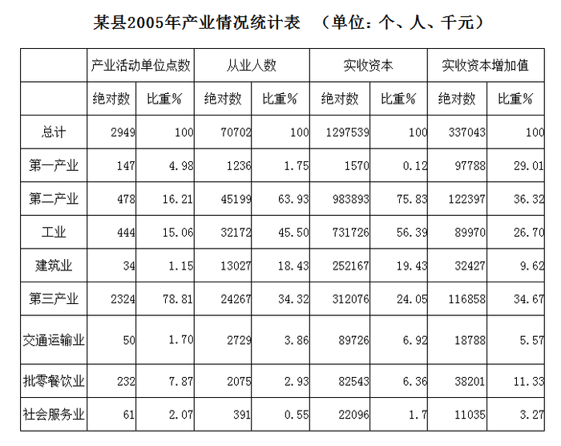

|  | 产业活动单位点数 绝对数 | 产业活动单位点数 比重% | 从业人数 绝对数 | 从业人数 比重% | 实收资本 绝对数 | 实收资本 比重% | 实收资本增加值 绝对数 | 实收资本增加值 比重% |
| --- | ---: | ---: | ---: | ---: | ---: | ---: | ---: | ---: |
| 总计 | 2949 | 100 | 70702 | 100 | 1297539 | 100 | 337043 | 100 |
| 第一产业 | 147 | 4.98 | 1236 | 1.75 | 1570 | 0.12 | 97788 | 29.01 |
| 第二产业 | 478 | 16.21 | 45199 | 63.93 | 983893 | 75.83 | 122397 | 36.32 |
| 工业 | 444 | 15.06 | 32172 | 45.50 | 731726 | 56.39 | 89970 | 26.70 |
| 建筑业 | 34 | 1.15 | 13027 | 18.43 | 252167 | 19.43 | 32427 | 9.62 |
| 第三产业 | 2324 | 78.81 | 24267 | 34.32 | 312076 | 24.05 | 116858 | 34.67 |
| 交通运输业 | 50 | 1.70 | 2729 | 3.86 | 89726 | 6.92 | 18788 | 5.57 |
| 批零餐饮业 | 232 | 7.87 | 2075 | 2.93 | 82543 | 6.36 | 38201 | 11.33 |
| 社会服务业 | 61 | 2.07 | 391 | 0.55 | 22096 | 1.7 | 11035 | 3.27 |

### 第 91 题

从从业人数上看，工业企业在该县第二产业中的比重为：

A. 15.06%

B. 45.50%

C. 71.18%

D. 92.89%

第 91 题 · 答案与解析

**参考答案（粉笔题库参考内容）**

C

**解析**

根据题干“······的比重为”，可判定本题为现期比重问题。定位表格材料可得：工业企业从业人数为32172人，第二产业从业人数为45199人。故从从业人数上看，工业企业在该县第二产业中的比重= 部分/总体 = 32172/45199≈ 32172/45000 ≈ 71%，与C项最接近。

故正确答案为C。

**考点**：现期比重、统计表

**来源**：2008年吉林省公务员录用考试《行测》题（甲级）第91题

### 第 92 题

2004年，该县的第三产业的实收资本是：

A. 96049.6万元

B. 19521.8万元

C. 86149.6万元

D. 96.05亿元

第 92 题 · 答案与解析

**参考答案（粉笔题库参考内容）**

B

**解析**

根据题干“2004年，······实收资本是······”，结合材料时间是2005年，可判定本题为基期计算问题。定位表格材料可得：2005年第三产业实收资本为312076千元，实收资本增加值为116858千元。故2004年，该县的第三产业的实收资本= 312076 − 116858 ≈312000−117000 = 195000千元＝19500万元，与B项最接近。

故正确答案为B。

**考点**：基期计算、统计表

**来源**：2008年吉林省公务员录用考试《行测》题（甲级）第92题

### 第 93 题

该县2005年第三产业实收资本增长率约为：

A. 21%

B. 37%

C. 46%

D. 60%

第 93 题 · 答案与解析

**参考答案（粉笔题库参考内容）**

D

**解析**

根据题干“2005年······增长率约为”，可判定本题为一般增长率问题。定位表格材料可得：2005年第三产业实收资本为312076千元，实收资本增加值为116858千元。则该县2005年第三产业实收资本增长率= 116858/(312076−116858)≈ 116858/200000 ≈ 58%，与D项最接近。

故正确答案为D。

**考点**：一般增长率、统计表

**来源**：2008年吉林省公务员录用考试《行测》题（甲级）第93题

### 第 94 题

从实收资本的角度看，下列选项中，表述正确的一项是：

A. 2005年，交通运输业是该县第三产业中的优势产业

B. 2005年，交通运输业在该县第三产业中所占比例比2004年有所上升

C. 2005年，批零餐饮业在该县第三产业中所占比例比2004年有所上升

D. 2005年，社会服务业在该县第三产业中所占比例比2004年有所下降

第 94 题 · 答案与解析

**参考答案（粉笔题库参考内容）**

C

**解析**

A项：定位表格材料，2005年第三产业实收资本的比重为24.05%，交通运输业、批零餐饮业、社会服务业的比重分别为6.92%、6.36%、1.7%。则第三产业中未提及的产业实收资本比重=24.05%-6.92%-6.36%-1.7%=9.07%>6.92%，故无法确定交通运输业是该县第三产业中的优势产业，错误；

B项：定位表格材料，2005年交通运输业实收资本为89726千元，增加值为18788千元，则2005年交通运输业实收资本增长率= 18788/(89726−18788)≈ 18788/71000 ≈ 26%；由本篇第3题可得，2005年第三产业实收资本增长率为58%。根据两期比重结论，部分增长率（a）26%＜总体增长率（b）58%，比重下降，错误；

C项：定位表格材料，2005年批零餐饮业实收资本为82543千元，增加值为38201千元，则2005年批零餐饮业实收资本增长率= 38201/(82543 − 38201)≈ 38201/44000 ≈ 87%。根据两期比重结论，部分增长率（a）87%＞总体增长率（b）58%，比重上升，正确；

D项：定位表格材料，2005年社会服务业实收资本为22096千元，增加值为11035千元，则2005年社会服务业实收资本增长率= 11035/(22096-11035)≈11035/11000≈100%。根据两期比重结论，部分增长率（a）100%＞总体增长率（b）58%，比重上升，错误。

故正确答案为C。

**考点**：统计表、综合分析

**来源**：2008年吉林省公务员录用考试《行测》题（甲级）第94题

### 第 95 题

下列选项中，表达错误的是：

A. 2005年，该县三次产业中人均实收资本最多的是第二产业

B. 与第三产业中的其他两个行业相比，交通运输业的人均实收资本最多

C. 交通运输业单位的平均规模大于社会服务业

D. 社会服务业人均资本增长额最大

第 95 题 · 答案与解析

**参考答案（粉笔题库参考内容）**

B

**解析**

A项：根据人均实收资本= 实收资本/从业人数，由表格材料可得，2005年三次产业人均实收资本分别为：第一产业=1570/1236=1^+千元/人；第二产业= 983893/45199 ＞ 20千元/人；第三产业=312076/24267=10^+千元/人。故2005年，该县三次产业中人均实收资本最多的是第二产业，正确；

B项：由表格材料可得，2005年第三产业中的三个行业人均实收资本分别为：交通运输业= 89726/2729 ≈ 33千元/人；批零餐饮业=82543/2075≈40千元/人；社会服务业=22096/391＞50千元/人。故与第三产业中的其他两个行业相比，交通运输业的人均实收资本最少，错误；

C项：单位平均规模即单位人均数，根据单位人均数= 从业人数/产业活动单位点数，由表格材料可得：交通运输业的单位人均数=2729/50，社会服务业的单位人均数=391/61。前者分子大、分母小，故交通运输业单位的平均规模大于社会服务业，正确；

D项：根据人均资本增长额=实收资本增加值/从业人数，由表格材料可得：社会服务业的从业人数最小，且远远小于其他；其实收资本增加值虽然也为最小，但和其他增加值相差不大。故分析可得社会服务业人均资本增长额最大，正确。

本题为选非题，故正确答案为B。

**考点**：统计表、综合分析

**来源**：2008年吉林省公务员录用考试《行测》题（甲级）第95题

## 材料 2

根据统计资料回答问题**。**

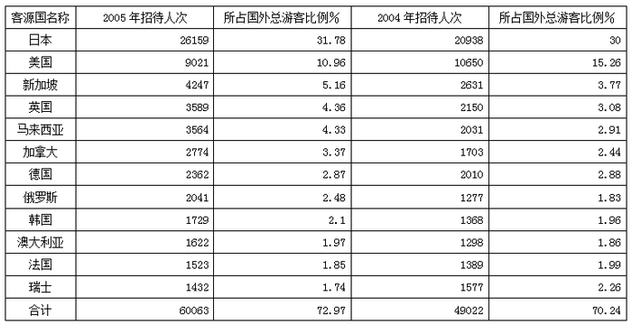

| 客源国名称 | 2005年招待人次 | 所占国外总游客比例% | 2004年招待人次 | 所占国外总游客比例% |
| --- | ---: | ---: | ---: | ---: |
| 日本 | 26159 | 31.78 | 20938 | 30 |
| 美国 | 9021 | 10.96 | 10650 | 15.26 |
| 新加坡 | 4247 | 5.16 | 2631 | 3.77 |
| 英国 | 3589 | 4.36 | 2150 | 3.08 |
| 马来西亚 | 3564 | 4.33 | 2031 | 2.91 |
| 加拿大 | 2774 | 3.37 | 1703 | 2.44 |
| 德国 | 2362 | 2.87 | 2010 | 2.88 |
| 俄罗斯 | 2041 | 2.48 | 1277 | 1.83 |
| 韩国 | 1729 | 2.1 | 1368 | 1.96 |
| 澳大利亚 | 1622 | 1.97 | 1298 | 1.86 |
| 法国 | 1523 | 1.85 | 1389 | 1.99 |
| 瑞士 | 1432 | 1.74 | 1577 | 2.26 |
| 合计 | 60063 | 72.97 | 49022 | 70.24 |

### 第 96 题

2005年与2004年相比，该市主要客源国游客人数上升了：

A. 2.73%

B. 18.4%

C. 22.5%

D. 81.6%

第 96 题 · 答案与解析

**参考答案（粉笔题库参考内容）**

C

**解析**

2005年该市主要客源国游客人数为60063人次，2004年该市主要客源国游客人数为49022人次，因此人数上升了(60063 - 49022)/49022 ≈ (60 - 49)/49 = 11/49，很显然排除A，用直除法可知首位为2。

故正确答案为C。

**考点**：一般增长率、统计表

**来源**：2008年吉林省公务员录用考试《行测》题（甲级）第96题

### 第 97 题

2005年该市的国外游客总人次比2004年增加了多少人次：

A. 11041

B. 12520

C. 15703

D. 18520

第 97 题 · 答案与解析

**参考答案（粉笔题库参考内容）**

B

**解析**

根据题干“2005年······总人次比2004年增加了多少人次”，可判定本题为增长量计算问题。定位表格材料可得，2005年国外主要客源国游客为60063人次，占国外总游客的比例为72.97%；2004年国外主要客源国游客为49022人次，占国外总游客的比例为70.24%。故2005年该市国外游客总人次比2004年增加了60063/72.97%−49022/70.24%≈ 60063/0.73 − 49022/0.702≈82300-69800=12500人次，与B项最为接近。

故正确答案为B。

**考点**：增长量计算、统计表

**来源**：2008年吉林省公务员录用考试《行测》题（甲级）第97题

### 第 98 题

下列选项中说法正确的一项是：

A. 2005年与2004年相比，各国到该市旅游人数均有所上升

B. 2005年与2004年相比，各国游客在国外总游客中所占比例均有所上升

C. 2005年与2004年相比，该市主要客源国中亚洲的游客比例有所增加

D. 2005年该市国内游客所占比例有所增加

第 98 题 · 答案与解析

**参考答案（粉笔题库参考内容）**

C

**解析**

A项：定位表格材料，2004年、2005年美国到该市旅游人数分别为10650人次、9021人次，故2005年与2004年相比，美国到该市旅游人数下降，并非各国均上升，错误；

B项：定位表格材料，2004年、2005年美国游客在国外总游客中所占比例分别为15.26%、10.96%，故2005年与2004年相比，美国在国外总游客中所占比例下降，并非各国均上升，错误；

C项：定位表格材料，表格中的亚洲国家有日本、新加坡、马来西亚、韩国。2004年、2005年日本在国外总游客中所占比例分别为30%、31.78%；新加坡分别为3.77%、5.16%；马来西亚分别为2.91%、4.33%；韩国分别为1.96%、2.1%。故2005年与2004年相比，该市主要客源国中亚洲的游客比例有所增加，正确；

D项：定位表格材料，没有国内游客相关数据，无法推出，错误。

故正确答案为C。

**考点**：统计表、综合分析

**来源**：2008年吉林省公务员录用考试《行测》题（甲级）第98题

### 第 99 题

下列选项中，说法不正确的一项是：

A. 亚洲国家游客是该市国外游客的主要来源

B. 主要客源国中，四个国家的游客人次增长幅度小于该市国外游客总人次的增长幅度

C. 在主要客源国中，除出现游客负增长的国家外，新加坡游客增长幅度最小

D. 若各国游客的增长幅度不变，则2006年德国游客人数将少于俄罗斯游客人数

第 99 题 · 答案与解析

**参考答案（粉笔题库参考内容）**

C

**解析**

A项正确，亚洲国家包括日本、新加坡、韩国、马来西亚，所占比例为31.78% + 5.16%+2.1% + 4.33% ≈ 43%，国外游客所占比例为30% + 3.77% + 1.96%+2.91% ≈ 39%，前者大于后者。

B项正确，由97题可知，国外游客比2004年增加了12520人次，12520/(49022/70.24%) ≈ 12520/70000 = 17.9%，德国为(2362-2010)/2010 = 352/2010≈17.5%＜17.9%，法国为(1523-1389)/1389≈150/1400≈ 10.7% ＜ 17.9%，又美国与瑞士为负增长，则有4个国家增幅低于该市国外旅客总人数增幅。

C项错误，新加坡增幅(4247−2631)/2631≈16/26＞50%，高于德国。

D项正确，俄罗斯增幅(2041 − 1277)/1277 ≈ 67%，远高于德国，又2005年游客人数接近。

本题为选非题，故正确答案为C。

**考点**：统计表、综合分析

**来源**：2008年吉林省公务员录用考试《行测》题（甲级）第99题

### 第 100 题

到该市旅游的主要客源国中，2005年游客人次增长幅度最大的是：

A. 马来西亚

B. 英国

C. 俄罗斯

D. 日本

第 100 题 · 答案与解析

**参考答案（粉笔题库参考内容）**

A

**解析**

根据题干“2005年······增长幅度最大”，可判定本题为一般增长率问题。定位表格材料可得2004年和2005年各国的游客人次。根据增长率=(现期量-基期量)/基期量，则2005年各国游客人次增长率分别为：

A项：马来西亚= (3564 - 2031)/2031 ≈ 1533/2000 ≈ 77%；

B项：英国= (3589 - 2150)/2150 ≈ 1439/2200 ≈ 65%；

C项：俄罗斯= (2041−1277)/1277 ≈ 764/1300 ≈ 59%；

D项：日本= (26159 − 20938)/20938 ≈ 5221/21000 ≈ 25%。

故到该市旅游的主要客源国中，2005年游客人次增长幅度最大的是马来西亚。

故正确答案为A。

**考点**：一般增长率、统计表

**来源**：2008年吉林省公务员录用考试《行测》题（甲级）第100题

## 材料 3

根据下列文字材料回答问题。

        2005年在城镇投资中，国有及国有控股投资40047亿元，比上年增长17.5%。第一产业投资823亿元，增长27.5%；第二产业投资31598亿元，增长38.4%；第三产业投资42675亿元，增长20.0%。分行业看，煤炭开采及洗选业投资比上年增长65.6%；电力、热力的生产与供应业投资增长33.7%；石油和天然气开采业投资增长29.7%；铁路运输业投资增长45.7%；交通运输设备制造业投资增长51.1%；纺织业投资增长38.0%；教育投资增长8.4%；卫生投资增长28.9%。

        2005年全年研究与开发经费支出2367亿元，比上年增长20.4%，占国内生产总值的1.30%，其中基础研究经费135亿元。2005年末国有企事业单位共有各类专业技术人员2720万人，全年国家安排了288项科技攻关计划课题和911项“863”计划课题，新建国家工程研究中心19个。新安排国家重点实验室改造项目16项，累计达到143项，国家认定企业技术中心达到361家。全年共取得省部级以上科技成果3.6万项。全年受理国内外专利申请47.6万件，其中国内申请38.3万件，占80.5%；受理国内外发明专利申请17.3万件，其中国内申请9.3万件，占53.8%。全年共签订技术合同26.5万项，技术合同成交金额1510亿元，比上年增长13.2%。

### 第 101 题

下列各行业，2005年投资增长最大的是：

A. 纺织业

B. 铁路运输业

C. 电力、热力的生产与供应业

D. 交通运输设备制造业

第 101 题 · 答案与解析

**参考答案（粉笔题库参考内容）**

D

**解析**

2005年纺织业、铁路运输业、电力热力生产供应业、交通运输设备制造业的投资增长分别为38.0%、45.7%、33.7%、51.1%，因此投资增长最大的为交通运输设备制造业。

故正确答案为D。

**考点**：文字资料、直接找数

**来源**：2008年吉林省公务员录用考试《行测》题（甲级）第101题

### 第 102 题

根据材料中的数据，2005年第三产业投资占三大产业投资总额比重约为：

A. 40%

B. 50%

C. 60%

D. 70%

第 102 题 · 答案与解析

**参考答案（粉笔题库参考内容）**

C

**解析**

根据题干“······2005年······占······比重约为”，结合材料时间为2005年，可判定本题为现期比重问题。定位文字材料第一段可得：2005年第一产业投资823亿元，第二产业投资31598亿元，第三产业投资42675亿元。根据公式：比重=部分/整体，则2005年第三产业投资占三大产业投资总额比重为 42675/(823+31598+42675)≈42675/(1000+32000+43000)= 42675/76000 ≈ 56%，与C项最接近。

故正确答案为C。

**考点**：文字资料、现期比重

**来源**：2008年吉林省公务员录用考试《行测》题（甲级）第102题

### 第 103 题

2005年基础研究经费占全年研究与开发经费总额的：

A. 5.7%

B. 6.8%

C. 7.3%

D. 9.9%

第 103 题 · 答案与解析

**参考答案（粉笔题库参考内容）**

A

**解析**

根据题干“2005年······占······的”，结合材料时间为2005年，可判定本题为现期比重问题。定位文字材料第二段可得：2005年全年研究与开发经费支出2367亿元，其中基础研究经费135亿元。根据公式：比重=部分/整体，则2005年基础研究经费占全年研究与开发经费总额的比重=135/2367≈135/2400≈5.6%，与A项最接近。

故正确答案为A。

**考点**：文字资料、现期比重

**来源**：2008年吉林省公务员录用考试《行测》题（甲级）第103题

### 第 104 题

2005年受理国外发明专利申请：

A. 8万件

B. 9.3万件

C. 23.4万件

D. 38.3万件

第 104 题 · 答案与解析

**参考答案（粉笔题库参考内容）**

A

**解析**

定位文字材料第二段可得：2005年，受理国内外发明专利申请17.3万件，其中国内申请9.3万件。则2005年受理国外发明专利17.3－9.3＝8万件。

故正确答案为A。

**考点**：文字资料、简单加减计算

**来源**：2008年吉林省公务员录用考试《行测》题（甲级）第104题

### 第 105 题

根据上述资料，以下说法正确的是：

A. 2005年所签订的技术合同每项平均成交额约为57万

B. 2005年，城镇投资增加的总额中大部分来自国有及国有控股投资

C. 与上年相比，2005年第二产业投资增加的总额低于第三产业

D. 2005年全年受理的国内专利申请中，绝大部分为发明专利申请

第 105 题 · 答案与解析

**参考答案（粉笔题库参考内容）**

A

**解析**

A项：定位文字材料第二段可得：2005年全年共签订技术合同26.5万项，技术合同成交金额1510亿元。根据公式：平均数=总数/份数，则2005年所签订的技术合同每项平均成交额= 1510亿元/26.5万项 ≈ 57万元/项，正确；

B项：定位文字材料第一段可得：2005年在城镇投资中，国有及国有控股投资40047亿元，比上年增长17.5%。材料中只给出国有及国有控股投资金额相关数据，没有给出城镇投资总额相关数据，无法判断，错误；

C项：定位文字材料第一段可得：2005年第二产业投资31598亿元，增长38.4%；第三产业投资42675亿元，增长20.0%。根据公式：增长量= 现期量/(1+增长率) × 增长率，则2005年第二产业投资同比增量= 31598/(1+38.4%)×38.4%≈ 31598/(1 + 1/2.5) × 1/2.5= 31598/3.5 = 9000^+亿元，第三产业投资同比增量= 42675/(1 + 20.0%) × 20.0%= 42675/(1+1/5) × 1/5= 42675/6 = 7000^+亿元。比较可知，2005年第二产业投资增加的总额高于第三产业，错误；

D项：定位文字材料第二段可得：2005年全年受理国内专利申请383万件，受理国内发明专利申请9.3万件。根据公式：比重=部分/整体，则2005年全年受理的国内专利申请中发明专利申请占比= 9.3/383 ＜ 1/2，即并非绝大部分为发明专利申请，错误。

故正确答案为A。

**考点**：文字资料、综合分析

**来源**：2008年吉林省公务员录用考试《行测》题（甲级）第105题

## 材料 4

根据下列资料回答问题。

        2003年，浙江省谷物类粮食种植面积为113.62万公顷（注：1公顷=15亩），比上年减少22.79万公顷；谷物类粮食的总产量达700.60万吨，比上年减少141.68万吨。

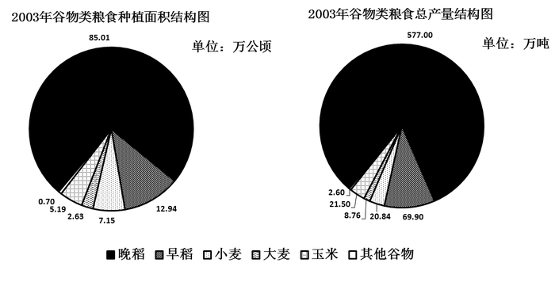

### 第 106 题

2003年浙江省谷物类粮食的总产量约比上年减少：

A. 16.82%

B. 20.22%

C. 23.27%

D. 25.35%

第 106 题 · 答案与解析

**参考答案（粉笔题库参考内容）**

A

**解析**

根据题干“······约比上年减少”，结合选项均为百分数，可判定本题为一般增长率问题。定位文字材料可知，2003年，浙江省谷物类粮食的总产量达700.60万吨，比上年减少141.68万吨。根据公式：增长率=增长量/(现期量-增长量)可得，2003年浙江省谷物类粮食的总产量比去年减少了141.68/(700.60-(-141.68))≈ 141.68/842＜20%，只有A项符合。

故正确答案为A。

**考点**：一般增长率、综合资料

**来源**：2008年吉林省公务员录用考试《行测》题（甲级）第106题

### 第 107 题

2003年浙江省谷物类粮食的平均亩产量约是多少千克？

A. 411千克

B. 424千克

C. 432千克

D. 446千克

第 107 题 · 答案与解析

**参考答案（粉笔题库参考内容）**

A

**解析**

观察发现，各选项数值非常接近，估算可能造成误差过大而错选答案，因此只能精确计算。113.62万公顷=113.62 × 15万亩。2003年浙江省谷物类粮食的平均产量为700.60/(113.62×15)≈0.411万吨/万亩= 411千克/亩。

故正确答案为A。

**考点**：现期平均数、综合资料

**来源**：2008年吉林省公务员录用考试《行测》题（甲级）第107题

### 第 108 题

以下粮食作物中，2003年的亩产量最高的是：

A. 早稻

B. 晚稻

C. 小麦

D. 玉米

第 108 题 · 答案与解析

**参考答案（粉笔题库参考内容）**

B

**解析**

2003年，早稻、晚稻、小麦、玉米的单位产量依次为69.90/12.94、577.00/85.01、20.84/7.15、21.50/5.19，相当于比较2330/431、2885/425、2084/715、2150/519四个分数的大小。显然2885/425数值最大，晚稻的单位产量最高。

故正确答案为B。

**考点**：现期平均数、综合资料

**来源**：2008年吉林省公务员录用考试《行测》题（甲级）第108题

### 第 109 题

2003年亩产量最低的谷物类粮食的种植面积约占谷物类粮食种植面积的：

A. 2.31%

B. 4.57%

C. 6.29%

D. 74.82%

第 109 题 · 答案与解析

**参考答案（粉笔题库参考内容）**

C

**解析**

2003年，早稻、晚稻、小麦、大麦、玉米的单位产量依次为69.90/12.94、577.00/85.01、20.84/7.15、8.76/2.63、21.50/5.19，相当于比较6990/1294、5770/850、2084/715、876/263、2150/519五个分数的大小。显然五个分数量级相当，依次直除可得首位数字为5、6、2、3、4。因此2084/715的数值最小，即小麦的单位产量最低。小麦种植面积占谷物类粮食种植面积的比例为7.15 ÷ 113.62 = 715/11362，直除得首位为6，仅C项符合。

故正确答案为C。

**考点**：现期比重、综合资料

**来源**：2008年吉林省公务员录用考试《行测》题（甲级）第109题

### 第 110 题

以下关于2003年谷物类粮食的生产情况的说法中，不正确的一项是：

A. 晚稻的产量大于谷物类粮食总产量的4/5

B. 产量最接近的两种粮食作物的种植总面积约为185万亩

C. “其他谷物”的种植面积和产量都是最小的

D. 大麦的亩产量不足210千克

第 110 题 · 答案与解析

**参考答案（粉笔题库参考内容）**

D

**解析**

A项正确，晚稻产量为577.00万公顷，谷物类粮食总产量的4/5为700.60 × 4/5 ≈ 140 × 4=560＜577万公顷；

B项正确，由2003年谷物类粮食总产量结构图可知，小麦与玉米产量最接近。小麦的种植面积是7.15万公顷，玉米的种植面积是5.19万公顷，这两种粮食作物的种植总面积为7.15+5.19=12.34万公顷≈12.3×15=184.5万亩；

C项正确，由两个饼状图易知，“其他谷物”的种植面积和产量都是最小的；

D项错误：大麦的产量为8.76万吨=8760万千克，种植面积面积为2.63万公顷 = 2.63 × 15万亩，则大麦的亩产量为8760 ÷ (2.63 × 15) ＞ 870/4 ≈ 218千克/亩。

本题为选非题，故正确答案为D。

**考点**：综合分析、综合资料

**来源**：2008年吉林省公务员录用考试《行测》题（甲级）第110题

