# 2009年吉林省公务员录用考试《行测》题（甲级）

<!-- gwy:overview:start -->
> **吉林 · 2009 · 行测 · 甲级** ｜ 105 题 · 图片 11 处 · 答案随题折叠

| 题型模块 | 题量 | 题号 |
| --- | ---: | ---: |
| 数量关系 | 10 | 1–10 |
| 言语理解与表达 | 30 | 11–40 |
| 判断推理 | 35 | 41–75 |
| 常识判断 | 10 | 76–85 |
| 资料分析 | 20 | 86–105 |
| **合计** | **105** | |

导航：[题型与作答说明](#题型与作答说明) · [题目](#题目) · [材料 1](#材料-1)
<!-- gwy:overview:end -->

> 候选采集稿。参考答案及解析来自粉笔页面，不代表官方答案或真实高分答卷；来源使用许可与原卷对应关系仍需人工核实。

## 题型与作答说明

数量关系

（10题）

本部分包括数字推理与数量关系两种类型的试题。

言语理解与表达

（30题）

根据题目要求，在每个选项中选出一个正确答案。

判断推理

（35题）

本部分包括定义判断、逻辑判断、类比推理与图形推理四种类型的题目。

常识判断

（10题）

根据题目要求，在四个选项中选出一个最恰当的答案。

资料分析

（20题）

针对下列文字、表或图回答问题。你应根据资料提供的信息进行分析、比较、计算、处理。

## 题目

### 第 1 题

100，102，113，124，（    ）

A. 129

B. 130

C. 131

D. 135

第 1 题 · 答案与解析

**参考答案（粉笔题库参考内容）**

D

**解析**

数列变化趋势平缓，作差无规律，考虑作和。将题干所给各项数字按照数位划分，将每一项各个数位的数字加和，得到新数列1，3，5，7，为公差为2的等差数列，故所求项各数位之和为7+2=9。代入选项，只有D项1+3+5=9。

故正确答案为D。

**来源**：2009年吉林省公务员录用考试《行测》题（甲级）第1题

### 第 2 题

3，8，15，24，35，（    ）

A. 45

B. 48

C. 50

D. 51

第 2 题 · 答案与解析

**参考答案（粉笔题库参考内容）**

B

**解析**

数列变化趋势平缓，优先考虑作差。后项减前项得到新数列：5，7，9，11，构成公差为2的等差数列，下一项为13。则所求项=35+13=48。

故正确答案为B。

**来源**：2009年吉林省公务员录用考试《行测》题（甲级）第2题

### 第 3 题

1，4，8，14，23，（    ）

A. 36

B. 46

C. 56

D. 66

第 3 题 · 答案与解析

**参考答案（粉笔题库参考内容）**

A

**解析**

数列变化趋势平缓且无明显特征，优先考虑作差。后项减前项得到新数列①：3，4，6，9，（    ），无明显特征，再次后项减前项得新数列②：1，2，3，（    ），构成公差为1的等差数列，下一项为4。则所求项=23+9+4=36。

故正确答案为A。

**来源**：2009年吉林省公务员录用考试《行测》题（甲级）第3题

### 第 4 题

从四个选项中选出最恰当的一项：

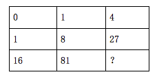

A. 116

B. 156

C. 256

D. 356

第 4 题 · 答案与解析

**参考答案（粉笔题库参考内容）**

C

**解析**

九宫格图形数阵，所求为右下角数字，考虑横向寻找规律。第一行数字为0，1，4可演变为0^2，1^2，2^2，发现各数字指数相同，底数构成公差为1的等差数列；第二行数字为1，8，27可演变为1^3，2^3，3^3，亦发现各数字指数相同，底数构成公差为1的等差数列；故第三行数字应符合上述规律，16，81，可演变为2^4，3^4，故？= 4^4 = 256。

故正确答案为C。

**来源**：2009年吉林省公务员录用考试《行测》题（甲级）第4题

### 第 5 题

0，1，2，0，3，0，4，0，0，（    ）

A. 0

B. 2

C. 4

D. 6

第 5 题 · 答案与解析

**参考答案（粉笔题库参考内容）**

A

**解析**

数列变化趋势呈波动状，作差作和皆无明显规律，由于数列中存在相同数字“0”，考虑从位置角度寻找规律。观察发现，数列2、3、5、7四个质数位上皆为非0数字，1、4、6、8、9五个非质数位上皆为数字0。（    ）所在位数为数列第10位，为非质数位，故（    ）处应填数字0。

故正确答案为A。

**来源**：2009年吉林省公务员录用考试《行测》题（甲级）第5题

### 第 6 题

根据我国税收制度，公民个人的工资、薪金、稿酬、劳务报酬等如果超过一定的数额，都要按规定缴纳个人所得税。假定对工资、薪金征收个人所得税的税率如下表所示：

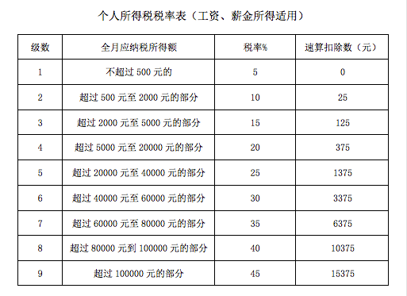

某人10月份薪金收入5000元，那么她该月应交付个人所得税（    ）。

A. 325元

B. 385元

C. 625元

D. 750元

第 6 题 · 答案与解析

**参考答案（粉笔题库参考内容）**

A

**解析**

方法一：我国个税起征点为2000元，当薪金收入为5000元时，对应表格中前三个纳税级数。故该月她应交付个人所得税= (2500 − 2000) × 5%+(4000-2500)×10%+(5000 − 4000) × 15%= 500 × 5% + 1500 × 10%+1000×15%=325元。

方法二：由于我国个税起征点为2000元，当月收入为5000元时，只有5000-2000=3000元在纳税范围内，对应表中第三个纳税等级，即税率15%，速算扣除数为125元。故该月她应交付个人所得税=3000×15%−125=325元。

故正确答案为A。

**考点**：分段计算问题

**来源**：2009年吉林省公务员录用考试《行测》题（甲级）第6题

### 第 7 题

某高校志愿者90人去支援某次冬运会，53人到滑雪场地，82人到滑冰场地，有6人既没到滑雪场地，也没到滑冰场地。既到滑冰场又到滑雪场的人是：

A. 45 人

B. 51 人

C. 29 人

D. 47 人

第 7 题 · 答案与解析

**参考答案（粉笔题库参考内容）**

B

**解析**

设既到滑冰场又到滑雪场的人数为x人。根据两集合容斥原理公式：A + B − A ∩ B = 总数 − 都不，可列式，53+82-x=90-6，解得x=51。故既到滑冰场又到滑雪场的人数为51人，对应B项。

故正确答案为B。

**考点**：两集合

**来源**：2009年吉林省公务员录用考试《行测》题（甲级）第7题

### 第 8 题

某商场采用“满300送100”的办法来促销，办法是这样的，购物满300元，赠送100元“礼券”，不足300的部分略去不计。“礼券”可在下次购物时代替现金，但使用礼券的部分不能再享受“满300送100”的优惠。一位顾客先用1000元购了A商品得到“礼券”后，又用这些“礼券”和280元选购了B商品。这位顾客在商场购A、B两种商品相当于享受了（     ）优惠。

A. 九五折

B. 九折

C. 八五折

D. 八折

第 8 题 · 答案与解析

**参考答案（粉笔题库参考内容）**

D

**解析**

根据商场的优惠方式，顾客购买A商品花费1000元，可得到礼券1000/300 = 3张......100元（略去不计）。由于每张“礼劵”面额为100元，则B商品原价为280+3×100=580元。商品总价格=1000+580=1580元，花费总钱数=1000+280=1280元。故这位顾客在商场购A、B两种商品相当于享受1280/1580≈81%≈8折优惠，对应D项。

故正确答案为D。

**考点**：经济利润问题

**来源**：2009年吉林省公务员录用考试《行测》题（甲级）第8题

### 第 9 题

鲜花队准备排成一个正方形队列，由于服装不够，只好减少 27 人，使横竖各减少了一排，鲜花队现在的人数是：

A. 169人

B. 144人

C. 196人

D. 225人

第 9 题 · 答案与解析

**参考答案（粉笔题库参考内容）**

A

**解析**

减少27人使原正方形方阵横竖各减少了一排，则27=原正方形队列每边的人数×2-1，解得原正方形队列每边的人数为14人。原正方形队列共有14×14=196人。减少27人后，鲜花队共有196-27=169人。

故正确答案为A。

**来源**：2009年吉林省公务员录用考试《行测》题（甲级）第9题

### 第 10 题

牧羊人赶着一群羊去寻找草长得茂盛的地方放牧。有一个过路人牵着一只肥羊从后面跟了上来。他对牧羊人说：“你赶来的这群羊有100只吧？”牧羊人答道：“如果这一群羊加上一倍，再加上原来这群羊的一半，又加上原来这群羊的1/4，连你牵着的这只肥羊也算进去，才刚好凑满100只。”

请你猜猜，牧羊人的这群羊一共有：

A. 72只

B. 70只

C. 36只

D. 35只

第 10 题 · 答案与解析

**参考答案（粉笔题库参考内容）**

C

**解析**

设牧羊人的赶来的这群羊共有x只，根据题意列方程x(1+1) + 1/2 x+ 1/4 x + 1 = 100，化简可得2.75x=99，解得x=36。即牧羊人赶来的这群羊共有36只。

故正确答案为C。

**考点**：和差倍比问题

**来源**：2009年吉林省公务员录用考试《行测》题（甲级）第10题

### 第 11 题

依次填入文中横线处的语句，顺序恰当的一项是：

几十年来，霍金的身体禁锢在轮椅中，　　　。　　　，　　　，　　　。他以极度残疾之身，取得极其辉煌的科学成就，成为自爱因斯坦以来引力物理学领域最大的权威。

①他执著地寻求着“我们从何处来，我们往何处去”的答案

②震动了整个理论物理学界

③发现了一个又一个宇宙运行的重大奥秘

④思维却遨游于广袤的太空

A. ③①④②

B. ④①③②

C. ①③②④

D. ④③①②

第 11 题 · 答案与解析

**参考答案（粉笔题库参考内容）**

B

**解析**

此题属于排序填空题。

根据横线后的一句“他以极度残疾之身，取得极其辉煌的科学成就，成为自爱因斯坦以来引力物理学领域最大的权威”可知，横线处的语句谈论的是霍金虽身体残疾但为物理学作出了巨大贡献，应含有转折的意味，故④句应排在第一位，③句中发现了宇宙运行的重大奥秘应是①句“执着地寻求”的结果，故排序应为④①③②。

故正确答案为B。

**考点**：确定捆绑、确定顺序、语句排序题、语句填空题混合题型

**来源**：2009年吉林省公务员录用考试《行测》题（甲级）第11题

### 第 12 题

据《组织人事报》9月21日报道，今年，上海市政府将和香港政府互派政府公务员在对方机构任职工作，学习和借鉴国际大都市政府机关运行、管理的模式和方法。据了解，上海市为了提升公务员的国际化素质，人事部门将以强化科学行政决策能力为重点，继续推进MPA和EMPA的课程以及法律、WTO一般规则和现代行政管理知识等方面培训，提高公务员信息技术应用能力、跨文化沟通能力和适应创新能力。另外，上海市有关部门将积极选派一批外语好、专业素质高的青年人才，通过友好城市交流等渠道到海外的政府机关、大企业和国际组织中去工作。

为这段新闻拟写引题和主标题，恰当的一项是：

A. 引题：扩大交流，加强培训 主标题：上海不断提升公务员国际化素质

B. 引题：取长补短，提高能力 主标题：沪港将互派公务员

C. 引题：培训公务员，上海出新政 主标题：沪港互派 出国研训

D. 引题：沪港互派 出国研训 主标题：上海大量外派公务员

第 12 题 · 答案与解析

**参考答案（粉笔题库参考内容）**

B

**解析**

主标题应是题干材料的主旨内容。

题干首句说“沪港将互派公务员”，这是整段新闻中最重要的信息，标题应包括沪港双方，只提其中一方不准确，排除A、D两项。引题的作用是放在主标题之前，用简明的文字引出主标题。由题干可知，互派公务员的目的是整段材料的第二大信息。接下来的材料对互派的目的做出了具体说明——为了提升素质、提高各方面能力等。“取长补短，提高能力”是对公务员互派目的最为简洁的概括。

故正确答案为B。

**考点**：标题填入题

**来源**：2009年吉林省公务员录用考试《行测》题（甲级）第12题

### 第 13 题

德国科学家贝特·魏茨泽克独立地推测太阳能源可能来自它的内部氢核聚变成氦核的热核反应，这甚至早于核裂变模型的提出。然而，与能够在室温下进行的裂变不同，聚变发生需要巨大能量。这是因为当两个带正电的氢原子核靠近的时候，根据“同性相斥”的原理，相互间的斥力将阻碍聚变的发生。要克服这种阻碍，只有两种途径：强大的引力，或上亿度的高温。然而，地球上并不具有太阳那样强大的引力场。因此，要想在地球上实现核聚变，只能依靠上亿度的高温。

下列关于“核聚变”的理解符合原文意思的一项是：

A. 太阳能源来自它的内部氢核聚变成氦核的热核反应

B. 与能够在室温下进行的裂变不同，核聚变发生需要巨大能量

C. 两个带正电的氢原子核靠近的时候，相互间的斥力能阻止聚变的发生

D. 克服原子核之间的斥力发生核聚变，必须同时具备两个条件：强大的引力和上亿度的高温

第 13 题 · 答案与解析

**参考答案（粉笔题库参考内容）**

B

**解析**

根据提问“符合原文”可知该题为细节判断题。

太阳能源自它的内部氢核聚变成氦核的热核反应只是科学家的一种推测，并未得到完全证实，A项说法过于绝对，排除；C项偷换词语，文段中只是说两个带正电的氢原子核靠近时，根据“同性相斥”的原理，它们相互间的斥力将“阻碍”聚变的发生，并没有说肯定能够“阻止”聚变的发生，排除；D项偷换逻辑关系，文中说的是“只有两种途径”，并不是说必须同时需要两个条件都具备，排除。

故正确答案为B。

**考点**：细节判断题

**来源**：2009年吉林省公务员录用考试《行测》题（甲级）第13题

### 第 14 题

关于利用太阳能的研究已经有几十年的历史了，可它至今没有走进寻常百姓家。要使太阳能真正达到实用水平，从技术上需要解决两个问题：一是要提高太阳能光电变换效率并降低其成本，二是要实现太阳能发电与现在的电网联网。从社会政策上也需要解决两个问题：一是要获得普通百姓对清洁能源的支持，二是要获得政府对太阳能发电的前期投入。

“太阳能至今没有走进寻常百姓家”有诸多原因，选出其主要原因的一项是：

A. 在提高太阳能光电变换效率、并降低其成本方面尚不理想

B. 太阳能发电与现在的电网尚未成功联网

C. 普通百姓对清洁能源还没有达到认可的程度，政府的前期投入也还不够

D. 目前尚未提供建造太阳能发电站的足够面积

第 14 题 · 答案与解析

**参考答案（粉笔题库参考内容）**

A

**解析**

文段中提及多项太阳能未能进入寻常百姓家的原因，需分析主要原因，文段从技术和社会政策两个方面讨论，太阳能的研究应首先满足技术过关才可推广至社会使用，才能涉及到社会政策，所以技术方面应为主要原因，而从技术角度分析，一是提高效率降低成本，二是与现有电网联网，提高光电变换效率并降低成本直接决定了太阳能能否被普通百姓负担和使用；电网联网是技术达标后需配套解决的次要问题，对应A项。

B 项，“太阳能发电与现在的电网尚未成功联网”，仅为技术层面的次要问题，并非主要原因，排除；

C 项，“普通百姓认可度不足、政府前期投入不够”，属于社会政策层面的配套性问题，并非主要原因，排除；

D 项，“建造太阳能发电站的足够面积”，文段未提及相关内容，无中生有，排除。

故正确答案为A。

【文段出处】《太阳能何时进入寻常人家》

**考点**：细节判断题

**来源**：2009年吉林省公务员录用考试《行测》题（甲级）第14题

### 第 15 题

循环经济倡导的是一种建立在物质不断循环利用基础上的经济发展模式，它要求按照自然生态系统的模式，把经济活动组成一个“资源——产品——再生资源”的物质反复循环流动的过程，使得整个经济系统以及生产和消费的过程基本上不产生或者只产生很少的废弃物，“只有放错了地方的资源，而没有真正的废弃物。”。

对文中划线句子的解释，最准确的一项是：

A. 废弃物如果放错了地方，就无法变成再利用的资源

B. 废弃物如果妥善利用，就会变成有价值的资源

C. 资源如果放错了地方，就会变成无用的废弃物

D. 废弃物是不存在的，因为它实际上也是资源

第 15 题 · 答案与解析

**参考答案（粉笔题库参考内容）**

B

**解析**

本题主要考查语句的理解。

材料论述了循环经济的特点——充分利用资源，强调应循环利用废弃物，使它们变成有价值的资源。“只有放错了地方的资源，而没有真正的废弃物”正体现了这一点，故正确答案为B。

其他选项都没有准确体现循环经济这一特点。

故正确答案为B。

**考点**：句子

**来源**：2009年吉林省公务员录用考试《行测》题（甲级）第15题

### 第 16 题

人体中流动的红色血液是由红细胞、白细胞、血小板、血浆等成分组成的全血。目前先进的医学技术强调的是成分输血，是把全血中的各种有效成分分离出来，分别制成制品，然后根据不同患者的需要输给相应制品。因此，人造血液也不需要与全血成分完全一致。现在已有血浆代用品上市，血小板代用品也已经开始研究，目前许多国家着重于开发红细胞代用品。血液中红细胞最主要的功能是红细胞中的血红蛋白有携带氧气的能力。如果能合成出负责搬运氧分子的血红蛋白，人造血液的关键难题就迎刃而解。

对“成分输血”的理解，正确的一项是：

A. 只采用一种或几种血液成分的输血治疗

B. 与全血成分不完全一致的人造血液

C. 只采用一种或几种血液成分来治疗的人造血液

D. 应用血浆代用品代替全血的输血治疗

第 16 题 · 答案与解析

**参考答案（粉笔题库参考内容）**

A

**解析**

首先定位原文，“成分输血”出现在第二句，后面是一个“是”，表示解释的意思，后面的内容就是对“成分输血”的解释。“成分输血，是把全血中的各种有效成分分离出来，分别制成制品，然后根据不同患者的需要输给相应制品。”说明“成分输血”也是一种输血治疗方式A选项说法与解释一致，故为正确选项。

B、C选项，说这是一种“人造血液”，而文段指出“成分输血”是一种输血治疗方式，与文意不符，排除；

D选项，文段一开始说“红色血液是由红细胞、白细胞、血小板、血浆等成分组成的全血”“成分输血是把有效成分分离出来”，D选项所说的血浆替代品只是其中一部分，不能代表全血，与文意不符，排除。

故正确答案为A。

**考点**：实词

**来源**：2009年吉林省公务员录用考试《行测》题（甲级）第16题

### 第 17 题

在对报纸、广播电视和网络3种媒体的近90万个文本的7亿字次进行统计后发现这7亿字次是由8225个汉字所组成，在前2500个高频字中，有357字是1988年制定发布的《现代汉语常用汉字表》一级常用字（2500字）中所没有的；在前3500个高频字中，有398字是《现代汉语常用汉字表》（3500字）中所没有的；在前7000字中，有615字是《现代汉语通用汉字表》（1988年制定发布，7000字）中所没有的。统计结果表明，《现代汉语通用汉字表》中也有244字未在本次8225个统计用字中出现。

以上文字说明了：

A. 《现代汉语常用汉字表》《现在汉语通用汉字表》亟需修订

B. 现代媒体用字与20年前相比已经发生了明显的变化

C. 现代媒体用字新增比例迅速加大

D. 时代发展，新增字和废止字的存在是正常现象

第 17 题 · 答案与解析

**参考答案（粉笔题库参考内容）**

B

**解析**

根据提问可知此题属于中心理解题。

题干材料主要讲了通过对媒体用字的最新统计与1988年统计的《现代汉语常用汉字表》和《现代汉语通用汉字表》的比较，发现了许多不同之处，出现了很多新的常用字，B项体现了这一点。

文段只是对媒体用字进行统计，通过媒体用字得不出“《现代汉语常用汉字表》及《现代汉语通用汉字表》亟需修订”，故排除A项；材料主要强调两次统计结果的对比，C项只指出了最新结果显示新增用字增加，过于片面，故排除；D项“是正常现象”的态度在所给文段中找不到依据，排除。

故正确答案为B。

**考点**：关联词-并列

**来源**：2009年吉林省公务员录用考试《行测》题（甲级）第17题

### 第 18 题

有一个船夫在湍急的河水中驾驶小船，上面坐着一个哲学家。哲学家问船夫：“你懂得历史吗？”船夫说：“不懂。”哲学家说：“那你失去了一半生命。”哲学家又问：“你研究过数学吗？”船夫说：“没有。”哲学家说：“那你失去了一半以上的生命。”哲学家刚说完这句话，风就把小船吹翻了，哲学家和船夫两个人都落入水中。于是，船夫喊道：“你会游泳吗？”哲学家说：“不会。”船夫说：“那你失去了整个生命。”

这段文字隐含的主要信息或道理是：

A. 尺有所短，寸有所长

B. 不懂得历史和数学，就等于生命失去了大部分灵魂

C. 掌握的知识和技能要能够学以致用，否则大而不当

D. 拥有实践能力比掌握理论知识重要，所以要善于实践

第 18 题 · 答案与解析

**参考答案（粉笔题库参考内容）**

A

**解析**

文段首先论述了哲学家认为船夫不懂历史、数学等，生命失去了太多的意义，最后落水时，船夫问哲学家会不会游泳，哲学家回答不会。通过对比可知，无论是哲学家，还是船夫，都有自己的优点和不足，对应A项。

B项，表述片面，选项仅表述的是哲学家的观点，排除；

C项，无中生有，文段并没有表述历史和数学要具体如何使用，也没有表述游泳理论如何指导实践，不符合文意，排除；

D项，文段是强调不同的人各有优点不足，而并非将“理论”与“实践”相对比，排除。

故正确答案为A。

**来源**：2009年吉林省公务员录用考试《行测》题（甲级）第18题

### 第 19 题

牛顿看到成熟的苹果从树上掉下来，研究它的原因，发现了万有引力的秘密，开创了物理学的一个新时代。瓦特从水开时蒸汽顶起壶盖的现象中受到启发，发明了蒸汽机。马克思从人们每天都在进行的亿万次的商品交换中发现了现代资本主义发生、发展和灭亡的规律，为无产阶级社会主义革命指明了广阔的道路。他们都能　　　。

补写总结句，使语段的意思完整明确的一项是：

A. 于无声处听惊雷，展现出敏锐的洞察能力和卓越的分析能力

B. 明察秋毫、举重若轻，洞悉社会发展变化的深刻道理

C. 从平常的事情中，发现不平常的奥秘，推动了科学的发展

D. 不断钻研、上下求索，终于取得非凡的成就

第 19 题 · 答案与解析

**参考答案（粉笔题库参考内容）**

C

**解析**

此题属于语句填空题。

分析材料可知，空格处的语句应填入能够概括前面三个例子共性的主旨句。材料中三个句子的关键字眼是“从······发现······”，所举的三个例子都说明了这些人能从平常的事情中发现不平常的奥秘，强调的是“平常事”和“不平常的发现”之间的对比，衔接自然。

因此，结合选项应该选择C，C项符合题意。

A、B、D项太过片面，未体现出对社会的贡献。

故正确答案为C。

**考点**：横线在结尾

**来源**：2009年吉林省公务员录用考试《行测》题（甲级）第19题

### 第 20 题

朋友是磁石吸来的铁片儿、钉子、螺丝帽和小别针，只要愿意，从俗世上的任何尘土里都能吸来。现在，街上的小青年有江湖义气，喜欢把朋友的关系叫“铁哥们”，第一次听到这么说，以为是铁焊了那种牢不可破，但一想，磁石吸的就是关于铁的东西呀。这些东西，有的用力甩甩就掉了，有的怎么也甩不掉，可你没了磁性它们就全没有喽！

对这段文字的主旨概括最准确的是：

A. 朋友交往源于“磁性”

B. 朋友来自生活中的任何一个地方，可以分为不同的种类

C. 具有“磁性”的朋友关系才能牢不可破

D. 患难之交才是真朋友

第 20 题 · 答案与解析

**参考答案（粉笔题库参考内容）**

A

**解析**

根据提问可知本题为中心理解题。

题干第一句话主要讲了朋友是磁石吸来的，第二句话举例用现在青年间称“铁哥们”来说明朋友间那种磁石吸引铁的关系，第三句话进一步说明没有磁性就没有朋友。可见朋友是通过“磁性”来建立的，双方都没有磁性就没有朋友交往。

所以A项朋友交往源于“磁性”准确。

B项为通过“磁性”建立朋友的特征，而非主旨，排除；C项不正确，朋友关系都是具有“磁性”的，且不构成主旨，排除；D项文章未涉及，排除。

故正确答案为A。

**考点**：分述句特征-举例子

**来源**：2009年吉林省公务员录用考试《行测》题（甲级）第20题

### 第 21 题

公安部有一位领导曾经做过调查，结果发现信访群体中80%都是农民，没有一个是科级以上干部亲属，包括村主任的亲属都没有。国家信访部门负责人也曾说过：群众信访反映的问题中80%以上是有道理的。

这段文字意在说明的是：

A. 我们要正确对待上访群众所反映的问题

B. “各负其责”不应该只是口号，“就地解决问题”是一个重要的工作

C. 上访往往是社会最基层、最弱势群体不得已而采取的一种自我维权行为

D. 应加强基层干部发现问题、解决问题的能力

第 21 题 · 答案与解析

**参考答案（粉笔题库参考内容）**

C

**解析**

根据提问中的“意在”可知本题为中心理解题。

本题的关键信息是“信访群体中80%都是农民，没有一个是科级以上干部亲属”，这表明上访人群是社会最基层、最弱势的群体，从“反映的问题中80%以上是有道理的”可以看出上访人群并非无中生有，而是切实想要解决问题。

由此可引申为，上访已经成了他们不得已而采取的一种自我维权行为，C项正体现了这一点。

题干材料并没有提及对待上访群众所反映问题的态度，也没有说到干部发现、解决问题的能力，所以不选A、B、D三项。

故正确答案为C。

**考点**：关联词-并列

**来源**：2009年吉林省公务员录用考试《行测》题（甲级）第21题

### 第 22 题

有时候真正的艺术创作并不是可以用理性分析来解释的，有时候甚至是伴有几分癫狂特征的。美国当代诗人露丝•斯通（Ruth Stone）说她年轻的时候在地里干活，忽然感到有一首诗朝着她走过来，就如在地里出现了一阵闪电，脚下的土地也在震动。斯通赶紧跑回家里把那首诗写下来，感觉到那首诗就在她的背后追着她。有时候，跑得不够快，那首诗就要离她而去了，就一手拿铅笔，另一只手伸出去把诗的尾巴拉回来，这时，斯通就把诗从最后一个字写到第一个字，也能把整首诗写下来，只是顺序会倒了过来。

对这段文字理解正确的一项是：

A. 诗人露丝·斯通诗兴大发，是因为她具有非凡的创造力

B. 天才最优秀的特质或许就是某种伟大的力量借给他的

C. 人们并不会认为天才就是无所不能的圣者，因为这么高的期望值会给艺术家带来压力

D. 天才其实凭借的就是自己的创造力与灵感的结合

第 22 题 · 答案与解析

**参考答案（粉笔题库参考内容）**

D

**解析**

材料为“总分”结构，首句先提出观点：“真正的艺术创作有时是伴有几分癫狂特征的，然后举了诗人露丝•斯通的例子来论证这一观点。

因此，结合选项应该选择D，D项体现了文段的主旨。

A项错误，不能把露丝•斯通诗兴大发的原因仅仅归结为其非凡的创造力，而且文段中的描写其实更侧重于其灵感的突发，排除；B项属于主观臆断，从题干材料推不出，排除；C项属于无中生有，排除。

故正确答案为D。

**考点**：分述句特征-举例子

**来源**：2009年吉林省公务员录用考试《行测》题（甲级）第22题

### 第 23 题

《二泉映月》，使我们有一种心灵沐浴冲凉的感觉。真得感谢盲人音乐家阿炳，他用一把胡琴，教会了我们听泉。让我们知道，感觉山中清泉应该打通生命所有的孔窍，只凭眼睛直观是不够的。我们和阿炳的差别就在于不懂得让心灵长出眼睛看宇宙，让耳朵生出触须抚摸自然。我们没有化清流为音乐的神力，而他一下子就捕捉住了稍纵即逝的灵感，再加进自己的天分、才华与生命感悟，人间就淌出了不朽的经典。从这个角度说，也许我们才是真的盲人。

这段话主要说明了我们不能像阿炳那样创作出经典作品的根本理由是：

A. 我们没有用心灵去感悟自然

B. 我们没有化清流为音乐的神力

C. 我们没有捕捉到稍纵即逝的灵感

D. 我们只会凭眼睛去看，缺乏天分与才华

第 23 题 · 答案与解析

**参考答案（粉笔题库参考内容）**

A

**解析**

文段开篇指出阿炳通过《二泉映月》带给我们心灵沐浴的感受，教会人们听泉，强调感受清泉需打通生命孔窍，不能仅靠眼睛直观。接着通过对比，指出我们与阿炳的核心差别在于我们仅依赖视觉，未能用心灵和耳朵去感悟。尾句补充说明阿炳的创作过程，进一步印证其能捕捉灵感、成就经典的关键，在于对自然的心灵感悟。因此，无法创作出经典的根本理由是我们缺乏用心灵感悟自然的能力，对应A项。

B项，“化清流为音乐的神力”是阿炳创作经典的能力体现，而非我们无法创作的原因，且并未明确指出神力的含义，即用心灵感悟自然，选项表述不明确，排除；

C项，“没有捕捉到稍纵即逝的灵感”是结果，根源在于缺乏心灵对自然的感悟，并非根本理由，排除；

D项，文段未提及我们“缺乏天分与才华”，且“只会凭眼睛去看”只是我们感知自然的表象问题，其根源仍是缺少心灵层面的深度感悟，排除。

故正确答案为A。

【文段出处】散文《听泉》

**考点**：特殊问法

**来源**：2009年吉林省公务员录用考试《行测》题（甲级）第23题

### 第 24 题

近年来，由于就业压力的不断增大和公务员优厚的待遇，报考公务员已经成为多数大学生就业的第一选择，而公务员招考门槛也水涨船高，报考条件中的高学历要求并不鲜见。在高学历日渐成为公务员考试“敲门砖”的今天，广东省却反其道行之，决定 2009 年广东省公务员考试在一些经济发展水平较低的地区，符合条件的高中生也可报考。广东省此举可谓突破“常理”。

公务员招考是否应该追求高学历，下列理解正确的是：

A. 公务员待遇好，工作稳定，用人的要求应该高

B. 提高门槛可以为“国考”降温，广州的做法不科学

C. 建设高素质公务员队伍不是不应当使用高学历人才，而是要人尽其才

D. 高学历高能力是用人单位提高要求的原因

第 24 题 · 答案与解析

**参考答案（粉笔题库参考内容）**

C

**解析**

材料讲的是在公务员招考门槛日渐提高的背景下，广东省却反其道而行之，降低了公务员招考的门槛，强调的是人尽其才，而不是一味追求高学历。题干只是对公务员门槛的变化做了客观说明，并没有对此评价。

C项符合题意。

A项与文意相悖，故排除A项；B、D项文中没有提到，也排除。

故正确答案为C。

**考点**：细节判断题

**来源**：2009年吉林省公务员录用考试《行测》题（甲级）第24题

## 材料 1

阅读下面的文章，完成以下各题。

        党的十七大报告提出了建设生态文明的要求，并把生态文明建设与经济建设、政治建设、文化建设、社会建设一起作为全面建设小康社会的重要任务。深入贯彻落实科学发展观，积极推进生态文明建设，需要各地区各部门结合自身实际，大胆实践、勇于探索，根据中央的精神和要求，山东省聊城市           。

        建设生态文明市，在理念和内涵上都与过去提出的建设生态市有所不同。生态市建设主要涉及处理好经济发展与环境保护的关系问题，重点是控制污染、节约能源、改善环境；而生态文明市建设则涉及经济社会发展的方方面面，需要落实到经济、政治、文化、社会等各个领域。近年来建设生态市的实践使我们越来越认识到，仅仅通过生态市建设还不能完全解决经济社会科学发展的问题，必须进一步树立生态文明理念，实现从传统的征服自然观念向树立人与自然和谐相处观念转变，实现从以过度消耗资源、破坏环境为代价的粗放型增长模式向以人为本、全面协调可持续的科学发展模式转变，适应建设生态文明市的要求，聊城市重点抓了以下几个方面的工作：

        发展生态经济，立足本地优势，大力发展生态工业、生态农业和服务业。在生态工业方面，按照做大、做强、做稳、可持续发展的要求，积极推动科技创新，大力抓好节能减排，培植一批大企业和高新技术企业。在生态农业方面，推行蔬菜大棚轮作制，大力发展无公害、绿色、有机农产品。在服务业方面，以旅游度假和商贸物流为重点，着力抓好水中古城的保护性开放、马颊河生态文化旅游度假区等项目和煤炭、化肥、有色金属、农副产品等大型物流基地、专业市场的建设。

        改善生态环境，下大力气抓好大气污染、水污染治理，保护和改善生态环境。近年来，全市160多万亩流荒地得到治理，森林覆盖率达到28.13%，城市绿化覆盖率达到37.2%，城区空气质量良好率达到91.8%。

        培育生态文化，倡导崇尚简朴节约，使用绿色产品、追求健康向上的生态生活方式，大力推进资源节约型、环境友好型社会建设。在城市建设中注意突出文化个性、提高文化品位，充分发挥文化资源丰富的优势，促进人的素质和社会文明程度的提高。

        促进社会和谐，坚持在经济发展的基础上不断改善人民生活，让人民群众共享改革发展成果。认真解决就业、教育、收入分配、医疗卫生、社会保障、社会治安等民生问题，促进社会和谐稳定。2008年，全市财政用于民生方面的支出大幅增长，其中环境保护支出增长230.8%，就业和社会保障支出增长35%，教育支出增长19.9%，医疗卫生支出增长41.8%。

### 第 25 题

填入横线处的语句排列恰当的一项是：

①努力建设生态文明市

②将建设生态文明市作为贯彻落实科学发展观的重要载体

③推动全市经济社会又好又快发展

④取得了一定成效

A. ②③①④

B. ③②①④

C. ①②③④

D. ②①③④

第 25 题 · 答案与解析

**参考答案（粉笔题库参考内容）**

D

**解析**

本题属于语句排序题。

根据所给选项可知，④句排在最后，横线部分应是按照方法到结果的顺序谈论问题。只有先“将建设生态文明市作为贯彻落实科学发展观的重要载体”，然后才能“努力建设生态文明市”，由此产生结果“推动全市经济社会又好又快发展”，并且“取得了一定成效”。

故正确答案为D。

**来源**：2009年吉林省公务员录用考试《行测》题（甲级）第25题

### 第 26 题

对“生态文明市”和“生态市建设”的表述不正确的一项是：

A. “生态市建设”着眼于环境保护问题，重点是控制污染、节约能源、改善环境等

B. “生态文明市建设”涉及经济社会发展的经济、政治、文化、社会等各个领域

C. “生态市建设”目前不能完全解决经济社会科学发展的问题

D. 建设“生态文明市”是在“生态市建设”基础上理论与实践的新发展

第 26 题 · 答案与解析

**参考答案（粉笔题库参考内容）**

D

**解析**

本题主要考查细节判断。

由所给材料第二段第一句话“建设生态文明市，在理念和内涵上都与过去提出的建设生态市有所不同”可知，D项“建设‘生态文明市’是在‘生态市建设’基础上理论与实践的新发展”错误。

A、B、C项均可在原文第二段找到原话。

故正确答案为D。

**来源**：2009年吉林省公务员录用考试《行测》题（甲级）第26题

### 第 27 题

说明方法的使用会使文章生动真实、令人信服，本文采用的方法有：

A. 举例子 列数字 下定义 作比较

B. 分类别 举例子 列数字 作比较

C. 分类别 下定义 作比较 列数字

D. 举例子 作比较 下定义 分类别

第 27 题 · 答案与解析

**参考答案（粉笔题库参考内容）**

B

**解析**

本题考查表达方式，属于语文知识。

材料第四段“近年来，全市160多万亩流荒地得到治理，森林覆盖率达到28.13%，城市绿化覆盖率达到37.2%，城区空气质量良好率达到91.8%”这是通过列数字说明生态建设的成果；材料第三段“在生态工业方面，按照做大、做强、做稳、可持续发展的要求······在生态农业方面······在服务业方面······”属于分类别；材料第三段提到“水中古城”“马颊河生态文化旅游度假区”等项目属于举列子；文末指出“全市财政用于民生方面的支出大幅增长”是在作比较。文中没有用到下定义的说明方法。

故正确答案为B。

**来源**：2009年吉林省公务员录用考试《行测》题（甲级）第27题

### 第 28 题

根据上文，下面概括不准确的一项是：

A. 建设生态文明市是向全面协调可持续发展的科学发展模式转变的必然选择

B. 培育生态文化，促进城市精神文明建设，可以为城市可持续发展提供长期动力支持

C. 技术创新是改善生态工业的重要手段，数字显示，全面发展生态经济，提高民生服务水平，还任重道远

D. 以人为本、关注民生的生态文明市建设，有助于促进社会的和谐稳定

第 28 题 · 答案与解析

**参考答案（粉笔题库参考内容）**

B

**解析**

本题属于细节判断题。

所给材料并没有提到“促进城市精神文明建设，可以为城市可持续发展提供长期动力支持”的有关内容，B项不正确，当选。

A项可以从第二段中“必须进一步树立生态文明理念，实现从以过度消耗资源、破坏环境为代价的粗放型增长模式向以人为本、全面协调可持续的科学发展模式转变”得出，排除；从聊城市可做的工作中，以及第三段中“在生态工业方面，按照做大、做强、做稳、可持续发展的要求，积极推动科技创新，大力抓好节能减排，培植一批大企业和高新技术企业”可以得出C选项；从最后一段可知D选项正确，排除。

本题为选非题，故正确答案为B。

**来源**：2009年吉林省公务员录用考试《行测》题（甲级）第28题

## 材料 2

阅读下面文字，完成以下各题。

甲：要使马克思列宁主义的理论和中国革命的实际运动结合起来，是为着解决中国革命的理论问题和策略问题而去从它找立场、找观点、找方法的。这种态度，就是有的放矢的态度，“的”就是中国革命，“矢”就是马克思列宁主义。我们中国共产党人之所以要找这根“矢”，就是为了要射中国革命和东方革命这个“的”的。这种态度，就是实事求是的态度。“实事”就是客观存在着的一切事物，“是”就是客观事物的内部联系，即规律性，“求”就是我们去研究，我们要从国内外、省内外、县内外、区内外的实际情况出发，从中引出其固有的而不是臆造的规律性，即找出周围事物的内部联系，作为我们行动的向导。而要这样做，就须不凭主观想象，不凭一时的热情，不凭死的书本，而凭客观存在的事实，详细地占有材料，在马克思列宁主义一般原理的指导下，从这些材料中引出正确的结论。（毛泽东《改造我们的学习》1941年5月19日）

乙：只要我们更多地懂得马克思列宁主义，更多地懂得自然科学，一句话，更多地懂得客观世界的规律，少犯主观主义错误，我们的革命工作和建设工作，是一定能够达到目的的。（毛泽东《在中国共产党全国代表会议上的讲话》1955年3月21日）

丙：发展才是硬道理。（邓小平《在武昌、深圳、珠海、上海等地的谈话要点》1992年1月18日—2月21日）

丁：经济发展得快一点，必须依靠科技和教育，我说科学技术是第一生产力，近一二十年来，世界科学技术发展得多快啊！高科技领域的一个突破，带动一批产业的发展。我们自己这几年，离开科学技术能增长得这么快吗？要提倡科学，靠科学才有希望。（邓小平《在武昌、深圳、珠海、上海等地的谈话要点》1992年1月18日—2月21日）

戊：实事求是是马克思主义的精髓。要提倡这个，不要提倡本本。我们改革开放的成功，不是靠本本，而是靠实践，靠实事求是。农村搞家庭联产承包，这个发明权是农民的。农村改革中的好多东西，都是基层创造出来，我们把它拿来加工提高作为全国的指导。实践是检验真理的唯一标准。我读的书并不多，就是一条，相信毛主席讲的实事求是。过去我们打仗靠这个，现在搞建设、搞改革也靠这个。我们讲了一辈子马克思主义，其实马克思主义并不玄奥。马克思主义是很朴实的东西，很朴实的道理。（邓小平《在武昌、深圳、珠海、上海等地的谈话要点》1992年1月18日—2月21日）

己：中国搞社会主义，强调要有中国的特色。我们坚信马克思主义，但马克思主义必须与中国实际相结合。只有结合中国实际的马克思主义，才是我们所需要的真正的马克思主义，我们正是根据这样的思想，力求实现我们的发展目标。（邓小平《怎样评价一个国家的政治体制》1987年3月27日）

### 第 29 题

甲段中“而要这样做，就须不凭主观想象”中的“这样”指的是：

A. 有的放矢的态度

B. 实事求是的态度

C. 从实际出发，找出周围事物的内部联系，作为行动的向导

D. 引出其固有的而不是臆造的规律性

第 29 题 · 答案与解析

**参考答案（粉笔题库参考内容）**

C

**解析**

本题属于代词指代题，一般遵循就近寻找的原则。

回到原文寻找，“这样”应指代上文中提到的“我们要从国内外、省内外、县内外、区内外的实际情况出发，从中引出其固有的而不是臆造的规律性，即找出周围事物的内部联系，作为我们行动的向导”。

因此，结合选项应该选择C，C项体现了这个意思。

A、B项原文没有提到，D项说法太过片面，均排除。

故正确答案为C。

**来源**：2009年吉林省公务员录用考试《行测》题（甲级）第29题

### 第 30 题

对文中重点语词的理解，不正确的一项是：

A. 甲段中“中国革命的实际运动”与乙段“我们的革命工作和建设工作”所指内容相同

B. “实事求是”中的“实事”在甲段指“中国革命的实际运动”，在己段中则指“中国的国情”

C. “实事求是”中的“求”与戊段中的“加工”语意相同

D. “实事求是”中的“是”，即规律性，即戊段“实践是检验真理的唯一标准”中的“真理”

第 30 题 · 答案与解析

**参考答案（粉笔题库参考内容）**

A

**解析**

本题属于词句理解题。

根据文段提出的年代不同可以推测出，甲段中“中国革命的实际运动”主要指抗日战争和国内革命，而乙段中“我们的革命工作和建设工作”不但指国内的革命工作，而且指社会主义建设，所以，两者所指内容不同。A项说法错误，当选。

B项中甲段中的“实事”就是客观存在着的一切事物，在甲段中指中国革命的实际运动；在己段中的“实事”指“中国实际”，即中国的国情，正确。“求”就是我们去研究；戊段中的“我们把它拿来加工”是指要把“农村改革中的好多东西”拿来研究，与“求”意思相同，C项正确。“实事求是”中的“是”指规律性，戊段“实践是检验真理的唯一标准”中的“真理”指事物之间存在的客观规律，两者意思相同，D项正确。

本题为选非题，故正确答案为A。

**来源**：2009年吉林省公务员录用考试《行测》题（甲级）第30题

### 第 31 题

对文中部分语句的判断，正确的一项是：

A. “发展才是硬道理”是条件关系复句

B. “要提倡科学，靠科学才有希望”是并列关系复句

C. “我们改革开放的成功，不是靠本本，而是靠实践”是转折关系复句

D. “我读的书并不多，就是一条，相信毛主席讲的实事求是”是转折关系复句

第 31 题 · 答案与解析

**参考答案（粉笔题库参考内容）**

D

**解析**

此题是语句理解题。

D项中的“并”和“就”表转折，判断正确，当选。

A项“发展才是硬道理”是单句，不是复句，故A项错误，排除；B项“要提倡科学，靠科学才有希望”是因果关系复句，原因在后，故B项错误，排除；C项“我们改革开放的成功，不是靠本本，而是靠实践”是选择关系复句，故C项错误，排除。

故正确答案为D。

**来源**：2009年吉林省公务员录用考试《行测》题（甲级）第31题

### 第 32 题

根据文章推断正确的一项是：

A. 毛泽东关于“实事求是”的论述，在邓小平理论中发展为“反对本本主义”的思想

B. 坚持实事求是的观点，在马克思主义、毛泽东思想和邓小平理论中是一脉相承的

C. 由两位领导人的论述可知：科学发展观的思想由来已久，纵贯解放战争时期、社会主义建设时期，一直到改革开放时期

D. 两位领导人的论述都使用了严谨科学的书面语和生动活泼的口语

第 32 题 · 答案与解析

**参考答案（粉笔题库参考内容）**

B

**解析**

本题属于细节推断题。

根据所给材料，（甲）：“须不凭主观想象，不凭一时的热情，不凭死的书本，而凭客观存在的事实，详细地占有材料，在马克思列宁主义一般原理的指导下，从这些材料中引出正确的结论”，（戊）：“实事求是是马克思主义的精髓。要提倡这个，不要提倡本本。我们改革开放的成功，不是靠本本，而是靠实践，靠实事求是”可知，坚持实事求是的观点，在马克思主义、毛泽东思想和邓小平理论中是一脉相承的，故B项正确。

A项，由“戊：实事求是是马克思主义的精髓······我们改革开放的成功，不是靠本本，而是靠实践，靠实事求是”和“己：······我们坚信马克思主义，但马克思主义必须与中国实际相结合。只有结合中国实际的马克思主义，才是我们所需要的真正的马克思主义”可知，邓小平理论中，也是强调坚持实事求是的，并非将其转化为本本主义了，排除；C项说法错误，上述论述并未体现出“科学发展观”的思想，排除；D项说法错误，“生动活泼的口语”并没有体现，排除。

故正确答案为B。

**来源**：2009年吉林省公务员录用考试《行测》题（甲级）第32题

## 材料 3

阅读下面文字，完成以下各题。

        美国著名品牌“强生”含有甲醛及二恶烷被曝光，是来自一份民间的检测报告，发布者为美国的“安全化妆品运动”这么一个非营利组织（NPO），既不是政府监管部门，也不是受害者结队上访。这一团体独立检测了美国市场上48种婴儿洗浴、护肤和化妆品，随后根据结果在媒体上公布，并呼吁美国食品和药物管理局（FDA）设定更严格的安全规定。

        在这个报告中，“安全化妆品运动”找的检测机构是独立第三方的，它的目的不是揭黑，也不是\_\_\_\_，而是以公益性为出发点。

### 第 33 题

这则材料的主旨是：

A. 叙述“强生”被曝光的过程

B. 证明“强生”含有甲醛及二恶烷

C. 第三方意见的存在对社会具有公益性

D. 权威如美国食品和药物管理局也需要别人提醒

第 33 题 · 答案与解析

**参考答案（粉笔题库参考内容）**

C

**解析**

本题属于表面主旨题。

材料先在第一段讲述“强生”被独立检测团体曝光，然后在第二段总结第三方检测组织是以公益性为出发点。所以可知应选C项。

A、B、D三项概括片面，都不是文章所要强调的主旨。

故正确答案为C。

**来源**：2009年吉林省公务员录用考试《行测》题（甲级）第33题

### 第 34 题

下列对“安全化妆品运动”的作用理解不准确的是：

A. 代替政府部门行使监督职能

B. 是对公共治理的补充和完善

C. 它可以成为一种纠偏机制

D. 有助于美国的安全规定更完善

第 34 题 · 答案与解析

**参考答案（粉笔题库参考内容）**

A

**解析**

本题属于细节判断题。

“安全化妆品运动”是一个非营利性的民间组织，它具有公益性，而不是代替政府部门行使监督职能，不仅从文中不能推出来，根据常识也可判断出这个说法是错误的。

本题为选非题，故正确答案为A。

**来源**：2009年吉林省公务员录用考试《行测》题（甲级）第34题

### 第 35 题

根据上下文，划线部分填入最恰当的成语是：

A. 标新立异

B. 越俎代庖

C. 大行其是

D. 未雨绸缪

第 35 题 · 答案与解析

**参考答案（粉笔题库参考内容）**

B

**解析**

本题考查成语的辨析填空。

“越俎代庖”指的是超出自己业务范围去处理别人所管的事。第一段中指出“‘安全化妆品运动’既不是政府监管部门，也不是受害者结队上访”，可见检测化妆品的这份报告，不应该是该组织的职责范围，“越俎代庖”符合。B项正确。

A项中标新立异通常指提出新的主张、见解或创造出新奇的样式，也指为了显示自己，故意显出自己的与众不同或者用往常不同的表达方式来吸引人，不符合文意，排除；D项中未雨绸缪比喻事先做好准备工作，不符合文意，排除。

故正确答案为B。

**来源**：2009年吉林省公务员录用考试《行测》题（甲级）第35题

### 第 36 题

“安全化妆品运动”维护了消费者的：

A. 监督权

B. 求偿权

C. 知情权

D. 结社权

第 36 题 · 答案与解析

**参考答案（粉笔题库参考内容）**

C

**解析**

本题属于细节判断题。

“‘安全化妆品运动’独立检测了美国市场上48种婴儿洗浴、护肤和化妆品，随后根据结果在媒体上公布”，使得消费者了解到了他们之前无法了解到的内容，故为知情权。C项正确。

A项消费者监督权，是指消费者享有对商品和服务以及保护消费者权利工作进行监督的权利。B项消费者求偿权，是指消费者因购买、使用商品或者接受服务受到人身、财产损害的，享有依法获得赔偿的权利。监督权和求偿权均未在材料中体现出；D项消费者结社权，是指消费者享有获得有关消费和消费者权益保护方面的知识的权利，材料中所公布的只是检测的结果，而非某种知识，故只为知情权，而非结社权。

故正确答案为C。

**来源**：2009年吉林省公务员录用考试《行测》题（甲级）第36题

## 材料 4

阅读下文，完成以下各题。

        过去一年，政府自身改革和建设取得了新的成绩，但与人民的期待仍有不小差距。政府职能转变还不到位，行政效率有待提高，形式主义、官僚主义比较突出，腐败现象在一些地方、部门和领域比较严重。这些问题必须下大力气解决。要紧紧围绕保增长、保民生、保稳定这个大局，加强政府自身建设。

        坚持依法行政。规范行政行为，做到合法行政、合理行政、程序正当、高效便民、诚实守信、权责统一。深入贯彻《行政许可法》，继续推进行政审批制度改革，减少行政许可和审批事项，特别要减少投资审批、项目核准，落实企业的投资主体地位。**甲**，组织调动各种社会资源，促进经济增长，通过全面正确履行政府职能，创造良好发展环境，增强企业投资的信心，增强社会消费的信心，增强人民群众对国家发展的信心。

        实行科学民主决策，各项决策都要做到程序（     ）、过程（     ）、结果（      ）。政府重大决策的形成和执行都要加强调查研究，做到**乙**，尊重客观规律，提高决策的预见性、科学性和有效性。要推进政务公开，增加透明度，保障人民群众的知情权、参与权、表达权、监督权，让人民群众知道政府在想什么、做什么，赢得人民群众的充分理解、广泛支持和积极参与。今年政府投资力度大、新上项目多，要确保监管到位，绝不能搞劳民伤财的“形象工程”和脱离实际的“政绩工程”，绝不允许利用扩大公共投资为单位和个人谋取私利。各级政府都要自觉接受人大监督和政协民主监督，强化监察、审计等专门监督，高度重视人民群众监督和新闻舆论监督，做到行政权力运行到哪里，监督就落实到哪里，财政资金运用到哪里，审计就跟进到哪里。

        切实转变工作作风。各级政府要坚定地贯彻中央的决策部署，紧密结合实际，创造性地开展工作，使中央的各项政策落到实处、收到实效。领导干部要深入调查研究，及时发现问题、解决问题；**丙**。政府工作人员要始终保持昂扬向上、奋发有为的精神状态，和广大人民群众一道知难而进、开拓进取、艰苦奋斗、共克时艰。

        加强廉政建设和反腐败工作。以规范制度和制约权力为核心，针对腐败现象易发多发的领域和环节，从源头上防治腐败。坚决查处腐败案件，依法惩处腐败分子。我们一定要勤勉尽责，以实际行动和工作业绩、建设**丁**的政府，让人民放心，让人民满意。

### 第 37 题

依次填入第三段括号中的词语，符合语境、搭配合理的一项是：

A. 民主公开 科学公正 依法规范

B. 依法规范 民主公开 科学公正

C. 依法规范 科学公正 民主公开

D. 科学公正 依法规范 民主公开

第 37 题 · 答案与解析

**参考答案（粉笔题库参考内容）**

B

**解析**

本题考查实词的搭配填空。

程序为进行某活动或过程所规定的途径，对于程序要进行“规范”，体现出程序的不断完善以及机制的整体性。过程为运用程序进行决策的经过，要进行“公开”，让人民充分了解决策结果如何得出。而对于决策所得出的结果，要“公正”，体现出决策的“科学民主”。

故正确答案为B。

**来源**：2009年吉林省公务员录用考试《行测》题（甲级）第37题

### 第 38 题

将下面 A、B、C、D 选项依次还原至原文甲、乙、丙、丁处，语句顺序合理的一项是：

A、促进公平竞争，消除地区封锁，打破行业垄断

B、察民情、聚民智、听民意

C、密切联系群众，倾听群众呼声，关心群众疾苦，为群众排忧解难

D、务实、廉洁、为民、高效

A. 甲、乙、丙、丁

B. 甲、丙、乙、丁

C. 甲、乙、丁、丙

D. 丙、甲、乙、丁

第 38 题 · 答案与解析

**参考答案（粉笔题库参考内容）**

A

**解析**

甲处，根据原文“要减少投资审批、项目核准，落实企业的投资主体地位”可知，该段落应体现政府对于企业的简政放权工作，只有A句涉及企业，故A应置于甲处；

乙处，根据段首观点为“实行科学民主决策”，故此处应体现做重大决策应倾听民意，对应B句；

丙处，根据分号前面观点为“领导干部要深入调查研究，及时发现问题、解决问题”，故此处应体现切实解决百姓存在的问题，即为C句；

丁处，根据段首观点，“加强廉政建设和反腐败工作”可知，能体现廉政作风的只有D句。

故正确答案为A。

**来源**：2009年吉林省公务员录用考试《行测》题（甲级）第38题

### 第 39 题

下面的理解不符合原文的一项是：

A. 与人民的期待相比，过去的一年，政府形式主义、官僚主义和腐败现象等问题还在一定程度上、一定范围内存在

B. 政府自身建设要围绕经济又好又快增长、人民安居乐业、社会和谐稳定这个大局

C. 推进行政审批制度改革，就是要减少投资审批、项目核准，落实企业的投资主体地位

D. 在对待“形象工程”、“政绩工程”和公共投资的问题上，中央是持坚决反对和严厉打击的态度的

第 39 题 · 答案与解析

**参考答案（粉笔题库参考内容）**

D

**解析**

本题属于细节判断题。

根据材料第三段可知，在对待公共投资的问题上，中央的态度是“绝不允许利用扩大公共投资为单位和个人谋取私利”，而不是坚决反对和严厉打击。D项说法错误，当选。

A项可以从文中第一段“政府职能转变还不到位，行政效率有待提高，形式主义、官僚主义比较突出，腐败现象在一些地方、部门和领域比较严重”得出，排除；B项可以从文中第一段“要紧紧围绕保增长、保民生、保稳定这个大局，加强政府自身建设”得出，排除；C项可以从文中第二段“深入贯彻《行政许可法》，继续推进行政审批制度改革，减少行政许可和审批事项，特别要减少投资审批、项目核准，落实企业的投资主体地位”得出，排除。

本题为选非题，故正确答案为D。

**来源**：2009年吉林省公务员录用考试《行测》题（甲级）第39题

### 第 40 题

依据原文，推断或评析不恰当的一项是（     ）。

A. “行政权力运行到哪里，监督就落实到哪里，财政资金运用到哪里，审计就跟进到哪里”强调了外部监督的重要性，结合自觉接受监督和个人反省，就能实现民主决策

B. “切实转变工作作风”必须要以民为本，使中央的各项政策落到实处、收到实效

C. 作为政府工作报告，本文具有言简意赅、提纲挈领的特点，突出了纲领性文件的方向性和指导性

D. 防治腐败的源头在于规范制度和制约权力

第 40 题 · 答案与解析

**参考答案（粉笔题库参考内容）**

A

**解析**

本题属于细节判断题。

A项说法过于绝对，选项所引内容只是实现民主决策的必要条件，而不是充分条件。要实现民主决策，不能只靠监督和个人反省，还要通过“察民情、听民意、聚民智，尊重客观规律，提高决策的预见性、科学性和有效性，要推进政务公开，增加透明度······”，A项推断错误，当选。

B项体现了“以民为本”条件的必要性，推断正确，排除；C项体现了本文的写作特点，正确；D项可以从文章最后一段“以规范制度和制约权力为核心，针对腐败现象易发多发的领域和环节，从源头上防治腐败”得出，排除。

本题为选非题，故正确答案为A。

**来源**：2009年吉林省公务员录用考试《行测》题（甲级）第40题

### 第 41 题

泛化是一种与科学方法完全相反的思维方式。科学方法要求人们通过考查所有可收集到的信息，然后在此基础上形成一个可以用来解释所有信息的规律，然后再检验这个规律的合理性。而泛化则是只根据某一个事实或者某一个事件来形成一般的规律，并且从不检验这个规律的合理性。

根据上述定义，下列各项中属于泛化的是：

A. 王同学一直是学校的长跑冠军，但却在最近的一次比赛中落败，王同学认为这是由于雨后跑道湿滑，影响了他的发挥所致

B. 爱因斯坦在念小学和中学时，功课平常，举止缓慢，不爱同人交往，老师和同学都不喜欢他，有一位老师曾经说：“爱因斯坦，你长大后肯定不会成器。”

C. 小章在与女友约会时迟到了，他看到女友坐在那里一言不发，心里想：“她一定是因为我迟到而生气了。”

D. 小柳最近事事不顺，经常被上司训斥，在公交车上丢了钱包，搬东西又扭了腰，他觉得这是最近时运不济

第 41 题 · 答案与解析

**参考答案（粉笔题库参考内容）**

D

**解析**

第一步：判断考查定义。

题目考查“泛化”，所以仅需在题干中阅读“泛化”。

第二步：找出定义关键词。

关键词强调“某一个事实或者某一个事件”、“形成一般的规律”。

第三步：逐一分析选项。

A项中王同学在比赛中落败后只是解释这一次的原因，并不符合关键词“形成一般的规律”，因此不属于泛化，排除；

B项中老师是根据爱因斯坦功课平常，举止缓慢，不爱同人交往才下的判断，这些行为是他小时候一直这样，不符合关键词“某一个事实或者某一个事件”，因此不属于泛化，排除；

C项中小章看到女友一言不发就认为女友因这次迟到而生气了，只是这一次的判断，并不符合关键词“形成一般的规律”，因此不属于泛化，排除；

D项中小柳是根据最近经常被上司训斥，在公交车上丢了钱包，搬东西又扭了腰就认为最近时运不济的，符合关键词，因此属于泛化，当选。

故正确答案为D。

**考点**：常规问法

**来源**：2009年吉林省公务员录用考试《行测》题（甲级）第41题

### 第 42 题

“登门槛”效应是指在提出一个较大要求之前，先提出一个小的要求，从而使别人接受较大要求的可能性增大的现象。

根据上述定义，下列各项中符合“登门槛”效应的是：

A. 一项调查显示，某城市居民愿意为挽救濒危物种捐款的比例为48%，而如果先请人们在挽救濒危物种请愿书上签名（几乎每个人都会同意签名），再请他们捐款，愿意捐款的人数增加了20%

B. 精明的商家在销售商品时往往把价格定得远远超过实际应有的价格，然后让顾客在讨价还价时接受一个相对的低价，实际上这个低价仍然高于商品应有的价格，但顾客往往乐此不疲

C. 某品牌的一款笔记本电脑因性价比不高而市场占有率较低，厂家为此制定了一个促销方案，购买该款笔记本电脑即赠送鼠标、MP3 和U盘，结果该款笔记本电脑的销售量大幅度提高

D. 某企业成功研制了一种祛除烟渍的洁白牙膏，由于其祛除烟渍效果较好而获得了市场的好评。该企业趁热打铁，又推出几款不同口感的洁白牙膏，尽管只是将前一种产品稍加改良而成，但仍然成为畅销产品

第 42 题 · 答案与解析

**参考答案（粉笔题库参考内容）**

A

**解析**

第一步：找出定义关键词。

关键词强调“较大要求”、“小的要求”、“接受较大要求”。

第二步：逐一判断选项。

A项中现象完全符合关键词，因此A项属于“登门槛”效应，当选；

B项中目的不是使“定得远远超过实际应有的价格”这个大要求实现，不符合关键词“接受较大要求”，因此B项不属于“登门槛”效应，排除；

C项中是促销配送，不存在大小要求实现的问题，不符合关键词“较大要求”和“小的要求”，因此C项不属于“登门槛”效应，排除；

D项中是连带产品，也不存在大小要求的实现问题，不符合关键词“较大要求”和“小的要求”，因此D项不属于“登门槛”效应，排除。

故正确答案为A。

**考点**：方式目的

**来源**：2009年吉林省公务员录用考试《行测》题（甲级）第42题

### 第 43 题

“过渡理由”效应是指附加的外在理由取代人们行为原有的内在理由而成为行为的支持力量，从而行为由内部控制转向外部控制的现象。

根据上述定义，下列各项中不符合“过渡理由”效应的是：

A. 由于受到舆论的压力才迫使自己的行为符合道德规范的人，舆论压力一旦失去，他的行为也会自然地超出道德的范围

B. 某研究所研究员小张干一行爱一行，刻苦钻研业务，将研究工作变成自己的兴趣所在，在科研工作中取得了令人瞩目的成就

C. 处于管理岗位的人会发现奖励的刺激会在某种程度上促使员工保持高涨的热情，但是如果在很长一段时间里保持不变，一旦失去外在奖励或者奖励无法满足员工的需要时，结果就会反而不如从前

D. 一位老人把附近吵闹的孩子叫到一起，告诉他们谁叫的声音越大，谁得到的报酬就越多，到孩子们已经习惯于获取奖励的时候，即不再给予报酬，结果，孩子们对大声吵闹失去了兴趣，再也不到老人所住的房子附近大声吵闹

第 43 题 · 答案与解析

**参考答案（粉笔题库参考内容）**

B

**解析**

第一步：找出定义关键词。

“外在理由取代人们行为原有的内在理由”、“行为由内部控制转向外部控制”。

第二步：逐一分析选项。

A项：由舆论压力失去，其行为超出道德的范围知，“受舆论的压力迫使行为符合道德规范”中，舆论压力为外部理由，体现了外部控制，符合定义，排除；

B项：小张取得成就是内在的理由和控制，并没有外在的理由和控制，不符合定义，当选；

C项：奖励为外在理由和外部控制，符合定义，排除；

D项：报酬为外在理由和外部控制，符合定义，排除。

本题为选非题，故正确答案为B。

**考点**：原因结果

**来源**：2009年吉林省公务员录用考试《行测》题（甲级）第43题

### 第 44 题

受欢迎的公众指的是组织盼望与其建立和发展关系，对方也有相应的需求，主动与组织建立关系的公众。被追求的公众是指组织单方面希望建立和发展关系，而对方则缺乏相应的热情，需要组织去努力争取的公众。不受欢迎的公众是指组织方面不愿接触、力图躲避，但对方想建立和发展关系并穷追不舍的公众。

如果我们把企业看作是组织的话，对于企业来说，不受欢迎的公众是：

A. 政府主管部门

B. 慕名而来的应聘者

C. 企业的竞争者

D. 揭发企业不法行为的记者

第 44 题 · 答案与解析

**参考答案（粉笔题库参考内容）**

D

**解析**

第一步：判断考查定义。

题目考查“不受欢迎的公众”，所以仅需在题干中阅读“不受欢迎的公众”。

第二步：找出定义关键词。

关键词强调“不愿接触”、“穷追不舍” 。

第三步：逐一分析选项。

A项中明显不符合关键词“不愿接触”和“穷追不舍”，因此A项不属于不受欢迎的公众，排除；

B项中明显不符合关键词“不愿接触”，因此B项不属于不受欢迎的公众，排除；

C项中明显不符合关键词“穷追不舍”，因此C项不属于不受欢迎的公众，排除；

D项中揭发企业不法行为的记者明显符合关键词，因此D属于不受欢迎的公众，当选。

故正确答案为D。

**考点**：常规问法

**来源**：2009年吉林省公务员录用考试《行测》题（甲级）第44题

### 第 45 题

威客是指通过互联网把自己的智慧、知识、能力、经验转换成实际收益的人，他们在互联网上通过解决科学、技术、工作、生活、学习中的问题从而让知识、智慧、经验、技能体现经济价值。

根据上述定义，下列各项中属于威客或威客模式的网站是：

A. 某网站提供近三十年的学术论文的检索，但如果要全文下载就要收取一定的费用

B. 赵教授是医治心脑血管疾病的知名专家，为更好地为广大患者服务，他在互联网上创建了个人网页，为心脑血管患者提供免费专业咨询，另一方面也使赵教授所在的医院提高了知名度，吸引更多的患者前来求医

C. 某大型家电生产企业开办了自己的网站，消费者在使用该企业所生产的家电的过程中遇到任何问题均可在网上留下地址和联系方式，该企业提供上门服务

D. 近年来，有这样一种网站在互联网上悄然兴起，任务发布者可以在网站上发布任务，并将任务奖金全额预付给该网站，从而吸引众多的网友参与任务，而网站将部分奖金支付给任务完成得最好的一位参与者

第 45 题 · 答案与解析

**参考答案（粉笔题库参考内容）**

D

**解析**

第一步：找出定义关键词。

关键词包括“自己的智慧、知识、能力、经验”、“在互联网上体现经济价值”。

第二步：逐一分析选项。

A项中网站提供的近三十年的学术论文不是自己的，不符合关键词“自己的智慧、知识、能力、经验”，因此不属于威客或威客模式的网站，排除；

B项中赵教授在网上提供的是免费服务，只是提高了知名度，经济价值是在现实生活中体现出来的，不符合关键词“在互联网上体现经济价值”，因此不属于威客或威客模式的网站，排除；

C项中家电生产企业也没有在互联网上体现经济价值，不符合关键词“在互联网上体现经济价值”，因此不属于威客或威客模式的网站，排除；

D项中网站的模式符合关键词，因此属于威客模式的网站，当选。

故正确答案为D。

**考点**：大前提

**来源**：2009年吉林省公务员录用考试《行测》题（甲级）第45题

### 第 46 题

某市政府出台该市《关于推进城乡社会救助体系建设的意见》，意见指出，推进城乡社会救助体系建设的基本原则之一是实施积极的就业扶持政策，促进困难群众就业。

以下各项做法中符合这一原则的是：

A. 该市人事局规定，在每年开发的公益性就业岗位中，优先安置低保、特困和零就业家庭等特殊困难群体的未就业高校毕业生

B. 该市教育局对义务教育阶段的城乡困难家庭子女，免除其杂费、书本费，并对寄宿生的生活费给予补助

C. 该市司法局规定，对发生劳动争议的困难家庭的当事人提供诉讼、非诉讼代理以及法律咨询、代书等免费法律服务，依法维护他们的合法权益

D. 该市中小企业发展局、工商局联合作出规定，对近3年毕业的大中专学生，允许以普通合伙的方式，试办承担无限责任的居民服务类、科技服务类企业，核发资金数额为1元、带有“公司”字样的营业执照

第 46 题 · 答案与解析

**参考答案（粉笔题库参考内容）**

A

**解析**

第一步：找出定义关键词。

“推进城乡社会救助体系建设的基本原则之一是实施积极的就业扶持政策，促进困难群众就业”。

第二步：逐一分析选项。

A项，优先安置低保、特困和零就业家庭等特殊困难群体的未就业高校毕业生，是在实施积极的就业扶持政策，正确；

B、C、D三项，分别是市教育局给予补助，市司法局提供免费法律服务，市中小企业发展局、工商局鼓励大中专学生创业，并不是就业扶持政策，均排除。

故正确答案为A。

**考点**：单定义-其他句式

**来源**：2011年广东省公务员录用考试《行测》题第73题

### 第 47 题

某省发布地质灾害防治方案，方案指出，全省各地区、各有关部门要结合实际情况，因地制宜，突出重点，迅速组织开展地质灾害隐患巡查排查工作，特别要逐一排查城镇乡村等人口密集区和江河流域、交通干线、重要设施等重点区域的地质灾害隐患，不留死角。

下列各项做法中属于贯彻执行该方案中这一要求的是：

A. 甲县气象局预测，该年度极端天气较历年偏多，局部暴雨、冰雹等强对流天气将频繁发生，容易造成崩塌、滑坡、泥石流、地面塌陷、地裂缝等地质灾害

B. 乙县充分发挥基层党组织和干部群众的作用，建立汛期值班等制度，并把防灾避险、监测预警的任务具体落实到城镇、乡村、学校、医院、企业等单位及相关责任人员

C. 丙县要求全县各乡、村自查自纠，发现该县某处煤矿采空区地面塌陷，危及尚未拆迁的居民房屋和公共设施以及铁路运行安全

D. 丁县建有大型水库，因而该县水利部门认真做好水库周边和河道两侧的地质灾害防治工作，严防地质灾害危及水库和河道安全及引发次生灾害

第 47 题 · 答案与解析

**参考答案（粉笔题库参考内容）**

C

**解析**

第一步：找出题干中的关键句。

本题关键句为“迅速组织开展地质灾害隐患巡查排查工作”。

第二步：逐一分析并判断选项是否正确。

本题重点是巡查排查地质灾害隐患。

A项中是预测不是巡查排查，因此A项错误，排除；

B项中是预防洪涝灾害不是地质灾害，因此B项错误，排除；

C项中正是巡查排查地质灾害隐患，因此C项正确，当选；

D项中是做好地质灾害防治工作而不是排查隐患，是强干扰项，因此D项错误，排除。

故正确答案为C。

**考点**：方式目的

**来源**：2011年广东省公务员录用考试《行测》题第74题

### 第 48 题

某市为做好全市政府系统政务督促检查，实现政务督查工作科学化、制度化、规范化、程序化，明确规定政务督查工作的主要任务是：

（1）上级和本级政府及政府各部门重大决策、重大工作部署的贯彻落实情况；

（2）上级和本级政府及政府各部门下发的重要文件的贯彻落实情况；

（3）本级政府及政府各部门重要会议决定事项的贯彻落实情况；

（4）上级机关和本级党委转来的批办件、督查件的落实情况；

（5）上级和本级政府领导批办件和交办事项的落实情况。

根据上述规定，下列各项中属于该市所辖某区政府督查工作的任务的是：

A. 市长亲自交办的该区贫困儿童洋洋减免学费事项的落实情况

B. 市政府召开的净化中小学校园周边环境会议决定的贯彻落实情况

C. 该区东湖社区开展的洁净社区——消灭非法小广告行动落实情况

D. 市委下发全市党员进一步深入学习科学发展观重要文件的落实情况

第 48 题 · 答案与解析

**参考答案（粉笔题库参考内容）**

A

**解析**

第一步：找出题干五个主要任务中的关键词。

（1）中关键词为“上级和本级政府及政府各部门”、“重大决策、重大工作部署”。

（2）中关键词为“上级和本级政府及政府各部门”、“下发的重要文件”。

（3）中关键词为“本级政府及政府各部门”、“重要会议决定事项”。

（4）中关键词为“上级机关和本级党委”、“转来的批办件、督查件”。

（5）中关键词为“上级和本级政府领导”、“批办件和交办事项”。

第二步：逐一分析选项。

A项中符合（5）的关键词，上级政府领导交办事项，因此A项正确，当选；

B项中“市政府”不符合（3）的“本级政府”，因此B项错误，排除；

C项中只是社区活动，不属于全市政府系统政务，因此C项错误，排除；

D项中“市委”不符合（2）“政府各部门”，因此D项错误，排除。

故正确答案为A。

**考点**：主客体

**来源**：2011年广东省公务员录用考试《行测》题第75题

### 第 49 题

授权性法律规则是规定主体可为或可不为一定行为以及要求其他主体为一定行为或不得为一定行为的规则。授权性法律规则是主体享有法定权利的依据，而且该类法律规则具有可选择性，主体可以行使授权性法律规则所赋予的权利，也可以放弃行使该权利。

根据上述定义，下列各项中属于授权性法律规则的是：

A. 我国《宪法》第35条规定：“中华人民共和国公民有言论、出版、集会、结社、游行、示威的自由。”

B. 我国《宪法》第52条规定：“中华人民共和国公民有维护国家统一和全国各民族团结的义务。”

C. 我国《刑法》第53条规定：“对于被判处死刑、无期徒刑的犯罪分子，应当剥夺政治权利终身。”

D. 我国《刑法》第119条规定：“破坏交通工具、交通设施、电力设备、燃气设备，造成严重后果的，处十年以上有期徒刑、无期徒刑或死刑。”

第 49 题 · 答案与解析

**参考答案（粉笔题库参考内容）**

A

**解析**

第一步：找出定义关键词。

关键词强调“可选择性”。

第二步：逐一分析选项。

A项中“自由”表明该种权利可行使也可放弃，即符合关键词“可选择性”，因此A项属于授权性法律规则，当选；

B项中“义务”表明只能履行，不符合关键词“可选择性”，因此B项不属于授权性法律规则，排除；

C项中“剥夺政治权利终身”说明无法行使，也不是主动放弃，不符合关键词“可选择性”，因此C项不属于授权性法律规则，排除；

D项中也不符合关键词“可选择性”，因此D项不属于授权性法律规则，排除。

故正确答案为A。

**考点**：单定义-其他句式

**来源**：2009年吉林省公务员录用考试《行测》题（甲级）第49题

### 第 50 题

附近的小区居住的几乎都是年轻人，有老人的家庭很少。但是绿柳路附近却有很多专门经营老年用品的商店，并且生意还相当不错。以下最能解释这一现象的是（    ）。

A. 专门经营老年用品的商店是从绿柳路以外的批发商那里进货

B. 居住在绿柳路附近的老年人虽然不多，但经常互相拜访

C. 绿柳路附近的居民经常要回家探望父母，并为父母购买礼物

D. 绿柳路附近的专门经营老年用品的商店所出售的商品物美价廉

第 50 题 · 答案与解析

**参考答案（粉笔题库参考内容）**

C

**解析**

第一步：找到题干矛盾。

“附近的小区居住的几乎都是年轻人，有老人的家庭很少。但很多专门经营老年用品的商店生意相当不错。”

第二步：逐一分析选项。

A项，商店在何处进货与商店在此处生意好没有关系。该项为无关项，排除。

B项，老人相互拜访并不一定需要买老人用品。该项为无关项，排除。

C项，小区居住的都是年轻人，经常回家探望父母需要购买礼物，从而老年用品商店生意不错。该项可以解释题干现象。

D项，小区附近老人太少，即使商品物美价廉，商店生意也不会太好。该项为无关项，排除。

故正确答案为C。

**考点**：原因解释

**来源**：2009年吉林省公务员录用考试《行测》题（甲级）第50题

### 第 51 题

应该清醒地认识到，目前房地产市场最大的矛盾不是供需之间的矛盾，而是百姓囊中羞涩与房价不断上涨之间的矛盾。而这一问题产生的根源就在于房子被当作奇货可居、有利可图的商品，被房产商和手有余钱的业主一而再再而三地热炒。于是我们看到一些房产商宁愿把房子成片闲置也不愿平价或降价出售；某些富有的业主拥有两三套，甚至十数套房产，而大量炒房团也应运而生。

以下最能加强上述结论的是：

A. 经济学家近来十分关注炒房对房价上涨的影响作用

B. 在一些内陆地区，未发生炒房现象，房价比较平稳

C. 在一些经济发达的地区，炒房现象虽不突出，但房价仍然居高不下

D. 一些地区拟对拥有多套房者开征土地使用费，可以有效地抑制虚假的住房需求

第 51 题 · 答案与解析

**参考答案（粉笔题库参考内容）**

B

**解析**

第一步：找到论点和论据。

论点：房价不断上涨是由于房子被房地产商和手有余钱的业主热炒。

论据：房地产商宁愿把房子成片闲置也不愿平价或降价出售；富有的业主拥有许多套房产。

第二步：逐一分析选项。

A项：经济学家是否关注炒房对房价上涨的影响作用与题干无关，为无关项，排除；

B项：没有炒房现象的地区房价比较平稳，举例加强论点，当选；

C项：炒房现象不突出的地区房价仍然居高不下说明房价高的原因不是因为炒房引起的，削弱论点，排除；

D项：开征土地使用税抑制虚假的住房需求没有涉及房价，与题干无关，为无关项，排除。

故正确答案为B。

**考点**：加强-实验类、补充论据

**来源**：2009年吉林省公务员录用考试《行测》题（甲级）第51题

### 第 52 题

体育馆如果在同一天既开放乒乓球室又开放羽毛球室的话，那么这一天也一定开放网球室。该体育馆星期三不开放网球室。高同学只有当开放乒乓球室的时候才去体育馆。

如果上述情况都是属实的，那么以下选项正确的是：

A. 星期三高同学不会去体育馆

B. 高同学不会在同一天既去学校体育馆的乒乓球室又去羽毛球室

C. 如果体育馆在星期三开放羽毛球室，那么这一天一定不开放乒乓球室

D. 体育馆在星期三不开放羽毛球室

第 52 题 · 答案与解析

**参考答案（粉笔题库参考内容）**

C

**解析**

第一步：翻译题干，利用充分必要条件。

第一句：开放乒乓球室 且 开放羽毛球室→开放网球室；第二句：星期三：-开放网球室，该句为事实信息，即已经成立的事实；第三句：高同学去体育馆→开放乒乓球室。

第二步：从事实信息开始推导，得到结论。

由第二句中事实信息“星期三：-开放网球室”和第一句中“开放乒乓球室 且 开放羽毛球室→开放网球室”利用逆否规则得到“星期三：-（开放乒乓球室 且 开放羽毛球室）”，利用摩根规则再得到“星期三：（-开放乒乓球室） 或 （-开放羽毛球室）”。

第三步：逐一翻译选项并判断选项是否正确。

A项：根据星期三：-开放网球室，不能推知高同学是不是去体育馆，无法推出，排除；

B项：高同学仅知道去体育馆→开放乒乓球室，无法推出任何结论，无法推出，排除；

C项：翻译为星期三：开放羽毛球室→—开放乒乓球室。由第二步得到结论“星期三：（-开放乒乓球室） 或 （-开放羽毛球室）”，通过选言命题的规则，可得到必定有开放羽毛球室→—开放乒乓球室，可以推出，当选；

D项：翻译为星期三：-开放羽毛球室。由第二步只能得到“星期三：（-开放乒乓球室） 或 （-开放羽毛球室）”，无法得到“星期三：-开放乒乓球室”，无法推出，排除。

故正确答案为C。

**考点**：常规翻译

**来源**：2011年广东省公务员录用考试《行测》题第67题

### 第 53 题

某人得了心脏病，做手术会改善他的身体状况，但这种手术是有风险的。研究人员让第一组测试者分别给这位患者提建议，请他们在如下的手术成功率中做选择：10%、30%、50%、70%、90%。测试结果表明：成功率在 50% 时可以接受手术，风险率为 50%。接着，研究人员找另一组测试者先经过小组讨论再给患者提出建议，小组讨论的结果是有 30% 的成功率就可以动手术，风险率为 70%。

最能解释这一现象的是：

A. 群体决策集思广益、博采众长，因而应该比个人决策更为合理、有效

B. 群体决策容易出现责任分摊等现象，因而往往比个人决策更趋于冒险

C. 个人在做出决策时比较谨慎、保守，因而个人决策往往阻碍事业的发展

D. 个人要对自己做出的决策负责，因而个人决策比群体决策更具有可信性

第 53 题 · 答案与解析

**参考答案（粉笔题库参考内容）**

B

**解析**

第一步：找到题干矛盾现象。

题干矛盾现象是两组对象分别是第一组测试者和另一组测试者，其他条件均相同，唯一的不同是另一组测试者建议前先经过小组讨论，第一组没有，实验结果是第一组建议成功率在50%时可以接受手术，风险率为50%，另一组建议有30%的成功率就可以动手术，风险率为70%，说明小组讨论起了作用。

第二步：逐一分析选项。

题干中手术是从成功率和风险率两方面来看的，因而不存在哪个决定有效、可信的问题，因此A、D两项均错误，无法解释题干现象，排除；

B项中从对风险率的比较上可以看出说法更为合理，能够很好解释题干中的现象，当选；

C项中“个人决策往往阻碍事业的发展”说法太过绝对且与题干不符，因此C项错误，排除。

故正确答案为B。

**考点**：原因解释

**来源**：2011年广东省公务员录用考试《行测》题第68题

### 第 54 题

为贯彻落实节能减排的政策，某国政府调整了该国的汽车消费税，对排量2.0升以上的汽车提高消费税。受消费税调整影响，大排量轿车的购车成本将会有所增加。因此，人们普遍认为，以往备受冷落的2.0升以下的小排量汽车将迎来销售的热潮。

以下不是上述分析中隐含的假定的选项是：

A. 计划购买2.0升以下小排量汽车的消费者数量不会缩减

B. 原本生产排量2.0升以上汽车的厂家转产2.0升以下小排量汽车

C. 2.0升以下小排量汽车的性价比提高，吸引原本没有购车计划的消费者

D. 原计划购买排量2.0升以上汽车的消费者转而购买2.0升以下的小排量汽车

第 54 题 · 答案与解析

**参考答案（粉笔题库参考内容）**

B

**解析**

第一步：找到论点和论据。

本题论点是以往备受冷落的2.0升以下的小排量汽车将迎来销售的热潮，论据是对排量2.0升以上的汽车提高消费税，大排量轿车的购车成本将会有所增加。

第二步：逐一判断选项的作用。

本题需要考虑供求关系，把买车的消费者和生产厂家联系起来综合考虑，且消费者是关键。

A项中计划购买小排量汽车消费者数量不会缩减，从而保证小排量汽车销量不会降低，加强论点，排除；

B项中只是涉及厂家生产，而销量最关键的是消费者购买，从而与小排量汽车销量增加无直接关系，为无关项，当选；

C项中小排量汽车的性价比提高，从而吸引更多消费者，小排量汽车销量增加，加强论点，排除；

D项中原计划购买大排量消费者转而购买小排量，从而小排量汽车销量增加，加强论点，排除。

本题为选非题，故正确答案为B。

**考点**：加强选非题

**来源**：2009年吉林省公务员录用考试《行测》题（甲级）第54题

### 第 55 题

红红、丹丹、阳阳、珍珍和慧慧是同一家公司的同事，因工作的需要，她们不能同时出席公司举办的新产品发布会。她们的出席情况是：

（1）只有红红出席，丹丹、阳阳和珍珍才都出席；

（2）红红不能出席；

（3）如果丹丹不出席，阳阳也不出席；

（4）如果阳阳不出席，慧慧也不出席；

（5）已经决定慧慧出席发布会。

根据上述情况，可以推出：

A. 丹丹出席发布会，阳阳和珍珍不出席发布会

B. 珍珍出席发布会，丹丹和阳阳不出席发布会

C. 阳阳和珍珍出席发布会，丹丹不出席发布会

D. 丹丹和阳阳出席发布会，珍珍不出席发布会

第 55 题 · 答案与解析

**参考答案（粉笔题库参考内容）**

D

**解析**

第一步：翻译题干，利用充分必要条件。

第一句：-（红红 且 丹丹 且 阳阳 且 珍珍 且 慧慧），该句为事实信息，即已经成立的事实；（1）丹丹 且 阳阳 且 珍珍→红红，（2）-红红，该句为事实信息，即已经成立的事实，（3）-丹丹→—阳阳，（4）-阳阳→—慧慧，（5）慧慧，该句为事实信息，即已经成立的事实。

第二步：从事实信息开始推导，得到结论。

由（4）中“-阳阳→—慧慧”和（5）中事实信息“慧慧”利用逆否规则得到阳阳，又知（3）中“-丹丹→—阳阳”，利用逆否规则再得到丹丹，由此可得丹丹 且 阳阳。

由（1）中“丹丹 且 阳阳 且 珍珍→红红”和（2）中事实信息“-红红”利用逆否规则得到-（丹丹 且 阳阳 且 珍珍），利用摩根规则再得到（-丹丹） 或 （-阳阳） 或 （-珍珍），又知上面推导得到的结论丹丹 且 阳阳，通过选言命题的规则，可得到必定有-珍珍。

综上，可以得到（-红红） 且 丹丹 且 阳阳 且 （-珍珍） 且 慧慧，即红红和珍珍不出席，丹丹、阳阳和慧慧均出席。通过分析，只有D项说法符合。

故正确答案为D。

**考点**：常规翻译

**来源**：2011年广东省公务员录用考试《行测》题第72题

### 第 56 题

李红从网上看到有这样的观点：所有的蝴蝶兰都不能吃。李红却认为这个观点不正确，因为存在一种属于兰花的蝴蝶兰，也存在味道鲜美能吃的兰花。

下面推理形式具有和李红的推理形式最相似的错误的是：

A. 王朋是一个管弦乐队的成员，并且那个管弦乐队非常有名，因此，王朋是个优秀的管弦乐演奏手

B. 张强是这个学习小组的一员，而且这个学习小组的所有成员都是党员，所以，张强也是党员

C. 赵明的很多同事都出了书，他们的书大多数都写得很不错，因此，有的赵明的同事是优秀的学者

D. 罗田的一些好朋友参加了一个科研团队，而且这个科研团队有的成员是教授，所以罗田至少有一个好朋友是教授

第 56 题 · 答案与解析

**参考答案（粉笔题库参考内容）**

D

**解析**

第一步：翻译题干。

兰花：蝴蝶兰，兰花：吃，结论：有的蝴蝶兰→吃，即所有的蝴蝶兰都不能吃的矛盾命题。

第二步：逐一翻译选项。

A项：王朋：管弦乐队的成员，管弦乐队非常有名；结论：王朋→优秀的管弦乐演奏手，是正确的推理；

B项：张强：学习小组的一员，学习小组的成员：党员；结论：张强→党员，是正确的推理；

C项：出书：赵明的同事，出书：写得很不错；结论：有的赵明的同事→优秀的学者，是正确的推理；

D项：科研团队的成员：罗田的好朋友，科研团队的成员：教授；结论：有的罗田的好朋友→教授。

将选项与题干对比格式可以看出，D项与题干一致。

故正确答案为D。

**考点**：论证结构

**来源**：2009年吉林省公务员录用考试《行测》题（甲级）第56题

## 材料 5

阅读材料完成以下各题：

有 8 个候选人竞选学生会主席（1 号、2 号、3 号、4 号、5 号、6 号、7 号、8 号）。竞选满足以下条件：

如果 3 号的票数多于 4 号，并且 5 号的票数多于 8 号，那么 1 号当选；

如果 4 号的票数多于 3 号，或者 6 号的票数多于 7 号，那么 2 号当选；

如果 8 号的票数多于 5 号，那么 6 号当选。

### 第 57 题

如果上述陈述为真，并且事实上2号当选，则以下陈述必定为真的是：

A. 8号的票数不比5号多

B. 6号的票数比7号多

C. 7号的票数比6号多

D. 4号的票数不比3号多

第 57 题 · 答案与解析

**参考答案（粉笔题库参考内容）**

A

**解析**

第一步：翻译题干，利用充分必要条件。

第一个条件：（3号的票数＞4号的票数） 且 （5号的票数＞8号的票数）→1号当选，第二个条件：（4号的票数＞3号的票数） 或 （6号的票数＞7号的票数）→2号当选，第三个条件：8号的票数＞5号的票数→6号当选。

题干中条件为：2号当选。

第二步：逐一翻译代入选项并判断选项的正确。

假设A项陈述为假，则有：8号的票数＞5号的票数，由第一步中的第三个条件可知，此时应该为6号当选，这与57题题干中“2号当选”不符，因此假设错误，从而A项陈述应该正确；

由第一步中的第二个条件：（4号的票数＞3号的票数） 或  （6号的票数＞7号的票数）→2号当选，可知2号当选，此时属于对关系式的肯后件，无法推出绝对表达的结论。既无法判断4号的票数和3号的票数的大小，也无法判断6号的票数和7号的票数的大小，因此B、C、D三项中的陈述都不能判断正确与否，均错误，排除。

故正确答案为A。

**考点**：常规翻译

**来源**：2009年吉林省公务员录用考试《行测》题（甲级）第57题

### 第 58 题

如果上述陈述为真，并且事实上5号的票数多于8号，而1号没有当选，则以下陈述必为真的是：

A. 4 号的票数不比 6 号多

B. 3 号的票数不比 4 号多

C. 2 号当选为学生会主席

D. 6 号当选为学生会主席

第 58 题 · 答案与解析

**参考答案（粉笔题库参考内容）**

B

**解析**

第一步：翻译题干，利用充分必要条件。

第一个条件：（3号的票数＞4号的票数） 且 （ 5号的票数＞ 8号的票数）→1号当选，第二个条件：（4号的票数＞3 号的票数） 或  （6号的票数＞ 7号的票数）→2号当选， 第三个条件：8号的票数＞5号的票数→6号当选。

题干中条件为：（5号的票数＞8号的票数） （-1号当选）。这是2个事实信息。

第二步：由事实信息开始推导。

由第一步中第一个条件“（3号的票数＞4号的票数） 且 （ 5号的票数＞ 8号的票数）→1号当选”和“-1号当选”，利用逆否规则可得：-1号当选→—\[（3号的票数＞4号的票数） 且 （ 5号的票数＞ 8号的票数）\]＝-（3号的票数＞4号的票数） 或 -（ 5号的票数＞ 8号的票数），又知“5号的票数＞8号的票数”，因此必有：-（3号的票数＞4号的票数），即3号的票数不比4号多。

故正确答案为B。

**考点**：常规翻译

**来源**：2009年吉林省公务员录用考试《行测》题（甲级）第58题

### 第 59 题

某市由于粮食价格上升带动饲料价格上涨，又发生了“生猪高热病”，养猪户由于猪价低而不愿意花钱给病猪治疗，致使该市大量肉猪死亡，养殖成本增加导致猪肉价格比去年同期上涨两倍。这就大大提高了猪肉深加工企业的成本，估计猪肉制品价格将有大幅度的提高。

以下哪项为真，最能削弱上述结论？

A. 去年猪肉制品价格是历年最低的

B. 近年来猪肉深加工工艺有了很大改进

C. 猪肉深加工企业还能从其他省份购买生猪

D. 最近的猪肉价格上涨被高估了

第 59 题 · 答案与解析

**参考答案（粉笔题库参考内容）**

C

**解析**

第一步：找到论点和论据。

论点：猪肉制品价格将有大幅度的提高。

论据：某市由于粮食价格上升带动饲料价格上涨，又发生了“生猪高热病”，养猪户由于猪价低而不愿意花钱给病猪治疗，致使该市大量肉猪死亡，养殖成本增加导致猪肉价格比去年同期上涨两倍。

第二步：逐一分析选项。

A项：“去年猪肉制品价格”跟现在无关，属于无关选项，排除；

B项：近年来猪肉深加工工艺有很大改进，可认为生产工艺对今年和去年是相同的，属于无关选项，排除；

C项：还能从其他省份购买生猪，因此其成本也就不会因为本地猪肉的减少而导致猪肉制品价格提高，拆桥项，当选；

D项：猪肉上涨价格被高估，说明没有显著上涨，对论据有一定的削弱作用，但不显著上涨还是表明猪肉价格上涨了，力度不如C项，排除。

故正确答案为C。

**考点**：拆桥

**来源**：2009年吉林省公务员录用考试《行测》题（甲级）第59题

### 第 60 题

桌：椅

A. 山：川

B. 狮：虎

C. 刀：枪

D. 衣：裤

第 60 题 · 答案与解析

**参考答案（粉笔题库参考内容）**

D

**解析**

第一步：判断题干词语间逻辑关系。

题干两词是对应关系，且是有配套关系的对应关系，即“桌”和“椅”可以配套。

第二步：判断选项词语间逻辑关系。

A、B和C三项都没有配套关系，因此均与题干逻辑关系不一致，排除；

与题干逻辑关系一致的即为D项，“衣”和“裤”可以配套。

故正确答案为D。

**考点**：逻辑关系-对应关系

**来源**：2009年吉林省公务员录用考试《行测》题（甲级）第60题

### 第 61 题

美国国家航空航天局（NASA）的美国天文学家正式宣布，他们发现了太阳系外的两颗小行星，与人类已知的其他行星相比，这两颗新行星与地球有更多共同点，如它们都是球形的，都围绕某个恒星运转，它们的表面由岩石或者冰层构成。既然地球上有生物存在，因此，这两颗行星也可能有生物存在。

以下哪项为真，最能削弱上述结论的可靠性？

A. 地球和这两颗行星的大小不同

B. 这两颗行星上没有能生成有机物的物质存在

C. 地球和这两颗行星生成的时间不同

D. 这两颗行星距地球很远，不可能有生物存在

第 61 题 · 答案与解析

**参考答案（粉笔题库参考内容）**

B

**解析**

第一步：找到论点和论据。

本题论点是这两颗行星可能有生物存在，论据是这两颗新行星与地球有更多共同点，地球上有生物存在。

第二步：判断削弱方式。

本题论点与论据间存在因果关系，所以需削弱论点。

第三步：逐一判断选项的作用。

A项中“行星的大小”，C项中“行星生成的时间”，D项中“与地球的距离”等条件与行星上是否有生物存在没有直接关联，都属于无关选项，排除；行星上是否有生物存在取决于该行星是否具备生物产生、生存的条件，B项正是说到了这一点，直接削弱了论点，当选。

故正确答案为B。

**考点**：削弱论点

**来源**：2009年吉林省公务员录用考试《行测》题（甲级）第61题

### 第 62 题

一项调查表明，某中学的学生对悠悠球的着迷程度远远超过其他任何游戏，同时调查发现，经常玩悠悠球的学生的学习成绩比其他学生相对更好一些。由此看来，玩悠悠球可以提高学生的学习成绩。

以下哪项为真，最能削弱上面的推论？

A. 悠悠球作为世界上花式最多最难、最具观赏性的手上技巧运动之一，要想玩好必须不断练习，因此能够锻炼学生的毅力，对学习成绩的提高很有帮助

B. 学习成绩好的人更爱玩悠悠球

C. 玩悠悠球的同学在学校的有效指导下并没有荒废学业

D. 学校与学生家长订了协议，如果孩子的学习成绩没有排在前十五名，双方共同禁止学生玩悠悠球

第 62 题 · 答案与解析

**参考答案（粉笔题库参考内容）**

D

**解析**

第一步：找到论点和论据。

本题论点是玩悠悠球可以提高学生的学习成绩，论据是经常玩悠悠球的学生的学习成绩比其他学生相对更好一些。

第二步：判断削弱方式。

本题论点和论据间存在因果关系，所以需削弱论点。

第三步：逐一判断选项的作用。

A项中是对上述结论的加强，排除；

B、D项均是对题干论点的因果倒置，即证明先有成绩，后玩球，均是削弱论点，但B项中没有对应题干说的学校的学生，因此D项的内容比B项的内容对于题干削弱力度更强，排除B项，D项当选；

C项中玩悠悠球的同学没有荒废学业与提高学生的学习成绩无直接关系，属无关选项，排除。

故正确答案为D。

**考点**：因果倒置

**来源**：2009年吉林省公务员录用考试《行测》题（甲级）第62题

### 第 63 题

有一项科学实验，设置两个实验组，第一组实验者摄取大量维生素C，第二组实验者没有摄取维生素C。结果发现，摄取大量维生素C的人比没有摄取维生素C的人对于流感有更强的抵抗力。这一实验表明，维生素C会影响人对流感的抵抗力。

以下哪项为真，最能支持上述结论？

A. 两组被实验者的人数相等

B. 两组被实验者对流感的抵抗力在实验前是相当的

C. 第一组被实验者摄取的维生素C大大超出日常生活摄取的量

D. 这项研究是在流感高发季节做出的

第 63 题 · 答案与解析

**参考答案（粉笔题库参考内容）**

B

**解析**

第一步：找出论点和论据。

论点：维生素C会影响人对流感的抵抗力。

论据：有一项科学实验，设置两个实验组，第一组实验者摄取大量维生素C，第二组实验者没有摄取维生素C。结果发现，摄取大量维生素C的人比没有摄取维生素C的人对于流感有更强的抵抗力。

论点和论据都在说维生素C会影响人对流感的抵抗力，话题一致，而且题材为实验，加强可以补充论据，或说明实验的严谨性。

第二步：逐一分析选项。

A项：实验对比了摄取维生素C的人、未摄取维生素C的人之间的抵抗力，人数是否相同并不影响实验效果，无关项，不能加强，排除；

B项：如果实验前两组被实验者的抵抗力并不相当，那么就无法确定更强的抵抗力是因为补充维生素C还是实验者本身的抵抗力强，必要条件加强，当选；

C项：实验中维生素C的摄取量与日常生活不同，而论点说的是维生素C会影响人对流感的抵抗力，话题不一致，无关项，不能加强，排除；

D项：说的是科学实验的季节，而论点说的是维生素C会影响人对流感的抵抗力，话题不一致，无关项，不能加强，排除。

故正确答案为B。

**考点**：加强-实验类、必要条件

**来源**：2009年吉林省公务员录用考试《行测》题（甲级）第63题

### 第 64 题

付出：收获

A. 下雪：路滑

B. 洪水：瘟疫

C. 犯罪：惩罚

D. 入虎穴：得虎子

第 64 题 · 答案与解析

**参考答案（粉笔题库参考内容）**

D

**解析**

第一步：判断题干词语间逻辑关系。

不付出就没有收获，二者可以看成必要条件的对应关系。

第二步：判断选项词语间逻辑关系。

A项，下雪和路滑不是必要条件的对应关系，与题干逻辑关系不一致，排除；

B项，洪水和瘟疫无明显逻辑关系，排除；

C项，犯罪以后被惩罚，二者是因果的对应关系，与题干逻辑关系不一致，排除；

D项，不入虎穴焉得虎子，二者可看成必要条件的对应关系，与题干逻辑关系一致，当选。

故正确答案为D。

**考点**：逻辑关系-对应关系

**来源**：2009年吉林省公务员录用考试《行测》题（甲级）第64题

### 第 65 题

鲁迅∶《呐喊》的作者

A. 医生∶大夫

B. 番茄∶西红柿

C. 土豆∶马铃薯

D. 爱因斯坦∶相对论的创立者

第 65 题 · 答案与解析

**参考答案（粉笔题库参考内容）**

D

**解析**

第一步：判断题干词语间逻辑关系。

题干两词是对应，且是人物和对人物描述间的对应关系，即“鲁迅”是“《呐喊》的作者”。

第二步：判断选项词语间逻辑关系。

与题干逻辑关系一致的即为D项，即“爱因斯坦”是“相对论的创立者”，当选。A、B和C项均是同一事物的不同称谓，且没有人物和对人物描述间的对应关系，因此A、B和C项均错误，排除。

故正确答案为D。

**考点**：逻辑关系-对应关系

**来源**：2009年吉林省公务员录用考试《行测》题（甲级）第65题

### 第 66 题

管仲说：“衣食足而知荣辱。”

下面哪一项不是这句话的逻辑推论？

A. 只有知荣辱才衣食足，只有不知荣辱才衣食不足

B. 衣食不足但知荣辱，或衣食足但不知荣辱

C. 衣食不足或知荣辱，而且衣食足或不知荣辱

D. 如果衣食足则知荣辱，如果衣食不足则不知荣辱

第 66 题 · 答案与解析

**参考答案（粉笔题库参考内容）**

B

**解析**

第一步：翻译题干，利用充分必要条件。

（衣食足→知荣辱） 且 （知荣辱→衣食足）

第二步：逐一翻译选项并判断选项是否正确。

A和D项（衣食足→知荣辱） 且 （-衣食足→—知荣辱）。前一半与题干一样，后一半是题干的逆否规则，均正确，排除；

B项（-衣食足 且 知荣辱） 或 （衣食足 且 -知荣辱）。又知“衣食足→知荣辱”的矛盾关系为“衣食足 且 -知荣辱”，“知荣辱→衣食足”的矛盾关系为“-衣食足 且 知荣辱”，因此（衣食足→知荣辱） 且 （知荣辱→衣食足）的矛盾关系为（-衣食足 且 知荣辱） 或 （衣食足 且 -知荣辱），因此B项错误，当选；

C项（-衣食足 或 知荣辱） 且 （衣食足 或 -知荣辱）。因为“衣食足→知荣辱”＝“-衣食足 或 知荣辱”，“知荣辱→衣食足”＝“衣食足 或 -知荣辱”，因此有（衣食足→知荣辱） 且 （知荣辱→衣食足）＝（-衣食足 或 知荣辱） 且 （衣食足 或 -知荣辱），C项正确，排除。

本题为选非题，故正确答案为B。

备注：本题A和D选项中的逗号表示联言关系，同时存在，望考生注意。

**考点**：常规翻译

**来源**：2009年吉林省公务员录用考试《行测》题（甲级）第66题

### 第 67 题

在公平的市场环境中，只有把企业的核心竞争力更好地展现出来，才更有利于企业的发展和壮大。由这一前提和“没把企业的核心竞争力更好地展现出来”为前提，可必然推出结论：

A. 不利于企业的发展和也不利于企业的壮大

B. 或者不利于企业的发展或者不利于企业的壮大

C. 不利于企业的发展而利于企业的壮大

D. 有利于企业的发展而不利于企业的壮大

第 67 题 · 答案与解析

**参考答案（粉笔题库参考内容）**

B

**解析**

第一步：翻译题干，利用充分必要条件。

第一句：有利于企业的发展 且 有利于企业的壮大→企业的核心竞争力更好地展现出来······式（1）

第二句：-企业的核心竞争力更好地展现出来，该句为事实信息，即已经成立的事实。

第二步：从事实信息开始推导，得到结论。

对式（1）利用逆否规则得到-（有利于企业的发展∧有利于企业的壮大），利用摩根规则再得到（-有利于企业的发展） 或 （-有利于企业的壮大）。

第三步：逐一翻译选项并判断选项的正确。

A项：（-有利于企业的发展） 且 （-有利于企业的壮大），因此A项错误，排除；

B项：（-有利于企业的发展） 或 （-有利于企业的壮大），因此B项正确，当选；

C项：（-有利于企业的发展） 且 有利于企业的壮大，因此C项错误，排除；

D项：有利于企业的发展 且 （-有利于企业的壮大），因此D项错误，排除。

故正确答案为B。

**考点**：常规翻译

**来源**：2009年吉林省公务员录用考试《行测》题（甲级）第67题

### 第 68 题

李明认识某公司的董事长冯磊。所以，某公司的董事长冯磊也一定认识李明。

与这一推理结构相同的是：

A. 张红和李娜是同事，所以李娜和张红也是同事

B. 王翔支持总经理的工作，所以，总经理也一定支持王翔的工作

C. 赵青和李新是同学，李新和吴梅是同学，所以赵青和吴梅是同学

D. 张风不喜欢小说，《西游记》是小说，所以张风不喜欢《西游记》

第 68 题 · 答案与解析

**参考答案（粉笔题库参考内容）**

B

**解析**

第一步：翻译题干。

李明→认识冯磊，结论：冯磊→认识李明，其中“认识”可以包括A认识B，但B不认识A，即该推理并不一定正确。

第二步：逐一翻译选项。

A项：张红→李娜的同事，结论：李娜→张红的同事，其中“同事”只能为A是B的同事，同时B一定也是A的同事，即该推理一定正确，排除；

B项：王翔→支持总经理的工作，结论：总经理→支持王翔的工作，其中“支持工作”可以包括A支持B的工作，但B不支持A的工作，即该推理并不一定正确，当选；

C项：赵青→李新的同学，李新→吴梅的同学，结论：赵青→吴梅的同学，排除；

D项：张风→—喜欢小说，《西游记》→是小说，结论：张风→—喜欢《西游记》，排除。

将选项与题干对比格式可以看出，B项与题干一致。

故正确答案为B。

**考点**：论证结构

**来源**：2009年吉林省公务员录用考试《行测》题（甲级）第68题

### 第 69 题

从“有的大学生喜欢所有明星”不能推出：

A. 所有明星都有大学生喜欢

B. 有的大学生喜欢有的明星

C. 所有大学生喜欢所有明星

D. 并非所有大学生不喜欢所有明星

第 69 题 · 答案与解析

**参考答案（粉笔题库参考内容）**

C

**解析**

第一步：翻译题干。

有的大学生→所有明星。

第二步：逐一分析并判断选项是否正确。

A、B项易推出是正确的，排除；

C项中“有的”不能代表“所有”，因此C项错误，当选；

D项中“并非所有＝有的不”即“并非所有不＝有的”，因此D项推理正确，排除。

本题为选非题，故正确答案为C。

**考点**：集合推理

**来源**：2009年吉林省公务员录用考试《行测》题（甲级）第69题

### 第 70 题

在一个大学生宿舍有3个同学，她们的名字是：小梅、小红和小利。一个学英语，一个学法语，一个学德语；一个来自北京，一个来自上海，一个来自重庆。来自北京的不是学英语的。小红不学法语。小利来自上海。来自重庆的学法语。

由此可知：

A. 小红来自北京，学英语

B. 小梅来自重庆，学法语

C. 小利来自上海，学德语

D. 小利来自上海，学法语

第 70 题 · 答案与解析

**参考答案（粉笔题库参考内容）**

B

**解析**

第一步：找突破口。

本题突破口是信息量最大对象，即学法语。由“小红不学法语”和“来自重庆的学法语”可知，小红不来自重庆。

第二步：抄信息于表中，即将题干和第一步的所有信息放在一个表中。

人：                                                                     小利

地：                  重庆                                           上海

语言：              法语

第三步：填空，即填上每一个集合的空格。

人：              （小梅）                小红                 小利

地：                  重庆                （北京）             上海

语言：              法语                （德语）          （英语）

填表过程分析，因小红不来自重庆，所以小红来自北京；又因来自北京的不是学英语，所以小红学德语。其他空格只需补充每个集合中缺少的对象即可。

通过上表容易发现只有B项正确。

故正确答案为B。

**考点**：排除法

**来源**：2009年吉林省公务员录用考试《行测》题（甲级）第70题

### 第 71 题

从所给四个选项中，选择最合适的一个填入问号处，使之呈现一定的规律性：

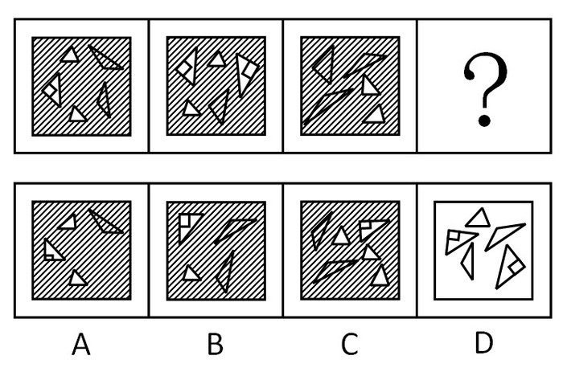

A. A

B. B

C. C

D. D

第 71 题 · 答案与解析

**参考答案（粉笔题库参考内容）**

D

**解析**

本题为数图形。已知题干中每个图形里都有5个三角形，通过分析，只有D项中图形符合。

故正确答案为D。

备注：本题图形中阴影只是干扰，不必理会，望考生注意。

**考点**：数量规律-素

**来源**：2009年吉林省公务员录用考试《行测》题（甲级）第71题

### 第 72 题

从所给四个选项中，选择最合适的一个填入问号处，使之呈现一定的规律性：

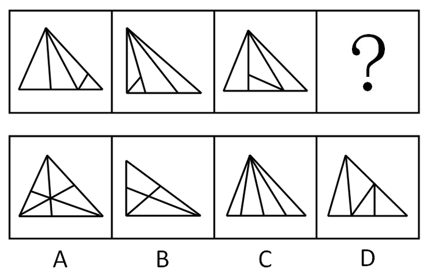

A. A

B. B

C. C

D. D

第 72 题 · 答案与解析

**参考答案（粉笔题库参考内容）**

B

**解析**

本题为数某种元素的个数。题目数的是三角形的个数，包括2个或3个小三角形组成的新三角形，已知题干每个图形里都有8个三角形，通过分析，只有B项中的图形有8个三角形。

故正确答案为B。

**考点**：数量规律-素

**来源**：2009年吉林省公务员录用考试《行测》题（甲级）第72题

### 第 73 题

请从所给的四个选项中，选择最合适的一项填在问号处，使之呈现一定的规律性：

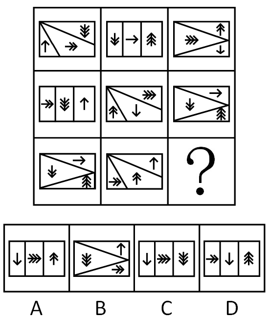

A. A

B. B

C. C

D. D

第 73 题 · 答案与解析

**参考答案（粉笔题库参考内容）**

C

**解析**

元素组成相似，考虑遍历，外框和内部各有特征，先分开看。

观察发现，每行图形外框都有三种样式，第三行缺少一个由三个小长方形组成的大长方形，排除B选项；再看内部规律，每行箭头样式种类数目一样，都有一个向上的单箭头，一个向下的单箭头，一个向右的单箭头，一个向上的双箭头，一个向下的双箭头，一个向右的双箭头，一个向上的三箭头，一个向下的三箭头，一个向右的三箭头，第三行缺少的是一个向下的单箭头，一个向右的三箭头，一个向下的三箭头，符合条件的只有C选项。

故正确答案为C。

**考点**：样式规律-遍历

**来源**：2009年吉林省公务员录用考试《行测》题（甲级）第73题

### 第 74 题

从所给四个选项中，选择最合适的一个填入问号处，使之呈现一定的规律性：

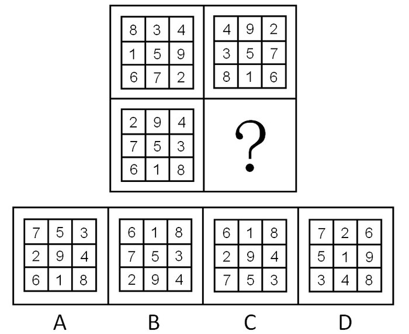

A. A

B. B

C. C

D. D

第 74 题 · 答案与解析

**参考答案（粉笔题库参考内容）**

B

**解析**

已知图表中每行、每列、每条对角线的数字之和都是15，通过分析，只有B项中图表符合。

故正确答案为B。

**考点**：文字/字母/数字类

**来源**：2009年吉林省公务员录用考试《行测》题（甲级）第74题

### 第 75 题

从所给四个选项中，选择最合适的一个填入问号处，使之呈现一定的规律性：

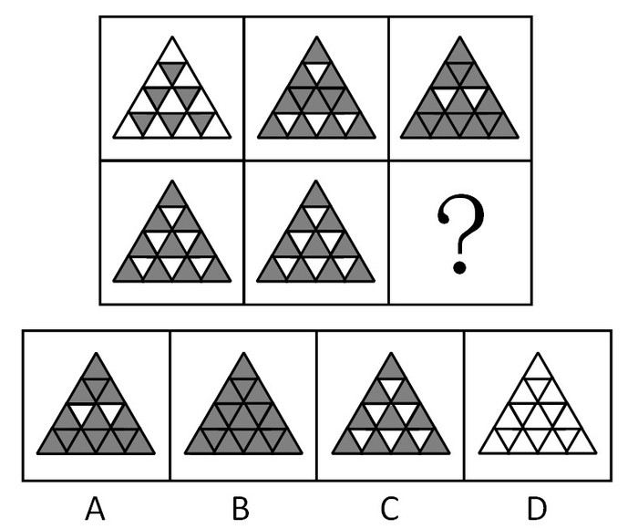

A. A

B. B

C. C

D. D

第 75 题 · 答案与解析

**参考答案（粉笔题库参考内容）**

D

**解析**

元素组成相似，每一行图形分割区域相同且黑白块数量不同，考虑黑白运算。观察发现：白+黑=黑，黑+白=黑，黑+黑=白。即：相同为白，不同为黑。只有D项符合。

故正确答案为D。

**考点**：样式规律-黑白运算

**来源**：2009年吉林省公务员录用考试《行测》题（甲级）第75题

### 第 76 题

大雁在飞翔时的队形，有时是“一”字形，有时是“人”字形。影响它们飞翔时队形变化的主要因素是：

A. 大雁数量

B. 飞行方向

C. 地磁线角度

D. 风向的变化

第 76 题 · 答案与解析

**参考答案（粉笔题库参考内容）**

D

**解析**

大雁飞行时常常排成“人”字形或斜“一”字形，是因为这样编队有利于大雁在长途迁飞时节省体力消耗。鸟类飞行时，翅膀尖端会产生一股向前流动的气流，叫做“尾涡”。后面的鸟利用前面的“尾涡”，飞行时要省力得多。雁群飞行时所排列的队形，正是出于对“尾涡”气流的利用。大雁越多，飞起来就越省力气。“雁阵”由有经验的“头雁”带领，加速飞行时，队伍排成“人”字形，一旦减速，队伍又由“人”字形换成“一”字长蛇形，而大雁的加速或减速飞行会受风向变化影响。

故正确答案为D。

**考点**：自然地理

**来源**：2009年吉林省公务员录用考试《行测》题（甲级）第76题

### 第 77 题

“细雨成阴近夕阳，湖边飞阁照寒塘。黄花应笑关山客，每岁登高在异乡。”这首诗中包含着我国民间的传统节令，这个节令是：

A. 元宵

B. 七夕

C. 重阳

D. 春节

第 77 题 · 答案与解析

**参考答案（粉笔题库参考内容）**

C

**解析**

解答该题时，关键在于捕捉该诗中的关键词。诗中提到的“黄花”指的是“菊花”，在“异乡”“登高”远眺，传达的是对故乡的思念之情，由此可推出诗中包含的节令是重阳节。

故正确答案为C。

**考点**：文化常识

**来源**：2009年吉林省公务员录用考试《行测》题（甲级）第77题

### 第 78 题

远程电力传输一般采用50～100万伏的高电压，其主要原因是：

A. 确保远程电力传输的安全

B. 减少传输线路上的电能损失

C. 节约传输线路上的设备和材料

D. 减少雷电对传输线路的破坏

第 78 题 · 答案与解析

**参考答案（粉笔题库参考内容）**

B

**解析**

根据输送过程中电能的损失可知，导线电阻和通电时间一定时，电能的损失与电流的平方成正比，要使电流减小，就必须提高输电电压，这就是要采用高压输电的原因。输电电压越大，电能在输电导线上的损失就越小。

故正确答案为B。

**考点**：物理常识

**来源**：2009年吉林省公务员录用考试《行测》题（甲级）第78题

### 第 79 题

剧烈运动后，人们常常满脸通红，大汗淋漓，这主要是因为皮肤的什么功能？

A. 保护和排泄

B. 排泄和调节体温

C. 排泄和感受外界刺激

D. 保护和感受外界刺激

第 79 题 · 答案与解析

**参考答案（粉笔题库参考内容）**

B

**解析**

皮肤有汗腺组织，能排除一些体内代谢物，并以排汗的形式表现出来，人剧烈运动后，人体内的温度升高，为保持体温的恒定，皮肤表面血管扩张，毛孔增大，排汗增多，汗液蒸发可以带走一定的热量，起到降温的作用，即排泄和调节体温的作用。

故正确答案为B。

**本题相关知识点：**

皮肤的主要功能可概括为以下几种：保护功能、感觉功能、调节体温功能、分泌与排泄功能、吸收功能、代谢功能和免疫功能。

**考点**：生活常识

**来源**：2009年426联考《行测》题（天津/陕西/湖北）第4题

### 第 80 题

我们通常说的晕车和晕船，是因为体内平衡感受器受到了刺激，使人感到眩晕和不适，这个平衡感受器位于：

A. 心脏

B. 小脑

C. 胃

D. 耳朵

第 80 题 · 答案与解析

**参考答案（粉笔题库参考内容）**

D

**解析**

内耳前庭器是人体平衡感受器。晕车和晕船正是因为人体内耳平衡感受器受到过度运动刺激引起的，前庭器官产生过量生物电，影响神经中枢而出现冒冷汗、恶心、呕吐、头晕等症状群。

故正确答案为D。

**本题相关知识点：**

晕车的人能够开车却不能乘车，这种情况也跟内耳前庭感受器有关。因为晕动病主要是人体前庭神经系统受到超限刺激引起，故前庭神经系统的兴奋度的高低是关键。前庭神经系统属于低级中枢，它受大脑皮层高级中枢影响，高级中枢对低级中枢有抑制作用。当晕车的人开车时，精神处于高度集中状态，大脑皮层高级中枢高度兴奋对前庭系统产生抑制作用，自然就不会晕车了；而以乘客身份乘车时，则不具有这种效应。

**考点**：生活常识

**来源**：2009年吉林省公务员录用考试《行测》题（甲级）第80题

### 第 81 题

注意观察就会发现，高速公路并不是笔直的，每隔一段就会有一个弯道。高速公路不修成笔直的原因是：

A. 高速公路要依地势而建，不可能笔直

B. 笔直的高速公路会让司机很快疲劳，注意力不集中，容易出现事故

C. 转弯可以让司机减慢速度，降低事故发生的可能性

D. 有些土地不能被征用，必须绕行

第 81 题 · 答案与解析

**参考答案（粉笔题库参考内容）**

B

**解析**

高速公路的一部分弯道的建设，跟地形有关，但每隔一段就会有一个弯道，这样设计的原因更多是出于交通安全的考虑。因为高速公路景色比较单调，修成笔直的话，司机一直盯着一个方向，视觉容易疲劳，不利于安全驾驶。

故正确答案为B。

**考点**：生活常识

**来源**：2009年吉林省公务员录用考试《行测》题（甲级）第81题

### 第 82 题

2008年，“三鹿”奶粉因添加三聚氰胺被有关部门查处，并引起社会广泛关注，奶粉中添加三聚氰胺的直接目的是：

A. 增加奶粉中蛋白质的含量

B. 增加奶粉的营养成分

C. 提高奶粉中的含氮量

D. 提高奶粉中微量元素含量

第 82 题 · 答案与解析

**参考答案（粉笔题库参考内容）**

C

**解析**

牛奶有营养主要是因为牛奶中含有蛋白质，而现在测定蛋白质的方法不是直接测牛奶中蛋白质的含量，而是通过测定氮元素的含量来间接测定蛋白质的含量（牛奶中只有蛋白质含氮元素）。三聚氰胺氮含量较高，因此奶粉中添加三聚氰胺会提高奶粉中的含氮量，使得检测蛋白质的结果偏高。

故正确答案为C。

**本题相关知识点：**

这道题从时事入手，考查2008年的热门事件“三鹿”奶粉事件。2012年的食品安全问题也很多，如毒胶囊事件中，某些药厂用工业明胶为原料制造药物胶囊，导致药物中出现铬超量等重金属超标问题。

**考点**：生活常识

**来源**：2009年吉林省公务员录用考试《行测》题（甲级）第82题

### 第 83 题

刷牙可以保持牙齿健康和口气清新，牙膏的主要原料是：

A. 摩擦剂

B. 保湿剂

C. 泡沫剂

D. 香味剂

第 83 题 · 答案与解析

**参考答案（粉笔题库参考内容）**

A

**解析**

牙膏的主要成分一般有摩擦剂、保湿剂、泡沫剂、粘合剂、调味剂和一些其它添加成分，其中含量最多的是摩擦剂。摩擦剂有一定的摩擦作用，能够增加牙刷和牙齿间的摩擦，让牙菌斑、软垢和食物残渣比较容易被刷下来。

故正确答案为A。

**本题相关知识点：**

牙膏中的保湿剂主要用于保持牙膏呈可自由挤出的浆状，防止牙膏管口开启后因干硬受阻塞。

泡沫剂则有助于除去粘在牙齿上的污物，最常用的是十二烷基酸钠，它除了有较好的洁净作用外，还有灭菌作用，并且与摩擦剂有较好的相容性。

香味剂能使牙膏具有各种香型，能使刷牙者感到爽口舒适，并有助于减轻口臭。

**考点**：生活常识

**来源**：2009年吉林省公务员录用考试《行测》题（甲级）第83题

### 第 84 题

以下不可能成为非物质文化遗产的是：

A. 针灸

B. 济公的传说

C. 绍兴黄酒的酿制

D. 青岛“啤酒节”

第 84 题 · 答案与解析

**参考答案（粉笔题库参考内容）**

D

**解析**

“非物质文化遗产”指被各群体、团体、有时为个人所视为其文化遗产的各种实践、表演、表现形式、知识体系和技能及其有关的工具、实物、工艺品和文化场所。各个群体和团体随着其所处环境、与自然界的相互关系和历史条件的变化不断使这种代代相传的非物质文化遗产得到创新，同时使他们自己具有一种认同感和历史感，从而促进了文化多样性和激发人类的创造力。

A、B、C项都有悠久的历史和社会认同感，唯有D项除外。

本题为选非题，故正确答案为D。

**考点**：文化常识

**来源**：2009年426联考《行测》题（天津/陕西/湖北）第10题

### 第 85 题

熬骨头汤时，为提高骨头中钙质的溶解度，可加入少量：

A. 盐

B. 酱油

C. 醋

D. 料酒

第 85 题 · 答案与解析

**参考答案（粉笔题库参考内容）**

C

**解析**

骨头中的钙质以碳酸钙微溶物形式存在，偏碱性，加入显酸性的醋之后，醋中的醋酸根比较容易跟钙离子结合，产生醋酸钙，使骨头中的钙离子分离出来，提高钙质的溶解度，使骨头汤的营养价值更高，且便于被人体吸收。

故正确答案为C。

**本题相关知识点：**

料酒是指专门用于烹饪调味的酒，家庭烹饪一般用料酒。料酒的主要作用是去腥、增香。料酒能去腥是因为料酒中含有酒精，烹调中加点料酒，鱼、虾、蟹中起腥味的胺类物质就溶于料酒的酒精中，在加热时随酒精一起挥发掉，达到去腥的目的。另外料酒中含有氨基酸，在烹调中能与食盐结合，生成氨基酸钠盐，从而使鱼、肉的滋味变得更加鲜美。

**考点**：生活常识

**来源**：2009年吉林省公务员录用考试《行测》题（甲级）第85题

## 材料 6

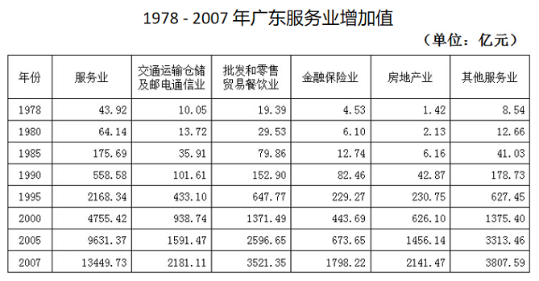

| 年份 | 服务业 | 交通运输仓储及邮电通信业 | 批发和零售贸易餐饮业 | 金融保险业 | 房地产业 | 其他服务业 |
| --- | ---: | ---: | ---: | ---: | ---: | ---: |
| 1978 | 43.92 | 10.05 | 19.39 | 4.53 | 1.42 | 8.54 |
| 1980 | 64.14 | 13.72 | 29.53 | 6.10 | 2.13 | 12.66 |
| 1985 | 175.69 | 35.91 | 79.86 | 12.74 | 6.16 | 41.03 |
| 1990 | 558.58 | 101.61 | 152.90 | 82.46 | 42.87 | 178.73 |
| 1995 | 2168.34 | 433.10 | 647.77 | 229.27 | 230.75 | 627.45 |
| 2000 | 4755.42 | 938.74 | 1371.49 | 443.69 | 626.10 | 1375.40 |
| 2005 | 9631.37 | 1591.47 | 2596.65 | 673.65 | 1456.14 | 3313.46 |
| 2007 | 13449.73 | 2181.11 | 3521.35 | 1798.22 | 2141.47 | 3807.59 |

### 第 86 题

广东省2005年服务业增加值比1995年多多少亿元？

A. 6978.03

B. 7138.71

C. 7463.03

D. 7138.41

第 86 题 · 答案与解析

**参考答案（粉笔题库参考内容）**

C

**解析**

定位表格可知，2005年与1995年广东省服务业增加值分别为9631.37亿元与2168.34亿元。故广东省2005年服务业增加值比1995年多9631.37-2168.34=7463.03亿元。

故正确答案为C。

**考点**：简单加减计算、统计表

**来源**：2009年吉林省公务员录用考试《行测》题（甲级）第86题

### 第 87 题

1978-2007年增加值增长速度最快的行业是：

A. 交通运输仓储及邮电通信业

B. 金融保险业

C. 批发和零售贸易餐饮业

D. 房地产业

第 87 题 · 答案与解析

**参考答案（粉笔题库参考内容）**

D

**解析**

根据题干“1978-2007年······增长速度最快······”，可判定本题为一般增长率问题。定位表格可知，1978年广东省交通运输仓储及邮电通信业增加值、金融保险业增加值、批发和零售贸易餐饮业增加值、房地产业增加值分别为10.05亿元、4.53亿元、19.39亿元、1.42亿元；2007年广东省交通运输仓储及邮电通信业增加值、金融保险业增加值、批发和零售贸易餐饮业增加值、房地产业增加值分别为2181.11亿元、1798.22亿元、3521.35亿元、2141.47亿元。根据公式：增长率 = (现期量 - 基期量)/基期量 = 现期量/基期量 - 1，可得现期量/基期量大，增长率大。则代入公式，交通运输仓储及邮电通信业增加值为2181.11/10.05≈218；金融保险业增加值为1798.22/4.35 ≈ 400；批发和零售贸易餐饮业增加值为3521.35/19.39≈180；房地产业增加值为2141.47/1.42≈1500。比较可得，广东省1978-2007年上述四个行业中增加值增长速度最快的行业是房地产业。

故正确答案为D。

**考点**：一般增长率、统计表

**来源**：2009年吉林省公务员录用考试《行测》题（甲级）第87题

### 第 88 题

2007年广东省其他服务业增加值比2000年增加：

A. 177%

B. 2435.22亿元

C. 2917.19亿元

D. 171%

第 88 题 · 答案与解析

**参考答案（粉笔题库参考内容）**

A

**解析**

根据题干“2007年······比2000年增加”，结合选项有百分数，可判定本题为一般增长率问题。定位表格可知，2007年与2000年广东省其他服务业增加值分别为3807.59亿元与1375.40亿元。根据公式：增长量=现期量-基期量可得，2007年广东省其他服务业增加值比2000年增加了3807.59-1375.40=2432.19亿元；根据公式：增长率= 增长量/基期量可得，增长率=2432.19/1375.40≈2432.19/1380≈176%。增长量与选项不相符，增长率与A项最为接近。

故正确答案为A。

**考点**：一般增长率、统计表

**来源**：2009年吉林省公务员录用考试《行测》题（甲级）第88题

### 第 89 题

2005-2007年增加值增长速度最慢的行业是：

A. 批发和零售贸易餐饮业

B. 金融保险业

C. 房地产业

D. 其他服务业

第 89 题 · 答案与解析

**参考答案（粉笔题库参考内容）**

D

**解析**

根据题干“2005-2007年······增长速度最慢······”，可判定本题为一般增长率问题。定位表格可知，2005年广东省批发和零售贸易餐饮业增加值、金融保险业增加值、房地产业增加值、其他服务业增加值分别为2596.65亿元、673.65亿元、1456.14亿元、3313.46亿元；2007年广东省批发和零售贸易餐饮业增加值、金融保险业增加值、房地产业增加值、其他服务业增加值分别为3521.35亿元、1798.22亿元、2141.47亿元、3807.59亿元。根据公式：增长率 = (现期量 - 基期量)/基期量，可得2005年-2007年广东省上述行业增加值增长速度分别为：

批发和零售贸易餐饮业增加值增速=(3521.35-2596.65)/2596.65≈924.7/2600；

金融保险业增加值增速= (1798.22 - 673.65)/673.65 ≈ 1124.57/674；

房地产业增加值增速=(2141.47-1456.14)/1456.14≈685.33/1460；

其他服务业增加值增速= (3807.59 − 3313.46)/3313.46 ≈ 494.13/3310。

根据口诀：分子小分母大则分值小可得，2005年-2007年广东省增加值增长速度最慢的行业是其他服务业。

故正确答案为D。

**考点**：一般增长率、统计表

**来源**：2009年吉林省公务员录用考试《行测》题（甲级）第89题

### 第 90 题

下列说法错误的是：

A. 广东省服务业增加值从1978－2007 年呈逐步增长趋势

B. 2007年金融保险业增加值占广东省服务业总增加值的13.37%

C. 2007年批发和零售贸易餐饮业增加值位居广东省服务业之首

D. 2007年房地产业增加值占广东省服务业总增加值的15.92%

第 90 题 · 答案与解析

**参考答案（粉笔题库参考内容）**

C

**解析**

A项：定位表格可知，1978年-2007年广东省服务业增加值分别为43.92亿元、64.14亿元、175.69亿元、558.58亿元、2168.34亿元、4755.42亿元、9631.37亿元、13449.73亿元。观察可得，1978年-2007年广东省服务业增加值每年都比上一年高，即呈逐步增长趋势，正确；

B项：定位表格可知，2007年广东省金融保险业增加值与服务业总增加值分别为1798.22亿元与13449.73亿元。故2007年广东省金融保险业增加值占广东省服务业总增加值的比重为1798.22/13449.73 ≈ 13.37%，正确；

C项：2007年广东省服务业增加值由交通运输仓储及邮电通信业增加值、批发和零售贸易餐饮业增加值、金融保险业增加值、房地产业增加值、其他服务业增加值组成。定位表格可知，2007年广东省其他服务业增加值3807.59亿元＞批发和零售贸易餐饮业增加值3521.35亿元，故2007年广东省其他服务业增加值位居广东省服务业之首，错误；

D项：定位表格可知，2007 年广东省房地产业增加值与服务业总增加值分别为2141.47亿元、13449.73亿元。故2007年广东省房地产业增加值占广东省服务业总增加值的比重为2141.47/13449.73 ≈ 15.92%，正确。

本题为选非题，故正确答案为C。

**考点**：统计表、综合分析

**来源**：2009年吉林省公务员录用考试《行测》题（甲级）第90题

## 材料 7

2006年，全国研究与试验发展（R&D）经费总支出为3003.1亿元，比上年增加553.1亿元，研究与试验发展（R&D）经费投入强度为1.42%。按研究与试验发展人员（全时工作量）计算的人均经费支出为20万元，比上年增加2万元。

        分研究类型看，基础研究经费支出为155.8亿元，比上年增长18.8%；应用研究经费支出为504.5亿元，增长16.4%；试验发展经费支出为2342.8亿元，增长24.3%。

        分执行部门看，各类企业经费支出为2134.5亿元，比上年增长27.5%；政府部门属研究机构经费支出567.3亿元，增长10.6%；高等学校经费支出276.8亿元，增长14.2%。

        分产业部门看，七大行业的研究与试验发展（R&D）经费投入强度超过1%。医药制造业为1.76%，专用设备制造业为1.7%，电气机械及器材制造业为1.48%，通用设备制造业为1.47%，交通运输设备制造业为1.38%，橡胶制造业为1.19%，通信设备、计算机及其他电子设备制造业为1.19%。

        分地区看，研究与试验发展（R&D）经费支出超过100亿元的有北京、江苏、广东、上海、山东、浙江、辽宁、四川和陕西9个省（市），共支出2154亿元，占全国经费总支出的71.7%。研究与试验发展投入强度达到或超过全国平均水平的有北京、上海、陕西、天津、江苏、辽宁和浙江7个省（市）。

### 第 91 题

2006年全国研究与试验发展经费总支出比去年增长：

A. 19.1%

B. 21.7%

C. 22.6%

D. 25.9%

第 91 题 · 答案与解析

**参考答案（粉笔题库参考内容）**

C

**解析**

2006年，全国研究与试验发展经费总支出为3003.1亿元，比上年增加553.1亿元，所以2005年全国研究与试验发展经费总支出为3003.1-553.1=2450亿元，所以2006年全国研究与实验发展经费总支出比去年增长553.1/2450 ≈ 550/2450 ≈ 550×4/(2450×4)= 2200/9800 ≈ 22.4%，与C项最接近。

故正确答案为C。

**考点**：一般增长率、文字资料

**来源**：2009年吉林省公务员录用考试《行测》题（甲级）第91题

### 第 92 题

2005年基础研究经费支出占研究与试验发展经费总支出的：

A. 5.12%

B. 5.35%

C. 6.24%

D. 6.38%

第 92 题 · 答案与解析

**参考答案（粉笔题库参考内容）**

B

**解析**

从文中可以看出，2006年，全国研究与试验发展经费总支出为3003.1亿元，比上年增加553.1亿元，基础研究经费支出为155.8亿元，比上年增长18.8%；所以2005年全国研究与试验发展经费总支出为3003.1-553.1=2450亿元，基础研究经费支出为155.8/(1+18.8%)=155.8/1.188≈160/1.2亿元，所以2005年基础研究经费支出占研究与试验发展经费总支出的比例为160/1.2 ÷ 2450 ≈ 5.4%，与B项最接近。

故正确答案为B。

**考点**：基期比重、文字资料

**来源**：2009年吉林省公务员录用考试《行测》题（甲级）第92题

### 第 93 题

2006年各类企业经费支出占研究与试验发展经费总支出比例和2005年相比：

A. 减少了1.5个百分点

B. 减少了2.8个百分点

C. 增加了1.5个百分点

D. 增加了2.8个百分点

第 93 题 · 答案与解析

**参考答案（粉笔题库参考内容）**

D

**解析**

从第一题可知2006年全国研究与试验发展经费总支出比去年增长22.6% ，结合材料可得，2006年各类企业经费支出为2134.5亿元，比上年增长27.5% ；研究与试验发展经费总支出3003.1亿元，代入两期比重差公式可得：A/B×(a−b)/(1+a)= 2134.5/3003.1 × (27.5% − 22.6%)/(1 + 27.5%)≈ 0.7 × 4.9%/1.3 ≈ 2.6%，即约增加了2.6个百分点，与D项最接近。

故正确答案为D。

**考点**：两期比重、文字资料

**来源**：2009年吉林省公务员录用考试《行测》题（甲级）第93题

### 第 94 题

下列说法中，不正确的一项是：

A. 2005年研究与试验发展人员大约为136.1万

B. 2006年试验发展经费支出是应用研究经费支出的4.64倍

C. 2006年高等学校经费支出占政府部门属研究机构经费支出的比例比去年提高1.5个百分点

D. 2006年七大行业的研究与试验发展经费投入为325.4亿元

第 94 题 · 答案与解析

**参考答案（粉笔题库参考内容）**

D

**解析**

A项正确，由上几题可知，2005年全国研究与试验发展经费总支出为2450亿元，根据按研究与试验发展人员（全时工作量）计算的人均经费支出为20万元，比上年增加2万元，可知2005年研究与试验发展人员的人均经费支出为18万元，2005年研究与试验发展人员为2450 ÷ 18 ≈ 136.1万；

B项正确，2006年试验发展经费支出为2342.8亿元，应用研究经费支出为504.5亿元，所以2006年试验发展经费支出是应用研究经费支出的2342.8÷504.5≈2300÷500=4.6倍；

C项正确，2006年高等学校经费支出为276.8亿元，增长14.2%，政府部门属研究机构经费支出为567.3亿元，增长10.6%，题目所求为：A/B × (a−b)/(1+a) == 276.8/567.3 × (14.2%−10.6%)/(1+14.2%)≈ 0.49 × 3.6%/1.14 ≈ 1.5%，即比去年提高了1.5个百分点；

D项错误，材料中仅给出支出的相关信息，而本选项是求投入，无相关信息，无法推出。

本题为选非题，故正确答案为D。

**考点**：文字资料、综合分析

**来源**：2009年吉林省公务员录用考试《行测》题（甲级）第94题

### 第 95 题

2006年研究与试验发展经费支出低于100亿元的省（市）的平均支出为：

A. 36.92亿元

B. 239.33亿元

C. 93.85亿元

D. 45.21亿元

第 95 题 · 答案与解析

**参考答案（粉笔题库参考内容）**

A

**解析**

分地区看，研究与试验发展经费支出超过100亿元的有北京、江苏、广东、上海、山东、浙江、辽宁、四川和陕西9个省（市），全国共有省市自治区直辖市为32个（不含港、澳），所以研究与试验发展经费支出低于100亿元的省市共有23个，这些省市的经费支出为3003.1-2154=849.1亿元，2006年研究与试验发展经费支出低于100亿元的省（市）的平均支出为849.1/23亿元，采用直除法知首位为3，只有A项的首位为3。

故正确答案为A。

**考点**：文字资料、现期平均数

**来源**：2009年吉林省公务员录用考试《行测》题（甲级）第95题

## 材料 8

2006年末，福建省全省常住人口为3558万人，其中，男性人口1797万人，女性人口1761万人。全年净增人口23万人，比上年增长0.65%，自2000年以来，人口总量持续保持低速增长的态势。

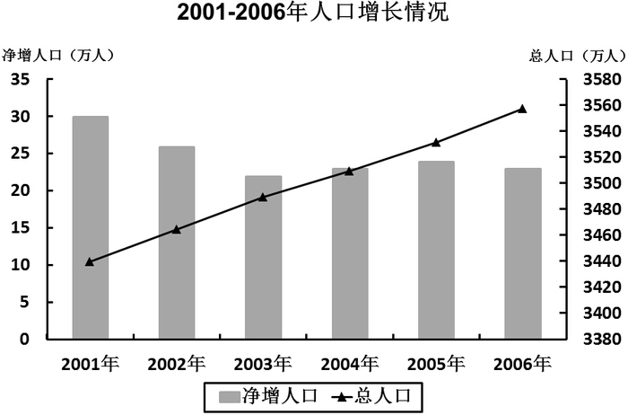

### 第 96 题

以下各项中，哪年的该省净增人口数量最少？

A. 2002年

B. 2003年

C. 2004年

D. 2005年

第 96 题 · 答案与解析

**参考答案（粉笔题库参考内容）**

B

**解析**

定位柱状图，净增人口数量无具体值给出，故净增人口数大小比较可转变为比较净增人口数柱状图的高低。结合选项观察柱状图，在选项所给出年份中2003年柱状图高度最低，故2003年该省净增人口数量最少。

故正确答案为B。

**考点**：排序类、综合资料

**来源**：2009年吉林省公务员录用考试《行测》题（甲级）第96题

### 第 97 题

该省的男女性别比为：

A. 1.017

B. 1.020

C. 1.026

D. 1.031

第 97 题 · 答案与解析

**参考答案（粉笔题库参考内容）**

B

**解析**

根据题干“······男女性别比······“，可判定本题为比值计算问题。定位文字材料可知，2006年该省男性人口1797万人，女性人口1761万人。故该省的男女性别比为1797 : 1761 ≈ 1.020。

故正确答案为B。

**考点**：比值计算、综合资料

**来源**：2009年吉林省公务员录用考试《行测》题（甲级）第97题

### 第 98 题

2006年，该省男性人口占总人口的比重比女性人口占总人口的比重约：

A. 多1%

B. 多0.1%

C. 多0.03

D. 多3%

第 98 题 · 答案与解析

**参考答案（粉笔题库参考内容）**

A

**解析**

根据题干“2006年······占······比重比······占······比重约“，结合材料给出2006年相关数据，可判定本题为现期比重问题。定位文字材料可知，2006年末福建省全省常住人口为3558万人，男性人口1797万人，女性人口1761万人。则根据公式：比重= 部分量/总体量可得，2006年该省男性人口占总人口的比重比女性人口占总人口的比重约多1797/3558-1761/3558=36/3558≈1.01%，与A项最接近。

故正确答案为A。

**考点**：现期比重、综合资料

**来源**：2009年吉林省公务员录用考试《行测》题（甲级）第98题

### 第 99 题

根据材料，以下说法错误的一项是：

A. “十五”期间，该省人口总量保持持续增长

B. 总体来讲，该省人口的净增长速度越来越慢

C. 2002—2006年，该省人口的净增量逐年递减

D. 2002年该省的人口净增长速度大于2006年该省的人口净增长速度

第 99 题 · 答案与解析

**参考答案（粉笔题库参考内容）**

C

**解析**

A项：“十五”期间（即2001—2005年），定位文字材料最后一句可知，“自2000年以来，人口总量持续保持低速增长的态势“可知，“十五”期间该省人口总量保持持续增长，正确；

B项：定位柱状图可得，2001年—2006年间，该省净增人口数总体呈下降趋势，总人口数总体呈较上升趋势。根据公式：人口净增长速度= 人口净增量/总人口数。则分子变小分母变大，分数变小，即2001年—2006年该省人口的净增长速度越来越慢，正确；

C项：定位柱状图，2002年—2006年期间，2004年与2005年人口净增量出现小幅增加，故2002—2006年该省人口的净增量非逐年递减，错误；

D项：定位柱状图可得，该省2002年人口净增长量大于该省2006年人口净增长量；该省2002年总人口数小于该省2006年总人口数。根据公式：人口净增长速度= 人口净增量/总人口数可得，2002年人口净增长速度分子大分母小，故2002年分数大，即2002年该省的人口净增长速度大于2006年该省的人口净增长速度，正确。

本题为选非题，故正确答案为C。

**考点**：综合分析、综合资料

**来源**：2009年吉林省公务员录用考试《行测》题（甲级）第99题

### 第 100 题

2001—2005年期间，福建省总人口约增长了：

A. 2.7%

B. 32.5‰

C. 120万

D. 140万

第 100 题 · 答案与解析

**参考答案（粉笔题库参考内容）**

A

**解析**

根据题干“2001—2005年······约增长了”，结合选项有百分数，可判定本题为一般增长率问题。定位折线图可知，2001年福建省总人口约为3440万人，2005年福建省总人口约为3530万人。根据公式：增长量=现期量-基期量可得，2001—2005年期间福建省总人口约增长了3530-3440=90万人；根据公式：增长率= 增长量/基期量可得，增长率= 90/3440 ≈ 2.62%。增长量与选项不相符，增长率与A项最接近。

故正确答案为A。

**考点**：一般增长率、综合资料

**来源**：2009年吉林省公务员录用考试《行测》题（甲级）第100题

## 材料 9

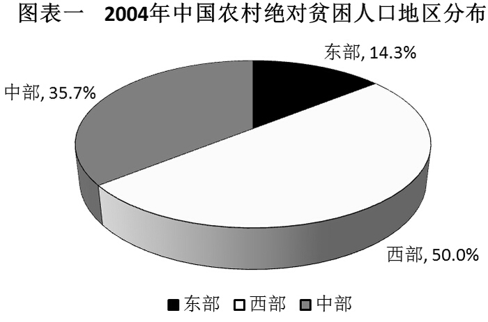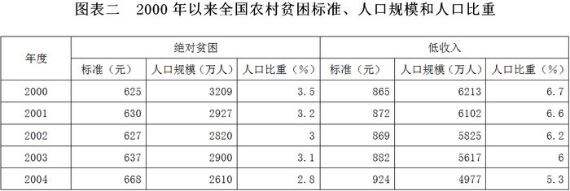

### 第 101 题

2004年我国东部农村约有绝对贫困人口多少万人？

A. 373.2

B. 385.2

C. 392.6

D. 400.6

第 101 题 · 答案与解析

**参考答案（粉笔题库参考内容）**

A

**解析**

根据题干“2004年我国东部农村约有绝对贫困人口多少万人”，结合材料给出2004年我国农村绝对贫困人口总量及东部农村的占比数据，可判定本题为现期比重问题。定位表格可知，2004年我国农村有绝对贫困人口2610万人；定位饼状图可知，东部地区占我国农村绝对贫困人口总量的比例为14.3%。根据公式：部分量=总量×比重可得，2004年我国东部农村约有绝对贫困人口= 2610 × 14.3%≈2610×1/7≈372.9万人，与A项最接近。

故正确答案为A。

**考点**：现期比重、综合资料

**来源**：2009年吉林省公务员录用考试《行测》题（甲级）第101题

### 第 102 题

2004年我国农村绝对贫困人口和低收入人口分别比上一年减少多少人？

A. 230万，640万

B. 290万，640万

C. 290万，540万

D. 230万，540万

第 102 题 · 答案与解析

**参考答案（粉笔题库参考内容）**

B

**解析**

根据题干“2004年······分别比上一年减少多少人”，可判定本题为增长量计算问题。定位材料表格可知，2004年我国农村绝对贫困人口和低收入人口分别为2610万人和4977万人，2003年我国农村绝对贫困人口和低收入人口分别为2900万人和5617万人。根据公式：减少量=|现期量-基期量|=基期量-现期量可得，2004年我国农村绝对贫困人口比上一年减少2900-2610=290万人；2004年我国低收入人口比上一年减少5617-4977=640万人，对应B项。

故正确答案为B。

**考点**：增长量计算、综合资料

**来源**：2009年吉林省公务员录用考试《行测》题（甲级）第102题

### 第 103 题

根据图表，以下正确的一项是：

A. 2004年我国西部的贫困人口约占全国贫困人口的一半

B. 2000—2004年，我国农村绝对贫困人口规模逐年减少

C. 2000—2004年，我国农村低收入人口规模逐年减少

D. 2000—2004年，我国农村低收入人口的标准逐年提高

第 103 题 · 答案与解析

**参考答案（粉笔题库参考内容）**

C

**解析**

A项：定位饼状图，2004年我国西部农村的贫困人口约占全国农村贫困人口的一半，总体不一致，错误；

B项：定位表格，2000—2004年，我国农村绝对贫困人口规模分别为3209万人、2927万人、2820万人、2900万人、2610万人。2003年我国农村绝对贫困人口规模比2002年大，即2003年出现增长，故2000—2004年，我国农村绝对贫困人口规模并非逐年减少，错误；

C项：定位表格，2000—2004年，我国农村低收入人口规模分别为6213万人、6102万人、5825万人、5617万人、4977万人。观察可得，2000-2004年我国农村低收入人口规模逐年减少，正确；

D项：定位表格，2000—2004年，我国农村低收入人口的标准分别为865元、872元、869元、882元、924元。2002年我国农村低收入人口的标准＜2001年，即2002年出现降低，故2000—2004年我国农村低收入人口的标准并非逐年提高，错误。

故正确答案为C。

**考点**：统计图、综合分析

**来源**：2009年吉林省公务员录用考试《行测》题（甲级）第103题

### 第 104 题

根据图表，以下不正确的一项是：

A. 2004年，我国中部农村绝对贫困人口超过全国农村绝对贫困人口的三分之一

B. 总体来说，2000-2004年，我国农村的贫困人口数量呈下降趋势

C. 2004年，我国农村人口约有9.3亿人

D. 2004年，我国东部农村人口多于1.4亿人

第 104 题 · 答案与解析

**参考答案（粉笔题库参考内容）**

D

**解析**

A项：定位饼状图，2004 年我国中部农村绝对贫困人口人数占全国农村绝对贫困人口人数的比重为35.7% ＞ 1/3，正确；

B项：定位表格可得，2000年—2004年我国的绝对贫困人数和低收入人数在总体上均呈下降趋势，故2000年—2004年我国农村的贫困人口数量呈下降趋势，正确；

C项：定位表格可知，2004年全国农村绝对贫困人口2610万人，占农村人口的比重为2.8%。则2004年我国农村人口数约为2610万人/2.8% ≈ 93214万人 ≈ 9.3亿人，正确；

D项：材料仅给出东部地区绝对贫困人口相关数据，无法计算出2004年我国东部农村人口的具体值及具体范围，错误。

本题为选非题，故正确答案为D。

**考点**：统计图、综合分析

**来源**：2009年吉林省公务员录用考试《行测》题（甲级）第104题

### 第 105 题

若2004年我国总人口为13.6亿，我国农村贫困人口占我国总人口：

A. 2.8%

B. 5.3%

C. 5.6%

D. 5.8%

第 105 题 · 答案与解析

**参考答案（粉笔题库参考内容）**

C

**解析**

根据题干“若2004年我国总人口为13.6亿，······占······”，结合选项为百分数，可判定本题为现期比重计算问题。定位表格可得，2004年我国农村绝对贫困人口和低收入人口分别为2610万人和4977万人，则2004年我国农村贫困人口数为2610+4977=7587万人，所求比重为7587万/13.6亿 =7587/136000 ≈ 5.6%。

故正确答案为C。

**考点**：现期比重、综合资料

**来源**：2009年吉林省公务员录用考试《行测》题（甲级）第105题

