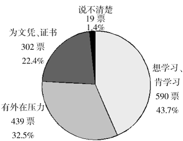
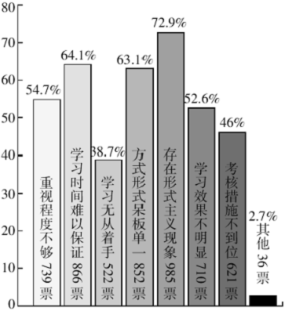
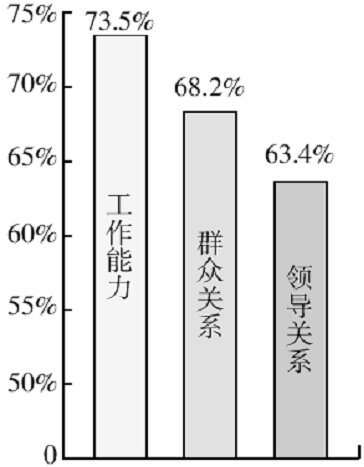
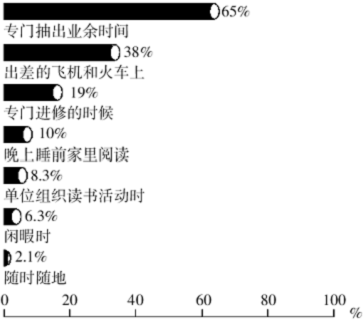
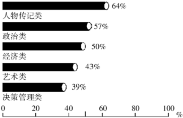

# 2010年吉林省公考 《申论》题（甲级）

<!-- gwy:overview:start -->
> **吉林 · 2010 · 申论 · 甲级** ｜ 4 题 · 图片 5 处 · 答案随题折叠

导航：[题目](#题目) · [材料 1](#材料-1)
<!-- gwy:overview:end -->

> 候选采集稿。参考答案及解析来自粉笔页面，不代表官方答案或真实高分答卷；来源使用许可与原卷对应关系仍需人工核实。

## 给定材料

### 材料 1

2009年4月23日，温家宝总理在“世界读书日”参观国家图书馆时发表讲话，突出强调读书学习对个人和民族的重要性，指出“一个不读书的人、不读书的民族，是没有希望的”。5月13日，习近平同志在中央党校2009年春季学期第二批进修班暨专题研讨班开学典礼上讲话强调：各级领导干部要深刻认识现代领导活动与读书学习的密切关系，深刻认识领导干部的读书学习在很大程度上决定着工作水平和领导水平，真正把读书学习当成一种生活态度、一种工作责任、一种精神要求，自觉做到爱读书、读好书、善读书，积极推动学习型政党、学习型社会建设。

中共中央办公厅近日印发了《关于推进学习型党组织建设的意见》，并发出通知，要求各地区各部门结合实际认真贯彻执行。

《意见》指出：全党的学习状况和党员干部的思想理论素养同党的执政能力和先进性建设的要求还不完全适应。面对新形势、新任务，各级党组织和广大党员干部必须以对党、对人民、对历史高度负责的态度，更加自觉和勤奋地学习，切实提高思想理论水平，不断深化对共产党执政规律、社会主义建设规律、人类社会发展规律的认识，切实提高推动科学发展、促进社会和谐的能力，使我们党在理论上、实践上永葆先进性。

### 材料 2

当前干部学习的现状呈现出不平衡性，有人真学真用，能够做到通过理论的提高解决实际问题，有人不学不用，假学滥用，对理论学习浅尝辄止，甚至将干部学习培训当成了拉关系、搞交易的机会。在社会节奏普遍加快的今日，如何有效利用时间学习，提高干部学习的内在动力已经成为了一个突出的问题。

为了深入了解干部特别是党政领导干部的理论学习动力情况、制约因素及政策建议和解决措施，从而更加有效地构建学习型政党，提高党的执政能力，《人民论坛》杂志社特组织领导干部学习动力调查，本次调查对象均为担任了一定领导职务的党政干部，共发放调查问卷1380份，实际回收有效问卷1350份，调查结果如下：

**图1 你认为干部学习动力如何？**

**图2 你认为干部理论学习中存在的主要问题是？**

**图3 在本单位的干部选拔任用、职务/职称晋升中，下列哪些因素的影响最大？**

### 材料 3

《中国图书商报》和《瞭望东方周刊》共同组织了“百名党政干部阅读习惯”调查。调查活动在黑龙江、江苏、重庆、广东、陕西5省市进行，选取了100名党政干部作为样本，其中大多数为厅局级干部和县处级干部，含少量科级干部，调查结果如下：

**图4 干部在什么情况下阅读？**

**图5 干部们经常阅读哪些方面的书？**

与干部对理论学习的看法和态度相比，领导干部对参加经验交流会或实地调查更感兴趣。调查结果显示，75.8%的受调查者表示最近一年中参加经验交流会或调研活动的次数达到10次以上，65%的受调查者认为很受启发，对工作有促进作用。但也有相当部分干部认为，效果不明显，“流于形式或走马观花，获得不了多少有价值的信息”或者“单位安排，例行公事，谈不上什么收获”。

### 材料 4

某省的一位常委告诉《瞭望》周刊前副总编辑陈四益：“你知道我每天案头的文件有多少吗？光看完的就有十几万字。”陈四益认为中国的文牍主义太厉害，文件大堆的送过来，而且是经过精加工的，官员一天读这些都根本没有时间。另外，市面上的书五花八门，很多书名字好听，看介绍像是非读不可，但读过之后就知道这是没必要花时间去读的书。陈四益说：“现在关键是没有一个好的推荐书的机制。”

井冈山干部学院副院长李建认为关键是要进行时间管理，“时间是最稀有的资源。不能管理时间，便什么也不能管理”。那么如何做到积极有效的时间管理呢？首先应当注重解决优先权问题，合理设置目标并定期对目标进行重新评估；与此同时，要善于发现时间管理上的弱点，充分利用零碎的时间；学会委任，把一些工作交给别人去做，为自己腾出更多的学习和工作时间；此外，还要了解自己的黄金时间，把某些重要的工作放在黄金时间去做。现代人才学中有一个理论叫“蓄电池理论”，认为人的一生只充一次电的时代已经过去，只有成为一块高效蓄电池，进行不间断的、持续的充电，才能不间断地、持续地释放能量。

### 材料 5

张辉是江西省某县一名普通公务员，多年的机关工作使他对干部学习状况深有体会，他告诉《人民论坛》记者，机关学习状况有喜有忧——喜的一面在于干部学习受到了较高重视，忧的一面则是有效的学习较少，甚至学习本身让人反感，“比如，报纸上的文章就成了学习的重要方式。学习会上，人们也要各思其事了。”

山东省直机关的陈姓公务员说：“我买了满满两橱书，但没有时间看，有时间看的书也是为工作需要。纯粹为心灵需要读书，对我来说是件奢侈的事。”

党政干部忙，这在情理之中。党政干部应酬多，有时也身不由己。然而仔细想想，除了繁杂的日常公务外，还有多少是忙在了“文山会海”、迎来送往中？还有多少是忙在了推杯换盏、觥筹交错中？还有多少是可以免掉的“请吃”、“吃请”……

### 材料 6

中共中央政治局委员、广东省委书记汪洋则把图书《世界是平的》从中共中央党校带到重庆，然后再带到现在主政的广东，并积极倡导领导干部应带头读书。少一些浮躁喧嚣，多一些笔墨书香，要让城市充满思想的活力，充满知识的动力，充满文化的魅力。全国人大代表、中国教育学会副会长朱永新强烈建议干部要“少一点烟酒味，多一些书卷气”，并倡导和推广国家读书节。

“孟连事件”后，云南省540多名党政“一把手”，分批聚集在滇池岸边的省委党校，反思孟连大规模群体性事件，研讨班的组织者向官员们提供的学习资料是：一本《苏共亡党十年祭》、一册《党的领导人论群众路线》和郭沫若的《甲申三百年祭》、司马迁的《陈涉世家》、贾谊的《过秦论》，此主旨在以历史悲剧阐释“失人心者失天下”的规律。巧合的是，朱永新推荐的《大国悲剧》有异曲同工之妙，这是一部由原苏联部长会议主席写的反映苏联解体前因后果的巨著。

### 材料 7

自2007年开始，中央党校给每位上课老师增加了一个新的任务——荐书。蔡霞推荐《政党论》和《政党原理》，蔡霞在做党建工作时接触了大量的官员，她认为从读书看官员有三类，“确实有很多比较认真读书的官员，他们不是一般地吸收知识，而是带着思考去读书。还有一些官员至少比较认真地学习，但问题是有多少时间来读。当然，还有的官员认为自己并不能改变多少现状，所以对读书不感兴趣。”

中国人民大学社会学教授周孝正描绘官员读书的另一幅场景：“官员与权力是不可分的，与权力斗争有关的书是我接触到的官员最感兴趣的。”周孝正上课时经常和官员交流，他说除了官场小说，官员们感兴趣的还有揭示官场潜规则类的书籍：“官场需要了解潜规则和明规则，他们不喜欢极左或极右的书，他们需要圆滑。”原在江西担任文联官员的徐源透露，很多官员都喜欢看《资治通鉴》、《厚黑学》这类书，他就曾买过几本《资治通鉴》送给一些要好的地方官员。

此外，一些老领导干部关于建国后及“文革”历史的回忆录也在官员身边流传。

山东大学哲学与社会发展学院副院长马广海教授认为，在功利主义驱使下，人们的阅读也急功近利，急于求成，阅读的目的性太强。

文学评论家雷达说：“我的读书姿态常常是：一卷在握，正襟危坐，每个细胞都很紧张，为的是在最短的时间抓出一些要领，形成一个评论的框架。所谓艺术的直觉，沉醉自失，含英咀华，都谈不上了。我读得专注，读得累，可就是没有发自深心的感动。恐怕这种阅读就是‘实用阅读’或‘功利阅读’。”

### 材料 8

早在上世纪60年代，毛泽东同志就指出，形式主义害死人。形式主义在不同的时代具有不同的特征。中共北京市委党校姚桓教授告诉《人民论坛》记者，目前干部学习中的形式主义有新的表现：

娱乐化——培训不讲成本、效益，而一味追求高消费，吃住标准越来越高，甚至以学习为名互相宴请、游山玩水，学习期间每天唱歌跳舞，很多班在风景名胜地举办。

贵族化——有的领导干部根本没心思学习，不受培训单位有关制度约束，不读书、不看报，必要的总结、体会让秘书代劳。

庸俗化——到外边脱产学习成为交朋友、搞关系的好机会，结交官场上有用的人，动用本单位资源送礼。

程式化——考核不重视学习内容、效果而只看形式，数不清的表格、统计数字、知识竞赛等很浪费时间，很多单位的知识竞赛是按照“标准答案”由一个人代填的，每次必须填，因为要颁奖。

中共中央党校常务副校长李景田在全国党校系统纪念改革开放30周年理论研讨会上，作了一个不足10分钟的闭幕讲话。在这个讲话中，他倡议改进文风，从各级党校做起，提倡讲短话，讲明白话，讲管用的话。

李景田指出，一个时期以来，我们有些领导干部、专家学者的报告、讲话、学术会议上的发言、报刊上发表的文章太长，动辄几万字，一讲几小时，不少讲话、文章故弄玄虚、晦涩难懂，有的讲话和文章倒是好懂，但大都是现成套话、空话，没有多少实用内容。一些人为什么爱讲长话、套话、空话?李景田一针见血地指出:有的是学问不够，他自己还没吃透，让他用几句浅显的话，把道理说明白，他做不到。学问没做到那份上，又要讲话，又要写文章，只会用套话、空话充数，或者用人家看不懂的东西吓人。

专家呼吁，在建设学习型社会的今天，应尽量减少“文山会海”和不必要的应酬，让阅读成为党政干部的良好习惯。

### 材料 9

中国出版社科学研究所2006年完成的第四次国民阅读调查显示，6年来，国民图书阅读率持续走低，已从1999年的60.4%下降到2005年的48.7%，有1/4的读书人阅读时间在减少，其中城市居民阅读率的下降更甚于农村居民。据统计，在我国识字者图书阅读总体中，每人每年平均阅读图书仅为4.5本，而全世界平均每人每年阅读最多的民族是犹太民族，为64本，平均每人每年阅读最多的国家是俄罗斯，为55本。美国现正开展平均每人每年读书50本的计划。

近日，云南某高校对校内图书馆2009年外借热门图书进行统计并公布结果,在前100名外借热门图书排行榜上，竟无一名著上榜。与其相似，某社会调查中心前不久开展的一项网络调查显示，60.2%的人通常购买专业学习用书，47.7%的人通常购买科普、生活类书籍，购买文学名著的人只占33.8%，调查结果显示年轻人“功利化阅读”最明显。不少人对此表示忧心，担心由此可能带来中国文化断层。

### 材料 10

近年来，各地加强干部学习动力的创新举措：上海干部在线学习城，为全市干部教育培训搭建了一个虚拟平台，平台主要由教育超市、学习银行、教管中心、在线考场、互动天地等组成，在网上实现教、学、管、考等各种功能。目前有5万多名干部参加在线学习，已开各类课程近600门。

黄山市干部教育在线学习城，全市各级干部在完成组织规定各项脱产学习任务的同时，都要参加在线学习城学习，完成规定的在线学习任务。干部在线学习情况作为干部教育培训内容记入个人培训档案，学习城实行学时学分制管理。

### 材料 11

2010年3月15日《国际先驱早报》：官员们在阅读《货币战争》、《美国怎么了》这些宏大题材书籍的同时，也开始将目光放低，关注如《蚁族》等民生话题类书籍。又是一年“两会”时，“读书”也再度成为一些代表委员倡导的热门话题之一。

全国政协委员、中国出版集团总裁聂震宁在提案中提出，设立全国读书节，全国人大代表、盐城鲁迅艺术学校副校长蒋婉求，全国人大代表、中国教育学会副会长朱永新拿出相同提案。去年年初，温家宝总理与网民在线交流时，有网民问，“能不能设立全国读书节，提倡全民读书？”，温总理表示：“我赞成他的意见。”

### 材料 12

中共中央《关于推进学习型党组织建设的意见》要求各级党组织：要总结党员干部学习教育的经验，进一步明确学习教育的时间、内容、目标、责任以及保证集体学习每个季度不少于一次，提高学习质量，建立健全制度。县处级以上党领导参加脱产培训每年一般不少于110学时，健全调查研究制度，省部级领导干部到基层学习制度，把学习态度和学习能力作为选拔任用领导干部的重要依据，形成注重学习的用人导向。

## 题目

### 第 1 题

**根据“给定资料”，概括领导干部读书学习的基本情况。(20分）**

关联材料：材料 1、材料 2、材料 3、材料 4、材料 5、材料 6、材料 7、材料 8、材料 9、材料 10、材料 11、材料 12

作答要求：

要求：内容全面，观点明确，思路清晰，语言准确，不超过300字。

第 1 题 · 答案与解析

**参考答案（粉笔题库参考内容）**

当前学习现状不平衡。

部分干部值得肯定：一、自主学习意识强，形成了良好的阅读习惯；二、态度认真，方法正确，注重思考；三、注重真学真用，通过提高理论水平，解决实际问题；

不少干部学习存在问题：一、内在动力不足；二、形式主义严重，考核不到位。娱乐化、贵族化、庸俗化、程式化；只重形式，不重内容和效果；三、学习时间不足。应酬多；缺乏荐书机制；四、方式形式呆板，读书兴趣不足；五、学习方法不对，学习效果不明显。浅尝辄止，粗学滥用。六、功利性强。借培训拉关系搞交易；七、重视程度不够。

**解析状态：unknown（来源未提供）**

**来源**：2010年吉林省公考 《申论》题（甲级）

### 第 2 题

**“给定资料”中多次提到了“功利阅读”，对此你是怎样理解的？（20分）**

关联材料：材料 1、材料 2、材料 3、材料 4、材料 5、材料 6、材料 7、材料 8、材料 9、材料 10、材料 11、材料 12

作答要求：

要求：分析合理，观点明确，200字左右。

第 2 题 · 答案与解析

**参考答案（粉笔题库参考内容）**

“功利阅读”指仅为满足利益、工作等需要而阅读，急功近利，注重实用，而非为了提升个人修养、陶冶情操。表现为：阅读专业、生活书籍，不读人文经典名著；享受性、满足感弱。

这会导致官员领导水平和国人人文素养的低下，不利于优秀文化传承，甚至导致文化断层。

因此，干部和群众要做到：一、摆正心态，广泛阅读经典书籍；二、端正态度，养成读书习惯；三、把读书作为工作责任和精神要求，积极推动学习型社会建设。

**解析状态：unknown（来源未提供）**

**来源**：2010年吉林省公考 《申论》题（甲级）

### 第 3 题

**为了认真贯彻落实《关于推进学习型党组织建设的意见》，某机关党委决定对所属基层党组织的学习情况进行督促、检查，请你草拟一份检查提纲。（30分）**

关联材料：材料 1、材料 2、材料 3、材料 4、材料 5、材料 6、材料 7、材料 8、材料 9、材料 10、材料 11、材料 12

作答要求：

要求：观点明确，有可操作性，不必写成文章，500字左右。

第 3 题 · 答案与解析

**参考答案（粉笔题库参考内容）**

关于基层党组织学习情况的检查提纲

为了响应中央《关于推进学习型党组织建设的意见》精神，督促广大领导干部学习，特决定对基层党组织的学习情况进行检查。内容如下：

一、检查内容

加强宣传。1.学习态度：培养阅读兴趣，化被动为主动；2.改善学习方法；3.培养阅读习惯，形成阅读氛围；

组织实施。1.学习内容：人文经典、管理知识、政策理论；2.学习时间：集体学习每个季度不少于一次；县处级以上党领导参加脱产培训每年一般不少于110学时；3.学习形式：在线学习、集体学习、经验交流、基层调研和基层学习；4.学习目标：陶冶情操，提高素养和服务水平。

学习效果。1.是否流于形式；2.理论水平和解决实际问题的能力是否提高。学习计划和时间是否到位。

完善制度。1.荐书机制；2.调查研究和基层学习制度；3.考核制度，建立个人培训档案和学时学分管理制；4.学习与干部的选拔任用挂钩制；

二、检查方式

形成组织：机关党委主要领导人组成检查组，分配任务、落实责任。

检查方式：自查自纠、抽样检查、宣传教育

三、检查时间

**解析状态：unknown（来源未提供）**

**来源**：2010年吉林省公考 《申论》题（甲级）

### 第 4 题

**假如你是一名刚刚进入党政机关的公务员，面对生疏的工作环境，繁重的工作任务，以及急需更新的知识结构，结合材料，联系实际，以《读书·为人·做官》为题，写一篇800字左右的文章，谈谈你的看法。(30分)**

关联材料：材料 1、材料 2、材料 3、材料 4、材料 5、材料 6、材料 7、材料 8、材料 9、材料 10、材料 11、材料 12

作答要求：

要求：观点正确、鲜明，思路开阔，见解深刻，结构清晰、严谨，语言流畅，有表现力。

第 4 题 · 答案与解析

**参考答案（粉笔题库参考内容）**

读书·为人·做官

　　一个没有文化的民族是可怜的，一个有文化却不知道传承和珍惜的民族是悲哀的。读书不仅关系民族的兴衰成败，也关系到个人的前途命运，关系到历史的进退，人类的福祉。所谓一个有着上下五千年文明的民族，我们没有理由不读好书。

　　读书塑造人的性格，提升人的修养与能力。培根说：读史使人明智，读诗使人聪慧，学习数学使人精密，物理学使人深刻，伦理学使人高尚，逻辑修辞使人善辩。总之，“知识能塑造人的性格”。读书可以让我们明辨是非，知识渊博。司马迁读大量史书，方写成鸿篇巨著《史记》；马克思，埋头于图书馆，博览群书，方有旷世巨著《资本论》问世。读书与人的成就关系紧密。

　　读书是官员的执政能力和执政水平提升的客观要求。知识时代，知识日新月异，技术层出不穷；初入公务员队伍，角色急需转变，知识结构要改变；经济转型期新形势、新情况、新问题不断出现，这些都需要官员强化学习，提升能力。

　　要想真正塑造人格，提升执政能力和水平，其核心是读好书、用好书。

　　读好书的前提是选好书，选准书。书的质量参差不齐，一些粗制滥造，东拼西凑的书也横行于市。选好书可以减少机会成本，提高读书的效率。选好书需要搭建图书推荐平台，通过网络、报纸、电视等媒介对好的图书进行推荐，更需要专家学者放下身段，担负责任，积极主动的支持平台建设，通过写书评，做讲座等方式参与图书推荐。选好书必须靠读者身体力行，要知道什么是好书，必须亲自看一看，必须有直接的阅读经验。对于优秀的图书相互推荐，相互讨论。

　　良好的阅读习惯是持续读好书的关键。哲学家休谟说：习惯是人生的伟大指南。阅读习惯的培养可以从选书、买书、看书、背书、写读书笔记等方面下功夫。规律的作息时间也是培养阅读习惯的关键。温家宝总理曾言：绝大部分的时候晚上睡觉前都要读一点书。良好的外部条件对阅读习惯也很重要。我国公共图书场馆的建设还很落后，需要在图书馆面积、数量、藏书上多下功夫。

　　用好书是读书的最终目的。清人黄景人有言：百无一用是书生。我们读书不能仅仅把书作为消遣，不能只是为了读书而读书。读书主要目的是为了指导人生，改造世界，而不仅仅是玩词弄句。马克思主义哲学从来都强调要将理论用于实践，明代思想家王阳明强调知行合一，都是在强调书的实践意义。对于书上的知识我们一方面要活学活用，另一方面还应该有孟子说的尽信书不如无书的独立思考和批判精神，通过实践去检验、去调整、去纠正书中理论。

　　选好书，读好书，用好书，就能够为好人、做好官、干好事，过上好的生活，能够促进社会和谐，文明延续，民族的兴盛和世界的进步。

**解析状态：unknown（来源未提供）**

**来源**：2010年吉林省公考 《申论》题（甲级）

