# 2010年吉林省公务员录用考试《行测》题

<!-- gwy:overview:start -->
> **吉林 · 2010 · 行测 · 统考** ｜ 100 题 · 图片 42 处 · 答案随题折叠

| 题型模块 | 题量 | 题号 |
| --- | ---: | ---: |
| 数量关系 | 10 | 1–10 |
| 言语理解与表达 | 25 | 11–35 |
| 判断推理 | 30 | 36–65 |
| 常识判断 | 20 | 66–85 |
| 资料分析 | 15 | 86–100 |
| **合计** | **100** | |

导航：[题型与作答说明](#题型与作答说明) · [题目](#题目) · [材料 1](#材料-1)
<!-- gwy:overview:end -->

> 候选采集稿。参考答案及解析来自粉笔页面，不代表官方答案或真实高分答卷；来源使用许可与原卷对应关系仍需人工核实。

## 题型与作答说明

数量关系

（10题）

本部分包括数字推理与数学运算两种类型的题目。

言语理解与表达

（25题）

根据题目要求，在四个选项中选出一个正确答案。

判断推理

（30题）

本部分包括定义判断、逻辑判断、图形推理、类比推理四种类型的题目。

常识判断

（20题）

根据题目要求，在四个选项中选出一个最恰当的答案。

资料分析

（15题）

针对下列给定资料回答问题。你应根据资料提供的信息进行分析、比较、计算、处理。

## 题目

### 第 1 题

0，1，1，2，4，7，13，（    ）

A. 22

B. 23

C. 24

D. 25

第 1 题 · 答案与解析

**参考答案（粉笔题库参考内容）**

C

**解析**

数列变化起伏较小且大体呈递增趋势，优先考虑递推数列。观察发现，0+1+1=2；1+1+2=4；1+2+4=7；2+4+7=13，即前三项的和等于第四项。则未知项为4+7+13=24。

故正确答案为C。

**来源**：2010年吉林省公务员录用考试《行测》题第1题

### 第 2 题

﹣2，﹣3，﹣6，﹣15，（    ）

A. ﹣42

B. ﹣18

C. ﹣24

D. ﹣36

第 2 题 · 答案与解析

**参考答案（粉笔题库参考内容）**

A

**解析**

观察数列无明显特征，变化起伏较小，优先考虑作差。后项减前项得到新数列：-1，-3，-9，（    ），是公比为3的等比数列，则未知项为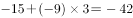。

故正确答案为A。

**来源**：2010年吉林省公务员录用考试《行测》题第2题

### 第 3 题

5，4，10，8，15，16，（    ），（    ）

A. 20，18

B. 18，32

C. 20，32

D. 18，64

第 3 题 · 答案与解析

**参考答案（粉笔题库参考内容）**

C

**解析**

数列项数较多且有2个未知项，优先考虑多重数列。交叉来看，奇数项为5，10，15，（20），是公差为5的等差数列；偶数项为4，8，16，（32），是公比为2的等比数列。则未知项分别为20、32。

故正确答案为C。

**来源**：2010年吉林省公务员录用考试《行测》题第3题

### 第 4 题

3，3，6，18，72，（    ）

A. 90

B. 360

C. 180

D. 630

第 4 题 · 答案与解析

**参考答案（粉笔题库参考内容）**

B

**解析**

数列相邻两项存在明显的倍数关系，优先考虑作商。后项除前项得到新数列：1，2，3，4，（5），是公差为1的等差数列，则未知项为。

故正确答案为B。

**来源**：2010年吉林省公务员录用考试《行测》题第4题

### 第 5 题

3，4，6，12，36，（    ）

A. 72

B. 108

C. 216

D. 180

第 5 题 · 答案与解析

**参考答案（粉笔题库参考内容）**

C

**解析**

数列无明显特征，作差作和均无规律，考虑递推数列。观察发现：，，。即规律为：，故未知项=216。

故正确答案为C。

**来源**：2010年吉林省公务员录用考试《行测》题第5题

### 第 6 题

毛毛骑在牛背上过河，他共有甲、乙、丙、丁4头牛，甲过河要20分钟，乙过河要30分钟，丙过河要40分钟，丁过河要50分钟。毛毛每次只能赶2头牛过河，要把4头牛都赶到对岸去，最少要多少分钟：

A. 190

B. 170

C. 180

D. 160

第 6 题 · 答案与解析

**参考答案（粉笔题库参考内容）**

D

**解析**

毛毛骑在牛背上过河，则每次回来都要骑一头牛回来，要想花费时间最少，则过河顺序应该是：

甲、乙牛过河，骑甲回来，花费时间为30＋20＝50分钟；

丙、丁牛过河，骑乙回来，花费时间为50＋30＝80分钟；

甲、乙牛过河，花费时间为30分钟，一共花费的时间是50＋80＋30＝160分钟。

故正确答案为D。

**考点**：统筹规划问题

**来源**：2010年吉林省公务员录用考试《行测》题第6题

### 第 7 题

一个旅游团租车出游，平均每人应付车费40元，后来又增加了7人，这样每人应付的车费是35元，租车费是：

A. 2000元

B. 1960元

C. 1900元

D. 1850元

第 7 题 · 答案与解析

**参考答案（粉笔题库参考内容）**

B

**解析**

设开始时租车的人数是x人，根据租车的总钱数不变，列方程得：40x＝35(x＋7)，解得x＝49，租车费是元。

故正确答案为B。

**来源**：2010年吉林省公务员录用考试《行测》题第7题

### 第 8 题

甲、乙两人的年龄和正好是80岁，甲对乙说：“我像你这么大时，你的年龄正好是我年龄的一半。”甲今年：

A. 32岁

B. 40岁

C. 48岁

D. 45岁

第 8 题 · 答案与解析

**参考答案（粉笔题库参考内容）**

C

**解析**

方法一：设乙现在的年龄是M，则甲、乙两人的年龄差是M/2，甲现在的年龄是M+M/2。根据题意得：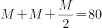，解得M＝32岁，所以甲的年龄是80-32＝48岁。

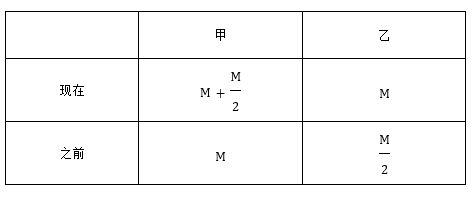

方法二：由题意得：甲和乙的年龄和为80且甲的年龄大于乙的年龄，则甲的年龄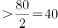，排除A、B两项。甲、乙的年龄都是整数，根据“甲对乙说：我像你这么大时，你的年龄正好是我年龄的一半”得出乙现在的年龄是偶数，又因为甲年龄+乙年龄=80，故甲现在的年龄为偶数，排除D项。

故正确答案为C。

**考点**：年龄问题

**来源**：2010年吉林省公务员录用考试《行测》题第8题

### 第 9 题

某班一次期末数学考试成绩，平均分为95.5分，后来发现小林的成绩是97分，被误写成79分，再次计算后，该班平均成绩是95.95分，则该班人数是：

A. 30人

B. 40人

C. 50人

D. 60人

第 9 题 · 答案与解析

**参考答案（粉笔题库参考内容）**

B

**解析**

方法一：设该班人数是M，根据除了小林，其他人总分数不变，可列方程：95.5M-79＝95.95M-97，解得M＝40。

方法二：小林改正成绩后多出97-79＝18分，均分给全班人从而使平均成绩提高，所以该班的人数是=18/0.45=40人。

故正确答案为B。

**来源**：2010年吉林省公务员录用考试《行测》题第9题

### 第 10 题

一个书架共有图书245本，分别存放在4层。第一层本数的2倍是第二层本数的一半，第一层比第三层少2本，比第四层多2本，书架的第二层存入图书的数量为：

A. 140本

B. 130本

C. 120本

D. 110本

第 10 题 · 答案与解析

**参考答案（粉笔题库参考内容）**

A

**解析**

设书架的第一层存入图书的数量为x本，则第二层为4x本，第三层为（x+2）本，第四层为（x-2）本。根据题意可列式：x+4x+(x+2)+(x-2)=245，解得x=35，则书架的第二层存入图书的数量为本。

故正确答案为A。

**考点**：和差倍比问题

**来源**：2010年吉林省公务员录用考试《行测》题第10题

### 第 11 题

不同历史发展阶段，不同地域的人们，由于生活经验的范围和性质不同，所＿＿＿＿而形成的思维框架、思维模式也就不同。

A. 沉淀

B. 积淀

C. 积累

D. 发展

第 11 题 · 答案与解析

**参考答案（粉笔题库参考内容）**

B

**解析**

本题考查近义实词辨析与填空。

“沉淀”指的是从溶液中析出固体物质的过程，或指在该过程中析出的固体物质，主要是指物质的分离；“积淀”指在长期积累中形成（文化、知识、经验等），多用于抽象事物；“积累”指的是（事物）逐渐聚集，或指积聚起来的事物（资本、素材、经验等）；“发展”指的是事物由小到大、由简单到复杂、由低级到高级的变化。根据文意，对应“思维”的应该是“积淀”。

故正确答案为B。

**考点**：实词填空、对应关系-前后呼应

**来源**：2010年吉林省公务员录用考试《行测》题第11题

### 第 12 题

专家们认为，传统的教学方式必须＿＿＿＿，才能适应当前形势发展的需要。

A. 变革

B. 改变

C. 改革

D. 变动

第 12 题 · 答案与解析

**参考答案（粉笔题库参考内容）**

C

**解析**

本题考查近义实词辨析与填空。

搭配“教学方式”，A项“变革”指的是改变事物的本质（多指社会制度）；B项“改变”指的是事物变得和原来不一样；C项“改革”指的是改掉旧的不合理的部分使之更加合理、完善；D项“变动”指的是变动、更改。“变革”、“改变”和“变动”三项，都不能指明变化的方向是指向好的方面，根据文意“适应当前形势发展的需要”，说明应选“改革”。

故正确答案为C。

**考点**：实词填空、词的辨析-搭配对象

**来源**：2010年吉林省公务员录用考试《行测》题第12题

### 第 13 题

现代逻辑是以19世纪中期出现的数理逻辑为起点的，它使用特别符号和形式系统的方法来研究演绎推理及逻辑规律，是传统形式逻辑的直接延续和＿＿＿＿。

A. 延伸

B. 发展

C. 变革

D. 变化

第 13 题 · 答案与解析

**参考答案（粉笔题库参考内容）**

B

**解析**

本题考查实词辨析与填空。

“延伸”指的是延长，扩大宽度、大小、范围；“发展”指的是事物由小到大、由简单到复杂、由低级到高级的变化；“变革”指的是改变事物的本质（多指社会制度而言）；“改变”指的是事物变得和原来不一样，是事物在形态上产生新的状况。B项的“发展”与“延伸”构成递进关系，且与“以······为起点”相呼应，符合语境。

因此，结合选项应该选择B。

从“是传统形式逻辑的直接延续”来看，“延伸”和“延续”意义重复，A项排除；“变革”与主语不搭配，且语义过重，C项排除；“变化”强调的是外在形态的改变，D项排除。

故正确答案为B。

**考点**：实词填空、对应关系-前后呼应

**来源**：2010年吉林省公务员录用考试《行测》题第13题

### 第 14 题

我国古塔的建造，其规模之大，分布之广，数量之多，在古代建筑中是＿＿＿＿＿＿的。

填入画横线部分最恰当的一项是：

A. 首屈一指

B. 屈指可数

C. 空前绝后

D. 沧海一粟

第 14 题 · 答案与解析

**参考答案（粉笔题库参考内容）**

A

**解析**

“首屈一指”，指位居第一位，引申为最好的；“屈指可数”，形容数目很少，扳着手指头就能数过来；“空前绝后”，指从前没有过，今后也不再会有，是夸张性地形容独一无二；“沧海一粟”，即大海中的一粒谷子，比喻非常渺小。本题意在强调中国古代建筑中，古塔在规模、分布、数量等各方面，都是其他古建筑所无法比拟的，因此“首屈一指”符合题意。

故正确答案为A。

**考点**：对应关系-前后呼应、成语填空、词的辨析-程度轻重

**来源**：2010年吉林省公务员录用考试《行测》题第14题

### 第 15 题

在通往目标的历程中遭遇挫折并不可怕，可怕的是因挫折而产生的对自己能力的＿＿＿＿。

A. 质疑

B. 狐疑

C. 疑心

D. 怀疑

第 15 题 · 答案与解析

**参考答案（粉笔题库参考内容）**

D

**解析**

根据文段可知，横线处应体现经历失败，对自己的能力没有信心之意。D项“怀疑”指疑惑，不相信，符合文意，当选。

A项，“质疑”指提出问题，请人解答，多针对他人观点、行为、事件等，与文意不符，排除；

B项，“狐疑”原意指狐性多疑，后多指遇事犹豫不决，与文意不符，排除；

C项，“疑心”指猜疑之心，也可用作动词，指猜测、推测，侧重主观的猜忌、不信任，更偏向对他人的猜忌，而非对自身能力的理性不认可，同样没有体现出“不自信”的意思，排除。

故正确答案为D。

**考点**：实词填空、对应关系-前后呼应

**来源**：2010年吉林省公务员录用考试《行测》题第15题

### 第 16 题

借助现代化科学手段，信息1秒钟可以到达月球，可以绕地球七圈半，等发现了错误再纠正，收到信息者可能已经关闭了收音机。

作者强调的意思是：

A. 高速多向的信息传播将会造成信息的创造和质量的不平等

B. 在高速多向的信息时代，信息及时准确地判断和传播十分重要

C. 充分肯定了“信息高速公路”给人类带来的好处，但要注意纠错

D. 信息的快速传播将给人类带来许多无法及时纠正的错误信息

第 16 题 · 答案与解析

**参考答案（粉笔题库参考内容）**

B

**解析**

本题为中心理解题。

“信息1秒钟可以到达月球，可以绕地球七圈半”强调了信息传播的高速多向，而“等发现了错误再纠正，收到信息者可能已经关闭了收音机”，则强调了对信息及时准确地判断和传播的重要性。

因此，结合选项应该选择B。

A项中所说“会造成信息的创造和质量的不平等”与题意无关；C项“充分肯定了‘信息高速公路’给人类带来的好处”并不是原文所要强调的方面，并且“注意纠错”的主语不明，无法判断是指信息传播者还是指信息接受者；D项所表明的意思完全否定了“高速多向的全球信息传播”的积极意义，意思太绝对，与原文完全不一致。

故正确答案为B。

**考点**：关联词-对策

**来源**：2010年吉林省公务员录用考试《行测》题第16题

### 第 17 题

咖啡馆真是一个惹人喜爱的地方，让你的心沉静又沉静，没有多余的声音也没有多余的事情，咖啡宽解了一切，把你保护在它的领地里。对上文理解较适当的一项是（    ）。

A. 咖啡馆让你的心沉静下来，似乎没有任何的杂音杂事

B. 咖啡馆不宜多去

C. 咖啡解愁，多喝有益健康

D. 咖啡可以保护你

第 17 题 · 答案与解析

**参考答案（粉笔题库参考内容）**

A

**解析**

第一步：分析文段（找到突破口）

本题考查细节判断。

由“让你的心沉静又沉静，没有多余的声音也没有多余的事情”可知，A项是对文意的正确理解。

因此，结合选项应该选择A。

第二步：分析选项（逐一分析选项）

B项,“咖啡馆不宜多去”与原文“咖啡馆真是一个惹人喜爱的地方”矛盾，可排除；

C项，说多喝咖啡有益健康，原文中并没有提到，也可排除；

D项，虽然原文中有类似话语“把你保护在它的领地里”，但“咖啡可以保护你”只是对原文的片面理解，不能准确地涵盖文意。

第三步：再次标注答案

故正确答案为A。

**考点**：细节判断题

**来源**：2010年吉林省公务员录用考试《行测》题第17题

### 第 18 题

所谓“供养”，通常是指亲属之间有经济能力、生活能够自立的人，对那些无经济能力、生活不能自立的人，予以经济上的供给和生活上的照料。供养关系把那些由婚姻纽带和血缘纽带联系起来的人，又用经济纽带联结在一起，使家庭成为一个社会实体。

这段话支持了这样一种观点：

A. “供养”是指对丧失经济能力、生活自立能力的亲属给予经济上的供给和生活上的照料

B. “供养”就是指家庭中幼辈对长辈的赡养

C. 是供养关系把亲属用经济纽带联系起来

D. “供养”就是指家庭中年长者为年幼者提供经济供给和生活照料的义务

第 18 题 · 答案与解析

**参考答案（粉笔题库参考内容）**

C

**解析**

本题为中心理解题。

文段首先介绍什么叫“供养”，然后提出“供养关系把亲属用经济纽带联系起来”的观点。即整个文段是“理论铺垫—提出观点”的分—总结构。因此原文之所以对“供养”的定义进行描述，就是为了表达“供养关系把那些由婚姻纽带联系起来的人（即亲属），又用经济纽带联结在一起”这一观点，C理解正确。

因此，结合选项应该选择C。

由“供养”的定义可知，提供“供养”的，是有经济能力，生活能自立的人，并非特指幼辈或年长者；同理，接受“供养”的，是无经济能力、生活不能自理的人，并非特指长辈或年幼者，由此可以首先排除B、D项；A项的表述本身并没有错误，但它只是对原文“供养”定义的重复，并不是文段所要表达的观点。

故正确答案为C。

**考点**：分述句特征-引入铺垫

**来源**：2010年吉林省公务员录用考试《行测》题第18题

### 第 19 题

文学最基本的特征是对自由心灵的表达，是伟大思想与丰富想象力的结合。而“网络文学”的特质正是“表达的高度自由”、强烈的“个性化”和非功利性。网络作家在现实生活中有着各种各样的身份与职业，而且绝大多数与文学无关，他们的知识结构与身份背景千差万别，他们的创作也因此有着别样的风情与广阔的视野。网络文学往往以颠覆经典文本的面貌出现，在写作中以轻松、嘲讽的气氛取胜，与传统文学正儿八经的叙事、抒情相比，神与貌皆相去甚远。这就要求我们以全新认知面对这一文学形态。有学者提出，网络文学最鲜明的特征是“写作”与“生存”的共生状态，这与目前主流文坛的写作方式有很大不同，他们是“在生存中写作”，而职业性作家文学则在很大的意义上是“在写作中生存”。

下面叙述中，不属于网络文学特征的是：

A. 具有“表达的高度自由”、强烈的“个性化”和非功利性

B. 网络作家有着与文学无关的身份与职业，因而创作有着别样的风情与广阔的视野

C. 以颠覆经典文本的面貌出现，在写作中以轻松、嘲讽的气氛取胜

D. “写作”与“生存”的共生状态，作家是“在生存中写作”

第 19 题 · 答案与解析

**参考答案（粉笔题库参考内容）**

B

**解析**

本题考查细节判断。

根据文中“网络作家在现实生活中有着各种各样的身份与职业，而且绝大多数与文学无关”，由“绝大多数”可知，“网络作家有着与文学无关的身份与职业”的说法过于绝对，B项说法错误。

因此，结合选项应该选择B。

A项说法正确，由“‘网络文学’的特质正是‘表达的高度自由’､强烈的‘个性化’和非功利性”可以推断得出；C项说法正确，由“网络文学往往以颠覆经典文本的面貌出现，在写作中以轻松､嘲讽的气氛取胜”可以推断得出；D项说法正确，由文段最后一句话可以推断得出。

本题为选非题，故正确答案为B。

**考点**：细节判断题

**来源**：2010年吉林省公务员录用考试《行测》题第19题

### 第 20 题

对于环境与建筑的保护，我们一直局限在那些大家都认为有高度历史或文化价值的部分，而对于那些历史不算久远，或者根本就不被认为有特殊意义的环境与建筑，对于那些相对只是绿叶角色的城市建筑环境都非常漠视｡我们虽然可以拆掉这些旧工业文明的老建筑，建造一大批摩天大楼，但是十年，二十年之后，下一代就要开始批评我们曾经的鲁莽了，我们要世代居住的这座城市已经失去了一段记忆，而那是上世纪中国城市最骄傲的工业文明具象的记忆。所以我认为应该保护她，尽可能留下她美丽或者被人认为不很美丽的有形的载体。

文中“有形的载体”指的是：

A. 有特殊意义的环境与建筑

B. 最骄傲的工业文明

C. 世代居住的这座城市

D. 旧工业文明的老建筑

第 20 题 · 答案与解析

**参考答案（粉笔题库参考内容）**

D

**解析**

首先定位原文，“有形的载体”出现在文段的结尾，前文中“她的有形的载体”，指的是上世纪中国城市最骄傲的工业文明具象的记忆，故“有形的载体”指的就是我们拆掉的那些“旧工业文明的老建筑”，对应D项。

A、B两项都是对旧工业文明的老建筑的评价，不是其本身，均排除；C项“这座城市”范围过大，未体现“老建筑”，排除。

故正确答案为D。

**考点**：句子

**来源**：2010年吉林省公务员录用考试《行测》题第20题

### 第 21 题

偶尔想起曾经听人说过，在中国，人人具有三种博士资格：拿筷子博士、吹煤头纸博士､嗑瓜子博士。至于吹煤头纸，现在早已销声匿迹了。半个多世纪前，丰子恺先生曾犀利地调侃国人嗑瓜子之劣迹，说把光阴耗费在“咯嘣”声中，这不是民族性的衰退吗？难怪老先生要痛心疾首地感慨自己一见瓜子就害怕，历史写到今天，这种悠闲的生活态度已被埋没在高效率快节奏的时代旋律里。唯有筷子，风风雨雨了两千多年，还是经久不衰，“民以食为天”，对于国人，筷子是进食的工具，少不得。

对本段文字的概括，准确的一项是：

A. 随着时代的发展进行，“吹煤头纸”已不复存在

B. 丰子恺先生痛恨“嗑瓜子”，因为他认为这是民族性的衰退

C. 用“吹煤头纸､嗑瓜子”的消失，衬托筷子在生活中经久不衰，不可或缺

D. 悠闲的生活态度被高效率快节奏的时代旋律取代是历史必然

第 21 题 · 答案与解析

**参考答案（粉笔题库参考内容）**

C

**解析**

本题为中心理解题。

文段的重心是落在最后一句话“唯有筷子，风风雨雨了两千多年，还是经久不衰······少不得”之上，前面长长的铺垫，都只是为了用吹煤头与嗑瓜子的消失，来衬托筷子的经久不衰和不可或缺，C项理解正确。

因此，结合选项应该选择C。

其余三项表述也没有错误，但是A、B两项都只提到了原文的一部分内容，概括不够全面；至于D项，“悠闲的生活······取代”只是为了说明“嗑瓜子”消失了，从而衬托筷子的经久不衰，并非文段主旨。

故正确答案为C。

**考点**：分述句特征-引入铺垫

**来源**：2010年吉林省公务员录用考试《行测》题第21题

### 第 22 题

在树叶茂密的布鲁克林学院的校园里，一栋墙面爬满常春藤的大楼的地下室里有着更令人吃惊的东西：在300加仑的玻璃纤维制作的鱼缸里，塞满了罗非鱼。看上去比地铁车厢还要拥挤。管理这个潮湿区域的是这个学院水产研究和环境评估中心主任、退休教授马丁·施赖布曼。几年前，罗非鱼在这里还很少见，但是现在它在美国越来越常见，几乎所有的罗非鱼都是在中国、中美洲和南美洲养殖并从这些地方进口的。<u>施赖布曼希望改变这种状况</u>。他认为城市水产养殖——在像纽约这样的城市用大鱼缸养鱼——可以解决对野生鱼的过度捕捞问题，并为美国人提供就业机会和健康的食品。

划线句中“这种状况”指的是：

A. 现在罗非鱼在美国越来越常见

B. 美国几乎所有的罗非鱼都是进口的

C. 发展城市水产养殖业

D. 应该在城市养鱼方面创造就业机会

第 22 题 · 答案与解析

**参考答案（粉笔题库参考内容）**

B

**解析**

根据就近原则，可知“这种状况”指的是前句“几乎所有的罗非鱼都是在中国、中美洲和南美洲养殖并从这些地方进口的”，对应B项。

A项是背景，且如果是改变这种常见的现象，后面就不会提出“城市水产养殖”的建议，与文意不符，排除；C、D两项都是施赖布曼针对“改变这种状况”提的建议，并非状况本身，均排除。

故正确答案为B。

**考点**：代词

**来源**：2010年吉林省公务员录用考试《行测》题第22题

### 第 23 题

教育部日前就《通用规范汉字表（征求意见稿）》公示征求意见，拟对“琴”､“亲”､“魅”等44个汉字的字形进行调整，公示在社会各界引起强烈反响。《通用规范汉字表》专家委员会副主任委员王宁教授在新华网与网民在线交流。他们认为，调整这44个字的字形只是调整印刷宋体字，不是另搞一套，根据调查数据显示，67%的公众表示赞成，约6%的公众表示反对。可新浪网的网上调查得到的结果却完全相反，九成以上的网友持反对意见，认为是“穷折腾”｡王宁教授强调，一个字改还是不改并不是以多数投票为主，而要看它合理不合理，要看它有没有道理。既然“一个字改还是不改并不是以多数投票为主”，那么，为何专家们还主动提供调查数据，以示多数公众支持呢？

对文段的理解分析正确的一项是：

A. “琴”、“亲”、“魅”等44个汉字的字形调整，引起了社会各界的强烈反响

B. 规范汉字不能是少数几个专家说了算，而要看它合理不合理

C. 新浪网的网上调查结果不能作为专家决策的依据

D. 官方和民间完全相左的“民调”，使得专家难以自圆其说

第 23 题 · 答案与解析

**参考答案（粉笔题库参考内容）**

D

**解析**

本题考查细节判断。

从原文最后一句领会作者意图：专家们提供的调查数据与代表民意的新浪网的网上调查结果完全相反，专家的解释自相矛盾，难以自圆其说。

因此，结合选项应该选择D。

A项曲解文意，文段首句说的是“教育部······公示征求意见，拟对‘琴’､‘亲’､‘魅’等44个汉字的字形进行调整，公示在社会各界引起强烈反响”，由此可以推知字形还未作调整，引起社会强烈反响的是打算调整“琴”、“亲”等字形的公示；B、C两项均错误，文段的意思是规范汉字不能由少数几个专家说了算，而是应该广泛听取公众的意见，新浪网上的调查结果也应该作为专家决策的依据。

故正确答案为D。

**考点**：细节判断题

**来源**：2010年吉林省公务员录用考试《行测》题第23题

### 第 24 题

历史走向大众，国学受到热捧，是我们继承优良传统的良好契机。但那些靠耸人听闻来扬名､谋私的手段，那些将严肃历史肆意娱乐化解读的做法，其结果只能败坏学风，误导受众，把方兴未艾的传统文化热引向歧路。历史和典籍当然要走向大众，但人文精神和道德底线必须坚守。任何媚俗化、低俗化、恶俗化地娱乐历史的行为都是要不得的，以钓名谋利为宗旨的商业炒作更应刹车。面对商品时代复杂多变的大众文化消费，真正有使命感的文化，理应义不容辞地担当起历史的职责。

对“历史娱乐化”的解说不恰当的一项是：

A. “娱乐化”是指那些靠耸人听闻来扬名、谋私，将严肃历史肆意娱乐化解读的做法。

B. “历史娱乐化”只能败坏学风，误导受众，把方兴未艾的传统文化热引向歧路。

C. 历史走向大众，国学受到热捧是我们继承优良传统的良好契机，任何娱乐历史的做法和大众文化消费，都是要不得的。

D. 真正有使命感的文化人，要坚守人文精神和道德底线，杜绝将历史肆意娱乐化，义不容辞地担当起历史的职责。

第 24 题 · 答案与解析

**参考答案（粉笔题库参考内容）**

C

**解析**

本题考查细节判断。

C项中“任何娱乐历史的做法和大众文化消费，都是要不得的”说法错误，一则文段并没有反对大众文化消费，二则原文为“任何媚俗化、低俗化、恶俗化地娱乐历史的行为都是要不得的”，因此“任何娱乐历史的做法”这一说法过于绝对，与文意不符。

因此，结合选项应该选择C。

由“但那些靠耸人听闻来扬名､谋私的手段，那些将严肃历史肆意娱乐化解读的做法，其结果只能败坏学风，误导受众，把方兴未艾的传统文化热引向歧路”这句话可知A、B两项说法正确；D项说法正确，由文段最后一句话可以推断得出。

本题为选非题，故正确答案为C。

**考点**：细节判断题

**来源**：2010年吉林省公务员录用考试《行测》题第24题

### 第 25 题

网络驱使我们进入了一个进行生死之争的世界，我们中的许多人发现这一世界是毁灭性的，网络强加的文化和经济张力令我们感到无力抗拒。作为网络赖以生存的机器和方案的创造者，我们有能力理解网络，也有能力影响它们的功能。我们有责任让网络服务于社会公正和人类自由的利益。

以下对文段的解释不恰当的一项是：

A. 网络驱使我们进入生死之争的世界，对此，我们感到无力抗拒。

B. 网络带来的文化和经济张力给人类带来巨大的冲击和威胁。

C. 人类有能力让网络与人类以一种创造性共生的状态一起进化。

D. 人类有责任让网络服务于社会公正和人类自由的利益。

第 25 题 · 答案与解析

**参考答案（粉笔题库参考内容）**

A

**解析**

本题考查细节判断。

文中提到“网络强加的文化和经济张力”令我们感到无力抗拒而非“网络驱使······生死之争的世界”，A项属于偷换主语。

因此，结合选项应该选择A。

由“网络驱使人们进入了一个生死之争的世界······网络强加的文化和经济张力令我们感到无力抗拒”可知，B项正确；由“我们有责任让网络服务于社会公正和人类自由的利益”可知，D项也正确；由“作为网络赖以生存的机器和方案······也有能力影响它们的功能”可知，C项正确。

本题为选非题，故正确答案为A。

**考点**：细节判断题

**来源**：2010年吉林省公务员录用考试《行测》题第25题

### 第 26 题

《阿凡达》是卡梅隆花了12年才完成的一部片子，这12年里，他除了拍过几部跟海洋有关的纪录片之外，几乎都在为《阿凡达》折腾，同时消失于媒体和公众视线之外｡结果影片上映才两周，全球票房就直奔10亿美元，离他那部创下14亿美元票房纪录的《泰坦尼克号》，距离也并不遥远。而中国导演呢，谁会花12年的时间，去做一部完全不知道前景的影片？中国电影另外一个很堕落的地方是，贴片广告已经多到令人发指的地步，铜臭气十足。冯小刚在《非诚勿扰》受到批评后还说，这是国际通行做法。对，《变形金刚》里的确有雪佛兰，但是好莱坞是每部影片都会尽可能地往里拉赞助塞商标么？我真的不是苛刻，但事实就是这样，很多中国导演不是为观众在拍电影，甚至也不是为自己拍电影，他们只是在为钱拍电影。相比之下，<u>《阿凡达》是多么的纯洁</u>，可为什么这份纯洁，反而是远比我们商业的美国人实现的呢？

对划横线的语句理解不恰当的一项是：

A. 卡梅隆用了12年精心制作，其间，他几乎消失于媒体和公众视线之外。

B. 卡梅隆用12年的时间，去做了一部完全不知道前景的影片。

C. 《阿凡达》是导演卡梅隆为观众为自己而创作的一部电影。

D. 《阿凡达》是一部没有商业广告的纯洁电影。

第 26 题 · 答案与解析

**参考答案（粉笔题库参考内容）**

D

**解析**

本题考查词句理解。

D项以有没有商业广告作为电影纯洁与否的标准，曲解了文意。且文段并不是反对在电影中加入商业广告，而是反对“尽可能地往里拉赞助塞商标”。

因此，结合选项应该选择D。

由“很多中国导演不是为观众在拍电影，甚至也不是为自己拍电影，他们只是在为钱拍电影，相比之下，《阿凡达》是多么的纯洁”可知，文段是通过对比卡梅隆与中国导演的不同做法来突出《阿凡达》的纯洁的。因此，A、B、C三项均正确。

本题为选非题，故正确答案为D。

**考点**：句子

**来源**：2010年吉林省公务员录用考试《行测》题第26题

### 第 27 题

中华民族很早发现了宇宙旋律及生命节奏的秘密，因而以平和的音乐的心境爱护现实，美化现实，但是却轻视了科学工艺征服自然的权力，这使我们无法摆脱贫弱的处境。在生存竞争剧烈的时代，我们受人侵略，受人欺侮，文化的美丽精神也不能长保了，灵魂里粗野了，卑鄙了，怯懦了，我们也现实得不近情理了。我们丧尽了生活里旋律的美（盲动而无秩序）、音乐的境界（人与人之间充满了猜忌、斗争）。一个最尊重乐教、最了解音乐价值的民族没有了音乐。这就是说没有了国魂，没有了构成生命意义、文化意义的高等价值。中国精神应该往哪里去？

对“宇宙旋律及生命节奏的秘密”分析不恰当的一项是：

A. 这一秘密，创造了中华民族平和的心境，我们用它来爱护现实、美化现实。

B. 这一秘密的发现，并不能使我们摆脱贫弱的处境。

C. 这一秘密的发现并不能使我们保护住“文化的美丽精神”。

D. 这一秘密，构成了我们的国魂、生命意义和文化意义的高等价值。

第 27 题 · 答案与解析

**参考答案（粉笔题库参考内容）**

D

**解析**

本题考查词句理解。

根据文段“一个最尊重乐教、最了解音乐价值的民族没有了音乐，这就是说没有了国魂······”，意思是音乐是我们的国魂，是构成生命意义和文化意义的高等价值，而不是“宇宙旋律及生命节奏的秘密”，D项偷换主语。

因此，结合选项应该选择D。

由“中华民族很早发现了宇宙旋律及生命节奏的秘密······文化的美丽精神也不能长保了”这两句话中可知，A、B、C项均正确。

本题为选非题，故正确答案为D。

**考点**：句子

**来源**：2010年吉林省公务员录用考试《行测》题第27题

### 第 28 题

“粉丝”来自英文的fan，源出fanatic，乃其缩写，但经瘦身之后，脱胎换骨，变得轻灵多了。更可爱的是，当初把它译成“粉丝”的人，福至心灵，神来之笔竟把复数一并带了过来，好用多了。单用“粉”字，不但突兀，而且表现不出那种从者如云、纷至沓来的声势。“粉丝”当然是多数，只有三五人甚至三五十人，怎能叫做fans？对偶像当然是说，“我是你的粉丝”，怎么能说，“我是你的粉”呢？粉，极言其细而轻，积少成多，飘忽无定。丝，极言其虽细却长，纠缠而善攀附，所以欲理还乱。

作者对“粉丝”一词的翻译极为赞赏，不属于其中理由的一项是：

A. 音译瘦身之后，脱胎换骨，变得轻灵多了。

B. 把复数一并带了过来，好用多了。

C. 能表现出从者如云、纷至沓来的声势。

D. 能表现出积少成多、欲理还乱的情味。

第 28 题 · 答案与解析

**参考答案（粉笔题库参考内容）**

A

**解析**

本题考查细节判断。

根据文段“瘦身之后，脱胎换骨，变得轻灵多了”中的“瘦身”是指“fanatic”缩写为“fan”，而不是指将“fan”翻译成“粉丝”，A项错误，当选。

因此，结合选项应该选择A。

B项，根据文段“神来之笔竟把复数一并带了过来，好用多了”可知选项表述正确，排除；

C项，根据文段“单用‘粉’字，不但突兀，而且表现不出那种从者如云、纷至沓来的声势”可知选项表述正确，排除；

D项，根据文段最后一句话可知其正确，排除。

本题为选非题，故正确答案为A。

**考点**：细节判断题

**来源**：2010年吉林省公务员录用考试《行测》题第28题

### 第 29 题

“和合”思想对中国历代对外交往方式都产生了重要影响。中华文化对其他文化并没有去排斥，而是一直保持一种开放和包容的心态。中国绝大多数王朝在建立之后，都注意止戈息武，强调“协和万邦”，实现“万国咸宁”、“天下太平”。特别是鼎盛时期的唐代“贞观之治”、清代“康乾盛世”，中央政府也多实行睦邻友好的政策，而不是向外侵略扩张，谋求霸权。中华文化的发展是不断吸收外来文化以丰富自己的过程，并最终实现与众多外来文化和睦共处、和谐发展。

以下不属于“和合”思想在中国历代对外交往上的表现的一项是：

A. 中华文化对其他文化一直保持一种开放和包容的心态。

B. 历代王朝在建立之后，都注意止戈息武，强调“协和万邦”。

C. 鼎盛时期的中央政府也多实行睦邻友好的政策。

D. 中华文化的发展是不断吸收外来文化以丰富自己的过程。

第 29 题 · 答案与解析

**参考答案（粉笔题库参考内容）**

D

**解析**

本题考查细节判断。

综合整个文段，“和合”思想强调的是包容与和睦，并且题干问的是“对外交往上的表现”，D项中的“吸收外来文化以丰富自己”没有体现出和睦之意，同时，不是对外交往的表现，“文化发展”并非“外交交往”，因而不是“和合”思想的表现。

因此，结合选项应该选择D。

A项的“开放和包容”、B项的“止戈息武”和“协和万邦”、C项的“睦邻友好”都能够体现“和合”的思想。

本题为选非题，故正确答案为D。

**考点**：细节判断题

**来源**：2010年吉林省公务员录用考试《行测》题第29题

### 第 30 题

发挥创造性，离不开求异思维。所谓求异思维，就是指注重已知与未知之间的矛盾，提示现象与本质间的差别。它要求对公认完美无缺的定论持怀疑和批评态度，富于挑战性地对待传统和习惯的思维模式。正如李四光所说：“不怀疑不能见真理。”

这段话主要支持了这样一个论点，即求异思维：

A. 是富有怀疑和批评态度的思维模式

B. 是对已知的矛盾进行提示

C. 是李四光所用过的思维方式

D. 是一种传统习惯思维方式

第 30 题 · 答案与解析

**参考答案（粉笔题库参考内容）**

A

**解析**

本题为中心理解题。

由原文“它要求对公认完美无缺的定论持怀疑和批评态度”可知，A项正确。

因此，结合选项应该选择A。

C项未把握重点，文段引用李四光的话是为了加强论证文中的观点，并不是来强调“李四光所用过”；B项表述错误，根据文段求异思维是指“注重已知和未知之间的矛盾，提示现象与本质间的差别”，而不是“对已知的矛盾进行提示”；D项理解错误，“传统习惯的思维方式”和文中“富于挑战性地对待传统和习惯的思维模式”概念相左。

故正确答案为A。

**考点**：关联词-对策

**来源**：2010年吉林省公务员录用考试《行测》题第30题

### 第 31 题

鉴赏评价性的题目不太好出，对一篇文章思想内容的高低、表达技巧的优劣往往见仁见智，难以统一。但考试题目却不能公说公有理，婆说婆有理，它必须有符合科学道理的唯一答案。

上文不可以理解为：

A. 鉴赏评价性的题目用于标准化考试不太好统一答案。

B. 一篇文章内容的高低、表达技巧的优劣往往出现在考试题目中。

C. 考试答案是科学合理的，所以可以见仁见智。

D. 评价鉴赏性的题目不鼓励学生发挥创见。

第 31 题 · 答案与解析

**参考答案（粉笔题库参考内容）**

C

**解析**

本题考查细节判断。

根据文段最后一句话可知，考试答案不能见仁见智，必须有科学合理的唯一答案，C项与文段表意相悖。

因此，结合选项应该选择C。

根据文段“鉴赏评价性的题目······往往见仁见智，难以统一”，A理解正确；全文段其实在讨论怎么对待考试中的鉴赏评价性题目，因此这类题是客观存在于考试题目中的，B理解无误；根据文段“考试题目不能公说公有理，婆说婆有理”可知，对于评价鉴赏性的题目，不鼓励学生发挥创见，D正确。

本题为选非题，故正确答案为C。

**考点**：细节判断题

**来源**：2010年吉林省公务员录用考试《行测》题第31题

## 材料 1

阅读下列短文，完成各题。

        30年来，青年的奋斗实践始终与改革开放紧密相连｡在波澜壮阔的改革开放进程中，一代又一代青年积极响应党的号召，满怀豪情地投身建设祖国的火热实践，为推进中国特色社会主义事业作出了重要贡献｡改革开放的征程，留下了青年一代奋斗的足迹｡所有亲身经历了这30年伟大变革并贡献了自己力量的中国青年，都有理由为我国改革开放的历史性伟大成就感到欢欣鼓舞｡

        胡锦涛总书记在讲话中指出，我们的事业是面向未来的事业，实现全面建设小康社会的目标还需要继续奋斗十几年，基本实现现代化还需要继续奋斗几十年，巩固和发展社会主义制度则需要几代人､十几代人甚至几十代人坚持不懈地努力奋斗｡夺取全面建设小康社会新胜利､实现中华民族伟大复兴的光荣使命历史性地落到了当代青年的身上｡当代青年要肩负起历史的责任，自觉地把个人成长与党和人民的事业紧密地结合起来，在全面建设小康社会的伟大实践中建功立业｡

        广大青年投身全面建设小康社会的伟大实践，就要充分发挥创新热情和创造活力，努力走在解放思想､锐意改革的前列，在各行各业中勇开风气之先;就要积极推动科学发展､促进社会和谐，广泛参与社会主义经济建设､政治建设､文化建设､社会建设和生态文明建设，立足本职，争创一流业绩，在推动经济社会又好又快发展中充分发挥生力军作用;就要进一步增强大局意识，倍加珍惜､努力维护我国长期发展所需要的安定团结的良好局面;就要勤奋学习，努力提高自身素质和能力，练就适应时代发展要求的过硬本领，为服务祖国和人民打下坚实的基础｡当前，我们要在党和政府的领导下，努力克服国际金融危机对我国经济带来的不利影响，在保持我国经济平稳较快发展的过程中，认清形势，坚定信心，克服困难，多作贡献｡

        在改革开放新的征程中，共青团､青联､学联和少先队组织要按照党的要求，不断提高（    ）青年､（    ）青年､（    ）青年和（    ）青少年合法权益的能力和水平，不断加强自身建设，特别是要加强与普通青年的联系，心里装着普通青年，充分发挥好联系青少年的桥梁纽带作用，更好地完成党交给我们的光荣任务，不辜负广大青年的期待｡

        同志们，回首过去，改革开放的辉煌成就令我们备受鼓舞;展望未来，光荣的使命和责任激励着我们奋勇前行｡让我们紧密团结在以胡锦涛同志为总书记的党中央周围，全面贯彻党的十七大精神，高举中国特色社会主义伟大旗帜，坚持以邓小平理论和“三个代表”重要思想为指导，深入贯彻落实科学发展观，团结带领广大青年为夺取全面建设小康社会新胜利､实现中华民族伟大复兴而共同奋斗!

### 第 32 题

根据文意，下面表述有误的一项是：

A. 广大青年要紧密团结在以胡锦涛同志为总书记的党中央周围，为实现中华民族伟大复兴而共同奋斗

B. 当代青年要自觉地把个人成长与党和人民的事业紧密地结合起来，在全面建设小康社会的伟大实践中建功立业

C. 各级青年组织要充分发挥好桥梁纽带作用，更好地完成党交给我们的光荣任务，不辜负广大青年的期待

D. 我国改革开放的历史性伟大成就令所有亲身经历了这一变革的中国青年欢欣鼓舞

第 32 题 · 答案与解析

**参考答案（粉笔题库参考内容）**

D

**解析**

本题考查细节判断。

D项“所有亲身经历了这一变革”在文中无从体现，表述不正确。

因此，结合选项应该选择D。

A、B两项都能直接从原文中找到对应语句；根据原文，“充分发挥好桥梁纽带作用”的主语是“共青团、青联、学联和少先队组织”，其中前三个为青年组织，最后一个为青少年组织，虽然C中只提到“青年组织”，但表述是没有错误的。

本题为选非题，故正确答案为D。

**来源**：2010年吉林省公务员录用考试《行测》题第32题

### 第 33 题

文中说“当代青年要肩负起历史的责任”，其中“历史的责任”是指：

A. 实现全面建设小康社会的目标

B. 基本实现现代化

C. 巩固和发展社会主义制度

D. 夺取全面建设小康社会新胜利、实现中华民族伟大复兴

第 33 题 · 答案与解析

**参考答案（粉笔题库参考内容）**

D

**解析**

本题考查词句理解。

由前句“夺取全面建设小康社会新胜利、实现中华民族伟大复兴的光荣使命历史性地落在了当代青年的身上”可知，当代青年的历史责任是夺取全面建设小康社会新胜利、实现中华民族伟大复兴。

因此，结合选项应该选择D。

A、B、C三项的内容都只是“历史责任”的一部分。

故正确答案为D。

**来源**：2010年吉林省公务员录用考试《行测》题第33题

### 第 34 题

文中对广大青年投身全面建设小康社会的伟大实践提出了几点要求，以下不恰当的一项是：

A. 要充分发挥创新热情和创造活力，解放思想､锐意改革，勇开风气之先

B. 要立足本职，争创一流，充分发挥生力军作用

C. 要增强大局意识，珍惜和维护当今难得的安定团结的良好局面

D. 要勤奋学习，提高素质，练就本领，为服务祖国和人民打下坚实的基础

第 34 题 · 答案与解析

**参考答案（粉笔题库参考内容）**

C

**解析**

本题考查细节判断。

C项“当今难得的”表述不当，原文为“我国长期发展所需要的”。

A、B、D三项都能直接从原文找到对应的句子。

本题为选非题，故正确答案为C。

**来源**：2010年吉林省公务员录用考试《行测》题第34题

### 第 35 题

依次填入括号处的词语，恰当的一项是：

A. 宣传、组织、引领、保护

B. 组织、引导、服务、维护

C. 服务、组织、引领、维护

D. 动员、组织、服务、保护

第 35 题 · 答案与解析

**参考答案（粉笔题库参考内容）**

B

**解析**

本题考查词语填空。

先看最后一空，与“合法权益”搭配表示动作时，一般用维护；权益与保护搭配时，一般用作名词，如消费者权益保护、妇女儿童权益保护等，因此排除A、D两项。B、C两项所用词语相同，区别只在于顺序不同。从句意可以看出，空格处词语应该符合逻辑上的先后顺序，“组织—引导—服务”这一顺序存在递进关系，后一动作的执行都是建立在前一动作完成的基础之上。

故正确答案为B。

**来源**：2010年吉林省公务员录用考试《行测》题第35题

### 第 36 题

命令链是指一种不间断的权力路线，从组织最高层扩展到最基层，澄清“谁向谁报告工作”。它能够回答员工提出的这种问题：“我有问题时，去找谁？”“我对谁负责？”

以下组织设计不属于命令链的是：

A. 在某商场购买的物品若有质量问题，商场一律准予退货，再由商场向商品生产厂家索赔

B. 某公司每个职员的工作内容和职务权限都非常明确，因此该公司员工很少出现角色模糊的现象，工作效率也较同行企业高出许多

C. 住院病人如果夜间有什么不舒服要先告知护士，护士问明情况之后若不知如何处理要请示一线值班大夫，一线大夫若处理不了需要交二线值班大夫处理

D. 某饮料厂，在其生产线上设立层层关口，每一关口都派负责任的员工严把质量关，保证每瓶饮料的质量安全可靠

第 36 题 · 答案与解析

**参考答案（粉笔题库参考内容）**

A

**解析**

第一步：找出定义关键词。

关键词包括：“不间断的权力路线”、“从组织最高层扩展到最基层”、“‘我有问题时，去找谁？’‘我对谁负责？’”

第二步：逐一判断选项。

A项：商场和生产厂家之间的关系是生产和销售的关系，这二者并不是属于同一个组织内的层级关系，不存在哪个是高层、哪个是基层，这二者之间也不是权力关系，不符合“不间断的权力路线”、“从组织最高层扩展到最基层”。因此不属于命令链；

B项：某公司每个职员的责权都非常明晰，属于在同一个组织里的体系架构，因此符合“不间断的权力路线”、“从组织最高层扩展到最基层”、“‘我有问题时，去找谁？’‘我对谁负责？’”。符合命令链的定义；

C项：医院中的护士、一线大夫、二线大夫分工明确、责权明晰，且属于同一个组织中，在遇到问题时该去找谁、对谁负责都很清晰，符合命令链的定义；

D项：委派员工在产品线层层把关，符合“不间断的权力路线”、“从组织最高层扩展到最基层”，而且是在同一个企业中，该员工对产品质量负责。符合命令链的定义。

本题为选非题，故正确答案为A。

**考点**：单定义-其他句式

**来源**：2010年吉林省公务员录用考试《行测》题第36题

### 第 37 题

T型管理是指在一个组织内部自由地分享知识（T的水平部分），同时注重单个业务单元业绩（T的垂直部分）的提升。T型管理通过跨业务单元学习，共享资源，沟通思想，来创造横向价值（T的水平部分），同时通过各业务单元的密切合作，使单个业务单元的业绩（T的垂直部分）得到良好发展。

根据上述定义，下列各项中没有运用T型管理方法或运用错误的是：

A. 某电视机生产企业经常将企业管理者派出学习先进的管理经验，管理者的管理水平得到很大提高，直接促进了企业经济效益的提高

B. 张某是某大型连锁超市的分店经理，他虚心向其他分店学习进货和存货布置等方面的经验，使得他所管理的分店存货减少20%，销量增加了10%

C. 王某新任某粮食生产企业部门主管时，由于他对粮食保管方面的业务所知甚少，所以他特意从其他部门借调来几名同事帮助他制定出完善的粮食保管方面的规章制度

D. 某企业经常召集销售人员开经验交流会，在交流会上，大家纷纷介绍自己成功的销售经验和方法。每次交流会后，所有人的销售业绩都会得到提升

第 37 题 · 答案与解析

**参考答案（粉笔题库参考内容）**

A

**解析**

第一步：找出定义关键词。

“组织内部自由地分享知识（T的水平部分）”、“单个业务单元业绩（T的垂直部分）的提升”、“跨业务单元学习，来创造横向价值（T的水平部分）”、“各业务单元的密切合作，使单个业务单元的业绩（T的垂直部分）得到良好发展”。

第二步：逐一分析选项。

A项：某电视机生产企业将企业管理者派出学习，不符合“组织内部自由地分享知识”，不符合定义，当选；

B项：张某向“其他分店”学习经验后，使分店存货减少，销量增加，这既为分店创造了价值，也提升了自己的业绩，符合定义，排除；

C项：王某从其他部门借调同事帮助制定完善的规章制度，符合“跨业务单元学习，来创造横向价值（T的水平部分）”、”各业务单元的密切合作”，符合定义，排除；

D项：企业销售人员“分享成功的销售经验和方法”，属于跨业务单元的学习；销售人员在交流会后，“销售业绩都会得到提升”，属于单个业务单元业绩的提升，符合定义，排除。

本题为选非题，故正确答案为A。

注：如下图所示，C项在“T型管理”原文有对应参考。

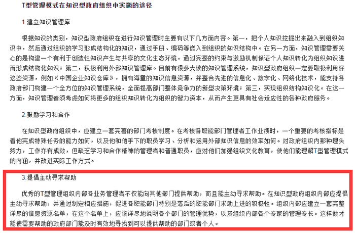

**考点**：大前提

**来源**：2010年吉林省公务员录用考试《行测》题第37题

### 第 38 题

激励约束，即组织根据期望目标、人的行为规律，通过各种方式，去激发人的动力，使人有一股内在的动力和要求，迸发出积极性、主动性和创造性，同时规范人的行为，朝着组织所期望的目标前进的过程。

根据上述定义，下列各项中属于激励约束的是：

A. 小王上班经常迟到，最近公司作出新规定，迟到者将被扣发整月奖金，小王不得不每天早起半个小时，果然一个月内再没有迟到过。

B. 某学校组织青年教师讲课比赛，获胜者将被授予青年讲课标兵称号，尽管学校规定自愿报名，但青年教师仍然纷纷报名参加。

C. 某公司鼓励员工自我增值，并向员工提供外出培训的机会，员工们响应的热情竟使得一时间公司人手有些紧张。

D. 某公司新上任的李经理业务能力强，而且待人亲和有礼，很快获得了员工们的一致认可和好评。

第 38 题 · 答案与解析

**参考答案（粉笔题库参考内容）**

B

**解析**

第一步：抓住定义中的关键词。

该定义项的关键在于“激发人的动力，使人有一股内在的动力和要求”，“同时规范人的行为”，朝着组织“所期望的目标”前进。

第二步：逐一判断选项。

A项，公司的新规定迫使小王“不得不”每天早起半小时，这个规定虽然规范了小王的行为，但并没有“激发”小王的动力，而是小王不得已而为之的结果，故不符合定义；

B项，学校组织讲课比赛，青年教师纷纷自愿报名参加，属于“激发青年教师的动力”；选项中没有指出这个讲课比赛影响了学校的正常工作，属于“朝着学校所期望的目标前进”，符合定义；

C项，公司鼓励员工自我增值，提供外出培训机会，这激发了员工主动要求学习的动力，但员工响应的热情造成公司人手有些紧张，也就是造成公司无法按照所期望的目标前进，故不符合定义；

D项，只说了李经理的业务能力和为人处事的态度，与“组织激发人的动力”或“规范人的行为”无关，故不符合定义。

故正确答案为B。

**考点**：方式目的

**来源**：2010年吉林省公务员录用考试《行测》题第38题

### 第 39 题

同心多角化经营战略是指企业以一种主要产品为圆心，充分利用该产品在技术、市场上的优势和特长，不断向外扩散，生产多种产品，充实产品系列结构的战略，它是企业利用原有的生产技术条件，制造与原产品用途不同的新产品。

根据上述定义，下列企业使用了同心多角化经营战略的是：

A. 某汽车生产企业通过兼并和控股等方式开拓和扩大市场，斥巨资收购了国外知名汽车生产企业，并把自己原来的高端产品并归于该知名品牌下

B. 某石油勘探开发公司对自己开采的石油进行炼化，生产各种石化产品，并自行组织这些产品的销售

C. 某服装生产企业以其独特新颖的设计驰名全国，获得成功后，又投资建筑、商品零售等多个行业，发展成为综合性的集团公司

D. 某企业所生产的电冰箱制冷效果好，销量在国内同类产品中居于领先地位，后来该企业又生产空调，产品也深受消费者喜爱

第 39 题 · 答案与解析

**参考答案（粉笔题库参考内容）**

D

**解析**

第一步：找出定义关键词。

“企业”、“一种主要产品为圆心”、“利用该产品在技术、市场上的优势和特长，不断向外扩散，生产多种产品”、“利用原有的生产技术条件，制造与原产品用途不同的新产品”。

第二步：逐一分析选项。

A项：该汽车生产企业是“通过兼并和控股等方式”开拓和扩大市场，不是“利用原有的生产技术条件”，不符合定义，排除；

B项：该石油勘探开发公司在自己开采的石油的基础上，生产各种石化产品，这些产品都是同一系列的，不是“用途不同的新产品”，不符合定义，排除；

C项：该服装生产企业的主要产品是服装，但后来其投资的对象是多个不同行业，不是“利用原有的生产技术条件”来生产多种产品，不符合定义，排除；

D项：“电冰箱”是该企业的主要产品，以电冰箱为圆心，利用“制冷效果好”这一技术优势，继续生产空调，符合定义，当选。

故正确答案为D。

**考点**：方式目的

**来源**：2010年吉林省公务员录用考试《行测》题第39题

### 第 40 题

谎言是指一句或者一些话，说话人将其认为真实的事件（他可能自己都不清楚事情的真实性）说成不真实的给听者，使听者相信“不存在”的事物“存在”；或者将真实存在的事物说成“不存在”。

以下属于谎言的是：

A. 小张被确诊得了癌症，他没有告诉家人。在积极自我调整作息和生活后，身体恢复，病灶消失，这时他告知家人自己已经远离了癌症。

B. 家境贫困的小李一直课余打工赚取生活费。他大四时想报考研究生，学习很紧，没有时间打工，仍对父母说自己靠打工挣得的钱生活没有问题。

C. 杨某告诉小钱，可以为她和她的同学小陈在外地找到工作，小钱欣喜地告诉小陈。后杨某让两人在某地的工厂工作，工资很低没有休息日，小陈认为小钱欺骗了她。

D. 老刘故地重游时见到老同学，问起一位老熟人，老同学告诉他这位老熟人得了病走了。

第 40 题 · 答案与解析

**参考答案（粉笔题库参考内容）**

B

**解析**

第一步：抓住定义中的关键词。

该定义项中的关键词：①使听者相信“不存在”的事物“存在”；②将真实存在的事物说成“不存在”。

第二步：逐一判断选项。

A项，小张被确诊得了癌症后没有告诉家人，因而不存在是否说谎；等到身体恢复后再告诉家人自己远离癌症，与真实情况相符，不属于说谎；

B项，小李没有时间打工，但跟父母说自己靠打工挣的钱生活没有问题，是把“不存在”的情况说成是“存在”的，符合说谎的定义；

C项，小钱告诉小陈，杨某能够帮她们“在外地找到工作”，但没有说明待遇情况，而杨某也确实让两人在某地的工厂工作，所以尽管待遇低，也不能说小钱欺骗小陈；

D项，题干没有说明这位“老熟人”的现状，所以无法判断老同学所说的“老熟人得了病走了”是否属实，即不能判断是否说谎。

故正确答案为B。

**考点**：单定义-其他句式

**来源**：2010年吉林省公务员录用考试《行测》题第40题

### 第 41 题

直销是指直销企业招募直销员，由直销员在固定营业场所之外直接向最终消费者推销产品的经营方式。

以下属于直销的是：

A. 某奶制品生产厂家甄选业务员后，在市内设立了一百个销售点以统一的价格销售奶制品

B. 某书店采取网上销售方式，顾客下订单后，由快递员将产品送至指定场所并收取费用

C. 某化妆品牌招聘的一些业务员在道路旁设摊点发放产品说明并以较低价格向顾客推销

D. 开学时，新生小贺到批发市场购买了五盏台灯，自用一盏，其他四盏卖给同学

第 41 题 · 答案与解析

**参考答案（粉笔题库参考内容）**

C

**解析**

第一步：找出定义关键词。

“直销员”、“在固定营业场所之外”、“直接向最终消费者推销产品”。

第二步：逐一分析选项。

A项，在市内设立的“一百个销售点”属于“固定营业场所”，不符合“在固定营业场所之外”，不符合定义，排除；

B项，书店的网上销售方式是由顾客主动下订单，快递员只起到送货和收取费用的作用，不符合“直接向最终消费者推销产品”，不符合定义，排除；

C项，该化妆品牌的业务员在道路旁设摊点，以较低价格向顾客推销，符合“在固定营业场所之外”、“直接向最终消费者推销产品”，符合定义，当选；

D项，“小贺”是学生，不是企业招募的直销员，因此他转卖台灯的行为不构成直销，不符合定义，排除。

故正确答案为C。

**考点**：大前提

**来源**：2014年新疆维吾尔自治区公务员录用考试《行测》题（网友回忆版）第77题

### 第 42 题

体育旅游是指个人暂时离开常住地或工作地，参加体育活动、观看体育活动，或者观赏与体育活动有关的吸引物，以休闲为基础的旅游活动。

以下不属于体育旅游的是：

A. 球迷小李赶到大连市观看中超联赛

B. 自行车俱乐部的成员小张骑车到上海后，找了一份在快递公司的工作

C. 2008年北京奥运会结束后，很多外地游客到北京参观鸟巢和水立方

D. 广州某集团公司的小李是游泳健将，他被单位推选到青岛市参加游泳比赛

第 42 题 · 答案与解析

**参考答案（粉笔题库参考内容）**

B

**解析**

第一步：抓住定义中的关键词。

该定义项中的关键词为“暂时离开常住地或工作地”、“参加体育活动、观看体育活动，或者观赏与体育活动有关的吸引物”。

第二步：逐一判断选项。

A项，“赶到大连”说明是“暂时离开常住地”，“观看中超联赛”是“观看体育活动”，符合定义；

B项，小张骑车到上海找了一份工作，说明不只是暂时离开常住地或工作地，而且“找工作”与“体育活动”无关，不符合定义；

C项，鸟巢是国家体育场，水立方是国家游泳中心，外地游客参观鸟巢和水立方属于“观赏与体育活动有关的吸引物”，符合定义；

D项，小李属于广州某集团公司的，被派到青岛市参加游泳比赛，属于“暂时离开工作地，参加体育活动”，符合定义。

本题为选非题，故正确答案为B。

**考点**：方式目的

**来源**：2010年吉林省公务员录用考试《行测》题第42题

### 第 43 题

传统逻辑把排中律当作事物的基本规律之一，意为任一事物在同一时间里具有某属性或不具有某属性，而没有其他可能｡排中律也是思维的规律，是指在同一思维过程中，一个命题不可能既不是真的，又不是假的，即两个互相矛盾的思想不可能同时为假。

据此定义，以下违反排中律的一项是：

A. 小陆踢完足球回到宿舍，小陈问他：“赢了吗？”小陆说：“没有。”小陈问：“那么，输了？”小陆说：“也没有。”

B. 小周在回答招聘单位面试问题时说：“我的专业不是社会学，也不是教育学。”

C. 甲､乙二人下完棋后，一位观棋者笑着说：“看来你俩是谁也赢不了谁”。

D. 这场战争，既不能说它是正义的，也不能说它是非正义的。

第 43 题 · 答案与解析

**参考答案（粉笔题库参考内容）**

D

**解析**

第一步：抓住定义中的关键词。

排中律作为事物的基本规律之一，强调“任一事物”同一时间里“具有某属性或不具有某属性，没有其他可能”，也就是说，事物只具有两种相互矛盾的可能性；

排中律作为思维的规律，强调“一个命题”“不可能”既不是真的，又不是假的；

第二步：逐一判断选项。

A项，足球比赛的结果存在输、赢、和局三种可能，所以小陆回答小陈，既没有赢，也没有输；

B项，小周的专业除了社会学和教育学之外，还存在许多种可能性；

C项，棋局的结果和足球赛一样，也存在输、赢、和局三种可能性；

D项，战争的性质只有正义和非正义两种可能性，题干说“既不能说它是正义的，也不能说它是非正义的”，违反了排中律。

A、B、C三项都存在两种以上的可能性，因此跟排中律无关。

本题为选非题，故正确答案为D。

**考点**：单定义-其他句式

**来源**：2010年吉林省公务员录用考试《行测》题第43题

### 第 44 题

职业倦怠是指从业者因不能有效缓解由各种因素所造成的工作压力、深感付出与回报不对等、对所从事的工作没有兴趣或缺乏动机却又不得不为之时，产生厌倦情绪，身心陷入疲备状态，工作绩效明显降低，从而表现出对所从事职业的消极态度和行为。

根据以上定义，下列不能有效应对职业倦怠的一项是：

A. 将生产线上负担过重的工作适当减轻，由多人分担

B. 学校组织教师进行的心理学、教育学和职业道德等培训

C. 某公司对连续三次月度绩效考核不合格的员工实行处罚制度

D. 监狱邀请心理专家定期为警员做心理辅导和咨询

第 44 题 · 答案与解析

**参考答案（粉笔题库参考内容）**

C

**解析**

第一步：抓住定义中的关键词。

题目要求是找出不能有效应对职业倦怠的选项，因此在解读定义时，得先抓住产生职业倦怠的原因：“不能有效缓解由各种因素所造成的工作压力”、“深感付出与回报不对等”、“对所从事的工作没有兴趣或缺乏动机却又不得不为之”。

第二步：逐一判断选项。

A项，适当减轻生产线上负担过重的工作，属于“缓解由各种因素所造成的工作压力”；

B项，学校组织教师进行培训，不仅能够提高教师的工作技能，还能够缓解教师的心理压力；

C项，处罚制度会增加员工的工作压力和心理压力，不但不能有效应对职业倦怠，还可能起到反作用；

D项，心理辅导和咨询能够对警员的情绪加以疏导，减轻心理压力。

A、B、D三项都能够应对职业倦怠。

本题为选非题，故正确答案为C。

**考点**：原因结果

**来源**：2010年吉林省公务员录用考试《行测》题第44题

### 第 45 题

情感敲诈是强有力的感情操纵手段，即在生活中用畏惧、责任和内疚来控制他人。情感敲诈者分为四种。第一种为“惩罚者”，这样的人说：“除非你依照我的意思去做，否则我要惩罚你”；第二种为“自我惩罚者”，这样的人说：“除非你按照我的意思去做，否则我要惩罚自己”；第三种为“受害者”，这样的人说：“如果你不满足我的要求，那么我受害了，这是你引起的”；第四种为“挑逗者”，采取“胡萝卜”策略，但是从不让满足他要求的人真正吃到“胡萝卜”。

根据以上定义，下列属于情感敲诈的是：

A. 某男大学生失恋之后，冲着苦苦爱慕的女孩的宿舍楼大声呼喊，并爬上宿舍区的一棵大树，扬言如果某某再不出来，他就跳下去自杀，这时，女孩宿舍的窗户突然打开，她哭着对这个男孩说出“我爱你”，随即两人会合紧紧拥抱在一起

B. 小张为了鼓励儿子学习英语，儿子每学会5个单词，就奖励给他一枚小五角星，集够5枚就可以兑换一块大巧克力，如果集够100枚还可以获得一个他最喜欢的机器人模型，这个方法果然提高了孩子学习英语的积极性

C. 某男子苦苦央求过去的恋人再回到他的身边，遭到拒绝之后，竟然走进了他过去恋人的三口之家，引爆了炸药，将过去恋人及其3岁的女儿炸死，自己当场身亡

D. 某单位职工的考勤制度非常严格，该单位领导在大会上说：有事必须事先请假，如果员工迟到两小时，就扣除该员工全天的薪酬，如果员工无故旷工一天，就会扣除该员工一周的薪酬

第 45 题 · 答案与解析

**参考答案（粉笔题库参考内容）**

A

**解析**

第一步：抓住定义中的关键词。

该定义项强调情感敲诈是“感情操纵手段”，用“畏惧、责任和内疚”来控制他人。

第二步：逐一判断选项。

A项，男大学生失恋后“扬言如果某某再不出来，他就跳下去自杀”符合“自我惩罚者”的定义，女孩是受到他的情感敲诈后，才答应他的要求打开窗户；

B项，小张是通过奖励的方式来激励儿子学习英语，与感情操纵无关，不符合定义；

C项，某男子遭拒后，没有通过“感情操纵手段”来控制对方，而是直接引爆炸药致使对方及自己死亡，不符合定义；

D项，某单位领导采取的是惩罚措施，没有进行情感操纵，不符合定义。

故正确答案为A。

**考点**：方式目的

**来源**：2010年吉林省公务员录用考试《行测》题第45题

### 第 46 题

目前我国最具有经济价值的新猪品种，名为“渝荣1号”。它是重庆市自主培育的、第一个通过国家审定的畜禽品种，研发历时9年。虽然其瘦肉率高于普通猪，肉质更鲜嫩，口感更好，其售价与普通猪肉基本相当，但参与研发和市场转化的有关专家分析认为，“渝荣1号”猪适应性强、繁殖性能好、产崽率高、生长快，这些因素无疑会增加其市场竞争力。

如果下列各项为真，最能够支持上述推断的是：

A. 目前市场上猪肉供大于求

B. 有相当一部分人不愿意吃瘦肉

C. 除了“渝荣1号”，市场上还出现了其他新猪品种

D. 猪肉售价由其生产成本决定

第 46 题 · 答案与解析

**参考答案（粉笔题库参考内容）**

D

**解析**

第一步：找出论点和论据。

论据：“渝荣1号”猪适应性强、繁殖性能好、产崽率高、生长快，论点：这些因素会增加其市场竞争力。

第二步：判断加强方式。

论点和论据间存在因果关系，需加强论点。

第三步：逐一判断选项。

A、B两项对所有品种猪肉的卖方来说，都是不利因素，无法支持论点；

C项没有将其他新猪品种和“渝荣1号”猪进行对比，无法了解这些新猪品种对“渝荣1号”猪市场竞争力的影响，所以不能支持论点；

D项，专家推断，和普通猪比，“渝荣1号”猪适应性强、繁殖性能好、产崽率高、生长快等特点会增加其市场竞争力。这些特点归纳起来，便是“渝荣1号”猪的养殖成本要低于普通猪。因此，如果猪肉的售价是由其生产成本决定的话，那“渝荣1号”猪的生产成本比普通猪低，能够以较低的价格出售，无疑能够增加其市场竞争力，支持论点。

故正确答案为D。

**考点**：搭桥

**来源**：2010年吉林省公务员录用考试《行测》题第46题

### 第 47 题

一项研究报告指出，某地区25岁至64岁居民中，12.1%的人患有心脏病｡报告还指出，不良的饮食习惯是造成该地区居民心脏病高发的主要原因。调查表明，该地区18.7%的成年人胆固醇偏高，主要原因是他们吃的牛肉等高胆固醇食品太多，而鱼类食品的摄入量太少。为改善这一状况，当地居民大力改善自己的饮食习惯。随后的一项调查指出，成年人中胆固醇偏高者的人数下降了5.4%，但是，令人费解的是，该地区居民患心脏病的人数却上升了6.7%。

以下最能解释这一现象的是：

A. 尽管吃牛肉的居民减少了，但是吃其他高胆固醇食物的人数并没有改变

B. 该地区由于气候宜人，风景优美，每年都吸引大量的外来人口居住

C. 虽然该地区成年人中胆固醇偏高的人数下降了，但要经过一段时间才能显现出效果

D. 该地区烟民大量增加，而吸烟等不良生活方式也是导致心脏病的重要原因

第 47 题 · 答案与解析

**参考答案（粉笔题库参考内容）**

D

**解析**

第一步：找出题干所述现象。

现象：当地居民大力改善高胆固醇的饮食习惯后，成年人中胆固醇偏高者的人数下降了，但患心脏病的人数却上升了。

第二步：逐一判断选项。

A项，只能说明随后的调查中，胆固醇偏高者的人数下降了5.4%，可能是因为吃牛肉的居民减少了的结果，但不能解释患心脏病的人数为何上升；

B项，说明的是该地区的人口构成，跟上述现象没有直接关系；

C项，论述围绕“胆固醇偏高的人数下降”的现象，没有说明患心脏病的人数为何上升；

D项，提出该地区烟民大量增加，而吸烟会导致心脏病。也就是说，该地区居民心脏病高发存在其他原因，刚好解释了题干中的矛盾。

故正确答案为D。

**考点**：原因解释

**来源**：2010年吉林省公务员录用考试《行测》题第47题

### 第 48 题

目前存在一种观点，认为2009年是“国进民退”的一年，也就是说，大量信贷资金向国有企业倾斜，国有企业的发展挤占了民企的生存空间。

以下各项中，最有力地反驳了这一观点的是：

A. 这一观点没有给出确定的论据作为依据，因而是站不住脚的

B. 2009年私营企业的总利润同比增加了17.4%，而国有企业的总利润负4.5%

C. 改革开放30年，民营经济在GDP中的比重一直在增加

D. 2009年东南沿海地区民营企业总资产仍然在继续增长

第 48 题 · 答案与解析

**参考答案（粉笔题库参考内容）**

B

**解析**

第一步：找出题干所述观点。

观点：2009年是“国进民退”的一年，大量信贷资金向国有企业倾斜，国有企业的发展挤占了民企的生存空间。

第二步：判断削弱方式。

题目要求反驳题干中的观点，也就是说明2009年不是“国进民退”的一年。

第三步：逐一判断选项。

A项只是质疑观点，没有提出任何证据；B项提出私营企业的总利润增加，国有企业的总利润下降，说明实际情况是“国退民进”，用具体数据有力地反驳“国进民退”的观点；C项和D项都只提到民营经济，反映了“民进”，但没有体现出“国退”。

故正确答案为B。

**考点**：削弱论点

**来源**：2010年吉林省公务员录用考试《行测》题第48题

### 第 49 题

M市市政府下大气力建设该市的中小企业园区，使M市的中小企业数量有了很大增长，并使M市的经济水平较上一年度有了较大的提高。该市所在的S省有关部门决定向全省推广这种中小企业园区，推动S省各地区经济迈上一个新台阶。

以下哪项如果正确，能够最好地说明S省有关部门的这种希望可能会落空：

A. 中小企业虽然形式灵活多变，转型快，适应能力强，但其规模小，而且融资困难，很难应对大规模的经济衰退或全球性的金融危机

B. S省政府没有建立起对中小企业的财政支持政策体系，增大财政对中小企业资金融通的支持力度，也没有在税收方面给予照顾

C. M市市政府为保障中小企业的发展，为中小企业打造健康的经济发展软环境，而S省有关部门并没有将此措施推广到该省其他地区

D. 全国建立中小企业园区的城市不只是M市一家，但只有M市采取措施鼓励中小企业进行技术创新，建立面向中小企业的技术创新服务机构

第 49 题 · 答案与解析

**参考答案（粉笔题库参考内容）**

C

**解析**

第一步：找出题干所述的“这种希望”。

S省有关部门的希望是，向全省推广这种中小企业园区，推动S省各地区经济迈上一个新台阶。

第二步：判断削弱方式。

题目要求找出最能说明S省有关部门的这种希望可能会落空的选项。能够最好地说明S省有关部门的希望可能会落空，就是S省的有关部门只向全省推广中小企业园区这种形式，而不推广M市为推动中小企业发展所施行的具体政策。

第三步：逐一判断选项。

A项提到中小企业“规模小，融资困难”，这些问题可以通过政策来解决，而且文段也没有说明S省目前面临大规模的经济衰退或全球性的金融危机，不符合题意；

B项中的“财政支持政策体系”和D项中的“鼓励中小企业进行技术创新”都是M市为推动中小企业发展所施行的具体政策，但都包含在C项“为中小企业打造健康的经济发展软环境”之中，因此C项的反驳最有力。

故正确答案为C。

**考点**：拆桥

**来源**：2010年吉林省公务员录用考试《行测》题第49题

### 第 50 题

一项调查显示，50%的人在25岁前就出现失眠现象，在30岁前失眠的比例达74%。专家表示，竞争激烈的生存环境、频率过快的生活节奏、工作和学习上的巨大压力，是导致失眠年轻化的主要因素。但是，即使让失眠的人多参加休闲类体育活动，缓解精神压力，并且合理安排作息时间，养成良好的生活习惯，他们失眠的现象也没有改善。因此，显然存在其他引起失眠的原因。

以下哪项如果正确，最能削弱上述结论：

A. 通过缓解精神压力来改善青年失眠现象是需要经过一段时间的调养的，因此，不容易反映出精神压力大与失眠之间的关系

B. 许多没有失眠现象的人同样存在着生活节奏快、工作和学习压力大的问题

C. 精神压力大很少会引起严重的失眠现象，更何况还是出现在身体状况本应很好的青年身上

D. 许多人都有熬夜、吸烟、喝酒的不良习惯，并且喜好油腻和辛辣的食物，这样的生活习惯也是导致失眠的原因

第 50 题 · 答案与解析

**参考答案（粉笔题库参考内容）**

A

**解析**

第一步：找出题干的论点和论据。

论点：导致失眠年轻化的现象，除了竞争激烈的生存环境、频率过快的生活节奏、工作和学习上的巨大压力，还存在其他引起失眠的原因。

论据：即使让失眠的人多参加休闲类体育活动，缓解精神压力，并且合理安排作息时间，养成良好的生活习惯，他们失眠的现象也没有改善。

第二步：逐一判断选项。

A项，解释了为什么失眠的人缓解精神压力后，失眠现象没有马上得到改善的原因，即证明了，除了竞争激烈的生存环境、频率过快的生活节奏、工作和学习上的巨大压力，不存在其他引起失眠的原因，削弱了论点；

B项，“没有失眠现象的人”和“存在失眠现象的人”都面对同样的问题，说明有其他原因导致失眠现象的出现；

C项，排除了精神压力大是引起失眠现象的原因；

D项，列出了其他导致失眠的原因。

B、C、D三项都是证明还有其他引起失眠的原因，对论点起支持作用。

故正确答案为A。

**考点**：削弱-实验类、削弱论点

**来源**：2010年吉林省公务员录用考试《行测》题第50题

### 第 51 题

定窑白瓷是继唐代的邢窑白瓷之后兴起的一大瓷窑体系。主要产地在今河北省曲阳县的涧磁村及东燕川村、西燕川村一带。定窑所烧制的白瓷，其胎釉呈现出精、白、薄的特征，有些器物的白度甚至超过了邢窑的细白瓷器。定窑白瓷花纹千姿百态，有用刀刻成的划花，用针剔成的绣花，特技制成的“竹丝刷纹”、“泪痕纹”等等。在出土的定窑瓷片中，发现刻有“官”、“尚食局”等字样，这说明定窑中一部分产品专为官府和宫廷烧造，但更多的是为民间需求而生产的。

为使上述论证成立，以下假设必须为真的一项是：

A. 在当时的历史条下，只有官府和宫廷用品，才会刻有“官”、“尚食局”等字样

B. 刻有“官”、“尚食局”等字样的定窑瓷片，只占出土瓷片的一小部分

C. 史料中关于定窑原为民窑，自宋中后期开始烧造官府和宫廷用瓷的记载是真实的

D. 官府和宫廷对定窑白瓷的需求量远远小于民间

第 51 题 · 答案与解析

**参考答案（粉笔题库参考内容）**

B

**解析**

第一步：找出论点和论据。

论点：定窑中一部分产品专为官府和宫廷烧造，但更多的是为民间需求而生产的。

论据：在出土的定窑瓷片中，发现刻有“官”、“尚食局”等字样。

第二步：逐一判断选项。

A项：不能体现民间需求和官府需求的数量差别，只能说明定窑中一部分产品专为官府和宫廷烧造，但无法体现“更多的是为民间需求而生产的”，排除；

B项：刻有“官”、“尚食局”等字样只占出土瓷片的一小部分，说明确实定窑中一部分产品专为官府和宫廷烧造，但更多的是为民间需求而生产的，当选；

C项：不能说明论点中谁多谁少的问题，不是题干论证的前提，是无关选项，排除；

D项：与题干用出土的瓷片证明产品为谁烧造的论证过程无关，所以不是题干论证的前提，是无关选项，排除。

故正确答案为B。

**考点**：必要条件

**来源**：2010年吉林省公务员录用考试《行测》题第51题

### 第 52 题

一位水利专家在调查各国水资源利用率时发现：各国的农业水资源利用率与降雨量之间存在明显的负相关关系，他由此得出结论：干旱迫使这些国家的政府更加注重节水。

下列最能质疑上述结论的是：

A. 降雨量少不等于水资源少

B. 一些干旱的国家有大量地下水资源

C. 有些干旱的国家浪费水的现象严重

D. 水资源利用率取决于农民长期形成的农业用水生产方式

第 52 题 · 答案与解析

**参考答案（粉笔题库参考内容）**

D

**解析**

第一步：找出论点和论据。

论点：干旱迫使这些国家的政府更加注重节水。

论据：各国的农业水资源利用率与降雨量之间存在明显的负相关关系。

第二步：逐一判断选项。

A项，讨论的是降雨与水资源的关系，与论点的水资源利用率无关，属于无关项，排除；

B项，讨论的是地下水资源，这与干旱是否影响水资源利用率无关，属无关项，排除；

C项，有些国家是否指这些国家,即题干中的“水资源利用率与降雨量之间存在明显负相关”的国家并不明确，排除；

D项，否定了上述结论的前提条件，即说明水资源利用率的高低与干旱无关，因此不能推出干旱迫使那些国家的政府注重节水，削弱论点，当选。

故正确答案为D。

**考点**：削弱论点

**来源**：2010年吉林省公务员录用考试《行测》题第52题

### 第 53 题

①所有与甲型H1N1流感患者接触的人都被隔离了。②所有被隔离的人都与小王接触过。若上述两个命题为真，以下命题为真的是（    ）。

A. 小王是甲型H1N1流感患者

B. 小王不是甲型H1N1流感患者

C. 可能有人没有接触过甲型H1N1流感患者但接触过小王

D. 所有甲型H1N1流感患者都接触过小王

第 53 题 · 答案与解析

**参考答案（粉笔题库参考内容）**

C

**解析**

第一步：翻译题干。

接触甲流患者⇒被隔离；被隔离⇒接触小王；

以上两个推导关系连起来即为：接触甲流患者⇒被隔离⇒接触小王。

第二步：逐一判断选项。

A项，由题干仅能得出，接触甲流患者⇒接触小王，无法确定小王是否是甲流患者，小王有可能是隔离区的医护人员。该项错误。

B项，由题干仅能得出，接触甲流患者⇒接触小王，无法确定小王是否是甲流患者。该项错误。

C项，接触甲流患者⇒接触小王，但不代表接触小王的一定就接触过甲流患者，可能有没接触过甲流患者的人接触过小王。该项正确。

D项，由题干仅能得出，接触甲流患者⇒接触小王，不能得出甲流患者是否接触过小王。该项错误。

第三步：再次标注答案

故正确答案为C。

**考点**：常规翻译

**来源**：2010年吉林省公务员录用考试《行测》题第53题

### 第 54 题

从石器时代开始的许多工具，就已经是为右手定制的了。从人类有史可考的时候开始，右手就一直被优先使用。最近100年来左撇子增加了两倍。左撇子已经占了人口的1/4，在某些地区甚至达到1/3。左撇子在一些行业也取得了辉煌的成就。在美国，每三个人里面差不多就有一个是左撇子，美国最近的五任总统有三个是左撇子——罗纳德·里根、乔治·布什、比尔·克林顿。

根据以上信息，现有三个命题：

Ⅰ左撇子多的原因在于世界人口的迅猛增长。

Ⅱ左撇子在右撇子的天下具有更强的适应能力，这有助于左撇子成功。

Ⅲ左撇子有越来越多的趋势。

以下选项中，一定为真的是：

A. Ⅰ、Ⅱ和Ⅲ

B. 只有Ⅱ和Ⅲ

C. 只有Ⅰ和Ⅱ

D. 只有Ⅲ

第 54 题 · 答案与解析

**参考答案（粉笔题库参考内容）**

D

**解析**

第一步：梳理题干信息。

①从石器时代开始的许多工具，就已经是为右手定制的了。

②最近100年来左撇子增加了两倍。左撇子已经占了人口的1/4，在某些地区甚至达到1/3。

第二步：逐一判断命题。

命题Ⅰ，②说明最近100年来左撇子的数量增加了两倍，确实是随着世界人口的增加而增加，但题干没有给出具体信息说明世界人口在迅猛增长，因此不能推出这个命题；

命题Ⅱ，由①可知，目前的工具仍然主要是为右手定制的，所以左撇子在右撇子的天下，仍不具备那么多的优势，故从题干信息无法推出命题Ⅱ；

命题Ⅲ，由②可知，左撇子的人数在增加，确有越来越多的趋势。

三个命题中，只有Ⅲ能够推出。

故正确答案为D。

**考点**：日常结论

**来源**：2010年吉林省公务员录用考试《行测》题第54题

### 第 55 题

游乐场实行对儿童购票半价优惠，这实际上是吸引游客的一种经营策略，游乐场并没有实际让利，因为当游乐场的入场率超过90%时，就停售当场的儿童优惠票，而在目前经济不景气的情况下，游乐场的入场率很少超过90%。有游乐设施空着，何不以优惠价吸引游客呢？

以下哪项如果是真的，将最有力地削弱上述论证：

A. 绝大多数儿童并不是因为票价优惠才选择到游乐场玩的

B. 游乐场实行儿童优惠价的7月份，营业额比未实行优惠价的2月份增加了30%

C. 实施儿童优惠票价是表示对未成年人的一种重视，不应从功利角度评价它

D. 游乐场在实施儿童优惠价的同时，还应该实施家长优惠价

第 55 题 · 答案与解析

**参考答案（粉笔题库参考内容）**

A

**解析**

第一步：找出论点和论据。

论点：游乐场实行对儿童购票半价优惠，是吸引游客的一种经营策略，游乐场并没有实际让利。

论据：因为当游乐场的入场率超过90%时，就停售当场的儿童优惠票，而在目前经济不景气的情况下，游乐场的入场率很少超过90%。

第二步：判断削弱方式。

论点和论据间存在因果关系，需要削弱论点，也就是证明游乐场实行对儿童购票半价优惠，并不能吸引到游客

第三步：逐一判断选项。

A项，绝大多数儿童不是因为票价优惠才选择到游乐园玩，说明票价是否优惠并非吸引儿童的关键，属于削弱项；

B项，实行儿童优惠价后，营业额增加，说明游乐场实行对儿童购票半价优惠并没有实际让利，支持了论点；题干没有谈及对未成年的重视及家长优惠价的问题；

C项和D项与题干无关，属于无关项。

故正确答案为A。

**考点**：削弱论点

**来源**：2010年吉林省公务员录用考试《行测》题第55题

### 第 56 题

从所给四个选项中，选择最合适的一个填入问号处，使之呈现一定的规律性：

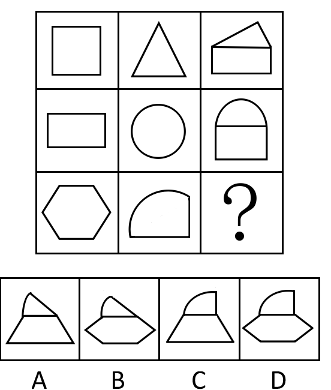

A. A

B. B

C. C

D. D

第 56 题 · 答案与解析

**参考答案（粉笔题库参考内容）**

A

**解析**

组成元素相似，考虑元素规律。观察已知图形可发现，九宫图中，以行为单位，每一行的第一个图形均分成两部分，第二个图形均分成两部分，各自取一半组合成第三个图形（如下图所示）。

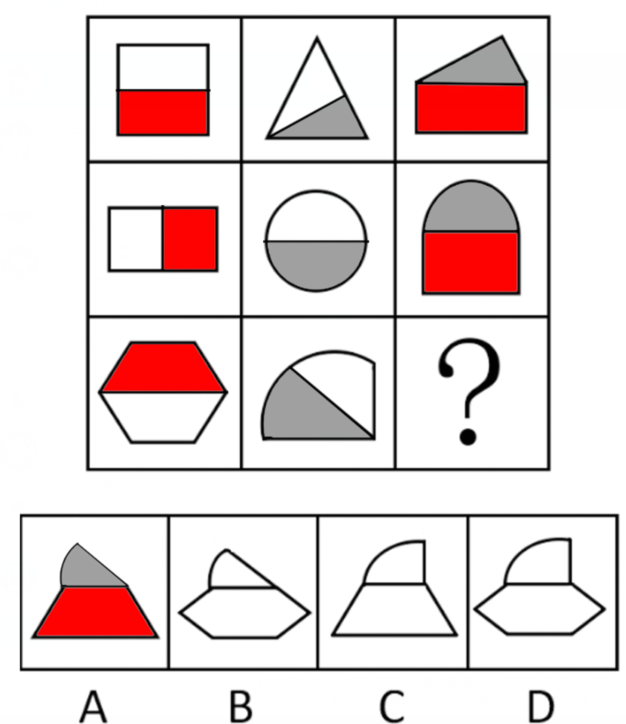

四个选项中，只有A项符合此规律。

故正确答案为A。

**考点**：样式规律-加减同异

**来源**：2010年吉林省公务员录用考试《行测》题第56题

### 第 57 题

从所给四个选项中，选择最合适的一个填入问号处，使之呈现一定的规律性：

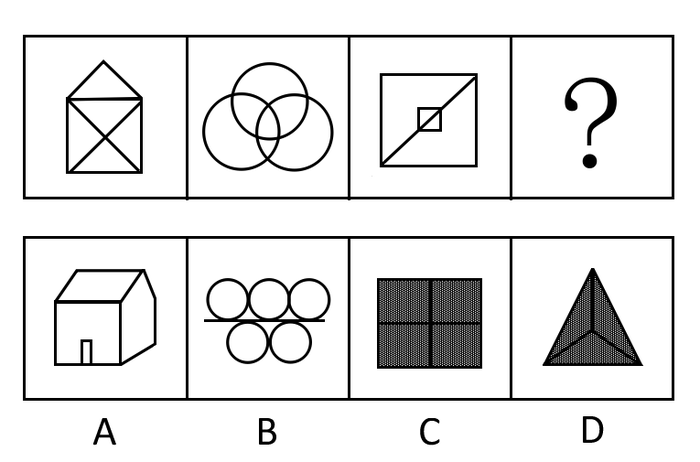

A. A

B. B

C. C

D. D

第 57 题 · 答案与解析

**参考答案（粉笔题库参考内容）**

B

**解析**

图形元素组成不相同不相似，无明显属性规律，考虑数量规律。观察发现题干图1为田字变形图，图2为多圆相交，考虑笔画数。题干图形均为一笔画图形，只有B项符合规律。

故正确答案为B。

**考点**：数量规律-线

**来源**：2010年吉林省公务员录用考试《行测》题第57题

### 第 58 题

从所给四个选项中，选择最合适的一个填入问号处，使之呈现一定的规律性：

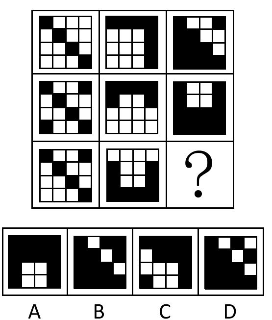

A. A

B. B

C. C

D. D

第 58 题 · 答案与解析

**参考答案（粉笔题库参考内容）**

B

**解析**

元素组成相同，数量不同，考数数。

九宫图中，以行为单位，第一行的三个图形中，加阴影的方块数目分别为4个、7个、11个，第二行的三个图形中，加阴影的方块数量分别为6个，6个，12个。观察加阴影方块数的数量，可发现，4＋7＝11，6＋6＝12，每一行第三个图形加阴影的方块数等于前两个图形加阴影方块数的和。依此规律，第三行的前两个图形，加阴影的方块数目分别为5个、8个，那第三个图形加阴影的方块数目应该为5＋8＝13个。四个选项中，A项加阴影的方块数有12个，B项有13个，C项有10个，D项有12个，只有B项符合规律。

故正确答案为B。

**考点**：数量规律-素

**来源**：2010年吉林省公务员录用考试《行测》题第58题

### 第 59 题

从所给四个选项中，选择最合适的一个填入问号处，使之呈现一定的规律性：

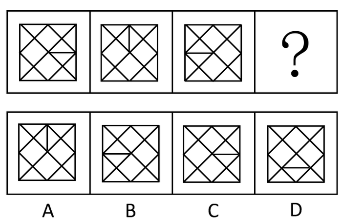

A. A

B. B

C. C

D. D

第 59 题 · 答案与解析

**参考答案（粉笔题库参考内容）**

A

**解析**

元素组成相同，位置不同，考虑位置规律。

观察已知图形，从图1到图3均为逆时针旋转90°，？处继续旋转后小竖线应指向下，然而并没有这样的选项。继续观察，发现图1和图3为竖轴对称。依此规律，图2和图4也应竖轴对称，观察图形中小横线的位置（如下图所示）

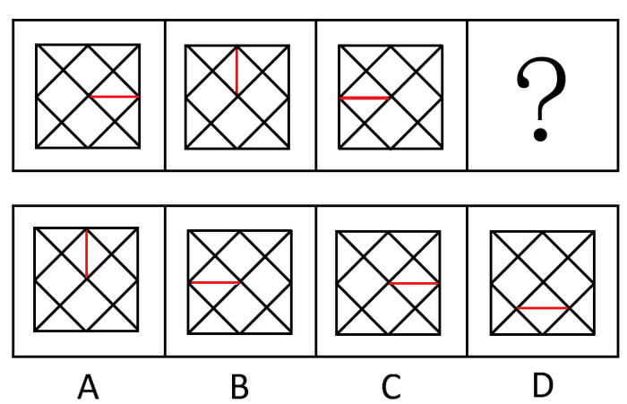

四个选项中，能和第二个图形呈竖轴对称的，只有A项。

故正确答案为A。

**考点**：属性规律-对称性

**来源**：2010年吉林省公务员录用考试《行测》题第59题

### 第 60 题

从所给四个选项中，选择最合适的一个填入问号处，使之呈现一定的规律性：

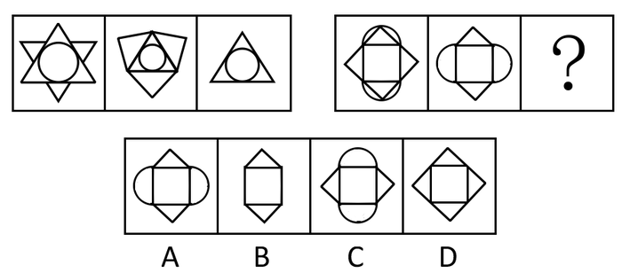

A. A

B. B

C. C

D. D

第 60 题 · 答案与解析

**参考答案（粉笔题库参考内容）**

B

**解析**

组成元素相似，考元素运算-求同。

左侧的三个图形中，第三个图形是第一个图形和第二个图形的相同部分。依此规律，右侧的未知图形应该是第一个图形和第二个图形的相同部分，即选项B的图形。

故正确答案为B。

**考点**：样式规律-加减同异

**来源**：2010年吉林省公务员录用考试《行测》题第60题

### 第 61 题

青霉素：细菌

A. 伪劣产品：信誉

B. 维生素：营养

C. 国策：人口

D. 经济措施：危机

第 61 题 · 答案与解析

**参考答案（粉笔题库参考内容）**

D

**解析**

第一步：判断题干词语间逻辑关系。

青霉素主要作用于细菌，起到杀菌的作用。题干两词前一词作用于后一词的对应关系，且后一词是有害的。

第二步：判断选项词语间逻辑关系。

A项：伪劣产品会影响信誉，两词也是对应关系，但信誉并非不好的需要解决的现象，与题干逻辑关系不一致，排除；

B项：维生素是有营养的，两词构成属性关系，与题干逻辑关系不一致，排除；

C项：制定国策解决人口问题，两词也是前一词作用于后一词的对应关系，但人口本身并不能说明有害或无害，与题干逻辑关系不一致，排除；

D项：经济措施可以对抗危机，危机是有害的，需要消除的现象，与题干逻辑关系一致，当选。

故正确答案为D。

**考点**：逻辑关系-对应关系

**来源**：2010年吉林省公务员录用考试《行测》题第61题

### 第 62 题

油彩：画布

A. 墨汁：宣纸

B. 粉笔：黑板

C. 铅笔：白纸

D. 油漆：墙壁

第 62 题 · 答案与解析

**参考答案（粉笔题库参考内容）**

A

**解析**

第一步：判断题干词语间逻辑关系。

油彩可涂在画布上，且涂上之后，油彩会渗入画布中。

第二步：判断选项词语间逻辑关系。

A项：墨汁可涂在宣纸上，且涂上之后，墨汁也会渗入到宣纸中，与题干逻辑关系一致，当选；

B项：粉笔可在黑板上写字，但前者是附在后者的表面上，没有渗入后者中，与题干逻辑关系不一致，排除；

C项：铅笔可在白纸上写字，但前者是附在后者的表面上，没有渗入后者中，与题干逻辑关系不一致，排除；

D项：油漆可涂在墙壁上，但前者是附在后者的表面上，没有渗入后者中，与题干逻辑关系不一致，排除。

故正确答案为A。

**考点**：逻辑关系-对应关系

**来源**：2010年吉林省公务员录用考试《行测》题第62题

### 第 63 题

窗户：玻璃

A. 衣服：纽扣

B. 盆架：脸盆

C. 戒指：宝石

D. 照片：相册

第 63 题 · 答案与解析

**参考答案（粉笔题库参考内容）**

C

**解析**

第一步：判断题干词语间逻辑关系。

玻璃镶嵌在窗户中，为窗户的组成部分，而且是固定内嵌于窗户中。

第二步：判断选项词语间逻辑关系。

A项：纽扣缝在衣服上，为衣服的组成部分，但纽扣是缝在衣服表面的，与题干逻辑关系不一致，排除；

B项：脸盆可以放在盆架上，但脸盆不是脸架的组成部分，与题干逻辑关系不一致，排除；

C项：宝石镶嵌在戒指中，为戒指的组成部分，而且是固定内嵌在戒指中，与题干逻辑关系一致，当选；

D项：照片放在相册里，为相册的组成部分，照片可以随时从相册取出来，非固定，与题干逻辑关系不一致，排除。

故正确答案为C。

**考点**：逻辑关系-包容关系

**来源**：2010年吉林省公务员录用考试《行测》题第63题

### 第 64 题

电话：会面

A. 微波炉：加热

B. 打字机：手写

C. 电视机：娱乐

D. 打印机：绘画

第 64 题 · 答案与解析

**参考答案（粉笔题库参考内容）**

B

**解析**

第一步：判断题干词语间逻辑关系。

电话和会面，都能达到沟通交流的目的。

第二步：判断选项词语间逻辑关系。

A项：微波炉可以用来加热，二者为功能对应关系，与题干逻辑关系不一致，排除；

B项：打字机和手写，都能达到记录信息的目的，与题干逻辑关系一致，当选；

C项：电视机可用来娱乐，二者为功能对应关系，与题干逻辑关系不一致，排除；

D项：打印机和绘画之间无明显逻辑关系，与题干逻辑关系不一致，排除。

故正确答案为B。

**考点**：逻辑关系-对应关系

**来源**：2010年吉林省公务员录用考试《行测》题第64题

### 第 65 题

西施：东施

A. 鸟：飞机

B. 正版：盗版

C. 碑刻：拓片

D. 明治维新：戊戌变法

第 65 题 · 答案与解析

**参考答案（粉笔题库参考内容）**

B

**解析**

第一步：判断题干词语间逻辑关系。

东施模仿西施，且是简单、拙劣地模仿。

第二步：判断选项词语间逻辑关系。

A项，飞机最初是模仿鸟设计出来的，但这种模仿建立在相关科学原理和技术上，不是简单、拙劣地模仿；

B项，盗版模仿正版，且是简单、拙劣地模仿，和题干逻辑相符；

C项，拓片可将碑刻上的文字或图案清晰地拷贝出来，但拓片是一项技艺，不是简单地模仿；

D项，中国的戊戌变法只是借鉴了日本明治维新运动的经验，不是一种简单的模仿，不符合题干逻辑。

故正确答案为B。

**考点**：逻辑关系-对应关系

**来源**：2010年吉林省公务员录用考试《行测》题第65题

### 第 66 题

机关工作人员在涉外交往中应遵守一些社交礼仪。其中在国际交往中有主次先后排列的，应遵循的原则和礼俗是：

A. 以右为尊，男士优先

B. 以左为尊，女士优先

C. 以右为尊，女士优先

D. 以左为尊，年长者优先

第 66 题 · 答案与解析

**参考答案（粉笔题库参考内容）**

C

**解析**

“女士优先”是国际社会公认的一条重要的礼仪原则，也是国际公认的“第一礼俗”，主要适用于成年的异性进行社交活动之时。要注意的是，“女士优先”主要适用于社交场合，在公务场合，人们强调的是“男女平等”或“忽略性别”，因而是不太讲究“女士优先”的。至于左右顺序，在各种类型的国际交往中，大到政治磋商、商务往来、文化交流，小到私人接触、社交应酬，但凡有必要确定并排列具体位置的主次尊卑，“以右为尊”都是普遍适用的。

故正确答案为C。

**考点**：文化常识

**来源**：2010年吉林省公务员录用考试《行测》题第66题

### 第 67 题

当潮湿的气团前进时，遇到高山阻挡，气流被迫缓慢上升，引起绝热降温，发生凝结，这样形成的降雨，称为：

A. 对流雨

B. 地形雨

C. 气旋雨

D. 台风雨

第 67 题 · 答案与解析

**参考答案（粉笔题库参考内容）**

B

**解析**

题干中的“遇到高山阻挡”，说明这样形成的降雨与高山有关，高山属于地形，因此这种降雨属于地形雨。

故正确答案为B。

**考点**：其他

**来源**：2010年吉林省公务员录用考试《行测》题第67题

### 第 68 题

绿色食品是指经专门机构认定，许可使用绿色食品标志的无污染的安全、优质、营养食品。绿色食品标志是由中国绿色食品发展中心在国家工商行政管理总局正式注册的质量证明商标。绿色食品标志由三部分组成，即上方的太阳、下方的叶片和中心的蓓蕾，标志为：

A. 正圆形，意为保护

B. 椭圆形，意为安全

C. 正方形，意为安全

D. 长方形，意为保护

第 68 题 · 答案与解析

**参考答案（粉笔题库参考内容）**

A

**解析**

绿色食品标志是由绿色食品发展中心在国家工商行政管理总局商标局正式注册的质量证明标志。它由三部分构成，即上方的太阳、下方的叶片和中心的蓓蕾，描绘了一幅明媚阳光照耀下的和谐生机，象征自然生态；颜色为绿色，象征着生命，农业、环保；图形为正圆形，意为保护。绿色食品标志表示，绿色食品是出自优良生态环境的安全无污染食品，并提醒人们必须保护环境，改善人与环境的关系，不断地创造自然界的和谐状态和蓬勃的生命力。

故正确答案为A。

**考点**：生活常识

**来源**：2010年吉林省公务员录用考试《行测》题第68题

### 第 69 题

绿色GDP指用以衡量各国扣除自然资产损失后新创造的真实国民财富的总量核算指标。简单地讲，就是从现行统计的GDP中，扣除由于环境污染、自然资源退化、教育低下、人口数量失控、管理不善等因素引起的经济损失成本，从而得出真实的国民财富总量。关于绿色GDP，下列说法不正确的是：

A. 能反映经济增长水平

B. 能够体现经济增长与自然保护和谐统一的程度

C. 能够显示人口增长与自然保护和谐统一的程度

D. 可以很好地表达和反映可持续发展的思想和要求

第 69 题 · 答案与解析

**参考答案（粉笔题库参考内容）**

C

**解析**

绿色GDP是指一个国家或地区在考虑了自然资源(主要包括土地、森林、矿产、水和海洋)与环境因素(包括生态环境、自然环境、人文环境)影响之后经济活动的最终成果，即将经济活动中所付出的资源耗减成本和环境降级成本从GDP中予以扣除。绿色GDP不仅能反映经济增长水平，而且能够体现经济增长与自然保护和谐统一的程度，可以很好地表达和反映可持续发展观的思想和要求。绿色GDP占GDP比重越高，表明国民经济增长的正面效应越高，反之就是负面效应高。

故正确答案为C。

**考点**：宏观经济与调控政策

**来源**：2010年吉林省公务员录用考试《行测》题第69题

### 第 70 题

突发公共事件按照性质、严重程度、可控性和影响范围等因素分为特别重大、重大、较大、一般四个等级；预警级别分为四级，依次：

A. 用红色、橙色、黄色、蓝色表示

B. 用黄色、蓝色、橙色、红色表示

C. 用黄色、橙色、蓝色、红色表示

D. 用蓝色、橙色、红色、黄色表示

第 70 题 · 答案与解析

**参考答案（粉笔题库参考内容）**

A

**解析**

突发公共事件预警级别按照严重性与紧急程序，分为特别严重（Ⅰ级）、严重（Ⅱ级）、较重（Ⅲ级）和一般（Ⅳ级）四个预警级别，并依次用红色、橙色、黄色和蓝色表示。

故正确答案为A。

**考点**：生活常识

**来源**：2010年吉林省公务员录用考试《行测》题第70题

### 第 71 题

有狼、鼬、鼠等动物的某一温带森林生态系统，造成其生态不平衡的原因可能是：

A. 老鼠大量繁殖

B. 鼬大量繁殖

C. 大量捕杀鼬

D. 大量捕杀狼

第 71 题 · 答案与解析

**参考答案（粉笔题库参考内容）**

D

**解析**

在森林中，狼位于食物链的顶层，其存在制约着森林食物链的平衡。狼的数量急剧下降会使大量食草动物失去天敌，数量骤增，进而给森林带来毁灭性的破坏，最终食草动物自身也会因为缺乏食物而绝迹。A、C两项老鼠和鼬的大量繁殖并不会造成生态失衡，因为它们的掠食者也会随之大量繁殖；随着老鼠和鼬数量的逐渐减少，其掠食者的数量也随之减少，并最终稳定在一定的数量上；C项，鼬并不是某种动物唯一的食物来源，并且森林中捕食鼠类的除了鼬，还有蛇、猫头鹰、狼等，因而大量捕杀鼬也不会使鼠类数量失控，自然也不会导致生态失衡。

故正确答案为D。

**考点**：生物常识

**来源**：2010年吉林省公务员录用考试《行测》题第71题

### 第 72 题

世界博览会是一项由主办国政府组织或政府委托有关部门举办的有较大影响和悠久历史的国际性博览活动。参展者向世界各国展示当代的文化、科技和产业上正面影响各种生活范畴的成果。它已经历了百余年的历史，逐渐成为荟萃科学技术与产业技术的展览会，成为产业人才培育和一般市民启蒙教育不可多得的场所。但它最初是：

A. 以纺织工业品展示为主

B. 以生活日用品展示为主

C. 以美术品和传统工艺品的展示为主

D. 以建筑成果展示为主

第 72 题 · 答案与解析

**参考答案（粉笔题库参考内容）**

C

**解析**

世博会是一项由主办国政府组织或政府委托有关部门举办的有较大影响和悠久历史的国际性博览活动。它已经历了百余年的历史，最初以美术品和传统工艺品的展示为主，后来逐渐变为荟萃科学技术与产业技术的展览会，成为培育产业人才和启蒙教育一般市民的不可多得的场所。

故正确答案为C。

**考点**：文化常识

**来源**：2010年吉林省公务员录用考试《行测》题第72题

### 第 73 题

人们在剧烈的体育运动后，会感到腰腿或全身肌肉酸痛，疲惫不堪，有的还感到饥渴难耐，这主要是因为体内的酸碱平衡不能正常维持，体液偏酸而使疲劳症状加重。此时应该多食用：

A. 鸡、鱼、肉

B. 牛奶、豆制品、蔬菜水果

C. 巧克力

D. 可乐

第 73 题 · 答案与解析

**参考答案（粉笔题库参考内容）**

B

**解析**

由“体内的酸碱平衡不能正常维持，体液偏酸而使疲劳症状加重”可知，要缓解疲劳，就应该多食用碱性食品，从而维持体内的酸碱平衡。一般说来，牛奶、蔬菜、水果、豆制品等是碱性食品，而肉类则属于酸性食品。可乐是碳酸饮料，当然也属于酸性。

故正确答案为B。

**考点**：生活常识

**来源**：2010年吉林省公务员录用考试《行测》题第73题

### 第 74 题

中国古代木构建筑的屋顶都有挑出的屋檐，它的目的是：

A. 突出房屋建筑的美感

B. 使屋顶线条成曲线，减轻沉重感

C. 有利于排雨

D. 保护檐口下的木构架及夯土墙少受雨淋

第 74 题 · 答案与解析

**参考答案（粉笔题库参考内容）**

D

**解析**

挑出的屋檐的主要目的是保护檐口下的木构架及夯土墙少受雨淋。

故正确答案为D。

**考点**：生活常识

**来源**：2010年吉林省公务员录用考试《行测》题第74题

### 第 75 题

“六亲不认”是形容一个人不顾亲情做事决绝，这里面的“六亲”是指：

A. 父、母、兄、弟、妻、子

B. 祖父、祖母、父、母、兄、弟

C. 父、母、兄、弟、子、孙

D. 父、母、兄、弟、姐、妹

第 75 题 · 答案与解析

**参考答案（粉笔题库参考内容）**

A

**解析**

“六亲”，现泛指亲属，在历史上则是有特定的内容。“六亲”一词，历代说法不一，流传最广的、最受后人赞同的是指父母、兄弟、妻子。出自《汉书·贾谊传》：“建久安之势，成长治之业，以承祖庙，以奉六亲，至孝也。”唐代颜师古注引应劭曰：“六亲，父母、兄弟、妻子也。”因为此说在血缘和婚姻关系中是最亲近的。

故正确答案为A。

**考点**：文化常识

**来源**：2010年吉林省公务员录用考试《行测》题第75题

### 第 76 题

清明既是二十四节气之一，又是一个历史悠久的传统节日。清明的前一天称寒食节｡两节恰逢阳春三月，春光明媚，桃红柳绿，一派欣欣向荣的气象。寒食节的设立是为了纪念：

A. 屈原

B. 伍子胥

C. 范蠡

D. 介子推

第 76 题 · 答案与解析

**参考答案（粉笔题库参考内容）**

D

**解析**

“子推言避世，山火遂焚身。四海同寒食，千秋为一人。深冤何用道，峻迹古无邻。魂魄山河气，风雷御宇神。光烟榆柳灭，怨曲龙蛇新。可叹文公霸，平生负此臣。”唐代诗人卢象这首《寒食》诗，所言即是寒食节的来历“子推绵山焚身”的故事。相传此俗源于纪念春秋时晋国介子推。介子推与晋公子重耳流亡列国19年，子推护驾跟随，曾割股肉供重耳充饥。重耳归国继位，即晋文公。封赏功臣之时，独忘介子推。子推不求利禄，与母归隐绵山。文公焚山以求之，子推坚决不出山，抱树而死。文公葬其尸于绵山，修祠立庙，并下令于子推焚死之日禁火寒食，以寄哀思，后相沿成俗。

故正确答案为D。

**考点**：文化常识

**来源**：2010年吉林省公务员录用考试《行测》题第76题

### 第 77 题

小王和某家公司签约时，约定的月薪为2500元，签订了三年的劳动合同。工作一年后，他发现其他同行业公司相应职位的员工工资比他高，因此他提出辞职，想找一份薪水更丰厚的工作。在三个月的时间里，他都没有找到合适的工作。在这种情况下，小王：

A. 属于自愿失业，不具备领取失业保险金的条件

B. 非因本人意愿而中断就业，具备领取失业保险金的条件

C. 已工作满一年，可以领取失业保险金

D. 虽属于自愿失业，但仍可领取失业保险金

第 77 题 · 答案与解析

**参考答案（粉笔题库参考内容）**

A

**解析**

《失业保险条例》第十四条规定，具备下列条件的失业人员，可以领取失业保险金：1、按照规定参加失业保险，所在单位和本人已按照规定履行缴费义务满1年的；2、非因本人意愿中断就业的；3、已办理失业登记，并有求职要求的。小王虽然工作已满1年，但是并不符合“非因本人意愿中断就业”，因此不具备领取失业保险金的条件。

故正确答案为A。

**本题相关知识点：**

劳动者非因本人意愿中断就业具体包括下列情形：

1、终止劳动合同的；

2、被用人单位解除劳动合同的；

3、因用人单位不按规定提供劳动条件，提出解除劳动合同的；

4、因用人单位以暴力、胁迫或者限制人身自由等手段强迫劳动，提出解除劳动合同的；

5、因用人单位克扣、拖欠工资，或者不按规定支付延长工作时间劳动报酬，提出解除劳动合同的；

6、因用人单位低于当地最低工资标准或者集体合同约定的工资标准支付工资，提出解除劳动合同的；

7、因用人单位扣押身份、资质、资历等证件，提出解除劳动合同的；

8、因用人单位未依法缴纳社会保险费，提出解除劳动合同的；

9、法律、法规另有规定的。

**考点**：劳动法和经济法

**来源**：2010年吉林省公务员录用考试《行测》题第77题

### 第 78 题

要制成松软酥香的丹麦面包。需往面粉中加入大量起酥油，这样才能形成面包里特殊的层状结构。而起酥油不光让身体发胖，还会影响女性荷尔蒙分泌。由于人体激素水平在一天中是不平衡的，因此吃丹麦面包最佳时间是：

A. 早上

B. 中午

C. 晚上

D. 午夜

第 78 题 · 答案与解析

**参考答案（粉笔题库参考内容）**

B

**解析**

由于人体激素水平在早上最敏感，因此欧洲医学专家建议，吃丹麦面包的最佳时间是中午，因为那时人的雌性激素水平相对稳定。

故正确答案为B。

**考点**：生物常识

**来源**：2010年吉林省公务员录用考试《行测》题第78题

### 第 79 题

运输危险品货物的列车发生泄漏、火灾、爆炸时，车上人员应：

A. 迅速向下风方向或高坡地段转移

B. 迅速向上风方向或低坡地段转移

C. 迅速向上风方向或高坡地段转移

D. 迅速向下风方向或低坡地段转移

第 79 题 · 答案与解析

**参考答案（粉笔题库参考内容）**

C

**解析**

运输危险品货物的列车发生泄漏、火灾、爆炸时，车上人员应迅速向上风方向或高坡地段转移。主要目的是为了使危害气体迅速散开，防止聚集产生的爆炸，中毒等。

故正确答案为C。

**考点**：生活常识

**来源**：2010年吉林省公务员录用考试《行测》题第79题

### 第 80 题

电梯作为一种垂直交通工具，一旦出现故障，可能会发生乘客被困、坠落等危险事故。电梯发生故障时，下列应急措施不正确的是：

A. 电梯突然停运时，不要试图扒门爬出，以防电梯突然开动

B. 如果电梯运行中发生火灾，应将电梯停在就近楼层，并迅速利用楼梯逃生

C. 电梯下降速度突然加快或失去控制时，乘客应两腿微弯，上身向前倾斜，以减少电梯坠落受到的冲击

D. 运行中的电梯进水，应将电梯开到底层，并通知维修人员

第 80 题 · 答案与解析

**参考答案（粉笔题库参考内容）**

D

**解析**

发生地震、火灾、电梯进水等紧急情况时，严禁使用电梯，应改用应急通道或楼梯。因此D项中，运行中的电梯进水，应该将电梯停在就近楼层，改走楼梯并尽快通知维修人员。

故正确答案为D。

**考点**：生活常识

**来源**：2010年吉林省公务员录用考试《行测》题第80题

### 第 81 题

改变农业以太阳光为直接能源，利用绿色植物通过光合作用生产人类食物、动物饲料的传统方式，应用高科技进行开发，依靠人工能源不受气象和季节的限制，可常年在工厂进行大规模生产，节土、节水、不污染环境，资源可循环利用的微生物工业型的农业叫做：

A. 绿色农业

B. 白色农业

C. 生态农业

D. 生物农业

第 81 题 · 答案与解析

**参考答案（粉笔题库参考内容）**

B

**解析**

白色农业是指微生物资源产业化的工业型新农业，包括高科技生物工程的发酵工程和酶工程。白色农业生产环境高度洁净，生产过程不存在污染，其产品安全、无毒副作用，加之人们在工厂车间穿戴白色工作服帽从事劳动生产，故形象化地称之为“白色农业”。

故正确答案为B。

**本题相关知识点：**

1、绿色农业是指以生产并加工销售绿色食品为轴心的农业生产经营方式。其中绿色食品是指遵循可持续发展的原则，按照特定方式进行生产，经专门机构认定的，允许使用绿色标志的无污染的安全、优质、营养类食品。

2、生态农业是指运用生态体系的生物共生和物质循环再生原理、系统工程方法和当代科技成果，根据当地资源条件，合理组合农、林、牧、渔，加工业等量比关系，实现经济、生态、社会三大效益统一的新型农业体系。

3、生物农业是利用自然条件，采用多种农作物轮作肥田、天然杀虫、生物多样化等科学方法种植农作物，不施化肥，不喷杀虫剂，生产出接近天然植物的农产品。

**考点**：其他

**来源**：2010年吉林省公务员录用考试《行测》题第81题

### 第 82 题

鳄鱼为什么流眼泪？这是因为鳄鱼体内长有特殊的排泄腺，其排出管正好分布在眼睛四周，从而排出体内多余的成分，鳄鱼所流的“眼泪”实际上是一种溶液。这种溶液是：

A. 水

B. 碘溶液

C. 钠溶液

D. 盐溶液

第 82 题 · 答案与解析

**参考答案（粉笔题库参考内容）**

D

**解析**

鳄鱼所流的“眼泪”实际上是一种盐溶液。由于它要排泄出体内多余的盐分，体内长有特殊的排泄腺，其排出管正好分布在眼睛四周。这说明，鳄鱼流眼泪是为了排泄体内过多的盐分。

故正确答案为D。

**考点**：生物常识

**来源**：2010年吉林省公务员录用考试《行测》题第82题

### 第 83 题

在现代市场竞争中，厂商总用各种手段把竞争对手的顾客争取过来，使其购买本企业的产品，这种做法是：

A. 市场渗透

B. 市场掠夺

C. 市场控制

D. 市场调节

第 83 题 · 答案与解析

**参考答案（粉笔题库参考内容）**

A

**解析**

进行市场渗透的主要方式是吸引现有产品的潜在顾客，以增加产品使用人的数量。一般来说，可从如下三方面考虑如何吸引现有产品的潜在顾客：①努力发掘潜在顾客（目标市场上那些尚未使用此类产品的顾客），或者在地域上进行扩展（如进行跨国经营），把产品介绍、推销给从未使用过企业产品的用户。②转变非使用者为本企业产品的使用者。③把竞争对手的顾客吸引过来，使之购买本企业产品。

故正确答案为A。

**考点**：市场经济

**来源**：2010年吉林省公务员录用考试《行测》题第83题

### 第 84 题

望向大海，很多时候我们会发现海水呈现蓝､绿色，这是因为：

A. 海水本身就是绿色和蓝色的

B. 只有绿光才能被海水吸收并反射

C. 只有蓝光才能被海水吸收并反射

D. 蓝光和绿光都不能被海水吸收

第 84 题 · 答案与解析

**参考答案（粉笔题库参考内容）**

D

**解析**

本题可采用排除法。

A项，水是无色透明的液体，海水本身并没有颜色，也是无色透明的，故排除；

B、C项都只能分别回答为何海水呈现绿色或蓝色，不符合题干中“海水呈现蓝、绿色”，也可以排除。

故正确答案为D。

本题相关知识点：

海水呈现蓝、绿色，是海水对光线的吸收、反射和散射的缘故。人眼能看见的七种可见光，其波长是不同的，它们被海水吸收、反射和散射程度也不相同。其中波长较长的红光、橙光、黄光，穿透能力较强，最容易被水分子吸引，射入海水后，随海洋深度的增加逐渐被吸收了。而波长较短的蓝光、紫光和部分绿光穿透能力弱，遇到海水容易发生反射和散射，这样海水便呈现蓝、绿色。紫光波长最短，最容易被反射和散射，但是海水却不会呈现出紫色，这是因为人眼对海水反射的紫色很不敏感，因此往往视而不见，相反地对蓝、绿光都比较敏感。这样，少量的蓝、绿光就会使海水中呈现湛蓝或碧绿的颜色。

**考点**：物理常识

**来源**：2010年吉林省公务员录用考试《行测》题第84题

### 第 85 题

在草原、森林、湿地、海洋和沙漠中，被列为地球三大生态系统的是：

A. 森林、海洋、湿地

B. 森林、沙漠、海洋

C. 森林、湿地、沙漠

D. 森林、草原、海洋

第 85 题 · 答案与解析

**参考答案（粉笔题库参考内容）**

A

**解析**

海洋、森林、湿地并称为地球三大生态系统。

故正确答案为A。

**本题相关知识点：**

1、海洋生态系统是海洋中由生物群落及其与环境相互作用所构成的自然系统，广义而言，全球海洋是一个大生态系统，其中包含许多不同等级的次级生态系统。每个次级生态系统占据一定的空间，由相互作用的生物和非生物，通过能量流和物质流形成具有一定结构和功能的统一体。

2、森林生态系统由森林中生物群落及其与环境相互作用所构成的自然系统，分为热带雨林、亚热带常绿阔叶林、温带落叶阔叶林及北方针叶林等生态系统。是陆地上生物总量最高的生态系统，对陆地生态环境有决定性的影响。

3、湿地是一种水文与生物群落类型十分复杂的生态系统，它发育于陆地生态系统与水体生态系统之间，是一种水陆过渡性的生态系统，它结合了水体与陆地生态系统的各自属性，但又明显不同于原来的生态系统，因此，湿地作为各种动植物栖息地的功能的研究，比一般水体或陆地生态系统复杂得多，是世界上最富生物多样性的生态景观，因而与森林、海洋并列为全球三大生态系统。

**考点**：其他

**来源**：2010年吉林省公务员录用考试《行测》题第85题

## 材料 2

一、根据下列图表回答第86-90题：

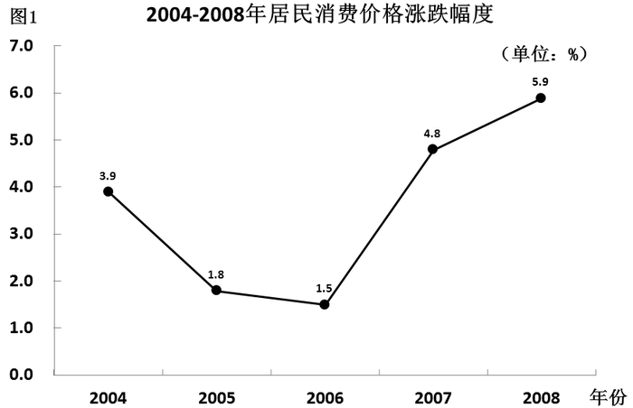

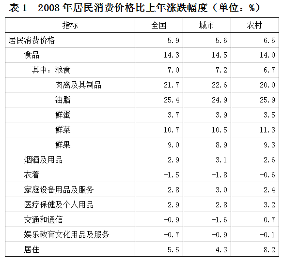

### 第 86 题

2005年居民消费价格涨跌幅度为：

A. 3.6%

B. 1.8%

C. 6.5%

D. 5.9%

第 86 题 · 答案与解析

**参考答案（粉笔题库参考内容）**

B

**解析**

定位图1可得：2005年居民消费价格涨跌幅度为1.8%。

故正确答案为B。

**考点**：直接找数、综合资料

**来源**：2010年吉林省公务员录用考试《行测》题第86题

### 第 87 题

下列说法正确的是：

A. 2008年农村居民消费价格涨跌幅度为5.6%

B. 2008年城市居民消费价格涨跌幅度为6.5%

C. 2008年居民消费价格涨跌幅度为14.0%

D. 2008年城市居民食品消费价格涨跌幅度为14.5%

第 87 题 · 答案与解析

**参考答案（粉笔题库参考内容）**

D

**解析**

A项：定位表1可得：2008年农村居民消费价格涨跌幅度为6.5%，错误；

B项：定位表1可得：2008年城市居民消费价格涨跌幅度为5.6%，错误；

C项：定位表1可得：2008年居民消费价格涨跌幅度为5.9%，错误；

D项：定位表1可得：2008年城市居民食品消费价格涨跌幅度为14.5%，正确。

故正确答案为D。

**考点**：综合分析、综合资料

**来源**：2010年吉林省公务员录用考试《行测》题第87题

### 第 88 题

2008年农村消费品价格涨幅第一和跌幅第一的类别分别是：

A. 粮食类和鲜果类

B. 粮食类和衣着类

C. 油脂类和衣着类

D. 油脂类和鲜果类

第 88 题 · 答案与解析

**参考答案（粉笔题库参考内容）**

C

**解析**

定位表1可得：2008年农村消费品涨幅最大的是油脂类（25.9%），跌幅最大的是衣着类（－0.6%）。

故正确答案为C。

**考点**：直接找数、综合资料

**来源**：2010年吉林省公务员录用考试《行测》题第88题

### 第 89 题

下列说法正确的是：

A. 2008年城市消费品价格涨幅前两位的类别分别是油脂类和肉禽及其制品类

B. 2008年城市和农村的交通和通信类消费品价格都上涨了

C. 2008年城市和农村的交通和通信类消费品价格都下跌了

D. 以上说法都不正确

第 89 题 · 答案与解析

**参考答案（粉笔题库参考内容）**

A

**解析**

A项：定位表1可得，2008年城市消费品价格涨幅最高的是油脂类（24.9%），其次是肉禽及其制品类（22.6%），正确；

B、C两项：定位表1可得，2008年城市交通和通信类消费品价格下跌了1.6%，农村交通和通信类消费品价格上涨了0.7%，有涨有跌，均错误；

D项：由A项正确可得，错误。

故正确答案为A。

**考点**：综合分析、综合资料

**来源**：2010年吉林省公务员录用考试《行测》题第89题

### 第 90 题

根据表1资料，下列图形正确的是：

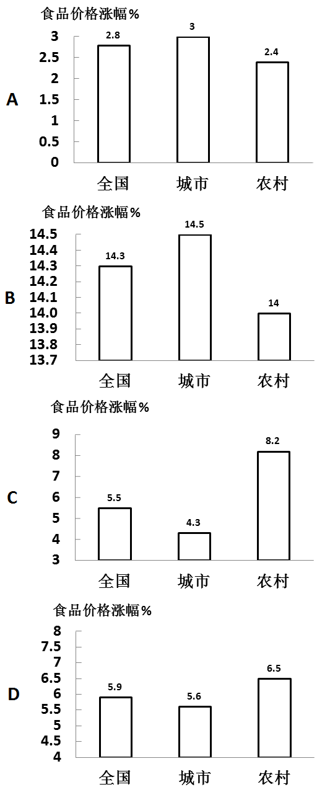

A. A

B. B

C. C

D. D

第 90 题 · 答案与解析

**参考答案（粉笔题库参考内容）**

B

**解析**

定位表1可得：2008年全国、城市、农村居民食品消费价格涨跌幅度分别为14.3%、14.5%、14.0%，对应B项。

故正确答案为B。

**考点**：直接找数、综合资料

**来源**：2010年吉林省公务员录用考试《行测》题第90题

## 材料 3

**二､根据下面资料完成各题。**

        2005年我国滨海旅游业继续保持强劲的增长态势，全年滨海旅游收入5052亿元;增加值2031亿元，比上年增长32.4%｡全国滨海国内旅游收入3887亿元，比上年增加1391亿元｡

        海洋交通运输业继续保持良好的发展态势，2005年营运收入达2940亿元，占全国主要海洋产业总产值的12.6%，增加值1145亿元，比上年增长5.0%，完成港口吞吐量49亿吨｡

        2005年我国海洋电力生产逐步形成规模，全年总产值1090亿元，占全国主要海洋产业总产值的6.4%，增加值606亿元，比上年增长6.7%｡

        2005年海洋造船完工量首次突破1000万综合吨，海洋船舶工业总产值817亿元，海洋船舶工业增加值176亿元，比上年增长11.8%｡

        2005年，海洋原油产量3000万吨，比上年增长11.5%;海洋天然气产量达6277721万立方米，比上年增长2.3%｡海洋油气业总产值739亿元，增加值467亿元，比上年增长17.9%｡

### 第 91 题

2004年，全年滨海国内旅游收入：

A. 1421亿元

B. 3367亿元

C. 3256亿元

D. 2496亿元

第 91 题 · 答案与解析

**参考答案（粉笔题库参考内容）**

D

**解析**

根据题干“2004年，全年滨海国内旅游收入”，结合材料时间为2005年，可判定本题为基期计算问题。定位文字材料第一段可得：2005年，全国滨海国内旅游收入3887亿元，比上年增加1391亿元｡根据公式：基期量=现期量-增长量，则2004年全年滨海国内旅游收入=3887-1391=2496亿元。

故正确答案为D。

**考点**：基期计算、文字资料

**来源**：2010年吉林省公务员录用考试《行测》题第91题

### 第 92 题

2004年，海洋交通运输业增加值约为：

A. 1255.66亿元

B. 1348.65亿元

C. 1090.48亿元

D. 1146.89亿元

第 92 题 · 答案与解析

**参考答案（粉笔题库参考内容）**

C

**解析**

根据题干“2004年······约为”，结合材料时间为2005年，可判定本题为基期计算问题。定位文字材料第二段可得：2005年，海洋交通运输业增加值1145亿元，比上年增长5.0%。根据公式：基期量，则2004年海洋交通运输业增加值亿元，只有C项满足。

故正确答案为C。

**考点**：基期计算、文字资料

**来源**：2010年吉林省公务员录用考试《行测》题第92题

### 第 93 题

2004年，我国海洋电力业增加值约为：

A. 687.28亿元

B. 567.95亿元

C. 427.45亿元

D. 656.55亿元

第 93 题 · 答案与解析

**参考答案（粉笔题库参考内容）**

B

**解析**

根据题干“2004年······约为”，结合材料时间为2005年，可判定本题为基期计算问题。定位文字材料第三段可得：2005年我国海洋电力增加值606亿元，比上年增长6.7%｡根据公式：基期量，则2004年我国海洋电力业增加值≈570亿元，最接近B项。

故正确答案为B。

**考点**：基期计算、文字资料

**来源**：2010年吉林省公务员录用考试《行测》题第93题

### 第 94 题

2004年，我国海洋原油产量约为：

A. 1256.54万吨

B. 2690.58万吨

C. 3691.68万吨

D. 4112.54万吨

第 94 题 · 答案与解析

**参考答案（粉笔题库参考内容）**

B

**解析**

根据题干“2004年······约为”，结合材料时间为2005年，可判定本题为基期计算问题。定位文字材料第五段可得：2005年，海洋原油产量3000万吨，比上年增长11.5%。根据公式：基期量，则2004年我国海洋原油产量万吨，与B项最接近。

故正确答案为B。

**考点**：基期计算、文字资料

**来源**：2010年吉林省公务员录用考试《行测》题第94题

### 第 95 题

下列说法正确的是：

A. 2005年全年滨海国内旅游收入占全年滨海旅游收入的比重超过60%

B. 2005年海洋船舶工业增加值是海洋电力增加值的二分之一

C. 2005年海洋交通运输业增加值是海洋电力业增加值的二倍

D. 以上选项都不正确

第 95 题 · 答案与解析

**参考答案（粉笔题库参考内容）**

A

**解析**

A项：定位文字材料第一段可得，2005年全年滨海旅游收入5052亿元，全国滨海国内旅游收入3887亿元。则2005年全年滨海国内旅游收入占全年滨海旅游收入的比重，正确；

B项：定位文字材料第三、四段可得，2005年海洋电力增加值606亿元，海洋船舶工业增加值176亿元。则2005年海洋船舶工业增加值是海洋电力增加值的倍，错误；

C项：定位文字材料第二、三段可得，2005年海洋交通运输业增加值1145亿元，海洋电力业增加值606亿元。则2005年海洋交通运输业增加值是海洋电力业增加值的倍，错误；

D项：由A项正确可得，错误。

故正确答案为A。

**考点**：文字资料、综合分析

**来源**：2010年吉林省公务员录用考试《行测》题第95题

## 材料 4

三、根据下面资料回答96——100题：

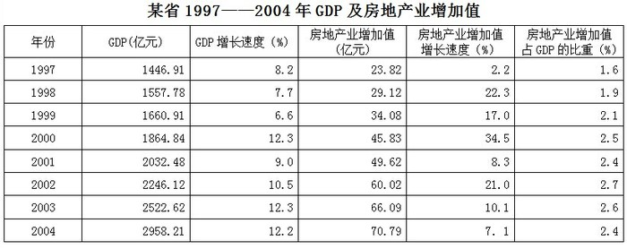

### 第 96 题

该省1997-2004年房地产业增加值增长速度高于GDP增长速度的年份共有：

A. 3年

B. 4年

C. 5年

D. 6年

第 96 题 · 答案与解析

**参考答案（粉笔题库参考内容）**

B

**解析**

定位表格材料可得：1997-2004年房地产业增加值增长速度高于GDP增长速度的年份有1998年、1999年、2000年、2002年，共4个年份。

故正确答案为B。

**考点**：直接找数、统计表

**来源**：2010年吉林省公务员录用考试《行测》题第96题

### 第 97 题

该省1997-2004年房地产业增加值与GDP总量的发展变化是：

A. 均为增加

B. 均为下降

C. 前者增加，后者下降

D. 前者下降，后者增加

第 97 题 · 答案与解析

**参考答案（粉笔题库参考内容）**

A

**解析**

定位表格材料，可得1997-2004年房地产业增加值与GDP总量，可知两者发展变化均为增加。

故正确答案为A。

**考点**：直接找数、统计表

**来源**：2010年吉林省公务员录用考试《行测》题第97题

### 第 98 题

该省1997-2004年房地产业增加值增长速度与GDP增长速度均最高的年份为：

A. 2004年

B. 2003年

C. 2000年

D. 1998年

第 98 题 · 答案与解析

**参考答案（粉笔题库参考内容）**

C

**解析**

定位表格材料可得：房地产业增加值增长速度最高的年份是2000年，为34.5%；GDP增长速度最高的年份是2000年和2003年，均为12.3%。故两者均最高的年份为2000年。

故正确答案为C。

**考点**：直接找数、统计表

**来源**：2010年吉林省公务员录用考试《行测》题第98题

### 第 99 题

按表中数据计算可知，1996年该省房地产业增加值为：

A. 20.3亿元

B. 21.3亿元

C. 22.3亿元

D. 23.3亿元

第 99 题 · 答案与解析

**参考答案（粉笔题库参考内容）**

D

**解析**

根据题干“1996年······为”，结合材料最初时间为1997年，可判定本题为基期计算问题。定位表格材料可得：1997年该省房地产业增加值为23.82亿元，增长速度为2.2%。根据公式：基期量，则1996年房地产业增加值为亿元，与D项最接近。

故正确答案为D。

**考点**：基期计算、统计表

**来源**：2010年吉林省公务员录用考试《行测》题第99题

### 第 100 题

按表中数据计算可知，2004年该省GDP总量比1997年增长：

A. 204.45%

B. 210.45%

C. 104.45%

D. 110.45%

第 100 题 · 答案与解析

**参考答案（粉笔题库参考内容）**

C

**解析**

根据题干“2004年······比1997年增长”，结合选项为百分数，可判定本题为一般增长率问题。定位表格材料可得：1997年该省GDP总量为1446.91亿元，2004年GDP总量为2958.21亿元。根据公式：增长率，则2004年该省GDP总量比1997年增长≈104%，与C项最接近。

故正确答案为C。

**考点**：一般增长率、统计表

**来源**：2010年吉林省公务员录用考试《行测》题第100题

