# 2011年吉林省公务员录用考试《行测》题

<!-- gwy:overview:start -->
> **吉林 · 2011 · 行测 · 统考** ｜ 105 题 · 图片 36 处 · 答案随题折叠

| 题型模块 | 题量 | 题号 |
| --- | ---: | ---: |
| 数量关系 | 10 | 1–10 |
| 言语理解与表达 | 30 | 11–40 |
| 判断推理 | 30 | 41–70 |
| 常识判断 | 20 | 71–90 |
| 资料分析 | 15 | 91–105 |
| **合计** | **105** | |

导航：[题型与作答说明](#题型与作答说明) · [题目](#题目) · [材料 1](#材料-1)
<!-- gwy:overview:end -->

> 候选采集稿。参考答案及解析来自粉笔页面，不代表官方答案或真实高分答卷；来源使用许可与原卷对应关系仍需人工核实。

## 题型与作答说明

数量关系

（10题）

本部分包括数字推理与数学运算两种类型的试题。

言语理解与表达

（30题）

根据题目要求，在每个选项中选出一个正确答案。

判断推理

（30题）

本部分包括定义判断、逻辑判断与图形推理三种类型的题目。

常识判断

（20题）

根据题目要求，在四个选项中选出一个最恰当的答案。

资料分析

（15题）

针对下列给定资料回答问题，共15题。你应根据资料提供的信息进行分析、比较、计算、处理。

## 题目

### 第 1 题

1，2，5，3，4，19，5，6，（　　）

A. 61

B. 51

C. 41

D. 31

第 1 题 · 答案与解析

**参考答案（粉笔题库参考内容）**

C

**解析**

数列较长，考虑多重数列，根据数列大小变化规律，3个数字为一组，分别为\[1，2，5\]\[3，4，19\]\[5，6，(41)\]，每组规律分别为：、、。

故正确答案为C。

### 第 2 题

2，3，6，11，（　　）

A. 15

B. 18

C. 17

D. 16

第 2 题 · 答案与解析

**参考答案（粉笔题库参考内容）**

B

**解析**

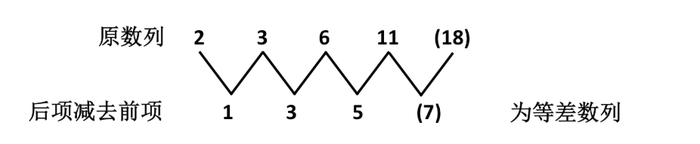

因此正确答案为B。

### 第 3 题

8，2，-2，-4，-4，（　　）

A. \-3

B. 2

C. 3

D. \-2

第 3 题 · 答案与解析

**参考答案（粉笔题库参考内容）**

D

**解析**

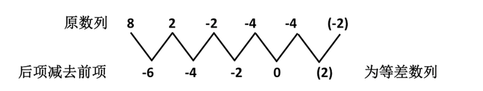

往上递推，易知空缺项为-2。

故正确答案为D。

### 第 4 题

21，26，23，24，25，22，27，（　　）

A. 28

B. 29

C. 20

D. 30

第 4 题 · 答案与解析

**参考答案（粉笔题库参考内容）**

C

**解析**

原数列为交叉数列：

奇数项：21、23、25、27为等差数列；

偶数项：26、24、22、(20)为等差数列。

故空缺项为20。

故正确答案为C。

### 第 5 题

1，5，20，60，（　　）

A. 80

B. 100

C. 160

D. 120

第 5 题 · 答案与解析

**参考答案（粉笔题库参考内容）**

D

**解析**

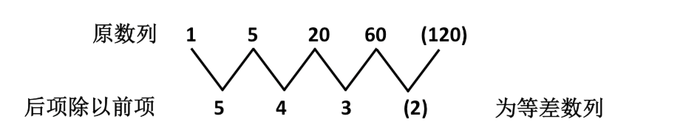

往上递推易知空缺项为120。

故正确答案为D。

### 第 6 题

大小两个数的和是50.886，较大数的小数点向左移动一位就等于较小的数，则较大的数为：

A. 46.25

B. 46.26

C. 46.15

D. 40.26

第 6 题 · 答案与解析

**参考答案（粉笔题库参考内容）**

B

**解析**

由题意，较大数的小数点向左移动一位就等于较小的数，即较大的数是较小的数的10倍，于是较小数为50.886÷(10＋1)＝4.626，较大数为46.26。

故正确答案为B。

### 第 7 题

从1、2、3、4中任取3个数组成没有重复的三位数的偶数，取法种数为：

A. 13

B. 12

C. 10

D. 11

第 7 题 · 答案与解析

**参考答案（粉笔题库参考内容）**

B

**解析**

若要求组成没有重复数字的三位数的偶数，个位数只能为2或4，方法数为2；

在剩余的3个中，任取2个，构成前两位，方法数为；

根据乘法原理可得，取法种数为。

故正确答案为B。

### 第 8 题

一个质数的3倍与另一个质数的2倍之和等于20，那么这两个质数的和是：

A. 9

B. 8

C. 7

D. 6

第 8 题 · 答案与解析

**参考答案（粉笔题库参考内容）**

A

**解析**

设两个质数分别为a、b，因2b为偶数，而3a＝20－2b，所以3a＝20－2b也为偶数。在所有质数中，与3相乘的积为偶数的只有2，所以a=2，，于是a＋b＝9。

故正确答案为A。

### 第 9 题

甲、乙两种商品成本共2000元，商品甲按50%的利润定价，商品乙按40%的利润定价，后来打折销售，两种商品都按定价的80%出售，结果仍可得利润300元，甲种商品的成本是：

A. 700元

B. 750元

C. 800元

D. 850元

第 9 题 · 答案与解析

**参考答案（粉笔题库参考内容）**

B

**解析**

设甲种商品的成本为a元，则乙种商品的成本为(2000－a)元，可得：，解得a=750元。

故正确答案为B。

### 第 10 题

某商店以每件6元的进价买回一批商品，售价为每件8.4元，当卖了这批商品的3/4时，不仅收回了购买这批商品所付的款项，而且还获得利润90元，这批商品有：

A. 500件

B. 400件

C. 300件

D. 600件

第 10 题 · 答案与解析

**参考答案（粉笔题库参考内容）**

C

**解析**

设这批商品共有a件，根据题意有：，解得a＝300。

故正确答案为C。

### 第 11 题

民意“被满意”，民众“不满意”，甚至“很生气”。尊重民意、顺应民意、采纳民意是服务型政府的执政要义，是政治文明建设的题中之意。民意的力量一方面取决于民意征集占全民的比例，即广泛性；另一方面也体现在政府对民意的尊重程度上。保障民众的知情权、参与权、表达权和监督权，就是要随时随地与民众进行多种途径的沟通、交流。民意内涵民智，民意关乎民生。我们不仅要从民意中看到民众欢迎什么、反对什么，为科学决策提供依据，而且要充分发挥民智的作用。尊重民意、吸纳民智是科学决策的重要保证，也是衡量政府亲民为民的重要标志。

阅读上面文字，选出最符合文意的一项：

A. 让民众“不满意”“很生气”的政府就不是服务型政府

B. 知情权是监督权的前提，参与权是表达权的前提

C. 尊重民意、吸纳民智是科学决策的决定性因素

D. 民意力量的发挥取决于民意征集的广度和尊重民意的程度

第 11 题 · 答案与解析

**参考答案（粉笔题库参考内容）**

D

**解析**

根据材料中“民意的力量一方面取决于民意征集占全民的比例，即广泛性；另一方面也体现在政府对民意的尊重程度上”可知D选项正确。

材料中说“尊重民意、顺应民意、采纳民意是服务型政府的执政要义”，所以并不能说让民众“不满意”“很生气”的政府就不是服务型政府，而只是表明这些服务型政府做得还不够好，所以A项推断错误；B项的表述没有依据，材料并没有提到知情、参与、表达、监督权的关系；C项“决定性因素”与材料不符，材料提到的是“重要保证”。

故正确答案为D。

### 第 12 题

日前，一位领导同志在湖北视察时指出，要搞清楚“为了谁、依靠谁、我是谁”的问题。湖北就此开展了一次“三谁”问题的讨论和教育活动。群众路线，是党的“三大法宝”之一。一切为了群众，一切依靠群众；从群众中来，到群众中去……“为了谁，依靠谁”，大家都耳熟能详。这里想特别强调的是，要着重弄清楚“我是谁”。因为，这个问题，对有些人来说，已经有点弄不清了。

根据文意，选出不能说明“我是谁”的一项：

A. 毛泽东同志说过，群众是真正的英雄，而我们自己则往往是幼稚可笑的

B. “我是中国人民的儿子”。小平同志饱含深情的话告诉我们：人民才是父母

C. “我是一个兵，来自老百姓”说清楚了一个简单的道理：“我”只是一个穿上了军装的老百姓

D. “我”就是某某长、某某总，站得总比别人高，看得自然也比别人远

第 12 题 · 答案与解析

**参考答案（粉笔题库参考内容）**

D

**解析**

根据材料，群众路线是党的“三大法宝”之一。一切为了群众，一切依靠群众，从群众中来，到群众中去是党的群众路线的核心内容，“三谁”问题的讨论和教育活动也应遵循群众路线。

D项中“我”就是某某长、某某总，是一种个人主义，不是群众路线，所以错误，当选。

A、B、C 三项都体现了群众路线，所以正确。

故正确答案为D。

### 第 13 题

“民众的幸福感只能是民众自己说了算，官员、学者、媒体说了都不算。”广西社科院研究员黄耀东表示，量化的幸福感指数只是衡量幸福感的一个方面或一种方法，不能完全代表民众的幸福感。目前，衡量幸福感的指标较片面，而且不同国家、不同学者选用的指标不一样，心理学家偏重心理因素，社会学家偏重社会因素，经济学家偏重经济因素，由于选择标准不同，所以无法测试出准确的幸福感。由美国芝加哥大学社会学教授奚恺元设计的幸福感指标，包括生活满意度、心态和情绪愉悦程度、和谐程度等三类主要指标，人情味、交通状况、医疗条件、教育质量、自然环境、房屋价格、物价水平等，成为衡量幸福感的重要指标。

阅读上面文字，关于“幸福感”的指标问题，下面说法恰当的一项是：

A. “民众的幸福感只能是民众自己说了算。”因此“幸福感”是无法测量的

B. 不同国家、不同学者选用的指标不一样，所以无法测试出准确的幸福感

C. 量化的指数只是衡量幸福感的一个方面或一种方法，不能代表民众的幸福感

D. 美国芝加哥大学社会学教授奚恺元设计的幸福感指标，成为衡量幸福感的重要指标

第 13 题 · 答案与解析

**参考答案（粉笔题库参考内容）**

B

**解析**

根据材料中“不同国家、不同学者选用的指标不一样……由于选择标准不同，所以无法测出准确的幸福感”可知B选项表述正确。

A项“幸福感无法测量”表述错误，材料提到的是无法测试出准确的幸福感，并非是无法测量；C项材料中说的是“不能完全代表民众的幸福感”而非“不能代表民众的幸福感”，所以C项错误；成为衡量幸福感的重要指标的是“人情味、交通状况、医疗条件”等，而不是奚恺元设计的幸福感指标，所以D项错误。

故正确答案为B。

### 第 14 题

公开公平公正应体现为制度安排，但领导干部是否出以公心，仍是关键所在。任何人看问题都有局限性，一人所见以为是，未必即是；一人所见以为非，未必真非，故当求公是公非。有公心，就应拒绝制度之外的“例外”。至少，这个“例外”应被多数人所认可，并有据可依。有公心，就不怕把所有应披露的信息高度透明地呈现给大家，绝不藏着掖着。对所有询问，给出合乎实际、合情合理的解释。有公心，就应该不折不扣地依规章、依程序办事，不以个人好恶改变规则，增减程序。是否出以公心，检验的标准不是表态，而是对规章制度的敬畏和坚守。

阅读上面文字，选出不属于“有公心”的一项：

A. 有公心，就不怕把信息高度透明地呈现给大家

B. 有公心，就应拒绝制度之外的“例外”

C. 有公心，就不会以个人好恶改变规则

D. 有公心，就会坚持对规章制度的敬畏和坚守

第 14 题 · 答案与解析

**参考答案（粉笔题库参考内容）**

A

**解析**

根据材料中“就不怕把所有应披露的信息高度透明地呈现”可知A项表述错误，把“应披露的信息”偷换成了“信息”，当选。

根据第三句可知B项正确；根据倒数第二句可知C项正确；根据最后一句可知D项正确。

故正确答案为A。

### 第 15 题

民主推荐、民主测评必须坚持，但在推进过程中也要注意解决简单以票取人、拉票行为蔓延和干部不敢坚持原则、做老好人等问题。一方面，要合理确定参加人员范围，本着增强代表性、知情度和关联度的原则，既要保证覆盖面，又要尽可能让更多的知情人参与。另一方面，要正确分析运用民主推荐、民主测评结果。既要看得票情况，又要对得票情况作具体分析，把得票情况同以往推荐测评、平时了解、年度考核和民意调查等情况结合起来，相互印证，综合分析，避免评价干部简单化。

根据文意，选出推断有误的一项是：

A. 民主推荐、民主测评必须坚持群众路线原则

B. 尽可能让更多的知情人参与是对群众知情权的尊重

C. 测评结果与平时了解和民意调查的结合，是加强群众监督的具体体现

D. 确定测评参加人员范围会损害群众的参与热情

第 15 题 · 答案与解析

**参考答案（粉笔题库参考内容）**

D

**解析**

根据材料中“要合理确定参加人员范围”，可知D选项推断错误，当选。

根据材料中“民主”“合理确定参加人员范围”“保证覆盖面”“让更多的知情人参与”可知民主推荐与测评坚持的是群众路线，也是对群众知情权的尊重，所以A、B两项推断正确；根据材料“把得票情况同以往推荐测评、平时了解、年度考核和民意调查等情况结合起来，相互印证，综合分析，避免评价干部简单化”可见这样是加强了群众的监督，所以C项推断正确。

故正确答案为D。

### 第 16 题

按照中央“创新体制、转换机制、面向市场、增强活力”的要求，推进经营性文化单位转企改制，增强国有文化单位的发展活力和市场竞争力，建立现代企业制度和现代产权制度，培育骨干文化企业，打造一批走向世界的、有竞争力的大型企业集团，鼓励民营文化创意企业快速发展，鼓励非公资本以多种形式进入文化创意产业领域，优化文化产业结构，推动一批企业上规模，上档次，抓效益，努力构建统一开放、竞争有序的现代文化市场体系，这是转变文化发展方式的现实途径。

根据文意，选出对“转变文化发展方式的现实途径”解说不恰当的一项：

A. 培育骨干文化企业，打造一批走向世界的、有竞争力的大型文化企业集团

B. 建立现代企业制度和现代产权制度，构建统一开放、竞争有序的现代文化市场体系

C. 推进经营性文化单位转企改制，增强国有文化事业单位的发展活力和市场竞争力

D. 鼓励民营文化创意企业快速发展，鼓励非公资本以多种形式进入文化创意产业领域

第 16 题 · 答案与解析

**参考答案（粉笔题库参考内容）**

A

**解析**

根据材料中“打造一批走向世界的、有竞争力的大型企业集团”可知A项中“大型文化企业集团”缩小范围，且根据文段可知，转变文化发展方式的现实途径是要进行体制改革，而A项与“体制改革”无关。

B、C、D三项在材料中都有原文体现。

本题是选非题，故正确答案为A。

### 第 17 题

最近，四川万源市把城镇职工养老保险的各个审批环节“全裸”，来自四面八方的说情风很快销声匿迹。事实上，公开作为一种价值理念，已然超越了政府信息公开“公开是常态，不公开是例外”的应用范畴，拓展了政府行政中对事关群众切身利益重要决策事项的公示要求，更适用于公共治理的诸多层面、环节和程序。凡关系群众切身利益的，关系公共利益的治理事项、程序等，公开都应当成为一种价值共识、一种制度设计、一种自觉选择。

依据文意，对“公开”的价值解说不恰当的一项是：

A. 公开这一价值理念，超越了政府信息公开“公开是常态，不公开是例外”的应用范畴

B. 关系群众切身利益和公共利益的治理事项、程序，都应当建立一种价值共识

C. 公开这一价值理念，适用于公共治理的诸多层面、环节和程序

D. 此次公开，拓展了政府行政中对事关群众切身利益的重要决策事项的公示要求

第 17 题 · 答案与解析

**参考答案（粉笔题库参考内容）**

D

**解析**

根据材料中“事实上，公开作为一种价值理念……扩展了政府行政中对事关群众切身利益重要决策事项的公示要求”而并不是D项所说的“此次公开”就拓展了……。

“此次公开”只是公开的一个具体事例，因此D项不恰当。

根据材料第二句话可知A、C两项正确；根据最后一句可知B项正确。

故正确答案为D。

### 第 18 题

居民健康问题已经成为国际社会与各国政府所关注的主要社会问题，实施基于居民健康的社会发展战略已成为推进社会和谐发展的重要措施，它不仅可以促进全社会的参与，统筹优先配置社会资源，而且可以协调政府和社会各部门之间的责任与发展目标，还可以规范居民个人的生活行为，充分体现了与其他社会公共政策的互补性。

阅读上面的文字，选出理解不准确的一项：

A. 居民健康这一社会问题已深为国际社会和各国政府所关注

B. 居民健康战略是对其他社会公共政策的有效补充

C. 实施居民健康战略可以规范居民生活行为，是推进社会和谐的重要发展战略

D. 实施居民健康战略可以促进社会资源的统筹配置和部门之间的责任协调

第 18 题 · 答案与解析

**参考答案（粉笔题库参考内容）**

B

**解析**

根据材料中“充分体现了与其他社会公共政策的互补性”一句可知B项表述不准确，“互补性”并不等同于“有效补充”，偷换概念，故B项当选。

根据“居民健康问题已经成为国际社会与各国政府所关注的主要社会问题”可知A项正确；C项分别对应文段“还可以规范居民个人的生活行为”和“实施基于居民健康的社会发展战略已成为推进社会和谐发展的重要措施”，表述准确；D项对应文段“统筹优先配置社会资源，而且可以协调政府和社会各部门之间的责任与发展目标”，表述准确。

故正确答案为B。

### 第 19 题

住房商品化就意味着将住房推向市场，主要依靠市场调节来解决住房问题，同时也就意味着要大大减轻政府的负担，减少政府对住宅业的干预。但政府绝不能从大包大揽一下子就变为撒手不管。在迈向住宅商品化的过程中，住房的社会福利成分日趋下降，经营利润会逐步成为人们追逐的目标，旧的住房分配制度中的不合理现象很可能会被一些新的不合理现象所取代。在经济动荡期间，新的不合理现象同样会威胁社会的稳定。在市场调节乏力时，政府的干预就显得格外重要。

这段话主要说明的观点是：

A. 住房商品化是必然的趋势

B. 住房商品化后也会有不合理现象存在

C. 住房商品化后，政府将不再直接干预住宅业

D. 政府在住房商品化过程中仍然要加强干预

第 19 题 · 答案与解析

**参考答案（粉笔题库参考内容）**

D

**解析**

材料首先提出住房商品化后会减少政府对住宅业的干预，然后用转折词“但”引出材料的重点，即政府绝不能撒手不管，在市场调节乏力时，更需要政府的干预。

所以材料主要说明的观点是政府在住房商品化过程中仍然要加强干预，D项正确。

A项“必然趋势”在材料中并没有提到；B项存在不合理现象是政府仍然要加强干预的原因，不是材料的重点；C项“政府将不再直接干预”明显与文意不符。

故正确答案为D。

### 第 20 题

低碳消费方式体现人们的一种心境、一种价值和一种行为，其实质是消费者对消费对象的选择、决策和实际购买与消费的活动。消费者在消费品的选择过程中按照自己的心态，根据一定时期、一定地区低碳消费的价值观，在决策过程中把低碳消费的指标作为重要的考量依据和影响因素，在实际购买活动中青睐低碳产品。低碳消费方式代表着人与自然、社会经济与生态环境的和谐共生式发展。低碳消费方式的实现程度与社会经济发展阶段、社会消费文化和习惯等诸多因素有关。因此，推行低碳消费方式是一个不断深化的过程。

根据文意，选出推断不正确的一项：

A. 推行低碳的消费方式是一个不断深化的过程，其根本原因在于低碳消费方式代表着人与自然、社会经济与生态环境的和谐共生式发展

B. 消费者对消费对象的选择、决策和实际购买与消费的活动会受到心境与价值观的影响

C. 消费者在消费中把低碳消费的指标作为重要的考量就会更多地青睐低碳产品

D. 低碳消费方式是以“低碳”为导向，着力解决人类生存环境危机的一种共生型消费方式

第 20 题 · 答案与解析

**参考答案（粉笔题库参考内容）**

A

**解析**

A项因果关系有误，材料中说推行低碳消费的原因在于“社会经济发展阶段、社会消费文化和习惯等诸多因素”而不是A项中表述的原因。所以A项错误，当选。

根据材料“低碳消费方式……其实质是……”可知B项推断正确；根据材料第二句可以推出C项正确；根据材料“低碳消费方式代表着人与自然、社会经济与生态环境的和谐共生式发展”可知低碳消费是着力解决人类生存环境危机的共生型消费方式，所以D项推断也正确。

故正确答案为A。

### 第 21 题

我们发展文化创意产业是发展模式的调整和增长方式的重要转变，是向内生性的经济增长方式的转变。根本是从GDP唯一模式向“以人为本”的科学发展转变。它更关注人、尊重人、提升人，有利于全面提高我国人民的生存质量和我国政府的服务质量，把经济社会发展切实转入以人为本全面协调可持续发展的轨道。以文化创意产业为切口推动新形态的文化经济发展，满足人民群众日益增长的精神文化需求，是转变文化发展方式的转折点。

依据文意，选出推断有误的一项：

A. 文化创意产业是一种内生性的经济增长方式

B. 发展文化创意产业是“以人为本”的科学发展

C. 推动新形态的文化经济发展，必然带来文化发展方式的转变

D. 发展文化创意产业有利于提高人民生存质量和政府的服务质量

第 21 题 · 答案与解析

**参考答案（粉笔题库参考内容）**

C

**解析**

C项中的“必然”过于绝对，题目中只说是“是转变文化发展方式的转折点”，应选C。

我们发展文化创意产业是发展模式的调整和增长方式的重要转变，是向内生性的经济增长方式的转变，所以A项正确；

文化创意产业根本是从GDP唯一模式向“以人为本”的科学发展转变，也就是说以“GDP唯一模式”的不是文化创意产业，只有转变为“以人为本”的科学发展，才是文化创意产业，即发展文化创意产业是“以人为本”的科学发展，所以B选项正确；根据材料第二句可知道D项正确。

故正确答案为C。

### 第 22 题

做好食品安全工作，必须坚持预防为主、关口前移。各地、各部门要继续加强食品安全风险监测，全面排查食品安全隐患。要及时发现和解决食品安全的苗头性、倾向性问题，切实把好食品安全的源头关、生产关、流通关和入口关，加强食品安全舆情管理，强化社会监督，健全长效机制，确保食品质量安全可靠，让广大人民群众吃得放心、吃得健康。

根据文意，指出不属于“预防措施”的一项是（    ）。

A. 加强食品安全舆情管理，强化社会监督，健全长效机制

B. 加强食品安全风险监测，全面排查食品安全隐患

C. 及时发现和解决食品安全的苗头性、倾向性问题

D. 把好食品安全的源头关、生产关、流通关和入口关

第 22 题 · 答案与解析

**参考答案（粉笔题库参考内容）**

A

**解析**

A项，“食品安全舆情管理”是对已发生的食品安全事件的报告，而不是“预防措施”，A项错误。

B项，文段第二句可以找到该表述，且“排除安全隐患”是预防措施，B项正确。

C、D项，文段第三句可以找到该两项的表述，且“及时发现和解决倾向性问题”和“把好源头”等都是预防措施，C、D项正确。

本题为选非题，故正确答案为A。

### 第 23 题

幸福是什么？马克思认为：“如果我们选择了最能为人类谋福利而劳动的职业，那么，重担就不能把我们压倒，因为它是为大家而献身；那么我们所感到的就不是可怜的、有限的、自私的乐趣，我们的幸福将属于千百万人，我们的事业将默默地，但是永恒发挥作用地存在下去，而面对我们的骨灰，高尚的人们将洒下热泪。”

依据马克思的幸福观，选出下面推论不正确的一项：

A. 最能为人类谋福利而劳动的职业能为我们带来真正的幸福

B. 个人那些可怜的、有限的、自私的乐趣远不是真正的幸福

C. 即使我们倒下了，高尚的人们会理解和继承我们的幸福观

D. 只有造福人类的事业才会默默地永恒发挥作用地存在下去

第 23 题 · 答案与解析

**参考答案（粉笔题库参考内容）**

D

**解析**

材料中说“如果我们选择了最能为人类谋福利而劳动的职业……我们的事业将默默地，但是永恒发挥作用地存在下去”，前者是后者的充分条件，而D项偷换成了必要条件，所以D项错误，当选。

根据材料“如果我们选择了最能为人类谋福利而劳动的职业”，“幸福将属于千百万人”，所以可以推出A项正确；

“可怜的、有限的、自私的乐趣”是与大家的幸福相对的，所以不是真正的幸福，所以B项的推断也正确；

根据材料“会永恒地存在下去”可知幸福观会一直被继承，所以C项推断也正确。

故正确答案为D。

### 第 24 题

在人类进步的道路上，发现与发明层出不穷，我们根据这些把人类的进程划分成先后相承的若干阶段。同时，各种社会制度，因为与人类的永恒需要密切相关，都是从少数原始思想的幼苗发展出来的，也同样成为我们划分阶段的依据。将这些制度、这些发明与发现综合起来，加以比较，就可以看出人类出于同源，同一发展阶段中人类有类似的需要，并且可以看出在相似的社会条件中人类有同样的心理作用。

这段话的意思是：

A. 人类出于同一祖先，因此有同样的需要和心理

B. 人类所有种族在相似的情况下，其需要和心理是相同或类似的

C. 同一个种族的成员在同样的发展阶段中有相同或类似的需要和心理

D. 在社会条件不尽相同的情况下，人类的心理作用仍然可以是一致的，而具体的需要在相同的条件下只能是近似的

第 24 题 · 答案与解析

**参考答案（粉笔题库参考内容）**

B

**解析**

据“同时”可知前两句是并列关系，讲的是发现和发明、社会制度是划分阶段的依据。最后一句讲的是把这些依据综合起来比较从而得出的结论。可以看出材料是“分总”结构，主旨在“总”的部分，即：出于同源，同一发展阶段中人类有类似的需要，在相似的社会条件中人类有同样的心理作用。

B项是对材料的概括，正确。

根据材料中“人类出于同源，同一发展阶段中人类有类似的需要”，可知A项“同样的需要和心理”表述错误，而且有限制条件“同一发展阶段”，所以A项错误；C项主体有误，材料说的是“人类”，即包括了人类的所有种族，并不仅限于同一种族；D项“只能是近似的”说法过于绝对，在材料中找不到依据。

故正确答案为B。

### 第 25 题

浩瀚无垠的海洋似乎是永远也不会干涸的。大海中的水是怎么来的呢？有学者认为，这些水是地球本身固有的。在地球形成之初，地球水就以蒸气的形式存在于炽热的地心中，或者以结构水、结晶水等形式存于地下岩石中。那时，地表的温度较高，大气层中以气体形式存在的水分也较多。地球在最初的5亿年，火山众多且活动频繁，大量的水蒸气及二氧化碳通过火山口喷发出来，冷却之后便渐渐形成河流、湖泊和海洋，即所谓的“初生水”。

下列对所谓的“初生水”表述准确的一项是：

A. 存在于炽热的地心中的水蒸气

B. 由火山喷发的水蒸气冷却后形成的水

C. 存于地下岩石中的结构水、结晶水

D. 大气层中以气体形式存在的水分

第 25 题 · 答案与解析

**参考答案（粉笔题库参考内容）**

B

**解析**

根据材料最后一句“地球在最初的5亿年，火山众多且活动频繁，大量的水蒸气及二氧化碳通过火山口喷发出来，冷却之后便渐渐形成河流、湖泊和海洋，即所谓的‘初生水’”可知，“初生水”就是火山喷发的水蒸气冷却后形成的水，所以B项正确。

A、C两项是初生水形成之前的存在状态；D项是大气层中存在的水分，都不能叫做“初生水”。

故正确答案为B。

### 第 26 题

与经济的影响相比，现在的中国在对外方面缺乏有力的文化表现。国务院新闻办公室原主任赵启正不久前说：“和中国对外贸易的出超相比，中国对外文化交流和传播存在严重的赤字。”他举例说，在图书出版方面，中国近年来图书版权贸易的逆差是1比10。2004年，从美国引进图书4068种，出口只有14种。从日本引进694种，出口22种。英国前首相撒切尔夫人最近也在一本书中说：“中国出口的是电视机，而不是思想观念。”

作者举撒切尔夫人的话是为了说明：

A. 中国对外方面的文化表现远远落后于经济方面的影响

B. 和中国对外贸易的出超相比，中国对外文化交流和传播存在严重的赤字

C. 中国的经济发展速度超过了中国的文化发展速度

D. 中国近年来在图书出版方面逆差严重

第 26 题 · 答案与解析

**参考答案（粉笔题库参考内容）**

A

**解析**

材料第一句提出“现在的中国在对外方面缺乏有力的文化表现”，然后用赵启正的话以及进口书多、出口书少的具体数字以及撒切尔夫人的话共同证明了这个观点：与中国对外贸易的出超相比，中国对外文化交流和传播存在严重的赤字。

材料是总分结构，主旨在“总”的部分，即对外文化方面的落后。A项是对材料的概括，所以正确。

B、D两项是材料中提出的现象，不是对内容的概括；C项“发展速度”在材料中没有提到。

故正确答案为A。

### 第 27 题

为积极应对气候变化，中国决定首先在广东、湖北、辽宁、陕西、云南5省和天津、重庆、杭州、厦门、深圳、贵阳、南昌、保定8市正式启动国家低碳省区和低碳城市试点工作。国家发展改革委18日在京召开会议，要求上述试点地区应加快形成以低碳排放为特征的产业体系和消费模式，努力建设成中国低碳发展的先行区和实验区，在应对气候变化方面发挥示范作用。发改委副主任解振华表示，低碳试点工作的开展，将能够帮助中国积累在不同地区推动低碳绿色发展的有益经验。

为上面新闻拟写一个标题，恰当的一项是：

A. 5省8市将形成以低碳排放为特征的产业体系和消费模式

B. 中国将在不同地区推广低碳绿色发展的有益经验

C. 国家发改委建议建设中国低碳发展的先行区和实验区

D. 5省8市率先启动低碳试点工作

第 27 题 · 答案与解析

**参考答案（粉笔题库参考内容）**

D

**解析**

材料第一句话点明了此新闻的主要内容，之后的具体内容是具体介绍其相关情况，所以第一句是主旨句，对此句的概括就可以做标题。

D项正是对主旨句的概括，当选。

新闻标题应当具有简洁有力而又概括全面的特点，A项啰嗦，且没有说出“试点”的意思；B、C两项都是相关的具体情况，是围绕D项观点的进一步补充说明，所以不选。

故正确答案为D。

### 第 28 题

随着宏观经济调控政策的逐步落实，我国经济增速会适度放缓，对石油、天然气资源的需求有所减少，供求矛盾在一定程度上将得到缓解。根据国际能源署的最新预测，今年我国原油产量将达1.75亿吨，比去年增长1%，而原油消费量将有可能突破3亿吨，比去年增长12%左右；进口将会超过1亿吨，有可能接近1.2亿吨，比去年增长30%左右。根据这段文字，我们可以知道（  ）。

A. 我国对进口原油的依赖加大

B. 我国对能源的需求会越来越少

C. 我国原油供给紧张

D. 我国原油消费主要靠进口

第 28 题 · 答案与解析

**参考答案（粉笔题库参考内容）**

A

**解析**

从“进口将会超过1亿吨，有可能接近1.2亿吨，比去年增长30%左右”可知我国对进口原油的依赖加大了，故A选项正确。

文段中说“我国对石油、天然气等资源的需求越来越少”，但不能得知我国对能源的需求越来越少，故B选项偷换概念，排除。

通过列举的数字可知我国原油的总供给量 ( 即原油产量与进口量之和 ) 与原油消费量都在3亿吨左右，不存在供给缺口。所以，我国的原油供给不算紧张，故C选项错误，排除。

从文中可知“我国原油产量将达1.75亿吨”，原油“进口将会超过1亿吨”，但可知我国原油消费主要还是依靠我们自产，并不是主要靠进口，故D选项错误，排除。

故正确答案为A。

### 第 29 题

全面提高高等教育质量，必须大力推进文化传承创新。高等教育是优秀文化传承的重要载体和思想文化创新的重要源泉，要积极发挥文化育人作用，加强社会主义核心价值体系建设，掌握前人积累的文化成果，扬弃旧义，创立新知，并传播到社会，延续至后代，不断培育崇尚科学、追求真理的思想观念，推动社会主义先进文化建设。要积极开展对外文化交流，增进对国外文化科技发展趋势和最新成果的了解，展示当代中国高等教育风采，增强我国文化软实力和中华文化国际影响力，努力为推动人类文明进步作出积极贡献。

依据文意推断，不恰当的一项是：

A. 文化的传承创新是高等学校的重要任务，意即扬弃旧义、创立新知

B. 文化创新意即加强建设社会主义核心价值体系和崇尚科学、追求真理的思想观念

C. 文化传承意即继承前人积累的优秀文化成果，并传播到社会，延续至后代

D. 开展对外文化交流、增强中华文化国际影响力，既是文化的传承，也是文化的创新

第 29 题 · 答案与解析

**参考答案（粉笔题库参考内容）**

B

**解析**

根据材料第二句可知，B项主体有误，应当是“文化传承和创新”而不仅仅是“文化创新”，当选。

根据材料第二句，可以推断A、C两项正确，根据材料最后一句可以推断D项正确。

故正确答案为B。

### 第 30 题

坚持文化与科技相结合，实现文化与科技的两轮驱动，不断增强文化产业自主创新能力，是文化发展方式转变中的一项重要内容。一方面，传统的文化产业类别正在进行数字化高新科技的改造，如数字电影、3D、数字电视、数字出版等；另一方面，以数字化等高新科技为基础的文化创意产业新业态正在迅速创造、诞生和风靡，如动漫、网游、数字音乐、网络视频、手机增值业务等。忽视数字高新科技的高端平台建设，缺乏高科技引导的创新创意，是我国文化创意产业发展的制约因素之一。

为什么要实现文化与科技的结合，选出解说不恰当的一项：

A. 忽视高新科技高端平台建设，缺乏高科技引导的创新创意，必将制约我国文化创意产业的发展

B. 要转变文化发展方式，就要不断增强自主创新能力，而文化与科技的结合正是创新的前提

C. 传统的文化产业正在进行数字化高新科技的改造，文化与科技的结合正应了这一现实要求

D. 以数字化等高新科技为基础的文化创意产业正在迅速崛起，因此文化与科技的结合是必然选择

第 30 题 · 答案与解析

**参考答案（粉笔题库参考内容）**

B

**解析**

B项中“文化与科技的结合正是创新的前提”在材料中找不到依据，所以错误，当选。

根据材料第二句可知A、D两项正确，根据最后一句可知C项正确。

本题为选非题，故正确答案为B。

### 第 31 题

专家与知识分子这两个概念并不重合。术业有专攻，固然是重要的，但未必就能从中形成一个知识分子的精神气质、天下关怀的人生态度和敢于怀疑、敢为天下先的批判精神。如果大学只能培养出与社会的多元职业结构相一致的各类专家，那么，我们民族的精神存在将不再可能在一个特定的人群中获得其自我意识和自我表达。一旦民族的所有成员都被充分融入到社会的利益体系中去，社会的良知就将失去其表达器官，民族的命运将被无声地操纵于资本逻辑之手。

依据文段的观点推断，正确的一项是：

A. 理想的大学教育应该塑造能够自我意识和自我表达我们民族精神的知识分子群体

B. 知识分子应当具有天下关怀的人生态度和敢于怀疑、敢为天下先的批判精神

C. 大学教育的目标在于培养具有民族精神的知识分子而非术业有专攻的专家

D. 目前大学教育的最大问题在于偏离社会良知，导致民族命运被操纵于资本逻辑之手

第 31 题 · 答案与解析

**参考答案（粉笔题库参考内容）**

B

**解析**

根据“但未必就能从中形成一个知识分子的精神气质、天下关怀的人生态度和敢于怀疑、敢为天下先的批判精神”可以推出B项是正确的。

材料的意思是大学不能只培养各类专家，还要培养知识分子，所以A、C两项的表述都不全面，有失偏颇；材料所述的是“一旦……民族命运将……”是假设未来会出现的状况，而不是已经存在的问题，D项表述错误。

故正确答案为B。

### 第 32 题

一个没有文化自觉的大学，在国际竞争中的实力，在根本上就是可疑的。如果我们更关注的只是大学的当下排名，却遗忘了在这种排名背后的真实基础，这将是令人感到悲哀的。任何一所大学，其国际排名的真实基础，都在于有一个卓然自立、具备文化创造力的知识分子群体的存在，这个群体能够为自己民族的文化发展、并仅仅因此也能为人类文明的进步作出贡献。

下列对文段的理解不正确的一项是：

A. 具有文化自觉的大学重视国际排名和在国际竞争中的实力

B. 具有文化自觉的大学重视对具有文化创造力的知识分子群体的培养

C. 知识分子群体对自己民族的文化贡献就是对人类文明的贡献

D. 具有国际竞争力的大学，要有一个卓然自立的知识分子群体的存在

第 32 题 · 答案与解析

**参考答案（粉笔题库参考内容）**

A

**解析**

分析材料可知，只重视国际排名，而不注意培养具有文化创造力的知识分子群体的大学是没有文化自觉的大学。所谓“具有文化自觉”，实际上就是对具有文化创造力的知识分子群体的培养，而不是“重视国际排名和在国际竞争中的实力”。

故A项理解有误而B项正确，所以A项当选。

根据材料“这个群体能够为自己民族的文化发展、并仅仅因此也能为人类文明的进步作出贡献”可以推断C项正确；根据材料“其国际排名的真实基础，都在于有一个卓然自立、具备文化创造力的知识分子群体的存在”可知D项正确。

故正确答案为A。

### 第 33 题

恩格斯对自然和精神的统一问题，有过一系列精辟的论述。他说：“我们一天天地学会更加正确地理解自然规律，学会认识我们对于自然界的惯常行程的干涉所引起的比较近或比较远的影响。”他还说：“自然界和精神是统一的。自然界不能是无理性的……而理性是不能和自然界矛盾的。”“思维规律和自然规律，只要它们被正确地认识，必然是互相一致的。”恩格斯的这些论述，深刻地揭示了自然和精神统一问题的丰富内涵。根据恩格斯的这些论述，考察中国古代的天人合一思想，不难看出，这种思想有着深刻的合理性。

下列对恩格斯有关论述的理解，错误的一项是：

A. 阐述了人类与自然界之间协调统一的问题

B. 提醒人们不要随意干涉自然界的惯常行程

C. 丰富了天人合一思想并指出了它的局限性

D. 认为思维规律和自然规律可以具有一致性

第 33 题 · 答案与解析

**参考答案（粉笔题库参考内容）**

C

**解析**

由材料中“根据恩格斯的这些论述，考察中国古代的天人合一思想，不难看出，这种思想有着深刻的合理性”这一句可以看出，作者在这里引述恩格斯的话并不是指出天人合一思想的局限性，而是强调它的“深刻的合理性”。

所以C项推断错误，当选。

由“自然界和精神是统一的。自然界不能是无理性的……而理性是不能和自然界矛盾的”，“精神”和“理性”都是人类独有的，因此“精神”和“理性”与自然界的协调统一就是人类与自然界之间协调统一，因此A项正确；

从“我们一天天地学会更加正确地理解自然规律，学会认识我们对于自然界的惯常行程的干涉所引起的比较近或比较远的影响”中可以看出，“比较近或比较远的影响”是负面的，因此B项正确；

由“思维规律和自然规律，只要它们被正确地认识，必然是互相一致的”可知，马克思主义哲学是可知论，它的认识对象就是思维规律和自然规律，由此可以推出“认为思维规律和自然规律可以具有一致性”，因此D项说法也正确。

本题为选非题，故正确答案为C。

### 第 34 题

设立最低工资的初衷是维护低收入的贫穷工人，但到头来这些人却找不到工作。有最低工资的规定，雇主当然是选聘生产力较高或较“可爱”的了。在美国，最低工资增加了种族歧视——支持这种结论的研究很多。

最低工资制度让一些人找不到工作的原因是：

A. 一些雇主有种族歧视

B. 工资太低不能维持生活

C. 没有了报酬上的就业优势

D. 生产力不能满足雇主的要求

第 34 题 · 答案与解析

**参考答案（粉笔题库参考内容）**

C

**解析**

本题属于细节判断题。

由文段中“雇主当然选聘生产力较高或较‘可爱’的了”一句可知，原来那些贫困工人由于收费低还能够被雇佣，但是在最低工资政策的保护下，雇主可以选择一些生产能力高的工人而只给他们最低的工资，那些低收入的贫困工人没有了报酬上的就业优势。

A项颠倒了因果关系，“最低工资增加了种族歧视”，而不是“最低工资制度让一些人找不到工作的原因是雇主有种族歧视”；B项只是一种现象，并非原因；D项理解错误，并不是他们的生产力不能满足雇主的需要，而是在同样的报酬下，雇主可以雇佣生产力水平更高的工人。

故正确答案为C。

### 第 35 题

在当今市场经济逐步成熟、文化教育普及程度大为提高、高等教育开始走向大众化的时代，人们的业余文化需求显著增长，久远的尘封旧事引起了人们日益浓厚的兴趣。这使通俗历史在当下有了“升温”的沃土，其“历史的惯性”开始充分显现出来。客观地说，对于广大民众而言，在古奥难懂的传统史著和“学术模式”的现代史书皆难“卒读”的情况下，通俗化的历史几乎成为他们“探寻过去”的唯一选择。

根据文意，对“通俗历史热”出现原因的表述，不正确的一项是：

A. 市场经济和文化教育的迅速发展促使人们对业余文化的需求显著增长

B. 人们对久远的尘封旧事兴趣日益浓厚，对历史的“求解”欲望趋于强烈

C. 业余文化生活的丰富，使人们依循“历史的惯性”产生了对通俗历史的兴趣

D. 古奥难懂的传统史著和“学术模式”的现代史书，让广大民众难以“卒读”

第 35 题 · 答案与解析

**参考答案（粉笔题库参考内容）**

C

**解析**

A项正确，根据“在当今市场经济逐步成熟、文化教育普及程度大为提高、高等教育开始走向大众化的时代，人们的业余文化需求显著增长，久远的尘封旧事引起了人们日益浓厚的兴趣”，所以A项正确；

B项正确，根据“久远的尘封旧事引起了人们日益浓厚的兴趣。这使通俗历史在当下有了‘升温’的沃土，其‘历史的惯性’开始充分显现出来”，所以B项正确；

C项错误，只有C项不能在文段中找到准确的位置，属于无中生有；

D项正确，根据“在古奥难懂的传统史著和‘学术模式’的现代史书皆难‘卒读’的情况下，通俗化的历史几乎成为他们‘探寻过去’的唯一选择”，所以D项正确。

故正确答案为C。

### 第 36 题

另一方面，人们越来越意识到，文化的发展不只是手段，更是目的。1995年世界文化与发展委员会“我们的创造的多样性”报告认为，脱离人或文化背景的发展是一种没有灵魂的发展，发展不仅包括得到商品和服务，而且还包括过上充实、满意、有价值和值得珍惜的共同生活，使整个人类的生活多姿多彩。因此，文化尽管有时候可以作为发展的手段，但它最终不能降到只作为经济发展的手段或仆从这样一个次要的地位。

文化不能降到仆从的地位，下面不能说明这一点的一项是：

A. 文化的发展不只是手段，更是目的

B. 脱离人或文化背景的发展是一种没有灵魂的发展

C. 为了使整个人类的生活多姿多彩，就要尽可能地把文化作为发展的手段

D. 发展要使人们过上充实、满意、有价值和值得珍惜的共同生活

第 36 题 · 答案与解析

**参考答案（粉笔题库参考内容）**

C

**解析**

根据材料“文化的发展不只是手段，更是目的”，可知C项“尽可能把文化作为发展的手段”表述错误。

根据材料第一句可知A项正确，根据第二句可知B、D两项正确。

故正确答案为C。

### 第 37 题

选拔干部的“潜规则”令人愤慨。　A　，领导干部不仅应做到不加入“潜规则”游戏，还应该亮出自己的立场。对那些探头探脑跑官要官的，对那些拉关系、套近乎、编织小圈子的，对那些卖弄小聪明踩着别人往上爬的，对那些心怀叵测买官卖官的，要坚决顶回去。　B　，如果对这些不轨之举、不端之行宽容，那实际上就是对公正和公平的亵渎，是对老实人的轻慢，是对实干者的漠视。公平不是曲从众意，公平也不是无原则迁就平衡，“和事佬”其实和不了事。　C　，谁都不得罪，结果往往是心劳日拙，手忙脚乱。　D　。

“为政者，每人而悦之，日亦不足矣”这句话是从原文抽出的，请选择它的恰当位置：

A. A

B. B

C. C

D. D

第 37 题 · 答案与解析

**参考答案（粉笔题库参考内容）**

C

**解析**

“为政者，每人而悦之，日亦不足矣”的意思是：如果执政的人要去讨得每个人的欢心，那时间可就太不够用了。

C项之后的语句“结果往往是心劳日拙，手忙脚乱”正是对此句的解释说明。所以“为政者，每人而悦之，日亦不足矣”应放在“结果往往是心劳日拙，手忙脚乱”之前，而不是之后。并且“为政者”这句话与前文“和事佬”和不了事在语义上也有明显的承接关系。故此句应放在C处。

材料第一句说选拔干部的“潜规则”令人愤慨，之后说干部对“潜规则”应该有什么样的态度，这之间与“为政者是不是要去讨人欢心”并没有关系，所以不能放在A处；B后的“对这些”中的代词“这些”明显指代B处之前提到的诸多不端行为，所以B前后是紧密联系的，所以“为政者”这句也不能放在B处。

故正确答案为C。

### 第 38 题

政府部门的支出源于公共资金（如税收），这种资金缺乏明确的利益主体；同时，政府官员的工作努力与其正当收入之间也难以建立直接而又紧密的联系，这些现象不仅影响了政府公务员的积极性和创造性的发挥，同时也隐藏着诱发其“寻租”行为的可能性。

以下分析不正确的一项是：

A. 公共资金缺乏明确的利益主体

B. 公务员的积极性和创造性的发挥受多方面因素的影响

C. 政府部门的支出及官员的工作努力与其正当收入之间矛盾引发“寻租”行为

D. 寻租行为的可能性来自于公务员的积极性和创造性的受挫

第 38 题 · 答案与解析

**参考答案（粉笔题库参考内容）**

D

**解析**

D项对应“这些现象不仅影响了政府公务员的积极性和创造性的发挥，同时也隐藏着诱发其‘寻租’行为的可能性”，可知“寻租”行为和公务员的积极性、创造性是并列关系，互相无因果关系，表述不正确，当选。

根据材料第一句话可知A项正确；根据材料“这些现象不仅影响了政府公务员的积极性和创造性的发挥”可以推断公务员的积极性和创造性的发挥受多方面因素的影响，所以B项正确；根据第二句话可知C项正确。

故正确答案为D。

### 第 39 题

“健康国家”战略是一个具有坚实科学背景的发展战略，它是基于公共卫生、流行病学、临床医学、卫生经济与卫生政策的学科，针对居民健康问题进行广泛研究，对居民健康发展高度关注的发展战略，也是不同政府部门和不同学科之间相互配合、共同研究、合作实施的高层次社会发展战略，这一战略以其充分的协调潜力而有助于改善居民的健康状况。下列对“健康国家”发展战略的理解，不恰当的一项是（ ）。

A. “健康国家”发展战略研究居民健康，致力于改善居民健康状况

B. “健康国家”发展战略的独特之处是具有非凡的整合和协调潜力

C. “健康国家”发展战略的学科依据是公共医学与卫生经济政策等

D. “健康国家”发展战略是政府与不同学科间的高层次社会发展战略

第 39 题 · 答案与解析

**参考答案（粉笔题库参考内容）**

B

**解析**

本题属于细节判断题。文段主要在详细介绍“健康国家”战略具体的内容。

A选项对应“针对居民健康问题进行广泛研究”和“有助于改善居民的健康状况”，所以A选项正确。

B选项，“独特之处”在文中没有提及，属于无中生有，故B选项表述错不恰当。

C选项对应“它是基于公共卫生、流行病学、临床医学、卫生经济与卫生政策的学科”，所以C选项正确。

D选项对应“不同政府部门和不同学科之间相互配合、共同研究、合作实施的高层次社会发展战略”，所以D选项正确。

本题为选非题，故正确答案为B。

### 第 40 题

危机处理是指突如其来的一个事件爆发以后，政府怎么处理，怎么应对。危机管理则更全面，不仅包含了针对危机爆发期、持续期和消退期的处理方法，甚至包括了针对潜伏期的处理，就是当危机还没有产生的时候，政府应具有一种预警的能力，然后再具备危机处理应变的能力。根据这段文字，正确的一项是(    )。

A. 危机管理包含危机处理

B. 危机处理更关键

C. 危机处理是危机管理的核心

D. 危机管理可以预防危机事件发生

第 40 题 · 答案与解析

**参考答案（粉笔题库参考内容）**

A

**解析**

本题为细节判断题。可从题干之中提炼出正确答案。

A项，由材料中“危机管理更全面，不仅……甚至……”可以看出危机管理包含危机处理，应选。

B项，题干中未明确说明该项观点，应排除。

C项，题干中未明确说明该项观点，应排除。

D项，题干中只说明政府应具有一种预警能力，预警能力是指对危机的预测及向相关部门通知的能力，而不是预防和减少危机发生的能力。应排除。

故正确答案为A。

### 第 41 题

依据能力补偿的途径对能力系统整体作用效果的不同，可以将能力间的相互补偿途径分为非衡性补偿和平衡性补偿两种。非衡性补偿是指以优势能力弥补弱势能力，从而加强整体能力的方式。平衡性补偿是指通过提高弱势能力以加强整体能力的方式。

根据上述定义，下列各项中属于非衡性补偿的是：

A. 小张刚来到汽车修配厂的时候，对维修发动机的技术只是略懂皮毛，后来在师傅的带领下，他勤奋学习，终于熟练掌握了这一技术

B. 王明和几个同学组建了一支乐队，为了培养彼此的默契，更好地互相配合，他们经常在业余时间进行排练

C. 小丽经常在网上浏览娱乐新闻，久而久之，她对各种娱乐消息了然于胸

D. 排球队5号运动员的特点是进攻和拦网较强，但防守、一传较弱，教练将其安排在一号位防守，用前排拦网封住直线的方法掩盖他的不足

第 41 题 · 答案与解析

**参考答案（粉笔题库参考内容）**

D

**解析**

第一步：找出定义关键词。

非衡性补偿强调用“优势能力弥补弱势能力”。

第二步：逐一分析选项。

A项中小张学习了维修发动机的技术，从而提高了自己的弱势能力，加强了自己的整体维修能力，这属于平衡性补偿，排除；

B、C两项中并未体现用“优势能力弥补弱势能力”，排除；

D项中5号运动员的优势是进攻和拦网，弱势是防守和一传，“教练将其安排在一号位防守，用前排拦网封住直线的方法掩盖他的不足”，教练是用5号运动员的优势能力弥补他的弱势能力，这符合非衡性补偿的定义，当选。

故正确答案为D。

### 第 42 题

抱负水平是指一种想将自己的工作做到某种质量标准的心理需求。个体从事某一实际工作之前，其内心会预先估计所能达到的成就目标，然后竭尽全力向此目标努力，假如工作的质与量都达到或超过了自己预定的标准，便会有一种成功感，否则就有失败感、挫折感。

根据上述定义，下列各种心理中符合抱负水平的是：

A. 部分建筑商无视国家的法纪，在建筑工程中偷工减料

B. 在张老师的精心培育下，试验田里的稻苗结出了饱满的稻穗

C. 老赵年轻时曾放弃国外的优越条件，回到祖国

D. 小王每天都按照工作计划表的要求及时完成自己的工作，从不拖沓

第 42 题 · 答案与解析

**参考答案（粉笔题库参考内容）**

B

**解析**

第一步：抓住定义中的关键词。

抱负水平强调努力想要达成或超过自己在“从事实际工作前”“预先估计的质量标准”的心理需求。

第二步：逐一判断选项。

A项中“偷工减料”不是想要“做到某种质量标准”，故错误；

B项中张老师的“预定目标”是使“试验田里的稻苗结出饱满的稻穗”，他为之努力最终也达到了这个目标，即属于抱负水平，正确；

C项中并没有指明“从事某一实际工作”，错误；

D项中“小王按照工作计划表的要求及时完成工作”并非小王“自己预先设定的目标”，错误。

故正确答案为B。

### 第 43 题

票据权利，也称票据上的权利，指持票人对汇票承兑人、本票发票人和支票保持人等付款义务经提示票据，行使请求支付票据金额的权利，以及在不获付款、不获承兑或其他有到期日不获付款的情况下行使追票的权利。

下列权限不属于票据权利的是：

A. 持票人提示票据，要求汇票承兑人给予付款的期限要求权

B. 持票人提示票据，要求支票保持人行使支付款项的权利

C. 持票人在没有得到发票人同意的情况下，独自更改票据的权利

D. 持票人在没有获得应有付款时，在规定时效内追索的权利

第 43 题 · 答案与解析

**参考答案（粉笔题库参考内容）**

C

**解析**

第一步：抓住定义中的关键词。

关键词强调票据人有“提示票据”，“请求支付票据金额”和“在不获付款、不获承兑或其他有到期日不获付款的情况下行使追票权”这些权利。

第二步：逐一判断选项。

A项中“要求汇票承兑人给予付款的期限要求权”符合题干中“请求汇票承兑人支付票据金额”这一权利；

B项中“要求支票保持人行使支付款项的权利”符合题干中“请求支票保持人支付票据金额”这一权利；

C项中“独自更改票据的权利”题干中并未提到，不符合定义；

D项中“在没有获得应有付款时，在规定时效内追索的权利”符合题干中“在不获付款的情况下行使追票权”这一权利。

本题为选非题，故正确答案为C。

### 第 44 题

营业税是对在我国境内提供应税劳务、转让无形资产或销售不动产的营业收入征收的一种税。它发生在生产、经营、消费、流通过程中，是对所获得的商品经营、非商品服务收入征收的一种流转税。

下列情况不需缴纳营业税的一项是：

A. 教师向学生以工本费价格发放毕业证书

B. 某大型超市

C. 房地产公司买卖地产

D. 某歌舞厅的经营收入

第 44 题 · 答案与解析

**参考答案（粉笔题库参考内容）**

A

**解析**

第一步：抓住定义中的关键词。

题干强调营业税发生在“生产、经营、消费、流通过程中”。营业税征收的对象是“商品经营、非商品服务收入”。

第二步：逐一判断选项。

A项中“教师向学生以工本费价格发放毕业证书”不存在“生产、经营、消费、流通过程”，而且这一行为也不是“以营利为目的的商品经营、非商品服务”，所以不需要缴营业税；

B项中“超市”，C项中“地产买卖”和D项中“歌舞厅经营”都有“经营、消费等过程”且都有“商品经营、非商品服务收入”，所以需要缴营业税。

本题为选非题，故正确答案为A。

### 第 45 题

给付之诉是指对被告享有给付请求权的原告要求人民法院判令被告向自己履行一定给付义务的民事诉讼请求。确认之诉是指原告要求法院确认其所主张的法律关系存在或不存在的民事诉讼请求。确认之诉与给付之诉的区别在于：当事人只要求人民法院确认当事人之间发生争议法律关系的存在状态，并不直接要求人民法院判令某种给付。

根据上述定义，下列各项中属于确认之诉的是：

A. 刘某多次在公开场合声称赵某的学术论文有多处抄袭，赵某找到刘某理论，并要求其赔礼道歉，被刘某拒绝。赵某向人民法院提起诉讼，要求刘某停止侵害，赔礼道歉

B. 王女士为了侄子能够就近上学，将自己出资购买的房屋登记在哥哥名下。哥哥起诉离婚时，将该房屋列为婚后财产，王女士向法院提起诉讼主张自己为房屋所有权人

C. 周女士婚后经常与丈夫发生争吵，严重影响了两人的感情，遂提出要与丈夫离婚，丈夫表示不同意。周女士向人民法院提起诉讼，要求解除二人的婚姻关系

D. 张医生在儿科病房的走廊处发现一身患重病的婴儿被父母抛弃，张医生找到婴儿的父母，但父母仍旧拒绝抚养婴儿，张医生以遗弃罪将婴儿父母告上法院

第 45 题 · 答案与解析

**参考答案（粉笔题库参考内容）**

B

**解析**

第一步：抓住定义中的关键词。

确认之诉是“民事诉讼请求”，强调“原告只要求法院确认其所主张的法律关系存在状态”，且“不直接要求人民法院判令某种给付”。

第二步：逐一判断选项。

A项中“要求刘某停止侵害，赔礼道歉”是“要求人民法院判令某种给付”，属于给付之诉，错误；

B项中“主张自己为房屋所有权人”是为了确认自己对房屋存在所有权关系，符合确认之诉的定义，正确；

C项中“要求解除二人的婚姻关系”是“要求变更法律关系”而不是“确认法律关系”，错误；

D项中以“遗弃罪”起诉是“刑事诉讼请求”，错误。

故正确答案为B。

### 第 46 题

使命是一个企业存在的目的和意义，或企业存在的理由，是企业存续发展对企业自身及社会的价值与意义。远景是企业使命的形象化与具体化，由于社会分工的存在以及特定企业在资源及其禀赋等方面的差异性与局限性，每个企业只能在特定的领域或方面以特定的方式来表达和实现其使命，从而表现为不同的企业远景。战略目标是企业在一定时期内，为完成企业使命及远景所要达到的结果，也是衡量企业经营活动的标准。

根据上述定义，下列各项中描述了企业战略目标的是：

A. 某运动产品生产企业：在日益增长的健身市场上建立强有力的格局

B. 某电子产品生产企业：致力于电子信息技术的研究与应用，提升人类社会生活品质

C. 某家电生产企业：以产业报国为己任，创造绿色世界、服务人类社会

D. 某厨具生产企业：不断为人类提供更新、更好的厨房文化与生活方式，竭尽全力，让家的感觉更好

第 46 题 · 答案与解析

**参考答案（粉笔题库参考内容）**

A

**解析**

第一步：找出定义关键词。

使命：“企业存在的目的和意义，或企业存在的理由，是企业存续发展对企业自身及社会的价值与意义”；

远景：“企业使命的形象化与具体化”；

战略目标：“企业在一定时期内”、“为完成企业使命及远景所要达到的结果”、“是衡量企业经营活动的标准”。

第二步：逐一分析选项。

A项：“在日益增长的健身市场上建立强有力的格局”是“一定时期内，企业要达到的结果”，也是“衡量该企业经营活动的标准”，属于战略目标，符合定义，当选；

B项：“致力于电子信息技术的研究与应用，提升人类社会生活品质”是“在电子信息技术领域实现企业的使命”，属于“远景”，不符合定义，排除；

C项：“以产业报国为己任，创造绿色世界、服务人类社会”是“企业对社会的价值和意义”，属于“使命”，不符合定义，排除；

D项：“不断为人类提供更新、更好的厨房文化与生活方式，竭尽全力，让家的感觉更好”是“在厨具领域表达和实现其使命”，属于“远景”，不符合定义，排除。

故正确答案为A。

### 第 47 题

欠税指纳税人因故超过税务机关核定的纳税期限，未缴或者少缴税款的行为。对欠税者税务机关除令其限期照章补缴所欠税款外，并从滞纳之日起，按日加收所欠税款的滞纳金。

根据上述定义，下面情况属于欠税的一项是：

A. 方利平开有一食品服务小商店，税务部门规定对他的税款实行查账征收。当有大笔买卖时，他就将发票撕下来，将存根联和客户联单独填写数字，客户联按实际发生金额填写，而存根联上一般填写很小的数值

B. 某电脑公司在出售个人家用电脑时，如果是私人买电脑，他们就给买主开一张自己印的收据；当买主是某单位或集体时，就开一张正式的发票

C. 李霖是一外地来的民工，在给别人打了两年工的基础上，他发现目前装修房屋是个消费热点，于是他就联合了几个民工成立了一个装修队，哪里有人要装修房屋就到哪里干。由于他们是流动的，税务和工商部门很难对他们进行管理，没有办法让他们缴纳税款

D. 某先生在一次有奖活动中运气非常好，一下中了头奖，奖品是奥迪牌小轿车一辆，他将小汽车以30万元人民币卖掉了，并将售车的款项全部存入了个人的账户

第 47 题 · 答案与解析

**参考答案（粉笔题库参考内容）**

C

**解析**

第一步：抓住定义中的关键词。

关键词强调“纳税人因故超过核定的纳税期限”，“未缴或者少缴税款”。

第二步：逐一判断选项。

A项和B项中的行为是少缴税款的行为，但他们并没有“因故超过核定的纳税期限”，其行为均属于偷税、漏税，而不是欠税；

C项中民工们是流动性的，所以他们不能“在纳税期限内”“上缴、缴全他们的税款”，所以他们未缴纳的税款属于欠税；

D项中某先生在领取奖品时，国家已经针对奖品收过税了，所以他卖汽车的钱不用被重复征税，不涉及欠税。

故正确答案为C。

### 第 48 题

群体规范是群体所确立的表明在特定环境中群体成员的行为准则和标准，可分为描述性规范和指令性规范两种。描述性规范表明人们在特定情境下应该做的，它简单地告诉人们，哪些行为是有效的和适合的。指令性规范详细说明在特定情境下，什么是人们必须做的，以及什么是被人们赞同或者是反对的行为。

根据上述定义，下列各项中属于描述性规范的是：

A. 节约用水标语

B. 实验室守则

C. 安全生产标准

D. 人生规划

第 48 题 · 答案与解析

**参考答案（粉笔题库参考内容）**

A

**解析**

第一步：找出定义关键词。

群体规范：“群体所确立的”、“表明在特定环境中群体成员的行为准则和标准”；

描述性规范：“特定情境下”、“应该做的”；

指令性规范：“特定情境下”、“必须做的”。

第二步：逐一分析选项。

A项：“标语”告诉人们“应该”节约用水，属于描述性规范，符合定义，当选；

B项：“守则”告诉人们“必须”做什么，属于指令性规范，不符合定义，排除；

C项：“标准”告诉人们“必须”做什么，属于指令性规范，不符合定义，排除；

D项：“人生规划”不是“特定环境中群体成员的行为准则和标准”，则不属于群体规范，不符合定义，排除。

故正确答案为A。

### 第 49 题

符号化消费是指人们消费的不仅是商品和服务本身，而且是商品和服务背后内涵的文化意义和其代表的价值。

根据上述定义，下列各项中不属于符号化消费的是：

A. 商家表示今年春夏季，打磨过的、膝盖破洞的牛仔裤受到消费者欢迎

B. 一些人喜欢购买价格特别昂贵的奢侈品

C. 老张退休后，非常注重身体的保养，购买了很多保健品

D. 在一些地区，很多人喜欢去茶楼喝早茶

第 49 题 · 答案与解析

**参考答案（粉笔题库参考内容）**

C

**解析**

第一步：抓住定义中的关键词。

关键词强调“消费的不仅是商品和服务本身”，而且是“商品和服务背后内涵的文化意义和其代表的价值”。

第二步：逐一判断选项。

A项中“打磨过的、膝盖破洞的牛仔裤”和B项中“特别昂贵的奢侈品”均是符号化的商品，消费者购买它们“不仅是为了商品和服务本身”，而且是“为了商品背后内涵的个性、身份等意义”；

C项中“购买保健品”不是符号化消费，因为老张消费的目的就只是为了保养身体，消费的也只是保健品本身；

D项中“喝早茶”是符号化消费，因为“喝早茶”不仅是为了喝茶，而且是为了喝茶“背后内涵的文化、风俗”。

本题为选非题，故正确答案为C。

### 第 50 题

代位求偿权：在财产保险中，由于第三者的过错致使保险标的发生保险责任范围内的损失的，保险人按照保险合同的约定给付了保险金后，得在其赔付金额的限度内代位行使被保险人对第三者请求赔偿的权利，即代位求偿权。

下列不属于行使代位求偿权的必要条件的是：

A. 保险标的超过80万元

B. 发生在财产保险之中

C. 被保险人因保险事故对第三人有损失赔偿请求权

D. 保险人已向被保险人给付赔偿金

第 50 题 · 答案与解析

**参考答案（粉笔题库参考内容）**

A

**解析**

第一步：抓住定义中的关键词。

题干指出行使代位求偿权的条件有“财产保险”，“损失是由于第三者的过错导致的”，“损失发生在保险责任范围内”，“保险人按照保险合同的约定给付了保险金”，“保险人得在其赔付金额的限度内代位行使被保险人对第三者请求赔偿的权利”。

第二步：逐一判断选项。

题干中虽然指出“损失发生在保险责任范围内”，但这并不意味着“保险标的超过80万元”，所以A项不是必要条件；

由“在财产保险中”可知B项是必要条件；

由“保险人得在其赔付金额的限度内代位行使被保险人对第三者请求赔偿的权利”可知，被保险人肯定要有对第三者请求赔偿的权利，所以C项是必要条件；

由“保险人按照保险合同的约定给付了保险金”可知D项是必要条件。

本题为选非题，故正确答案为A。

### 第 51 题

在刚刚召开的“两会”中，医疗改革成为“两会”代表和人民群众热议的焦点问题。有的代表认为，要想解决人民群众看病难问题就必须完善对公立医院的改革；只有推进营利性与非营利性分开和推行爱民惠民措施才能完善对公立医院的改革。如果没有完善医疗机构分类管理制度就不能推进营利性与非营利性分开和推行爱民惠民措施。

根据以上表述，可得出的结论是：

Ⅰ.解决人民群众看病难问题一定要有完善的医疗机构分类管理制度

Ⅱ.没有推行爱民惠民措施就不能解决人民群众看病难问题

Ⅲ.没有解决人民群众看病难问题一定是没有完善对公立医院的改革

A. Ⅰ、Ⅱ和Ⅲ

B. Ⅰ和Ⅱ

C. 只有Ⅰ

D. 只有Ⅱ

第 51 题 · 答案与解析

**参考答案（粉笔题库参考内容）**

B

**解析**

第一步：翻译题干。利用充分必要条件

（1）解决看病难问题⇒完善改革。

（2）完善改革⇒推进分离和推行措施。

（3）没有完善分类管理制度⇒不能推进分离和推行措施。利用逆否规则可得到：推进分离和推行措施⇒完善分类管理制度。

将以上三个推导连起来可得到：解决问题⇒完善改革⇒推进分离和推行措施⇒完善分类管理制度。

第二步：逐一翻译结论并判断结论。利用逆否规则

Ⅰ：解决看病难问题⇒完善分类管理制度。“解决看病难问题”属于肯定前件，可以得到肯定后件的结论“完善分类管理制度”，Ⅰ正确；

Ⅱ：没有推行措施⇒不能解决看病难问题。“没有推行措施”属于否定后件，可以得到否定前件的结论“不能解决看病难问题”，Ⅱ正确；

Ⅲ：没有解决看病难问题⇒没有完善改革。“没有解决看病难问题”属于否定前件，不能得到否定后件的结论“没有完善改革”，Ⅲ错误。

综上所述，Ⅰ、Ⅱ正确，Ⅲ错误。

故正确答案为B。

### 第 52 题

最近一项针对职业病致病原因的调查显示，在所有接受调查的职业病患者中，有69.2%的职业病患者每天工作达9.7个小时，其中74.8%的患者每天工作达12个小时。这种长时间密集地与有毒有害物质的接触，使罹患职业病的风险提高。这表明，通过减少工作时间，可以大幅降低劳动者患上职业病的风险。

以下哪项如果为真，最能支持上述论断：

A. 在所有接受调查的职业病患者中，26%的劳动者每天工作时间少于9.7个小时

B. 在所有接受调查的职业病患者中，26%的劳动者每天工作时间少于12个小时

C. 在所有接受调查的职业病患者中，31%的劳动者每天工作时间少于9.7个小时

D. 在所有接受调查的职业病患者中，31%的劳动者每天工作时间少于12个小时

第 52 题 · 答案与解析

**参考答案（粉笔题库参考内容）**

C

**解析**

第一步：找到论点论据

论点：通过减少工作时间，可以大幅降低劳动者患上职业病的风险。

论据：调查结果显示职业病患者中有69.2%的职业病患者每天工作达9.7个小时，其中74.8%的患者每天工作达12个小时。这种长时间密集地与有毒有害物质的接触，使罹患职业病的风险提高。即患病概率越大的患者群体中工作时间越长。

第二步：逐一分析选项

AB都涉及到26%的劳动者，而题干中的74.8%的患者是指69.2%中的74.8％，即占总体劳动者的50%左右，26%的数据为迷惑选项，排除；

C说明除了剩下的31%劳动者工作时间少于9.7小时，即患病率不高的工作时间少，加强论点；

D少于12小时但不知道是不是少于9.7小时，不明确，排除；

故正确答案为C。

### 第 53 题

被誉为中华民族文化符号的杨柳青年画，诞生于千年古镇杨柳青。杨柳青年画取材广泛，世俗生活无所不包，仕女、娃娃、戏曲、山水花鸟、吉祥图样、神话故事、历史典故皆能入画，深刻影响了国内的近百种年画。杨柳青年画作为民族民间艺术走向世界，成为中华民族文化的名片。有人说，杨柳青年画历来被人推崇是因为其雕刻的形象异常生动，也因此被认为是中国木版年画之首。

以下哪项如果为真，能够反驳上述观点：

A. 杨柳青年画主题中所蕴含的神韵是其生动形象的生命力

B. 杨柳青年画的历史可以追溯到宋代，清代康雍乾至嘉庆时期达到鼎盛

C. 杨柳青年画从发轫之初就流动着典雅和雍容气质，烙上浓重的宫廷画印记

D. 杨柳青年画因色彩艳丽，表现力夸张，画面热闹喜庆而深受人们的喜爱

第 53 题 · 答案与解析

**参考答案（粉笔题库参考内容）**

D

**解析**

第一步：找到论点和论据。

本题的论点是“杨柳青年画历来被人推崇是因为其雕刻的形象异常生动，也因此被认为是中国木版年画之首”。本题没有明显的论据。

第二步：判断削弱方式。

本题只有论点，没有论据，所以需削弱论点中的原因。

第三步：逐一判断选项的作用。

A项中“主题中所蕴含的神韵是其生动形象的生命力”说明“雕刻的形象异常生动”，这支持了论点；B项中“年画的历史”和C项中“典雅和雍容气质，浓重的宫廷画印记”只是对于年画历史和特点的描述，并不是针对杨柳青年画被人推崇的原因进行削弱，所以B、C两项没有削弱论点；

D项中“因色彩艳丽，表现力夸张，画面热闹喜庆而深受人们的喜爱”说明“杨柳青年画历来被人推崇不是因为其雕刻的形象异常生动，而是因为其他原因”。D项直接削弱论点。

故正确答案为D。

### 第 54 题

在一次经济学研讨会上，针对目前国内消费价格上涨的现象，与会的各位专家学者纷纷表达自己的看法。一位经济学家指出，本轮物价上涨主要表现为食品价格的上涨，其根本原因则在于流动性过剩，表现为有过多的货币投放量，这些多余的资金需要寻找投资出路，于是就有了投资或经济过热现象，流动性过剩为当前物价上涨埋下隐患。

以下哪项如果为真，能够削弱上述经济学家的观点：

A. 实践证明，当市场上流动性不足时往往导致供过于求，消费价格下调

B. 据一项权威调查显示，80％的食品生产者表示成本提高是食品价格上涨的原因

C. 这位经济学家此前在国内的经济学界一直名不见经传

D. 究竟是什么原因导致本轮消费价格上涨还在进一步研究当中

第 54 题 · 答案与解析

**参考答案（粉笔题库参考内容）**

B

**解析**

第一步：找到论点和论据。

论点：物价上涨尤其是食品物价上涨的根本原因是流动性过剩。

论据：无。

本题只有论点，没有论据，需削弱论点。

第二步：逐一分析选项。

A项：说的是流动性不足会导致价格下调，无法确定流动性过剩对价格的影响，无法削弱，排除；

B项：证明食品价格上涨的根本原因是成本提高，而不是流动性过剩，削弱论点，当选；

C项：“经济学家名不见经传”并不意味着他的观点不正确，无法削弱，排除；

D项：“原因还在进一步研究中”并不意味着经济学家的观点不正确，无法削弱，排除。

故正确答案为B。

### 第 55 题

一项调查结果显示，即使普通人的后代付出与成功人士的后代同样的努力，其成功的几率也仅为后者的一半。由此可以得出结论，成功与否主要取决于遗传因素。

最能反驳以上观点的一项是：

A. 成功人士的后代往往比普通人的后代更加努力

B. 许多成功人士的后代在事业上毫无建树

C. 成功人士后代较普通人后代有更好的成长环境

D. 很多所谓的成功人士出身于普通的家庭

第 55 题 · 答案与解析

**参考答案（粉笔题库参考内容）**

C

**解析**

第一步：找到论点和论据。

本题的论点是“成功与否主要取决于遗传因素”。论据是“普通人的后代付出与成功人士的后代同样的努力，其成功的几率也仅为后者的一半”。

第二步：判断削弱方式。

论点说遗传因素，论据说普通人的后代和成功人士的后代成功率的关系，论点和论据间因果关系不强，所以削弱论证。

第三步：逐一判断选项的作用。

A项中“成功人士的后代往往比普通人的后代更加努力”说明成功的原因是建立在不同的努力程度上的，题干是在相同努力程度下的比较，所以不能说明任何结论，属无关选项；

B项中“许多成功人士的后代”和D项中“很多所谓的成功人士出身于普通的家庭”只是提出了“许多”，“很多”，在题干中总人数基数和具体几率数值并不能明确的情况下，B、D两项均不能起到削弱作用；

C项中“成功人士后代较普通人后代有更好的成长环境”说明在同样努力情况下，成功的因素是成长环境而不是遗传，C项正确。

故正确答案为C。

### 第 56 题

据某省卫生防疫部门统计，被狗咬伤后到医疗机构接种狂犬疫苗的人中，仅有1%感染上了狂犬病。但也有些人被狗咬伤后仅是在家自行处理。该省卫生防疫部门据此推测，被狗咬伤的人群中，感染狂犬病的人所占比例高于1%。

以下最有力支持这一推测的是：

A. 该省的狂犬病预防知识普及工作做得不好

B. 该省境内饲养的狗大都没有注射狂犬疫苗

C. 感染狂犬病的病例必须上报省级防疫部门

D. 及时接种疫苗是预防狂犬病的最有效方法

第 56 题 · 答案与解析

**参考答案（粉笔题库参考内容）**

D

**解析**

第一步：找到论点论据

论点：被狗咬伤的人群中，感染狂犬病的人所占比例高于1%。

论据：被狗咬伤后到医疗机构接种狂犬疫苗的人中，仅有1%感染上了狂犬病。有人自行处理（没有接种狂犬疫苗）

第二步：注意分析选项

A项：预防普及工作好不好与咬伤后是否接种了狂犬疫苗无关，为无关选项；

B项：狗有没有注射狂犬疫苗与人是否接种狂犬疫苗偷换概念，为无关选项；

C项：病例必须上报省级防疫部门和狂犬病的感染率无关，为无关选项；

D项：说明自行处理的效果肯定比接种疫苗差，感染狂犬病概率高，则整体感染率高于1%，支持论点。

故正确答案为D。

### 第 57 题

某地推出了干部考核新模式：干部8小时以外的“私德”情况将纳入考察。按照规定，领导干部平时生活作风是否严谨、家庭关系是否和睦、有无拖欠物业费……这些都将由干部的同事、下属、邻居给出评价，作为干部任用的重要参考。

以下最能反驳这一新模式的一项是：

A. 应将领导干部8小时以内的职业道德纳入考核

B. 考核领导干部“私德”涉嫌侵犯个人隐私

C. “私德”考核指标难以量化，更难以比较

D. 领导干部的人际关系状况对考核结果有影响

第 57 题 · 答案与解析

**参考答案（粉笔题库参考内容）**

C

**解析**

第一步：找到论点和论据。

本题的论点是“推出新的考核模式：通过对干部‘私德’的考核，将结果作为干部任用的重要参考”。

第二步：判断削弱方式。

本题只有论点，没有论据，所以削弱论点。

第三步：逐一判断选项的作用。

A项是把“8小时以内纳入考核”，而题干是将“8小时以外纳入考核”，即与题干无关，错误；

B项中“涉嫌侵犯隐私”和D项中“人际关系状况对考核结果有影响”都只是从新模式的可行性这一方面进行削弱，削弱的程度不及C项；

C项“‘私德’考核指标难以量化”说明这个新模式不具有可行性，“更难以比较”说明它很难作为干部任用的参考。C从计划的可行性和目的实现的可能性两方面进行削弱，削弱程度最强。

故正确答案为C。

### 第 58 题

某机构决定从五位业务骨干中选派一人到国外学习，这五位骨干分别是赵、钱、孙、李、周。在决定选派人选之前有如下对话：

赵说：或者是我去，或者是孙去

钱说：周不去

孙说：如果不是李去，那么就是钱去

李说：既不是我去，也不是钱去

周说：既不是孙去，也不是赵去

最终确定人选后发现以上对话中只有两个人说对了，那么被选中的是：

A. 赵

B. 钱

C. 周

D. 李

第 58 题 · 答案与解析

**参考答案（粉笔题库参考内容）**

C

**解析**

第一步：翻译题干

赵：赵去∨孙去。

钱：周不去。

孙：李不去⇒钱去。

李：李不去∧钱不去。

周：孙不去∧赵不去。

第二步：找突破口

赵的话和周的话矛盾，必有一真一假。孙的话和李的话矛盾，必有一真一假。

第三步：看其他的话

题干指出只有两人说对，所以钱的话为假，那么周去。题干还指出五个人中只有一个人去，所以只有周去，其他的人都不去。

故正确答案为C。

### 第 59 题

在医学上，根据引起感冒的病原体不同，可将感冒分为病毒性感冒和细菌性感冒。如果没有细菌感染的话，通过人体自身产生的免疫力，感冒一周左右就可以自愈。所以，大多数感冒无需服药打针治疗。

为使以上结论成立，以下必须为真的一项是：

A. 患普通感冒有利于提高人的免疫系统

B. 人们所患的感冒一般是病毒性感冒

C. 服药打针治疗疾病对人体有较大的副作用

D. 感冒不止病毒性感冒和细菌性感冒两种

第 59 题 · 答案与解析

**参考答案（粉笔题库参考内容）**

B

**解析**

第一步：找到论点和论据。

本题的论点是“大多数感冒无需服药打针治疗”。论据是“如果没有细菌感染的话，通过人体自身产生的免疫力，感冒一周左右就可以自愈”。

第二步：判断加强方式。

论点的对象是大多数感冒，论据的对象是病毒性感冒，论点和论据的范围不同，需加强论证。

第三步：逐一判断选项的作用。

A项中“患普通感冒有利于提高人的免疫系统”与题干内容无关，错误；

B项“人们所患的感冒一般是病毒性感冒”说明大多数感冒是病毒性感冒，从而使论点和论据的范围相同，加强了论证，正确；

C项中“服药打针治疗有副作用”与题干内容无关，错误；

D项中“感冒不止病毒性感冒和细菌性感冒两种”进一步扩大了论点中感冒的范围，削弱了论证，错误。

故正确答案为B。

### 第 60 题

食用碘盐可以预防甲状腺肿大，但过量可能会对人体产生危害。对此，有专家指出，只要食用量不超过专业部门规定的标准，它的危害就完全可以避免。因此，人们对于食用碘盐的担心是毫无必要的。

要使上述结论成立，所需要的前提是：

A. 很少有人大量食用碘盐

B. 目前数据显示，碘盐只对极少数的使用者产生了副作用

C. 碘盐的副作用对人体的伤害并不大

D. 所有人都严格按照专业部门的规定标准食用碘盐

第 60 题 · 答案与解析

**参考答案（粉笔题库参考内容）**

D

**解析**

第一步：找到论点和论据。

论点：人们对于食用碘盐的担心是毫无必要的。

论据：有专家指出，只要食用量不超过专业部门规定的标准，它的危害就完全可以避免。

论点论据都在说不必担心食用碘盐，二者话题一致，且问法为前提假设，加强考虑必要条件。

第二步：逐一分析选项。

A项：很少有人大量食用，不代表不超量食用可以避免危害，无法加强，排除；

B项：只对极少数的使用者产生了副作用，说明还是存在危害健康的可能性，因此并不能解除所有人的担心，排除；

C项：副作用对人体的伤害并不大说明还是存在危害健康的可能性，因此并不能解除所有人的担心，排除；

D项：如果人们不能严格按照专业部门的规定标准食用碘盐，那么会因食用过量产生危害，论点就无法成立，必要条件加强，当选。

故正确答案为D。

### 第 61 题

在某次选举过程中，一位候选人被揭露出篡改个人简历，这导致一些选民对他的个人诚信度产生质疑。但该候选人的民意支持率仍节节上升，甚至已远远超过其他候选人。

以下情况有助于解释上述矛盾现象的是：

①该候选人在工作中较强的执行能力博得了许多选民的支持

②大多数候选人均存在或多或少的个人简历自我美化的情况

③个人以往的错误不代表他今后的工作表现

④该候选人以往的民意支持率一向很高

A. ②④

B. ①②

C. ③④

D. ①④

第 61 题 · 答案与解析

**参考答案（粉笔题库参考内容）**

B

**解析**

第一步：找出题干矛盾。

一位候选人个人诚信度受到选民质疑，但其民意支持率仍节节上升，甚至已远远超过其他候选人。

第二步：逐一分析选项。

①“该候选人在工作中较强的执行能力博得了许多选民的支持”说明虽然有一部分人对该候选人的诚信度产生怀疑但是更多的人由于他的执行能力而支持他，从而能够推出他的支持率超过其他人，①符合；

②“大多数候选人均存在或多或少的个人简历自我美化的情况”说明如果候选人都存在着这个问题的话，那么这个问题不对支持率构成影响，从而仍可能存在他的支持率超过其他人的情况，②符合；

③“个人以往的错误不代表他今后的工作表现”，但是题干并未提到选民更看重候选人的工作表现，所以不能推出论点，③不符；

④“该候选人以往的民意支持率一向很高”并不代表这次的支持率也会高，所以不能推出论点，④不符。

综上所述，①②符合，③④不符。

故正确答案为B。

### 第 62 题

某公司今年公开招聘时，平均每个职位的应聘人数比去年减少了10%。因此，该公司对求职者的吸引力有所降低。

以下最能削弱上述推论的一项是：

A. 今年全国应届毕业生的人数比去年减少了约一成

B. 今年全国和各省公务员的报名人数都比往年有所增加

C. 该公司今年招聘的职位有五成都提高了用人标准

D. 该公司今年招聘的部分职位应聘人数多于去年

第 62 题 · 答案与解析

**参考答案（粉笔题库参考内容）**

C

**解析**

第一步：找到论点和论据。

本题的论点是“该公司对求职者的吸引力有所降低”。论据是“平均每个职位的应聘人数比去年减少了10%”。

第二步：判断削弱方式。

论点说公司对求职者的吸引力下降，论据说应聘人数减少，论点和论据间有因果关系，需削弱论点。

第三步：逐一判断选项的作用。

A项中“今年全国应届毕业生的人数比去年减少了约一成”和B项中“今年公务员的报名人数都比往年有所增加”都不意味着应聘该公司的人数就要比去年多或者比去年少，从而并不能说明公司的吸引力是增加还是减少了，所以A、B两项均错误；

C项中半数职位都提高了用人标准，解释了应聘人数减少的原因。但从范围上看50%的岗位都提高了标准，而题干当中应聘人数却只减少了10%，将二者进行了一个对比，说明并没有减少同样数量的应聘人员，C选项间接反驳了论点；

D项部分职位报名人多，部分无法推出整体，且总体应聘人数减少10%,说明一定有部分职位报名人数减少更多，不能反驳公司总体吸引力下降的论点。

比较C和D，C选项的“五成”比D选项的“部分”更加明确，与题干应聘人数整体下降10%进行比对，C选项更能说明公司的吸引力没有下降。

故正确答案为C。

### 第 63 题

航油是航空公司最大的成本支出，三大国有航空公司的航油成本均占总成本的40％左右。近年来，随着油价的不断上涨，航空公司的经营成本不断增加。对此，有业内人士认为，尽管航空公司面临巨大的油价上涨压力，但不会调高机票的价格。

以下最有力支持该业内人士观点的一项是：

A. 许多航空公司开展“节油工程”，采用计算机精准测算飞机加油量

B. 机票价格以外的燃油附加费征收标准有所提高

C. 为了避免恶性竞争，几家大的航空公司结成了价格联盟

D. 由于经济形势的好转，航空市场的客源有增加趋势

第 63 题 · 答案与解析

**参考答案（粉笔题库参考内容）**

B

**解析**

第一步：找出论点和论据。

论点：尽管航空公司面临巨大的油价上涨压力，但不会调高机票的价格。

论据：无。

本题论点指出面临巨大的油价上涨压力，航空公司却不会调高机票价格，只有论点，没有论据，加强优先考虑补充论据。

第二步：逐一分析选项。

A项：选项指出许多航空公司开展“节油工程”，采用计算机精准测算飞机加油量，“节油工程”可能可以降低成本，但不明确“降低成本”是否能抵消“油价上涨压力”，不明确航空公司是否会调高机票价格，排除；

B项：选项指出机票价格以外的燃油附加费征收标准有所提高，即航空公司没有调高机票本身的价格，但通过调高燃油附加费减缓了油价上涨压力，解释了为什么面临巨大的油价上涨压力，航空公司不会调高机票的价格，解释原因，可以加强，当选；

C项：选项指出为了避免恶性竞争，几家大的航空公司结成了价格联盟，不明确“价格联盟”对“机票价格”的影响，不明确选项，排除；

D项：选项指出由于经济形势的好转，航空市场的客源有增加趋势，讨论的是航空市场的客源，而论点讨论的是航空公司是否会调高机票价格，话题不一致，无法加强，排除。

故正确答案为B。

### 第 64 题

现在很多实体书店经营状况不佳，甚至难以维持，而大量的网上书店却销售火爆。对此，有人分析，这主要是因为网上书店的图书比实体书店价格便宜，所以更具有竞争力。

此人的分析隐含的假设是：

A. 价格是消费者购书的主要考虑因素

B. 网上书店提供上门送货服务

C. 网上书店和实体书店的书质量相同

D. 价格是销售中最主要的竞争因素

第 64 题 · 答案与解析

**参考答案（粉笔题库参考内容）**

A

**解析**

第一步：找到论点和论据。

论点：网上书店比实体书店更具有竞争力。

论据：网上书店的图书比实体书店价格便宜。

本题问题为“前提假设”，考虑搭桥和必要条件，且论点说的是竞争力，论据说的是价格，话题不一致，考虑在二者之间搭桥。

第二步：逐一分析选项。

A项：直接指出“因为价格低，所以愿意在网上买书”，由此可以直接推出网上书店更有竞争力这个结论，在论点和论据之间建立了联系，属于搭桥加强，保留；

B项：上门送货服务不是价格因素，不能搭桥，排除；

C项：书质量相同不是价格因素，不能搭桥，排除；

D项：“价格是销售中最主要的竞争因素”也能为论点和论据搭桥，但是泛指“销售”，而A项直接从购买入手，D项加强程度不及A项，排除。

故正确答案为A。

### 第 65 题

为响应“绿色”消费的号召，某省许多酒店纷纷取消一次性洗漱用品的免费供应。对此，有专家认为，这会对洗漱用品生产行业产生很大冲击。

以下最能反驳该专家观点的一项是：

A. 一次性洗漱用品占洗漱用品总产量的比例很小

B. 人们对洗漱用品的需求量没有变化

C. 一些宾客为方便，宁愿花钱购买一次性洗漱用品

D. 仍有不少酒店免费供应一次性洗漱用品

第 65 题 · 答案与解析

**参考答案（粉笔题库参考内容）**

A

**解析**

第一步：分析题干，找到论点和论据。

论点：许多酒店取消一次性洗漱用品的免费供应会对洗漱用品生产行业产生很大冲击。

论据：“某省许多酒店纷纷取消一次性洗漱用品的免费供应”。

第二步：逐一分析选项。

A项：“一次性洗漱用品占洗漱用品总产量的比例很小”说明一次性洗漱用品对于洗漱用品生产行业的影响就很小，因此，即使“取消一次性洗漱用品免费供应”也不会“对洗漱用品生产行业产生很大冲击”，直接削弱论点，说明论据和论点间无关，所以A项直接削弱了论证。

B项：“人们对洗漱用品的需求量没有变化”与取消一次性用品是否对洗漱用品行业产生冲击没有关系，属无关项，排除。

C项：“一些”宾客愿意花钱购买一次性洗漱用品，无法确定究竟有多少宾客会购买，为不确定选项，排除。

D项：不少酒店会继续免费供应一次性洗漱用品，与其他那些酒店取消一次性洗漱用品的免费供应是否会对洗漱用品生产行业产生很大冲击之间没有关系，为无关选项，排除。

故正确答案为A。

### 第 66 题

从所给四个选项中，选择最合适的一个填入问号处，使之呈现一定的规律性：

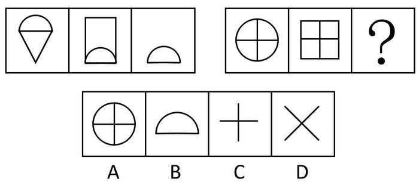

A. A

B. B

C. C

D. D

第 66 题 · 答案与解析

**参考答案（粉笔题库参考内容）**

C

**解析**

第一组图形中前两幅图形去异存同得到第三幅图形。第二组中图形同样遵循此规律，即得到C项中的图形。

故正确答案为C。

### 第 67 题

从所给四个选项中，选择最合适的一个填入问号处，使之呈现一定的规律性：

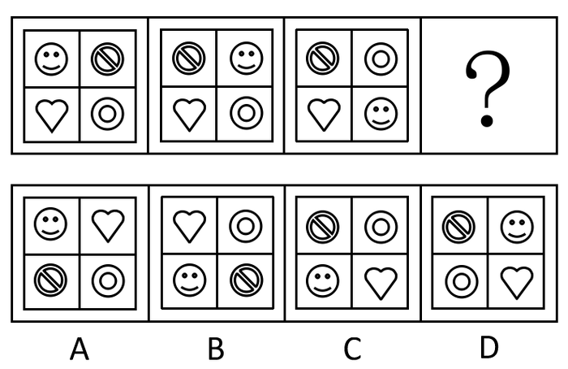

A. A

B. B

C. C

D. D

第 67 题 · 答案与解析

**参考答案（粉笔题库参考内容）**

C

**解析**

按顺时针方向把每幅图内的方格称作第一、二、三、四格。

把第一幅图中第一格内的图形和第二格内的图形位置互换，可以得到第二幅图。把第二幅图中第二格内的图形和第三格内的图形位置互换，可以得到第三幅图。由此可知，把第三幅图中第三格内的笑脸和第四格内的爱心位置互换，可以得到第四幅图，即C项中的图形。

故正确答案为C。

### 第 68 题

从所给四个选项中，选择最合适的一个填入问号处，使之呈现一定的规律性：

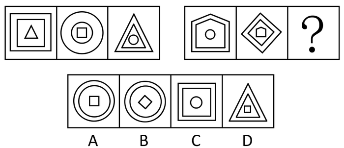

A. A

B. B

C. C

D. D

第 68 题 · 答案与解析

**参考答案（粉笔题库参考内容）**

B

**解析**

第一组中，每幅图由内、中、外三层图形组成。且第一幅图的中、外层图形和第二幅图的内层图形一样（正方形），第二幅图的中、外层图形和第三幅图的内层图形一样（圆形），第三幅图的中、外层图形和第一幅图的内层图形一样（三角形）。

第二组同样遵循此规律，则第二幅图的中、外层图形和第三幅图的内层图形一样（菱形），第三幅图的中、外层图形和第一幅图的内层图形一样（圆形）。符合中、外层图形是圆形，内层图形是菱形的是B项。

故正确答案为B。

### 第 69 题

从所给四个选项中，选择最合适的一个填入问号处，使之呈现一定的规律性：

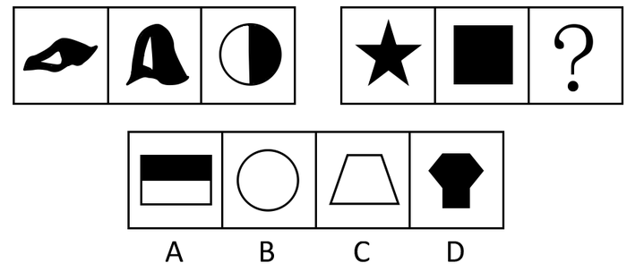

A. A

B. B

C. C

D. D

第 69 题 · 答案与解析

**参考答案（粉笔题库参考内容）**

D

**解析**

图形内部特征明显，第一组中的三幅图均由一个黑色部分和一个白色部分构成。第二组中的三幅图均只由一个黑色部分构成。选项中D是由一个黑色部分构成。

故正确答案为D。

### 第 70 题

从所给四个选项中，选择最合适的一个填入问号处，使之呈现一定的规律性：

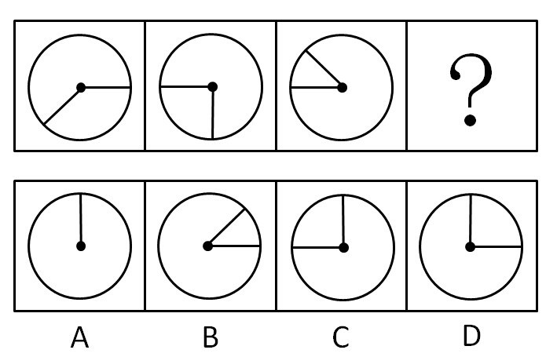

A. A

B. B

C. C

D. D

第 70 题 · 答案与解析

**参考答案（粉笔题库参考内容）**

A

**解析**

考点较特殊，考查两个短线组成的夹角变化，第一幅图中，两条直线的夹角是135度。第二幅图中，两条直线的夹角是90度。第三幅图中，两条直线的夹角是45度。每幅图中，两条直线的夹角依次减少45度。由此可知，第四幅图中，两条直线的夹角是0度。

故正确答案为A。

### 第 71 题

法国总统戴高乐有一个座右铭：“保持必定的距离！”这也深入地影响了他和智囊、参谋们的关联。在他十多年的总统岁月里，他的秘书处、办公厅和私家参谋部等顾问和军师机构，没有什么人的工作年限能超过两年以上。这表明戴高乐是个主要靠自己的思维和决断而生存的首领，他不允许身边有永远离不开的人。戴高乐这种用人智慧是成功地运用了：

A. 木桶理论

B. 青蛙现象

C. 刺猬法则

D. 鲶鱼效应

第 71 题 · 答案与解析

**参考答案（粉笔题库参考内容）**

C

**解析**

A项，木桶理论也称短板效应、短板理论。这个规律是从木桶的结构总结出来的。盛水的木桶是由许多块木板箍成的，盛水量也是由这些木板共同决定的。若其中一块木板很短，则此木桶的盛水量就被短板所限制。这块短板就成了这个木桶盛水量的“限制因素”（或称“短板效应”）。若要使此木桶盛水量增加，只有换掉短板或将短板加长才行。

B项，青蛙现象是指把一只青蛙直接放进开水锅里，它因水温过高感觉不适，会迅速跳出锅外。如果把一个青蛙放进一锅冷水里，慢慢地加温，青蛙并不会立即跳出锅外，这是由于青蛙已慢慢适应了那惬意的水温，所以当温度升高到一定程度时，青蛙便再也没有力量跃出水面了。于是，青蛙便在舒适之中被烫死了。

C项，刺猬法则来源于一则西方寓言，说的是在寒冷的冬天里，两只刺猬要相依取暖，一开始由于距离太近，各自的刺将对方刺得鲜血淋漓，后来它们调整了姿势，拉开了适当的距离，不但能够相互取暖，而且很好地保护了对方。刺猬法则强调的是人际交往中的“心理距离效应”。运用到管理实践中，就是领导者如果要搞好工作，就应该与下属保持一种不远不近的恰当合作关系。

D项，鲶鱼效应是指为了能够将鲜活的沙丁鱼运送到岸，渔民会在装满沙丁鱼的鱼槽中放入一条以沙丁鱼为主要食物的鲶鱼。鲶鱼进入鱼槽后，由于环境陌生，便四处游动。而沙丁鱼发现这一异己分子后，也会紧张起来，加速游动，如此一来，沙丁鱼便能活着回到港口。现代管理中运用这一效应，通过个体的“中途介入”，对群体起到竞争作用。

戴高乐总统在工作中总与下属保持必定的距离，运用的是刺猬法则。

故正确答案为C。

### 第 72 题

某县法院在审理一起民事案件中，为查明案件事实，对一当事人的信件进行拆检，弄清了案情并作出了判决。下列说法正确的是：

A. 法院对当事人所有的信件都无权拆检

B. 法院为了查明案情可以对当事人的信件进行拆检

C. 法院对当事人与案件无关的信件无权拆检

D. 法院拆检当事人信件并不重要，重要的是作出公正的判决

第 72 题 · 答案与解析

**参考答案（粉笔题库参考内容）**

A

**解析**

《宪法》第四十条规定：“中华人民共和国公民的通信自由和通信秘密受法律的保护。除因国家安全或者追查刑事犯罪的需要，由公安机关或者检察机关依照法律规定的程序对通信进行检查外，任何组织或者个人不得以任何理由侵犯公民的通信自由和通信秘密。”

本题中，当事人的信件属于公民的通信秘密，是宪法赋予公民的基本权利。只有检察机关和公安机关因国家安全或追查刑事犯罪的需要才能依照法律规定的程序对通信进行检查，法院无权这样做。

故正确答案为 A。

### 第 73 题

握手有伸手先后的规矩，下列说法正确的是：

A. 晚辈与长辈握手，晚辈应先伸手

B. 电视节目主持人邀请专家、学者进行访谈时握手，主持人应先伸手

C. 男女同事之间握手，男士应先伸手

D. 主人与客人握手，一般是客人先伸手

第 73 题 · 答案与解析

**参考答案（粉笔题库参考内容）**

B

**解析**

握手的礼仪有以下几种：

（1）男女之间握手。男士要等女士先伸出手后才握手；如果女方没有握手的意思，男方可改用点头礼表示礼貌。

（2）宾客之间握手。主人有向客人先伸出手的义务。对到来的客人，不论男女、长幼，主人均应先伸出手去，表示热烈欢迎，女主人也应如此。

（3）长幼之间握手。年幼的一般要等年长的先伸手。和长辈及年长的人握手，不论男女，都要起立趋前握手，并要脱下手套，以示尊敬。

（4）上下级之间握手。下级要等上级先伸出手。但涉及主宾关系时，可不考虑上下级关系，做主人的应先伸手。

（5）一个人与多人握手。若是一个人需要与多人握手，则握手时亦应讲究先后次序，由尊而卑，即先年长者后年幼者，先长辈后晚辈，先老师后学生，先女士后男士，先上级后下级，先职位、身份高者后职位、身份低者。

本题四个选项中，A、C、D三项 的做法都不符合礼仪。

故正确答案为 B。

### 第 74 题

人手触电时，会有一种仿佛被电吸住抽不回来的感觉。出现这种感觉是因为：

A. 导线、电器中的正、负电荷的电量是不相等的

B. 静电引力强大

C. 导线、电器中的正负电荷相等所致

D. 触电时，手很快地痉挛以致麻痹所致

第 74 题 · 答案与解析

**参考答案（粉笔题库参考内容）**

D

**解析**

不论是否存在电流，在一般情况下导线和电器中的正、负电荷的总量是相等的，对外的静电作用相互抵消。A、B两项说法错误；

C项的说法不能解释触电时感觉被电吸住的现象。实际上，人手触电时，由于电流的刺激，手会由痉挛到麻痹。即使发出抽回手的指令，手已无法执行这一指令了，所以会有一种仿佛被电吸住抽不回来的感觉。

故正确答案为D。

**本题相关知识点：**

调查表明，绝大多数触电死亡者， 都是手的掌心或手指与掌心的同侧部位触电。刚触电时，手因条件反射而弯曲，且弯曲的方向恰使手不自觉地握住了导线。这样，加长了触电时间，手很快地痉挛以致麻痹。这时即使想到应松开手指、抽回手臂，已不可能，形似被“吸住”了。

有经验的电工为了判断用电器是否漏电而手边又无电笔，有时就用食指指甲一面去轻触用电器外壳。若漏电，则食指将因条件反射而弯曲，弯曲的方向又恰是脱离用电器的方向。这样，触电时间很短，不致有危险。

### 第 75 题

“早虹雨滴滴，晚虹晒脸皮。”我国的降雨云大都是由西向东移动的，早晨看到的虹，是东方射来的太阳光照在西方的天空降雨层的水滴上形成的西虹，傍晚看到的虹是西方射来的太阳光照在东方天空降雨层的水滴上而形成的东虹。关于虹形成的天气现象，下列说法正确的是：

A. 西虹和东虹都预示着天空没有降雨云了，天气必然是晴朗的

B. 西虹和东虹都是本地天气将要降雨的预示

C. 东虹是本地天气将要降雨的预示，西虹预示着西方天空已没有降雨云了，天气必然是晴朗的

D. 西虹是本地天气将要降雨的预示，东虹预示着西方天空已没有降雨云了，天气必然是晴朗的

第 75 题 · 答案与解析

**参考答案（粉笔题库参考内容）**

D

**解析**

我国的降雨云大都是由西向东移动的，早晨看到的虹，是东方射来的太阳光照在西方的天空降雨层的水滴上形成的西虹，显然，西虹是本地天气将要降雨的预示。而东虹是西方射来的太阳光在东方天空降雨层的水滴上形成的，看到东虹，意味着降雨层在本地的东边，且会继续向东移动，本地自然不会有降雨，天气必然是晴朗的。

故正确答案为D。

### 第 76 题

挂在壁墙上的石英钟，当电池的电能耗尽而停止走动时，其秒针往往停在刻度盘上“9”的位置。这是由于：

A. 秒针在“9”位置处受到重力矩的阻碍作用最小

B. 秒针在“9”位置处受到重力矩的阻碍作用最大

C. 偶然因素造成的

D. 分针在“9”位置处受到重力矩的阻碍作用最大

第 76 题 · 答案与解析

**参考答案（粉笔题库参考内容）**

B

**解析**

石英钟的秒针从数字12到数字6的过程中是向下运动的，它所受的重力会帮助秒针顺时针转动。当秒针从数字6向数字12运动时，是上升运动，所受重力会变成阻力阻碍秒针的转动，而秒针转到数字9时阻力臂最长，使重力的阻力矩最大，故秒针最易停在数字9处。

故正确答案为B。

### 第 77 题

污染物排入天然水体后引起的嗅觉、味觉、外观、透明度等方面的恶化，这种污染属于：

A. 生理性污染

B. 物理性污染

C. 化学性污染

D. 生物性污染

第 77 题 · 答案与解析

**参考答案（粉笔题库参考内容）**

A

**解析**

在卫生学上，水污染有四种类型：

（1）生理性污染，指污染物排入天然水体后引起的嗅觉、味觉、外观、透明度等感官性状方面的恶化；

（2）物理性污染，指污染物排入天然水体后改变了水体的物理特性，浑浊度增高，悬浮物增加，出现多种颜色等；

（3）化学性污染，指污染物排入水体后改变了水的化学性质，如pH 值、硬度等。

（4）生物性污染，指病原微生物排入水体，直接或间接地传染各种疾病。

本题属于生理性污染。

故正确答案为A。

### 第 78 题

下列物质中，不能用来酿酒的是：

A. 玉米

B. 高粱

C. 黄豆

D. 谷子

第 78 题 · 答案与解析

**参考答案（粉笔题库参考内容）**

C

**解析**

用粮食酿酒主要是用碳水化合物含量高的玉米、稻米、小麦、高粱等作原料，故A、B两项可用来酿酒。

谷子去壳后是小米，主要用来酿制黄酒，故D项也可用来酿酒。

黄豆蛋白质含量高达40%左右，最优质的可达50%左右，相当于瘦猪肉的2倍多，鸡蛋的3倍。黄豆蛋白质的氨基酸的组成比较接近人体所需要的氨基酸，属于完全蛋白，其中赖氨基酸含量较多。黄豆一般用来榨油、做豆腐、酱类等。

本题为选非题，故正确答案为C。

**本题相关知识点：**

黄豆营养价值极高，但在食用黄豆时，要注意黄豆不可生吃，有毒。食用了不完全熟的豆浆可能出现包括涨肚、拉肚子、呕吐、发烧等不同程度的食物中毒症状。这是因为生大豆中含有一种胰蛋白酶抑制剂，进入机体后抑制体内胰蛋白酶的正常活性，并对胃肠有刺激作用。

### 第 79 题

目前，我国银行尚不能代理的业务是：

A. 交电话费

B. 代收保险费

C. 代为保管贵重物品

D. 买卖股票

第 79 题 · 答案与解析

**参考答案（粉笔题库参考内容）**

D

**解析**

2002 年 4 月，中国人民银行发布《关于落实〈商业银行中间业务暂行规定〉有关问题的通知》。通知强调，为防止银行资金违规流入股市，目前商业银行不能开办代理股票买卖业务。

故正确答案为 D。

### 第 80 题

按照我国《选举法》的规定，全国和地方各级人民代表大会的代表，受选民和原选举单位的监督。选民或者选举单位都有权罢免自己选出的代表。罢免代表采用：

A. 记名表决方式

B. 口头表决方式

C. 举手表决方式

D. 无记名表决方式

第 80 题 · 答案与解析

**参考答案（粉笔题库参考内容）**

D

**解析**

《选举法》第四十九条规定，罢免代表采用无记名的表决方式。

故正确答案为D。

### 第 81 题

吉林省人大常务委员会认为一项法律的个别条款在适用上存在某些困难，并认为有必要对该条款作出法律解释。根据我国宪法和立法法规规定，吉林省人大常委会正确的做法是：

A. 对该条款直接作出法律解释

B. 提请最高人民法院就该条款作出司法解释

C. 提请全国人民代表大会常务委员会就该条款作出法律解释

D. 提请全国人民代表大会就该条款作出法律解释

第 81 题 · 答案与解析

**参考答案（粉笔题库参考内容）**

C

**解析**

《立法法》第四十二条规定：“法律解释权属于全国人民代表大会常务委员会。”

第四十三条规定：“国务院、中央军事委员会、最高人民法院、最高人民检察院和全国人民代表大会各专门委员会以及省、自治区、直辖市的人民代表大会常务委员会可以向全国人民代表大会常务委员会提出法律解释要求。”

根据这两条规定，本题中吉林省人大常委会正确的做法应该是提请全国人民代表大会常务委员会就该条款作出法律解释。

故正确答案为C。

### 第 82 题

父母和一个已婚子女及其配偶、后代所组成的家庭属于：

A. 直系家庭

B. 复合家庭

C. 双亲家庭

D. 核心家庭

第 82 题 · 答案与解析

**参考答案（粉笔题库参考内容）**

A

**解析**

直系家庭是由两代或两代以上夫妻组成，每代最多不超过一对夫妻，且中间无断代的家庭。如父母和已婚子女及其未婚子女所组成的家庭。

复合家庭是指父母和两个或多个已婚子女及其配偶、后代所组成的家庭。在这种家庭中除纵向的直系亲属关系外，还包括横向的旁系亲属关系（这一分类不涉及未成年的兄弟姐妹）。

双亲家庭是指孩子能和父母一起生活的家庭。

核心家庭是由父母及其未婚子女所组成的家庭。

根据以上定义。

故正确答案为A。

### 第 83 题

一个国家的宪政制度如果常常为其他国家所效仿，这个国家的宪法就被称之为“宪法之母”，据此，下列国家的宪法被称为“宪法之母”的是：

A. 美国

B. 法国

C. 英国

D. 德国

第 83 题 · 答案与解析

**参考答案（粉笔题库参考内容）**

C

**解析**

英国是近代宪法的策源地，英国宪法常被人们誉为“近代宪法之母”。英国近代宪法最初是资产阶级革命的成果，由英国资产阶级最早制定。英国的资产阶级宪法在内容上确立了君主立宪的政治体制，但是在形式上没有完整的宪法典，是典型的非成文宪法。

故正确答案为C。

### 第 84 题

美国的可口可乐公司，一会儿到中东解救饥荒，一会儿到非洲援助灾民。不久前，他们在莫斯科街头，竖起了1000个电话亭。种种公益壮举，把“可口可乐”宣扬得全球闻名。可口可乐公司这种广告形式被称为：

A. 动态广告

B. 静态广告

C. 软广告

D. 硬广告

第 84 题 · 答案与解析

**参考答案（粉笔题库参考内容）**

C

**解析**

动态广告是指广告画面会连续变化的广告形式，如电视上播放的广告短片。

静态广告是指刊登在载体上画面静止不动的广告，如报纸广告。

软广告是指广告主并不直接介绍商品、服务，而是通过在报纸、杂志、网络、电视节

目、电影等宣传载体上插入带有主观指导倾向性的文章（特定的新闻报道、深度文章、付费短文广告、案例分析等）、画面、短片，或通过赞助社会活动、公益事业等方式来达到提升广告主企业品牌形象和知名度，或促进广告主企业销售的一种广告形式。

硬广告是指直接介绍商品、服务内容的传统形式的广告，通过报刊刊登、设置广告牌、电台和电视台播出等进行宣传（区别于软广告）。

可口可乐公司通过多种公益活动来宣传自身的品牌，这种广告形式属于典型的软广告。

故正确答案为 C。

### 第 85 题

办公室的工作人员陪同客人外出，在乘车的座位上，要坐在客人的：

A. 左边

B. 右边

C. 前边

D. 后边

第 85 题 · 答案与解析

**参考答案（粉笔题库参考内容）**

A

**解析**

如果接待领导和客人，上车时要为客人开门并让客人先上，一般让客人坐在后排右边，自己为客人关上车门后再走向左边上车，坐在客人的左边。如果有领导陪同，让领导坐在客人的左边，自己则坐在司机的旁边。到达目的地时，要先下车为客人开车门，如果是年长或者很尊贵的客人，要用手遮住车门顶，以防客人碰到头。

故正确答案为A。

**本题相关知识点：**

公务接待的座位安排：因为公务接待有专职司机驾车，这时副驾驶的后座就是最“礼貌”的座位，既安全，又方便，到达酒店时，后排右座门正好对着大厅正门，服务生过来开门，只开右座车门。另外，公务接待时，副驾驶席被称为“随员座”，一般是翻译、秘书的位置，让客人坐在这里非常不礼貌。最“礼貌”座位依次排序：最尊贵的座位是后排右座——其次后排左座——后排中座——最末副驾驶座位。

### 第 86 题

核电站利用核能进行发电，其所使用的核燃料是：

A. 镭

B. 氢

C. 氦

D. 铀

第 86 题 · 答案与解析

**参考答案（粉笔题库参考内容）**

D

**解析**

核电站所用的核燃料一般是铀。

故正确答案为D。

**本题相关知识点：**

镭是由居里夫妇发现的，镭能放射出α和γ两种射线，并生成放射性气体氡。镭放出的射线能破坏、杀死细胞和细菌，因此，常用来治疗癌症等。此外，镭盐与铍粉的混合制剂，可作中子放射源，用来探测石油资源、岩石组成等，是原子弹的材料之一。

氢是一种化学元素，在元素周期表中位于第一位。它的原子是所有原子中最小的。氢通常的单质形态是氢气。它是无色无味无臭，极易燃烧的由双原子分子组成的气体，氢气是最轻的气体。

氦是稀有气体的一种。氦是唯一不能在标准大气压下固化的物质，可用来填充灯泡和霓虹灯管，亦用来制造泡沫塑料。液态氦常用来做冷却剂。

### 第 87 题

一个厂商将价格定在牺牲短期利润以消除竞争对手并在长期获得高利润的行为被称为：

A. 剥削性定价

B. 合谋性定价

C. 正常价格竞争行为

D. 掠夺性定价

第 87 题 · 答案与解析

**参考答案（粉笔题库参考内容）**

D

**解析**

掠夺性定价又称劫掠性定价、掠夺价、掠夺性定价歧视，是指一个厂商将价格定在牺牲短期利润以消除竞争对手并在长期获得高利润的行为。

故正确答案为D。

### 第 88 题

根据国家质量监督检验检疫局发布的《车辆驾驶人员血液、呼气酒精含量阈值与检验》（GB19522—2004）中规定，驾驶人员每100ml血液酒精含量大于或等于20mg，并每100ml血液酒精含量小于80mg为饮酒后驾车；每100ml血液酒精含量大于或等于80mg为醉酒驾车。大概喝多少酒会达到这个标准？下列说法正确的是：

A. 20mg/100ml大致相当于一瓶啤酒；80mg/100ml，则相当于3两低度白酒或者2瓶啤酒；100mg/100ml，大致相当于半斤低度白酒或者3瓶啤酒

B. 20mg/100ml大致相当于一瓶啤酒；80mg/100ml，则相当于3两低度白酒或者2瓶啤酒；100mg/100ml，大致相当于一斤低度白酒或者3瓶啤酒

C. 20mg/100ml大致相当于两瓶啤酒；80mg/100ml，则相当于3两低度白酒或者4瓶啤酒；100mg/100ml，大致相当于一斤低度白酒或者5瓶啤酒

D. 20mg/100ml大致相当于一杯啤酒；80mg/100ml，则相当于3两低度白酒或者2瓶啤酒；100mg/100ml，大致相当于半斤低度白酒或者3瓶啤酒

第 88 题 · 答案与解析

**参考答案（粉笔题库参考内容）**

A

**解析**

20mg/100ml，大致相当于一瓶啤酒；80mg/100ml，则相当于3两低度白酒或者2瓶啤酒；100mg/100ml，大致相当于半斤低度白酒或者3瓶啤酒。

故正确答案为A。

### 第 89 题

日本“3·11”地震后，日元反常地出现了升值现象，而导致日元升值的主要因素之一是国际游资进行的炒作。直到日本央行多次注资以及七国集团干预汇市后，日元汇率才趋于稳定。关于日元升值，下列说法正确的是：

A. 日元升值能促使日本经济在震后快速恢复，因为“钱更值钱”了

B. 日元升值是投机现象所致，从长远来看不利于日本与国际经济的稳定

C. 日元升值有利于日本扩大出口，充分利用国际市场来恢复经济

D. 日元升值是日本经济发展的必然结果

第 89 题 · 答案与解析

**参考答案（粉笔题库参考内容）**

B

**解析**

由题干可知，日元的升值是因为国际游资的炒作行为所致，故 D 选项错误。

日元升值，直接影响日本出口，造成日本出口下滑，损害日本的出口导向型经济，进而造成内需减少，不利于日本经济的恢复和发展。A、C 两个选项错误。

日元的大幅升值，增加了将来日元贬值的风险，这种日元汇率的大幅波动，不利于国际经济的稳定。

故正确答案为B。

### 第 90 题

与活期储蓄相比，利息有一定优越性，但又可以随时支取的人民币储蓄存款是：

A. 定期储蓄

B. 零存整取储蓄

C. 教育储蓄

D. 定活两便储蓄

第 90 题 · 答案与解析

**参考答案（粉笔题库参考内容）**

D

**解析**

定期存款一般是指整存整取类的定期储蓄存款：50 元起存，多存不限；一次存入，约定期限，存款期限分三个月、半年、一年、二年、三年和五年，存款期限越长，利率越高；由银行发给存单，到期凭存单支取本息。

零存整取储蓄是一种每月按约定数量的款项存储，按约定时间一次提取本息的定期储蓄；存期分为一年、三年、五年，每月固定存入一定数量，5 元起存、多存不限。

教育储蓄是指个人按国家有关规定在指定银行开户、存入规定数额资金、用于教育目的的专项储蓄，是一种专门为学生支付非义务教育所需教育金的专项储蓄。

定活两便储蓄是一种事先不约定存期，可以随时支取的储蓄存款。其利息与活期储蓄存款相比有一定优越性。

故正确答案为D。

## 材料 1

根据下面资料完成各题。

        2009年末，我国就业人员总量达到77995万人，比2005年末增加了2170万人。随着城市化和工业化进程的不断推进，城镇吸纳就业的能力增强，促进了乡村富余劳动力向城镇的转移。2005年到2009年，城镇就业人员总量由27331万人增加到31120万人；城镇就业人员占全国就业人员的比重从36.0％上升到39.9％，乡村就业人员总量由48494万人减少到46875万人。

        我国第一产业就业人员2005年为33970万人，2009年减少到29708万人；第二产业就业人员2005年为18084万人，2009年增加到21684万人；第三产业就业人员2005年为23771万人，2009年增加到26603万人。

        2009年末，城镇私营个体就业人员为9789万人，比2005年增加了3553万人。“十一五”时期的前四年，城镇非公有制经济共吸纳就业4947万人，年均增加超过1200万人。非公有制经济的发展，成为缓解城镇就业压力，吸纳农村富余劳动力的重要途径。

### 第 91 题

2009年末与2005年末相比，我国第二产业人员年均增加：

A. 566.4万人

B. 708万人

C. 720万人

D. 900万人

第 91 题 · 答案与解析

**参考答案（粉笔题库参考内容）**

D

**解析**

由材料可知，2005年到2009年第二产业增加的人数为21684－18084＝3600万人，年均增加3600÷4＝900万人。

故正确答案为D。

### 第 92 题

2009年我国一、二、三产业就业人员的结构比例为：

A. 38.1：27.8：34.1

B. 39.6：27.2：33.2

C. 44.8：23.1：31.4

D. 44.1：27.8：28.1

第 92 题 · 答案与解析

**参考答案（粉笔题库参考内容）**

A

**解析**

解法1：

2009年末，我国就业人员总量达到77995万人，城镇就业人员总量为31120万人，占比39.9%；而同一时间的第一产业就业人员为29708万人&lt;31120万人，故其占总就业人数比例要小于39.9%，排除C和D两项；又，而，故第一产业所占比重要小于38.9%，排除B选项，答案为A。

解法2：

观察选项可知，第一产业就业人员的比重在C、D两项中比较接近，第二产业比重在A、B两项中比较接近，可重点分析第三产业就业人员的比重。2009年第三产业就业人员为26603，所占比为，估算该值大于30%，排除D选项；剩下的三个选项中数值均接近，可以为基准进行分析，，故第三产业的比重值要大于33.3%，仅A选项符合。

故正确答案为A。

### 第 93 题

我国2005年城镇私营个体就业人员占就业人员的比重为：

A. 6.3%

B. 12.6%

C. 8%

D. 18.1%

第 93 题 · 答案与解析

**参考答案（粉笔题库参考内容）**

C

**解析**

2005年我国城镇私营个体就业人员为9789-3553=6236，所占比重为，故该比重值要小于10%，排除B、D两项；

注意到A、C两项首位不同，故对前面比重的计算式直接直除，可知首位为8。

故正确答案为C。

### 第 94 题

从2005年到2009年，我国就业人数增加最快的是：

A. 第一产业就业人员

B. 城镇非公有制经济就业人员

C. 城镇就业人员

D. 乡村就业人员

第 94 题 · 答案与解析

**参考答案（粉笔题库参考内容）**

B

**解析**

根据材料，从2005年到2009年，第一产业就业人数和乡村就业人数均是下降的，A项和D项均错误；

比较B项和C项，C项中城镇就业人员增加值不到4000万人，小于B项中城镇非公有制经济就业人员的增加值4947万人，但C项的基期量包括B项的基期量，所以C项的基期量一定大于B选项的基期量，于是B项增加率一定大于C项。

故正确答案为B。

### 第 95 题

下列选项正确的是：

A. 从2005年到2009年，我国一、二、三产业的就业人员均为持续增加

B. 从2005年到2009年，我国一、二、三产业的就业人员均为持续下降

C. 从2005年到2009年，非公有制经济就业人数大幅回落

D. 从2005年到2009年，我国城镇就业人员增长速度小于城镇私营个体就业人员增长速度

第 95 题 · 答案与解析

**参考答案（粉笔题库参考内容）**

D

**解析**

材料只给出了2005年和2009年第一、二、三产业的就业人员的情况，并没有给出中间的年份的就业情况，所以变化情况无从得知，故A项和B项均错误；

从上题可知，非公有制经济就业人员的年均增加量超过1200万人，不可能是大幅回落的，C项错误；

于是根据排除法，确定D项为正确答案。

验证D项，从2005年到2009年，我国城镇就业人员增长率为，城镇私营个体就业人员增长率为。

故正确答案为D。

## 材料 2

根据下面资料完成各题。

        中国在“十一五”期间，经济发展迅速，中国经济年均增长11.2%，远高于同期3.5%的世界平均水平。我国经济总量的国际地位实现“三连跳”。2005年国内生产总值（GDP）22569亿美元，居世界第五位，2010年增加到58791亿美元，超过日本，成为世界第二大经济体。中国GDP占世界的比重也逐年上升，从2005年的5%提高到2010年的9.5%。同时，中国与美国的差距逐步缩小，相当于美国GDP的比例从2005年的17.9%上升至2010年的40.2%。人均国民总收入（GNI）也发生了很大变化。

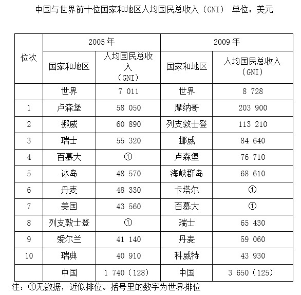

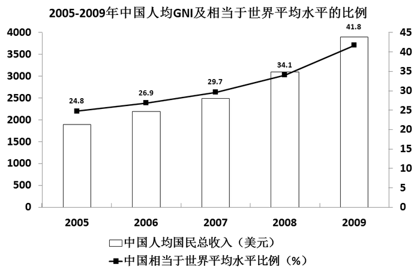

### 第 96 题

2009年我国人均国民总收入比2005年增长了：

A. 2.1倍

B. 19.1倍

C. 1.1倍

D. 2.9倍

第 96 题 · 答案与解析

**参考答案（粉笔题库参考内容）**

C

**解析**

根据表格材料最后一行数据可知，2009年我国人均国民总收入是2005年的倍，该计算值大于2、小于3，故2009年比2005年增长的倍数大于1、小于2，仅C选项符合。

故正确答案为C。

### 第 97 题

我国人均国民总收入相当于世界平均水平的比例5年内差距缩小了：

A. 7.7个百分点

B. 3.4个百分点

C. 1.7个百分点

D. 17个百分点

第 97 题 · 答案与解析

**参考答案（粉笔题库参考内容）**

D

**解析**

根据条形图可知，2009年我国人均总收入相当于世界平均水平的41.8%，2005年为24.8%，差距缩小了41.8%-24.8%=17个百分点。

故正确答案为D。

### 第 98 题

2010年美国的GDP是：

A. 9079.6亿美元

B. 146246.3亿美元

C. 222569亿美元

D. 126083.8亿美元

第 98 题 · 答案与解析

**参考答案（粉笔题库参考内容）**

B

**解析**

由材料知，2010年中国GDP占美国GDP的40.2%，则2010年美国的GDP为亿美元。

故正确答案为B。

### 第 99 题

与上年相比，中国人均国民总收入增加最多的年份是：

A. 2009年

B. 2008年

C. 2007年

D. 2006年

第 99 题 · 答案与解析

**参考答案（粉笔题库参考内容）**

A

**解析**

根据图形材料，相邻两个条形的高度差，即为增加量。从图形中易知，高度差最大的是2009年与2008年间，故增加量最多的是2009年。

故正确答案为A。

### 第 100 题

下列说法错误的是：

A. 我国人均国民总收入2009年居世界第125位，比2005年前进3位

B. 美国人均国民总收入2009年没有排进世界前10名

C. 2009年摩纳哥人均国民总收入是世界平均水平的23.4倍

D. 我国人均国民总收入2009年达到世界平均水平的一半

第 100 题 · 答案与解析

**参考答案（粉笔题库参考内容）**

D

**解析**

A项正确，根据表格材料最后一行数据可知，2009年我国人均国民总收入居世界第125，比2005年前进128-125=3位；

B项正确，根据表格材料倒数第二列数据可知，在这几个国家中并没有出现美国，故2009年美国人均国民总收入未进入世界前10位；

C项正确，需计算两个数值的比值，而且需要计算结果精确到小数点后一位，可先跳过该选项；

D项错误，根据图形材料中的数字标签可直接判断，2009年我国人均国民总收入占世界平均水平的41.8%，不到50%。

再回来验证C项，2009年摩纳哥人均国民总收入是世界平均水平的，该项说法正确。

故正确答案为D。

## 材料 3

根据下面资料完成各题。

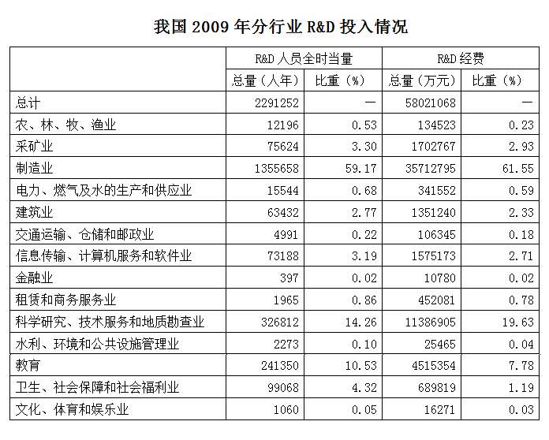

       为全面掌握我国科学研究与试验发展（R&D，以下简称R&D）活动情况，国家统计局、科技部、国家发展改革委、教育部、财政部、国防科工局于2009年联合开展了第二次全国R&D资源清查。清查对象是国民经济中R&D活动相对密集行业的法人单位。现将全社会R&D主要指标公布如下：

       2009年全国R&D人员318.4万人，其中大学本科及以上学历人员占48.9%；女性人员78.9万人，占24.8%。

       2009年按实际工作时间计算的R&D人员全时当量229.1万人年，其中研究人员115.2万人年，占50.3%。R&D人员全时当量是2000年的2.5倍。

按活动类型分，基础研究人员全时当量16.5万人年，占7.2%；应用研究人员31.5万人年，占13.8%；试验发展人员181.1万人年，占79.0%。基础研究、应用研究和试验发展人员全时当量分别是2000年的2.1倍、1.4倍和2.9倍。

       2009年全国R&D总经费5802.1亿元，比2000年增长5.5倍，年平均增长23.0%。R&D经费与当年国内生产总值（GDP）之比为1.70%，比2000年提高了0.8个百分点。

       按活动类型分，基础研究经费270.3亿元，占4.7%；应用研究经费730.8亿元，占12.6%；试验发展经费4801.0亿元，占82.7%。基础研究、应用研究和试验发展经费分别是2000年的5.8倍、4.8倍和6.9倍。

      按东、中、西部地区分，东部地区工业企业R&D经费2759.4亿元，占73.1%；中部地区工业企业R&D经费668.8亿元，占17.7%；西部地区工业企业R&D经费347.5亿元，占9.2%。

### 第 101 题

2000年全国R&D总经费是：

A. 730.8亿元

B. 5802.1亿元

C. 1054.93亿元

D. 892.63亿元

第 101 题 · 答案与解析

**参考答案（粉笔题库参考内容）**

D

**解析**

由材料可知，2009年全国R&D总经费为5802.1亿元，比2000年增长了5.5倍，则2000 年全国R&D总经费为5802.1÷(5.5﹢1)＝5802.1÷6.5亿元，直除首位为8。

故正确答案为D。

### 第 102 题

2009年全国R&D人员中大学本科及以上学历人员有：

A. 229.1万人

B. 155.7万人

C. 318.4万人

D. 78.9万人

第 102 题 · 答案与解析

**参考答案（粉笔题库参考内容）**

B

**解析**

由材料可知，2009年全国R&D人员中大学本科及以上学历人员约占R&D人员318.4万人的48.9%，即约150万人，最接近的是B选项中的155.7万人。

故正确答案为B。

### 第 103 题

2000年全国R&D总经费中用于试验发展的经费达到：

A. 695.8亿元

B. 1054.93亿元

C. 730.8亿元

D. 1000.21亿元

第 103 题 · 答案与解析

**参考答案（粉笔题库参考内容）**

A

**解析**

由101题可知，2000年全国R&D总经费中用于试验发展的经费为亿元，直除易知该计算值首位为6。

故正确答案为A。

### 第 104 题

2009年我国R&D经费投入最小的行业是：

A. 文化、体育和娱乐业

B. 金融业

C. 水利环境和公共设施管理业

D. 交通运输、仓储和邮政业

第 104 题 · 答案与解析

**参考答案（粉笔题库参考内容）**

B

**解析**

从表中可以明显看出，2009年我国R&D经费投入最小的行业是金融业，仅有10780万元，其他行业的投入均远大与该值。

故正确答案为B。

### 第 105 题

下列说法正确的是：

A. 2009年，R&D经费占国内生产总值的比重与2000年相比有下降的趋势

B. 2009年，我国的R&D研究经费用于基础研究和应用研究方面少于试验发展

C. 2009年，科学研究、技术服务和地质勘查业在R&D经费投入中排名第三

D. 2009年，东部地区工业企业R&D经费是西部地区工业企业R&D经费的9.2%

第 105 题 · 答案与解析

**参考答案（粉笔题库参考内容）**

B

**解析**

A项错误，2009年我国R&D经费占国内生产总值的比重为1.70%，比2000年提高了0.8个百分点；

B项正确，2009年我国R&D经费用于基础研究的经费为270.3亿元，用于应用研究的经费为730.8亿元，用于试验发展的经费为4801.0亿元。因270.3+730.8&lt;4801.0，所以B项正确；

C项错误，从表中可知，科学研究、技术服务和地质勘查业在我国R&D经费投入中排在第二位，仅次于制造业；

D项错误，由材料可知，东部地区工业企业R&D经费是2759.4亿元，西部地区工业企业R&D经费是347.5亿元，明显东部地区工业企业R&D经费大于西部地区的。

故正确答案为B。

