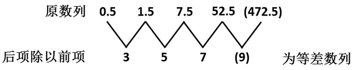
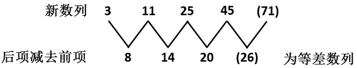
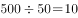
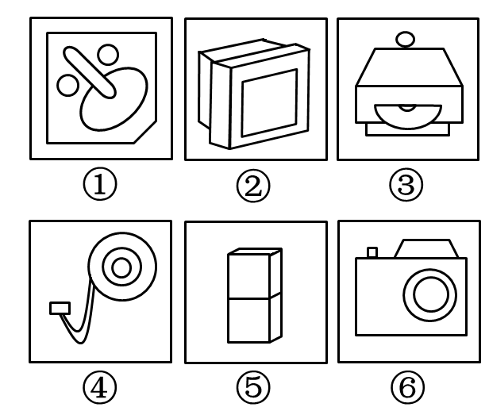
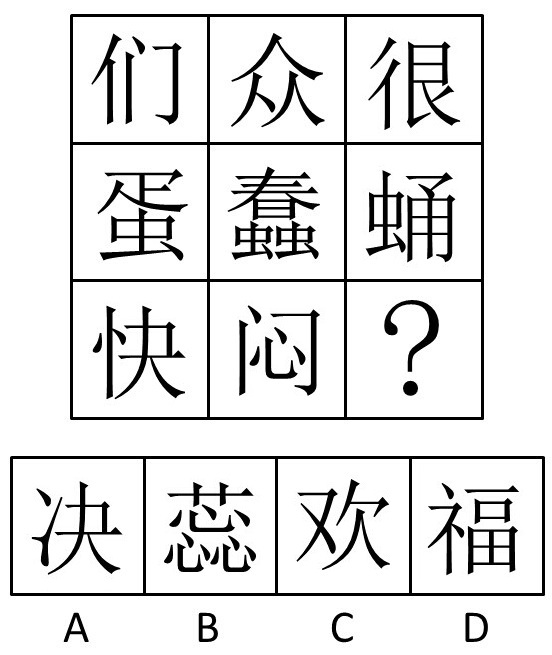
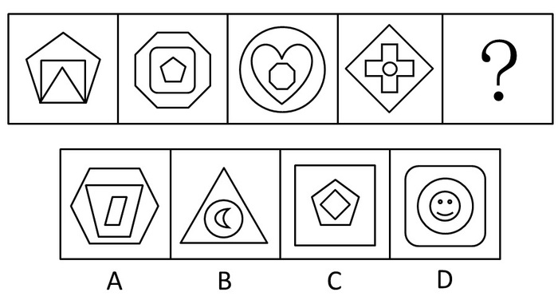
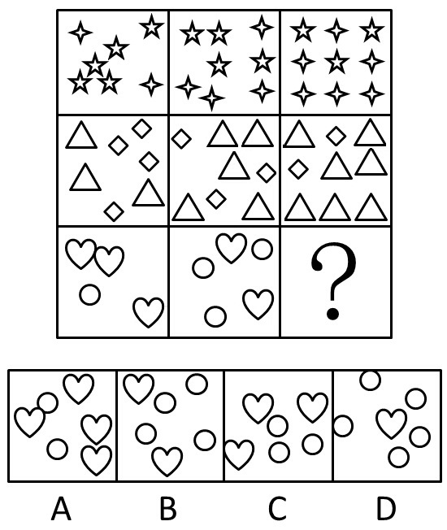

# 2012年吉林省公务员录用考试《行测》题（乙级）

<!-- gwy:overview:start -->
> **吉林 · 2012 · 行测 · 乙级** ｜ 50 题 · 图片 16 处 · 答案随题折叠

| 题型模块 | 题量 | 题号 |
| --- | ---: | ---: |
| 数量关系 | 10 | 1–10 |
| 言语理解与表达 | 10 | 11–20 |
| 判断推理 | 13 | 21–33 |
| 常识判断 | 17 | 34–50 |
| **合计** | **50** | |

导航：[题型与作答说明](#题型与作答说明) · [题目](#题目)
<!-- gwy:overview:end -->

> 候选采集稿。参考答案及解析来自粉笔页面，不代表官方答案或真实高分答卷；来源使用许可与原卷对应关系仍需人工核实。

## 题型与作答说明

数量关系

（10题）

本部分包括数字推理与数学运算两种类型的题目。

言语理解与表达

（10题）

本部分包括选词填空、语句表达与阅读理解三种类型的题目。

判断推理

（13题）

本部分包括事件排序、图形推理、定义判断、演绎推理与常识经验判断五种类型的题目。

常识判断

（17题）

根据题目要求，在四个选项中选出一个正确答案。

## 题目

### 第 1 题

1/2，4/3，9/5，2，( )。

A. 21/11

B. 25/9

C. 25/13

D. 13/12

第 1 题 · 答案与解析

**参考答案（粉笔题库参考内容）**

C

**解析**

原数列可以化为1/2、4/3、9/5、16/8。

分子列：1、4、9、16、(25)是平方数列；

分母列：2、3、5、8、(13)是递推和数列。

则数列未知项为25/13。

故正确答案为C。

**来源**：2012年吉林省公务员录用考试《行测》题（乙级）第1题

### 第 2 题

\-1，6，25，62，( )。

A. 87

B. 123

C. 150

D. 109

第 2 题 · 答案与解析

**参考答案（粉笔题库参考内容）**

B

**解析**

原数列  ；

立方数列；

修正项；

原数列未知项为。

故正确答案为B。

**来源**：2012年吉林省公务员录用考试《行测》题（乙级）第2题

### 第 3 题

0.5，1.5，7.5，52.5，( )

A. 472.5

B. 415.5

C. 387.5

D. 315.5

第 3 题 · 答案与解析

**参考答案（粉笔题库参考内容）**

A

**解析**

故正确答案为A。

**来源**：2012年吉林省公务员录用考试《行测》题（乙级）第3题

### 第 4 题

5/6，6/11，11/17，17/28，( )

A. 28/42

B. 28/43

C. 28/45

D. 28/44

第 4 题 · 答案与解析

**参考答案（粉笔题库参考内容）**

C

**解析**

后项的分子与前项分母相同，后项的分母为前项分子与分母的和。未知项的分子是28，分母是17＋28＝45，即未知项是28/45。

故正确答案为C。

**来源**：2012年吉林省公务员录用考试《行测》题（乙级）第4题

### 第 5 题

√3，√11，5，3√5，( )

A. √65

B. √71

C. √103

D. √141

第 5 题 · 答案与解析

**参考答案（粉笔题库参考内容）**

B

**解析**

将原数列改写为√3，√11，√25，√45，其根号中的数构成新数列3，11，25，45。

因此未知项为√71。

故正确答案为B。

**来源**：2012年吉林省公务员录用考试《行测》题（乙级）第5题

### 第 6 题

出租车司机李师傅有午睡的习惯，一天他睡午觉醒来，发现手机没电，手表停了，于是他只能打开收音机等待交通电台整点报时。如果他等待报时时间不超过15分钟，则这种可能性的大小为：

A. 1/2

B. 1/3

C. 1/4

D. 1/6

第 6 题 · 答案与解析

**参考答案（粉笔题库参考内容）**

C

**解析**

据题意，李师傅等待报时的时间不超过15分钟，即在45-60分的这段时间内，可以听到报时。所以听到报时的可能性是15/60=1/4。

故正确答案为C。

**考点**：概率问题-其他

**来源**：2012年吉林省公务员录用考试《行测》题（乙级）第6题

### 第 7 题

某军训部队到打靶场进行射击训练，队员甲每次射击的命中率为50%，队员乙每次射击的命中率为80%，教练规定今天的训练规则是，每个队员射击直到击中一靶一次则停止射击，则队员甲今天平均射击次数为：

A. 2次

B. 1.25次

C. 2.5次

D. 1.5次

第 7 题 · 答案与解析

**参考答案（粉笔题库参考内容）**

A

**解析**

期望是1，根据期望公式，甲平均射击次数为1÷0.5＝2次。

故正确答案为A。

期望公式：。

**考点**：概率问题-其他

**来源**：2012年吉林省公务员录用考试《行测》题（乙级）第7题

### 第 8 题

为迎接校运动会，学生会决定将制作160把折扇的任务平均分给甲乙两个社团，由于乙社团另有任务，所以甲社团开始工作3小时后，乙社团才开始工作，因此比甲社团推迟20分钟完成任务。已知，乙社团每小时制作折扇个数是甲社团的三倍，则乙社团每小时制作多少个：

A. 45

B. 60

C. 75

D. 90

第 8 题 · 答案与解析

**参考答案（粉笔题库参考内容）**

B

**解析**

设甲每小时完成n个，则乙每小时完成3n个，根据题意可得方程如下：，解得n=20， 则3n=60，即乙每小时完成60个。

故正确答案为B。

**考点**：给具体单位型

**来源**：2012年吉林省公务员录用考试《行测》题（乙级）第8题

### 第 9 题

从分别写有数字1、2、3、4、5的5张卡片中，任取两张，把第一张卡片上的数字作为十位数，第二张卡片上的数字作为个位数，组成一个两位数，则组成的数是偶数的概率为：

A. 1/5

B. 3/10

C. 2/5

D. 1/2

第 9 题 · 答案与解析

**参考答案（粉笔题库参考内容）**

C

**解析**

此题相当于求抽到第二张卡片是偶数（2或4）的概率，即概率为2/5。

故正确答案为C。

**考点**：给情况求概率

**来源**：2012年吉林省公务员录用考试《行测》题（乙级）第9题

### 第 10 题

甲乙两个工程队修一条公路，甲工程队修了500米以后，乙工程队来修，以往资料显示，乙工程队的效率是甲工程队的2倍，乙工程队修600米公路所用的时间比甲工程队修500米公路时间还少20天，甲工程队效率是多少米/天：

A. 25

B. 15

C. 20

D. 10

第 10 题 · 答案与解析

**参考答案（粉笔题库参考内容）**

D

**解析**

解析1：根据题意，甲乙工程队的效率比是1:2，则工作时间比是2:1，假设乙工程队修500米的时间是x天，则甲工程队需要用时2x天，而乙工程队修600米的时间是(6/5)x天，从而有，解得x＝25。所以甲工程队修500米的时间是50天，则效率为米/天。

解析2：甲乙工作时间比是2:1，乙工程队修500米的时间和修600米的时间是5:6，联立则有甲修500米时间和乙修600米的时间是10:6＝5:3，由于差值是20天，所以甲修500米的时间是天，则其效率是米/天。

故正确答案为D。

**考点**：给具体单位型

**来源**：2012年吉林省公务员录用考试《行测》题（乙级）第10题

### 第 11 题

大批博士涌入公务员队伍，或可改变一下地方的政治生态，使得其他官员一个时期、一定程度上对知识对科技存有一些敬畏，兴起学习之风，避免一些＿＿＿＿＿的官场沉疴。

填入横线上的成语，恰当的一项是：

A. 本本主义

B. 沾沾自喜

C. 官官相护

D. 陈陈相因

第 11 题 · 答案与解析

**参考答案（粉笔题库参考内容）**

D

**解析**

本题考查成语辨析的能力。

根据题干语境可知，材料意在表达博士涌入公务员队伍对政治生态的改变，强调“变化”。

D项“陈陈相因”指仓中粮食逐年累加，久而不食，则变为陈粮，后以此比喻处理问题因袭旧法，毫无改进，强调“无变化”，与“官场沉疴”相对应，由“避免”可知，当选。

A项“本本主义”，指盲目地照搬书本或僵硬地凭上级指示办事，是一种脱离实际的教条主义作风，强调“死板、僵硬、脱离实际”；B项“沾沾自喜”，形容自以为好而洋洋得意的样子，强调“得意”；C项“官官相护”，指各级官府衙门之间狼狈为奸，串通一气，互相袒护，使人民蒙冤受害，申诉无门，强调官场丑态，均不符合语境，排除。

故正确答案为D。

**考点**：关联关系-因果关系、对应关系-前后呼应、成语填空

**来源**：2012年吉林省公务员录用考试《行测》题（乙级）第11题

### 第 12 题

2012年诺贝尔文学奖10月11日揭晓，＿＿＿＿＿文坛的中国作家莫言获奖，他成为首位获得诺贝尔文学奖的中国籍作家，一时间，他的作品＿＿＿＿＿，网上书城的存货被一扫而空，对于因得奖而引发的抢购阅读热潮，莫言很＿＿＿＿＿，他说：“我不希望出现所谓的‘莫言热’，即便有，也希望能在很短的时间冷却下去，大家该干嘛就干嘛。”

填在横线上的词语，恰当的一项是：

A. 闻名 风靡全国 不以为然

B. 蜚声 洛阳纸贵 不以为意

C. 蜚声 倾囊而出 兴味索然

D. 闻名 如数家珍 从容不迫

第 12 题 · 答案与解析

**参考答案（粉笔题库参考内容）**

B

**解析**

本题考查实词和成语的辨析能力。

第一空，“蜚声”指闻名于，文坛作为地点，可做“蜚声”的状语，而“闻名”后不可直接跟文坛，“蜚声文坛”为固定搭配，故排除A、D项。

第二空，由“网上书城的存货被一扫而空，对于因得奖而引发的抢购阅读热潮”可知，材料正是在说明莫言的著作风行，B项“洛阳纸贵”指著作广泛流传，风行一时，保留。C项“倾囊而出”表面意思是把包袋全部倒出来，指付出自己的所有，材料中并无体现，排除。

第三空，代入验证。B项“不以为意”强调不把事情放在心上，符合文意，当选。

故正确答案为B。

**考点**：对应关系-前后呼应、混搭填空、词的辨析-搭配对象

**来源**：2012年吉林省公务员录用考试《行测》题（乙级）第12题

### 第 13 题

计算机时代，字库就在我们每个人手边。当我们在电脑上用文字处理软件打出一篇文章，想要给它换上一种好看的字体时，我们其实就已经在与字库打交道了。但很多人并不知道，目前我国汉字字库仅421款字体，而比邻的日本，汉字字库则多达2973款。

这段文字的主旨是：

A. 我国汉字字库数量不及日本

B. 我国汉字字库中的字体不够多

C. 我国汉字的字体不及日本

D. 计算机时代，字库是文字处理必需品

第 13 题 · 答案与解析

**参考答案（粉笔题库参考内容）**

B

**解析**

本题为中心理解题。

材料先介绍字库，然后用中国与日本字库中的字体数量作比较，来说明我国汉字字库中的字体少。其中“但是”表转折，转折后的内容为主旨意，由此可知B项正确。

A项偷换主体，材料讲的是字库中的字体款式不及日本，而非字库数量，排除；C项偷换概念，材料强调字体数量不及日本多，而非质量的比较，排除；D项偏离主旨，排除。

故正确答案为B。

**考点**：关联词-转折

**来源**：2012年吉林省公务员录用考试《行测》题（乙级）第13题

### 第 14 题

中央党校政法教研部教授林喆称，微博问政也存在无序发展的问题，认为群众通过个人微博举报一方面容易打草惊蛇，另一方面也给自己的人身安全带来一些问题，林教授说，我还是赞同公众通过正常渠道反应官员腐败问题，对林教授的观点理解正确的是：

A. 微博反腐因网络暴力而失序

B. 微博不是反腐的首选途径

C. 微博反腐弊大于利

D. 微博反腐安全成本高

第 14 题 · 答案与解析

**参考答案（粉笔题库参考内容）**

B

**解析**

本题为中心理解题。

材料先讲“微博问政也存在无序发展的问题”，然后指出微博举报的具体问题，最后表明态度“赞同公众通过正常渠道”来反腐，即承认微博并非反腐首选途径，故B项当选。

C、D两项偏离材料重点；A项“网络暴力”材料并未提及，均排除。

故正确答案为B。

**考点**：分述句特征-引入铺垫

**来源**：2012年吉林省公务员录用考试《行测》题（乙级）第14题

### 第 15 题

香港大学近年在内地招生的面试题目为：你对现今高房价有什么看法？怎样看待中医和西医？星巴克进中国会带来什么影响？你怎样看待器官捐赠？如何引导国人接受器官捐赠？甲型流感爆发，不少香港孩子们停课回家，但他们的家长却认为要上班不能照顾他们，是否应该出台相应法律政策保障孩子的利益？

对面试内容理解不正确的是：

A. 贴近百姓生活，关注社会热点

B. 引领价值取向，彰显人文关怀

C. 敲响教育警钟，引发独立思考

D. 视野宽阔无边，答案丰富多彩

第 15 题 · 答案与解析

**参考答案（粉笔题库参考内容）**

C

**解析**

本题考查细节判断的能力。

由面试题目中的“房价”、“甲型流感爆发”问题可知，这些均与百姓生活息息相关，也是社会热点问题，故A项理解正确；“器官捐赠”、“中西医”问题则关乎人文关怀，故B项理解正确；这些问题均为开放性话题，并无标准答案，而且内容丰富，故D项理解正确。

C项偏离题意，理解不正确。

本题为选非题，故正确答案为C。

**考点**：细节判断题

**来源**：2012年吉林省公务员录用考试《行测》题（乙级）第15题

### 第 16 题

地球上生命的历史也就是生物与它们的环境相互作用的历史。动植物的形体和习性在很大程度上是由环境造成的，而反向作用，即生物对其所在环境的实际影响则相对较小。只有到了20世纪，作为物种之一的人类才获得了足够的力量，有效地改变他所在的世界——大自然。

对“足够的力量”的理解恰当的一项是：

A. 动植物的形体和习性在很大程度上是由环境造成的，人类也就可以通过自己的努力提高动植物的质量

B. 环境决定动植物的形体和习性，生物也反过来决定环境的变迁

C. 动植物的形体和习性完全由环境和人类造成

D. 到了二十世纪，作为物种之一的人类获得了足够的力量能够决定环境的变迁

第 16 题 · 答案与解析

**参考答案（粉笔题库参考内容）**

A

**解析**

本题考查词句的理解能力。

由材料最后一句可知，“足够的力量”指的是人类改变自然环境的力量，自然环境包括动植物的质量，故A项当选。

B项将“足够力量”的主体扩大到“生物”，排除；C、D两项表述过于绝对，均排除。

故正确答案为A。

**考点**：实词

**来源**：2012年吉林省公务员录用考试《行测》题（乙级）第16题

### 第 17 题

一时期的风气经过长时期而能保持，没有根本的变动，那就是传统。传统有惰性，不肯变，而事物的演化又使它不得不变，因此规律、习惯不断地相机破例，实际上作出种种妥协，来迁就事物的演变。

“相机破例”在文段中的意思是：

A. 把握时机，委曲求全

B. 等待时机，破除习惯

C. 顺应形势，改变常规

D. 因势利导，不拘一格

第 17 题 · 答案与解析

**参考答案（粉笔题库参考内容）**

C

**解析**

本题考查词句理解的能力。

定于语境，由“因此”可知，“传统有惰性，不肯变，而事物的演化又使它不得不变”一句是“相机破例”的条件，而“作出种种妥协，来迁就事物的演变”则是“相机破例”的结果，综合来看“相机破例”即顺应形势作出改变，C项正确。

A、B项中的“时机”和D项的“不拘一格”材料中没有体现，故不选。

故正确答案为C。

**考点**：实词

**来源**：2012年吉林省公务员录用考试《行测》题（乙级）第17题

### 第 18 题

《你幸福吗？》在《新闻联播》连续播出了8天，引起网络热议。以“你幸福吗”为关键词的搜索，也有超过5600万的词条。而最开始爆红的，无疑是那位回答“我姓曾”的大爷，很难想象，这样的“雷人回复”在以前的央视播出。

对文段信息的提炼不当的是：

A. 这档节目颠覆了许多人心中对央视的传统印象

B. 《新闻联播》每一次细小的改变都会引发舆论的关注

C. 央视新闻开始将麦克风交给普通人，倾听他们的声音

D. 央视新闻与普通人之间的语境存在巨大差别

第 18 题 · 答案与解析

**参考答案（粉笔题库参考内容）**

D

**解析**

本题考查细节判断的能力。

本段材料强调央视播出节目后引起热议，并且借“雷人回复”指出央视节目发生的变化。

由“很难想象”可知，央视传统印象被颠覆，故A项提炼恰当，排除；由“超过5600万的词条”可知，B项正确，排除；央视采访普通人，对他们的声音不加改动，直接在新闻联播上播出，恰恰代表着央视开始倾听普通人的声音，故C项提炼恰当，排除；D项偏离重点，当选。

本题为选非题，故正确答案为D。

**考点**：细节判断题

**来源**：2012年吉林省公务员录用考试《行测》题（乙级）第18题

### 第 19 题

我们的文化历来提倡“和实生物，同则不继”，我们发展文化影响力，寻求的并非中国文化的单边统治，而是世界文化的多元共生，在一个多元的交响乐里，中国文化作为世界文化很重要的一个声部，参与其中，共同解决世界难题，开创一种新的精神世界。

根据文段判断，中国要在世界范围发挥文化影响力，最该提倡的做法是（   ）。

A. 在纽约时代广场放一部广告，或者在海外搞一场很精彩的演出或展览

B. 以思想统一为目的、覆盖或同化他国思想，广建孔子学院，弘扬中华文化

C. 发育中国文化根苗，向世界贡献新的思想，同他国一起解决人类共同的难题

D. 接受西方思想，拿来外国做法，完善、改造和发展世界文化

第 19 题 · 答案与解析

**参考答案（粉笔题库参考内容）**

C

**解析**

这是一道细节判断题。需将选项和文段作对照后确定出正确答案。

 通过分析文段得知，中国要提高文化影响力，提倡的做法是“参与其中，共同解决世界难题”。C项“向世界贡献新的思想”体现“参与其中”，“同他国一起解决人类共同的难题”体现“共同解决世界难题”，是文段最为提倡的做法，C项当选。

 A项没有体现“解决难题”这一要义，比较片面，排除。

 B项强调“思想统一”与“同化”，与文段要求的“多元共生”相矛盾，排除。

 D项歪曲题意，“接受西方思想”与题意不符，排除。

 故正确答案为C。

**考点**：细节判断题

**来源**：2012年吉林省公务员录用考试《行测》题（乙级）第19题

### 第 20 题

传统的“穿越”，对象是空间，如“穿越边境”“穿越沙漠”；现在大多的“穿越”，则是“穿越时空”的简称，是文艺作品中一种展开情节的流行手段。穿越电影、穿越电视剧、穿越小说等共同的特点，是人物会不断地往来于不同的时空。这种时空的乱容易造成受众的费解或误解，于是，“穿越”又有了“玄”“乱”“令人莫名其妙”等意思。该段内容主要说明：

A. “穿越”一词被赋予了新含义，有了“玄” 、“乱” 等意思

B. “穿越”成为文艺创作中一种展开情节的流行说法

C. 因时空的错乱，“穿越”作品容易给受众造成误读

D. “穿越”作品中的人物可以自由地往来于各个时空

第 20 题 · 答案与解析

**参考答案（粉笔题库参考内容）**

A

**解析**

文段开篇通过对比引出“穿越”的话题，接着指出现在“穿越”是文艺作品中展开情节的流行手段，并举例说明。尾句指出文艺作品中时空的错乱造成了受众的费解或误解，随后通过“于是”总结前文，强调“穿越”有了“玄”“乱”“令人莫名其妙”等意思。故文段的重点在结尾，主要强调文艺作品中“穿越”有了“玄”“乱”“令人莫名其妙”等意思，对应A项。

B项“展开情节的流行手法”对应首句，非重点，排除；

C项“容易给受众造成误读”对应结论之前的内容，非重点，排除；

D项“自由地往来于各个时空”是针对“穿越”本身的具体阐释，非重点，排除。

故正确答案为A。

**考点**：关联词-因果

**来源**：2012年吉林省公务员录用考试《行测》题（乙级）第20题

### 第 21 题

把下面的六个图形分为两类，使每一类图形都有各自的共同特征或规律，分类正确的一项是：

 

A. ①②⑤，③④⑥

B. ①③④，②⑤⑥

C. ①④⑥，②③⑤

D. ①④⑤，②③⑥

第 21 题 · 答案与解析

**参考答案（粉笔题库参考内容）**

C

**解析**

比较特殊的考点，①④⑥都是平面图形，②③⑤都是立体图形。

故正确答案为C。

**来源**：2012年吉林省公务员录用考试《行测》题（乙级）第21题

### 第 22 题

从所给的四个选项中，选择最合适的一个填入问号处，使之呈现一定的规律性：

A. A

B. B

C. C

D. D

第 22 题 · 答案与解析

**参考答案（粉笔题库参考内容）**

B

**解析**

元素组成相似，单元素的遍历，以行为单位。

第一行汉字都含有“人”，第二行汉字都含有“虫”，第三行汉字都含有“心”。

故正确答案为B。

**考点**：文字/字母/数字类、样式规律-遍历

**来源**：2012年吉林省公务员录用考试《行测》题（乙级）第22题

### 第 23 题

从所给的四个选项中，选择最合适的一个填入问号处，使之呈现一定的规律性：

A. A

B. B

C. C

D. D

第 23 题 · 答案与解析

**参考答案（粉笔题库参考内容）**

C

**解析**

综合题目，元素与位置的关系，前一个图形的最外层是后一个图形的最里层。

故正确答案为C。

**考点**：数量规律-素、样式规律-遍历

**来源**：2012年吉林省公务员录用考试《行测》题（乙级）第23题

### 第 24 题

从所给的四个选项中，选择最合适的一个填入问号处，使之呈现一定的规律性：

A. A

B. B

C. C

D. D

第 24 题 · 答案与解析

**参考答案（粉笔题库参考内容）**

D

**解析**

元素集合，数元素数量。

第一行五角星的个数依次是5、4、3，四角星的个数依次是2、4、6，第二行三角形的个数依次为3、5、7，菱形的个数依次为4、3、2，第三行圆形的个数依次为1、3、（5），心形的个数依次为3、2、（1）。

故正确答案为D。

**考点**：数量规律-素

**来源**：2012年吉林省公务员录用考试《行测》题（乙级）第24题

### 第 25 题

①防灾重建

②交通阻塞

③暴雨袭城

④八方救援

⑤道路积水

A. 3-1-4-5-2

B. 3-5-2-4-1

C. 3-1-4-2-5

D. 3-2-4-5-1

第 25 题 · 答案与解析

**参考答案（粉笔题库参考内容）**

B

**解析**

第一步：先确定逻辑关系最为明显的事件顺序。

根据题干可知，该题描述的主题是暴雨袭城和灾后救援。所以很容易确定③应该排在第一位。然后还可以知道⑤在②的前面。

第二步：逐一对照选项并判断正确答案。

根据第一步得到的结果可以判断只有A项和B项符合，然后再根据A项和B项的区别具体判断①④和⑤②的顺序，很明显救援和重建应该在灾难发生后，即⑤②的后面，所以正确顺序应该是③-⑤-②-④-①。

故正确答案为B。

**来源**：2012年吉林省公务员录用考试《行测》题（乙级）第25题

### 第 26 题

①确定十八大代表候选人预备人选

②对十八大代表初步人选实行差额考察

③各选举单位召开全委会投票

④对不符合十八大代表条件的人选及时调整

⑤十八大代表候选人初步人员公示

A. 2-4-5-3-1

B. 2-4-5-1-3

C. 1-3-4-5-2

D. 2-3-4-1-5

第 26 题 · 答案与解析

**参考答案（粉笔题库参考内容）**

A

**解析**

第一步：先确定逻辑关系最为明显的事件顺序。

观察题干，此题考查确定十八大代表候选人预备人选的顺序，所以最后的结果应该是①确定十八大代表候选人预备人选，即事件①在最后面。

第二步：逐一对照选项并判断正确答案。

根据第一步可以判断只有A项符合。以防万一，再根据逻辑对A项进行逐一判断，②-④-⑤-③-①，完全符合逻辑。

故正确答案为A。

**来源**：2012年吉林省公务员录用考试《行测》题（乙级）第26题

### 第 27 题

①农业粗放经营

②现代农业步伐加快

③资源环境约束

④农业增长方式转变

⑤科技创新驱动

A. 5-1-4-3-2

B. 1-3-5-4-2

C. 2-4-5-1-3

D. 1-5-4-3-2

第 27 题 · 答案与解析

**参考答案（粉笔题库参考内容）**

B

**解析**

第一步：先确定逻辑关系最为明显的事件顺序。

根据题干可知，该题讲述的主题是“农业的转变”，其中逻辑关系比较明显的事件是②④⑤，首先⑤，然后促成了④，最后导致了②，所以首先能够确定的顺序关系是⑤-④-②。

第二步：逐一对照选项并判断正确答案。

根据以上分析，排除C项。再分析关系比较明显的事件为③和④，应先有资源环境约束，然后才能要求农业增长方式的转变，所以③应该在④前，排除A、D两项。

故正确答案为B。

**来源**：2012年吉林省公务员录用考试《行测》题（乙级）第27题

### 第 28 题

内部行政行为是指行政机关作用于行政系统内部或行政机关内部的行政行为，内部行政行为不属于人民法院行政诉讼的受案范围，行政机关工作人员对这类决定不服产生的争议，应当向该行政机关或监察、人事机关提出处理。

下列选项，属于内部行政行为的是：

A. 某市人民政府发布教育发展纲要，要求有关部门加大对中小学服务的教育投入

B. 某高校与食堂员工签订劳动合同，并对工作不合格的员工做出解除劳动合同的决定

C. 某地人民政府为满足工作需要，购买一批电脑，电脑安装后发现存在严重质量问题，该政府决定向销售商追究责任

D. 某地中小企业局将当地中小企业的信息网络化，将中小企业的发展需要公布

第 28 题 · 答案与解析

**参考答案（粉笔题库参考内容）**

A

**解析**

第一步：抓住定义中的关键词。

关键词强调“行政机关”、“行政系统内部或行政机关内部的行政行为”。

第二步：逐一判断选项。

A项，“市人民政府”是“行政机关”，“发布教育发展纲要”是“行政系统内部或行政机关内部的行政行为”，符合定义，当选；

B项，高校不是“行政机关”，不符合定义，排除；

C项的购买电脑、D项的“将当地中小企业的信息网络化”不是“行政系统内部或行政机关内部的行政行为”，不符合定义，排除。

故正确答案为A。

**考点**：主客体

**来源**：2012年吉林省公务员录用考试《行测》题（乙级）第28题

### 第 29 题

社会学里把角色分为两种：先赋角色和自致角色。所谓先赋角色，也称归属角色，指建立在血缘遗传等先天或生理的因素基础上的社会角色。所谓自致角色，也叫获得角色或成就角色，指主要通过个人的活动与努力而获得的社会角色。自致角色的取得是个人活动的结果。

根据上述定义，下列情形属于自致角色的是：

A. 某国推行国野制，把除贵族外的人民分成国人和野人，所谓野人就是国人的共用奴隶，他们没有参政权，不能进城市居住，为贵人和国人务农服务

B. 在清朝，满清的某些八旗子弟们整日托着个鸟笼子，迈着方步在大街上溜达，不事农耕，四体不勤，五谷不分，却按月拿俸银，过着花天酒地的富足生活

C. 奥巴马在白人主宰的世界当选美国总统，成为美国历史上第一位黑人总统

D. 生下来的是个男孩，就决定了他是儿子，长大结婚就是丈夫，有了孩子就是父亲，有了孙子就是爷爷

第 29 题 · 答案与解析

**参考答案（粉笔题库参考内容）**

C

**解析**

第一步：判断考查定义。

题目考查“自致角色”，所以仅需在题干中阅读“自致角色”。

第二步：抓住定义中的关键词。

关键词强调“通过个人的活动与努力而获得的社会角色”。

第三步：逐一判断选项。

A、B、D三项的角色都是建立在先天或生理因素上，都属于归属角色，排除；

C项奥巴马当选美国总统是个人活动的结果，符合关键词，当选。

故正确答案为C。

**考点**：常规问法

**来源**：2012年吉林省公务员录用考试《行测》题（乙级）第29题

### 第 30 题

某市公安机关为了人民生命财产安全，减少环境污染，发布了禁止出售烟花爆竹禁令，今年该市没有市民被烟花爆竹炸伤，这说明，禁令得到了有效实施。

以下哪项如果为真，最能质疑上述论证（    ）。

A. 该市消防部门出警次数比往年多

B. 市民看到有人燃放烟花爆竹

C. 警方收到有人家中堆放大量烟花爆竹的举报

D. 警方捣毁了几个生产烟花爆竹的窝点

第 30 题 · 答案与解析

**参考答案（粉笔题库参考内容）**

D

**解析**

第一步：找出论点和论据。

论点：禁止出售烟花爆竹禁令得到了有效实施。

论据：今年该市没有市民被烟花爆竹炸伤。

第二步：逐一分析选项。

A项，消防部门出警多并不能保证一定是因为烟花爆竹引起的火灾，还可能是其他类型的火灾。该项不能质疑。

B项，禁令是禁止出售烟花爆竹，不代表不能燃放烟花爆竹。该项不能质疑。

C项，堆放烟花爆竹不代表有人出售烟花爆竹。该项不能质疑。

D项，该项表明，今年没有市民被炸伤的原因是生产窝点被捣毁，市场上没有货源，而非禁令有效。该项属于他因削弱，可以质疑。

第三步：再次标注答案。

故正确答案为D。

**考点**：他因削弱

**来源**：2012年吉林省公务员录用考试《行测》题（乙级）第30题

### 第 31 题

有人发现了外星人造访地球。以上断定为真，则以下哪项一定为真：

A. 外星人根本不存在

B. 外星人只要造访地球就会留下痕迹

C. 科学家研究发现：地球不适应外星人生存

D. 外星人有星际旅行探索习惯

第 31 题 · 答案与解析

**参考答案（粉笔题库参考内容）**

D

**解析**

第一步：抓住题干主要信息。

题干主要说的是有人发现了外星人造访地球。

第二步：逐一判断选项。

发现外星人则外星人一定存在，A项错误；

题干没有提到有没有痕迹，B项错误；

题干并没有提到地球是否适应外星人生存，C项错误；

有人发现了外星人造访地球则外星人一定要进入宇宙空间，并向外探索，D项正确。

故正确答案为D。

**考点**：日常结论

**来源**：2012年吉林省公务员录用考试《行测》题（乙级）第31题

### 第 32 题

随着健康出行现今日渐受宠，以探险为主题的户外运动，拥有了越来越多的粉丝。近日一项对2011年度户外安全事故原因的调查显示，迷路是户外安全事故的首要原因，其中迷失方向121起，找不到出去路线32起，体力不支被困13起。因此，专家建议要防止迷路，首先要看攻略，熟悉路线，不能盲目追求美景而忽视了最基本的人身安全。

下列哪项为真，对上述统计结果质疑力度最弱：

A. 2011年度因“旅游”主观疏忽大意的户外安全事故170起

B. 因缺少专业领队而发生的户外安全事故逐渐增多

C. 2011年度共发生安全事故401起

D. 2011年度因户外装备欠缺而发生的事故超166起

第 32 题 · 答案与解析

**参考答案（粉笔题库参考内容）**

B

**解析**

第一步：找到论点和论据。

本题的论点是专家建议要防止迷路，首先要看攻略，熟悉路线，不能盲目追求美景而忽视了最基本的人身安全。论据是迷路是户外安全事故的首要原因，其中迷失方向121起，找不到出去路线32起，体力不支被困13起。

第二步：判断削弱方式。

论点说要防止迷路，论据说迷路是首要原因，论点和论据间有因果联系，需削弱论点。

第三步：逐一判断选项的作用。

A项中“主观疏忽大意的户外安全事故170起”，题干中“迷路”有166起，这说明在户外安全事故中“主观疏忽大意”是更重要的原因，因此应防止“主观疏忽大意”，A项削弱论点，排除；

B项中“因缺少专业领队而发生的户外安全事故逐渐增多”说明“缺少专业领队”也是户外安全事故的原因。但是由于没有具体数据，因此“缺少专业领队”不能和“迷路”比较说明哪个原因更重要，B项无法削弱论点，当选；

C项中“2011年度共发生安全事故401起”，因为“迷路”是包括了“迷失方向”+“找不到出去路线”+“体力不支”，所以“迷路”166起占不到一半，这说明可能存在其他更重要的原因，因此应防止那个更重要的原因的出现，C项削弱论点，排除；

D项中“因户外装备欠缺而发生的事故超166起”说明户外安全事故中“户外装备欠缺”是更重要的原因，因此应防止“户外装备缺乏”，D项削弱论点，排除。

故正确答案为B。

**考点**：削弱选非题

**来源**：2012年吉林省公务员录用考试《行测》题（乙级）第32题

### 第 33 题

有研究人员指出，自工业革命以来，人类活动的能力和范围都显著增加。与此同时，海洋的pH值，却在逐渐下降。因此人类活动与海洋的变化之间具有因果关系，这将给海洋生态系统造成不可逆转的损害。但是，反对者认为，大气中本身含有的二氧化碳才是导致海洋酸化的罪魁祸首。如果没有海洋吸收二氧化碳，大气中的二氧化碳将远高于当前水平，全球变暖的影响将更加严重。

以下哪项如果为真，最能削弱反对者的观点：

A. 据统计，工业革命以来大气中的二氧化碳含量明显增加

B. 工业革命以前的人类活动并没有导致海洋酸化

C. 二氧化碳不会全部被海洋吸收，有相当一部分残留在大气中

D. 到2100年海水酸度将下降到7.8，那时海水酸度将比1800年高150%

第 33 题 · 答案与解析

**参考答案（粉笔题库参考内容）**

A

**解析**

第一步：找到论点和论据。

反对者的论点是大气中本身含有的二氧化碳才是导致海洋酸化的罪魁祸首，否认是人类活动带来的。论据是因为有海洋吸收二氧化碳，才使大气中的二氧化碳低于当前水平。

 第二步：逐一判断选项的作用。

A项中“工业革命以来大气中的二氧化碳含量明显增加”说明是人类的工业活动导致二氧化碳含量增加进而导致海洋酸化，并不是因为大气本身含有的二氧化碳增加导致海洋酸化，A项削弱了论点，A项正确；

B项中“工业革命以前的人类活动”，题干说的是“工业革命以后”的情况，工业革命前后，人类的活动性质也发生了根本性的变化，所以B项和题干无关，B项错误；

C项中“二氧化碳不会全部被海洋吸收，有相当一部分残留在大气中”说明这部分未被海洋吸收的大气中的二氧化碳是海洋酸化的原因，C项加强了论点，C项错误；

D项中2100年和1800年的海水酸度情况与题干论证的内容无关，D项错误。

故正确答案为A。

**考点**：削弱论点

**来源**：2012年吉林省公务员录用考试《行测》题（乙级）第33题

### 第 34 题

子曰“政者正也”，国家公务员治事理政，贵在一个公字，难在一个公字。这包含两层意思：其一，心正则公，公则不为私利所惑，正则不为邪所媚。有公心在，则权色难侵。其二，其身正，不令而行；其身不正，虽令不从。

这说明国家公务员治事理政应具有：

（1）办事公道的职业道德

（2）爱岗敬业的职业道德

（3）坚持真理的职业道德

（4）无私奉献的职业道德

A. （1）（3）

B. （1）（2）

C. （3）（4）

D. （1）（4）

第 34 题 · 答案与解析

**参考答案（粉笔题库参考内容）**

A

**解析**

本题考查毛中特。

题干中所阐释的“公”第一层意思是不谋私利，不被私利和邪恶所迷惑，心中要有公正、公道，即公务员要具备做人公正、做事公道的职业道德；第二层意思是指当管理者自身端正，作出榜样和表率时，不需下命令，被管理者也就会跟着行动起来。同样，如果管理者自身不端正，而要求被管理者端正，即使三令五申，被管理者也不会服从的。由此可见公务员应该坚持真理，做好表率和榜样。

（1）和（3）符合题意；

（2）和（4）与本题表达意思无关。

故正确答案为A。

**来源**：2012年吉林省公务员录用考试《行测》题（乙级）第34题

### 第 35 题

曲艺作为中国最具民间色彩的表演艺术，其叙述故事，塑造人物，表达思想感情并反映社会生活的本质特点是：

A. 以情节表现故事

B. 以口语说唱故事

C. 以肢体语言表演故事

D. 以歌舞演艺故事

第 35 题 · 答案与解析

**参考答案（粉笔题库参考内容）**

B

**解析**

曲艺作为一门表演艺术，是用“口语说唱”来叙述故事、塑造人物、表达思想感情并反映社会生活的，正如戏曲艺术的本质特点是“以歌舞演故事”，曲艺艺术的本质特征当是“以口语说唱故事”。这是曲艺有别于其他艺术门类的本质属性。

故正确答案为B。

**考点**：文化常识

**来源**：2012年吉林省公务员录用考试《行测》题（乙级）第35题

### 第 36 题

某县开展了一场政行风“民评官”活动，来自全县民营企业、学校、农村、事业单位等各行各业的500多名代表聆听来自县公安、工商、税务、质监等11个执法部门主要负责人的述职报告，并进行满意度评价。“民评官”意味着：

A. 人民群众可以更好地行使监督权

B. 真正赋予人民群众选举权和被选举权

C. 人民群众开始享有当家做主的权利

D. 行政官员必须由民主选举产生

第 36 题 · 答案与解析

**参考答案（粉笔题库参考内容）**

A

**解析**

根据题意可知，各行各业代表通过聆听主要部门执法负责人的述职报告，了解各部门的工作情况，并进行满意度评价，更好地行使了人民群众的监督权。

故正确答案为A。

**考点**：政治建设

**来源**：2012年吉林省公务员录用考试《行测》题（乙级）第36题

### 第 37 题

某市在实施“暖房子”改造工程初期，部分居民因楼体改造对自家窗户、阳台甚至室内装修有影响，认为是形象工程，但在后期确实享受到了实惠，这段材料说明了：

A. 政府决策与群众利益一致，就能得到群众认可

B. 只要政府决策正确，既应果断推行

C. 全民的认知水平有待提高

D. 政府应有全民意识，对于少数异议可不做理会

第 37 题 · 答案与解析

**参考答案（粉笔题库参考内容）**

A

**解析**

根据题干关键词“但”之后的内容可知，“暖房子”工程给居民带来了实惠，满足了群众的利益，尽管由于改造对自家窗户、阳台甚至室内装修有影响，部分居民曾经对此工程不满，但最后还是认同了该工程。

故正确答案为A。

**来源**：2012年吉林省公务员录用考试《行测》题（乙级）第37题

### 第 38 题

一艘行驶在日本海域的美国货船上，有甲、乙两个中国人，发生争执，甲将乙捅死，依据我国《刑法》，该案件适用于哪国法律：

A. 中国法律

B. 美国法律

C. 日本法律

D. 既适用中国法律也适用日本法律

第 38 题 · 答案与解析

**参考答案（粉笔题库参考内容）**

A

**解析**

《刑法》第七条规定：“中华人民共和国公民在中华人民共和国领域外犯本法规定之罪的，适用本法，但是按本法规定的最高刑为三年以下有期徒刑的，可以不予追究。”甲将乙捅死，已构成故意杀人罪，故适用《刑法》。

故正确答案为A。

本题相关知识点：

本题考查的是《刑法》适用的空间效力问题。我国《刑法》以属地管辖为主，兼有属人原则、保护原则和普遍管辖原则。该考点属于法律常识的常考点，考生在备考时可重点关注该考点。

**考点**：刑法

**来源**：2012年吉林省公务员录用考试《行测》题（乙级）第38题

### 第 39 题

某竹枝词写道：“自开海禁五洲通，水陆舟车急似风。百货遍流全世界，商场发达正无穷”。词中所述现象的历史背景是：

A. 汉代丝绸之路的开通

B. 清代实行一口通商

C. 近代通商口岸的开设

D. 轮船招商局的设立

第 39 题 · 答案与解析

**参考答案（粉笔题库参考内容）**

C

**解析**

根据题干中可知，在鸦片战争之后，沿海城市开放了些通商口岸，全世界的商品都能通过这些通商口岸运到中国，促进了中国贸易的发展。

故正确答案为C。

本题相关知识点：

1、“一口通商”是指经中国政府特许在广州一个口岸经营对外贸易。在历史上广州有过三次“一口通商”。第一次是在1523-1566年，共43年；第二次是在清初康熙年间；第三次是1757-1842年，至签订《南京条约》止，共85年。

2、1872年12月23日，李鸿章打着“求富”旗号，奏请试办轮船招商局。这是洋务运动中由军工企业转向兼办民用企业、由官办转向官督商办的第一个企业。成立时有轮船6艘。

3、丝绸之路是古代横贯亚洲的通道。它不仅是古代亚欧互通有无的商贸大道,还是促进亚欧各国和中国友好往来,沟通东西方文化的友谊之路。但是其规模及影响力没法和开辟通商口岸相比。

**考点**：中国历史

**来源**：2012年吉林省公务员录用考试《行测》题（乙级）第39题

### 第 40 题

国王问：“我怎么才能治理国家，才能富国裕民呢？”首相回答：“阁下什么也别管，把一切都交给市场吧。”上述对话，符合谁的观点：

A. 亚当·斯密

B. 马克思

C. 凯恩斯

D. 罗斯福

第 40 题 · 答案与解析

**参考答案（粉笔题库参考内容）**

A

**解析**

A项正确，亚当·斯密（1723年6月5日-1790年7月17日），经济学的主要创立者，被称为“现代经济学之父”和“自由企业的守护神”，他在代表作《国富论》中提倡自由贸易，坚决反对政府对商业和自由市场的干涉。本题中，首相回答说“把一切交给市场”，就是在提倡自由竞争，符合亚当•斯密的观点。

B项错误，卡尔·马克思（1818年5月5日－1883年3月14日），马克思主义的创始人之一，马克思主义政党的缔造者，全世界无产阶级和劳动人民的革命导师，无产阶级的精神领袖等。马克思主义理论包括三个部分，即马克思主义哲学、马克思主义政治经济学和科学社会主义。马克思批判地继承古典政治经济学的优秀成果，揭示了资本主义生产和剥削的秘密，论证了资本主义的必然灭亡和社会主义的必然胜利的客观规律。与题干描述不相符。

C项错误，约翰·梅纳德·凯恩斯（1883年6月5日-1946年4月21日），英国经济学家，现代经济学最有影响的经济学家之一，被后人称为“宏观经济学之父”。凯恩斯在《就业、利息和货币通论》一书中提出“看得见的手”，核心思想是国家对经济生活的调控与干预，主张国家采用扩张性的经济政策，通过增加需求促进经济增长。与题干描述不相符。

D项错误，富兰克林·D·罗斯福（1882年1月30日-1945年4月12日），是美国第32任总统。在20世纪30年代经济大萧条期间，罗斯福推行新政从经济危机的深渊中挽救了美国，罗斯福新政“核心三R”：救济（Relief）、复兴（Recovery）和改革（Reform），也称“三R新政”。与题干描述不相符。

故正确答案为A。

**考点**：市场经济

**来源**：2012年吉林省公务员录用考试《行测》题（乙级）第40题

### 第 41 题

十八大报告指出，建设中国特色社会主义的总体布局是经济建设、政治建设、文化建设、社会建设、生态文明建设五位一体，这是中国特色社会主义事业总体布局的进一步完善，在社会主义现代文化建设的总体布局中，逐步达到社会和谐必须坚持：

A. 全面的观点

B. 能动的观点

C. 实践的观点

D. 前途光明的观点

第 41 题 · 答案与解析

**参考答案（粉笔题库参考内容）**

A

**解析**

根据题干可知，十八大强调了中国特色社会主义建设是包括经济建设、政治建设、文化建设、社会建设、生态文明建设五位一体建设的重要性，体现了全面的观点，这五个建设协调发展，才能达到社会的和谐。

故正确答案为A。

**考点**：唯物辩证法

**来源**：2012年吉林省公务员录用考试《行测》题（乙级）第41题

### 第 42 题

乘飞机时乘务员常会拿糖果给乘客吃，其主要目的是：

A. 缓解乘客在飞机起落时紧张情绪

B. 担心乘客血糖过低

C. 缓解耳气压变化带来的不适感

D. 一份小礼物

第 42 题 · 答案与解析

**参考答案（粉笔题库参考内容）**

C

**解析**

飞机在天空中不断升高，空气越来越稀薄，大气压力迅速降低，机舱内气压的下降，会引起人体耳朵出现堵塞的感觉，少数人还可能会产生短暂的听力障碍及耳道疼痛。因此，在飞机起飞和降落时吃些糖果等食品，不断进行咀嚼和吞咽动作，耳咽管即会随时开合，空气就可自由地出入中耳腔，使得中耳内压和外界大气压力保持正常平衡状态，耳部不适感就会减轻或消失。

故正确答案为C。

**考点**：生活常识

**来源**：2012年吉林省公务员录用考试《行测》题（乙级）第42题

### 第 43 题

度量衡是我国古代适用的计量单位，其中“衡”的标准是指：

A. 重量

B. 面积

C. 体积

D. 长度

第 43 题 · 答案与解析

**参考答案（粉笔题库参考内容）**

A

**解析**

秦朝时秦始皇统一全国度量衡，度制是指衡量物体长度的标准，量制是指衡量物体容积的标准，衡制是指衡量物体重量的标准。

故正确答案为A。

**考点**：中国历史

**来源**：2012年吉林省公务员录用考试《行测》题（乙级）第43题

### 第 44 题

“床前明月光”是李白的千古名句，其中“床”指的是：

A. 窗户

B. 卧具

C. 门

D. 井上的围栏

第 44 题 · 答案与解析

**参考答案（粉笔题库参考内容）**

D

**解析**

床，不是卧榻的意思，而作“井栏”解。 《辞海》里明确注释，床是“井上围栏”。学者解释当时的场景：诗人背井离乡，在冷落的深秋时分，一个人站在井台上，望着天上明月，看到围栏处洒落的月光，勾起思乡之情。这样的解释更为妥当。

故正确答案为D。

**考点**：文学常识

**来源**：2012年吉林省公务员录用考试《行测》题（乙级）第44题

### 第 45 题

拥有私家车的人越来越多，我国正在迈向汽车社会，汽车社会的来临呼唤“汽车道德”的出现体现了：

A. 社会存在决定社会意识

B. 社会意识具有反作用

C. 世界是不断变化发展的

D. 社会意识具有相对独立性

第 45 题 · 答案与解析

**参考答案（粉笔题库参考内容）**

A

**解析**

本题汽车社会的表现是“拥有私家车的人越来越多”，这是一种客观现象（社会存在），而“汽车道德”属于主观范畴（社会意识）。马克思主义认为，社会存在决定社会意识，社会意识是社会存在的反映，社会存在的性质和变化决定社会意识的性质和变化。这也就是本题所说的汽车社会需要“汽车道德”。

故正确答案为A。

**考点**：唯物史观

**来源**：2012年吉林省公务员录用考试《行测》题（乙级）第45题

### 第 46 题

十八大报告指出，要建设学习型、服务型、创新型的马克思主义执政党，必须全面加强党的思想建设、组织建设、作风建设、制度建设和：

A. 文化建设

B. 反腐倡廉建设

C. 纪律建设

D. 民主建设

第 46 题 · 答案与解析

**参考答案（粉笔题库参考内容）**

B

**解析**

胡锦涛同志在十八大指出：全党要增强紧迫感和责任感，牢牢把握加强党的执政能力建设、先进性和纯洁性建设这条主线，坚持解放思想、改革创新，坚持党要管党、从严治党，全面加强党的思想建设、组织建设、作风建设、反腐倡廉建设、制度建设，增强自我净化、自我完善、自我革新、自我提高能力，建设学习型、服务型、创新型的马克思主义执政党，确保党始终成为中国特色社会主义事业的坚强领导核心。

故正确答案为B。

**来源**：2012年吉林省公务员录用考试《行测》题（乙级）第46题

### 第 47 题

人们常说：“无事不登三宝殿”，这里的“三宝”是指：

A. 佛法僧

B. 书剑琴

C. 纸砚笔

D. 金银玉

第 47 题 · 答案与解析

**参考答案（粉笔题库参考内容）**

A

**解析**

“无事不登三宝殿”是指佛教寺庙中有礼拜、供养等法事方入佛殿，无事不得随便在此走动吵嚷。后引申为有事而来。“三宝殿”即是佛教寺院中佛、法、僧的三个主要活动场所。

故正确答案为A。

**考点**：文化常识

**来源**：2012年吉林省公务员录用考试《行测》题（乙级）第47题

### 第 48 题

下列诗句反映古代选官制度的是：

A. 朱门沉沉按歌舞，厩马肥死弓断弦

B. 黄沙百战穿金甲，不破楼兰终不还

C. 春风得意马蹄疾，一日看尽长安花

D. 金多众中为上客，夜夜算缗眠独迟

第 48 题 · 答案与解析

**参考答案（粉笔题库参考内容）**

C

**解析**

C项这句诗写的是唐代诗人孟郊进士及第后的喜悦心情。唐代的选官是依据科举取士的，十年寒窗，盼的就是金榜题名。所以说这句诗反应了唐代的选官制度，即科举制。

故正确答案为C。

**考点**：文化常识

**来源**：2012年吉林省公务员录用考试《行测》题（乙级）第48题

### 第 49 题

有人根据玛雅太阳历提出“2012世界末日”。科学界多年的观测与研究表明：2012年可能大规模爆发太阳耀斑，会影响地球通讯系统，但不会导致地球文明毁灭。下列说法正确的是：

A. “世界末日说”对当代科学研究具有指导意义

B. “世界末日说”缺乏科学依据，不是对客观存在的反映

C. “世界末日说”与太阳耀斑的内在关联，体现了联系的普遍性

D. 科学界对太阳耀斑的爆发及其后果的预测，反映了联系的客观性

第 49 题 · 答案与解析

**参考答案（粉笔题库参考内容）**

D

**解析**

文段中两句话“末日”和“不会导致地球文明毁灭”表明，科学研究并没有印证玛雅人的预测。科学家的研究就是从不同事物的关联中去寻找规律，规律的存在即表明联系是客观的，是事物本身固有的，不以人的主观意志为转移。这种联系并不局限于自然界的事物之间，也存在于人类实践活动创造出来的社会生产活动的各个领域之间。

A项错误，指导意义无从谈起；

B项错误，任何意识形式，不论其内容如何特殊，不论其是否远离现实生活，都不是主观自生的，也不是从天而降的，都是来自客观世界，都能在客观世界中找到它的“原型”；

C项错误，文中并没有指明这种内在关联。

故正确答案为D。

**考点**：唯物辩证法

**来源**：2012年吉林省公务员录用考试《行测》题（乙级）第49题

### 第 50 题

“你最痛苦的时候，窗外有小鸟在快乐地歌唱”这句格言的寓意是：

A. 学习小鸟快乐生活

B. 世界的本质是客观的

C. 人的尊严在于思想

D. 思维是客观存在的反映

第 50 题 · 答案与解析

**参考答案（粉笔题库参考内容）**

B

**解析**

A项错误，A项是表面意思，排除；

B项正确，题目中这句格言的含义是主观上的情绪不会影响到别人，引申开来就是讨论主观与客观的关系。马克思辩证唯物主义认为，物质是世界的唯一本原。世界上的事物的具体形态和性质是无限多样的。但是客观实在性是它们最一般的共同本原和特性，也就是说世界的多样性统一于物质性，这与B项描述符合，当选；

C项错误，题目并没有这个意思，排除；

D项错误，D项虽然表述正确，但不是文中格言所表达的含义，排除。

故正确答案为B。

**考点**：唯物论

**来源**：2012年吉林省公务员录用考试《行测》题（乙级）第50题

