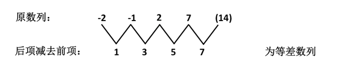
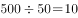
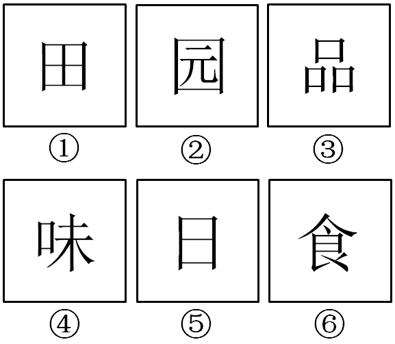
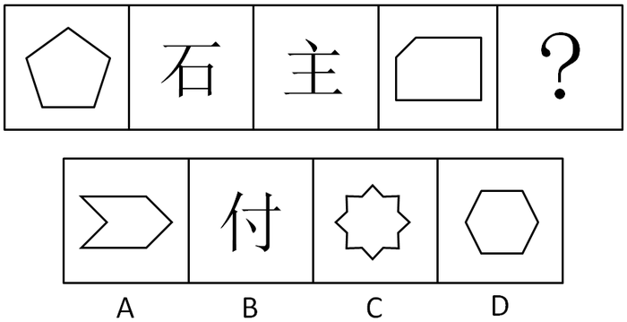
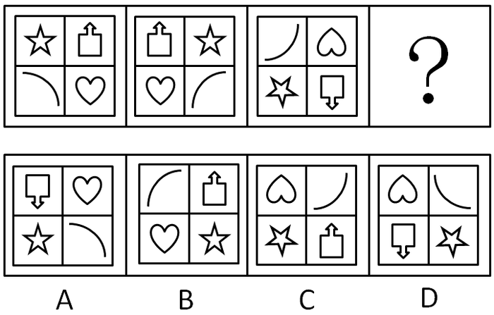
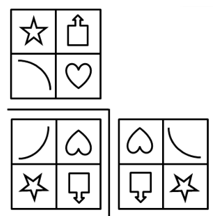
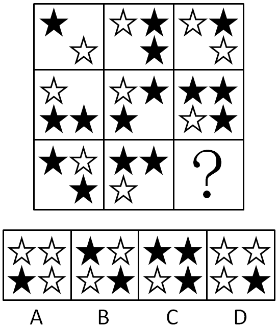
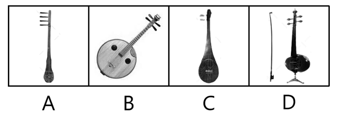
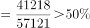

# 2012年吉林省公务员录用考试《行测》题（甲级）

<!-- gwy:overview:start -->
> **吉林 · 2012 · 行测 · 甲级** ｜ 63 题 · 图片 26 处 · 答案随题折叠

| 题型模块 | 题量 | 题号 |
| --- | ---: | ---: |
| 数量关系 | 10 | 1–10 |
| 言语理解与表达 | 16 | 11–26 |
| 判断推理 | 17 | 27–43 |
| 常识判断 | 15 | 44–58 |
| 资料分析 | 5 | 59–63 |
| **合计** | **63** | |

导航：[题型与作答说明](#题型与作答说明) · [题目](#题目) · [材料 1](#材料-1)
<!-- gwy:overview:end -->

> 候选采集稿。参考答案及解析来自粉笔页面，不代表官方答案或真实高分答卷；来源使用许可与原卷对应关系仍需人工核实。

## 题型与作答说明

数量关系

（10题）

本部分包括数字推理和数学运算两种类型的试题。

言语理解与表达

（16题）

每道题包含一段短文，短文后面是一个不完整的陈述，要求你从四个选项中选出一项来完成这一陈述。注意：供选择的答案有时可能是对短文内容的一个复述，有时则满足了陈述中其他方面的要求，你的选择应与所提要求最相符合。

判断推理

（17题）

本部分包括定义判断、逻辑推理、图形推理与常识经验判断四种类型的题目。

常识判断

（15题）

要求你依据常识做出判断。请注意，似乎合理的答案可能有多种，你应选择最为合理的一个。

资料分析

（5题）

针对下列图、表或文字回答问题。你应根据资料提供的信息进行分析、比较、计算、处理。

## 题目

### 第 1 题

2，13，42，91，（    ）

A. 134

B. 188

C. 170

D. 160

第 1 题 · 答案与解析

**参考答案（粉笔题库参考内容）**

D

**解析**

原数列2，13，42，91，（    ）；

平方数列底数成等差数列；

修正项成递推和数列；

故未知项为。

故正确答案为D。

**来源**：2012年吉林省公务员录用考试《行测》题（甲级）第1题

### 第 2 题

\-2，-1/3，2/5，1，（  ）

A. 23/11

B. 14/9

C. -21/11

D. -11/9

第 2 题 · 答案与解析

**参考答案（粉笔题库参考内容）**

B

**解析**

对原数列进行反约分，变为、-1/3、2/5、7/7、，分母为等差数列，分子为作差二级等差数列。

故正确答案为B。

**来源**：2012年吉林省公务员录用考试《行测》题（甲级）第2题

### 第 3 题

19，7，37/9，23/8，（  ）

A. 19/6

B. 16/9

C. 17/7

D. 11/5

第 3 题 · 答案与解析

**参考答案（粉笔题库参考内容）**

D

**解析**

对原数列进行反约分，变为19/12、28/2^2、、46/4^2、(55/5^2)，分子列19、28、37、46、(55)为等差数列，分母列为平方数列，所以，最后答案为55/5^2=11/5。

故正确答案为D。

**来源**：2012年吉林省公务员录用考试《行测》题（甲级）第3题

### 第 4 题

5/6，6/11，11/17，17/28，（  ）

A. 28/42

B. 28/43

C. 28/44

D. 28/45

第 4 题 · 答案与解析

**参考答案（粉笔题库参考内容）**

D

**解析**

观察特征，每一个分数的分母为前一个分数的分子和分母的和，每一个分数的分子是前一个分数的分母。

故正确答案为D。

**来源**：2012年吉林省公务员录用考试《行测》题（甲级）第4题

### 第 5 题

5，3，9，6，13，9，17，12，21，（  ）

A. 25

B. 26

C. 15

D. 19

第 5 题 · 答案与解析

**参考答案（粉笔题库参考内容）**

C

**解析**

奇数项：5、9、13、17、21为等差数列；

偶数项：3、6、9、12、(15)为等差数列。

故正确答案为C。

**来源**：2012年吉林省公务员录用考试《行测》题（甲级）第5题

### 第 6 题

出租车司机李师傅有午睡的习惯，一天，他睡午觉醒来，发现手机没电，手表停了，于是他只能打开收音机等待交通电台整点报时，如果他等待报时时间不超过15分钟，则这种可能性的大小为：

A. 1/2

B. 1/3

C. 1/4

D. 1/6

第 6 题 · 答案与解析

**参考答案（粉笔题库参考内容）**

C

**解析**

据题意，李师傅等待报时的时间不超过15分钟，所以在45~60的这段时间内，可以听到报时，而每小时有60分，所以听到的可能性是15/60=1/4。

故正确答案为C。

**考点**：概率问题-其他

**来源**：2012年吉林省公务员录用考试《行测》题（甲级）第6题

### 第 7 题

某人向单位圆形状的靶子内投掷一个靶点，连续投掷4次，若恰有3次落在第一象限的位置（假设以靶心为坐标原点，水平和铅直方向分别为横纵坐标建立平面直角坐标系）请你帮他计算一下这种可能性的大小为：

A. 3/64

B. 1/64

C. 1/4

D. 3/4

第 7 题 · 答案与解析

**参考答案（粉笔题库参考内容）**

A

**解析**

根据题意，落在第一象限概率为1/4，落在其他象限的概率为3/4，那么连续投掷4次，恰有3次落在第一象限的概率。

故正确答案为A。

**考点**：给概率求概率

**来源**：2012年吉林省公务员录用考试《行测》题（甲级）第7题

### 第 8 题

甲乙两个工程队修一条公路，甲工程队修了500米以后，乙工程队来修，以往资料显示，乙工程队的效率是甲工程队的2倍，乙工程队修600米公路所用的时间比甲工程队修500米公路时间还少20天，甲工程队效率是多少米/天：

A. 25

B. 15

C. 20

D. 10

第 8 题 · 答案与解析

**参考答案（粉笔题库参考内容）**

D

**解析**

解析1：根据题意，甲乙工程队的效率比是1:2，则工作时间比是2:1，假设乙工程队修500米的时间是x天，则甲工程队需要用时2x天，而乙工程队修600米的时间是(6/5)x天，从而有，解得x＝25。所以甲工程队修500米的时间是50天，则效率为米/天。

解析2：甲乙工作时间比是2:1，乙工程队修500米的时间和修600米的时间是5:6，联立则有甲修500米时间和乙修600米的时间是10:6＝5:3，由于差值是20天，所以甲修500米的时间是天，则其效率是米/天。

故正确答案为D。

**考点**：给具体单位型

**来源**：2012年吉林省公务员录用考试《行测》题（乙级）第10题

### 第 9 题

千禧锻造厂要制造一批一定比例的锡铁金属合金，第一次加入适量的金属铁后，此时金属锡的含量占总重量的4%，第二次加入同样多的金属铁后，金属锡的含量占总重量的3%。如果第三次再加入同样多的金属铁后，此时金属锡的含量占总重量的百分比是：

A. 2.5%

B. 2.4%

C. 2.7%

D. 2.8%

第 9 题 · 答案与解析

**参考答案（粉笔题库参考内容）**

B

**解析**

金属锡的量保持不变，因此首先考虑将金属锡的重量赋值为24，则可知金属锡含量变化过程为，于是第三次加入同样多的金属铁后金属锡含量为2.4%。

故正确答案为B。

**来源**：2012年吉林省公务员录用考试《行测》题（甲级）第9题

### 第 10 题

实验中学初中部三年级有4个班级，本学期末要评选三好学生，名额分配方案如下：从一班、二班、三班评选出32名三好学生，从二班、三班、四班评选出28名三好学生，并且一班和四班的三好学生总数是二班和三班的三好学生总数的两倍，请你计算一下，本学期末三年级要评选出的三好学生总数是：

A. 50

B. 45

C. 42

D. 40

第 10 题 · 答案与解析

**参考答案（粉笔题库参考内容）**

B

**解析**

设二、三班三好学生人数为A，一、四班三好学生人数为2A，则有32＋28＝A＋2A＋A，解得A＝15。因此三好学生总人数为15＋15×2＝45名。

故正确答案为B。

**考点**：和差倍比问题

**来源**：2012年吉林省公务员录用考试《行测》题（甲级）第10题

### 第 11 题

英国著名学术刊物《自然》6日发布声明，就其网站刊载的一篇将中国游泳运动员叶诗文和兴奋剂联系在一起的文章道歉。这篇文章认为叶诗文夺得伦敦奥运会女子400米个人混合泳金牌的卓越表现是“异常”的，即使当前的药检结果清白，也不能完全排除服用兴奋剂的可能，道歉声明中提到：“我们注意到相关讨论中指出的一些错误，以及相关统计中缺乏更多的细节，造成了我们支持指责叶诗文的印象，而需要强调的是\_\_\_\_\_\_\_\_。”

填入横线的语句与上文衔接最顺畅的一句是（     ）。

A. 我们对此表示遗憾

B. 这不是我们的意图

C. 我们向叶诗文道歉

D. 这确实是一个问题

第 11 题 · 答案与解析

**参考答案（粉笔题库参考内容）**

B

**解析**

本题属于语句填空题，文段所填的句子要与文段的意思保持一致，文段一直强调的是叶诗文服用兴奋剂的这件事是如何的，A项主语是我们，所以话题不一致，排除。上文都在强调这个错误不是他们主动造成的，有推托的意味，所以C项，语境不协调，排除。D项无道歉的意思，话题不一致，排除。故选择B项。

故正确答案为B。

【出处】新华网：《英著名学术杂志发表声明 就争议文章致歉叶诗文》

**考点**：横线在结尾

**来源**：2012年吉林省公务员录用考试《行测》题（甲级）第11题

### 第 12 题

计算机时代，字库就在我们每个人手边，当我们在电脑上用文字处理软件打出一篇文章，想要给它换上一种好看的字体时，我们其实就已经在与字库打交道了，但很多人并不知道，目前我国汉字字库仅421款字体，而比邻的日本，汉字字库则多达2973款。

这段文字的主旨是：

A. 我国汉字字库数量不及日本

B. 我国汉字字库的字体不及日本

C. 计算机时代字库是文字处理的必需品

D. 我国汉字字库的字体不够多

第 12 题 · 答案与解析

**参考答案（粉笔题库参考内容）**

D

**解析**

本题为中心理解题。

由原文“我国仅”“日本则多达”等关键词可知作者对我国汉字字库的字体数量是不满意的。

表明作者态度的D项做主旨最恰当。

A项偷换主体，材料讲的是字库中的字体款式不及日本，而非字库数量，排除；B项偷换概念，不是字体不及日本，而是字体数量，排除；C项在文中并未提及，排除。

故正确答案为D。

**考点**：关联词-转折

**来源**：2012年吉林省公务员录用考试《行测》题（甲级）第12题

### 第 13 题

2012年全国第二季度GDP较上年同期增长7.6%，创下2009年第一季度以来的最低水平。中国宏观经济已持续性加速回落，为此，我国应加快转型步伐，结构性减税势在必行。面对外需疲软和内需不济，居民收入分配改革和打破垄断对于稳增长而言迫在眉睫。减少一点国家税收和企业利润，提高居民收入来增加消费将是长远动力。

对这段文字主要观点的提炼，最恰当的一项是：

A. 减税增收是长远动力

B. 分配制度改革迫在眉睫

C. 打破垄断减少企业利润

D. 结构性减税势在必行

第 13 题 · 答案与解析

**参考答案（粉笔题库参考内容）**

A

**解析**

本题为中心理解题。

文段先提出我国“宏观经济已持续性加速回落”这一问题，再提出解决办法，即“结构性减税”和“提高居民收入”。

观察选项，只有A项“减税增收”的说法最为全面。

B项偷换概念，“居民收入分配改革”和“分配制度”不是一回事；C项只是一种具体的增加居民收入的方法，不是文段主旨；D项只提到了减税，没有增收，不够全面。

故正确答案为A。

**考点**：关联词-对策

**来源**：2012年吉林省公务员录用考试《行测》题（甲级）第13题

### 第 14 题

上世纪70年代末，中国实行严厉的计划生育政策，每对夫妻只能生育一个孩子。计划生育有效控制了人口，但“天有不测风云，人有旦夕祸福”，计划生育也使得独生子女家庭面临更大的风险。投资者强调不能把所有鸡蛋放在一个篮子里，独生子女家庭却只能把鸡蛋放在一个篮子里，因为就算有更多的篮子，鸡蛋却只有一个，无论放在哪只篮子里，摔了也就没有了。

这段文字要说明的是（　）。

A. 我国实行计划生育政策的起始时间

B. 计划生育政策有风险

C. 天有不测风云，人有旦夕祸福

D. 计划生育给独生子女家庭带来高风险

第 14 题 · 答案与解析

**参考答案（粉笔题库参考内容）**

D

**解析**

本题为中心理解题。

材料在第一句话点明计划生育政策内容，第二句话转折提出重点“计划生育也使得独生子女家庭面临更大的风险”，下文都是对这句话的观点进行论证，与这一意思相符的是D项。

A项，“我国实行计划生育政策的起始时间”为非重点内容，应排除。

B项，没有针对性，泛化了范围，应排除。

C项，没有针对性，不是重点内容，应排除。

故正确答案为D。

**考点**：关联词-转折

**来源**：2012年吉林省公务员录用考试《行测》题（甲级）第14题

### 第 15 题

在这个国家的历史上，一直缺乏对个体的足够尊重。（A）自春秋至今代中国，尊严一词多与“权力”相关。但在现代，尊严一词更多地与“权利”相关，简而言之，尊严就是独立个体的权力被尊重。中国古代等级秩序森严，个人本位缺失，权力意志匮乏等一系列因素，造成国人个体很难有真正意义上的被尊重。（B）而到了现代中国，在“全国一盘棋”年代，个体被诠释为“一枚螺丝钉”，“祖国需要到哪里去就到哪里去”。（C）时至今日，仍有人认为个体对于国家而言不过是“蝼蚁”。（D）可见要让中国人有尊严地活着，还有很长的路要走。

“个体的选择与感受完全被忽视，更别提个体被尊重甚至幸福感了。”一句是从文中抽离的，他最恰当的位置是：

A. （A）

B. （B）

C. （C）

D. （D）

第 15 题 · 答案与解析

**参考答案（粉笔题库参考内容）**

C

**解析**

语句衔接题。

文段以时间顺序指出我国一直缺乏对个体的尊重。分析现代中国个体被诠释为“螺丝钉”，“祖国需要到哪里去就到哪里去”与填入句“个体的选择与感受完全被忽视，更别提个体被尊重甚至幸福感了”相对应，前后承接顺畅。

故正确答案为C。

**考点**：横线在中间

**来源**：2012年吉林省公务员录用考试《行测》题（甲级）第15题

### 第 16 题

《你幸福吗？》在《新闻联播》连续播出了8天，引起网络热议，以“你幸福吗”为关键词的搜索，也有超过5600万的词条。而最开始爆红的无疑是那位回答“我姓曾”的大爷，很难想象，这样的“雷人回答”在以前的央视能否播出。对这文段信息的提炼不恰当的是：

A. 这档节目颠覆了许多人心目中对央视的传统印象

B. 央视新闻与普通人之间的语境存在巨大差别

C. 《新闻联播》每一次细小的改变都会引发舆论的关注

D. 央视新闻开始将麦克风交给普通人，倾听他们的声音

第 16 题 · 答案与解析

**参考答案（粉笔题库参考内容）**

B

**解析**

此题为非典型的细节判断题。

A项，由“很难想象，这样的‘雷人回答’在以前的央视能否播出”可知，符合文意；

B项，“央视新闻与普通人之间的语境存在巨大差别”，“巨大差别”无中生有，不符合文意；

C项，由“引起网络热议”可知，符合文意；

D项，根据文意可知，“你幸福吗？”采访的就是普通人，他们的声音真实地、不加改动地出现在新闻联播上，代表着央视新闻开始倾听普通人的声音，故符合文意。

本题为选非题，故正确答案为B。

**考点**：细节判断题

**来源**：2012年吉林省公务员录用考试《行测》题（甲级）第16题

### 第 17 题

当然，《舌尖上的中国》如此热遍全国甚至热传海外，多少会有一些天时地利人和的机遇，未必能够完全复制。但《舌尖上的中国》在规律上却并非完全可遇不可求，如果文化产品能够立足生活，深度开掘，提升专业含量，尊重艺术创作规律，与观众的体验和情感自觉沟通，那么电视文化不仅可以创造收视率而且可以成为文化传承的最有效的载体，这段文字没有直接支持的观点是：

A. 《舌尖上的中国》的成功有其内在的必然性

B. 《舌尖上的中国》是我国电视纪录片的典型作品

C. 《舌尖上的中国》成为传承中国饮食文化的有效载体

D. 《舌尖上的中国》不一定具有普遍意义

第 17 题 · 答案与解析

**参考答案（粉笔题库参考内容）**

B

**解析**

本题为细节判断题。

由首句“《舌尖上的中国》如此热遍全国甚至热传海外，多少会有一些天时地利人和的机遇”可知其成功有一些必然因素，故A项正确；C项由“电视文化······成为文化传承的最有效的载体”可知其正确；D项由“未必能够完全复制”可知其正确。

B项无中生有，并不能从文段得知。

本题为选非题，故正确答案为B。

**考点**：细节判断题

**来源**：2012年吉林省公务员录用考试《行测》题（甲级）第17题

### 第 18 题

过去的5年，全国贫困人口从6431万减少到2688万人，但我国贫困标准一向比国际标准低，如果贫困标准上调到年人均纯收入1500元，贫困人口总数将增多，可能再回到9000多万甚至上亿，这段文字意在说明：

A. 我国的扶贫需要向国际标准看齐

B. 过去5年扶贫成绩斐然

C. 我们的扶贫任务仍然艰巨

D. 我国贫困人口增近1亿

第 18 题 · 答案与解析

**参考答案（粉笔题库参考内容）**

C

**解析**

本题为中心理解题。

文段开篇说明我国近5年的扶贫成效，接下来转折说如果我国的扶贫标准提高，则我国的贫困人数将会大增，由此可知其意图是说我国的扶贫任务依然艰巨。

A项“需要”无从推知；B项侧重扶贫成绩，不是文章想要强调的主旨；D项说的是提高扶贫标准以后的情况，故排除。

故正确答案为C。

**考点**：关联词-转折

**来源**：2012年吉林省公务员录用考试《行测》题（甲级）第18题

### 第 19 题

公车改革的漏洞是一面镜子，它寓示着，只有让所有公共治理的漏洞都充分聚焦民意，社会才能进步，现在，公车改革新政遭遇质疑，让那些可能被权利钻空子的漏洞被及时曝光，尽管会让人看到改革滞重难行的一面，但我们更应该感受到民意洪流无法阻挡。每一项制度改革的漏洞，如果都能有民意与权力进行深度博弈，社会就一定能够渐渐步入民主与法治的轨道，一路畅行。

对这段材料的关键词语提炼准确的是：

A. 公车改革 民意 权力 博弈

B. 制度改革 轨道 权力 畅行

C. 漏洞 民意 权力 博弈

D. 公共治理 轨道 权利 畅行

第 19 题 · 答案与解析

**参考答案（粉笔题库参考内容）**

C

**解析**

本题为中心理解题。

文段意在通过“公车改革的漏洞”探讨如何通过民意与权力深度博弈，使社会进入民主法治轨道的问题。

故漏洞、民意、权力和博弈为关键词。“公车改革”、“制度改革”等并非关键词。

故正确答案为C。

**考点**：主题词、关联词-对策

**来源**：2012年吉林省公务员录用考试《行测》题（甲级）第19题

### 第 20 题

中央党校政法教研部教授林喆称，微博问政也存在无序发展的问题，认为群众通过个人微博举报一方面容易打草惊蛇，另一方面也给自己的人身安全带来一些问题，林教授说，我还是赞同公众通过正常渠道反映官员腐败问题，对林教授的观点理解正确的是：

A. 微博反腐因网络暴力而失序

B. 微博不是反腐的首选途径

C. 微博反腐弊大于利

D. 微博反腐安全成本高

第 20 题 · 答案与解析

**参考答案（粉笔题库参考内容）**

B

**解析**

据提问知此题为细节判断题。

据林教授的观点“我还是赞同公众通过正常渠道反映官员腐败问题”可知，林教授不赞成将微博反腐作为反腐的第一渠道。

A项“因网络暴力”从文段中无从推知，文段仅提到“微博问政存在失序的问题”；C项错在“弊大于利”无从推知；D项“安全成本高”说法不准确，文中没有涉及安全成本高低的比较。

故正确答案为B。

**考点**：细节判断题

**来源**：2012年吉林省公务员录用考试《行测》题（甲级）第20题

### 第 21 题

取消高中阶段的文理分科，应当慎行。只有绝大部分学校的课程、师资等教育资源丰富起来时，我国高中教育阶段实施真正意义上的学分制教育才具有坚实的发展基础；只有包括高考和高校录取制度改革在内的教育整体改革逐步完成时，全面取消文理分科方可水到渠成，全面取消分科要水到渠成，下面不属于条件要素的是：

A. 我国绝大部分学校资源足够丰富

B. 分部实施，先做试点，再全面推开

C. 高考和高校录取制度，改革等教育整体改革基本完成

D. 我国高中教育实施真正意义上学分制

第 21 题 · 答案与解析

**参考答案（粉笔题库参考内容）**

B

**解析**

据提问知此题为细节判断题。

A项由原文“只有绝大部分学校的课程，师资等教育资源丰富起来时”可知；C项由原文“只有包括高考和高校录取制度改革在内的教育整体改革逐步完成时”可知；D项由原文“我国高中教育阶段实施真正意义上的学分制教育才具有坚实的发展基础”可知。

B项并未在文中出现。

本题为选非题，故正确答案为B。

**考点**：细节判断题

**来源**：2012年吉林省公务员录用考试《行测》题（甲级）第21题

### 第 22 题

研究人员指出，术语“生物降解”这个词的使用是不规范的。一些厂家说，这些产品如果在物理上发生了一些变化，则是可以降解的，它们一旦与其他物质混合，便会自然消失或者可以支持生物的成长。研究人员认为，真正的生物降解在需氧条件下可以分解成二氧化碳和水；在厌氧条件下，它们则可以分解成甲烷和二氧化碳。然而，经他们试验的产品都不能降解，也不能达到上述标准。

这段文字意在说明：

A. “生物降解”不是一个科学的术语

B. “生物降解”在现实中根本不存在

C. “生物降解”这个说法名不副实

D. “生物降解”这个术语的运用有语法错误

第 22 题 · 答案与解析

**参考答案（粉笔题库参考内容）**

C

**解析**

本题为中心理解题。

由原文“不规范”“一些厂家说······可以降解”“真正的生物降解······”“然而······都不能降解，也不能达到上述标准”可知，厂家所说的“生物降解”是名不副实的，并非“不科学”“不存在”，更不是“语法错误”。

故正确答案为C。

**考点**：分述句特征-其他

**来源**：2012年吉林省公务员录用考试《行测》题（甲级）第22题

## 材料 1

在英国权威的科学杂志《自然》上刊登的一篇美国科学家的论文说，研究人员在实验室里把抗虫害转基因玉米“BT玉米”的花粉撒在苦苣菜叶上，然后让蝴蝶幼虫啃食这些菜叶，四天之后，有44%的幼虫死亡，活着的幼虫身体也较小，而且没有精神。而另一组幼虫啃食撒有普通玉米花粉的菜叶，就没有发生类似现象。另据英国科学家的研究表明，与一般大豆相比，耐除草剂的转基因大豆中，防癌的成分异黄酮减少了，这些结论引起了科学家的担心，也引起了世界范围的不安。

        苏格兰科学家普斯陶伊的转基因土豆研究，情况却有所不同。去年秋季，普斯陶伊称，自己一项未经发表的实验结果表明，年幼老鼠在食用转基因土豆10天后，其肾脏、脾和消化道都出现损伤，而且免疫系统也遭到破坏，他由此推论，转基因产品对人体也会有类似影响。他的结论据说得到了14个国家20名科学家的认同，但英国最具权威的科研机构英国皇家学会宣布，该学会组织的6人专家组经过详细评估发现，他的研究无论在设计上，还是在操作和数据上，都充满漏洞，他的结论无法成立。然而，这场在英国引起并跨出国界的轩然大波却至今未平。

        转基因技术是一项先进的生物技术，这一点已在世界范围内取得共识。美国是转基因技术最先进的国家，据统计，美国的大学、科研机关和企业等已经开发出上百个转基因作物品种，其中仅有43个品种的安全性得到了美国食品和药物管理局的确认。面临转基因玉米和大豆正在进行大面积种植与大量出口以及由此引发争议的现状，美国国家科学院已经郑重承诺，将就转基因食品的安全性问题展开全面调查。看来，在发展转基因技术的同时，也是应当注意吸取任何一种现代工业技术发展过程中的教训的。

### 第 23 题

引起“科学家的担心”和“世界范围的不安”的原因是：

A. “BT玉米”抗虫害能力并不能达到百分之百，某些转基因大豆可能会致癌。

B. 转基因作物只能间接给人类带来益处，并且有的还影响人体健康。

C. 某些转基因作物会对生态环境造成危害，还有一些会削弱作物对人体健康的作用。

D. 转基因作物会毒杀昆虫或影响昆虫的发育，并会降低人体自身的防癌功能。

第 23 题 · 答案与解析

**参考答案（粉笔题库参考内容）**

C

**解析**

此题为细节判断题。

据题干可将答案定位到原文首段，“这些结论”指的是第一段两个实验的结论，第一个是转基因玉米“BT玉米”的花粉对生态环境的危害，第二个是转基因大豆削弱了作物对人体健康的作用。

只有C项完整总结了实验结论。

A项错在“致癌”，原文只是说防癌功能降低；B项错在“间接带来益处”；D项是实验观察到的现象，不是结论。综上所述，排除A、B、D三项。

故正确答案为C。

**来源**：2012年吉林省公务员录用考试《行测》题（甲级）第23题

### 第 24 题

不符合第二自然段文意的一项是：

A. 普斯陶伊认定，转基因作物会损伤动物内脏并破坏免疫系统，他声称是通过实验证明这一点的

B. “有所不同”是针对第一自然段而言，意思是说普斯陶伊的结论没有引起科学家的担心与不安

C. 普斯陶伊所引发的风波，表明了在世界范围内人们对这项先进的生物科学技术的某种担心与不信任

D. 英国皇家学会认为普斯陶伊的结论不能成立，根据主要是普斯陶伊实验的科学性太差

第 24 题 · 答案与解析

**参考答案（粉笔题库参考内容）**

B

**解析**

此题为细节判断题。

由第二段末尾“这场在英国引起并跨出国界的轩然大波却至今未平”可知，普斯陶伊关于转基因土豆对人体健康有危害的结论一样引起了科学家的担心和不安。

故正确答案为B。

**来源**：2012年吉林省公务员录用考试《行测》题（甲级）第24题

### 第 25 题

文中所说的“教训”指的是：

A. 发展现代工业技术没有注意到它可能造成的危害而做到趋利避害

B. 发展生物科学没有注意到它对生态平衡和人类健康的影响

C. 现代工业技术没有注意到它的安全性及对人们心理的影响

D. 在科学发展中，没有听取各方面的不同意见，没有做更大范围的细致研究

第 25 题 · 答案与解析

**参考答案（粉笔题库参考内容）**

A

**解析**

此题考查词语理解。

由原文可知教训是“任何一种现代工业技术发展过程中”的教训，A项最准确，当选。

B项偷换概念，主体并非“发展生物科学”，排除；

C项文中没有提到“心理”，排除；

D项文中没有提到“听取各方面的不同意见”，排除。

故正确答案为A。

**来源**：2012年吉林省公务员录用考试《行测》题（甲级）第25题

### 第 26 题

同本文作者观点倾向不一致的一项是：

A. 转基因技术是一项先进的生物科学技术，但在推行的时候，要特别考虑到它的安全性问题

B. 面对运用转基因技术所引起的世界范围的担心与不安，吸取教训总结经验才是正确的做法

C. 转基因作物作为先进的生物科学技术成果所引起的担心和不安，绝不会妨碍这项技术的发展

D. 实验证明，某些转基因作物自身有长亦有短，但完全否定这项技术成果，尚缺乏科学依据

第 26 题 · 答案与解析

**参考答案（粉笔题库参考内容）**

C

**解析**

此题考查细节判断。

作者在肯定转基因技术是一项先进技术的同时，是不否认其安全性问题的。C项后半句“绝不会妨碍这项技术的发展”过于绝对，不符合这一观点，当选。

本题为选非题，故正确答案为C。

**来源**：2012年吉林省公务员录用考试《行测》题（甲级）第26题

### 第 27 题

把下面的六个图形分为两类，使每一类图形都有各自的共同特征或规律，分类正确的一项是：

A. ①②⑥，③④⑤

B. ①③⑤，②④⑥

C. ①④⑤，②③⑥

D. ①⑤⑥，②③④

第 27 题 · 答案与解析

**参考答案（粉笔题库参考内容）**

B

**解析**

元素组成凌乱，首先考虑属性规律，并且注意到题干都是汉字。观察发现，笔画作为一种特殊的线段，有线的属性，图①③⑤为一组，均由直线组成，图②④⑥为一组，由曲线和直线共同组成。

故正确答案为B。

**考点**：属性规律-曲直性、文字/字母/数字类

**来源**：2012年吉林省公务员录用考试《行测》题（甲级）第27题

### 第 28 题

从所给四个选项中，选择最合适的一个填入问号处，使之呈现一定的规律性：

A. A

B. B

C. C

D. D

第 28 题 · 答案与解析

**参考答案（粉笔题库参考内容）**

B

**解析**

元素组成不同，题干出现明显多边形，优先考虑线数量。本题出现简单图形和汉字，对于简单图形，我们可以数线数量；对于汉字，我们可以数笔画数。因为题干中的每幅图线数量或笔画数均为5，第五幅图也应符合此规律。A项为6，B项为5，C项为16，D项为6 。

故正确答案为B。

**考点**：数量规律-线、文字/字母/数字类

**来源**：2012年吉林省公务员录用考试《行测》题（甲级）第28题

### 第 29 题

从所给四个选项中，选择最合适的一个填入问号处，使之呈现一定的规律性：

A. A

B. B

C. C

D. D

第 29 题 · 答案与解析

**参考答案（粉笔题库参考内容）**

D

**解析**

元素组成相同，优先考虑位置规律。观察发现，题干中图1经过左右翻转得到图2，图1经过上下翻转得到图3，如图所示：

根据此规律，图1通过翻转可以得到图4，只有D项符合（先上下翻转，再左右翻转），如图所示：

选项A、B、C中的图均不能由图1通过翻转得到。

故正确答案为D。

**考点**：位置规律-翻转

**来源**：2012年吉林省公务员录用考试《行测》题（甲级）第29题

### 第 30 题

从所给四个选项中，选择最合适的一个填入问号处，使之呈现一定的规律性：

A. A

B. B

C. C

D. D

第 30 题 · 答案与解析

**参考答案（粉笔题库参考内容）**

D

**解析**

题干中，每行的前两幅图叠加后可以得到第三幅图。

本题的叠加规则为：

根据此规律，第三行的前两幅图叠加后可以得到选项D中的图。

故正确答案为D。

**考点**：样式规律-黑白运算

**来源**：2012年吉林省公务员录用考试《行测》题（甲级）第30题

### 第 31 题

社会调整就是通过一定的社会权威，确定社会生活主体的行为方式，指明其发挥作用和发展的方向，有目的地将其纳入一定的秩序之中。社会调整根据其作用于人们行为的方式，和人们服从它的原因，可分为内在调整和外在调整。内在调整是人们学习一定社会群体的行为规定，外在调整则是通过外部压力使人们遵守一定社会规范的过程。

根据上述定义，下列各项中属于内在调整的是：

A. 社会舆论的监督也是实现领导干部廉洁自律的途径之一

B. 在警方新一轮的整肃之下，社会秩序明显好转

C. 3岁的小明在父母的教育下，知道过马路要走斑马线

D. 改革开放以来，国家高度重视并奖励科研，高水平的成果层出不穷

第 31 题 · 答案与解析

**参考答案（粉笔题库参考内容）**

C

**解析**

第一步：抓住定义中的关键词。

内在调整的关键词强调“人们学习一定社会群体的行为规定”。

第二步：逐一判断选项。

A项中“通过社会舆论的监督以实现领导干部廉洁自律”属于“通过外部压力使人们遵守一定社会规范”，A项属于外在调整，错误；

B项中“通过警方的整肃使社会秩序好转”属于“通过外部压力使人们遵守一定社会规范”，B项属于外在调整，错误；

C项中“小明接受教育后，自己知道过马路要走斑马线”属于“学习一定社会群体的行为规定”，C项属于内在调整，正确；

D项中“国家高度重视并奖励科研”并非为了“确定社会生活主体的行为方式”，D项不属于社会调整，错误。

故正确答案为C。

**考点**：常规问法

**来源**：2012年吉林省公务员录用考试《行测》题（甲级）第31题

### 第 32 题

内部行政行为是指行政机关作用于行政系统内部或者本行政机关内部行政行为，不属于人民法院行政诉讼的受案范围。行政机关工作人员对这类决定不服产生的争议应该向该行政机关或者其上一级机关或监察人事机关提出处理。

根据上述定义，下列各项中属于内部行政行为的是：

A. 某高校与食堂员工签订合同，并对工作不合格的员工做出解除劳动关系的决定

B. 某地人民政府为满足工作需要购进一批电脑，电脑安装后发现存在严重的质量问题，该政府决定向销售商追究其责任

C. 某市人民政府发布教育发展纲要，要求有关部门加大对中小学服务的教育投入，并加强对中小学的服务力度

D. 某地中小企业局将当地中小企业的信息网络化，将中小企业的发展需要公布在网上便于随时解决问题

第 32 题 · 答案与解析

**参考答案（粉笔题库参考内容）**

C

**解析**

第一步：抓住定义中的关键词。

关键词强调“行政机关”、“作用于行政系统内部或者本行政机关内部”、“行政行为”。

第二步：逐一判断选项。

A项中高校不符合“行政机关”，错误；

B项中“购进一批电脑，向销售商追究其责任”不符合“行政系统内部或者本行政机关内部”、“行政行为”，属于民事行为，错误；

C项中“人民政府发布教育发展纲要”对有关部门进行要求，这符合“行政机关”、“作用于行政系统内部”、“行政行为”，正确；

D项中“中小企业局”是“行政机关”，但是“将当地中小企业的信息网络化，将中小企业的发展需要公布在网上”不符合“系统内部或者本行政机关内部”、“行政行为”，错误。

故正确答案为C。

**考点**：主客体

**来源**：2012年吉林省公务员录用考试《行测》题（甲级）第32题

### 第 33 题

行为犯和结果犯的划分，在于确定犯罪的既遂与未遂问题，行为犯是指仅实施构成要件所描述的行为，无需发生物质的危害结果即可构成既遂的犯罪，结果犯是指在构成要件中要求行为人的行为发生一定的物质性的危害结果才可构成既遂的犯罪。

根据上述定义，下列犯罪既遂形态中属于行为犯的是：

A. 抢劫罪是指以非法占有为目的，以暴力、胁迫或者其他方法，强行劫取公私财物的行为

B. 盗窃罪是指以非法占有为目的，秘密窃取数额较大的公私财物或者多次盗窃公私财物的行为

C. 故意杀人罪是指故意非法剥夺他人的生命的行为

D. 脱逃罪是指依法被关押的罪犯，被告人犯罪嫌疑人脱逃司法机关羁押和监督的行为

第 33 题 · 答案与解析

**参考答案（粉笔题库参考内容）**

D

**解析**

第一步：抓住定义中的关键词。

行为犯强调“仅实施构成要件所描述的行为”，“无需发生物质的危害结果即可构成既遂”。

第二步：逐一判断选项。

A项中抢劫罪，出现了强行劫取公私财物的行为，构成了物质性的危害结果，属于结果犯，排除。

B项中盗窃罪，出现了窃取公私财物的行为，构成了物质性的危害结果，属于结果犯，排除。

C项中故意杀人罪的犯罪结果就是他人死亡，是一种有物质性危害结果的犯罪既遂，属于结果犯，排除。

D项中脱逃罪存在脱逃关押和监督这一行为，符合 “实施构成要件所描述的行为”，但是不存在物质性的危害结果，属于行为犯，当选。

故正确答案为D。

**考点**：常规问法

**来源**：2012年吉林省公务员录用考试《行测》题（甲级）第33题

### 第 34 题

阮是中国的一种弹拨乐器，在古代被称为“秦枇杷”。公元三世纪左右，有一位叫阮咸的音乐家，非常善于弹奏这种圆形音箱的“秦枇杷”。由于他的演奏技艺非常高超，深受老百姓的喜爱，人们就渐渐用他的名字“阮咸”来称呼这种乐器。阮的外形很简单，由琴头、琴杆和琴身三个部分组成，琴头一般装饰有中国传统的龙或如意等骨雕艺术品两侧装有四个弦鞘，阮的琴身是一个扁圆形的共鸣箱，由面板、背板和框版胶合而成。阮的机构原理、制作材料以及演奏技法和琵琶都有很多相同之处。

根据上述描述，下列四种乐器中哪一个是阮：

A. A

B. B

C. C

D. D

第 34 题 · 答案与解析

**参考答案（粉笔题库参考内容）**

B

**解析**

第一步：抓住定义中的关键词。

关键词强调“弹拨乐器”，“由琴头、琴杆和琴身三个部分组成”，“琴头两侧装有四个弦鞘”，“琴身是一个扁圆形的共鸣箱”。

第二步：逐一判断选项。

A项中的乐器四个弦鞘在同一侧，不符合“琴头两侧装有四个弦鞘”，A项错误；

B项中的乐器是“弹拨乐器”，它“由琴头、琴杆和琴身三个部分组成”，它的“琴头两侧装有四个弦鞘”，它的“琴身是一个扁圆形的共鸣箱”，B项正确；

C项中的乐器只有两个弦鞘，不符合“琴头两侧装有四个弦鞘”，C项错误；

D项中乐器是拉弦乐器，而阮是“弹拨乐器”，D项错误。

故正确答案为B。

**考点**：单定义-其他句式

**来源**：2012年吉林省公务员录用考试《行测》题（甲级）第34题

### 第 35 题

行政相对人指在行政法律关系中与行政主体相对应的另一方当事人，即行政主体的行政行为影响其权益的个人或组织。

下述甲某不属于行政相对人的是：

A. 城管对用手机拍摄执法过程的甲某大打出手

B. 民警对发黄色短信的甲某拘留

C. 交警对违章驾车的甲某罚款200元

D. 公安对非法入境的外国人甲某限期出境

第 35 题 · 答案与解析

**参考答案（粉笔题库参考内容）**

A

**解析**

第一步：抓住定义中的关键词。

关键词强调“行政法律关系中”，“与行政主体相对应的另一方当事人”。

第二步：逐一判断选项。

A项中城管是行政主体，城管在执法过程中对甲某大打出手并不属于行政行为，不构成“行政法律关系”，因此甲某不是行政相对人，A项不符合；

B项中“对发黄色短信拘留”是行政处罚，民警和甲某构成“行政法律关系”，B项符合；

C项中“对违章驾车罚款”是行政处罚，交警和甲某构成“行政法律关系”，C项符合；

D项中“对非法入境的外国人限期出境”是行政处罚，公安和甲某构成“行政法律关系”，D项符合。

本题为选非题，故正确答案为A。

**考点**：大前提

**来源**：2012年吉林省公务员录用考试《行测》题（甲级）第35题

### 第 36 题

为了提高学习成绩，某班学生生病了也坚持在教室学习，但在高考中，该班学生没有一个考上重点大学，由此可见，学习时间长导致考试成绩差。

以下哪项如果为真，最能削弱上述论证？

A. 如果不坚持学习，该班考试成绩可能更不理想

B. 该班同学学习态度好

C. 生病了休息不会耽误考试成绩

D. 该班同学考试发挥不好

第 36 题 · 答案与解析

**参考答案（粉笔题库参考内容）**

A

**解析**

第一步：找到论点和论据。

本题的论点是学习时间长导致考试成绩差。论据是某班学生生病了也坚持在教室学习，但在高考中，该班学生没有一个考上重点大学。

第二步：逐一判断选项的作用。

A项中“如果不坚持学习，该班考试成绩可能更不理想”说明如果生病不坚持学习，成绩会更差，这证明长时间学习能使学习成绩提升，直接削弱论点，当选；

B项中“学习态度好”是对生病坚持学习的肯定，加强了论据，排除；

C项中“生病了休息不会耽误考试成绩”说明生病休息不会影响考试成绩，因此考试成绩差与学习时间长无关，C项削弱了论证，但C项的削弱程度不及A项，排除；

D项中“该班同学考试发挥不好”说明考试成绩差是发挥不好导致的，而不是学习时间长导致的，D项削弱了论点中的原因，但D项的削弱程度不及A项，排除。

故正确答案为A。

**考点**：削弱论点

**来源**：2012年吉林省公务员录用考试《行测》题（甲级）第36题

### 第 37 题

有一项对500名25~35岁女性进行的科学实验，设置两个实验组，第一组实验者长期服用阿司匹林，第二组实验者没有服用阿司匹林。结果发现，长期服用阿司匹林者眼角比不服用阿司匹林者眼角出现皱纹要晚，而且皮肤光滑柔嫩。这一实验表明，阿司匹林有可能成为一种廉价有效的防皱、保青春药物。

以下哪项如果为真，最能支持上述结论：

A. 两组被实验者的眼角皮肤在实验前是相当的

B. 两组被实验者的人数相等

C. 第一组被实验者服用的阿司匹林的量较大

D. 阿司匹林是人工合成的

第 37 题 · 答案与解析

**参考答案（粉笔题库参考内容）**

A

**解析**

第一步：找到论点和论据。

本题的论点是阿司匹林有可能成为一种廉价有效的防皱，保青春药物。论据是一项对500名25~35岁女性进行的科学实验，设置两个实验组，第一组实验者长期服用阿司匹林，第二组实验者没有服用阿司匹林。结果发现，长期服用阿司匹林者眼角比不服用阿司匹林者眼角出现皱纹要晚，而且皮肤光滑柔嫩。

第二步：逐一判断选项的作用。

题干中的实验是对比实验。对比实验要求除了服用阿司匹林和没有服用阿司匹林这个条件不同以外，两个实验组在实验前有相同或相近的实验状态。

A项中“两组被实验者的眼角皮肤在实验前是相当的”符合实验前实验者有相当的实验状态，从而验证了阿司匹林对眼角皮肤的作用，进而能得出“阿司匹林有可能成为一种廉价有效的防皱，保青春药物”的结论，A项支持了结论；

B项中“两组被实验者的人数相等”也是为了使两个实验组在实验前有相同或相近的实验状态，B项支持了结论。但是实验人数相等不是本次实验中必须要相同的实验状态，B项的加强程度不及A项；

C项中“第一组被实验者服用的阿司匹林的量较大”与题干中实验的变量不符。题干中实验的变量是“用阿司匹林和不用阿司匹林”，而非“大量用阿司匹林和不用阿司匹林”，C项不能支持结论；

D项中“阿司匹林是人工合成的”和题干的内容无关，D项不能支持结论。

故正确答案为A。

**考点**：加强-实验类、必要条件

**来源**：2012年吉林省公务员录用考试《行测》题（甲级）第37题

### 第 38 题

张明说：如果选李明当教练，那么王芳就要当领队。

李红：我不同意。

以下哪项最符合李红的意思？

A. 选李明当教练，但不能让王芳当领队

B. 如果选李明当教练，就不能让王芳当领队

C. 不选李明当教练，但要让王芳当领队

D. 如果不选李明当教练，就要让王芳当领队

第 38 题 · 答案与解析

**参考答案（粉笔题库参考内容）**

A

**解析**

第一步：翻译题干。利用充分必要条件。

张明：选李明当教练→王芳当领队。

李红：-（选李明当教练→王芳当领队）。

第二步：对题干进行转化推导。

“如果A，那么B”的矛盾命题是“A且非B”。因此“-（选李明当教练→王芳当领队）”等值于：选李明当教练∧王芳不当领队，即选李明当教练，但不能让王芳当领队。

故正确答案为A。

**考点**：常规翻译

**来源**：2012年吉林省公务员录用考试《行测》题（甲级）第38题

### 第 39 题

天文学家说：“如果太阳毁灭，则银河系中有外星人。”与天文学家意思相同的是：

A. 太阳不会毁灭或银河系中有外星人

B. 如果银河系中有外星人，则太阳不会毁灭

C. 如果银河系中有外星人，则太阳毁灭

D. 银河系中有外星人或太阳毁灭

第 39 题 · 答案与解析

**参考答案（粉笔题库参考内容）**

A

**解析**

第一步：翻译题干。

天文学家：太阳毁灭→银河系中有外星人。

第二步：逐一分析选项。

A项：太阳不会毁灭或银河系中有外星人，或关系，否一推一，等价于：太阳毁灭→银河系中有外星人，与天文学家的意思相同，当选；

B项：银河系中有外星人→太阳不会毁灭，肯定了题干的后项，肯定后项得不到必然性的结论，排除；

C项：银河系中有外星人→太阳毁灭，肯定了题干的后项，肯定后项得不到必然性的结论，排除；

D项：银河系中有外星人或太阳毁灭，或关系，否一推一，等价于：银河系中没有外星人→太阳毁灭，否定后项应该得到否定前项的结论，而不是肯定前项的结论，排除。

故正确答案为A。

**考点**：常规翻译

**来源**：2012年吉林省公务员录用考试《行测》题（甲级）第39题

### 第 40 题

甲专家针对我国国内的煤炭市场结构已经供大于求的局面。提出：“要么限产以保价，要么降价。”乙说：“我不同意”。

如果乙坚持自己的意见，哪个可以断定乙在逻辑上必须同意：

A. 限产来保价但不降价

B. 如果既不限产来保价也不降价不行的话，就必须既降产又降价

C. 既降产又降价

D. 降价但不降产来保价

第 40 题 · 答案与解析

**参考答案（粉笔题库参考内容）**

B

**解析**

第一步：翻译题干。

甲专家：要么限产以保价，要么降价；

乙：－（要么限产以保价，要么降价），等价于（限产以保价且降价）或（-限产以保价且-降价）。

第二步：逐一分析选项。

A项：是甲专家同意的观点，不是乙专家同意的观点，排除；

B项：-（既不限产来保价也不降价）→既降产又降价，是乙专家观点（或关系）的否一推一，是乙专家必须同意的观点，当选；

C项：只是肯定了乙专家观点（或关系）中的一项，并不是乙专家必须同意的观点，因为乙专家同意的也可能是不限产以保价且不降价，排除；

D项：是甲专家同意的观点，不是乙专家同意的观点，排除。

故正确答案为B。

**考点**：常规翻译

**来源**：2012年吉林省公务员录用考试《行测》题（甲级）第40题

### 第 41 题

随着健康出行现今日渐受宠，以探险为主题的户外运动，拥有了越来越多的粉丝。近日一项对2011年度户外安全事故原因的调查显示，迷路是户外安全事故的首要原因，其中迷失方向121起，找不到出去路线32起，体力不支被困13起。因此，专家建议要防止迷路，首先要看攻略，熟悉路线，不能盲目追求美景而忽视了最基本的人身安全。

下列哪项为真，对上述统计结果质疑力度最弱：

A. 2011年度因“旅游”主观疏忽大意的户外安全事故170起

B. 因缺少专业领队而发生的户外安全事故逐渐增多

C. 2011年度共发生安全事故401起

D. 2011年度因户外装备欠缺而发生的事故超166起

第 41 题 · 答案与解析

**参考答案（粉笔题库参考内容）**

B

**解析**

第一步：找到论点和论据。

本题的论点是专家建议要防止迷路，首先要看攻略，熟悉路线，不能盲目追求美景而忽视了最基本的人身安全。论据是迷路是户外安全事故的首要原因，其中迷失方向121起，找不到出去路线32起，体力不支被困13起。

第二步：判断削弱方式。

论点说要防止迷路，论据说迷路是首要原因，论点和论据间有因果联系，需削弱论点。

第三步：逐一判断选项的作用。

A项中“主观疏忽大意的户外安全事故170起”，题干中“迷路”有166起，这说明在户外安全事故中“主观疏忽大意”是更重要的原因，因此应防止“主观疏忽大意”，A项削弱论点，排除；

B项中“因缺少专业领队而发生的户外安全事故逐渐增多”说明“缺少专业领队”也是户外安全事故的原因。但是由于没有具体数据，因此“缺少专业领队”不能和“迷路”比较说明哪个原因更重要，B项无法削弱论点，当选；

C项中“2011年度共发生安全事故401起”，因为“迷路”是包括了“迷失方向”+“找不到出去路线”+“体力不支”，所以“迷路”166起占不到一半，这说明可能存在其他更重要的原因，因此应防止那个更重要的原因的出现，C项削弱论点，排除；

D项中“因户外装备欠缺而发生的事故超166起”说明户外安全事故中“户外装备欠缺”是更重要的原因，因此应防止“户外装备缺乏”，D项削弱论点，排除。

故正确答案为B。

**考点**：削弱选非题

**来源**：2012年吉林省公务员录用考试《行测》题（乙级）第32题

### 第 42 题

有研究人员指出，自工业革命以来，人类活动的能力和范围都显著增加。与此同时，海洋的pH值，却在逐渐下降。因此人类活动与海洋的变化之间具有因果关系，这将给海洋生态系统造成不可逆转的损害。但是，反对者认为，大气中本身含有的二氧化碳才是导致海洋酸化的罪魁祸首。如果没有海洋吸收二氧化碳，大气中的二氧化碳将远高于当前水平，全球变暖的影响将更加严重。

以下哪项如果为真，最能削弱反对者的观点：

A. 据统计，工业革命以来大气中的二氧化碳含量明显增加

B. 工业革命以前的人类活动并没有导致海洋酸化

C. 二氧化碳不会全部被海洋吸收，有相当一部分残留在大气中

D. 到2100年海水酸度将下降到7.8，那时海水酸度将比1800年高150%

第 42 题 · 答案与解析

**参考答案（粉笔题库参考内容）**

A

**解析**

第一步：找到论点和论据。

反对者的论点是大气中本身含有的二氧化碳才是导致海洋酸化的罪魁祸首，否认是人类活动带来的。论据是因为有海洋吸收二氧化碳，才使大气中的二氧化碳低于当前水平。

 第二步：逐一判断选项的作用。

A项中“工业革命以来大气中的二氧化碳含量明显增加”说明是人类的工业活动导致二氧化碳含量增加进而导致海洋酸化，并不是因为大气本身含有的二氧化碳增加导致海洋酸化，A项削弱了论点，A项正确；

B项中“工业革命以前的人类活动”，题干说的是“工业革命以后”的情况，工业革命前后，人类的活动性质也发生了根本性的变化，所以B项和题干无关，B项错误；

C项中“二氧化碳不会全部被海洋吸收，有相当一部分残留在大气中”说明这部分未被海洋吸收的大气中的二氧化碳是海洋酸化的原因，C项加强了论点，C项错误；

D项中2100年和1800年的海水酸度情况与题干论证的内容无关，D项错误。

故正确答案为A。

**考点**：削弱论点

**来源**：2012年吉林省公务员录用考试《行测》题（乙级）第33题

### 第 43 题

某单位统计上班迟到人数，一部门四人对是否迟到的说法如下：

赵：我没有迟到

李：王和赵至少有一个没有迟到

王：我们中有人迟到

张：我们四人都没有迟到

上述四人中有两人说的是真话，有两人说的是假话，则以下哪项断定为真：

A. 说真话的是赵和张

B. 说真话的是赵和李

C. 说真话的是李和王

D. 说真话的是李和张

第 43 题 · 答案与解析

**参考答案（粉笔题库参考内容）**

C

**解析**

第一步：观察题干，找突破口。

王说“我们中有人迟到”，张说“我们四人都没有迟到”，王和张的话矛盾，必有一真一假。又因为题干说“四人中有两人说的是真话，有两人说的是假话”，因此赵和李的话也必有一真一假。本题没有其他关联信息，适合用假设法。

第二步：使用假设法进行推导并判断选项正确与否。

假设赵的话为真，李的话为假。由于“赵没有迟到”，因此李的话也为真，这和假设中“李的话为假”矛盾，假设不成立。由于赵和李必有一真一假，因此，只能是赵的话为假，李的话为真。即：“赵没有迟到”为假，则事实上赵迟到了，“王和赵至少有一个没有迟到”为真，“赵迟到”可以推出“王没有迟到”。“赵迟到，王没有迟到”，那么王的话为真，张的话为假，这和题干中“四人中有两人说的是真话，有两人说的是假话”相符合，假设成立。

综上所述，王的话为真，张的话为假，赵的话为假，李的话为真。

故正确答案为C。

**考点**：两真两假

**来源**：2012年吉林省公务员录用考试《行测》题（甲级）第43题

### 第 44 题

古希腊人将神塑造为生动逼真的人的形象，这在一定程度上体现了古希腊的：

A. 民主思想

B. 无神论思想

C. 科学思想

D. 人文主义思想

第 44 题 · 答案与解析

**参考答案（粉笔题库参考内容）**

D

**解析**

民主思想强调的是公民的平等、自由。无神论思想指的是不相信鬼神或灵魂的存在的思想。科学思想指的是用科学知识和方法来思考问题、观察事物。人文主义的特点之一是以人为本，强调人的主体性。本题中，古希腊人将神塑造为生动逼真的人的形象，而非神圣的高高在上的神的形象，体现的正是古希腊的人文主义思想。

故正确答案为D。

**考点**：文化常识

**来源**：2012年吉林省公务员录用考试《行测》题（甲级）第44题

### 第 45 题

下面诗句中反映古代选官制度的是：

A. 春风得意马蹄疾，一日看尽长安花

B. 黄沙百战穿金甲，不破楼兰终不还

C. 朱门沉沉按歌舞，厩马肥死弓断弦

D. 金多众中为上客，夜夜算缗眠独迟

第 45 题 · 答案与解析

**参考答案（粉笔题库参考内容）**

A

**解析**

A项正确，“春风得意马蹄疾，一日看尽长安花”出自唐代诗人孟郊的《登科后》，这首诗是孟郊在考中进士、金榜题名之后所写的，淋漓尽致地抒发了他的喜悦之情，当选；

B项错误，“黄沙百战穿金甲，不破楼兰终不还”出自唐代诗人王昌龄的《从军行》，描写的是保家卫国的爱国戍边将士，排除；

C项错误，“朱门沉沉按歌舞，厩马肥死弓断弦”出自宋代诗人陆游的《关山月》，倾诉了爱国将士报国无门的满腔悲愤，排除；

D项错误，“金多众中为上客，夜夜算缗眠独迟”出自唐代诗人张籍的《贾客乐》，排除。

故正确答案为A。

**考点**：文学常识

**来源**：2012年吉林省公务员录用考试《行测》题（甲级）第45题

### 第 46 题

有人依据玛雅太阳历提出“2012世界末日说”。科学界多年的观测和研究表明：2012年可能大规模爆发太阳耀斑，会影响地球通讯系统，但不会导致地球文明毁灭。下面说法正确的是：

A. “世界末日说”对当代科学研究具有指导意义

B. “世界末日说”缺乏科学依据，不是对客观存在的反映

C. “世界末日说”与太阳耀斑爆发的内在联系，体现了联系的普遍性

D. 科学界对太阳耀斑的爆发及其后果的预测，反映了联系的客观性

第 46 题 · 答案与解析

**参考答案（粉笔题库参考内容）**

D

**解析**

A项错误，依据玛雅太阳历提出的“世界末日说”本身并不科学，因而不能指导科学研究；

B项错误，“世界末日说”尽管不是科学的理论，但仍然是对客观存在的反映，只不过是错误的反映；

C项错误，“世界末日说”与太阳耀斑爆发并不存在内在联系，这种说法本身是错误的。

故正确答案为D。

**考点**：唯物辩证法

**来源**：2012年吉林省公务员录用考试《行测》题（甲级）第46题

### 第 47 题

“你最痛苦的时候，窗外有小鸟在快乐地歌唱”，这句格言的寓意是：

A. 学习小鸟快乐生活

B. 世界的本质是客观的

C. 人的尊严在于思想

D. 思维是客观存在的反映

第 47 题 · 答案与解析

**参考答案（粉笔题库参考内容）**

B

**解析**

本题说明人的主观痛苦与外在的环境无关。人的痛苦和小鸟的快乐都是独立存在的社会物质，这强调了世界的本质是客观的，不以人的意识为转移。

故正确答案为B。

**考点**：唯物论

**来源**：2012年吉林省公务员录用考试《行测》题（甲级）第47题

### 第 48 题

人生在平淡中寻找幸福，在细微中品味幸福，在孤独中守望幸福，在遗忘中怀念幸福。幸福的生活需要哲学的指引，这是因为：

A. 哲学可以解决一切问题

B. 哲学是哲学家对自己实践活动的总结

C. 哲学为人们生活提供有益的指导

D. 真正的哲学就是生活本身

第 48 题 · 答案与解析

**参考答案（粉笔题库参考内容）**

C

**解析**

本题可以采用排除法来作答。

A项错误，错在说法过于绝对，回顾个人经历，可知生活中很多问题无法通过哲学来解决，更不用说一切问题了；

B项错误，就哲学本身的定义而言，哲学是一种社会意识形态，是理论化的、系统化的世界观。哲学家根据自身的实践和观察提出某种哲学学说，但这并不完全等同于哲学；

C项正确；

D项错误，哲学来源于生活，但高于生活。正是因为哲学高于生活，能够为人们的生活提供有益的指导，所以幸福的生活需要有哲学的指引。

故正确答案为C。

**考点**：总论

**来源**：2012年吉林省公务员录用考试《行测》题（甲级）第48题

### 第 49 题

当前拥有私家车的人越来越多，我国正在迈向汽车社会，汽车社会的来临呼唤“汽车道德”——如自觉遵守交通规则、不闯红灯、不酒驾等。从唯物史观看“汽车道德”的出现体现了：

A. 世界是不断变化发展的

B. 社会意识具有反作用

C. 社会存在决定社会意识

D. 社会意识具有相对独立性

第 49 题 · 答案与解析

**参考答案（粉笔题库参考内容）**

C

**解析**

历史唯物主义认为，社会存在是社会意识的前提和基础。有什么样的社会，就会有什么样的社会意识与之相适应。社会存在决定社会意识的内容和形式。

本题中，随着私家车数量的增加，我国逐渐形成“汽车社会”，有了“汽车社会”，人们开始呼唤“汽车道德”来规范“汽车社会”，这正是社会存在决定社会意识的体现。

故正确答案为C。

**考点**：唯物史观

**来源**：2012年吉林省公务员录用考试《行测》题（甲级）第49题

### 第 50 题

甲为躲避被人追杀而跳入乙家，把乙家的小孩踩成重伤，甲的行为是：

A. 紧急避险

B. 正当防卫

C. 过失杀人

D. 故意杀人

第 50 题 · 答案与解析

**参考答案（粉笔题库参考内容）**

A

**解析**

紧急避险是指为了使国家、公共利益、本人或者他人的人身、财产和其他权利免受正在发生的危险，不得已采取的紧急避险行为，造成损害的，不负刑事责任。

A项正确，本题中，甲为了避免自己的人身受伤害，不得已损害了第三方乙家小孩的利益，属于紧急避险的行为；

B项错误，正当防卫针对的是不法侵害对象而言，这里侵害的是第三方乙家小孩；

C项错误，过失杀人明显是错误的，因为乙家小孩只是受到重伤；

D项错误，本题中甲并不存在主观杀人的故意，不构成故意杀人罪。

故正确答案为A。

**考点**：刑法

**来源**：2012年吉林省公务员录用考试《行测》题（甲级）第50题

### 第 51 题

党的十八大提出，党要坚持解放思想、改革创新，坚持党要管党、从严治党，全面加强党的思想建设、组织建设、作风建设、（  ）、制度建设，增强自我净化、自我完善、自我革新、自我提高能力，建设学习型、服务型、创新型的马克思主义执政党。

A. 民主建设

B. 纪律建设

C. 反腐倡廉建设

D. 法制建设

第 51 题 · 答案与解析

**参考答案（粉笔题库参考内容）**

C

**解析**

党的十八大提出，“全党要增强紧迫感和责任感，牢牢把握加强党的执政能力建设、先进性和纯洁性建设这条主线，坚持解放思想、改革创新，坚持党要管党、从严治党，全面加强党的思想建设、组织建设、作风建设、反腐倡廉建设、制度建设，增强自我净化、自我完善、自我革新、自我提高能力，建设学习型、服务型、创新型的马克思主义执政党，确保党始终成为中国特色社会主义事业的坚强领导核心。”

故正确答案为C。

**来源**：2012年吉林省公务员录用考试《行测》题（甲级）第51题

### 第 52 题

一艘行驶在日本海域的美国货船上，有甲、乙两个中国人，发生争执，甲将乙捅死，依据我国《刑法》，该案件适用于哪国法律：

A. 中国法律

B. 美国法律

C. 日本法律

D. 既适用中国法律也适用日本法律

第 52 题 · 答案与解析

**参考答案（粉笔题库参考内容）**

A

**解析**

《刑法》第七条规定：“中华人民共和国公民在中华人民共和国领域外犯本法规定之罪的，适用本法，但是按本法规定的最高刑为三年以下有期徒刑的，可以不予追究。”甲将乙捅死，已构成故意杀人罪，故适用《刑法》。

故正确答案为A。

本题相关知识点：

本题考查的是《刑法》适用的空间效力问题。我国《刑法》以属地管辖为主，兼有属人原则、保护原则和普遍管辖原则。该考点属于法律常识的常考点，考生在备考时可重点关注该考点。

**考点**：刑法

**来源**：2012年吉林省公务员录用考试《行测》题（乙级）第38题

### 第 53 题

我国公民甲乙二人乘坐中国客轮去美国，途经日本海域时，甲乙二人发生争吵，甲掏出水果刀，连续向乙猛刺五刀，遂将乙刺死，甲的行为：

A. 适用于中国法律

B. 可适用于中国法律，也可适用于日本法律

C. 适用于美国法律

D. 适用于日本法律

第 53 题 · 答案与解析

**参考答案（粉笔题库参考内容）**

A

**解析**

本题考查刑法。

根据《中华人民共和国刑法》第六条第二款规定：“凡在中华人民共和国船舶或者航空器内犯罪的，也适用本法。”题中，我国公民甲在中国客轮上将乙杀害，适用中国刑法，应由我国进行管辖。

故正确答案为A。

**考点**：刑法

**来源**：2012年吉林省公务员录用考试《行测》题（甲级）第53题

### 第 54 题

甲遭遇仇敌追杀，情急之下，从一住户的窗户跳入屋内躲避，不想将睡在窗边的一小孩踩成重伤。则甲的行为性质为：

A. 过失致人重伤罪

B. 防卫过当

C. 紧急避险

D. 意外事件

第 54 题 · 答案与解析

**参考答案（粉笔题库参考内容）**

D

**解析**

本题考查防卫、紧急避险和意外事件的区别。

A项错误，本题目中首先是“遭遇仇敌追杀”所以有了先决条件，可以排除过失伤人的A；

B项错误，这里没有针对仇敌展开反抗，致使仇敌身体受伤或死亡，因此也不是防卫过当；

C项错误，紧急避险是指为了本人或者他人的人身、财产和其他权利免受正发生的危险，不得已而采取的损害另一较小合法权益的行为。要求“甲”在选择逃入屋内时知道小孩的存在，但不得不在自己被害和损伤小孩肌体中选择，但本题中显然不是，题干中甲并不知晓小孩的存在；

D项正确，意外事件是指行为人实施某一行为在客观上导致了损害的结果，但其既不是出于故意，也不存在主观上的过失，而是由于不能预见的原因引起的。

故正确答案为D。

本题为有争议题目，曾经考察过真题，没有意外事件这个选项，因而只能选紧急避险。但是本题中，有更好的选项意外事件，故选择最优选项，意外事件。

**考点**：刑法

**来源**：2012年吉林省公务员录用考试《行测》题（甲级）第54题

### 第 55 题

十八大报告提出，要建设学习型、服务型、创新型的马克思主义执政党，必须全面加强党的思想建设、组织建设、作风建设、制度建设和（ ）。

A. 反腐倡廉建设

B. 民主建设

C. 纪律建设

D. 文化建设

第 55 题 · 答案与解析

**参考答案（粉笔题库参考内容）**

A

**解析**

胡锦涛总书记在十八大报告提出，要建设学习型、服务型、创新型的马克思主义执政党，必须全面加强党的思想建设、组织建设、作风建设、制度建设和反腐倡廉建设。

故正确答案为A。

**来源**：2012年吉林省公务员录用考试《行测》题（甲级）第55题

### 第 56 题

下列选项中不属于我国著作权法所保护的作品是：

A. 法院的判决书

B. 没有剧本的小品表演

C. 建筑施工图纸

D. 用C++语言编写的计算机程序

第 56 题 · 答案与解析

**参考答案（粉笔题库参考内容）**

A

**解析**

根据我国《著作权法》规定，法院判决书属于国家机关司法性质的文件，属于公有领域文件，著作权法不予保护。

没有剧本的小品表演、施工图纸和计算机程序都属于著作权保护的范畴。

故正确答案为A。

**考点**：民法典

**来源**：2012年吉林省公务员录用考试《行测》题（甲级）第56题

### 第 57 题

某保安公司与湖南省邵东县综合治理委员会办公室签订协议，以每月7.5万元的承包费，在夜里10点到次日早6点，为县城区提供有偿治安巡逻服务。“转包”治安权这一事件说明了：

A. 因地制宜地维护治安是政府的基本职责

B. 保安巡逻是治安防控的协助力量

C. 社会治安需要综合治理

D. 某些行政执法部门缺乏法制观念，滥用权力

第 57 题 · 答案与解析

**参考答案（粉笔题库参考内容）**

D

**解析**

宪政社会，公民向政府支付赋税，就是为了“购买”包括警察在内的政府部门的公共安全与服务，如果这种安全与服务可以转包，警察存在的合法性便无存。

即便是协议下的转包，承包方也不能获得执法权主体资格。执法权是公民以立法的方式授予政府部门，在未取得公民同意的情况下不能转嫁给另一方，否则即是一种渎职。

故正确答案为D。

**考点**：法理学

**来源**：2012年吉林省公务员录用考试《行测》题（甲级）第57题

### 第 58 题

2012年8月26日，在36人遇难的延安特大交通事故现场，安监局局长一个“微笑”的表情被晒到网上从而被人肉搜索，继“微笑门”后又牵出“手表门”，近年来，“晒黑族”异军突起，他们将社会上的不平事在网上进行披露，以惊醒其他网民或政府部门，推动问题的解决，“晒黑族”的一个口号就是：“只有不想晒的，没有不能晒的。”对“晒黑族”的行为认识正确的有：

①有利于维护社会正义

②拓宽了公民直接管理国家事务渠道

③是公民参与民主政策的途径，是社会进步的表现

④必须坚持权利与义务统一的原则，做到有序参与

A. ①②

B. ②③

C. ①④

D. ③④

第 58 题 · 答案与解析

**参考答案（粉笔题库参考内容）**

C

**解析**

网络“晒黑族”是新时期伴随互联网技术发展兴起的一个特殊群体，他们的出现有助于维护社会正义，但仍然属于言论自由范畴之内，属于舆论监督。所以必须坚持权利与义务统一的原则，不能恶意中伤、诽谤。网络晒黑是一种非常态化的爆料行为，并不能构成公民直接管理国家事务的渠道，也不是一种正常途径，常态做法仍然需要司法介入。

故正确答案为C。

**考点**：时事政治-其他

**来源**：2012年吉林省公务员录用考试《行测》题（甲级）第58题

## 材料 2

2011年，我国粮食生产创造了新的历史记录，达到了2020年粮食产能规划水平。粮食总产量登上了5亿5千万吨新台阶，初步统计，2011年全年粮食总产量达到57121万吨，比2010年增长4.5%。

        2011年，各级政府抓粮食生产始终不放松，实现了夏粮、早稻、秋粮生产季季增长，是近些年来少有的。全国夏粮总产量12627万吨，比去年增产321万吨，增长2.5%；早稻总产量3276万吨，比去年增产143万吨，增长4.5%；秋粮总产量41218万吨，比去年增产2018万吨，增长5.1%。

        2011年，全国三大粮食作物总产量超过5亿吨，达到51045万吨。稻谷总产量突破2亿吨大关，达到20078万吨，比去年增产503万吨，增长2.6%；小麦总产量11792万吨，比去年增产274万吨，增长2.4%；玉米总产量19175万吨，比去年增加1450万吨，增长8.2%，玉米大幅度增产使我国粮食生产结构得到进一步改善。

        2011年，全国13个粮食生产省（区）粮食总产量达到43422万吨，比2010年增产2238万吨，增产5.4%，占全国总增产量的90.5%，粮食主产区的稳定增产作用得到进一步发挥。

        东北及内蒙古四省（区）共增产粮食1386万吨，增产量占全国总产量的56%，其中黑龙江增产558万吨，增长11.1%，吉林增产329万吨，增长11.6%，辽宁增产270万吨，增长15.3%，内蒙古增产229万吨，增长10.6%。

        粮食产量超5千万吨的黑龙江、河南两省，2011年粮食生产更上一层楼，粮食总产量分别达到5571万吨和5543万吨，双双登上5500万吨新台阶。

        主要受气候影响，贵州和重庆全年粮食总产量减产，贵州减产235万吨，下降21.2%，重庆减产29万吨，下降2.5%，三季粮食中，夏粮产量减产的有甘肃、宁夏、新疆三省（区）；早稻产量减产的有安徽、湖北、广西三省（区）；秋粮产量贵州减产279万吨，下降29.3%，重庆减产30万吨，下降3%，上海略有减产。

### 第 59 题

2011年全国粮食总产量比2010年增产了：

A. 2570万吨

B. 1640万吨

C. 2000万吨

D. 2460万吨

第 59 题 · 答案与解析

**参考答案（粉笔题库参考内容）**

D

**解析**

根据题干“2011年······比2010年增产了”，结合选项带单位，可判定本题为增长量计算问题。定位文字材料第一段可得：2011年全年粮食总产量达到57121万吨，比2010年增长4.5%。根据公式：增长量，则所求增长量万吨，与D项最接近。

故正确答案为D。

**考点**：增长量计算、文字资料

**来源**：2012年吉林省公务员录用考试《行测》题（甲级）第59题

### 第 60 题

2011年我国秋粮产量占总产量的比重为：

A. 8%

B. 72%

C. 27%

D. 22%

第 60 题 · 答案与解析

**参考答案（粉笔题库参考内容）**

B

**解析**

根据题干“2011年······占······的比重为”，结合材料时间为2011年，可判定本题为现期比重问题。定位文字材料第一段、第二段可知：2011年我国粮食总产量为57121万吨，秋粮总产量为41218万吨。根据公式：比重=部分/整体，可得2011年我国秋粮产量占总产量的比重，只有B项符合。

故正确答案为B。

**考点**：文字资料、现期比重

**来源**：2012年吉林省公务员录用考试《行测》题（甲级）第60题

### 第 61 题

全国三大粮食作物总产量增长速度由快到慢依次为：

A. 玉米、稻谷、小麦

B. 稻谷、玉米、小麦

C. 小麦、稻谷、玉米

D. 小麦、玉米、稻谷

第 61 题 · 答案与解析

**参考答案（粉笔题库参考内容）**

A

**解析**

定位文字材料第三段“稻谷······增长2.6%；小麦······增长2.4%；玉米······增长8.2%”。比较可得，增长速度由快到慢依次为玉米、稻谷、小麦。

故正确答案为A。

**考点**：排序类、文字资料

**来源**：2012年吉林省公务员录用考试《行测》题（甲级）第61题

### 第 62 题

下列说法错误的是：

A. 2011年我国夏粮、早稻、秋粮季季增产

B. 2011年粮食产量超5千万吨的有黑龙江和吉林省

C. 2011年我国九成以上增产来自粮食主产区

D. 2011年我国稻谷、小麦、玉米三大作物总产量超5亿吨

第 62 题 · 答案与解析

**参考答案（粉笔题库参考内容）**

B

**解析**

A项：定位文字材料第二段第一句“······实现了夏粮、早稻、秋粮生产季季增长······”可知，正确；

B项：定位文字材料第六段第一句“粮食产量超5千万吨的黑龙江、河南两省”可知，粮食超5千万吨的是黑龙江和河南省，错误；

C项：定位文字材料第四段第一句“2011年，全国13个粮食生产省（区）······占全国总增产量的90.5%”可知，正确；

D项：定位文字材料第三段第一句“2011年，全国三大粮食作物总产量超过5亿吨”可知，正确。

本题为选非题，故正确答案为B。

**考点**：文字资料、综合分析

**来源**：2012年吉林省公务员录用考试《行测》题（甲级）第62题

### 第 63 题

上述资料表明：

A. 贵州和重庆夏粮产量减产

B. 甘肃、宁夏、新疆三省（区）全年粮食总产量减产

C. 东北及内蒙古四省（区）粮食增长速度最快的是内蒙古

D. 2011年，全国粮食主产省（区）粮食总产量占全国总产量的76%

第 63 题 · 答案与解析

**参考答案（粉笔题库参考内容）**

D

**解析**

A项，定位文字材料第七段“······三季粮食中，夏粮产量减产的有甘肃、宁夏、新疆三省（区）······”可知，错误；

B项，定位文字材料第七段“·······贵州和重庆全年粮食总产量减产·······”可知，错误；

C项，定位文字材料第五段可知：黑龙江粮食增长率11.1%，吉林粮食增长率为11.6%，辽宁粮食增长率为15.3%，内蒙古粮食增长率为10.6%。比较可得，增长速度最快的是辽宁，错误；

D项，定位文字材料第一段和第四段第一句可知：2011年全国粮食总产量为57121万吨，全国13个粮食生产省（区）粮食总产量为43422万吨。由比重=部分/总体，可得：2011年，全国粮食主产省（区）粮食总产量占全国总产量的比重，接近76%，正确。

故正确答案为D。

**考点**：文字资料、综合分析

**来源**：2012年吉林省公务员录用考试《行测》题（甲级）第63题

