# 2013年吉林省公务员录用考试《行测》题（乙级）

<!-- gwy:overview:start -->
> **吉林 · 2013 · 行测 · 乙级** ｜ 100 题 · 图片 26 处 · 答案随题折叠

| 题型模块 | 题量 | 题号 |
| --- | ---: | ---: |
| 常识判断 | 20 | 1–20 |
| 言语理解与表达 | 30 | 21–50 |
| 数量关系 | 10 | 51–60 |
| 判断推理 | 25 | 61–85 |
| 资料分析 | 15 | 86–100 |
| **合计** | **100** | |

导航：[题型与作答说明](#题型与作答说明) · [题目](#题目) · [材料 1](#材料-1)
<!-- gwy:overview:end -->

> 候选采集稿。参考答案及解析来自粉笔页面，不代表官方答案或真实高分答卷；来源使用许可与原卷对应关系仍需人工核实。

## 题型与作答说明

常识判断

（20题）

常识判断部分主要考查考生的基本常识和基本经验。请根据题目要求，在四个选项中选出一个正确答案。

言语理解与表达

（30题）

本部分包括表达与理解两方面内容。请根据题目要求，在四个选项中选出一个最恰当的答案。

数量关系

（10题）

在这部分试题中，每道题呈现一段表述数字关系的文字。要求你充分利用所给条件，迅速准确地计算出答案。

判断推理

（25题）

本部分包含图形推理、时间排序、定义判断、类比推理和逻辑判断五个部分，根据要求选出符合要求的一项。

资料分析

（15题）

针对下列给定资料回答问题，共15题。你应根据资料提供的信息进行分析、比较、计算、处理。

## 题目

### 第 1 题

开展党的群众教育实践活动是为了解决党内存在的形式主义、官僚主义、享乐主义、奢靡之风。这“四风”的共同特征是：

A. 违背科学发展观以人为本的主旨

B. 违背依法治国的原则

C. 违背依法行政的原则

D. 严重脱离群众

第 1 题 · 答案与解析

**参考答案（粉笔题库参考内容）**

D

**解析**

D项正确：围绕保持党的先进性和纯洁性，在全党深入开展以为民务实清廉为主要内容的党的群众路线教育实践活动，是党的十八大作出的一项重大部署。党的群众教育实践活动的主要任务聚焦到作风建设上，集中解决形式主义、官僚主义、享乐主义和奢靡之风这“四风”问题。聚焦到“四风”上，是因为这“四风”都是严重脱离群众、违背我们党的性质和宗旨的，是当前群众深恶痛绝、反映最强烈的问题，也是损害党群干群关系的重要根源。

A、B、C三项错误：“四风”问题主要针对作风建设，与“科学发展观”、“依法治国”和“依法行政”没有直接关系。

故正确答案为D。

**考点**：其他建设

**来源**：2013年吉林省公务员录用考试《行测》题（乙级）第1题

### 第 2 题

“一条锁链，最脆弱的一环决定其强度；一只木桶，最短的一片决定其容量。”

这段话主要强调：

A. 要坚持一切从实际出发

B. 要看到整体的统率和决定地位

C. 要重视局部对整体的制约作用

D. 要重视意识的能动作用

第 2 题 · 答案与解析

**参考答案（粉笔题库参考内容）**

C

**解析**

C项正确：结合题干，锁链最脆弱的一环决定它的强度，木桶最短的一片决定它的容量，“最脆弱的一环”和“最短的一片”相对于“锁链”和“木桶”来说，是局部与整体的关系，主要强调局部对整体具有制约作用，需要引起重视。

A项错误：“一切从实际出发”强调的是想问题、办事情要把客观存在的实际事物作为根本出发点，题干没有体现。

B项错误：题干强调的是局部对整体起制约作用，没有体现整体的统率和决定地位这一哲理。

D项错误：“意识的能动作用”指人的主观意识和实践活动对于客观世界的反作用或能动作用，题干没有体现“意识”。

故正确答案为C。

**考点**：唯物辩证法

**来源**：2013年吉林省公务员录用考试《行测》题（甲级）第2题

### 第 3 题

语言是一种味道，人们依靠它传情达意；语言更是一面镜子，人们从中可以看到时代的身影，社会的不同阶段人们的问候语也会随之改变。这表明：

A. 社会意识是变化发展的

B. 社会意识对社会存在有反作用

C. 社会意识决定社会存在

D. 社会意识不具有相对独立性

第 3 题 · 答案与解析

**参考答案（粉笔题库参考内容）**

A

**解析**

A项正确：社会意识指社会的精神生活过程，它是社会存在在社会精神领域中的反映。社会存在决定社会意识，社会意识是社会存在的反映，社会存在的性质和变化决定社会意识的性质和变化。题干中，语言属于社会意识的范畴，人们的问候语随着社会阶段的变化而变化，说明社会意识是变化发展的。

B项错误：社会意识对社会存在有反作用，指不同性质的社会意识对社会存在起着不同性质的作用。题干中没有体现社会意识对社会存在所起的作用。

C项错误：“社会意识决定社会存在”本身表述错误，根据马克思历史唯物主义，应该是社会存在决定社会意识。

D项错误：“社会意识不具有相对独立性”本身表述错误，根据马克思历史唯物主义，社会意识具有相对的独立性，社会存在的变化最终会引起社会意识的相应变化，但是社会意识的变化与社会存在的变化并非一定同步进行。

故正确答案为A。

**考点**：唯物史观

**来源**：2013年吉林省公务员录用考试《行测》题（乙级）第3题

### 第 4 题

中国的姓氏起源种类很多，如“李”姓，原为“理”，源于皋陶任尧时大理职务（司法官），子孙为之，后为姓氏，推测“北门”一姓来源于祖先的：

A. 部族

B. 居住地

C. 爵号

D. 封国

第 4 题 · 答案与解析

**参考答案（粉笔题库参考内容）**

B

**解析**

B项正确：中国姓氏起源可以分为很多种类，其中一类以祖先的居住地为姓。这类姓氏中，复姓较多，一般都带邱、门、乡、闾、里、野、官等字，表示不同环境的居住地点。由此可以推测，“北门”的形式来源，与祖先的居住地有关。

A项错误：以部族的名称为姓氏的，常见的有“慕容”、“宇文”、“尉迟”等。

C项错误：以爵号为姓氏的，常见的有王、侯、公孙等。

D项错误：我国大多数姓氏都以祖先的封地、封国为姓氏，如吴、沈、杨、许、陈、谢等。

故正确答案为B。

**考点**：文化常识

**来源**：2013年吉林省公务员录用考试《行测》题（乙级）第4题

### 第 5 题

沙漠中生长的植物其叶子比较小，而根部极深，其原因主要是：

A. 根深不会被风吹倒

B. 沙漠中生长的植物品种都是叶小根深的

C. 叶小有利于减少日晒面积，不会被晒死

D. 沙漠中降雨量少，气候干旱，叶小是为了减少蒸发，根深利于吸收水分

第 5 题 · 答案与解析

**参考答案（粉笔题库参考内容）**

D

**解析**

D项正确：沙漠地区气候干旱，雨水稀少，植物为适应干旱缺水的环境，从地下充分汲取水源，根一般扎得很深，叶子则退化成针状，以降低植物的蒸腾作用，减少水分散失。

A项错误：沙漠植物的根扎得深，是为了吸收水分，而非为了防风。

B项错误：并非沙漠中生长的植物品种都叶小根深，此外，大部分沙漠植物叶小根深，是为了适应干旱缺水的环境才长成这样。

C项错误：沙漠植物叶小最主要的原因是减少蒸腾作用以保持水分，而非减少日晒面积。

故正确答案为D。

**考点**：生物常识

**来源**：2013年吉林省公务员录用考试《行测》题（乙级）第5题

### 第 6 题

1900年9月，英法德意四国侵略军以“未按职分保护外国人”等罪名在保定处斩三位清政府官员，对此，清政府抗议道：“即使中国官员有办理不善之处，应交中国自行处分，何得侵我自主之权？”对此，以下解读正确的是：

A. 清政府已失去对地方政府的控制

B. 清政府的司法裁判权受到破坏

C. 中国完全沦为半殖民地半封建社会

D. 侵略军这一行为依据是《辛丑条约》

第 6 题 · 答案与解析

**参考答案（粉笔题库参考内容）**

B

**解析**

B项正确：根据题意可知，英法德意四国侵略军无视清政府的司法程序，私立罪名，擅自处斩清政府官员，这说明清政府的司法裁判权遭受破坏。

A项错误：题干没有体现清政府对地方政府的控制。

C项错误：题干没有体现中国是否已完全沦为半殖民地半封建社会。

D项错误：《辛丑条约》是1901年签订的，题干事发时间为1900年，侵略军的行为不可能依据《辛丑条约》。

故正确答案为B。

**考点**：中国历史

**来源**：2013年吉林省公务员录用考试《行测》题（乙级）第6题

### 第 7 题

“人的高贵超过了天使的高贵”是一句西方名言，与这句名言有同样价值取向的是：

A. “没有目标的生活犹如没有罗盘的航行”

B. “天子不仁，不保四海；诸侯不仁，不保社稷”

C. “人的命运主要由自己创造”

D. “心随朗月高，志与秋霜洁”

第 7 题 · 答案与解析

**参考答案（粉笔题库参考内容）**

C

**解析**

C项正确：题干名言体现的核心思想是人文主义，强调对人的价值的推崇；C项名言同样强调人的价值，具有人文主义倾向。

A项错误：该句强调的是目标的重要性。

B项错误：该句强调的是仁政的重要性。

D项错误：该句用明朗的月亮和皎洁的秋霜比喻人的品格，表达的是高尚的情操和远大的抱负。

故正确答案为C。

**来源**：2013年吉林省公务员录用考试《行测》题（乙级）第7题

### 第 8 题

“坐地日行八万里，巡天遥看一千河”（毛泽东《送瘟神》），这句诗描写的现象是：

A. 地球自转

B. 地极移动

C. 昼夜交替

D. 地球公转

第 8 题 · 答案与解析

**参考答案（粉笔题库参考内容）**

A

**解析**

A项正确，地球自转是地球的一种重要运动形式，指地球绕自转轴自西向东的运动。地球赤道全长约四万公里，合约八万里，“坐地日行八万里”，说的是住在地球上的人，因为地球自转，不知不觉中，一天就走了八万里路。由此可知，题干诗句描述的是地球自转现象。

B项错误，地极移动指的是地球自转轴在地球本体内的运动，题干没有体现地极移动现象。

C项错误，地球出现昼夜现象，是因为地球是不发光且不透明的球体，同一瞬间阳光只能照亮半个球，被阳光照亮的半个地球是白昼，没有被阳光照亮的半个地球是黑夜；又因为地球自转，于是产生昼夜交替的现象，题干没有体现昼夜关系。

D项错误，地球公转指地球按一定轨道围绕太阳转动，题干没有体现地球绕太阳转动。

故正确答案为A。

**考点**：自然地理

**来源**：2013年吉林省公务员录用考试《行测》题（甲级）第4题

### 第 9 题

中国古代十分重视对于中央与地方百官的监察，历朝历代不乏相关机构与制度的建设。下列不属于监察机构的是：

A. 秦汉时期的御史台

B. 唐朝的大理寺

C. 明朝的东厂、西厂

D. 民国时期的检察院

第 9 题 · 答案与解析

**参考答案（粉笔题库参考内容）**

B

**解析**

本题考查人文历史。

A项正确，御史台自秦汉时期开始设立，掌管监察之事，属于监察机构。

B项错误，唐朝的大理寺相当于现代的最高法院，掌刑狱案件审理，属于中央司法机关，不属于监察机构。

C项正确，明朝的东厂全称为东缉事厂，是明朝特权监察机构、特务机关和秘密警察机关；西厂全称为西缉事厂，是明宪宗时为加强特务统治，于东厂之外增设的。东厂和西厂均属于监察机构。

D项正确，民国时期的检察院是中华民国中央政府最高监察机关，行使弹劾权、纠举权及审计权。

本题为选非题，故正确答案为B。

**考点**：中国历史

**来源**：2013年吉林省公务员录用考试《行测》题（甲级）第7题

### 第 10 题

古代席地而坐，原没有椅子，但《诗经》有“其桐其椅”，这里的“椅”是指：

A. 一种车

B. 一种床

C. 一种席子

D. 一种树木

第 10 题 · 答案与解析

**参考答案（粉笔题库参考内容）**

D

**解析**

D项正确：“其桐其椅”出自《诗•小雅•湛露》，全句为“其桐其椅，其实离离”，大意是“那些同类的梧桐山桐，一树比一树果实累累”。该句中，“椅”是一种落叶乔木，又称“山桐子”。

故正确答案为D。

**考点**：文学常识

**来源**：2013年吉林省公务员录用考试《行测》题（乙级）第10题

### 第 11 题

普通话是全国通用的语言，下列关于普通话的说法不正确的一项是：

A. 普通话的音节结构中辅音占优势

B. 普通话以典范的现代白话文著作为语法规范

C. 普通话以北方话为基础方言

D. 普通话以北京语音为标准音

第 11 题 · 答案与解析

**参考答案（粉笔题库参考内容）**

A

**解析**

A项错误：普通话的音节可以没有辅音，但不能没有元音。普通话的音节结构中，元音占绝对优势。

B、C、D三项正确：普通话是我国的通用语言，它是以北京语音为标准音，以北方话为基础方言，以典范的现代白话文著作为语法规范的现代汉民族共同语。

本题为选非题，故正确答案为A。

**考点**：文化常识

**来源**：2013年吉林省公务员录用考试《行测》题（甲级）第6题

### 第 12 题

每年10月下旬，总有“霜降”这个节气。我们看到过降雪，也看到过降雨，可是谁也没有看到过降霜。对此说法不正确的是：

A. 霜一般形成在寒冷季节里晴朗、微风或无风的夜晚

B. 霜不是从天空降下来的，而是在近地面层的空气里形成的

C. 天空有云有利于霜的形成

D. 霜总是在有利于物体表面辐射冷却的天空条件下形成

第 12 题 · 答案与解析

**参考答案（粉笔题库参考内容）**

C

**解析**

C项错误：霜是近地面空气中的水汽达到饱和，并且地面温度低于0℃，在物体上直接凝华而成的白色冰晶。霜的形成不仅与天气条件有关，而且和地面物体的属性有关。霜是在辐射冷却的物体表面上形成的，所以物体表面越容易辐射散热并迅速冷却，在它上面就越容易形成霜。而云对地面物体夜间的辐射冷却是有妨碍的，天空有云不利于霜的形成。

A、B、D三项说法均正确。

本题为选非题，故正确答案为C。

**考点**：自然地理

**来源**：2013年吉林省公务员录用考试《行测》题（甲级）第8题

### 第 13 题

三国时期魏文帝曹丕在《九日与钟繇书》中写道：“岁往月来，忽复九月九日。九为阳数，而日月并应，俗嘉其名，以为宜于长久，故以享宴高会。”从材料看，我国传统节日重阳节的主要寓意是：

A. 期盼合家团圆

B. 祭祀先祖先人

C. 祝愿健康长寿

D. 祈祷姻缘美满

第 13 题 · 答案与解析

**参考答案（粉笔题库参考内容）**

C

**解析**

C项正确：《易经》中把“六”定为阴数，把“九”定为阳数，九月九日，日月并阳，两九相重，故叫重阳，也叫重九。题干中“九为阳数，而日月并应”指的就是这个意思，“以为宜于长久”则点明了寓意，即祈愿健康长寿。重阳节也因此被称为“老人节”。

A、B、D三项错误：题干均没有体现出这些寓意。

故正确答案为C。

**考点**：文化常识

**来源**：2013年吉林省公务员录用考试《行测》题（乙级）第13题

### 第 14 题

清代李毓秀在《弟子规》中写道：“奸巧语，秽污词，市井气，切戒之；见未真，勿轻言，知未的，勿轻传；事非宜，勿轻诺，苟轻诺，进退错。”以上文字强调的是伦理道德中的：

A. 信

B. 节

C. 悌

D. 孝

第 14 题 · 答案与解析

**参考答案（粉笔题库参考内容）**

A

**解析**

A项正确：题干材料出自《弟子规》中的“信篇”，其中“见未真，勿轻言”“知未的，勿轻传”“事非宜，勿轻诺”强调不轻易发表或传播真相未明的或事实不清的事情，不轻易允诺不合义理的事情，这强调的正是伦理道德中的“信”。

B、C、D三项错误：材料没有体现。

故正确答案为A。

**考点**：文学常识

**来源**：2013年吉林省公务员录用考试《行测》题（乙级）第14题

### 第 15 题

被推翻皇位的路易十六曾经哀叹“是伏尔泰和卢梭毁灭了法国。”这反映出：

A. 哲学对社会变革具有决定作用，推动资本主义制度的建立

B. 启蒙运动使欧洲文化发展达到了顶峰，为资本主义发展开辟了道路

C. 哲学为社会发展奠定物质基础，加速资本主义生产关系的形成

D. 哲学可以通过对社会弊端的批判，更新人的观念，解放人的思想，指导社会变革

第 15 题 · 答案与解析

**参考答案（粉笔题库参考内容）**

D

**解析**

D项正确：伏尔泰和卢梭都是法国十八世纪伟大的启蒙思想家、哲学家。伏尔泰主张开明的君主政治，强调自由和平等，他打破封建专制主义价值传统，积极传播启蒙思想，为大革命做思想准备。卢梭主张天赋人权和社会契约论，他从分析社会不平等的起源和发展中，得出用暴力手段推翻封建君主专制政权的激进的革命结论。伏尔泰和卢梭的主张解放了法国人民的思想，为法国大革命奠定了基础。路易十六正是在法国大革命时期被处死的。他的原话说明了哲学更新人的观念，解放人的思想，对社会变革具有指导作用。

A项错误：“哲学对社会变革具有决定作用”本身说法过于绝对。

B项错误：启蒙运动是继文艺复兴运动之后欧洲近代第二次思想解放运动，它为革命做了思想准备和舆论宣传。“为资本主义发展开辟了道路”说法不符史实。

C项错误：题干没有体现哲学与资本主义生产关系两者之间的关系。

故正确答案为D。

**考点**：文化常识

**来源**：2013年吉林省公务员录用考试《行测》题（乙级）第15题

### 第 16 题

根据《公务员法》的规定，下列选项正确的是：

A. 公务员李某因接受纪律审查，自觉无颜在单位呆下去，在审查过程中，向单位请辞，单位很理解地批准辞职

B. 公务员赵某对降职处分要求复核，复核期间停止了降职处分的执行

C. 某工作由于专业性较强，单位聘任常某担任公务员，并签订了10年的聘任合同

D. 公务员段某因公外出，无正当理由逾期不归连续超过20天而被辞退

第 16 题 · 答案与解析

**参考答案（粉笔题库参考内容）**

D

**解析**

本题考查行政法。

A项错误，根据《公务员法》第八十六条第四款规定：“公务员有下列情形之一的，不得辞去公职：······（四）正在接受审计、纪律审查、监察调查，或者涉嫌犯罪，司法程序尚未终结的；······”可见，李某在纪律审查过程中不得辞去公职。

B项错误，根据《公务员法》第九十六条第二款规定：“复核、申诉期间不停止人事处理的执行。”

C项错误，根据《公务员法》第一百零三条第二款规定：“聘任合同期限为一年至五年。”因而单位与常某签订10年的聘任合同不符合法律的规定。

D项正确，根据《公务员法》第八十八条规定：“公务员有下列情形之一的，予以辞退：（一）在年度考核中，连续两年被确定为不称职的；（二）不胜任现职工作，又不接受其他安排的；（三）因所在机关调整、撤销、合并或者缩减编制员额需要调整工作，本人拒绝合理安排的；（四）不履行公务员义务，不遵守法律和公务员纪律，经教育仍无转变，不适合继续在机关工作，又不宜给予开除处分的；（五）旷工或者因公外出、请假期满无正当理由逾期不归连续超过十五天，或者一年内累计超过三十天的。”段某因公外出，无正当理由逾期不归连续超过20天而被辞退符合法律规定的情形。

故正确答案为D。

**考点**：行政法

**来源**：2013年吉林省公务员录用考试《行测》题（乙级）第16题

### 第 17 题

未成年人晓辉通过微博发表了多张村委会主任的照片，并相应地配上设计的对白和评论，使用了“死狗”等带有人格贬损性质的言语，以表达对村干部行为的不满，村委会主任对晓辉提起民事诉讼，经过调查，被告晓辉的微博评论并不属实。此案中，晓辉的行为：

A. 侵犯了当事人的肖像权

B. 侵犯了当事人的名誉权

C. 侵犯了当事人的隐私权

D. 侵犯了当事人的身份权

第 17 题 · 答案与解析

**参考答案（粉笔题库参考内容）**

B

**解析**

A项错误：根据《民法典》第一千零一十九条规定：“任何组织或者个人不得以丑化、污损，或者利用信息技术手段伪造等方式侵害他人的肖像权。未经肖像权人同意，不得制作、使用、公开肖像权人的肖像，但是法律另有规定的除外。未经肖像权人同意，肖像作品权利人不得以发表、复制、发行、出租、展览等方式使用或者公开肖像权人的肖像。”题干中未成年人晓辉发表村委会主任的照片属于侵犯肖像权但是本题为13年真题，按照当时的法条考查的是名誉权。

B项正确：根据《民法典》第一千零二十四条规定：“民事主体享有名誉权。任何组织或者个人不得以侮辱、诽谤等方式侵害他人的名誉权。名誉是对民事主体的品德、声望、才能、信用等的社会评价。”题中晓辉用侮辱、诽谤等方式对村委会主任造成了名誉上的损害，侵犯了当事人的名誉权。

C项错误：根据《民法典》第一千零三十二条规定：“自然人享有隐私权。任何组织或者个人不得以刺探、侵扰、泄露、公开等方式侵害他人的隐私权。隐私是自然人的私人生活安宁和不愿为他人知晓的私密空间、私密活动、私密信息。”题干材料没有体现出对当事人隐私的侵犯，不符合题意。

D项错误：身份权是指因为民事主体的特定身份而产生的权利，不符合题意。

故正确答案为B。

（注：本题为13年真题，不能修改选项和考查方式，按照13年民法我们选的答案是B项，按照民法典做题我们选的是AB选项。对于答案不用过于纠结，掌握知识点即可。）

**考点**：民法典

**来源**：2013年吉林省公务员录用考试《行测》题（乙级）第17题

### 第 18 题

某市政府经专家论证和环保评价后，决定在所辖某区建生活垃圾焚烧发电厂，引起周围居民强烈反对。如果你是该市政府相关部门的工作人员，你认为应采取的正确措施是：

A. 加大沟通力度，充分尊重群众的知情权、参与权

B. 加大执法力度，保证规划得到落实

C. 加大补偿力度，安抚生活受到影响的居民

D. 加大教育力度，提高居民的觉悟水平

第 18 题 · 答案与解析

**参考答案（粉笔题库参考内容）**

A

**解析**

A项正确：题干提到生活垃圾焚烧发电厂已经过专家论证和环保评价，但遭到居民强烈反对，由此可知居民对该发电厂的建设存在质疑，对此，作为市政府相关部门的工作人员，应当加大沟通力度，让群众充分了解发电厂的建设不会对居民生活造成不良影响，建立起群众对政府的信任，从而支持并参与该项目的建设。

B项错误：题干没有涉及到执法层面。

C项错误：题干没有体现补偿的问题。

D项错误：题干问题是因为居民对发电厂建设存在质疑引起的，并非觉悟不高，加大教育力度的做法不合适。

故正确答案为A。

**来源**：2013年吉林省公务员录用考试《行测》题（乙级）第18题

### 第 19 题

××税务局批复正文开头有：“你局《关于××有限公司减速征企业所得税的请求》（××国税发\[2013\]98号）收悉。”之句。“收悉”中“悉”字的解释是：

A. 用尽心思

B. 全、尽

C. 知道

D. 熟悉

第 19 题 · 答案与解析

**参考答案（粉笔题库参考内容）**

C

**解析**

C项正确：“收悉”是常见的公文术语，指“收到（信件等）并知道了其中的内容”，“悉”意为“知道”。

故正确答案为C。

**来源**：2013年吉林省公务员录用考试《行测》题（乙级）第19题

### 第 20 题

下列公文用语没有语病的是：

A. 一个极其平常而普通的人做出了不平凡的事情

B. 依法进一步加强对集贸市场的商品质量的检验，打击不法商贩的假冒伪劣的欺诈行为

C. 今年我省招收的自费大学生，是自恢复高考制度以来最多的一年

D. 雷锋精神当然要赋予它新的内涵，但谁又能否认现在就不需要学习雷锋了呢

第 20 题 · 答案与解析

**参考答案（粉笔题库参考内容）**

B

**解析**

B项正确：该句没有语病，符合公文表达规范。

A项错误：“平常”和“普通”是近义词，“极其平常而普通”的表达犯了同义反复的语病。

C项错误：该句主语是“自费大学生”，宾语是“最多的一年”，主语和宾语搭配不当。

D项错误：该句犯了逻辑表达不清的错误，后半句是反问句，反问句相当于一重否定，再加上否定词“否认”“不”，三重否定与所要表达的意思刚好相反。

故正确答案为B。

**来源**：2013年吉林省公务员录用考试《行测》题（乙级）第20题

### 第 21 题

依次填入下列横线处词语，最恰当的一组是：

（1）据朝鲜媒体报道：其导弹已处于发射待命状态。已经锁定＿＿＿＿的目标坐标。只需一按键就可发射。

（2）别看我上了年纪，心态可是＿＿＿＿着呢。

（3）第十届中国艺术节在注重惠民、创新、交流和参与性的基础上，更＿＿＿＿节俭办节的原则，所有的演出者都是来自全国各地的观众。

A. 精确 年青 遵从

B. 精确 年轻 强调

C. 精准 年青 遵从

D. 精准 年轻 强调

第 21 题 · 答案与解析

**参考答案（粉笔题库参考内容）**

B

**解析**

第一空，搭配“坐标”。“精确”强调误差小，多搭配数据。“精准”指时间感知中、空间位置上精细练达的准确，多搭配时间和位置。而坐标多用数字来表述，“精确”与“精准”相比，“精确”与“坐标”搭配更恰当，排除C、D两项。

第二空，“年青”指处在青少年时期，强调年龄正是青年时代。“年轻”指年纪不大，可引申为有精神、有活力。文中说的是“上了年纪”，显然应选择“年轻”，排除A项。

第三空，代入验证，“更”表递进，“强调”指突出某事，特别重视某事，与前文“注重”构成递进，符合文意，B项当选。

故正确答案为B。

**考点**：实词填空、词的辨析-搭配对象、词的辨析-词义侧重

**来源**：2013年吉林省公务员录用考试《行测》题（乙级）第21题

### 第 22 题

依次填入下列横线处词语，最恰当的一组是：

“贵脸”\_\_\_\_\_\_\_权利，“富脸”\_\_\_\_\_\_\_金钱，“穷脸”\_\_\_\_\_\_\_麻烦。要想让官员们的“阴阳脸”转过来，就必须从提高老百姓的政治、经济地位入手。

A. 只能带来 能够带来 必须带来

B. 必须带来 就会带来 可以带来

C. 可以带来 能够带来 就会带来

D. 能够带来 可以带来 只能带来

第 22 题 · 答案与解析

**参考答案（粉笔题库参考内容）**

D

**解析**

本题可从第三空入手。根据文段“必须从提高老百姓的政治、经济地位入手”可知，老百姓政治、经济地位不高，故可知D项“只能带来”最能体现百姓“穷脸”只能带来麻烦的境况和无奈。

验证可知，第一空“能够”、第二空“可以”均表述温和，符合文段语境。

故正确答案为D。

**考点**：实词填空、对应关系-前后呼应

**来源**：2013年吉林省公务员录用考试《行测》题（乙级）第22题

### 第 23 题

填入下列横线处词语，最恰当的一项是：

对于官员的财产公开，任何一个地方“＿＿＿＿”的勇气都应当肯定。不过，仍希望有更完整、配套以及全局性的官员财产公开办法出台，以形成对这一制度的真正推行。

A. 试水

B. 试验

C. 破冰

D. 尝试

第 23 题 · 答案与解析

**参考答案（粉笔题库参考内容）**

A

**解析**

文段说的是对官员财产公开的尝试运行。所以横线处所填词语应表达“尝试”之意，且由横线处的引号可知，所填词语应有特殊意义。A项“试水”指试探水的深浅缓急，引申为“尝试”，符合文意，当选。B项“试验”和D项“尝试”表达的就是尝试的意思，无须添加引号，排除；C项“破冰”指把人与人之间、国与国之间的间隔消除，如破冰之旅，与尝试无关，排除。

故正确答案为A。

【文段出处】《要让公众看到官员财产公开的真诚》

**考点**：实词填空、对应关系-前后呼应、对应关系-形象表达

**来源**：2013年吉林省公务员录用考试《行测》题（乙级）第23题

### 第 24 题

依次填入下列横线处词语，最恰当的一组是：

（1）对这次关于解决城市雾霾天气的讨论会上，他习惯从大的方面思考，而我希望从具体方法和措施着手，谈不到一块去，甚至有些\_\_\_\_\_\_\_。

（2）在房产税尚未\_\_\_\_\_\_\_\_之际，两派观点的代言者也纷纷浮出水面。比如一向以犀利著称的经济学家郎咸平，对于房产税的征收就摆出一副抵制到底的态度。

（3）空谈误国，实干兴邦。要保持社会经济良好的发展态势，就必须力戒浮躁心态，坚决反对\_\_\_\_\_，而应大力发扬求真务实的精神。

A. 南辕北辙 尘埃落定 坐而论道

B. 风马牛不相及 众口一词 形式主义

C. 文不对题 拨云见日 夸夸其谈

D. 对牛弹琴 异口同声 纸上谈兵

第 24 题 · 答案与解析

**参考答案（粉笔题库参考内容）**

A

**解析**

（1）由“他习惯从大的方面思考，而我希望从具体方法和措施着手”可知，他的思路和我想要的结果不一样，“甚至”表示递进，说明横线处为表意“相反”的词，A项“南辕北辙”指想往南而车子却向北行，比喻正好相反，符合文意，保留。B项“风马牛不相及”比喻事物彼此毫不相干，C项“文不对题”指人说话或写文章不能针对主题，D项“对牛弹琴”讥笑听话的人不懂对方说得是什么，均无相反的含义，排除。

（2）由“尚未”可知，房产税的实行还没有确定，“尘埃落定”比喻事情有了结局或者结果最契合语境；“众口一词”“异口同声”与房产税搭配不当，排除；“拨云见日”比喻冲破黑暗见到光明，也比喻疑团消除，心里顿时明白。与文意不符，排除。

（3）由“空谈误国，实干兴邦”“力戒浮躁心态，坚决反对”可知，横线处所填词语应有不切实际，空谈的意思，“坐而论道”指口头说说，不见行动，符合文意，A项当选。

故正确答案为A。

**考点**：对应关系-前后呼应、成语填空、词的辨析-程度轻重

**来源**：2013年吉林省公务员录用考试《行测》题（乙级）第24题

### 第 25 题

依次填入下列横线处词语，最恰当的一项是：

值得肯定的是，与铁路货运改革方案相配套的机构改革，资源整合，人员转岗已在各个小铁路局推行，反应良好。说明第一步迈得不错。然而，与其他改革一样，铁路改革不会\_\_\_\_\_\_，更难\_\_\_\_\_\_\_，在推进改革，赢得市场的同时，防止内部恶性竞争，防范运输安全事故，既是铁路应及时吸取的教训，也是新一轮改革路上的重大考验。

A. 一步到位 一蹴而就

B. 一路顺风 一举成功

C. 顺风顺水 一步登天

D. 一帆风顺 一蹴而就

第 25 题 · 答案与解析

**参考答案（粉笔题库参考内容）**

D

**解析**

题中两处横线均搭配的是铁路改革，B项“一路顺风”指旅途平安，多用于祝福用语，形容人；C项“一步登天”指某些事物一下子提高到很高的程度，常用以讽刺人突得高位，均与铁路改革搭配不当，排除B、C两项。

根据两处横线之间的“更难”可知，第二空与第一空构成递进关系，语意程度应比第一空更深。A项“一步到位”与“一蹴而就”意思相近，均表示一下子就成功，不存在递进关系，排除；D项“一帆风顺”比喻非常顺利，没有任何阻碍，表意和程度均与文意相一致，当选。

故正确答案为D。

【文段出处】《货运改革，铁路走向市场的关键》

**考点**：成语填空、词的辨析-感情色彩、词的辨析-搭配对象、词的辨析-程度轻重

**来源**：2013年吉林省公务员录用考试《行测》题（乙级）第25题

### 第 26 题

当前，我国超过90%的智能手机使用国外手机操作系统，其核心技术仍掌握在国外公司手里，而手机用户下载使用来路不明的软件或盗版软件，则又将会面临病毒感染、信息泄露等更多风险，同时，在移动互联网安全领域，迄今为止我国还没有建立对应用软件的安全审查机制，相关的法律条文还很少。因此，我国智能手机存在的诸多安全隐患不容小视。

文中对我国智能手机存在安全隐患的概括不恰当的一项是：

A. 缺乏法律保障

B. 缺乏召回机制

C. 缺乏安全审查

D. 缺乏核心技术

第 26 题 · 答案与解析

**参考答案（粉笔题库参考内容）**

B

**解析**

由“其核心技术仍掌握在国外公司手里”可知D项确为安全隐患之一；由“迄今为止我国还没有建立对应用软件的安全审查机制，相关的法律条文还很少”可知，A、C两项均为安全隐患；而B项“缺乏召回机制”文中没有提到，故为概括不恰当选项。

本题为选非题，故正确答案为B。

**考点**：细节判断题

**来源**：2013年吉林省公务员录用考试《行测》题（乙级）第26题

### 第 27 题

“中国式过马路”引发了“国人素质差”的论调。但事实上，中国式路权分配中，行人等待红灯的时间过长是一大问题，经研究，美国行人可忍受等待时间为45-60秒，德国人的忍耐限度是60秒，杭州行人可容忍等待时间为70-90秒。相关调查显示，杭州市区红灯时长普遍超过100秒，最长达145秒。在京沪等一线城市行人过街等待时间超过120秒甚至180秒。2010年上海最牛交警英文怒斥外国人闯红灯的视频红遍网络。可见，在中国的这种交通管理制度下，被公认为素质高的外国人也会无视红灯，来一把“中国式过马路”。

对文段的语意理解不恰当的一项是：

A. 对于一些社会现象，仅从道德角度进行评判过于武断

B. 中国式交通管理制度造成国人素质差的问题，亟待改善

C. 国人素质差的论调有失公允，要客观、科学分析再下结论

D. 等红灯时间过长是引发“中国式过马路”最直接的原因

第 27 题 · 答案与解析

**参考答案（粉笔题库参考内容）**

B

**解析**

文段开头提到“‘中国式过马路’引发了‘国人素质差’的论调”，后面用“但”表示转折，提出中国行人等待红灯的时间过长这一问题，并列举外国行人可忍受等待时间说明国人红灯等待时间确实很长。最后用“可见”表示总结，用被公认为素质高的外国人也会“中国式过马路”强调中国的交管制度存在着一些问题，而并非国人素质差的问题。所以，B项中“中国式交通管理制度造成国人素质差”的说法不恰当，当选。A、C、D三项均表意正确。

本题为选非题，故正确答案为B。

【文段出处】《“中国式过马路”不是素质问题》

**考点**：细节判断题

**来源**：2013年吉林省公务员录用考试《行测》题（乙级）第27题

### 第 28 题

目前，我国正在进行文化体制改革与经济结构调整，发展文化经济有助于经济结构调整，换言之，\_\_\_\_\_\_\_\_\_\_\_\_，文化发展了，经济也就转型升级了，文化份额的增加和文化产品实力的提高对一个国家和地区经济的转型升级有巨大的直接作用。

填入上文空白处的语句，衔接最好的一项是：

A. 加快我国经济转型升级，应当多从文化上寻找出路

B. 文化经济在经济结构中处于重中之重的地位

C. 经济结构决定文化发展，文化产业促进经济进步

D. 发展文化经济是调整和改革我国经济结构的前提

第 28 题 · 答案与解析

**参考答案（粉笔题库参考内容）**

A

**解析**

文段开头提到发展文化经济有助于经济结构的调整，由“换言之”可知，横线处句子是前文同义替换，并且由后文的“文化发展了，经济也就转型升级了”可知，经济转型应当多从文化上找出路，按照话题一致和承上启下的原则对应A项。B项的“重中之重”，C项的“决定”表意过于绝对，排除；D项“前提”与文段横线前文的“有助于”表意不符，排除。

故正确答案为A。

【文段出处】《文化的出路就是经济转型升级之路》

**考点**：横线在中间

**来源**：2013年吉林省公务员录用考试《行测》题（乙级）第28题

### 第 29 题

公共监督如果总是折戟在烂尾新闻的诡异之中，光靠热情与理性又有何用？一些影响恶劣的公共事件，不仅事关民主，更关系到公共权益与权力公信。烂尾的结果，令制度与法律情何以堪？看来，公共事件后，当与应急机制同时启动的，还应有公开透明的问责机制——任何时候，都不能因“救火”的真诚而掩饰了“纵火”的责任，烂尾新闻背后，不仅要关注主角的命运，更要追究“被烂尾”的责任。

这段文字要批评的是：

A. 烂尾新闻

B. 公共事件责任追究不力

C. 公共事件发生地政府

D. 公共事件责任人

第 29 题 · 答案与解析

**参考答案（粉笔题库参考内容）**

B

**解析**

文段先用两个反问铺垫了烂尾事件的危害，接着用“应有公开透明的问责机制”引出了文段的核心话题“问责”，后面用破折号引导解释说明，最后强调“不仅要关注主角的命运，更要追究‘被烂尾’的责任”，故文段的重点是在批评公共事件的责任追究不到位，对应B项。

A项文中强调要追究“烂尾新闻”背后的责任而非烂尾新闻本身，排除；

C项“发生地政府”、D项“责任人”，文段均未提及，排除。

故正确答案为B。

【文段出处】西安晚报《烂尾新闻究竟“烂”在何处》

**考点**：特殊问法

**来源**：2013年吉林省公务员录用考试《行测》题（甲级）第30题

### 第 30 题

要确保“三公”经费公开不走过场，除了希望各地严格落实中央精神外，不妨总结过去一年来的“地方经验”，出台更明确的奖惩制度，对“三公”经费公开方式作出统一规范，防止信息的失真，同时让民众看得懂。

对文段的核心观点总结正确的是：

A. 目前已公开的“三公”经费信息大多模糊、失真

B. 目前的“三公”经费公开实行规范化和制度化

C. 要对“三公”经费公开实行规范化和制度化

D. 地方政府的“三公”经费公开经验值得中央政府借鉴

第 30 题 · 答案与解析

**参考答案（粉笔题库参考内容）**

C

**解析**

文段首句提出要确保“三公”经费公开不走过场，由“除了······不妨······”句式给出了措施，关联词“更”后面重点强调奖惩制度要统一规范，对应C项。对策是文段的重点，A、D两项只是现象的说明，错误；B项时态错误，“‘三公’经费公开实行规范化和制度化”是以后的努力方向，并非目前的做法，排除。

故正确答案为C。

【文段出处】《别让“三公”公开走过场》

**考点**：关联词-对策

**来源**：2013年吉林省公务员录用考试《行测》题（乙级）第30题

### 第 31 题

井盖夺命事件在多个城市发生，白岩松在节目中质问：难道这样一件事情也需要总理来管吗？问得好！再往深一层说，中央或者国务院的确管不了那么多井盖或者类似的事儿，但管得了井盖类似事儿的层层官员，一定要像撤职和任职一样成为常态，谁该管没管就撤谁，永不再用。

作者最想表达的观点是：

A. 中央领导和部门应严查井盖夺命事件责任人

B. 城市公共设施管理问责制应该成为常态

C. 井盖管理问责制应该成为常态

D. 井盖夺命事件中国家管理层负有追责责任

第 31 题 · 答案与解析

**参考答案（粉笔题库参考内容）**

B

**解析**

文段开头引出“井盖夺命事件”这一问题，之后通过转折词“但”引出文段重点，即应落实井盖类似事儿的问责制度，使其成为常态，所以文段针对的重点是“井盖类似的事儿”，并不是特指井盖这一件事，故B项“城市公共设施”符合文意，当选。A、C、D三项都是针对“井盖”这一件事，脱离文段中心，排除。

故正确答案为B。

**考点**：关联词-转折

**来源**：2013年吉林省公务员录用考试《行测》题（甲级）第43题

### 第 32 题

下面各句有语病的一句是：

A. 笑，只是细节，本不是大事，但某些官员不合适的笑，能让人捕捉到他们的冷漠和失职

B. 2013年7月，葛兰素史克（中国）投资公司高管因向政府官员、医院、医生等大肆行贿，涉嫌严重经济犯罪而被立案侦查

C. 城管处在政府权力的边界，是老百姓最容易看到的政府人格形象，也是官员积怨最容易发泄的情绪出口

D. 有一次我去一个著名的“造假村”做调研，他们用面粉和糖来做一些板蓝根之类的假药，结果脱贫致富了

第 32 题 · 答案与解析

**参考答案（粉笔题库参考内容）**

B

**解析**

B项中，“官员”与“医生”同为人，可以并列，而“医院”为机构，无法与这二者进行并列，故B项存在语病。

故正确答案为B。

**来源**：2013年吉林省公务员录用考试《行测》题（乙级）第32题

### 第 33 题

下列各句中没有歧义的一句是：

A. 躺在床上没多久，我就想起来了

B. 现代人生活压力大，负面情绪多，每个人都希望突出重围，在无力改变环境的情况下，改变自我就成为一种内在需求——这是励志书的土壤

C. 天色已经暗了下来，自行车还没有修好，修车的人急的满头大汗

D. 她刚刚大学毕业，来到这个单位还不到3个月，许多人还不认识

第 33 题 · 答案与解析

**参考答案（粉笔题库参考内容）**

B

**解析**

A项，“想起来”存在歧义，无法区分是“想要起床”还是“想起来某件事”，排除；

B项，句意明确，当选；

C项，“修车的人”存在歧义，无法区分是“车主”还是“修车工”，排除；

D项，“许多人还不认识”存在歧义，无法区分是“许多人不认识她”还是“她不认识许多人”，排除。

故正确答案为B。

**来源**：2013年吉林省公务员录用考试《行测》题（乙级）第33题

### 第 34 题

就在近日，一家名为“乡音苑”的网站开始走红。这家由两个美国人创建的网站专门收集中国方言录音。但这些录音中，一段听起来并不标准的北京话引来了网友们的争议，对这两位美国人来说，难以找到会说老北京话的年轻人是这个网站遭遇尴尬的原因。

“乡音苑”遭遇的尴尬是：

A. “乡音苑”收集的北京话听起来不够地道

B. 网友普遍质疑“乡音苑”所收集的方言的纯正性

C. 会说老北京话的年轻人不好找

D. 收集中国方言录音的是外国人

第 34 题 · 答案与解析

**参考答案（粉笔题库参考内容）**

A

**解析**

根据文段“一段听起来并不标准的北京话引来了网友们的争议”以及后文“难以找到会说老北京话的年轻人”的原因表述，可知“乡音苑”遭遇的尴尬是“北京话不标准，不是老北京话”，对应A项。B项“网友质疑”并非尴尬本身，而是引发的后果，排除；C项为遭遇尴尬的原因，而非尴尬本身，排除；D项无中生有，排除。

故正确答案为A。

**考点**：细节判断题

**来源**：2013年吉林省公务员录用考试《行测》题（乙级）第34题

### 第 35 题

跳蚤被放进敞口的瓶子里，它便立刻跳了出来。当把瓶子盖上时，跳蚤还是会竭力跳出瓶子，它不停地撞击着瓶盖的内侧。一个多小时后，它还在那样跳着。差不多三个小时后，它依然在跳，只是它不再撞着瓶盖了，此时它跳的高度离瓶盖大约1厘米，而且每一次都是如此，它已经习惯了这个高度。后来即使瓶盖被拿掉了，跳蚤也没有跳出瓶口，它依然保持着有瓶盖时的高度，再也跳不出瓶口。

跳蚤的故事告诉我们：

A. 有形的禁锢比无形的束缚更易被打破

B. 习惯往往会束缚我们的思想和行动

C. 胸无大志，势必无所作为

D. 拒绝尝试往往使我们错失成功的机会

第 35 题 · 答案与解析

**参考答案（粉笔题库参考内容）**

B

**解析**

文段为寓言故事类题目。开头介绍将跳蚤放进没盖的瓶子里，它会立刻跳出来，但是盖上瓶盖后，跳蚤便无法再碰到瓶盖，且每次距离其仅为1厘米，养成了跳到这个高度的习惯，以至于最后将瓶盖拿掉，跳蚤也一直保持该习惯而无法跳出瓶子。故该文段表达了“习惯”所产生的消极影响，对应B项。A项“更易被打破”和C项“胸无大志”无中生有，文段没有提及，均排除；D项“拒绝尝试”和文段语义相反，文段中跳蚤一直在尝试，只不过被习惯束缚，排除。

故正确答案为B。

**来源**：2013年吉林省公务员录用考试《行测》题（甲级）第37题

### 第 36 题

丢失了一个钉子，坏了一只蹄铁；坏了一只蹄铁，折了一匹战马；折了一匹战马，伤了一位骑士；伤了一位骑士，输了一场战斗；输了一场战斗，亡了一个国家。

这段话意在说明（　）。

A. 极微小的事故可能造成严重的后果

B. 量变引起质变

C. 因小失大是大忌

D. 多米诺骨牌效应

第 36 题 · 答案与解析

**参考答案（粉笔题库参考内容）**

A

**解析**

文段强调“丢失了一个钉子，坏了一只蹄铁，折了一匹战马······亡了一个国家。”意在说明，丢失一个钉子本是一件小事故，然而小事故也会产生严重的后果，即一个国家的灭亡。文段内容层层递进，说明了微小的事故也可能会造成严重的后果，对应A项。 B项，文段没有体现出“量变”和“质变”之间的关系，排除；C项，文中没有体现出“大忌”，过度引申，排除；D项，“多米诺骨牌效应”最后产生的结果可能是积极的，也可能是消极的，扩大范围，排除。

故正确答案为A。

**来源**：2013年吉林省公务员录用考试《行测》题（乙级）第36题

### 第 37 题

三人出门，一人带伞，一人带拐杖，一人空手，回来时拿伞的湿透了，拿拐杖的跌伤了，第三个好好的。原来：有伞的大胆地走，却被淋湿了；走泥路时，拄拐杖的莽撞地走，时常跌倒；什么都没有的，大雨来时躲着走，路不好时小心走，反倒无事。

可从这个故事中悟出的道理是：

A. 居安当思危

B. 无知者无畏

C. 危机等于危险加机遇

D. 优势需要正确利用

第 37 题 · 答案与解析

**参考答案（粉笔题库参考内容）**

D

**解析**

文段讲述有伞的人被淋湿了，有拐杖的人跌倒了，而什么都没有的人反倒无事。故事将两个有资源优势的人和一个没有资源的人进行对比，强调有优势如果不正确利用，那么优势就不能发挥出作用，甚至可能演变为劣势。因此从故事中悟出的道理为：我们要正确利用优势，对应D项。

A项，“居安思危”强调“安”和“危”两方面，文段没有体现，排除；B项，强调什么都不知道的人也就什么都不会害怕，文段并没有体现出害怕的意思，排除；C项中“机遇”在故事中没有体现，排除。

故正确答案为D。

**来源**：2013年吉林省公务员录用考试《行测》题（乙级）第37题

### 第 38 题

有网友在微博平台发布了自己的心得：“鸡蛋，从外打破是食物，从内打破是生命！”这则微博迅速引发了网友的热议。

请选出解释不恰当的一项：

A. 从外打破是被人吃掉，从内打破是孕育生命。说明内因起决定作用

B. 如果是臭鸡蛋，从内无法打破，从外打破也无用。说明内在品质是根本

C. 人生也是一样，从外打破源于压力，从内打破源于动力。说明内外因结合促进发展

D. 再好的鸡蛋，不去孵化，也于事无补。说明内因通过外因发挥作用

第 38 题 · 答案与解析

**参考答案（粉笔题库参考内容）**

D

**解析**

A项，鸡蛋从内打破，体现新生命的诞生，对于事物的发展内因比外因更重要，内因起决定性作用，表述正确；

B项，如果是臭鸡蛋，说明内在品质不好，则无论怎样打破均体现不出价值，表述正确；

C项，鸡蛋的打破是对原有状态的改变，无论主动还是被动打破，都体现出改变原有状态向前发展之意，表述正确；

D项，鸡蛋如果从外打破成为食物，依然可以体现价值，而非于事无补，且应是“外因通过内因起作用”，表述错误。

本题为选非题，故正确答案为D。

**考点**：句子

**来源**：2013年吉林省公务员录用考试《行测》题（甲级）第23题

### 第 39 题

选出每组加括号词语含义和用法都相同的一项：

A. 习近平步入指挥大厅，了解（火箭）和飞船实时飞行情况

如果保罗真的选择加盟（火箭），那对于后者的影响是巨大的

B. 神十航天员将对（“天宫一号”）进行维修

孙悟空为什么能大闹（“天宫一号”），而打不过诸多妖精

C. 上个世纪90年代，作为中国化妆品直销品牌第一名，雅芳是不折不扣的（名媛）

在大赌场里······绅士和（名媛）们正在一掷千金地纵欲狂欢

D. 专栏作家斯蒂芬认为，中国的（世界工厂）时代即将宣告结束

在（“世界工厂”）向“世界市场”的转变中，电子商务的崛起是最具代表性的

第 39 题 · 答案与解析

**参考答案（粉笔题库参考内容）**

D

**解析**

A项，第一句的“火箭”指的是航天飞行的运载装置，第二句的“火箭”指的是美国男篮职业联赛中的休斯敦火箭队。两者含义不同，排除；

B项，第一句的“天宫一号”指的是我国第一个目标飞行器和空间实验室，第二句的“天宫一号”指的是古代神话故事中的“天庭”。两者含义不同，排除；

C项，第一句的“名媛”运用了拟人手法，第二句的“名媛”即本意。两者用法不同，排除；

D项，两句话中的“世界工厂”都指为世界市场大规模提供工业品的生产制造基地。含义用法相同，当选。

故正确答案为D。

**来源**：2013年吉林省公务员录用考试《行测》题（甲级）第21题

### 第 40 题

事实上，由于我国经济社会运行中的矛盾大多数是结构性矛盾，控制城市汽车使用量，用“减法”可能比用“加法”好，加法就是开征汽车排污费；而减法的核心是大幅减少各种名号的公车，全面推进车改。如果这一招能真正推进，加上环保税等的开征，估计大中城市的空气污染情况就会大大好转。

这段问题的议题是：

A. 治理城市空气污染的有效途径

B. “加法”和“减法”的优劣比较

C. 如何进行公车改革

D. 如何控制汽车使用量

第 40 题 · 答案与解析

**参考答案（粉笔题库参考内容）**

D

**解析**

文段首先指出“控制汽车使用量，用‘减法’可能比用‘加法’好”，接下来介绍什么是“加法”“减法”，以及“减法”用得好的话会达到什么效果。这里的“加法”“减法”都是针对控制城市汽车使用量来说的，故整个文段的议题是如何控制汽车使用量，对应D项。

A项，迷惑性强，“治理城市空气污染的有效途径”范围较大，不只是控制汽车使用量这一个途径，且文段论述的也并非是否要控制汽车使用量，而是应采用什么方法来控制汽车使用量，排除；

B项，“优劣比较”在文中没体现，作者只简单地说“减法”比“加法”好，不是文段重点，排除；

C项，“公车改革”只是“减法”的内容，目的还是控制汽车使用量，且文段并没有就“如何进行公车改革”展开论述，排除。

故正确答案为D。

【文段出处】新京报：《开征汽车排污费仍需谨慎》

**考点**：主题词

**来源**：2013年吉林省公务员录用考试《行测》题（甲级）第46题

### 第 41 题

请选出某市街路地名语义与结构能形成对偶的一项：

A. 长江路——临河街 东盛大街——西安大路

B. 牡丹街——蔷薇路 解放大路——胜利公园

C. 惠民路——文昌路 人民广场——工农大路

D. 三道街——八里铺 远达大街——皓月大路

第 41 题 · 答案与解析

**参考答案（粉笔题库参考内容）**

B

**解析**

“对偶”的修辞方式要求短语字数相等、结构相同、意义对称。B项“牡丹”“蔷薇”均为名词且为花名，“解放”“胜利”可以均为形容词且意义相称，能表达摆脱束缚或击败对手的客观状态，当选。A项“长江”为名词，“临河”是“临着河、靠着河”的意思，为介宾短语，两者结构不一致，排除；C项“惠民”即“给百姓好处、实惠”，为动宾短语，“文昌”为名词，是一种星宿的名字，两者结构不一致，排除；D项“远达”为并列短语，意为“高远且豁达”，“皓月”意为“洁白的月亮”，“皓”为“月”的形容词，为偏正短语，故两者结构也不一致，排除。

故正确答案为B。

**来源**：2013年吉林省公务员录用考试《行测》题（甲级）第22题

### 第 42 题

英国伦敦大学的一个研究小组对6500名50岁以上的英国老人进行长达7年的跟踪调查后发现，与那些社交活动多姿多彩的人相比，落落寡欢的老人即便自己不以孤独为烦恼，死亡的概率也要高出26%。

对这一段落概括最准确的是：

A. 交朋友越多越长寿

B. 孤独是人类的杀手

C. 性格外向者比内向者长寿

D. 离群索居者寿命缩短26%

第 42 题 · 答案与解析

**参考答案（粉笔题库参考内容）**

B

**解析**

文段给出一个调查结果：“落落寡欢”的老人死亡率比“社交活动多”的老人高，即“孤单寂寞、社交活动少”的老人死亡率较高，表明孤独对人来说存在危害，B项“孤独是人类的杀手”准确概括了孤独对人的影响，符合文意，当选。A项“越多越长寿”无中生有，文段并未提及此意，排除；C项，“内向”与“孤独”概念不一致，文段没有进行“外向与内向”的比较，排除；D项“寿命缩短”与“死亡概率”概念不一致，不符合文意，排除。

故正确答案为B。

【文段出处】《三联生活周刊》

**考点**：主题词、关联词-并列

**来源**：2013年吉林省公务员录用考试《行测》题（乙级）第42题

### 第 43 题

睡眠的两个阶段的功能各不相同。第一阶段是非快速眼动睡眠，也包括慢波睡眠这一以更缓慢、更漫长的脑波为特征的关键性时期。第二阶段是快速眼动睡眠，在这个阶段，身体近乎瘫痪，而大脑处于高度活动状态，它通常与梦境联系在一起。虽然事实上我们在睡眠周期的任何阶段都会做梦，以往观点认为，快速眼动睡眠对维持人脑发育是必不可少的，然而，一项突破性研究证实，新生的虎鲸和海豚在出生后第一个月是一直不睡觉的，而且也没有出现什么不良后果。

对文段的语意理解恰当的一项是：

A. 非快速眼动睡眠阶段也会产生梦境，但脑波更缓慢，漫长的慢波睡眠不发生梦境

B. 快速眼动睡眠阶段的大脑处于高度活动状态，造成了该阶段更易产生梦境

C. 非快速眼动睡眠和快速眼动睡眠的身体状态相近，都处于静止休眠的瘫痪状态

D. 睡眠是所有新生哺乳动物维持大脑发育的必要条件，且多数为快速眼动睡眠

第 43 题 · 答案与解析

**参考答案（粉笔题库参考内容）**

B

**解析**

文段提到“快速眼动睡眠时脑处于高度活动状态，它通常与梦境联系在一起”，B项为其同义表述，符合文意，当选。A项“漫长的慢波睡眠不发生梦境”与文段“事实上我们在睡眠周期的任何阶段都会做梦”相悖，排除；C项，文段提到“快速眼动睡眠阶段，身体近乎瘫痪”，而非两个时期都会出现瘫痪状态，排除；D项，文段最后提到“虎鲸和海豚在出生后第一个月是一直不睡觉的，而且也没有出现什么不良后果”，说明快速睡眠不是所有新生哺乳动物维持大脑发育的必要条件，排除。

故正确答案为B。

【文段出处】《睡眠的谜团》

**考点**：细节判断题

**来源**：2013年吉林省公务员录用考试《行测》题（乙级）第43题

### 第 44 题

“我们做孔子研究所的设计，就把其定位于在特殊地点的具有特殊功能的建筑，它必须是一座现代建筑，又屹立在这个文化之乡，必须具备特有的文化内涵。”在对战国时代的建筑文化以及对中国书院建筑发展的沿革、形式进行一番探讨之后，设计师又对建筑构图、总体布局、室内外造型包括装饰纹样等，做了一定的探索，然后再运用西方和中国建筑的技巧予以现代的形象表述，创造出一种“欢乐的圣地感”。

对孔子研究院的设计理念概括不恰当的一项是:

A. 建筑的一般性与特殊性的统一

B. 西方技巧与东方技巧的统一

C. 古代文化与现代文化的统一

D. 建筑功能与审美趣味的统一

第 44 题 · 答案与解析

**参考答案（粉笔题库参考内容）**

D

**解析**

文段介绍了孔子研究院的一系列设计理念，A项“一般性与特殊性的统一”、C项“古代文化与现代文化的统一”可由首句“定位于在‘特殊’地点的‘特殊’功能的建筑，它必须是一座‘现代’建筑，又具备特有的文化内涵”得出；B项“西方技巧与东方技巧的统一”可由“运用西方和中国建筑的技巧予以现代的形象表述”得出；D项“审美趣味”在文段并未直接表明，不符合文意。

本题为选非题，故正确答案为D。

【文段出处】《吴良庸：闲不下来的建筑大师》

**考点**：细节判断题

**来源**：2013年吉林省公务员录用考试《行测》题（甲级）第29题

### 第 45 题

政务工作不是“一微就灵”，光靠微博无法缩短政府与民众的距离，对于积极开通政务微博的政府部门来说，要真正把从微博上搜集来的意见和问题处理好，还有很长的路要走，还需要花费相当的精力和心思，政府部门可以通过微博回应民意关切，但无法用微博替代全部的政务。

这段文字意在说明:

A. 微博反映的言论并不代表全部的民意

B. 政务微博是政务工作的第一步

C. 对于政务工作而言，微博不是万能的

D. 政务微博是一把双刃剑

第 45 题 · 答案与解析

**参考答案（粉笔题库参考内容）**

C

**解析**

文段开篇提出“光靠微博不够”，继而展开详细解释说明政务重点应花费心思处理好搜集的问题，尾句通过“但”转折强调，“微博无法代替全部的政务”，C项“不是万能的”即为重点的同义替换，符合文意，当选。A、B两项，偏离重点，文段重点说明微博不是政务处理的全部，排除；D项“双刃剑”意为某物的影响、作用有好有坏，文段只是强调微博不能替代全部，而未提及它的危害，排除。

故正确答案为C。

【文段出处】《微博的距离和政府的距离》

**考点**：关联词-转折

**来源**：2013年吉林省公务员录用考试《行测》题（乙级）第45题

### 第 46 题

目前央视报道，中国人每年在餐桌上浪费的粮食价值高达2000亿元，被倒掉的食物相当于2亿多人一年的口粮，此前曾有媒体报道过大学生群体严重浪费粮食的问题，他们每年倒掉的食物足以养活1000万人口一年，无论城市还是农村，如遇红白喜事，人们都以大摆宴席，铺张浪费为荣，似乎吃剩下的饭菜越多，越能表明其热情好客和慷慨大方，相反，如果谁家的宴席刚刚够吃，会被认为是小气鬼，丢人现眼。

这段文字最能说明的是:

A. 红白喜事和大学生食物浪费严重

B. 节约光荣，浪费可耻

C. 红白喜事宴请铺张有些社会心理认同

D. 中国人舌头上的浪费严重

第 46 题 · 答案与解析

**参考答案（粉笔题库参考内容）**

D

**解析**

文段首先表明观点，即中国人现今在餐桌上浪费严重。接着具体介绍报道内容，即以大学生浪费粮食严重和红白喜事浪费粮食严重为例，对前文观点进行解释说明。故文段为观点+解释说明结构，观点为重点，对应D项。

A项，“红白喜事和大学生食物浪费”为解释说明部分内容，非文段论述重点，排除；

B项，“浪费”概念扩大，文段主要论述的为餐桌上的浪费，排除；

C项，未体现主题词“浪费粮食”，故非文段论述重点，排除。

故正确答案为D。

**考点**：分述句特征-举例子

**来源**：2013年吉林省公务员录用考试《行测》题（乙级）第46题

## 材料 1

大学办的好不好，并不完全取决于“国际化水平”，就教学及科研水平而言，X大学现在不是、短时间内也不可能是“世界一流”；但就论X大学对于人类文明的贡献，很可能是不少世界一流大学所无法比拟的。

        大学不像工厂或超市，不可能标准化，必须服一方水土，才能有较大的发展空间。X大学，其迷人之处，正在于她不是“办”在中国，而是“长”在中国——跟多灾多难而又不屈不挠的中华民族一起走过来，流血流泪，走弯路，吃苦头，当然也有扬眉吐气的时刻。你可以批评她的学术成就有限，但其深深介入历史进程，这一点不应该被嘲笑。

        相对而言，Y大学的师生普遍缺乏X大学的这种气度与情怀。高薪礼聘的教授来自四面八方，眼界不限于本土，其表演舞台很可能设定在遥远的北美或欧洲。这就难怪，Y大学的校园里，关心国家之前世今生者并不很多。教授们不太有介入社会、影响变革的意愿与能力。老师认真教书，学生勤恳求学，一切按部就班。如此过早的职业化追求，与X大学学生的“志大才疏”恰好形成鲜明对照。

        今天Y大学的青年学生，其视野、志向及趣味明显与以前有别。六年前我在Y大学讲研究生主课，一旦脱离技术问题，听众便反应漠然。现在，学生们不仅关心学校自身发展，也关心整个大中华的命运，在此过程中，Y大学开始“接地气”了。

        X大学如今正恶补“国际化”这一课。只希望不要如狗熊掰棒子，掰一个丢一个······

### 第 47 题

在作者看来，与X大学比较，Y大学的明显不足是（    ）。

A. 对人类文明的贡献不大

B. 缺少对国家民族的大情怀

C. 过度职业化与国际化

D. 过度重视科学技术

第 47 题 · 答案与解析

**参考答案（粉笔题库参考内容）**

B

**解析**

根据“Y大学的师生普遍缺乏X大学的这种气度与情怀”，可知Y大学的不足在于情怀，且上文具体阐释这种情怀与中华民族有关，对应B项。

A项，“对人类文明贡献不大”无中生有，排除；

C项，文段只表明Y大学趋向职业化与国际化，“过度”程度过重，文段没有相关表述，且不属于不足之处，排除；

D项，“过度重视科学技术”亦非不足之处，排除。

故正确答案为B。

【文段出处】《大学的本土情怀》

**来源**：2013年吉林省公务员录用考试《行测》题（甲级）第48题

### 第 48 题

文中的“接地气”是指（    ）。

A. Y大学开始关注国家、民族的命运

B. Y大学开始关注我国的传统文化

C. Y大学开始关心大学本身的发展

D. Y大学开始关心自身的历史、现在和未来

第 48 题 · 答案与解析

**参考答案（粉笔题库参考内容）**

A

**解析**

根据文段可知，Y大学现今 “学生们不仅关心学校自身发展，也关心整个大中华的命运”，对应A项。

B项，“传统文化”无中生有，排除；

C项，“不仅······也”表递进，可知重在强调“关心整个大中华的命运”，排除；

D项，表述无中生有，排除。

故正确答案为A。

【文段出处】《大学的本土情怀》

**来源**：2013年吉林省公务员录用考试《行测》题（甲级）第49题

### 第 49 题

作者对X大学的提醒是（    ）。

A. 一个富有历史文化底蕴的大学不宜走国际化之路

B. 不能为追求国际化而丢掉本土情怀

C. 不能盲目学习Y大学的国际视野

D. 本土情怀才是中国大学的立校之本

第 49 题 · 答案与解析

**参考答案（粉笔题库参考内容）**

B

**解析**

文段最后一句即作者对X大学的提醒，“X大学如今正恶补‘国际化’这一课。只希望不要如狗熊掰棒子，掰一个丢一个······”，即作者希望X大学不要为了实现国际化，丢了自己原来的对国家民族的情怀，对应B项。

A、C两项，表述过于绝对，作者并未反对X大学走国际化道路，均排除；

D项，“立校之本”表述无中生有，排除。

故正确答案为B。

【文段出处】《大学的本土情怀》

**来源**：2013年吉林省公务员录用考试《行测》题（甲级）第50题

### 第 50 题

本文最想说明的是（　）。

A. Y大学应该被补上本土情怀这一课

B. 中国的大学应该谨防为国际化而丢掉本土情怀

C. 一所好大学，不仅要有国际视野，更应有本土情怀

D. Y大学和X大学尺有所短，寸有所长

第 50 题 · 答案与解析

**参考答案（粉笔题库参考内容）**

B

**解析**

文章首先赞扬了重视本土情怀的X大学，接着通过对Y大学之前和现在情况的对比，说明Y大学已从只顾国际化，变为同样重视本土情怀，最后文章对向Y大学学习的X大学做出提醒，提醒其不要忘了自己原有的本土情怀，故可知，文章意在强调大学应在走向国际的同时重视本土情怀，对应B项。

A项，文章表明，Y大学已开始具有本土情怀，表述错误，排除；

C项，文章并未表明国际视野和本土情怀哪个更为重要，故“更应有本土情怀”表述错误，且文段重在讨论中国大学，排除；

D项，未体现“国际化”与“本土情怀”，非文章重点，排除。

故正确答案为B。

【文段出处】《大学的本土情怀》

**来源**：2013年吉林省公务员录用考试《行测》题（乙级）第50题

### 第 51 题

1，6，18，40，（    ）

A. 65

B. 70

C. 68

D. 75

第 51 题 · 答案与解析

**参考答案（粉笔题库参考内容）**

D

**解析**

对前面各项进行因数分解可得：1=1×1，6=2×3，18=3×6，40=4×10。乘号前为1，2，3，4，（5），乘号后为1，3，6，10，（15），故所求项为5×15=75。

故正确答案为D。

**来源**：2013年吉林省公务员录用考试《行测》题（乙级）第51题

### 第 52 题

2.1，6.3，12.5，20.7，（    ）

A. 31.9

B. 29.9

C. 30.9

D. 27.9

第 52 题 · 答案与解析

**参考答案（粉笔题库参考内容）**

C

**解析**

将这个数列分整数部分和小数部分分开看，整数部分2，6，12，20，很明显是个递增且公差为2的二级数列，则下一个整数部分应为20+8+2=30，只有C项满足。

故正确答案为C。

**来源**：2013年吉林省公务员录用考试《行测》题（乙级）第52题

### 第 53 题

5/3，(4/3)^2，(11/9)^3，(7/6)^4，（    ）

A. (11/6)^5

B. (8/7)^5

C. (15/13)^5

D. (17/15)^5

第 53 题 · 答案与解析

**参考答案（粉笔题库参考内容）**

D

**解析**

首先各个项的幂次依次增加，则下一项的幂次为5；将分数变形得：5/3，8/6，11/9，14/12，可以看出分子分母都为公差为3的等差数列，则分数部分为17/15。

故正确答案为D。

**来源**：2013年吉林省公务员录用考试《行测》题（甲级）第55题

### 第 54 题

1，4，64，4096，（    ）

A. 1048576

B. 131072

C. 262144

D. 65536

第 54 题 · 答案与解析

**参考答案（粉笔题库参考内容）**

A

**解析**

分别用后一项除以前一项可得4，16，64，是公比为4的等比数列，那么下一项应为64×4=256，则所求项为4096×256=1048576。

故正确答案为A。

**来源**：2013年吉林省公务员录用考试《行测》题（乙级）第54题

### 第 55 题

√2，3/2，2√7/3，√65/4，（    ）

A. √126/5

B. 7√5/5

C. 4√6/5

D. √343/5

第 55 题 · 答案与解析

**参考答案（粉笔题库参考内容）**

A

**解析**

分母部分分别为1，2，3，4，则下一项为5；分子部分全部放到根号里面去为√2，√9，√28，√65，通过观察可以发现，其均为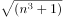，则可得下一项为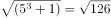。

故正确答案为A。

**来源**：2013年吉林省公务员录用考试《行测》题（乙级）第55题

### 第 56 题

两个工人完成一项生产任务，甲单独干一天可以完成任务的1/4，乙单独干两天可以完成任务的3/4。如何安排两人，使其在最少的整数天完成任务？

A. 甲单独干三天

B. 甲乙一起干一天，乙再干一天

C. 甲乙一起干两天

D. 甲单独干一天，乙单独干两天

第 56 题 · 答案与解析

**参考答案（粉笔题库参考内容）**

B

**解析**

设总工程量为8，甲干X天，乙干Y天（X，Y均为整数），可以使其在最少的整数天完成任务。甲单独一天可以完成任务的1/4，则甲每天的效率为2；乙单独干两天可以完成任务的3/4，则乙每天的效率为(8×3/4)/2=3，则2X+3Y=8，根据奇偶性，可知Y为偶数，那么当Y=2时，X=1满足题意，那么甲乙一起干一天，乙再干一天使其在最少的整数天完成。

故正确答案为B。

**考点**：给效率比例型

**来源**：2013年吉林省公务员录用考试《行测》题（乙级）第56题

### 第 57 题

小伟、爸爸和爷爷三人年龄和为98岁，已知三代年龄差为每一代至少25岁，三人年龄为整数，小伟最大年龄为（   ）岁。

A. 4

B. 6

C. 5

D. 7

第 57 题 · 答案与解析

**参考答案（粉笔题库参考内容）**

D

**解析**

要使小伟的年龄最大，则需使年龄差最小，设小伟年龄为X岁（X为整数），则爸爸年龄为X+25岁，爷爷年龄为X+50岁，且X+X+25+X+50=98，可得3X=98-75=23，则X最大可为7。

故正确答案为D。

**考点**：年龄问题

**来源**：2013年吉林省公务员录用考试《行测》题（乙级）第57题

### 第 58 题

七夕节，某市举办大型公益相亲会，共42人参加，其中20名女生，每人至少相亲一次，共相亲61次，则至少有一名女生至少相亲多少次？

A. 6

B. 4

C. 5

D. 3

第 58 题 · 答案与解析

**参考答案（粉笔题库参考内容）**

B

**解析**

由“至少有一名女生至少相亲多少次”，可判定该题为最值问题，则构造最不利的形式，假设每个女生相亲次数一样，则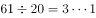，那么至少有一名女生相亲3+1=4次。

故正确答案为B。

**考点**：最不利构造

**来源**：2013年吉林省公务员录用考试《行测》题（乙级）第58题

### 第 59 题

篮球队有12名队员，其中有中锋3人，前锋5人，后卫4人；上场5人中必有一名中锋，两名前锋，两名后卫；有一名中锋和一名后卫必上，则教练可选择安排上场的组合有多少种？

A. 50

B. 30

C. 40

D. 20

第 59 题 · 答案与解析

**参考答案（粉笔题库参考内容）**

B

**解析**

有一名中锋必上，则中锋的选法只有1种；前锋的选法有C_5^2=10种；有一名后卫必上，后卫的选法有C_3^1=3种，因此总共有1×10×3=30种。

故正确答案为B。

**考点**：基础排列组合

**来源**：2013年吉林省公务员录用考试《行测》题（乙级）第59题

### 第 60 题

某大型商场销售商品的收入款，三月份为25万元，五月份为36万元，如果按照每月相同增长率的话，计算6月份的收入款是多少万元？

A. 50.2

B. 43.4

C. 43.9

D. 43.2

第 60 题 · 答案与解析

**参考答案（粉笔题库参考内容）**

D

**解析**

设每月的增长率为n，则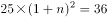，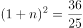，可得n=0.2，因此6月份收入款应当是36×（1+0.2）=43.2万元。

故正确答案为D。

**考点**：经济利润问题

**来源**：2013年吉林省公务员录用考试《行测》题（乙级）第60题

### 第 61 题

从所给的四个选项中，选择最合适的一个填入问号处，使之呈现一定的规律性：

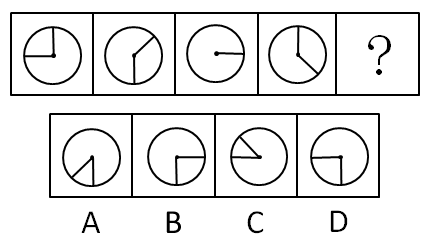

A. A

B. B

C. C

D. D

第 61 题 · 答案与解析

**参考答案（粉笔题库参考内容）**

D

**解析**

元素组成相同，考虑位置规律。观察题干图形可以发现，从第一个图形开始，竖线每次顺时针旋转45°，横线每次逆时针旋转90°，依次得到下一个图形。观察选项，只有D项符合。

故正确答案为D。

**考点**：位置规律-旋转

**来源**：2013年吉林省公务员录用考试《行测》题（乙级）第61题

### 第 62 题

从所给的四个选项中，选择最合适的一个填入问号处，使之呈现一定的规律性：

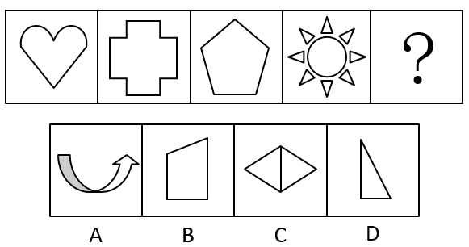

A. A

B. B

C. C

D. D

第 62 题 · 答案与解析

**参考答案（粉笔题库参考内容）**

C

**解析**

元素组成不同，优先考虑属性规律，且题干图形都是规整图形，考虑对称性。观察发现，题干图形均为轴对称图形，只有C项为轴对称图形。

故正确答案为C。

**考点**：属性规律-对称性

**来源**：2013年吉林省公务员录用考试《行测》题（乙级）第62题

### 第 63 题

从所给的四个选项中，选择最合适的一个填入问号处，使之呈现一定的规律性：

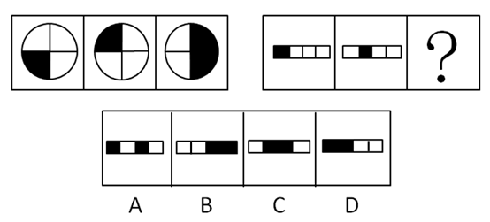

A. A

B. B

C. C

D. D

第 63 题 · 答案与解析

**参考答案（粉笔题库参考内容）**

B

**解析**

元素组成相似，考虑样式规律。观察发现，第一组图形出现明显的黑白块，考虑黑白叠加，可以看出白+黑=白、白+白=黑、黑+白=白，即同色叠加为黑色，异色叠加为白色。将此规律应用到第二组图形，符合此规律的为B项。

故正确答案为B。

**考点**：样式规律-黑白运算

**来源**：2013年吉林省公务员录用考试《行测》题（乙级）第63题

### 第 64 题

一个正方体的六个面展开后是如下三种关系，那么下面的4个选项中错误的是：

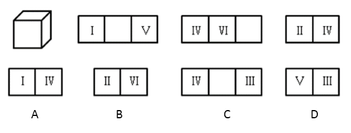

A. A

B. B

C. C

D. D

第 64 题 · 答案与解析

**参考答案（粉笔题库参考内容）**

B

**解析**

本题考查六面体相对面和相邻面的识别。由题干和选项可确定六面体的六个面为I、II、III、IV、V、VI。

根据题干的第二幅图可知，I和V为相对面；

根据题干的第三、四幅图可知，IV与VI、II为相邻面，则可以推出IV的相对面不可能是I、II、V、VI，那么IV的相对面只能是III，那么剩余的II、VI一定是相对面，B项错误，当选。

本题为选非题，故正确答案为B。

备注：本题中六面体面上的I、II、III、IV、V、VI，只起到标记作用，无需考虑方向，如果考虑方向，本题答案则不唯一。

**考点**：空间类-空间重构-六面体

**来源**：2013年吉林省公务员录用考试《行测》题（乙级）第64题

### 第 65 题

把下面的六个图形分为两类，使每一类图形都有各自的共同特征或规律，分类正确的一项是：

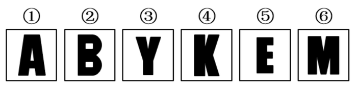

A. ①⑤⑥，②③④

B. ①③⑥，②④⑤

C. ①④⑤，②③⑥

D. ①②④，③⑤⑥

第 65 题 · 答案与解析

**参考答案（粉笔题库参考内容）**

B

**解析**

元素组成不同，优先考虑属性规律，且图形较为规整，考虑对称性。观察发现，①③⑥为有1条纵向对称轴的轴对称图形，②④⑤为有1条横向对称轴的轴对称图形。

故正确答案为B。

**考点**：属性规律-对称性

**来源**：2013年吉林省公务员录用考试《行测》题（乙级）第65题

### 第 66 题

（1）曼德拉重获自由，迎接光辉的岁月

（2）离家出走，磨练中初练成长

（3）身陷囹圄，风雨中抱紧自由

（4）急流勇退，缤纷色彩显美丽

（5）渐渐成熟，斗争于肤色平等

A. （2）-（3）-（1）-（5）-（4）

B. （5）-（2）-（3）-（4）-（1）

C. （2）-（5）-（3）-（1）-（4）

D. （5）-（2）-（3）-（1）-（4）

第 66 题 · 答案与解析

**参考答案（粉笔题库参考内容）**

C

**解析**

本题为事件排序。题干中5句描述的是“曼德拉”的生活经历。首先判断首句，从选项入手，（2）为初练成长，（5）为渐渐成熟，可知成熟是在成长之后，据此排除B、D两项。同时由（1）和（4）可知，（1）中的迎接光辉岁月后面应紧接着（4）中的急流勇退，所以（4）不应与（5）相邻，据此排除A项，C项当选。

故正确答案为C。

**来源**：2013年吉林省公务员录用考试《行测》题（乙级）第66题

### 第 67 题

（1）一个模式的形成，将老师由“讲台上的圣人”变成“身边的指导”

（2）两位教师的努力，制作教学视频上传到网络，帮助学生补课

（3）一个问题的困扰，山区学生因往返时间过长而缺课严重

（4）一个创新的推广，翻转课堂成为美国日渐流行的教学模式

（5）众多学生的欢迎，在家看视频听讲解，回到课堂上练习和互动

A. （3）-（2）-（5）-（1）-（4）

B. （4）-（3）-（2）-（5）-（1）

C. （3）-（4）-（2）-（5）-（1）

D. （4）-（1）-（3）-（2）-（5）

第 67 题 · 答案与解析

**参考答案（粉笔题库参考内容）**

A

**解析**

本题为事件排序。首先判断首句，从选项入手，首句在（3）（4）中，（3）是提出一个问题，（4）是推广解决问题的模式，问题应在对策前，所以（3）应在（4）前，排除B、D两项；A、C两项中紧跟（3）的为（2）（4），（2）为一个具体的解决方法，（4）为推广一个已经形成的模式，（2）应在（4）前，排除C项。

故正确答案为A。

**来源**：2013年吉林省公务员录用考试《行测》题（乙级）第67题

### 第 68 题

（1）慢慢感知，失去视觉的另一个世界

（2）饥饿和谦卑，是人类能够幸福的基本元素

（3）不知所措，日常小事都得盲人导游帮助

（4）体验过后，从未有过的谦卑与感恩之心

（5）特殊旅游，盲人导游带你体验24小时黑暗生活

A. （5）-（3）-（1）-（4）-（2）

B. （2）-（5）-（1）-（3）-（4）

C. （5）-（1）-（3）-（4）-（2）

D. （2）-（5）-（3）-（1）-（4）

第 68 题 · 答案与解析

**参考答案（粉笔题库参考内容）**

A

**解析**

本题为事件排序。首先判断首句，从选项入手，首句在（2）（5）中，（2）在谈论饥饿和谦卑，偏总结性话语，（5）在说特殊旅游，先有了特殊旅游的经历之后才知道饥饿和谦卑是幸福的基本元素，因此（5）应在（2）前，排除B、D两项；A、C两项中紧跟（5）的分别是（3）（1），（3）是在说体验时的反应，（1）是在说感知，应该是先有体验的反应，再慢慢感知，（3）应在（5）后，（1）在（3）后，排除C项。

故正确答案为A。

**来源**：2013年吉林省公务员录用考试《行测》题（乙级）第68题

### 第 69 题

（1）一份跟踪调查，日后30年有何差别

（2）一位实验人员，承诺谁忍住不吃就给两块

（3）一个重要发现，幼年就学会控制冲动很重要

（4）一个实验结果，忍住不吃的孩子更优秀

（5）一组4岁小孩，每人面对一块棉花糖

A. （3）-（5）-（2）-（1）-（4）

B. （5）-（2）-（4）-（1）-（3）

C. （5）-（2）-（1）-（4）-（3）

D. （3）-（5）-（2）-（4）-（1）

第 69 题 · 答案与解析

**参考答案（粉笔题库参考内容）**

C

**解析**

本题为事件排序。首先判断首句，从选项入手，首句在（3）（5）中，（3）在说一个发现，偏总结性话语，（5）为一个实验的内容，有了实验才有后续的结果，（5）应在（3）前，排除A、D两项；B、C两项中紧邻（3）的分别为（1）（4），（1）在说跟踪30年后的差别，（4）为实验结果，跟踪调查应在实验结果前，所以（1）应在（4）前面，排除B项。

故正确答案为C。

**来源**：2013年吉林省公务员录用考试《行测》题（乙级）第69题

### 第 70 题

（1）策划活动细节

（2）联系住宿宾馆

（3）确定会议形式、规模、时间、计划费用

（4）收集信息，包括与会同志地址、电话、邮件或者QQ等

（5）发函或电话通知

A. （4）-（2）-（3）-（1）-（5）

B. （5）-（3）-（1）-（4）-（2）

C. （5）-（2）-（3）-（4）-（1）

D. （3）-（1）-（2）-（4）-（5）

第 70 题 · 答案与解析

**参考答案（粉笔题库参考内容）**

D

**解析**

本题为事件排序。首先判断首句，从选项入手，首句在（3）（4）（5）中，题干是在说组织一个会议活动的过程，（4）在收集信息，即与会同志的联系方式，（5）在进行通知，（4）应在（5）前，排除B、C两项；（3）为会议的策划方案，应在（4）收集信息前，排除A项。

故正确答案为D。

**来源**：2013年吉林省公务员录用考试《行测》题（乙级）第70题

### 第 71 题

贝勃定律是一个社会心理学效应，是指当人经历强烈的刺激后，再施与的刺激对他（她）来说也就变得微不足道，就心理感受来说，第一次大刺激能冲淡第二次的小刺激。

根据上述定义，下列各项中符合贝勃定律的是：

A. 母亲病逝后不久，父亲又遭遇了车祸，接二连三的打击让小王越来越无心读书

B. 小赵购买了100张彩票，逐一刮开后竟然有20几张中奖，这令他欣喜若狂

C. 当房价飞涨到每平方米5万元的时候，人们对于每公斤卖到50元的苹果已不足为奇

D. 4岁的萌萌在认读了常用汉字之后，又开始学习外语

第 71 题 · 答案与解析

**参考答案（粉笔题库参考内容）**

C

**解析**

第一步，找到定义关键词。

关键词为“第一次大刺激能冲淡第二次的小刺激”

第二步，逐一分析选项。

A项：小王经历的是接二连三的家庭变故的打击，前面的刺激并没有冲淡后面的刺激，不符合定义，排除； B项：小王在购买彩票中奖后欣喜若狂并不属于多次刺激，即使刮中一张彩票为一次刺激，也没有体现大刺激与小刺激，不符合定义，排除； C项：房价飞涨到每平方米5万元属于一次大刺激，苹果涨到每公斤50元属于小刺激，人们的反应是因为房价上涨的大刺激冲淡了苹果价格上涨的小刺激，符合定义，当选； D项：学习汉字和外语不属于刺激，不符合定义，排除。

故正确答案为C。

**考点**：大前提

**来源**：2013年吉林省公务员录用考试《行测》题（乙级）第71题

### 第 72 题

沉没成本是指由于过去的决策已经发生了的，而不能由现在或将来的任何决策改变的成本。从理性的角度来说，沉没成本不应该影响我们的决策，然而，我们常常由于想挽回或避免沉没成本而做出很多不理性的决策行为，被称为沉没成本效应。

根据上述定义，下列各项中不属于沉没成本效应的是：

A. 小明一年前借给朋友一万元钱，但由于朋友破产无力偿还，所以决定不要了

B. 小王花20元钱买了一瓶汽水，发现很难喝，想扔掉，但是考虑到那么贵又退不了就强忍着喝光了

C. 小赵认为和女朋友都在一起8年了，自己已经付出了这么多时间和精力，所以决定不分手

D. 妈妈花2000元买了一架电子琴，可孩子根本没兴趣，于是妈妈决定以每月500元的价格请家教，理由是：“要不这个琴就浪费了！”

第 72 题 · 答案与解析

**参考答案（粉笔题库参考内容）**

A

**解析**

第一步：找出定义关键词。

关键词为“由于想挽回或避免沉没成本而做出很多不理性的决策行为”。

第二步：逐一分析选项。

A项：借给朋友的一万元属于沉没成本，由于朋友无力偿还债务所以决定不要了不属于想挽回或避免沉没成本，不符合定义，当选；

B项：花20元买一瓶汽水属于沉没成本，虽然不好喝但强忍着喝光了属于想避免沉没成本，符合定义，排除；

C项：和女朋友在一起8年付出的时间和精力属于沉没成本，决定不分手属于想避免沉没成本，符合定义，排除；

D项：花2000元买的电子琴属于沉没成本，请家教属于想避免沉没成本，符合定义，排除。

本题为选非题，故正确答案为A。

**考点**：单定义-其他句式

**来源**：2013年吉林省公务员录用考试《行测》题（甲级）第73题

### 第 73 题

公力救济是指当权利人的权利受到侵害或者有被侵害之虞时，权利人行使诉讼权，诉请人民法院依民事诉讼和强制执行程序保护自己的权利的措施。

下列各项中属于公力救济的是：

A. 老李在超市买到一瓶假酒，老李与超市协商，要求超市给付真酒一瓶

B. 老李在超市买到一瓶假酒，老李向当地工商部门举报，要求对超市进行罚款

C. 老李在超市买到一瓶假酒，老李与超市协商，要求超市进行十倍赔偿

D. 老李在超市买到一瓶假酒，老李向法院提起诉讼，要求超市退换其购买的假酒

第 73 题 · 答案与解析

**参考答案（粉笔题库参考内容）**

D

**解析**

第一步，找到定义关键词。

关键词为“权利人的权利受到侵害或者有被侵害之虞时”、“权利人行使诉讼权”、“诉请人民法院依民事诉讼和强制执行程序保护自己的权利的措施”。

第二步，逐一分析选项。

A项：老李与超市协商不属于诉请人民法院保护自己的权利，不符合定义，排除； B项：老李向工商部门举报，不属于诉请人民法院保护自己的权利，不符合定义，排除； C项：老李与超市协商不属于诉请人民法院保护自己的权利，不符合定义，排除； D项：老李向法院提起诉讼属于诉请人民法院保护自己的权利，符合定义，当选。

故正确答案为D。

**考点**：单定义-其他句式

**来源**：2013年吉林省公务员录用考试《行测》题（乙级）第73题

### 第 74 题

定义是揭示概念所反映的客观事物本质属性的一种逻辑方法，其基本规则要求：定义必须是相应相称的，必须清楚明确，不得使用否定定义，不得循环定义。
根据以上陈述，以下各选项中符合定义基本规则的是：

A. 男人就是非女人

B. 亲属就是有亲属关系的人

C. 青少年是祖国的花朵

D. 刑法就是关于犯罪和刑罚的法律

第 74 题 · 答案与解析

**参考答案（粉笔题库参考内容）**

D

**解析**

第一步，找到定义关键词。

关键词为“相应相称”、“清楚明确”、“不得使用否定定义”、“不得循环定义”。

第二步，逐一分析选项。

A项：男人就是非女人使用了否定定义，不符合定义，排除；B项：亲属就是有亲属关系的人循环了亲属的定义，不符合定义，排除；C项：青少年是祖国的花朵并不清楚明确，而且也没有反映青少年的本质属性，不符合定义，排除；D项：刑法就是关于犯罪和刑罚的法律定义清楚明确，未使用否定义，未循环定义，符合定义，当选。

故正确答案为D。

**考点**：单定义-其他句式

**来源**：2013年吉林省公务员录用考试《行测》题（乙级）第74题

### 第 75 题

黄金圆环（如下图）是设计用来说明激励性的领袖与普通人在思考、行动和交流沟通方式上的区别：普通人是由外向内的，而激励性的领袖却是用从内到外的方式来思考、行动和交流。

根据上述定义，以下选项中属于激励性领袖交流方式的是：

A. 我们的电脑是最棒的，设计优美、使用简单、界面友好，你想买一台吗

B. 我们的产品可以把电视节目暂停，跳过广告，回放电视节目，帮助你掌控生活，你想买一台吗

C. 这是我们的新车型，非常省油，真皮座椅，十一期间促销享大礼，你想买一辆吗

D. 我们做的每件事都是为了突破和创新，我们只是在挑战现状的过程中做出了最棒的电脑，你想买一台吗

第 75 题 · 答案与解析

**参考答案（粉笔题库参考内容）**

D

**解析**

第一步，找到定义关键词。

关键词为“从内到外的方式来思考、行动和交流”。

第二步，逐一分析选项。

A项：我们的电脑是最棒的是从“是什么”开始说，不符合定义，排除；

B项：我们的产品可以把电视节目暂停是从“怎么做”开始说，不符合定义，排除；

C项：这是我们的新车型是从“是什么”开始说，不符合定义，排除；

D项：我们做的每件事都是为了突破和创新是从“为什么”开始说，符合定义，当选。

故正确答案为D。

**考点**：单定义-其他句式

**来源**：2013年吉林省公务员录用考试《行测》题（甲级）第67题

### 第 76 题

潮汐现象 对于 （   ） 相当于 （   ） 对于 自由电子

A. 自然现象 导电体

B. 周期性运动 导电体

C. 月球和太阳的引力 金属导电

D. 周期性运动 金属导电

第 76 题 · 答案与解析

**参考答案（粉笔题库参考内容）**

C

**解析**

将选项逐一代入题干，判断前后部分逻辑关系是否一致。

A项：潮汐现象是一种自然现象，两者是种属关系，导电体是靠其内部的自由电子的定向运动而导电，两者是组成关系，前后题干逻辑关系不一致，排除；

B项：潮汐现象是一种周期性运动，两者是种属关系，导电体是靠其内部的自由电子的定向运动而导电，两者是组成关系，前后题干逻辑关系不一致，排除；

C项：月球和太阳的引力是产生潮汐现象的必要条件，自由电子是金属导电的必要条件，前后逻辑关系一致，当选；

D项：潮汐现象是一种周期性运动，两者是种属关系，自由电子是金属导电的必要条件，两者是对应关系，前后题干逻辑关系不一致，排除。

故正确答案为C。

**考点**：逻辑关系-对应关系

**来源**：2013年吉林省公务员录用考试《行测》题（乙级）第76题

### 第 77 题

律师：教授

A. 专家：吉林人

B. 钢筋：房屋

C. 歌手：乐队

D. 人：社会

第 77 题 · 答案与解析

**参考答案（粉笔题库参考内容）**

A

**解析**

第一步：判断题干词语间逻辑关系。

有的律师是教授，有的教授是律师，两者是交叉关系。

第二步：判断选项词语间逻辑关系。

A项：有的专家是吉林人，有的吉林人是专家，两者是交叉关系，与题干的逻辑关系一致，当选；

B项：钢筋是建造房屋的原材料，两者是原材料和成品的对应关系，不是交叉关系，与题干逻辑关系不一致，排除；

C项：歌手是乐队的组成部分，两者是组成关系，与题干逻辑关系不一致，排除；

D项：人是社会的组成部分，两者是组成关系，与题干逻辑关系不一致，排除。

故正确答案为A。

**考点**：逻辑关系-交叉关系

**来源**：2013年吉林省公务员录用考试《行测》题（乙级）第77题

### 第 78 题

18周岁：选举权

A. 下雨：地湿

B. 氧气：燃烧

C. 瓜熟：蒂落

D. 水涨：船高

第 78 题 · 答案与解析

**参考答案（粉笔题库参考内容）**

B

**解析**

第一步：判断题干词语间逻辑关系。

18周岁是拥有选举权的必要条件。

第二步：判断选项词语间逻辑关系。

A项：下雨并不是地湿的必要条件，与题干逻辑关系不一致，排除；

B项：氧气是燃烧的必要条件，与题干逻辑关系一致，当选；

C项：果实没有成熟也可以掉落，瓜熟并不是蒂落的必要条件，与题干逻辑关系不一致，排除；

D项：水涨和船高之间构成因果关系，水涨一定会导致船高，与题干逻辑关系不一致，排除。

故正确答案为B。

注：本题出题不太严谨，少数燃烧是不需要氧气的，比如镁在二氧化碳中燃烧，但是根据题干，出题人是想要考查必要条件的，选项中只有B项最接近答案，几乎所有的燃烧都需要氧气，因此粉笔择优将正确答案给到B。

**考点**：逻辑关系-对应关系

**来源**：2013年吉林省公务员录用考试《行测》题（乙级）第78题

### 第 79 题

雷锋：千万个雷锋

A. 妈妈：无数位妈妈

B. 老虎：吃人的老虎

C. 华佗：许多个华佗

D. 苹果：上万个苹果

第 79 题 · 答案与解析

**参考答案（粉笔题库参考内容）**

C

**解析**

第一步：判断题干词语间逻辑关系。

雷锋是一个具体人物，“千万个雷锋”中的“雷锋”是一个象征。

第二步：判断选项词语间逻辑关系。

A项：妈妈不是一个具体人物，而是一个统称，与题干的逻辑关系不一致，排除；

B项：老虎不是一个人物，而是一种动物，与题干逻辑关系不一致，排除；

C项：华佗是一个具体人物，且“许多个华佗”中的“华佗”是一个象征，与题干逻辑关系一致，当选；

D项：苹果是一种水果，不是具体的人物，与题干逻辑关系不一致，排除。

故正确答案为C。

**考点**：逻辑关系-对应关系

**来源**：2013年吉林省公务员录用考试《行测》题（乙级）第79题

### 第 80 题

地球：火星：行星

A. 企业：管理：管理者

B. 电灯：光亮：发明

C. 陈景润：华罗庚：数学家

D. 系：学院：大学

第 80 题 · 答案与解析

**参考答案（粉笔题库参考内容）**

C

**解析**

第一步：判断题干词语间逻辑关系。

地球和火星是并列关系，两者都是一种行星，与行星是种属关系。

第二步：判断选项词语间逻辑关系。

A项：管理者管理企业，三者是主谓宾结构，是语法关系，与题干的逻辑关系不一致，排除；

B项：电灯的功能是发出光亮，与题干逻辑关系不一致，排除；

C项：陈景润和华罗庚是并列关系，两者都是数学家，与数学家是种属关系，与题干逻辑关系一致，当选；

D项：学院是由很多院系组成，大学是由很多学院组成，三者之间是组成关系，与题干逻辑关系不一致，排除。

故正确答案为C。

**考点**：逻辑关系-包容关系、逻辑关系-并列关系

**来源**：2013年吉林省公务员录用考试《行测》题（乙级）第80题

### 第 81 题

现代边缘派诗歌代表作《奇怪的接近》中写道：“咖啡的颜色接近于黑啤，黑啤的颜色接近于咖啡······我必须要放弃其中之一。我留下了黑啤，尽管它似乎不如咖啡高贵······”如果我们把诗歌中的语句看做表达了一种判断形式的话，以下选项中判断形式与之不同的是：

A. 当代诗人顾城在《初春》中写道：“阴沉的天空还在犹豫：是雪花？还是雨滴？混浊的河流在疾走：是追求？还是逃避？远处的情侣在分别：是序幕？还是结局？”

B. 毛泽东曾说：“不是东风压倒西风，就是西风压倒东风。”

C. 《孟子·公孙丑下》曰：“陈臻问曰：‘前日於齐，王馈兼金一百而不受；於宋，馈赠七十镒而受；於薜，馈五十镒而受。前日之不受是，则今日之受非也。今日之受是，则前日之不受非也。夫子必居一於此矣。’”

D. 宋代卢梅坡在《雪梅》中写道：“有梅无雪不精神，有雪无诗俗了人，日暮诗成天又雪，与梅并作十分春。”

第 81 题 · 答案与解析

**参考答案（粉笔题库参考内容）**

D

**解析**

第一步：抓住题干主要信息。

题干推理过程为：题干表明咖啡和黑啤的颜色接近，必须在二者选其一，选择了黑啤。

第二步：逐一分析选项。

A项：天空必须在雪花和雨滴中选其一，河流疾走必须在追求和逃避中选其一，分别的情侣必须在序幕和结局中选其一，和题干推理方式一致，排除；

B项：必须在东风和西风中选其一，和题干推理方式一致，排除；

C项：翻译为：陈臻问道：“以前在齐国的时候，齐王送给您好金一百镒，您不接受；到宋国的时候，家王送给您七十镒，您却接受了；在薛地，薛君送给您五十镒，您也接受了。如果以前的不接受是正确的，那后来的接受便是错误的；如果后来的接受是正确的，那以前的不接受便是错误的。老师您总有一次做错了吧。”意思是孟子必须在收礼物的正确和错误中必须做一个选择，和题干推理方式一致，排除；

A、B、C三项均是同构选项，都是在几种可能的情况中做出一个选择，可以排除。

D项：“有梅无雪不精神，有雪无诗俗了人，日暮诗成天又雪，与梅并作十分春。”意思是，梅花开了却不下雪体现不了梅花傲雪的高尚精神，下雪了却不懂吟诗来歌颂这美好景色就变成庸俗平凡的人不懂得欣赏。晚上诗写成后又开始下雪了，正好与梅花合成真正的春天使者（十分中梅雪二者各占五分）。要求梅、雪与诗歌三者兼具，和题干推理方式不一致，当选。

本题为选非题，故正确答案为D。

**考点**：论证结构

**来源**：2013年吉林省公务员录用考试《行测》题（甲级）第77题

### 第 82 题

有人说，不管你眼下的境况多么不济，比如薪水微薄，面临失业等，只要银行里还有一笔储蓄就不足为虑；而假如你挣一文花一文，这时可就真要陷于绝境了。所以，只有储蓄才能使一个人在经济上真正独立起来。

如果有人反对这一言论，则以下可能不是反对者观点的是：

A. 有存款的人在境况不济时也会面临忧虑

B. 储蓄是衡量一个人在经济上独立与否的标准

C. 挣一文花一文的人在境况不济时也不会面临绝境

D. 没有储蓄的人也可以在经济上真正独立起来

第 82 题 · 答案与解析

**参考答案（粉笔题库参考内容）**

B

**解析**

第一步：找到论点论据。

论点：只有储蓄才能使一个人在经济上真正独立起来。

论据：不管你眼下的境况多么不济，比如薪水微薄，面临失业等，只要银行里还有一笔储蓄就不足为虑，而假如你挣一文花一文，这时可就真要陷于绝境了。

第二步：逐一分析选项。

A项：“有存款的人在境况不济时也会面临忧虑”，说明有储蓄也会有经济忧虑，削弱论据，排除；

B项：“储蓄是衡量一个人在经济上独立与否的标准”说明只有有储蓄，才能经济独立，为加强项，当选；

C项：“挣一文花一文的人在境况不济时也不会面临绝境”削弱了论据，排除；

D项：“没有储蓄的人也可以在经济上真正独立起来”，说明储蓄不是经济独立的必要条件，削弱论点，排除。

本题为选非题，故正确答案为B。

**考点**：削弱-实验类、削弱选非题

**来源**：2013年吉林省公务员录用考试《行测》题（甲级）第78题

### 第 83 题

所有被隔离的人都与小张接触过，所有与禽流感患者接触的人都被隔离了。

如果以上命题是真的，以下命题也是真命题的一项是：

A. 小张是禽流感患者

B. 有人既接触过禽流感患者，也接触过小张

C. 所有禽流感患者都与小张接触过

D. 所有与小张接触过的人都被隔离了

第 83 题 · 答案与解析

**参考答案（粉笔题库参考内容）**

B

**解析**

第一步：翻译题干。

①被隔离→与小张接触过；

②与禽流感患者接触的人→被隔离；

将①②连串：与禽流感患者接触的人→被隔离→与小张接触过。

第二步：逐一分析选项。

A项：由题干可知：与禽流感患者接触的人→与小张接触过，并不能确定小张本身是否就是禽流感患者，不能推出，排除；

B项：由题干可知：与禽流感患者接触的人→与小张接触过，即所有与禽流感患者接触的人都与小张接触过，所以有人既接触过禽流感患者又接触过小张，可以推出，当选；

C项：由题干可知：与禽流感患者接触的人→与小张接触过，即所有与禽流感患者接触的人都与小张接触过，注意此处是“与禽流感患者接触的人”，而非“禽流感患者”，偷换概念，不能推出，排除；

D项：由题干可知：被隔离→与小张接触过，选项是“与小张接触过→被隔离”，是对题干条件的肯后，肯后得不出确定性结论，不能推出，排除。

故正确答案为B。

**考点**：常规翻译

**来源**：2013年吉林省公务员录用考试《行测》题（乙级）第83题

### 第 84 题

某单位招聘了甲、乙、丙、丁、戊5名新员工，每位员工被分配到不同的部门，并且满足以下条件：

（1）如果甲去销售部，那么乙不去设计部；

（2）或者丙去生产部，或者甲去销售部；

（3）或者丁去后勤部，或者戊不去财务部；

（4）如果乙不去设计部，那么丁也不去后勤部。

以下哪项为真，可以推出“丙去生产部”？

A. 戊去财务部

B. 甲去销售部

C. 乙不去设计部

D. 丁不去后勤部

第 84 题 · 答案与解析

**参考答案（粉笔题库参考内容）**

A

**解析**

第一步：翻译题干。

①甲去销售部→—乙去设计部；

②丙去生产部 或 甲去销售部；

③丁去后勤部 或 -戊去财务部；

④-乙去设计部→-丁去后勤部。

第二步：逐一分析选项。

已知要推出“丙去生产部”，代入条件②，或关系否一推一，当“-甲去销售部”可以推出“丙去生产部”，排除B项；

将“-甲去销售部”代入条件①，根据逆否原则，当“乙去设计部” 可以推出“-甲去销售部”，排除C项；

将“乙去设计部”代入条件④，根据逆否原则，当“丁去后勤部”可以推出“乙去设计部”，排除D项；

将“丁去后勤部”代入条件③，或关系否一推一，当“戊去财务部” 可以推出“丁去后勤部”，A项当选。

故正确答案为A。

**考点**：常规翻译

**来源**：2013年吉林省公务员录用考试《行测》题（乙级）第84题

### 第 85 题

山无棱，天地合，乃敢与君绝。

如果上述断定为真，那么以下选项也一定为真的是：

A. 如果山无棱，天地合，就一定与君绝

B. 如果未与君绝，则说明一定山有棱，天地分

C. 如果山有棱，天地分，就一定不与君绝

D. 如果与君绝，则一定是山有棱，天地分

第 85 题 · 答案与解析

**参考答案（粉笔题库参考内容）**

C

**解析**

第一步：翻译题干。

“山无棱，天地合，乃敢与君绝。”翻译为：与君绝→山无棱，天地合。

第二步：逐一分析选项。

A项：翻译为“山无棱，天地合→与君绝”，肯后无法推出确定性结论，排除；

B项：翻译为“-与君绝→山有棱，天地分”，否前无法推出确定性结论，排除；

C项：翻译为“山有棱，天地分→-与君绝”，是对题干翻译的逆否，可以推出，当选；

D项：翻译为“与君绝→山有棱，天地分”，在题干中无法推出，排除。

故正确答案为C。

**考点**：常规翻译

**来源**：2013年吉林省公务员录用考试《行测》题（乙级）第85题

## 材料 2

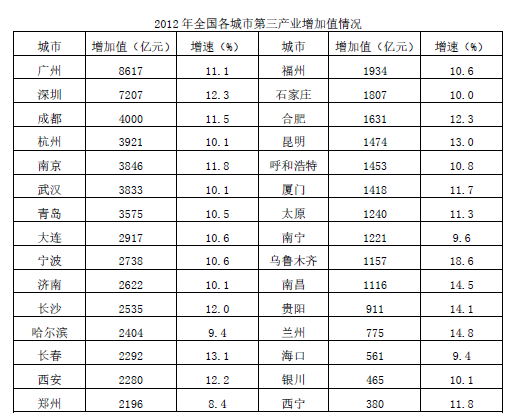

### 第 86 题

2012年全国各城市第三产业增长速度最快的是：

A. 长春

B. 兰州

C. 乌鲁木齐

D. 贵阳

第 86 题 · 答案与解析

**参考答案（粉笔题库参考内容）**

C

**解析**

定位表格，选项四个城市增速分别为长春 13.1%、兰州14.8% 、乌鲁木齐18.6%、贵阳 14.1%，所以增速最快的城市为乌鲁木齐。

故正确答案为C。

**考点**：直接找数、统计表

**来源**：2013年吉林省公务员录用考试《行测》题（乙级）第86题

### 第 87 题

2012年广州市与西宁市第三产业增加值相差：

A. 8137亿元

B. 8237亿元

C. 8337亿元

D. 8437亿元

第 87 题 · 答案与解析

**参考答案（粉笔题库参考内容）**

B

**解析**

定位表格，2012年广州市第三产业增加值为8617亿元，西宁市第三产业增加值为380亿元，两者相差 8617—380＝8237亿元。

故正确答案为B。

**考点**：简单加减计算、统计表

**来源**：2013年吉林省公务员录用考试《行测》题（乙级）第87题

### 第 88 题

2012年全国各城市第三产业增加值增速达到和超过10%的城市有：

A. 26个

B. 27个

C. 28个

D. 29个

第 88 题 · 答案与解析

**参考答案（粉笔题库参考内容）**

A

**解析**

定位表格，共有30个城市的数据，其中增速没有达到10%的有：哈尔滨9.4%、郑州8.4%、南宁9.6%、海口9.4%，共四个城市，故增速达到和超过10%的城市有30－4＝26个。

故正确答案为A。

**考点**：直接找数、统计表

**来源**：2013年吉林省公务员录用考试《行测》题（乙级）第88题

### 第 89 题

2012年与2011年相比，全国各城市第三产业增加值：

A. 不变

B. 不断增长

C. 不断降低

D. 无法判断

第 89 题 · 答案与解析

**参考答案（粉笔题库参考内容）**

B

**解析**

定位表格可知，每个城市2012年第三产业增加值增速均大于0，根据现期公式可知，现期=基期×（1+r），当r>0时，现期>基期，故表中各城市2012年与2011年相比，第三产业增加值均不断增长。

故正确答案为B。

**考点**：直接找数、统计表

**来源**：2013年吉林省公务员录用考试《行测》题（乙级）第89题

### 第 90 题

上述资料表明：

A. 经济越发达的城市，第三产业增加值增速越快

B. 经济越发达的城市，第三产业增加值增速越慢

C. 西宁市的第三产业增加值最小、增速最慢

D. 2012年全国各城市第三产业增加值超过7000亿元的城市有2个

第 90 题 · 答案与解析

**参考答案（粉笔题库参考内容）**

D

**解析**

A项：定位表格可知，广州第三产业增加值增长率为11%，乌鲁木齐第三产业增加值增长率为18.6%，前者小于后者，但是根据常识广州比乌鲁木齐经济发达。故不是经济越发达，第三产业增加值增速越快，错误；

B项：定位表格可知，深圳第三产业增加值增长率12.3%，西宁第三产业增加值增长率为11.8%，前者大于后者，但是根据常识深圳比西宁经济发达，故不是经济越发达，第三产业增加值增速越慢，错误；

C项，定位表格可知，西宁第三产业增加值为380亿元，增长率为11.8%，对比材料中其余城市，第三产业增加值是最小的，但是增长率（即增速）不是最小的，最小的是郑州（8.4%），错误；

D项，观察表格是按照第三产业增加值递减的顺序依次从上往下、从左向右排列，全国各城市第三产业增加值超过7000亿元的城市只有广州（8617亿元）和深圳（7207亿元）2个，正确。

故正确答案为D。

**考点**：统计表、综合分析

**来源**：2013年吉林省公务员录用考试《行测》题（乙级）第90题

## 材料 3

699万，这是教育部统计的2013年全国普通高校毕业生的人数，比2012年增加了19万，是2000年的6.5倍多，当时的毕业生总数为107万，由于就业形势严峻，这个夏天被称为“史上最难就业季”。

        今年就业形势可用“一增两减”概括：人增，今年高校毕业生比2012年增加19万人；薪减，部分行业起薪下调，行政管理、文秘等专业，从2200元降到1800元，减少400元；岗减，据麦可思研究院2月份对近500家用人单位的统计，今年计划招聘岗位数同比降幅接近15%。以北京为例，2012年毕业生总数为22.3万人，用人单位对大学生的需求岗位为11.4万个；2013年毕业生总数增加了0.6万，而用人单位对大学生的需求岗位却减少了1.6万个。

        截至2013年5月，全国部分地区高校毕业生签约率：上海为44.4%，广州为50%，江西为53%，北京为33.6%。

        早在2010年的中国就业促进代表大会上，时任人社部就业促进司司长于法鸣就预计，“十二五”期间，我国平均每年需要解决2500万人就业，而如果经济增速保持在8%，每年能提供的岗位约为1200万个，存在较大供需缺口。

        面对就业难的严峻形势，不少大学毕业生将目光瞄向了创业，大学毕业生创业问题也成了大家关注的热点。然而，根据国家有关部门统计，近几年，全国大学生创业成功率在1%左右，全国各地区也都在此水平左右，其中，广东1%左右，河北0.3%，最高的是浙江省，为4%，而全世界大学生的平均创业成功率是10%左右，美国大学生的创业成功率更是高达30%。

        我国大学生创业成功率低有很多原因，但资金是第一大瓶颈，据有关调查结果显示，大学生创业资金来源中93%来自于家庭，5%来自于银行贷款，1%来自于风险投资，另有1%来自于政府投资。

### 第 91 题

2013年北京市高校毕业生总数为：

A. 22.3万人

B. 22.5万人

C. 22.6万人

D. 22.9万人

第 91 题 · 答案与解析

**参考答案（粉笔题库参考内容）**

D

**解析**

定位材料第二段，“以北京为例，2012年毕业生总数为22.3万人······2013年毕业生总数增加了0.6万”，则北京2013年毕业生总数为 22.3+0.6=22.9万人。

故正确答案为D。

**考点**：文字资料、简单加减计算

**来源**：2013年吉林省公务员录用考试《行测》题（乙级）第91题

### 第 92 题

截至2013年5月，全国部分地区高校毕业生签约率最低的是：

A. 上海

B. 广州

C. 北京

D. 江西

第 92 题 · 答案与解析

**参考答案（粉笔题库参考内容）**

C

**解析**

定位材料第三段，"截至2013年5月，全国部分地区高校毕业生签约率：上海为44.4%，广州为50%，江西为53%，北京为33.6%"。签约率最低是北京，为33.6%。

故正确答案为C。

**考点**：文字资料、直接找数

**来源**：2013年吉林省公务员录用考试《行测》题（乙级）第92题

### 第 93 题

我国大学生创业成功率与世界平均水平相比：

A. 低1%左右

B. 低9%左右

C. 高1%左右

D. 高9%左右

第 93 题 · 答案与解析

**参考答案（粉笔题库参考内容）**

B

**解析**

定位材料倒数第二段，“全国大学生创业成功率在 1%左右……而全世界大学生的平均创业成功率是10% 左右”。我国大学生创业成功率与世界平均水平相比：1%-10%=-9%，即低9个百分点。

故正确答案为B。

**考点**：文字资料、简单加减计算

**来源**：2013年吉林省公务员录用考试《行测》题（乙级）第93题

### 第 94 题

根据有关调查结果显示，大学生创业资金来源中93%来自于：

A. 家庭

B. 风险投资

C. 政府投资

D. 银行贷款

第 94 题 · 答案与解析

**参考答案（粉笔题库参考内容）**

A

**解析**

定位材料的最后一段，“大学生创业资金来源中 93%来自于家庭”。

故正确答案为A。

**考点**：文字资料、直接找数

**来源**：2013年吉林省公务员录用考试《行测》题（乙级）第94题

### 第 95 题

根据上述资料可知：

A. 今年夏天是“史上最易就业季”

B. 大学生创业资金来源最少的是风险投资与政府投资

C. 今年就业形势是人减、薪增

D. 与2012年相比，北京市今年毕业生人数和就业岗位均有增加

第 95 题 · 答案与解析

**参考答案（粉笔题库参考内容）**

B

**解析**

A项：定位材料第一段：“这个夏天被称为‘史上最难就业季’”，错误；

B项：定位材料最后一段：“大学生创业资金来源中93% 来自于家庭， 5%来自于银行贷款， 1%来自于风险投资，另有1% 来自于政府投资”，资金来源最少的是风险投资与政府投资，正确；

C项：定位材料第二段：“今年就业形势可用‘一增两减’概括”，即“人增”“薪减”“岗减”，错误；

D项：定位材料第二段：“北京2013年毕业生总数增加了0.6万，而用人单位对大学生的需求岗位却减少了1.6万个”，毕业生人数增加，但就业岗位减少，错误。

故正确答案为B。

**考点**：文字资料、综合分析

**来源**：2013年吉林省公务员录用考试《行测》题（乙级）第95题

## 材料 4

2012年年末全国公路总里程达423.76万公里，比上年末增加13.11万公里。公路密度为44.14公里/百平方公里，比上年末提高1.37公里/百平方公里。按行政等级划分：国道17.34万公里、省道31.21万公里、县道53.95万公里、乡道107.67万公里、专用公路7.37万公里、村道206.22万公里，比上年末分别增加0.40万公里、0.80万公里、0.59万公里、1.07万公里、0.47万公里和9.78万公里。国道中，国家高速公路6.80万公里，普通国道10.54万公里。按技术等级划分，等级公路为全国四级以上公路（含高速），等级公路里程360.97万公里，比上年末增加15.60万公里。等级公路占公路总里程的85.2%，比上年末提高1.1个百分点，其中，与上年相比，二级及以上公路里程增加2.83万公里。

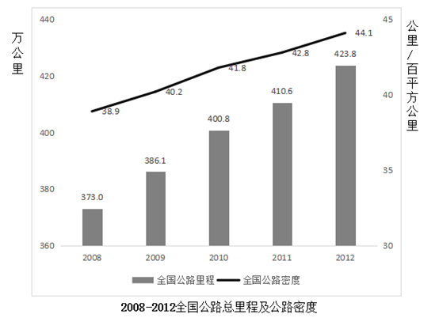

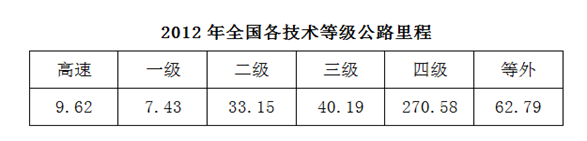

### 第 96 题

2011年年末，公路密度为多少公里/百平方公里？

A. 41.26

B. 44.14

C. 42.77

D. 45.51

第 96 题 · 答案与解析

**参考答案（粉笔题库参考内容）**

C

**解析**

定位图形材料，根据折线图可知2011年年末全国公路密度为42.8公里/百平方公里，与C项最接近。

故正确答案为C。

**考点**：综合资料

**来源**：2013年吉林省公务员录用考试《行测》题（乙级）第96题

### 第 97 题

2012年年末，国道、省道及县道占全国公路总里程的比重约为：

A. 12%

B. 20%

C. 16%

D. 24%

第 97 题 · 答案与解析

**参考答案（粉笔题库参考内容）**

D

**解析**

由题干“2012年年末······占······的比重约为”，而材料数据给的也是2012年，判定此题为现期比重问题。定位材料第一段，“2012年年末全国公路总里程达423.76万公里······国道17.34万公里、省道31.21万公里、县道53.95万公里”。由比重公式可知，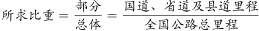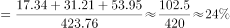。

故正确答案为D。

**考点**：现期比重、综合资料

**来源**：2013年吉林省公务员录用考试《行测》题（乙级）第97题

### 第 98 题

2012年年末，等级公路里程约是等外公路里程的多少倍？

A. 2

B. 6

C. 4

D. 8

第 98 题 · 答案与解析

**参考答案（粉笔题库参考内容）**

B

**解析**

由题干“2012年年末，······是······的多少倍”，材料中数据也为2012年，判定此题为现期倍数问题。定位表格材料可知，全国公路可分为高速、一级、二级、三级、四级、等外六个技术等级，定位材料第一段，“等级公路为全国四级以上公路（含高速）······等级公路占公路总里程的 85.2%”，则可得全国公路可分为等级公路及等外公路两部分， 且等级外的公路占比为1-85.2%=14.8% ，因此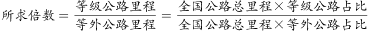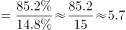倍，与B项最接近。

故正确答案为B。

**考点**：现期倍数、综合资料

**来源**：2013年吉林省公务员录用考试《行测》题（乙级）第98题

### 第 99 题

2009-2012年全国公路总里程增速最慢的年份是：

A. 2009

B. 2011

C. 2010

D. 2012

第 99 题 · 答案与解析

**参考答案（粉笔题库参考内容）**

B

**解析**

由题干“2009-2012年······增速最慢的年份”，判定此题为一般增长率问题。定位图形材料可知2008年～2012年的公路总里程，根据增长率公式， 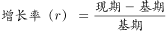，可得：

2009年：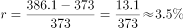；2010年：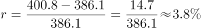；

2011年：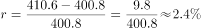；2012年： 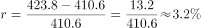。所以2011年全国公路总里程增速最慢。

故正确答案为B。

**考点**：一般增长率、综合资料

**来源**：2013年吉林省公务员录用考试《行测》题（乙级）第99题

### 第 100 题

以下说法正确的是：

A. 与上年相比，2009-2012年公路密度增加量最多的一年是2009年

B. 2011年年末，二级及以上公路里程超过50万公里

C. 2012年年末，国家高速公路里程占国道的比重超过40%

D. 与上年相比，2012年国道公路里程增速超过2%

第 100 题 · 答案与解析

**参考答案（粉笔题库参考内容）**

D

**解析**

A项：定位图形材料，2009年公路密度增加量=40.2-38.9=1.3公里/百平方公里，2010年公路密度增加量=41.8-40.2=1.6公里/百平方公里，2010年增加量高于2009年增加量，错误；

B项：定位表格，2012年二级及以上公路里程=高速+一级+二级=9.62+7.43+33.15=50.2万公里；定位文字材料，“2012年······与上年相比，二级及以上公路里程增加2.83万公里”，因此2011年末二级及以上公路里程=50.2-2.83=47.37万公里&lt;50万公里，错误；

C项：定位文字材料，“2012年······按行政等级划分：国道17.34万公里······国道中，国家高速公路6.80万公里”，根据比重公式可知，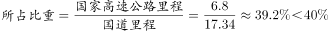，错误；

D项：定位文字材料第一段，“2012年······按行政等级划分：国道17.34万公里······比上年末分别增加0.40万公里······”，根据增长率公式可知，

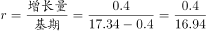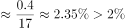，正确。

故正确答案为D。

**考点**：综合分析、综合资料

**来源**：2013年吉林省公务员录用考试《行测》题（乙级）第100题

