# 2013年吉林省公务员录用考试《行测》题（甲级）

<!-- gwy:overview:start -->
> **吉林 · 2013 · 行测 · 甲级** ｜ 105 题 · 图片 38 处 · 答案随题折叠

| 题型模块 | 题量 | 题号 |
| --- | ---: | ---: |
| 常识判断 | 20 | 1–20 |
| 言语理解与表达 | 30 | 21–50 |
| 数量关系 | 10 | 51–60 |
| 判断推理 | 30 | 61–90 |
| 资料分析 | 15 | 91–105 |
| **合计** | **105** | |

导航：[题型与作答说明](#题型与作答说明) · [题目](#题目) · [材料 1](#材料-1)
<!-- gwy:overview:end -->

> 候选采集稿。参考答案及解析来自粉笔页面，不代表官方答案或真实高分答卷；来源使用许可与原卷对应关系仍需人工核实。

## 题型与作答说明

常识判断

（20题）

常识判断部分主要考查考生的基本常识和基本经验。请根据题目要求，在四个选项中选出一个正确答案。

言语理解与表达

（30题）

本部分包括表达与理解两方面内容。请根据题目要求，在四个选项中选出一个最恰当的答案。

数量关系

（10题）

在这部分试题中，每道题呈现一段表述数字关系的文字。要求你充分利用所给条件，迅速准确地计算出答案。

判断推理

（30题）

本部分包含图形推理、时间排序、定义判断、类比推理和逻辑判断五个部分，根据要求选出符合要求的一项。

资料分析

（15题）

针对下列给定资料回答问题，共15题。你应根据资料提供的信息进行分析、比较、计算、处理。

## 题目

### 第 1 题

群众路线是我们党的生命线和根本工作路线。开展党的群众路线教育实践活动，就是要使全党同志牢记并恪守全心全意为人民服务的根本宗旨，以优良作风把人民紧紧凝聚在一起，为实现党的十八大确定的目标任务而努力奋斗。这体现了：

A. 科学发展观的主旨是以人为本

B. 依法行政是中国共产党执政的基本方式

C. 中国共产党执政为民、心系群众

D. 中国共产党依法行政、服务人民

第 1 题 · 答案与解析

**参考答案（粉笔题库参考内容）**

C

**解析**

C项正确：群众路线，就是一切为了群众，一切依靠群众，从群众中来，到群众中去，把党的正确主张变为群众的自觉行动。群众路线的实质，就是代表人民群众，为人民谋利益，就是要执政为民。

故正确答案为C。

**考点**：其他建设

**来源**：2013年吉林省公务员录用考试《行测》题（甲级）第1题

### 第 2 题

“一条锁链，最脆弱的一环决定其强度；一只木桶，最短的一片决定其容量。”

这段话主要强调：

A. 要坚持一切从实际出发

B. 要看到整体的统率和决定地位

C. 要重视局部对整体的制约作用

D. 要重视意识的能动作用

第 2 题 · 答案与解析

**参考答案（粉笔题库参考内容）**

C

**解析**

C项正确：结合题干，锁链最脆弱的一环决定它的强度，木桶最短的一片决定它的容量，“最脆弱的一环”和“最短的一片”相对于“锁链”和“木桶”来说，是局部与整体的关系，主要强调局部对整体具有制约作用，需要引起重视。

A项错误：“一切从实际出发”强调的是想问题、办事情要把客观存在的实际事物作为根本出发点，题干没有体现。

B项错误：题干强调的是局部对整体起制约作用，没有体现整体的统率和决定地位这一哲理。

D项错误：“意识的能动作用”指人的主观意识和实践活动对于客观世界的反作用或能动作用，题干没有体现“意识”。

故正确答案为C。

**考点**：唯物辩证法

**来源**：2013年吉林省公务员录用考试《行测》题（甲级）第2题

### 第 3 题

传说大禹治水时，左手执“准绳”，右手拿“规矩”；“望山川之形，定高下之势”，“此数所由生也”。这个传说说明：

A. 认识是在变革对象的实践中发生的

B. 实践是认识发展的根本动力

C. 实践是社会性、历史性的活动

D. 认识的最终目的在于实践

第 3 题 · 答案与解析

**参考答案（粉笔题库参考内容）**

A

**解析**

A项正确：此题考查对认识论的理解。大禹通过不断地观察山川河流走势，用“准绳”和“规矩”不断实践测量，最终发现勾股定理（“此数”指勾股定理）。体现出通过实践的不断变化才能正确认识事物和规律，说明认识是在变革对象的实践中发生的。

故正确答案为A。

**考点**：认识论

**来源**：2013年吉林省公务员录用考试《行测》题（甲级）第3题

### 第 4 题

“坐地日行八万里，巡天遥看一千河”（毛泽东《送瘟神》），这句诗描写的现象是：

A. 地球自转

B. 地极移动

C. 昼夜交替

D. 地球公转

第 4 题 · 答案与解析

**参考答案（粉笔题库参考内容）**

A

**解析**

A项正确，地球自转是地球的一种重要运动形式，指地球绕自转轴自西向东的运动。地球赤道全长约四万公里，合约八万里，“坐地日行八万里”，说的是住在地球上的人，因为地球自转，不知不觉中，一天就走了八万里路。由此可知，题干诗句描述的是地球自转现象。

B项错误，地极移动指的是地球自转轴在地球本体内的运动，题干没有体现地极移动现象。

C项错误，地球出现昼夜现象，是因为地球是不发光且不透明的球体，同一瞬间阳光只能照亮半个球，被阳光照亮的半个地球是白昼，没有被阳光照亮的半个地球是黑夜；又因为地球自转，于是产生昼夜交替的现象，题干没有体现昼夜关系。

D项错误，地球公转指地球按一定轨道围绕太阳转动，题干没有体现地球绕太阳转动。

故正确答案为A。

**考点**：自然地理

**来源**：2013年吉林省公务员录用考试《行测》题（甲级）第4题

### 第 5 题

《诗经·郑风·女曰鸡鸣》的第一节是：“女曰鸡鸣，士曰昧旦。子兴视夜，明星有烂。将翱将翔，弋凫与雁。”这儿的“鸡鸣”和“昧旦”是古代的两个时段。其中的“鸡鸣”相当于现在的：

A. 23点至1点

B. 1点至3点

C. 3点至5点

D. 5点至7点

第 5 题 · 答案与解析

**参考答案（粉笔题库参考内容）**

B

**解析**

B项正确：鸡叫一般是指天明之前，是十二时辰中的第二个时辰，以地支来命名则为丑时，相当于凌晨1点到3点。

A项错误：23点至1点被称为夜半，以地支来命名则为子时。

C项错误：3点至5点被称为平旦，以地支来命名则为寅时。

D项错误：5点至7点被称为日出，以地支来命名则为卯时。

故正确答案为B。

**考点**：文化常识

**来源**：2013年吉林省公务员录用考试《行测》题（甲级）第5题

### 第 6 题

普通话是全国通用的语言，下列关于普通话的说法不正确的一项是：

A. 普通话的音节结构中辅音占优势

B. 普通话以典范的现代白话文著作为语法规范

C. 普通话以北方话为基础方言

D. 普通话以北京语音为标准音

第 6 题 · 答案与解析

**参考答案（粉笔题库参考内容）**

A

**解析**

A项错误：普通话的音节可以没有辅音，但不能没有元音。普通话的音节结构中，元音占绝对优势。

B、C、D三项正确：普通话是我国的通用语言，它是以北京语音为标准音，以北方话为基础方言，以典范的现代白话文著作为语法规范的现代汉民族共同语。

本题为选非题，故正确答案为A。

**考点**：文化常识

**来源**：2013年吉林省公务员录用考试《行测》题（甲级）第6题

### 第 7 题

中国古代十分重视对于中央与地方百官的监察，历朝历代不乏相关机构与制度的建设。下列不属于监察机构的是：

A. 秦汉时期的御史台

B. 唐朝的大理寺

C. 明朝的东厂、西厂

D. 民国时期的检察院

第 7 题 · 答案与解析

**参考答案（粉笔题库参考内容）**

B

**解析**

本题考查人文历史。

A项正确，御史台自秦汉时期开始设立，掌管监察之事，属于监察机构。

B项错误，唐朝的大理寺相当于现代的最高法院，掌刑狱案件审理，属于中央司法机关，不属于监察机构。

C项正确，明朝的东厂全称为东缉事厂，是明朝特权监察机构、特务机关和秘密警察机关；西厂全称为西缉事厂，是明宪宗时为加强特务统治，于东厂之外增设的。东厂和西厂均属于监察机构。

D项正确，民国时期的检察院是中华民国中央政府最高监察机关，行使弹劾权、纠举权及审计权。

本题为选非题，故正确答案为B。

**考点**：中国历史

**来源**：2013年吉林省公务员录用考试《行测》题（甲级）第7题

### 第 8 题

每年10月下旬，总有“霜降”这个节气。我们看到过降雪，也看到过降雨，可是谁也没有看到过降霜。对此说法不正确的是：

A. 霜一般形成在寒冷季节里晴朗、微风或无风的夜晚

B. 霜不是从天空降下来的，而是在近地面层的空气里形成的

C. 天空有云有利于霜的形成

D. 霜总是在有利于物体表面辐射冷却的天空条件下形成

第 8 题 · 答案与解析

**参考答案（粉笔题库参考内容）**

C

**解析**

C项错误：霜是近地面空气中的水汽达到饱和，并且地面温度低于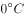，在物体上直接凝华而成的白色冰晶。霜的形成不仅与天气条件有关，而且和地面物体的属性有关。霜是在辐射冷却的物体表面上形成的，所以物体表面越容易辐射散热并迅速冷却，在它上面就越容易形成霜。而云对地面物体夜间的辐射冷却是有妨碍的，天空有云不利于霜的形成。

A、B、D三项说法均正确。

本题为选非题，故正确答案为C。

**考点**：自然地理

**来源**：2013年吉林省公务员录用考试《行测》题（甲级）第8题

### 第 9 题

清代，有一商人蔡某的朋友去世了。他差人把朋友的儿子叫来，要给他一千两金子。对方甚感惊讶和不解。蔡某解释说：“钱是你父亲生前寄存在我这里的。”朋友的儿子问蔡某：“我父亲留下字据了吗？他直到临终也没对我说过这事。钱，我不能要。”蔡某说：“没留字据，但字据在我心中，而不在纸上。”

通过上述事例，可以推断：

A. 在社会生活中，有比金子更可贵的东西

B. 不是社会中的每个人都需要钱

C. 在社会生活中，只有少数人讲信用

D. 钱对人们的生活并不重要

第 9 题 · 答案与解析

**参考答案（粉笔题库参考内容）**

A

**解析**

A项符合题意，通过事例可以看出，在蔡某看来归还他人寄存的钱财，靠的不是一纸字据，而是自己心中的诚信，诚信比金子更重要、更可贵。B、C、D三项不能反映出诚信的重要性，均排除。

故正确答案为A。

**考点**：文化常识

**来源**：2013年吉林省公务员录用考试《行测》题（甲级）第9题

### 第 10 题

在古代中西方交往中，两千年前中国的“名片”是丝绸，一千年前中国的“名片”是瓷器，五百年前中国的“名片”是茶叶。

这充分表明古代中国：

①自然经济长时间内没有根本性突破

②与西方的交流渠道不畅通

③手工业发展水平世界领先

④对外贸易一直居于出超地位

A. ①②

B. ②④

C. ①③

D. ③④

第 10 题 · 答案与解析

**参考答案（粉笔题库参考内容）**

C

**解析**

C项正确：从丝绸、瓷器到茶叶，中国的对外贸易主要以手工品为主，这说明古代中国手工业发展水平世界领先，但同时也证明了古代中国长期处于自然经济模式，而没有根本性突破，故①③正确；古代丝绸之路的存在使得中国手工品大量外输，故②错误；通过材料无法分析出古代中国外贸是出超还是入超，故④错误。

故正确答案为C。

**考点**：文化常识

**来源**：2013年吉林省公务员录用考试《行测》题（甲级）第10题

### 第 11 题

“我市是一个贫困地区，在这次会议期间，可能会给大家带来许多不便，敬请原谅。预祝大会圆满成功！”一句用于：

A. 开幕词

B. 闭幕词

C. 欢迎词

D. 竞选演讲

第 11 题 · 答案与解析

**参考答案（粉笔题库参考内容）**

A

**解析**

A项符合题意：“预祝大会获得圆满成功”一般用在开幕词的结尾。

故正确答案为A。

**来源**：2013年吉林省公务员录用考试《行测》题（甲级）第11题

### 第 12 题

在我国汉字发展史上，介于小篆和楷书中间的字体是：

A. 甲骨文

B. 金文

C. 隶书

D. 大篆

第 12 题 · 答案与解析

**参考答案（粉笔题库参考内容）**

C

**解析**

C项正确：小篆也叫“秦篆”，是秦统一后经过丞相李斯整理的一种通行书体。形体偏长，匀圆齐整，由大篆衍变而成。隶书是在篆书基础上，为适应书写便捷的需要产生的字体，主要将篆书圆转的笔划改为方折，使书写速度更快。隶书在东汉时期达到顶峰。楷书则是由隶书逐渐演变而来，更趋简化，横平竖直。楷书始于汉末，通行至今，长盛不衰。因此在汉字发展史上，隶书是介于小篆和楷书中间的字体。

A项错误：甲骨文是汉字的早期形式，也是现存中国王朝时期最古老的一种成熟文字。甲骨文早于小篆和楷书。

B项错误：金文是指铸造在殷周青铜器上的铭文，也叫钟鼎文。金文早于小篆和楷书。

D项错误：广义的大篆包括以前的甲骨文、金文和六国文字，而狭义的大篆指通行于春秋战国时期的秦国文字，是小篆的前身。大篆早于小篆和楷书。

故正确答案为C。

**考点**：文化常识

**来源**：2013年吉林省公务员录用考试《行测》题（甲级）第12题

### 第 13 题

中国古代地名中的“阴”“阳”往往体现了该地与相邻山、水的关系。以下都表示“阴”的方位是：

A. 山之南、水之北

B. 山之北、水之北

C. 山之南、水之南

D. 山之北、水之南

第 13 题 · 答案与解析

**参考答案（粉笔题库参考内容）**

D

**解析**

D项正确：东汉许慎所著的《说文解字》中明确记载：“阴，誾也。山之北，水之南也。从阜，从侌。”也就是说山的阴面是指山的北面，而河水的阴面则是指水的南面。

故正确答案为D。

**考点**：文化常识

**来源**：2013年吉林省公务员录用考试《行测》题（甲级）第13题

### 第 14 题

李某大学毕业之后应聘到一家民营企业做研发工作，经过一年努力，成功地开发出了一种新型软件，为企业带来良好的经济效益，当年李某的工资却没有增加。这时，另一家大型企业有意向聘请他去工作，并承诺工资可以提高五倍。李某认为自己和企业签订的协议还没有到期，就没有去。李某的做法，反映了他：

A. 不懂得自身的真正价值

B. 具有较强的职业责任感

C. 不懂得维护自身利益

D. 有着团结合作精神

第 14 题 · 答案与解析

**参考答案（粉笔题库参考内容）**

B

**解析**

B项正确：职业道德规范的主要内容有爱岗敬业、诚实守信、办事公道、服务群众、奉献社会。李某并没有因为高薪就跳槽到别家公司，而是遵守着与公司的协议，体现出他较强的职业责任感。

A、C项错误：李某开发出新软件，并且有其他公司高薪聘请他，李某实现了自身价值，之所以没有跳槽到别家公司是因为李某有较强的职业道德，遵守相关法律法规的规定，在签订的协议未到期的情况下不跳槽，说明其具有较强的职业责任感，不受到金钱的诱惑。

D项错误：材料中并没有体现出李某的团结合作精神，只是表述了他为了遵循与公司的协议而没有跳槽到别家公司，体现出他的职业责任感较强。

故正确答案为B。

**来源**：2013年吉林省公务员录用考试《行测》题（甲级）第14题

### 第 15 题

食物过敏是在摄入食物时由于食物中的某些成分引起免疫应答，导致消化系统内或全身性的变态反应。

以下食物成分容易引起过敏的是：

A. 纤维素

B. 蛋白质

C. 维生素

D. 脂肪

第 15 题 · 答案与解析

**参考答案（粉笔题库参考内容）**

B

**解析**

B项正确：蛋白质是组成人体一切细胞、组织的重要成分。机体所有重要的组成部分都需要有蛋白质的参与。过敏反应实际上是一种抗体-抗原的免疫应答，大分子容易引发机体的免疫应答，造成过敏现象。蛋白质种类非常多，且蛋白质可分解为多肽，一方面分解后种类再次增加，另一方面多肽可和其他物质反应生成新的物质。以上物质都是大分子，所以蛋白质容易造成过敏现象。

A项错误：纤维素是由葡萄糖组成的大分子多糖，不溶于水及一般有机溶剂，是自然界分布最广、含量最多的一种多糖，也是一种重要的膳食纤维。所以纤维素不会引起食物的过敏反应。

C项错误：维生素是维持身体健康所必需的一类有机化合物。维生素既不参与构成人体细胞，也不为人体提供能量，而是一类调节物质，在物质代谢中起重要作用。所以维生素不会引起食物的过敏反应。

D项错误：脂肪是甘油和三分子脂肪酸合成的甘油三酯，存在于人体和动物的皮下组织及植物体中，是生物体的组成部分和储能物质。脂肪可溶于多数有机溶剂，但不溶解于水。脂肪是生物体的能量提供者。所以脂肪不会引起食物的过敏反应。

故正确答案为B。

**考点**：化学常识

**来源**：2013年吉林省公务员录用考试《行测》题（甲级）第15题

### 第 16 题

从下列各句中的“红”来看，使用了相同修辞手法的一组是：

A. 日出江花红胜火，春来江水绿如蓝　泪眼问花花不语，乱红飞过秋千去

B. 蜘蛛也惜春归去，网着残红不放飞　落红不是无情物，化作春泥更护花

C. 看万山红遍，层林尽染　不恨此花飞尽，恨西园、落红难缀

D. 今年花胜去年红，可惜明年花更好，知与谁同　惜春长怕花开早，何况落红无数

第 16 题 · 答案与解析

**参考答案（粉笔题库参考内容）**

B

**解析**

B项正确：前一句诗出自周杨的《惜春》，诗中的“红”用了借代的修辞手法，以“残红”代落花；后一句诗出自龚自珍的《己亥杂诗·浩荡离愁白日斜》，诗人借花落归根，化为春泥，表明自己的心志。两句诗都运用了借代的修辞手法。借代是指说话或写文章时不直接说出所要表达的人或事物，而是借用与它密切相关的人或事物来代替。被代替的叫“本体”，替代的叫“借体”，“本体”不出现，用“借体”来代替。恰当地运用借代可以突出事物的本质特征，增强语言的形象性，而且可以使文笔简洁精炼，语言富于变化和幽默感。

A项错误：前一句出自白居易的《忆江南·江南好》，意思是太阳从江面升起时江边的鲜花比火红，春天到来时碧绿的江水像湛蓝的蓝草。此句诗的“红”是本义，指颜色，没有用修辞手法；后一句出自欧阳修的《蝶恋花》，意思是我带着伤心的眼泪对着花儿倾诉我心中的痛苦，但花儿却不能说话，红色的花瓣如同秋千一样荡来荡去的随风飞去了。此句诗的“红”用的是借代的修辞手法，用颜色借代诗人的心情。

C项错误：前一句出自毛泽东的《沁园春·长沙》，意思是看万千山峰全都变成了红色，一层层树林好像染过颜色一样。此句诗的“红”为本义，指颜色，没有使用修辞手法；后一句出自苏轼的《水龙吟·次韵章质夫杨花词》，意思是不恨这种花儿飘飞落尽，只是抱怨、愤恨那个西园满地落红枯萎难再重缀。此句诗的“红”用的是借代的修辞手法，借代花。

D项错误：前一句出自欧阳修的《浪淘沙》，意思是今年的花比去年的花要好看，颜色也更鲜艳，明年的花又会更好看，不知道会和谁一起再来看花。此句诗中的“红”指本义，无修辞；后一句出自辛弃疾《摸鱼儿》，意思是惜春光的我总怕花儿开得太早，何况眼前飘落红花无数。此句中的“红”用了借代的修辞手法，借代落花。

故正确答案为B。

**考点**：文学常识

**来源**：2013年吉林省公务员录用考试《行测》题（甲级）第16题

### 第 17 题

在某些情况通报的写作中，出于对行文对象的尊重，也表现出对社会现象的理解和态度的严肃认真，我们有时把“贫困”说成“低收入”，把“政治问题”说成“热点问题”，把“失业”说成“下岗待业”。这实际上使用的是：

A. 新锐语言

B. 含糊语言

C. 模糊语言

D. 灵活语言

第 17 题 · 答案与解析

**参考答案（粉笔题库参考内容）**

C

**解析**

C项正确：模糊语言，作为一种弹性语言，是指外延不确定、内涵无定指的特性语言。“模糊语言”具有两重性特点：即在本质上是明确的，在表象上是模糊的；在定性表述上是肯定的，在定量表述上是变化的；在内容上是确指的，在形式上是灵活的。因此在公文写作中常用模糊语言来表现出严谨的态度。A项和D项可以用排除法排除，相比B项中的“含糊语言”来说，“模糊语言”具有客观上的明确性与肯定性，此题可以用排除法解答。

故正确答案为C。

**来源**：2013年吉林省公务员录用考试《行测》题（甲级）第17题

### 第 18 题

公文多使用专用语句作结尾。下面不属于此类语句的是：

A. 上述要求，请予批准

B. 沿着······胜利前进

C. 本令自颁布之日起生效

D. 上述报告，如无不妥，请批转

第 18 题 · 答案与解析

**参考答案（粉笔题库参考内容）**

B

**解析**

B项错误，“沿着······胜利前进”常用于报告或讲话中，不属于公文使用的专业用语作结尾。其他项均属于此类语句。

本题为选非题，故正确答案为B。

**来源**：2013年吉林省公务员录用考试《行测》题（甲级）第18题

### 第 19 题

下列选项中符合我国法律适用原则的是：

A. 一男子偷自行车被某村巡逻队员抓住后，将其挂牌游街示众

B. 某歌星酒后驾车被判拘役，并作罚款处理

C. 某区政府管委会给该区法院发“警告函”，即“判案不得一意孤行”

D. 劳动模范犯有贪污罪，合议庭认为该劳模有功于社会，决定从轻处罚

第 19 题 · 答案与解析

**参考答案（粉笔题库参考内容）**

B

**解析**

B项正确：《刑法》第一百三十三条之一规定：“在道路上驾驶机动车，有下列情形之一的，处拘役，并处罚金：(一)追逐竞驶，情节恶劣的；(二)醉酒驾驶机动车的；(三)从事校车业务或者旅客运输，严重超过额定乘员载客，或者严重超过规定时速行驶的；(四)违反危险化学品安全管理规定运输危险化学品，危及公共安全的。机动车所有人、管理人对前款第三项、第四项行为负有直接责任的，依照前款的规定处罚。有前两款行为，同时构成其他犯罪的，依照处罚较重的规定定罪处罚。”所以B项符合我国法律适用原则。（该选项出题人表述不严谨。严谨表述应该是并作罚金处理）

A项错误：《民法典》第九百九十五条规定：“人格权受到侵害的，受害人有权依照本法和其他法律的规定请求行为人承担民事责任。受害人的停止侵害、排除妨碍、消除危险、消除影响、恢复名誉、赔礼道歉请求权，不适用诉讼时效的规定。”第一千零二十四条规定：“民事主体享有名誉权。任何组织或者个人不得以侮辱、诽谤等方式侵害他人的名誉权。”A项中的游街示众损害了该男子的名誉权，并且巡逻员没有执法的权利，排除。

C项错误：《宪法》第一百三十一条规定：“人民法院依照法律规定独立行使审判权，不受行政机关、社会团体和个人的干涉。”所以区政府管委会不得干涉法院判案，排除。

D项错误：《刑法》第四条规定：“对任何人犯罪，在适用法律上一律平等。不允许任何人有超越法律的特权。”不能因为是劳动模范就减轻处罚，排除。

故正确答案为B。

**考点**：刑法

**来源**：2013年吉林省公务员录用考试《行测》题（甲级）第19题

### 第 20 题

沙尘暴是指强风将地面尘沙吹起使空气很混浊，水平能见度小于1千米的天气现象。近年来，我国沙尘暴日益严重，下列关于沙尘暴说法正确的是：

A. 人类可以消灭沙尘暴

B. 沙尘暴天气主要发生在春末夏初季节

C. 沙尘暴多“全是全球变暖惹的祸”

D. 沙尘暴天气能见度为零

第 20 题 · 答案与解析

**参考答案（粉笔题库参考内容）**

B

**解析**

B项正确：沙尘暴天气主要发生在春末夏初季节，这是由于冬春季干旱区降水甚少，地表异常干燥松散，抗风蚀能力很弱，在有大风刮过时，就会将大量沙尘卷入空中，形成沙尘暴天气，正确。

A项错误：沙尘暴的形成除了人为因素之外，还有气象因素，沙尘暴的形成是以东亚特殊的大气环流为背景，并与冬季风紧密联系在一起，它的发生主要与冬半年西伯利亚——蒙古高压驱动下的冷锋过境有关。所以人类是不能消灭沙尘暴的，排除。

C项错误：强风是沙尘暴产生的动力，沙、尘源是沙尘暴物质基础。除此之外，前期干旱少雨，天气变暖，气温回升，都是沙尘暴形成的特殊的天气背景。所以沙尘暴并不都是全球变暖引起的，排除。

D项错误：沙尘暴是指强风从地面卷起大量沙尘，使水平能见度小于1千米，具有突发性和持续时间较短特点的概率小危害大的灾害性天气现象。所以沙尘暴天气并不是能见度为零，排除。

故正确答案为B。

**考点**：中国地理

**来源**：2013年吉林省公务员录用考试《行测》题（甲级）第20题

### 第 21 题

选出每组加括号词语含义和用法都相同的一项：

A. 习近平步入指挥大厅，了解（火箭）和飞船实时飞行情况

如果保罗真的选择加盟（火箭），那对于后者的影响是巨大的

B. 神十航天员将对（“天宫一号”）进行维修

孙悟空为什么能大闹（“天宫一号”），而打不过诸多妖精

C. 上个世纪90年代，作为中国化妆品直销品牌第一名，雅芳是不折不扣的（名媛）

在大赌场里······绅士和（名媛）们正在一掷千金地纵欲狂欢

D. 专栏作家斯蒂芬认为，中国的（世界工厂）时代即将宣告结束

在（“世界工厂”）向“世界市场”的转变中，电子商务的崛起是最具代表性的

第 21 题 · 答案与解析

**参考答案（粉笔题库参考内容）**

D

**解析**

A项，第一句的“火箭”指的是航天飞行的运载装置，第二句的“火箭”指的是美国男篮职业联赛中的休斯敦火箭队。两者含义不同，排除；

B项，第一句的“天宫一号”指的是我国第一个目标飞行器和空间实验室，第二句的“天宫一号”指的是古代神话故事中的“天庭”。两者含义不同，排除；

C项，第一句的“名媛”运用了拟人手法，第二句的“名媛”即本意。两者用法不同，排除；

D项，两句话中的“世界工厂”都指为世界市场大规模提供工业品的生产制造基地。含义用法相同，当选。

故正确答案为D。

**来源**：2013年吉林省公务员录用考试《行测》题（甲级）第21题

### 第 22 题

请选出某市街路地名语义与结构能形成对偶的一项：

A. 长江路——临河街 东盛大街——西安大路

B. 牡丹街——蔷薇路 解放大路——胜利公园

C. 惠民路——文昌路 人民广场——工农大路

D. 三道街——八里铺 远达大街——皓月大路

第 22 题 · 答案与解析

**参考答案（粉笔题库参考内容）**

B

**解析**

“对偶”的修辞方式要求短语字数相等、结构相同、意义对称。B项“牡丹”“蔷薇”均为名词且为花名，“解放”“胜利”可以均为形容词且意义相称，能表达摆脱束缚或击败对手的客观状态，当选。A项“长江”为名词，“临河”是“临着河、靠着河”的意思，为介宾短语，两者结构不一致，排除；C项“惠民”即“给百姓好处、实惠”，为动宾短语，“文昌”为名词，是一种星宿的名字，两者结构不一致，排除；D项“远达”为并列短语，意为“高远且豁达”，“皓月”意为“洁白的月亮”，“皓”为“月”的形容词，为偏正短语，故两者结构也不一致，排除。

故正确答案为B。

**来源**：2013年吉林省公务员录用考试《行测》题（甲级）第22题

### 第 23 题

有网友在微博平台发布了自己的心得：“鸡蛋，从外打破是食物，从内打破是生命！”这则微博迅速引发了网友的热议。

请选出解释不恰当的一项：

A. 从外打破是被人吃掉，从内打破是孕育生命。说明内因起决定作用

B. 如果是臭鸡蛋，从内无法打破，从外打破也无用。说明内在品质是根本

C. 人生也是一样，从外打破源于压力，从内打破源于动力。说明内外因结合促进发展

D. 再好的鸡蛋，不去孵化，也于事无补。说明内因通过外因发挥作用

第 23 题 · 答案与解析

**参考答案（粉笔题库参考内容）**

D

**解析**

A项，鸡蛋从内打破，体现新生命的诞生，对于事物的发展内因比外因更重要，内因起决定性作用，表述正确；

B项，如果是臭鸡蛋，说明内在品质不好，则无论怎样打破均体现不出价值，表述正确；

C项，鸡蛋的打破是对原有状态的改变，无论主动还是被动打破，都体现出改变原有状态向前发展之意，表述正确；

D项，鸡蛋如果从外打破成为食物，依然可以体现价值，而非于事无补，且应是“外因通过内因起作用”，表述错误。

本题为选非题，故正确答案为D。

**考点**：句子

**来源**：2013年吉林省公务员录用考试《行测》题（甲级）第23题

### 第 24 题

下列各句中，没有语病的一项是：

A. 北京的雾霾天气持续了近一个月，中国机动车污染防治委员会副主任说，政府的当务之急就是在于控制好那些尾气超标数十倍的车辆

B. 今年仍是“民生改善年”，我市八个调研组分别深入到各区县、社区和居民家中，听取群众意见，充实、完善和修改为民办实事的具体方案

C. 面对每逢节日快递运力紧张的局面，我国快递业应尽快提高从业人员的本地化比例，将采用加盟模式的民营快递企业转型为自营为主的模式

D. 正如远缘杂交可培育出品质更为优秀的后代一样，表面上隔行如隔山的不同专业、不同学科的交流，往往能撞击出天才的思想火花

第 24 题 · 答案与解析

**参考答案（粉笔题库参考内容）**

D

**解析**

A项，“就是在于”语意重复，需去掉其中之一，故为病句，排除；

B项，“充实、完善和修改”为顺承关系，顺序错误，应改为修改、充实和完善，故为病句，排除；

C项，“将采用加盟模式的民营快递企业转型为自营为主的模式”一句中“企业”与“模式”搭配不当，故应将“模式”删除，故为病句，排除；

D项，表述正确，当选。

故正确答案为D。

**来源**：2013年吉林省公务员录用考试《行测》题（甲级）第24题

### 第 25 题

下列各句中有歧义的一句是：

A. 未来三天，东北地区仍将持续多雨天气，吉林和辽宁的东部将有大到暴雨

B. 国人在国外的一些举动，往往会被放大，极易引来全社会的严厉声讨，而最多的声讨理由就是“丢了中国的脸”

C. 有网友调侃当年英法联军火烧了圆明园，现在中国人只是在卢浮宫洗个脚而已，为什么不可以？

D. 7月30日，中共中央政治局召开会议，分析研究上半年经济形势和下半年经济工作，会议公报传出一些重大政策信息

第 25 题 · 答案与解析

**参考答案（粉笔题库参考内容）**

A

**解析**

A项，“吉林和辽宁的东部”表述有歧义，可以理解为吉林全省和辽宁的东部，也可理解为吉林的东部和辽宁的东部，故当选。

B、C、D三项均表意明确。

故正确答案为A。

**来源**：2013年吉林省公务员录用考试《行测》题（甲级）第25题

### 第 26 题

下列各句中没有语病的一句是：

A. 自今年3月中国铁路总公司成立以来，中国铁路去向何处？备受关注

B. 景德镇，作为曾以自己“丢掉瓷都”的身份为傲的城市，景德镇的家家户户几乎都有人从事着和陶瓷相关的工作

C. 让人感到意外的是，“购票令”已经名存实亡，不少游客无须买票也可以入城，记者进出多个“关卡”均未受到阻拦

D. 公众之所以对机场建设费反感，既是因为重复收费没有依据，还因为信息不透明下，机场建设费的使用多处于模糊不清的状态，这就难免被指其中有灰色成分

第 26 题 · 答案与解析

**参考答案（粉笔题库参考内容）**

C

**解析**

A项，“备受关注”前缺少主语，应将问号去掉，故为病句，排除；

B项，“景德镇”主语重复，应去掉第二个“景德镇的”，故为病句，排除；

C项，表述正确，当选；

D项，“这”指代不明，故为病句，排除。

故正确答案为C。

**来源**：2013年吉林省公务员录用考试《行测》题（甲级）第26题

### 第 27 题

因一些年轻人苦于支付婚宴礼金而将婚礼请柬戏称为“红色炸弹”，因此就衍生出了“拆弹红条”。它往往是一张印有恭贺新禧之意的贺卡，里面写有恭贺新婚的词句，最后附带上“来日可凭此条参加本人婚礼”的字句。

对文意理解不正确的是：

A. 送拆弹红条是礼尚往来的一种新形式

B. 拆弹红条其实是一种欠条

C. 拆弹红条是未婚者送给新婚者的礼物

D. 送拆弹红条是在投桃报李

第 27 题 · 答案与解析

**参考答案（粉笔题库参考内容）**

D

**解析**

根据文段可知，婚礼请柬即“红色炸弹”是需给予新婚的人礼金的一个信号，“拆弹红条”可化解这一问题，故A、B、C三项表述正确。

D项，“投桃报李”指友好往来或互相赠送东西，与文段意思不符，表述错误，当选。

此题为选非题，故正确答案为D。

【文段出处】《拆弹红条》

**考点**：句子

**来源**：2013年吉林省公务员录用考试《行测》题（甲级）第27题

### 第 28 题

城管的执法对象，绝大部分是弱势群体，这决定了城管在舆论场处在一个不利的地位，因为舆论是弱势群体的天然盟友，一件事情发生后，除了有强力控制媒体外，无论是传统媒体还是新媒体，都别指望舆论会倒在强势群体这一边，相反，弱势群体总是会得到舆论更多的同情与支持，像这一次美国斯诺登事件就是明证，城管要清楚地知道自己的舆论地位，如果以为自己是生活中的强势群体，就可以在舆论场上也是强势群体，用对付瓜农菜贩的方式对付舆论，那就是搬起石头砸自己的脚。

不符合文意的一项是：

A. 城管是公共舆论中的弱势群体

B. 媒体是操控公共舆论的强势群体

C. 公共舆论是城管的“天敌”

D. 斯诺登是斯诺登事件中的弱者

第 28 题 · 答案与解析

**参考答案（粉笔题库参考内容）**

B

**解析**

由“城管在舆论场处在一个不利的地位”及其后关于舆论媒体倾向性的论述可知，城管在公共舆论中是弱势群体，A项正确；

媒体并不能操控舆论，“操控”词义过重且不符合事实，B项错误；

根据文段可知，弱势群体总是会得到舆论更多的同情与支持，公共舆论是处于强势地位的城管的“天敌”，C项正确；

根据原文“弱势群体总是会得到舆论更多的同情与支持，像这一次美国斯诺登事件就是明证”可知，斯诺登是斯诺登事件中的弱者，D项正确。

本题为选非题，故正确答案为B。

【文段出处】《城管的舆论之窗为何破了又破》

**考点**：细节判断题

**来源**：2013年吉林省公务员录用考试《行测》题（甲级）第28题

### 第 29 题

“我们做孔子研究所的设计，就把其定位于在特殊地点的具有特殊功能的建筑，它必须是一座现代建筑，又屹立在这个文化之乡，必须具备特有的文化内涵。”在对战国时代的建筑文化以及对中国书院建筑发展的沿革、形式进行一番探讨之后，设计师又对建筑构图、总体布局、室内外造型包括装饰纹样等，做了一定的探索，然后再运用西方和中国建筑的技巧予以现代的形象表述，创造出一种“欢乐的圣地感”。

对孔子研究院的设计理念概括不恰当的一项是:

A. 建筑的一般性与特殊性的统一

B. 西方技巧与东方技巧的统一

C. 古代文化与现代文化的统一

D. 建筑功能与审美趣味的统一

第 29 题 · 答案与解析

**参考答案（粉笔题库参考内容）**

D

**解析**

文段介绍了孔子研究院的一系列设计理念，A项“一般性与特殊性的统一”、C项“古代文化与现代文化的统一”可由首句“定位于在‘特殊’地点的‘特殊’功能的建筑，它必须是一座‘现代’建筑，又具备特有的文化内涵”得出；B项“西方技巧与东方技巧的统一”可由“运用西方和中国建筑的技巧予以现代的形象表述”得出；D项“审美趣味”在文段并未直接表明，不符合文意。

本题为选非题，故正确答案为D。

【文段出处】《吴良庸：闲不下来的建筑大师》

**考点**：细节判断题

**来源**：2013年吉林省公务员录用考试《行测》题（甲级）第29题

### 第 30 题

公共监督如果总是折戟在烂尾新闻的诡异之中，光靠热情与理性又有何用？一些影响恶劣的公共事件，不仅事关民主，更关系到公共权益与权力公信。烂尾的结果，令制度与法律情何以堪？看来，公共事件后，当与应急机制同时启动的，还应有公开透明的问责机制——任何时候，都不能因“救火”的真诚而掩饰了“纵火”的责任，烂尾新闻背后，不仅要关注主角的命运，更要追究“被烂尾”的责任。

这段文字要批评的是：

A. 烂尾新闻

B. 公共事件责任追究不力

C. 公共事件发生地政府

D. 公共事件责任人

第 30 题 · 答案与解析

**参考答案（粉笔题库参考内容）**

B

**解析**

文段先用两个反问铺垫了烂尾事件的危害，接着用“应有公开透明的问责机制”引出了文段的核心话题“问责”，后面用破折号引导解释说明，最后强调“不仅要关注主角的命运，更要追究‘被烂尾’的责任”，故文段的重点是在批评公共事件的责任追究不到位，对应B项。

A项文中强调要追究“烂尾新闻”背后的责任而非烂尾新闻本身，排除；

C项“发生地政府”、D项“责任人”，文段均未提及，排除。

故正确答案为B。

【文段出处】西安晚报《烂尾新闻究竟“烂”在何处》

**考点**：特殊问法

**来源**：2013年吉林省公务员录用考试《行测》题（甲级）第30题

### 第 31 题

依次填入下面一段文字横线处的语句，衔接最恰当的一项是（    ）。

中国梦不同于美国梦。＿＿＿＿＿＿＿＿＿＿，＿＿＿＿＿＿＿＿＿＿，＿＿＿＿＿＿＿＿＿＿，＿＿＿＿＿＿＿＿＿＿，＿＿＿＿＿＿＿＿＿＿，＿＿＿＿＿＿＿＿＿＿。历史告诉我们，每个人的前途命运都与国家和民族的前途命运紧密相连。个人的梦想要在国家和民族的梦想中实现。

①我们中国人不仅关心自己

②我们不仅追求个人的成功

③还以仁待人，心怀天下，崇尚个人价值与社会价值的高度和谐

④更要实现中华民族的伟大复兴

⑤美国梦是强调一个人只要辛勤工作就能有体面的生活，实现自己的理想

⑥有着强烈的集体主义倾向

A. ⑤②④①③⑥

B. ①③⑥②④⑤

C. ⑤①③⑥②④

D. ①④②③⑥⑤

第 31 题 · 答案与解析

**参考答案（粉笔题库参考内容）**

C

**解析**

对比①⑤两句，文段首句提到“中国梦不同于美国梦”，根据逻辑下文应该讲述美国梦与中国梦的区别是怎样的，故与⑤句衔接更为紧密，排除B、D两项。⑤句提到了美国梦，因此下文应该讲述中国的情况，故⑤①两句相连，排除A项。

故正确答案为C。

【文段出处】《中国梦不同于美国梦》

**考点**：确定捆绑、确定顺序

**来源**：2013年吉林省公务员录用考试《行测》题（甲级）第31题

### 第 32 题

农村孩子不易跃“龙门”，症结在于＿＿＿＿＿＿＿＿＿＿。农村孩子从幼儿园、小学到初中，一开始就输在起跑线上。这些年，教育投入越来越给力，但教育嫌贫爱富的现象依然存在，越是大城市和名校，投入越多，动辄花上亿元建设超级中学，优质教育资源集中到少数学校，而一些农村学校却成了被忽略的大多数，不少孩子仍在危房里上课，农村孩子入学率、升学率和受教育程度远低于城市。一步落后，步步落后，再加上一些招生制度的影响，农村孩子难跟城里孩子比拼，失去了上更好大学的机会。

填在横线处最恰当的一项是：

A. 城乡经济发展水平的不均衡

B. 农村孩子上更好大学的机会少

C. 城乡教育资源不均衡

D. 农村孩子输在起跑线上

第 32 题 · 答案与解析

**参考答案（粉笔题库参考内容）**

C

**解析**

文段为总分结构，首句提出观点，后文的内容是对横线所填语句的解释说明，由“教育嫌贫爱富”“优质教育资源集中到少数学校”“农村学校却成了被忽略的大多数”“农村孩子难跟城里孩子比拼”等语句可知，文段强调的是教育资源不均衡问题，对应C项。

A项，“城乡经济发展水平”文中没有提到，无中生有，排除；

B项“上更好大学的机会少”和D项“一开始就输在起跑线上”均为教育资源不均衡产生的一个方面的影响，表述片面，排除。

故正确答案为C。

【文段出处】《农村孩子不易跃“龙门”》

**考点**：横线在开头

**来源**：2013年吉林省公务员录用考试《行测》题（甲级）第32题

### 第 33 题

对生命价值的认同度越高，社会对灾难的敏感度就会越高，五年前汶川地震的隐痛未消，所以芦山地震刚一发生，人们无法判断灾情大小，众多媒体人第一时间赶赴灾区，体现的正是媒体的责任和担当。正是媒体的及时详细报道，让灾情透明地呈现在人们面前。不能因为事后看起来灾情不如汶川地震那么严重，就认为舆论反应过度了。

作者想要说明的是：

A. 媒体对灾情的关注度不应取决于灾情的大小

B. 芦山地震灾情因媒体的积极跟进而透明

C. 媒体对芦山地震的高度关注来自职业敏感

D. 媒体对芦山地震的反应没有过度

第 33 题 · 答案与解析

**参考答案（粉笔题库参考内容）**

D

**解析**

文段开头提出“对生命价值的认同度越高，社会对灾难的敏感度就会越高”这一情况，后面提到媒体在面对芦山地震时第一时间赶赴灾区，对灾情进行及时关注和报道，让人们更好地了解灾情。尾句得出结论“不能因为事后看起来灾情不如汶川地震那么严重，就认为舆论反应过度了”，可知作者强调的是媒体对于芦山地震的反应没有过度，对应D项。

A项，偏离中心，文段谈论的是媒体对芦山地震的反应是否过度的话题，排除；

B项，“因媒体的积极跟进而透明”为尾句之前的内容，非重点，排除；

C项，“职业敏感”文段没有提及，首句提到的是“社会对灾难的敏感度”而非“职业敏感”，无中生有，排除。

故正确答案为D。

【文段出处】《抗击地震，舆论“反应过度”了吗》

**来源**：2013年吉林省公务员录用考试《行测》题（甲级）第33题

### 第 34 题

病房里，一个生命垂危的病人从房间里看见窗外的一棵树的树叶在秋风中一片片地掉落。病人望着眼前的萧萧落叶，身体也随之每况愈下，一天不如一天。她说：“当树叶全部掉光时，我也就要死了。”一位老画家得知后，用彩笔画了一片叶脉青翠的树叶挂在树枝上。于是，最后一片叶子始终没掉下来，只因为生命中的这片绿，病人竟奇迹般地活了下来。

这个故事给我们的启示是：

A. 绿色，可以给生命带来希望

B. 艺术家，都有一双善于发现的眼睛

C. 有了希望，就有了创造奇迹的可能

D. 希望，一定可以创造生命的奇迹

第 34 题 · 答案与解析

**参考答案（粉笔题库参考内容）**

C

**解析**

根据文段内容可知，萧萧落叶象征死亡，而叶脉青翠的树叶代表生的希望，生命垂危的病人因为有了叶脉青翠的树叶，有了生的希望奇迹般地活了下来，说明了希望对人生的重要性，有了希望就有创造奇迹的可能，对应C项。

A项，文段强调的是希望的价值而非绿色，且文段阐述的结果是创造生命的奇迹而非带来希望，排除；

B项，“艺术家”非文段的重点，且并没有体现出“希望”的价值，排除；

D项，“一定”表述过于绝对，排除。

故正确答案为C。

【文段出处】《最后一片叶子》

**来源**：2013年吉林省公务员录用考试《行测》题（甲级）第34题

### 第 35 题

人骑自行车，两脚使劲踩1小时只能跑10公里左右；人开汽车，一脚轻踩油门1小时，能跑100公里；人坐高铁，闭上眼睛1小时也能跑300公里；人乘飞机，吃着美味1小时能跑1000公里。

这段文字给我们的启示是：

A. 不同的交通工具有不同的服务效率

B. 良好的环境和条件是一个人成功的必要条件

C. 应该大力发展现代交通工具

D. 一个人的发展平台不同，结果也可能不同

第 35 题 · 答案与解析

**参考答案（粉笔题库参考内容）**

D

**解析**

文段通过四个并列结构论述同一个人在不同的交通工具上会产生不一样的结果，故可知文段启示为同一个人处于不同的平台，结果是不一样的，对应D项。

A项，仅为文段表面的意思，而非深层次的启示，排除；

B项“良好的环境”“成功”与C项“大力发展现代交通工具”均为无中生有的表述，排除。

故正确答案为D。

【文段出处】《人生微语》

**考点**：关联词-并列

**来源**：2013年吉林省公务员录用考试《行测》题（甲级）第35题

### 第 36 题

一位青年去拜访画家：“为什么我画一幅画，只要一天功夫，可卖掉它却要整整一年？”，“请你倒过来试试。你花一年功夫画一幅画，兴许一天就能卖掉。”画家说。青年照办：观察、写生、构思、创作。后来事实果然如此。

这个故事说明的道理是：

A. 天赋不是艺术家的必备条件

B. 成功往往不是一蹴而就的

C. 生活是艺术创作的源泉

D. 有付出一定会有收获

第 36 题 · 答案与解析

**参考答案（粉笔题库参考内容）**

B

**解析**

文段将“一天画画卖一年”与“一年画画一天卖”两种截然不同的局面对比，引出道理：事情的成功需要经历一个艰辛的过程，不是一下子就能实现的，对应B项。

A项，“天赋”文段没有提及，无中生有，排除；

C项，文段并未强调生活对艺术创造的重要性，排除；

D项，文段通过两种局面的对比强调成功没有那么容易，并非强调付出就有收获，排除。

故正确答案为B。

**来源**：2013年吉林省公务员录用考试《行测》题（甲级）第36题

### 第 37 题

跳蚤被放进敞口的瓶子里，它便立刻跳了出来。当把瓶子盖上时，跳蚤还是会竭力跳出瓶子，它不停地撞击着瓶盖的内侧。一个多小时后，它还在那样跳着。差不多三个小时后，它依然在跳，只是它不再撞着瓶盖了，此时它跳的高度离瓶盖大约1厘米，而且每一次都是如此，它已经习惯了这个高度。后来即使瓶盖被拿掉了，跳蚤也没有跳出瓶口，它依然保持着有瓶盖时的高度，再也跳不出瓶口。

跳蚤的故事告诉我们：

A. 有形的禁锢比无形的束缚更易被打破

B. 习惯往往会束缚我们的思想和行动

C. 胸无大志，势必无所作为

D. 拒绝尝试往往使我们错失成功的机会

第 37 题 · 答案与解析

**参考答案（粉笔题库参考内容）**

B

**解析**

文段为寓言故事类题目。开头介绍将跳蚤放进没盖的瓶子里，它会立刻跳出来，但是盖上瓶盖后，跳蚤便无法再碰到瓶盖，且每次距离其仅为1厘米，养成了跳到这个高度的习惯，以至于最后将瓶盖拿掉，跳蚤也一直保持该习惯而无法跳出瓶子。故该文段表达了“习惯”所产生的消极影响，对应B项。A项“更易被打破”和C项“胸无大志”无中生有，文段没有提及，均排除；D项“拒绝尝试”和文段语义相反，文段中跳蚤一直在尝试，只不过被习惯束缚，排除。

故正确答案为B。

**来源**：2013年吉林省公务员录用考试《行测》题（甲级）第37题

### 第 38 题

互联网时代出现了这样一群人：他们有社会责任感和爱心，眼界开阔，留意生活中的点点滴滴。从中择取社会“热点”，用手机、数码相机或数码摄像机等数码设备拍下图像或视频，用来表达对百姓生活和人文历史的理解与思考。然后用发送彩信或电子邮件的方式，上传到网络分享、传播，他们被称作“拍客”，成为“拍客”，不需要高超的摄影技术，妇孺皆可。

属于成为“拍客”必要条件的一项是：

A. 互联网时代，能将作品上传到网络分享、传播

B. 有社会责任感和爱心，善于择取社会“热点”的妇女儿童

C. 有高超的摄影技术，用数码设备拍下图像或视频

D. 对百姓生活和人文历史有深刻的理解与独特的思考

第 38 题 · 答案与解析

**参考答案（粉笔题库参考内容）**

A

**解析**

根据文段提问可知本题为细节判断题。

根据尾句内容可知，将作品上传到网络分享、传播的才能称之为“拍客”，故“将作品上传到网络分享、传播”是成为“拍客”的必要条件，对应A项。

根据尾句提到“妇孺皆可”意思是每个人都可以，并未限定对象为“妇女儿童”，B项错误，排除；

根据尾句“不需要高超的摄影技术”可知，C项错误，排除；

D项“深刻的理解与独特的思考”无中生有，排除。

故正确答案为A。

**考点**：细节判断题

**来源**：2013年吉林省公务员录用考试《行测》题（甲级）第38题

### 第 39 题

新媒体时代是信息爆炸的时代，信息爆炸给人们带来了福利，使人们生活在一个更透明的社会中。但这种爆炸也给人们带来了信息骚扰。且不说每天无数娱乐至死的垃圾信息耗散着我们的注意力，充斥于空间中的种种虚假信息更让人头疼。从“深圳最美女孩”到“流浪汉成千万富翁”，再到让人目瞪口呆的“打车假新闻”，假新闻不断突破着公众想象力。

从内容上看，该文段的中心词是：

A. 新媒体

B. 信息爆炸

C. 信息骚扰

D. 假新闻

第 39 题 · 答案与解析

**参考答案（粉笔题库参考内容）**

D

**解析**

文段开头介绍背景，之后出现“但”表转折，引出文段重点，通过“且不说······更······”的递进结构引出文段中心词“假新闻”，最后通过举例进一步说明假新闻不断突破着公众想象力，故文段谈论的中心词为“假新闻”，对应D项。

A、B两项为转折前的内容，非重点，均排除；C项“信息骚扰”出现在递进之前，且没有“假新闻”更加明确具体，排除。

故正确答案为D。

**考点**：主题词

**来源**：2013年吉林省公务员录用考试《行测》题（甲级）第39题

### 第 40 题

我们身处的社会，是由无数人组成的，不管是大学生村官，还是白领实习生，都得和不同的人，不同的事情打交道，也必然会遭遇各种挫折、挑战。在这个过程中，采取什么态度来对待这些挫折、挑战，往往对最终结果具有决定性作用，而情商又决定了人们采取何种态度。从这个角度来看，情商极其重要，如果用一句话加以概括的话，那就是＿＿＿＿＿＿＿＿＿＿。

填在横线上最恰当的一项是：

A. 情商决定结果

B. 情商决定态度

C. 性格决定命运

D. 态度决定结果

第 40 题 · 答案与解析

**参考答案（粉笔题库参考内容）**

A

**解析**

语句填空题，最后一句总结前文观点，文段论述情商决定态度，而态度决定结果，最终观点为情商决定结果即情商重要，因此A项符合前文观点。“情商决定态度”“态度决定结果”表述片面，排除B、D两项；C项“性格、命运”，无中生有，排除。

故正确答案为A。

注：此题有争议，原文段为

        我们身处的社会，是由无数人组成的，不管是大学生村官，还是白领实习生，都得和不同的人，不同的事情打交道，也必然会遭遇各种挫折、挑战。在这个过程中，采取什么态度来对待这些挫折、挑战，往往对最终结果具有决定性作用，而情商又决定了人们采取何种态度。从这个角度来看，情商极其重要，如果用一句话加以概括的话，那就是：“性格决定命运”。

【文段出处】《被误读的情商》

**考点**：横线在结尾

**来源**：2013年吉林省公务员录用考试《行测》题（甲级）第40题

### 第 41 题

不错，我们需要韩寒，但也需要秋风式的新儒家、方舟子式的科学主义、铅笔社式的市场至上论，甚至还需要于丹、余秋雨式的通俗，因为，思想市场需要博弈，否则就会走向僵化，即使出现了错误，也无人预警，结果走入集体悲剧中。这就是为什么孟德斯鸠会说“我不同意你的看法，但我誓死捍卫你说话的权利”的原因。

这段文字要表达的观点是：

A. 集体悲剧源自思想僵化

B. 要宽容不同的声音

C. 思想多元，社会才能进步

D. 公民的话语权应得到尊重

第 41 题 · 答案与解析

**参考答案（粉笔题库参考内容）**

B

**解析**

文段首先提出观点“我们需要韩寒，但也需要秋风式的新儒家、方舟子式的科学主义、铅笔社式的市场至上论，甚至还需要于丹、余秋雨式的通俗”，接着分析原因，最后“这”引导尾句、重申观点，即我们需要各种不同声音。B项“要宽容不同的声音”为观点部分的同义表述，当选。

A、C两项均为原因部分的表述，排除；D项也提及了尊重，但并未提及话语间存在着“不同”，不能与文段中心相对应，排除。

故正确答案为B。

【文段出处】《年轻人没必要都学韩寒》

**考点**：关联词-因果、关联词-对策

**来源**：2013年吉林省公务员录用考试《行测》题（甲级）第41题

### 第 42 题

中国各行业的“德”如今都多少出了问题，除了官德频遭批评外，医德是行业道德中饱受的诟病之一。全国有200多万医师，针对他们的职业道德的标准既很容易列出来，又有很多强大的现实因素有可能把它们变成贴在墙上的一张纸。行业的普遍道德问题往往有着深刻的原因，在一个行业开展“教育”，通常要比惩罚它的个别败坏分子难的多。

对“把它们变成贴在墙上的一张纸”理解正确的是：

A. 医师职业道德标准制度化

B. 医师职业道德标准成为一纸空文

C. 作为管理制度，医师职业道德标准要上墙

D. 对医师职业道德的监督知易行难

第 42 题 · 答案与解析

**参考答案（粉笔题库参考内容）**

B

**解析**

本题为词句理解题，需结合前后文进行分析。文段首句提出“医德问题”这一话题，随后对这一问题进行分析，指出标准容易列出来，且有很多因素让“它们变成贴在墙上的一张纸”，根据前文可知，此处“它们”指代前文的“医师的职业道德标准”。尾句继续进行分析，指出“医德”问题存在有深刻原因且进行教育也很难，强调要改变“医德问题”很难。故可知“把它们变成贴在墙上的一张纸”指的是靠制度改变“医德”现状很难，即医生的职业道德标准容易标出却难以真正实施，B项“一纸空文”即指此明文的道德标准难以兑现，符合文意，当选。

A、C两项，“制度化”“要上墙”未能体现道德标准实施难，均排除；

D项，文段强调的是医德的实际性“规范实施”难而非“监督”难，排除。

故正确答案为B。

【文段出处】《失德医生进黑名单，苦才是猛药》

**考点**：句子

**来源**：2013年吉林省公务员录用考试《行测》题（甲级）第42题

### 第 43 题

井盖夺命事件在多个城市发生，白岩松在节目中质问：难道这样一件事情也需要总理来管吗？问得好！再往深一层说，中央或者国务院的确管不了那么多井盖或者类似的事儿，但管得了井盖类似事儿的层层官员，一定要像撤职和任职一样成为常态，谁该管没管就撤谁，永不再用。

作者最想表达的观点是：

A. 中央领导和部门应严查井盖夺命事件责任人

B. 城市公共设施管理问责制应该成为常态

C. 井盖管理问责制应该成为常态

D. 井盖夺命事件中国家管理层负有追责责任

第 43 题 · 答案与解析

**参考答案（粉笔题库参考内容）**

B

**解析**

文段开头引出“井盖夺命事件”这一问题，之后通过转折词“但”引出文段重点，即应落实井盖类似事儿的问责制度，使其成为常态，所以文段针对的重点是“井盖类似的事儿”，并不是特指井盖这一件事，故B项“城市公共设施”符合文意，当选。A、C、D三项都是针对“井盖”这一件事，脱离文段中心，排除。

故正确答案为B。

**考点**：关联词-转折

**来源**：2013年吉林省公务员录用考试《行测》题（甲级）第43题

### 第 44 题

我们为什么非要睡觉不可呢？睡眠逐步进化的根本目的非但不是履行某些重要的生物功能，相反，它只是为了保存体能和使个体避免危险。有人认为，非快速眼动，特别是慢波睡眠，恰恰是我们为使大脑能终其一生地持续学习和适应环境所付出的代价。同时更多的研究揭示了睡眠在使免疫系统保持运转方面所起的作用。此外，恩格尔·菲利曼在睡眠学术会议上披露，睡眠不足的人往往偏爱吃有损健康的快餐。

依据文意进行的推断，不恰当的一项是：

A. 人类不得不耗用时间睡眠是生物机能保证人体正常活动必须付出的代价

B. 非快速眼动，特别是慢波睡眠，使大脑能终生持续学习和适应环境

C. 睡眠使免疫系统保持运转，并往往决定人们对于食物的选取

D. 睡眠是为了保存体能并使个体避免危险的重要生物功能

第 44 题 · 答案与解析

**参考答案（粉笔题库参考内容）**

C

**解析**

文段阐述了睡眠的原因是为了保存体能、避免危险、能使免疫系统保持运转，同时有人认为，特别是慢波睡眠，是我们为使大脑能终其一生地持续学习和适应环境所付出的代价。同时更多的研究揭示了睡眠在使免疫系统保持运转方面所起的作用等。故A项“能保证人体正常活动”，B项“使大脑持续学习、适应环境”，D项“避免危险”均为文段提及的需要睡眠的原因；C项“睡眠往往决定人们对于食物的选取”，与原文尾句“睡眠不足的人往往偏爱吃有损健康的快餐”相比表述过于绝对化，不符合文意。

本题为选非题，故正确答案为C。

【文段出处】《睡眠的谜团》

**考点**：细节判断题

**来源**：2013年吉林省公务员录用考试《行测》题（甲级）第44题

### 第 45 题

人类对自然无节制地索求，在城市开发时忽略生态平衡保护，这是对候鸟一场无声无息的猎杀。这种“猎杀”比起猎杀、毒杀候鸟罪，负面效应其实毫不逊色。更大的问题是，那些猎杀、毒杀候鸟的犯罪，是被我们所警惕并谴责的，而另一种“猎杀”由于是看不见、静悄悄的，导致我们浑然不觉。而实际上，我们每个人，都可能是这场“猎杀”的旁观者，参与者。

这段文字主要告诉我们：

A. 人类对自然的索取应该有所节制

B. 每个人都在不知不觉中猎杀了候鸟

C. 城市开发时要重视生态平衡的保护

D. 警惕人类无声无息的“候鸟猎杀”

第 45 题 · 答案与解析

**参考答案（粉笔题库参考内容）**

D

**解析**

文段首先引出一种无声无息的猎杀，指出其负面效应很大，然后通过程度词“更大”强调一般的候鸟猎杀是被我们所警惕和谴责的，但另一种“猎杀”是看不见、静悄悄的，我们可能已在无知无觉中参与其中了，故文段重在强调这种无声无息的“候鸟猎杀”，对应D项。

A、C两项，没有提到“候鸟猎杀”，脱离文段核心，且表述片面，均排除；

B项，表述过于绝对，排除。

故正确答案为D。

【文段出处】《警惕另一场无声无息的“候鸟猎杀”》

**考点**：关联词-对策

**来源**：2013年吉林省公务员录用考试《行测》题（甲级）第45题

### 第 46 题

事实上，由于我国经济社会运行中的矛盾大多数是结构性矛盾，控制城市汽车使用量，用“减法”可能比用“加法”好，加法就是开征汽车排污费；而减法的核心是大幅减少各种名号的公车，全面推进车改。如果这一招能真正推进，加上环保税等的开征，估计大中城市的空气污染情况就会大大好转。

这段问题的议题是：

A. 治理城市空气污染的有效途径

B. “加法”和“减法”的优劣比较

C. 如何进行公车改革

D. 如何控制汽车使用量

第 46 题 · 答案与解析

**参考答案（粉笔题库参考内容）**

D

**解析**

文段首先指出“控制汽车使用量，用‘减法’可能比用‘加法’好”，接下来介绍什么是“加法”“减法”，以及“减法”用得好的话会达到什么效果。这里的“加法”“减法”都是针对控制城市汽车使用量来说的，故整个文段的议题是如何控制汽车使用量，对应D项。

A项，迷惑性强，“治理城市空气污染的有效途径”范围较大，不只是控制汽车使用量这一个途径，且文段论述的也并非是否要控制汽车使用量，而是应采用什么方法来控制汽车使用量，排除；

B项，“优劣比较”在文中没体现，作者只简单地说“减法”比“加法”好，不是文段重点，排除；

C项，“公车改革”只是“减法”的内容，目的还是控制汽车使用量，且文段并没有就“如何进行公车改革”展开论述，排除。

故正确答案为D。

【文段出处】新京报：《开征汽车排污费仍需谨慎》

**考点**：主题词

**来源**：2013年吉林省公务员录用考试《行测》题（甲级）第46题

### 第 47 题

官员财产公开、重大工程与项目管理、政府采购、公车改革、遏制公款大吃大喝等问题，既是反腐败领域的重点、难点、热点问题，也是民众极为关注的普遍性问题。对此，我们布下了“天罗地网”，但是，在现实中许多没有得到认真执行。于是，“房叔”“表叔”不断现身、工程竣工与贪官倒下层出不穷。政府要购价屡屡高于市场价，公车年年喊改革，公款吃喝照常。

这段话主要支持的论点是：

A. 中国的反腐制度已经很完善

B. 执法不严是导致腐败问题层出不穷的根本原因

C. 中国的制度反腐需要加强执行力

D. 有制度总比没有制度好

第 47 题 · 答案与解析

**参考答案（粉笔题库参考内容）**

C

**解析**

文段首先提出我国“反腐”布下各种“天罗地网”的制度限制，通过“但是”转折引出却没有认真执行，导致“反腐”不力的问题，即反腐制度没有认真执行，C项“反腐要加强执行力”为针对问题提出的对策表述，当选。

A项反腐制度已经“完善”无中生有，排除；B项强调的是存在“腐败”问题，与“反腐”存在问题主体不一致，排除；D项强调制度的重要性，无中生有，排除。

故正确答案为C。

【文段出处】《反腐败，最缺的就是“认真”》

**考点**：关联词-对策

**来源**：2013年吉林省公务员录用考试《行测》题（甲级）第47题

## 材料 1

大学办的好不好，并不完全取决于“国际化水平”，就教学及科研水平而言，X大学现在不是、短时间内也不可能是“世界一流”；但就论X大学对于人类文明的贡献，很可能是不少世界一流大学所无法比拟的。

        大学不像工厂或超市，不可能标准化，必须服一方水土，才能有较大的发展空间。X大学，其迷人之处，正在于她不是“办”在中国，而是“长”在中国——跟多灾多难而又不屈不挠的中华民族一起走过来，流血流泪，走弯路，吃苦头，当然也有扬眉吐气的时刻。你可以批评她的学术成就有限，但其深深介入历史进程，这一点不应该被嘲笑。

        相对而言，Y大学的师生普遍缺乏X大学的这种气度与情怀。高薪礼聘的教授来自四面八方，眼界不限于本土，其表演舞台很可能设定在遥远的北美或欧洲。这就难怪，Y大学的校园里，关心国家之前世今生者并不很多。教授们不太有介入社会、影响变革的意愿与能力。老师认真教书，学生勤恳求学，一切按部就班。如此过早的职业化追求，与X大学学生的“志大才疏”恰好形成鲜明对照。

        今天Y大学的青年学生，其视野、志向及趣味明显与以前有别。六年前我在Y大学讲研究生主课，一旦脱离技术问题，听众便反应漠然。现在，学生们不仅关心学校自身发展，也关心整个大中华的命运，在此过程中，Y大学开始“接地气”了。

        X大学如今正恶补“国际化”这一课。只希望不要如狗熊掰棒子，掰一个丢一个······

### 第 48 题

在作者看来，与X大学比较，Y大学的明显不足是（    ）。

A. 对人类文明的贡献不大

B. 缺少对国家民族的大情怀

C. 过度职业化与国际化

D. 过度重视科学技术

第 48 题 · 答案与解析

**参考答案（粉笔题库参考内容）**

B

**解析**

根据“Y大学的师生普遍缺乏X大学的这种气度与情怀”，可知Y大学的不足在于情怀，且上文具体阐释这种情怀与中华民族有关，对应B项。

A项，“对人类文明贡献不大”无中生有，排除；

C项，文段只表明Y大学趋向职业化与国际化，“过度”程度过重，文段没有相关表述，且不属于不足之处，排除；

D项，“过度重视科学技术”亦非不足之处，排除。

故正确答案为B。

【文段出处】《大学的本土情怀》

**来源**：2013年吉林省公务员录用考试《行测》题（甲级）第48题

### 第 49 题

文中的“接地气”是指（    ）。

A. Y大学开始关注国家、民族的命运

B. Y大学开始关注我国的传统文化

C. Y大学开始关心大学本身的发展

D. Y大学开始关心自身的历史、现在和未来

第 49 题 · 答案与解析

**参考答案（粉笔题库参考内容）**

A

**解析**

根据文段可知，Y大学现今 “学生们不仅关心学校自身发展，也关心整个大中华的命运”，对应A项。

B项，“传统文化”无中生有，排除；

C项，“不仅······也”表递进，可知重在强调“关心整个大中华的命运”，排除；

D项，表述无中生有，排除。

故正确答案为A。

【文段出处】《大学的本土情怀》

**来源**：2013年吉林省公务员录用考试《行测》题（甲级）第49题

### 第 50 题

作者对X大学的提醒是（    ）。

A. 一个富有历史文化底蕴的大学不宜走国际化之路

B. 不能为追求国际化而丢掉本土情怀

C. 不能盲目学习Y大学的国际视野

D. 本土情怀才是中国大学的立校之本

第 50 题 · 答案与解析

**参考答案（粉笔题库参考内容）**

B

**解析**

文段最后一句即作者对X大学的提醒，“X大学如今正恶补‘国际化’这一课。只希望不要如狗熊掰棒子，掰一个丢一个······”，即作者希望X大学不要为了实现国际化，丢了自己原来的对国家民族的情怀，对应B项。

A、C两项，表述过于绝对，作者并未反对X大学走国际化道路，均排除；

D项，“立校之本”表述无中生有，排除。

故正确答案为B。

【文段出处】《大学的本土情怀》

**来源**：2013年吉林省公务员录用考试《行测》题（甲级）第50题

### 第 51 题

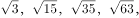（    ）

A. √77

B. √99

C. √103

D. √143

第 51 题 · 答案与解析

**参考答案（粉笔题库参考内容）**

B

**解析**

方法一，根号下的数字作差可得：12，20，28，（36），因此下一个根号内的数字为63+36=99。

方法二，根号下的数字，通过观察可得：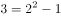，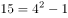，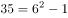，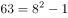，因此下一个根号内的数字应为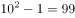。

故正确答案为B。

**来源**：2013年吉林省公务员录用考试《行测》题（甲级）第51题

### 第 52 题

\-4，0，24，80，（    ）

A. 120

B. 132

C. 158

D. 180

第 52 题 · 答案与解析

**参考答案（粉笔题库参考内容）**

D

**解析**

对已知各项进行因数分解可得：-4=-2×2，0=0×4，24=4×6，80=10×8；前半部分是个二级数列，后半部分是个公差为2的等差数列，则下一项应为18×10=180。

故正确答案为D。

**来源**：2013年吉林省公务员录用考试《行测》题（甲级）第52题

### 第 53 题

1，e^√2，e^√6，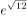，（    ）

A. 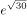

B. e^√20

C. 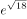

D. 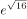

第 53 题 · 答案与解析

**参考答案（粉笔题库参考内容）**

B

**解析**

由于底数和根号都不变，因此只考虑根号内的数字，因为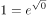，根号内的数字作差可得：2，4，6，（8），则下一个根号内的数字为12+8=20。

故正确答案为B。

**来源**：2013年吉林省公务员录用考试《行测》题（甲级）第53题

### 第 54 题

1.1，3.4，6.9，10.16，（    ）

A. 12.49

B. 15.25

C. 13.36

D. 14.49

第 54 题 · 答案与解析

**参考答案（粉笔题库参考内容）**

B

**解析**

方法一：原数列的整数部分和分数部分都可以看成二级数列，那么整数部分为：1，3，6，10，（15）；分数部分为：1，4，9，16，（25），所以下一项为15.25。

方法二：原数列的整数部分为二级数列，那么整数部分为：1，3，6，10，（15）；分数部分为平方数列，则分数部分应为：1^2，2^2，3^2，4^2，（5^2），所以下一项为15.25。

故正确答案为B。

**来源**：2013年吉林省公务员录用考试《行测》题（甲级）第54题

### 第 55 题

5/3，(4/3)^2，(11/9)^3，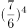，（    ）

A. 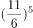

B. (8/7)^5

C. (15/13)^5

D. (17/15)^5

第 55 题 · 答案与解析

**参考答案（粉笔题库参考内容）**

D

**解析**

首先各个项的幂次依次增加，则下一项的幂次为5；将分数变形得：5/3，8/6，11/9，14/12，可以看出分子分母都为公差为3的等差数列，则分数部分为17/15。

故正确答案为D。

**来源**：2013年吉林省公务员录用考试《行测》题（甲级）第55题

### 第 56 题

某市市长热线电话一天接电话统计图如下，已知当天接服务质量电话25个，则当天接其他电话多少个？

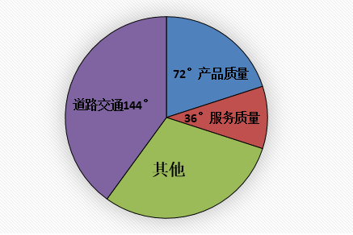

A. 50

B. 75

C. 100

D. 125

第 56 题 · 答案与解析

**参考答案（粉笔题库参考内容）**

B

**解析**

圆的圆周角为360度，其它部分对应的圆心角度数=360-144-72-36=108度，设当天接其它电话X个，则X：25=108:36，可得X=75。

故正确答案为B。

**考点**：和差倍比问题

**来源**：2013年吉林省公务员录用考试《行测》题（甲级）第56题

### 第 57 题

七夕节，某市举办大型公益相亲会，共42人参加。其中女生20名，每人至少相亲一次，共相亲61次，则至少有一名女生至少相亲多少次：

A. 6

B. 4

C. 5

D. 3

第 57 题 · 答案与解析

**参考答案（粉笔题库参考内容）**

B

**解析**

由“至少有一名女生至少相亲多少次”，可判定该题为最值问题，则构造最不利的形式，假设每个女生相亲次数一样，则61÷20=3······1，那么至少有一名女生相亲3+1=4次。

故正确答案为B。

**考点**：最不利构造

**来源**：2013年吉林省公务员录用考试《行测》题（甲级）第57题

### 第 58 题

宴会上有10个人，要求每个人都要和别人握手但不重复，已知每人最多握手8次，则10个人共握手多少次？

A. 90

B. 44

C. 45

D. 40

第 58 题 · 答案与解析

**参考答案（粉笔题库参考内容）**

D

**解析**

宴会10个人，每人最多握手8次，因此握手总人次数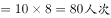。因为两个人握手一次共2人次，所以握手次数共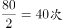。

故正确答案为D。

**考点**：排列组合问题-其他

**来源**：2013年吉林省公务员录用考试《行测》题（甲级）第58题

### 第 59 题

小明比弟弟大10岁，而且小明比爷爷小他年龄的4倍，爷爷与小明年龄之和是弟弟年龄的18倍，问爷爷与弟弟的年龄之和比小明大（    ）岁？

A. 58

B. 62

C. 60

D. 65

第 59 题 · 答案与解析

**参考答案（粉笔题库参考内容）**

D

**解析**

设小明的年龄为X，则小明弟弟的年龄为：X-10，小明爷爷的年龄为：5X，又5X+X=18（X-10），可得X=15，那么爷爷与弟弟年龄之和比小明大：

5X+X-10-X=5X-10=5×15-10=65。

故正确答案为D。

**考点**：年龄问题

**来源**：2013年吉林省公务员录用考试《行测》题（甲级）第59题

### 第 60 题

21人打单循环淘汰赛，只取第一，共进行多少场比赛就可以得到冠军？

A. 20

B. 11

C. 19

D. 10

第 60 题 · 答案与解析

**参考答案（粉笔题库参考内容）**

A

**解析**

已知每场比赛都会淘汰1人，那么要得到冠军的话，则需要淘汰21-1=20人，也就是进行20场比赛。

故正确答案为A。

**来源**：2013年吉林省公务员录用考试《行测》题（甲级）第60题

### 第 61 题

把下面的六个图形分为两类，使每一类图形都有各自的共同特征或规律，分类正确的一项是：

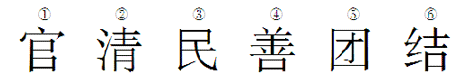

A. ①②③，④⑤⑥

B. ①③④，②⑤⑥

C. ①③⑤，②④⑥

D. ①④⑥，②③⑤

第 61 题 · 答案与解析

**参考答案（粉笔题库参考内容）**

A

**解析**

图形组成不同，且属性无规律，考虑数量规律。每个图形都有明显白窟窿存在，优先数面，其中图①②③均为2个封闭空间，图④⑤⑥均为1个封闭空间。

故正确答案为A。

**考点**：数量规律-面、文字/字母/数字类

**来源**：2013年吉林省公务员录用考试《行测》题（甲级）第61题

### 第 62 题

对照题干给定的图形，下面盒子展开后一定不能形成上面图形的一项是：

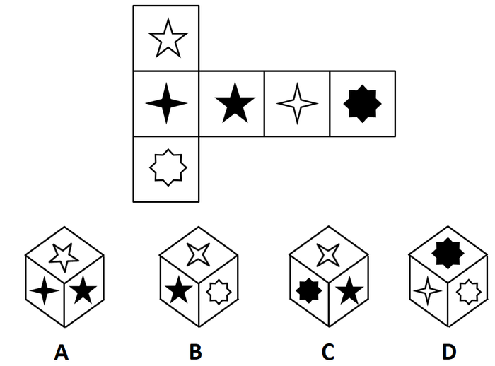

A. A

B. B

C. C

D. D

第 62 题 · 答案与解析

**参考答案（粉笔题库参考内容）**

C

**解析**

对展开图面进行编号，如下图所示：

A项，由面1、2、3组成，与原图一致，排除；

B项，由面3、4、6组成，与原图一致，排除；

C项，由面3、4、5组成，面3与面5在同一行相间排列，为相对面，不可能同时出现，与原图不一致，当选；

D项，由面4、5、6组成，与原图一致，排除。

本题为选非题，故正确答案为C。

**考点**：空间类-空间重构-六面体

**来源**：2013年吉林省公务员录用考试《行测》题（甲级）第62题

### 第 63 题

从所给的四个选项中，选择最合适的一个填入问号处，使之呈现一定的规律性：

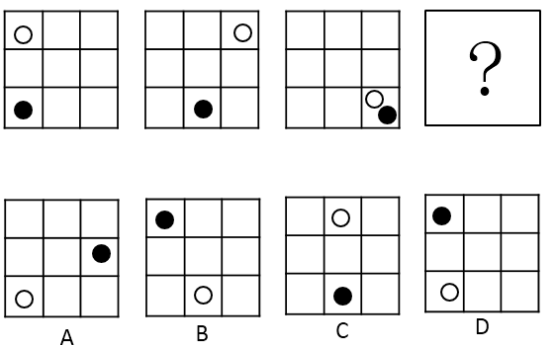

A. A

B. B

C. C

D. D

第 63 题 · 答案与解析

**参考答案（粉笔题库参考内容）**

A

**解析**

图形组成相同，优先考虑位置规律。题干中的图形中间部分都没有出现黑白点，考虑外圈时针移动。观察发现，白点沿顺时针每次移动2格，黑点沿逆时针每次移动1格，则？处也应保持这一规律，可得A项图形。

故正确答案为A。

**考点**：位置规律-平移

**来源**：2013年吉林省公务员录用考试《行测》题（甲级）第63题

### 第 64 题

所给四个选项中与示例图形有共性的一项是：

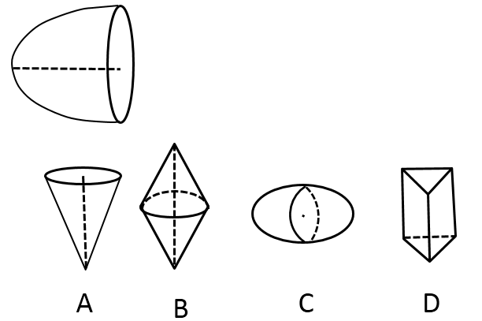

A. A

B. B

C. C

D. D

第 64 题 · 答案与解析

**参考答案（粉笔题库参考内容）**

C

**解析**

题干中图形为一个平面图形如图1沿着横轴旋转形成的立体图形，A、B两项分别为平面图形②、③沿着竖轴旋转而成，D项为三棱柱，任何平面沿一条轴旋转均无法形成，只有C项可以由平面图形④沿着横轴旋转而成。

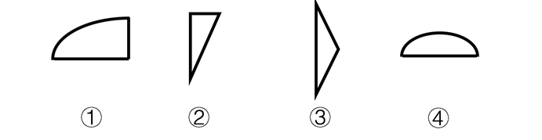

故正确答案为C。

**来源**：2013年吉林省公务员录用考试《行测》题（甲级）第64题

### 第 65 题

从所给的四个选项中，选择最合适的一个填入问号处，使之呈现一定的规律性：

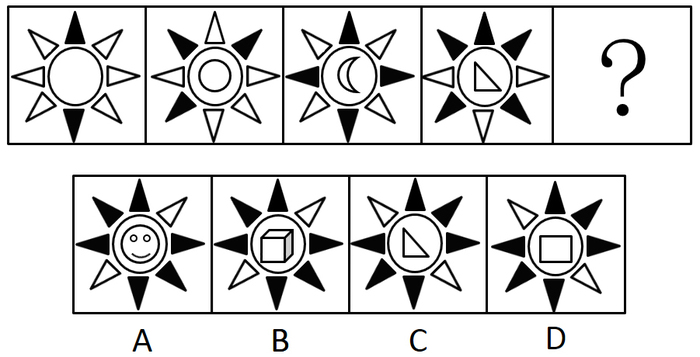

A. A

B. B

C. C

D. D

第 65 题 · 答案与解析

**参考答案（粉笔题库参考内容）**

D

**解析**

元素组成不同，属性无规律，考虑数量规律。图形外部的黑三角形数量逐渐增加，依次为2、3、4、5，？处应该为6个黑三角形，选项均符合规律；进一步观察，发现黑三角形的位置不同，所以观察位置变化，黑三角形每次顺时针平移一格，并且每次增加一个。图1到图2，黑三角形顺时针移动一格，增加一个黑三角形，图2到图3黑三角形顺时针移动一格，增加一个黑三角形，图3到图4黑三角形顺时针移动一格，增加一个黑三角形，所以图4到？处黑三角形顺时针移动一格，增加一个黑三角形，排除A、B两项；

对比C、D两项，观察图形内部，发现C项内部元素的线条数为3，D项内部元素的线条数为4，而题干中内部元素的线条数分别为0、1、2、3，问号处应该为由4条线组成的元素，排除C项。

故正确答案为D。

**考点**：数量规律-复合

**来源**：2013年吉林省公务员录用考试《行测》题（甲级）第65题

### 第 66 题

动物权利论认为：动物与人类有平等的权利地位，两者有相同的心理特质——需求、记忆、智力等等。因此，所有动物都与人类一样享有平等的内在价值。这些权利是不可剥夺并不可丧失的。

根据上述定义，下列各项中符合动物权利论的是：

A. 马戏团里遭到毒打的动物，往往能够引起人们的同情

B. 养狗的人一般都不食用狗肉，但他们并不是素食主义者

C. 有人提出，动物实验与人体实验一样，应该被禁止

D. 活熊取胆的现象见诸报端后，大多数人都反对以如此残忍的方式取得熊胆

第 66 题 · 答案与解析

**参考答案（粉笔题库参考内容）**

C

**解析**

第一步，找到定义关键词。

“动物与人类有平等的权利地位”“有相同的心理特质——需求、记忆、智力”。

第二步，逐一分析选项。

A项：人们只是同情遭毒打的动物，动物仍然没有享受不受毒打的权利，不符合定义，排除；

B项：养狗的人不食用狗肉并不能说明他认为狗与人类有平等的权利地位，不符合定义，排除；

C项：动物实验与人体实验一样应该被禁止体现了动物与人类有平等的权利地位，符合定义，当选；

D项：人们只是反对残忍的取胆方式，熊被取胆已然没有体现动物与人类有平等的权利地位，不符合定义，排除。

故正确答案为C。

**考点**：单定义-其他句式

**来源**：2013年吉林省公务员录用考试《行测》题（甲级）第66题

### 第 67 题

黄金圆环（如下图）是设计用来说明激励性的领袖与普通人在思考、行动和交流沟通方式上的区别：普通人是由外向内的，而激励性的领袖却是用从内到外的方式来思考、行动和交流。

根据上述定义，以下选项中属于激励性领袖交流方式的是：

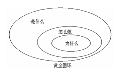

A. 我们的电脑是最棒的，设计优美、使用简单、界面友好，你想买一台吗

B. 我们的产品可以把电视节目暂停，跳过广告，回放电视节目，帮助你掌控生活，你想买一台吗

C. 这是我们的新车型，非常省油，真皮座椅，十一期间促销享大礼，你想买一辆吗

D. 我们做的每件事都是为了突破和创新，我们只是在挑战现状的过程中做出了最棒的电脑，你想买一台吗

第 67 题 · 答案与解析

**参考答案（粉笔题库参考内容）**

D

**解析**

第一步，找到定义关键词。

关键词为“从内到外的方式来思考、行动和交流”。

第二步，逐一分析选项。

A项：我们的电脑是最棒的是从“是什么”开始说，不符合定义，排除；

B项：我们的产品可以把电视节目暂停是从“怎么做”开始说，不符合定义，排除；

C项：这是我们的新车型是从“是什么”开始说，不符合定义，排除；

D项：我们做的每件事都是为了突破和创新是从“为什么”开始说，符合定义，当选。

故正确答案为D。

**考点**：单定义-其他句式

**来源**：2013年吉林省公务员录用考试《行测》题（甲级）第67题

### 第 68 题

贝勃规律是一个社会心理学效应，是指当人经历强烈的刺激后，再施予的刺激对他（她）来说也就变得微不足道。就心理感受来说：第一次大刺激能冲淡第二次的小刺激。根据上述定义，下列各项中符合贝勃规律的是：

A. 母亲病逝后不久，父亲又遭遇了车祸，接二连三的打击让小王越来越无心读书

B. 当房价飞涨到每平方米5万元的时候，人们对于苹果卖到每公斤50元已不感到奇怪

C. 小赵购买了100张彩票，逐一刮开后竟然有20几张中奖，这令他欣喜若狂

D. 4岁的萌萌在认读了常用汉字之后，又开始学习外语

第 68 题 · 答案与解析

**参考答案（粉笔题库参考内容）**

B

**解析**

第一步：找到定义关键词。

关键词为“第一次大刺激能冲淡第二次的小刺激”

第二步：逐一分析选项。

A项：小王经历的是接二连三的家庭变故的打击，前面的刺激并没有冲淡后面的刺激，不符合定义，排除；

B项：房价飞涨到每平方米5万元属于一次大刺激，苹果涨到每公斤50元属于小刺激，人们不足为奇的反应是因为房价上涨的大刺激冲淡了苹果上涨的小刺激符合定义，当选；

C项：小赵在购买彩票中奖后欣喜若狂并不属于多次刺激，即使刮中一张彩票为一次刺激，也没有体现大刺激与小刺激，不符合定义，排除；

D项：学习汉字和外语不属于刺激，不符合定义，排除。

故正确答案为B。

**考点**：大前提

**来源**：2013年吉林省公务员录用考试《行测》题（甲级）第68题

### 第 69 题

德国心理学家林格曼有个著名的拔河实验：当拔河的人数逐渐增加时，每个人所用的力量反而越来越少，并没达到力量累加的效果。这一现象被称做“林格曼效应”，也叫“社会性逃逸”。

根据上述定义，下述不属于林格曼效应的是：

A. 一群人围观某个需要帮助的人，却很少有人真正伸出援手

B. 很多人请教过算命先生后都认为算命先生说的“很准”

C. 鸡多不下蛋，人多瞎胡乱

D. 把男大学生分成2人、4人、6人各一组，要他们大声喊叫，并记录各人的音量，结果发现，个人的音量随着团体人数的增加而降低

第 69 题 · 答案与解析

**参考答案（粉笔题库参考内容）**

B

**解析**

第一步，找到定义关键词。

“人数逐渐增加时，每个人所用的力量反而越来越少”，“没达到力量累加的效果”。

第二步，逐一分析选项。

A项：虽然围观人数是否越来越多不明确，但一群人中很少有人伸出援手说明没有力量的体现，可能符合定义，保留；

B项：认为算命先生说的准会形成口碑，让更多的人相信算命先生的话，达到了力量的累加效果，不符合定义，保留；

C项：鸡多不下蛋，人多瞎胡乱，指人多了很难统一步调，办不成事，体现了人数增多没达到力量累加的效果，符合定义，排除；

D项：个人音量随着团体人数的增加而降低，体现了人数逐渐增加时，每个人所用的力量反而越来越少，没达到力量累加的效果，符合定义，排除。

比较A、B两项，A项可能符合定义，而B项明确不符合定义，B项比A项更符合题目要求。

本题为选非题，故正确答案为B。

**考点**：故事类

**来源**：2013年吉林省公务员录用考试《行测》题（甲级）第69题

### 第 70 题

蒙太奇是电影创作的主要叙述手段和表现手段之一。电影将一系列在不同地点、从不同距离和角度，以不同方法拍摄的镜头排列组合起来，叙述剧情刻画人物。但当不同的镜头组接在一起时，往往又会产生各个镜头单独存在时所不具有的含义。

根据上述定义，下列各项中没有使用蒙太奇手段的是：

A. 某部电影把工人群众进厂门的镜头与被驱赶的羊群的镜头组接在一起

B. 某部电影的开头以不断翻阅日历的方式表现时间的流逝

C. 某部电影先展现了春天冰河融化的镜头，然后切换到工人示威游行的镜头

D. 某部电影结尾的两个画面是一位孤单的母亲的身影和另一个家庭其乐融融的画面

第 70 题 · 答案与解析

**参考答案（粉笔题库参考内容）**

B

**解析**

第一步：找到定义关键词。

“将一系列在不同地点、从不同距离和角度，以不同方法拍摄的镜头排列组合起来”。

第二步：逐一分析选项。

A项：“工人群众进厂门的镜头”和“被驱赶的羊群的镜头”组接，体现了将不同的地点拍摄的镜头组合，符合定义，排除；

B项：“不断翻阅日历表现时间的流逝”没有体现不同地点、距离、角度等拍摄方式，不符合定义，当选；

C项：“春天冰河融化的镜头”和“工人示威游行的镜头”的切换，体现了将不同的地点拍摄的镜头组合，符合定义，排除；

D项：“一位孤单的母亲的身影”和“另一个家庭其乐融融的画面”是两个不同的镜头，出现在了一部电影的结尾，体现了将不同的地点拍摄的镜头组合，符合定义，排除。

本题为选非题，故正确答案为B。

**考点**：方式目的

**来源**：2013年吉林省公务员录用考试《行测》题（甲级）第70题

### 第 71 题

有心理学家认为人的大脑中有两套系统，即系统1和系统2。系统1的运行是无意识且快速的，不怎么费脑力，完全处于自主控制状态。系统2则将注意力转移到需要费脑力的大脑活动上来，例如复杂的运算。系统2的运行通常与行为、选择和专注等主观体验相关联。

根据上述定义。下列各项属于系统2运行引发的行为是：

A. 察觉语气中的不友善

B. 确定突然出现的声源

C. 看到恐怖画面后做出厌恶的表情

D. 观察自己在社交场合的做法是否得体

第 71 题 · 答案与解析

**参考答案（粉笔题库参考内容）**

D

**解析**

第一步：找到定义关键词。

系统1运行引发的行为：“无意识且快速的，不怎么费脑力”、“完全处于自主控制状态”

系统2运行引发的行为：“需要费脑力”、“与行为、选择和专注等主观体验相关联”

第二步：逐一分析选项。

A项：“察觉语气中的不友善”，不确定是否需要脑力思考，保留；

B项：“确定突然出现的声源”，是无意识且快速的反应，属于系统1运行，不符合定义，排除；

C项：“看到恐怖画面后做出厌恶的表情”，是无意识的，且处于自主控制状态，属于系统1运行，不符合定义，排除；

D项：“观察自己在社交场合的做法是否得体”是需要耗费脑力的，且需要选择和专注，符合定义，保留；

比较A、D两项，D项中需要作出判断是否得体，显然比A项更需要费脑力，通过比较D项更符合定义。

故正确答案为D。

**考点**：常规问法

**来源**：2013年吉林省公务员录用考试《行测》题（甲级）第71题

### 第 72 题

损失敏感效应是指人们对损失和获得的敏感程度是不同的。人们对损失比对获得更敏感，即财富减少产生的痛苦与等量财富增加给人带来的快乐不相等，前者要大于后者。

根据上述定义，下列各项中属于损失敏感效应的是：

A. 白捡的200元所带来的快乐，难以抵消丢失100元所带来的痛苦

B. 人们只有在可能贏得20美元时，才会接受可能输掉20美元的赌博

C. 相对于卖掉上涨的股票，投资者更愿意卖掉下跌的股票

D. 当损失和收益等值时，强调损失比强调收益更能说服人

第 72 题 · 答案与解析

**参考答案（粉笔题库参考内容）**

D

**解析**

第一步：找到定义关键词。

“财富减少产生的痛苦与等量财富增加给人带来的快乐不相等”。

第二步：逐一分析选项。

A项：收益是200元，损失是100元，二者不是等量财富，不符合定义，排除；

B项：“可能贏得20美元时，才会接受可能输掉20美元的赌博”说明等量财富减少产生的痛苦与等量财富增加给人带来的快乐相等，不符合定义，排除；

C项：和上涨的股票相比，人们更愿意卖掉下跌的股票，并没有说明收益和损失是否等量，不符合定义，排除；

D项：“当损失和收益等值时”，说明损失和收益是等值的，而结果却是，强调损失比强调收益更说服人，说明人们对损失的感受大于收益的感受，符合定义，当选。

故正确答案为D。

**考点**：单定义-其他句式

**来源**：2013年吉林省公务员录用考试《行测》题（甲级）第72题

### 第 73 题

沉没成本是指由于过去的决策已经发生了的，而不能由现在或将来的任何决策改变的成本。从理性的角度来说，沉没成本不应该影响我们的决策，然而，我们常常由于想挽回或避免沉没成本而做出很多不理性的决策行为，被称为沉没成本效应。

根据上述定义，下列各项中不属于沉没成本效应的是：

A. 小明一年前借给朋友一万元钱，但由于朋友破产无力偿还，所以决定不要了

B. 小王花20元钱买了一瓶汽水，发现很难喝，想扔掉，但是考虑到那么贵又退不了就强忍着喝光了

C. 小赵认为和女朋友都在一起8年了，自己已经付出了这么多时间和精力，所以决定不分手

D. 妈妈花2000元买了一架电子琴，可孩子根本没兴趣，于是妈妈决定以每月500元的价格请家教，理由是：“要不这个琴就浪费了！”

第 73 题 · 答案与解析

**参考答案（粉笔题库参考内容）**

A

**解析**

第一步：找出定义关键词。

关键词为“由于想挽回或避免沉没成本而做出很多不理性的决策行为”。

第二步：逐一分析选项。

A项：借给朋友的一万元属于沉没成本，由于朋友无力偿还债务所以决定不要了不属于想挽回或避免沉没成本，不符合定义，当选；

B项：花20元买一瓶汽水属于沉没成本，虽然不好喝但强忍着喝光了属于想避免沉没成本，符合定义，排除；

C项：和女朋友在一起8年付出的时间和精力属于沉没成本，决定不分手属于想避免沉没成本，符合定义，排除；

D项：花2000元买的电子琴属于沉没成本，请家教属于想避免沉没成本，符合定义，排除。

本题为选非题，故正确答案为A。

**考点**：单定义-其他句式

**来源**：2013年吉林省公务员录用考试《行测》题（甲级）第73题

### 第 74 题

超限效应是指刺激过多、过强或作用时间过久，从而引起不耐烦或逆反的心理现象。

根据上述定义，下列各项中不符合超限效应的是：

A. 大规模密集轰炸的广告起不到宣传产品的作用，反而容易引起人们的反感

B. 马克·吐温听牧师演讲，开始觉得讲得很好，准备捐款。十分钟后还没讲完，他决定只捐一些零钱。又过了十分钟还没讲完，他决定一分钱也不捐。等到牧师结束演讲时，他决定从盘子里偷两元钱

C. 最初同事们都认为小李的演唱很专业，一直听了一个多小时后，人家都觉得小李唱得也不过如此

D. 父母对未成年子女的教育，应以劝导和鼓励为主，而不应该使用打骂和侮辱的方式

第 74 题 · 答案与解析

**参考答案（粉笔题库参考内容）**

D

**解析**

第一步：找到定义关键词。

“刺激过多、过强或作用时间过久，引起不耐烦或逆反”。

第二步：逐一分析选项。

A项：大规模密集的广告对应“刺激过多”，反感对应“逆反”，符合定义，排除；

B项：马克·吐温听牧师演讲，从开始认为讲得好准备捐款，到不捐款反而偷钱，是一个“逆反”的心理，两个十分钟说明刺激作用时间过久，符合定义，排除；

C项：听了一个多小时后对应“刺激作用时间过久”，“觉得小李唱得也不过如此”对应“逆反”，符合定义，排除；

D项：谈论的是对未成年子女的教育，没有涉及“刺激过多、过强或作用时间过久，引起不耐烦或逆反”，不符合定义，当选。

本题为选非题，故正确答案为D。

**考点**：原因结果

**来源**：2013年吉林省公务员录用考试《行测》题（甲级）第74题

### 第 75 题

充足理由律是指在同一思维和论证过程中，一个思想被确定为真，总是有充足的理由的。充足理由律的逻辑要求有两条：第一，理由必须真实；第二，理由与推断之间要有逻辑关系。

根据上述定义，下列各项中符合充足理由律的是：

A. 其父善游，其子亦善游

B. 她一定是个文秘人员，你看她办事有条不紊的

C. 如果天下雨，那么地面就会湿。现在天下雨了，所以地面一定湿了

D. 蚊子战胜了狮子，狮子战胜了其他一切动物。所以，蚊子战胜了其他一切动物

第 75 题 · 答案与解析

**参考答案（粉笔题库参考内容）**

C

**解析**

第一步：找到定义关键词。

“理由必须真实”、“理由与推断之间要有逻辑关系”。

第二步：逐一分析选项。

A项：父亲擅长游泳，不一定孩子也擅长游泳，二者没有逻辑关系，不符合定义，排除；

B项：文秘人员和办事有条不紊之间没有体现逻辑关系，不符合定义，排除；

C项：天下雨是地湿的充分条件，天下雨了地面一定湿了是真实的，体现了逻辑关系，符合定义，当选；

D项：蚊子只是战胜了狮子，并不一定能战胜其他一切动物，是不真实的，不符合定义，排除。

故正确答案为C。

**考点**：单定义-其他句式

**来源**：2013年吉林省公务员录用考试《行测》题（甲级）第75题

### 第 76 题

现代药物中有许多能清热的药物，比如阿司匹林。阿司匹林之所以能退热，是因为前列腺素E2是告诉大脑体温过低的“信使”，而阿司匹林可以抑制前列腺素E2的合成，所以阿司匹林是清热的良药。

上述论证要想成立，需要补充以下作为前提的一项是：

A. 阿司匹林能够防治流感病毒

B. 前列腺素E2可以影响体温

C. 阿司匹林的清热疗效已经得到临床证实

D. —旦体温过低，大脑会指挥人体发热

第 76 题 · 答案与解析

**参考答案（粉笔题库参考内容）**

D

**解析**

第一步：找到论点论据。

论点：阿司匹林是清热的良药。

论据：前列腺素E2是告诉大脑体温过低的“信使”，而阿司匹林可以抑制前列腺素E2的合成。

第二步：逐一分析选项。

A项：“流感病毒”和题干中讨论的“清热”话题不一致，不能加强，排除；

B项：前列腺素E2对体温的影响是正相关还是负相关无法判断，属于不明确项，不能加强，排除；

C项：阿司匹林的清热疗效得到临床证实，但是没有说明其疗效到底如何，不能加强，排除；

D项：在“体温过低”和“发热”之间建立了联系，说明阿司匹林抑制前列腺素E2的合成后，大脑不会收到体温过低的信号，就不会发热，可以加强，当选。

故正确答案为D。

**考点**：搭桥

**来源**：2013年吉林省公务员录用考试《行测》题（甲级）第76题

### 第 77 题

现代边缘派诗歌代表作《奇怪的接近》中写道：“咖啡的颜色接近于黑啤，黑啤的颜色接近于咖啡······我必须要放弃其中之一。我留下了黑啤，尽管它似乎不如咖啡高贵······”如果我们把诗歌中的语句看做表达了一种判断形式的话，以下选项中判断形式与之不同的是：

A. 当代诗人顾城在《初春》中写道：“阴沉的天空还在犹豫：是雪花？还是雨滴？混浊的河流在疾走：是追求？还是逃避？远处的情侣在分别：是序幕？还是结局？”

B. 毛泽东曾说：“不是东风压倒西风，就是西风压倒东风。”

C. 《孟子·公孙丑下》曰：“陈臻问曰：‘前日於齐，王馈兼金一百而不受；於宋，馈赠七十镒而受；於薜，馈五十镒而受。前日之不受是，则今日之受非也。今日之受是，则前日之不受非也。夫子必居一於此矣。’”

D. 宋代卢梅坡在《雪梅》中写道：“有梅无雪不精神，有雪无诗俗了人，日暮诗成天又雪，与梅并作十分春。”

第 77 题 · 答案与解析

**参考答案（粉笔题库参考内容）**

D

**解析**

第一步：抓住题干主要信息。

题干推理过程为：题干表明咖啡和黑啤的颜色接近，必须在二者选其一，选择了黑啤。

第二步：逐一分析选项。

A项：天空必须在雪花和雨滴中选其一，河流疾走必须在追求和逃避中选其一，分别的情侣必须在序幕和结局中选其一，和题干推理方式一致，排除；

B项：必须在东风和西风中选其一，和题干推理方式一致，排除；

C项：翻译为：陈臻问道：“以前在齐国的时候，齐王送给您好金一百镒，您不接受；到宋国的时候，家王送给您七十镒，您却接受了；在薛地，薛君送给您五十镒，您也接受了。如果以前的不接受是正确的，那后来的接受便是错误的；如果后来的接受是正确的，那以前的不接受便是错误的。老师您总有一次做错了吧。”意思是孟子必须在收礼物的正确和错误中必须做一个选择，和题干推理方式一致，排除；

A、B、C三项均是同构选项，都是在几种可能的情况中做出一个选择，可以排除。

D项：“有梅无雪不精神，有雪无诗俗了人，日暮诗成天又雪，与梅并作十分春。”意思是，梅花开了却不下雪体现不了梅花傲雪的高尚精神，下雪了却不懂吟诗来歌颂这美好景色就变成庸俗平凡的人不懂得欣赏。晚上诗写成后又开始下雪了，正好与梅花合成真正的春天使者（十分中梅雪二者各占五分）。要求梅、雪与诗歌三者兼具，和题干推理方式不一致，当选。

本题为选非题，故正确答案为D。

**考点**：论证结构

**来源**：2013年吉林省公务员录用考试《行测》题（甲级）第77题

### 第 78 题

有人说，不管你眼下的境况多么不济，比如薪水微薄，面临失业等，只要银行里还有一笔储蓄就不足为虑；而假如你挣一文花一文，这时可就真要陷于绝境了。所以，只有储蓄才能使一个人在经济上真正独立起来。

如果有人反对这一言论，则以下可能不是反对者观点的是：

A. 有存款的人在境况不济时也会面临忧虑

B. 储蓄是衡量一个人在经济上独立与否的标准

C. 挣一文花一文的人在境况不济时也不会面临绝境

D. 没有储蓄的人也可以在经济上真正独立起来

第 78 题 · 答案与解析

**参考答案（粉笔题库参考内容）**

B

**解析**

第一步：找到论点论据。

论点：只有储蓄才能使一个人在经济上真正独立起来。

论据：不管你眼下的境况多么不济，比如薪水微薄，面临失业等，只要银行里还有一笔储蓄就不足为虑，而假如你挣一文花一文，这时可就真要陷于绝境了。

第二步：逐一分析选项。

A项：“有存款的人在境况不济时也会面临忧虑”，说明有储蓄也会有经济忧虑，削弱论据，排除；

B项：“储蓄是衡量一个人在经济上独立与否的标准”说明只有有储蓄，才能经济独立，为加强项，当选；

C项：“挣一文花一文的人在境况不济时也不会面临绝境”削弱了论据，排除；

D项：“没有储蓄的人也可以在经济上真正独立起来”，说明储蓄不是经济独立的必要条件，削弱论点，排除。

本题为选非题，故正确答案为B。

**考点**：削弱-实验类、削弱选非题

**来源**：2013年吉林省公务员录用考试《行测》题（甲级）第78题

### 第 79 题

某校食堂发生一起严重的食物中毒事故，关于事故的原因，有如下四种说法：

甲：事故是由食物过期引起的；

乙：如果事故是由食物过期引起的，那么食堂管理方面一定存在着监管不到位的现象；

丙：事故确实是由食物过期引起的，但食堂管理方面并不存在监管不到位的现象；

丁：事故不是由食物过期引起的，但食堂管理方面存在监管不到位的现象。

如果上述四种说法中只有一种是真的，由此可以推出：

A. 丙为真

B. 乙为真，但食堂不存在监管不到位的现象

C. 甲为真

D. 乙为真，且食堂存在监管不到位的现象

第 79 题 · 答案与解析

**参考答案（粉笔题库参考内容）**

B

**解析**

分析题干条件，将“事故是由食物过期引起的”简化为A，“食堂管理方面存在着监管不到位的现象”简化为B，则有：

甲：A；

乙：A→B；

丙：A且－B；

丁：－A且B。

其中乙、丙为矛盾命题，二者必有一真一假；

四种说法中只有一种是真的，可知甲和丁的话必然为假；

由甲的话为假可以推出－A，即“事故不是由食物过期引起的”，排除C项；

丁的话为假，可以得出A或－B为真，即“事故是由食物过期引起的”或者“食堂不存在监管不到位的现象”。－A为真，根据否一推一，可知－B为真，即“食堂不存在监管不到位的现象”，排除D项；

由于A为假，丙的形式是A且－B，且关系一假全假，因此丙为假，乙为真，排除A项。

故正确答案为B。

**考点**：只有一真/一假

**来源**：2013年吉林省公务员录用考试《行测》题（甲级）第79题

### 第 80 题

考古人员在海南省某采石场，首次发现了巨猿、熊猫、猩猩、犀牛、獏、象、硕豪猪等近20种哺乳动物化石，这些化石经测定为距今40万至60万年前。这一重大考古发现表明，熊猫、巨猿和猩猩40万年前曾在海南岛生活过。研究人员据此推测，因为巨猿、熊猫、猩猩的发源地都在大陆，所以这个发现证明在40万年前，海南岛与大陆是相连的。

以下哪项如果为真，最能削弱研究人员的推测：

A. 在海南岛上，研究人员还发现了发源地在大陆的鸟类化石

B. 在海南岛发现的巨猿、熊猫、猩猩等哺乳动物的基因与大陆中的上述动物有区别

C. 犀牛、象这两类哺乳动物的发源地并不在大陆

D. 海南岛是在印支运动、燕山运动和喜马拉雅运动的强烈作用下，大约500万年前形成的基本框架

第 80 题 · 答案与解析

**参考答案（粉笔题库参考内容）**

B

**解析**

第一步：找到论点和论据。

论点：巨猿、熊猫、猩猩的发源地都在大陆，所以这个发现证明在40万年前，海南岛与大陆是相连的。

论据：首次发现了巨猿、熊猫、猩猩、犀牛、獏、象、硕豪猪等近20种哺乳动物化石，这些化石经测定为距今40万至60万年前。这一重大考古发现表明，巨猿、熊猫和猩猩40万年前曾在海南岛生活过。

题干论据强调的重点是这三种动物在海南岛生活过，而论点强调的是海南岛在40万年前与大陆连接在一起，讨论话题不一致，优先考虑用拆桥的方式来解题。

第二步：逐一分析选项。

A项：题干讨论的是哺乳动物化石，与鸟类化石无关，为无关项，排除；

B项：海南岛上巨猿、熊猫、猩猩等哺乳动物的基因与大陆中上述哺乳动物的基因有区别，说明不能通过海南岛发现的这些动物的化石来得出海南岛与大陆是相连的这一结论，为拆桥项，当选；

C项：犀牛、象这两类哺乳动物的发源地在不在大陆并不会影响海南岛与大陆相连这个结论，因为这两种动物也可能就是海南当地发源的，然后在相连的时候转移到大陆了，也可能是发源于其他地方然后通过其他方式来到了海南岛，为无关项，排除；

D项：介绍海南岛框架形成，但是并未说明海南岛与大陆之间的关系，为无关项，排除。

故正确答案为B。

**考点**：拆桥

**来源**：2013年吉林省公务员录用考试《行测》题（甲级）第80题

### 第 81 题

某志愿者组织招募赶赴地震灾区救灾的志愿者。最不可能被招上的是年龄在20岁以下、60岁以上或者完全没有震区救济经验的人；目前正在从事医护工作或身体强健的男性，被选上的可能性更大。

根据上述条件，下列报名者中最有可能被选上的是：

A. 小张，19岁，某高校医科在读大学生，16岁那年积极参加过家乡的抗震救灾活动，并亲自将同学从废墟中救出

B. 老赵，有30多年的医疗工作经验，曾多次赶赴地震灾区从事医疗工作。60岁退休后仍身体健壮，在社区的户外徒步竞赛中贏了很多年轻人

C. 小李，23岁，刚刚大学毕业的他目前在一家IT企业工作，前不久他所在的城市受到周边地震波及，有轻微震感，他曾在写字楼中帮助疏散群众

D. 老马，45岁，登山爱好者，曾经攀登过海拔4000米的高山，身体强健。虽然没有救助过震区群众，但曾在登山活动中勇救同伴

第 81 题 · 答案与解析

**参考答案（粉笔题库参考内容）**

C

**解析**

本题属于信息匹配类题目，逐一分析对比选项即可。

A项：小张年龄在20岁以下，最不可能被招上，排除；

B项：老赵已经超过60岁，最不可能被招上，排除；

C项：小李年龄23岁，有一定的救援经验，被选上的可能性较大，当选；

D项：老马没有相关的震区救援经验，最不可能被招上，排除。

故正确答案为C。

**考点**：排除法

**来源**：2013年吉林省公务员录用考试《行测》题（甲级）第81题

### 第 82 题

研究人员研究出了一种具有自洁效应的纳米涂料，并将这种涂料用于涂刷在汽车表面，使驾车族不必再日日洗车。这种涂料在干燥成膜的过程中，会形成凹凸状的形貌，构筑一层疏水层（防止渗漏）。这样，灰尘颗粒只能在涂层表面“悬空而立”，并最终在风雨的冲刷下被带走。研究人员表示，这一设计来自于莲叶表面的自净原理。

由此可以推知，莲叶表面应该是：

A. 有许多微小的气孔存在

B. 光滑的叶片使得灰尘颗粒无处立足

C. 有许多微小的茸毛和蜡质凸起物

D. 有向四面辐射的星形毛状物

第 82 题 · 答案与解析

**参考答案（粉笔题库参考内容）**

C

**解析**

日常结论题，根据题干信息逐一分析选项。

A项：题干中没有涉及莲叶表面是否存在气孔，无中生有，排除；

B项：题干中指出，这种涂料在干燥成膜的过程中，会形成凹凸状的形貌，说明莲叶表面是不光滑的，表述错误，排除；

C项：题干中指出，这种涂料在干燥成膜的过程中，会形成凹凸状的形貌，说明莲叶表面也应该是凹凸状的，有许多微小的茸毛和蜡质凸起物，符合这一描述，可以推出，当选；

D项：题干中没有涉及莲叶表面是否有向四面辐射的星形毛状物，无中生有，排除。

故正确答案为C。

**考点**：日常结论

**来源**：2013年吉林省公务员录用考试《行测》题（甲级）第82题

### 第 83 题

有人说：“动物的血液都是红色的。”

以下最能驳斥上述判断的是：

A. 蜗牛是动物，但血是蓝色的

B. 可能有的动物的血液不是红色的

C. 没有见到过非红色血液的动物

D. 血液不是红色的不大可能是动物

第 83 题 · 答案与解析

**参考答案（粉笔题库参考内容）**

A

**解析**

第一步，找到论点和论据。

论点：动物的血液都是红色的。

论据：无论据。

第二步，逐一分析选项。

A项：通过蜗牛的反面例证直接削弱题干论点，是同一类但并不具有相同特征或属性，能够削弱题干论点，保留；

B项：有的动物血液可能不是红色的，可能性削弱，保留；

C项：没有见过无法判断非红色血液的动物是否存在，为无关选项，排除；

D项：选项的同一表述即“血液是红色的很有可能是动物”，题干需要讨论的是动物的血液是什么颜色，不是红色血液的是不是动物，与题干论点无关，排除。

比较A、B两项，A项为实际反面例证，直接削弱论点，削弱力度强于B项的可能性削弱。

故正确答案为A。

**考点**：削弱论点

**来源**：2013年吉林省公务员录用考试《行测》题（甲级）第83题

### 第 84 题

有些歌星不是电影明星，因此，有些电影明星不是歌星。

下列最能说明上述推理不成立的是：

A. 所有宗教都不是科学，因此，所有科学都不是宗教

B. 有些律师不是大学教授，因此，有些大学教授不一定是律师

C. 所有和尚都是秃头的，因此，所有秃头的都是和尚

D. 有的会议不是机密会议，因此，有的机密会议不是会议

第 84 题 · 答案与解析

**参考答案（粉笔题库参考内容）**

D

**解析**

最能说明上述推理不成立，在选项中寻找推理结构类似但是得到矛盾结论的选项。

题干为：有的a不是b，因此，有的b不是a。

A项：含有“所有”，是全称命题，而题干中为“有些”，与题干不同，无法说明题干推理是否成立，排除；

B项：有些大学教授不一定是律师，结论是“不一定”，即“可能”，这与题干确定性的表述“不是”不一致，且没有得出明显的矛盾结论，无法说明题干推理不成立，排除；

C项：含有“所有”，是全称命题，而题干中为“有些”，与题干不同，无法说明题干推理是否成立，排除；

D项：推理结构与题干类似，即有的a不是b，因此，有的b不是a。同时此选项中机密会议仍然属于会议，包含于会议这个集合中，因此有的b一定是a，推出明显的矛盾结论，说明题干推理不成立，当选。

本题为选非题，故正确答案为D。

**考点**：推理形式

**来源**：2013年吉林省公务员录用考试《行测》题（甲级）第84题

### 第 85 题

医生对小李说：“你最近脾气不好，是因为肝火旺。”

如果医生说的是真的，则以下陈述中也一定为真的是：

Ⅰ.也许是因为小李肝火旺，也许是因为小李压力大

Ⅱ.小李最近睡眠不好

Ⅲ.小李最近脾气不好，并且肝火旺

Ⅳ.小李最近脾气不好，不是因为压力大

A. Ⅲ

B. Ⅰ和Ⅲ

C. Ⅲ和Ⅳ

D. Ⅰ、Ⅳ

第 85 题 · 答案与解析

**参考答案（粉笔题库参考内容）**

B

**解析**

第一步：抓住题干主要信息。

小李最近脾气不好，原因是肝火旺。

第二步：逐一分析选项。

Ⅰ：肝火旺和压力大之间为或关系，而题干中肝火旺为真，则肝火旺或压力大一定为真；

Ⅱ：题干中没有提到睡眠问题，因此无法推出小李最近的睡眠，无法判断其真假；

Ⅲ：题干中医生已经说明小李最近脾气不好是因为肝火旺，与条件Ⅲ描述的一致，一定为真；

Ⅳ：题干中已经明确说明小李最近脾气不好是因为肝火旺，但是无法确定是不是因为压力大，不能确定真假。

故正确答案为B。

**考点**：日常结论

**来源**：2013年吉林省公务员录用考试《行测》题（甲级）第85题

### 第 86 题

不可能所有人都喜欢你。以下选项中与上述断定的意思最为接近的是：

A. 必然有的人喜欢你

B. 必然有的人不喜欢你

C. 可能有的人喜欢你

D. 可能有的人不喜欢你

第 86 题 · 答案与解析

**参考答案（粉笔题库参考内容）**

B

**解析**

“不可能所有人都喜欢你”等价于“并非（可能所有人都喜欢你）”。进行同义句转化，括号内的模态词与量词均需转化，即“必然有的人不喜欢你”。

故正确答案为B。

**来源**：2013年吉林省公务员录用考试《行测》题（甲级）第86题

### 第 87 题

甲、乙、丙、丁四人的籍贯各不相同，分别是北京、上海、天津和重庆。甲说：“我是北京人。”乙说：“我是上海人”。丙说：“我是天津人。”丁说：“我不是天津人。”四个人中只有一个人的话是假的，以下选项成立的是：

A. 乙的话假，可推出四个人的籍贯情况

B. 丙的话假，可推出四个人的籍贯情况

C. 丁的话假，可推出四个人的籍贯情况

D. 无论谁说假话，都能推出四个人的籍贯情况

第 87 题 · 答案与解析

**参考答案（粉笔题库参考内容）**

A

**解析**

第一步：分析题干条件。

四个人的话中没有矛盾关系和反对关系，采用逐一代入选项排除的方法。

第二步：逐一分析选项。

A项：假设乙假，可以得到乙不是上海人，甲是北京人，丙是天津人，那么丁就是上海人，乙是重庆人，当选；

B项：假设丙假，可以得到丙不是天津人，甲是北京人，乙是上海人，丙是重庆人，丁是天津人，那么丁的话也是假的，同时有两个人为假，与题干矛盾，因此丙不可能为假，排除；

C项：假设丁的话为假，则此时丙和丁都是天津人，与题干已知条件不符，排除；

D项：通过B、C选项的分析，已知丙和丁说假话的时候，无法推出四人的籍贯情况，排除。

故正确答案为A。

**考点**：真假推理-其他

**来源**：2013年吉林省公务员录用考试《行测》题（甲级）第87题

### 第 88 题

某高校生命科学学院共有教师50人，其中：

①有的教师具有博士学位；

②有的教师不具有博士学位；

③张老师不具有博士学位。

上述三个条件中有一个条件为真，两个条件为假，则该学院中具有博士学位的老师有：

A. 50人

B. 25人

C. 0人

D. 不确定

第 88 题 · 答案与解析

**参考答案（粉笔题库参考内容）**

A

**解析**

第一步：分析题干条件。

①②为反对关系，两者不能同假，必有一真。又知三个条件中有一个条件为真，因此③是假的，即“张老师具有博士学位”，可推出①是真的，那么②是假的，即②的矛盾“所有老师都具有博士学位”是真的。

故正确选项为A。

**考点**：只有一真/一假

**来源**：2013年吉林省公务员录用考试《行测》题（甲级）第88题

### 第 89 题

在一份对2008年奥运会摔跤项目的比赛结果进行分析的报告中提出：在比赛当中，穿红色比赛服的运动员大约在55%的回合中获胜，击败了穿蓝色比赛服的竞争对手。因此，在摔跤项目中穿红色比赛服有助于运动员获胜。

以下哪项如果为真，最能削弱上述论证：

A. 如果你真的相信穿红色比赛服更占优势，那么你可以利用这个预测去买体育彩票

B. 2012年奥运会的摔跤项目中，穿蓝色比赛服的运动员比穿红色比赛服的运动员赢得了更多场次的比赛

C. 在摔跤之外的比赛项目中，穿红色比赛服的运动员不一定比穿蓝色比赛服的运动员贏得了更多场次的比赛

D. 在拳击比赛中，穿红色比赛服的运动员也赢得了更多场次的比赛

第 89 题 · 答案与解析

**参考答案（粉笔题库参考内容）**

B

**解析**

第一步：找到论点论据。

论点：在摔跤项目中穿红色比赛服有助于运动员获胜。

论据：在一份对2008年奥运会摔跤项目的比赛结果进行分析的报告中提出，在比赛当中，穿红色比赛服的运动员大约在55%的回合中获胜，击败了穿蓝色比赛服的竞争对手。

第二步：逐一分析选项。

A项：是在论述一个假设，与论点无关，属于无关项，排除；

B项：通过举2012年奥运会摔跤的例子来削弱论点，属于举例削弱，当选；

C项：论述的是除摔跤以外的比赛项目，与论点无关，属于无关项，排除；

D项：论述的是拳击比赛，与摔跤比赛无关，属于无关项，排除。

故正确答案为B。

**考点**：削弱论点

**来源**：2013年吉林省公务员录用考试《行测》题（甲级）第89题

### 第 90 题

历史上的诗人都能喝酒，李白能喝酒，所以李白是诗人。

以下选项所犯逻辑错误与题干最为类似的是：

A. 所有信仰上帝的人都会被拯救，马三不信任上帝，因此，马三不会被拯救

B. 有些素食主义者活得比平均年龄长，王五是素食主义者，因此，王五将活得比平均年龄长

C. 英雄都难过美人关，李四难过美人关，因此，李四是英雄

D. 有些男人比大多数女人都聪明，安德鲁是男人，因此，安德鲁比大多数女人都聪明

第 90 题 · 答案与解析

**参考答案（粉笔题库参考内容）**

C

**解析**

第一步：翻译题干。

诗人→能喝酒，李白能喝酒→李白是诗人，即论证方式为所有S都是P，a是P，所以a是S。

第二步：逐一分析选项。

A项：所有S都是P，a不是S，所以a不是P，与题干逻辑错误不一致，排除；

B项：有的S是P，a是S，所以a是P，与题干逻辑错误不一致，排除；

C项：所有S都是P，a是P，所以a是S，与题干犯了相同的逻辑错误，当选；

D项：有的S是P，a是S，所以a是P，与题干逻辑错误不一致，排除。

故正确选项为C。

**考点**：推理形式

**来源**：2013年吉林省公务员录用考试《行测》题（甲级）第90题

## 材料 2

博鳌亚洲论坛2013年年会4月6日至8日在海南博鳌召开，主题为“革新、责任、合作：亚洲寻求共同发展”。在会议召开前夕，博鳌亚洲论坛发布了3份年度报告。根据《亚洲经济一体化2013年度报告》中的数据显示，亚洲商品贸易依存度从2007年的53.1%上升至2009的53.4%，2010年进一步增至54.9%，在2011年小幅回落为54.1%。亚洲经济体的区内直接投资依存度由2008年的23%上升至2011年的29%。东道国（地区）和母国（地区）角度的分析都表明亚洲投资更青睐亚洲地区。亚洲旅游的突出特征是“亚洲游”，绝大多数经济体80%以上的入境游来自于亚洲内部，且呈上升趋势。亚洲经济体的商品贸易依存度比欧盟要低，但比北美高很多，总体来看，亚洲贸易依存度已排一个比较高的水平，但仍有发展空间。

        报告指出，亚洲贸易增长表现较好。2011年，亚洲商品贸易出口总值占世界商品贸易出口总值的31.1%。其中，亚洲出口总值为55.38亿美元，世界出口总值为178.16亿美元。与2010年相比，2011年亚洲的出口总值增长了18个百分点。而鉴于2011年全球贸易温和地复苏，亚洲在世界出口值中所占的份额相对于2010年的31.6%略有下降。

        2011年，亚洲商品贸易的进口总值为51.33亿美元，占世界进口总值的28.8%。延续2008年以来的上升趋势，2011年亚洲在世界进口总值中的份额继续增长，尽管增长的速度与前两年相比有所减缓。

### 第 91 题

2011年亚洲商品贸易依存度比2007年：

A. 降低0.8个百分点

B. 降低1个百分点

C. 提高0.8个百分点

D. 提高1个百分点

第 91 题 · 答案与解析

**参考答案（粉笔题库参考内容）**

D

**解析**

定位文字材料第一段，“亚洲商品贸易依存度从2007年的53.1%······在2011年小幅回落为54.1%”，所以2011年亚洲商品贸易依存度比2007年：54.1%-53.1%=1个百分点，即高1个百分点。

故正确答案为D。

**考点**：文字资料、简单加减计算

**来源**：2013年吉林省公务员录用考试《行测》题（甲级）第91题

### 第 92 题

亚洲经济体的商品贸易依存度：

A. 低于欧盟

B. 低于北美

C. 与欧盟、北美一致

D. 高于欧盟

第 92 题 · 答案与解析

**参考答案（粉笔题库参考内容）**

A

**解析**

定位文字材料第一段，“亚洲经济体的商品贸易依存度比欧盟要低，但比北美高很多。”

故正确答案为A。

**考点**：文字资料、直接找数

**来源**：2013年吉林省公务员录用考试《行测》题（甲级）第92题

### 第 93 题

2011年亚洲出口总值与亚洲进口总值的比例为：

A. 1.2:1

B. 1:1.2

C. 1.1:1

D. 1:1.1

第 93 题 · 答案与解析

**参考答案（粉笔题库参考内容）**

C

**解析**

由题干“2011年······比例为”，可判定该题是比值计算的问题。定位文字材料第二段，“2011年······亚洲出口总值为55.38亿美元”；定位文字材料第三段，“亚洲商品贸易的进口总值为51.33亿美元”，可得比例为：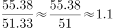，即2011年亚洲出口总值与亚洲进口总值的比例约为1.1:1。

故正确答案为C。

**考点**：文字资料、比值计算

**来源**：2013年吉林省公务员录用考试《行测》题（甲级）第93题

### 第 94 题

2010年亚洲的出口总值为：

A. 48.9亿美元

B. 46.9亿美元

C. 47.9亿美元

D. 45.9亿美元

第 94 题 · 答案与解析

**参考答案（粉笔题库参考内容）**

B

**解析**

由题干“2010年······出口总值为”，而材料数据为2011年，判定此题为基期计算问题。定位文字材料第二段，“2011年······亚洲出口总值为55.38亿美元······与2010年相比，2011年亚洲的出口总值增长了18个百分点”，可得：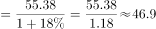亿美元。

故正确答案为B。

**考点**：基期计算、文字资料

**来源**：2013年吉林省公务员录用考试《行测》题（甲级）第94题

### 第 95 题

根据上述材料显示：

A. 亚洲旅游的突出特征是“欧洲游”

B. 2011年亚洲在世界出口总值中所占的份额相对于2010年略有上升

C. 2011年亚洲进口总值增长的速度与前两年相比有所减缓

D. 亚洲商品贸易依存度越来越低

第 95 题 · 答案与解析

**参考答案（粉笔题库参考内容）**

C

**解析**

A项：定位文字材料第一段，“亚洲旅游的突出特征是‘亚洲游’”，错误；

B项：定位文字材料第二段，“亚洲在世界出口值中所占的份额相对于2010年的31.6%略有下降”，错误；

C项：定位文字材料第三段，“2011年亚洲在世界进口总值中的份额继续增长，尽管增长的速度与前两年相比有所减缓”，正确；

D项：定位文字材料第一段，“亚洲商品贸易依存度从2007年的53.1%······在2011年小幅回落为54.1%”，并非越来越低，错误。

故正确答案为C。

**考点**：文字资料、综合分析

**来源**：2013年吉林省公务员录用考试《行测》题（甲级）第95题

## 材料 3

2013年第11周：全国主要水系131个重点断面水质自动监测站的监测结果表明：Ⅰ～Ⅲ类水质的断面为100个，占78%；Ⅳ类水质的断面为11个，占9%；Ⅴ类水质的断面为5个，占4%；劣Ⅴ类水质的断面为12个，占9%。

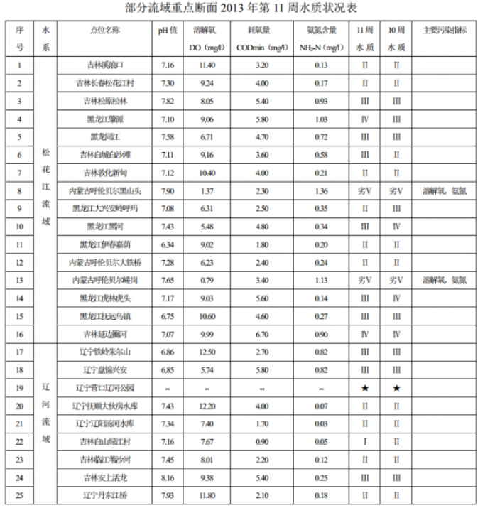

注：★表示该断面断流。

### 第 96 题

2013年第11周，松花江流域Ⅰ～Ⅲ类水质的断面数量占全国Ⅰ～Ⅲ类水质的断面数量的比重为：

A. 16%

B. 14%

C. 15%

D. 12%

第 96 题 · 答案与解析

**参考答案（粉笔题库参考内容）**

D

**解析**

由题干“2013年第11周······占······的比重为”，材料中时间也为2013年，判定本题为现期比重问题。定位文字材料第一段，“全国主要水系······Ⅰ～Ⅲ类水质的断面为100个”；定位统计表可知，松花江流域共有16个重点断面，除去黑龙江肇源、内蒙古呼伦贝尔黑山头、内蒙古呼伦贝尔嵯岗、吉林延边圈河4个外，其余都为Ⅰ～Ⅲ类水质的断面，故Ⅰ～Ⅲ类水质的断面有16-4=12个，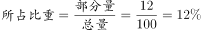。

故正确答案为D。

**考点**：现期比重、综合资料

**来源**：2013年吉林省公务员录用考试《行测》题（甲级）第96题

### 第 97 题

与上一周相比，2013年第11周松花江流域水质转好的有几个断面：

A. 1个

B. 3个

C. 2个

D. 4个

第 97 题 · 答案与解析

**参考答案（粉笔题库参考内容）**

B

**解析**

定位统计表中数据，可知2013年第11周松花江流域水质比上一周（即第10周）转好的有黑龙江大兴安岭呼玛、黑龙江黑河、黑龙江虎林虎头，共3个断面。

故正确答案为B。

**考点**：直接找数、综合资料

**来源**：2013年吉林省公务员录用考试《行测》题（甲级）第97题

### 第 98 题

2013年第11周，松花江流域重点断面耗氧量最高的点位名称是：

A. 吉林集安上活龙

B. 黑龙江肇源

C. 吉林延边圈河

D. 吉林溪浪口

第 98 题 · 答案与解析

**参考答案（粉笔题库参考内容）**

C

**解析**

定位统计表中数据，松花江流域重点断面耗氧量最高的点位为吉林延边圈河，其耗氧量为6.7mg/l。

故正确答案为C。

**考点**：直接找数、综合资料

**来源**：2013年吉林省公务员录用考试《行测》题（甲级）第98题

### 第 99 题

2013年第11周，辽河流域溶解氧最高的重点断面的PH值为：

A. 6.86

B. 7.93

C. 7.07

D. 7.16

第 99 题 · 答案与解析

**参考答案（粉笔题库参考内容）**

A

**解析**

定位统计表中数据，辽河流域溶解氧最高的重点断面是辽宁铁岭朱尔山，其pH值为6.86。

故正确答案为A。

**考点**：直接找数、综合资料

**来源**：2013年吉林省公务员录用考试《行测》题（甲级）第99题

### 第 100 题

以下说法正确的是：

A. 2013年第11周，辽河流域重点断面水质Ⅱ级及以上的点位有5个

B. 2013年第11周，全国主要水系Ⅳ～劣Ⅴ类水质的断面数为31个

C. 2013年第11周，松花江流域重点断面的氨氮含量均高于辽河流域重点断面的氨氮含量

D. 2013年第11周，松花江流域劣Ⅴ类水质的断面数量占本流域断面比重低于全国劣Ⅴ类水质的断面的比重

第 100 题 · 答案与解析

**参考答案（粉笔题库参考内容）**

A

**解析**

A项：定位表格，2013年第11周，辽河流域重点断面水质Ⅱ级及以上的点位有辽宁抚顺大伙房水库、辽宁辽阳汤河水库、吉林白山绿江村、吉林临江苇沙河、辽宁丹东江桥，共5个，正确；

B项：定位文字材料，“2013年第11周······Ⅳ类水质的断面为11个，Ⅴ类水质的断面为5个，劣Ⅴ类水质的断面为12个”，共11+5+12=28个，错误；

C项：定位表格，2013年第11周，松花江流域吉林溪浪口的氨氮含量（0.13），低于辽河流域辽宁铁岭朱尔山（0.82），错误；

D项：定位表格，2013年第11周，松花江流域共16个重点断面，其中：劣Ⅴ类水质的断面有内蒙古呼伦贝尔黑山头、内蒙古呼伦贝尔嵯岗共2个，占本流域断面比重为：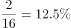，定位文字材料“2013年第11周，全国主要水系131个重点断面中，劣Ⅴ类水质的断面占9%”，12.5%>9%，与D项描述不符，错误。

故正确答案为A。

**考点**：综合分析、综合资料

**来源**：2013年吉林省公务员录用考试《行测》题（甲级）第100题

## 材料 4

2012年全国公路水路交通固定资产投资14512亿元，占全社会固定资产投资的3.9%。分地区看，西部地区交通固定资产投资5400亿元，所占比重为37.2%，比上年提高1.2个百分点；东、中部地区交通固定资产投资分别为5479亿元、3633亿元，所占比重分别为37.8%和25.0%。

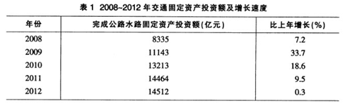

        2012年公路建设投资12714亿元，其中，高速公路建设投资7238亿元，下降2.5%；国省道改造投资2575亿元，增长5.9%；农村公路建设投资2145亿元，增长6.7%，新改建农村公路19.5万公里。

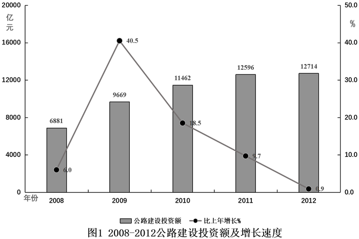

### 第 101 题

2012年全社会固定资产投资约为多少万亿元？

A. 45.33

B. 40.14

C. 42.58

D. 37.21

第 101 题 · 答案与解析

**参考答案（粉笔题库参考内容）**

D

**解析**

由题干“2012年全社会固定资产投资约为”，结合材料中给出“2012年全国公路水路交通固定资产投资14512亿元，占全社会固定资产投资的3.9%”，判定此题为现期比重问题。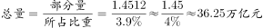，与D选项最接近。

故正确答案为D。

**考点**：现期比重、综合资料

**来源**：2013年吉林省公务员录用考试《行测》题（甲级）第101题

### 第 102 题

2011年东中部地区完成交通固定资产投资总额占全国的比重为：

A. 64.0%

B. 37.2%

C. 62.8%

D. 36.0%

第 102 题 · 答案与解析

**参考答案（粉笔题库参考内容）**

A

**解析**

全国交通固定资产投资分为西部地区、中部地区和东部地区。定位文字材料第一段，“2012年西部地区交通固定资产投资······所占比重为37.2%，比上年提高1.2个百分点”，因此2011年西部地区交通固定资产投资所占比重为37.2%-1.2%=36%，所以2011年东中部地区完成交通固定资产投资总额占全国的比重为1-36%=64%。

故正确答案为A。

**考点**：基期比重、综合资料

**来源**：2013年吉林省公务员录用考试《行测》题（甲级）第102题

### 第 103 题

全国完成公路水路交通固定资产投资增速按年份排序正确的是：

A. 2011>2012>2008

B. 2010>2008>2011

C. 2009>2011>2012

D. 2010>2009>2011

第 103 题 · 答案与解析

**参考答案（粉笔题库参考内容）**

C

**解析**

定位表1中数据，全国完成公路水路交通固定资产投资增速按年份排序为2009年(33.7%)>2010年(18.6%)>2011(9.5%)>2008(7.2%)>2012(0.3%)，只有C项满足。

故正确答案为C。

**考点**：排序类、综合资料

**来源**：2013年吉林省公务员录用考试《行测》题（甲级）第103题

### 第 104 题

与2011年相比，2012年高速公路建设投资占全年公路建设投资比重约：

A. 降低了2%

B. 降低了6%

C. 提高了2%

D. 提高了6%

第 104 题 · 答案与解析

**参考答案（粉笔题库参考内容）**

A

**解析**

由题干“与2011年相比，2012年······占······比重约”，两个年份+比重可判定此题为两期比重问题。定位文字材料第二段与数据图中数据，可得2012年高速公路建设投资A=7238亿元，增长率a=-2.5%，公路建设投资B=12714亿元，增长率b=0.9%，根据两期比重公式可得：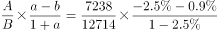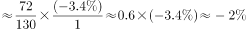，即降低了2%。

故正确答案为A。

**考点**：两期比重、综合资料

**来源**：2013年吉林省公务员录用考试《行测》题（甲级）第104题

### 第 105 题

以下有关说法正确的是：

A. 2011年西部地区交通固定资产投资不超过5000亿元

B. 与上年相比，2012年农村公路建设投资占全年公路建设投资比重下降

C. 全年公路水路交通固定资产投资增速与公路建设投资增速最小的年份是同一年

D. 与上年相比，2012年公路建设投资额增长量超过120亿元

第 105 题 · 答案与解析

**参考答案（粉笔题库参考内容）**

C

**解析**

A项：定位表1，可知2011年全国交通固定资产投资为14464亿元；定位文字材料第一段“2012年······西部地区······所占比重为37.2%，比上年提高1.2个百分点”，可知2011年西部地区所占比重为37.2%-1.2%=36%，故2011年西部地区交通固定资产投资为：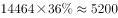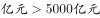，错误；

B项：定位文字材料第二段可知，2012年农村公路建设投资增长率a=6.7%；由图1可知2012年公路建设投资增长率b=0.9%。根据两期比重公式，a＞b，比重上升，故2012年农村公路建设投资占全年公路建设投资比重上升，错误；

C项：由表1可知：全年公路水路交通固定资产投资增速最小的是2012年，由图1可得公路建设投资增速最小的年份也是2012年，正确；

D项：由图1可得，增长量=2012年公路建设投资额-2011年公路建设投资额=12714-12596=118亿元&lt;120亿元，错误。

故正确答案为C。

**考点**：综合分析、综合资料

**来源**：2013年吉林省公务员录用考试《行测》题（甲级）第105题

