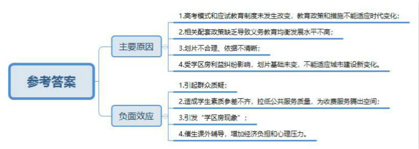
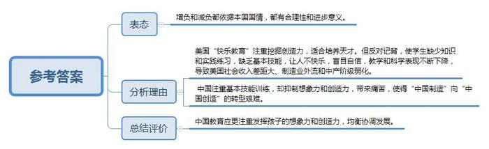
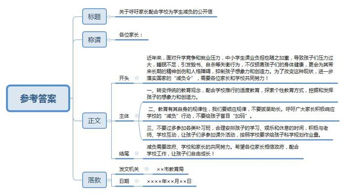
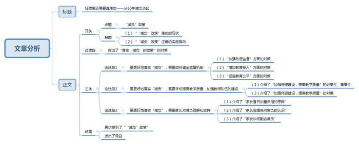

# 2014年吉林省公考《申论》题（乙级）

<!-- gwy:overview:start -->
> **吉林 · 2014 · 申论 · 乙级** ｜ 4 题 · 图片 4 处 · 答案随题折叠

导航：[题目](#题目) · [材料 1](#材料-1)
<!-- gwy:overview:end -->

> 候选采集稿。参考答案及解析来自粉笔页面，不代表官方答案或真实高分答卷；来源使用许可与原卷对应关系仍需人工核实。

## 给定材料

### 材料 1

今年初教育部下发《关于进一步做好小学升入初中免试就近入学工作的实施意见》，日前又印发通知，要求19个重点大城市尽快制定完善义务教育免试就近入学(下称“就近入学”)工作方案，到2015年，19个大城市所有县(市、区)实行划片就近入学政策。100%的小学划片就近入学；90%以上的初中实现划片入学。“就近入学”成为今年教育领域最热的话题。

在教育部的微访谈上，有网友提问：“如何保证学区公平划分，就近入学会不会引发‘学区房现象’？”教育部基础教育一司专项工作处处长陈东升表示，为贯彻制度设计关于促进公平的初衷，学区划分都充分考虑学生人数、学校分布、学校规模等因素。客观公正地划片，确保每个片区都有优质学校，每个片区总体办学水平大体相当。关于“学区房”，根据制度设计，每个片区都应有优质学校，每个学生无论住在哪，都拥有基本平等的通过派位进入优质学校的机会。

知名学者A先生认为：教育部这个通知并无新意，不过是把多年前的政策重申一下而已，从根本上来说，高考模式和应试教育制度没有发生改变，教育部门出台的政策和措施，都只是在原地打转，难以真正落实。

网友布谷鸟说：划片入学是我小学入学就在做的事，而现如今我已经33岁了，这政策竟然还没彻底落实？

### 材料 2

为了解“就近入学”政策在基层中的落实情况，研究者对国家教育行政学院第三十五期全国地市教育局长研修班的全体学员进行相关调研。

调研显示：地市教育局长对就近入学政策总体上持认同、支持的态度，87.1%的局长认同就近入学能在一定程度上缓解择校难的问题，63.5%的局长认为就近入学能有效推进教育公平，82.8%的局长表示就近入学政策整体上利大于弊。

与此同时，67.3%的局长表示自己所在地市就近入学政策在实践中的落实情况并不好。在落实不好的地区中，87.1%是义务教育均衡发展水平一般或比较差的地区。

局长们普遍认为，相关配套政策缺乏，是导致义务教育均衡发展水平不高、就近入学政策执行难的重要原因。师资均衡是义务教育均衡发展的重要内容，但是，旨在推进师资均衡的教师交流政策在实践中执行得并不好。之所以出现这样的现象，一方面是由于现行教师管理体制导致教育行政主管部门权限有限，无法通过行政命令手段调配校长、教师交流。另一方面，相关激励政策的不到位，很难吸引、鼓励校长教师到农村学校、薄弱学校工作或任教。

会上也有人担心，就近入学造成学生素质参差不齐，可能变相拉低公共服务质量，为收费服务腾出空间。

### 材料 3

北京的向女士，她唯一的坚定信仰就是，必须拿下最好的小学。于是，中关村的一所区重点成为她考察了几个月后定下的目标。2007年北京房价还在1万上下的时候，她就狠狠心买下了学区房。据向女士讲，她的房子现在已经涨到8、9万了。北京学区房，8年翻了9倍，16平米叫价456万，花100万买一个根本没法居住的房子只为附近有重点。往年三四月份才出现的学区房旺季，今年呢，更是提前到了春节后。花钱择校变成了“花钱择房”。中国之声在包括北上广在内的20个大中城市做的调查显示，未来计划选过购买学区房实现小升初的占31.7%。

距离北京1500公里之外，宁波的干先生两年前就托人费半天劲找好了关系，让儿子进重点小学。“关系都找好的，说去那个好的学校。好了，这下下了个文件，不能择校了，懵了嘛，懵了一下，那只能到就近的一般的学校就读了。找关系不好使了，买房子也来不及了。”最终，干先生的儿子进了普通小学，在区里也只能算是中等。没办法，只好花钱找人辅导，就近入学变成另一个战场，少了条子，却多了票子。

### 材料 4

说是就近入学，部分小学的服务片却舍近求远，也让不少家长疑惑。一位家长反映，他住在华贸城小区，紧邻朝阳实验小学润泽分校，花家地实验小学朝来校区、和平街一中小学部也比较近，但他家居住的小区却没有被划进这几所近的学校。反而被划进了距离小区最远的青年城小学。家长王女士对育新小学分校划片也有不同意见。她认为，龙禧二区离该小学步行仅1000米，比和谐家园二区更近，然而前者不在小学服务片内，后者却被划进。

关于划片依据，不只是家长搞不懂，学校也搞不懂。一位校长透露，片的概念是历史延续下来的，每年招生前，学校会根据新情况进行微调，但基本的划片范围是不会变的。另一位工作20多年的校级领导说到划片依据坦言：“始终没弄明白过”。

对于部分家长有关学校划片舍近求远的质疑，北京市教委的答复是：就近入学不代表最近入学，学校的具体划片范围由各区教委统一制定安排并报区政府审批。

记者了解到，现在各小学的划片范围仍沿用上世纪八十年代甚至更早的“大盘子”。几十年过去，新建小区、拆迁、学校合并，原来的街道已经大变，但划片的“大盘子”依旧只是依据新变化进行微调。

为何各区县的划片基础多年不改？业内人士分析，这与近些年来的择校热有关，“如果学校的服务片有大变，某小区突然被划在一所名校之外，不知会引发多少纠纷呢！”

### 材料 5

2008年小张的儿子小升初，她按规定参加了划片就近入学的电脑派位。等录取通知发下来，她一下儿就懵了！儿子被分到学区内一所最差的中学。这时她也只好自我劝解：只要孩子争气，好好学习，以后凭本事考进好高中，不耽误上好大学。

她给儿子报了一对一辅导，学费最初100元/小时，后来变成了300元/小时。一发工资，她就得赶快给儿子续学费，数量可观的补习费立刻让这个本不富裕的家庭生活拮据起来。好在天道酬勤，儿子考上了海滨区的一所区重点中学，可是很多家长看不上区重点。但这个区重点是怎样考上的，只有她和儿子知道！接到通知书那天，她忍不住嚎啕大哭……虽然进了区重点，但成绩在班里却也不占优势，老师说他底子太薄了，同班的大多是报考市重点落下来的孩子。用同事的话说，小张的教训，可谓“血淋淋”。

### 材料 6

2013年5月2日，南京。“五一”小长假结束了，一位六年级小学生还没写完作业。凌晨4点，他开始忙碌。黎明时分，家长发现他在楼道内用围巾上吊自杀了。写不完的作业，成了这名少年死亡的直接“杀手”。无独有偶，另一名跳楼自杀的孩子，被救醒后的第一句话是：“妈妈，我不想上学了，作业做不完啊。”

去年暑期，湖北宣恩一中还在补课。部分学生因心生不满，将书本从教室往楼下扔，继而发展为撕烂书本漫天纸屑飞扬。宣恩一中校长说，今年暑假能放20多天，在全州重点高中里，“补课时间已经是短的了”。类似“毁书”的事情并不是新闻，“毁书”所折射的，正是应试教育带给学生的“辛酸”、“苦楚”和巨大压力。

1955年，教育部发出了新中国第一个“减负令”——《关于减轻中小学生过重负担的指示》。据统计，在近60年里，“减负”被国家教育部门喊了9次，各地的“减负令”多得数不清，其结果却是：学生的课业负担越来越沉重。同时越来越多的人对此提出尖锐质疑：我们的教育部门都在干什么？60年的贯彻落实就是这样的结果吗？

中国青少年研究中心的研究发现，1999年以来，中国中小学生的睡眠时间在持续减少，“学习日”近八成学生睡眠不足，周末也有超过七成睡眠不足。而长期睡眠不足，损害的不仅仅是孩子的身体健康，还会带来长期的精神创伤和人格障碍。

### 材料 7

“教育改革要解决的莫过于‘减负’和‘择校’两大节点”。在某省教育厅L副厅长看来，择校热，反映的是社会公平问题，那些没有“条子”、“票子”的家长只有通过给孩子“增负”的方法为孩子争取一个理想的学习机会，所以说“择校”成为增加学生课业负担的主要推手，“择校”问题不解决，现有动力机制不改变，“减负”只会越减越重。所以，只有推行适度教育、个性教育，教育才能真正挖掘和发挥人的力量。

在谈到“减负”越减负担越重的问题时，某学校校长Y说，从历史发展的维度看，60年来的“减负令”基本沿袭的是自上而下的路径，聚焦于学校教育本身。从“减负”的主要措施看，历年来的“减负”基本是从学校的教育教学工作入手，这些措施确能在一定程度上缓解负担过重的问题。但是如果用历史的和发展的眼光看，无论各个学校实行的“减负”措施多么有效，只要当家长和学生重新面对激烈的升学竞争和就业压力时，所有举措都立即变得“苍白无力”，甚至越减越多，于是“减负”工作逐渐演变成“负担过重——减负——负担更重——再减负”的怪圈。

### 材料 8

去年8月22日教育部发布《小学生减负十条规定(征求意见稿)》，其中一条看起来“大快人心”的规定——小学一至三年级不布置书面作业，竟然遭到最多的反对，充满戏剧性。在收到约近6000条意见中，90%不同意小学阶段不留作业。面对汹涌的民意，教育部关于作业的规定变成：“减少作业。一至三年级不留书面家庭作业，四至六年级要将每天书面家庭作业总量控制在1小时之内，要积极与家长互动。指导好学生的课外活动。”

不留作业，中小学生的课业负担真的能减下来吗？答案是否定的。“学校规定说不让学生把书包带回家，家长就去学校偷书，或者买一套教材放在家里。”上海市教育委员会基础教育处处长倪闽景说的不是笑话，而是真事。教育系统为学生减负，家长那边却带着孩子补课、买习题书，自己给自己的孩子加码。可怜父母心，倪闽景说，家长的做法是现实的选择，但社会对于教育需要一场启蒙运动，家长也需要明白教育本身的规律。

“不是每个孩子都一样，人是有差异的，人的智商也有差别。同样的作业，有的学生觉得不多，有的做得慢，就感觉太多，压力太大。”倪闽景的说法恐怕很难被一些家长接受，他们不能容忍自己的孩子比别人差，哪怕是“一般般”也不可以。

### 材料 9

有着多年美国教学经历的纽约大学教授陈宇新认为：美国的“快乐教育”并不一定能教育出快乐的人。在某种程度上，“快乐教育”给了孩子们过多的没有根据的自信。然而，现实却并非总是玫瑰色的。自从“快乐教育”的理念从20世纪60年代末兴起并逐渐成为美国教育的主流理念后。美国中小学生的教学和科学表现就不断下降。有意思的是，正当美国的政府官员、教育工作者以及企业家们痛心疾首于“快乐教育”的弊端，呼吁更多作业、更多测试、更严标准，主张“增负”时，中国正在努力“减负”。

德州农工大学的威廉·克莱姆(Willinm·Klemm)称，美国需要纠正反对记背的偏见。甚至连美国教育部都拉响了警铃，他们在2008年的一份报告中斥责美国学校，为学生缺少数学运算流利度而感到悲哀。该报告总结道，学校需要接受令人生畏的“灌输知识与实践练习”的教育之道。

理性地来看，美国的教育方式善于挖掘孩子的创造力，适合天才的脱颖而出；但是普通的孩子往往缺乏足够的基本技能训练。这被经济学家公认为是造成美国社会收入差距扩大，制造业外流和中产阶级弱化的一个重要因素。中国的现有教育方式在基本技能训练上做得不错，但却抑制了孩子的想象力和创造力，也让多数孩子感到痛苦。同时这也造成了从“中国制造”到“中国创造”的转型艰难。

### 材料 10

“我已经上过一次当，不会再上第二次了”。听到“取消重点校重点班”，童雨脱口而出这句话。

2012年北京市教委叫停了与升学挂钩的奥数竞赛培训，这原本让童雨十分高兴，她忙给孩子取消了奥数班，因为“孩子并不喜欢学奥数”，终于可以减减负了。

可童雨很快就发现，除了她之外，基本上其他的家长都没给孩子停奥数，校外的那些奥数培训机构生意也越发红火了，她又忙去给孩子重新报名，可是却被告知他们的资格已经被别人顶掉，直到第二个学期才勉强入学，但还是没能回到原来那个拥有名师的班级。

对于取消重点校这一政策。童雨表示严重怀疑：“当初说要取消奥数，可根本就没真落实，你看现在哪个重点初中不考奥数？春苗杯(奥数比赛)不照样办着么？现在又说要取消重点校，可我们敢信么？何况就算取消了重点校的名头，能真的取消一个好学校的优势地位么？”

事实证明，童雨的担心并非全无道理，记者调查发现，其实北京市并没有名义上的重点校，取而代之的是示范校的称号，除市级示范校外，在各区县也有各自的示范校，既有小学，也有初中，政策在落实时变了样。

在今年稍早时候，教育部部长袁贵仁在接受媒体采访时也曾表示：“重点校长期积累的名牌效应仍然存在，学校之间的差距短期内很难完全改变，需要一个过程。”

### 材料 11

中国之声推出特别策划《大中城市教育衔接难点调查》，在很多听众尤其是家长们之中产生了热烈反响。孩子是教育的核心，是家庭的希望。虽然很多人不愿承认，但家长们的心态，是幼升小衔接链条上最难解决的难题。部分调查节录如下：

广州家长：我们现在有少年宫的画画还有语言艺术、国际象棋，现在还报了体校的乒乓球、游泳。

记者：那你的女儿每天都上一种班是这样吗？

广州家长：有些一周一次，有些有空就去，反正时间都排满了。

记者：如何准备幼升小的面试？

南京家长：钢琴，街舞，各种衔接班。

比起其他人的迫切和焦虑，一些在犹豫、在反思的家长，似乎更加难能可贵。

上海家长：民办学校入学比较严格，我们就犹豫了，因为我们孩子比较活泼，我和他爸爸不想因为这样一个学校的应试化的教育，那么严格的管理，让孩子丧失了他这种活泼的天性，所以我们就放弃了这个民办学校的考核，还是希望孩子的天性不要扭曲，我们不想束缚了孩子的发展。

北京师范大学教育学部教授刘焱：教育的真正公平，不是一步两步或是一年两年就能实现。从政府到学校到家长，任何一寸改变，都可能影响一个孩子的未来。

## 题目

### 第 1 题

**根据给定资料1-5，归纳我国现有条件下“就近入学”政策执行难的主要原因，并指出执行过程中可能出现的负面效应。(25分)**

关联材料：材料 1、材料 2、材料 3、材料 4、材料 5

作答要求：

要求：内容全面，观点明确，条理清晰，语言准确，不超过200字。

第 1 题 · 答案与解析

**参考答案（粉笔题库参考内容）**

主要原因：1.高考模式和应试教育制度未发生改变，教育政策和措施不能适应时代变化；2.相关配套政策缺乏导致义务教育均衡发展水平不高；3.划片不合理、依据不清晰；4.受学区房利益纠纷影响，划片基础未变，不能适应城市建设新变化。

负面效应：1.引起群众质疑；2.造成学生素质参差不齐，拉低公共服务质量，为收费服务腾出空间；3.引发“学区房现象”；4.催生课外辅导，增加经济负担和心理压力。

**解析**

**参考答案说明：**本参考答案宏观上分成了“主要原因”“负面效应”两个要素。在“主要原因”内部，又从“教育制度”“教育均衡”“划片”“学区房”等不同的方面进行了分条撰写。各条要点之间在内容上相互并列，没有交叉。在“负面效应”颞部，又从“群众”“学生”“学区房现象”“经济”等不同的方面进行了分条撰写。各条要点之间在内容上相互并列，没有交叉。

**考点**：单一题

**来源**：2014年吉林省公考《申论》题（乙级）

### 第 2 题

**给定资料9显示，当我国正努力给中小学生“减负”时，倡导“快乐教育”的美国却在大声呼吁给学生“增负”，请对此现象进行分析。 (15分)**

关联材料：材料 1、材料 2、材料 3、材料 4、材料 5、材料 6、材料 7、材料 8、材料 9、材料 10、材料 11

作答要求：

要求：观点明确，分析透彻、深入，逻辑严谨，表述准确，不超过200字。

第 2 题 · 答案与解析

**参考答案（粉笔题库参考内容）**

增负和减负都依据本国国情，都有合理性和进步意义。

美国“快乐教育”注重挖掘创造力，适合培养天才。但反对记背，使学生缺少知识和实践练习，缺乏基本技能，让人不快乐，盲目自信，教学和科学表现不断下降，导致美国社会收入差距大、制造业外流和中产阶级弱化。

中国注重基本技能训练，却抑制想象力和创造力，带来痛苦，使得“中国制造”向“中国创造”的转型艰难。

中国教育应更注重发挥孩子的想象力和创造力，均衡协调发展。

**解析**

**参考答案说明：**思路方面，本参考答案按照观点现象分析题“表态+分析理由+总结评价”的一般答题思路展开。内容方面，本参考答案首先结合资料对题干给定现象表明了态度；其次，“分析”部分分别从“美国‘快乐教育’”和“中国教育”两个方面介绍了各自的积极特点和存在的问题；最后，“总结评价”部分针对中国教育存在的问题，给出了对策。

**考点**：观点现象分析类

**来源**：2014年吉林省公考《申论》题（乙级）

### 第 3 题

**给定资料6\-11罗列了我国中小学学生学习负担沉重的种种状况。某市教育局为进一步落实“减负令”要求，呼吁家长配合学校共同为孩子们减负，拟撰写一封致学生家长的公开信。假如你是教育局的工作人员。 请你拟写出该公开信的主要内容。(20分)**

关联材料：材料 1、材料 2、材料 3、材料 4、材料 5、材料 6、材料 7、材料 8、材料 9、材料 10、材料 11

作答要求：

要求：内容合理，有可行性，语体正确，400字左右。

第 3 题 · 答案与解析

**参考答案（粉笔题库参考内容）**

关于呼吁家长配合学校为学生减负的公开信

各位家长：

近年来，面对升学竞争和就业压力，中小学生课业负担也随之加重，导致孩子们压力过大，睡眠不足，引发毁书、自杀等失衡行为，不仅损害孩子们的身体健康，更会为其带来长期的精神创伤和人格障碍，抑制孩子想象力和创造力。为了改变这种现状，进一步落实国家的“减负令”，需要各位家长和学校共同努力！

一、转变传统的教育观念，配合学校推行的适度教育，探索个性教育方式，挖掘和发挥孩子的想象力和创造力。

二、教育有其自身的规律性，我们要顺应规律，不要拔苗助长。呼吁广大家长积极响应学校的“减负”行动，不要给孩子盲目“加码”。

三、不要过多参加各类补习班，合理安排孩子的学习、娱乐和休息的时间，积极与老师、学校互动，让孩子们多参加课外活动，按照学校要求给孩子科学规划作业量。

减负需要政府、学校和家长的共同努力。希望各位家长相信政府，配合学校工作，让孩子们自由成长！

XX市教育局

XXXX年XX月XX日

**解析**

**参考答案说明：**（1）格式方面，本参考答案按照公文题“标题+称谓+正文+落款”一般结构作答。（2）正文部分，一方面从内容来看，围绕着“呼吁家长配合学校为学生减负”这一主题，开头部分先写到了当前中小学生面临学业负担重、睡眠不足等问题，并简要介绍了公开信的目的；主体部分从“教育观念”“教育规律”“时间规划”三个方面提出了家长为孩子“减负”的具体做法。另一方面，形式上，本参考答案做到了分段、分条撰写，整体上条理较为清晰。

**考点**：宣传类

**来源**：2014年吉林省公考《申论》题（乙级）

### 第 4 题

**从给定资料出发，结合实际，以“好政策还需要真落实——从60年减负谈起”为题，写一篇文章。(40分)**

关联材料：材料 1、材料 2、材料 3、材料 4、材料 5、材料 6、材料 7、材料 8、材料 9、材料 10、材料 11

作答要求：

要求：主题鲜明、集中，材料丰富，结构合理，论证严谨，语言有表现力，800-1000字。

第 4 题 · 答案与解析

**参考答案（粉笔题库参考内容）**

**好政策还需要真落实**

**——从60年减负谈起**

近六十年“减负”最后却陷入“负担过重--减负--负担更重—再减重”的怪圈，让人在直呼无奈的同时，也让人陷入对这个问题的深深思索。我认为，在政策本身遇阻的情况下，不能一味强制推行，而是要为这项政策的落实寻找新的方向。

在我看来，在当下，需要政府、学校、家庭三方共同努力，形成合力，才能真正落实“减负”的政策，根治孩子负担过重的顽疾。

**要更好地落实“减负”，需要政府健全监督机制。**在“减负”这个问题上，各级政府一方面应充分发挥监督职能，大力整顿学校补课现象和社会上的课外培训市场，并且制定严格的标准，提高补习市场的准入门槛，避免课后“辅导”给学生造成过多过重的压力负担，同时，开展专项督查，以定期查访、突击检查和随机调查等多种方式，及时发现“减负”工作中存在的问题并加以纠正。另一方面需扩大经费、人才投入，增加优质教育资源供给，促进师资均衡，缩小各学区软硬件差距，缓解因优质学区少、各学区教育质量差距大给家长和学生带来的“择校”压力。

**要更好地落实“减负”，需要学校提高教学质量，加强教师队伍的建设。**减负，减的是不合理、不必要的负担，而不是减少学校的责任。在减负的同时，学校教育必须“增效”，即让学生在有限的在校时间里更好的掌握知识，这就对教学质量提出了更高的要求。要想让学校的教学水平得到大幅度提升，学校就必须将工作重点放到教师团队建设上，切实提高每一位教师的教学能力和授课水平。因此，建议各个学校在现阶段，能够以学科教研组为单位，围绕着最新的教学任务，通过集体说课研磨、引进专家培训指导等方式，将每一堂课都做到极致，在课上完成每一个教学任务，不过多占用学生的课余时间。

**要更好地落实“减负”，还需要家长对减负理解和支持。**由于升学和就业的竞争日益激烈，不少家长怕孩子“输在起跑线上”，给孩子盲目“加码”。如果家长们的观念不转变，即使学校减负了，孩子也仍然会在社会培训机构中增负。因此，家长教育观念的转变也是“减负”落实中的重要一环。一方面，家长必须认识到过重的负担会给孩子的身体和心理带来双重摧残，不利于孩子健康成长；另一方面，家长对于未来的社会竞争也该有正确的认识，社会不仅需要高智商人才，还需要人格健全、素质均衡的普通人。因此，“减负”需要家长转变观念，从家庭教育的角度入手，培养孩子的优秀品格，让孩子健康快乐成长。

真正落实“减负”政策，让孩子能够享受童年，健康成长，必须依靠各方的共同努力和积极行动。让我们都伸出一双手，为孩子们撑起一片真正属于他们自己的天空！

**解析**

**文章分析**

**好政策还需要真落实**

**——从60年减负谈起**

【**标题的优点：**范文的标题“好政策还需要真落实——从60年减负谈起”严格按照题目给定标题书写。】

（1）近六十年“减负”最后却陷入“负担过重\--减负\--负担更重—再减重”的怪圈，让人在直呼无奈的同时，也让人陷入对这个问题的深深思索。我认为，（2）在政策本身遇阻的情况下，不能一味强制推行，而是要为这项政策的落实寻找新的方向。

【**开头的优点：**★内容方面。范文的开头是紧扣题目给定的“‘减负’政策”这一主题展开的。首先，开头第一句话点出主题，做到了主题明确。其次，对“‘减负’政策”这一主题进行了分析阐述，指出了（1）“‘减负’政策”落实的现状。（2）“‘减负’政策”正确的实施指向。★文字表达方面。使用了“同时……”等关联词，使语言表达有逻辑性。】

在我看来，在当下，需要政府、学校、家庭三方共同努力，形成合力，才能真正落实“减负”的政策，根治孩子负担过重的顽疾。

【**过渡段的优点：**过渡段分析了“落实‘减负’的政策”的对策，其中“需要政府、学校、家庭三方共同努力”承接上文，引启下文。】

**要更好地落实“减负”，需要政府健全监督机制。**在“减负”这个问题上，（1）各级政府一方面应充分发挥监督职能，大力整顿学校补课现象和社会上的课外培训市场，并且制定严格的标准，提高补习市场的准入门槛，避免课后“辅导”给学生造成过多过重的压力负担，同时，开展专项督查，以定期查访、突击检查和随机调查等多种方式，及时发现“减负”工作中存在的问题并加以纠正。（2）另一方面需扩大经费、人才投入，增加优质教育资源供给，（3）促进师资均衡，缩小各学区软硬件差距，缓解因优质学区少、各学区教育质量差距大给家长和学生带来的“择校”压力。

【**论述段1的优点**：★观点句：范文的观点句是紧扣“‘减负’政策”这一文章主题提出的。形式上，它在段首处直接写出，位置突出，容易发现。内容上，关键词突出，内容要点明确，可以明显看出它是从“政府”入手，指出了“如何更好地落实‘减负’政策”。★论述内容：（1）介绍了“加强政府监督”方面的对策；（2）介绍了“增加教育投入”方面的对策；（3）介绍了“促进教育公平”方面的对策。注意：以上三个方面的内容都是紧扣“要更好地落实‘减负’，需要政府健全监督机制”这个观点句进行分析论述的，论述的针对性强，内容层次丰富。最后，在论述方法上采取了讲道理和举例子相结合的方式，做到了丰富多样。】

**要更好地落实“减负”，需要学校提高教学质量，加强教师队伍的建设。**（1）减负，减的是不合理、不必要的负担，而不是减少学校的责任。在减负的同时，学校教育必须“增效”，即让学生在有限的在校时间里更好的掌握知识，这就对教学质量提出了更高的要求。要想让学校的教学水平得到大幅度提升，学校就必须将工作重点放到教师团队建设上，切实提高每一位教师的教学能力和授课水平。因此，建议各个学校在现阶段，（2）能够以学科教研组为单位，围绕着最新的教学任务，通过集体说课研磨、引进专家培训指导等方式，将每一堂课都做到极致，在课上完成每一个教学任务，不过多占用学生的课余时间。

【**论述段2的优点**：★观点句：范文的观点句是紧扣“‘减负’政策”这一文章主题提出的。形式上，它在段首处直接写出，位置突出，容易发现。内容上，关键词突出，内容要点明确，可以明显看出它是从“教学”入手，指出了“如何更好地落实‘减负’政策”。★论述内容：（1）介绍了“加强师资建设，提高教学质量”的必要性、重要性；（2）介绍了“加强师资建设，提高教学质量”的对策。注意：以上两个方面的内容都是紧扣“要更好地落实‘减负’，需要学校提高教学质量，加强教师队伍的建设”这个观点句进行分析论述的，论述的针对性强，内容层次丰富。最后，在论述方法上采取了讲道理和举例子相结合的方式，做到了丰富多样。】

**要更好地落实“减负”，还需要家长对减负理解和支持。**（1）由于升学和就业的竞争日益激烈，不少家长怕孩子“输在起跑线上”，给孩子盲目“加码”。如果家长们的观念不转变，即使学校减负了，孩子也仍然会在社会培训机构中增负。因此，家长教育观念的转变也是“减负”落实中的重要一环。（2）一方面，家长必须认识到过重的负担会给孩子的身体和心理带来双重摧残，不利于孩子健康成长；另一方面，家长对于未来的社会竞争也该有正确的认识，社会不仅需要高智商人才，还需要人格健全、素质均衡的普通人。因此，（3）“减负”需要家长转变观念，从家庭教育的角度入手，培养孩子的优秀品格，让孩子健康快乐成长。

【**论述段3的优点**：★观点句：范文的观点句是紧扣“‘减负’政策”这一文章主题提出的。形式上，它在段首处直接写出，位置突出，容易发现。内容上，关键词突出，内容要点明确，可以明显看出它是从“家长”入手，指出了“如何更好地落实‘减负’政策”。★论述内容：（1）介绍了“家长盲目加重负担的原因”；（2）介绍了“家长应提高对减负的认识”；（3）介绍了“家长如何配合减负”。注意：以上三个方面的内容都是紧扣“要更好地落实‘减负’，需要家长对减负理解和支持”这个观点句进行分析论述的，论述的针对性强，内容层次丰富。最后，在论述方法上采取了讲道理和举例子相结合的方式，做到了丰富多样。】

【**论述段之间的关系**：★内容的内在逻辑：范文的论述段之间是依照并列逻辑展开的。论述段1先写了政府层面的对策，论述段2再写了学校层面的对策，论述段3接着写了家庭层面的对策。★段与段的外在衔接：论述段1、2、3分别写到“政府”“学校”“家庭”三个主体，层次分明，论述直观。】

（1）真正落实“减负”政策，让孩子能够享受童年，健康成长，必须依靠各方的共同努力和积极行动。（2）让我们都伸出一双手，为孩子们撑起一片真正属于他们自己的天空！

【**结尾的优点**：范文的结尾回扣了“‘减负’政策”这一主题。（1）再次提到了“‘减负’政策”。（2）发出了号召。】

**参考范文二**

**好政策还需要真落实**

**——从60年减负谈起**

近六十年“减负”最后却陷入“负担过重--减负--负担更重—再减重”的怪圈，让人在直呼无奈的同时，也让人陷入对这个问题的深深思索。我认为，在政策本身遇阻的情况下，不能一味强制推行，而是要为这项政策的落实寻找新的方向。

在我看来，在当下，需要政府、学校、家庭三方共同努力，形成合力，才能真正落实“减负”的政策，根治孩子负担过重的顽疾。

**要更好地落实“减负”，需要政府健全监督机制。**在“减负”这个问题上。各级政府应切实依法行政，建立健全工作责任制，做到监督到位，责任到位，措施到位。教育部门必须大力整顿学校补课现象和社会上的课外培训市场，并且制定严格的标准，提高补习市场的准入门槛，避免过多的课后“辅导”给学生造成过多过重的压力负担。同时，也应当成立督查小组，开展减负专项督查，以定期查访、突击检查和随机调查等多种方式，及时发现“减负”工作中存在的问题并加以纠正。对违规加重学生负担的行为一定严肃处理、严格问责，并将“减负”政策的执行力度与校长、教师的考核奖惩结合，以促进“减负”工作的推进。

**要更好地落实“减负”，需要学校加强教师队伍的建设。**减负，减的是不合理、不必要的负担，而不是减少学校的责任。在减负的同时，还要继续保持学生的学习效果，学校教育必须“增效”—即让学生于有限的在校时间里更好的掌握知识。这就对教学质量提出了更高的要求。要想让学校的教学水平得到大幅度提升，学校就必须将工作重点放到教师团队建设上，切实提高每一位教师的教学能力和授课水平。因此，建议各个学校在现阶段，能够以学科教研组为单位，将授课任务以周为单位进行量化，围绕着最新的教学任务，通过集体说课研磨、引进专家培训指导等方式，将每一堂课都做到极致，在课上完成每一个教学任务，不过多占用学生的课余时间。

**要更好地落实“减负”，需要家长对减负理解和支持。**由于升学和就业的竞争日益激烈，不少家长怕孩子“输在起跑线上”，给孩子盲目“加码”。如果家长们的观念不转变，即使学校减负了，孩子也仍然会在社会培训机构中增负。因此，家长教育观念的转变也是“减负”落实中重要的一环。一方面，家长必须认识到过重的负担会给孩子的身体和心理带来双重摧残，不利于孩子健康成长；另一方面，家长对于未来的社会竞争也该有正确的认识，因为社会需要的不只是高智商的人才，更多的是需要人格健全、素质均衡的普通人。因此，要“喊负”，需要家长转变育人观念，从家庭教育的角度入手，培养孩子的优秀品格，让孩子健康快乐成长。

要让孩子能够真正的享受童年，健康成长，必须依靠各方的共同努力和积极行动。让我们都伸出一双手，为孩子们撑起一片真正属于他们自己的天空！

**考点**：文章写作题

**来源**：2014年吉林省公考《申论》题（乙级）

