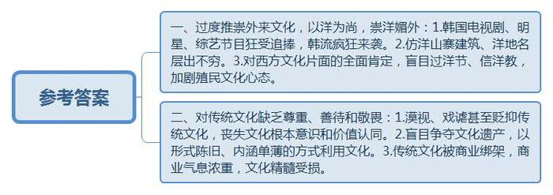
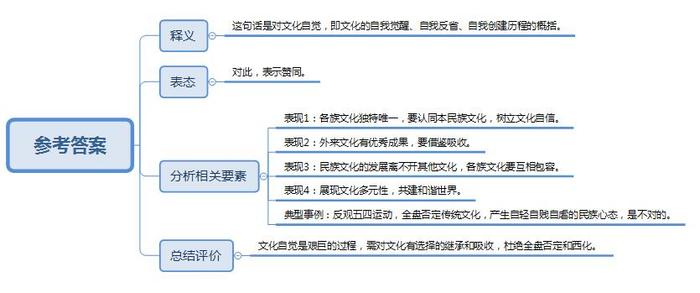
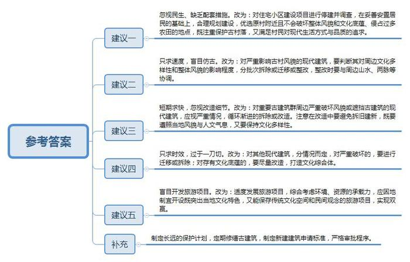
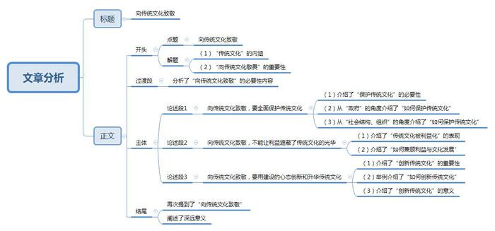

# 2014年吉林省公考《申论》题（甲级）

<!-- gwy:overview:start -->
> **吉林 · 2014 · 申论 · 甲级** ｜ 4 题 · 图片 4 处 · 答案随题折叠

导航：[题目](#题目) · [材料 1](#材料-1)
<!-- gwy:overview:end -->

> 候选采集稿。参考答案及解析来自粉笔页面，不代表官方答案或真实高分答卷；来源使用许可与原卷对应关系仍需人工核实。

## 给定材料

### 材料 1

近日，国家主席习近平前往荷兰，开启他就任中国最高领导人以来首次访欧之旅，除了政治经济议题，习近平主席和夫人彭丽媛身着中式服装出席荷兰国王威廉·亚历山大举行的国宴，也引起人们的注意。

在古老的阿姆斯特丹王宫里，习近平夫妇的“中国风”装扮，与荷兰国王和王后典型的欧洲王室礼服相互映衬，一中一西，在尽显典雅、隆重的同时，民族色彩也十分鲜明。

在国际上，经常可以看到不同国家的领导人、社会各界人士穿着具有浓厚本民族特色的服装出席正式场合，向世界展示本民族文化。对民族服饰的态度，从一个侧面反映出一个民族对传统文化的心理状态。能不能自信地展示民族服饰，往往关系到对传统文化的认同与自信。在服饰这一外化的表现形式之下，是一个国家和民族对自我的认识。

十八大以后，传统文化在政治社会领域的“出镜”越来越频繁，对于传统文化的认识，也有了明确的定位。今年两会期间，习近平总书记指出：“体现一个国家综合实力最核心的、最高层的，还是文化软实力，这事关一个民族精气神的凝聚。我们要坚持道路自信、理论自信、制度自信，最根本的还有一个文化自信。要从弘扬优秀传统文化中寻找精气神。”

### 材料 2

2013年末，一部韩剧爆红。有数据显示，韩剧《来自星星的你》在爱奇艺、PPS上线首周播放量破千万，一个月后，该剧播放量冲破10亿大关，刷新了韩剧播放记录。

一部《来自星星的你》，再度让我们感受了韩剧的巨大影响力。那么，韩剧的吸引力究竟在什么地方？今年两会期间，王岐山参加北京团审议政府工作报告。在北京人艺院长张和平讲述了人艺的发展和困境之后，王岐山说他有时候也有一段没一段看看韩剧，看半天才发现、明白，“韩剧的内核和灵魂，恰恰是传统文化的升华”。

韩剧是韩国文化软实力的一种表征，从风靡亚洲的《大长今》到《来自星星的你》，从鸟叔到李敏镐、金秀贤，韩流不断来袭，就连2013年国人热捧的综艺节目《我是歌手》和《爸爸去哪儿》也是韩国综艺节目的翻版。难怪全国政协委员、广东画院院长许钦松惊呼：“韩剧热潮，已经不仅是韩剧的问题了，这让我们的文化自尊受到伤害。”

### 材料 3

一位外国记者，对中国的山寨建筑现象，提出以下疑问并试图解答：“为什么中国在自己的城市里，建造的不是政治领袖的雕塑，也不是后现代的雕塑，而是一个遥远国度的地标，甚至是大洋之外的小村子？”“为什么在一个拥有悠久建筑传统的国家，人们会花好几亿搞出山寨版的‘凡尔赛宫’或者‘意大利小楼’？”

不仅山寨建筑数不胜数，比比皆是的洋地名也让不少老外都摸不着头脑，不知身在何境。近日河南省政府发布第156号政府令，宣布《河南省地名管理办法》开始执行。《办法》明确规定“禁止用外国人名、地名作地名”。此规定一出即引发出对“洋名”与民族文化关系的争论。挺洋派认为，商业楼盘洋名，为的是营造国际化氛围，提高楼盘附加值，利于项目推广；而公共性质的广场设施取洋名，更多出于“时尚”、“高贵”等心理需要，抵洋派则说，热衷“洋地名”体现出一部分人的崇洋心态，是对自身文化的不自信。

在偌大的中国，在古韵深厚的土地上，各式山寨建筑、洋地名层出不穷，在道不明的复杂情结背后凸显的是这片国土创新意识的缺乏、人文气息的缺位和文化自信的缺失。

### 材料 4

某历史学家撰文指出：近代中国历史上，帝国主义以洋枪洋炮为支撑的文化殖民主义，给中国文化的传承和创新带来的空前震荡，至今令人心悸；文化殖民主义带给中国人民的心灵创伤，至今疤痕犹在。

在我国经济社会长足发展、取得巨大成就的形势下，特别值得人们警惕和反省的是仍有一些国人在很多方面以洋为尚，乃至崇洋媚洋，自我贬抑民族文化，自觉不自觉地反省出某种殖民文化心态。

特别值得注意的是，近年来，包括网络在内的现代传媒，对于社会思潮和社会风尚的引导，起着空前巨大的作用。一些传媒缺乏社会责任，倾心眼球经济，着眼经济效益，热衷炒作，不惜宣传错误的价值观念，其中对过洋节信洋教的宣传，对西方文化的片面性的全面肯定，强化了殖民文化心理，导致青年人缺乏文化根本意识，对民族文化缺少应有的价值认同。

### 材料 5

某大学教授认为，用西方思想来消解中国的传统文化成了“五四”新文化运动先驱们的有效利器。在“五四”精英们的引领下，民众自觉认同了以下两点：（1）中国封建文化根深蒂固，必须全盘否定；（2）西方文明属于进步的现代文化，是世界文化发展的趋势。这种认同随世界潮流而确立，其进步意义是不言而喻的。但由此而引发的负面影响也是致命的，对传统文化的全盘否定使许多人产生了一种自轻自贱甚至自虐的民族心态，认为中国百事不如人，“不但物质上不如人，不但机器上不如人，并且政治、社会、道德都不如人”，再加上“知识不如人、文学不如人、音乐不如人、艺术不如人、身体不如人”。于是“全盘西化”的主张一经提出，立刻引起社会的巨大反响，“到了30年代，知识界的各派人士，无论持激进文化观者还是保守主义者，所使用的概念、逻辑和理论都是西式的，即使反对全盘西化者，在心理深层亦有着不可排泄的崇洋情结”。

所谓“文化自觉”，是指生活在一定文化历史圈子的人对其文化有自知之明，并对其发展历程和未来有充分的认识。换言之，是文化的自我觉醒，自我反省，自我创建。任何民族文化的形成、发展都不可避免地受到其他文化的影响，费孝通先生曾说：“文化自觉是一个艰巨的过程”，费先生还以他在八十岁生日所说的一句话“各美其美，美人之美，美美与共，天下大同”作为“文化自觉”历程的概括。

### 材料 6

陶渊明的《桃花源记》描写了一幅世人皆羡的人间仙境，活灵活现，跃然纸上。几乎每个人都能或多或少地吟诵上几句。可如果陶渊明笔下的这一幅极其平和、隽永、优雅的图景被演绎成以下这样，您会作何感想？

“陶渊明在晋朝写了桃花源，名扬千百年，陶渊明梦桃花，梦里的事美丽诱人又伤悲，桃花源美人多，来了一个武陵人，桃花源里撞上了桃花运，来了一个武陵人，酉州府里醉酒点鸳鸯，哎，一个打鱼的这么有福气，一个打鱼的这么有福气……。”

2014年北京台的春节联欢晚会上，歌曲《桃花源》一夜爆红，热闹之余，也让许多人大跌眼镜，不少网友在网上调侃“大叔，你肿么了？”“我感觉以后再也无法直视《桃花源记》这篇文章了，腾格尔老师你这么唱，陶渊明老人家他知道么？”

或许歌曲的创作者有着朴素的出发点，“只是单纯地娱乐一下，让大家乐一下”，但在单纯的娱乐之余，我们还需要反思，是否需要以进一步的关照之心来善待文化中的经典？

向前回溯，我们发现、近些年来类似的现象不在少数。一度杜甫突然在网络爆红，关于杜甫的涂鸦图在微博上疯转。在对杜甫照片的“再创作”中，杜甫时而手扛机枪，时而挥刀切瓜，时而身骑白马，时而脚踏摩托……被网友戏称为“杜甫很忙”。

热闹之后我们不禁要问：到底应该怎么看待此般戏谑？到底是致敬传统文化还是绑架传统文化？对此，学者们的观点也不尽相同。有人主张，“娱乐化是中国社会发展进程的一个有意味的环节，没有什么太大的危害。一个洋溢着欢笑的社会总比一个拘谨和压抑的社会更好，娱乐不会挑战我们这个社会的道德底线和法则”。但更多的学者则主张“文化化人，艺术养心，好的艺术作品，创作者心中要存有对文化，尤其是对传统文化的敬畏之心，一味地趣说、戏谑，并不能带来心灵的净化和美好的情境，更不能达到让人有所悟、有所得”。

### 材料 7

曾有一段时间，围绕着文化遗产的各种争夺战硝烟四起：“牛郎织女”的故事，6个省明争暗斗；“梁祝故里”的传说，十几个城市虎视眈眈；甚至神话传说或文学作品中的西门庆、孙悟空、帝尧的故里，也是多地各执一词，争得不亦乐乎。

各种各样的民俗文化节上，浓重的商业气息、多年不变的形式和单薄的文化内涵，让网友忍不住高呼，“烤肉串、臭豆腐和煎饼竟成为了从南到北所有民俗文化节和庙会的主菜！”大量使用现代原材料、流水线式生产出来的“传统手工艺品”，看似创造了宏大的民俗场景，也被网友评价，“在表面的繁盛之下，总能让人闻到一丝空虚的味道”。

如此种种，令人不禁担忧，一边是市场之手，喧嚣多变，一边是传统文化千年积淀，岁月淘洗。当传统文化搭上商业快车，短期看，或许确能在市场经济中获得一席之地，但从长远看，此种延长，究竟是凤凰涅槃，还是自我伤害？满眼的以文化为名的喧嚣中，传统文化的精髓是离我们越来越近了还是越来越远了？

钱穆先生曾说，对本国以往历史须有“一种温情与敬意”，如此，“国家乃再有向前发展之希望”。的确，一个国家的历史与文化，是一个国家独有的精神遗产，如果不尊重、不善待，难免逐渐丧失文化自觉与文化自信，更谈不上文化发展与文化强国。

### 材料 8

“全国古村落工作经验交流会暨第二届中国古村落保护与发展研讨会”日前在梅州和汕头举行。一批知名专家、民间人士对当前保护领域内的咄咄怪事直言进谏。

中国艺术研究院研究员A：古村落保护特别要保护好“两脉”，即文脉和龙脉。文脉指这个古村落的人文传统、礼仪传统、民俗文化传统等，龙脉即通常说的“风水”，凡涉及风水的林木、峰石、山水、津渡、桥梁等都不可轻易破坏。“保护好两脉不是一个方法问题，而是一个文化品格问题。”

广东省文史馆史学院B先生：现代化生活与传统文化的矛盾使广州古村落受到越来越大的冲击。村民对现代城市生活方式与品质的合理追求，对原有居住的不满意，构成了古村落保护的内部矛盾，所以村落建设必须合理规划。

江西省文联C专家：相对于那些没有生气的“空心村”，或者大红灯笼高挂的旅游区，要分外珍惜真正的传统的民间观念，如宗教观念、风水观念、民间信仰等。一些被保护的古村落中传统文化空间被文体活动、文教场所所占用，抽空了传统内容，成为空心表演形式，这也是一种破坏。

“古城守望者”、同济大学国家历史文化名城研究中心主任阮仪三教授认为，目前我国古城镇保护存在“三重”误区。

第一重误区是“拆旧建新”已经堕入了“千城一面，万屋一貌”的境地。我国的历史文化名城最大的特点就是“多样性”，由于所处的地形地貌不一样，文化背景不一样，这些在历史上不同时期诞生的城镇也完全不一样。现代搞“拆旧建新”、旅游开发了，但把城镇弄成了一样的面孔，这是可悲的。

第二重误区是一些地方“拆旧建新”变成了“拆真建假”，建成的却是“假古董”。徐州沛县重建了一条“汉街”，满眼是用水泥修建的仿古建筑，还有一个大牌楼。仔细辨认却都是唐代以来的风格，根本没有“汉风”，而且“街”的概念也是直到南宋才有的，“汉街”变成了一个笑话。

第三重误区是忘记了自己的历史和根本。一些地方，原本是有着深厚文化底蕴古色古香的小城镇，但因为一些现代建筑喜欢效仿欧美的国会大厦，甚至照抄美国“白宫”，弄的不伦不类，令人啼笑皆非。

### 材料 9

浙江省泰顺县下桥村以“姐妹廊桥”著称于世。这两座廊桥与北宋张择端《清明上河图》中所绘的“虹桥”结构相同。上部更覆以廊屋，比之虹桥又胜一筹。不仅如此，下桥村的山水环境亦十分优越：东西南北四条溪流在村落中心交汇，古建筑群散布于山水之间，皆呈背山、面田、向水之布局，形成“田中有村、村中有田”的村落景观。这样自然与人工完美整合的古村落，在中国传统村落中亦属上品。

由于地方政府和村民认识不到其多方面的重要价值，大肆进行现代建设，不仅侵占了宝贵的农田，也破坏了村落的整体风貌。首次造访下桥村的人往往只能看到号称世界最美廊桥的“姐妹廊桥”，却几乎察觉不出这里还是一座千年古村。

《泰顺县泗溪镇下桥村村庄整治规划》显示，下桥村的传统建筑仅占34.8%，而现代建筑占到总数的65.2%，约2倍于传统建筑。所有新建筑几乎清一色2-4层楼房，外观为单调的方盒子，多数为白瓷砖贴面，少数直接裸露红砖墙面，均与传统村落格格不入，与自然山水毫不协调。目前古村的核心地带，正在建设由200余套现代住宅组成的“洋心安置点”小区，这将给千年古村造成更加难以弥补的伤害。

为使这座被誉为活化石的千年古村能免于大规模现代建设的破坏，当地一些传统村落保护志愿者四处奔走，并撰文《关于下桥村古村落保护的几点建议》给有关部门，呼吁保护古村。建议如下：

一、立即对正在建设的“洋心安置点”住宅小区建设项目进行调查，居民安置问题暂不考虑。

二、对严重影响古村风貌，尤其是在“姐妹廊桥”观赏视野内的现代建筑，应尽快对其外观进行仿古改造。

三、对重要古建筑群周边严重破坏风貌或遮挡古建筑的现代建筑，应在近期内加以拆除或改造。

四、对其他现代建筑，在短期内移出古村，另寻地段进行新村建设。

五、要大力发展旅游项目。以“姐妹廊桥”和天然《清明上河图》《千里江山图》为特色吸引游客。各类古建筑可以开设成民俗博物馆、农家乐、非物质文化遗产展示馆等。

### 材料 10

韩国电视剧《爱在何方》在央视播出后，剧中的几句台词，成为微博上的焦点话题之一。

在剧中，有一个场景是男女主角在榻榻米上对坐，面前摆放着几个小碟腌菜，两人边吃边感慨：“我们国家的料理还真是多样化，中国虽然有很多料理，但大部分都是炒或炸……”看到这样的情节，网友们纷纷以语句接龙的语言形式还击，比如“甩你一脸北京烤鸭”“甩你一脸西湖醋鱼”“甩你一脸云南过桥米线”……

之后，剧中人物又抛出雷人台词，“听说中国的茶叶全都是假的……”这又引起网友们的批评，他们继续以“甩你一脸大红袍”“甩你一脸冻顶乌龙”“甩你一脸碧螺春”……这样的连续句式表达对剧中这种不负责任的文化言论的抨击。

观众和网友对韩剧中对于中国文化的无知和蔑视言论的批评和抨击，实际上是表达了一种我们的文化自信和文化自觉，这在接受外来文化艺术的跨文化的传播中，保持自己历史传统尊严，维护民族文化自尊，是十分可贵的。

## 题目

### 第 1 题

**根据“给定资料2\-7”，概述近年来我国存在的文化自尊与文化自信缺失现象。（20分）**

关联材料：材料 1、材料 2、材料 3、材料 4、材料 5、材料 6、材料 7、材料 8、材料 9、材料 10

作答要求：

要求：内容全面，观点鲜明，条理清晰，语言准确，不超过200字。

第 1 题 · 答案与解析

**参考答案（粉笔题库参考内容）**

一、过度推崇外来文化，以洋为尚，崇洋媚外：1.韩国电视剧、明星、综艺节目狂受追捧，韩流疯狂来袭。2.仿洋山寨建筑、洋地名层出不穷。3.对西方文化片面的全面肯定，盲目过洋节、信洋教，加剧殖民文化心态。

二、对传统文化缺乏尊重、善待和敬畏：1.漠视、戏谑甚至贬抑传统文化，丧失文化根本意识和价值认同。2.盲目争夺文化遗产，以形式陈旧、内涵单薄的方式利用文化。3.传统文化被商业绑架，商业气息浓重，文化精髓受损。

**解析**

**参考答案说明：**本参考答案从“过度推崇外来文化，以洋为尚，崇洋媚外”和“对传统文化缺乏尊重、善待和敬畏”两个方面进行了分条撰写。各条要点之间在内容上是并列关系，没有交叉。并且撰写每条要点时，都提炼出了概括性强的总结词前置，满足了题目及要求中规定的“概述”“观点鲜明”。

**考点**：问题类

**来源**：2014年吉林省公考《申论》题（甲级）

### 第 2 题

**“给定资料5”中提到费孝通先生的名言“各美其美，美人之美，美美与共，天下大同”，谈谈你对这句话的理解。（15分）**

关联材料：材料 1、材料 5

作答要求：

要求：观点明确，分析透彻，逻辑严谨，表述准确，不超过200字。

第 2 题 · 答案与解析

**参考答案（粉笔题库参考内容）**

这句话是对文化自觉，即文化的自我觉醒、自我反省、自我创建历程的概括。对此，表示赞同。1.各族文化独特唯一，要认同本民族文化，树立文化自信。2.外来文化有优秀成果，要借鉴吸收。3.民族文化的发展离不开其他文化，各族文化要互相包容。4.展现文化多元性，共建和谐世界。5.反观五四运动，全盘否定传统文化，产生自轻自贱自虐的民族心态，是不对的。文化自觉是艰巨的过程，需对文化有选择的继承和吸收，杜绝全盘否定和西化。

**解析**

**参考答案说明：**思路方面，本参考答案按照词句解释题“释义+分析相关要素+总结评价”的一般答题思路展开。内容方面，本参考答案“释义”部分先对“各美其美，美人之美，美美与共，天下大同”这句话的含义进行了解释并表达了观点；“分析相关要素”部分分别给出了“各美其美”“美人之美”“美美与共”“天下大同”的表现，并列出五四运动的典型事例。“总结评价”部分对“文化自觉”进行了总体评价并提出对策。词句表达方面，本答案加上了“反观”这样的连接词，使语言表达逻辑更加准确。

**考点**：综合题

**来源**：2014年吉林省公考《申论》题（甲级）

### 第 3 题

**“给定资料8、9”反映了我国在保护古城镇、古村落方面的情况，其中传统村落保护志愿者们提出的《关于下桥村古村落保护的几点建议》中有些内容欠妥，请你指出其不妥之处并提出修改意见。（25分）**

关联材料：材料 1、材料 7、材料 8、材料 9、材料 10

作答要求：

要求：

（1）从内容和观点上进行修改；

（2）指出一条修改一条，不足部分可以补充，不需要写成文章；

（3）观点正确，语言准确，不超过500字。

第 3 题 · 答案与解析

**参考答案（粉笔题库参考内容）**

建议一忽视民生、缺乏配套措施。改为：对住宅小区建设项目进行停建并调查，在妥善安置居民的基础上，合理规划建设，优选原村附近且不会破坏整体风貌和文化底蕴、侵占过多农田的地点，既注重保护古村落，又满足村民对现代生活方式与品质的追求。

建议二只求速度，盲目仿古。改为：对严重影响古村风貌的现代建筑，要判断其对周边文化多样性和整体风貌的影响程度，分批次拆除或迁移或整改，整改时要与周边山水、两脉等协调。

建议三短期求快，忽视改造细节。改为：对重要古建筑群周边严重破坏风貌或遮挡古建筑的现代建筑，应视严重情况，循环渐进的拆除或改造。注意在改造中要避免拆旧建新，既要遵照当地风貌与人文气息，又要保持文化多样性。

建议四只求时效，过于一刀切。改为：对其他现代建筑，分情况而定，对严重破坏的，要进行迁移或拆除；对存有文化底蕴的，要尽量改造，打造文化综合体。

建议五盲目开发旅游项目。改为：适度发展旅游项目，综合考虑环境、资源的承载力，应因地制宜开设既突出当地文化特色，又能保存传统文化空间和民间观念的旅游项目，实现双赢。

补充：制定长远的保护计划，定期修缮古建筑，制定新建建筑申请标准，严格审批程序。

**解析**

**参考答案说明**：思路方面，本参考答案采用“问题+修改意见”的形式，依次指出了《关于下桥村古村落保护的几点建议》中的“不妥之处”并提出了“修改意见”，并对《关于下桥村古村落保护的几点建议》中未涉及的对策，作了补充作答。形式上，本条答案进行了分条撰写，并标明了“建议一”“建议二”“建议三”“建议四”“建议五”“补充”等内容，整体上条理比较清晰。

**考点**：提出对策类

**来源**：2014年吉林省公考《申论》题（甲级）

### 第 4 题

**给定资料列举了社会上对传统文化失敬的某些现象，请你结合实际，以“向传统文化致敬”为题写一篇文章，谈谈自己的认识。（40分）**

关联材料：材料 1、材料 2、材料 3、材料 4、材料 5、材料 6、材料 7、材料 8、材料 9、材料 10

作答要求：

要求：主题鲜明、集中，材料丰富，结构合理，论证严谨，语言有表现力，800—1000字。

第 4 题 · 答案与解析

**参考答案（粉笔题库参考内容）**

**向传统文化致敬**

传统文化代表着一个国家的历史、一个民族的记忆。保护好传统文化，是文化自尊和文化自信的最佳证明。国家要向前发展，就必须对本国的传统文化怀有温情与敬意。对于当代中国而言，能否传承好传统文化事关中华民族的伟大复兴。因此，我们要向传统文化致敬！

然而，无论是有人对传统文化不屑一顾，视若敝屉；还是有人以致敬传统文化之名，却又污之以铜臭；亦是有人力图挽救，却又固步自封，不思进取……都说明我们需反对并加以改正对传统文化的失敬行为。

**向传统文化致敬，要全面保护传统文化。**从帝国主义的文化殖民主义侵略，到现代化历程中对传统文化的全盘否定，再到现代社会对传统文化的不爱护不尊重，这一百多年的历史让传统文化岌岌可危，使其面临失根的危机。“皮之不存，毛将焉附”，要致敬传统文化实乃当务之急，关键要对文化进行全面保护。地方各级人民政府和有关部门要将传统文化保护列入重要议事日程，成立传统文化保护领导小组，统一协调文化保护工作。同时，要充分发挥有关学术机构、大专院校、企事业单位、社会团体等各方面的作用，共同开展传统文化保护工作。

**向传统文化致敬，不能让利益遮蔽了传统文化的光华。**当下，一些人以复兴之名，行逐利之实，委实让人痛心不已。以影视传媒行业为例，高收视率的《甄嬛传》算是商业成功的典范。但是，剧中的传统文化元素都只是浮于表面的简单堆砌，未能展现真正内涵。而且在商品经济的大背景下，为了吸引观众，该剧主要呈现尔虞我诈、钻营算计的晦暗，这是对传统文化的亵渎，让观众难以从中理解到真正精髓。诚然，文化事业要发展，应该通过产业化的方式，以市场力量来调配资源，将文化发展推向新的高度。但文化的产业化、市场化并非是单纯的以经济利益来体现文化的价值，而是应拨开这些，显现出其真正面貌。

**向传统文化致敬，要用建设的心态创新和升华传统文化。**传统文化不是一朝一夕形成，也并非一成不变。它是在一代又一代人不断理解和创新的基础上产生的。致敬传统文化，不能机械、僵化地继承，而应结合现实、纵观全局，在理顺文化脉络的同时，找出顺应时代需求的文化创新之路。在传统戏曲文化普遍衰落的背景之下，白先勇先生的昆曲作品——青春版《牡丹亭》重视视觉效果上的唯美华丽，同时更大胆地把歌剧的音乐创作技法用到了戏曲音乐当中，赋予了传统艺术以新的生命，获得了巨大成功。因此，对传统文化建设性的继承，就应吸收一切有利元素来发展。只有广泛吸取、兼容并包，才能形成真正具有大国气象的中华文化，才能彰显民族自信和文化软实力。

传统文化与每一个人息息相关，只有大家真正行动起来去尊重和保护传统文化，才是真正的向传统文化致敬，我们的国家和民族的文化才会迎来更辉煌的未来！

**解析**

**文章分析**

**向传统文化致敬**

【**标题的优点：**首先，范文的标题“向传统文化致敬”严格按照题目给定的标题书写。】

（1）传统文化代表着一个国家的历史、一个民族的记忆。保护好传统文化，（2）是文化自尊和文化自信的最佳证明。国家要向前发展，就必须对本国的传统文化怀有温情与敬意。对于当代中国而言，能否传承好传统文化事关中华民族的伟大复兴。因此，我们要向传统文化致敬！

【**开头的优点：**★内容方面。范文的开头是紧扣题目给定的“向传统文化致敬”这一主题展开的。首先，开头第一句话点出主题，做到了主题明确。其次，对“向传统文化致敬”这一主题进行了分析阐述，指出了（1）“传统文化”的内涵。（2）“向传统文化敬畏”的重要性。注意以上2个方面的阐述在逻辑上有先后顺序：先写“内涵”，再写“重要性”。★文字表达方面。使用了“因此……”等关联词，使语言表达有逻辑性。】

然而，无论是有人对传统文化不屑一顾，视若敝屉；还是有人以致敬传统文化之名，却又污之以铜臭；亦是有人力图挽救，却又固步自封，不思进取……都说明我们需反对并加以改正对传统文化的失敬行为。

【**过渡段的优点：**范文过渡段分析了“向传统文化致敬”的必要性内容，此外，还要注意过渡段末尾的“我们需反对并加以改正对传统文化的失敬行为”是用来引起下文的过渡句。】

**向传统文化致敬，要全面保护传统文化。**（1）从帝国主义的文化殖民主义侵略，到现代化历程中对传统文化的全盘否定，再到现代社会对传统文化的不爱护不尊重，这一百多年的历史让传统文化岌岌可危，使其面临失根的危机。“皮之不存，毛将焉附”，要致敬传统文化实乃当务之急，关键要对文化进行全面保护。（2）地方各级人民政府和有关部门要将传统文化保护列入重要议事日程，成立传统文化保护领导小组，统一协调文化保护工作。同时，（3）要充分发挥有关学术机构、大专院校、企事业单位、社会团体等各方面的作用，共同开展传统文化保护工作。

【**论述段1的优点**：★观点句：范文的观点句是紧扣“向传统文化致敬”这一文章主题提出的。形式上，它在段首处直接写出，位置突出，容易发现。内容上，关键词突出，内容要点明确，可以明显看出它是从“保护传统文化”入手，指出了“如何向传统文化致敬”。★论述内容：（1）介绍了“保护传统文化”的必要性；（2）从“政府”的角度介绍了“如何保护传统文化”；（3）从“社会结构、组织”的角度介绍了“如何保护传统文化”。注意：以上3个方面的内容都是紧扣“向传统文化致敬，要全面保护传统文化”这个观点句进行分析论述的，论述的针对性强，内容层次丰富。最后，在论述方法上采取了讲道理和举例子相结合的方式，做到了丰富多样。】

**向传统文化致敬，不能让利益遮蔽了传统文化的光华。**当下，（1）一些人以复兴之名，行逐利之实，委实让人痛心不已。以影视传媒行业为例，高收视率的《甄嬛传》算是商业成功的典范。但是，剧中的传统文化元素都只是浮于表面的简单堆砌，未能展现真正内涵。而且在商品经济的大背景下，为了吸引观众，该剧主要呈现尔虞我诈、钻营算计的晦暗，这是对传统文化的亵渎，让观众难以从中理解到真正精髓。诚然，（2）文化事业要发展，应该通过产业化的方式，以市场力量来调配资源，将文化发展推向新的高度。但文化的产业化、市场化并非是单纯的以经济利益来体现文化的价值，而是应拨开这些，显现出其真正面貌。

【**论述段2的优点**：★观点句：范文的观点句是紧扣“向传统文化致敬”这一文章主题提出的。形式上，它在段首处直接写出，位置突出，容易发现。内容上，关键词突出，内容要点明确，可以明显看出它是从“不能让利益遮蔽了传统文化的光华”入手，指出了“如何向传统文化致敬”。★论述内容：（1）介绍了“传统文化被利益化”的表现；（2）介绍了“如何兼顾利益与文化发展”。注意：以上2个方面的内容都是紧扣“向传统文化致敬，不能让利益遮蔽了传统文化的光华”这个观点句进行分析论述的，论述的针对性强，内容层次丰富。最后，在论述方法上采取了讲道理和举例子相结合的方式，做到了丰富多样。】

**向传统文化致敬，要用建设的心态创新和升华传统文化。**（1）传统文化不是一朝一夕形成，也并非一成不变。它是在一代又一代人不断理解和创新的基础上产生的。致敬传统文化，不能机械、僵化地继承，而应结合现实、纵观全局，在理顺文化脉络的同时，找出顺应时代需求的文化创新之路。在传统戏曲文化普遍衰落的背景之下，（2）白先勇先生的昆曲作品——青春版《牡丹亭》重视视觉效果上的唯美华丽，同时更大胆地把歌剧的音乐创作技法用到了戏曲音乐当中，赋予了传统艺术以新的生命，获得了巨大成功。因此，对传统文化建设性的继承，就应吸收一切有利元素来发展。（3）只有广泛吸取、兼容并包，才能形成真正具有大国气象的中华文化，才能彰显民族自信和文化软实力。

【**论述段3的优点**：★观点句：范文的观点句是紧扣“向传统文化致敬”这一文章主题提出的。形式上，它在段首处直接写出，位置突出，容易发现。内容上，关键词突出，内容要点明确，可以明显看出它是从“用建设的心态创新和升华传统文化”入手，指出了“如何向传统文化致敬”。★论述内容：（1）介绍了“创新传统文化”的重要性；（2）举例介绍了“如何创新传统文化”；（3）介绍了“创新传统文化”的意义。注意：以上3个方面的内容都是紧扣“向传统文化致敬，要用建设的心态创新和升华传统文化”这个观点句进行分析论述的，论述的针对性强，内容层次丰富。最后，在论述方法上采取了讲道理和举例子相结合的方式，做到了丰富多样。】

【**论述段之间的关系**：★内容的内在逻辑：范文的论述段之间是依照“并列”的逻辑展开的。论述段1先写了“保护传统文化”，论述段2再写了“不能让利益遮蔽了传统文化的光华”，论述段3接着写了“要用建设的心态创新和升华传统文化”。】

传统文化与每一个人息息相关，（1）只有大家真正行动起来去尊重和保护传统文化，才是真正的向传统文化致敬，（2）我们的国家和民族的文化才会迎来更辉煌的未来！

【**结尾的优点**：范文的结尾回扣了“向传统文化致敬”这一主题。（1）再次提到了“向传统文化致敬”。（2）阐述了深远意义。】

**考点**：文章写作题

**来源**：2014年吉林省公考《申论》题（甲级）

