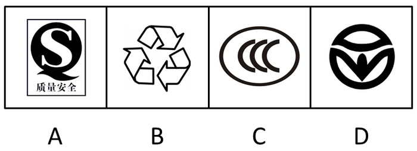
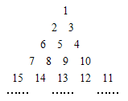
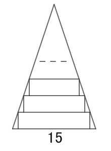
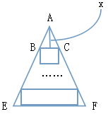
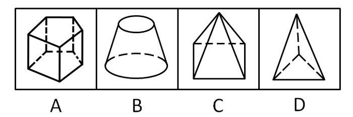
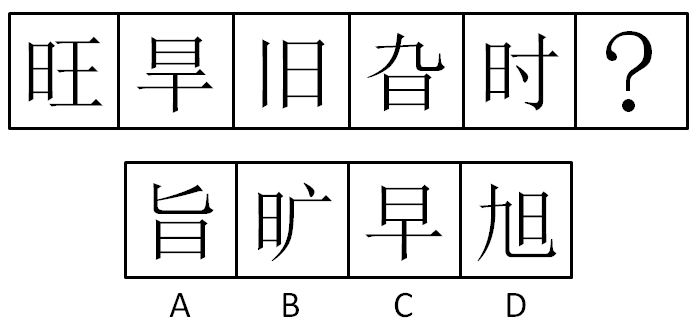
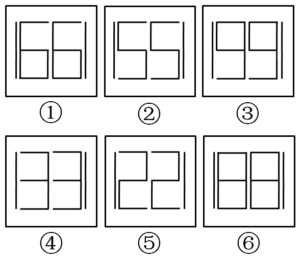
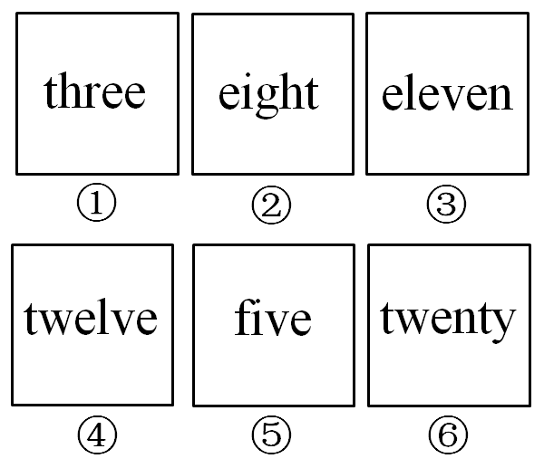
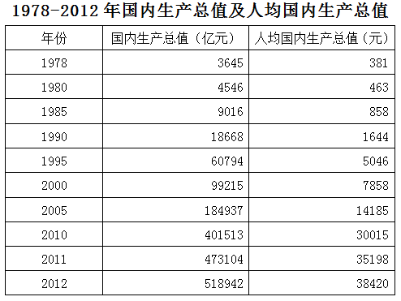
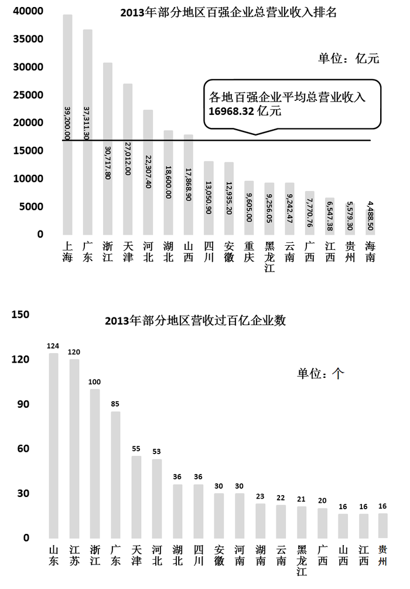

# 2014年吉林省公务员录用考试《行测》题（乙级）

<!-- gwy:overview:start -->
> **吉林 · 2014 · 行测 · 乙级** ｜ 100 题 · 图片 12 处 · 答案随题折叠

| 题型模块 | 题量 | 题号 |
| --- | ---: | ---: |
| 常识判断 | 20 | 1–20 |
| 言语理解与表达 | 30 | 21–50 |
| 数量关系 | 10 | 51–60 |
| 判断推理 | 25 | 61–85 |
| 资料分析 | 15 | 86–100 |
| **合计** | **100** | |

导航：[题型与作答说明](#题型与作答说明) · [题目](#题目) · [材料 1](#材料-1)
<!-- gwy:overview:end -->

> 候选采集稿。参考答案及解析来自粉笔页面，不代表官方答案或真实高分答卷；来源使用许可与原卷对应关系仍需人工核实。

## 题型与作答说明

常识判断

（20题）

常识判断部分主要考查考生的基本常识和基本经验。请根据题目要求，在四个选项中选出一个正确答案。

言语理解与表达

（30题）

本部分包括表达与理解两方面内容。请根据题目要求，在四个选项中选出一个最恰当的答案。

数量关系

（10题）

在这部分试题中，每道题呈现一段表述数字关系的文字。要求你充分利用所给条件，迅速准确地计算出答案。

判断推理

（25题）

本部分包含图形推理、时间排序、定义判断、类比推理和逻辑判断五个部分，根据要求选出符合要求的一项。

资料分析

（15题）

针对下列给定资料回答问题，共15题。你应根据资料提供的信息进行分析、比较、计算、处理。

## 题目

### 第 1 题

2013年3月19日，习近平在接受金砖国家媒体联合采访时提出，中国这样一个大国，领导者要深入了解国情，了解人民所思所盼，要有“治大国、如烹小鲜”的态度。以下最接近这种治国理念的是：

A. 尊重国情，尊重民心，尊重规律

B. 强化理论，强化技术，强化创新

C. 坚持改革，坚持开放，坚持发展

D. 维护稳定，维护传统，维护成规

第 1 题 · 答案与解析

**参考答案（粉笔题库参考内容）**

A

**解析**

本题考查管理学知识。

题干中“深入了解国情”，体现了尊重国情，从国情实际出发。“了解人民所思所盼”，体现了了解民情，尊重民心。“治大国、如烹小鲜”指做菜不能随意翻动，作料要恰到好处，火候要掌握得当，要尊重烹饪的规律，治理国家也是如此，不能朝令夕改乱折腾，不能操之过急求政绩，也不能懈怠马虎不负责任，要了解国情，体察民意，尊重规律，科学施政。故B、C、D三项错误，A项正确。

故正确答案为A。

**来源**：2015年重庆市选调优秀大学生到基层工作考试《行测》题第11题

### 第 2 题

十八届三中全会提出改革党的纪律检查体制。要求巡视制度全覆盖。三中全会后，官方又接连释放出试点新提任领导干部财产公开、制定“裸官”任职岗位管理办法，分解一把手权力，制定干部待遇标准等反腐新政信号。这告诉人们（    ）。

A. 只有控制干部手中权力，才能反腐倡廉

B. 党内外监督体制应齐头并进

C. 反腐倡廉是提高党执政能力和执政水平的根本

D. 反腐须标本兼治，制度反腐是关键

第 2 题 · 答案与解析

**参考答案（粉笔题库参考内容）**

D

**解析**

我国目前的反腐败，根本方法唯有通过制度建设；目前制度反腐仍然有许多缺点，归根到底要靠制度的深化、细化和改革；我国制度反腐的道路依然任重而道远，需要不断加强每个国民的法制意识。中纪委五次全会提出，要建立科学严密完备管用的反腐倡廉制度体系，要进一步加强反腐倡廉教育、监督、预防和惩治等四个方面制度建设。这标志着中央下制度反腐的信心和决心，把反腐败工作推向了新阶段。

A项：错误，说法过于片面；

B项：错误，“党内外监督”题干中并未体现；

C项：错误，提高执政能力的根本是党的自身建设，包括思想、制度、作风等很多方面；

故正确答案为D。

**来源**：2014年吉林省公务员录用考试《行测》题（乙级）第2题

### 第 3 题

卢梭在《爱弥儿》一书中写道，妇女们应该在家中劳动，永远不要到需要讲话的公共集会上去······难道世界上还有比把家里收拾得井井有条的母亲更感人、更让人尊敬的吗？这表明卢梭反对妇女：

A. 争取人身自由权

B. 获得劳动权

C. 拥有教育权

D. 享有政治参与权

第 3 题 · 答案与解析

**参考答案（粉笔题库参考内容）**

D

**解析**

政治参与权，即公民参与制定、通过或贯彻公共制度的行为的权利。它也是人权的一项基本权利。在当代，民主被视为一个国家政府体制合法性的基础，政治参与的普遍性和有效性则是检验民主制度真伪的标准。题干中“到需要讲话的公共集会上去”明显表达了公民的政治参与权。

故正确答案为D。

**考点**：宪法

**来源**：2015年重庆市选调优秀大学生到基层工作考试《行测》题第13题

### 第 4 题

用一杯水救一车着了火的柴禾而无济于事，谓之杯水车薪。如今在一些地方，通过新技术，只需一瓶矿泉水的水量，就能使一辆汽车洁净如新，不妨称之为“杯水车新”。“杯水车新”说明（  ）。

（1）事物之间都存在着满足人们现实需要的客观联系

（2）人们根据自身需要，必然能建立起事物间的新的具体的联系

（3）事物的人为联系是在主客观条件相互作用下形成的

（4）世界并不缺乏联系，缺乏的是善于发现联系的创新意识

A. （1）（4）

B. （2）（3）

C. （1）（2）

D. （3）（4）

第 4 题 · 答案与解析

**参考答案（粉笔题库参考内容）**

D

**解析**

（1）错误，“事物之间都存在着满足人们现实需要的客观联系”，表达过于主观；

（2）错误，“人们根据自身需要，必然能建立起事物间的新的具体的联系”，表达不准确，联系不是人们自己主观建立的，需要客观现实条件；

（3）正确，“事物的人为联系是在主客观条件相互作用下形成的”，说法正确，事物的人为联系是主观与客观的辩证统一，主观的需要加上客观的实践；

（4）正确，“世界并不缺乏联系，缺乏的是善于发现联系的创新意识”，说法正确，体现了联系的普遍性和人的主观能动性。

故正确答案为D。

**考点**：唯物辩证法

**来源**：2014年吉林省公务员录用考试《行测》题（乙级）第4题

### 第 5 题

面对激烈的竞争，一些成功企业的生存之道是：拿出更好的产品来击败自己的原有产品。有人将这种行为戏称为“自吃幼崽”。这体现的哲理是（ ）。

A. 追求真理是无限和反复的过程

B. 事物自身的矛盾具有不平等性

C. 事物的否定性是对自身的否定

D. 事物发展是一个由量变到质变的过程

第 5 题 · 答案与解析

**参考答案（粉笔题库参考内容）**

C

**解析**

作为辩证法三大规律之一的否定之否定规律，它在辩证法发展史上经历的过程恰恰与这一规律的本质完全吻合，真正体现出了“言行一致、表里如一”的特点。换句话说，在哲学史上否定之否定规律自身发展过程的特点就是否定之否定。具体说来，整个发展过程经历了肯定、否定、否定之否定（肯定）的过程，这一特点与否定之否定规律自身具有的规定性恰好保持了一致性。题中所说完全符合否定之否定的含义。

故正确答案为C。

**考点**：唯物辩证法

**来源**：2014年吉林省公务员录用考试《行测》题（乙级）第5题

### 第 6 题

最近，“鬼魂探测器”手机软件十分流行，据称可以探测出“鬼魂”，小高安装了这款软件，探测时手机上出现了“鬼魂”的轮廓并伴有恐怖的声音，小高吓得一夜没睡。后软件开发者说，这只是个娱乐程序，“鬼魂”形象是事先安装在软件中的。这件事说明（  ）。

A. “鬼魂”是客观存在的，不受主观认识的影响

B. “鬼魂”并不存在，但可以创造出来

C. 所谓的“鬼魂”只不过是植入人脑中的观念性的东西

D. 人脑对“鬼魂”是根本不可认识的

第 6 题 · 答案与解析

**参考答案（粉笔题库参考内容）**

C

**解析**

A项错误，按唯物论的说法，“鬼魂”不是客观存在的，它受主观认识的影响；

B项错误，“鬼魂”不是客观存在的，而只是人的主观意识；

C项正确，鬼魂是不存在的东西，也不可能被创造出一种客观存在，意识是物质在人脑中的反映；

D项错误，人脑可以对客观事物产生认识，但是认识的结果可能正确也可能不正确。

故正确答案为C。

**考点**：认识论

**来源**：2014年吉林省公务员录用考试《行测》题（乙级）第6题

### 第 7 题

古诗云：“眼处心声句自神，暗中摸索总非真。画图临出秦川景，亲到长安有几人？”下列选项中与此诗所蕴含的哲理相同的是（  ）。

A. 纸上得来终觉浅，绝知此事要躬行

B. 竹外桃花三两枝，春江水暖鸭先知

C. 近水楼台先得月，向阳花木易为春

D. 日出江花红胜火，春来江水绿如蓝

第 7 题 · 答案与解析

**参考答案（粉笔题库参考内容）**

A

**解析**

题干诗句出自元好问《论诗三十首》中的第十一首，强调诗要抒写诗人的亲身真实感受，只在心中暗中摸索，临摹前人作品，就想画出秦川长安的真实图景是不可能的。其中蕴含的哲学原理是实践是认识的来源，实践决定认识。四个选项中，A项同样强调实践对认识的决定作用，B、C、D项均不符合题意。

故正确答案为A。

**考点**：认识论

**来源**：2014年吉林省公务员录用考试《行测》题（乙级）第7题

### 第 8 题

近年来，“民告官”案件时有发生，“民告官”的依据是：

A. 《中华人民共和国民法通则》

B. 《中华人民共和国刑事诉讼法》

C. 《中华人民共和国民事诉讼法》

D. 《中华人民共和国行政诉讼法》

第 8 题 · 答案与解析

**参考答案（粉笔题库参考内容）**

D

**解析**

民告官，是行政诉讼或行政官司的俗称。行政诉讼是官民矛盾的化解机制。行政法调整的行政主体和行政相对人构成的行政关系以及在此基础上产生的监督行政关系，而这两部分内容分别体现的就是“官管民”和“民告官”的关系，例如行政复议和行政诉讼就是监督行政关系。

故正确答案为D。

**考点**：行政法

**来源**：2015年重庆市选调优秀大学生到基层工作考试《行测》题第14题

### 第 9 题

今年3月，小李在某网站购买了五盒某明星代言的药品，收到后发现药品为假药。小李找到该网站，该网站却不能提供该药品生产者的真实名称、地址和联系方式。这时小李该如何维权（    ）。

A. 要求网站、代言明星都承担责任，法院均应支持

B. 要求网站承担责任，法院也应支持

C. 要求代言明星承担责任，法院也应支持

D. 要求网站、代言明星都承担责任，法院不支持小李对代言明星追责的要求

第 9 题 · 答案与解析

**参考答案（粉笔题库参考内容）**

A

**解析**

根据《消费者权益保护法》第四十五条规定：消费者因经营者利用虚假广告或者其他虚假宣传方式提供商品或者服务，其合法权益受到损害的，可以向经营者要求赔偿。广告经营者、发布者发布虚假广告的，消费者可以请求行政主管部门予以惩处。广告经营者、发布者不能提供经营者的真实名称、地址和有效联系方式的，应当承担赔偿责任。广告经营者、发布者设计、制作、发布关系消费者生命健康商品或者服务的虚假广告，社会团体或者其他组织、个人在关系消费者生命健康商品或者服务的虚假广告或者其他虚假宣传中向消费者推荐商品或者服务，造成消费者损害的，应当与提供该商品或者服务的经营者承担连带责任。

故正确答案为A。

**考点**：劳动法和经济法

**来源**：2014年吉林省公务员录用考试《行测》题（乙级）第9题

### 第 10 题

《周礼》云：“马八尺以上为龙。”《山海经》曰：“马实龙精。”在古人心目中，马具有龙性，奔腾不息的龙马精神更是中华文化积淀中最宝贵的部分。据《尚书》记载，根据黄河龙马背负图纹画出八卦的是（  ）。

A. 黄帝

B. 神农

C. 燧人

D. 伏羲

第 10 题 · 答案与解析

**参考答案（粉笔题库参考内容）**

D

**解析**

A项错误，黄帝是五帝之首，华夏民族优秀的首领；
B项错误，神农是医药学和农学的祖先；
C项错误，燧人是钻木取火的发明者；
D项正确，伏羲是古代传说中中华民族人文始祖，是中国古籍中有记载的最早的王，是中国医药鼻祖之一。传说伏羲通过黄河中浮出龙马身上的图案，根据自己的观察，画出了“八卦”，而龙马身上的图案就叫作“河图”。

故正确答案为D。

**考点**：文化常识

**来源**：2014年吉林省公务员录用考试《行测》题（乙级）第10题

### 第 11 题

2013年，我国生产科技、记录、动画和特种影片186部。以下不属于“特种影片”的是（  ）。

A. 动作影片

B. 立体影片

C. 动感影片

D. 球幕影片

第 11 题 · 答案与解析

**参考答案（粉笔题库参考内容）**

A

**解析**

特种电影是在常规电影技术的基础上衍生出来的一种新的电影类型，它由于形式新颖、娱乐性强，成为了大多数观众非常喜爱的娱乐方式。尤其是近年来，伴随着科技的进步，计算机3D图形学、计算机视觉、虚拟现实、数字立体高清拍摄、数字后期合成等技术的引入，为特种电影的发展提供了新的突破，形成了一个新的领域——数字特种电影，并产生了诸如数字球幕电影等高端的特种电影形式。数字特种电影的迅猛发展，使得集视觉、听觉、触觉、嗅觉等综合体验于一体，真正身临其境的电影感受变成了现实。特种影片包括立体影片、动感影片、球幕影片。

本题为选非题，故正确答案为A。

**考点**：科技理论与成就

**来源**：2014年吉林省公务员录用考试《行测》题（乙级）第11题

### 第 12 题

成语“勾心斗角”现比喻用尽心机，明争暗斗，本意指宫廷建筑结构的交错和精巧。以下成语中，寓意和本义同样发生根本性变化的一项是：

A. 雪中送炭

B. 引人入胜

C. 口若悬河

D. 八面玲珑

第 12 题 · 答案与解析

**参考答案（粉笔题库参考内容）**

D

**解析**

雪中送炭，在下雪天给人送炭取暖。比喻在别人急需时给予物质上或精神上的帮助、鼓励；

引人入胜，多指山水风景或文艺作品吸引人，引人进入佳境（指风景或文章等），形容亲身来到某种境地；

口若悬河，讲话像瀑布倾泻，滔滔不绝。形容能说会辩，口才很好，口齿伶俐；

八面玲珑，原指窗户很多，四面八方通明透亮。现形容为人处世圆滑，各方面都能巧妙应对。和“勾心斗角”一样，本意已发生根本性变化。

故正确答案为D。

**考点**：文学常识

**来源**：2014年吉林省公务员录用考试《行测》题（乙级）第12题

### 第 13 题

2014年央视“3·15”晚会曝光了部分小商品市场将激光笔作为儿童玩具进行销售一事。儿童使用激光笔不当，最容易造成的人身伤害是（  ）。

A. 辐射内脏，危害健康

B. 点燃衣服，烧伤身体

C. 影响食欲，阻碍发育

D. 损伤视力，甚至致盲

第 13 题 · 答案与解析

**参考答案（粉笔题库参考内容）**

D

**解析**

市面上售卖的激光笔和激光手电，不少是属于3B级的，功率超过5mW，如果激光直射进眼睛可能会对眼睛造成伤害。一些高功率的激光笔，漫射光也可能对眼睛造成伤害，所以激光笔不是玩具，不适合儿童使用。在操作高功率激光时，应该戴上特殊的安全眼镜，特别是操作不可视的激光时。还有，不论是功率多大的激光也必须避免射到自己和其他人的眼睛里，激光器本身也应该加上警告标签。

故正确答案为D。

**考点**：生活常识

**来源**：2014年吉林省公务员录用考试《行测》题（乙级）第13题

### 第 14 题

有学者认为，先秦时期某学派主张积极救世，做事讲求道德；另一学派以其超凡脱俗、清静自然的美感和灵性弥补了前一学派的缺陷。

该学者评述的两个学派分别是：

A. 儒家、道家

B. 法家、墨家

C. 法家、儒家

D. 儒家、墨家

第 14 题 · 答案与解析

**参考答案（粉笔题库参考内容）**

A

**解析**

儒家又称儒学、儒家学说，是中国古代最有影响的思想学派。儒家思想，是华夏思想价值体系的一种，是中华法系的法理基础，是对中国及东方文明发生重大影响的意识形态，是泛东亚地区的基本文化信仰。儒家指自春秋起由孔子创立，后来逐步发展成以“仁”为核心的思想体系。儒家主张积极救世，做事讲求道德。

道家是中国先秦时期的一个思想派别。其具有超凡脱俗、清静自然的美感和灵性，道家以道、无、自然、天性为核心理念，认为天道无为、道法自然，据此提出无为而治、以雌守雄、以柔克刚等政治、军事策略，对中国乃至世界的文化都产生了巨大的影响。

法家是指春秋战国时期的一个学派。法家是从早期儒家荀子基于性恶说的礼治论发展而来的，其将以礼治国的学说向前迈了一步，提出了以法治国。法是通过具体的刑名赏罚来实现的。主要代表人物有商鞅、韩非子、李斯等。主张“法治”，反对礼治。

墨家学派有前后期之分，前期思想主要涉及社会政治、伦理及认识论问题；后期墨家在逻辑学方面有重要贡献。主张人与人平等相爱（兼爱），反对侵略战争（非攻）。重视文化传承（明鬼），掌握自然规律（天志）。符合题中条件的只有A项。

故正确答案为A。

**考点**：文化常识

**来源**：2014年吉林省公务员录用考试《行测》题（乙级）第14题

### 第 15 题

我国有悠久的酒文化历史，在长期的发展过程中，酿造出多种被誉为“神品”“琼浆”的酒类珍品。

下列关于各类酒的作用说法错误的是：

A. 白酒有杀菌、去腥、防腐作用，可医用

B. 啤酒具有清心、提神的作用，可减少过度兴奋和紧张情绪

C. 红酒有助于防动脉硬化，还可减少骨质疏松症的危险

D. 黄酒有助于通经络、厚胃肠、养脾扶肝、增进食欲、消除疲劳

第 15 题 · 答案与解析

**参考答案（粉笔题库参考内容）**

C

**解析**

A项正确，适量地饮用白酒可以振奋情绪、促进血液循环。白酒又有杀菌、去腥、防腐作用，有很长的医用历史；

B项正确，啤酒是夏秋季防暑、降温、解渴、止汗的清凉饮料。据医学和食品专家们研究，啤酒含有4%的酒精，能促进血液循环；含二氧化碳，饮用时有清凉舒适感；还能帮助消化，促进食欲；

C项错误，红酒中的多酸含量相当多，所以人们一直认为红酒对于预防心血管疾病有极好的作用，有助于预防动脉硬化和早老性痴呆症等疾病，但并不具有减少骨质疏松危险的功能；

D项正确，黄酒味甘苦、性辛温、有小毒，主要作用是行药势、通经络、温脾胃、散湿气，热饮能活血、利小便。所以黄酒有助于通经络、厚胃肠、养脾扶肝、增进食欲、消除疲劳。

本题为选非题，故正确答案为C。

**考点**：生活常识

**来源**：2014年吉林省公务员录用考试《行测》题（乙级）第15题

### 第 16 题

孔雀开屏是动物繁衍中的一种求偶行为，是由雄性个体体内的雄性激素引起的行为，雄性个体为赢得雌性孔雀的芳心，特意打开艳丽的尾羽炫耀自己。除此之外，与动物繁衍相关的成语还有（ ）。

A. 飞蛾扑火

B. 雀跃万分

C. 金蝉脱壳

D. 蜻蜓点水

第 16 题 · 答案与解析

**参考答案（粉笔题库参考内容）**

D

**解析**

A项错误，飞蛾扑火字面意思是飞蛾扑到火上，比喻自取灭亡或比喻不顾一切地奔赴所向往的目标；

B项错误，雀跃万分是描述麻雀行走的状态，形容人高兴得像麻雀一样跳跃；

C项错误，金蝉脱壳字面意思是指蝉脱去外壳的蜕变。比喻制造或利用假象脱身，使对方不能及时发觉，或比喻事物发生根本性的变化；

D项正确，蜻蜓点水指的是蜻蜓在平静如镜的湖面上款款飞旋，不时地将细长的尾巴弯成弓状伸进水草中，湖面因此扩张开一圈圈波纹。蜻蜓在水面上飞翔，尾尖紧贴水面，一点一点用尾尖点水，是俗话说的“蜻蜓点水”。“蜻蜓点水”是蜻蜓生活中的自然组成部分—产卵、繁殖后代。人们通常借用这种“点水”方式告诫大家做事要深入，不要浅尝辄止。

故正确答案为D。

**考点**：生物常识

**来源**：2014年吉林省公务员录用考试《行测》题（乙级）第16题

### 第 17 题

假如现在是北京时间12日上午9点，则伦敦时间和纽约时间分别是：

A. 12日凌晨1点；12日晚上9点

B. 12日凌晨1点；12日晚上6点

C. 12日凌晨1点；11日晚上9点

D. 11日晚上11点；11日晚上9点

第 17 题 · 答案与解析

**参考答案（粉笔题库参考内容）**

C

**解析**

C项正确，伦敦时区为零时区，已知北京时间（东八区）时间是12日上午9点，伦敦和北京差八个时区，按照“东加西减”的时区计算原则，计算出伦敦时间为12日凌晨1点，而纽约位于西半球，在日期变更线以东，日期一定是11日。

故正确答案为C。

**考点**：世界地理

**来源**：2014年吉林省公务员录用考试《行测》题（乙级）第17题

### 第 18 题

下列标志与含义对应错误的一项是：

A. 食品安全标志

B. 循环再生标志

C. 强制认证标志

D. 环境保护标志

第 18 题 · 答案与解析

**参考答案（粉笔题库参考内容）**

D

**解析**

D项是绿色食品标志，环境保护标志如下图。其他的均对应正确。

本题为选非题，故正确答案为D。

**考点**：生活常识

**来源**：2014年吉林省公务员录用考试《行测》题（乙级）第18题

### 第 19 题

以下公文用语不含歧义的一项是（    ）。

A. 本区新建三座一千平方米的教学楼

B. 此案涉及四个课题组成员

C. 本项目有三个工作人员，分别到广州、上海、南宁调研

D. 贵单位接到通知后，请迅即办理。

第 19 题 · 答案与解析

**参考答案（粉笔题库参考内容）**

D

**解析**

A项为歧义句，可以理解为一座一千平方米的教学楼或者是三座总共一千平方米的教学楼，排除；

B项为歧义句，可以理解为本案涉及四个课题组的全部成员，或者是一个课题组的四个成员，排除；

C项为歧义句，可以理解为三个人一起去三个地方，或者是每个人各自去不同的地方，排除；

D项不存在歧义，当选。

故正确答案为D。

**来源**：2014年吉林省公务员录用考试《行测》题（乙级）第19题

### 第 20 题

下列属于行政公文格式必备要素的是：

A. 签发人姓名

B. 附件

C. 附注

D. 成文日期

第 20 题 · 答案与解析

**参考答案（粉笔题库参考内容）**

D

**解析**

A项错误，签发人姓名只有上行文才具备；

B项错误，不是必须具备的；

C项错误，附注不是必须具备的；

D项正确，成文日期是每篇公文都需要具备的要素。

故正确答案为D。

**来源**：2014年吉林省公务员录用考试《行测》题（乙级）第20题

### 第 21 题

依次填入下列横线处的词语，最恰当的一组是：

焦裕禄是在建设社会主义的伟大实践中涌现出来的先进\_\_\_\_\_\_\_，作为领导干部他亲民爱民、艰苦奋斗、科学求实、迎难而上、无私奉献，他是全国党员学习的\_\_\_\_\_\_\_ 。

A. 典型 典范

B. 楷模 范例

C. 类型 典范

D. 典范 典型

第 21 题 · 答案与解析

**参考答案（粉笔题库参考内容）**

A

**解析**

第二个空是本题的破题点，考查的是固定搭配“学习典范”，排除B、D两项。

第一空，典型：①具有代表性的人或事；②有代表性的，很典型；③即“典型人物”“典型形象”或“典型性格”。指作者用典型化方法创造出来的具有独特个性、又能反映一定社会本质的某些方面的艺术形象。类型：具有共同特征的事物所形成的种类，与语境不符合，排除C项。

故正确答案为A。

**考点**：实词填空、词的辨析-搭配对象

**来源**：2014年吉林省公务员录用考试《行测》题（乙级）第21题

### 第 22 题

依次填入下列横线处的词语，最恰当的一组是：

英雄、英雄主义、英雄文化是互为依托、\_\_\_\_\_\_\_的，没有英雄就谈不上英雄主义，谈不上英雄文化，而英雄文化又会源源不断地\_\_\_\_\_\_\_、\_\_\_\_\_\_\_英雄与英雄主义。

A. 相濡以沫 产生 滋养

B. 相依相伴 孕育 生长

C. 相伴相生 孕育 滋养

D. 生死相随 出现 滋长

第 22 题 · 答案与解析

**参考答案（粉笔题库参考内容）**

C

**解析**

第一空，句意要表达的意思是英雄、英雄主义、英雄文化相互影响。“相濡以沫”比喻一同在困难的处境里，用微薄的力量互相帮助；“生死相随”是指不管生还是死都伴随着（某个人），一般引申为对爱情忠贞不屈。故排除A、D两项；

第三空“生长英雄”搭配不当，排除B项。

故正确答案为C。

词汇拓展：

相依相伴：相互依赖共同做伴。

**考点**：混搭填空、词的辨析-搭配对象

**来源**：2014年吉林省公务员录用考试《行测》题（乙级）第22题

### 第 23 题

依次填入下列横线处的词语，最恰当的一组是：

作为维护世界和平的两大力量、促进共同发展的两大市场、推动人类进步的两大文明，中国和欧洲的每一次\_\_\_\_\_\_\_\_\_、\_\_\_\_\_\_\_\_，不仅相互影响，也牵引着世界的神经。

A. 互望 和谈

B. 对望 对话

C. 凝望 谈话

D. 对视 谈判

第 23 题 · 答案与解析

**参考答案（粉笔题库参考内容）**

B

**解析**

第二空是本题的破题点。

和谈：为恢复和平进行的谈判；

对话：国际上两方或几方之间处在平等的位置进行的接触或谈判（多指一向没有联系的国家或政府之间）；

谈话：①两个人或许多人在一起说话；②用谈话的形式发表的意见（多为政治性的）；③用谈话形式做思想教育工作；

谈判：有关方面在一起相互通报或协商以便对某重大问题找出解决办法，或通过讨论对某事取得某种程度的一致或妥协的行为或过程。

题中的主体是中国和欧洲，不是一国与几国之间政治、经济上的正式谈判。故排除A、D两项。

第一空：C项凝望指目不转睛地看，不符合句意，排除。

故正确答案为B。

词汇拓展：

对视：相对而视，亦称对眼。

**考点**：实词填空、对应关系-前后呼应、对应关系-形象表达、词的辨析-词义侧重

**来源**：2014年吉林省公务员录用考试《行测》题（乙级）第23题

### 第 24 题

马航MH370上发生了什么，依然是一个难以揭开的谜团。在飞机黑匣子最终找到之前，具体细节的付之阙如、权威渠道的口径不一、官方消息的前后矛盾，让飞机的去向\_\_\_\_\_\_\_，也给围绕此事进行的各方解读提供了巨大的想象空间。填入画横线处最恰当的一项是：

A. 扑朔迷离

B. 虚无缥缈

C. 错综复杂

D. 眼花缭乱

第 24 题 · 答案与解析

**参考答案（粉笔题库参考内容）**

A

**解析**

扑朔迷离：（扑朔：乱动；迷离：眼睛半闭。）原指难辨雌雄的兔子，比喻辨认不清男女。后来形容事情错综复杂、纷乱模糊，不容易看清真相。一般作谓语、定语；

虚无缥缈：（虚无：空虚；缥缈：隐隐约约，若有若无的样子。）形容空虚渺茫。指看不见、摸不着，虚幻但又实际存在的东西。作谓语、定语；

错综复杂：（错：交错，交叉；综：合在一起；错综：纵横交叉。）形容头绪繁多，相互纠结，情况复杂。作谓语、定语；

眼花缭乱：形容眼前的景象复杂纷繁，使人感到迷乱，无法辨清。中性词，主谓式。作谓语、定语、补语。

本文段讲的是马来西亚政府提供的信息口径不一、前后矛盾，让人摸不清真相。

故正确答案为A。

**考点**：对应关系-前后呼应、成语填空

**来源**：2014年吉林省公务员录用考试《行测》题（乙级）第24题

### 第 25 题

依次填入下列横线处的词语，最恰当的一组是：

\_\_\_\_\_\_\_\_\_国防和军队改革，\_\_\_\_\_\_\_\_军事战略指导，\_\_\_\_\_\_\_现代军事力量体系。

A. 完善 深化 加强

B. 深化 完善 加强

C. 加强 深化 完善

D. 深化 加强 完善

第 25 题 · 答案与解析

**参考答案（粉笔题库参考内容）**

D

**解析**

本题考查实词填空中的固定搭配。深化······改革，加强······指导，完善······体系。

故正确答案为D。

**考点**：实词填空、词的辨析-搭配对象

**来源**：2014年吉林省公务员录用考试《行测》题（乙级）第25题

### 第 26 题

50年来，全国道德模范孙茂芳先后赡养了18位孤残老人，与11位残疾人结为兄妹关系，还从家庭助困金中拿出46万多元资助38位学童和特困家庭。有人对他说:“你是不是有点傻啊？”他回答到：“我愿意当一辈子人民可信可托的‘傻子’，我还要带动更多人去做这样的‘傻子’。”

对于选文中“傻子”，理解错误的一项是：

A. “傻子”不是真的傻，而是把爱奉献给了社会

B. “傻子”在这里是反语，明贬暗褒

C. 自私之心人皆有之，所以很多人并不认可孙茂芳的做法

D. 从利我的角度孙茂芳是“傻子”，从利他的角度孙茂芳是“智者”

第 26 题 · 答案与解析

**参考答案（粉笔题库参考内容）**

C

**解析**

文中作者整体的感情倾向是对孙茂芳老人行为的肯定，而“傻子”一词在文段中指的是孙茂芳老人的行为，所以“傻子”在这里应是含有褒义色彩的词，A、B、D三项均为褒义，排除。

C选项的“很多人并不认可”和作者的倾向性不符，有贬义的成分，当选。

本题为选非题，故正确答案为C。

**考点**：实词

**来源**：2014年吉林省公务员录用考试《行测》题（乙级）第26题

### 第 27 题

下列各句中加横线词，运用正确的是：

A. “两横三纵”快速路投入使用后，长春市交通会更加顺畅，从赛德广场到前进大街的行驶时间估计<u>大体</u>只需十多分钟

B. 除了家庭之外，没有一种社会组织对社会生活的变化如此敏感，能够如此<u>明显</u>地反映社会历史发展取得的成就和面临的困难

C. 对于公务员考试来说，英语考试并不是<u>必然</u>的，因为只有个别岗位对英文水平有要求

D. 一来到台北，我们就径直来到101大厦看夜景。此时的台北灯火阑珊，显得<u>尤其</u>迷人

第 27 题 · 答案与解析

**参考答案（粉笔题库参考内容）**

B

**解析**

A项中的“大体”和“估计”重复；

C项“必然”应该改为“必须”；

D项“尤其”应改为“特别”。

故正确答案为B。

**来源**：2014年吉林省公务员录用考试《行测》题（乙级）第27题

### 第 28 题

正如青春是什么样的并无标准答案一样，成人礼上的少男少女们也有<u>选择的自由</u>，不可拘执一端。穿汉服当然可以，但并不意味着不可以有其他的选择。成人礼之所以令人难忘，正在于从这一天开始，这些走过“成人门”的男生女生具有了独立判断的个体权利。强求一律，横加指责，未免失之过苛。

文中划线处“选择的自由”指的是：

A. 成人礼上学生或穿汉服，或穿西装

B. 学生可以自主选择成人礼上的着装

C. 学生可以自己决定是否参加成人礼

D. 学生可以自主选择带到成人礼上的礼物

第 28 题 · 答案与解析

**参考答案（粉笔题库参考内容）**

B

**解析**

首先定位到文段中的第一句，前面没有提到所以向后找，第二句说的是服装，所以选择的自由应是对服装的选择，故排除C项和D项；文中“但”之后的内容是重点，还可以有其他选择，不局限于汉服和西服，故排除A项。

B项符合文段的意思。

故正确答案为B。

**考点**：实词

**来源**：2014年吉林省公务员录用考试《行测》题（乙级）第28题

### 第 29 题

《爸爸去哪儿》选择了5对明星父子一起参加录制。节目中，平时因为工作繁忙而鲜有时间陪伴孩子的爸爸们，必须单独带着孩子完成为孩子做饭、陪孩子睡觉等多项任务。《爸爸去哪儿》收视情况之优异，据说超过了今年全国迄今为止所有电视节目。为什么观众会对这档节目如此青睐？说到底，是因为节目中体现的浓浓亲情让人心存暖意，也点燃了人们心中回归家庭的渴求。正如泰戈尔曾经在诗里写道：“<u>我们一次次地离开，是为了一次次地归来。</u>”

对文中划线句子的解释，最准确的一项是：

A. 引用这句诗，主要是为了突出这档节目激发了人们回归家庭的渴望

B. 引用这句诗，是为了让人们认识到不要忘了对最初自我的肯定

C. 这句诗的引用，主要是对文意起到点缀作用，为了增添一点诗意

D. 任何一种形式的回归，都意味着对更好的未来的再度憧憬

第 29 题 · 答案与解析

**参考答案（粉笔题库参考内容）**

A

**解析**

首先定位到划线句子是文段的最后一句话，根据划线句子的位置，因此需要结合前文进行理解。文段前三句介绍了《爸爸去哪儿》节目很受欢迎，并提出疑问，接下来通过“说到底”对前文进行总结，并分析了原因，即“节目体现了亲情，也体现人们对回家的渴求”，横线处句子为“正如”引导的例子，对前文进行解释说明，故横线句子意思与前文的结论相符，应体现出“人们之间的亲情与对回家的渴望”，A项符合题意，当选。

Ｂ项，“最初自我的肯定”为无中生有，排除；Ｃ项，诗句为例子，其作用是论证前文观点，选项表述错误，排除；Ｄ项，“对未来的再度憧憬”为无中生有，排除。

故正确答案为A。

**考点**：句子

**来源**：2014年吉林省公务员录用考试《行测》题（乙级）第29题

### 第 30 题

依次填入文中横线处的语句，顺序恰当的一项是：

“土豪”二字重点在“土”，重外在、重奢华、好显摆，表达着一种与富裕的经济状况不相匹配的素质修养、行事风格以及外在气质。\_\_\_\_\_\_。\_\_\_\_\_\_。\_\_\_\_\_\_，\_\_\_\_\_\_\_，是一种来自骨子里的自卑心态。

①折射出一些“暴发户”一夜暴富之后的茫然与失衡

②急于用金钱向社会表明自己的价值

③而且越是“土”的人却越“豪”，无论是张扬还是炫耀，都是一种不正常的、浮躁的心理

④急于用金钱获取他人的尊敬

A. ②①④③

B. ①③②④

C. ③②①④

D. ③④①②

第 30 题 · 答案与解析

**参考答案（粉笔题库参考内容）**

B

**解析**

此题属于语句排序题与语句填空题的结合，横线居中，所填句子应与前后话题保持一致。横线前介绍通过“土豪”的外在行为表现体现了这类人群内在素质与其经济不匹配的现状。横线后介绍“土豪”的自卑心态。结合选项，首句分别是①②③，三句均与横线前话题保持一致，首句不好确定。寻找其他线索，根据②④两句结构一样且内容类似，构成并列关系，确定捆绑集团，观察选项仅有B项符合。

故正确答案为B。

**考点**：确定捆绑、语句排序题、语句填空题混合题型

**来源**：2014年吉林省公务员录用考试《行测》题（乙级）第30题

### 第 31 题

下列各句中，没有语病的一项是：

A. “快捷、健康、简约”，正成为中国公务活动用餐的新惯例。公务用餐改革正在推动中国掀起“餐桌革命”，倒逼高档餐馆努力转型

B. 胃癌似乎偏爱于上班族，不少上班族患上胃癌。上班族经常不能定时吃饭，即使吃饭也是狼吞虎咽的，而导致胃癌的原因就是这些吃饭的方式造成的

C. 由于环境保护压力的增大，能源需求的增加，天然气作为“对环境友好”的能源，其地位冉冉升起

D. 两会期间，奥巴马表示支持“强势美元”政策，但这究竟是出于国内政治需要还是真正要采取断然措施，西方评论家对此的看法是否定的

第 31 题 · 答案与解析

**参考答案（粉笔题库参考内容）**

A

**解析**

A项，表述正确，没有语病，当选；

B项，句式杂糅，“而导致胃癌的原因就是这些吃饭的方式造成的”将“原因是······”和“是由······造成的”两种句式杂糅，可改为“而导致胃癌的就是这些吃饭的方式”，排除；

C项，搭配不当，“地位”与“冉冉升起”搭配不当，可改为“逐渐上升”或“日益提高”，排除；

D项，两面对一面，“究竟是······还是······”提出两种情况，“否定”一词无法明确指向哪一种，导致语义模糊，可改为“西方评论家对此莫衷一是”，排除。

故正确答案为A。

**来源**：2014年吉林省公务员录用考试《行测》题（乙级）第31题

### 第 32 题

领导人整顿风气，很多人不以为然，以为这是小题大做。据说，形成优良社会秩序，最重要的是制度。这种观念流行一时，然而不乏偏颇。制度是刚性约束，风气是柔性导引，从逻辑上说，风气导引于先，制度约束于后。风气、制度交相为用，自然能够收到奇效。

关于“风气”和“制度”的关系，描述正确的是：

A. 风气与制度并重

B. 制度比风气重要

C. 制度是风气的引导

D. 制度不及风气重要

第 32 题 · 答案与解析

**参考答案（粉笔题库参考内容）**

A

**解析**

文段首先引出关于“风气”和“制度”片面的观点，最后通过说明制度和风气各自的优点和风气和制度的顺序，引出风气制度并重的正确观点。

因此，结合选项应该选择A。

B项和D项均是片面地认为风气或制度更重要，排除；由“风气导引于先”可知C项排除。

故正确答案为A。

**考点**：关联词-转折、特殊问法

**来源**：2014年吉林省公务员录用考试《行测》题（乙级）第32题

### 第 33 题

下列划线的成语，使用恰当的一项是：

A. 《父母爱情》这部电视剧不仅主角的表现十分出色，就连配角都<u>栩栩如生</u>

B. 相比银行一直以来利用低息储蓄来做这一市场，“余额宝”只是分走了银行业超过万亿利润当中的<u>沧海一粟</u>

C. 近几年，黄河、岷江的部分河段多次出现断流现象，面对这<u>江河日下</u>的情况，人们开始冷静地思考环保问题

D. 新一代的彩色激光照排系统，在价格、灵活性和功能方面为传统电分机所<u>鞭长莫及</u>，但国外这些新系统不能处理文字

第 33 题 · 答案与解析

**参考答案（粉笔题库参考内容）**

B

**解析**

A项“栩栩如生”形容作品、画作生动逼真，就像活的一样，多指人工制造的艺术品。不能与“配角”搭配，错误；

B项“沧海一粟”比喻非常渺小，微不足道，符合语境意思，正确；

C项“江河日下”比喻景象转衰，一天不如一天，无法与“断流现象”搭配，错误；

D项“鞭长莫及”出自《左传》，比喻距离太远而无能为力，不符合语境含义，错误。

故正确答案为B。

**来源**：2014年吉林省公务员录用考试《行测》题（乙级）第33题

### 第 34 题

进入马年，“马上就有”这一句式迅速流行：“马上有钱”“马上有房”“马上有份好工作”。“马上就有”的祝福语，是马年才有；“马上就有”的社会心态，却早已在不经意间造访我们的时代。一毕业马上要有高薪工作，一工作马上让全家人凑钱买房，别人有了自己也马上要有，希望不能“马上兑现”就立刻抱怨。“马上就有”，倾诉着人们对美好生活的急切期盼，也在一定程度上映照出当今社会中的焦虑、浮躁与喧嚣心态。

这段话对“马上就有”，所持的态度是：

A. 肯定

B. 否定

C. 有肯定也有否定

D. 不置可否

第 34 题 · 答案与解析

**参考答案（粉笔题库参考内容）**

C

**解析**

文段为分总结构，前文分析，最后一句给出结论，所以此题的突破点在最后一句话，找到关联词“也”，可以判定作者在“也”之前的半句肯定“马上就有”有积极的一面，“倾诉着人们对美好生活的急切期盼”，“也”后的半句通过“焦虑、浮躁与喧嚣心态”表现了否定的态度，因此，作者对“马上就有”的态度是既有肯定也有否定。

因此，结合选项应该选择C。

A项和B项错误；“不置可否”指不发表评论，这个文段明显通过关联词已经表明了自己的态度，并不是未发表评论，所以D项错误。

故正确答案为C。

**考点**：关联词-并列

**来源**：2014年吉林省公务员录用考试《行测》题（乙级）第34题

### 第 35 题

下列各句中，没有语病的一项是：

A. 《最强大脑》国际PK赛第一场，中国男孩李云龙和意大利少年安德烈表现迥异，引发观众对“中国式教育”的大讨论。面对质疑，李云龙的父亲李勇表示将坚持自己的教育方式

B. 昨日，长白山上的高山牡丹花已开得十分茂盛，如果明媚的阳光能够持续一段时间的话，山上五光十色的花很快就能冒出来

C. 虽然现在所访问的一些国家，对我们很陌生，了解起来比较吃力，不过我相信，在导游的帮助下，整个访问行程一定会非常顺利

D. 行政改革蓝皮书《中国行政体制改革报告（2013）》调查，超六成受访者对八项决定的持续实施有信心，民众对官员财产申报和公开制度的建立，有很高的期待

第 35 题 · 答案与解析

**参考答案（粉笔题库参考内容）**

A

**解析**

B项中“五光十色”形容色泽绚丽，种类繁多，无法与语境中的花搭配，错误；

C项中属于主宾倒置的问题，应该是我们对现在所访问的国家很陌生，而不是这些国家对我们陌生，错误；

D项中“蓝皮书”和“调查”搭配不当，错误。

故正确答案为A。

**来源**：2014年吉林省公务员录用考试《行测》题（乙级）第35题

### 第 36 题

《光明日报》北京3月22日电（光明网记者钟蕾蕾）在3月22日第22届世界水日，为促进水资源的开发、利用、保护和管理，增强社会公众节水意识，由中国妇女发展基金会、光明网共同主办的“母亲水窖•我与水的故事”摄影及中小学生绘画作品征集活动正式启动。参赛摄影作品可通过“母亲水窖•我与水的故事”活动官方网站（http://mqsj.gmw.cn/）投递，绘画作品可寄至中国妇女发展基金会“母亲水窖”办公室。本次活动历时半年，将于今年8月评选出获奖的摄影及绘画作品。

为这段新闻拟写标题，恰当的一项是：

A. 征集“我与水的故事”摄影作品

B. 妇基会、光明网联手征集“我与水的故事”绘画作品

C. “我与水的故事”的征文已展开

D. 妇基会、光明网联手征集“我与水的故事”

第 36 题 · 答案与解析

**参考答案（粉笔题库参考内容）**

D

**解析**

本文段的文体为新闻简讯，首句给出了文段的中心——中国妇女发展基金会、光明网共同主办的“母亲水窖**·**我与水的故事”摄影及中小学生绘画作品征集活动正式启动，后文是对中心句的具体解释说明，故标题应该是对中心句的重点把握。对应选项，D项的表述与中心句一致，当选。

A项仅包括摄影作品，范围缩小，排除；B项中的“绘画作品”不是对原文中的“摄影及中小学生绘画作品征集活动”的全面概括，范围缩小，排除；C项仅包含了征文，范围缩小，排除。

故正确答案为D。

**考点**：标题填入题

**来源**：2014年吉林省公务员录用考试《行测》题（乙级）第36题

### 第 37 题

梁君健希望通过《四个中国人》传递这样一种信息——非物质文化遗产的核心是人，淡化非遗本身的美术或者历史价值，强化它对这一个个传承人生命的价值。书中写道：“程宵春手艺的精进，生活态度的恬淡，都向我们展示了一个有传承的行业，是如何塑造出一个个丰富的个体生命。”

符合原文的一项是：

A. 非物质文化遗产应强化其艺术价值

B. 非物质文化遗产更注重传承人生命的价值

C. 非物质文化遗产的核心是行业的传承

D. 历史价值要比个体生命的价值更重要

第 37 题 · 答案与解析

**参考答案（粉笔题库参考内容）**

B

**解析**

B项符合原文。

A项中的“艺术价值”文段中并没有涉及，属于无中生有；第一句说的是“非物质文化遗产的核心是人”，C项说的是“核心是行业的传承”，属于偷换概念，不符合文段表述；D项不符合第一句话的表述，文段的意思是要淡化历史价值，强化生命的价值，D项与文段表述不一致。

故正确答案为B。

**考点**：细节判断题

**来源**：2014年吉林省公务员录用考试《行测》题（乙级）第37题

### 第 38 题

底线无形地存在于两个地方。一在社会中，一在每个人心里。如果人们都降低自己的底线，社会的底线一定下降。社会失去共同遵守的底线，世道人伦一定败坏；如果人人守住底线，社会便拥有一条美丽的水准线——文明。因此说，守住底线，既是为了成全社会，也是成全自己。

对“底线”的理解，不正确的一项是：

A. 每个人心中的底线下降会导致社会的底线下降

B. 每个人都遵守底线，社会才会变得文明

C. 社会的底线下降是每个人心中的底线下降的标志

D. 守住底线既有利于个人成长，又有利于社会发展

第 38 题 · 答案与解析

**参考答案（粉笔题库参考内容）**

C

**解析**

细节判断题目，文段说的是降低自己的底线导致社会底线一定下降，但并不能反过来说社会的底线下降时每个人心中底线就会下降，所以， C项为因果倒置，当选。

其余三个选项在文章中均可以找到，A项对应第三句，B项对应第四句，D项对应最后一句，排除。

本题为选非题，故正确答案为C。

**考点**：实词

**来源**：2014年吉林省公务员录用考试《行测》题（乙级）第38题

### 第 39 题

下列各句中没有使用比喻修辞手法的一句是：

A. 改革是火种，点燃了中国人的心灵之火；改革是台阶，承受着我们一步步踏实向上的攀登

B. 中国在一天天变得美好，大家对环境的要求也一天天提高，到处涂鸦，胡乱张贴这类“牛皮癣”痼疾也需要好好治理

C. 在《我是歌手》的舞台上，韩磊的歌声内敛而又富有激情、深沉而又不失活力，如同一杯甘醇的红酒令人回味无穷

D. 像乌克兰这样复杂的政治局势，怎么能一两句话说得清

第 39 题 · 答案与解析

**参考答案（粉笔题库参考内容）**

D

**解析**

A项将改革比喻为火种、台阶；

B项“牛皮癣”比喻涂鸦、乱张贴等环境痼疾；

C项将韩磊的歌声比喻为红酒；

D项无比喻。

本题为选非题，故正确答案为D。

**来源**：2014年吉林省公务员录用考试《行测》题（乙级）第39题

### 第 40 题

近年来，二维码在中国大行其道。车票机票、电视屏幕、报纸题头、商品标签、广告图片……到处都有它的身影。二维码又称二维条码，是条形码的升级。它诞生于日本，是用某种特定几何图形按一定规律在平面（二维方向上）分布的黑白相间图形，把文字、图像、音频、视频等“编码”成一个图像，当用特定软件拍摄这些图像时，所有信息就会显示出来。

根据这段文字，要定义“二维码”必不可少的要素有：

①二维条码 ②诞生于日本 ③黑白相间 ④用某种特定几何图形 ⑤“编码”

A. ①②⑤

B. ①③④

C. ②④⑤

D. ③④⑤

第 40 题 · 答案与解析

**参考答案（粉笔题库参考内容）**

D

**解析**

文段最后一句中的“是”后面即为对“二维码”定义必不可少的要素的解释，经过提炼为“用某种特定几何图形”、“黑白相间”、“编码”，可与③、④、⑤一一对应。

①为另一种名称，可以省略；②为诞生地，不是本质属性，在定义中也可以省略。

因此，结合选项应该选择D项。

故正确答案为D。

**考点**：细节判断题

**来源**：2014年吉林省公务员录用考试《行测》题（乙级）第40题

### 第 41 题

“酷抠族”是指拥有较高学历、较高收入的中产阶级人群。这类人擅长精打细算过日子，通过转移消费重点，更好地配置“有数”的金钱。他们摒弃奢侈消费，在不影响生活质量的前提下，用最少的金钱获取最大的物质和心理满足感。他们以着装从简为荣，以盲目攀比为耻；以物尽其用为荣，以铺张浪费为耻；以心态阳光为荣，以纠结抑郁为耻······这是一个崇尚节约，追求简单、自然的生活方式的社会族群。

为“酷抠族”定义最准确的一项是：

A. 是指拥有较高学历、较高收入的中产阶级人群

B. 是指崇尚节约，追求简单、自然的生活方式的社会族群

C. 是指拥有较高学历、较高收入、追求节约、简单、自然的生活方式的社会族群

D. 是指精打细算、摒弃奢侈、从简为荣，主张物尽其用、心态阳光的中产阶级人群

第 41 题 · 答案与解析

**参考答案（粉笔题库参考内容）**

C

**解析**

文段是典型的总分总结构，第一句总述了“酷抠族”的概念，第二、三、四句是对“酷抠族”具体特点的解释，最后一句用指代词“这”引导总句，首尾呼应，再一次重申了“酷抠族”的概念。所以，“酷抠族”定义需要对首尾句进行全面概括，即“拥有较高学历、较高收入、追求节约、简单、自然的生活方式的社会族群”。因此，结合选项应该选择C项。

其他三项均只针对一个点进行了描述，没有全面地概括，排除。

故正确答案为C。

**考点**：实词

**来源**：2014年吉林省公务员录用考试《行测》题（乙级）第41题

### 第 42 题

敢不敢用先进的文化教育国民，能不能用大生产所要求的社会运行准则来约束国民，会不会用健康的市场经济所要求的诚信体系来衡量国民，是否善于把传统文化中的优秀部分，与当今世界普遍适用的行为准则进行有机结合，并融入国民意识，从而形成崭新的健康向上的“新国民性”，是对中国社会发展的一种挑战。

符合“新国民性”特点的行为是（    ）。

A. 向路遇危难者施以援手

B. 媒体将灾难事件的报道娱乐化

C. 社会公众人物的虚假代言

D. 歧视农民工等社会弱势群体

第 42 题 · 答案与解析

**参考答案（粉笔题库参考内容）**

A

**解析**

通过文段中的“是否善于把传统文化中的优秀部分”一句可知“新国民性”应该是一种良性的行为，带有褒义色彩。

因此，结合选项应该选择A项，因为A项“向路遇危难者施以援手”符合特点，当选。其他三项均是不好的行为，不符合“新国民性”的特点，排除。

故正确答案为A。

**考点**：实词

**来源**：2014年吉林省公务员录用考试《行测》题（乙级）第42题

### 第 43 题

梦，它不仅让我们充满希望，更激发我们的斗志与追求。如今一个响亮的词汇——“中国梦”，正震撼着每一个中国人的心灵，激励着每一个炎黄子孙。千百年来，有多少仁人志士为了中华民族傲然屹立于世界民族之林，引领着我们不停地在寻梦、追梦。他们以“穷则独善其身，达则兼济天下”的＿＿＿＿＿＿，以“富贵不能淫，贫贱不能移，威武不能屈”的＿＿＿＿＿＿，以“人生自古谁无死，留取丹心照汗青”的＿＿＿＿＿＿，以“天下兴亡，匹夫有责”的＿＿＿＿＿＿，“为天地立心、为生民立命、为万世开太平”。

①一腔情怀②浩然之气③悲壮与豪迈④使命与责任

依次填在空格处的语词，排列最恰当的一项是：

A. ①②③④

B. ②④①③

C. ③①④②

D. ④②③①

第 43 题 · 答案与解析

**参考答案（粉笔题库参考内容）**

A

**解析**

解析第三空“人生自古谁无死，留取丹心照汗青”很明显应为悲壮与豪迈，排除B、C两项；

第四空“天下兴亡，匹夫有责”是一种使命和责任，排除D项。

故正确答案为A。

**考点**：对应关系-前后呼应、混搭填空

**来源**：2014年吉林省公务员录用考试《行测》题（乙级）第43题

### 第 44 题

西方模式的契约由来已久，是一种刚性的经济契约。管理思想家杏尔斯•汉迪认为，西方契约问题很多，而“中国式契约”可以创造信任、让步、发展的“双赢局面”。“中国式契约”特指那种充满人情味的非正式的心理契约，是人情和法律的妥协，是熟人之间一种动态的、心照不宣的口头约定。但随着经济发展，口头承诺可信度受到挑战。

随着经济发展，中国式契约的最大挑战在于：

A. 中国式契约简便灵活，适用广泛，但可信度不高

B. 中国式契约不受法律的强制约束，也没有法律作保障

C. 中国式契约要双方诚信，一旦毁约后果无法挽回

D. 中国式契约双方要妥协互利，要确保双赢前景

第 44 题 · 答案与解析

**参考答案（粉笔题库参考内容）**

B

**解析**

文段第一句说明西方模式的契约是一种刚性的经济契约；第二句“而”表转折，可知中国式契约应该缺乏“刚性”；第三句说明中国式契约是口头约定，是法律的妥协；第四句说明中国式契约受到挑战。

因此，结合选项应该选择B项，因为B项强调了中国式契约缺乏法律保障，符合题意。

A项仅说明中国式契约可信度不高，没有强调法律，错误；C项和D项均是中国式契约要采取的具体措施，而题干问的是挑战，不符合题意，错误。

故正确答案为B。

**考点**：关联词-转折、特殊问法

**来源**：2014年吉林省公务员录用考试《行测》题（乙级）第44题

### 第 45 题

下面文中标有序号的四个句子，其中与这段文字论述的中心不一致的一项是：

要控制人类的贪欲，最直接最有效的手段还是法律，法律如同笼子，欲望如同猛兽。

①人类社会千百年来所做的事，也就是法律、宗教、道德、文学与人的贪欲的搏斗。尽管不时有“猛兽”冲出牢笼伤人的事件，但基本上还是保持了一种相对的平衡。②人与人之间的友好关系，需要克制欲望才能实现；国与国之间的和平关系，也只有克制欲望才能实现。③凡事总有限度，一旦过度，必受惩罚，这是朴素的人生哲学，也是自然界诸多事物的规律。④一个人的欲望失控，可能酿成凶杀；一个国家的欲望失控，那就会酿成战争。由此可见，国家控制自己的欲望，比每个人控制自己的欲望还要重要。

A. ①

B. ②

C. ③

D. ④

第 45 题 · 答案与解析

**参考答案（粉笔题库参考内容）**

C

**解析**

根据提问方式可知，需要先找到文段中心，之后再与四句话进行匹配。尾句通过“由此可见”引出结论，故尾句为文段重点，强调国家要控制欲望。②句明确指出“国与国之间的和平关系，也只有克制欲望才能实现”，符合中心，排除B项。④句也明确指出“一个国家的欲望失控，那就会酿成战争”，即要控制欲望，排除。对比①句③句，发现③句通过“这”强调“一旦过度，必受惩罚”属于人生哲学、自然规律，与文段核心话题不符。而①句虽然没有体现出“国家”，但①句仍然论述与欲望搏斗，且“千百年来”也可以体现出既有人的搏斗，也有国家侧面的搏斗，与③句对比相对契合中心，排除A项。

故正确答案为C。

**考点**：主题词

**来源**：2014年吉林省公务员录用考试《行测》题（乙级）第45题

## 材料 1

要处理好改革发展稳定的关系。坚持改革力度、发展速度和社会可承受度的统一，是我国改革开放和现代化事业之所以能够顺利推进的宝贵经验。\_\_\_\_\_\_。“天时不如地利，地利不如人和。”要打好改革攻坚战，就要在改革方案酝酿之初充分考虑相关方的承受能力，把握方案出台的时机、节奏和力度，并根据不同阶段的特点及时调整和完善，形成推进的合力。

        改革是动力，发展是目的，稳定是前提。改革越是要啃硬骨头、涉大险滩，就越会触动利益格局，打破既有平衡。这就要求改革的步伐慎之又慎、方案优中选优，以科学、务实的态度处理好改革发展稳定的关系。\_\_\_\_。积极推进改革，着力解决问题和矛盾，稳定才能长久；以更大的勇气和智慧深化改革，发展将更加全面协调可持续，稳定才能有根基。

        改革的力度、发展的速度、社会的可承受度三者落脚点、结合点就在于：改革为了人民，改革依靠人民，改革成果由人民共享。\_\_\_\_\_\_\_\_。人民对美好生活的向往是我们奋斗的目标，也是改革的最高价值追求。改革发展稳定连接着国家富强之梦与人民幸福之梦。正因如此，习近平总书记强调：“在前进道路上，我们一定要坚持从维护最广大人民根本利益的高度，多谋民生之利，多解民生之忧，在学有所教、劳有所得、病有所医、老有所养、住有所居上持续取得新进展。”人民群众的利益越是得到保障，对改革的困难就越能多一些理解，对改革的举措就越会多一些支持，改革成功的希望就越大，发展、稳定的基础就越能坚如磐石。

### 第 46 题

第一段引用了“天时不如地利，地利不如人和”，符合上下文语境的理解是：

A. 改革方案要充分考虑社会的可承受度，这样才能团结力量支持改革的举措

B. 改革是人心所向，遇到问题再调整改革方案

C. 社会各阶层和谐最重要，可将改革时机延后

D. 回避矛盾，触动利益格局要慎重

第 46 题 · 答案与解析

**参考答案（粉笔题库参考内容）**

A

**解析**

结合文段，定位到第一段，在引用的句子之后阐述的是“改革方案酝酿之初充分考虑相关方的承受能力，把握方案出台的时机、节奏和力度，并根据不同阶段的特点及时调整和完善，形成推进的合力”，与A项对应。

B项“人心所向”没有提及，排除；C项“将改革时机延后”表述错误，排除；D项“触动利益格局要慎重”表述错误，排除。

故正确答案为A。

**来源**：2014年吉林省公务员录用考试《行测》题（乙级）第46题

### 第 47 题

对改革、发展和稳定三者关系的描述，不恰当的一项是：

A. 稳定是改革和发展的前提

B. 发展推动了改革

C. 推进改革，稳定才能长久

D. 深化改革，发展才能更全面

第 47 题 · 答案与解析

**参考答案（粉笔题库参考内容）**

B

**解析**

首先定位到第二段，可知A项对应第一句“稳定是前提”，排除；

C项对应第五句“积极推进改革，着力解决问题和矛盾，稳定才能长久”，排除；

D项对应第五句“以更大的勇气和智慧深化改革，发展将更加全面协调可持续”，排除；

B项无从得出，当选。

本题为选非题，故正确答案为B。

**来源**：2014年吉林省公务员录用考试《行测》题（乙级）第47题

### 第 48 题

依次填入文中横线处的语句，顺序恰当的一项是：

①妥善处理改革发展稳定的关系，必须以改善民生为出发点和落脚点

②同时更要认识到，稳定的坚实基础是发展成果的支撑，快速发展恰恰是改革推动

③实践证明，改革发展稳定三者关系处理稳妥就能总揽全局，保证改革大业顺利推进；顾此失彼就会交学费、吃苦头

A. ①②③

B. ③①②

C. ②①③

D. ③②①

第 48 题 · 答案与解析

**参考答案（粉笔题库参考内容）**

D

**解析**

本题从第三空入手，根据横线前面“改革为了人民，改革依靠人民，改革成果由人民共享”可知，文段此处想要强调的是“人民”的重要性，对应“以改善民生为出发点和落脚点”,且与后文“多谋民生之利，多解民生之忧”“人民群众的利益”等形成对应，符合文意，D项当选。

验证第一空，“改革发展稳定三者关系处理稳妥”与横线前面“要处理好改革发展稳定的关系”形成对应，且“实践证明”从正反两个方面论证前文观点，D项符合文意。

验证第二空，“稳定的坚实基础是发展成果的支撑，快速发展恰恰是改革推动”属于三者关系的具体论述，和前文“改革是动力，发展是目的，稳定是前提”三者关系的论述表达意思相近，符合“同时”表并列，前后语义相近的考点，D项当选。

故正确答案为D。

**来源**：2014年吉林省公务员录用考试《行测》题（乙级）第48题

### 第 49 题

关于改革、发展、稳定的出发点和落脚点，理解不正确的一项是：

A. 改革为了人民，改革成果由人民共享

B. 人民对美好生活的向往，也是改革的最高价值追求

C. 人民只有依靠改革开放才能过上幸福生活

D. 改革发展稳定的关系，必须以改善民生为出发点

第 49 题 · 答案与解析

**参考答案（粉笔题库参考内容）**

C

**解析**

首先定位到文章第三段，C项关联词“只有……才”逻辑错误。

A项对应第三段第一句“改革为了人民，改革依靠人民，改革成果由人民共享”；B项对应第三段第三句“人民对美好生活的向往是我们奋斗的目标，也是改革的最高价值追求”；D项由第三段第五句概括可得。

本题为选非题，故正确答案为C。

**来源**：2014年吉林省公务员录用考试《行测》题（乙级）第49题

### 第 50 题

阅读全文，推断或评析不恰当的一项是：

A. 不断进行改革，努力解决问题和矛盾，国家才能长治久安

B. 改善民生工作做得越好，改革成功的希望就越大，发展、稳定的基础就越能牢靠

C. 本文紧紧围绕改革发展稳定的关系来论述，由浅入深，思路清晰，逻辑严密

D. 改革发展稳定连接着国家富强之梦与人民幸福之梦，由此可推断出，这与个人的幸福关系不大

第 50 题 · 答案与解析

**参考答案（粉笔题库参考内容）**

D

**解析**

A、B、C三项均符合文章主旨。

D项“与个人的幸福关系不大”的推断不合理。

本题为选非题，故正确答案为D。

**来源**：2014年吉林省公务员录用考试《行测》题（乙级）第50题

### 第 51 题

0.1，3.1，10.1，25.1，（    ）

A. 46.1

B. 50.1

C. 54.1

D. 56.1

第 51 题 · 答案与解析

**参考答案（粉笔题库参考内容）**

D

**解析**

小数数列中小数部分相同，考虑作差。作差后得到新数列为：3、7、15、(  )，相邻两项为2倍+1的关系，7=3×2+1，15 = 7 × 2 + 1，则括号内应为15×2+1=31，则所求项应为25.1+31=56.1。

故正确答案为D。

**来源**：2014年吉林省公务员录用考试《行测》题（乙级）第51题

### 第 52 题

1，1，3/4，4/8，（     ）

A. 5/16

B. 8/16

C. 6/32

D. 16/32

第 52 题 · 答案与解析

**参考答案（粉笔题库参考内容）**

A

**解析**

题干数列包含分数，且后两项分母之间存在2倍关系，则原数列可转化为：1/1、2/2、3/4、4/8、( )。分子为连续自然数列，下一项应为5；分母为公比为2的等比数列，下一项为16，故题干所求项应为5/16。

故正确答案为A。

**来源**：2014年吉林省公务员录用考试《行测》题（乙级）第52题

### 第 53 题

(1/(√2+1)+1/(√3+√2)+……+1/(√(n+1)+√n))(√(n+1)+1)的值为：

A. n+1

B. n

C. π^2-1

D. π^2

第 53 题 · 答案与解析

**参考答案（粉笔题库参考内容）**

B

**解析**

根据平方差公式逆向考虑，每一项均可转化为分母为1的形式。原式可转化为：(√2 − 1)/((√2 + 1) × (√2 − 1)) + (√3 − √2)/((√3 + √2) × (√3 − √2))+...+(√(n+1)-√n)/((√(n+1)+√n)×(√(n+1)-√n))=√2−1+√3−√2+···+√(n+1) − √n = √(n+1) − 1。

故原式(√(n+1) − 1) × (√(n+1) + 1)= (√(n+1))^2-1=n。

故正确答案为B。

**来源**：2014年吉林省公务员录用考试《行测》题（乙级）第53题

### 第 54 题

把正整数写成

则35在第几行第几列：

A. 7行1列

B. 7行4列

C. 8行6列

D. 8行7列

第 54 题 · 答案与解析

**参考答案（粉笔题库参考内容）**

D

**解析**

根据题干规律，第6行应为16~21；第7行应为28~22；第8行应为29~36。则35应在第8行倒数第2位，即第7列，因此35应在8行7列。

故正确答案为D。

**考点**：和差倍比问题、数列问题

**来源**：2014年吉林省公务员录用考试《行测》题（乙级）第54题

### 第 55 题

数2^2016-1可被（    ）整除。

A. 2

B. 4

C. 5

D. 6

第 55 题 · 答案与解析

**参考答案（粉笔题库参考内容）**

C

**解析**

2^n的尾数以2、4、8、6循环，2016可以被4整除，故当n=2016时，2^2016尾数应为6，2^2016-1尾数应为5，故可以被5整除。

故正确答案为C。

**考点**：周期余数问题

**来源**：2014年吉林省公务员录用考试《行测》题（乙级）第55题

### 第 56 题

学校要举行夏令营活动，由于名额有限，需要在符合条件的5个同学中通过抓阄的方式选择出两个同学去参加此次活动。于是班长就做了5个阄，其中两个阄上写有“去”字，其余三个阄空白，混合后5个同学依次随机抓取。计算第二个同学抓到“去”字阄的概率为：

A. 0.4

B. 0.25

C. 0.2

D. 0.1

第 56 题 · 答案与解析

**参考答案（粉笔题库参考内容）**

A

**解析**

第二位同学抓到“去”字阄共有两种情况：

①：当第一位同学抓到的为“去”字阄时，第二位同学抓到“去”字阄的概率为：2/5×1/4=1/10；

②：当第一位同学抓到的为空白阄时，第二位同学抓到“去”字阄的概率为：3/5 × 2/4 = 3/10；

则第二位同学抓到“去”字阄的概率为1/10 + 3/10 = 0.4。

故正确答案为A。

**考点**：给情况求概率

**来源**：2014年吉林省公务员录用考试《行测》题（乙级）第56题

### 第 57 题

一条客船往返于甲、乙两个沿海城市之间，由甲市到乙市是顺水航行，由乙市到甲市是逆水航行。已知船在静水中的速度是每小时25海里。由甲市到乙市用了8小时，由乙市到甲市所用的时间是由甲市到乙市所用时间的1.5倍，则甲乙两个城市相距多少海里：

A. 240

B. 260

C. 270

D. 280

第 57 题 · 答案与解析

**参考答案（粉笔题库参考内容）**

A

**解析**

设水流速度为v，则根据题意可列式：(25+v)×8=(25−v)×8×1.5，解得v=5，故甲、乙两城之间的距离= (25+5) × 8 = 240海里。

故正确答案为A。

**考点**：流水行船

**来源**：2014年吉林省公务员录用考试《行测》题（乙级）第57题

### 第 58 题

小明将一枚硬币连抛3次，观察向上的面是字面还是花面，请你帮他计算出所有可能的结果有几种：

A. 4

B. 6

C. 8

D. 10

第 58 题 · 答案与解析

**参考答案（粉笔题库参考内容）**

C

**解析**

抛一次硬币可能的结果有两种：字面和花面。现连抛三次，根据乘法原理可知，可能的结果有2×2×2=8种。

故正确答案为C。

**考点**：基础排列组合

**来源**：2014年吉林省公务员录用考试《行测》题（乙级）第58题

### 第 59 题

蓝天幼儿园小朋友在做剪纸活动，有一张如图所示的等腰三角形纸片，底边长15厘米，底边上的高为22.5厘米，现在沿底边依次从下往上裁剪宽度均为3厘米的矩形纸条，已知剪得的纸条中有一张是正方形，则这张正方形纸条是第几张：

A. 4

B. 5

C. 6

D. 7

第 59 题 · 答案与解析

**参考答案（粉笔题库参考内容）**

C

**解析**

设剪到正方形纸条时，纸条上边至顶点的高为x，可画图如下，由图形可以推出，△ABC与△AEF相似，根据三角形相似性质，可得：x/BC=22.5/15，解得x=4.5，那么这张正方形纸条应出现在第(22.5−4.5)/3=6条。

故正确答案为C。

**考点**：几何结论类-相似图形

**来源**：2014年吉林省公务员录用考试《行测》题（乙级）第59题

### 第 60 题

文化广场举行放风筝比赛，老年组老王、老侯、老黄三位选手同场竞技，评委测量各人放出的风筝线长分别为60米、50米、40米，风筝线与地平面所成角分别为π/6、π/4、π/3，假设风筝线看作是拉直的，则三位选手放风筝最高的是：

A. 老王

B. 老侯

C. 老黄

D. 不能确定

第 60 题 · 答案与解析

**参考答案（粉笔题库参考内容）**

B

**解析**

根据题意可得：

老王所放风筝的高度h1=60×sin(π/6)=60×sin30°= 60 × 1/2 = 30 = √900米；

老侯所放风筝的高度h_2 = 50×sin(π/4) = 50×sin45°= 50 × √2/2 = 25√2 = √1250米；

老黄所放风筝的高度h3 = 40 × sin π/3 = 40 × sin 60°\=40 × √3/2 = 20√3 = √1200米。

故三人中放风筝最高的是老侯。

故正确答案为B。

**考点**：几何结论类-三角形相关

**来源**：2014年吉林省公务员录用考试《行测》题（乙级）第60题

### 第 61 题

以下四个图形与其它图有区别的是：

A. A

B. B

C. C

D. D

第 61 题 · 答案与解析

**参考答案（粉笔题库参考内容）**

B

**解析**

本题考点为曲直属性，只有B项含有曲线，A、C、D三项所有线均为直线。

故正确答案为B。

**考点**：属性规律-曲直性

**来源**：2014年吉林省公务员录用考试《行测》题（乙级）第61题

### 第 62 题

下图是由哪个基本图形生成的：

A. A

B. B

C. C

D. D

第 62 题 · 答案与解析

**参考答案（粉笔题库参考内容）**

B

**解析**

基本图形是指能够组成题干图形的最小组成单位。观察选项可知，B项正确。

故正确答案为B。

**考点**：数量规律-素

**来源**：2014年吉林省公务员录用考试《行测》题（乙级）第62题

### 第 63 题

请从所给的四个选项中，选择最合适的一项填在问号处，使之呈现一定的规律性：

A. A

B. B

C. C

D. D

第 63 题 · 答案与解析

**参考答案（粉笔题库参考内容）**

C

**解析**

本题元素组成相同，考查元素周遍和对应位置。在已知图形中均有“日”，因此答案也需要有“日”，且“日”按顺时针左、上、右、下、左方向依次旋转，问号处“日”应在上方。

故正确答案为C。

**考点**：数量规律-素、文字/字母/数字类、样式规律-遍历

**来源**：2014年吉林省公务员录用考试《行测》题（乙级）第63题

### 第 64 题

把下面的六个图形分为两类，使每一类图形都有各自的共同特征或规律，分类正确的一项是：

A. ①②⑤，③④⑥

B. ①③④，②⑤⑥

C. ①③⑤，②④⑥

D. ①④⑥，②③⑤

第 64 题 · 答案与解析

**参考答案（粉笔题库参考内容）**

B

**解析**

本题为分组分类题目。元素组成不同，优先考虑属性规律。观察发现，部分图形较规整，优先考虑对称性，图②⑤⑥均为中心对称图形，图①③④均为非中心对称图形，故图①③④为一组，图②⑤⑥为一组。

故正确答案为B。

**考点**：属性规律-对称性

**来源**：2014年吉林省公务员录用考试《行测》题（乙级）第64题

### 第 65 题

把下面的六个图形分为两类，使每一类图形都有各自的共同特征或规律，分类正确的一项是：

A. ①③⑥，②④⑤

B. ①③④，②⑤⑥

C. ①③⑤，②④⑥

D. ①④⑥，②③⑤

第 65 题 · 答案与解析

**参考答案（粉笔题库参考内容）**

C

**解析**

本题考点为数图形中元素种类的个数，已知所有图形中的图形种类分别为：4、5、4、5、4、5。因此，①③⑤一组，②④⑥一组。

故正确答案为C。

**考点**：数量规律-素、文字/字母/数字类

**来源**：2014年吉林省公务员录用考试《行测》题（乙级）第65题

### 第 66 题

(1)大象、帽子、回家、电风扇、羽绒服

 (2)表演者听过之后，立刻倒背如流，奥秘何在

 (3)这就是联想记忆法，愈是夸张奇特，记忆越是深刻

 (4)大象的鼻子上戴了一顶帽子回家，遇见穿了一件羽绒服的电风扇

 (5)记忆表演者，让大家随意说出了一些词语

A. (5)-(1)-(2)-(4)-(3)

B. (5)-(2)-(3)-(1)-(4)

C. (1)-(4)-(5)-(2)-(3)

D. (1)-(4)-(3)-(5)-(2)

第 66 题 · 答案与解析

**参考答案（粉笔题库参考内容）**

A

**解析**

纵观选项，（5）说出一些词在（1）之前故排除C项、D项，（1）应该在（4）前面，（3）“这”就是对（4）举例子的概括。

故正确答案为A。

**来源**：2014年吉林省公务员录用考试《行测》题（乙级）第66题

### 第 67 题

(1)卫生机关犯愁，增加巡逻人员，提高罚金，均收效甚微

 (2)每扔一次垃圾，播出一则故事或笑话

 (3)荷兰某个城市，乱扔垃圾现象严重

 (4)大受市民欢迎，城市因而变得清洁

 (5)设计电动垃圾桶装有感应器，可以启动录音机

A. (3) - (1) - (5) - (2) - (4)

B. (3) - (5) - (2)- (1) - (4)

C. (3) - (1) - (5) - (4) - (2)

D. (5) - (4) - (2) - (3) -(1)

第 67 题 · 答案与解析

**参考答案（粉笔题库参考内容）**

A

**解析**

本题出自垃圾桶理论。荷兰有一个城市为解决垃圾问题而购置了垃圾桶，但由于人们不愿意使用垃圾桶，乱扔垃圾现象仍十分严重。该市卫生机关为此提出了许多解决办法。第一个方法是：把对乱扔垃圾的人的罚金从25元提高到50元。实施后，收效甚微。第二个方法是：增加街道巡逻人员的人数，成效亦不显著。后来，有人在垃圾桶上出主意：设计了一个电动垃圾桶，桶上装有一个感应器，每当垃圾丢进桶内，感应器就有反应而启动录音机，播出一则故事或笑话，其内容还每两周换一次。这个设计大受欢迎，结果所有的人不论距离远近，都把垃圾丢进垃圾桶里，城市因而变得清洁起来。

故正确答案为A。

**来源**：2014年吉林省公务员录用考试《行测》题（乙级）第67题

### 第 68 题

(1)换了一碗馄饨

 (2)面条我也没吃啊

 (3)馄饨是面条换的

 (4)要了一碗面条

 (5)为何吃完不给钱

A. (4) - (2) - (1) - (3) - (5)

B. (1) - (3) - (2) - (4) - (5)

C. (4) - (1) - (5) - (3) - (2)

D. (1) - (3) - (4) - (2) - (5)

第 68 题 · 答案与解析

**参考答案（粉笔题库参考内容）**

C

**解析**

纵观选项，馄饨是面条换的，可知面条在馄饨前，即（4）在（1）前，排除B项和D项，比较A项和C项，(2)（3）是对（5）的解释。

故正确答案为C。

**来源**：2014年吉林省公务员录用考试《行测》题（乙级）第68题

### 第 69 题

(1)一次无意，主人在草料中加了一把盐，立刻变得有滋有味

(2)然而，第二天，这头驴就皱着眉头找草吃了

(3)一头毛驴，天天吃着主人给的青草，索然无味

(4)一则寓言，警示好东西应适时，适度

(5)毛驴大喜，宣布从此以后，每天不吃草料光吃盐

A. (5)- (3) - (1) - (4) - (2)

B. (5)- (1) - (3) - (4) - (2)

C. (3)- (1) - (5) - (2) - (4)

D. (3)- (1) - (2) - (5) - (4)

第 69 题 · 答案与解析

**参考答案（粉笔题库参考内容）**

C

**解析**

本题出自食盐效应。

食盐效应源于一个寓言故事：一头驴，平常都吃着主人拿给它的青草，时间长了也就慢慢地变得不喜欢吃了，有次无意中，主人在它的草料中加了一把盐，草料立刻就变得有滋有味了，于是驴就问主人在里面加的是什么，主人说是盐。于是驴就宣布，从此以后，不吃草料了，每天要光吃盐！自然而然，第二天，这头驴就皱着眉头找草吃了。社会心理学家将这种不可缺少，但是也不能过多的现象称之为“食盐效应”。

故正确答案为C。

**来源**：2014年吉林省公务员录用考试《行测》题（乙级）第69题

### 第 70 题

(1)一份赔偿的生效

 (2)一次事故的发生

 (3)一份判决的作出

 (4)一个椰子的坠落

 (5)一场诉讼的提出

A. (4)- (2) - (5) - (3) - (1)

B. (2) - (1) - (5) - (4) - (3)

C. (4)- (1) - (2) - (5) - (3)

D. (2) - (1) - (4) - (3) - (5)

第 70 题 · 答案与解析

**参考答案（粉笔题库参考内容）**

A

**解析**

纵观选项可推出椰子的坠落导致事故的发生即（4）在（2）前，判决应在诉讼之后即（5）在（3）前，排除B项和D项，判决的作出才能致使赔偿的生效即（3）在（1）前。

故正确答案为A。

**来源**：2014年吉林省公务员录用考试《行测》题（乙级）第70题

### 第 71 题

偏见是一种缺乏客观依据、同定的、先入为主的观念和态度。在社会心理学中，偏见多指否定性、拒斥性的态度。歧视是指不以能力、贡献、合作等为依据，而是以诸如身份、性别、种族或社会经济资源拥有状况为依据，对社会成员进行区别对待的行为。

根据上述定义，下列各项中属于偏见的是：

A. 某售楼处只接待拥有20万以上资金证明的客户

B. 某高校规定，年龄在50岁以上的讲师不能参评副教授

C. 航空公司通常都给予头等舱的乘客更优厚的待遇

D. 长久以来，女性的工作能力经常受到他人的质疑和否定

第 71 题 · 答案与解析

**参考答案（粉笔题库参考内容）**

D

**解析**

第一步：找出定义关键词。

偏见：“缺乏客观依据、同定的、先入为主的观念和态度”、“否定性、拒斥性的态度”；

歧视：“以诸如身份、性别、种族或社会经济资源拥有状况为依据，对社会成员进行区别对待”。

第二步：逐一分析选项。

A项：售楼处只接待拥有20万以上资金证明的客户，是以经济状况为客观依据的，不符合“缺乏客观依据、同定的、先入为主的观念和态度”，不符合定义，排除；

B项：年龄在50岁以上的讲师不能参评副教授，是以年龄为客观依据的，不符合“缺乏客观依据、同定的、先入为主的观念和态度”，不符合定义，排除；

C项：航空公司给予头等舱的乘客更优厚的待遇，是以头等舱乘客的身份为客观依据的，不符合“缺乏客观依据、同定的、先入为主的观念和态度”，不符合定义，排除；

D项：女性的工作能力经常受到他人的质疑和否定，符合“缺乏客观依据、同定的、先入为主的观念和态度”，也符合“否定性、拒斥性的态度”，符合定义，当选。

故正确答案为D。

**考点**：常规问法

**来源**：2014年吉林省公务员录用考试《行测》题（乙级）第71题

### 第 72 题

假性痴呆是指在某种特殊的心理背景下出现的一种部分短暂、可逆的智能障碍，而无明显脑器质性损害的证据。

以下属于假性痴呆的是：

A. 某人听到门响怀疑有人影

B. 某播音员播报过程中突然语塞

C. 车祸脑伤患者思维迟缓，反应迟钝

D. 受精神打击后暂时忘记自己的姓名，不认识亲人

第 72 题 · 答案与解析

**参考答案（粉笔题库参考内容）**

D

**解析**

第一步：抓住定义中的关键字。

“某种特殊的心理背景下”、“短暂、可逆的智能障碍”、“无明显脑器质性损害”。

第二步：逐一判断选项。

A项：听到门响不符合“某种特殊的心理背景下”，排除；

B项：突然语塞不符合“短暂、可逆的智能障碍”，排除；

C项：车祸脑伤不符合“无明显脑器质性损害”，排除；

D项：受精神打击和暂时忘记均符合定义，当选。

故正确答案为D。

**考点**：拆词

**来源**：2014年吉林省公务员录用考试《行测》题（乙级）第72题

### 第 73 题

古罗马历史学家塔西佗曾这样谈论执政感受：当政府不受欢迎的时候，好的政策和坏的政策都会得罪人民，这个见解后来成为西方政治学的定律之一——“塔西佗陷阱”。

以下符合“塔西佗陷阱”定律的是：

A. 当社会发生突发公共事件时，无论政府做好事还是坏事，都会被认为是坏事

B. 当公权力遭遇公信力危机时，无论政府说真话还是假话，都会被认为是假话

C. 当食品安全出现危机时，无论合格食品还是不合格食品，都会被认为是不合格食品

D. 当网络成为信息传递渠道时，无论真信息还是假信息，都会被认为是假信息

第 73 题 · 答案与解析

**参考答案（粉笔题库参考内容）**

B

**解析**

第一步：关键词查找。

定义关键词为：政府不受欢迎。

第二步：逐一分析选项。

A项：突发公共事件不是政府不受欢迎，排除；

B项：主体是政府，政府没有公信力即不受欢迎，当选；

C项：主体不是政府，排除；

D项：主体不是政府，排除。

故正确答案为B。

**考点**：故事类

**来源**：2014年吉林省公务员录用考试《行测》题（乙级）第73题

### 第 74 题

物质是标志客观实在性的哲学范畴，这种客观实在性不以人的意识为转移，但是可以被人们所认识。

根据上述定义，下列不属于哲学物质范畴的是：

A. 影子

B. 引力场

C. 水中月

D. 梦中树

第 74 题 · 答案与解析

**参考答案（粉笔题库参考内容）**

D

**解析**

第一步：找出定义关键词。

“客观实在性”、“不以人的意识为转移”。

第二步：逐一判断选项。

A项：影子是由于物体遮住了光的传播，不能穿过不透明物体而形成的较暗区域，它是客观实在的，符合定义，排除；

B项：引力场是描述物体延伸到空间中对另一物体产生吸引效应的理论模型，它是客观实在的一种力，符合定义，排除；

C项：水中月是在水面反映出来的月亮的形象，它是客观实在的一个倒影，符合定义，排除；

D项：“梦中树”是出现在人梦里的树，并不是客观实在的，不符合定义，当选。

本题为选非题，故正确答案为D。

**考点**：单定义-其他句式

**来源**：2014年吉林省公务员录用考试《行测》题（乙级）第74题

### 第 75 题

涓滴效应指在经济发展过程中并不给予贫困阶层、弱势群体或贫困地区特别的优待，而是由优先发展起来的群体或地区通过消费、就业等方面惠及贫困阶层或地区，带动其发展和富裕。

根据上述定义，下列属于涓滴效应的是：

A. 国家加大对西部扶贫力度

B. 政府为应届毕业大学生创业营造便利条件

C. 劳动部门为下岗职工举办免费技能培训班

D. 节假日城市近郊农家乐旅游逐年升温

第 75 题 · 答案与解析

**参考答案（粉笔题库参考内容）**

D

**解析**

第一步：找出定义关键词。

“不给予贫困阶层、弱势群体或贫困地区特别的优待”。

第二步：逐一分析选项。

A项：加大对西部扶贫力度，是给予贫困地区特别的优待，不符合定义，排除；

B项：为应届毕业大学生创业营造便利条件，是给予弱势群体特别的优待，不符合定义，排除；

C项：为下岗职工举办免费技能培训班，是给予弱势群体特别的优待，不符合定义，排除；

D项：农家乐旅游逐年升温，农家乐旅游带动了农村的发展，而不是直接给予农村一些特别的优待，符合“不给予贫困阶层、弱势群体或贫困地区特别的优待”，而且符合由优先发展起来的群体或地区通过消费带动发展，符合定义，当选。

故正确答案为D。

**考点**：故事类

**来源**：2014年吉林省公务员录用考试《行测》题（乙级）第75题

### 第 76 题

万里长城∶北京故宫∶名胜古迹

A. 剪纸∶皮影戏：民间艺术

B. 鲸鱼∶鲨鱼∶鱼

C. 川菜∶粤菜∶鲁菜

D. 白天∶夜晚：一天

第 76 题 · 答案与解析

**参考答案（粉笔题库参考内容）**

A

**解析**

第一步：判断题干词语间的逻辑关系。

万里长城和北京故宫是并列关系且都属于名胜古迹。

第二步：判断选项词语间的逻辑关系。

A项：剪纸和皮影戏是并列关系且都属于民间艺术，与题干逻辑关系一致，当选；

B项：鲸鱼是哺乳动物，不属于鱼类，与题干逻辑关系不一致，排除；

C项：三者是并列关系，与题干逻辑关系不一致，排除；

D项：白天和夜晚是矛盾关系，与题干逻辑关系不一致，排除。

故正确答案为A。

**考点**：逻辑关系-包容关系、逻辑关系-并列关系

**来源**：2014年吉林省公务员录用考试《行测》题（乙级）第76题

### 第 77 题

酒驾：吊销驾驶证

A. 犯罪∶法律制裁

B. 退休∶领取养老金

C. 祈祷∶通过考试

D. 护照∶出国旅游

第 77 题 · 答案与解析

**参考答案（粉笔题库参考内容）**

A

**解析**

第一步：判断题干词语间逻辑关系。

酒驾会导致驾驶证的吊销，二者是因果关系。

第二步：判断选项词语间逻辑关系。

A项，犯罪后会受到法律制裁，二者是因果关系，与题干逻辑关系一致，当选；

B项，退休不是领取养老金的原因，而是领取养老金的条件，领取养老金的原因是缴纳社保，与题干逻辑关系不一致，排除；

C项，祈祷的目的可能是为了通过考试，但两者不是因果关系，与题干逻辑关系不一致，排除；

D项，护照不是出国旅游的原因，而是出国旅游需要具备的物品，与题干逻辑关系不一致，排除。

故正确答案为A。

**考点**：逻辑关系-对应关系

**来源**：2014年吉林省公务员录用考试《行测》题（乙级）第77题

### 第 78 题

元宵节∶端午节∶中秋节

A. 玫瑰∶百合∶康乃馨

B. 元朝∶明朝∶清朝

C. 奥巴马∶林肯∶布什

D. 大象∶长颈鹿∶梅花鹿

第 78 题 · 答案与解析

**参考答案（粉笔题库参考内容）**

B

**解析**

第一步：判断题干词语间的逻辑关系。

元宵节、端午节、中秋节均是中国的传统节日，且是按时间顺序排列，为并列关系。

第二步：判断选项词语间的逻辑关系。

A项：三者虽是并列关系，但没有时间先后顺序，排除；

B项：三者均是中国的朝代，且是按时间顺序排列的并列关系，当选；

C项：三者虽是并列关系，但没有时间先后顺序，排除；

D项：三者虽是并列关系，但没有时间先后顺序，排除。

故正确答案为B。

**考点**：逻辑关系-并列关系

**来源**：2014年吉林省公务员录用考试《行测》题（乙级）第78题

### 第 79 题

美 对于 艺术 相当于（    ）对于（    ）。

A. 真；科学

B. 法律；正义

C. 发明；创造

D. 模仿；抄袭

第 79 题 · 答案与解析

**参考答案（粉笔题库参考内容）**

A

**解析**

第一步：判断题干词语间逻辑关系。

美和艺术是对应关系中的属性关系，艺术一定美，美是艺术的一种属性。

第二步：判断选项词语间逻辑关系。

A项，真和科学是属性关系，科学一定真，真是科学的一种属性，符合题干的逻辑关系。

B项，正义是法律的前提，二者是对应关系，但不是对应关系中的从属关系，不符合题干的逻辑关系。

C项，发明和创造是并列关系，不符合题干的逻辑关系。

D项，模仿和抄袭是并列关系，不符合题干的逻辑关系。

故正确答案为A。

**考点**：逻辑关系-对应关系

**来源**：2014年吉林省公务员录用考试《行测》题（乙级）第79题

### 第 80 题

孔子∶颜回

A. 李白∶杜甫

B. 郭德纲∶于谦

C. 省长∶市长

D. 苏格拉底∶柏拉图

第 80 题 · 答案与解析

**参考答案（粉笔题库参考内容）**

D

**解析**

第一步：判断题干词语间的逻辑关系。

孔子是颜回的老师，两者是师徒关系。

第二步：判断选项词语间的逻辑关系。

A项：都是诗人，并列关系，排除；

B项：合作伙伴关系，排除；

C项：上下级关系，排除；

D项：苏格拉底是柏拉图的老师，当选。

故正确答案为D。

**考点**：逻辑关系-对应关系

**来源**：2014年吉林省公务员录用考试《行测》题（乙级）第80题

### 第 81 题

一种流行的看法是人们可以通过动物的异常行为来预测地震。实际上，这种看法是基于主观类比，不一定能揭示客观联系。一条狗在地震前行为异常，这自然会给它的主人留下深刻印象。但事实上，这个世界上的任何一刻，都有狗行为异常。

为了评价上述论证，回答以下哪个问题最不重要：

A. 被认为是地震前兆的动物异常行为，在平时是否也出现过

B. 两种不同类型的动物，在地震前的异常行为是否类似

C. 地震前有异常行为的动物在整个动物中所占的比例是多少

D. 在地震前有异常行为的动物中，此种异常行为未被注意的比例是多少

第 81 题 · 答案与解析

**参考答案（粉笔题库参考内容）**

B

**解析**

第一步：分析题干，找到论点论据。

分析题干可知论点：人们不可以通过动物的异常行为来预测地震。

论据：这个世界上的任何一刻，都有狗行为异常。

第二步：逐一分析选项。

A项，地震前兆的动物异常行为平时是否出现，即补充新论据削弱或加强论点，排除；

B项，不同类型的动物是否有相似的异常行为并不重要，其回答与论点无关，当选；

C项，对C项的回答可以说明有异常行为的动物是否占多数，若是，说明预测是有一定根据的，否则相反，有助于评价论证，排除；

D项，若大部分异常行为没被注意，说明即使有异常行为，用其来预测地震也是很难的，对D项的回答也可用于评价论证，排除。

本题为选非题，故正确答案为B。

**来源**：2014年吉林省公务员录用考试《行测》题（乙级）第81题

### 第 82 题

某医院所有的医生都是男性，所有的护士都是女性，所有的已婚者都是护士，医务室主任尚未结婚。由此可以推出：

A. 医务室主任是男性

B. 已婚者中有男性

C. 护士中可能有未婚者

D. 医生中有的已经结婚

第 82 题 · 答案与解析

**参考答案（粉笔题库参考内容）**

C

**解析**

第一步：翻译题干，利用充分条件。

文段属充分条件：①医生→男；②护士→女；③已婚→护士；④医务室主任→-已婚。

第二步：由事实信息推理得出结论。

A项，医务室主任尚未结婚，在整个推理逻辑中属于否前部分，否前无法得出具体结论，即无法推知医务室主任是男性，错误；

B项，由题干可得：已婚→护士→女，根据传导原则，即⑤已婚→女，可知已婚者皆为女性，错误；

C项，护士在③中属于肯后，肯后无法推得是否已婚，即护士可能未婚，正确；

D项，由①和⑤，知D项矛盾，错误。

故正确答案为C。

**考点**：集合推理

**来源**：2014年吉林省公务员录用考试《行测》题（乙级）第82题

### 第 83 题

一天，一只饿狼抓住了一只兔子。兔子抗议说：“你们这些狼老是欺负我们这些兔子，可我们兔子从来没有欺负过你们狼啊！这太不公平了！”狼说：“这有什么。我们无非是找点吃的。难道你们不吃任何东西？”兔子说：“我们只吃青草，可从来没吃过狼啊？”狼说：“难道青草就该受你们吃吗？你们吃了这么多青草，可青草从来没吃过一只兔子。我现在吃你，正好为青草报仇。”

狼的反驳中所犯的逻辑错误是：

A. 偷换论题

B. 自相矛盾

C. 模棱两可

D. 断章取义

第 83 题 · 答案与解析

**参考答案（粉笔题库参考内容）**

A

**解析**

第一步：抓住题干的主要信息。

本题兔子说狼和兔子的关系，狼反驳说兔子和青草的关系等同于狼和兔子的关系，典型的偷换概念。

第二步：逐一分析各选项。

A项偷换论题符合。

故正确答案为A。

**考点**：日常结论

**来源**：2014年吉林省公务员录用考试《行测》题（乙级）第83题

### 第 84 题

没有规矩不成方圆。

下列选项与题干逻辑结构相同的是：

A. 不吐不快

B. 骄兵必败

C. 有志者事竟成

D. 头发长，见识短

第 84 题 · 答案与解析

**参考答案（粉笔题库参考内容）**

A

**解析**

第一步：分析题干推理形式。

题干翻译为：-规矩→—方圆，即-1→—2。

第二步：逐一分析选项。

A项：选项翻译为：-吐→—快，即-1→—2，与题干逻辑结构相同，当选；

B项：选项翻译为：骄兵→败，即1→2，与题干逻辑结构不同，排除；

C项：选项翻译为：有志→事成，即1→2，与题干逻辑结构不同，排除；

D项：选项翻译为：头发长→见识短，即1→2，与题干逻辑结构不同，排除。

故正确答案为A。

**考点**：推理形式

**来源**：2014年吉林省公务员录用考试《行测》题（乙级）第84题

### 第 85 题

德国医生梅林和俄国明科夫斯基合作研究消化功能，他们发现在实验狗群中，切除了狗的胰脏，这类狗的尿总是会招来成群的蜜蜂，化验表明狗的尿中含有大量的糖分。由此科学家猜测胰脏可能跟糖尿病有关系。

以下各项最有力支持以上结论的是：

A. 医生用胰岛素控制糖尿病

B. 胰脏具有消化功能

C. 胰脏合成糖分

D. 胰脏癌患者会加重糖尿病

第 85 题 · 答案与解析

**参考答案（粉笔题库参考内容）**

D

**解析**

第一步：找出论点和论据。

论点：胰脏可能跟糖尿病有关系。

论据：在实验狗群中，切除了狗的胰脏，这类狗的尿总是会招来成群的蜜蜂，化验表明狗的尿中含有大量的糖分。

第二步：逐一分析选项。

A项：医生用胰岛素控制糖尿病，并未涉及胰脏与糖尿病之间的关系，无关项，排除；

B项：胰脏具有消化功能，与糖尿病无关，无关项，排除；

C项：胰脏合成糖分，糖分和糖尿病可能存在关联，那么胰脏和糖尿病可能有关系，可以加强，保留；

D项：胰脏癌患者会加重糖尿病，明确说明胰脏与糖尿病有关，可以加强，保留。

比较CD两项，C项的糖分可能跟糖尿病有关，但是并不明确，D项明确提到了胰脏和糖尿病之间的关系，因此D项比C项力度更强。

故正确答案为D。

**考点**：补充论据

**来源**：2014年吉林省公务员录用考试《行测》题（乙级）第85题

## 材料 2

2013年11月6日《中国信息报》刊发《改革开放铸辉煌经济发展谱新高》，用数字和图形展示了自1978年改革开放35年以来中国经济社会发展的巨大变化，文章数据显示，1978—2012年，我国国内生产总值平均增长9.8%，国内生产总值由1978年的3645亿元迅速跃升至2012年的518942亿元，1978年人均国内生产总值仅有381元，2012年人均国内生产总值达到38420元，扣除价格因素，比1978年增长16.2倍，平均增长8.7%。

### 第 86 题

表中数据显示，我国人均国内生产总值超过万元的初始年份是：

A. 2005年

B. 2000年

C. 1990年

D. 2010年

第 86 题 · 答案与解析

**参考答案（粉笔题库参考内容）**

A

**解析**

查找表格可发现，2000年人均国内生产总值为7858元，2005年人均国内生产总值为14185元，所以从2005开始我国人均国内生产总值超过万元。

故正确答案为A。

**考点**：直接找数、综合资料

**来源**：2014年吉林省公务员录用考试《行测》题（乙级）第86题

### 第 87 题

资料显示，2012年我国国内生产总值比1978年增长了：

A. 1.41倍

B. 142.4倍

C. 141.4倍

D. 1.42倍

第 87 题 · 答案与解析

**参考答案（粉笔题库参考内容）**

C

**解析**

2012年我国国内生产总值为518942亿元，1978年我国国内生产总值为3645亿元，2012年我国国内生产总值比1978年增长了518942/3645−1。观察式子可发现，其倍数为百倍，观察选项可排除A、D两项，分析B、C两项可发现，其倍数差为1，通过式子518942/3645−1，可知518942/3645≈142.4，518942/3645 − 1 ≈ 141.4。

B、C两项过于接近，可分析式子得出正确答案。

故正确答案为C。

**考点**：一般增长率、综合资料

**来源**：2014年吉林省公务员录用考试《行测》题（乙级）第87题

### 第 88 题

改革开放35年以来，我国国内生产总值和人均国内生产总值：

A. 二者均呈增长态势

B. 前者不断减少，后者不断增加

C. 前者不断增加，后者不断减少

D. 二者均呈下降态势

第 88 题 · 答案与解析

**参考答案（粉笔题库参考内容）**

A

**解析**

分析表中数据可知，我国国内生产总值和人均国内生产总值二者均呈增长态势。

故正确答案为A。

**考点**：直接找数、综合资料

**来源**：2014年吉林省公务员录用考试《行测》题（乙级）第88题

### 第 89 题

改革开放35年以来，我国国内生产总值与人均国内生产总值年均增长情况是：

A. 前者慢于后者

B. 前者快于后者

C. 二者同步增长

D. 二者同步降低

第 89 题 · 答案与解析

**参考答案（粉笔题库参考内容）**

B

**解析**

由材料第一段“1978—2012年，我国国内生产总值平均增长9.8%，人均国内生产总值平均增长8.7%”可知，我国国内生产总值增长情况快于人均国内生产总值。

故正确答案为B。

**考点**：排序类、综合资料

**来源**：2014年吉林省公务员录用考试《行测》题（乙级）第89题

### 第 90 题

下列表述正确的是：

A. 2012年，我国人均国内生产总值是1978年的16.2倍

B. 1978—2012年，我国国内生产总值年均增长8.7%

C. 1978—2012年，我国人均国内生产总值年均增长9.8%

D. 表中数据显示，2005年我国国内生产总值超过十万亿元

第 90 题 · 答案与解析

**参考答案（粉笔题库参考内容）**

D

**解析**

2012年我国人均国内生产总值为38420元，1978年人均国内生产总值为381元，38420/381≈100，A项错误；

由材料第一段可知，我国国内生产总值年均增长9.8%，我国人均国内生产总值年均增长8.7%，B、C两项均错误。

故正确答案为D。

**考点**：综合分析、综合资料

**来源**：2014年吉林省公务员录用考试《行测》题（乙级）第90题

## 材料 3

中国社科院世界社保研究中心发布《中国养老基金发展报告2012》。报告显示，2010年有15个省份收不抵支，缺口达679亿元；2011年收不抵支的省份虽然减少到14个，但收支缺口高于2010年，2011年达766.5亿元。

        报告分析显示，我国养老金地区差异较大。到2011年，我国有辽宁、黑龙江、天津、上海等14个省份养老金收不抵支。但是，在面临亏损的同时，18个省份养老金收入则远远大于支出。其中，广东结余最多，达到519亿元；浙江、江苏、北京等省份结余也在二三百亿元。

        养老金总缺口达到766.5亿元。其中，辽宁和黑龙江缺口均超过100亿元；天津、新疆兵团和吉林缺口在50亿元到100亿元之间；河南、陕西、江西、湖南、广西、上海、海南以及重庆的缺口在10亿元到50亿元之间；河北的缺口最少为1.62亿元。从区域来看，东北三省负结余395.5亿元；中南四省（河南、湖南、广西、海南负结余）123.9亿元；西北地区（陕西、新疆兵团）负结余100.98亿元。

        从10年来的数据看，2002年，全国29个省份养老金收不抵支，随着时间推移，越来越多的省份走出了这一困境，到2011年则为14个，数量上呈逐年减少的趋势。不过值得注意的是，在出现收不抵支的省份中，其负结余规模不断扩大，亏损额由2002年的407.6亿元达到2011年的766.5亿元。而且在向少数省份集中，尤其是黑龙江、辽宁等老工业地区。

        对比2010年和2011年排名前10的亏损省份显示，上海、黑龙江、广西的排名变化比较明显。其中，上海结余由2010年的139.5亿元减少到2011年的25亿元，排名从第2位下移到10位之外。主要原因是，上海市2011年将外来务工人员和城郊就业人员纳入养老保险制度，使得当年养老基金大幅增收。

### 第 91 题

2002年-2011年间，全国养老金收不抵支的省份：

A. 减少了14个

B. 增加了15个

C. 增加了14个

D. 减少了15个

第 91 题 · 答案与解析

**参考答案（粉笔题库参考内容）**

D

**解析**

由材料第四段和第一段可知，2002年，全国29个省份养老金收不抵支，2011年收不抵支的有14个省份，则2002—2011年间，全国养老金收不抵支的省份减少了15个。

故正确答案为D。

**考点**：文字资料、简单加减计算

**来源**：2014年吉林省公务员录用考试《行测》题（乙级）第91题

### 第 92 题

2011年与2010年相比，全国养老金收支缺口增加了：

A. 88.5亿元

B. 87.5亿元

C. 86.5亿元

D. 89.5亿元

第 92 题 · 答案与解析

**参考答案（粉笔题库参考内容）**

B

**解析**

由材料可知，2011年缺口达766.5亿元，2010年缺口达679亿元，其差值为87.5亿元。

故正确答案为B。

**考点**：文字资料、简单加减计算

**来源**：2014年吉林省公务员录用考试《行测》题（乙级）第92题

### 第 93 题

从区域来看，2011年出现养老金负结余最多的是：

A. 西北地区

B. 中南四省

C. 东北三省

D. 东南地区

第 93 题 · 答案与解析

**参考答案（粉笔题库参考内容）**

C

**解析**

由材料第三段可知，东北三省负结余395.5亿元；中南四省（河南、湖南、广西、海南）负结余123.9亿元；西北地区（陕西、新疆兵团）负结余100.98亿元。

故正确答案为C。

**考点**：文字资料、直接找数

**来源**：2014年吉林省公务员录用考试《行测》题（乙级）第93题

### 第 94 题

2011年与2010年相比，出现养老金收不抵支的地区数量降低：

A. 6.7%

B. 94.3%

C. 93.3%

D. 5.7%

第 94 题 · 答案与解析

**参考答案（粉笔题库参考内容）**

A

**解析**

由材料第一段可知，2010年有15个省份收不抵支，2011年收不抵支的省份减少到14个，其降低为(15-14)/15=1/15≈6.7%。

故正确答案为A。

**考点**：一般增长率、文字资料

**来源**：2014年吉林省公务员录用考试《行测》题（乙级）第94题

### 第 95 题

下列说法正确的是：

A. 报告分析显示，我国养老金不存在地区差异

B. 对比2010年和2011年排名前10的亏损省份显示，吉林的排名变化比较明显

C. 报告分析显示，到2011年，我国养老金收入远大于支出的省份有14个

D. 养老金出现收不抵支的省份中，其负结余规模不断扩大

第 95 题 · 答案与解析

**参考答案（粉笔题库参考内容）**

D

**解析**

A选项：由材料可知，全国养老各地区存在差异，错误；

B选项：由材料最后一段可知，变化明显的是上海、黑龙江、广西，没有吉林，错误；

C选项：由材料第二段可知，我国养老金收入远大于支出的省份有18个，错误；

D选项：养老金出现收不抵支的省份中，其负结余规模不断扩大，正确。

故正确答案为D。

**考点**：文字资料、综合分析

**来源**：2014年吉林省公务员录用考试《行测》题（乙级）第95题

## 材料 4

### 第 96 题

2013年营业收入过百亿企业数地区中，达到或超过百家企业的地区有：

A. 2个

B. 1个

C. 0个

D. 3个

第 96 题 · 答案与解析

**参考答案（粉笔题库参考内容）**

D

**解析**

由图2可知，达到或超过百家企业的地区有山东、江苏、浙江，共3个。

故正确答案为D。

**考点**：直接找数、统计图

**来源**：2014年吉林省公务员录用考试《行测》题（乙级）第96题

### 第 97 题

2013年，上海市与海南省百强企业总营业收入相差：

A. 36711.5

B. 35711.5

C. 34711.5

D. 37711.5

第 97 题 · 答案与解析

**参考答案（粉笔题库参考内容）**

C

**解析**

上海市百强企业总营业收入为39200亿元，海南省百强企业总营业收入为4488.5亿元，二者之差为39200-4488.5=34711.5亿元。

故正确答案为C。

**考点**：简单加减计算、统计图

**来源**：2014年吉林省公务员录用考试《行测》题（乙级）第97题

### 第 98 题

2013年，山东省营业收入超过百亿的企业数量是黑龙江的：

A. 6.0倍

B. 5.9倍

C. 5.8倍

D. 6.1倍

第 98 题 · 答案与解析

**参考答案（粉笔题库参考内容）**

B

**解析**

山东省营业收入超过百亿的企业数量为124，黑龙江营业收入超过百亿的企业数量为21，故山东省是黑龙江的124/21≈5.9倍。（注：选项间差异较小，不可估算，本题计算不难。）

故正确答案为B。

**考点**：现期倍数、统计图

**来源**：2014年吉林省公务员录用考试《行测》题（乙级）第98题

### 第 99 题

2013年营业收入超过百亿企业数的地区中，西部地区省份有：

A. 四川、贵州、云南

B. 安徽、贵州、江西

C. 四川、江西、云南

D. 江西、贵州、四川

第 99 题 · 答案与解析

**参考答案（粉笔题库参考内容）**

A

**解析**

由图2可知，2013年营业收入超过百亿企业数的地区中，西部地区省份有四川、贵州、云南、广西。

故正确答案为A。

【知识拓展】

西部省份包括：1个直辖市：重庆；6个省：四川省、贵州省、云南省、陕西省、甘肃省、青海省；5个自治区：西藏、宁夏、新疆、内蒙古、广西，共12个省份。

**考点**：直接找数、统计图

**来源**：2014年吉林省公务员录用考试《行测》题（乙级）第99题

### 第 100 题

下列说法正确的是：

A. 资料显示，2013年营业收入超过百亿的企业数多于100家的省份有4个

B. 2013年四川省营业收入超过百亿的企业数比江西多20家

C. 2013年部分地区百强企业总营业收入超过总平均收入的地区有6个

D. 经济越发达的地区百强企业总营业收入排名越后

第 100 题 · 答案与解析

**参考答案（粉笔题库参考内容）**

B

**解析**

由96题可知，A项错误；

2013年四川省营业收入超过百亿的企业数为36家，江西省营业收入超过百亿的企业数为16家，B项正确；

由图可知，2013年部分地区百强企业总营业收入超过总平均收入的地区有7个，分别是上海、广东、浙江、天津、河北、湖北、山西，C项错误；

由图可知，百强企业总营业收入靠前的为经济发达地区，D项属于常识性错误。

故正确答案为B。

**考点**：统计图、综合分析

**来源**：2014年吉林省公务员录用考试《行测》题（乙级）第100题

