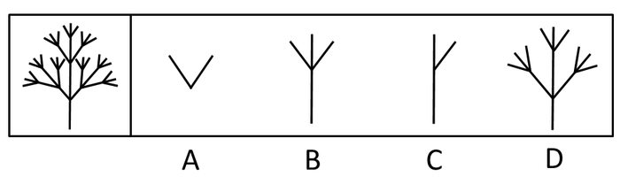
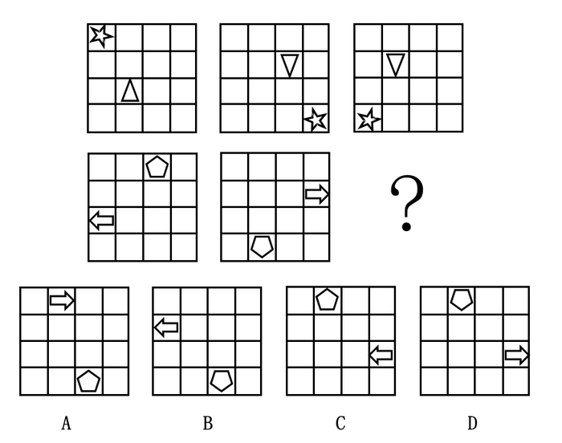
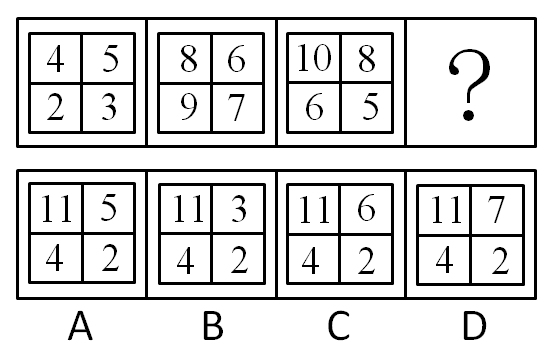
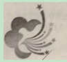
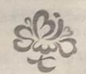
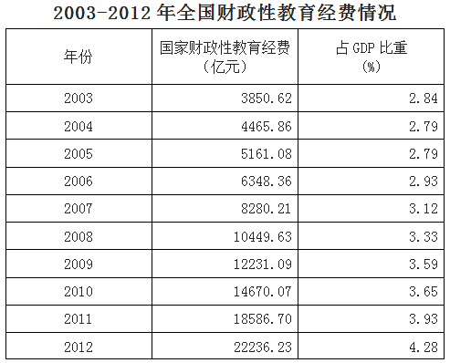
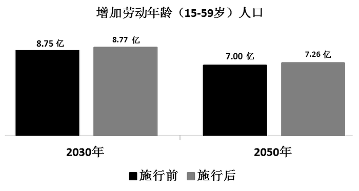
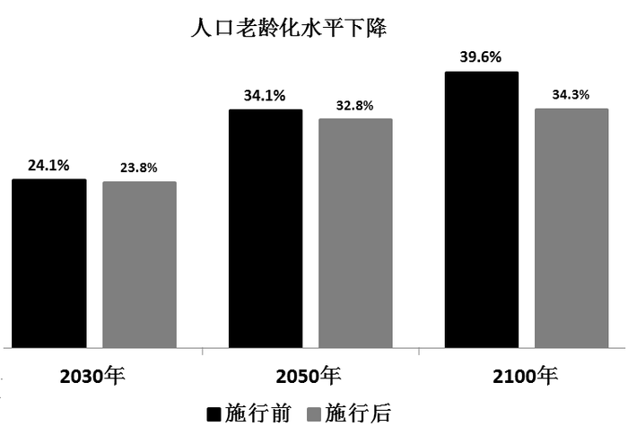

# 2014年吉林省公务员录用考试《行测》题（甲级）

<!-- gwy:overview:start -->
> **吉林 · 2014 · 行测 · 甲级** ｜ 105 题 · 图片 16 处 · 答案随题折叠

| 题型模块 | 题量 | 题号 |
| --- | ---: | ---: |
| 常识判断 | 20 | 1–20 |
| 言语理解与表达 | 30 | 21–50 |
| 数量关系 | 10 | 51–60 |
| 判断推理 | 30 | 61–90 |
| 资料分析 | 15 | 91–105 |
| **合计** | **105** | |

导航：[题型与作答说明](#题型与作答说明) · [题目](#题目) · [材料 1](#材料-1)
<!-- gwy:overview:end -->

> 候选采集稿。参考答案及解析来自粉笔页面，不代表官方答案或真实高分答卷；来源使用许可与原卷对应关系仍需人工核实。

## 题型与作答说明

常识判断

（20题）

常识判断部分主要考查考生的基本常识和基本经验。请根据题目要求，在四个选项中选出一个正确答案。

言语理解与表达

（30题）

共30题。本部分包括表达与理解两方面内容。请根据题目要求，在四个选项中选出一个最恰当的答案。

数量关系

（10题）

在这部分试题中，每道题呈现一段表述数字关系的文字。要求你充分利用所给条件，迅速准确地计算出答案。

判断推理

（30题）

本部分包含图形推理、定义判断、和逻辑判断四个部分，根据要求选出符合要求的一项。

资料分析

（15题）

针对下列给定资料回答问题，共15题。你应根据资料提供的信息进行分析、比较、计算、处理。

## 题目

### 第 1 题

2013年3月19日，习近平在接受金砖国家媒体联合采访时提出，中国这样一个大国，领导者要深入了解国情，了解人民所思所盼，要有“治大国、如烹小鲜”的态度。以下最接近这种治国理念的是：

A. 尊重国情，尊重民心，尊重规律

B. 强化理论，强化技术，强化创新

C. 坚持改革，坚持开放，坚持发展

D. 维护稳定，维护传统，维护成规

第 1 题 · 答案与解析

**参考答案（粉笔题库参考内容）**

A

**解析**

本题考查管理学知识。

题干中“深入了解国情”，体现了尊重国情，从国情实际出发。“了解人民所思所盼”，体现了了解民情，尊重民心。“治大国、如烹小鲜”指做菜不能随意翻动，作料要恰到好处，火候要掌握得当，要尊重烹饪的规律，治理国家也是如此，不能朝令夕改乱折腾，不能操之过急求政绩，也不能懈怠马虎不负责任，要了解国情，体察民意，尊重规律，科学施政。故B、C、D三项错误，A项正确。

故正确答案为A。

**来源**：2015年重庆市选调优秀大学生到基层工作考试《行测》题第11题

### 第 2 题

十八届三中全会提出规范领导干部工作生活保障制度，探索实行官邸制度。“官邸制”在中国古已有之，也是世界上很多国家通行的制度。以下关于“官邸制”说法错误的是：

A. 配偶和子女通常不可以和官员一起居住官邸

B. 美国、法国、德国、韩国都实行“官邸制”

C. “官邸制”在我国秦汉时期就已经出现

D. 一般情况下，官员对官邸只有居住权，没有产权

第 2 题 · 答案与解析

**参考答案（粉笔题库参考内容）**

A

**解析**

官邸制，作为一种官员住房的制度，已在国外实施多年。简单来说，官邸是国家为一定级别的官员提供在任期间居住的住所，官员本人对此没有产权。

A项错误，“配偶和子女通常不可以和官员一起居住官邸”是错误的。

B项正确，目前世界上的很多国家都实行“官邸制”，例如美国、法国、德国、韩国、澳大利亚、印度、加拿大等。

C项正确，“官邸制”在我国秦汉时期就已经出现，王公大臣居住官邸。

D项正确，官邸是国家为一定级别的官员提供在任期间居住的住所，官员本人对此没有产权。

本题为选非题，故正确答案为A。

**来源**：2015年重庆市选调优秀大学生到基层工作考试《行测》题第12题

### 第 3 题

在20世纪60年代，焦裕禄成为那个时代精神的象征。今天，我们仍然敬仰焦裕禄，最主要是因为他身上折射着：

A. 为万世开太平的责任意识

B. 勇于创新的时代精神

C. 己所不欲勿施于人的理性精神

D. 强烈的社会责任感和历史使命感

第 3 题 · 答案与解析

**参考答案（粉笔题库参考内容）**

D

**解析**

焦裕禄，革命烈士。1946年加入中国共产党，1962年被调到河南省兰考县担任县委书记。时值该县遭受严重的内涝、风沙、盐碱三害，他坚持实事求是、群众路线的领导工作方法，同全县干部和群众一起，与深重的自然灾害进行顽强斗争，努力改变兰考面貌。他身患肝癌，依旧忍着剧痛，坚持工作，被誉为“党的好干部”“人民的好公仆”， 折射着强烈的社会责任感和历史使命感。他用自己的实际行动，铸就了亲民爱民、艰苦奋斗、科学求实、迎难而上、无私奉献的焦裕禄精神。

故正确答案为D。

**考点**：唯物史观

**来源**：2014年吉林省公务员录用考试《行测》题（甲级）第3题

### 第 4 题

孟子从“意志之天”出发，认为君权是“天授之”，而“天授之”又是由“民授之”即人民的态度来决定的。这是一种：

A. “天人相胜”的思想

B. “天人相通”的思想

C. “天人相分”的思想

D. “天人平等”的思想

第 4 题 · 答案与解析

**参考答案（粉笔题库参考内容）**

B

**解析**

A项错误，“天人相胜”是中国唐代刘禹锡关于“天人关系”问题的著名观点。刘禹锡初步认识到人类社会和自然界的联系和区别，对古代天人关系学说做出了理论贡献；

B项正确，“天人相通”的思想是孟子的思想，他的“天人合一”思想贯穿于“性善论”“仁民爱物”“万物皆备于我”等主要命题中。孟子认为“天”和人是相通的，“尽其心者，知其性也。知其性，则知天矣”；

C项错误，“天人相分”是荀子的思想，他肯定“天”是自然的天。自然界的变化有自己的规律，不受人的意志支配。同时天也管不了人事，“天人相分论”，第一次从理论上把人与神，自然与社会区分开来，是对天命论的有力批判；

D项错误，“天人平等”的思想是道家学派主张的，道家平等思想可归结为两点:一是人人平等,二是天人平等。老庄从人性平等、人格平等和社会地位平等诸方面论及了人与人的平等问题。

故正确答案为B。

**考点**：文化常识

**来源**：2014年吉林省公务员录用考试《行测》题（甲级）第4题

### 第 5 题

“面子”一词有着浓厚的东方文化色彩，囊括了人的地位、财富、尊严、人格等内涵，是人们进行社交活动的外观表征，代表着他人、社会对自身的综合评价。尽管时代发生了很大的变化，但人们重“面子”的观念依旧存在。这说明：

A. 社会存在决定社会意识

B. 物质是运动的，同时又是相对静止的

C. 意识是物质的主观映像

D. 社会意识具有相对独立性

第 5 题 · 答案与解析

**参考答案（粉笔题库参考内容）**

D

**解析**

“尽管时代发生了很大的变化，但人们重‘面子’的观念依旧存在”，这句话是解题的突破口。“面子”的观念作为一种社会意识，它虽然随着社会存在的变化而变化，但社会意识具有相对独立性，和社会存在的变化并不是完全同步的。题干描述时代在变化，而人们的“面子”观念依旧存在的现象，正是社会存在和社会意识发展的不平衡，社会意识具有相对独立性的特点，D项符合题干中心意思，当选。

故正确答案为D。

**考点**：唯物史观

**来源**：2014年吉林省公务员录用考试《行测》题（甲级）第5题

### 第 6 题

“看人间，哪一寸土地不是人民开，哪一片庄稼不是人民栽，哪一间房屋不是人民盖，哪一部机器不是由人民来制造，哪一种商品不是由人民来生产……”这说明：

A. 人民群众是社会物质财富的创造者

B. 人民群众是社会革命的决定力量

C. 人民群众是社会变迁的主力军

D. 人民群众是社会精神财富的创造者

第 6 题 · 答案与解析

**参考答案（粉笔题库参考内容）**

A

**解析**

人类社会的存在和发展，首先需要有食物、衣服、住房等物质生活资料。如果不能获得这些物质资料，人本身的存在都不能维持，更谈不上从事政治的、科学的和艺术的活动，也就无所谓人类的发展和社会的进步。生产力要素中不仅包括劳动工具和劳动对象，更重要的是人，是劳动者。劳动群众的生产活动是整个社会全部活动的前提和基础。社会生产力的发展往往是不明显的，不易看到的，亿万生产者的姓名也不可能为人所知，然而生产力是推动人类历史前进最深刻的根基。题中“哪一寸土地不是人民开，哪一片庄稼不是人民栽，哪一间房屋不是人民盖，哪一部机器不是由人民来制造，哪一种商品不是由人民来生产”都体现的是物质生产，即A选项人民群众是社会物质财富的创造者。

故正确答案为A。

**考点**：唯物史观

**来源**：2014年吉林省公务员录用考试《行测》题（甲级）第6题

### 第 7 题

美国著名影星布拉德皮特主演的电影《返老还童》，描述的是主人公本杰明巴顿一出生便如80岁老人一般，之后便越活越年轻，最后竟以婴儿的形态离开人世。但现实中，古今中外，从没有真正出现这一现象，这是因为：

A. 人类还没有找到可以“返老还童”的神奇干细胞

B. 人类现有的医学、生理学技术手段还不可能实现“返老还童”

C. “生-弱-壮-衰-亡”是事物发展不可违背的客观规律

D. 人类还没有真正找到“穿越”时空的技术手段

第 7 题 · 答案与解析

**参考答案（粉笔题库参考内容）**

C

**解析**

客观性是规律的根本特点，它的存在不依赖于人的意识。相反，人的意识及其指导下的实践却要受规律的支配。不管人们是否认识到，承认不承认，规律都客观存在着，并以一定的方式起作用。规律的客观性表明，人们不能藐视规律，更不能创造和消灭规律。人在客观规律面前又不是完全消极被动无所作为的。人们在实践中可以认识或发现规律，并利用这种合规律的认识指导实践，达到改造世界、为人类谋利的目的。人们还可以改变规律发生作用的条件和形式，使事物朝着有利于人类的方向发展。“穿越”和“返老还童”都是影视剧中的桥段，在现实世界中没有科学依据，事物发展是有其客观规律性的。

故正确答案为C。

**考点**：认识论

**来源**：2014年吉林省公务员录用考试《行测》题（甲级）第7题

### 第 8 题

“旧时王谢堂前燕，飞入寻常百姓家。”唐代诗人刘禹锡的这两句诗词，常被用来形容过去的一些昂贵商品现在变成了大众消费品。

导致这种变化的根本原因是：

A. 人民生活质量提高

B. 社会劳动生产率提高

C. 商品市场日益繁荣

D. 大众消费观念发生变化

第 8 题 · 答案与解析

**参考答案（粉笔题库参考内容）**

B

**解析**

商品的价值量即由社会必要劳动时间决定。社会劳动生产率与商品价值之间为反比关系，因此当社会劳动生产率一定时，某一生产者提高自身的个人劳动生产率就可以降低成本，提高经济效益，这便是企业发展生产的根本动力。社会劳动生产率是衡量全社会范围内生产先进和落后的重要尺度。题中“旧时王谢堂前燕，飞入寻常百姓家”，导致这种变化的根本原因即是社会劳动生产率提高。

故正确答案为B。

**考点**：微观经济

**来源**：2014年吉林省公务员录用考试《行测》题（甲级）第8题

### 第 9 题

卢梭在《爱弥儿》一书中写道，妇女们应该在家中劳动，永远不要到需要讲话的公共集会上去······难道世界上还有比把家里收拾得井井有条的母亲更感人、更让人尊敬的吗？这表明卢梭反对妇女：

A. 争取人身自由权

B. 获得劳动权

C. 拥有教育权

D. 享有政治参与权

第 9 题 · 答案与解析

**参考答案（粉笔题库参考内容）**

D

**解析**

政治参与权，即公民参与制定、通过或贯彻公共制度的行为的权利。它也是人权的一项基本权利。在当代，民主被视为一个国家政府体制合法性的基础，政治参与的普遍性和有效性则是检验民主制度真伪的标准。题干中“到需要讲话的公共集会上去”明显表达了公民的政治参与权。

故正确答案为D。

**考点**：宪法

**来源**：2015年重庆市选调优秀大学生到基层工作考试《行测》题第13题

### 第 10 题

近年来，“民告官”案件时有发生，“民告官”的依据是：

A. 《中华人民共和国民法通则》

B. 《中华人民共和国刑事诉讼法》

C. 《中华人民共和国民事诉讼法》

D. 《中华人民共和国行政诉讼法》

第 10 题 · 答案与解析

**参考答案（粉笔题库参考内容）**

D

**解析**

民告官，是行政诉讼或行政官司的俗称。行政诉讼是官民矛盾的化解机制。行政法调整的行政主体和行政相对人构成的行政关系以及在此基础上产生的监督行政关系，而这两部分内容分别体现的就是“官管民”和“民告官”的关系，例如行政复议和行政诉讼就是监督行政关系。

故正确答案为D。

**考点**：行政法

**来源**：2015年重庆市选调优秀大学生到基层工作考试《行测》题第14题

### 第 11 题

“请名人代言”是提高广告说服力的好方法。下列四则广告标题，如单就文字意义，寻找背景相契合的古代名人来代言，则最不恰当的组合是：

A. 请庄子代言“自然就是美”

B. 请司马光、王安石代言“好东西要和好朋友分享”

C. 请苏秦、张仪代言“做个不可思议的沟通高手”

D. 请子路代言“心动不如马上行动”

第 11 题 · 答案与解析

**参考答案（粉笔题库参考内容）**

B

**解析**

A项正确，庄子，名周，字子休，道教祖师，号南华真人，道教四大真人之一，汉族，战国中期宋国蒙人。战国中期道家学派的代表人物，著名的思想家和文学家，道家学说的主要创始人之一。其思想是自然而然的生活，代表作是《庄子》一书；

B项错误，王安石与司马光曾经是诤友，但是后来是政敌，虽然是君子之争，但是称之为好朋友，并不是很恰当。且二人都十分执着、倔强，因此不适合代言“好东西要和好朋友分享”；

C项正确，苏秦和张仪是战国时期著名的纵横家，经常游说各国；

D项正确，子路崇尚实干，且颇具政治才能。《论语》中这样描述子路：“子路有闻，未之能行，唯恐有闻”，反映出子路崇尚以实践来检验自己的所学。

本题为选非题，故正确答案为B。

**考点**：文学常识

**来源**：2014年吉林省公务员录用考试《行测》题（甲级）第11题

### 第 12 题

有学者认为，先秦时期某学派主张积极救世，做事讲求道德；另一学派以其超凡脱俗、清静自然的美感和灵性弥补了前一学派的缺陷。

该学者评述的两个学派分别是：

A. 儒家、道家

B. 法家、墨家

C. 法家、儒家

D. 儒家、墨家

第 12 题 · 答案与解析

**参考答案（粉笔题库参考内容）**

A

**解析**

儒家又称儒学、儒家学说，是中国古代最有影响的思想学派。儒家思想，是华夏思想价值体系的一种，是中华法系的法理基础，是对中国及东方文明发生重大影响的意识形态，是泛东亚地区的基本文化信仰。儒家指自春秋起由孔子创立，后来逐步发展成以“仁”为核心的思想体系。儒家主张积极救世，做事讲求道德。

道家是中国先秦时期的一个思想派别。其具有超凡脱俗、清静自然的美感和灵性，道家以道、无、自然、天性为核心理念，认为天道无为、道法自然，据此提出无为而治、以雌守雄、以柔克刚等政治、军事策略，对中国乃至世界的文化都产生了巨大的影响。

法家是指春秋战国时期的一个学派。法家是从早期儒家荀子基于性恶说的礼治论发展而来的，其将以礼治国的学说向前迈了一步，提出了以法治国。法是通过具体的刑名赏罚来实现的。主要代表人物有商鞅、韩非子、李斯等。主张“法治”，反对礼治。

墨家学派有前后期之分，前期思想主要涉及社会政治、伦理及认识论问题；后期墨家在逻辑学方面有重要贡献。主张人与人平等相爱（兼爱），反对侵略战争（非攻）。重视文化传承（明鬼），掌握自然规律（天志）。符合题中条件的只有A项。

故正确答案为A。

**考点**：文化常识

**来源**：2014年吉林省公务员录用考试《行测》题（乙级）第14题

### 第 13 题

在中国传统文化中，“龙马负图”“凤鸟来朝”“麒麟至郊”“元龟衔符”乃四大祥瑞之兆。龙、凤、麟、龟等几项动物至今仍广泛流传。

以下对四者主要寓意表述准确的是：

A. 龙：子孙繁荣；凤：飞黄腾达；麟：太平盛世；龟：健康长寿

B. 龙：民族昌盛；凤：如意吉祥；麟：太平盛世；龟：健康长寿

C. 龙：民族昌盛；凤：如意吉祥；麟：健康长寿；龟：太平盛世

D. 龙：民族昌盛；凤：子孙繁荣；麟：如意吉祥；龟：健康长寿

第 13 题 · 答案与解析

**参考答案（粉笔题库参考内容）**

B

**解析**

传说中的“龙马负图、元龟衔符、凤鸟来朝、麒麟至郊”是四大祥瑞。龙代表着民族昌盛，凤代表着如意吉祥，麟代表着太平盛世，龟代表着健康长寿。

故正确答案为B。

**考点**：文化常识

**来源**：2014年吉林省公务员录用考试《行测》题（甲级）第13题

### 第 14 题

三十六计中，以制造假象来迷惑敌人的计策是：

A. 树上开花

B. 引人入胜

C. 顺手牵羊

D. 围魏救赵

第 14 题 · 答案与解析

**参考答案（粉笔题库参考内容）**

A

**解析**

“树上开花”之计，是指树上本来没有花，但可以借用假花点缀在上面，让人真假难辨。此计用在军事上，是指当自己的力量薄弱时，可以借别人的势力或某种因素，使自己看起来强大，以此虚张声势，慑服敌人。“引人入胜”，多指山水风景或文艺作品吸引人，引人进入佳境，形容亲身来到某种境地。“顺手牵羊”，指顺手把人家的羊牵走，比喻趁势将敌手捉住或乘机利用别人，现比喻乘机拿走别人的东西，在现实生活中也是常常用到的一计。“围魏救赵”是三十六计中相当精彩的一种智谋，它的精彩之处在于以逆向思维的方式，以表面看来舍近求远的方法，绕开问题的表面现象，从事物的本源上去解决问题，从而取得一招制胜的神奇效果。综上，只有A项符合题意。

故正确答案为A。

**考点**：文学常识

**来源**：2014年吉林省公务员录用考试《行测》题（甲级）第14题

### 第 15 题

成语“勾心斗角”现比喻用尽心机，明争暗斗，本意指宫廷建筑结构的交错和精巧。以下成语中，寓意和本义同样发生根本性变化的一项是：

A. 雪中送炭

B. 引人入胜

C. 口若悬河

D. 八面玲珑

第 15 题 · 答案与解析

**参考答案（粉笔题库参考内容）**

D

**解析**

雪中送炭，在下雪天给人送炭取暖。比喻在别人急需时给予物质上或精神上的帮助、鼓励；

引人入胜，多指山水风景或文艺作品吸引人，引人进入佳境（指风景或文章等），形容亲身来到某种境地；

口若悬河，讲话像瀑布倾泻，滔滔不绝。形容能说会辩，口才很好，口齿伶俐；

八面玲珑，原指窗户很多，四面八方通明透亮。现形容为人处世圆滑，各方面都能巧妙应对。和“勾心斗角”一样，本意已发生根本性变化。

故正确答案为D。

**考点**：文学常识

**来源**：2014年吉林省公务员录用考试《行测》题（乙级）第12题

### 第 16 题

我国有悠久的酒文化历史，在长期的发展过程中，酿造出多种被誉为“神品”“琼浆”的酒类珍品。

下列关于各类酒的作用说法错误的是：

A. 白酒有杀菌、去腥、防腐作用，可医用

B. 啤酒具有清心、提神的作用，可减少过度兴奋和紧张情绪

C. 红酒有助于防动脉硬化，还可减少骨质疏松症的危险

D. 黄酒有助于通经络、厚胃肠、养脾扶肝、增进食欲、消除疲劳

第 16 题 · 答案与解析

**参考答案（粉笔题库参考内容）**

C

**解析**

A项正确，适量地饮用白酒可以振奋情绪、促进血液循环。白酒又有杀菌、去腥、防腐作用，有很长的医用历史；

B项正确，啤酒是夏秋季防暑、降温、解渴、止汗的清凉饮料。据医学和食品专家们研究，啤酒含有4%的酒精，能促进血液循环；含二氧化碳，饮用时有清凉舒适感；还能帮助消化，促进食欲；

C项错误，红酒中的多酸含量相当多，所以人们一直认为红酒对于预防心血管疾病有极好的作用，有助于预防动脉硬化和早老性痴呆症等疾病，但并不具有减少骨质疏松危险的功能；

D项正确，黄酒味甘苦、性辛温、有小毒，主要作用是行药势、通经络、温脾胃、散湿气，热饮能活血、利小便。所以黄酒有助于通经络、厚胃肠、养脾扶肝、增进食欲、消除疲劳。

本题为选非题，故正确答案为C。

**考点**：生活常识

**来源**：2014年吉林省公务员录用考试《行测》题（乙级）第15题

### 第 17 题

今天人们经常以“姓氏笔画”为序来排名，其实古代特别是先秦时期“姓”与“氏”是有严格区别的。

以下关于“姓”“氏”表述错误的一项是：

A. “姓”源于母系社会，“氏”源于父系社会

B. 秦汉以后，出现姓名合一的倾向，姓和氏不再是贵族的专利，平民也能有姓氏了

C. 中国最早的氏，大都从“女”旁，如姬、姚、姜、嬴等

D. 一般女子称“姓”用来“别婚姻”，男子称“氏”用来“明贵贱”

第 17 题 · 答案与解析

**参考答案（粉笔题库参考内容）**

C

**解析**

A项正确，根据《通志·氏族略》，女子为“姓”在母系社会，男子为“氏”在父系社会；

B项正确，秦汉以后，出现姓名合一的倾向，姓和氏不再是贵族的专利，平民也能有姓氏了；

C项错误，中国有上古八大姓：姬、姚、妫、姒、姜、嬴、姞、妘。都是从“女”旁，如姬、姚、姜、嬴等，说明在母系氏族公社时期的妇女地位举足轻重，是“姓”而不是“氏”；

D项正确，古时女子嫁人之后从夫姓，男子用氏来区别贵贱。

本题为选非题，故正确答案为C。

**考点**：文化常识

**来源**：2014年吉林省公务员录用考试《行测》题（甲级）第17题

### 第 18 题

下列标志与含义对应错误的一项是：

A. 食品安全标志

B. 循环再生标志

C. 强制认证标志

D. 环境保护标志

第 18 题 · 答案与解析

**参考答案（粉笔题库参考内容）**

D

**解析**

D项是绿色食品标志，环境保护标志如下图。其他的均对应正确。

本题为选非题，故正确答案为D。

**考点**：生活常识

**来源**：2014年吉林省公务员录用考试《行测》题（乙级）第18题

### 第 19 题

假如现在是北京时间12日上午9点，则伦敦时间和纽约时间分别是：

A. 12日凌晨1点；12日晚上9点

B. 12日凌晨1点；12日晚上6点

C. 12日凌晨1点；11日晚上9点

D. 11日晚上11点；11日晚上9点

第 19 题 · 答案与解析

**参考答案（粉笔题库参考内容）**

C

**解析**

C项正确，伦敦时区为零时区，已知北京时间（东八区）时间是12日上午9点，伦敦和北京差八个时区，按照“东加西减”的时区计算原则，计算出伦敦时间为12日凌晨1点，而纽约位于西半球，在日期变更线以东，日期一定是11日。

故正确答案为C。

**考点**：世界地理

**来源**：2014年吉林省公务员录用考试《行测》题（乙级）第17题

### 第 20 题

雾霾天气有时会使建筑物呈现“蜃景”。以下关于“蜃景”说法错误的一项是（    ）

A. 古人将“蜃景”归因于蛟龙之属的蜃吐气而形成，因而得名

B. 我国广东澳角、山东蓬莱、浙江普陀海面上经常出现这种幻景

C. “蜃景”只会出现在平静的海面、江面，雪原、沙漠和戈壁等地方不会出现“蜃景”

D. “蜃景”是物体反射的光经大气折射而形成的虚像

第 20 题 · 答案与解析

**参考答案（粉笔题库参考内容）**

C

**解析**

A项正确，蜃景即海市蜃楼，古人误认是蜃吐气所形成的景象。蜃景，是指大气光学现象。光线经过不同密度的空气层后发生显著折射，使远处景物显示在半空中或地面上的奇异幻景。常发生在海上或沙漠地区。古时传说这种幻景是海里的蜃吐气而成的；

B项正确，我国几大著名的海市蜃楼的观景点为广东澳角、山东蓬莱、浙江普陀等地；

C项错误，海市蜃楼不只会出现在平静的海面、江面，雪原，沙漠和戈壁等其他的地方，只要有不同密度的空气出现，都有可能出现海市蜃楼；

D项正确，“蜃景”是物体反射的光经大气折射而形成的虚像。

本题为选非题，故正确答案为C。

**考点**：物理常识

**来源**：2014年吉林省公务员录用考试《行测》题（甲级）第20题

### 第 21 题

填入下面一段文字横线处的语句，衔接最恰当的一项是：

习近平总书记在讲话中提到了“中国梦”的问题，\_\_\_\_\_\_\_\_\_\_\_因此，“中国梦”成为中国人的热门话题。

①因为每个人都渴望实现自己的梦想，个人梦想的实现是建立在国家繁荣基础上的。

②其实，换一个角度，中国梦与我们每个人息息相关。

③它使人联想到民族奋进的滚滚大潮，气势磅礴的宏伟蓝图。

④所以，我们每一天向着自己的梦想出发，也是在缔造着中华民族的复兴之梦。

⑤“中国梦”即中华民族的复兴之梦，是十三亿中华儿女共同拥有的伟大梦想。

A. ⑤④②③①

B. ③⑤①④②

C. ②①④⑤③

D. ⑤③②①④

第 21 题 · 答案与解析

**参考答案（粉笔题库参考内容）**

D

**解析**

本题属于语句衔接与语句排序结合的题目，根据所给文段，第一句话谈论中国梦的话题，按照话题一致原则，衔接的句子也应该谈论同样的话题，⑤句符合，且⑤句为下定义的表述，对比选项适合作排序的首句，排除B、C两项；再观察尾句，根据①句中含有关联词语“因为”，④句为所以，①④两句逻辑关系，应为①④两句相连顺序，排除A项。

故正确答案为D。

**考点**：语句排序题、语句填空题混合题型

**来源**：2014年吉林省公务员录用考试《行测》题（甲级）第21题

### 第 22 题

在今日10时的家属沟通会上，马航工作人员向家属表示，目前马来西亚外交部已向南北走廊上所有国家发出外交照会，并请求这些国家提供支持和协助，包括雷达和卫星信息、海陆空搜救行动、相关国家的搜救行动计划及马来西亚请求提供的信息等。目前已有26个国家参与搜救，几乎涵盖南北走廊的所有国家。

为这段新闻拟写标题，恰当的一项是：

A. 马航组织家属沟通会

B. 马来西亚请求援助搜救工作

C. 马航与家属协商搜救工作

D. 马方已向多国发出外交照会

第 22 题 · 答案与解析

**参考答案（粉笔题库参考内容）**

D

**解析**

给新闻类题目加标题属于中心理解题的变形，应概括文段中心。而新闻又有自己的固定结构，标题-副标题-导语-主体，导语是新闻第一句话，用来提示新闻的重要事实，让读者一目了然，是对重点的概括，一般新闻标题对导语强调的重点事件进行概括即可。文段首句对“时间、人物”进行说明，接着引出事件说马来西亚发出外交照会，后面具体说请求其他国家提供支持协助，并解释了请求别国给予支持的具体方式，最后介绍了参与搜救的国家情况，属于对前文的解释说明。涉及到这个新闻重点事件的选项是B、D两项，对比两个选项，新闻标题要体现简明概括性，因此D项“马方已向多国发出外交照会”比B更适合做新闻标题。A、C两项，均介绍“家属”，“家属”非重点，排除A、C两项。

故正确答案为D。

**考点**：标题填入题

**来源**：2014年吉林省公务员录用考试《行测》题（甲级）第22题

### 第 23 题

全国孝老爱亲模范孟佩杰8岁起就独自挑起了照顾瘫痪养母刘芳英的重担，至今已有15个年头。母女俩相依为命，日子过得很艰难。在社会各界和当地政府的关照下，孟佩杰母女的生活状况已经得到了极大改善。如今孟佩杰不仅照料着养母，也开始了公益生涯。当割肾救子的母亲郭珍珍对手术费一筹莫展时，孟佩杰母女不仅资助了她2000元，还帮助联系爱心团队筹到了3.7万元手术费。

下列名言中，对本文概括最恰当的一项是：

A. 百善孝为先

B. 老吾老，以及人之老；幼吾幼，以及人之幼

C. 君子喻于义，小人喻于利

D. 弟子入则孝，出则悌，谨而信

第 23 题 · 答案与解析

**参考答案（粉笔题库参考内容）**

B

**解析**

文段第一部分先讲述孟佩杰照顾母亲的事例，第二部分讲的是她不仅照顾自己的母亲，而且还开始了公益事业。由她的母亲扩大到了公益事业。

B项的意思是照顾自己的长辈和孩子还要扩大到照顾别人的长辈和孩子，符合文意。

A强调的是孝；C强调的是义；D强调的是孝、悌及信，与文段所讲的内容不符。

故正确答案为B。

**来源**：2014年吉林省公务员录用考试《行测》题（甲级）第23题

### 第 24 题

下列各句中没有使用比喻修辞手法的一句是：

A. 应中国国家主席习近平夫人彭丽媛的邀请，美国第一夫人米歇尔•奥巴马携两位女儿玛利亚、萨沙和母亲访问中国。米歇尔与彭丽媛的相会，将是一场美国玫瑰与中国牡丹的相遇。

B. 湖水清澈见底，如同一块透明的蓝绸布，静静地躺在大地的怀抱里。

C. 残疾人事业是崇高的人道主义事业，残疾人事业的发展好像一把标尺，彰显着社会的公平正义和文明进步。

D. 她含笑的双眼炯炯有神，好像一下子年轻了好多，她抬起沉重的手，在胸前缓缓地画着十字。

第 24 题 · 答案与解析

**参考答案（粉笔题库参考内容）**

D

**解析**

A项把米歇尔比喻成玫瑰，把彭丽媛比喻成牡丹；B项把湖水比喻成蓝绸布；C项把残疾人事业比喻成标尺。

四个选项中，只有D项没有使用比喻，文中的“好像”在此处不是表示比喻，当选。

本题为选非题，故正确答案为D。

**来源**：2014年吉林省公务员录用考试《行测》题（甲级）第24题

### 第 25 题

领导人整顿风气，很多人不以为然，以为这是小题大做。据说，形成优良社会秩序，最重要的是制度。这种观念流行一时，然而不乏偏颇。制度是刚性约束，风气是柔性导引，从逻辑上说，风气导引于先，制度约束于后。风气、制度交相为用，自然能够收到奇效。

关于“风气”和“制度”的关系，描述正确的是：

A. 风气与制度并重

B. 制度比风气重要

C. 制度是风气的引导

D. 制度不及风气重要

第 25 题 · 答案与解析

**参考答案（粉笔题库参考内容）**

A

**解析**

文段首先引出关于“风气”和“制度”片面的观点，最后通过说明制度和风气各自的优点和风气和制度的顺序，引出风气制度并重的正确观点。

因此，结合选项应该选择A。

B项和D项均是片面地认为风气或制度更重要，排除；由“风气导引于先”可知C项排除。

故正确答案为A。

**考点**：关联词-转折、特殊问法

**来源**：2014年吉林省公务员录用考试《行测》题（乙级）第32题

### 第 26 题

依次填入文中横线处的语句，顺序恰当的一项是：

“土豪”二字重点在“土”，重外在、重奢华、好显摆，表达着一种与富裕的经济状况不相匹配的素质修养、行事风格以及外在气质。\_\_\_\_\_\_。\_\_\_\_\_\_。\_\_\_\_\_\_，\_\_\_\_\_\_\_，是一种来自骨子里的自卑心态。

①折射出一些“暴发户”一夜暴富之后的茫然与失衡

②急于用金钱向社会表明自己的价值

③而且越是“土”的人却越“豪”，无论是张扬还是炫耀，都是一种不正常的、浮躁的心理

④急于用金钱获取他人的尊敬

A. ②①④③

B. ①③②④

C. ③②①④

D. ③④①②

第 26 题 · 答案与解析

**参考答案（粉笔题库参考内容）**

B

**解析**

此题属于语句排序题与语句填空题的结合，横线居中，所填句子应与前后话题保持一致。横线前介绍通过“土豪”的外在行为表现体现了这类人群内在素质与其经济不匹配的现状。横线后介绍“土豪”的自卑心态。结合选项，首句分别是①②③，三句均与横线前话题保持一致，首句不好确定。寻找其他线索，根据②④两句结构一样且内容类似，构成并列关系，确定捆绑集团，观察选项仅有B项符合。

故正确答案为B。

**考点**：确定捆绑、语句排序题、语句填空题混合题型

**来源**：2014年吉林省公务员录用考试《行测》题（乙级）第30题

### 第 27 题

下列各句中，加横线成语使用恰当的一项是：

A. 莫斯科时间2月7日20点14分，第22届冬季奥林匹克运动会开幕式在俄罗斯度假胜地索契市举行，金碧辉煌的开幕式演出吸引了全球约30亿的电视观众

B. 联合国特别协调员卡洛，兴致勃勃地参观正在塞浦路斯利马索尔港补给的中国海军盐城舰，高度赞扬中国政府为政治解决叙利亚化学武器问题所做的努力

C. 3月21日，“雪龙”号上的中国第30次南极科学考察队在澳大利亚人员配合下，倾巢出动，火速前往搜寻马航MH370失联客机

D. 《警察日记》和《白日焰火》作为国际电影节获奖影片，对表达中国文化自信力方面的贡献，可谓两全其美

第 27 题 · 答案与解析

**参考答案（粉笔题库参考内容）**

B

**解析**

A项“金碧辉煌”形容建筑物装饰华丽，光彩夺目。不能用以形容“开幕式”，排除；

B项“兴致勃勃”形容兴趣很浓厚，情绪很高的样子。用来形容联合国特派协调员参观时的心情，使用恰当；

C项“倾巢出动”比喻敌人出动全部兵力进行侵扰，或指全部出动（贬义）。不符合语句的感情色彩，排除；

D项“两全其美”指做一件事顾全到双方，使两方面都得到好处。语句只介绍两部影片对表达文化自信力单方面的作用，排除。

故正确答案为B。

**来源**：2014年吉林省公务员录用考试《行测》题（甲级）第27题

### 第 28 题

下列各句中，没有歧义的一句是：

A. 南京某幼儿园是否给孩子“喂药”的问题，园方负责人已在记者招待会上予以否认

B. 剧组全体成员经过一年零三个月的苦战，一个形式新颖、制作精良的选秀节目《中国好歌曲》终于与观众见面了

C. 李敏镐的到场令在场的无数观众尖叫不已，找他签名合照的观众将他围堵了20多分钟

D. 从2012年1月1日起，34个电视上星综合频道要提高新闻类节目播出量，同时对部分类型节目播出实施调控，以防止过度娱乐化或低俗化倾向

第 28 题 · 答案与解析

**参考答案（粉笔题库参考内容）**

C

**解析**

A项，“予以否认”的对象不明确，既可能是否认“喂药”行为，也可能是否认“是否喂药”这一问题本身，存在歧义，排除；

B项，句子结构混乱，前一分句的主语是“剧组全体成员”，后一分句的主语变为“选秀节目”，导致读者可能理解为“剧组全体成员与观众见面”或“选秀节目与观众见面”，存在歧义，排除；

C项，表述清晰，没有歧义，当选；

D项，可以理解为“提高新闻类节目播出量并实施调控”两方面共同“防止过度娱乐化或低俗化倾向”，也可以理解为仅“对部分类型节目播出实施调控”这一方面“防止过度娱乐化或低俗化倾向”，存在歧义，排除。

故正确答案为C。

**来源**：2014年吉林省公务员录用考试《行测》题（甲级）第28题

### 第 29 题

进入马年，“马上就有”这一句式迅速流行：“马上有钱”“马上有房”“马上有份好工作”。“马上就有”的祝福语，是马年才有；“马上就有”的社会心态，却早已在不经意间造访我们的时代。一毕业马上要有高薪工作，一工作马上让全家人凑钱买房，别人有了自己也马上要有，希望不能“马上兑现”就立刻抱怨。“马上就有”，倾诉着人们对美好生活的急切期盼，也在一定程度上映照出当今社会中的焦虑、浮躁与喧嚣心态。

这段话对“马上就有”，所持的态度是：

A. 肯定

B. 否定

C. 有肯定也有否定

D. 不置可否

第 29 题 · 答案与解析

**参考答案（粉笔题库参考内容）**

C

**解析**

文段为分总结构，前文分析，最后一句给出结论，所以此题的突破点在最后一句话，找到关联词“也”，可以判定作者在“也”之前的半句肯定“马上就有”有积极的一面，“倾诉着人们对美好生活的急切期盼”，“也”后的半句通过“焦虑、浮躁与喧嚣心态”表现了否定的态度，因此，作者对“马上就有”的态度是既有肯定也有否定。

因此，结合选项应该选择C。

A项和B项错误；“不置可否”指不发表评论，这个文段明显通过关联词已经表明了自己的态度，并不是未发表评论，所以D项错误。

故正确答案为C。

**考点**：关联词-并列

**来源**：2014年吉林省公务员录用考试《行测》题（乙级）第34题

### 第 30 题

下列各句中，没有语病的一项是：

A. 《最强大脑》国际PK赛第一场，中国男孩李云龙和意大利少年安德烈表现迥异，引发观众对“中国式教育”的大讨论。面对质疑，李云龙的父亲李勇表示将坚持自己的教育方式

B. 昨日，长白山上的高山牡丹花已开得十分茂盛，如果明媚的阳光能够持续一段时间的话，山上五光十色的花很快就能冒出来

C. 虽然现在所访问的一些国家，对我们很陌生，了解起来比较吃力，不过我相信，在导游的帮助下，整个访问行程一定会非常顺利

D. 行政改革蓝皮书《中国行政体制改革报告（2013）》调查，超六成受访者对八项决定的持续实施有信心，民众对官员财产申报和公开制度的建立，有很高的期待

第 30 题 · 答案与解析

**参考答案（粉笔题库参考内容）**

A

**解析**

B项中“五光十色”形容色泽绚丽，种类繁多，无法与语境中的花搭配，错误；

C项中属于主宾倒置的问题，应该是我们对现在所访问的国家很陌生，而不是这些国家对我们陌生，错误；

D项中“蓝皮书”和“调查”搭配不当，错误。

故正确答案为A。

**来源**：2014年吉林省公务员录用考试《行测》题（乙级）第35题

### 第 31 题

下列各句中加横线词，运用正确的是：

A. “两横三纵”快速路投入使用后，长春市交通会更加顺畅，从赛德广场到前进大街的行驶时间估计大体只需十多分钟

B. 除了家庭之外，没有一种社会组织对社会生活的变化如此敏感，能够如此明显地反映社会历史发展取得的成就和面临的困难

C. 对于公务员考试来说，英语考试并不是必然的，因为只有个别岗位对英文水平有要求

D. 一来到台北，我们就径直来到101大厦看夜景。此时的台北灯火阑珊，显得尤其迷人

第 31 题 · 答案与解析

**参考答案（粉笔题库参考内容）**

B

**解析**

A项中的“大体”和“估计”重复；

C项“必然”应该改为“必须”；

D项“尤其”应改为“特别”。

故正确答案为B。

**来源**：2014年吉林省公务员录用考试《行测》题（乙级）第27题

### 第 32 题

美国一项最新调查发现，儿童每天喝碳酸饮料越多，就更容易出现攻击性、注意力不集中以及不合群等行为问题，其中每天喝4杯或4杯以上的儿童，破坏别人东西、与人吵架或殴打别人的可能性是不喝碳酸饮料儿童的两倍。

下列说法与文意相符的一项是：

A. 碳酸饮料对成年人的行为不会产生任何影响

B. 只要限制孩子喝碳酸饮料就能减少其攻击性

C. 常喝碳酸饮料的儿童可能比较好斗

D. 碳酸饮料是导致儿童不良行为的最主要原因

第 32 题 · 答案与解析

**参考答案（粉笔题库参考内容）**

C

**解析**

对文段进行概括可得常喝碳酸饮料的儿童更容易好斗，C项正确。

A项属于无中生有，文段并未涉及成年人，排除；B项属于过于绝对，限制孩子喝碳酸饮料不一定能减少其攻击性，排除；D项属于无中生有，文段并没有说碳酸饮料是导致儿童不良行为的最主要原因，排除。

故正确答案为C。

**考点**：细节判断题

**来源**：2014年吉林省公务员录用考试《行测》题（甲级）第32题

### 第 33 题

底线无形地存在于两个地方。一在社会中，一在每个人心里。如果人们都降低自己的底线，社会的底线一定下降。社会失去共同遵守的底线，世道人伦一定败坏；如果人人守住底线，社会便拥有一条美丽的水准线——文明。因此说，守住底线，既是为了成全社会，也是成全自己。

对“底线”的理解，不正确的一项是：

A. 每个人心中的底线下降会导致社会的底线下降

B. 每个人都遵守底线，社会才会变得文明

C. 社会的底线下降是每个人心中的底线下降的标志

D. 守住底线既有利于个人成长，又有利于社会发展

第 33 题 · 答案与解析

**参考答案（粉笔题库参考内容）**

C

**解析**

细节判断题目，文段说的是降低自己的底线导致社会底线一定下降，但并不能反过来说社会的底线下降时每个人心中底线就会下降，所以， C项为因果倒置，当选。

其余三个选项在文章中均可以找到，A项对应第三句，B项对应第四句，D项对应最后一句，排除。

本题为选非题，故正确答案为C。

**考点**：实词

**来源**：2014年吉林省公务员录用考试《行测》题（乙级）第38题

### 第 34 题

目前，在我国各地，养老问题的管理工作分散在老干部局、民政局、人力资源和社会保障局、医疗卫生部门、老龄办等多个部门和单位。此外，妇联、青联、工会、残联等机构也或多或少地介入了养老的服务保障和管理工作。

对我国养老管理工作描绘最准确的一项是：

A. 多龙治水

B. 三个和尚没水吃

C. 二龙戏珠

D. 僧多粥少

第 34 题 · 答案与解析

**参考答案（粉笔题库参考内容）**

A

**解析**

文段开头介绍我国各地养老问题的管理工作分散在多个部门和单位，接着通过“此外”表并列，后文同样阐述了各个部门同时对养老问题进行管理，因此全面概括即多个部门同时对养老这一个问题进行管理。A项“多龙治水”指多条龙治理一个水的问题，与文段相符，正确。

B项，侧重强调不团结协作，与文段不符，排除；

C项，指两条龙相对，戏弄同一颗宝珠，与文段不符，排除；

D项，比喻人多东西少，不够分配，与文段不符，排除。

故正确答案为A。

**考点**：关联词-并列

**来源**：2014年吉林省公务员录用考试《行测》题（甲级）第34题

### 第 35 题

下列各句中，没有语病的一句是：

A. 近视患者都应当接受专业医师的检查，选择合适的眼镜，切忌不要因为怕麻烦、爱漂亮而不戴眼镜

B. 《中国好声音》这类“零门槛”的节目，让任何一个拥有音乐梦想的普通人，都可以一展歌喉，享受舞台，也让我们懂得，平凡人成就自我的关键在于是否相信梦想，勇于追求，敢于创造奇迹

C. 百年来，中华书局一直以传承文明为己任，本着守正出新的原则，整理出版了大批古籍，也推出了许多高水平的学术新著

D. 目前，我国是联合国“人类非物质文化遗产名录”中入选项目最多的国家，这一成绩主要靠的是社会各界的共同努力取得的

第 35 题 · 答案与解析

**参考答案（粉笔题库参考内容）**

C

**解析**

A项“切忌”和“不要”属于重复，导致语义与文段不符，存在语病，排除；

B项，平凡人成就自我的“关键在于是否”，属于一面对两面，存在语病，排除；

C项，语句通顺，没有语病，当选；

D项，“主要靠的是······取得的”，句式杂糅，存在语病，排除。

故正确答案为C。

**来源**：2014年吉林省公务员录用考试《行测》题（甲级）第35题

### 第 36 题

下列各句中没有使用对比修辞手法的一句是：

A. 君子坦荡荡，小人长戚戚

B. 有的人活着，他已经死了；有的人死了，他还活着

C. 山不在高，有仙则名；水不在深，有龙则灵

D. 亲贤臣，远小人，此先汉所以兴隆也；亲小人，远贤臣，此后汉所以倾颓也

第 36 题 · 答案与解析

**参考答案（粉笔题库参考内容）**

C

**解析**

A项，君子和小人对比，排除；

B项，活着和死了对比，排除；

C项，为类比，比的是相同之处，而非对比，当选；

D项，亲贤臣，远小人和亲小人，远贤臣对比，排除。

本题为选非题，故正确答案为C。

**来源**：2014年吉林省公务员录用考试《行测》题（甲级）第36题

### 第 37 题

“酷抠族”是指拥有较高学历、较高收入的中产阶级人群。这类人擅长精打细算过日子，通过转移消费重点，更好地配置“有数”的金钱。他们摒弃奢侈消费，在不影响生活质量的前提下，用最少的金钱获取最大的物质和心理满足感。他们以着装从简为荣，以盲目攀比为耻；以物尽其用为荣，以铺张浪费为耻；以心态阳光为荣，以纠结抑郁为耻······这是一个崇尚节约，追求简单、自然的生活方式的社会族群。

为“酷抠族”定义最准确的一项是：

A. 是指拥有较高学历、较高收入的中产阶级人群

B. 是指崇尚节约，追求简单、自然的生活方式的社会族群

C. 是指拥有较高学历、较高收入、追求节约、简单、自然的生活方式的社会族群

D. 是指精打细算、摒弃奢侈、从简为荣，主张物尽其用、心态阳光的中产阶级人群

第 37 题 · 答案与解析

**参考答案（粉笔题库参考内容）**

C

**解析**

文段是典型的总分总结构，第一句总述了“酷抠族”的概念，第二、三、四句是对“酷抠族”具体特点的解释，最后一句用指代词“这”引导总句，首尾呼应，再一次重申了“酷抠族”的概念。所以，“酷抠族”定义需要对首尾句进行全面概括，即“拥有较高学历、较高收入、追求节约、简单、自然的生活方式的社会族群”。因此，结合选项应该选择C项。

其他三项均只针对一个点进行了描述，没有全面地概括，排除。

故正确答案为C。

**考点**：实词

**来源**：2014年吉林省公务员录用考试《行测》题（乙级）第41题

### 第 38 题

依次填入下面一段文字横线处的语句，衔接最恰当的一组是：

“大道春风快马，壮志好梦宏图”是马年春节的一副对联。此联由三对形容词与名词构成的两字词语组成，其间既没有动词也没有虚字相接，读之节奏快，\_\_\_\_\_\_\_。上联由古人“古道西风瘦马”脱化而来，在替换了三个形容词之后，全局顿生\_\_\_\_\_\_\_\_之态。“大道”既指人间的道路，又喻\_\_\_\_\_\_\_之途；“春风”寓迎春之意；“快马”即点明了“马”这一主题。下联笔锋一转，一幅“民族复兴，\_\_\_\_\_\_\_\_\_”的壮美景象跃然纸上。全联紧扣时代脉搏，辞简意新，激人奋进。

1.昂扬奋发  2.铿锵有力  3.国人追梦  4.社会发展

A. 1234

B. 2143

C. 1342

D. 4321

第 38 题 · 答案与解析

**参考答案（粉笔题库参考内容）**

B

**解析**

文段第一空横线处词语应与前半句话题保持一致，修饰“节奏”，而“铿锵有力”形容声音响亮而有节奏，只有铿锵有力可以表现节奏。答案基本锁定B项。

验证其他空。

第二空，所填词语修饰一种心态，结合文段，将“古道西风瘦马”替换成“大道春风快马”，可体现出心态积极、乐观向上，感情色彩积极，“昂扬奋发”可以形容态度，也可以体现积极乐观的感情色彩，符合文意。

第三空，“既·····又······”表并列，“社会发展”与“人间的道路”共同修饰“大道”，语意不重复，符合文意。

第四空，“民族复兴”与“国人追梦”均体现出一幅美丽图景，符合文意。

故正确答案为B。

**考点**：实词填空、词的辨析-搭配对象

**来源**：2014年吉林省公务员录用考试《行测》题（甲级）第38题

### 第 39 题

梁君健希望通过《四个中国人》传递这样一种信息——非物质文化遗产的核心是人，淡化非遗本身的美术或者历史价值，强化它对这一个个传承人生命的价值。书中写道：“程宵春手艺的精进，生活态度的恬淡，都向我们展示了一个有传承的行业，是如何塑造出一个个丰富的个体生命。”

符合原文的一项是：

A. 非物质文化遗产应强化其艺术价值

B. 非物质文化遗产更注重传承人生命的价值

C. 非物质文化遗产的核心是行业的传承

D. 历史价值要比个体生命的价值更重要

第 39 题 · 答案与解析

**参考答案（粉笔题库参考内容）**

B

**解析**

B项符合原文。

A项中的“艺术价值”文段中并没有涉及，属于无中生有；第一句说的是“非物质文化遗产的核心是人”，C项说的是“核心是行业的传承”，属于偷换概念，不符合文段表述；D项不符合第一句话的表述，文段的意思是要淡化历史价值，强化生命的价值，D项与文段表述不一致。

故正确答案为B。

**考点**：细节判断题

**来源**：2014年吉林省公务员录用考试《行测》题（乙级）第37题

### 第 40 题

《爸爸去哪儿》选择了5对明星父子一起参加录制。节目中，平时因为工作繁忙而鲜有时间陪伴孩子的爸爸们，必须单独带着孩子完成为孩子做饭、陪孩子睡觉等多项任务。《爸爸去哪儿》收视情况之优异，据说超过了今年全国迄今为止所有电视节目。为什么观众会对这档节目如此青睐？说到底，是因为节目中体现的浓浓亲情让人心存暖意，也点燃了人们心中回归家庭的渴求。正如泰戈尔曾经在诗里写道：“我们一次次地离开，是为了一次次地归来。”

对文中划线句子的解释，最准确的一项是：

A. 引用这句诗，主要是为了突出这档节目激发了人们回归家庭的渴望

B. 引用这句诗，是为了让人们认识到不要忘了对最初自我的肯定

C. 这句诗的引用，主要是对文意起到点缀作用，为了增添一点诗意

D. 任何一种形式的回归，都意味着对更好的未来的再度憧憬

第 40 题 · 答案与解析

**参考答案（粉笔题库参考内容）**

A

**解析**

首先定位到划线句子是文段的最后一句话，根据划线句子的位置，因此需要结合前文进行理解。文段前三句介绍了《爸爸去哪儿》节目很受欢迎，并提出疑问，接下来通过“说到底”对前文进行总结，并分析了原因，即“节目体现了亲情，也体现人们对回家的渴求”，横线处句子为“正如”引导的例子，对前文进行解释说明，故横线句子意思与前文的结论相符，应体现出“人们之间的亲情与对回家的渴望”，A项符合题意，当选。

Ｂ项，“最初自我的肯定”为无中生有，排除；Ｃ项，诗句为例子，其作用是论证前文观点，选项表述错误，排除；Ｄ项，“对未来的再度憧憬”为无中生有，排除。

故正确答案为A。

**考点**：句子

**来源**：2014年吉林省公务员录用考试《行测》题（乙级）第29题

## 材料 1

时下，原本被人在网上恶搞的“黑暗童话”，竟成了风行的儿童读物，并且为便于阅读（可获取更多利益吧），多是注音版的：优美的安徒生童话竟成了某些人恶搞的“  ① \_”——最后变成白天鹅的丑小鸭，凄惨地被宰杀，成了盘中“烤鸭”；“睡美人”不是被王子唤醒，而是变成了邪恶的复仇女巫；“灰姑娘”最后竟遭遇火刑，成了陪葬者······这种“黑暗”像  ②  在孩子们中间游荡，甚至几欲吞噬那一颗颗幼小的心灵。面对这种情况，我们不能不拍案而起：决不能让“黑暗童话”毁了孩子！

        一个人所具有的优良品性，很大程度上，取决于童年时期所形成的    甲   。苏霍姆林斯基曾说：“如果善良的情感没有在童年形成，那么无论什么时候你也培养不出这种感情来。”儿童获得人生滋养的主要途径之一就是读书。像《安徒生童话》这样的童话经典，都是讲良善终归战胜邪恶，似一条条清澈的小溪，泛着仁爱与正义之波，这便成了人们长大的营养。而某些“黑暗童话”像   ③  ，正在污染着一片片葱绿的田野。意在渲染暴力、恐怖等内容的“黑暗童话”，颠倒了正确的荣辱观，放逐了崇高与伟大的情感。面对这种被扭曲的价值观，儿童会迷失方向，沉溺于庸俗与丑恶的泥沼。

        针对“黑暗童话”的问题，仅仅依靠公众舆论对其批判是远远不够的，必须要拿出问题的解决方案。首先，那些将经典视为“   ④   ”，肆意切割，用反主流价值来吸引眼球以牟取暴利的人，需要担负起社会的道义与责任。王蒙曾说：“应该扪心自问，你写的作品能不能拿给自己的孩子看？”这不妨可以看作是对某些人的警策之语。其次，儿童书籍究竟是否宜于儿童阅读以及在多大程度上适合儿童接受的判断，还有赖于一个科学、专业、公共的童书评判和儿童阅读的指导体系。当务之急，是在童书出版、儿童教育、儿童公共图书馆服务等领域，组建起若干支可以有效发挥图书监督和阅读指导作用的专业队伍，指导儿童的读书行为，从而防止“黑暗童话”对孩子的侵蚀。

### 第 41 题

填在空格处的语词恰当的一项是：

A. ①橡皮泥 ②幽灵似的 ③汩汩的黑水 ④砧板

B. ①橡皮泥 ②汩汩的黑水 ③幽灵似的 ④砧板

C. ①砧板 ②汩汩的黑水 ③幽灵似的 ④橡皮泥

D. ①砧板 ②幽灵似的 ③汩汩的黑水 ④橡皮泥

第 41 题 · 答案与解析

**参考答案（粉笔题库参考内容）**

D

**解析**

本题可从第二空切入，所填词语与“游荡”搭配，且与后文“吞噬那一颗颗幼小的心灵”对应，A、D两项“幽灵似的”搭配恰当，且能达到“吞噬心灵”的后果，排除B、C两项；第四空，所填词语应与“肆意切割”对应，D项“橡皮泥”的特点就是随意成型，“任人宰割”与文段相符。而“砧板”指捶、切、剁、砸东西时垫在底下的器物，而不是用来被肆意切割的，排除A项。

故正确答案为D。

**来源**：2014年吉林省公务员录用考试《行测》题（甲级）第41题

### 第 42 题

根据文意判断，“黑暗童话”的最主要特征是：

A. “黑暗童话”源自网络文学加注了拼音

B. 安徒生童话被人恶搞

C. 美好的童话故事被篡改了结局

D. “黑暗童话”吞噬着孩子们幼小的心灵

第 42 题 · 答案与解析

**参考答案（粉笔题库参考内容）**

C

**解析**

题干要求选择“黑暗童话”的最主要特征。文段第一自然段指明之所以称“黑暗童话”是因为被恶搞，而恶搞特指通过“最后变成白天鹅的丑小鸭，凄惨地被宰杀，成了盘中‘烤鸭’；‘睡美人’不是被王子唤醒，而是变成了邪恶的复仇女巫；‘灰姑娘’最后竟遭遇火刑，成了陪葬者······”这些例子说明应是美好的童话故事被篡改了结局，对应C项。

A项加注拼音显然不对，排除；B项“被恶搞的黑暗童话”不局限于安徒生童话，范围缩小，排除；D项为“黑暗童话”的后果，不是特征，排除。

故正确答案为C。

**来源**：2014年吉林省公务员录用考试《行测》题（甲级）第42题

### 第 43 题

根据文意，填在“甲”处最恰当的一项是：

A. 善良的情感

B. 积极的情感态度价值观

C. 读书习惯

D. 正确的荣辱观

第 43 题 · 答案与解析

**参考答案（粉笔题库参考内容）**

B

**解析**

此题属于语句填空题，首先定位横线，位于第二段首句，起到概括后文作用。后文先引用苏霍姆林斯基的话对首句观点进行解释，再介绍了“安徒生童话”被恶搞的例子，最后，通过指代词“这种”，对前文进行总结，故前文强调的是“被扭曲的价值观”，可知文段重在讲价值观的取向。因此，结合选项应该选择B项。A、D两项“善良的情感”“正确的荣辱观”为解释说明非重点，排除；C项的“读书习惯”无中生有，排除。

故正确答案为B。

**来源**：2014年吉林省公务员录用考试《行测》题（甲级）第43题

### 第 44 题

本文的中心论点是：

A. 决不能让“黑暗童话”毁了孩子

B. 一个人的品性取决于童年时期的情感态度价值观

C. 儿童时期需要接受正确的价值观教育

D. 解决“黑暗童话”问题需要有切实可行的方案

第 44 题 · 答案与解析

**参考答案（粉笔题库参考内容）**

A

**解析**

文章第一段通过“面对这种情况”对前文进行总结，提出观点即决不能让“黑暗童话”毁了孩子。第二段重点介绍了恶搞童话的具体表现，属于解释说明部分。第三段针对恶搞行为介绍了具体解决办法，最后通过这些办法“从而防止‘黑暗童话’对孩子的侵蚀”，故前文对策的最终目的是保护孩子不被“黑暗童话”侵蚀，属于对文章第一段的观点进行补充说明。整篇文章为总--分结构，意在强调“决不能让‘黑暗童话’毁了孩子”，因此，A项当选。B、C两项，“情感态度价值观”“价值观”均为文章第二段内容，属于解释说明，非重点，排除。D项，对应文章第三段的论述，属于补充说明，非重点，排除。

故正确答案为A。

**来源**：2014年吉林省公务员录用考试《行测》题（甲级）第44题

### 第 45 题

对本文的解说不恰当的一项是：

A. 第一段首先列举在风行的儿童读物中存在的种种“黑暗童话”现象，然后阐明“黑暗童话”的危害，为中心论点的提出奠定理论基础

B. 第二段引用苏霍姆林斯基的名言，意在强调童年时期培养善良情感的重要性

C. 第三段引用王蒙的话意在说明“黑暗童话”的编造者应该肩负起社会的道义与责任

D. 本文运用了正反对比论证、比喻论证、归谬法、反证法等，阐述了“黑暗童话”对儿童的巨大危害

第 45 题 · 答案与解析

**参考答案（粉笔题库参考内容）**

D

**解析**

此题为细节判断题，对应D项，归谬法是证明定理的一种方法，先提出跟定理中的结论相反的假定，然后从这个假定中得出跟已知条件相矛盾的结果来，这样就否定了原来的假定而肯定了定理。文中没有出现，无中生有，故D项错误，当选。

A项“列举在风行的儿童读物中存在的种种‘黑暗童话’现象，然后阐明‘黑暗童话’的危害”，B项“引用苏霍姆林斯基的名言，意在强调童年时期培养善良情感的重要性”，C项“引用王蒙的话意在说明‘黑暗童话’的编造者应该肩负起社会的道义与责任”文段均有体现，排除。

本题为选非题，故正确答案为D。

**来源**：2014年吉林省公务员录用考试《行测》题（甲级）第45题

## 材料 2

有人提出，政策的尺度要和人性的尺度  ①  。人性的弹性有多大，政策的松紧程度就有多宽。越来越多的经济学家已经意识到，经济学的“理性行为人”在很多情况下都过于理想了，人的行为很少是非黑即白的简单数字可  ②  的。要了解现实中的人性有什么特点，恐怕得求助于社会学和心理学的研究。

        美国麻省理工学院的DanAriely教授在自己学校的本科生中做了个实验。学生宿舍的过道里有个公用冰箱，Ariely在里面放了一排罐装可乐，又在旁边放了一个盘子，上面有几张一元钞票。宿舍门口的自动售卖机里也有可乐，每听一元。过了几天，放在冰箱里的可乐少了好几罐，盘子里的钱却没动。拿可乐的学生明显知道这是不属于自己的东西，原则上算偷，但他们只偷可乐不偷钱。

        乍一看很奇怪，一听可乐和一元钱的价值不是相等的吗?正是这点小蹊跷，说明人们在衡量价值的时候，可能会不由自主地在金钱价值之上再附加一个“道德价值”。偷可乐没什么大不了。偷钱就是道德问题了。

        那么欺诈呢?也有不由自主的道德界限么?Ariely为此设计了一个“作弊测验”。他让受试者在很短时间内做20道难题。到时间后报告自己做完了几道。他故意制造了一些条件让他们有机会“安全”作弊。作弊者以为自己不会被抓到而谎报题数。这些人都不知道别人完成的情况。Ariely统计了一下，在严格监视的条件下，大家平均能完成的题数是4道，而谎报者平均在6道左右。多数谎报者都只往上加了两三道，没有一个人谎报20道的。这个结果也很有趣，有机可乘之时大多数人都会撒点小谎，但也都会自我约束，不把谎撒得太离谱。

        这意味着，人们确实难抵诱惑，但也不轻易越界。也许这两个例子还没法直接证明偷可乐和谎报成绩的人是在遵守道德底线，而不是因为一元钱和做完全部题目的诱惑力不够。当他们面对更多金钱和更大奖励时，难保不会做出什么丢脸的事。

        另外两位心理学家哈佛大学的Greene和Paxton做了一组脑成像实验，看看受试者在有机会撒谎时，大脑活动有什么特点。人脑靠近前额的部位有几个脑区主管“自我控制”，分别叫做前扣带回、背外侧前额皮质和腹内侧前额皮质，它们通常在人做困难决定时被  ③  。Greene和Paxton想要验证的假说是这样的：当人有机会撒谎并且撒谎比诚实有利时，撒谎就成了一种诱惑，而拒绝这种诱惑的过程是一个做决定的过程，会激活“自我控制”区域。相对地，那些撒谎的人接受了诱惑，“自我控制”区域不用那么努力去做决定，激活的程度就会轻很多。

        实验结果让两人吃了一惊，跟他们预想的刚好相反。那些“自我控制”区域在坚持诚实的人脑中激活度完全不显著，反而在撒谎的人脑中高度显著。他们由此提出了一个非常吸引人的假说：有没有可能保持诚实是人的一种天性呢?而正因为撒谎违反了这种天性，才需要“自我控制”区域做出抉择；保持诚实的人表面上是放弃了可能的利益，但行为和大脑的自然反应没有矛盾，所以不需要“自我控制”区域的干预。如果真是这样，那么“良心不安”这种用来谴责撒谎者的词汇也是有据可依的了。

        看来，在普罗大众身上，人性也许没那么极端，诚实守信可能和趋利避害一样是天性使然，而不仅仅是道德和环境的外在约束使然。我们爱贪小便宜，但不唯利是图；有机可乘时像Kahn先生那样撒个小谎，并不意味着内心就没有犹豫。也许未来的经济模型中可以有不那么绝对的变量，它们指导的经济政策能把人性的善恶两面都  ④  考虑范围。

### 第 46 题

填在空格处的词语恰当的一项是：

A. ①匹配 ②模拟 ③激活 ④纳入

B. ①激活 ②匹配 ③模拟 ④纳入

C. ①模拟 ②匹配 ③纳入 ④激活

D. ①匹配 ②激活 ③模拟 ④纳入

第 46 题 · 答案与解析

**参考答案（粉笔题库参考内容）**

A

**解析**

第一空，所填词语修饰“政策”和“人性”两者之间的关系，且应与后文“人性的弹性有多大，政策的松紧程度就有多宽”对应，由此可知，“政策”与“人性”是相适应、相符合的，对应选项A、D两项，“匹配”搭配恰当。B项“激活”侧重强调一种外界的刺激，与文意不符，且一般搭配“激活系统”“激活代码”，与“政策”和“人性”搭配不当，排除。C项“模拟”侧重模仿、效仿，与文意不符，排除。第二空，修饰人的行为和数字之间的关系。A项“模拟”体现了通过简单的数字效仿人的行为，搭配得当。D项“激活”修饰“人的行为”和“数字”的关系，搭配不当，排除。基本锁定A项。后两个空代入验证，第三空，人脑的“自我控制”区域在人做决定的时候会被“激活”，搭配得当。第四空，“纳入范围”搭配得当。

故正确答案为A。

**来源**：2014年吉林省公务员录用考试《行测》题（甲级）第46题

### 第 47 题

阅读全文推断，经济学中“理性行为人”的特点是：

A. 人性是复杂的

B. 唯利是图是人类的天性

C. 行为具有价值取向的单一性

D. 人性是不可以被简单模拟的

第 47 题 · 答案与解析

**参考答案（粉笔题库参考内容）**

C

**解析**

首先，定位“理性行为人”出现在文段的开头。根据文意可知，他们在很多情况下都过于理想化，他们认为人的行为是可以通过简单的数字来模拟的，然而事实并非如此。这就说明了“理性行为人”把人的行为想得过于简单，对应C选项。

A、D两项表述的是符合客观实际情况，而“理性行为人”的想法恰巧相反，排除；B项“唯利是图”在文段没有体现，属于无中生有，排除。

故正确答案为C。

**来源**：2014年吉林省公务员录用考试《行测》题（甲级）第47题

### 第 48 题

下列选项中，对划线语句解释最准确的一项是：

A. 善良的心地是谴责撒谎者的依据

B. 撒谎者自我谴责来自于他大脑中的前扣带回区域

C. 谴责撒谎者的依据是内心对是非、善恶的正确认识

D. 撒谎者自我谴责源于他大脑中“自我控制”区域的干预

第 48 题 · 答案与解析

**参考答案（粉笔题库参考内容）**

D

**解析**

定位文段，属于第7段。句子出现了指示代词“这样”，故需结合前文理解。前文指出实验结果让他们吃惊，具体介绍该实验结果，即“自我控制”区域在坚持诚实的人脑中激活度不显著，反而在撒谎的人脑中显著，接着后文提出科学家的假说，诚实是人的一种天性，撒谎违反了这种天性，需要“自我控制”区域做出抉择；保持诚实时，行为和大脑的自然反应没有矛盾，所以不需要“自我控制”区域的干预。故撒谎者受到良心不安的谴责即是源自“自我控制”的干预了，对应D选项。

A项，“善良的心地是依据”文段未提及，属于无中生有，排除；

B项，“撒谎者自我谴责来自于前扣带回区域”文段未提及，属于无中生有，排除；

C项，“谴责撒谎者的依据是内心对是非、善恶的正确认识”文段未提及，属于无中生有，排除。

故正确答案为D。

**来源**：2014年吉林省公务员录用考试《行测》题（甲级）第48题

### 第 49 题

本文的主旨是：

A. 人性不是两极化的

B. 经济政策的制定和实施要考虑复杂的人性因素

C. 人性的善恶决定了经济政策制定与实施的难度

D. 经济政策的制定要完全求助于心理学的研究

第 49 题 · 答案与解析

**参考答案（粉笔题库参考内容）**

B

**解析**

文段第一段首句提出观点“政策的尺度要和人性的尺度匹配”，中间部分通过实验进行论证，最后一段得出结论“看来······也许未来的经济模型中可以有不那么绝对的变量，它们指导的经济政策能把人性的善恶两面都纳入考虑范围”，可知本文主旨强调的是政策需要和人性相匹配，在制定和实施经济政策时要把人性的善恶都考虑在内。即经济政策的制定和实施要考虑复杂的人性因素。B项当选。

A项，只是围绕“人性”在谈，没有“经济政策”这一主题词，并且“两极化”在文中没有体现，排除。

C项，逻辑颠倒。文段结尾说经济政策需要考虑人性的善恶，而非人性的善恶决定经济政策的难度，排除。

D项，“完全求助于”表述过于绝对，排除。

故正确答案为B。

**来源**：2014年吉林省公务员录用考试《行测》题（甲级）第49题

### 第 50 题

阅读全文，推断或评析不恰当的一项是：

A. 人在诚实守信时，他大脑中的“自我控制”区域激活度不那么明显

B. 这是一篇科普类文章，要求语言表述具有科学性、客观性、准确性

C. 依据心理实验得出的定论为，保持诚实是一种天性

D. 道德和环境的外在约束使得人的行为具有社会性，但这不意味着人就不具有天性

第 50 题 · 答案与解析

**参考答案（粉笔题库参考内容）**

C

**解析**

根据第七段，“他们由此提出了一个非常吸引人的假说：有没有可能保持诚实是人的一种天性呢”，得知“保持诚实是一种天性”只是心理学家的一种假说，而非“定论”，C项表述错误，当选。

A项，对应文段第七段“那些‘自我控制’区域在坚持诚实的人脑中激活度完全不显著”，与文段相符，排除。

B项，本文的确是一篇科普类文章，选项推断的语言表述正确，排除。

D项，对应文段第八段“人性也许没那么极端，诚实守信可能和趋利避害一样是天性使然，而不仅仅是道德和环境的外在约束使然”，与文段相符，排除。

本题为选非题，故正确答案为C。

**来源**：2014年吉林省公务员录用考试《行测》题（甲级）第50题

### 第 51 题

计算算式1/2+1/6+1/12+1/20+1/30的值：

A. 8/9

B. 7/8

C. 6/7

D. 5/6

第 51 题 · 答案与解析

**参考答案（粉笔题库参考内容）**

D

**解析**

原式可转化为：1/(1×2)+1/(2×3)+1/(3×4)+1/(4×5) + 1/(5×6)，根据裂项相消公式1/(n(n+1))=1/n−1/(n+1)，则所求值=1/1 − 1/2 + 1/2 − 1/3 + 1/3 − 1/4 + 1/4 − 1/5 + 1/5 − 1/6 = 5/6

故正确答案为D。

**来源**：2014年吉林省公务员录用考试《行测》题（甲级）第51题

### 第 52 题

地铁工程在某1000米路段地下施工，两头并进，一侧地铁盾构机施工，每天掘进3米，工作5天，休息一天进行检修；另一侧工人轮岗不休，每天掘进1米，多少天此段可打通：

A. 282

B. 285

C. 286

D. 288

第 52 题 · 答案与解析

**参考答案（粉笔题库参考内容）**

C

**解析**

一侧工程队每天挖3米，每工作5天休息一天，即6天可挖15米；另一侧工程队每天挖1米，不休息，即6天可挖6米。以6天为一周期，一周期两个工程队共挖15+6=21米，整个地铁工程共1000米，共需：1000 ÷ 21 = 47余13。即共需47个周期，还余13米。13米还需两个工程队13 ÷ 4 = 3余1，4天才可完成。故完成整个工程需47×6+4=286天。

故正确答案为C。

**考点**：周期余数问题、给具体单位型

**来源**：2014年吉林省公务员录用考试《行测》题（甲级）第52题

### 第 53 题

文化广场举行放风筝比赛，老年组老王、老侯、老黄三位选手同场竞技，评委测量各人放出的风筝线长分别为60米、50米、40米，风筝线与地平面所成角分别为π/6、π/4、π/3，假设风筝线看作是拉直的，则三位选手放风筝最高的是：

A. 老王

B. 老侯

C. 老黄

D. 不能确定

第 53 题 · 答案与解析

**参考答案（粉笔题库参考内容）**

B

**解析**

根据题意可得：

老王所放风筝的高度h1=60×sin(π/6)=60×sin30°= 60 × 1/2 = 30 = √900米；

老侯所放风筝的高度h_2 = 50×sin(π/4) = 50×sin45°= 50 × √2/2 = 25√2 = √1250米；

老黄所放风筝的高度h3 = 40 × sin π/3 = 40 × sin 60°\=40 × √3/2 = 20√3 = √1200米。

故三人中放风筝最高的是老侯。

故正确答案为B。

**考点**：几何结论类-三角形相关

**来源**：2014年吉林省公务员录用考试《行测》题（乙级）第60题

### 第 54 题

某学校组织一次教工接力比赛，共准备了25件奖品分发给获得一、二、三等奖的职工，为设计获得各级奖励的人数，制定两种方案：若一等奖每人发5件，二等奖每人发3件，三等奖每人发2件，刚好发完奖品；若一等奖每人发6件，二等奖每人发3件，三等奖每人发1件，也刚好发完奖品，则获得二等奖的教工有多少人：

A. 6

B. 5

C. 4

D. 3

第 54 题 · 答案与解析

**参考答案（粉笔题库参考内容）**

A

**解析**

根据题意，设获一等奖、二等奖、三等奖的教工分别有x、y、z人，则可列方程：

5x+3y+2z=25①

6x+3y+z=25②

联立两式②×2−①得：7x+3y=25，x、y均为整数，代入选项：

A项：y=6，则x=1，z=1，满足题意；

B项：y=5，则x=10/7，非整数，与题意矛盾，排除；

C项：y=4，则x=13/7，非整数，与题意矛盾，排除；

D项：y=3，则x=16/7，非整数，与题意矛盾，排除。

因此获得二等奖的教工有6人。

故正确答案为A。

**来源**：2014年吉林省公务员录用考试《行测》题（甲级）第54题

### 第 55 题

某建筑工地招聘力工和瓦工共计75名，力工日工资100元，瓦工日工资200元，要求瓦工人数不能少于力工人数的2倍，则力工和瓦工各聘多少人才能使日付工资最少：

A. 20, 55

B. 22, 53

C. 24, 51

D. 25, 50

第 55 题 · 答案与解析

**参考答案（粉笔题库参考内容）**

D

**解析**

根据题意，每日工作的总人数一定，且瓦工工资高于力工工资，则要让每日支付的总工资最少，应让瓦工人数尽可能少。由于“瓦工人数不能少于力工人数的2倍”，假设力工招聘x人，那么瓦工最少应招聘2x人。x+2x=75，解得x=25，即应招聘力工25人，瓦工50人。

故正确答案为D。

**考点**：非典型最值问题

**来源**：2014年吉林省公务员录用考试《行测》题（甲级）第55题

### 第 56 题

一家人晚饭后去散步，爸爸给晓宇出了一道数学题：甲、乙两人年龄之和比丙大70岁，又已知甲比乙大1岁，比丙的2倍还多13岁，请你帮晓宇算出乙、丙的年龄之和是多少岁：

A. 55

B. 56

C. 57

D. 58

第 56 题 · 答案与解析

**参考答案（粉笔题库参考内容）**

C

**解析**

根据题意列方程组为：

甲+乙-丙=70；甲-乙=1；甲-2丙=13

解方程组，得甲=43，乙=42，丙=15。故乙、丙年龄之和为42+15=57岁。

正确答案为C。

**考点**：年龄问题

**来源**：2014年吉林省公务员录用考试《行测》题（甲级）第56题

### 第 57 题

一条客船往返于甲、乙两个沿海城市之间，由甲市到乙市是顺水航行，由乙市到甲市是逆水航行。已知船在静水中的速度是每小时25海里。由甲市到乙市用了8小时，由乙市到甲市所用的时间是由甲市到乙市所用时间的1.5倍，则甲乙两个城市相距多少海里：

A. 240

B. 260

C. 270

D. 280

第 57 题 · 答案与解析

**参考答案（粉笔题库参考内容）**

A

**解析**

设水流速度为v，则根据题意可列式：(25+v)×8=(25−v)×8×1.5，解得v=5，故甲、乙两城之间的距离= (25+5) × 8 = 240海里。

故正确答案为A。

**考点**：流水行船

**来源**：2014年吉林省公务员录用考试《行测》题（乙级）第57题

### 第 58 题

小明将一枚硬币连抛3次，观察向上的面是字面还是花面，请你帮他计算出有2次字面向上的概率是多少：

A. 1/4

B. 1/6

C. 3/8

D. 1/10

第 58 题 · 答案与解析

**参考答案（粉笔题库参考内容）**

C

**解析**

连抛3次硬币，要求2次字面朝上，则有C_3^2种情况，剩下的1次花面朝上，则有C_1^1种情况；一共出现的情况数有：2 × 2 × 2 = 8种情况。则2次字面朝上的概率为(C_3^2×C_1^1)/8=3/8。

故正确答案为C。

**考点**：给情况求概率

**来源**：2014年吉林省公务员录用考试《行测》题（甲级）第58题

### 第 59 题

蓝天幼儿园小朋友在做剪纸活动，有一张如图所示的等腰三角形纸片，底边长15厘米，底边上的高为22.5厘米，现在沿底边依次从下往上裁剪宽度均为3厘米的矩形纸条，已知剪得的纸条中有一张是正方形，则这张正方形纸条是第几张：

A. 4

B. 5

C. 6

D. 7

第 59 题 · 答案与解析

**参考答案（粉笔题库参考内容）**

C

**解析**

设剪到正方形纸条时，纸条上边至顶点的高为x，可画图如下，由图形可以推出，△ABC与△AEF相似，根据三角形相似性质，可得：x/BC=22.5/15，解得x=4.5，那么这张正方形纸条应出现在第(22.5−4.5)/3=6条。

故正确答案为C。

**考点**：几何结论类-相似图形

**来源**：2014年吉林省公务员录用考试《行测》题（乙级）第59题

### 第 60 题

某城市的机动车车牌号由大写英文字母和0~9十个数字组成，共五位。若交通局规定第一位必须是字母，其余四位均为数字，请你计算尾号是0的机动车车牌号有多少个：

A. 3120

B. 25480

C. 26000

D. 131040

第 60 题 · 答案与解析

**参考答案（粉笔题库参考内容）**

C

**解析**

根据规定，第一位为字母有26种选择，第二、三、四位有数字0~9各十种选择，第五位为数字0。则一共有26×10×10×10×1=26000种组合方式。

故正确答案为C。

**考点**：基础排列组合

**来源**：2014年吉林省公务员录用考试《行测》题（甲级）第60题

### 第 61 题

下图是由哪个基本图形生成的：

A. A

B. B

C. C

D. D

第 61 题 · 答案与解析

**参考答案（粉笔题库参考内容）**

B

**解析**

基本图形是指能够组成题干图形的最小组成单位。观察选项可知，B项正确。

故正确答案为B。

**考点**：数量规律-素

**来源**：2014年吉林省公务员录用考试《行测》题（乙级）第62题

### 第 62 题

请从所给的四个选项中，选择最合适的一项填在问号处，使之呈现一定的规律性：

A. A

B. B

C. C

D. D

第 62 题 · 答案与解析

**参考答案（粉笔题库参考内容）**

C

**解析**

本题元素组成相同，考查元素周遍和对应位置。在已知图形中均有“日”，因此答案也需要有“日”，且“日”按顺时针左、上、右、下、左方向依次旋转，问号处“日”应在上方。

故正确答案为C。

**考点**：数量规律-素、文字/字母/数字类、样式规律-遍历

**来源**：2014年吉林省公务员录用考试《行测》题（乙级）第63题

### 第 63 题

从所给的四个选项中，选择最合适的一个填入问号处，使之呈现一定的规律性：

A. A

B. B

C. C

D. D

第 63 题 · 答案与解析

**参考答案（粉笔题库参考内容）**

B

**解析**

图形组成相同，考虑位置规律。第一组图中，第一幅图旋转180°得到第二幅图，第二幅图左右翻转得到第三幅图；将此规律代入第二组图中，第一幅图旋转180°得到第二幅图，第二幅图经左右翻转可得到B项图形。

故正确答案为B。

**考点**：位置规律-综合

**来源**：2014年吉林省公务员录用考试《行测》题（甲级）第63题

### 第 64 题

把下面的六个图形分为两类，使每一类图形都有各自的共同特征或规律，分类正确的一项是：

A. ①③⑥，②④⑤

B. ①③④，②⑤⑥

C. ①③⑤，②④⑥

D. ①④⑥，②③⑤

第 64 题 · 答案与解析

**参考答案（粉笔题库参考内容）**

C

**解析**

本题考点为数图形中元素种类的个数，已知所有图形中的图形种类分别为：4、5、4、5、4、5。因此，①③⑤一组，②④⑥一组。

故正确答案为C。

**考点**：数量规律-素、文字/字母/数字类

**来源**：2014年吉林省公务员录用考试《行测》题（乙级）第65题

### 第 65 题

从所给的四个选项中，选择最合适的一个填入问号处，使之呈现一定的规律性：

A. A

B. B

C. C

D. D

第 65 题 · 答案与解析

**参考答案（粉笔题库参考内容）**

A

**解析**

本题考点为左对角数字的积减去右对角数字的积等于2。3×4−2×5=2，8 × 7 - 6 × 9 = 2，10×5-8×6=2，观察各选项，A项11×2−4×5=22 - 20 = 2，B项11 × 2 - 3 × 4 =10，C项11×2 - 4×6=22 − 24 = −2，D项11 × 2 − 4 × 7 =22 − 28 = −6。

故正确答案为A。

**来源**：2014年吉林省公务员录用考试《行测》题（甲级）第65题

### 第 66 题

口红效应指的是在经济危机时消费者更愿意购买相对廉价的奢侈品这样一个理论。在美国，每当经济不景气时，口红的销量反而会直线上升，这是因为在经济不景气的情况下，人们仍然会有强烈的消费欲望，而口红作为一种“廉价的非必要之物”，可以对消费者起到一种“安慰”的作用。

根据上述定义，下列选项中符合口红效应的是：

A. 小王最近手头比较紧，所以只能买打折的大米

B. 虽然生活比较富裕，但节俭的小张还是总买廉价的日用品

C. 虽然最近经济不景气，小赵还是坚持给自己买了一辆新款宝马车

D. 虽然最近经济不景气，但节俭的小李却在每周末喝起了高档啤酒

第 66 题 · 答案与解析

**参考答案（粉笔题库参考内容）**

D

**解析**

第一步：查找关键词。

“口红效应”的定义条件包括：“经济不景气”“相对廉价的奢侈品”“廉价的非必要之物”；

第二步：逐一分析选项。

A项小王手头紧不代表“经济不景气”，大米不符合定义的关键词“廉价的非必要之物”，排除；

B项“廉价的日用品”不符合定义的关键词“廉价的非必要之物”，排除；

C项“宝马车”不符合定义的关键词“廉价的非必要之物”，排除；

D项高档啤酒是“相对廉价的奢侈品”且是“廉价的非必要之物”，当选。

故正确答案为D。

**考点**：故事类

**来源**：2014年吉林省公务员录用考试《行测》题（甲级）第66题

### 第 67 题

二手压力是指在职场中因受其他人压力和焦虑等负面工作情绪的影响，反过来影响到自身的工作态度、工作情绪的情况。

根据上述定义，下列选项中属于二手压力的是：

A. 小王早上起床发现右眼皮一直跳，所以心情一直不好，到单位后果然被领导批评了，心情就更糟了

B. 小张一进入办公室就发现气氛不对，大家都紧张兮兮的，便坦然忙起了自己的工作

C. 小赵发现同事们都专注高效地工作，自己也觉得要更加倍努力工作了

D. 小李高高兴兴地来上班，看到同事因为工作太多而焦头烂额，不停地抱怨，自己也跟着心烦意乱起来

第 67 题 · 答案与解析

**参考答案（粉笔题库参考内容）**

D

**解析**

第一步：关键词查找。

因受其他人压力和焦虑等负面工作情绪的影响； 反过来影响到自身的工作态度、工作情绪。

第二步：逐一分析选项。

A项：不是受他人的影响，排除；

B项：是气氛而不是情绪，且坦然的工作，排除；

C项：是正面不是负面，排除；

D项：看到同事情绪不好，自己情绪也不好。符合定义要求，当选。

故正确答案为D。

**考点**：原因结果

**来源**：2014年吉林省公务员录用考试《行测》题（甲级）第67题

### 第 68 题

性格色彩学将人的性格分为红、蓝、黄、绿4种颜色。它认为红色性格的人是快乐的带动者，做任何事情的动机很大程度上是为了快乐，心态开放，喜欢体验新鲜的东西，情感丰富而外露，容易情绪化，随性而又善于交际。

根据上述定义，下列最符合红色性格特征的人物是：

A. 猪八戒

B. 林黛玉

C. 宋江

D. 诸葛亮

第 68 题 · 答案与解析

**参考答案（粉笔题库参考内容）**

A

**解析**

第一步：关键词查找。

快乐的带动者；情感丰富而外露。

第二步：逐一分析选项。

A项：快乐、外露、情绪化、善于交际，猪八戒最符合，当选；

B项：林黛玉多愁善感不符合快乐，排除；

C项：宋江谦虚谨慎不符合情感丰富而外露，排除；

D项：诸葛亮谨慎不符合情感丰富而外露，排除。

故正确答案是A。

**考点**：单定义-其他句式

**来源**：2014年吉林省公务员录用考试《行测》题（甲级）第68题

### 第 69 题

快闪行动是指一群通过互联网或手机联系，但现实生活中互不认识的人，在特定地点、特定时间聚集后，在同一时间做出指定的不犯法却令人意想不到的“行为”，然后迅速分散。它是都市时尚文化的一种，是现代人在忙碌之余和世界开的一个善意的玩笑。

根据上述定义，下列选项中属于快闪行动的是：

A. 某运送桔子的大货车侧翻，得到短信通知，某村上百村民集体哄抢了十分钟后突然散去

B. 在圣诞节晚上八点，小王请来50位自己的朋友，来到女友楼下表白，集体大喊10声“我爱涵涵”，然后突然消失

C. 在某广场上，上百号人按约穿上黑色西装，白衬衣，打黑色领带，戴黑色墨镜，在同一时刻出现，然后一起拿起手机边走动边做打电话状，人们还在愕然时，突然哨子一响，转眼全部离去

D. 2014年2月14日中午，在某单位食堂吃饭的一群同事，突然集体举起纸巾并跳芭蕾舞，行动持续了一分钟，之后四散离开

第 69 题 · 答案与解析

**参考答案（粉笔题库参考内容）**

C

**解析**

第一步：找出定义关键词。

“通过互联网或手机联系”、“现实生活中互不认识的人”、“不犯法却令人意想不到的行为”、“都市时尚文化”。

第二步：逐一分析选项。

A项：哄抢桔子属于违法行为，不符合“不犯法却令人意想不到的行为”、“都市时尚文化”，且村民一般是相互认识的，不符合“现实生活中互不认识的人”，不符合定义，排除；

B项：小王和朋友是互相认识的，不符合“现实生活中互不认识的人”，不符合定义，排除；

C项：人们按约在特定地点、特定时间聚集后，一起边走边做打电话状，突然哨子一响全部离去，使得人们“愕然”体现了“不犯法却令人意想不到的行为”，当选；

D项：单位里的同事一般是互相认识的，不符合“现实生活中互不认识的人”，不符合定义，排除。

故正确答案为C。

**考点**：主客体

**来源**：2014年吉林省公务员录用考试《行测》题（甲级）第69题

### 第 70 题

霸王条款是指一些经营者单方面制定的逃避法定义务、减免自身责任的不平等格式合同、通知、声明和店堂告示或者行业惯例等，限制消费者权利，严重侵害消费者利益。

根据上述定义，下列选项中不属于霸王条款的是：

A. 某美容院告示：因已投保，如需要索赔需向保险公司要求赔偿

B. 某餐厅告示：请保管好自己的物品，丢失本店概不负责

C. 某些商场在促销广告中规定：本商场对促销活动内容拥有最终解释权

D. 某房东提出，每个月增加500元房租，否则就不与租房者签订房屋续租合同

第 70 题 · 答案与解析

**参考答案（粉笔题库参考内容）**

D

**解析**

第一步：关键词查找。

主体：经营者；客体：消费者。

第二步：逐一分析选项。

A、B、C三项均符合霸王条款的定义要点；

D项房东不属于经营者。房东是出租或出借房屋的人，是房客对房主的称呼。

本题为选非题，故正确答案为D。

**考点**：主客体

**来源**：2014年吉林省公务员录用考试《行测》题（甲级）第70题

### 第 71 题

叠补丁效应：指改善工作没有触及根因，反而因为改善而产生了大量的衍生工作，导致组织臃肿、效率低下、管理成本上升等不良现象。

根据上述定义，下列符合叠补丁效应的是：

A. 甲公司为了改善部门间沟通不及时的问题，专设了联络员，沟通问题大有改善

B. 丙公司为了提高出勤率，特设了点名监督员，虽提高了出勤率，但引来了员工的大量抱怨

C. 丁公司为了提高工作效率，颁布了更多的公司守则，特设了监督员，可结果效率更低了

D. 乙公司为了提高员工的忠诚度，工会采用了一系列人性化管理措施

第 71 题 · 答案与解析

**参考答案（粉笔题库参考内容）**

C

**解析**

第一步：关键词查找。

改善工作没有触及根因，导致组织臃肿、效率低下、管理成本上升等不良现象。

第二步：逐一分析选项。

A项：沟通问题大有改善没有导致不良现象，排除；

B项：特设了点名监督员改善工作触及根因，排除；

C项：监督员和提高工作效率没有触及根因，还导致效率更低了，符合定义，当选；

D项：未提到导致的后果，排除。

故正确答案为C。

**考点**：故事类

**来源**：2014年吉林省公务员录用考试《行测》题（甲级）第71题

### 第 72 题

复合偏义是一种修辞手法，是把两个意义相对相反的词组合在一起，但在表义上只让一个词起作用，另一个词仅仅是一种陪衬。

根据上述定义，下列画横线词语没有使用复合偏义这种修辞手法的是：

A. 《汉书•刑法志》：“爪牙不足以供耆（嗜）欲，趋走不足以避利害。”

B. 杜甫《草堂》：“旧犬喜我归，低徊入衣裾。”

C. 苏轼《石钟山记》：“则山下皆石穴罅，不知其浅深。”

D. 《玉台新咏•古诗为焦仲卿妻作》：“昼夜勤作息，伶俜萦苦辛。”

第 72 题 · 答案与解析

**参考答案（粉笔题库参考内容）**

B

**解析**

第一步：查找关键词。

“复合偏义”的关键词：两个意义相对相反的词组合在一起。

第二步：逐一分析选项。

A项中“利”和“害”是反义词，符合关键词，排除；

B项中“衣”是指穿在身上用以蔽体的东西；“裾 ”是指衣服的前后部分，两词并没有相对或相反之意，不符合定义，当选；

C项中“浅”和“深”是反义词，符合关键词，排除；

D项中“作”和“息”是反义词，符合关键词，排除。

本题为选非题，故正确答案为B。

**考点**：单定义-其他句式

**来源**：2014年吉林省公务员录用考试《行测》题（甲级）第72题

### 第 73 题

花瓣与花蕊之间的负形空间巧妙构成一只飞翔的鸟儿，花瓣形似浪花，花蕊形似彩带，花卉代表园艺，飞鸟代表祥和，彩带代表博览会的丰富多彩，有汇聚八方精彩园艺之意，同时，7根彩带代表第七届，形状宛若彩虹。

根据上述描述，下列各项中最符合的图案是：

A. 

B. 

C. 

D. 

第 73 题 · 答案与解析

**参考答案（粉笔题库参考内容）**

A

**解析**

A项：完全符合，当选；

B项：花蕊不形似彩带，排除；

C项：没有代表第七届的7根彩带，排除；

D项：没有代表祥和的飞鸟，排除。

故正确答案为A。

**考点**：单定义-其他句式

**来源**：2014年吉林省公务员录用考试《行测》题（甲级）第73题

### 第 74 题

古罗马历史学家塔西佗曾这样谈论执政感受：当政府不受欢迎的时候，好的政策和坏的政策都会得罪人民，这个见解后来成为西方政治学的定律之一——“塔西佗陷阱”。

以下符合“塔西佗陷阱”定律的是：

A. 当社会发生突发公共事件时，无论政府做好事还是坏事，都会被认为是坏事

B. 当公权力遭遇公信力危机时，无论政府说真话还是假话，都会被认为是假话

C. 当食品安全出现危机时，无论合格食品还是不合格食品，都会被认为是不合格食品

D. 当网络成为信息传递渠道时，无论真信息还是假信息，都会被认为是假信息

第 74 题 · 答案与解析

**参考答案（粉笔题库参考内容）**

B

**解析**

第一步：关键词查找。

定义关键词为：政府不受欢迎。

第二步：逐一分析选项。

A项：突发公共事件不是政府不受欢迎，排除；

B项：主体是政府，政府没有公信力即不受欢迎，当选；

C项：主体不是政府，排除；

D项：主体不是政府，排除。

故正确答案为B。

**考点**：故事类

**来源**：2014年吉林省公务员录用考试《行测》题（乙级）第73题

### 第 75 题

角色紧张是当一个人同时进行多重角色扮演时，面对各种不同的角色要求，个人在时间和精力的分配上发生矛盾，就会产生角色紧张。

根据上述定义，以下属于角色紧张的是：

A. 李四又当爹又当妈，感觉生活比较艰难

B. 张三作为成功人士，难以面对自己不成器的孩子

C. 有的人莫名地对自己不信任，或者茫然无助

D. 考生因准备考试不能陪女友过节，感到愧疚

第 75 题 · 答案与解析

**参考答案（粉笔题库参考内容）**

D

**解析**

第一步：关键词查找。

“当一个人同时进行多重角色扮演”，“个人在时间和精力的分配上发生矛盾”。

第二步：逐一分析选项。

A项：李四在时间和精力的分配上没有发生矛盾，排除；

B项：张三不涉及多重角色，排除；

C项：对自己不信任和茫然无助不是多重角色，排除；

D项：多重角色为考生和男友，在复习考试和陪女友过节的时间和精力分配上发生矛盾，当选。

故正确答案为D。

**考点**：大前提

**来源**：2014年吉林省公务员录用考试《行测》题（甲级）第75题

### 第 76 题

赵本山：1+1在什么情况下等于3？

范伟：1+1在什么情况下都不等于3。

赵本山：错。

高秀敏：1+1在算错的情况下等于3。

请问赵本山制造幽默的诡辩法手法是：

A. 跳出论域，偷换概念

B. 模棱两可，自相矛盾

C. 错误类比，自作聪明

D. 理由不足，强词夺理

第 76 题 · 答案与解析

**参考答案（粉笔题库参考内容）**

A

**解析**

在数学运算领域讨论的“1+1等于几”的问题，是指正常计算的情况下等于多少，而赵本山说的是“1+1在什么情况下等于3”，已经不在数学领域的讨论范围了，跳出了数学运算领域，偷换了概念。（偷换概念是将一些似乎一样的概念进行偷换，实际上改变了概念的修饰语、适用范围、所指对象等具体内涵。偷换概念就是把一件事物的本来意义用狡辩的手法换成另外一种看起来也能成立的解释，混淆是非把假的搞成了真的转移对方的注意力，以达到某种目的。）

故正确答案为A。

**考点**：论证结构

**来源**：2014年吉林省公务员录用考试《行测》题（甲级）第76题

### 第 77 题

或者被告是有罪的，或者他是疯子；如果他有罪，则他应当被处死；如果他是疯子，则他应该永远接受住院，如果证据不够有力，则被告不应该被处死。现知，证据不够有力，那么根据已知条件可以推知：

A. 被告应该被处死

B. 被告是有罪的

C. 被告应该永远接受住院治疗

D. 被告既无罪又不是疯子

第 77 题 · 答案与解析

**参考答案（粉笔题库参考内容）**

C

**解析**

第一步，翻译题干。①有罪或疯子；

②有罪→处死；

③疯子→住院；

④-证据有力→-处死；

根据②④递推可得⑤-证据有力→-处死→-有罪。

事实信息为-证据有力，由⑤可推出-有罪，由①可推出疯子，再由③推出住院，可知答案为C。

第二步:逐一分析选项。

由⑤可知被告不应该被处死，被告无罪，所以A、B错误；

由①中的“或”可知，被告无罪，被告一定是疯子，所以D项错误。

故正确答案为C。

**考点**：常规翻译

**来源**：2014年吉林省公务员录用考试《行测》题（甲级）第77题

### 第 78 题

所有狗是动物，所有猪是动物，因此所有狗是猪。以下与题干所犯的逻辑错误相同的是：

A. 所有猪都是象，有些猫是鸟，所以有些猫是象

B. 所有树都是动物，所有熊都是动物，所以所有熊都是树

C. 所有鲨鱼都是鸟，所有鸟是政治家，所有鲨鱼是政治家

D. 所有叔叔是男性，克里斯是叔叔，所以克里斯是男性

第 78 题 · 答案与解析

**参考答案（粉笔题库参考内容）**

B

**解析**

第一步，翻译题干。

  题干：条件①所有狗是动物，条件②所有猪是动物，结论是所有狗是猪。

第二步：逐一判断选项逻辑结构。

  A项：条件①所有猪都是象，条件②有些猫是鸟，结论有些猫是象；

  B项：条件①所有树都是动物，条件②所有熊都是动物，结论所有熊都是树；

  C项：条件①所有鲨鱼都是鸟，条件②所有鸟是政治家，结论所有鲨鱼是政治家；

  D项：条件①所有叔叔是男性，条件②克里斯是叔叔，结论克里斯是男性。

经比较，与题干相对一致的是B。

故正确答案为B。

**考点**：推理形式

**来源**：2014年吉林省公务员录用考试《行测》题（甲级）第78题

### 第 79 题

对绝大多数的人来说，大学是浪费时间和金钱的深渊，人们根本无须到学校里进行学习。若你钻进学校不过想的是挣钱，你真是找错了门。在收入超过2500美元的人们中，一半以上没大学文凭，你在大学里学得的一切，在工作中不过是一张废纸，最好不要浪费你们挣到的钱，虽然你的好朋友们都想挤进大学。

以下哪个为真，能削弱以上论述：

A. 人们进入大学，目的仅在于钱，别无他图

B. 许多收入甚丰的人未进过大学校门

C. 大学里一般不传授与工作相关的技能

D. 很多人认为进入大学获得学识或成就更重要

第 79 题 · 答案与解析

**参考答案（粉笔题库参考内容）**

D

**解析**

第一步：找出论点和论据。

论点：大学是浪费时间和金钱的深渊，人们根本无须到学校里进行学习。

论据：在收入超过2500美元的人们中，一半以上没大学文凭，你在大学里学得的一切，在工作中不过是一张废纸，最好不要浪费你们挣到的钱，虽然你的好朋友们都想挤进大学。

第二步：判断削弱方式。

A项进入大学仅为了钱，与论点人们不需要上大学无关，为无关选项，排除；

B项未进入大学也收入甚丰，说明大学学习是无用的，支持了论点，起到加强作用，排除；

C项说大学不传授与工作相关的技能，所以在大学学到的在工作中不过是一张废纸，支持了论点，起加强作用，排除；

D项认为进入大学可获得学识，获得更重要的成就，证明进入大学是可以学到东西的，削弱了论点，当选。

故正确答案为D。

**考点**：削弱论点

**来源**：2014年吉林省公务员录用考试《行测》题（甲级）第79题

### 第 80 题

甲乙丙三人择偶标准：

甲：只要他有钱，就嫁给他

乙：只有他有钱，才嫁给他

丙：只要他人好，就嫁给他

若一男没钱但人好，则一定不愿意嫁给他的人是：

A. 甲

B. 乙

C. 丙

D. 甲和乙

第 80 题 · 答案与解析

**参考答案（粉笔题库参考内容）**

B

**解析**

第一步：翻译题干，利用充分条件和必要条件。

甲：有钱→嫁；乙：嫁→有钱；丙：人好→嫁。

第二步：根据事实信息。

\-钱∧人好，可推出丙一定嫁，乙根据逆否规则为-有钱→-嫁，乙一定不嫁。对于甲，-钱为否前，否前只能推出可能性结论，无法推出必然性结论。

故正确答案为B。

**考点**：常规翻译

**来源**：2014年吉林省公务员录用考试《行测》题（甲级）第80题

### 第 81 题

想来你绝不会每天吃一勺砒霜，那我就不理解你，何以还要抽烟，他们都是要你命的呀！

以下哪项为真，对上述论证的质疑力最弱：

A. 使用砒霜迅速致死，无可幸免，可是吸烟不会立刻死亡也可能有幸免

B. 吸烟时能带来很大的即时满足，这一点砒霜便无能为力

C. 食用砒霜和吸烟存在本质不同，不能通过类比推理得到结论

D. 吸烟有害健康，戒烟势在必行

第 81 题 · 答案与解析

**参考答案（粉笔题库参考内容）**

D

**解析**

第一步：分析题干，找到论点和论据。

论点：不应该抽烟。

论据：不吃砒霜。

第二步：逐一分析选项。

A项：砒霜致死和吸烟致死是有区别的，说明两者不一样，削弱论证，排除；

B项：吸烟能带来满足，砒霜不能，说明两者不一样，削弱论证，排除；

C项：砒霜和吸烟存在本质不同，不能通过类比推理得到结论，说明两者不一样，削弱论证，排除；

D项：吸烟有害健康，戒烟势在必行，说明我们不应该吸烟，加强论点，当选。

故正确答案为D。

**考点**：削弱选非题

**来源**：2014年吉林省公务员录用考试《行测》题（甲级）第81题

### 第 82 题

没有规矩不成方圆。

下列选项与题干逻辑结构相同的是：

A. 不吐不快

B. 骄兵必败

C. 有志者事竟成

D. 头发长，见识短

第 82 题 · 答案与解析

**参考答案（粉笔题库参考内容）**

A

**解析**

第一步：分析题干推理形式。

题干翻译为：-规矩→—方圆，即-1→—2。

第二步：逐一分析选项。

A项：选项翻译为：-吐→—快，即-1→—2，与题干逻辑结构相同，当选；

B项：选项翻译为：骄兵→败，即1→2，与题干逻辑结构不同，排除；

C项：选项翻译为：有志→事成，即1→2，与题干逻辑结构不同，排除；

D项：选项翻译为：头发长→见识短，即1→2，与题干逻辑结构不同，排除。

故正确答案为A。

**考点**：推理形式

**来源**：2014年吉林省公务员录用考试《行测》题（乙级）第84题

### 第 83 题

甲女生：鲍勃是个好男人，我觉得他在做他的工作，他也不找任何借口，我希望我有更多的像他一样的员工。乙女士：我不同意，鲍勃不是个好男人，他离过4次婚，他喝太多的酒，同时他沉溺于赌博。

以下哪项是对甲乙的争论最恰当的解释：

A. 甲说的有道理，在工作上好的男人才是好男人

B. 乙说的有道理，在道德上拥有美德的男人才是好男人

C. 甲和乙说的都有各自的合理之处

D. 甲和乙对好男人这一核心概念的界定不同

第 83 题 · 答案与解析

**参考答案（粉笔题库参考内容）**

D

**解析**

本题属于原因解释题型，甲乙二人对于鲍勃是否是好男人产生了争论，主要是由于其二人对于好男人的界定不同。

故正确答案为D。

**考点**：原因解释

**来源**：2014年吉林省公务员录用考试《行测》题（甲级）第83题

### 第 84 题

德国医生梅林和俄国明科夫斯基合作研究消化功能，他们发现在实验狗群中，切除了狗的胰脏，这类狗的尿总是会招来成群的蜜蜂，化验表明狗的尿中含有大量的糖分。由此科学家猜测胰脏可能跟糖尿病有关系。

以下各项最有力支持以上结论的是：

A. 医生用胰岛素控制糖尿病

B. 胰脏具有消化功能

C. 胰脏合成糖分

D. 胰脏癌患者会加重糖尿病

第 84 题 · 答案与解析

**参考答案（粉笔题库参考内容）**

D

**解析**

第一步：找出论点和论据。

论点：胰脏可能跟糖尿病有关系。

论据：在实验狗群中，切除了狗的胰脏，这类狗的尿总是会招来成群的蜜蜂，化验表明狗的尿中含有大量的糖分。

第二步：逐一分析选项。

A项：医生用胰岛素控制糖尿病，并未涉及胰脏与糖尿病之间的关系，无关项，排除；

B项：胰脏具有消化功能，与糖尿病无关，无关项，排除；

C项：胰脏合成糖分，糖分和糖尿病可能存在关联，那么胰脏和糖尿病可能有关系，可以加强，保留；

D项：胰脏癌患者会加重糖尿病，明确说明胰脏与糖尿病有关，可以加强，保留。

比较CD两项，C项的糖分可能跟糖尿病有关，但是并不明确，D项明确提到了胰脏和糖尿病之间的关系，因此D项比C项力度更强。

故正确答案为D。

**考点**：补充论据

**来源**：2014年吉林省公务员录用考试《行测》题（乙级）第85题

### 第 85 题

一个老人告诉医生，说他的右腿疼，医生说：“这是上了年纪的缘故。”

以下最能反驳医生说法的是：

A. 老人年轻的时候右腿也疼

B. 比老人年纪小的人腿也疼

C. 比老人年纪大的人腿不疼

D. 老人现在左腿不疼

第 85 题 · 答案与解析

**参考答案（粉笔题库参考内容）**

A

**解析**

第一步：找到论点。

论点：老人的右腿疼是年纪大导致的。

第二步：逐一判断选项的作用。

A项老人年轻时右腿也疼，说明不是年纪大的原因，直接削弱医生的结论，当选；

B、C两项其他人与老人的右腿疼无关，为无关项，均排除；

D项的左腿也为无关选项，排除。

故正确答案为A。

**考点**：削弱论点

**来源**：2014年吉林省公务员录用考试《行测》题（甲级）第85题

### 第 86 题

某案的两名凶手在以下五人中，经过公安部门的侦查后得知：

①只有甲是凶手，乙才是凶手

②只要丁不是凶手，丙就不是凶手

③或乙是凶手，或丙是凶手

④丁没有戊为帮凶，就不会作案

⑤戊没有作案时间

这个案件中的凶手是：

A. 甲和乙

B. 乙和丙

C. 丁和戊

D. 丙和丁

第 86 题 · 答案与解析

**参考答案（粉笔题库参考内容）**

A

**解析**

第一步：翻译题干。①乙→甲；②-丁→丙；③乙∨丙；④-戊→丁；⑤-戊。

第二步：根据递推公式和逆否规则，由⑤④②可知戊、丁、丙不是凶手，排除B、C、D三项，则凶手为甲和乙。

故正确答案为A。

**考点**：常规翻译

**来源**：2014年吉林省公务员录用考试《行测》题（甲级）第86题

### 第 87 题

只有反腐倡廉，才能规范官员的行为；只有规范官员的行为，才能维护国家的稳定。所以，如果要想维护国家的稳定，就必须反腐倡廉。

从以上论述可以推导出：

A. 只有反腐倡廉，才能维护国家的稳定

B. 规范官员的行为有利于反腐倡廉

C. 世界上反腐倡廉的国家都比较稳定

D. 维护国家的稳定，需要反腐倡廉

第 87 题 · 答案与解析

**参考答案（粉笔题库参考内容）**

A

**解析**

第一步：翻译题干。

①规范行为→反腐倡廉

②维护稳定→规范行为

①②可根据传递推理，得到：③维护稳定→规范行为→反腐倡廉。

第二步：逐一分析选项。

A项：翻译为维护稳定→反腐倡廉，属于对条件③的肯前，肯前必肯后，可以推出，当选；

B项：没有明显的逻辑关联词，不能翻译，无法推出，排除；

C项：翻译为反腐倡廉→国家稳定，属于对条件③的肯后，无法推出确定性结论，排除；

D项：没有明显的逻辑关联词，不能翻译，无法推出，排除。

故正确答案为A。

**考点**：常规翻译

**来源**：2014年吉林省公务员录用考试《行测》题（甲级）第87题

### 第 88 题

20世纪后期的学生经常抗议核武器，现在的学生很少抗议核武器，可见学生一定是没有过去那么关心政治了。

上述论证基于以下哪项假设：

A. 核武器带来的威胁越来越小

B. 对核武器的抗议能够准确衡量一个群体关心政治的程度

C. 现在的学生不像20世纪后期的学生那么关心政治

D. 对核武器的抗议能够有效防止核武器带来的威胁

第 88 题 · 答案与解析

**参考答案（粉笔题库参考内容）**

B

**解析**

第一步：找到论点论据。

论点：学生没有过去那么关心政治了。

论据：20世纪后期的学生经常抗议核武器，现在的学生很少抗议核武器。

第二步：逐一分析选项。

A项：强调核武器的威胁，与学生是否关心政治无关，为无关项，排除；

B项：在论据核武器的抗议和论点关心政治的程度之间建立联系，属于搭桥项，当选；

C项：现在的学生不像20世纪后期的学生那么关心政治，只是简单的重复论点，不能加强，排除；

D项：能否防止核武器的威胁与学生是否关心政治无关，为无关项，排除。

故正确答案为B。

**考点**：搭桥

**来源**：2014年吉林省公务员录用考试《行测》题（甲级）第88题

### 第 89 题

在所有成年非婚者中，大龄单身青年是最受人们关注的一个群体。目前，还没有确切的数字显示全国共有多少“剩男剩女”，不过从个别城市的统计数据中，我们不难发现数量在迅速增长。有心理学家指出，长期独居的生活，会使人们的社交能力逐渐退化、性情变得孤僻。因此心理学家认为，大龄青年应尽早结束单身状态，否则容易导致心理问题。

以下哪项如果为真，最能削弱上述心理专家的观点：

A. 调查显示，性情孤僻是单身的主要原因

B. 独立的经济能力让大部分女性不再依附于男人生活，因此女性在挑选伴侣时就会对外貌、性情等条件更为苛刻

C. 80后独生子女一代从小缺乏人际交往能力，而且恐惧结婚后要承受太多东西

D. 主流文化变迁、婚姻观念更新和社会稳定性等影响是导致全球出现单身潮的共同原因

第 89 题 · 答案与解析

**参考答案（粉笔题库参考内容）**

A

**解析**

第一步：找出论点和论据。

论点：大龄青年应尽早结束单身状态，否则容易导致心理问题。

论据：长期独居的生活，会使人们的社交能力逐渐退化、性情变得孤僻。

第二步：逐一分析选项。

A项：性格孤僻导致单身，即孤僻这一心理问题导致单身，属于因果倒置，可以削弱，当选；

B项：强调择偶标准太高导致单身，说的是单身的原因，与心理问题无关，排除；

C项：强调80后的独生子女缺乏交往能力而不是有心理问题，并且后半句还是在强调80后独生子女单身的原因，即恐婚，与心理问题无关，排除；

D项：强调单身的原因，与心理问题无关，排除。

故正确答案为A。

**考点**：因果倒置

**来源**：2014年吉林省公务员录用考试《行测》题（甲级）第89题

### 第 90 题

某公司专门生产深受年轻人喜欢的高端智能手机，产品销路一直很好，但近段时间却出现了销售量明显下降的趋势，以下是公司职员和经理二人对销量下降原因的分析。公司职员：近段时间我们公司的产品销量明显下滑，这是由于我们生产的产品质量下降导致的。公司经理：产品销量下滑与产品质量没有关系，这是由于我们的产品缺乏市场竞争力。以下哪项如果为真，能对公司经理的观点提出质疑（    ）。

A. 其他生产相同产品的公司均无缺乏市场竞争力之忧

B. 产品质量下降导致其缺乏市场竞争力

C. 高端智能手机在市场上一直处于供不应求的状态，而不是无销路

D. 公司近段时间抓产品质量，产品质量有很大提升

第 90 题 · 答案与解析

**参考答案（粉笔题库参考内容）**

B

**解析**

第一步：找出论点。

论点：产品销量下滑是由于产品缺乏市场竞争力，与产品质量没有关系。

第二步：逐一判断选项。

A项，该项讨论的是“其他生产相同产品的公司”，与本公司的产品销量下滑无关，属于无关项，排除。

B项，质量下降导致缺乏竞争力，则产品销量下滑与产品质量有关，该项直接从原因上否定了经理的论点，能够质疑，当选。

C项，该项讨论的是整个高端智能手机有没有市场，与本公司产品的“市场竞争力”是两个话题，属于无关项，排除。

D项，该项讨论的是公司在抓产品质量，与论点“销量下降”无直接关系，属于无关项，排除。

故正确答案为B。

**考点**：削弱论点

**来源**：2014年吉林省公务员录用考试《行测》题（甲级）第90题

## 材料 3

2013年12月下旬，教育部、国家统计局、财政部发布2012年全国教育经费执行情况统计公告，数据显示，2012年国家财政性教育经费22236.23亿元，占GDP比例为4.28%，比上年的3.93%增加了0.35个百分点，实现了教育规划纲要提出的4%目标。

        另外，公告还显示，2012年全国普通小学生均公共财政预算教育事业费增长23.42%。其中农村增长26.30%，增长最快的是贵州省（47.35%）。经费上，农村增速超过全国增速，且增速最快的省份全部为中西部省份。

        然而，在实现4%目标的同时，2013年5月6日湖北省洪湖市，12月28日黄冈市罗田县先后发生教师罢课，要求提高工资待遇，暴露出教育经费达标后深层次的问题。

### 第 91 题

2004—2012年间，国家财政性教育经费及其占GDP比重：

A. 前者不断增加、后者不断上升

B. 前者不断减少、后者不断上升

C. 前者不断增加、后者不断降低

D. 前者不断减少、后者不断降低

第 91 题 · 答案与解析

**参考答案（粉笔题库参考内容）**

A

**解析**

查看表格可知，国家财政性教育经费不断增加，其占GDP比重不断上升。

故正确答案为A。

**考点**：直接找数、综合资料

**来源**：2014年吉林省公务员录用考试《行测》题（甲级）第91题

### 第 92 题

资料显示，全国实现《教育规划纲要》提出的目标是在：

A. 2003

B. 2012

C. 2009

D. 2011

第 92 题 · 答案与解析

**参考答案（粉笔题库参考内容）**

B

**解析**

由材料第一段可知，实现《教育规划纲要》4％的目标是在2012年。

故正确答案为B。

**考点**：直接找数、综合资料

**来源**：2014年吉林省公务员录用考试《行测》题（甲级）第92题

### 第 93 题

2012年与2003年相比，国家财政性教育经费增长了：

A. 5.8倍

B. 6.8倍

C. 7.8倍

D. 4.8倍

第 93 题 · 答案与解析

**参考答案（粉笔题库参考内容）**

D

**解析**

2012年国家财政性教育经费为22236.23亿元，2003年国家财政性教育经费为3850.62亿元，国家财政性经费增长了(22236.23 − 3850.62)/3850.62 ≈ 4.8倍。

故正确答案为D。

**考点**：一般增长率、综合资料

**来源**：2014年吉林省公务员录用考试《行测》题（甲级）第93题

### 第 94 题

2012年，国家财政性教育经费增速最快的省份全部为：

A. 中东部省份

B. 东北部省份

C. 中西部省份

D. 东部省份

第 94 题 · 答案与解析

**参考答案（粉笔题库参考内容）**

C

**解析**

由材料第二段可知，增速最快的省份全部为中西部省份。

故正确答案为C。

**考点**：直接找数、综合资料

**来源**：2014年吉林省公务员录用考试《行测》题（甲级）第94题

### 第 95 题

资料数据表明：

A. 2012年全国普通小学生均公共财政预算教育事业费增速农村快于全国

B. 2007年国家财政性教育经费首次突破万亿元

C. 2012年全国普通小学生人均公共财政预算教育事业费增长最快的是广东省

D. 2012年湖北省教师罢课暴露出教育经费达标后浅层次的问题

第 95 题 · 答案与解析

**参考答案（粉笔题库参考内容）**

A

**解析**

B选项，国家财政性教育经费首次突破万亿元的为2008年，B项错误；

C选项，由材料第二段可知，2012年全国普通小学人均公共财政预算教育事业费增长最快的为贵州，C项错误；

D选项，湖北洪湖市、黄冈市罗田县教师罢课应为2013年，D项错误。

故正确答案为A。

**考点**：综合分析、综合资料

**来源**：2014年吉林省公务员录用考试《行测》题（甲级）第95题

## 材料 4

2013年12月26日，中国社科院和社会科学文献出版社共同发布的《社会蓝皮书》显示，2012年，我国城镇居民人均可支配收入达到24565元，是1978年的11.5倍，年均增长7.4%。农村人均纯收入达到7917元，是1978年的11.8倍，年均增长7.5%。二者均为剔除价格因素影响后的数据。2013年上半年，我国城镇居民人均可支配收入达到13649.1元；农村居民人均纯收入达到4817.5元。

        从各地城镇居民人均可支配收入、农村居民人均纯收入看，2012年，城镇居民和农村居民收入最高的均为上海，分别达到40188元和17804元。北京排名第二，城镇居民可支配收入为36496元，农村人均纯收入16476元。

从收入高低对比来看，2012年，我国城乡居民高收入家庭（最高20%收入家庭）人均年收入为43797.5元；低收入家庭人均年收入只有1587.7元。

        根据城乡居民对2014年物价水平变化的调整数据显示，认为物价水平会有大幅度上涨的人数比重为35.5%；认为物价会平稳上涨的人数比重为48.3%；其他观点的人数比重为16.2%。

### 第 96 题

2012年，上海市城镇居民人均可支配收入与全国平均水平相差：

A. 15613元

B. 15643元

C. 15633元

D. 15623元

第 96 题 · 答案与解析

**参考答案（粉笔题库参考内容）**

D

**解析**

2012年上海市城镇居民人均可支配收入为40188元，全国城镇居民人均可支配收入为24565元，相减看后两位为\*\*\*23。

故正确答案为D。

**考点**：文字资料、简单加减计算

**来源**：2014年吉林省公务员录用考试《行测》题（甲级）第96题

### 第 97 题

资料数据表明，2012年北京城乡居民收入比是：

A. 1：2.21

B. 3.21：1

C. 2.21：1

D. 1：3.21

第 97 题 · 答案与解析

**参考答案（粉笔题库参考内容）**

C

**解析**

查看材料第二段可知，2012年北京城乡居民收入比为36496 : 16476 ≈ 2.2 : 1，与此最接近的为C项。

故正确答案为C。

**考点**：文字资料、比值计算

**来源**：2014年吉林省公务员录用考试《行测》题（甲级）第97题

### 第 98 题

2012年我国城乡居民高收入家庭人均年收入是低收入家庭的：

A. 27.6倍

B. 30.6倍

C. 29.6倍

D. 28.6倍

第 98 题 · 答案与解析

**参考答案（粉笔题库参考内容）**

A

**解析**

查看材料第三段可知，我国城乡居民高收入家庭（最高20%收入家庭）人均年收入为43797.5元；低收入家庭人均年收入只有1587.7元，其倍数为43797.5/1587.7≈43800/1590≈27.5，与A项最接近。

故正确答案为A。

**考点**：文字资料、现期倍数

**来源**：2014年吉林省公务员录用考试《行测》题（甲级）第98题

### 第 99 题

对2014年物价水平变化的调查数据显示，接近一半的居民认为：

A. 物价不会上涨

B. 物价会涨跌起伏变化

C. 物价会平稳上涨

D. 物价会大幅度上涨

第 99 题 · 答案与解析

**参考答案（粉笔题库参考内容）**

C

**解析**

查看材料最后一段可知，认为物价会平稳上涨的人数比重为48.3%，接近一半。

故正确答案为C。

**考点**：文字资料、直接找数

**来源**：2014年吉林省公务员录用考试《行测》题（甲级）第99题

### 第 100 题

下列说法正确的是：

A. 大部分居民认为2014年物价保持不变

B. 2012年我国城乡居民高收入家庭人均年收入与低收入家庭相差42209.8元

C. 从各地城乡居民人均收入来看，北京高于上海，在全国排名第一

D. 1978—2012年间，我国城乡居民人均收入年均增长低于7%

第 100 题 · 答案与解析

**参考答案（粉笔题库参考内容）**

B

**解析**

由材料第三段可知，认为物价会平稳上涨的人数比重为48.3%，A项错误；

我国城乡居民高收入家庭（最高20%收入家庭）人均年收入为43797.5元；低收入家庭人均年收入只有1587.7元，其差值为42209.8元，B项正确；

由材料第二段可知城镇居民和农村居民收入最高的均为上海，北京排名第二，C项错误；

由材料第一段可知我国城镇居民人均可支配收入年均增长7.4%，农村人均纯收入年均增长7.5%，D项错误。

故正确答案为B。

**考点**：文字资料、综合分析

**来源**：2014年吉林省公务员录用考试《行测》题（甲级）第100题

## 材料 5

根据测算，全国城乡普遍实施“单独二胎”政策，将使总人口在2030年达到14.53亿，峰值人口增加1500万；2050年，总人口下降为13.85亿，但比现行生育率增加约5000万。“单独二胎”与现行生育政策相比，2030年老龄化水平从24.1%降低到23.8%；2050年从34.1%降到32.8%；直到2074年以后，该政策会影响老年人口数量。另外，城乡普遍推行“单独二胎”政策15年，劳动年龄人口规模开始增加，2030年15-59岁劳动年龄人口数量从8.75亿升到8.77亿；2050年从7.00亿升至7.26亿。

### 第 101 题

图中数据显示，未来几十年我国老龄化水平：

A. 保持不变

B. 起伏变化

C. 不断上升

D. 不断下降

第 101 题 · 答案与解析

**参考答案（粉笔题库参考内容）**

C

**解析**

由文字资料和柱状图可知，未来几十年我国老龄化水平不断上升。

故正确答案为C。

**考点**：直接找数、综合资料

**来源**：2014年吉林省公务员录用考试《行测》题（甲级）第101题

### 第 102 题

我国实施“单独二胎”政策之后，2050年劳动人口数量将比2030年减少：

A. 1.51亿人

B. 1.85亿人

C. 1.75亿人

D. 1.61亿人

第 102 题 · 答案与解析

**参考答案（粉笔题库参考内容）**

A

**解析**

由文字资料可知，2050年劳动人口数量为7.26亿人，2030年劳动人口数量为8.77亿人，两者相减为1.51亿人。

故正确答案为A。

**考点**：简单加减计算、综合资料

**来源**：2014年吉林省公务员录用考试《行测》题（甲级）第102题

### 第 103 题

2050年与2030年相比，“单独二胎”实施后老龄化水平：

A. 上升10个百分点

B. 下降9个百分点

C. 下降10个百分点

D. 上升9个百分点

第 103 题 · 答案与解析

**参考答案（粉笔题库参考内容）**

D

**解析**

由文字资料和柱状图可知，2050年老龄化水平为32.8%，2030年老龄化水平为23.8%，两者相减为9%。

故正确答案为D。

**考点**：简单加减计算、综合资料

**来源**：2014年吉林省公务员录用考试《行测》题（甲级）第103题

### 第 104 题

资料表明，按现行生育率2050年我国总人口约为：

A. 12.35亿人

B. 13.35亿人

C. 13.15亿人

D. 12.38亿人

第 104 题 · 答案与解析

**参考答案（粉笔题库参考内容）**

B

**解析**

查看文字材料第二行可知，2050年，总人口下降为13.85亿，但比现行生育率增加约5000万人，故所求为13.85亿-0.5亿=13.35亿。

故正确答案为B。

**考点**：简单加减计算、综合资料

**来源**：2014年吉林省公务员录用考试《行测》题（甲级）第104题

### 第 105 题

下列说法正确的是：

A. 城乡普遍推行“单独二胎”政策将使总人口在接下来的50年逐年增加

B. 资料显示，实施“单独二胎”政策，2050年就会影响老年人口数量

C. 2100年，“单独二胎”实施后比实施前老龄化水平下降4.3个百分点

D. 城乡普遍推行“单独二胎”政策15年，劳动年龄人口规模开始增加

第 105 题 · 答案与解析

**参考答案（粉笔题库参考内容）**

D

**解析**

A选项，材料无从提起，错误；

B选项，2074年后影响老年人口数量，错误；

C选项，观察柱状图，2100年“单独二胎”实施后老龄化水平为34.3%，实施前老龄化水平为39.6%，39.6%-34.3%=5.3%，所以应该是下降5.3个百分点，错误；

D选项，根据文字材料，正确。

故正确答案为D。

**考点**：综合分析、综合资料

**来源**：2014年吉林省公务员录用考试《行测》题（甲级）第105题

