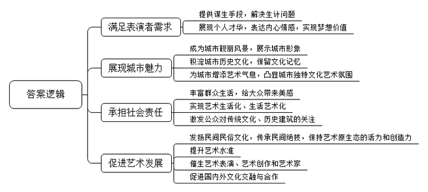
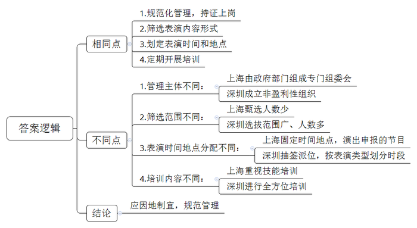
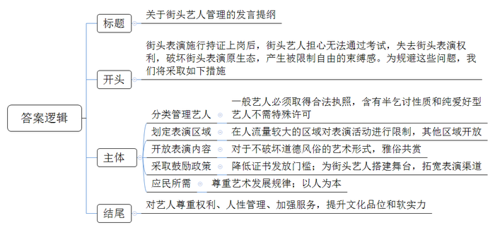
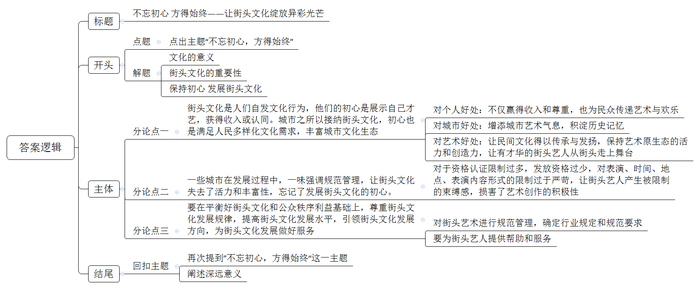

# 2015年吉林省公考《申论》题（甲级）

<!-- gwy:overview:start -->
> **吉林 · 2015 · 申论 · 甲级** ｜ 4 题 · 图片 4 处 · 答案随题折叠

导航：[题目](#题目) · [材料 1](#材料-1)
<!-- gwy:overview:end -->

> 候选采集稿。参考答案及解析来自粉笔页面，不代表官方答案或真实高分答卷；来源使用许可与原卷对应关系仍需人工核实。

## 给定材料

### 材料 1

关于街头艺人，网络上给出这样的界定：是在街头的公共场所为公众表演拿手绝活的艺人。包括一些音乐家、画家、行为艺术家等。他们的表演又被称为街头艺术。街头艺人是最能实现“艺术生活化、生活艺术化”的重要元素，是国际文化大都市的街头常态和靓丽风景，在巴黎、纽约、莫斯科等欧美城市随处可见与行人分享快乐和艺术的艺人。

“城市是艺术和文化的摇篮”，对于某些人来说，街头艺术是一种谋生手段，解决了他们的生计问题。对于不以此为生的人来说，街头是一个宽广的舞台，能给他们展现自己、追求梦想的机会，同时又能给大众带来美感。

作家冯骥才曾说过：“任何城市的文化都是一个地域人们审美积累的结果，是历史不断积累形成的，而不是某些人就能决定的。”一座理想的城市除了它的光鲜外表和富有活力的经济之外，更应体现出它独特的文化艺术氛围。

### 材料 2

在城市的大街小巷，人们总是能看到各种各样的街头艺人，他们表演的才艺各不相同，有唱歌、捏面人、拉二胡、跳街舞等，还有人在建筑工地外墙上涂鸦。

2013年，身为白领的贾凯辞去了工作，背着吉他，扛着音箱，站到了中心广场，开始了他第一次街头卖唱，挣了27块钱，来回打车花了五六十。“就图个爽。”贾凯说。这之后，他几乎完全靠当街头艺人为生，和很多街头艺人不同的是，贾凯不想回避自己是在卖唱，“唱歌获取报酬不就是卖唱吗？歌星开演唱会卖票是不是卖唱？卖唱是一个中性词。”内蒙古青年海俊坐在地铁过道的角落里弹着吉他，长发虚掩着半边脸颊，他腿上摆着乐谱，手里拨弄着琴弦，唱起了曾经流行一时的《流浪歌手的情人》，海俊高一那年不可救药地迷上了吉他。高二的时候，他蹬着自行车，天天在城里送纯净水，为自己挣了一把像样的电吉他。前年，海俊来到了北京，每天十几个小时泡在乐队跟专业吉他手学弹电吉他，后来就开始到东单、西单、王府井的地铁口里弹吉他卖唱。

“在地铁口唱歌不完全为了赚钱，主要是和别的工作相比，它自由，我喜欢唱什么就唱什么，到地铁口弹吉他，也是我学习音乐的一种方式，我想找个地方通过音乐表达我内心的想法。”“有一次，有一个女孩蹲在我旁边听了很久，我一口气给她弹了十来首歌。女孩子哭得很伤心，说是那天受了些挫折，听我弹琴给了她力量，帮助她找回了希望，她很感谢我，她硬要给我钱，我没有收，结果，第二天晚上她特意跑来送了我一个储钱罐。”

对于另一些街头艺人来说，热心人的怜悯也会带来尴尬。网名为“张一疯”的艺人接受过多年专业声乐训练，他希望像国外的流浪艺人一样，靠在街头唱歌为生，既为自己挣得一份收入，同时又能为城市增添艺术气息。

在“天涯论坛”上，“张一疯”发帖讲述了自己首次在地铁站唱歌卖艺的经历：一曲终了，两位50多岁的阿姨走到他面前，其中一人掏出20元钱放在他的包上，让他去买点吃的。“张一疯”说，那位阿姨“怜悯和施舍的目光”始终浮现在他眼前，深深地刺激着他。他调侃地表示，下次卖艺前要做个牌子，写上“拒绝施舍”。

### 材料 3

2015年1月，上海艺术家S和法国街头艺术家J在上海的一个拆迁废墟进行的涂鸦创作走红网络，引起许多网友围观和点赞。

涂鸦的地点位于上海康定路600弄，这是闹市区，周围高楼密布，弄堂口却堆着废旧的木材，里面是一大片拆迁遗留的废墟。在上海市静安区土地管理中心的公告中，这里是静安区103街坊地块，2009年获得批复动迁。尽管已经拆迁数年，但这里仍有居民未搬走。这是个典型的老式上海弄堂，S是土生土长的上海人，对于弄堂生活非常熟悉。J也意识到上海市民对老房子的留恋。

这些涂鸦作品就在废墟的墙上，约有十余幅。S在墙面上写下了“野火烧不尽，春风吹又生”，J就配图：一个女孩在“拆”字的包围下，试图钻进一个树洞。另一幅作品中，一个小女孩举着她画的老房子，他们有意识的借用这些残破的老房子入景。在一幅作品中，一个女孩怀里抱着一栋房子，脸颊部位正好是墙面的凹痕，看起来像是她的眼泪。因为画得精美，许多摄影爱好者来此取景，甚至有网友呼吁，为了涂鸦“留下这些建筑”。

两个人的态度在作品中展现出来，法国涂鸦艺术家Seth说“一个画家就应该承担社会责任”，这应该是对这一废墟涂鸦的行为动机的最好诠释。“他的风格比较写实，我是在写实的伤口上，撒一点忧伤的盐。”S评论两人的风格。

### 材料 4

人们对街头艺术的态度历来都是褒贬不一。

普通市民：“晚上在家休息经常被楼下高分贝的噪音吵得心烦”“车站本来就比较拥挤，歌手拖着大音响来回走，烦人而且不安全”。“贷款”“办证”“发票”等字样及手机号码等野广告也随处可见，有的人甚至将涂鸦挑衅似的涂抹在了宣传市容环境管理的文字上或公交站牌上，实在影响市容。不仅如此。一些人用虐待自己身体的残忍表演博取同情，这样残忍的表演对观众和演员都造成巨大的心理刺激。

公司白领：在欧洲，街头艺人比国内的要轻松得多。有一次，在巴塞罗那最大的教堂——圣家赎罪堂，一个女孩坐在教堂前的广场上拉大提琴，大提琴低沉的音色配合上宏大的教堂建筑，越来越多的人围上来，大家静静地聆听，连放钱币的时候都小心翼翼，生怕打扰了这宁静祥和的景致。那女孩可能只是个不入流的大提琴手，但在那样一种场景下你会觉得这一切真是棒极了，美极了！

剧作家：城市街头这个舞台，是催生艺术表演、艺术创作的一块肥沃的土壤。客观、全面地理解街头艺人和街头艺术表演的内涵和理念，这很重要。

社会学专家：街头卖艺是正常的社会现象，应当和乞丐区别看待。街头艺人也有可能成为艺术家，当年的北京天桥，许多街头艺人拥有高超的艺术水准。笑话大王“万人迷”、口技艺人“汤瞎子”、相声大师侯宝林等街头艺人，构成了北京城的“天桥记忆”。

人大代表：这些艺人的表演不仅给卖艺者一个创收乃至生存的机会，同时也能发扬民间民俗文化。正因为有这样的表演和盈利空间。许多民间绝技才不致失传，许多文化瑰宝才得以保存下去，现代艺术的精英化、剧场化使表演艺术缺乏原生态的活力和创造力。

政协委员：现在上海的硬件设施都很漂亮，但我有不少朋友来上海旅游时总是抱怨，除了看看外滩风景，逛逛南京路、新天地外，似乎没什么“兴奋点”，他们口中的“兴奋点”就是指丰富的艺术表演形式，特别是指流动在街头的艺术表演。

### 材料 5

去年国庆期间，来自南安的李小姐和朋友前往某景区游玩，经常遇到一些表演行为艺术的“铜人”或是穿着“米老鼠”服装的人主动拉人合影，之后却强行要求付费。

记者将问题反映给相关部门，派出所民警说，收费的纠纷属于价格纠纷，涉及到肢体冲突才会处理。城管大队的人说，对于“街头艺人”的定义在国内尚不明确，相关的法律条款也尚未健全，因此对于该行为的定性实属不易。工商部门说：并非实体店家，管不着。最后，记者将情况反映给景区管委会，办公室工作人员表示，管委会没有执法权，因此心有余而力不足。

记者发现，城管人员对街头流浪艺人还是比较客气的。上海某城管大队一位科长表示，街头艺人与普通的违章设摊经营不完全一样，在执法上会区别对待。我们执法时首先出示证件，然后讲道理进行劝阻，劝阻无效才进行驱赶或取缔。目前国家没有针对街头艺人具体的法律法规，在执法中主要依据是《上海市市容环境卫生管理条例》《上海市轨道交通管理条例》《中华人民共和国治安管理处罚法》中的相关条款。希望有关部门根据新情况制定具体可操作性的法规办法，对街头艺人进行有效的管理。

### 材料 6

2014年11月11日，为了更好的执法和管理街头艺人，上海演出行业协会经过近一年的筹划，在100名街头艺人中甄选出8名有资质的艺人颁发“上海街头艺人节目审核许可证”，这8名艺人在为期一个月的“试行阶段”，要按照“持有证书、规定地点、指定区域”的要求进行表演。

首批持证上岗的街头艺人所涉表演领域包括演奏、杂技、魔术、手工等，针对这项新举措，静安区的市容绿化局、公安分局、城管、市场监督管理局等相关部门也组建了专门的组委会，对没有资质的人员和违反规定的行为进行管理，这是街头艺人这个职业首度合法化，也是国内首次将街头艺人纳入城市管理的尝试。

“他们还是花了心思的，确定的这8个人，有些有国外表演经验，有些具备民间艺术的传统背景，而且这些表演不制造垃圾和噪音，表演幅度和占用空间比较小。”上海人大代表、剧作家罗先生分析，“另外还要考虑和上海的城市品格是不是匹配，比如耍猴这种表演就肯定不行。”

人选好后，接下来的还有培训，既然持证了，就要注意形象，国外的街头艺人保罗也被请来给他们介绍经验，讲如何同观众互动，还提前“演练”了一周，上海市演出行业协会某会长认为，“我们要给街头艺术一个职业指导，规范他们的执业行为。”

这8位街头艺人是以“定时定点定式”的方式工作的，他们每天工作两小时，在相对固定的区域——以嘉里中心广场和安义路常德路口为两大区域。并且，他们演出的节目必须与申报时相符，也就是说申报前来拉琴的就只能拉琴，现场不能“改弦更张”。而且，演出行业协会还与他们一起订立了“不定价、不转让摊位、不销售、不乞讨、不扰民”等14项持证上岗的职业约定。

“每个城市对于街头艺人的管理都不一样。”该会长表示，“因地制宜，合适就好。”她认为，上海要打造国际文化大都市，街头艺术是重要组成部分，但要严格规范。她告诉记者：“我们努力为真正有演艺水平的艺人提供一个生存环境，但他们生存的关键在于两个：一是才艺，二是行人。”

### 材料 7

2015年4月1日开始，深圳中心书城广场的街头艺人正式抽签派位到固定区域进行表演，深圳成为继上海之后又一个尝试对街头艺人进行规范管理的大陆城市。

去年深圳福田区委宣传部（文体局）、福田区公共文体中心引导成立福田区街头演艺联盟，该联盟为非营利性组织，长期向街头艺人、愿意为街头演艺提供技术和场地支持的组织和个人开放，也向街头艺人提出自律和规范要求。

首批通过审核参与抽签派号的主要是绘画、书法、面塑、乐队、歌手等共62组街头艺人，那些打着文化、艺术幌子在广场摆摊，例如编织花篮、艺术签名、陶画描绘，还有表演恶俗歌曲的，都不属于街头演艺联盟和街道办认可的街头艺人范畴。62组街头艺人将轮流到30个固定的视觉艺术、创意艺术表演位置以及6个声乐表演位置分配场地表演。

从4月份开始，每月25日将集中组织街头艺人对次月场地分配抽签派号，第一轮确定抽签顺序，第二轮抽出场地位置，然后由工作人员根据位置编号制定出一个月的《场地使用轮流表》。当日抽签派号没到场的，空缺位置不予递补；当月连续5次或累计10次未到的，取消下个月的派号资格；当月新申请进入的街头艺人，参与次月的抽签派号。

街头演艺的活动时间也有相应规定：在工作日，非声乐类表演时间为17：00-22:00，声乐类为18:00-22:00；在周末与法定节假日，非声乐类表演时间为09:00-22:00，声乐类为11:00-22:00。遇到学生高考、重大会议、重要赛事等特殊情况，应遵守管理部门临时规定；中心书城广场举办政务活动、大型公益活动期间，街头艺术表演和健身广场舞均应停止，受举办方邀请参加活动的除外。

此次深圳不仅将街头艺人派位到固定区域表演，还将对其进行形象、演出水准、公共安全服务意识方面的培训，3个月后为通过审核的街头艺人正式派发证件，让其持证上岗。

### 材料 8

天河路商圈历来是流浪歌手分布最为密集的一带，每当傍晚六点半左右，从岗顶行至广州购书中心，路边将近20处街头艺人在纵情高歌，吸引不少路人驻足。

“如果在广州也实行持证上岗的话，对于我们这些街头表演者来说影响肯定不小。”将街边艺术当做主职的顾先生当被问及对街头艺人歌者执证上岗的看法时，表露了自己的担忧：“对于我们街头歌者而言，我们唱与不唱，在哪儿唱和观众捧不捧场其实都是自愿的行为，如果非要去办执照圈地点来唱，无疑是将我们束缚在一个小圈子中，在我的理解中，艺术应该是自由的，这样的做法对于我们和那些愿意来欣赏的观众而言，都是一种束缚。”

“我们都没有经过系统的训练，可能凭借的是自己的喜好和兴趣，如果需要办资格证才能开唱，我担心因为无法考过而被迫挪地。”在天河路表演的袖珍夫妻说出了他们的担忧。

“现在城管对于我们这些街头表演者管得还是比较宽松的，只要没被投诉是不会有人来驱赶我们的，感觉这样挺好的，没证怎么办？”某街舞青年说。

有人说，“持证上岗”除了会破坏街头表演的原生态外，还会剥夺大部分街头艺人的表演权利。事实上，街头艺术本是“草根艺术”，表演水平无所谓高低，阳春白雪也好，下里巴人也罢，只要能让一个城市更有活力，更具文化气息，大家都乐观其成，何况对公民权利而言，“法无明令禁止即可为”，只要不违反法律法规，每个人都有权在街头这种公共场所展示才华。

有人说，每一种文化大都会经历从地下浮出水面，从边缘走向核心，从街头走向舞台的发展过程。在融合流动的地球村里，每个人都是一个国家、一个民族最生动的“文化名片”。你传达什么，对方就感受什么，艺术形式多种多样，但无论雅俗，都有启迪思想、温润心灵、陶冶性情之功效。因此，对文化艺术形式的规范与管理，也必须遵循艺术的发展规律，必须以人为本，最终实现应民所需的根本目的。正所谓“不忘初心，方得始终”。只有这样，才能真正实现“文以载道，以文化人”的政治理想，提高城市的文化品位，提高中国文化软实力，扩大中国文化的国际影响力，看似工程浩大，却始于足下。

### 材料 9

美国街头艺人表演性活动多种多样，形式不拘一格，雅俗共赏，给游人增加了不少乐趣。美国市民对于街头艺人，甚至是含有半乞讨性质的表演都抱有极大的友好和欢迎。不少成功的艺术家都是从街头艺人白手起家最终一举成名的。

纽约要求街头艺人必须取得合法执照，在规定的场所从事卖艺活动。但如果含有半乞讨性质的表演（在不影响正常公共秩序的基础上）则不需要特殊许可。对于不收取捐赠、纯爱好型的街头艺人则采取完全开放的态度，纽约市禁止在离纪念碑或喷泉50英尺的距离内从事商业活动，包括卖艺活动。纽约的其他公园，也大幅削减了街头艺人的经营摊位。纽约市政府表示，之所以要采取这一措施，是因为街头艺术家在公园人行道占据大量空间，造成交通堵塞。

英国街头艺人要考执照，才能在街头、地铁站、广场等地表演，街头艺人执照的获取相对宽松，但有些地方会实施年度考核，不过关者会吊销执照。

澳大利亚对街头艺人实施许可证制度，不同的城市对街头卖艺的鼓励程度不同，发放的许可证数量有很大差异。街头艺人拥有良好的城市公共氛围，并且每年的澳洲达人秀以及其他综艺节目中都有很多街头艺人从街头走上荧幕。

## 题目

### 第 1 题

**街头艺术的产生不是偶然的，而是一种文化传统和历史的延续，根据给定资料1\-4，概括街头艺术积极的社会功能。（20分）**

关联材料：材料 1、材料 2、材料 3、材料 4

作答要求：

要求：内容全面，观点明确，条理清晰，语言准确，不超过250字。

第 1 题 · 答案与解析

**参考答案（粉笔题库参考内容）**

一、满足表演者需求。提供谋生手段，解决生计问题；展现个人才华，表达内心情感，实现梦想价值。

二、展现城市魅力。成为城市靓丽风景，展示城市形象；积淀城市历史文化，保留文化记忆，为城市增添艺术气息，凸显城市独特文化艺术氛围。

三、承担社会责任。丰富群众生活，给大众带来美感，实现艺术生活化、生活艺术化；激发公众对传统文化、历史建筑的关注。

四、促进艺术发展。发扬民间民俗文化，传承民间绝技，保持艺术原生态的活力和创造力；提升艺术水准。催生艺术表演、艺术创作和艺术家；促进国内外文化交融与合作。

**解析**

**参考答案说明：**本参考答案从“满足表演者需求”“展现城市魅力”“承担社会责任”“促进艺术发展”这四个方面对街头艺术积极的社会功能进行了分条撰写，各条答案要点之间在内容上是并列关系，没有交叉。

**考点**：影响类

**来源**：2015年吉林省公考《申论》题（甲级）

### 第 2 题

**给定资料5\-7介绍了上海和深圳两市新的街头艺人管理办法，请对两市的做法进行分析比较。（20分）**

关联材料：材料 1、材料 2、材料 3、材料 4、材料 5、材料 6、材料 7、材料 8、材料 9

作答要求：

要求：

（1）根据给定资料作答；

（2）观点明确，结论可信，分析合理，不超过200字。

第 2 题 · 答案与解析

**参考答案（粉笔题库参考内容）**

相同点：1.规范化管理，持证上岗。2.筛选表演内容形式。3.划定表演时间和地点。4.定期开展培训。

不同点：1.管理主体不同：上海由政府部门组成专门组委会；深圳成立非盈利性组织。2.筛选范围不同：上海甄选人数少；深圳选拔范围广、人数多。3.表演时间地点分配不同：上海固定时间地点，演出申报的节目；深圳抽签派位，按表演类型划分时段。4.培训内容不同：上海重视技能培训；深圳进行全方位培训。

因此应因地制宜，规范管理。

**解析**

**参考答案说明：**针对“上海和深圳两市新的街头艺人管理办法”，本参考答案从相同点和不同点两方面进行对比。从“规范化管理”“筛选表演内容形式”“划定表演时间和地点”“定期开展培训”等角度入手，对比分析了相同点；接着从“管理主体”“筛选范围”“表演时间地点分配”“培训内容”等角度入手，对比了不同点；最后给出了“结论”。

**考点**：对比分析类

**来源**：2015年吉林省公考《申论》题（甲级）

### 第 3 题

**某市政府拟召开街头艺人管理问题座谈会。假如你是与会人员，请你就给定资料8中部分无证艺人的担忧写一份发言提纲，谈谈在制定管理办法时如何规避这些问题。（20分）**

关联材料：材料 8、材料 9

作答要求：

要求：内容合理，办法可行，有针对性，不超过300字。

第 3 题 · 答案与解析

**参考答案（粉笔题库参考内容）**

关于街头艺人管理的发言提纲

街头表演施行持证上岗后，街头艺人担心无法通过考试，失去街头表演权利，破坏街头表演原生态，产生被限制自由的束缚感。为规避这些问题，我们将采取如下措施：

一、分类管理艺人。一般艺人必须取得合法执照，含有半乞讨性质和纯爱好型艺人不需特殊许可。二、划定表演区域。在人流量较大的区域对表演活动进行限制，其他区域开放。三、开放表演内容。对于不破坏道德风俗的艺术形式，雅俗共赏。四、采取鼓励政策。降低证书发放门槛；为街头艺人搭建舞台，拓宽表演渠道。五、应民所需。尊重艺术发展规律；以人为本。

对艺人尊重权利、人性管理、加强服务，提升文化品位和软实力。

**解析**

**参考答案说明：**（1）本题虽然不要求写格式，但为了保险起见，建议加上标题。（2）正文部分，一方面从内容来看，围绕着“街头艺人管理”这一主题，本参考答案的开头先写到了“无证艺人的具体担忧”；主体部分从“分类管理艺人”“划定表演区域”“开放表演内容”“采取鼓励政策”“应民所需”这五个方面给出了具体的对策。另一方面，形式上，本参考答案做到了分段、分条撰写，整体上条理较为清晰。（3）语言表达上，本参考答案能够结合方案类公文的特点，做到简洁、流畅。

**考点**：方案类

**来源**：2015年吉林省公考《申论》题（甲级）

### 第 4 题

**从给定资料出发，结合实际，以“不忘初心 方得始终”为题，写一篇观点明确、视野开阔、认识深刻的议论文。（40分）**

关联材料：材料 1、材料 2、材料 3、材料 4、材料 5、材料 6、材料 7、材料 8、材料 9

作答要求：

要求：

（1）从给定资料出发，但不拘泥于给定资料；

（2）内容充实，论证严谨，语言准确，800-1000字。

第 4 题 · 答案与解析

**参考答案（粉笔题库参考内容）**

**不忘初心，方得始终**

**——让街头文化绽放异彩光芒**

文化是一个民族的精神家园，也是一个民族的生命血脉，更是一个民族发展的不竭动力。街头文化的发展和繁荣有利于增强中国文化软实力。而**只有保持一颗初心，尊重艺术、以人为本、应民所需，达到管理与传承的统一，才能真正让街头艺术成为最生动的文化名片，方能占据世界文化的一席之地。**

**街头文化是人们自发文化行为，他们的初心是展示自己才艺，获得收入或认同。城市之所以接纳街头文化，初心也是满足人民多样化文化需求，丰富城市文化生态。**是街头文化的魅力让多少人怀揣梦想，在街头展示才艺、表达心声，将青春和热情投入到艺术表演中，不仅为自己赢得收入与尊重，也为民众传递艺术与欢乐；是街头文化的盛行为城市街头增添了一道靓丽风景线，增添了艺术气息，积淀了历史记忆；是街头文化的繁荣让民间文化得以传承与发扬，保持艺术原生态的活力和创造力，让有才华的街头艺人从街头走上舞台。

**一些城市在发展过程中，一味强调规范管理，让街头文化失去了活力和丰富性，忘记了发展街头文化的初心。**当前，一些城市对于资格认证限制过多，发放资格过少，对表演、时间、地点、表演内容形式的限制过于严苛，让街头艺人产生被限制的束缚感，损害了艺术创作的积极性。这种做法便是失去了管理的初心，违背了以人为本的目标。

街头文化要更好发展，离不开规范管理。但管理的目的，是为了街头文化更好、更有序的发展。**要在平衡好街头文化和公众秩序利益基础上，尊重街头文化发展规律，提高街头文化发展水平，引领街头文化发展方向，为街头文化发展做好服务**。政府应以民为本，以政府为主导，成立专门管理部门，对街头艺术进行规范管理，确定行业规定和规范要求，但制定规则时也要融入人性。今日的“下里巴人”也许明天就会成为“阳春白雪”，政府对街头艺术灵活管理，才能将城市真正打造为“艺术和文化的摇篮”。不仅要有包容合理的制度规范，更要为街头艺人提供帮助和服务。一些政府设立了街头艺人基金，为艺人展开专业知识技能培训，邀请其他地区或国家的艺人，创造交流机会。只有保持了尊重艺术、应民所需的初心，才能真正让管理发挥实效，促进、保护街头文化的发展。

诗经有云：靡不有初，鲜克有终。文化发展梦想的实现，是一条坎坷曲折的蜿蜒之路，我们只有保持初心，不断努力，在这条路上坚定前行，才能到达成功的彼岸，让街头文化绽放异彩光芒，收获中国文化提升的辉煌成就。

**文章分析**

**不忘初心，方得始终**

**——让街头文化绽放异彩光芒**

【**标题的优点：**首先，它严格按照题目要求以“不忘初心，方得始终”为主标题。其次，补充的副标题凸显了“街头文化”这一主题词，使文章写作主题更明确。】

（1）文化是一个民族的精神家园，也是一个民族的生命血脉，更是一个民族发展的不竭动力。（2）街头文化的发展和繁荣有利于增强中国文化软实力。而（3）**只有保持一颗初心，尊重艺术、以人为本、应民所需，达到管理与传承的统一，才能真正让街头艺术成为最生动的文化名片，方能占据世界文化的一席之地。**

【**开头的优点：**★内容方面。范文的开头是紧扣“不忘初心，方得始终”这一标题展开的。首先，开头前三句点出主题，做到了主题明确。其次，对“街头文化”这一话题进行了分析阐述，指出了“街头文化”的意义。（1）介绍了“文化”的重要意义；（2）介绍了“街头文化发展”的意义；（3）介绍了“发展街头文化”的对策。注意以上3个方面的阐述在逻辑上有先后顺序：先写“文化的意义”，再写“街头文化发展的意义”，最后写“街头文化发展的对策”方面。★文字表达方面：使用了“是……也是……更是……”“只有……才能……”等关联词，使语言表达有逻辑性。】

**街头文化是人们自发文化行为，他们的初心是展示自己才艺，获得收入或认同。城市之所以接纳街头文化，初心也是满足人民多样化文化需求，丰富城市文化生态。**（1）是街头文化的魅力让多少人怀揣梦想，在街头展示才艺、表达心声，将青春和热情投入到艺术表演中，不仅为自己赢得收入与尊重，也为民众传递艺术与欢乐；（2）是街头文化的盛行为城市街头增添了一道靓丽风景线，增添了艺术气息，积淀了历史记忆；（3）是街头文化的繁荣让民间文化得以传承与发扬，保持艺术原生态的活力和创造力，让有才华的街头艺人从街头走上舞台。

【**论述段1的优点：**★观点句：范文的观点句是紧扣文章的主要话题“街头文化”提出的。形式上，它在段首处直接写出，位置突出，容易发现。内容上，关键词突出，内容要点明确，可以明显看出它是从“街头文化被接受的原因”入手，指出了“街头文化的意义”。★论述内容：（1）介绍了“街头文化对个人的意义”；（2）介绍了“街头文化对城市的意义”；（3）介绍了“街头文化对民间文化的意义”。以上几个方面的内容都是紧扣“街头文化是人们自发文化行为，他们的初心是展示自己才艺，获得收入或认同。城市之所以接纳街头文化，初心也是满足人民多样化文化需求，丰富城市文化生态”这个观点句进行分析论述的，论述的针对性强，内容层次丰富。在论述方法上采用了排比句的形式，是文章富有文采。】

**一些城市在发展过程中，一味强调规范管理，让街头文化失去了活力和丰富性，忘记了发展街头文化的初心。**当前，（1）一些城市对于资格认证限制过多，发放资格过少，对表演、时间、地点、表演内容形式的限制过于严苛，让街头艺人产生被限制的束缚感，损害了艺术创作的积极性。（2）这种做法便是失去了管理的初心，违背了以人为本的目标。

【**论述段2的优点：**★观点句：范文的观点句是紧扣文章的主要话题“街头文化”提出的。形式上，它在段首处直接写出，位置突出，容易发现。内容上，关键词突出，内容要点明确，可以明显看出它是从“城市管理的问题”入手，指出了“街头文化的发展现状”。★论述内容：（1）介绍了“城市管理对街头文化的限制”；（2）总结了“城市管理”的错误之处。以上两个方面的内容都是紧扣“一些城市在发展过程中，一味强调规范管理，让街头文化失去了活力和丰富性，忘记了发展街头文化的初心”这个观点句进行分析论述的，论述的针对性强，内容层次丰富。在论述方法采用了长短句相结合的写法，增强了文章的节奏感。】

街头文化要更好发展，离不开规范管理。但管理的目的，是为了街头文化更好、更有序的发展。**要在平衡好街头文化和公众秩序利益基础上，尊重街头文化发展规律，提高街头文化发展水平，引领街头文化发展方向，为街头文化发展做好服务**。（1）政府应以民为本，以政府为主导，成立专门管理部门，对街头艺术进行规范管理，确定行业规定和规范要求，但制定规则时也要融入人性。今日的“下里巴人”也许明天就会成为“阳春白雪”，政府对街头艺术灵活管理，才能将城市真正打造为“艺术和文化的摇篮”。（2）不仅要有包容合理的制度规范，更要为街头艺人提供帮助和服务。一些政府设立了街头艺人基金,为艺人展开专业知识技能培训,邀请其他地区或国家的艺人，创造交流机会。（3）只有保持了尊重艺术、应民所需的初心，才能真正让管理发挥实效，促进、保护街头文化的发展。

【**论述段3的优点：**★观点句：范文的观点句是紧扣文章的主要话题“街头文化”提出的。形式上，它在段首处直接写出，位置突出，容易发现。内容上，关键词突出，内容要点明确，可以明显看出它是从“街头文化和公众秩序的平衡”入手，指出了“管理街头文化的对策”。★论述内容：（1）介绍了“政府要制定合理的制度”；（2）介绍了“政府要为街头艺人提供的帮助和服务”；（3）重申了“保持初心对管理的重要性”。以上几个方面的内容都是紧扣“要在平衡好街头文化和公众秩序利益基础上，尊重街头文化发展规律，提高街头文化发展水平，引领街头文化发展方向，为街头文化发展做好服务”这个观点句进行分析论述的，论述的针对性强，内容层次丰富。在论述方法和论据的选取上做到了讲道理和举例子相结合，做到了论证的丰富多样。】

【**论述段之间的关系**：★内容的内在逻辑：范文的论述段之间是依照““是什么——为什么——怎么办”的逻辑结构展开的。论述段1先写了“街头文化的意义”，论述段2接着写了“对街头文化的管理存在的问题”，论述段3写了“政府管理街头文化的对策”。★段与段的外在衔接：论述段3段首处的过渡句“街头文化要更好发展，离不开规范管理。但管理的目的，是为了街头文化更好、更有序的发展”，起到了承接论述段2、引出了论述段3的作用。】

诗经有云：靡不有初，鲜克有终。文化发展梦想的实现，是一条坎坷曲折的蜿蜒之路，我们只有保持初心，不断努力，在这条路上坚定前行，才能到达成功的彼岸，让街头文化绽放异彩光芒，收获中国文化提升的辉煌成就。

【**结尾的优点**：范文的结尾回扣了“不忘初心，方得始终”这一主题。（1）再次提到“让街头文化绽放异彩光芒”这一主要话题；（2）阐述了深远意义。】

**解析状态：unknown（来源未提供）**

**考点**：文章写作题

**来源**：2015年吉林省公考《申论》题（甲级）

