# 2015年吉林省公务员录用考试《行测》题（4月乙级）

<!-- gwy:overview:start -->
> **吉林 · 2015 · 行测 · 乙级** ｜ 100 题 · 图片 32 处 · 答案随题折叠

| 题型模块 | 题量 | 题号 |
| --- | ---: | ---: |
| 常识判断 | 20 | 1–20 |
| 言语表达与理解 | 30 | 21–50 |
| 判断推理 | 30 | 51–80 |
| 数量关系 | 10 | 81–90 |
| 资料分析 | 10 | 91–100 |
| **合计** | **100** | |

导航：[题型与作答说明](#题型与作答说明) · [题目](#题目) · [材料 1](#材料-1)
<!-- gwy:overview:end -->

> 候选采集稿。参考答案及解析来自粉笔页面，不代表官方答案或真实高分答卷；来源使用许可与原卷对应关系仍需人工核实。

## 题型与作答说明

常识判断

（20题）

常识判断部分主要考查考生的基本常识和基本经验。请根据题目要求，在四个选项中找出一个正确答案。

言语表达与理解

（30题）

本部分包括两种类型的试题： 一、选词填空：共5题。请根据题意，从所给的词语中选出最恰当的词语填入空格内，从而使句子的意思表达得最准确。 二、阅读理解：共25题，请根据题目要求，在四个选项中选出一个最恰当的答案。

判断推理

（30题）

本部分包括五种类型的试题： 一、图形推理：共5题。请按每道题的答题要求作答。 二、定义判断：共5题。每道题先给出定义，然后列出四种情况，要求你严格依据题目要求作答。注意：假设这个定义是正确的，不容置疑的。 三、类比推理：共5题。每道题先给出一组相关的词，要求你在备选答案中找出一组与之在逻辑关系上最为贴近、相似或匹配的词。 四、事件排序：共5题。每道题给出五个事件，每个事件是以简短语句表述的，接着给出事件的四种假定发生顺序，请你选择其中最符合逻辑的一种排列顺序。 五、逻辑推理：共10题。每道题给出一段陈述，这段陈述被假设是正确的，不容置疑的。要求你根据这段陈述选择一个答案。注意：正确的答案应与所给的陈述相符合，不需要任何附加说明，即可从陈述中直接推出。

数量关系

（10题）

本部分包括两种类型的试题： 一、数字推理：共5题。给你一组数字或有关数字关系的表述，要求你仔细观察其中的规律，然后从四个选项中选出你认为最合理的一项来填补空缺项或解决问题。 二、数学运算：共5题。请你充分利用所给条件，寻找解决问题的捷径。

资料分析

（10题）

针对下列给定资料回答问题，共10题。你应根据资料提供的信息进行分析、比较、计算、处理。

## 题目

### 第 1 题

习近平总书记在参加2015年全国两会吉林代表团审议时强调，东北老工业基地振兴发展，不能再唱工业“一柱擎天、结构单一”的“二人转”，要做好“加减乘除”。下列发展措施最接近“乘法”的是：

A. 实现创新驱动，大力发展科技创新型产业

B. 淘汰落后产能，关闭对环境污染大的产业

C. 调整投资方向，增加对资源依赖少的产业

D. 切实简政放权，有效服务各类中小型产业

第 1 题 · 答案与解析

**参考答案（粉笔题库参考内容）**

A

**解析**

2015年3月9日，习近平总书记在参加2015年全国两会吉林代表团审议时强调，东北等老工业基地振兴发展，不能再唱工业“一柱擎天，结构单一”的“二人转”，要做好“加减乘除”。加法——投资、需求、创新；减法——淘汰落后产能；乘法——创新驱动；除法——市场化程度。可知，四个选项中，A项最接近“乘法”，B项最接近“减法”，C项最接近“加法”，D项最接近“除法”。

故正确答案为A。

**考点**：其他

**来源**：2015年吉林省公务员录用考试《行测》题（4月乙级）第1题

### 第 2 题

“一带一路”是中国全新的对外开放战略。下列关于“一带一路”说法错误的是：

A. 可纳入的国家和地区范围是开放的

B. 吉林省是“一带一路”圈定的重点省份之一

C. 指“丝绸之路经济带”和“21世纪海上丝绸之路”

D. 是区域经济合作发展的实体

第 2 题 · 答案与解析

**参考答案（粉笔题库参考内容）**

D

**解析**

本题考查新思想。

D项说法错误，“一带一路”是习近平主席在2013年9月和10月出访中亚和东南亚国家期间先后提出的，“一带一路”是“丝绸之路经济带”和“21世纪海上丝绸之路”的简称。它是一项有利于促进沿线各国经济繁荣与区域经济合作的重大倡议，并非区域经济合作发展的实体。A、B、C项说法均正确。

本题为选非题，故正确答案为D。

**考点**：其他建设

**来源**：2015年吉林省公务员录用考试《行测》题（4月乙级）第2题

### 第 3 题

孟子曰：“夫物之不齐，物之情也。或相倍蓰，或相什百，或相千万。子比而同之，是乱天下也。”其哲学寓意是：

A. 事物之间或事物内部普遍存在矛盾

B. 矛盾双方在一定条件下可相互转化

C. 内部矛盾总是事物发展的根本动力

D. 矛盾着的事物及每个侧面各有特点

第 3 题 · 答案与解析

**参考答案（粉笔题库参考内容）**

D

**解析**

题干语句出自《孟子·滕文公上》，大意是天下万物各不相同，这是客观情形。该句强调了事物的差异性，从哲学角度来说，体现的是矛盾特殊性原理，即矛盾着的事物及其每一个侧面各有其特点。

故正确答案为D。

**考点**：唯物辩证法

**来源**：2015年吉林省公务员录用考试《行测》题（4月乙级）第3题

### 第 4 题

“但愿苍生俱温饱，不辞辛苦出山林”“些小吾曹州县吏，一枝一叶总关情”“但得众生皆温饱，不辞羸病卧残阳”，这些名言体现了古人的为官之道，中国共产党的群众观点中与之相近的是：

A. 一切依靠人民群众

B. 向人民群众负责

C. 一切为了人民群众

D. 向人民群众学习

第 4 题 · 答案与解析

**参考答案（粉笔题库参考内容）**

C

**解析**

“但愿苍生俱饱暖，不辞辛苦出山林”出自于谦的咏物诗《咏煤炭》，该句袒露作者为民效力的愿望；“些小吾曹州县吏，一枝一叶总关情”出自郑板桥的《潍县署中画竹呈年伯包大中丞括》，该句抒发作者身为父母官，心里牵挂百姓疾苦的感情；“但得众生皆温饱，不辞羸病卧残阳”出自李纲的《病牛》，该句托物言志，借无人怜惜而不辞羸病、志在众生的老牛抒发作者一心为民的志向。这三句话都体现了一心为民的为官之道，与中国共产党一切为了人民群众的群众观点相近。

故正确答案为C。

**考点**：唯物史观

**来源**：2015年吉林省公务员录用考试《行测》题（4月乙级）第4题

### 第 5 题

下列关于环境治理的说法，错误的是：

A. 某造纸厂无证排污，被责令停止却拒不执行，公安机关可对企业主管处以拘留

B. 某工厂属重点排污单位，没如实公开环境信息，县政府环保部门应责令公开

C. 某高校未提交迁建项目环评文件而擅自开工建设，环保监管部门可责令停止

D. 某农药生产企业生产国家禁止生产的农药，主管人员须承担一定的刑事责任

第 5 题 · 答案与解析

**参考答案（粉笔题库参考内容）**

D

**解析**

《环境保护法》第六十三条规定：“企业事业单位和其他生产经营者有下列行为之一，尚不构成犯罪的，除依照有关法律法规规定予以处罚外，由县级以上人民政府环境保护主管部门或者其他有关部门将案件移送公安机关，对其直接负责的主管人员和其他直接责任人员，处十日以上十五日以下拘留；情节较轻的，处五日以上十日以下拘留：……（四）生产、使用国家明令禁止生产、使用的农药，被责令改正，拒不改正的。”由此可知，D项中该农药生产企业的主管人员需承担一定的刑事责任说法有误。A、B、C项的叙述均符合环境治理的相关法律法规。

本题为选非题，故正确答案为D。

**考点**：其他法律法规

**来源**：2015年吉林省公务员录用考试《行测》题（4月乙级）第5题

### 第 6 题

在思想政治理论课上，同学们在开展关于“宪法效力”的热烈讨论。下列学生的观点错误的是：

A. 甲：宪法的效力覆盖国家所有领域

B. 乙：宪法修正案与宪法具有同等效力

C. 丙：宪法不适用于定居国外的中国公民

D. 丁：在一定条件下外国人可享受某些基本权利

第 6 题 · 答案与解析

**参考答案（粉笔题库参考内容）**

C

**解析**

A项正确，《宪法》在序言中规定：“本宪法以法律的形式确认了中国各族人民奋斗的成果，规定了国家的根本制度和根本任务，是国家的根本法，具有最高的法律效力。全国各族人民、一切国家机关和武装力量、各政党和各社会团体、各企业事业组织，都必须以宪法为根本的活动准则，并且负有维护宪法尊严、保证宪法实施的职责。”

B项正确，宪法修正案是经全国人民代表大会表决，对宪法的部分内容进行修改，与宪法具有同等效力。

C项错误，宪法效力是指宪法作为法律规范所具有的约束力与强制性。我国的宪法适用于所有中国公民。《宪法》第三十三条规定：“凡具有中华人民共和国国籍的人都是中华人民共和国公民。中华人民共和国公民在法律面前一律平等。国家尊重和保障人权。任何公民享有宪法和法律规定的权利，同时必须履行宪法和法律规定的义务。”定居海外的中国公民（即华侨）也受我国宪法的保护。

D项正确，《宪法》第三十二条规定：“中华人民共和国保护在中国境内的外国人的合法权利和利益，在中国境内的外国人必须遵守中华人民共和国的法律。中华人民共和国对于因为政治原因要求避难的外国人，可以给予受庇护的权利。”

本题为选非题，故正确答案为C。

**考点**：宪法

**来源**：2015年吉林省公务员录用考试《行测》题（4月乙级）第6题

### 第 7 题

农民说，幸福就是庄稼收成好，收入增加；职业经理人认为，最幸福的事情就是把公司做成一个世界品牌；教师认为，培养出优秀学生就是最幸福的事。可见，不同的人对幸福的诠释不同，这说明：

A. 价值判断依据事实，具有真理性

B. 价值判断因时而异，具有历史性

C. 价值判断因人而异，具有主观性

D. 价值判断没有规律，具有盲目性

第 7 题 · 答案与解析

**参考答案（粉笔题库参考内容）**

C

**解析**

价值判断是人们对事物能否满足主体需要以及满足程度所作出的判断。因为价值判断是对事物属性与人的需要关系作出的判断，因此，价值判断既具有客观性又具有主观性。题干中，不同职业的人，对幸福有着不同的诠释，体现的正是价值判断的主观性。C项分析正确，A、B、D三项表述不符合题意。

故正确答案为C。

**考点**：认识论

**来源**：2015年吉林省公务员录用考试《行测》题（4月乙级）第7题

### 第 8 题

下列活动中所需的货币与其执行的职能对应错误的是：

A. 商店里出售的T恤衫标价为90元——价值尺度

B. 农民用卖粮的5000元钱购买种子——流通手段

C. 雇主每月发给保姆的3000元工资——支付手段

D. 承租人交给出租人的8000元租金——贮藏手段

第 8 题 · 答案与解析

**参考答案（粉笔题库参考内容）**

D

**解析**

D项对应错误，货币的贮藏手段是指货币退出流通领域作为社会财富的一般代表被保存起来的职能；被用来清偿债务或支付赋税、租金、工资等的货币，执行的是支付手段的职能。因此，D项中承租人交给出租人的租金，是货币在执行支付手段的职能，而非贮藏手段。A、B、C项对应均正确。

本题为选非题，故正确答案为D。

**考点**：市场经济

**来源**：2015年吉林省公务员录用考试《行测》题（4月乙级）第8题

### 第 9 题

下列诗句中描述天气而非气候的是：

A. 清明时节雨纷纷，路上行人欲断魂

B. 忽如一夜春风来，千树万树梨花开

C. 黄梅时节家家雨，青草池塘处处蛙

D. 人间四月芳菲尽，山寺桃花始盛开

第 9 题 · 答案与解析

**参考答案（粉笔题库参考内容）**

B

**解析**

天气是指一个地区较短时间的大气状况；而气候则是一个地区多年的平均天气状况及其变化特征。B项描写的是塞北冬天突降大雪之后的景象，是对下雪这一天气状况的描述。A项“清明时节雨纷纷”、C项“黄梅时节家家雨”、D项“人间四月芳菲尽”都是描写多年形成的、具有规律性、稳定性的气候特征。

故正确答案为B。

**考点**：自然地理

**来源**：2015年吉林省公务员录用考试《行测》题（4月乙级）第9题

### 第 10 题

下列情形中，一定不会发生的是：

A. 东汉时张衡利用自制地动仪测定地震方位

B. 司马迁晚年将汉昭帝主要事迹写进《史记》

C. 两晋时人们用“记里鼓车”计算道路里程

D. 隋炀帝时期一些读书人开始参加科举考试

第 10 题 · 答案与解析

**参考答案（粉笔题库参考内容）**

B

**解析**

B项符合题意，司马迁的《史记》记载了上至上古传说中的黄帝时代，下至汉武帝太初四年间共3000多年的历史，而汉昭帝是汉武帝之子，故《史记》没有载入汉昭帝的事迹。东汉时期天文学家张衡发明了地动仪，A项情形可能发生；“记里鼓车”是我国古代用于计算道路里程的车，发明于西汉时期，C项情形可能发生；隋炀帝时我国科举考试正式形成，D项情形可能发生。

本题为选非题，故正确答案为B。

**考点**：中国历史

**来源**：2015年吉林省公务员录用考试《行测》题（4月乙级）第10题

### 第 11 题

经考古工作者发掘考证，礼制很早就已经出现了。《说文解字·示部》云：“礼：履也……从示从豊”，又云：“示：天垂象，见吉凶，所以示人也。”《甲骨文字集释》云：“事神之器则为豊。”由此可以推断，礼的原义是：

A. 分等别贵贱

B. 谦卑爱臣民

C. 处世慎言行

D. 敬神以祈福

第 11 题 · 答案与解析

**参考答案（粉笔题库参考内容）**

D

**解析**

《说文解字》这部上古文献记载了我国古代社会生活各领域的资料，其中“示”部字几乎都与祭祀有关。“示：天垂象，见吉凶，所以示人也”表示上天神灵出现了某种向人们垂示祸福吉凶的征兆，是神祗显灵的行为。《说文解字·示部》中对“礼”的解释为“履也，所以事神致福也。从示从豊，豊亦声。”再结合“事神之器则为豊”，可以判断，“礼”的原义指向神祈求福祉的一种仪式。

故正确答案为D。

**考点**：文学常识

**来源**：2015年吉林省公务员录用考试《行测》题（4月乙级）第11题

### 第 12 题

古人常依据自己的名取字，所取的字多与名含义相同或属同义联想，但也有的字与名反义相对。下列属于字与名反义相对的一项是：

A. 班固，字孟坚；杜甫，字子美

B. 关羽，字云长；贾岛，字浪仙

C. 韩愈，字退之；朱熹，字元晦

D. 周瑜，字公瑾；曾巩，字子固

第 12 题 · 答案与解析

**参考答案（粉笔题库参考内容）**

C

**解析**

C项符合题意，韩愈中的“愈”本义为“病好了”，作动词表示“胜过”“超越”，而“退之”则有“向后”“退后”之意，“愈”和“退之”两者意思相对；朱熹中的“熹”有“亮”“光明”之意，而“晦”表示“昏暗不明”，二者意思相对。

A项中班固和杜甫的名与字含义相同，“固”和“坚”都有“结实”“不动摇”之意，“甫”是中国古代对男子的美称，与“子美”含义相同。B项中关羽和贾岛的名与字之间属于同义联想，关羽中的“羽”指“鸟的翅膀”“羽翼”，由此联想到展开翅膀飞向云端，贾岛中的“岛”指“岛屿”，由此联想到浪花自由飞舞。D项中周瑜和曾巩的名与字含义相同，“瑜”和“瑾”都指美玉，“巩”和“固”都指坚固、结实。

故正确答案为C。

**考点**：文化常识

**来源**：2015年吉林省公务员录用考试《行测》题（4月乙级）第12题

### 第 13 题

某单位组织员工观看反腐败题材的电影，并在观后进行讨论。这种管理方式属于：

A. 现场控制

B. 反馈控制

C. 预先控制

D. 环境控制

第 13 题 · 答案与解析

**参考答案（粉笔题库参考内容）**

C

**解析**

管理学中的控制主要分成预先控制（事前控制）、现场控制（事中控制）、反馈控制（事后控制）三种类型。预先控制重在预先防范，现场控制重在及时了解情况并予以指导，事后控制重在矫正偏差。本题中，某单位组织员工观看反腐败题材的电影，目的在于教育单位员工要抵制腐败，重在预防，属于预先控制。

故正确答案为C。

**来源**：2015年吉林省公务员录用考试《行测》题（4月乙级）第13题

### 第 14 题

公务员在处理谈判事务时，应遵循一定的礼仪。以下关于座次安排，不符合礼仪的是：

A. 若谈判长桌与门口垂直摆放，以进门方向为准，客方坐谈判桌右侧

B. 主谈人居中而坐，其余人遵循左高右低原则分坐两侧

C. 如需译员，应安排其就坐于仅次于主谈人员的位置

D. 为了避免失礼，多边谈判一般以圆桌为谈判桌

第 14 题 · 答案与解析

**参考答案（粉笔题库参考内容）**

B

**解析**

本题考查的是关于座次安排的礼仪常识。

A项，双边谈判多采用长桌，若将门所在的面认为是一个平面，长桌与门垂直摆放，其样式类似于我们日常中所说的竖桌式会谈，应以进门的方向为准，右侧为上，属于客方，左侧为下，属于主方，故说法正确。

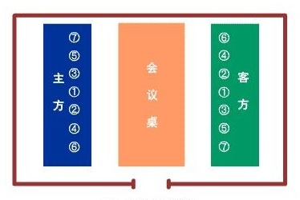

B项，进行谈判时，双方主谈人居中而坐，其他人员按右高左低的原则，依据具体身份的高低自近而远分坐在主谈人的两侧，题干表述为其他人员按照左高右低，故说法错误。

C项，谈判中若需要译员，应将译员安排在仅次于主谈人员的位置上，故说法正确。

D项，圆桌不分首次席位，使用圆桌表示参加各方地位平等，可避免席次争执，适用于多边谈判，故说法正确。

本题为选非题，故正确答案为B。

**考点**：文化常识

**来源**：2015年吉林省公务员录用考试《行测》题（4月乙级）第14题

### 第 15 题

下列不能用来酿酒的农作物是：

A. 谷子

B. 黄豆

C. 红薯

D. 玉米

第 15 题 · 答案与解析

**参考答案（粉笔题库参考内容）**

B

**解析**

酿酒使用的原料通常是富含淀粉或糖类物质的玉米、稻米、小麦、高粱、红薯等农作物，它们在微生物的作用下产生酒精。谷子去壳后是小米，可以用来酿制黄酒，而黄豆的主要成分是蛋白质和脂肪，不适合用来酿酒。

本题为选非题，故正确答案为B。

**考点**：生活常识

**来源**：2015年吉林省公务员录用考试《行测》题（4月乙级）第15题

### 第 16 题

大量议案、提案是每年两会的焦点。关于议案与提案的区别，下列说法错误的是：

A. 议案用于人大会议，提案用于政协会议

B. 议案一经通过便具有法律效力，提案没有法律效力

C. 议案内容应在受案者职权范围内，提案不限内容

D. 议案可由个人提出，提案必须由团体提出

第 16 题 · 答案与解析

**参考答案（粉笔题库参考内容）**

D

**解析**

本题考查公文写作与处理。

议案是具备提议案的法定资格的机构或符合法定联名人数的人大代表向国家权力机关即人民代表大会提出的议事原案。提出议案的主体，必须具备提议案的法定资格或符合法定的代表联名人数。所提内容必须是属于议事机关职权范围内的事项。提案是政协委员、政协各专门委员会和政协各参加单位通过人民政协组织向人民代表大会或人民政府就有关国家或地方大政方针、社会生活等重大问题提出意见和建议的形式。政协提案实行提出提案的时间不限、内容不限、人数不限的“三不限制”原则。故D项说法错误，A、C两项说法正确。由于人民代表大会是国家最高权力机关，人大的议案一经通过，就具有法律效力，而人民政协是爱国统一战线组织，政协委员提案是民主监督的一种形式，没有法律约束力。B项说法也正确。

本题为选非题，故正确答案为D。

**来源**：2015年吉林省公务员录用考试《行测》题（4月乙级）第16题

### 第 17 题

目前，垃圾分类投放渐成民众共识，根据垃圾箱上的分类标识，以下垃圾投放错误的是：

A. 

废纸、塑料

B. 

烂铁、玻璃

C. 

  果皮、剩菜

D. 

  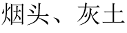

第 17 题 · 答案与解析

**参考答案（粉笔题库参考内容）**

B

**解析**

B项所示的分类标识为有害垃圾，而烂铁和玻璃属于可回收垃圾，故不可以投放在贴有该标识的垃圾箱中，B项符合题意。A项所示标识为可回收物，废纸、塑料均属于可回收物；C项所示标识为厨余垃圾，果皮、剩菜都属于厨余垃圾；D项所示标识为其他垃圾，烟头、灰土都列入其他垃圾中。A、C、D三项投放均正确。

本题为选非题，故正确答案为B。

**考点**：生活常识

**来源**：2015年吉林省公务员录用考试《行测》题（4月乙级）第17题

### 第 18 题

爱国诗人于谦的《石灰吟》中，只含有化学变化的诗句是：

A. 千锤万凿出深山

B. 烈火焚烧若等闲

C. 粉身碎骨浑不怕

D. 要留清白在人间

第 18 题 · 答案与解析

**参考答案（粉笔题库参考内容）**

B

**解析**

分析诗句，A项“千锤万凿出深山”指开采石灰石，“千锤万凿”说明形状发生变化，但没有新物质产生，属于物理变化；B项“烈火焚烧若等闲”指高温煅烧石灰石，碳酸钙在高温条件下分解成氧化钙和二氧化碳，发生了化学变化；C项“粉身碎骨浑不怕”是指氧化钙与水反应生成氢氧化钙，发生了化学变化，同时“粉身碎骨”也是物质形状发生变化，属于物理变化；D项“要留清白在人间”指氢氧化钙与二氧化碳反应生成碳酸钙沉淀和水，发生了化学变化，同时“清白”是对物体颜色状态的表述，涉及到物理变化。因此，四个选项中，只含有化学变化的是B项。

故正确答案为B。

**考点**：化学常识

**来源**：2015年吉林省公务员录用考试《行测》题（4月乙级）第18题

### 第 19 题

蜜蜂载着花蜜飞行时，翅膀平均每秒振动300次；不载花蜜时，平均每秒振动440次。有经验的养蜂人能辨别出蜜蜂是飞出去采蜜，还是采了蜜飞回来。养蜂人的依据是翅膀振动发出声音的：

A. 音色不同

B. 音调不同

C. 音节不同

D. 响度不同

第 19 题 · 答案与解析

**参考答案（粉笔题库参考内容）**

B

**解析**

声源在一秒钟之内振动的次数叫做频率，声源振动频率的高低决定音调的高低，即声源振动频率越高，音调越高，反之亦然。结合题干，可知养蜂人是根据蜜蜂翅膀振动发出声音的音调不同来判断蜜蜂的采蜜情况。

故正确答案为B。

**考点**：物理常识

**来源**：2015年吉林省公务员录用考试《行测》题（4月乙级）第19题

### 第 20 题

某新闻媒体欲结合12月份的重要纪念日、活动日等时间节点，推出系列公益广告，这些公益广告主题可以是：

A. 防范艾滋病、宣传宪法、公祭南京大屠杀死难者同胞

B. 防范艾滋病、节约用水、纪念香港回归

C. 关爱残疾人、节约粮食、纪念澳门回归

D. 宣传劳动法、保障人权、纪念辛亥革命

第 20 题 · 答案与解析

**参考答案（粉笔题库参考内容）**

A

**解析**

A项正确，12月1日为世界艾滋病日，12月4日为中国国家宪法日，12月13日为南京大屠杀死难者国家公祭日。

B项错误，世界水日是3月22日，香港回归纪念日是7月1日；C项错误，国际残疾人日是12月3日，澳门回归纪念日是12月20日，但世界粮食日是在10月16日；D项错误，世界人权日是12月10日，但国际劳动节是在5月1日，而且辛亥革命纪念日是10月10日。

故正确答案为A。

**考点**：文化常识

**来源**：2015年吉林省公务员录用考试《行测》题（4月乙级）第20题

### 第 21 题

＿＿人生有许多事情要做，＿＿就不要为一时的失去而伤心，因为一时的失去并不意味着永远的失败。＿＿你拥有了这种健康的心态，你就成功了一半。

依次填入画横线部分最恰当的一项是：

A. 虽然 但是 只要

B. 既然 那么 只有

C. 因为 所以 只有

D. 既然 那么 只要

第 21 题 · 答案与解析

**参考答案（粉笔题库参考内容）**

D

**解析**

第一空和第二空考关联词逻辑关系。两个空为一组关联词，前后分句并未形成反义关系，故排除转折关联词“虽然······但是······”，排除A项。

第二空考关联词搭配。填入的关联词与后半句的“就”搭配。“只要······就······”为固定搭配，形成充分条件关系，故排除B、C两项。

故正确答案为D。

**考点**：词的辨析-搭配对象

**来源**：2015年吉林省公务员录用考试《行测》题（4月乙级）第21题

### 第 22 题

平视是一种严肃的人生态度，是不带色彩的客观，是超越功利的公正，是抛却杂念的单纯，但并非人人都可做到。平视，需要心的正直与坦荡；平视，需要情的＿＿；平视，需要识的＿＿；平视，需要度的＿＿。

填入画横线部分最恰当的一项是：

A. 纯洁与高尚 广博与深邃 准确与合理

B. 准确与合理 广博与深邃 纯洁与高尚

C. 纯洁与高尚 准确与合理 广博与深邃

D. 广博与深邃 纯洁与高尚 准确与合理

第 22 题 · 答案与解析

**参考答案（粉笔题库参考内容）**

A

**解析**

三空均考查词语搭配。“情”即情感，应用纯洁、高尚形容。“识”即见识、才识，应用广博、深邃搭配。“度”即计量、尺度，应用准确、合理形容。

故正确答案为A。

【文段来源】《平视》

**考点**：实词填空、对应关系-前后呼应、词的辨析-搭配对象

**来源**：2015年吉林省公务员录用考试《行测》题（4月乙级）第22题

### 第 23 题

在刚刚结束的男篮比赛中，数学系以68比56＿＿＿＿物理系，历史系以98比42＿＿＿＿外语系，化学系以78比77＿＿＿＿政治系，中文系以86比80＿＿＿＿上届冠军教育系。

填入画横线部分最恰当的一项是：

A. 击败 大胜 险胜 力挫

B. 险胜 击败 力挫 大胜

C. 击败 险胜 大胜 力挫

D. 险胜 力挫 击败 大胜

第 23 题 · 答案与解析

**参考答案（粉笔题库参考内容）**

A

**解析**

本题考查近义词辨析。

第二空，“98比42”比分悬殊，应用“大胜”或“力挫”，故排除B、C项。

第三空，“78比77”仅一分之差，应用“险胜”更为准确，故排除D项。

故正确答案为A。

**考点**：实词填空、对应关系-前后呼应、词的辨析-词义侧重

**来源**：2015年吉林省公务员录用考试《行测》题（4月乙级）第23题

### 第 24 题

执着的故事不老：愚公移山，夸父逐日，＿＿＿＿＿＿；执着的人物不朽：＿＿＿＿＿＿的祖逖，卧薪尝胆的勾践，面壁静修的达摩。执着是＿＿＿＿＿＿，是＿＿＿＿＿＿，是一支永无休止符的进行曲。

填入画横线部分最恰当的一项是：

A. 闻鸡起舞 直言不讳 艰苦卓绝 坚持不懈

B. 精卫填海 闻鸡起舞 坚持不懈 锲而不舍

C. 精卫填海 悬梁刺股 艰苦卓绝 坚持不懈

D. 守株待兔 闻鸡起舞 精卫填海 锲而不舍

第 24 题 · 答案与解析

**参考答案（粉笔题库参考内容）**

B

**解析**

第一空考成语释义。填入此处的成语应与前文的“愚公移山”“夸父逐日”同样表示执着之意。“闻鸡起舞”原意为听到鸡啼就起来舞剑，后来比喻有志报国的人即时奋起，置于此处与文段语境不符。“守株待兔”比喻企图不经过努力而得到成功的侥幸心理，为贬义词，感情色彩不符。故排除A、D项。“精卫填海”比喻意志坚决，不畏艰难，符合语境要求，保留B、C项。

第二空考文学常识。“祖逖”的典故为“闻鸡起舞”，故排除C项。

故正确答案为B。

**考点**：对应关系-解释说明、成语填空

**来源**：2015年吉林省公务员录用考试《行测》题（4月乙级）第24题

### 第 25 题

车模作为一种营销手段，并没有道德原罪。只不过，伴随着车模的反客为主，视觉暴力和恶俗炒作在车展中＿＿＿＿＿＿，引发人们的“审＿＿＿＿ 疲劳”。在商业世界和生活空间的模糊边界里，在私人与公共的复杂关系中，车模“乱花渐欲迷人眼”。

填入画横线部分最恰当的一项是：

A. 习以为常 美

B. 屡见不鲜 丑

C. 司空见惯 美

D. 见怪不怪 丑

第 25 题 · 答案与解析

**参考答案（粉笔题库参考内容）**

B

**解析**

首先判断第二空。

第二空考语境信息。根据前文语境“视觉暴力和恶俗炒作”等消极色彩的语境，以及此处的双引号，可判断填入的词语应与语境感情色彩相一致，为贬义词，故排除A、C两项。

第一空考成语释义。“见怪不怪”指遇事沉着冷静，与文段语境不符，故排除D项。此处强调车模在生活中常常看见，并不新奇，“屡见不鲜”符合语境要求。

故正确答案为B。

【文段出处】《到底是车展还是车模展》

**考点**：对应关系-前后呼应、混搭填空、词的辨析-感情色彩

**来源**：2015年吉林省公务员录用考试《行测》题（4月乙级）第25题

### 第 26 题

一项新研究发现，低温能通过将所谓的“坏”脂肪转化为“好”脂肪帮助人体燃烧卡路里。这一理论基于两种脂肪的不同特性。我们都再熟悉不过的讨厌的白色脂肪会吸收额外的卡路里并将它们储存在肚子、腰间和大腿中。但成年人还有少量的另一种“健康脂肪”，这种褐色脂肪专门燃烧卡路里同时产生热量。婴儿有大量褐色脂肪来保暖，褐色脂肪多的成年人也更苗条。

下列在文中没有提及的是：

A. 褐色脂肪是一种“健康脂肪”

B. 成年人体内既有白色脂肪也有褐色脂肪

C. 低温能够将白色脂肪转变成褐色脂肪

D. 婴儿体内的褐色脂肪更多

第 26 题 · 答案与解析

**参考答案（粉笔题库参考内容）**

D

**解析**

根据文中“但成年人还有少量的另一种‘健康脂肪’，这种褐色脂肪……”一句可知A项正确。根据文中“我们都再熟悉不过的讨厌的白色脂肪……但成年人还有少量的另一种褐色脂肪……”可知B项正确。根据文中“一项新研究发现，低温能通过将所谓的‘坏’脂肪转化为‘好’脂肪帮助人体燃烧卡路里”可知C项正确。D项在文段中没有体现，为无中生有项，当选。

本题为选非题，故正确答案为D。

【文段出处】

《低温有助燃烧更多脂肪》

**考点**：细节判断题

**来源**：2015年吉林省公务员录用考试《行测》题（4月乙级）第26题

### 第 27 题

互联网改变了世界，互联网也成就了马云。以成功上市开启一个时代的马云，谈起了梦想，享受着告白理想的特权。站在成功者的立场，他说：“今天非常残酷，明天会更加残酷，后天会非常美好，但是绝大多数人都死在了明天晚上。”但审视这个阶层固化的时代，<u>真正的残酷，并不是梦想的煎熬，而是理想不孕不育的苦恼。</u>

对加横线的句子解释最恰当的一项是：

A. 不是为成功而奋斗时的艰难，而是不再梦想着成功

B. 不是奋斗中的半途而废，而是被固化在社会底层

C. 不是死在明天晚上，而是没有死在明天晚上的机会

D. 不是不想做马云第二，而是马云的成功难以复制

第 27 题 · 答案与解析

**参考答案（粉笔题库参考内容）**

C

**解析**

本题考查词句理解。文段首先提出马云对梦想的看法，即大多数人因为没有坚持对梦想的付出，在即将成功之前放弃了梦想。接着“但”表示转折，转折前后语义相反，说明划线句子与马云所说的话语义相反。由“不是梦想的煎熬，而是理想不孕不育的苦恼”可知这句话意指不是人们没有坚持，而是因为阶层固化，理想不孕不育，连坚持梦想的机会都没有。对照选项，可知C符合文意。

A项“不再梦想成功”指主观放弃梦想，划线句子意为无法拥有梦想，排除；B项过于绝对，“阶层固化”指的是利益结构固化，阶层相对稳定，并不一定“固化在社会底层”，排除；D项原文未提及马云的成功能否复制，排除。

故正确答案为C。

**考点**：句子

**来源**：2015年吉林省公务员录用考试《行测》题（4月乙级）第27题

### 第 28 题

钙需求的推荐量是根据人体每天从汗液、尿液等途径损失的钙量，同时考虑钙的吸收效率估算出来的。欧美国家的推荐标准是青少年每天1300毫克，成年人每天1000毫克，而老年人则是1200毫克。不过WHO／FAO联合专家组指出这个标准是基于欧美人群的，并不一定适用于其他地方的人群。他们指出，钙的需求量受多种因素的影响，在骨折高发的人群中，应该每天摄入400-500毫克以上的钙来减轻骨质疏松，但是对于骨折发生率低的地方则没有推荐。相比于欧美人群，亚洲人的骨折发生率就比较低。如果要直接回答“我们到底需要多少钙”的话，答案是对于以植物性食物为主的中国人，还缺乏确切的科学数据。

下列选项最适合做文字标题的是：

A. 中国人要不要补钙

B. 一般人群要补多少钙

C. 中国人要补多少钙

D. 正常体质者要不要补钙

第 28 题 · 答案与解析

**参考答案（粉笔题库参考内容）**

C

**解析**

文段前半部分介绍了欧美国家钙需求标准和欧美人群与亚洲人群体质区别，继而以欧美国家钙需求标准的例子作为引入，目的是引出文段重点“如果要直接回答‘我们到底需要多少钙’的话，答案是对于以植物性食物为主的中国人，还缺乏确切的科学数据”，由此可知文段核心讨论的是中国人对钙的需求量到底是多少，文段标题应与文段中心意思表述一致，对应C项，当选。

A项，文段并未围绕“要不要补钙”进行讨论，选项无中生有，排除；

B项，未提及文段核心话题“中国人”，排除；

D项，未提及文段核心话题“中国人”，且文段并未围绕“要不要补钙”进行讨论，选项无中生有，排除。

故正确答案为C。

**考点**：标题填入题

**来源**：2015年吉林省公务员录用考试《行测》题（4月乙级）第28题

### 第 29 题

美国3M公司有一位研究员，有一次，他想发明一种粘合力非常强的胶水，但因为种种原因，他失败了，实验得到的只是一种粘合力很差的液体，根本无法用作胶水。但一段时间后，他发现人们有这样一种需求：把便条或书签贴到桌上或墙上，在需要时可以随时揭下来。他此前发现的粘合力差的液体正好可以派上用场。就这样，一种险遭废弃的技术促成了“即时贴”的发明。

“即时贴”的发明给我们的最大启发是：

A. 遇到问题时试着从不同的角度来思考

B. 一种成功的发明可能是无心插柳的结果

C. 要善于从生活中寻找技术创新的灵感

D. 成功的技术发明来自锲而不舍的努力

第 29 题 · 答案与解析

**参考答案（粉笔题库参考内容）**

A

**解析**

该故事中，当研究员以胶水的标准来衡量时，这项发明就是失败的，而当他转换一种思考角度，发现另一种需求时，这项发明就变得成功。可见这个故事意在强调从不同的角度思考可能问题会迎刃而解。

故正确答案为A。

【文段来源】《如何培养创新力》

**考点**：中心理解题

**来源**：2015年吉林省公务员录用考试《行测》题（4月乙级）第29题

### 第 30 题

下列句子中划线词语能被括号中的词语替换且不改变句意的一项是：

A. 北雁南飞，活跃在田间草际的昆虫也都销声匿迹，到处<u>呈现</u>（展现）一片衰草连天的景象，准备迎接风雪载途的寒冬

B. 智者和愚者的区别，不仅仅在于天赋的差异，更在于面对困境，愚者往往<u>束手无策</u>（一筹莫展），而智者却能化解困难，走出一条新路

C. 这伙人利用人民群众对党和政府的信赖，伪装成政府机关工作人员，到处招摇撞骗，其手段之卑劣已达到了<u>登峰造极</u>（叹为观止）的地步

D. 为了完善领导干部行为规范，健全党内责任追究制度，中共中央政治局<u>审议</u>（审查）并通过了《关于实行党政领导干部问责的暂行规定》

第 30 题 · 答案与解析

**参考答案（粉笔题库参考内容）**

B

**解析**

B项中，“束手无策”与“一筹莫展”均指遇到困难没有解决办法，二者为近义词，在该句中可以替换；

A项中，“展现”意为展示、明显地表现出，具有主观色彩，与客观表示状态的“呈现”不能替换；

C项中，“叹为观止”指美好的事物好到了极点，为褒义词，与句中的贬义色彩不符，不能替换；

D项中，“审议”指审查评议，不能单纯替换为“审查”。

故正确答案为B。

**来源**：2015年吉林省公务员录用考试《行测》题（4月乙级）第30题

### 第 31 题

下列划线词语，意义与其他三项不同的一项是：

A. 一场汇聚了民间绝技、传统工艺、传统戏曲、民歌民乐、土苗风俗五道大餐的民间文化<u>盛宴</u>，在美丽的春城举行，这给市民带来了节日的享受

B. 长白山天池让我感受到了大自然的鬼斧神工，这是一次视觉的<u>盛宴</u>，感受的是眼睛，打动的是心灵

C. 随着人们生活水平的不断提高，更多人选择到酒店吃年夜饭。许多酒店抓住商机，推出口味各异、适合不同消费水准的除夕<u>盛宴</u>，以吸引顾客

D. 书市，是一次知识的<u>盛宴</u>。书市选择这座城市，是这座城市人民的福气

第 31 题 · 答案与解析

**参考答案（粉笔题库参考内容）**

C

**解析**

“文化盛宴”“视觉的盛宴”“知识的盛宴”均为抽象事物，而“除夕盛宴”指美食，为具体事物，与另外三项不同。

故正确答案为C。

**来源**：2015年吉林省公务员录用考试《行测》题（4月乙级）第31题

### 第 32 题

根据语义，填入横线处最恰当的一项是：

在求学、就业、看病、收入、居住、治安、生态环境等诸多满足感组合要素中，只要有一项出现问题，就会形成“＿＿＿”，幸福便会打折扣，甚至被“一票否决”。

A. 鲶鱼效应

B. 破窗效应

C. 木桶效应

D. 蝴蝶效应

第 32 题 · 答案与解析

**参考答案（粉笔题库参考内容）**

C

**解析**

前后文语境强调“只要有一项出现问题，就会形成······甚至被‘一票否决’”，“木桶效应”指一只水桶能装多少水取决于它最短的那块木板，意为最终的效果取决于最劣势的因素，与文段语境表述一致，C项当选。

A项“鲶鱼效应”是指采取一种手段或措施，刺激一些企业活跃起来投入到市场中积极参与竞争，从而激活市场中的同行业企业；B项“破窗效应”指环境中的不良现象如果被放任存在，会诱使人们仿效，甚至变本加厉；D项“蝴蝶效应”是指在一个动力系统中，初始条件下微小的变化能带动整个系统的长期的巨大的连锁反应，三者均与文段语境不符，排除。

故正确答案为C。

【文段来源】《为人民改革：尊重人民感受》

**考点**：实词填空、对应关系-前后呼应

**来源**：2015年吉林省公务员录用考试《行测》题（4月乙级）第32题

### 第 33 题

下面对两个“理”字含义的解释，最恰当的一项是：

俗话说“你不理①财，财不理②你”，对现代人来说，学会理财已是提高生活质量的必备本事。

A. ①管理②理睬

B. ①处理②理会

C. ①搭理②理会

D. ①料理②理睬

第 33 题 · 答案与解析

**参考答案（粉笔题库参考内容）**

A

**解析**

“理财”指的是对财务（财产和债务）进行管理，此处“理”字为管理之意。第二处“理”字为理睬之意。

故正确答案为A。

**来源**：2015年吉林省公务员录用考试《行测》题（4月乙级）第33题

### 第 34 题

名字这个东西大家都知道很重要，但是现在的重要和以前的重要还是不一样的，以前要八字合，现在则要考虑到传播。一个好名字，要好记，也要好传播，而且要注意的是，在传播的时候不能走样，不能引起误读，若能给人留下好的印象，就非常完美了。

这段文字意在说明：

A. 一个好名字，起码要八字合

B. 一个好名字，其印象分要高

C. 一个好名字，其传播力要强

D. 一个好名字，不能有歧义

第 34 题 · 答案与解析

**参考答案（粉笔题库参考内容）**

C

**解析**

文段为观点+解释说明结构，首句即点明中心，即“现在则要考虑到传播”，后文详细解释了“传播”需具备的几个特点，观点更重要，作者意在说明一个好名字传播力要强，C项符合文意，当选。

A项为以前对名字的要求，排除。B、D两项均为“传播”应具备的特点之一，非重点，排除。

故正确答案为C。

【文段来源】《微时代如何起一个响亮的名字》

**考点**：分述句特征-其他

**来源**：2015年吉林省公务员录用考试《行测》题（4月乙级）第34题

### 第 35 题

下列俗语使用不正确的一项是：

A. 尺有所短，寸有所长，我们西北地区与东南沿海地区相比，虽然经济实力较弱，但物产资源十分丰富

B. 你这个驾驶技术不熟练的新手，竟敢在公路上超速行驶，可真是初生牛犊不怕虎

C. 不入虎穴，焉得虎子，只有敢于靠近火山的摄影家才能拍摄到火山喷薄的那一刹那壮观景象

D. 冰冻三尺，非一日之寒，这位青年歌手最终被捕入狱，正是他长期放纵自我的结果

第 35 题 · 答案与解析

**参考答案（粉笔题库参考内容）**

B

**解析**

B项中“初生牛犊不怕虎”比喻青年人思想上很少顾虑，敢作敢为，为褒义色彩。此处形容超速行驶，语境为贬义，故该俗语使用不正确，当选。

A项中“尺有所短，寸有所长”比喻人或事物各有其长处和短处，对应后文的“虽然经济实力较弱，但物产资源十分丰富”，使用正确，排除。

C项中“不入虎穴，焉得虎子”比喻不冒危险，就不能成事，对应后文“靠近火山拍摄”，使用正确，排除。

D项中“冰冻三尺，非一日之寒”比喻一种情况的形成，是经过长时间的积累、酝酿的，对应后文“长期放纵自我”，使用正确，排除。

本题为选非题，故正确答案为B。

**来源**：2015年吉林省公务员录用考试《行测》题（4月乙级）第35题

### 第 36 题

男性在40多岁甚至更年轻时就出现患心脏病和严重的冠状动脉疾病的可能性，而女性在50岁以及经历了绝经期后才会真正开始面对这种风险，这让女性在遭遇无论对男性还是女性而言都是第一杀手的心脏疾病之前，赢得了更多的时间。经过研究，女性第一次心脏病发作的时间比男性晚了整整十年。年轻女性较好的胆固醇水平是导致这一结果的因素之一，但雌激素以及像饮食更健康这样的生活方式上的选择似乎也起到了保护作用。

下列说法与原文不符的是：

A. 绝经期是女性面对心脏病风险的分界点

B. 作为男性，难以赢得更多的时间防范心脏病

C. 雌激素对女性的心脏很有益处

D. 在心脏病风险方面，女人的性别优势突出

第 36 题 · 答案与解析

**参考答案（粉笔题库参考内容）**

C

**解析**

根据文中“而女性在50岁以及经历了绝经期后才会真正开始面对这种风险”可知，表述正确，A项排除；

根据文中“经过研究，女性第一次心脏病发作的时间比男性晚了整整十年”可知，表述正确，B、D两项均排除；

文段只说“雌激素······似乎也起到了保护作用”，“很有益处”表述与文段不一致，C项表述过于绝对，当选。

本题为选非题，故正确答案为C。

【文段来源】《女人比男人有10大健康优势》

**考点**：细节判断题

**来源**：2015年吉林省公务员录用考试《行测》题（4月乙级）第36题

### 第 37 题

去年年底以来，专车服务迅速成为人们热议的话题。借助互联网平台的“专车”，选择更加多样化、体验明显改善：预约时间、上门接送、乘坐舒适、多种车型和价位······方便、舒适的专车服务，成为缓解城市居民出行难的“及时雨”。但是，也有消费者提出担忧，最多集中在安全方面。专车上并未安装GPS定位系统，也没有强制的保险和车辆安全性能检测，出现纠纷后会出现“求助无门”的现象。

这段文字意在强调：

A. 专车服务模式的创新

B. 相关部门监管的缺失

C. 专车市场的机遇与挑战

D. 专车市场的发展瓶颈

第 37 题 · 答案与解析

**参考答案（粉笔题库参考内容）**

C

**解析**

文段前半部分介绍了专车的优势所在，也就是其发展机遇，而后半部分转折提出了目前存在的问题，也就是其发展面临的挑战。C项全面概括了文段的内容，表述正确，当选。

A项，只涉及了文段前半部分，仅为转折前的内容，没有提到“挑战”，排除。

B项，主体与文段不一致，没有提到“专车市场”，排除。

D项，只涉及了文段后半部分，与C项相比，不如C项概括全面、到位，排除。

故正确答案为C。

【文段来源】《坐专车，不仅是“点赞”》

**考点**：关联词-转折

**来源**：2015年吉林省公务员录用考试《行测》题（4月乙级）第37题

### 第 38 题

微软的智能手表抢占了去年圣诞销售季，但是，它与消费者的蜜月期不会持续很久。在苹果智能手表于今年春天问世之后，较昂贵的可穿戴设备则将由苹果公司主宰。原因之一是苹果的品牌效应，另一个原因则是苹果手表比微软的智能手表更专注于成为一个第三方应用程序平台。2015年，人们会把购买苹果手表视为地位的象征，类似于他们的首台iPhone或iPad。不过到2016年，苹果手表则需要证明，自己能做的不仅仅是测算心率、收到文本时发出提示音或显示时间。

根据这段文字，可以看出作者的意图是：

A. 预言苹果手表的市场前景

B. 预测苹果手表的多功能发展趋势

C. 提高公众对苹果手表的期待值

D. 激发公众对苹果手表的想象力

第 38 题 · 答案与解析

**参考答案（粉笔题库参考内容）**

A

**解析**

文段开篇通过转折关系指出，微软智能手表的销售盛况不会持续很久，随后指出“较昂贵的可穿戴设备则将由苹果公司主宰”，之后详细分析原因，最后通过2015年和2016年的展望进一步解释说明。文段重在强调，苹果手表将在以后的可穿戴设备领域有着重要地位，对应A项。

B项，“多功能发展趋势”对应文段尾句，为解释说明内容，非文段重点，排除。

C项中的“提高······期待值”、D项中的“激发······想象力”均无中生有，排除。

故正确答案为A。

【文段出处】《廉价中国手机入美国》

**考点**：分述句特征-多角度论述

**来源**：2015年吉林省公务员录用考试《行测》题（4月乙级）第38题

### 第 39 题

户外真人秀节目《奔跑吧兄弟》最近热播，收获了较高的关注度和美誉度。作为一种游戏，其过程是随机的，结局是未知的，充满了悬念和不确定性，刺激着人们的观看欲望，调动人们去想象推理。当然，该节目不仅仅满足了观众的娱乐需求，而是在“润物细无声”中传递了正能量。其传递给观众的不是你死我活的厮杀，而是敬业与励志的精神。明星们积极参与游戏，参与者之间相互竞争合作，表现了人性温情美好、积极向上的一面。

根据这段文字，《奔跑吧兄弟》广受欢迎的根本原因是：

A. 游戏的开放性结局

B. 竞争与团队配合的张力

C. 在娱乐中传递正能量

D. 明星的号召力

第 39 题 · 答案与解析

**参考答案（粉笔题库参考内容）**

C

**解析**

文段中通过递进句式“不仅仅······而是······”引出重点“在润物细无声中传递了正能量”，可见这是作者重点强调的因素，也是节目广受欢迎的根本原因。

故正确答案为C。

【文段来源】《发现生活真谛》

**来源**：2015年吉林省公务员录用考试《行测》题（4月乙级）第39题

### 第 40 题

《庄子》中有这样一则故事。庄子找监河侯借粮，监河侯说：“好啊，我很快就要收租税了，到时候可以借给你三百黄金。”庄子就给监河侯讲了一个寓言：我昨天来的时候，半路上听到有呼救的声音。我回头一看，发现车辙里有一条鲫鱼。我问它，你喊什么呀?鲫鱼答道，我是东海里的水族，您可有“斗升之水”，来救救我的性命吗?我说，行呵，我正要到南方去游说吴越的国王，让他引“西江之水”救济你。这条可怜的鱼说，要是那样的话，你干脆到干鱼铺去找我。

下列选项中与庄子所讲的故事寓意最为贴切的是：

A. 口惠而实不至

B. 授之以鱼，不如授之以渔

C. 好钢用在刀刃上

D. 远水解不了近渴

第 40 题 · 答案与解析

**参考答案（粉笔题库参考内容）**

D

**解析**

寓言中，身处困境的鲫鱼迫在眉睫的是需要“斗升之水”活命，等不及“西江之水”。D项“远水解不了近渴”比喻慢的办法救不了急，与故事寓意最为贴切，当选。

A项，“口惠而实不至”意为只在口头上答应给别人好处，实际的利益却到不了别人身上。文段强调的是帮助太慢而无法应急，与故事寓意不符，排除。

B项，“授之以鱼，不如授之以渔”意为要想帮助他人解决难题，还不如传授给他人解决难题的方法，与故事寓意不符，排除。

C项，“好钢用在刀刃上”意为切中要害，抓住最主要的环节，与故事寓意不符，排除。

故正确答案为D。

【文段来源】《引“西江”更要送“斗升”》

**来源**：2015年吉林省公务员录用考试《行测》题（4月乙级）第40题

### 第 41 题

人是生活在一定的社会场域之中的。从传播的角度看，一举手一投足，都是一种表达。观其行再晓其人，公众就是通过外在举止了解行为人的。举止代表什么意义，解释权往往不在自己，对于公众人物尤其如此。就拿前阵子某市领导打伞观看学生淋雨做操的事件来说，可能领导平时也是爱孩子的，到学校也不过是正常的工作，可对比画面凝固下来，传递出的形象就由不得他了。

这段文字意在强调：

A. 舆论对公众人物具有极其重要的作用

B. 公众人物更容易暴露在舆论危墙之下

C. 舆论主导的公众形象未必与公众人物自身相一致

D. 公众人物更应注重自身形象

第 41 题 · 答案与解析

**参考答案（粉笔题库参考内容）**

D

**解析**

文段开篇提到公众是通过外在举止了解行为人的，接着指出“举止代表什么意义，解释权往往不在自己”，并且强调了“对于公众人物尤其如此”，后文进行了举例说明，可见作者意在说明公众人物更应该注重自身形象，防止自身形象被误解。结合选项可知，D项表述恰当。

A项中的“舆论对公众人物的重要作用”为无中生有，排除；B、C两项均为客观现象的陈述，现象不是文段重点论述的内容，文段意在通过这些现象呼吁公众人物重视自身形象，即提出解决问题的对策，排除。

故正确答案为D。

**考点**：关联词-对策

**来源**：2015年吉林省公务员录用考试《行测》题（4月乙级）第41题

### 第 42 题

下列句子中没有使用比喻修辞的是：

A. 汽车沿着标示官兵巡逻路线的一排红旗行驶约十分钟，一条蟒龙似的冰带横亘眼前

B. 老艄公成为失业的舵手，如一只黑色鱼鹰，蜷缩着蹲在船头

C. 院子里，紫色的丁香花安静地绽放，温柔的香气，似乎是记忆中最初的味道

D. 一天，突然下起了鹅毛大雪，雪一下堆满了花盆，皑皑白雪与通红通红的老石榴相映照，显得格外引人注目

第 42 题 · 答案与解析

**参考答案（粉笔题库参考内容）**

C

**解析**

比喻是指用跟甲事物有相似之点的乙事物来描写或说明甲事物。C项中描写“丁香花”，没有与之相似的乙事物。故不属于比喻的修辞手法。

A项，将“冰带”比喻为“蟒龙”；B项，将“老艄公”比喻为“鱼鹰”；D项，将“大雪”比喻为“鹅毛”，三者均为比喻修辞手法。

本题为选非题，故正确答案为C。

**来源**：2015年吉林省公务员录用考试《行测》题（4月乙级）第42题

### 第 43 题

舒马赫、施耐德、施密特、穆勒、施泰因曼……这些流行的德国姓氏有什么共同点？在德语里，它们都代表一门手艺：制鞋匠、裁缝、铁匠、磨坊主、石匠等。从中世纪开始，老师傅带几个学徒做手艺，就成为德国人的职业常态。时移势易，工业化取代了小作坊，但“手艺人”的基本精神没有变。今天，德国经济结构中30％为制造业，如果算上出口，工业制造几乎占据德国经济的半壁江山。

这段文字意在说明：

A. 德国姓氏都源于制造业

B. 德国人“严谨”“认真”的职业精神

C. 德国制造业的文化传承

D. 制造业在德国经济结构中的重要地位

第 43 题 · 答案与解析

**参考答案（粉笔题库参考内容）**

C

**解析**

文段主要围绕德国制造业老师傅带几个学徒做手艺的职业常态和“手艺人”的基本精神展开论述，这些都可概括为“文化传承”。C项与作者意图相符，当选。

A项中“姓氏”并非文段重点，且“都源于”的表述过于绝对，排除；

B项中“严谨、认真”原文没有体现，排除；

D项没有体现“手艺人”精神，排除。

故正确答案为C。

【文段来源】《德国百年老店与工匠精神》

**考点**：关联词-并列

**来源**：2015年吉林省公务员录用考试《行测》题（4月乙级）第43题

### 第 44 题

清朝乾隆年间，河南巡抚叶存仁为官数十载，美誉有加。准备告老还乡之时，原下属新任巡抚牛某前来送行。寒暄礼毕，牛巡抚道：“请大人留于此地，属下愿供奉于你!”叶存仁道：“承蒙美意，汝年轻有为，任重道远，在此虽好，只恐拖累你，我欲归园田居，颐养天年。”牛巡抚苦留不住，自怀中取出银票，以表栽培之恩。叶存仁亦决然推拒。

下列关于从政修身的名言，与这段文字内容无关的是：

A. 君子笃于义而薄于利

B. 君子所贵者在守道，不在求荣

C. 俭，德之共也；侈，恶之大也

D. 以德服人者，中心悦而诚服也

第 44 题 · 答案与解析

**参考答案（粉笔题库参考内容）**

C

**解析**

故事体现了叶存仁拒绝下属银票的高尚品德和对做人原则的坚守，A、B、D三项均与故事核心观点一致，排除。C项中“侈”为奢侈之意，故事中没有体现，当选。

本题为选非题，故正确答案为C。

**来源**：2015年吉林省公务员录用考试《行测》题（4月乙级）第44题

### 第 45 题

酷爱嚼口香糖的人今后可以在享受之外再做些有意义的事情：加拿大科学家发明了一种利用咀嚼发电的下颚带。该下颚带的发明者在专业杂志《智能材料与结构》中报告说，发出的电可以用来带动助听器、电子护耳罩或通信设备。

这段文字是一篇文章的引言，文章接下来最可能讲述的是：

A. 嚼口香糖时还可以做哪些事

B. 下颚带发电的未来发展前景

C. 下颚带发电所面临的困境

D. 发电下颚带的工作原理

第 45 题 · 答案与解析

**参考答案（粉笔题库参考内容）**

D

**解析**

本题为接语选择题，需通读全文，重点关注文段最后讨论的核心话题。文段尾句提到“该下颚带······发出的电可以用来带动助听器、电子护耳罩或通信设备”，那么下文一定会围绕这一话题继续展开论述，介绍下颚带是如何发电的。D项与文段尾句衔接最为紧密，当选。

A项“嚼口香糖”与文段主体不一致，文段主体为下颚带，排除。B项“未来发展前景”、C项“困境”与文段尾句衔接不紧密，应该先介绍如何发电，再介绍未来发展前景或困境，均排除。

故正确答案为D。

【文段来源】《忘带充电器不用怕 嚼口香糖也能发电》

**考点**：接语选择题

**来源**：2015年吉林省公务员录用考试《行测》题（4月乙级）第45题

### 第 46 题

在微信的《使用条款和隐私政策》里明确写着：“腾讯保留因业务发展需要，单方面对本服务的全部或部分服务内容在任何时候不经任何通知的情况下变更、暂停、限制、终止或撤销腾讯微信服务的权利，用户需承担此风险。”这意味着，哪天腾讯突然关闭微信了，他无需负担任何责任。在免费时代，真正的减免只是“价格”。作为交换，仍需付出其他“代价”，可能是安全，也可能是隐私。爱因斯坦曾说过：“有时候一个人为不花钱得到的东西付出的代价最高。”即使如此，或许已没有回头路。

下列俗语中，与这段文字主旨相符的是：

A. 丢下西瓜捡芝麻

B. 吃人嘴短，拿人手软

C. 苍蝇不叮无缝蛋

D. 世上没有免费的午餐

第 46 题 · 答案与解析

**参考答案（粉笔题库参考内容）**

D

**解析**

文段中强调“在免费时代，真正的减免只是‘价格’。作为交换，仍需付出其他‘代价’”，并引用了爱因斯坦的话“有时候一个人为不花钱得到的东西付出的代价最高”。可见文段旨在说明任何的获利都会付出相应的代价，D项“世上没有免费的午餐”与文段主旨表述相一致。

A项，“丢下西瓜捡芝麻”比喻做事情因小失大，得不偿失。文段只强调客观上的得到一些东西的同时就会失去另一些东西，并未体现主观做事方面的“因小失大”之意，排除。

B项，“吃人嘴短，拿人手软”比喻收了别人的好处就要给别人面子，与文段中心不符，排除。

C项，“苍蝇不叮无缝蛋”比喻没有平白无故出现的事情，任何的事情都是有原因的，含有贬义色彩，置于此处与文段意思不符，排除。

故正确答案为D。

【文段来源】《微信故障凸显网络免费时代尴尬》

**考点**：主题词、分述句特征-引入铺垫

**来源**：2015年吉林省公务员录用考试《行测》题（4月乙级）第46题

### 第 47 题

春秋时期，鲁国上卿大夫季文子掌握国政和统兵之权，却“家无衣帛之妾，厩无食粟之马、府无金玉”。仲孙它提醒他，这样有损国家气派，吝啬而不体面。季文子回答，国家形象的维系要靠高尚品德，而非美妾良马，“若独贪于奢侈，好于文章，是不德也。”

这则故事能给当今公务员带来的启示是：

A. 生活俭朴，官员才能维护国家形象

B. 为政以德，勤俭自律，官员要注重个人品行修养

C. 联系群众，放下身段到群众中去

D. 合理用权，权为民所用而不是以权谋私

第 47 题 · 答案与解析

**参考答案（粉笔题库参考内容）**

B

**解析**

文段重点在于季文子说的话“国家形象的维系要靠高尚品德，而非美妾良马”。可见文段主要强调公务员的道德品行。只有B项提到“为政以德、勤俭自律、品行修养”。A、C、D三项均与文段所表达主题无关。

故正确答案为B。

【文段来源】《莫在群众面前“抖派”》

**来源**：2015年吉林省公务员录用考试《行测》题（4月乙级）第47题

### 第 48 题

老话“时间如流水”可能是错的。一个新的理论称，时间并不是向前流逝的，相反，时间中的一切都是始终存在的。该理论称，如果我们“俯瞰”宇宙，那么我们将看到时间是向着所有方向延伸的，正如我们此刻看到的太空。这个有趣的理论是由麻省理工学院的哲学副教授布拉德福德 · 斯科博士提出的。他认为时间并非从我们身边驶过并永远消失不见——相反，它们存在于时空的不同位置。

下列语句中，符合这一理论的说法是：

A. 我们在时间中穿行，就像一艘船在水上航行

B. 时间是对称的，在另一个宇宙中的智慧体看来，我们宇宙的时间是后退的

C. 你在时间中被展开，类似于你在空间中被展开的那样，我们并非处于单一的时间中

D. 现在是一个“焦点”。从过去移动至未来，我们处于这个焦点之中，并随着它前进

第 48 题 · 答案与解析

**参考答案（粉笔题库参考内容）**

C

**解析**

C项，“你在时间中被展开”即可对应文段中理论所强调的“时间是向着所有方向延伸的”，而“我们并非处于单一的时间中”即可对应理论“时间并非从我们身边驶过并永远消失不见——相反，它们存在于时空的不同位置”，符合这一理论，当选。

A、D两项的说法是对“时间如流水”的论证，与文段所提到的理论不符，排除。

B项中的“后退”无从体现，排除。

故正确答案为C。

【文段来源】《时间并非如流水过去未来一直存在》

**考点**：细节判断题

**来源**：2015年吉林省公务员录用考试《行测》题（4月乙级）第48题

### 第 49 题

人童年时会有很多错觉，从错误出发，不一定步入深渊。童年是不怕错的，只怕苍白。人一辈子很多正确的事，恰恰是错误选择的，在不合适的时间里做了不合适的事，让人生之路变得曲里拐弯，在弯道里留下了惊险和精彩。

下列哪句话能最准确地表达作者意图?

A. 童年的经历至关重要

B. 苍白的人生是可悲的

C. 有时人生中的错误选择反而能令人生更精彩

D. 童年所犯的错误并不会对人生产生重大影响

第 49 题 · 答案与解析

**参考答案（粉笔题库参考内容）**

C

**解析**

文段第一句话说“从错误出发，不一定步入深渊”，第三句话说“人一辈子很多正确的事，恰恰是错误选择的”，可见作者意在强调错误并没有那么可怕，很多时候能让人生更加精彩。C项与作者意图一致，当选。

A、B两项，没有提到文段主体“错误”，均排除；

D项，“并不会对人生产生重大影响”说法过于绝对，排除。

故正确答案为C。

**考点**：主题词

**来源**：2015年吉林省公务员录用考试《行测》题（4月乙级）第49题

### 第 50 题

“男性蠢货理论”研究显示，大部分男性的确倾向于冒不必要的风险，且常常做出蠢事。医院急救中心的记录和死亡率统计都能印证这一研究结果。比起女性，男性更易受到意外伤害，在运动中受伤，或遭遇交通事故。造成这种男女差异的有文化和社会经济因素，例如男性参与危险性体育运动的机会更多。但也存在一种所谓“蠢货风险”，即毫无意义的风险，而心甘情愿冒这种风险的往往都是男性。研究人员已搜罗到大量奇闻轶事来佐证这个理论，但他们还希望对男女差异进行系统性分析。

这段文字未暗示的信息是：

A. 女性比男性智商高

B. 社会角色的差异是男性甘愿冒险的因素之一

C. 目前还未对“蠢货理论”进行科学地论证

D. 女性很少去冒毫无意义的风险

第 50 题 · 答案与解析

**参考答案（粉笔题库参考内容）**

A

**解析**

根据文段中“造成这种男女差异的有文化和社会经济因素，例如男性参与危险性体育运动的机会更多”可知，B项文段有涉及。根据文段中“但他们还希望对男女差异进行系统性分析”可知，C项文段有涉及。根据文段中“心甘情愿冒这种风险的往往都是男性”可知，D项文段有涉及。A项在文段中无从体现，无中生有。

本题为选非题，故正确答案为A。

【文段来源】《男性倾向冒不必要风险往往更易做出蠢事》

**考点**：细节判断题

**来源**：2015年吉林省公务员录用考试《行测》题（4月乙级）第50题

### 第 51 题

从所给的四个选项中，选择最合适的一个填入问号处，使之呈现一定的规律性：

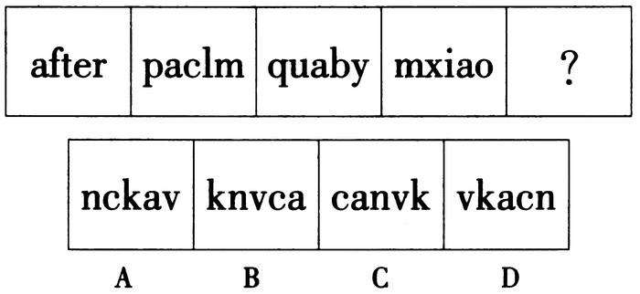

A. A

B. B

C. C

D. D

第 51 题 · 答案与解析

**参考答案（粉笔题库参考内容）**

B

**解析**

题干为字母图形，一般考查封闭空间的数量或个别字母的遍历。观察发现，前四幅图中均包含“a”图形，且位置依次向右移动一个单位，故第五幅图“a”的位置应在第五位，只有B项符合。

故正确答案为B。

**考点**：位置规律-平移、文字/字母/数字类

**来源**：2015年吉林省公务员录用考试《行测》题（4月乙级）第51题

### 第 52 题

把下面的六个图形分为两类，使每一类图形都有各自的共同特征或规律，分类正确的一项是：

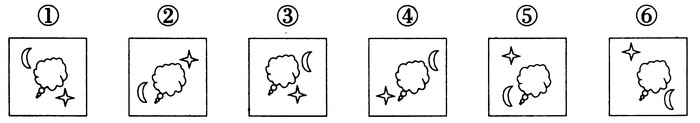

A. ①②④，③⑤⑥

B. ①③④，②⑤⑥

C. ①③⑤，②④⑥

D. ①④⑤，②③⑥

第 52 题 · 答案与解析

**参考答案（粉笔题库参考内容）**

B

**解析**

题干图形元素组成相同，考虑元素的位置关系。观察发现在图形①③④中，月亮均在图形的上半部分，星星均在图形的下半部分；在图形②⑤⑥中，月亮均在图形的下半部分，星星均在图形的上半部分。满足分组的为B项。

故正确答案为B。

**考点**：位置规律-平移

**来源**：2015年吉林省公务员录用考试《行测》题（4月乙级）第52题

### 第 53 题

从所给的四个选项中，选择最合适的一个填入问号处，使之呈现一定的规律性：

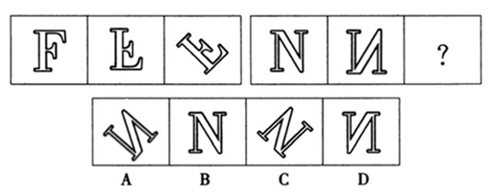

A. A

B. B

C. C

D. D

第 53 题 · 答案与解析

**参考答案（粉笔题库参考内容）**

A

**解析**

在第一组图形中，前两者为上下翻转关系，第二幅图逆时针旋转45°得到第三幅图形。第二组图形遵循相似规律，前两者为上下翻转关系，第二幅图逆时针旋转45°得到的图形为A项。

故正确答案为A。

**考点**：位置规律-旋转

**来源**：2015年吉林省公务员录用考试《行测》题（4月乙级）第53题

### 第 54 题

从所给的四个选项中，选择最合适的一个填入问号处，使之呈现一定的规律性：

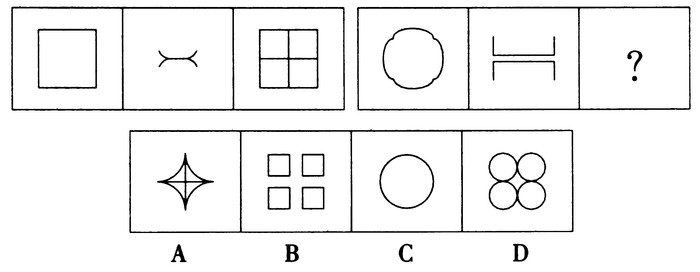

A. A

B. B

C. C

D. D

第 54 题 · 答案与解析

**参考答案（粉笔题库参考内容）**

D

**解析**

题干两组图形之间呈现出对应的相似性。前一组图形的直线转为曲线（或曲线转为直线），得到第二组图形。田字形图形转化为曲线后应为D项。

故正确答案为D。

**来源**：2015年吉林省公务员录用考试《行测》题（4月乙级）第54题

### 第 55 题

把下面的六个图形分为两类，使每一类图形都有各自的共同特征或规律，分类正确的一项是：

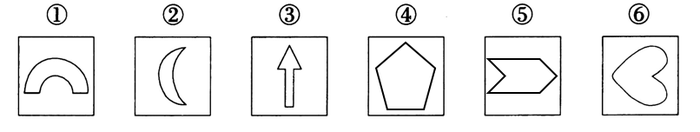

A. ①②③，④⑤⑥

B. ①③④，②⑤⑥

C. ①③⑤，②④⑥

D. ①④⑥，②③⑤

第 55 题 · 答案与解析

**参考答案（粉笔题库参考内容）**

B

**解析**

观察发现，题干所有图形均为轴对称图形，其中①③④图形沿竖直方向对称，图形②⑤⑥沿水平方向对称，满足此规律的分组为B项。

故正确答案为B。

**考点**：属性规律-对称性

**来源**：2015年吉林省公务员录用考试《行测》题（4月乙级）第55题

### 第 56 题

从群体成员活动的效率角度，由不同的角色扮演者组成的群体产生的内聚力或摩擦力，在社会心理学上，统称为关系场效应。

根据上述定义，下列最能体现关系场效应的是：

A. 三个和尚没水喝

B. 近朱者赤，近墨者黑

C. 三人行，必有我师

D. 随波逐流，人云亦云

第 56 题 · 答案与解析

**参考答案（粉笔题库参考内容）**

A

**解析**

第一步：关键词查找。

定义关键词为，1定位：“群体活动”；2角度：“效率角度”；3结果：“群体产生了内聚力或摩擦力”。

第二步：逐一分析选项。

A项：“三个和尚”满足定义关键词1，三个和尚在一起却没水喝，群体的效率降低为零，产生了群体摩擦力，满足定义表述，当选；

B、C、D三项表述均与“效率”无关，且并不是定位在“群体活动”，排除。

故正确答案为A。

**考点**：故事类

**来源**：2015年吉林省公务员录用考试《行测》题（4月乙级）第56题

### 第 57 题

同类对象错误，指行为人意图侵害的对象与实际侵害的对象不一致，但属于同一类的，应当按照犯罪既遂定罪处罚。非同类对象错误，指行为人意图侵害的对象与实际行为侵害的对象不一致，且不属于同一类，只能根据行为人的主观故意内容认定犯罪性质。

根据上述定义，下列说法正确的是：

A. 甲误将乙当作丙而杀死，应当以故意杀人罪既遂处罚

B. 甲误把动物当成人而加以杀害，应当不成立犯罪

C. 甲误把人当成动物而加以杀害，应当成立故意杀人罪

D. 甲误把他人放置的财物当成垃圾扔掉，成立犯罪

第 57 题 · 答案与解析

**参考答案（粉笔题库参考内容）**

A

**解析**

第一步：关键词查找。

同类对象错误：意图侵害的对象与实际侵害的对象属于同一类的，按犯罪既遂定罪；非同类对象错误：意图侵害的对象与实际侵害的对象不属于同一类的，根据行为人的主观故意内容认定犯罪性质。

第二步：逐一分析选项。

A项：意图侵害的对象和实际侵害的对象属于同类，应按犯罪既遂定罪，表述正确，当选；

B项：意图侵害的对象和实际侵害的对象不属于同类，但其主观杀害的是人，应当认定犯罪，表述错误，排除；

C项：意图侵害的对象和实际侵害的对象不属于同类，但其主观杀害的是动物，不应认定为故意杀人罪，表述错误，排除；

D项：主观为扔掉垃圾，并非侵害行为，不构成犯罪，表述错误，排除。

故正确答案为A。

**考点**：特殊问法

**来源**：2015年吉林省公务员录用考试《行测》题（4月乙级）第57题

### 第 58 题

领导权变并非是一种权术，其实质是一切从实际出发，根据领导活动的具体情境，灵活采用合适的领导方式去实现领导价值。在领导活动中权变的是方法和策略，不变的是价值和方向。

根据上述定义，下列属于领导权变的是：

A. 赵科长把复杂的任务交给了工作能力较强的小张，新来的小陈负责收集资料

B. 张科长在工作中总是当机立断、雷厉风行，可下班回家后就对老婆言听计从

C. 李县长亲自下乡送水，随行人员拍照、录像后，李县长马上乘专车返回县城

D. 王书记刚刚带领干部群众完成抗旱自救工作，又忙着去协调路网建设纠纷

第 58 题 · 答案与解析

**参考答案（粉笔题库参考内容）**

A

**解析**

第一步，查找关键词。

定义关键词：“从实际出发，根据领导活动的具体情境，灵活采用合适的领导方式去实现领导价值。”

第二步，逐一分析选项。

A项：“把复杂的任务交给了工作能力较强的小张，新来的小陈负责收集资料”满足关键词“根据……具体情境，灵活采用合适的领导方式去实现领导价值”，当选；

B项：“当机立断、雷厉风行”与关键词“灵活采用合适的领导方式”并不对应，只是体现出张科长的一种做事风格，并没有体现出领导权变，排除；

C项：“亲自下乡送水”“马上乘专车返回”没有体现出李县长的任何领导方式或领导价值，是一种作秀，照出了形式主义底色，排除；

D项：“完成抗旱自救”“协调路网建设”没有体现出王书记“根据……具体情境，灵活采用合适的领导方式去实现领导价值” ，与题干关键词并不对应，排除。

故正确答案为A。

**考点**：方式目的

**来源**：2015年吉林省公务员录用考试《行测》题（4月乙级）第58题

### 第 59 题

静态博弈，是指参与者们同时选择策略，或者虽然有先后，但是后做出策略的参与者并不知道其他参与者策略的博弈。动态博弈，是指参与者的行动有先后顺序，并且后者是在了解前者策略的前提下制定自己策略的博弈。

根据上述定义，下列属于静态博弈的是：

A. 象棋游戏

B. 投标竞争

C. 田忌赛马

D. 黔驴技穷中的驴虎之争

第 59 题 · 答案与解析

**参考答案（粉笔题库参考内容）**

B

**解析**

第一步：关键词查找。

静态博弈：后做出策略的参与者不知道其他参与者的策略；动态博弈：后参与者是在了解前参与者策略的前提下制定自己策略。

第二步：逐一分析选项。

A项：象棋游戏的后手是在清楚先手行动的前提下才制定自己的行动策略，故属动态博弈，排除；

B项：投标竞争是众投标方在平等、公正的条件下，同时参与并做出策略，属于静态博弈，当选；

C项：田忌是在了解对手赛马策略的基础上，做出自己的赛马策略，属于动态博弈，排除；

D项：驴虎之争是在老虎了解驴子行为技能的前提下做出的选择，属于动态博弈，排除。

故正确答案为B。

**考点**：常规问法

**来源**：2015年吉林省公务员录用考试《行测》题（4月乙级）第59题

### 第 60 题

长尾理论，是指只要产品的存储和流通的渠道足够大，需求不旺或销量不佳的产品所共同占据的市场份额，可以和那些少数热销产品所占据的市场份额相匹敌甚至更大。

根据上述定义，下列不能体现长尾理论的是：

A. 亚马逊网上书店成千上万的商品书中，部分书目虽销量小，但凭借多样化的种类积少成多，占据了总销量的一半

B. 唯品会是一家专门经营大幅折扣名牌商品的B2C企业，通过帮助众多品牌商处理小量过季尾货，获得巨大成功

C. 新浪是全球最大的中文门户网站，支撑其业绩的主要是广告营业收入，线上广告在总收入中所占比例也越来越大

D. ZARA一年中大约推出12000种时装，而每一款时装的量一般不大，凭借“多款式、小批量”的营销策略而成功

第 60 题 · 答案与解析

**参考答案（粉笔题库参考内容）**

C

**解析**

第一步：关键词查找。

1定位：需求不旺或销量不佳的产品。

2表现：可以和少数热销产品所占据的市场份额相匹敌甚至更大。

第二步：逐一分析选项。

A项：“销量小的书目”满足定义关键词1，“凭借多样化的种类优势，占据了总销量的一半”满足定义关键词2，能够体现长尾理论，排除；

B项：“过季尾货” 满足定义关键词1，“获得巨大成功”满足定义关键词2，能够体现长尾理论，排除；

C项：“线上广告”并不满足定义关键词1，不能体现出长尾理论，当选；

D项：“量一般不大”满足定义关键词1，获得成功满足定义关键词2，能够体现长尾理论，排除。

本题为选非题，故正确答案为C。

**考点**：故事类

**来源**：2015年吉林省公务员录用考试《行测》题（4月乙级）第60题

### 第 61 题

道路：车辆：行人

A. 脑袋：头发：眼睛

B. 月亮：嫦娥：后羿

C. 眼镜：鼻子：耳朵

D. 手提包：钱包：手机

第 61 题 · 答案与解析

**参考答案（粉笔题库参考内容）**

D

**解析**

第一步：判断题干词语的逻辑关系。

道路上有车辆和行人，第一项与后两项为位置的对应关系，且是一种非必然的对应关系，即可能有。

第二步：判断选项词语间的逻辑关系。

A项：脑袋与后两项头发和眼睛是必然的位置对应关系，排除；

B、C两项：都不属于位置的对应关系，排除；

D项：手提包里有钱包和手机，第一项与后两项为位置的对应关系，与题干逻辑关系吻合，当选。

故正确答案为D。

**考点**：逻辑关系-对应关系

**来源**：2015年吉林省公务员录用考试《行测》题（4月乙级）第61题

### 第 62 题

健康：锻炼：慢跑

A. 疏通：针灸：按摩

B. 缺钙：补钙：食疗

C. 申请：审核：通过

D. 胜诉：辩护：聘请律师

第 62 题 · 答案与解析

**参考答案（粉笔题库参考内容）**

D

**解析**

第一步：判断题干词语的逻辑关系。

慢跑是锻炼的一种方式，其目的是为了身体健康，前两者为目的的对应关系，后两者为种属关系。

第二步：判断选项词语间的逻辑关系。

A项：针灸与按摩为并列关系，非种属关系，排除；

B项：缺钙与补钙并非目的的对应关系，而是因果对应关系，排除；

C项：审核与通过，并非种属关系，排除；

D项：聘请律师是辩护方式的一种，其目的是为了胜诉，与题干逻辑关系完全吻合，当选。

故正确答案为D。

**考点**：逻辑关系-包容关系、逻辑关系-对应关系

**来源**：2015年吉林省公务员录用考试《行测》题（4月乙级）第62题

### 第 63 题

雨鞋：雨伞：雨衣

A. 铅笔：钢笔：中性笔

B. 长春：吉林：辽宁

C. 报纸：杂志：新闻

D. 乡试：殿试：举人

第 63 题 · 答案与解析

**参考答案（粉笔题库参考内容）**

A

**解析**

第一步：判断题干词语的逻辑关系。

雨鞋、雨伞、雨衣，三者之间为并列关系，同为雨具的一种。

第二步：判断选项间的逻辑关系。

A项：铅笔、钢笔、中性笔，三者之间为并列关系，同为笔的一种，与题干逻辑关系吻合，当选；

B项：长春是吉林省省会，二者非并列关系，与题干逻辑关系不吻合，排除；

C项：报纸、杂志与新闻并非并列关系，与题干逻辑关系不吻合，排除；

D项：古代科举，通过乡试者会获得举人称号，故乡试与举人之间非并列关系，与题干逻辑关系不吻合，排除。

故正确答案为A。

**考点**：逻辑关系-并列关系

**来源**：2015年吉林省公务员录用考试《行测》题（4月乙级）第63题

### 第 64 题

二氧化碳 对于 （    ），相当于 （    ） 对于 水

A. 碳酸气 氧化氢

B. 干冰 冰

C. 氧气 氢元素

D. 温室效应 纯净水

第 64 题 · 答案与解析

**参考答案（粉笔题库参考内容）**

A

**解析**

逐一代入选项。

A项：碳酸气是二氧化碳的俗称，二氧化碳是碳酸气的化学名称，二者是全同关系；水是氧化氢的俗称，氧化氢是水的化学名称，二者是全同关系。前后逻辑关系一致，当选；

B项：干冰是固态的二氧化碳，二者是对应关系；冰是固态的水，二者是对应关系。但前后两组词顺序相反，排除；

C项：二氧化碳和氧气是不同的两种物质，二者为并列关系；氢元素是水的组成元素，二者是组成关系。前后逻辑关系不一致，排除；

D项：二氧化碳是导致温室效应的一个因素，二者是因果关系；但纯净水和水不是因果关系。前后逻辑关系不一致，排除。

故正确答案为A。

**考点**：逻辑关系-全同关系

**来源**：2015年吉林省公务员录用考试《行测》题（4月乙级）第64题

### 第 65 题

火药 对于 （    ），相当于 （    ） 对于 盆地

A. 硝酸钾 柴达木盆地

B. 四大发明 地貌

C. 印刷术 丘陵

D. 鞭炮 四川

第 65 题 · 答案与解析

**参考答案（粉笔题库参考内容）**

C

**解析**

逐一代入选项。

A项：硝酸钾是火药的主要成分，二者为材料的对应关系，柴达木盆地是盆地的一种，二者为种属关系，前后逻辑关系不一致，排除；

B项：火药是四大发明的组成部分，二者为组成关系，盆地是地貌的一种，二者为种属关系，前后逻辑关系不一致，排除；

C项：火药与印刷术同为四大发明，二者为并列关系，丘陵与盆地同为地貌的一种，二者为并列关系，前后逻辑关系一致，当选；

D项：火药是鞭炮的成分，二者为材料的对应关系，四川有盆地，二者为对应关系，前后逻辑关系不一致，排除。

故正确答案为C。

**考点**：逻辑关系-并列关系

**来源**：2015年吉林省公务员录用考试《行测》题（4月乙级）第65题

### 第 66 题

（1）在报纸上刊登卖邮票广告

（2）在拍卖会上卖自己的邮票

（3）赚到了2000美元中介费

（4）说服邻居把邮票委托给他

（5）支付了很大比例的中介费

A. (1) —(2) —(3) —(5) —(4)

B. (1) —(5) —(2) —(3) —(4)

C. (2) —(3) —(4) —(1) —(5)

D. (2) —(5) —(4) —(1) —(3)

第 66 题 · 答案与解析

**参考答案（粉笔题库参考内容）**

D

**解析**

整个事件的逻辑顺序应为：首先在拍卖会上卖自己的邮票（2），由此支付了很大比例的中介费（5），为了挽回损失，说服邻居把邮票委托给他进行出售（4），然后他便在报纸上刊登了卖邮票的广告（1），最后赚到了2000美元的中介费（3）。

由此可以推出题干事件的排序应为：(2)—(5)—(4)—(1)—(3)。

故正确答案为D。

**来源**：2015年吉林省公务员录用考试《行测》题（4月乙级）第66题

### 第 67 题

（1）倾听并认可孩子的情绪

（2）认识到情绪教育的机会

（3）引导孩子找到解决方案

（4）帮助孩子表达分辨情绪

（5）多留意观察孩子的情绪

A. （5）—（2）—（1）—（4）—（3）

B. （5）—（4）—（1）—（2）—（3）

C. （1）—（2）—（5）—（4）—（3）

D. （1）—（2）—（4）—（3）—（5）

第 67 题 · 答案与解析

**参考答案（粉笔题库参考内容）**

A

**解析**

第一步：先确定逻辑关系最为明显的逻辑顺序。

观察题干，五个事件主要围绕“为孩子解决情绪问题”的过程展开。选项中首句为事件（1）或事件（5），只有“多留意观察孩子的情绪”，才能“倾听并认可孩子的情绪”，故事件（5）应该在事件（1）之前，且事件（5）应为首句。排除C、D两项。

第二步：逐一对照选项并判断正确答案。

根据第一步得到的结果可以判断只有A、B两项符合，通过分析事件（1）、事件（2）和事件（4）发现，应先“认识到情绪教育的机会”（2），然后“倾听并认可孩子的情绪”，接下来“帮助孩子表达分辨情绪”（4），故事件（1）、事件（2）和事件（4）的顺序应为（2）—（1）—（4）。排除B项。

故正确答案为A。

**来源**：2015年吉林省公务员录用考试《行测》题（4月乙级）第67题

### 第 68 题

（1）只接收孤儿和本地弃婴

（2）超过安全岛承受极限

（3）设立开放婴儿安全岛

（4）转型升级进行条件限制

（5）接收的弃婴数量激增

A. （5）—（2）—（4）—（1）—（3）

B. （3）—（5）—（2）—（4）—（1）

C. （5）—（2）—（4）—（3）—（1）

D. （3）—（2）—（4）—（1）—（5）

第 68 题 · 答案与解析

**参考答案（粉笔题库参考内容）**

B

**解析**

对比（5）、（3），通过常识可知，弃婴安全岛的设立，才导致弃婴的数量激增，（3）应在（5）之前。对比 B、D两项，B项的排序更为科学。故整个事件的排序应为：为了弃婴的安全，设立开放了婴儿安全岛（3），随之导致接收的弃婴数量激增（5），超过了安全岛的承受极限（2），为了改善现状，对安全岛转型升级设定了条件限制（4），只接收孤儿和本地弃婴（1）。

由此可以推出题干事件的排序应为：（3） —（5）—（2）—（4）—（1）。

故正确答案为B。

**来源**：2015年吉林省公务员录用考试《行测》题（4月乙级）第68题

### 第 69 题

（1）祸母被烧成一团火，点燃整个国家

（2）一家家搜求缝衣针，百姓怨声载道

（3）人民每日每夜唱歌跳舞，无忧无虑

（4）买了一个祸母，一天能吃掉一升针

（5）刀刺不进、斧砍不伤、石砸也不死

A. （4）—（2）—（1）—（5）—（3）

B. （3）—（5）—（4）—（2）—（1）

C. （3）—（4）—（2）—（5）—（1）

D. （4）—（5）—（1）—（2）—（3）

第 69 题 · 答案与解析

**参考答案（粉笔题库参考内容）**

C

**解析**

整个事件的排序应为：人民每日每夜唱歌跳舞，无忧无虑（3），但买进来一个祸母之后，一天能吃一升针（4），针不够每天就一家家搜求，百姓由此怨声载道（2），大家都想把祸母杀死，但是祸母却刀刺不进、斧砍不伤、石砸也不死（5），最后祸母被烧成一团火，点燃整个国家（1），生活终于恢复平静。

由此可以推出题干事件的排序应为：（3）—（4）—（2）—（5）—（1）。

故正确答案为C。

**来源**：2015年吉林省公务员录用考试《行测》题（4月乙级）第69题

### 第 70 题

(1)我欠人的，有凭据照样兑现

(2)名声大震，凭诚信恢复生机

(3)出人意料，老板贴出了告示

(4)人欠我的，账目烧毁可不还

(5)一场大火，绸缎庄烧个精光

A. (3) —(5) —(2) —(4) —(1)

B. (3) —(5) —(4) —(2) —(1)

C. (5) —(3) —(4) —(1) —(2)

D. (5) —(3) —(2) —(1) —(4)

第 70 题 · 答案与解析

**参考答案（粉笔题库参考内容）**

C

**解析**

整个事件的排序应为：一场大火，绸缎庄被烧个精光（5），出人意料的是，老板贴了一个告示（3），人欠我的，账目烧毁可不还（4），我欠人的，有凭据照样兑现（1），老板因诚意举动而名声大噪，凭诚信恢复生机（2）。

由此可以推出题干事件的排序应为：(5)—(3)—(4)—(1)—(2)。

故正确答案为C。

**来源**：2015年吉林省公务员录用考试《行测》题（4月乙级）第70题

### 第 71 题

张三、李四、王五和赵六都是湖南人，都爱吃辣椒。我所遇到的湖南人都爱吃辣椒。

所以，所有的湖南人都爱吃辣椒。

下列与题干论证方式最为类似的是：

A. 有一份调查报告显示，中国的肺癌者中90％以上都是汉族人。由此可见，汉族人更容易患肺癌

B. 凡溺水而死的人，内脏都有硅藻反应。钱二、孙六、周五都是溺水而死，所以内脏一定有硅藻反应

C. 火烧赤壁的吴将周瑜，36岁病死；写《滕王阁序》的王勃，26岁早亡。可见，很早就成功的人往往短寿

D. 某厂生产了100台电机，随意抽取50台进行检查，发现5台是次品。由此可知，此批产品的合格率是90％

第 71 题 · 答案与解析

**参考答案（粉笔题库参考内容）**

C

**解析**

题干的逻辑形式为：A、B、C、D都是M，A、B、C、D都是N，故所有的M都是N。是由个体推出一般性结论的错误推理。

C项的逻辑关系为：A、B都是C（很早成功的人），A、B都是D（短寿的人），所以C都是D。同样为由个体推出一般性结论的错误推理，与题干错误形式相同。

故正确答案为C。

**考点**：推理形式

**来源**：2015年吉林省公务员录用考试《行测》题（4月乙级）第71题

### 第 72 题

在某次考试中，有3个关于吉林旅游景点的问题，要求考生每题选择一个景点的名称作为唯一答案。其中4位考生关于上述3个问题的答案依次如下：

第一位考生：天池、天池、松花湖

第二位考生：松花湖、松花湖、天池

第三位考生：天池、松花湖、净月潭

第四位考生：净月潭、松花湖、净月潭

考试结果表明，每位考生都至少答对其中1道题。

根据以上陈述，可知这3个问题的正确答案依次是：

A. 松花湖、净月潭、天池

B. 天池、净月潭、天池

C. 净月潭、松花湖、松花湖

D. 天池、天池、净月潭

第 72 题 · 答案与解析

**参考答案（粉笔题库参考内容）**

C

**解析**

每位考生的3个回答至少一个正确，但不知道哪个正确，也就是说题干条件不确定（真假未知），考虑代入法。

代入A项，第一位考生的回答全部错误，与“每位考生都至少答对其中1道题”矛盾，排除；

代入B项，第一位考生的回答一个正确，第二位考生的回答一个正确，第三位考生的回答一个正确，第四位考生的回答全部错误，与“每位考生都至少答对其中1道题”矛盾，排除；

代入C项，第一位考生的回答一个正确，第二位考生的回答一个正确，第三位考生的回答一个正确，第四位考生的回答两个正确，与“每位考生都至少答对其中1道题”相符，当选；

代入D项，第一位考生的回答两个正确，第二位考生的回答全部错误，与“每位考生都至少答对其中1道题”矛盾，排除。

故正确答案为C。

**考点**：代入法

**来源**：2015年吉林省公务员录用考试《行测》题（4月乙级）第72题

### 第 73 题

iPhone6上市后，有人去计算生产成本，发现成本只需二百多美元，工人加工费才四五美元，而其海外售价多在650美元以上。因此得出结论，iPhone6属于暴利商品。

以下哪项如果为真，最能支持上述论证?

A. 高新产品的直接生产成本不是最重要的，研发成本会占到很大的比重

B. 高科技产品的研发存在高风险，就必然要有高回报才能吸引资本投入

C. 高新产品的定价策略是基于消费者愿意为新产品带来的好处付多少钱

D. 许多高科技新产品，比如医疗器械、眼镜、新药等等都是“暴利”的商品

第 73 题 · 答案与解析

**参考答案（粉笔题库参考内容）**

B

**解析**

第一步：找出论点和论据。

论点：iPhone6属于暴利商品。

论据：iPhone6的生产成本很低，而售价多在650美元以上。

第二步：逐一判断选项。

A项：高新产品的研发成本会占很大比重，说明iPhone6生产成本虽低，但研发成本并不低，削弱题干论据，排除；

B项：说明高科技产品需要高回报才能吸引资本投入，指出高新产品“暴利”的合理性，必须要求高利润，进而说明iPhone6是暴利商品，能够支持题干论证，当选；

C项：消费者愿意付出，与iPhone6是否为暴利产品无关，排除；

D项：其他产品是否“暴利”与题干论证无关，属于无关项，排除。

故正确答案为B。

**考点**：补充论据

**来源**：2015年吉林省公务员录用考试《行测》题（4月乙级）第73题

### 第 74 题

为什么有人一直单身？科研人员发现一种“单身基因”！某研究机构从将近600名企业白领身上提取头发样本，检测分析出一种名为5-HTAl的基因，这种基因有两个不同的类型。携带“C”型基因的人比不携带“C”型基因的人单身的可能性更大。

以下哪项如果为真，最能支持上述论证?

A. 有时来自父母的压力等因素对单身更有影响力

B. 基因对情感关系的影响，在多数情况下比较小

C. 有研究表明，遗传因素对社会关系的构建存在重要影响

D. 研究人员认为，白领群体没有更多时间来构建恋爱关系

第 74 题 · 答案与解析

**参考答案（粉笔题库参考内容）**

C

**解析**

第一步：找出论点和论据。

论点：携带“C”型基因的人比不携带“C”型基因的人单身的可能性更大。

论据：从将近600名企业白领身上提取头发样本，检测分析出一种名为5-HTAl的基因。

第二步：逐一判断选项。

A项：指出单身是由压力等因素导致的，并非基因问题，不能支持；

B项：基因对情感的影响较小，说明基因对“单身”的决定性并不大，不能支持；

C项：指出基因对社会关系构建的重要性，包括影响恋爱的产生，能够支持题干论证；

D项：指出单身的原因是缺少时间导致的，并非基因问题，不能支持。

故正确答案为C。

**考点**：补充论据

**来源**：2015年吉林省公务员录用考试《行测》题（4月乙级）第74题

### 第 75 题

科学家对近140名比利时阿尔茨海默氏症患者进行了跟踪调查，其中半数受试者会说两种语言。结果显示，只说一种语言的患者平均在71岁首次出现阿尔茨海默氏症症状，双语人群则是76岁。

根据上述材料，可以推出：

A. 掌握两门语言可以延缓认知的老化

B. 不掌握两门语言就不能延缓老年痴呆

C. 只有学习外语才可以防治老年痴呆

D. 长期使用两种语言能防止大脑退化

第 75 题 · 答案与解析

**参考答案（粉笔题库参考内容）**

A

**解析**

逐一判断选项。

A项：只会一种语言的患者平均在71岁首次出现阿尔茨海默氏症症状，而会两种语言的人群则是76岁，说明掌握两种语言能够延缓认知的老化，A项满足题干推断，当选。

B项：不掌握两门语言就不能延缓老年痴呆，表述过于绝对，无法推出，排除；

C项：只有学习外语才可以防治老年痴呆，与B项类似，表述过于绝对，防治老年痴呆可能会有多种方式，而学习外语只是其中的一种，排除；

D项：防止大脑退化，“防止”表述不当，只能说是“延缓”大脑退化，同样表述过于绝对，排除。

故正确答案为A。

**考点**：日常结论

**来源**：2015年吉林省公务员录用考试《行测》题（4月乙级）第75题

### 第 76 题

全球最大的旅游网站Trip Advisor近日公布的《全球女性出游调研报告》显示，43％的中国女性受访者曾独自出游，略高于41％的全球平均水平。在全球近10000名女性受访者当中，有很大一部分女性表示，独自出游给自己带来很多变化，不仅可以领略不同地区的不同文化（36％），还可以使自己更加自信（43％）、更加独立（56％）。与此同时，45％的中国女性受访者还认为，独自出行使她们构建了新的人生观，这一比例远远高于15％的全球平均水平。因此，中国女性较国外的女性更独立。

以下最能质疑上述论证的是：

A. 网站的统计结果是不具有公信力的

B. 美国女性在很多方面比中国女性更独立

C. 中国的女性婚后还保留着自己的姓氏

D. 独自出游只是衡量独立性的一个方面

第 76 题 · 答案与解析

**参考答案（粉笔题库参考内容）**

D

**解析**

第一步，找出论点和论据。

论点：中国女性较国外的女性更独立。

论据：调查显示，中国女性独自出游的比例比全球平均水平要高。

第二步，逐一分析选项。

A项：统计结果不具有公信力，质疑了题干论据的真实性和可靠性，削弱题干论据。

B项：只是说明美国女性在“很多方面”比中国女性独立，并且“美国女性”与“国外女性”概念混淆，不能削弱，排除；

C项：保留自己的姓氏与是否独立无关，可能只是一种传统形式，属无关项，排除；

D项：说明独自出游只是衡量独立性的一个方面，判断是否独立还应从更多的方面着手判断，削弱题干论证，D项削弱论证的力度更强，当选。

故正确答案为D。

**考点**：拆桥

**来源**：2015年吉林省公务员录用考试《行测》题（4月乙级）第76题

### 第 77 题

某网站近日公布的就业调查统计显示，截至目前，仍有50.9％的大学生未收到用人单位的就业通知。就业压力不小，大学生们对待遇的期望却不低，超过四成的被调查者对月薪的期望是8000-10000元。对此，有专家表示8000-10000元的月薪期望不切实际。

以下哪项如果为真，最能支持专家的观点?

A. 被调查的对象中，绝大部分都是硕士生和博士生

B. 另一份调查显示，期望月薪4000-6000元的才是主体

C. 每个人都有表达自身愿望的权利，不应该被嘲笑

D. 报道中就业调查所涉及的区域主要是二三线城市

第 77 题 · 答案与解析

**参考答案（粉笔题库参考内容）**

D

**解析**

第一步：找出论点和论据。

专家的观点：8000-10000元的月薪期望不切实际。题干并无明显论据。

第二步：逐一判断选项。

A项：被调查的对象中大部分是高学历者，因此对薪资要求较高，可以解释题干现象，增加新论据，在一定程度削弱专家观点，排除；

B项：月薪4000-6000元是主体，并不能推出月薪8000-10000元不切实际，属于无关选项，排除；

C项：每个人是否有表达自身愿望的权利与8000-10000元的月薪是否不切实际无关，属于无关选项，排除；

D项：因被调查者均为二三线城市，工资水平相对较低，因此判断出8000-10000元的月薪期望较高，不切实际，通过增加新论据从而支持论点，当选。

故正确答案为D。

**考点**：加强-实验类、补充论据

**来源**：2015年吉林省公务员录用考试《行测》题（4月乙级）第77题

### 第 78 题

一项研究指出，倒班十年或更长时间的人可能会出现记忆力和智力衰退，并警告高风险工种存在安全问题。

由此可以推出：

A. 偶尔倒班对大脑的功能不会产生影响

B. 对经常倒班的人应当进行医学监控

C. 长期倒班是引起认知衰退的罪魁祸首

D. 长期倒班和慢性认知损伤之间存在关联

第 78 题 · 答案与解析

**参考答案（粉笔题库参考内容）**

D

**解析**

第一步：找出论点和论据。

论点：倒班十年或更长时间的人可能会出现记忆力和智力衰退。

题干并未给出论据。

第二步：逐一判断选项。

A项：题干仅指出长时间倒班产生的不良影响，至于偶尔倒班是否会产生影响没有提及，故不能推出，排除；

B项：出现记忆力和智力衰退，是否需要医学监控并未提及，不能推出，排除；

C项：长期倒班会引起认知衰退，但是否是其产生的“罪魁祸首”，题干并未提及，不能推出，排除；

D项：由题干可以得知，长期倒班和慢性认知损伤之间存在关联，可以推出，当选。

故正确答案为D。

**考点**：日常结论

**来源**：2015年吉林省公务员录用考试《行测》题（4月乙级）第78题

### 第 79 题

一项民意调查结果显示，在1000多名参与投票的网友中，六成网友支持延长女性产假至三年，以便更好地照顾宝宝；四成网友表示反对，认为产假太长，会增加企业负担，进而增加女性就业难度，不可行。

以下哪项如果为真，最能质疑上述反对者的观点?

A. 企业除了追求利润之外，也应当承担社会责任

B. 女性产假延长的成本，由财政或社保基金来承担

C. 这份调查样本量不够大，不足以代表真正的民意

D. 法律应强制规定企业必须招聘一定比例的女性

第 79 题 · 答案与解析

**参考答案（粉笔题库参考内容）**

B

**解析**

第一步：找出论点和论据。

论点：延长女性产假至三年不可行。

论据：会增加企业负担，进而增加女性就业难度。

要求选出最能质疑反对者观点的一项，即应指出，女性产假延长至三年是可行的。

第二步：逐一分析选项。

A 项：选项企业承担相应的社会责任与题干延长女性产假话题不一致，无关选项，排除；

B 项：题干论据反对延长女性产假的原因有两个：一是会增加企业负担，二是增加女性就业难度。根据选项所述女性产假延长的成本由财政或社保基金来承担，那么就不会增加企业负担，否定了原因之一，削弱论据，当选；

C 项：“调查样本”与反对者的观点毫无关联，并不能质疑反对者的观点，只能在一定程度上说明此项民意调查缺乏全面性，无关选项，排除；

D 项：法律强制规定企业必须招聘一定比例的女性，与是否应该延长女性产假，以及延长之后会不会导致女性就业难没有必然联系，不能质疑，排除。

故正确答案为B。

**考点**：削弱论据

**来源**：2015年吉林省公务员录用考试《行测》题（4月乙级）第79题

### 第 80 题

在决定孩子上什么课外班的问题上，四位老人发生争执。

姥姥说：“学习钢琴比较好。”

姥爷说：“如果学习视唱练耳，那么也应该学习钢琴。”

奶奶说：“不应该学习钢琴，应该学习视唱练耳。”

爷爷说：“不应该学习视唱练耳。”

如果四人中只有一人是对的，那么可以推出：

A. 不学钢琴，学习视唱练耳

B. 既不学钢琴，也不学视唱练耳

C. 学习钢琴，不学视唱练耳

D. 既学钢琴，又学视唱练耳

第 80 题 · 答案与解析

**参考答案（粉笔题库参考内容）**

A

**解析**

第一步：整理题干。

姥姥：学钢琴；姥爷：学视唱练耳→学钢琴；奶奶：-学钢琴 且 学视唱练耳；爷爷：-学视唱练耳。

第二步：首先找矛盾。

可以看出姥爷的话（A→B）和奶奶说的话（-B 且 A）矛盾，必然一真一假。

第三步：绕过矛盾看其余。

题干中说只有一个人说真话，真话一定在矛盾中，矛盾以外的命题为假，因此姥姥和爷爷的话为假，那真实情况为：不学钢琴，学视唱练耳。

故正确答案为A。

**考点**：只有一真/一假

**来源**：2015年吉林省公务员录用考试《行测》题（4月乙级）第80题

### 第 81 题

1，3，9，15，25，（    ），49，63，81

A. 34

B. 37

C. 36

D. 35

第 81 题 · 答案与解析

**参考答案（粉笔题库参考内容）**

D

**解析**

题干项数较多，考虑多重数列，优先考虑交叉看。观察可以发现，奇数项1、9、25、49、81，为连续奇数列的平方数；偶数列3、15、（    ）、63，为2、4、（6）、8连续偶数列的平方数-1，故所求项应为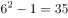。

故正确答案为D。

**来源**：2015年吉林省公务员录用考试《行测》题（4月乙级）第81题

### 第 82 题

1.2，2.8，2，(    )，2.2，2.3

A. 2.7

B. 2.4

C. 2.5

D. 2.6

第 82 题 · 答案与解析

**参考答案（粉笔题库参考内容）**

B

**解析**

在机械拆分找不到规律的基础上，考虑三项递推。观察发现，前两项之和为第三项的2倍，即1.2＋2.8＝2×2，2.8＋2＝（2.4）×2，2.4＋2.2＝2.3×2，满足规律。

故正确答案为B。

**来源**：2015年吉林省公务员录用考试《行测》题（4月乙级）第82题

### 第 83 题

2×6，12×5，60×4，(    )，720×2

A. 240×3

B. 320×3

C. 480×3

D. 120×3

第 83 题 · 答案与解析

**参考答案（粉笔题库参考内容）**

A

**解析**

观察发现，每项的乘积，为后项乘号前面的部分，故所求项的前半部分应为：60×4＝240；每项乘号后面的部分构成公差为-1的等差数列，故所求项应为240×3。

故正确答案为A。

**来源**：2015年吉林省公务员录用考试《行测》题（4月乙级）第83题

### 第 84 题

170，122，82，(    )，26，10

A. 101

B. 38

C. 50

D. 65

第 84 题 · 答案与解析

**参考答案（粉笔题库参考内容）**

C

**解析**

数列起伏较大，考虑幂次数列。观察发现，170＝13^2＋1，122＝11^2＋1，82＝9^2＋1，（50）＝7^2＋1，26＝5^2＋1，10＝3^2＋1。

故正确答案为C。

**来源**：2015年吉林省公务员录用考试《行测》题（4月乙级）第84题

### 第 85 题

1，3，-1，7，21，53，（    ）

A. 135

B. 142

C. 169

D. 175

第 85 题 · 答案与解析

**参考答案（粉笔题库参考内容）**

C

**解析**

在作差找不到规律的基础上，考虑加和。观察发现，相邻三项之和分别为：3、9、27、81、（243），构成公比为3的等比数列，故所求项应为243－21－53＝169。

故正确答案为C。

**来源**：2015年吉林省公务员录用考试《行测》题（4月乙级）第85题

### 第 86 题

2015年政府工作报告的高频词有26个，“发展”、“改革”两词居前，高频词出现的总次数是“改革”一词出现次数的11.5倍多3，“发展”一词出现的次数比“改革”一词多54次，比高频词出现的总次数的1/7多6。则2015年政府工作报告的26个高频词共出现多少次?

A. 678

B. 854

C. 777

D. 715

第 86 题 · 答案与解析

**参考答案（粉笔题库参考内容）**

B

**解析**

由条件“比高频词出现的总次数的1/7多6”可知，高频词的总次数应能被7整除，排除A、D两项；

由条件“高频词出现的总次数是‘改革’一词出现次数的11.5（23/2）倍多3”可知，高频词出现的总次数减3应为23的倍数，排除C项。

故正确答案为B。

**考点**：和差倍比问题

**来源**：2015年吉林省公务员录用考试《行测》题（4月乙级）第86题

### 第 87 题

某高校学生处要在大一新生中组织篮球比赛，赛制为单循环形式，即每两个队之间都赛一场，如果学生处计划安排21场比赛，则应邀请多少支球队参加比赛?

A. 5

B. 8

C. 7

D. 6

第 87 题 · 答案与解析

**参考答案（粉笔题库参考内容）**

C

**解析**

单循环比赛每两队之间只比赛一场，若安排21场比赛需要邀请n支球队参加，则列式应为：C_n^2＝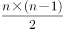＝21，解得n＝7。

故正确答案为C。

**考点**：排列组合问题-其他

**来源**：2015年吉林省公务员录用考试《行测》题（4月乙级）第87题

### 第 88 题

某书店开学前新进一批图书，原计划按40％的利润定价出售，售出80％的图书之后，剩下的图书打折促销，结果所得利润比原计划少14％，则剩下的图书销售时按定价打了几折?

A. 7

B. 8.5

C. 8

D. 7.5

第 88 题 · 答案与解析

**参考答案（粉笔题库参考内容）**

C

**解析**

设新进图书的成本为10，数量为10，售出80%后打x折销售，则依据题意其列式应为：8×14＋2×14/10x－100＝40×（1－14%），解得x＝8，即打了八折。

故正确答案为C。

**考点**：经济利润问题

**来源**：2015年吉林省公务员录用考试《行测》题（4月乙级）第88题

### 第 89 题

央视“出彩中国人”节目中有三位嘉宾为选手进行投票，获得1票以上者方可进入下一轮，则选手进入下一轮的概率为：

A. 1/2

B. 3/8

C. 3/4

D. 2/3

第 89 题 · 答案与解析

**参考答案（粉笔题库参考内容）**

A

**解析**

“获得1票以上者方可进入下一轮”，意为必须拿到两票或两票以上才能进入下一轮。每一位嘉宾的投票均包括给票或不给票两种可能，则：

获得两票的概率为：1/2×1/2×1/2×C_3^2＝3/8；获得三票的概率为：1/2×1/2×1/2＝1/8。则进入下一轮的概率为：3/8＋1/8＝1/2。

故正确答案为A。

**考点**：给概率求概率

**来源**：2015年吉林省公务员录用考试《行测》题（4月乙级）第89题

### 第 90 题

为响应建设“绿色城市”的号召，某社区党员义务植树300棵，由于参加植树的全体党员植树的积极性高涨，实际工作效率提高为原来的1.2倍，结果提前20分钟完成任务，则原来每小时植树多少棵?

A. 120

B. 150

C. 135

D. 125

第 90 题 · 答案与解析

**参考答案（粉笔题库参考内容）**

B

**解析**

“实际工作效率提高为原来的1.2倍”，即为实际效率与原效率之比为6：5。植树总量不变，时间与效率为反比，则所用时间之比为5：6。提前的1份时间为提前了20分钟，则原计划用20×6＝120分钟，则原来每小时植树＝300÷2＝150棵。

故正确答案为B。

**考点**：给具体单位型

**来源**：2015年吉林省公务员录用考试《行测》题（4月乙级）第90题

## 材料 1

根据下面资料回答91～95题。

2014年上半年我国主要污染物排放状况

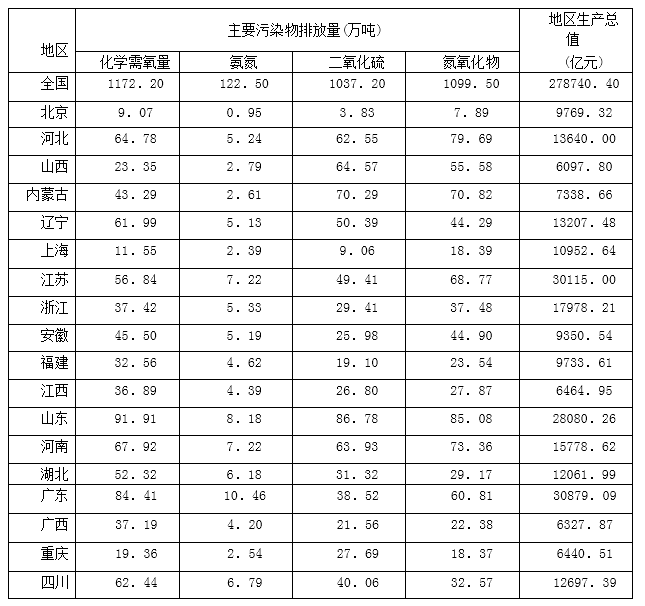

### 第 91 题

化学需氧量排放最多的地区的排放量约是排放最少的地区的多少倍?

A. 9

B. 12

C. 11

D. 10

第 91 题 · 答案与解析

**参考答案（粉笔题库参考内容）**

D

**解析**

直接查表可知，化学需氧量排放最多的地区为山东（91.91万吨），排放最少的地区为北京（9.07万吨），则最多约是最少的：91.91/9.07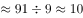倍。

故正确答案为D。

**考点**：现期倍数、统计表

**来源**：2015年吉林省公务员录用考试《行测》题（4月乙级）第91题

### 第 92 题

地区生产总值最高的地区，化学需氧量排放占全国该污染物总排放量的比重约为：

A. 4.8％

B. 8.4％

C. 7.2％

D. 6.0％

第 92 题 · 答案与解析

**参考答案（粉笔题库参考内容）**

C

**解析**

查找表格，地区生产总值最高的为广东省，其化学需氧量为84.41万吨，占全国的比重＝84.41/1172.20，首位不同，直除首位商7。

故正确答案为C。

**考点**：现期比重、统计表

**来源**：2015年吉林省公务员录用考试《行测》题（4月乙级）第92题

### 第 93 题

以万亿元计，地区生产总值平均的氨氮排放量约为多少万吨?

A. 3.23

B. 5.97

C. 5.45

D. 4.39

第 93 题 · 答案与解析

**参考答案（粉笔题库参考内容）**

D

**解析**

全国地区生产总值为278740.40亿元≈27.87万亿元，全国氨氮排放量为122.50万吨，则地区生产总值平均的氨氮排放量＝122.5÷27.87，直除首位商4。

故正确答案为D。

**考点**：现期平均数、统计表

**来源**：2015年吉林省公务员录用考试《行测》题（4月乙级）第93题

### 第 94 题

下图哪个选项为二氧化硫污染物排放量前三地区的二氧化硫排放量的合计数?

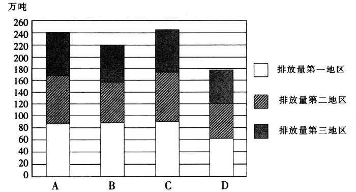

A. A

B. B

C. C

D. D

第 94 题 · 答案与解析

**参考答案（粉笔题库参考内容）**

B

**解析**

查表可知，二氧化硫污染物排放量前三的地区分别为山东、内蒙古、山西，其排放总和＝86.78＋70.29＋64.57≈87＋70＋65＝222万吨，符合排放量的为B选项。

故正确答案为B。

**考点**：简单加减计算、统计表

**来源**：2015年吉林省公务员录用考试《行测》题（4月乙级）第94题

### 第 95 题

从上述资料中可以推出，2014年上半年：

A. 地区生产总值越高的地区，氮氧化物排放量越多

B. 表中各种污染物排放量均低于20万吨的有2个地区

C. 上海市平均每亿元地区生产总值二氧化硫排放量高于10吨

D. 地区生产总值占全国生产总值比重超过10％的有2个地区

第 95 题 · 答案与解析

**参考答案（粉笔题库参考内容）**

B

**解析**

A项：查表可知，地区生产总值最高的地区是广东，而氮氧化物排放量最多的地区是山东，表述错误；

B项：各种污染物排放量均低于20万吨的有北京和上海两个地区，表述正确，当选；

C项：上海市平均每亿元地区生产总值二氧化硫排放量约为：9.06÷1.095，很明显＜10吨，表述错误；

D项：全国生产总值的10％为：278740.40×10％＝27874.04亿元，超过该数值的地区有江苏、山东、广东，共3个，表述错误。

故正确答案为B。

**考点**：统计表、综合分析

**来源**：2015年吉林省公务员录用考试《行测》题（4月乙级）第95题

## 材料 2

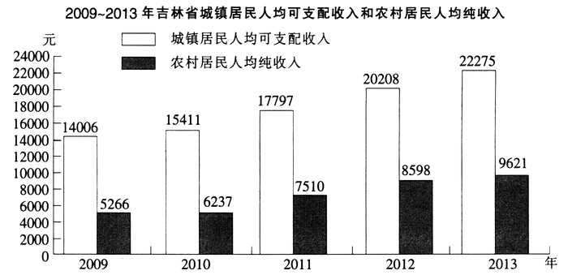

### 第 96 题

2013年吉林省城镇居民人均可支配收入比上年增长：

A. 10.2％

B. 111.9％

C. 11.9％

D. 110.2％

第 96 题 · 答案与解析

**参考答案（粉笔题库参考内容）**

A

**解析**

2013年城镇居民人均可支配收入同比增长率＝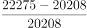＝2067/20208＝（2020＋47）÷20208≈10.2％。

故正确答案为A。

**考点**：一般增长率、统计图

**来源**：2015年吉林省公务员录用考试《行测》题（4月乙级）第96题

### 第 97 题

2009～2013年间，吉林省城镇居民人均可支配收入平均每年增加：

A. 1654元

B. 5569元

C. 4455元

D. 2067元

第 97 题 · 答案与解析

**参考答案（粉笔题库参考内容）**

D

**解析**

2009年城镇居民人均可支配收入为14006元，2013年城镇居民人均可支配收入为22275元，则四年间平均每年增加：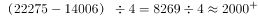元。

故正确答案为D。

**考点**：年均增长量、统计图

**来源**：2015年吉林省公务员录用考试《行测》题（4月乙级）第97题

### 第 98 题

2009～2013年间，吉林省城乡居民收入的差距：

A. 保持稳定

B. 有逐年扩大的趋势

C. 有逐年缩小的趋势

D. 有时缩小有时扩大

第 98 题 · 答案与解析

**参考答案（粉笔题库参考内容）**

B

**解析**

2009-2013年吉林省城乡居民收入的差距依次为：

2009年：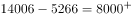元；2010年: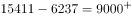元；

2011年：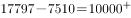元；2012年：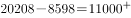元；2013年：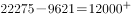元，呈逐年扩大的趋势。

故正确答案为B。

备注：通过用直尺直接测量柱状图中城乡之间的差值比较更为简单。

**考点**：简单加减计算、统计图

**来源**：2015年吉林省公务员录用考试《行测》题（4月乙级）第98题

### 第 99 题

2009～2013年间，吉林省城乡居民收入上涨最快的年份是：

A. 2010年

B. 2013年

C. 2012年

D. 2011年

第 99 题 · 答案与解析

**参考答案（粉笔题库参考内容）**

D

**解析**

通过观察可以直接看出，2010年城乡居民人均可支配收入增速较慢，而2013年农村居民人均可支配收入增速较慢，可以直接排除；对比2011与2012年的增速：

2011年同比增速：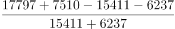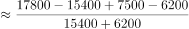=3700/21600，

2012年同比增速：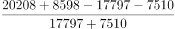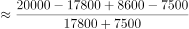=3300/25300，

对比3700/21600，3300/25300两个分数，前者分子大，分母小，则后者分数较小，增速最快为2011年。

故正确答案为D。

**考点**：一般增长率、统计图

**来源**：2015年吉林省公务员录用考试《行测》题（4月乙级）第99题

### 第 100 题

关于2009-2013年间吉林省居民收入，下列说法正确的是：

A. 农村居民人均纯收入比城镇居民人均可支配收入的增加的绝对值大

B. 城镇居民人均可支配收入各年增长率大于农村居民人均纯收入增长率

C. 农村居民人均纯收入比城镇居民人均可支配收入的增长幅度大

D. 农村居民人均纯收入各年增长率相同

第 100 题 · 答案与解析

**参考答案（粉笔题库参考内容）**

C

**解析**

A项：2009-2013年间，农村居民人均纯收入的增长值为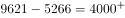元，而城镇居民人均可支配收入的增长值为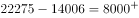元，城镇较大，表述错误；

B项：根据材料，无法表示2009年城镇居民人均可支配收入的增长率、农村居民人均纯收入的增长率，因此无法比较2009年两个增长率的大小，表述错误；

C项：几年间，农村居民人均收入的增长率为：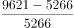=4355/5266=0.8+；城镇居民人均可支配收入的增长率为：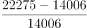＝8269/14006≈0.6，故农村居民的增幅更大，表述正确；

D项：根据材料，无法表示2009年农村居民人均纯收入的增长率，因此无法比较各年增长率是否相同,表述错误。

故正确答案为C。

**考点**：统计图、综合分析

**来源**：2015年吉林省公务员录用考试《行测》题（4月乙级）第100题

