# 2015年吉林省公务员录用考试《行测》题（9月乙级）

<!-- gwy:overview:start -->
> **吉林 · 2015 · 行测 · 乙级** ｜ 100 题 · 图片 59 处 · 答案随题折叠

| 题型模块 | 题量 | 题号 |
| --- | ---: | ---: |
| 常识判断 | 20 | 1–20 |
| 言语表达与理解 | 30 | 21–50 |
| 数量关系 | 10 | 51–60 |
| 判断推理 | 30 | 61–90 |
| 资料分析 | 10 | 91–100 |
| **合计** | **100** | |

导航：[题型与作答说明](#题型与作答说明) · [题目](#题目) · [材料 1](#材料-1)
<!-- gwy:overview:end -->

> 候选采集稿。参考答案及解析来自粉笔页面，不代表官方答案或真实高分答卷；来源使用许可与原卷对应关系仍需人工核实。

## 题型与作答说明

常识判断

（20题）

常识判断部分主要考查考生的基本常识和基本经验。请根据题目要求，在四个选项中找出一个正确答案。

言语表达与理解

（30题）

本部分包括表达与理解两方面的内容。请根据题目要求，在四个选项中选出一个最恰当的答案。

数量关系

（10题）

本部分包括两种类型的试题： 一、数字推理：共5题。给你一组数字或有关数字关系的表述，要求你仔细观察其中的规律，然后从四个选项中选出你认为最合理的一项来填补空缺项或解决问题。 二、数学运算：共5题。请你充分利用所给条件，寻找解决问题的捷径。

判断推理

（30题）

本部分包括图形推理、定义判断、类比推理与逻辑判断四种类型的试题。

资料分析

（10题）

针对下列给定资料回答问题，共10题。你应根据资料提供的信息进行分析、比较、计算、处理。

## 题目

### 第 1 题

习近平总书记在吉林调研时强调，保持战略定力，增强发展自信，坚持变中求新，变中求进，变中突破。走出一条质量更高，效益更好，结构更优，优势充分释放的发展新路。这段话说明：

A. 要大力推进创新驱动发展，形成以创新为引领的经济体系

B. 适应和引领经济发展新常态，我们的认识和实践已成熟

C. 我国的经济形态已经进入分工优化，结构合理的新阶段

D. 东北老工业基地的振兴发展，应大唱“工业一柱擎天”

第 1 题 · 答案与解析

**参考答案（粉笔题库参考内容）**

A

**解析**

A项正确，在本次考察期间，习主席强调：要大力推进创新驱动发展，下好创新这步先手棋，激发调动全社会创新创业活力，加快形成以创新为主要引领和支撑的经济体系。

B项错误，要在适应经济发展新常态中寻求新突破，认识和实践并未成熟。

C项错误，要推动我国经济向形态更高级、分工更优化、结构更合理的阶段演进。

D项错误，东北老工业基地的振兴不能再单纯依靠单一的工业，要大力推进产业结构优化升级，加快培育新兴产业，发展服务业，扩大基础设施建设。

故正确答案为A。

**考点**：经济建设、重要会议讲话

**来源**：2015年吉林省公务员录用考试《行测》题（9月甲级）第1题

### 第 2 题

国产动画电影《西游记之大圣归来》，从古典名著《西游记》中汲取灵感，凭借优良的制作技术和丰富的视觉效果，塑造了与传统《西游记》完全不同的全新人物形象，它昭示了一条将传统与现代有机结合的国产动画电影发展道路，是一部符合“互联网+”时代要求，整合中国与国外动画资源，具备世界眼光的影片。其创作过程体现的哲学道理是（ ）。

A. 事物质变是量变的必然结果

B. 对规律的认识与改造是其成功的源泉

C. 创造性思维是其成功的源泉

D. 辩证的否定是事物发展和联系的环节

第 2 题 · 答案与解析

**参考答案（粉笔题库参考内容）**

D

**解析**

A项错误，此项说法正确，但是题干没有体现量变与质变之间的关系。

B项错误，“改造规律”说法错误，规律是客观的，不以人的意识为转移，人可以认识规律、掌握规律、运用规律。

C项错误，创造性属于成功的因素之一，但并不是成功的源泉，因此选项表述错误。

D项正确，辩证否定的实质是扬弃，即既克服又保留。《西游记之大圣归来》从古典名著《西游记》中吸取了灵感，这体现了辩证否定的“保留”，但《西游记之大圣归来》克服传统的人物，塑造了全新人物形象，这体现了辩证否定的“克服”。

故正确答案为D。

**考点**：唯物辩证法

**来源**：2015年吉林省公务员录用考试《行测》题（9月乙级）第2题

### 第 3 题

有一副对联，“白话通神，红楼梦、水浒，真不可思议；古文讨厌，欧阳修、韩愈，是什么东西。”这对联最有可能出自：

A. 洋务运动时期

B. 辛亥革命时期

C. 戊戌变法时期

D. 新文化运动时期

第 3 题 · 答案与解析

**参考答案（粉笔题库参考内容）**

D

**解析**

D项正确：新文化运动是一场影响深刻的思想启蒙运动，发端于1915年。其初期的基本内容是：提倡民主和科学，反对专制和迷信盲从；提倡个性解放，反对封建礼教；提倡新文学，反对旧文学，实行文学革命。从题干对联中的关键词“白话通神”和“古文讨厌”可以推知对联作者提倡白话文运动，排斥古文创作，与新文化运动的主张吻合，最有可能创作于这一时期。

A项错误：洋务运动是19世纪60～90年代洋务派所进行的一场引进西方军事装备、机器生产和科学技术以维护封建统治的“自强”、“求富”运动，与题意不符。

B项错误：辛亥革命是近代中国比较完全意义上的资产阶级民主革命，于1911年10月10日爆发，其目的在于推翻清朝专制帝制、建立共和国，与题意不符。

C项错误：戊戌变法又称百日维新，是指1898年6月11日至9月21日维新派人士通过光绪帝进行倡导学习西方，提倡科学文化，改革政治、教育制度，发展农、工、商业等的政治改良运动，与题意不符。

故正确答案为D。

**考点**：中国历史

**来源**：2015年吉林省公务员录用考试《行测》题（9月甲级）第5题

### 第 4 题

古代座次尊卑有别，在鸿门宴上，“项王、项伯东向坐，亚父（范增）南向坐；沛公北向坐，张良西向侍。”按照由尊至卑的顺序排序正确的是：

A. 项王、项伯、沛公、亚父、张良

B. 亚父、项王、项伯、沛公、张良

C. 项王、项伯、亚父、沛公、张良

D. 项王、项伯、沛公、张良、亚父

第 4 题 · 答案与解析

**参考答案（粉笔题库参考内容）**

C

**解析**

我国古代贵族的房屋一般都是堂室结构的，它坐北朝南，前堂后室。在堂上举行的礼节活动，以“南向为尊”；而在室内，则以“东向为尊”。这是因为房屋一般是长方形，东西长而南北窄，故室内最尊的座次是 坐西面东，其次是坐北面南，再次是坐南面北，最后是坐东面西。

从题目中可知，项王和项伯面向东坐，亚父面向南坐，沛公面向北坐，张良面向西侍奉、陪席。

故正确答案为C。

**考点**：文化常识

**来源**：2015年吉林省公务员录用考试《行测》题（9月甲级）第7题

### 第 5 题

明成祖姓名朱棣，其子明仁宗姓名朱高炽，仁宗之子明宣宗姓名朱瞻基，宣宗之子明英宗姓名朱祁镇。从这几位皇帝的名字来看，体现了明朝皇室命名的思想是（    ）。

A. 天人合一

B. 人定胜天

C. 五行相生

D. 押韵合辙

第 5 题 · 答案与解析

**参考答案（粉笔题库参考内容）**

C

**解析**

从题目所给的几个名字来看，木（棣）生火（炽）、火（炽）生土（基）、土（基）生金（镇）。

故正确答案为C。

**考点**：文化常识

**来源**：2015年吉林省公务员录用考试《行测》题（9月乙级）第5题

### 第 6 题

古代陆上丝绸之路在唐朝达到空前繁荣，这在唐诗中就有大量记载，下列诗句中，描写物质文化借丝绸之路传入中国的是（    ）。

A. 养蚕缫茧成匹帛，那堪绕帐作旌旗

B. 蕃人旧日不耕犁，相学如今种禾黍

C. 女为胡妇学胡妆，伎进胡音务胡乐

D. 勃律天西采玉河，坚昆碧碗最来多

第 6 题 · 答案与解析

**参考答案（粉笔题库参考内容）**

D

**解析**

A项错误：出自唐代诗人王建的《凉州行》，描述了胡人汉化，学习汉人的农桑生产，织成一匹一匹的绢帛，用来制作旌旗围绕在营帐四周。表明了农桑技术由汉地传入西域。

B项错误：同样出自王建的《凉州行》，也说明了胡人从前是不懂农事的，现在也学汉人种起禾黍（指粮食作物）来。同样表明了农桑技术由汉地传入西域。

C项错误：出自唐代诗人元稹的《法曲》，女人都愿嫁给西域的男子为妻而学习西域的衣着打扮，那些以歌舞为业的歌女也愿学习西域的音乐舞蹈来表演。表明歌舞从西域传入汉地，但歌舞不属于物质。

D项正确：出自杜甫的《喜闻盗贼蕃寇总退口号》，其中的玉和碗是从西域传入中原的物品，且玉和碗是属于物质，D项符合题目要求。

故正确答案为D。

**考点**：中国历史

**来源**：2015年吉林省公务员录用考试《行测》题（9月乙级）第6题

### 第 7 题

下面为中国古代一次重要的战役形势图，据此进行的下列判断，正确的是：

A. 交战双方分别为刘邦军队和项羽军队

B. 是中国历史上著名的以少胜多的战役

C. 发生在统一的中央集权制国家建立前

D. 双方决战地位于今河北省邯郸市境内

第 7 题 · 答案与解析

**参考答案（粉笔题库参考内容）**

B

**解析**

A项错误，从图片中可以看到交战双方是项羽军和王离军。

B项正确，项羽军和王离军在巨鹿交战，由此可判断此战役为“巨鹿之战”。在此战役中，项羽率领数万楚军同秦名将章邯、王离所率四十万秦军主力在巨鹿（今河北平乡）进行交战，也是中国历史上著名的以少胜多的战役之一。

C项错误，我国历史上第一个统一的中央集权制国家是秦朝，巨鹿之战正是发生在秦朝。

D项错误，巨鹿位于今河北平乡。

故正确答案为B。

**考点**：中国历史

**来源**：2015年吉林省公务员录用考试《行测》题（9月甲级）第8题

### 第 8 题

一位外国游客想了解齐鲁文化，下列最能代表齐鲁文化特点的旅游路线是：

A. 烟台—潍坊—淄博—济南

B. 济南—淄博—泰安—曲阜

C. 青岛—烟台—威海—泰安

D. 青岛—潍坊—济南—曲阜

第 8 题 · 答案与解析

**参考答案（粉笔题库参考内容）**

B

**解析**

齐国是以淄博为国都，山东以东的大片土地，鲁国是以曲阜为国都，山东以西的小块土地。据此，可知济南—淄博—泰安—曲阜路线最能代表齐鲁文化。

故正确答案为B。

**考点**：文化常识

**来源**：2015年吉林省公务员录用考试《行测》题（9月甲级）第6题

### 第 9 题

墨子说：“今也，农夫早出暮入，强乎耕稼树艺，多聚菽粟，而不敢怠倦者，何也？曰：彼以为强必富，不强必贫；强必饱，不强必饥，故不敢怠倦。”上述引文反映出在战国时期（    ）。

A. 铁器牛耕推广，必然导致剥削

B. 农民地位低下，阶级矛盾日益激化

C. 农民辛苦劳作，生活悲惨困苦

D. 生产方式改革，农民生产积极性提高

第 9 题 · 答案与解析

**参考答案（粉笔题库参考内容）**

D

**解析**

战国时代,封建生产关系代替了奴隶制的生产关系,农民的劳动兴趣和积极性比奴隶高。从题目中可知，农夫早出暮入地劳动，不是因为被压迫，而是为自己（为强必富，不强必贫；强必饱，不强必饥）劳动。

故正确答案为D。

**考点**：中国历史

**来源**：2015年吉林省公务员录用考试《行测》题（9月乙级）第9题

### 第 10 题

下列诗句与其所反映的天气现象，对应错误的是（    ）。

A. 忽如一夜春风来，千树万树梨花开——升温

B. 羌笛何须怨杨柳，春风不度玉门关——季风

C. 东边日出西边雨，道是无晴却有晴——对流雨

D. 黄梅时节家家雨，青草池塘处处蛙——梅雨

第 10 题 · 答案与解析

**参考答案（粉笔题库参考内容）**

A

**解析**

A项错误，A项是唐朝边塞诗人岑参在《白雪歌送武判官归京》中的诗句，写的是北国雪景。

B项正确，我国习惯上以大兴安岭—阴山—贺兰山为界，把我国划分为季风区和非季风区。玉门关地处非季风区域内，受夏季风影响小。诗句中“春风”指季风。

C项正确，赤道附近，或夏季的中纬度大陆地区，因地面温度较高，近地面湿热空气受热膨胀上升，形成强烈的空气对流，使上升气流中的水汽，在高空遇冷凝结，形成降水。对流雨历时短，范围小，但强度大，常伴有风暴、雷电。“东边日出西边雨，道是无晴却有晴”是对流雨的生动写照。

D项正确，五月间，江南梅子黄了，熟了，大都是阴雨连连的时候，成为“梅雨季节”，所以称江南雨季为“黄梅时节”。

本题为选非题，故正确答案为A。

**考点**：自然地理

**来源**：2015年吉林省公务员录用考试《行测》题（9月乙级）第10题

### 第 11 题

公务员小李因工作遇到一些困难和挫折，最近处于情绪消沉状态，下列最适合引导他摆脱这种状态的诗句是：

A. 我自横刀向天笑，去留肝胆两昆仑

B. 莫愁前路无知己，天下谁人不识君

C. 雄关漫道真如铁，而今迈步从头越

D. 少年辛苦终身事，莫向光阴惰寸功

第 11 题 · 答案与解析

**参考答案（粉笔题库参考内容）**

C

**解析**

A项错误，A项是谭嗣同一首绝命诗，表达了愿以身殉法来唤醒和警策国人的决心。

B项错误，B项是唐代诗人高适的赠别之作，是高适赠予临别友人要满怀信心和力量。用在此处显然有劝小李离职之意，因此不合适。

C项正确，C项是毛泽东名作《忆秦娥·娄山关》中的一句词，意思是要从头大踏步越过雄关,且有取得胜利的坚定不移的信心，因此适合鼓励遇到挫折的小李。

D项错误，D项表达的意思是读书求学，从来不是一件轻松的事情，它需要恒心和毅力、坚持和忍耐，但这一时的辛苦换来的将是终身的快乐和成功的基石。也不太适合小李的情况。

故正确答案为C。

**考点**：文学常识

**来源**：2015年吉林省公务员录用考试《行测》题（9月甲级）第13题

### 第 12 题

民歌来源于民间，主要以口头创作、口头流传、不断再创作的方式生存于民间，是一个国家、一个民族、一个地区人们思想感情的体验和表达手法的结晶。下列关于民歌说法错误的是（    ）。

A. 《诗经》是我国第一部诗歌总集

B. 演唱藏族民歌常用乐器冬不拉伴奏

C. “信天游”是西北地区民歌形式

D. 狩猎歌和牧歌是蒙古族民歌代表题材

第 12 题 · 答案与解析

**参考答案（粉笔题库参考内容）**

B

**解析**

A项正确，《诗经》是我国古代第一部诗歌总集，作品产生的时代，上起西周初年（约公元前11世纪），下迄春秋中叶（约公元前7世纪）。《诗经》是中国优秀传统文化中的核心经典之一。

B项错误，冬不拉是一种哈萨克族民间流行的弹拨乐器。

C项正确，“信天游”是劳动人民最为喜爱的一种艺术形式，又称“顺天游”“小曲子”，流行于陕西北半部及宁夏、山西、内蒙古与陕西接壤的部分地区。

D项正确，蒙古族民歌的主要体裁有狩猎歌、牧歌、赞歌、思乡曲、礼俗歌、短歌、叙事歌、摇儿歌和儿歌等。公元7、8世纪以前，蒙古族先民在我国黑龙江省西部的额尔古纳河流域从事狩猎劳动时，产生了狩猎歌曲。之后，蒙古族先民来到蒙古高原，基本放弃了原有的狩猎生产方式，改为以畜牧业劳动为主的生产方式，反映游牧生活的牧歌体裁随之产生。

本题为选非题，故正确答案为B。

**考点**：文化常识

**来源**：2015年吉林省公务员录用考试《行测》题（9月乙级）第12题

### 第 13 题

下列有关生活常识的叙述，正确的是（    ）。

A. 火灾中如果身上着火要马上拍打

B. 早上蜘蛛网上有水珠表示要下雨

C. 衣服染上墨水用牛奶清洗效果好

D. 鱼刺卡在喉咙时可喝浓醋来消除

第 13 题 · 答案与解析

**参考答案（粉笔题库参考内容）**

C

**解析**

A项错误，火灾发生时，如果身上着火，千万不要惊慌失措，东奔西跑或胡乱拍打。因为奔跑时形成的小风会使火烧得更旺，同时跑动还会把火种带到别处，引燃周围的可燃物；胡乱拍打，往往顾前顾不了后，在痛苦难熬中，一旦支持不住，就会造成严重烧伤，甚至丧失生命。所以，一旦不幸身上着火，首先应该设法脱掉衣帽。如果来不及脱掉，可以把衣服撕破扔掉。若这都来不及做，可以在没有燃烧物的地方倒在地上打滚，将身上的火苗压灭。

B项错误，早晨蜘蛛网上有水珠表示天晴。天气晴朗的日子里，早上温度低，使空气中的水蒸气凝结成小水珠，挂在蜘蛛网上闪烁着，通常天气不会下雨。下雨的征兆有青蛙鸣叫、燕子低飞、蚂蚁过马路、蚯蚓出洞等。蜘蛛露天结网如果是和地面平行的，大部分的时间则预示着不会下雨；若是和地面垂直的，绝大多数时间应该是要下雨的。

C项正确，衣物上的蓝墨水污迹，可用牛奶搓揉浸洗。

D项错误，虽然酸性物质能分解软骨，但必须是高浓度的强酸。鱼骨头卡在喉咙的时候最好不要喝醋、因为在短时间鱼骨头是不会被醋酸软化而被弄掉的，“吃”醋反而造成了咽喉黏膜广泛性灼伤。

故正确答案为C。

**考点**：生活常识

**来源**：2015年吉林省公务员录用考试《行测》题（9月乙级）第13题

### 第 14 题

在北京田径世锦赛上，当看到中国运动员夺金时，许多观众会出现心跳加快、面红耳赤、血压升高的现象。这种现象是由于（    ）。

A. 肾上腺激素分泌增多

B. 性激素分泌增多

C. 甲状腺激素分泌增多

D. 生长激素分泌增多

第 14 题 · 答案与解析

**参考答案（粉笔题库参考内容）**

A

**解析**

A项正确，肾上腺素能使心肌收缩力加强、兴奋性增高，传导加速，心输出量增多。外在表现就是心跳加快、面红耳赤、血压升高等现象。

B项错误，性激素的作用是促进性器官成熟、副性征发育及维持性功能等。

C项错误，甲状腺素的主要作用是促进物质与能量代谢，促进生长和发育过程。

D项错误，生长激素的主要生理功能是促进神经组织以外的所有其他组织生长；促进机体合成代谢和蛋白质合成；促进脂肪分解。

故正确答案为A。

**考点**：生物常识

**来源**：2015年吉林省公务员录用考试《行测》题（9月乙级）第14题

### 第 15 题

在中国人民抗日战争暨世界反法西斯战争胜利70周年纪念活动中，有一种标识被指定用于背景板、标牌、彩旗等环境布置和相关宣传品中，该标识是：

A. 

B. 

C. 

D. 

第 15 题 · 答案与解析

**参考答案（粉笔题库参考内容）**

A

**解析**

该标识以数字“70”符号，时间“1945-2015”，和平鸽，组成“V”字的长城图案为设计元素。数字“70”与时间“1945-2015”共同组成的标志性符号，衬以长城图案组成展现胜利的“V”字，体现对中国人民抗日战争暨世界反法西斯战争胜利的庆祝，亦代表中华民族组成的钢铁长城，共同抗敌。图案上方为五只象征和平与希望的和平鸽由远及近展翅飞翔，表现对历史的纪念、对和平的向往，也象征五大洲人民团结一心，在血与火的洗礼后重生，携手前行，共创美好未来。飞翔的和平鸽也表达了全国各族人民在中国共产党的领导下，承载着中华民族伟大复兴的使命飞向未来。

故正确答案为A。

**考点**：重要事件

**来源**：2015年吉林省公务员录用考试《行测》题（9月甲级）第4题

### 第 16 题

声音与人们的生活密切相关，以下有关声音现象的说法正确的是（    ）。

A. 市区内禁止鸣笛是为了减弱声音在传播过程中的噪音

B. 用超声波能粉碎人体内的结石，说明超声波具有能量

C. “闻其声而知其人”主要是根据声音的音调进行判断的

D. 在生活中，有些高科技产品，不振动也可以发出声音

第 16 题 · 答案与解析

**参考答案（粉笔题库参考内容）**

B

**解析**

A项错误，市区内禁止鸣笛是为了从声源处切断噪音。

B项正确，超声碎石是利用电能转变成声波，声波在超声转换器内产生机械振动能，通过超声电极传递到超声探杆上，使其顶端发生纵向振动，当与坚硬的结石接触时产生碎石效应，但对柔软的组织并不造成损伤。

C项错误，“闻其声而知其人”靠的是音色。

D项错误，声音是由物体振动产生的声波，是通过介质（空气或固体、液体）传播并能被人或动物听觉器官所感知的波动现象。因此，声音的发出和传递都要靠振动，没有振动就没有声音。

故正确答案为B。

**考点**：物理常识

**来源**：2015年吉林省公务员录用考试《行测》题（9月乙级）第16题

### 第 17 题

下列说法中，错误的是：

A. 小刚喜欢观察月相，他观察上弦月的最佳时间应是农历每月上半月的上半夜

B. 小亮若乘宇宙飞船飞到金星上，他会看到太阳是从西面升起，并向东方落下

C. 小明10岁时裸眼见到一次哈雷彗星，若他能活到90岁，还可能裸眼见一次

D. 小林对类地行星具有浓厚的研究兴趣，因此他应重点研究水星、木星和土星

第 17 题 · 答案与解析

**参考答案（粉笔题库参考内容）**

D

**解析**

A项正确，农历每月初八前后，月亮上半夜偏西面出来，这时月亮一边是明的，一边是暗的——东暗西明，看来弦在上边，故称之为上弦。

B项正确，在地球上看到太阳东升西落，原因是地球是自西向东的自转。八大行星中只有金星和天王星是自东向西自转，所以在金星上太阳是西升东落。

C项正确，哈雷彗星是每76.1年环绕太阳一周的周期彗星，肉眼可以看到。

D项错误，八大行星分为二类：类地行星（包括水、金、地、火）是与地球相类似的行星。它们距离太阳近，体积和质量都较小，平均密度较大，表面温度较高，大小与地球差不多，也都是由岩石构成的。类木行星为类似木星的气体行星，体积较其他岩质的行星来的大，包括木星，土星，天王星以及海王星等四个行星，有时也只指木星和土星这种行星。因此，小林应重点研究水、金、地、火四大行星。

本题为选非题，故正确答案为D。

**考点**：自然地理

**来源**：2015年吉林省公务员录用考试《行测》题（9月甲级）第17题

### 第 18 题

一般情况下，人体内的血液约有20%贮存在贮血器官里。下列不属于人体贮血器官的是（    ）。

A. 脾脏

B. 肝脏

C. 心脏

D. 皮肤

第 18 题 · 答案与解析

**参考答案（粉笔题库参考内容）**

C

**解析**

A项正确，脾的主要功能是过滤和储存血液，被称为“血液仓库”。

B项正确，肝是贮藏血液的主要器官，有调节血量的功能。

C项错误，心脏是人体循环系统的主要器官，在人体的血液循环过程中提供主要动力。

D项正确，皮肤是人体最大的器官，由表皮、真皮（中胚层）、皮下组织三层组成，真皮层中有很多毛细血管和小静脉丛，平时血流比较缓慢，当人体亟需时，也可将贮存的血液释放到循环中。

本题为选非题，故正确答案为C。

**考点**：生物常识

**来源**：2015年吉林省公务员录用考试《行测》题（9月乙级）第18题

### 第 19 题

据媒体报道，近日海南航空由成都飞往北京的一航班在飞行途中遭遇晴空颠簸，导致旅客和机组人员受伤。下列关于晴空颠簸的说法错误的是（    ）。

A. 航班通过接受定时定点和飞机尺度颠簸范围的预报来避免颠簸

B. 遭遇晴空颠簸，旅客避免受伤的最好办法就是全程系好安全带

C. 从目前的科技水平来讲，晴空颠簸属于飞行中的一种不可抗力

D. 飞机可以通过升降高度，或者偏离航线来脱离晴空颠簸的影响

第 19 题 · 答案与解析

**参考答案（粉笔题库参考内容）**

A

**解析**

A项错误，虽然目前航空气象部门根据高空探测资料可以预测激流带的存在和范围，但无法做到定时定点地预测。

B项正确，无论如何，在飞行过程中全程系好安全带是聪明的做法。

C项正确，飞机颠簸主要是由于飞机飞入扰动气流区，扰动气流使作用在飞机上的空气动力和力矩失去平衡，属于不可抗力因素的一种。

D项正确，如果飞行中出现颠簸，可改变高度几百米或暂时偏离航线几十千米，一般可以脱离颠簸区。采取改变高度的脱离方法，往往能更迅速地脱离颠簸区。

本题为选非题，故正确答案为A。

**考点**：科技理论与成就

**来源**：2015年吉林省公务员录用考试《行测》题（9月乙级）第19题

### 第 20 题

下列广告行为，不符合法律规定的是（    ）。

A. 在互联网上发布内容符合规定的农药广告

B. 在广播电台和电视台发布非品牌白酒广告

C. 在小学教材的封底上发布环保公益广告

D. 广告代言人为其未使用过的化妆品作广告

第 20 题 · 答案与解析

**参考答案（粉笔题库参考内容）**

D

**解析**

D项错误，我国广告法第38条规定：广告代言人在广告中对商品、服务做推荐、证明，应当依据事实，符合本法和有关法律、行政法规规定，并不得为其未使用过的商品或者未接受过的服务做推荐、证明。

本题为选非题，故正确答案为D。

**考点**：其他法律法规

**来源**：2015年吉林省公务员录用考试《行测》题（9月乙级）第20题

### 第 21 题

令人欣喜的是，在此次发布的中国经济“2015半年报”中，服务业、高技术产业、网络消费等数据格外“\_\_\_\_\_\_\_”。其快速增长的背后，是改革创新的“\_\_\_\_\_\_\_”正在破解发展中的现实困难，激发引领中国经济可持续发展的不竭动力。

填入下列横线处的词语，最恰当的一组是:

A. 惊艳 利刃

B. 吸睛 法宝

C. 惹眼 杀手锏

D. 夺目 法眼

第 21 题 · 答案与解析

**参考答案（粉笔题库参考内容）**

B

**解析**

突破口是第二空，文段论述改革创新破解了现实困难，所以空格处要体现出解决问题的方法，A项“利刃”比喻为解决问题的有效办法，符合文意，保留；B项“法宝”比喻用起来特别有效的工具、方法或经验，符合文意，保留。C项“杀手锏”同撒手锏，比喻最关键的时刻使出最拿手的招数，文段是描述改革创新，并没有最关键时刻的意思，排除；D项“法眼”泛指敏锐深邃的眼力，与“破解”搭配不当，排除。

第一空，文段论述服务业、高技术产业、网络消费等数据好看，B项“吸睛”表示吸引眼球，能体现出数据令人欣喜的意思，符合文意，当选。A项“惊艳”强调看到了非常美丽的事物而惊奇、内心受到震动，文中并无惊奇、惊叹之意，不符合文意，排除。

故正确答案为B。

**考点**：实词填空、词的辨析-搭配对象

**来源**：2015年吉林省公务员录用考试《行测》题（9月甲级）第28题

### 第 22 题

现在新疆摘棉花都已经请不到人，人都跑到外地去了，这么大面积的棉花田怎么办？美国摘棉花靠的全是机械，以色列摘西红柿也全是\_\_\_\_\_\_\_，但我们的农业基本上都靠人。

填入下列横线处的词语，最恰当的一组是:

A. 智能化

B. 无人化

C. 机械化

D. 自动化

第 22 题 · 答案与解析

**参考答案（粉笔题库参考内容）**

B

**解析**

根据文段的对应关系，“已经请不到人，人都跑到外地去了”，以及后文的“但我们的农业基本上都靠人”可知，“无人化”最符合文意。

“智能化”“自动化”“机械化”没着重强调人的作用，且C项“机械化”与文中“机械”重复，排除。

故正确答案为B。

**考点**：关联关系-转折关系、实词填空、对应关系-前后呼应

**来源**：2015年吉林省公务员录用考试《行测》题（9月甲级）第29题

### 第 23 题

不知道“用人不疑，疑人不用”最早出于何处，又是谁人的发明。但从读史得知，它可以说是一句\_\_\_\_\_\_\_，不时都有人说到它，也认可它的正确性。然而，过往的许多事实证明，一些被“用人不疑”的人，其实未必是\_\_\_\_\_\_\_的贤者；而一些被“疑人不用”的人，也未必就是\_\_\_\_\_\_\_。多疑还是不疑由某一个人独断于心的时候，这种错位就不能避免了。

填入下列横线处的词语，最恰当的一组是:

A. 老生常谈 德才兼备 不肖之徒

B. 肺腑之言 多谋善断 无良之辈

C. 无稽之谈 大公无私 无耻之徒

D. 经验之谈 德高望重 无名鼠辈

第 23 题 · 答案与解析

**参考答案（粉笔题库参考内容）**

A

**解析**

第一空，根据“不时都有人说到它，也认可它的正确性”可知，横线处应体现这是一句经常被提及的、正确的话。A项“老生常谈”比喻人们听惯了的没有新鲜意思的话，符合“经常被提及”这一语境，保留；D项“经验之谈”指言谈有实践作为根据、切实、可靠，可体现正确性，符合文意，保留；B项“肺腑之言”指发自内心的真诚的话，强调的是真诚，而非经常被说，不符合文意，排除；C项“无稽之谈”指毫无根据的说法，与后文“认可它的正确性”相悖，排除。

第二空，由“过往的许多事实证明，一些被‘用人不疑’的人，其实未必是······的贤者”可知，横线处需体现贤者具备的特质。A项“德才兼备”指既有好的思想品质，又有工作的才干和能力，全面地体现了贤者应有的品德与才能，保留；D项“德高望重”指的是道德高尚，名望很大，侧重于地位而不是能力，与文意不符，排除。

第三空，代入验证。A项“不肖之徒”指不才，不正派；品行不好，没有出息等，与前文“而一些被‘疑人不用’的人，也未必就是······”可形成对应，当选。

故正确答案为A。

**考点**：对应关系-主题词、对应关系-前后呼应、成语填空

**来源**：2015年吉林省公务员录用考试《行测》题（9月甲级）第30题

### 第 24 题

从根本上讲，一部电视剧是因为故事、人物与情境让观众在大呼过瘾的同时有所感悟，才能＿＿＿＿人气甚至＿＿＿＿为社会文化现象，而并非依赖IP热钱或是演员颜值的＿＿＿＿。

填入下列横线处的词语，最恰当的一组是：

A. 提升 演变 比试

B. 聚拢 发酵 比拼

C. 增加 延伸 较量

D. 积累 发展 拼争

第 24 题 · 答案与解析

**参考答案（粉笔题库参考内容）**

B

**解析**

先看第三空，“比试”“较量”与 “比拼”“拼争”相比，后两个词比前两个词语义程度更重一些，暗含“拼力”的意思，而文段也是表示有“拼”“争”的意思，所以“比拼”“拼争”更契合语境，故排除A、C。再看第二空，“发展”与“发酵”相比，后者更生动，语言更富感染力，且“发展”通常不与“为”搭配。

故正确答案为B。

**考点**：实词填空、词的辨析-程度轻重

**来源**：2015年吉林省公务员录用考试《行测》题（9月乙级）第24题

### 第 25 题

一位印尼朋友对我说：“闯红灯不是中国人的专利，印尼和其他地方都有，可没见中国这样<u>____</u>的，你们的骨头蛮硬的。”然而，骨头硬不代表命硬，我们也惜命，而惜命就得遵循生命节律的快慢缓急。但是在闯红灯这个问题上，我们却有了人行道就横行霸道，有了斑马线就策马扬鞭，因为<u>____</u>，闯红灯不分年龄阶层，老眼昏花者、目不识丁者、西装革履者······这门技术实在没有门槛，而电动车更是闯王们攻城拔寨的利器。人只要上了电动车，激情一秒变速度。电动车闯红灯出事故的案例太多了，令人伤心，可总没人上心。有人喜欢将电动车呼为“小电驴”，驴是长眼的，可人一旦上了驴背，眼就<u>____</u>了。

填入下列横线处的词语，最恰当的一组是：

A. 遍布各地 法不容情 失明

B. 遍地开花 光脚不怕穿鞋的 瞎

C. 无处不在 法不责众 目不暇接

D. 随处可见 横的怕不要命的 不好使

第 25 题 · 答案与解析

**参考答案（粉笔题库参考内容）**

B

**解析**

第一空，根据“可没见”“你们的骨头蛮硬的”可知，横线处表现了印尼朋友带有明显讽刺语气，表达了对中国“闯红灯”现象的态度，B项“遍地开花”比喻好的事物到处涌现或普遍发展，褒义贬用，更能匹配文段中反语讽刺的语气。A、C、D三项均表达覆盖范围广的含义，暂且保留。

第二空，根据“有了人行道就横行霸道，有了斑马线就策马扬鞭”可知，横线处表达行人闯红灯是面对汽车无所畏惧的态度。B项“光脚不怕穿鞋的”指什么都没有了，就什么都豁得出去且“光脚”对应行人，“穿鞋”对应开汽车的人，符合文意，当选。A项“法不容情”指法律面前不容许人情宽容，C项“法不责众”指当一种行为具有普遍性时，即便不合法法律也难以惩戒，文段中并没有提及法律，故排除A、C两项；D项“横的怕不要命的”指蛮横不讲理的人遇见不要命的也害怕，对应文段体现开汽车的人害怕无所畏惧的行人，而文段侧重强调行人的态度，与文意相悖，排除。

第三空代入验证，“人一旦上了驴背，眼就瞎了”对应前文“驴是长眼的”口语化地表达了行人“闯红灯”的现象，当选。

故正确答案为B。

**考点**：对应关系-前后呼应、混搭填空

**来源**：2015年吉林省公务员录用考试《行测》题（9月乙级）第25题

### 第 26 题

教育部近日印发《中小学艺术素质测评办法（试行）》等3个文件。其中明确，学生艺术素质测评指标体系由基础指标、学业指标和发展指标三部分构成，其中，基础指标是中小学生在校内应参加的课程活动，而“课外活动”，一不包括学生接受的家庭艺术教育，二不包括学生参加的社会艺术培训机构或个体培训者所组织的艺术培训。

由此推断，下面不能作为“艺术素质测评”依据的一项是：

A. 二年级的小花同学在社区的“军民共建”文艺演出中表演舞蹈

B. 媛媛从小受家庭熏陶热爱唱歌，八年级时获得了“童星艺术学校”比赛金奖

C. 五年级的丽丽在市里的“民间艺术博览会”上现场为中外客人展示剪纸艺术

D. 志强的学校组织他们集体参观省博物馆的“著名书画艺术展”

第 26 题 · 答案与解析

**参考答案（粉笔题库参考内容）**

B

**解析**

根据文段“‘课外活动’不包括学生接受的家庭艺术教育”可知，B项“受家庭熏陶”不能作为艺术素质测评的依据，当选。A、C、D三项均可，排除。

本题为选非题，故正确答案为B。

【文段出处】《教育部关于印发&lt;中小学生艺术素质测评办法>等三个文件的通知》

**考点**：细节判断题

**来源**：2015年吉林省公务员录用考试《行测》题（9月甲级）第49题

### 第 27 题

“网络热词”＿＿＿＿。 下面句子诠释了网络热词的基本特征，请重新排序填在横线上，最恰当的一项是：

①正在成为锐不可当的意见载体和传播利器

②代表了一定社会阶层的想法和情绪，能够准确表达某一群体的意识

③不仅仅是互联网，各类传统媒体和新媒体都成为了这股力量的推动者

④由于其反应迅速、高度概括、形象生动、朗朗上口，并具有一定悬念性的特征

A. ③①④②

B. ②③④①

C. ②④①③

D. ①③④②

第 27 题 · 答案与解析

**参考答案（粉笔题库参考内容）**

C

**解析**

观察题干和选项，③句不能接在“网络热词”之后，语句不通顺，排除A项。①句和④句之间具有因果联系，顺序为④①，排除D项。③句中出现代词“这股力量”，指代的对象为①句中“锐不可当的意见载体和传播利器”，根据指代词捆绑，①句在③句之前，①③捆绑，对应C项。
故正确答案为C。

**考点**：确定捆绑、确定顺序

**来源**：2015年吉林省公务员录用考试《行测》题（9月乙级）第27题

### 第 28 题

“多数情况下我们并不是先理解后定义，而是先定义后理解。置身于庞杂喧嚣的外部世界，我们一眼就能认出早已为我们定义好的自己的文化，我们也倾向于按照我们的文化所给定的、我们所熟悉的方式去理解。” 以上是美国传播学者李普曼《公众舆论》中的一段论述，请判断他论述的关键词是（  ）。

A. 文化

B. 传播

C. 成见

D. 舆论

第 28 题 · 答案与解析

**参考答案（粉笔题库参考内容）**

C

**解析**

文段指出人们习惯于先定义后理解，倾向于以给定的、熟悉的方式去理解外部世界和文化。故文段强调的是人们用先入为主的主观思维认识事物，而不是客观的认识事物，即与“成见”意思接近，对应C项。

A项“文化”、B项“传播”、D项“舆论”均不能体现人们先入为主、先定义后理解的思维模式，排除。

故正确答案为C。

**考点**：主题词

**来源**：2015年吉林省公务员录用考试《行测》题（9月乙级）第28题

### 第 29 题

①提起“小清新”，或许很多人不屑。

②“人生一场小清新，此生不改是天真。”

③天真，含义有褒有贬。既有纯真、简单之意，也有幼稚、不成熟之意。

④这位“网络红人”却难能可贵地在“小清新”中，发现了它最可爱又可贵的内核——天真。

⑤天真是好是坏？是多一点好还是少一点好？在不同的语境中答案当然不同。但在当前，窃以为这种品质不是太泛滥，而是太稀缺。

⑥这是不久前一位“网络红人”与网友互动时，在微博上写下的一句俏皮的“禅语”。

下列语序排列正确的是：

A. ①⑥②④⑤③

B. ⑥④①⑤③②

C. ②⑥①④③⑤

D. ③⑤②⑥①④

第 29 题 · 答案与解析

**参考答案（粉笔题库参考内容）**

C

**解析**

对比选项确定首句，⑥句出现指代词“这”，不适合作首句，排除B项。结合选项，判断⑥前接①还是接②，②可对应⑥句中提到的“一句俏皮的‘禅语’”，故②⑥捆绑，排除A项。对比C、D两项，需判断②⑥①④和③⑤这两个捆绑集团的先后顺序，分析句子内容可知，②⑥①④共同起到引出话题“天真”的作用，而③⑤具体分析“天真”的含义，按照逻辑顺序，应先引出话题再具体分析，故②⑥①④应在③⑤之前，锁定C项。

故正确答案为C。

【文段出处】《人生何妨“小清新”》

**考点**：确定捆绑、确定顺序、确定首句-非首句特征

**来源**：2015年吉林省公务员录用考试《行测》题（9月甲级）第50题

### 第 30 题

“屌丝”已成为很多年轻人的自我标注，它是和各种“二代”相比时的自称，同时还可能被用在自谦上，被夸赞时怯怯地说一句“我就是一枚屌丝”。事实上，这种自我矮化动机很复杂，不是一句“爱谁谁”就可以收尾的。在现实情况中，我们可以观察到完全逆反的两种情形，有人把本是外在的嘲弄或者自嘲内化成心理垢污，自我设限，直至“不能直立行走”，而有的人却在用内心的坚定祛除外在卑庸的“鱼鳞”，并终于学会了奔跑与飞行，从这个角度讲，“屌丝逆袭”者其实更是一种心态提档的超越。

作者最终想表达的观点是（  ）。

A. “屌丝逆袭”这是人人艳羡的对象

B. “屌丝逆袭”者真正逆袭的其实是心态

C. 自我矮化其实并不可取

D. “屌丝”其实是很多人自谦的说法

第 30 题 · 答案与解析

**参考答案（粉笔题库参考内容）**

B

**解析**

文段首先指出现在很多年轻人喜欢用“屌丝”表述自我这一现象，接着具体介绍了两种自我矮化的不同情形：一个越发矮化而另一个学会奔跑与飞行。最后得出结论，“屌丝逆袭”者其实是心态上的超越，B项符合作者观点，当选。A、C两项文段未提及，D项不是文段重点内容，均排除。

故正确答案为B。

**考点**：关联词-因果

**来源**：2015年吉林省公务员录用考试《行测》题（9月乙级）第30题

### 第 31 题

下列各句中，划线词语能被括号中的词语替换且不改变句意的一项是（  ）。

A. 从新闻媒体尤其是电视实践来看，对个人和情感的诉求的确是吸引观众的<u>金科玉律</u>。（清规戒律）

B. 我们铭记的是那段抗击日本侵略的历史，提醒的是不要忘记二战的惨痛教训，时刻警惕军国主义<u>死灰复燃</u>。（东山再起）

C. 当今社会欲望膨胀，人们往往<u>得陇望蜀</u>，迷失在幸福价值的追求中。（贪得无厌）

D. 一国学老师<u>语重心长</u>地对学员们讲：“学习传统文化，没有下课的时候。”（苦口婆心）

第 31 题 · 答案与解析

**参考答案（粉笔题库参考内容）**

C

**解析**

A项：“金科玉律”现比喻必须遵守，不能变更的守则、信条。“清规戒律”泛指束缚人思想行为的规章制度。两词意思不同，不可替换；

B项：“死灰复燃”表贬义，“东山再起”表褒义，两词感情色彩不同，不可替换；

C项：两词都表贪心之意，可以替换；

D项：“语重心长”侧重于话语深刻，“苦口婆心”侧重反复劝导，两词侧重不同。

故正确答案为C。

**来源**：2015年吉林省公务员录用考试《行测》题（9月乙级）第31题

### 第 32 题

我们之所以会持久地爱上一个人，本质上是因为“心理可见性原则”。就像一面镜子一样，如果你的灵魂真正地被一个人看见，你就会爱上这个人。当我发现，如果别人看我们的眼光跟我们内心深处最真实的对自己的看法是一致的，并且他们通过他们对我们的言行，表现出对我们的这种理解，我们就会有一种深深的被“看见”的感觉。

下列说法中，最符合“心理可见性原则”的是（    ）

A. 在爱你的过程中，我遇到了自己

B. 对我来说，你的爱情是种负担

C. 因为爱情，我已然迷失了自己

D. 你看见我，让我发现新的自己

第 32 题 · 答案与解析

**参考答案（粉笔题库参考内容）**

A

**解析**

文段开篇提出“我们之所以会持久地爱上一个人”，本质是因为“心理可见性原则”，紧接着对“可见性”进行详细的解释说明，即“被看见”的感觉。所以文段的重点在于强调“可见性”和“爱上一个人”的关系，对应A项，“在爱你的过程中”对应“爱上一个人”，“遇到了自己”对应“可见性”，概括全面，符合文意，当选。B项“负担”、C项“迷失”均无中生有，排除；D项未体现出“爱上一个人”，排除。

故正确答案为A。

【文段出处】《我们到底为什么会爱上另一个人？》

**考点**：实词

**来源**：2015年吉林省公务员录用考试《行测》题（9月甲级）第51题

### 第 33 题

一朋友说，老娘84岁了，一人在老家，愈来愈为老娘一人孤居而不安。想将老娘接来，又担心恰逢“七十三、八十四”这一关口（中国传统思想及文化中有寿命之坎儿一说），再一换新环境，不适应，万一出事。同时担心老娘因琢磨这个“七十三、八十四”而有心理压力。另一位朋友出招：当初自己老娘84岁时也是瞎琢磨，时常念叨。他就骗老娘说，“七十三、八十四”是孔子、孟子去世的年龄，他们都是男人，这实际上就是与女人无关，女人没有生命坎。他一说，家人都迎合，老母亲也就真信了，结果活到了93岁。

可从这段文字得出的结论是（    ）

A. 人的健康与性别密切相关

B. 老年人群是迷信的重灾区

C. 迷信侵蚀国人的心理健康

D. 健康状况与情绪呈正相关

第 33 题 · 答案与解析

**参考答案（粉笔题库参考内容）**

D

**解析**

文段先指出一个朋友担心老娘因“寿命之坎儿”的说法产生心理压力，另一个朋友则骗老娘“女人没有生命坎”从而打消老娘顾虑使其活到93岁，同样都是“寿命坎儿”，却因心理不同而产生不同的结果，可知心理状况和健康有关，D项符合文意，当选。

A项“健康与性别”对应了“‘七十三、八十四’是孔子、孟子去世的年龄，他们都是男人，这实际上就是与女人无关”，这是“另一位朋友”劝导母亲的说法，但这一说法希望达到的目的是“减轻心理压力、有助身体健康”，故说法本身不重要，排除；

B项“重灾区”无中生有；C项，文段主要论述老年人迷信，“国人”概念扩大；且文段重点为心理状态和健康的关系，B、C两项侧重于强调“迷信”，故偏离中心，均排除。

故正确答案为D。

【文段出处】《中国历史上最大谎言“七十三、八十四”无依据》

**来源**：2015年吉林省公务员录用考试《行测》题（9月甲级）第52题

### 第 34 题

进过庙堂的人都知道，一进庙门，首先是弥勒佛，笑脸迎客，他的北面是黑口黑脸的韦陀。但相传在很久以前，他们并不在同一个庙里，而是分别掌管不同的庙。弥勒佛热情快乐，所以来庙里的人非常多，但他丢三落四，账务管理屡有失误。而韦陀虽然管账是把好手，但太过严肃，结果人越来越少，最后香火断绝。佛祖在查香火的时候发现了这个问题，就将他们放在同一个庙里，由弥勒佛负责公关，笑迎八方客，于是香火大旺。而韦陀铁面无私，锱铢必较，则让他负责财务。从此，庙里一派欣欣向荣的景象。

这个小故事主要告诉我们，行政领导要（  ）。

A. 赏罚分明

B. 选贤任能

C. 知人善任

D. 疑人不用

第 34 题 · 答案与解析

**参考答案（粉笔题库参考内容）**

C

**解析**

文段讲述了佛祖根据弥勒佛和韦陀两人不同的性格特点而分配两人的工作，两人互相配合，最终取得了最好的效果的故事。通过这个故事意在告诉我们根据个人的特点而安排工作往往会取得更好的效果，C项符合文意，当选。A、D两项文段未提及，排除；弥勒佛和韦陀都是贤能，只是性格不同，B项“选贤任能”说法有误，排除。

故正确答案为C。

**来源**：2015年吉林省公务员录用考试《行测》题（9月乙级）第34题

### 第 35 题

我曾目睹一位朋友在网上购书，久久徘徊在五六本之间无法拿定主意（我保证不是经济困窘）。她头头是道地分析了每本书的优劣，细化到“如果我买了这本，好处是什么，遗憾是什么”，等到全部讲完之后，手一摊，撇着嘴问我，“我到底买不买了？”

作者要用购书的例子说明（    ）

A. 凡事预则立，不预则废

B. 过度思考是行为的绊脚石

C. 思想付诸行动才有价值

D. 不必凡事三思而后行

第 35 题 · 答案与解析

**参考答案（粉笔题库参考内容）**

B

**解析**

根据“久久徘徊在五六本之间”、“头头是道地分析每本书的优劣”、“细化”等可知，文段意在说明这位朋友想的太多，使得自己没有办法将买书落实到行动上。故文段重点强调的是“过度思考”会阻碍行动，对应B项。

A项强调事前要做好准备，和“过度思考”无关，排除；C、D项均强调行动的重要性，但是文段侧重强调的是“过度思考”，故与中心不符，排除。

故正确答案为B。

【文段出处】《你就是想的太多，做的太少》

**来源**：2015年吉林省公务员录用考试《行测》题（9月甲级）第53题

### 第 36 题

在群里聊过天儿的都知道，其体验与线下完全不同。拿过节来说，大家在网上也拜年，发祝福，发表情——都是复制粘贴来的。热闹是热闹了，但是无法取代走出家门去亲戚邻里相互拜年的感觉。网上的热闹，像是浮光掠影的一层表皮，热闹完了什么也没有。人们还是需要实实在在的呼吸相闻。不然，新年夜里，何至于会有那么多人去外滩？人际关系如果只靠网络符号维持，就像喝海水止渴。无论看多少分享，跟多少人在群里插科打诨，人们心里还是会缺一块。

根据文意，人们心里缺的那一块是（  ）。

A. 安全感

B. 人情

C. 亲情

D. 存在感

第 36 题 · 答案与解析

**参考答案（粉笔题库参考内容）**

B

**解析**

文段首先指出网上发祝福再热闹也无法取代走出家门去亲戚邻里间相互拜年的感觉。然后指出网上的热闹是转瞬即逝的、表面的，人们还是需要实实在在的联系与交往。最后指出，靠网络符号维持的人际关系无法填补人们心里的缺失。由文段可知，网上的祝福是表面的、短暂的、符号化的，缺乏人与人、面对面交流的情感体验，缺少的是人情味。

故正确答案为B。

**考点**：分述句特征-引入铺垫

**来源**：2015年吉林省公务员录用考试《行测》题（9月乙级）第36题

### 第 37 题

中国人过春节已有4000多年的历史，却没有一个统一的文化符号，未免让人遗憾。虽然春联、福字、门神、年画以及灯笼等诸多元素，都可以视作春节的文化符号，但是这些符号是琐碎而不统一的。我们的“春节符号”应该有一个统一的、品牌性的、超越以往的东西，让人一眼见之就能想到它代表着我们的春节。

这段文字的主要观点是（  ）。

A. 春节最能体现中国年节文化的内涵

B. 春节需要统一的文化符号来代言

C. 年节文化内涵需要通过符号来表达

D. 春节记忆需要用“文化符号”唤醒

第 37 题 · 答案与解析

**参考答案（粉笔题库参考内容）**

B

**解析**

文段首先指出春节历史悠久却没有统一的文化符号是一种遗憾，然后指出春节的诸多元素作为文化符号是琐碎而不统一的，最后得出结论，春节应该有一个统一的符号。B项与此意相符，当选。A项文段未提及，排除；C项脱离了“春节”这一主题，排除；春节记忆并没有被遗忘，故D项“唤醒”一说有误，排除。

故正确答案为B。

**考点**：关联词-对策

**来源**：2015年吉林省公务员录用考试《行测》题（9月乙级）第37题

### 第 38 题

企业培训，中国最热。场次频，人数多，规模宏，业者众，课程杂，消费巨。世界各地，管理培训如此热烈，落后国家做不到，发达国家用不着。最令人称奇的是，不仅《孙子兵法》《易经》都是管理学，就连佛家、道家都上了企业管理讲台。笔者没有资格否认中国古代典籍包含部分的管理思想，更不敢说佛、道没有人文元素的管理哲学，但是管理学就是管理学，企业管理就是企业管理。任何人都可以从人的修养的角度学习一切对人的修养有价值的知识，但不要因为土豪的钱好挣就都拿管理学说事。

这段文字主要批评的是（  ）。

A. 企业管理培训挂羊头卖狗肉

B. 所谓古代管理思想大多是牵强附会

C. 企业管理培训模糊了管理学的边界

D. 企业管理培训旧瓶装新酒

第 38 题 · 答案与解析

**参考答案（粉笔题库参考内容）**

C

**解析**

文段首先指出我国企业管理培训的乱象，接着进一步指出培训内容的不规范：《孙子兵法》《易经》、佛家等都成为了管理学。接着由“但是”一词转说到，管理学就是管理学，企业管理就是企业管理，即不能将二者混为一谈。C项说法与文意相符，当选。文段只提到这类培训不规范，但未达到A项“挂羊头卖狗肉”的程度，排除；B项与“笔者没有资格否认中国古代典籍包含部分的管理思想，更不敢说佛、道没有人文元素的管理哲学”不符，排除；D项“旧瓶装新酒”文段未提及，排除。

故正确答案为C。

**考点**：关联词-转折

**来源**：2015年吉林省公务员录用考试《行测》题（9月乙级）第38题

### 第 39 题

谁都希望自己一生平安顺利，但挫折、困难、逆境往往在所难免。当今社会，资源更稀缺，竞争更激烈，人们遭遇挫折和逆境的可能性也在加大。在这一背景下，有人提出“逆商”概念。所谓“逆商”，是指摆脱挫折、克服困难、走出困境的能力。因为一个人事业成功、生活幸福，不仅需要智商、情商，还需要“逆商”，以更好的摆脱挫折，克服困难，走出困境。

下列古代名句中，不能直接说明原文主旨的一项是（  ）。

A. 天行健，君子以自强不息

B. 不畏浮云遮望眼，只缘身在最高层

C. 宝剑锋从磨砺出，梅花香自苦寒来

D. 天生我材必有用，千金散尽还复来

第 39 题 · 答案与解析

**参考答案（粉笔题库参考内容）**

B

**解析**

文段首先交代背景，即在当今社会，人遇到困难的可能性在加大。接着以在这一背景下提出的“逆商”概念，说明人需要具有克服困难的能力。

A项，“天行健，君子以自强不息”意指君子处事要懂得顺应天道，自我力求进步，刚毅坚卓，发奋图强，不可懒惰成性，“自强不息”体现了不被困难击倒，勇于面对困难的精神，符合文意，排除；

B项，“不畏浮云遮望眼，只缘身在最高层”意指不害怕层层浮云遮住我远眺的视野，只因为我站在此处最高的飞来峰顶。表明人自身已身居高位，对未来充满信心，无法体现“克服困难”之意，故不符合文段主旨，当选；

C项，“宝剑锋从磨砺出，梅花香自苦寒来”意指要想拥有珍贵品质或美好才华等是需要不断的努力、修炼、克服一定的困难才能达到的，符合文段主旨，排除；

D项，“天生我材必有用，千金散尽还复来”意指上天生下我,一定有需要用到我的地方。体现了面对困难的从容与自信，符合文段主旨，排除。

本题为选非题，故正确答案为B。

**考点**：关联词-对策、特殊问法

**来源**：2015年吉林省公务员录用考试《行测》题（9月甲级）第55题

### 第 40 题

家是什么，对中国人来说，家曾经是堂前萱草、围炉夜话，是严父庭训，是慈母灯下缝纫寒衣······家是至真至美至善的所在，是每一个孩子人生最温暖的起点。但是现在很多年轻父母忙着在电脑上、手机上刷屏发言，“晒”各种照片，忙各类点赞时，却忽略了声称“最爱的”孩子内心的孤独空寂。孩子和父母虽处一室却常无交流，很多父母虽然每天都在孩子身边，却因为各种原因没有实现真正的父母陪伴。这种现象被专家称为“隐性失陪”。

对这段文字概括最恰当的是（    ）。

A. 微时代的“失陪”隐忧

B. 父母对孩子教育的缺失

C. 微时代改变了陪伴方式

D. 家长应参与孩子的成长

第 40 题 · 答案与解析

**参考答案（粉笔题库参考内容）**

A

**解析**

文段“但是”后的内容为文段重点。由“忽略了······孩子内心的孤独空寂”“孩子和父母虽处一室却常无交流”“没有实现真正的父母陪伴”“这种现象被专家称为‘隐性失陪’”可知，现在的年轻家长因为热衷于互联网而缺乏对孩子的陪伴。A项为同义转述，当选。B项，不是教育缺失，而是缺少陪伴，排除。C项，文段是侧重于父母没有实现真正的陪伴，而不是陪伴方式的改变，排除。D项，没有提及文段的重点话题“陪伴”，排除。

故正确答案为A。

**考点**：关联词-转折

**来源**：2015年吉林省公务员录用考试《行测》题（9月乙级）第40题

### 第 41 题

一声“干妈”，不到两千块的床垫卖到一万三千八，如此畅销，老太太还照样心疼“干闺女”，为她打掩护、做辩解。就赖老人糊涂吗？不尽然。推销者卖的就是床垫吗？不全是。公司一句口号暴露玄机：“代天下儿女尽孝。”说是“代尽孝”，其实在骗钱，这样的公司涉嫌欺诈。然而，老年人情感上的需求却是真的。不讳言地说，老年人心灵上的这片空洞，就是骗子屡屡得逞的命门。有的老人识不破，有的则是有些明白了，却仍迷恋这种虚幻的亲近感，不愿意从梦里头醒过来，而这愈显悲哀。

与原文主旨不相符的一项是：

A. 新养老真正需要心养老

B. 儿女忙老人孤寂难排解

C. 亲闺女可别败给干闺女

D. 补上心洞才能百邪不侵

第 41 题 · 答案与解析

**参考答案（粉笔题库参考内容）**

C

**解析**

文段首先介绍老人为了“亲情”甘愿上当受骗，接着出现转折词“然而”，转折后分析问题，强调问题的症结点在于老人有情感上的需求，由于这种需求，老人才会甘愿受骗，骗子才会得逞。可知文段意在说明，需关注老人心灵，解决老人情感方面的需求。

C项，文中“干闺女”并非真尽孝，而是打着“尽孝”的旗号“骗钱”，故“亲闺女”胜过“干闺女”，即亲闺女也要骗钱，不符合文意，当选；

A项，“心养老”符合关注老人内心情感需求之意，符合文意；

B项，“老人孤寂难排解”也体现了老年人的情感需求，符合文意；

D项，“补上心洞”即填补上老人内心的空缺，符合解决老人情感方面需求之意，正确。

本题为选非题，故正确答案为C。

【文段出处】《亲闺女可别败给“干闺女”》

**考点**：关联词-转折、特殊问法

**来源**：2015年吉林省公务员录用考试《行测》题（9月甲级）第54题

### 第 42 题

研究显示，外貌相关基因多于人体其他部位的相关基因。非常多的基因参与了面部结构、头发、眼睛及肤色这些千变万化的容貌特征的构建。因此，人脸所呈现出来具有明确的遗传特性。但是，基因多样性也是有限的，只有那么多。人们会有这样某个时刻，这和你手里会出现同样一副牌是一个道理。

这段文字意在说明：

A. 脸部特征的丰富性源自于基因的多样性

B. 人类撞脸是由于脸部基因的多样性有限

C. 脸部的遗传特征在家庭成员内部更明显

D. 区分个体相貌的能力能使人类得到好处

第 42 题 · 答案与解析

**参考答案（粉笔题库参考内容）**

B

**解析**

文段开篇提到“外貌相关基因多于其他基因”，然后指出“人脸所呈现出来具有明确的遗传特性”。紧接着通过转折关联词“但是”引出文段重点“基因多样性也是有限的”，强调其有限性，对应B项。A项，“基因多样性”对应转折之前的内容，C项，“家庭内部成员”无中生有，排除A、C两项；D项，“使人类得到好处”无中生有，排除。

故正确答案为B。

【文段出处】《基因：美媒解释人类“撞脸”可能性 基因多样性有限》

**考点**：关联词-转折

**来源**：2015年吉林省公务员录用考试《行测》题（9月甲级）第45题

### 第 43 题

美国国家卫生研究院宣布，他们成功地将基因工程猪的心脏移植给了狒狒，有望为将来实现猪-人器官移植铺平道路。乍看之下，猪和人似乎截然不同。可实际情况是，猪的许多器官系统与人体对应系统的相似度高达80%到90%——无论就解剖学特征还是器官功能而言。吻合度最高的可能要数心血管系统了。由于存在器官的惊人相似性和越来越严重的捐献器官短缺问题，猪被看成是潜在的人类心肺捐献体。虽然狒狒、猩猩等灵长目动物与人类关系更近，但猪作为器官捐献的来源更具吸引力，因为猪的数量庞大，而且符合伦理。

依据这段文字，我们无法推出的是：

A. 能在猪身上奏效的东西，在人身上奏效的概率也会更高

B. 在医学世界里，猪能救人命的期待指数有可能越来越高

C. 器官高度相似性，使猪-人器官移植已开始发展起来

D. 与人类一样，猪也可能患上动脉硬化和心肌梗死等疾病

第 43 题 · 答案与解析

**参考答案（粉笔题库参考内容）**

C

**解析**

文段只是说明人类“成功地将基因工程猪的心脏移植给了狒狒，有望为将来实现猪-人器官移植铺平道路”，不能推出“猪-人器官移植”的发展已经开始，C项推断错误。其他选项均能从文段中得知。

本题为选非题，故正确答案为C。

**考点**：细节判断题

**来源**：2015年吉林省公务员录用考试《行测》题（9月乙级）第43题

### 第 44 题

如果说“长生不老”目前还是人类遥不可及的梦想，那么活的更久些，比如活上个一二百年，应该算是一个非常现实的理想。飞速发展的现代医学和智能技术等在生命领域的不断探索，令人类对“长生不老”有了更多的憧憬。

作者接下来最有可能讲述的是：

A. 延缓衰老的研究进展

B. 延长生命的经验总结

C. 延缓衰老的多个期待

D. 延长生命的偏方秘诀

第 44 题 · 答案与解析

**参考答案（粉笔题库参考内容）**

A

**解析**

根据提问方式可知，本题为接语选择题，应在通读全文的基础上，重点关注文段最后论述的核心话题。文段开篇指出“长生不老”是人类遥不可及的梦想，尾句讲到“人类对‘长生不老’有了更多的憧憬”，接下来最应讲述的是对使人产生更多憧憬的“现代医学和智能技术等在生命领域的不断探索”的详细介绍，与“不断探索”对应，A项“研究进展”比B项“经验总结”更恰当。

C项，文段最后一句已经提到了有更多的憧憬，故后文不会重复描述，排除。

D项，文段讲的是医学和智能技术对“长生不老”的贡献，而非偏方秘诀，排除。

故正确答案为A。

**考点**：接语选择题

**来源**：2015年吉林省公务员录用考试《行测》题（9月乙级）第44题

### 第 45 题

手机预装软件，一般指手机出厂自带或第三方刷机渠道预装到消费者手机当中的应用或软件。包括工具、娱乐、社交、电商、安全、学习以及游戏类软件等应用。近日，因手机预装软件过多，且大量无法删除，上海市消费者权益保护委员会一纸诉状，将三星和OPPO两家智能手机公司告上法庭。这起诉讼，再度引发公众对手机预装软件乱象的关注。随着智能手机的普及，手机预装软件种种不规范问题日益突出，关于预装软件是否合法、无法删除是否合规的争议也越来越大。

下列关于手机预装软件造成的问题，文中没有涉及的是：

A. 第三方强制预装软件，侵犯消费者知情权

B. 必要的系统软件被删除导致手机无法使用

C. 预装软件过多，会影响用户正常使用手机

D. 预装软件不能被卸载，侵犯消费者选择权

第 45 题 · 答案与解析

**参考答案（粉笔题库参考内容）**

B

**解析**

文段主要讲述了“手机预装软件”造成的一系列问题，并未涉及B项的“必要的系统软件被删除”的内容，当选。其他选项文中均有提及，排除。

本题为选非题，故正确答案为B。

**考点**：细节判断题

**来源**：2015年吉林省公务员录用考试《行测》题（9月乙级）第45题

## 材料 1

①国家统计局15日发布的数据显示，2015年全国夏粮总产量为14106.6万吨，较2014年增长3.3%。至此，我国夏粮实现了“十二连丰”。“十二连丰”成绩喜人，为经济平稳健康发展提供了坚实基础。然而，在连年丰收的同时，我国粮食进口和库存也保持着同步多增态势，去年我国粮食进口首次突破1亿吨大关，库存升至近年历史高点，我国粮食正遭遇产量多、进口多、库存多“三多并存”新课题。

        ②“进口多增，并不是我们的粮食不够吃，主要是国内外粮食的巨大价差所致。”国务院发展研究中心农村经济研究部主任叶兴庆介绍，2004年以来，我国实行最低收购价和临时收储政策，希望借此提高农民种粮积极性、稳定粮食生产。但随着收购价的<u>____</u>，国内粮食市场价格跟着<u>____</u>，然而近年国际市场粮食价格却<u>____</u>，国内外农产品价格倒挂日趋明显。

        ③“由于国内农业生产成本的逐渐攀升，为提高农民种粮积极性，国家逐年提高最低收购价格，与其他因素共同催生了国内与国外，生产与加工领域间的价格倒挂，催生当前“三多并存”现象，根本原因在于<u>____</u>。”中国人民大学农业与农村发展学院教授孔祥智说。

        ④“我国平均一个劳动力只能种7亩左右耕地，然而在机械化耕作背景下，欧洲一个劳动力能种几百亩，美国一个劳动力能种几千亩甚至上万亩，这种差距就是<u>____</u>。”中国国际经济交流中心副理事长郑新立说。

        ⑤分析人士认为，解决“三多并存”考验，国家一方面要改革现有的粮食收储制度，遏制价格倒挂趋势；另一方面，则应加快转变农业发展方式，努力降低农业生产成本、提升劳动生产率，向现代农业转变。

        ⑥“中国农业要想做强，就必须走现代农业的道路。要通过制度创新发展适度规模经营，培育新型经营主体，通过提升规模效益和科技水平，来降低农业生产成本，走出‘三多并存’困局。”孔祥智建议。

### 第 46 题

第②段中，依次填入空格处的词语，最恰当的一组是

A. 逐渐上涨 水涨船高 掉头向下

B. 不断调整 保持稳定 持续下降

C. 不断攀升 日趋走高 持续稳定

D. 逐渐下调 不断下降 徒然提升

第 46 题 · 答案与解析

**参考答案（粉笔题库参考内容）**

A

**解析**

第一空，文段中说到我国实行最低收购价，后面出现转折词“但”，可知，收购价上涨了，故排除B、D两项。再由，然而近年国际市场粮食价格却可知，国际的粮食价格与前面的形势是相反的，即下降，C项“持续稳定”错误，排除。

故正确答案为A。

**来源**：2015年吉林省公务员录用考试《行测》题（9月乙级）第46题

### 第 47 题

请根据文意进行推断，第③段中的“根本原因”应当是

A. 我国农业生产成本低、劳动生产率低

B. 我国农民生产成本低、劳动生产率高

C. 我国农业生产成本高、劳动生产率高

D. 我国农业生产成本高、劳动生产率低

第 47 题 · 答案与解析

**参考答案（粉笔题库参考内容）**

D

**解析**

首先看选项，均涉及“农业生产成本”和“劳动生产率”。回到原文，第⑤段表明，解决“三多并存”考验，需“降低农业生产成本，提升劳动生产率”，由此可知，③段中的原因应该为农业生产成本高、劳动生产率低，D项正确。

故正确答案为D。

**来源**：2015年吉林省公务员录用考试《行测》题（9月乙级）第47题

### 第 48 题

根据第④段语意进行概括，这种差距是：

A. 农业生产成本的差距

B. 劳动生产率的差距

C. 影响农产品价格的因素

D. 农户经营规模的差距

第 48 题 · 答案与解析

**参考答案（粉笔题库参考内容）**

B

**解析**

第④段讲的是“我国平均一个劳动力只能种7亩左右耕地”与“美国一个劳动力能种几千亩甚至上万亩”的对比，即劳动生产率之间的对比。劳动生产率是指劳动者在一定时期内创造的劳动成果与其相适应的劳动消耗量的比值。

故正确答案为B。

**来源**：2015年吉林省公务员录用考试《行测》题（9月乙级）第48题

### 第 49 题

根据全文推断，要解决我国“三多并存”考验，下列措施不当的一项是：

A. 推动最低收购价、临时收储和农业补贴政策逐步向农产品目标价格制度转变

B. 继续发挥我国农户众多且经营规模小、转型灵活等优势，提高劳动生产率

C. 提高耕地产出率和农业劳动生产率，降低生产成本，提高农业竞争力

D. 在确定口粮基本自给的基础上，通过创新农业经营体系，转变农业发展方式

第 49 题 · 答案与解析

**参考答案（粉笔题库参考内容）**

B

**解析**

第⑥段“通过制度创新发展适度规模经营”意为适当扩大经营规模，B项“经营规模小”与其意义相反，因此继续发挥农户众多且小规模经营属不当措施。

本题为选非题，故正确答案为B。

**来源**：2015年吉林省公务员录用考试《行测》题（9月乙级）第49题

### 第 50 题

为短文拟定标题，最恰当的一项是

A. 如何答好我国粮食“三多并存”新考题

B. 走出我国粮食“三多并存”的困局

C. 价格倒挂：“三多并存”现象的谜底

D. 我国粮食“三多并存”现象日益显现

第 50 题 · 答案与解析

**参考答案（粉笔题库参考内容）**

A

**解析**

文章第①段就提出了一个问题：我国粮食正遭遇“三多并存”新课题。接着围绕这个问题进行展开论述，先分析了“三多并存”的原因，然后通过分析人士的话来进一步指出如何解决这个问题。C、D两项均是文段的次要内容，不是文段重点，排除。A、B两项相比，A项比B项更生动，醒目，吸人眼球，适合作标题。

故正确答案为A。

**来源**：2015年吉林省公务员录用考试《行测》题（9月乙级）第50题

### 第 51 题

5，9，11，17，（ ）

A. 21

B. 22

C. 26

D. 30

第 51 题 · 答案与解析

**参考答案（粉笔题库参考内容）**

A

**解析**

数列起伏较小，作差或递推无规律，考虑加和。相邻两项作和后得：14、20、28、（38），只有代入A项后满足二级公差为2的等差数列，其他选项代入后均不能形成规律。

故正确答案为A。

**来源**：2015年吉林省公务员录用考试《行测》题（9月乙级）第51题

### 第 52 题

3，4，6，10，（ ），34，（ ）

A. 16，50

B. 18，66

C. 20，58

D. 28，45

第 52 题 · 答案与解析

**参考答案（粉笔题库参考内容）**

B

**解析**

数列起伏较小，优先考虑作差。相邻两项作差后得：1、2、4、（ ）、（ ）、（ ），为公比是2的等比数列，则括号内三项数值应为：8、16、32，反推到题干中所求前项则为10＋8＝18，后项为34＋32＝66，B项满足。

故正确答案为B。

**来源**：2015年吉林省公务员录用考试《行测》题（9月乙级）第52题

### 第 53 题

0，1.2，4.4，（ ），16.8，（ ），36.12

A. 9.6，25.10

B. 5.8，17.9

C. 9.6，19.7

D. 10.4，20.11

第 53 题 · 答案与解析

**参考答案（粉笔题库参考内容）**

A

**解析**

题干为小数数列，可将整数与小数部分划分查找规律。数列整数部分分别为：0、1、4、（9）、16、（25）、36，各项分别为、、、（）、、（）、，为连续自然数的平方数列；小数部分分别为：0、2、4、（6）、8、（10）、12，为连续偶数列。观察选项，A项满足规律。

故正确答案为A。

**来源**：2015年吉林省公务员录用考试《行测》题（9月乙级）第53题

### 第 54 题

3，4，5，6，8，（ ）

A. 9

B. 10

C. 12

D. 15

第 54 题 · 答案与解析

**参考答案（粉笔题库参考内容）**

A

**解析**

在作差、递推、作和均无规律的基础上，考虑数列分组。数列两两之间分组（3、4）（5、6）（8、？），每组之间相差为1，则所求项应为8＋1＝9。部分同学认为本题规律应为3×2=6、4×2=8，故所求项应为5×2=10。此规律为隔两项有倍数关系，相较于解析的两两分组而言不常规也不多见，因此我们优先考虑更常规的规律。

故正确答案为A。

**来源**：2015年吉林省公务员录用考试《行测》题（9月乙级）第54题

### 第 55 题

0，1，，（ ），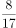，（ ）

A. 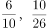

B. 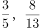

C. 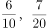

D. 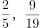

第 55 题 · 答案与解析

**参考答案（粉笔题库参考内容）**

A

**解析**

将分子、分母转化为逐步递增的趋势查找规律，则原数列可转化为：、2/2、、（ ）、、（ ）。分子部分：0、2、4、（ ）、8、（ ），为连续偶数列，则括号内应分别为6、10，只有A项满足。代入分母部分验证：1、2、5、（10）、17、（26），作差后为连续奇数列，满足规律。

故正确答案为A。

**来源**：2015年吉林省公务员录用考试《行测》题（9月乙级）第55题

### 第 56 题

李大爷在马路边散步，路边均匀地栽着一行树，李大爷从第一棵树走到第15棵树共用了7分钟，李大爷又向前走了几棵树后就往回走，当他回到第5棵树时共用了30分钟。李大爷步行到第几棵树时就开始往回走：

A. 32

B. 35

C. 34

D. 33

第 56 题 · 答案与解析

**参考答案（粉笔题库参考内容）**

D

**解析**

根据题意，从第一棵走到15棵共用了7分钟，即7分钟走过了14个间隔，往回走到第五棵树时共用了30分钟，则一共走过了60个间隔(7:14=30:60)，可用画图分析

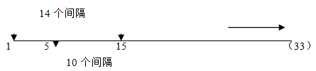

60-(14+10)=36个间隔，因此过了第五棵树后，还走了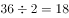个间隔，故走到15+18=33棵树时开始往回走。

故正确答案为D。

**来源**：2015年吉林省公务员录用考试《行测》题（9月乙级）第56题

### 第 57 题

某学校要举行一次会议，为了让参会人员正确到达开会地点，需要在途经路上的20棵树上放置3个指示牌，假如树的选择是随机的，那么，3个指示牌等距排列（即相邻两个指示牌间隔的树的数目相同）的概率为：

A. 小于5%

B. 大于20%

C. 10%到20%

D. 5%到10%

第 57 题 · 答案与解析

**参考答案（粉笔题库参考内容）**

D

**解析**

设树的编号分别为1-20，要使3个指示牌等距排列，则三个指示牌所放置的树的编号应成等差数列。假设满足条件放置的树的编号为a、b、c，则2b＝a＋c，因b的值由a、c两值决定，故可不用考虑。2b为偶数，则a与c必定同奇或同偶，故分别从1、3、……、19或2、4、……、20中选出两项分别作为等差数列的首尾两项即可。从10个奇数列中选出两个共＝45种选法，从10个偶数列中选出两个共＝45种选法，则满足的情况数＝45×2＝90。

总情况数为从20个数值当中选出3个，共有＝1140种选法。

则满足情况的概率＝90÷1140＝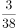≈8%，满足D项。

故正确答案为D。

**考点**：数列问题、给情况求概率

**来源**：2015年吉林省公务员录用考试《行测》题（9月乙级）第57题

### 第 58 题

在一个纸箱中装有若干黄白两色的乒乓球，且知道有5个黄色乒乓球以及摸到黄球的概率为1/4，那么，纸箱中白色乒乓球的个数为（ ）

A. 20

B. 10

C. 15

D. 16

第 58 题 · 答案与解析

**参考答案（粉笔题库参考内容）**

C

**解析**

摸到黄球的概率＝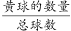＝1/4，黄球共有5个，则总球数＝4×5＝20个。则白色乒乓球的个数＝20-5＝15个。

故正确答案为C。

**考点**：概率问题-其他

**来源**：2015年吉林省公务员录用考试《行测》题（9月乙级）第58题

### 第 59 题

某电商准备在“双十一”囤积一批货物，前10天囤积了1/3，后来改进了工作方式，效率比原来提高了25％，这样，完成全部任务比原计划提前的天数为：

A. 4

B. 7

C. 6

D. 5

第 59 题 · 答案与解析

**参考答案（粉笔题库参考内容）**

A

**解析**

效率后面发生变化，只需要研究剩下的工作量，前10天囤积了1/3，说明剩下的工作量按照原效率需要20天完成，效率比原来提高了25%，即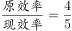，根据“工作量不变，效率和时间成反比”，则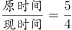，设原时间为5x，现时间为4x，5x=20天，x=4天，完成全部任务比原计划提前的天数为5x-4x=x=4天。

故正确答案为A。

**考点**：给效率比例型

**来源**：2015年吉林省公务员录用考试《行测》题（9月乙级）第59题

### 第 60 题

甲、乙两地铁路线长1880千米，从甲地到乙地开出一辆动车，每小时行驶160千米，3小时后，从乙地到甲地开出一辆高铁，经4小时后与动车相遇，则高铁每小时行驶：

A. 180千米

B. 210千米

C. 200千米

D. 190千米

第 60 题 · 答案与解析

**参考答案（粉笔题库参考内容）**

D

**解析**

动车出发3小时共行驶了：千米，此时距离乙地剩余1880-480=1400千米。然后4小时后两车相遇，根据相遇问题公式，相遇距离＝速度和×时间，则，解得km/h。

故正确答案为D。

**考点**：相遇追及

**来源**：2015年吉林省公务员录用考试《行测》题（9月乙级）第60题

### 第 61 题

下面是一个水平放置的正方体的表面展开图，若图中“快”是正方体的上面，则这个正方体的下面是

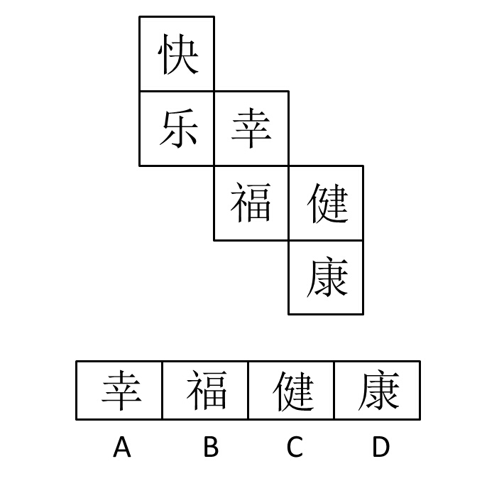

A. A

B. B

C. C

D. D

第 61 题 · 答案与解析

**参考答案（粉笔题库参考内容）**

B

**解析**

本题考查六面体平面展开图相对面的识别。

六面体中如果出现如下情况：①紧挨“Z”字型两端的面；②同行或者同列中间间隔1个面的两个面，即为相对面。

因此在该正方体的表面展开图中，“快”与“福”、“幸”与“康”、“乐”与“健”是相对面关系，“快”是正方体的上面，则正方体的下面为其相对面“福”。

故正确答案为B。

**考点**：空间类-空间重构-六面体

**来源**：2015年吉林省公务员录用考试《行测》题（9月乙级）第61题

### 第 62 题

从所给四个选项中，选择最合适的一个填入问号处，使之呈现一定的规律性：

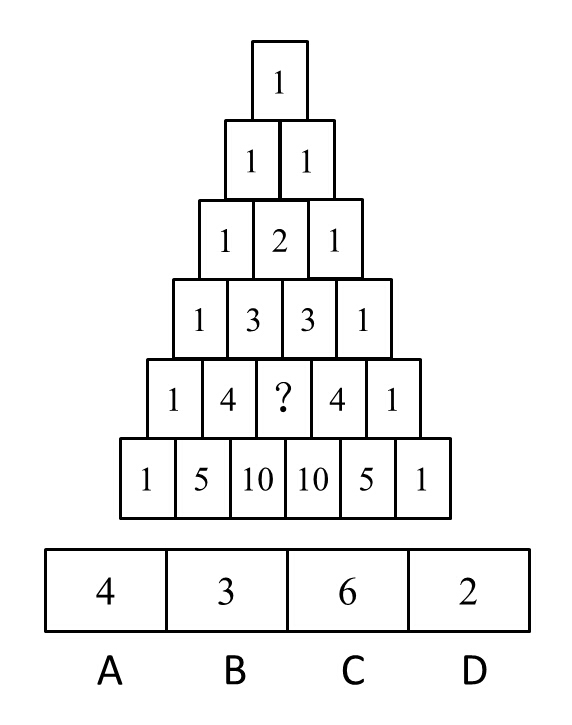

A. A

B. B

C. C

D. D

第 62 题 · 答案与解析

**参考答案（粉笔题库参考内容）**

C

**解析**

题干中所示为“塔状”结构，考虑正三角形或者倒三角形运算。

观察发现，从第三行开始存在运算关系，中间的数字2等于上面两个空格中数字1和1的加和，即倒三角形运算；第四行中间的数字3（倒三角形尖）等于对应上一行两个底边数字的加和，规律逐行递推，每个空格内的数字都等于其对应上方两个空格数字之和。因此“？”处应为3和3的加和，即为6。

故正确答案为C。

快速破解：题干所示为杨辉三角的排列，即二项式系数在三角形中的一种几何排列，第5行第3个即C（4，2），即填入6。

**来源**：2015年吉林省公务员录用考试《行测》题（9月甲级）第67题

### 第 63 题

从所给四个选项中，选择最合适的一个填入问号处，使之呈现一定的规律性：

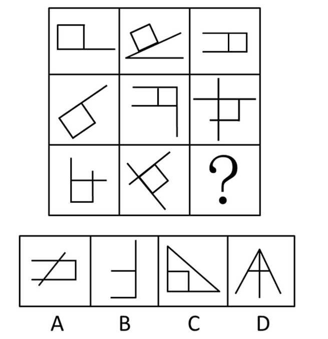

A. A

B. B

C. C

D. D

第 63 题 · 答案与解析

**参考答案（粉笔题库参考内容）**

C

**解析**

元素组成相似，整体观察。观察发现，九宫格除了？处，其余图形中均存在一个正方形，特殊元素遍历。选项中只有C项含有正方形。

故正确答案为C。

本题亦可发现九宫格中每个图形有且只有一个封闭区域，据此选出A选项，由于九宫格图形中的封闭区域面均为正方形，此题更倾向于考查正方形遍历。

**考点**：样式规律-遍历

**来源**：2015年吉林省公务员录用考试《行测》题（9月乙级）第63题

### 第 64 题

从所给四个选项中，选择最合适的一个填入问号处，使之呈现一定的规律性：

A. A

B. B

C. C

D. D

第 64 题 · 答案与解析

**参考答案（粉笔题库参考内容）**

D

**解析**

各图形组成不同，观察发现，前一组图形为罗马数字，对应阿拉伯数字1-3-4，即第三个图形数字等于第一个图形和第二个图形的数目之和；第二组图形中前两个图形均由等边三角形构成，即第三个图形中的等边三角形数目应为第一个图形和第二个图形等边三角形数目之和，即1＋3＝4个。选项中只有D项含有4个等边三角形。

故正确答案为D。

**来源**：2015年吉林省公务员录用考试《行测》题（9月甲级）第66题

### 第 65 题

把下面的六个图形分成两类，使每一类图形都有各自的共同特征或规律，分类正确的一项是：

A. ①③⑤ ②④⑥

B. ①③④ ②⑤⑥

C. ①②④ ③⑤⑥

D. ①④⑤ ②③⑥

第 65 题 · 答案与解析

**参考答案（粉笔题库参考内容）**

B

**解析**

本题为分组分类题目，题干中所有图形均由直线构成，且分为内外两部分。

外部图形的直线数为：6-8-8-8-8-6；

内部图形的直线数为：3-5-4-4-3-5；

考虑内外之间的线条数量关系。①③④三个图形的外部线条数量是内部线条数量的二倍，②⑤⑥三个图的外部线条数量不是内部线条数量的二倍。

故正确答案为B。

注：此题分组的规律不严谨，在其他类考试中很少出现，但是在吉林省考中却出现多次，因此吉林的考生在理解这种题型的时候需更加注意。

**考点**：数量规律-线

**来源**：2015年吉林省公务员录用考试《行测》题（9月甲级）第70题

### 第 66 题

或有负债，是指过去的交易或事项形成的潜在义务，在一定情况下极有可能发展为由本企业承担，而迄今尚未完全确定，是需要通过将来不确定的事项的发生或不发生予以证实的负债。

根据定义，企业可能产生或有负债的是：

A. 准备接收即将获得的侵权赔偿金

B. 为已出售的商品提供质量保证书

C. 为即将签订的合同约定洽谈日期

D. 准备支付事先约定的合同违约金

第 66 题 · 答案与解析

**参考答案（粉笔题库参考内容）**

B

**解析**

第一步：找出定义关键词。

“过去的交易或事项形成的潜在义务”、“尚未确定”、“需要通过将来不确定的事项予以证实”。

第二步：逐一分析选项。

A项：准备接收赔偿金不符合“潜在义务、尚未确定”，是实际发生的，同时也不需要通过将来不确定的事项证实，不符合定义，排除；

B项：质量保证书是对已经出售的商品保证质量，符合定义中“过去的交易或事项形成的潜在义务”，同时当商品进入顾客手中无法预料将来是否会出现质量问题，即不确定事项，符合“需要通过将来不确定的事项予以证实”，符合定义，当选；

C项：为“即将”签订合同约定洽谈日期，不符合“过去的交易或事项形成的潜在义务”，不符合定义，排除；

D项：准备支付事先约定的合同违约金为确定事项，不符合“尚未确定”、“需要通过将来不确定的事项予以证实”，不符合定义，排除。

故正确答案为B。

**考点**：单定义-其他句式

**来源**：2015年吉林省公务员录用考试《行测》题（9月甲级）第73题

### 第 67 题

归谬法：是指通过假定被反驳的论题为真，由此引申出一个明显荒谬的结论，从而确定被反驳的论题虚假的方法。

根据定义，乙用了归谬法的是：

A. 甲说：“你看，路边树上结满李子肯定很甜。”乙说：“如果是甜的早被人摘走，怎么可能结满果树呢？”

B. 甲说：“核电站具有放射性，因此是肮脏的。”乙说：“那大自然也有放射性，难道说大自然也是肮脏的吗？”

C. 甲说：“所有被告人都是有罪的。”乙说：“民事诉讼中的被告人就是无罪的。”

D. 甲说：“如果把5只鸽子放进2个鸟笼，则至少有2只在同一个鸟笼。”乙说：“也存在一个鸟笼只有一只的情况。”

第 67 题 · 答案与解析

**参考答案（粉笔题库参考内容）**

B

**解析**

第一步：提取定义关键词句。

“假定被反驳的论题为真”、 “引申出一个明显荒谬的结论”。

第二步：逐一分析比较选项。

A项：李子甜可能存在结满果树这种状态，不符合定义关键词“引申出一个明显荒谬的结论”，不符合定义，排除。

B项：乙说大自然也有放射性，根据“也”推知，乙承认了核电站具有放射性，符合定义关键词“假定被反驳的论题为真”，大自然有放射性就肮脏是荒谬的，符合定义关键词“引申出一个明显荒谬的结论”，符合定义，当选。

C项：乙所陈述的“民事诉讼中的被告人就是无罪的”这种情况是存在的，不符合定义关键词“引申出一个明显荒谬的结论”，不符合定义，排除。

D项：乙的表述不满足“引申出一个明显荒谬的结论”，乙所陈述情况确实存在，不符合定义，排除。

故正确答案为B。

**考点**：方式目的

**来源**：2015年吉林省公务员录用考试《行测》题（9月乙级）第67题

### 第 68 题

心理暗示，是指人或环境以非常自然的方式向个体发出信息，个体无意中接受这种信息，从而做出相应反应的一种心理现象。

根据定义，不会给人带来心理暗示的是：

A. 谢谢你昨晚的帮助，你真是太棒了

B. 四环的这段路总是出交通事故

C. 请勿携带食物和饮料进入本商店

D. 不怕啊，不怕啊，摸摸毛，吓不着

第 68 题 · 答案与解析

**参考答案（粉笔题库参考内容）**

C

**解析**

第一步：提取定义关键词句。

“人或环境以非常自然的方式向个体发出信息”、“个体无意中接受这种信息”、“做出相应反应”。

第二步：逐一分析选项。

C项存在明显错误，请勿携带食物和饮料进入本商店，是明确规定，并不是暗示，个体也不需要无意中接收，不符合定义，当选；A、B、D三项均满足定义关键词，符合定义，排除。

本题为选非题，故正确答案为C。

**考点**：拆词

**来源**：2015年吉林省公务员录用考试《行测》题（9月乙级）第68题

### 第 69 题

趋同适应，是指亲缘关系相当疏远的不同种类的生物，由于长期生活在相同或相似的环境中，接受同样生态环境选择，只有能适应环境的类型才得以保存下去。趋异适应，是指同种生物如长期生活在不同条件下，为了适应所在的环境，会在外形、习性和生理特征方面表现出明显差别。

根据上述定义，下列属于趋同适应的是：

A. 蓖麻在我国北方是一年生的草本植物，而在南方却是呈树状的多年生植物

B. 草食性鱼类的粪便可促进浮游生物的繁殖，而鲢鱼、鳙鱼等滤食性鱼类可使水质变清，有利于草食性鱼类的生活

C. 北极熊由棕熊进化而来，皮衣为白色，与北极的环境颜色相同，有利于捕食，肩部呈流线型，足撑有刚毛，可使其在冰上行走而不滑倒

D. 哺乳类的鲸、海豚、海象、海豹，鱼类的鲨鱼，它们都在亲缘关系上相距甚远，但都长期生活在海洋中，整个身体成为适应于游泳的纺锤形

第 69 题 · 答案与解析

**参考答案（粉笔题库参考内容）**

D

**解析**

第一步：找出定义关键词。

“亲缘关系相当疏远的不同种类的生物”、“长期生活在相同或相似的环境中”、“只有能适应环境的类型才得以保存下去”。

第二步：逐一分析选项。

A项：只涉及“蓖麻”一种生物，不符合“亲缘关系相当疏远的不同种类的生物”，不符合定义，排除；

B项：鲢鱼、鳙鱼等滤食性鱼类可使水质变清不是“适应环境”，而是改变了环境，不符合定义，排除；

C项：只涉及了“北极熊”一种生物，不满足“亲缘关系相当疏远的不同种类的生物”，不符合定义，排除；

D项：哺乳类的鲸、海豚、海象、海豹，鱼类的鲨鱼，它们都在亲缘关系上相距甚远符合“亲缘关系相当疏远的不同种类的生物”，长期生活在海洋中符合“长期生活在相同或相似的环境中”，整个身体成为适应于游泳的纺锤形符合“只有能适应环境的类型才得以保存下去”，符合定义，当选。

故正确答案为D。

**考点**：常规问法

**来源**：2015年吉林省公务员录用考试《行测》题（9月甲级）第75题

### 第 70 题

期界问题，是指在现代企业中由于雇佣关系很短，导致职工的种种短视行为，以及此类行为对企业造成的危害。

下列属于期界问题的是：

A. 因为还有一年就退休了，老赵感觉力不从心，工作效率也越来越差

B. 因为不熟悉业务，刚来一个月的小李弄丢了一个大客户，公司损失巨大

C. 因为觉得转正渺茫，在试用期的小王每天努力工作表现自己

D. 因为只签订半年的合同，小孙使用工作机器设备时不管不顾

第 70 题 · 答案与解析

**参考答案（粉笔题库参考内容）**

D

**解析**

第一步：找出定义关键词。

“由于雇佣关系很短”、“职工的短视行为”。

第二步：逐一分析选项。

A项：因为还有一年就退休，说明雇佣关系不短，不符合“由于雇佣关系很短”，不符合定义，排除；

B项：刚来一个月，无法体现“由于雇佣关系很短”，且不熟悉业务不符合“职工的短视行为”，不符合定义，排除；

C项：小王每天努力工作表现自己，不符合“职工的短视行为”，不符合定义，排除；

D项：只签订了半年的劳动合同，符合“由于雇佣关系很短”，使用设备不管不顾，符合“职工的短视行为”，符合定义，当选。

故正确答案为D。

**考点**：原因结果

**来源**：2015年吉林省公务员录用考试《行测》题（9月甲级）第74题

### 第 71 题

竹笛：白竹

A. 雕塑：泥雕

B. 傣锦：织锦

C. 淀粉：土豆

D. 大豆：豆腐

第 71 题 · 答案与解析

**参考答案（粉笔题库参考内容）**

C

**解析**

第一步，判断题干词语间逻辑关系。

竹笛可以由白竹制成，二者之间为成品和原材料的对应关系。

第二步，判断选项词语间逻辑关系。

A项：泥雕是雕塑的一种，二者为种属关系，与题干逻辑关系不一致，排除；

B项：傣锦，即傣族的织锦，是流传在傣族民间的一种古老的手工纺织工艺品；织锦是用染好颜色的彩色经纬线，经提花、织造工艺织出图案的织物；傣锦是织锦的一种，二者之间为种属关系，与题干逻辑关系不一致，排除；

C项：淀粉可以由土豆制成，二者之间为成品和原材料的对应关系，与题干逻辑关系一致，当选；

D项：豆腐可以由大豆制成，二者之间为原材料和成品的对应关系，但是前后顺序相反，与题干逻辑关系不一致，排除。

故正确答案为C。

**考点**：逻辑关系-对应关系

**来源**：2015年吉林省公务员录用考试《行测》题（9月乙级）第71题

### 第 72 题

胎生动物：蝴蝶

A. 男教师：女青年

B. 实数：正数

C. 哺乳动物：鸭嘴兽

D. 文科：化学

第 72 题 · 答案与解析

**参考答案（粉笔题库参考内容）**

D

**解析**

第一步：判断题干词语间逻辑关系。

蝴蝶属于卵生动物，卵生动物和胎生动物是并列关系，所以，蝴蝶不属于胎生动物。

第二步：判断选项词语间逻辑关系。

A项：男教师和女青年之间无明显的逻辑关系，与题干逻辑关系不一致，排除；

B项：实数包含正实数（正数）、零、负实数，因此正数都属于实数，与题干逻辑关系不一致，排除；

C项：鸭嘴兽是一种哺乳动物，二者之间为种属关系，与题干逻辑关系不一致，排除；

D项：化学属于理科，理科和文科是并列关系，所以，化学不属于文科，与题干逻辑关系一致，当选。

故正确答案为D。

**考点**：逻辑关系-包容关系

**来源**：2015年吉林省公务员录用考试《行测》题（9月甲级）第77题

### 第 73 题

孩子：明珠：女儿

A. 护士：天使：医生

B. 少年：花朵：儿童

C. 卧室：港湾：家

D. 师长：春蚕：老师

第 73 题 · 答案与解析

**参考答案（粉笔题库参考内容）**

D

**解析**

第一步，判断题干词语间逻辑关系。

女儿是孩子的一种，一般用明珠指代女儿。第三词（女儿）与第一词（孩子）之间为种属关系，第二词（明珠）可以用来指代第三词（女儿）。

第二步，判断选项词语间逻辑关系。

A项：护士和医生为并列关系，即第一词与第三词之间为并列关系，与题干逻辑关系不一致，排除；

B项：儿童和少年不是种属关系，与题干逻辑关系不一致，排除；

C项：卧室是家的一部分，二者之间为组成关系，与题干逻辑关系不一致，排除；

D项：老师是师长的一种，一般用春蚕指代老师。第三词（老师）与第一词（师长）之间为种属关系，第二词（春蚕）可以用来指代第三词（老师），与题干逻辑关系一致，当选。

故正确答案为D。

**考点**：语义关系-比喻象征义、逻辑关系-包容关系

**来源**：2015年吉林省公务员录用考试《行测》题（9月乙级）第73题

### 第 74 题

绘画：壁画：山水画

A. 游泳：蝶泳：蛙泳

B. 银河系：太阳系：水星

C. 美术：雕塑：彩雕

D. 税：所得税：地方税

第 74 题 · 答案与解析

**参考答案（粉笔题库参考内容）**

D

**解析**

第一步，判断题干词语间逻辑关系。

壁画和山水画均属于绘画，壁画和山水画二者之间为交叉关系；壁画指附属与墙面的绘画，而山水画指以山水为主要描写对象的绘画，二者以不同的方式划分。二者为交叉关系，有的壁画是山水画，有的壁画不是山水画，有的山水画是壁画，有的山水画不是壁画。

第二步，判断选项词语间逻辑关系。

A项：蝶泳和蛙泳均属于游泳，蝶泳和蛙泳为并列关系，二者以相同的方式划分，与题干逻辑关系不一致，排除。

B项：银河系包含太阳系，太阳系包含水星，三者之间为相互包含关系，与题干逻辑关系不一致，排除。

C项：彩雕是雕塑的一种，二者之间为种属关系，而非交叉关系，与题干逻辑关系不一致，排除。

D项：所得税是国家依法对个人和企业按一定比率从各种收入中征收的税，地方税是按照税法规定属于地方税务部门征收管理和支配的税种，故所得税和地方税均属于税；并且有的所得税是地方税，有的所得税不是地方税，有的地方税是所得税，有的地方税不是所得税，故所得税和地方税是交叉关系，与题干逻辑关系一致，当选。

故正确答案为D。

**考点**：逻辑关系-交叉关系

**来源**：2015年吉林省公务员录用考试《行测》题（9月乙级）第74题

### 第 75 题

大气对于（    ）相当于（    ）对于地球

A. 海洋 月亮

B. 岩石 地幔

C. 生命 人类

D. 环境 地核

第 75 题 · 答案与解析

**参考答案（粉笔题库参考内容）**

D

**解析**

填空类类比推理，将选项逐一代入，判断各选项前后两部分的逻辑关系。

A项：大气是包围地球的空气，海洋是地球上最广阔的水体的总称，二者之间为并列关系但不存在明确的相互联系。月亮是环绕地球运行的一颗卫星，二者之间为并列关系且存在明确的相互联系；前后两组词逻辑关系不一致，排除；

B项：大气和岩石为并列关系；地幔是地球的组成部分，二者之间为组成关系，前后两组词逻辑关系不一致，排除；

C项：大气为生命的繁衍发展提供了理想的环境；而地球为人类的繁衍发展提供了理想的环境，前后两组词逻辑关系一致，但是前后顺序错误，排除；

D项：大气属于环境的一部分，地核属于地球的一部分，前后两组词均为组成关系，且前后顺序对应一致，前后两组词逻辑关系一致，当选。

故正确答案为D。

**考点**：逻辑关系-包容关系

**来源**：2015年吉林省公务员录用考试《行测》题（9月乙级）第75题

### 第 76 题

（1）谷歌眼镜“起死回生”了

（2）停掉相关消费者开发项目

（3）为不同企业开发专门应用

（4）在消费市场频频受到重挫

（5）谷歌眼镜转战到企业市场

A. （3）—（4）—（2）—（5）—（1）

B. （3）—（5）—（2）—（4）—（1）

C. （4）—（2）—（3）—（5）—（1）

D. （4）—（2）—（5）—（3）—（1）

第 76 题 · 答案与解析

**参考答案（粉笔题库参考内容）**

D

**解析**

从选项入手，（1）为尾句，首句在（3）、（4）中，根据尾句中的“起死回生”，相应的逻辑关系应为“在消费市场频频受挫”，对应尾句中的“死”，因此首句为（4），排除A、B项。分析（3），应为“起死回生”的对策，（3）的对策应为转战市场后所采取的行动对策，即（3）应该在（5）后。

故正确答案为D。

**来源**：2015年吉林省公务员录用考试《行测》题（9月乙级）第76题

### 第 77 题

（1）新来的年轻鸬鹚突然集体罢工，不肯下海

（2）老鸬鹚因为老得不能出海了，被杀掉炖汤

（3）渔夫百思不得其解，抱怨自己待他们不薄

（4）一群鸬鹚，辛辛苦苦跟着一位渔夫十几年

（5）因为老了，还不落老鸬鹚一样的下场？

A. （4）—（1）—（3）—（2）—（5）

B. （4）—（2）—（1）—（3）—（5）

C. （1）—（3）—（5）—（2）—（4）

D. （1）—（3）—（4）—（2）—（5）

第 77 题 · 答案与解析

**参考答案（粉笔题库参考内容）**

B

**解析**

从选项入手，根据首句原则，首句在（1）、（4）之间，（1）阐述的是突然罢工，产生原因应为看到老鸬鹚的下场，因此首句应为（4），排除C、D两项；又根据上面的分析，(2)是产生集体罢工（1）的原因，（2）应在（1）的前面，排除A项，B项当选。

故正确答案为B。

**来源**：2015年吉林省公务员录用考试《行测》题（9月乙级）第77题

### 第 78 题

（1）制作广告牌，写上“禁止吸烟”

（2）引起游客浓厚兴趣，竞相购买

（3）竞争激烈，销售惨淡，苦思良机

（4）来到旅游区推销“宇宙牌”香烟

（5）加上一行字：宇宙牌也不例外

A. （4）—（1）—（2）—（5）—（3）

B. （3）—（4）—（1）—（2）—（5）

C. （4）—（3）—（1）—（5）—（2）

D. （3）—（4）—（2）—（1）—（5）

第 78 题 · 答案与解析

**参考答案（粉笔题库参考内容）**

C

**解析**

题干描述的是“宇宙牌”香烟销量由差变好的一个过程，即（4）为事件的起点原由，推销时发现竞争激烈，而后苦思良机，制作广告牌，引起游客浓厚兴趣。据此，正确的排序为（4）—（3）—（1）—（5）—（2）。

故正确答案为C。

**来源**：2015年吉林省公务员录用考试《行测》题（9月乙级）第78题

### 第 79 题

（1）发给了每组成员一把锯子

（2）把报考的人带到一个农场

（3）要求将一根圆木锯成两段

（4）配合好坏成为录用重要指标

（5）随机将每两个人分成一组

A. （4）—（2）—（1）—（5）—（3）

B. （4）—（2）—（3）—（1）—（5）

C. （2）—（5）—（3）—（4）—（1）

D. （2）—（5）—（1）—（3）—（4）

第 79 题 · 答案与解析

**参考答案（粉笔题库参考内容）**

D

**解析**

从选项入手，观察首句，首句在（2）、（4）中，（2）为将报考人带到农场，（4）为配合，只有人先带到了才有后续事件的发生，因此首句为（2），据此排除A、B项；C、D项中，观察尾句为（1）和（4），（1）发给每组成员一把锯子，应是带到农场后顺承发生的动作，因此尾句不能是（1），只能是（4），且（4）是一种结果，将配合好坏作为录用的重要指标，因此选择D项。

故正确答案为D。

**来源**：2015年吉林省公务员录用考试《行测》题（9月乙级）第79题

### 第 80 题

（1）大家轮流分粥，结果负责那天才吃饱，其余6天都要挨饿

（2）7人轮流值日分粥，每人一天，这次分粥者要最后才可领取粥

（3）大家选举一个品德高尚的人负责分粥，久了，他却开始徇私

（4）7人一起居住，面对同一个问题：怎样将一锅粥平均分配

（5）在这种制度下，无论谁来分粥，7个碗里的粥都是一样多的

A. （4）—（3）—（1）—（5）—（2）

B. （4）—（3）—（1）—（2）—（5）

C. （4）—（1）—（2）—（3）—（5）

D. （4）—（3）—（5）—（1）—（2）

第 80 题 · 答案与解析

**参考答案（粉笔题库参考内容）**

B

**解析**

从选项入手，（4）为首句，尾句在（2）、（5）之中，（2）、（5）之间存在因果关系，即采取了（2）的方法后，才使得每个人分到的粥一样多，据此尾句为（5），且（2）、（5）应该顺承发生，符合此分析的只有B项。

故正确答案为B。

**来源**：2015年吉林省公务员录用考试《行测》题（9月乙级）第80题

### 第 81 题

党的十八届四中全会审议通过的《中共中央关于全面推进依法治国若干重大问题的决定》指出：“法律是治国之重器，良法是善治之前提。”这是在我们党的文件中首次将法治与善治联系起来，其依据的正是法治与善治的内在必然联系，法治是善治的基础，善治必须建立在法治之上，没有法治就没有善治，法治本身也是构成善治的基本要素。

由此可以推出：

A. 有善治就有法治

B. 没有善治就没有法治

C. 有法治就有善治

D. 有善治不一定有法治

第 81 题 · 答案与解析

**参考答案（粉笔题库参考内容）**

A

**解析**

第一步：翻译题干。

（1）良法是善治之前提，翻译为：善治→良法；

（2）法治是善治的基础，翻译为：善治→法治。

第二步：逐一分析选项。

A项：善治→法治，与题干推导关系一致，当选。

B项：法治→善治，与题干推导方向相反，不能由题干推出，排除。

C项：法治→善治，与题干推导方向相反，不能由题干推出，排除。

D项：有善治不一定有法治，肯前必然肯后，不一定有法治不能由题干推出，排除。

故正确答案为A。

**考点**：常规翻译

**来源**：2015年吉林省公务员录用考试《行测》题（9月乙级）第81题

### 第 82 题

某电视台拍摄一档真人秀节目，有A、B、C、D、E五位表演嘉宾，要安排他们入住红、黄、蓝三顶帐篷。五位表演嘉宾提出了以下几点入住要求：

（1）嘉宾A要入住红色帐篷

（2）B和C要入住同一顶帐篷

（3）如果D入住蓝色帐篷，则E也要入住蓝色帐篷

（4）同时，栏目组要求，每顶帐篷中都要住人

则下列安排肯定不符合上述要求的是：

A. BC入住红色帐篷

B. BD入住蓝色帐篷

C. DE入住黄色帐篷

D. E入住红色帐篷

第 82 题 · 答案与解析

**参考答案（粉笔题库参考内容）**

B

**解析**

分析题干条件可知：

（1）A、B、C、D、E五位表演嘉宾；

（2）红、黄、蓝三顶帐篷；

（3）A住红帐篷；

（4）BC在同一帐篷（捆绑）；

（5）D入住蓝色→E入住蓝色；

（6）每个帐篷必有人。

提问为肯定不符合上述要求的，据此采用代入法求解。

代入A项：BC入住红色，A入住红色，据此剩余DE，又因为（6）每顶帐篷中都要住人以及（5）D入住蓝色→E入住蓝色，据此可知D不能入住蓝色，则D入住黄色，E入住蓝色，A选项的安排符合题干要求，排除。

代入B项：BD入住蓝色，据（4）可知，BC同住一个帐篷；据（5）可知，D入住蓝色→E入住蓝色；则BCDE入住蓝色，A入住红色，此时黄色帐篷无人入住，不符合题干要求（6），因此B选项的安排不符合上述要求，当选。

代入C项：DE入住黄色，A入住红色，又根据（6）和（4）可知，BC入住蓝色，C选项的安排符合题干要求，排除。

代入D项：E入住红色，A入住红色，剩余BCD三人，在黄色和蓝色中挑选，根据（5）可知，D不能入住蓝色，则D入住黄色，又根据（4）可知，BC在一起且二人入住蓝色帐篷，D选项的安排符合题干要求，排除。

故正确答案为B。

**考点**：代入法

**来源**：2015年吉林省公务员录用考试《行测》题（9月甲级）第94题

### 第 83 题

可能有人认为越昂贵或者越新的车辆被盗的可能性越大，事实上刚好相反，对于那些经验老道的偷车贼来说，保有量大的旧车才是他们的首选。相比之下，新车和豪华车出手的难度要远远大于旧车，同时也更容易引起警方的关注。此外，特别便宜跟特别贵的车一般都不在小偷的视野范围之内，便宜的车虽然只用改锥及铁丝之类的工具，就可以轻而易举地利用车门缝隙挑起门锁打开车门，但残值也低。而50万元以上的豪华车，保全措施也做得特别到位，偷起来特别麻烦，通常都安放在有监视系统的车库里。再者，一些造型较独特的、零配件通用率低的车型相对而言会比较安全。

根据上述信息，下列车型中最容易被盗的是：

A. 价值16万元的有三年车龄的迈腾

B. 价值2万元的有8年车龄的奇瑞QQ

C. 价值55万元有7年车龄的宝马车

D. 价值18万元有1年车龄的敞篷车

第 83 题 · 答案与解析

**参考答案（粉笔题库参考内容）**

A

**解析**

提取题干中最不可能被偷的条件进行排除：（1）新车和豪华车；（2）特别便宜的车；（3）50万以上的豪华车。（4）造型独特、零配件通用率比较低的车型。这四种情况的车都不在小偷的视野范围内。

根据（2）排除B选项；根据（3）排除C选项；根据（4）排除D选项，因此选择A项。

故正确答案为A。

**考点**：日常结论

**来源**：2015年吉林省公务员录用考试《行测》题（9月甲级）第88题

### 第 84 题

植物叶片受伤后会流出绿色的汁液，同时叶片的清香会变得更加浓郁，这种“绿色清香”可引诱害虫的天敌前来清除害虫。研究人员利用转基因方法将青椒合成香味酶的基因导入十字花科的拟南芥中，一旦有菜粉蝶的幼虫啃食叶片，拟南芥散发的清香便会增强。随后菜粉蝶的天敌粉蝶盘绒茧蜂大量拥来。这种寄生蜂把卵产到菜粉蝶幼虫身上，在菜粉蝶幼虫形成蛹前就可以把幼虫吃个精光。研究人员因此得出结论，如果把这一项研究成果应用到蔬菜栽培方面，可大大减少农药的使用量。

为了使研究人员的结论成立，必须补充以下哪一前提？

A. 目前蔬菜栽培使用的农药主要是用于消除虫害

B. 转基因蔬菜叶片受伤后散发出来的清香会增强

C. 植物的“绿色清香”是他们自我防卫的武器

D. 目前我国的现行法律是允许种植转基因蔬菜的

第 84 题 · 答案与解析

**参考答案（粉笔题库参考内容）**

A

**解析**

第一步，找到论点和论据。

论点:如果把这一项研究成果应用到蔬菜栽培方面，可大大减少农药的使用量。

论据：研究人员利用转基因方法将青椒合成香味酶的基因导入十字花科的拟南芥中，一旦有菜粉蝶的幼虫啃食叶片，拟南芥散发的清香便会增强，随后菜粉蝶的天敌粉蝶盘绒茧蜂大量拥来。这种寄生蜂把卵产到菜粉蝶幼虫身上，在菜粉蝶幼虫形成蛹前就可以把幼虫吃个精光。

第二步，逐一分析选项。

否定A项代入，即目前蔬菜栽培使用的农药主要不是用于消除虫害，则即使将该研究成果应用到蔬菜栽培方面，也不能大大减少农药的使用量，否定选项后论点不成立，为题干应该补充的必要前提，A项当选。

B选项：加强题干中的论据，即加强了题干中“绿色清香”可引诱害虫的天敌前来清除害虫，不是前提假设。

C选项：为题干中首句的比喻性表达，非题干应该补充的前提。

否定D选项代入，目前我国的现行法律是不允许种植转基因蔬菜的，题干中的论述为“如果把这一项研究成果应用到蔬菜栽培方面，可大大减少农药的使用量”，即题干只是一种假设，D选项只是否定了论点中的前提，否前并不能推知确定性答案，据此D选项错误。

故正确答案为A。

**考点**：必要条件

**来源**：2015年吉林省公务员录用考试《行测》题（9月乙级）第84题

### 第 85 题

说到哭，很多人会联想到婴儿的啼哭和女人的眼泪。而男人们向来被冠以“男儿有泪不轻弹”的坚强形象，似乎哭就是一件丢人的事，其实哭泣对所有人都很重要，它不仅能宣泄情绪，还是人体自我保护的方式。

以下哪项如果为真，最能加强以上观点？

A. 眼泪中含有溶菌酶，能在5-10分钟的时间内杀灭90%-95%的细菌

B. 哭泣是一项人类高度进化的行为，只有人类才具有真正意义上的哭泣

C. 通常哭泣能比服用抗抑郁药起到更好的自我安慰和提升情绪的作用

D. 一般一个月内，男人最多哭泣7次，而女人的流泪次数则超过30次

第 85 题 · 答案与解析

**参考答案（粉笔题库参考内容）**

C

**解析**

第一步，找到论点和论据。

论点：哭泣对所有人都很重要，它不仅能宣泄情绪，还是人体自我保护的方式。

题干无明显论据。

第二步，逐一分析选项。

A项：能在5-10分钟的时间内杀灭90%-95%的细菌，并不能说明是一种自我保护的方式，不能说明杀灭多数细菌一定对人体有好处，因为也存在对人体有益的细菌，A选项属于不明确选项，排除。

B项：论述高度进化行为和真正意义上的哭泣，与题干论点无关，属无关选项，排除。

C项：哭泣能比服用抗抑郁药起到更好的自我安慰和提升情绪的作用，通过对比哭泣和服用抗抑郁药，说明哭泣能够宣泄情绪，从而起到自我保护的作用，属于增加新论据，从而加强了题干论点，当选。

D项：谈论哭泣和流泪的次数，与题干论点无关，属无关选项，排除。

故正确答案为C。

**考点**：补充论据

**来源**：2015年吉林省公务员录用考试《行测》题（9月乙级）第85题

### 第 86 题

可以端菜、扫地、唱歌跳舞，可以跟孩子做游戏、陪老人谈天说地……在本届机器人世界杯上，各式各样的服务机器人成为最吸引眼球的明星。多位业界专家预测，面向家庭和个人的服务机器人，将超越工业机器人，成为下一个爆发式增长的市场。

以下哪项为真最能质疑上述专家的预测？

A. 由于一些关键部件仍依赖进口导致有些国内的服务机器人的价格居高不下

B. 在我国目前服务机器人进入家庭还只是“看上去很美”，有的产品尚未量产

C. 目前的服务机器人技术行的，实现成本却太高；方案成本低的，技术却不行

D. 机器人产业中中国的主要差距在硬件，而硬件差距对机器人性能影响很小

第 86 题 · 答案与解析

**参考答案（粉笔题库参考内容）**

C

**解析**

第一步，找到论点和论据。

论点：面向家庭和个人的服务机器人，将超越工业机器人，成为下一个爆发式增长的市场。

论据：无。

本题只有论点，没有论据，削弱优先考虑削弱论点，即“面向家庭和个人的服务机器人，不会超越工业机器人，不会成为下一个爆发式增长的市场”。

第二步，逐一分析选项。

A项：说明有些国内服务机器人价格居高不下，但是并不能说明服务机器人不能成为下一个爆发式增长的市场，服务机器人的爆发式增长取决于整个国际市场，不仅仅取决于国内市场，属于不明确选项，削弱力度有限，排除。

B项：尚未量产指的是没有投入生产，与生产后是否火爆无关，且与A类似，说的只是我国服务机器人的状况，属无关选项，排除。

C项：否定服务机器人要成为下一个爆发式增长的市场的前提，即成本太高服务机器人难以投入市场，指生产服务机器人这件事的可行性非常低，因此无法成为下一个爆发式增长的市场，削弱了论点，当选。

D项：选项主体为机器人，而题干主体是服务机器人，属于主体扩大；且硬件差距等因素与题干论点无关，属无关选项，排除。

故正确答案为C。

**考点**：削弱论点

**来源**：2015年吉林省公务员录用考试《行测》题（9月乙级）第86题

### 第 87 题

爱吃辣椒使人长寿，有研究团队查阅了50万名中国成年人的问卷数据，每一位受访者都填报了自己的健康状况、酒精摄入量、辛辣食品摄入量、摄入辣椒的主要形式，以及肉类和蔬菜的摄入量。7年后，研究人员进行了回访，发现与每周食用辛辣食品不足一次的人员相比，每周吃上一到两次的人，死亡风险就会降低10%。

以下哪项如果为真，最能质疑上述论证？

A. 每周3到7天食用辛辣食品死亡风险比不吃辣的人低4%

B. 研究人员需要通过更多实验才能搞清楚辣椒这种保护作用的原理

C. 现在还不能确切地证明死亡风险的降低就是摄入辛辣食品造成的

D. 有些辛辣食品可能与药物产生不良的连锁反应，使病人遭到危险

第 87 题 · 答案与解析

**参考答案（粉笔题库参考内容）**

C

**解析**

第一步，找到论点和论据。

论点：爱吃辣椒使人长寿。

论据：题干对比试验。7年后，研究人员进行了回访，发现与每周食用辛辣食品不足一次的人员相比，每周吃上一到两次的人，死亡风险就会降低10%。

第二步，逐一分析选项。

A项：说明食用辛辣食品死亡风险更低，补充论据，可以加强，排除；

B项：需要通过更多试验搞清楚辣椒保护作用的原理，与论点话题不一致，不能削弱，排除；

C项：不能确切地证明死亡风险的降低就是摄入辛辣食品造成的，说明通过论据无法确切地得到论点的结论，拆断了论据和论点之间的必然联系，可以削弱，保留；

D项：说明吃辣椒也有可能增加死亡风险，可以削弱，保留。

比较C项和D项，D项是一种可能性的表述，力度较弱，且本题提问方式为削弱“论证”，优先考虑拆桥的选项，C选项即为拆桥，比D选项更好。

故正确答案为C。

以下为原文内容：

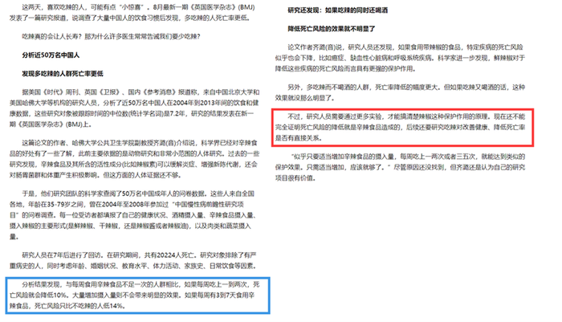

**考点**：拆桥

**来源**：2015年吉林省公务员录用考试《行测》题（9月乙级）第87题

### 第 88 题

研究人员通过一项针对9名佩戴隐形眼镜的人和11名不佩戴隐形眼镜的人的追踪后调查发现，与不戴隐形眼镜的人相比，佩戴隐形眼镜的人眼球表面某些种类细菌的比例平均上升了两倍。两组人群眼球表面菌群的构成也存在不同，引起角膜溃疡一种名为假单胞菌的细菌在戴隐形眼镜人的眼中更为多见。可见，戴隐形眼镜改变眼中的菌群更易导致眼部感染。

以下哪项如果为真最能支持上述论证？

A. 自从出现软性隐形眼镜以来，角膜溃疡的流行程度大幅度上升

B. 为避免患角膜溃疡，应该密切关注眼皮及手部卫生，定期检查

C. 戴隐形眼镜的人虽然眼部菌群发生了改变，但很少出现并发症

D. 这项研究样本数量太少，我们还是应该对调查结果持谨慎态度

第 88 题 · 答案与解析

**参考答案（粉笔题库参考内容）**

A

**解析**

第一步，找到论点和论据。

论点：戴隐形眼镜改变眼中的菌群更易导致眼部感染。

论据：对比试验。佩戴隐形眼镜的人眼球表面某些种类细菌的比例平均上升了两倍。两组人群眼球表面菌群的构成也存在不同，引起角膜溃疡一种名为假单胞菌的细菌在戴隐形眼镜人的眼中更为多见。

第二步，逐一分析选项。

A项：说明戴隐形眼镜容易导致眼部感染，属于增加新论据，支持题干论点，当选；

B项：关注眼皮及手部卫生，定期检查与题干论点“戴隐形眼镜改变眼中的菌群更易导致眼部感染”无关，属无关项，排除；

C项：是否出现并发症与题干论点无关，属无关选项，排除；

D项：说明对比试验中研究样本数量太少，削弱了题干论据，研究人员所得结果可能不准确，削弱了题干论点，排除。

故正确答案为A。

**考点**：补充论据

**来源**：2015年吉林省公务员录用考试《行测》题（9月乙级）第88题

### 第 89 题

在一项针对216名6到12月的婴儿进行测试中，研究人员教给婴儿新的手指木偶玩耍的三个本领，有一半的宝宝在学习之后的四个小时就睡了一大觉，但是另外的宝宝则没有睡觉或者只小憩了不到30分钟。研究显示平均说来，有充足睡眠的宝宝能记住1.5个本领，但是没有怎么睡觉的宝宝则一项本领都没有记住。可见，婴儿学习本领后保持充足睡眠有利于增强记忆。

下列哪项是上述论证最可能依赖的假设？

A. 该研究结果在青少年群体中同样适用

B. 充足睡眠有利于宝宝正常的身体发育

C. 实验前两组宝宝的智力水平状况相当

D. 有其他研究验证了这项结果可靠性

第 89 题 · 答案与解析

**参考答案（粉笔题库参考内容）**

C

**解析**

第一步，找到论点和论据。

论点：婴儿学习本领后保持充足睡眠有利于增强记忆。

论据：研究显示平均说来，有充足睡眠的宝宝能记住1.5个本领，但是没有怎么睡觉的宝宝则一项本领都没有记住。

前提假设类题目正确选项应该是题干结论成立的必要条件，必不可少的条件。根据必要条件的定义可知，必要条件不成立，则结论不成立，可以采用否定代入法解题。

第二步，逐一分析选项。

否定A项代入，研究结果在青少年群体中不适用，不能说明婴儿学习本领后保持充足睡眠是否有利于增强记忆，否定选项后论点仍然成立，不可能是前提，排除；

否定B项代入，充足睡眠不利于宝宝正常的身体发育，与是否有利于增强记忆无关，否定选项后论点仍然成立，不可能是前提，排除；

否定C项代入，实验前两组宝宝的智力水平状况不相当，说明对比试验中的两组对象的起点不同，记忆能力不同，不能得出婴儿学习本领后保持充足睡眠有利于增强记忆的结论，否定选项后论点不成立，因此，是前提，当选；

否定D项代入，没有其他研究验证了这项结果可靠性，没有其他实验并不能说明该实验就不可靠，否定选项后论点仍然成立，不可能是前提，排除。

故正确答案为C。

**考点**：加强-实验类、必要条件

**来源**：2015年吉林省公务员录用考试《行测》题（9月乙级）第89题

### 第 90 题

有位年轻人，新买的摩托车被撞碎了，他摇着头说：“唉，我以前总说，有一天能有一辆摩托车就好了，现在我真有了一辆车，而且真的只有一天。”

下列与题干的幽默方式最相似的是：

A. 亚伯在演讲时，听众哗然，叫嚷着要他下台，这时亚伯微笑着说：“谢谢各位，我等一会儿就下台，因为我刚刚上台”

B. 伏尔泰很赞赏一个人的作品，而这个人却总是刻薄地批评伏尔泰，当别人向伏尔泰说这件事时，他微笑的回答说：“那看来是我们双方都弄错了”

C. 飓风把一个农民家的屋顶掀了，这时大雨倾盆，他对家人说：“别急，没有房顶的坏处是被雨淋湿了，但好处是太阳，可以直接晒干我们的东西”

D. 一次，一个老太婆皱着眉头对林肯说：“你是我见过的最丑的一个人。”林肯微笑着答道：“请多包涵，我也身不由己”

第 90 题 · 答案与解析

**参考答案（粉笔题库参考内容）**

A

**解析**

第一步：分析题干。

题干中所述为对同一个人对同一句话的不同角度的理解。

有“一天”能有一辆摩托车就好了，现在我真有了一辆车，而且真的只有“一天”。这两个“一天”分别指将来某一天和具体一天的时间，使用了偷换概念的方式来表达，从而实现了幽默的效果。

第二步：分析选项。

A项：A项所述为对同一个人对同一句话的不同角度的理解，观众要求亚伯“马上下台”，而亚伯把它说成了演讲结束“最终下台”进行了概念偷换，与题干方式最为相似，当选。

B、C两项：均涉及双方对话，为不同的人，排除。

D项：D项整个表述过程中并未出现概念偷换，排除。

故正确答案为A。

**考点**：日常结论

**来源**：2015年吉林省公务员录用考试《行测》题（9月乙级）第90题

## 材料 2

2015年6月底，全国光伏发电累计装机容量达到3578万千瓦，其中，光伏电站3007万千瓦，分布式光伏571万千瓦。全国各省（区、市）中，累计光伏发电装机容量超过100万千瓦的分别为甘肃578万千瓦、新疆570万千瓦、青海470万千瓦、内蒙古403万千瓦、江苏302万千瓦、宁夏239万千瓦、河北160万千瓦和浙江143万千瓦。上半年全国新增光伏发电装机容量773万千瓦，其中，新增光伏电站装机容量669万千瓦、新增分布式光伏装机容量104万千瓦。新增装机容量前六的地区为：新疆214万千瓦、内蒙古101万千瓦、浙江70万千瓦、甘肃61万千瓦、青海58万千瓦和江苏45万千瓦。

        2014年底，光伏发电累计装机容量2805万千瓦，其中，光伏电站2338万千瓦，分布式467万千瓦。2014年新增装机容量1060万千瓦，约占全球新增装机的五分之一，占我国光伏电池组件产量的三分之一，实现了《国务院关于促进光伏产业健康发展的若干意见》中提出的平均年增1000万千瓦目标；其中，光伏电站855万千瓦，分布式205万千瓦。中东部地区新增装机容量达到560万千瓦，其中，江苏省新增152万千瓦，仅次于内蒙古；河北省新增97万千瓦，居全国前列。西部省份中，内蒙古、青海、甘肃和宁夏均较大。2013年底光伏发电累计装机容量为1745万千瓦，当年新增装机容量1095万千瓦。

### 第 91 题

2015年6月底，全国光伏电站累计装机容量约是分布式光伏发电累计容量的：

A. 0.15倍

B. 6.3倍

C. 5.3倍

D. 0.16倍

第 91 题 · 答案与解析

**参考答案（粉笔题库参考内容）**

C

**解析**

定位文字材料第一段，“2015年6月底，全国光伏发电累计装机容量达到3578万千瓦，光伏电站3007万千瓦，分布式光伏571万千瓦”，则全国光伏电站累计装机容量约是分布式光伏发电累计容量的3007÷571≈5.3倍。

故正确答案为C。

**考点**：文字资料、现期倍数

**来源**：2015年吉林省公务员录用考试《行测》题（9月乙级）第91题

### 第 92 题

2015年上半年，各省区光伏发电累计装机容量与新增光伏发电装机容量占全国总量均超过10%的省区的个数为：

A. 1

B. 4

C. 3

D. 2

第 92 题 · 答案与解析

**参考答案（粉笔题库参考内容）**

D

**解析**

从文字材料第一段，可得：全国光伏发电累计装机容量达到3578万千瓦，其10%为357.8万千瓦，超过的地区有甘肃、新疆、青海和内蒙古；新增光伏电站装机容量773万千瓦，其10%为77.3万千瓦，超过的地区有新疆、内蒙古，则光伏发电累计装机容量与新增光伏发电装机容量占全国总量均超过10%的省区分别是新疆、内蒙古。共2个。

故正确答案为D。

**考点**：文字资料、直接找数

**来源**：2015年吉林省公务员录用考试《行测》题（9月乙级）第92题

### 第 93 题

2014年，图中哪项是反映江苏和河北总新增光伏发电装机容量的：

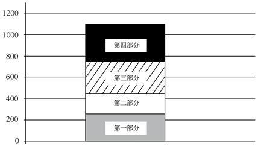

A. 第一部分

B. 第四部分

C. 第三部分

D. 第二部分

第 93 题 · 答案与解析

**参考答案（粉笔题库参考内容）**

A

**解析**

根据文字材料第二段“江苏省新增152万千瓦，河北省新增97万千瓦”，则两省总新增光伏发电机装机总量＝152＋97＝249万千瓦，根据每个部分大致能够代表的总量，一格代表数值为200，第一部分比一格多大约四分之一即约为250，第二部分大约为一格约为200，第三部分平移之后大约为一格再多一半约为300，第四部分接近两格约为400，第一部分更加准确。

故正确答案为A。

**考点**：文字资料、简单加减计算

**来源**：2015年吉林省公务员录用考试《行测》题（9月乙级）第93题

### 第 94 题

2015年上半年，月均新增光伏发电装机容量比2014年全年月均新增光伏发电装机容量约：

A. 高41万千瓦

B. 低50万千瓦

C. 低41万千瓦

D. 高50万千瓦

第 94 题 · 答案与解析

**参考答案（粉笔题库参考内容）**

A

**解析**

“2015年上半年全国新增光伏发电装机容量773万千瓦；2014年新增装机容量1060万千瓦”，则2015上半年月均新增光伏发电装机容量比2014年全年月均新增光伏发电装机容量高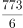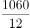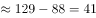千万瓦。

故正确答案为A。

**考点**：文字资料、现期平均数

**来源**：2015年吉林省公务员录用考试《行测》题（9月乙级）第94题

### 第 95 题

能够从上述资料推出的是：

A. 2014年新增光伏发电装机容量首次突破1000万千瓦

B. 2015年上半年与2014年内蒙古新增光伏装机容量在全国均居第二

C. 2015年上半年光伏发电累计装机容量约是2014年底的1.3倍

D. 2012年新增光伏发电装机容量超过700万千瓦

第 95 题 · 答案与解析

**参考答案（粉笔题库参考内容）**

C

**解析**

A项：从文字材料第二段，2014年新增光伏发电装机容量实现了平均年增1000万千瓦目标，而不是首次突破，A项无法推出。

B项：材料第二段只提及“江苏省新增152万千瓦，仅次于内蒙古”，不能说明内蒙古在全国居第二，B项无法推出。

C项：“2015年上半年，全国光伏发电累计装机容量达到3578万千瓦，2014年底，光伏发电累计装机容量2805万千瓦”，则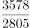≈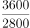=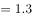，C项正确。

D项：没有提及2012当年相关数据，D项无法推出。

故正确答案为C。

**考点**：文字资料、综合分析

**来源**：2015年吉林省公务员录用考试《行测》题（9月乙级）第95题

## 材料 3

2013年末，吉林省共有从事第二产业和第三产业活动的法人单位130914个，比2008年（2008年是第二次全国经济普查年份，下同）增加6487个，增长5.2%；产业活动单位157542个，增加5490个；个体经营户972280个，减少12861个，其中：有证照个体经营户719319个，增加50818个。

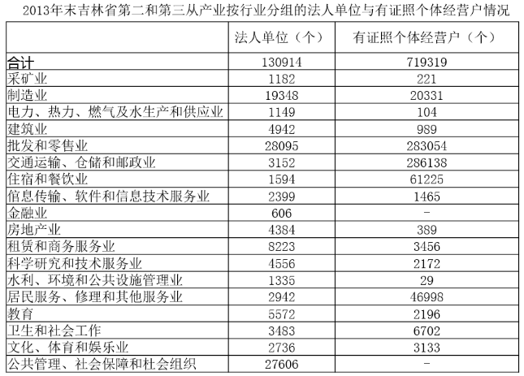

注：表中法人单位含计数含从事农、林、牧、渔服务业和兼营第二、三产业活动的农、林、牧、渔法人单位7610个；有证照个体经营户合计数含从事农、林、牧、渔服务业活动的个体经营户717个。

        2013年末，全省第二产业和第三产业法人单位从业人员487.3万人，比2008年末增加15.9万人，增长3.4%。有证照个体经营户从业人员181万人，比2008年末减少34.2万人，下降15.9%。在法人单位从业人员中，位居前三位的行业是：制造业155.8万人；建筑业53.8万人，占11.0%；公共管理、社会保障和社会组织53.8万人，占11.0%。在有证照个体经营户从业人员中，位居前三位的行业是：交通运输、仓储和邮政业67.4万人，占37.2%；批发和零售业63.0万人，占34.8%；住宿和餐饮业22.6万人，占13.0%。2013年末，全省第二产业和第三产业企业资产总计65441.9亿元。其中，第二产业企业资产总计27113.9亿元。

### 第 96 题

2008年末至2013年末，吉林省从事第二产业和第三产业活动的法人单位平均每年增加：

A. 1621.8个

B. 1.28%

C. 1.04%

D. 1297.4个

第 96 题 · 答案与解析

**参考答案（粉笔题库参考内容）**

D

**解析**

由第一段材料可得：2013年末从事第二产业和第三产业活动的法人单位比2008年增加6487个，则平均每年增加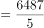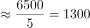个，与D项接近。

故正确答案为D。

**考点**：年均增长量、综合资料

**来源**：2015年吉林省公务员录用考试《行测》题（9月乙级）第96题

### 第 97 题

2013年末与2008年比较，吉林省产业活动单位大约增加：

A. 1.04%

B. 7.6%

C. 3.6%

D. 1.3%

第 97 题 · 答案与解析

**参考答案（粉笔题库参考内容）**

C

**解析**

由第一段材料可得：产业活动单位157542个，增加5490个，增长率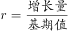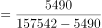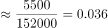。

故正确答案为C。

**考点**：一般增长率、综合资料

**来源**：2015年吉林省公务员录用考试《行测》题（9月乙级）第97题

### 第 98 题

2013年末，在第二产业和第三产业法人单位中，数量位居前三位的行业依次是：

A. 交通运输、仓储和邮政业，批发和零售业，住宿和餐饮业

B. 批发和零售业，公共管理、社会保障和社会组织，制造业

C. 制造业，公共管理、社会保障和社会组织，批发和零售业

D. 批发和零售业，住宿和餐饮业，交通运输、仓储和邮政业

第 98 题 · 答案与解析

**参考答案（粉笔题库参考内容）**

B

**解析**

观察表格数据可得：各行业法人单位的数量超过20000个的是批发和零售业，公共管理、社会保障和社会组织，略小于20000个的是制造业，则数量位居前三位的行业按照从大到小依次是批发和零售业，公共管理、社会保障和社会组织，制造业。

故正确答案为B。

**考点**：直接找数、综合资料

**来源**：2015年吉林省公务员录用考试《行测》题（9月乙级）第98题

### 第 99 题

2013年末，吉林省第三产业企业资产占第二、三产业资产总计的：

A. 41.4%

B. 5.1%

C. 94.9%

D. 58.6%

第 99 题 · 答案与解析

**参考答案（粉笔题库参考内容）**

D

**解析**

由材料最后一句话可得：第二产业企业资产占第二、三产业资产总计的比重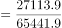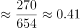。则第三产业占第二、三产业资产总计的比重=1-0.41=0.59，与D项接近。

故正确答案为D。

**考点**：现期比重、综合资料

**来源**：2015年吉林省公务员录用考试《行测》题（9月乙级）第99题

### 第 100 题

与上述资料相符的结论是

A. 在第二产业和第三产业法人单位从业人员中，制造业从业人员约占32.0%

B. 如按行业分组，法人单位个数远远大于有证照个体经营户个数

C. 有证照个体经营户从业人员，比2008年末增长3.4%

D. 在有证照个体经营户从业人员中，位居前三位的行业依次为：住宿和餐饮业，交通运输、仓储和邮政业，批发和零售业

第 100 题 · 答案与解析

**参考答案（粉笔题库参考内容）**

A

**解析**

A项：由材料最后一段可得：全省第二产业和第三产业法人单位从业人员487.3万人，其中制造业155.8万人，占比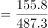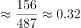，正确；

B项：观察表格数据发现：制造业的法人单位个数19348小于其有证照个体经营户个数20331，错误；

C项：由材料最后一段可得：有证照个体经营户从业人员181万人，比2008年末减少34.2万人，人数减少，增长率为负值，错误；

D项：由材料最后一段可得：在有证照个体经营户从业人员中，位居前三位的行业是：交通运输、仓储和邮政业，批发和零售业，住宿和餐饮业，错误。

故正确答案为A。

**考点**：综合分析、综合资料

**来源**：2015年吉林省公务员录用考试《行测》题（9月乙级）第100题

