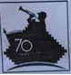
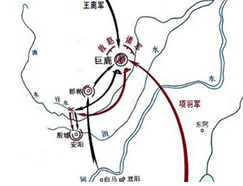
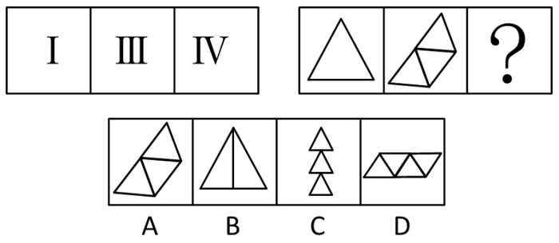
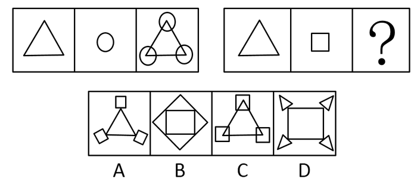
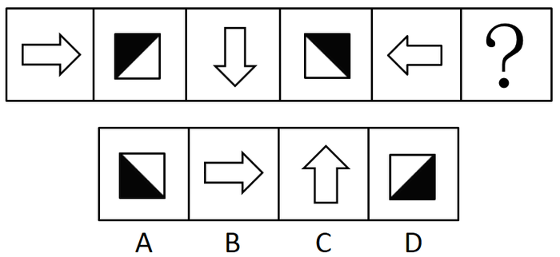
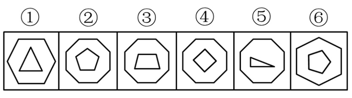
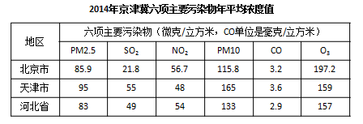

# 2015年吉林省公务员录用考试《行测》题（9月甲级）

<!-- gwy:overview:start -->
> **吉林 · 2015 · 行测 · 甲级** ｜ 105 题 · 图片 13 处 · 答案随题折叠

| 题型模块 | 题量 | 题号 |
| --- | ---: | ---: |
| 常识判断 | 20 | 1–20 |
| 言语表达与理解 | 35 | 21–55 |
| 数量关系 | 10 | 56–65 |
| 判断推理 | 30 | 66–95 |
| 资料分析 | 10 | 96–105 |
| **合计** | **105** | |

导航：[题型与作答说明](#题型与作答说明) · [题目](#题目) · [材料 1](#材料-1)
<!-- gwy:overview:end -->

> 候选采集稿。参考答案及解析来自粉笔页面，不代表官方答案或真实高分答卷；来源使用许可与原卷对应关系仍需人工核实。

## 题型与作答说明

常识判断

（20题）

常识判断部分主要考查考生的基本常识和基本经验。请根据题目要求，在四个选项中找出一个正确答案。

言语表达与理解

（35题）

本部分包括表达与理解两方面的内容。请根据题目要求，在四个选项中选出一个最恰当的答案。

数量关系

（10题）

本部分包括两种类型的试题： 一、数字推理：共5题。给你一组数字或有关数字关系的表述，要求你仔细观察其中的规律，然后从四个选项中选出你认为最合理的一项来填补空缺项或解决问题。 二、数学运算：共5题。请你充分利用所给条件，寻找解决问题的捷径。

判断推理

（30题）

本部分包括图形推理、定义判断、类比推理与逻辑判断四种类型的试题。

资料分析

（10题）

针对下列给定资料回答问题，共10题。你应根据资料提供的信息进行分析、比较、计算、处理。

## 题目

### 第 1 题

习近平总书记在吉林调研时强调，保持战略定力，增强发展自信，坚持变中求新，变中求进，变中突破。走出一条质量更高，效益更好，结构更优，优势充分释放的发展新路。这段话说明：

A. 要大力推进创新驱动发展，形成以创新为引领的经济体系

B. 适应和引领经济发展新常态，我们的认识和实践已成熟

C. 我国的经济形态已经进入分工优化，结构合理的新阶段

D. 东北老工业基地的振兴发展，应大唱“工业一柱擎天”

第 1 题 · 答案与解析

**参考答案（粉笔题库参考内容）**

A

**解析**

A项正确，在本次考察期间，习主席强调：要大力推进创新驱动发展，下好创新这步先手棋，激发调动全社会创新创业活力，加快形成以创新为主要引领和支撑的经济体系。

B项错误，要在适应经济发展新常态中寻求新突破，认识和实践并未成熟。

C项错误，要推动我国经济向形态更高级、分工更优化、结构更合理的阶段演进。

D项错误，东北老工业基地的振兴不能再单纯依靠单一的工业，要大力推进产业结构优化升级，加快培育新兴产业，发展服务业，扩大基础设施建设。

故正确答案为A。

**考点**：经济建设、重要会议讲话

**来源**：2015年吉林省公务员录用考试《行测》题（9月甲级）第1题

### 第 2 题

在国家治理上，中国古代很早就产生了德治理念。下列德治理念出自《论语》的是：

A. 以德为国者，甘于饴蜜，固于胶漆，是以圣贤勉而崇本而不敢失也

B. 为政以德，譬如北辰，居其所而众星共之

C. 君子以德，小人以力，力者德之役也

D. 以德服人者，中心悦而诚服也

第 2 题 · 答案与解析

**参考答案（粉笔题库参考内容）**

B

**解析**

B项正确：该句出自《论语•第二章•为政篇》，大意是“以道德原则治理国家，就像北极星一样处在一定的位置，所有的星辰都会围绕着它”，这句话代表孔子“为政以德”的思想。

A项错误：该句出自《春秋繁露•立元神》，不是出自《论语》。

C项错误：该句出自《荀子•富国第十》，不是出自《论语》。

D项错误：该句出自《孟子•公孙丑上》，不是出自《论语》。

故正确答案为B。

**考点**：文学常识

**来源**：2015年吉林省公务员录用考试《行测》题（9月甲级）第2题

### 第 3 题

朋友见面打招呼，过去是“吃饭了吗”，如今流行“搬新家了吗”“旅游了吗”“进修了吗”。这种现象可以反映出：

A. 恩格尔系数时小时大

B. 恩格尔系数变小

C. 恩格尔系数不变

D. 恩格尔系数变大

第 3 题 · 答案与解析

**参考答案（粉笔题库参考内容）**

B

**解析**

B项正确：恩格尔系数是食品支出总额占个人消费支出总额的比重。对一个国家而言，一个国家越穷，每个国民的平均支出中用来购买食物的费用所占比例就越大，反之，一个国家越富有，每个国民的平均支出中用来购买食物的费用所占比例越小。结合题干所述现象，可知人们的消费支出已从食品转移到其他方面上，即食物支出总额变小，恩格斯系数随之变小。

故正确答案为B。

**考点**：市场经济

**来源**：2015年吉林省公务员录用考试《行测》题（9月甲级）第3题

### 第 4 题

在中国人民抗日战争暨世界反法西斯战争胜利70周年纪念活动中，有一种标识被指定用于背景板、标牌、彩旗等环境布置和相关宣传品中，该标识是：

A. 

B. 

C. 

D. 

第 4 题 · 答案与解析

**参考答案（粉笔题库参考内容）**

A

**解析**

该标识以数字“70”符号，时间“1945-2015”，和平鸽，组成“V”字的长城图案为设计元素。数字“70”与时间“1945-2015”共同组成的标志性符号，衬以长城图案组成展现胜利的“V”字，体现对中国人民抗日战争暨世界反法西斯战争胜利的庆祝，亦代表中华民族组成的钢铁长城，共同抗敌。图案上方为五只象征和平与希望的和平鸽由远及近展翅飞翔，表现对历史的纪念、对和平的向往，也象征五大洲人民团结一心，在血与火的洗礼后重生，携手前行，共创美好未来。飞翔的和平鸽也表达了全国各族人民在中国共产党的领导下，承载着中华民族伟大复兴的使命飞向未来。

故正确答案为A。

**考点**：重要事件

**来源**：2015年吉林省公务员录用考试《行测》题（9月甲级）第4题

### 第 5 题

有一副对联，“白话通神，红楼梦、水浒，真不可思议；古文讨厌，欧阳修、韩愈，是什么东西。”这对联最有可能出自：

A. 洋务运动时期

B. 辛亥革命时期

C. 戊戌变法时期

D. 新文化运动时期

第 5 题 · 答案与解析

**参考答案（粉笔题库参考内容）**

D

**解析**

D项正确：新文化运动是一场影响深刻的思想启蒙运动，发端于1915年。其初期的基本内容是：提倡民主和科学，反对专制和迷信盲从；提倡个性解放，反对封建礼教；提倡新文学，反对旧文学，实行文学革命。从题干对联中的关键词“白话通神”和“古文讨厌”可以推知对联作者提倡白话文运动，排斥古文创作，与新文化运动的主张吻合，最有可能创作于这一时期。

A项错误：洋务运动是19世纪60～90年代洋务派所进行的一场引进西方军事装备、机器生产和科学技术以维护封建统治的“自强”、“求富”运动，与题意不符。

B项错误：辛亥革命是近代中国比较完全意义上的资产阶级民主革命，于1911年10月10日爆发，其目的在于推翻清朝专制帝制、建立共和国，与题意不符。

C项错误：戊戌变法又称百日维新，是指1898年6月11日至9月21日维新派人士通过光绪帝进行倡导学习西方，提倡科学文化，改革政治、教育制度，发展农、工、商业等的政治改良运动，与题意不符。

故正确答案为D。

**考点**：中国历史

**来源**：2015年吉林省公务员录用考试《行测》题（9月甲级）第5题

### 第 6 题

一位外国游客想了解齐鲁文化，下列最能代表齐鲁文化特点的旅游路线是：

A. 烟台—潍坊—淄博—济南

B. 济南—淄博—泰安—曲阜

C. 青岛—烟台—威海—泰安

D. 青岛—潍坊—济南—曲阜

第 6 题 · 答案与解析

**参考答案（粉笔题库参考内容）**

B

**解析**

齐国是以淄博为国都，山东以东的大片土地，鲁国是以曲阜为国都，山东以西的小块土地。据此，可知济南—淄博—泰安—曲阜路线最能代表齐鲁文化。

故正确答案为B。

**考点**：文化常识

**来源**：2015年吉林省公务员录用考试《行测》题（9月甲级）第6题

### 第 7 题

古代座次尊卑有别，在鸿门宴上，“项王、项伯东向坐，亚父（范增）南向坐；沛公北向坐，张良西向侍。”按照由尊至卑的顺序排序正确的是：

A. 项王、项伯、沛公、亚父、张良

B. 亚父、项王、项伯、沛公、张良

C. 项王、项伯、亚父、沛公、张良

D. 项王、项伯、沛公、张良、亚父

第 7 题 · 答案与解析

**参考答案（粉笔题库参考内容）**

C

**解析**

我国古代贵族的房屋一般都是堂室结构的，它坐北朝南，前堂后室。在堂上举行的礼节活动，以“南向为尊”；而在室内，则以“东向为尊”。这是因为房屋一般是长方形，东西长而南北窄，故室内最尊的座次是 坐西面东，其次是坐北面南，再次是坐南面北，最后是坐东面西。

从题目中可知，项王和项伯面向东坐，亚父面向南坐，沛公面向北坐，张良面向西侍奉、陪席。

故正确答案为C。

**考点**：文化常识

**来源**：2015年吉林省公务员录用考试《行测》题（9月甲级）第7题

### 第 8 题

下面为中国古代一次重要的战役形势图，据此进行的下列判断，正确的是：

A. 交战双方分别为刘邦军队和项羽军队

B. 是中国历史上著名的以少胜多的战役

C. 发生在统一的中央集权制国家建立前

D. 双方决战地位于今河北省邯郸市境内

第 8 题 · 答案与解析

**参考答案（粉笔题库参考内容）**

B

**解析**

A项错误，从图片中可以看到交战双方是项羽军和王离军。

B项正确，项羽军和王离军在巨鹿交战，由此可判断此战役为“巨鹿之战”。在此战役中，项羽率领数万楚军同秦名将章邯、王离所率四十万秦军主力在巨鹿（今河北平乡）进行交战，也是中国历史上著名的以少胜多的战役之一。

C项错误，我国历史上第一个统一的中央集权制国家是秦朝，巨鹿之战正是发生在秦朝。

D项错误，巨鹿位于今河北平乡。

故正确答案为B。

**考点**：中国历史

**来源**：2015年吉林省公务员录用考试《行测》题（9月甲级）第8题

### 第 9 题

西周初期，统治者开始分封诸侯，受封的主要有同姓子弟，此外也有异姓功臣。下列属于分封异姓功臣而建立的诸侯国是：

A. 鲁国

B. 齐国

C. 晋国

D. 蔡国

第 9 题 · 答案与解析

**参考答案（粉笔题库参考内容）**

B

**解析**

B项正确：齐国是周朝分封的诸侯国，其祖先是辅佐周武王讨伐商纣王的功臣姜子牙，故齐国是姜姓。西周的统治者是姬姓，因此齐国属于分封异姓功臣而建立的诸侯国。

A项错误：鲁国是周朝分封的诸侯国，国君为姬姓，侯爵，首封国君为周武王弟弟周公旦之子伯禽。

C项错误：晋国是周朝分封的诸侯国，姬姓晋氏，侯爵，首任国君唐叔虞为周武王姬发之子，周成王姬诵之弟。

D项错误：蔡国是周朝分封的诸侯国，国君为姬姓，侯爵，首任国君蔡叔度为周文王姬昌之子，周武王姬发的五弟。

故正确答案为B。

**考点**：中国历史

**来源**：2015年吉林省公务员录用考试《行测》题（9月甲级）第9题

### 第 10 题

下列各对联与其所涉及的人物对应错误的一项是：

A. 青冢有情犹识路，平沙无处可招魂——王昭君

B. 写鬼写妖高人一等，刺贪刺虐入木三分——蒲松龄

C. 羽扇纶巾，谈笑间，樯橹灰飞烟灭——诸葛亮

D. 青山有幸埋忠骨，白铁无辜铸佞臣——岳飞

第 10 题 · 答案与解析

**参考答案（粉笔题库参考内容）**

C

**解析**

C项错误：该对联出自北宋文学家苏轼的《念奴娇•赤壁怀古》，描写的是指挥赤壁之战的周瑜。“羽扇纶巾”形容周瑜的穿着，“谈笑间，樯橹灰飞烟灭”形容周瑜不费吹灰之力，谈笑间就把曹军80万烧个精光。

A项正确：该对联是清代江苏扬州人王锦题昭君墓的对联，“青冢”一词指的就是昭君墓。

B项正确：该对联是郭沫若1962年为蒲松龄在山东淄博市淄川区蒲家庄蒲松龄故居题写的，“写鬼写妖”指蒲松龄的名著《聊斋志异》。

D项正确：该对联是秦桧跪像背后岳飞墓阙上的楹联，“忠骨”指抗金英雄岳飞的尸骨，“佞臣”指奸臣秦桧、张俊等。

本题为选非题，故正确答案为C。

**考点**：文学常识

**来源**：2015年吉林省公务员录用考试《行测》题（9月甲级）第10题

### 第 11 题

中国人民在抗日战争期间曾创作了3000多首歌曲，这些歌曲成为中国人民投身抗战的有力武器。下列均为抗战时期创作的抗战歌曲的是：

A. 《二月里来》 《松花江上》 《嘉陵江上》

B. 《八路军进行曲》 《延安颂》 《歌唱祖国》

C. 《义勇军进行曲》 《黄河大合唱》 《浏阳河》

D. 《大刀进行曲》 《团结就是力量》 《十送红军》

第 11 题 · 答案与解析

**参考答案（粉笔题库参考内容）**

A

**解析**

A项正确：《二月里来》是冼星海于1939年3月创作的歌曲，描述了抗日战争时期边区人民为支援前线抗日而努力生产时的豪迈心情；《松花江上》是1935年张寒晖在西安目睹东北军和东北人民流亡惨状而创作的一首抗日歌曲；《嘉陵江上》创作于1939年，是端木蕻良作词，贺绿汀谱曲的一首抗日救亡歌曲。

B项错误：《歌唱祖国》创作于1950年9月，是一首歌唱伟大祖国的歌曲，不是抗战歌曲。

C项错误：《浏阳河》创作于1951年，是一首反映农民土改分田的歌曲，不是抗战歌曲。

D项错误：《十送红军》反映的是红军即将踏上长征路时军民之间鱼水情深，创作于国共内战时期，不是抗战歌曲。

故正确答案为A。

**考点**：文化常识

**来源**：2015年吉林省公务员录用考试《行测》题（9月甲级）第11题

### 第 12 题

农业是国民经济中的第一产业，对于中国这样的人口大国，农业具有战略性地位。以下关于我国农业的表述，错误的是：

A. 我国最早的耕作技术是原始社会的人力耕作

B. 《三字经》中，将稻、粱、菽、麦、黍、稷并称为六谷

C. 今天我国广为种植的一些作物并非原产我国，而是外来引进，例如玉米

D. 休闲农业是利用农业景观资源和农业生产条件，发展观光、休闲、旅游的一种新型农业生产经营形态

第 12 题 · 答案与解析

**参考答案（粉笔题库参考内容）**

A

**解析**

A项错误：我国最早的耕作技术是原始社会的火耕。《淮南子•本经训》记载的“焚林而田”，以及人们常说的“刀耕火种”，即是火耕法。

B项正确：《三字经》原文为“稻粱菽，麦黍稷，此六谷，人所食”。

C项正确：除了玉米，我国广为种植的一些外来作物还有番薯、马铃薯、南瓜、花生、番茄等。

D项正确：休闲农业是利用农业景观资源和农业生产条件，发展观光、休闲、旅游的一种新型农业生产经营形态。

本题为选非题，故正确答案为A。

**考点**：中国地理

**来源**：2015年吉林省公务员录用考试《行测》题（9月甲级）第12题

### 第 13 题

公务员小李因工作遇到一些困难和挫折，最近处于情绪消沉状态，下列最适合引导他摆脱这种状态的诗句是：

A. 我自横刀向天笑，去留肝胆两昆仑

B. 莫愁前路无知己，天下谁人不识君

C. 雄关漫道真如铁，而今迈步从头越

D. 少年辛苦终身事，莫向光阴惰寸功

第 13 题 · 答案与解析

**参考答案（粉笔题库参考内容）**

C

**解析**

A项错误，A项是谭嗣同一首绝命诗，表达了愿以身殉法来唤醒和警策国人的决心。

B项错误，B项是唐代诗人高适的赠别之作，是高适赠予临别友人要满怀信心和力量。用在此处显然有劝小李离职之意，因此不合适。

C项正确，C项是毛泽东名作《忆秦娥·娄山关》中的一句词，意思是要从头大踏步越过雄关,且有取得胜利的坚定不移的信心，因此适合鼓励遇到挫折的小李。

D项错误，D项表达的意思是读书求学，从来不是一件轻松的事情，它需要恒心和毅力、坚持和忍耐，但这一时的辛苦换来的将是终身的快乐和成功的基石。也不太适合小李的情况。

故正确答案为C。

**考点**：文学常识

**来源**：2015年吉林省公务员录用考试《行测》题（9月甲级）第13题

### 第 14 题

高鼎《村居》“草长莺飞二月天，拂堤杨柳醉春烟”与张敬忠《边词》“五原春色归来迟，二月垂柳未挂丝”。同是描写二月（农历），但景象却大相径庭这是因为：

A. 纬度位置对气候有影响

B. 经度位置对气候有影响

C. 平原和山地有气候差异

D. 地形不同对植物有影响

第 14 题 · 答案与解析

**参考答案（粉笔题库参考内容）**

A

**解析**

A项正确：高鼎的《村居》描写的是诗人居住在上饶地区（今江西省）农村时亲眼看到的初春景象；张敬忠的《边词》描写的是边塞五原地区（今内蒙古自治区）二月的春色。这两个诗句描写的都是农历二月，但所处地理位置不同，一个在南一个在北，呈现出来的景象也不同，可知，这是由于纬度位置对气候有影响造成的。

B、C、D项错误：题干诗句没有体现出经度位置、平原和山地、地形不同等差异因素，排除。

故正确答案为A。

**考点**：自然地理

**来源**：2015年吉林省公务员录用考试《行测》题（9月甲级）第14题

### 第 15 题

春天来了，花红柳绿、鸟语花香。下列关于有花植物说法正确的是：

A. 花的香气吸引昆虫有利于花粉的传播

B. 漫天飞舞的柳絮是柳树的花

C. 鸟类取食果实不利于植物繁衍

D. 雌花、雄花都可以结出果实

第 15 题 · 答案与解析

**参考答案（粉笔题库参考内容）**

A

**解析**

A项正确：多数有花植物依靠昆虫传播花粉进行繁殖，花的香气可以吸引昆虫来采花粉，促进花粉传播。

B项错误：漫天飞舞的柳絮是柳树的种子。

C项错误：鸟类取食植物的种子和果实后，随着鸟的飞行，一些没有消化的种子随粪便排出体外，而后萌发生长，因此鸟类取食果实有利于植物的繁殖。

D项错误：雄花不能结果，只有雌花结果。

故正确答案为A。

**考点**：生物常识

**来源**：2015年吉林省公务员录用考试《行测》题（9月甲级）第15题

### 第 16 题

“尽道隋亡为此河，至今千里赖通波。若无水殿龙舟事，共禹论功不较多。”诗中的“河”是指：

A. 黄河

B. 大运河

C. 淮河

D. 渭河

第 16 题 · 答案与解析

**参考答案（粉笔题库参考内容）**

B

**解析**

B项正确：该诗出自唐代文学家皮日休的组诗作品《汴河怀古二首》之其二，这首诗第一句从隋亡于大运河这种论调说起，而以第二句反面设难，予以批驳。诗中的“河”指的便是隋炀帝时期开凿的大运河。

A、C、D项均与题意不符，排除。

故正确答案为B。

**考点**：中国历史

**来源**：2015年吉林省公务员录用考试《行测》题（9月甲级）第16题

### 第 17 题

下列说法中，错误的是：

A. 小刚喜欢观察月相，他观察上弦月的最佳时间应是农历每月上半月的上半夜

B. 小亮若乘宇宙飞船飞到金星上，他会看到太阳是从西面升起，并向东方落下

C. 小明10岁时裸眼见到一次哈雷彗星，若他能活到90岁，还可能裸眼见一次

D. 小林对类地行星具有浓厚的研究兴趣，因此他应重点研究水星、木星和土星

第 17 题 · 答案与解析

**参考答案（粉笔题库参考内容）**

D

**解析**

A项正确，农历每月初八前后，月亮上半夜偏西面出来，这时月亮一边是明的，一边是暗的——东暗西明，看来弦在上边，故称之为上弦。

B项正确，在地球上看到太阳东升西落，原因是地球是自西向东的自转。八大行星中只有金星和天王星是自东向西自转，所以在金星上太阳是西升东落。

C项正确，哈雷彗星是每76.1年环绕太阳一周的周期彗星，肉眼可以看到。

D项错误，八大行星分为二类：类地行星（包括水、金、地、火）是与地球相类似的行星。它们距离太阳近，体积和质量都较小，平均密度较大，表面温度较高，大小与地球差不多，也都是由岩石构成的。类木行星为类似木星的气体行星，体积较其他岩质的行星来的大，包括木星，土星，天王星以及海王星等四个行星，有时也只指木星和土星这种行星。因此，小林应重点研究水、金、地、火四大行星。

本题为选非题，故正确答案为D。

**考点**：自然地理

**来源**：2015年吉林省公务员录用考试《行测》题（9月甲级）第17题

### 第 18 题

下列关于生活常识的说法错误的是：

A. 电脑显示器的背面比正面辐射强

B. 汽车耗油量通常随着汽车排气量上升而增加

C. 乱丢的废电池可造成人体镉中毒、锰中毒、汞中毒

D. 复印机在复印过程中会产生二氧化硫从而损害人体健康

第 18 题 · 答案与解析

**参考答案（粉笔题库参考内容）**

D

**解析**

D项错误：复印机在复印过程中，由于静电作用会产生一定浓度的臭氧，长期吸入会损害人体健康。

A项正确：电脑显示器辐射最强的是背面，其次为左右两侧，屏幕正面辐射最弱。

B项正确：汽车耗油量跟汽车排气量有关，通常汽车耗油量会随排气量上升而增加。

C项正确：电池含有镉、锰、汞等重金属元素，这些重金属均有毒性。废电池乱丢可能污染空气和食物，导致人体镉中毒、锰中毒、汞中毒。

本题为选非题，故正确答案为D。

**考点**：生活常识

**来源**：2015年吉林省公务员录用考试《行测》题（9月甲级）第18题

### 第 19 题

“舞动青春翅膀，谱写七彩人生。”所谓的“七彩”原意指“红、橙、黄、绿、蓝、靛、紫”七种颜色。下列镜体在阳光照射下能呈现七色光的是：

A. 凸面镜

B. 凹面镜

C. 平面镜

D. 三棱镜

第 19 题 · 答案与解析

**参考答案（粉笔题库参考内容）**

D

**解析**

D项正确：三棱镜是由透明材料作成的截面呈三角形的光学仪器，能够使复色光在通过棱镜时发生色散。太阳光是由各种单色光组成的复色光，通过三棱镜会将各单色光分开，分解为红、橙、黄、绿、蓝、靛、紫七种色光。

A项错误：凸面镜具有发散作用，可以扩大视野，但并不能呈现七色光。

B项错误：凹面镜具有聚光作用，太阳光通过凹面镜会聚焦产生强烈的光点，不会呈现七色光。

C项错误：平面镜具有反射作用，太阳光照射在平面镜上，光的传播方向会发生改变，不会呈现七色光。

故正确答案为D。

**考点**：物理常识

**来源**：2015年吉林省公务员录用考试《行测》题（9月甲级）第19题

### 第 20 题

中医的四诊“望”“闻”“问”“切”是摸脉象。这里的脉是指：

A. 筋腱

B. 静脉

C. 动脉

D. 经络

第 20 题 · 答案与解析

**参考答案（粉笔题库参考内容）**

C

**解析**

C项正确：中医认为，脉是气血运行的通道，脉诊是中医四诊不可或缺的一个方面。中医诊的“脉”指的是桡动脉，动脉具有搏动性，有助医生通过脉象判断病情。

故正确答案为C。

**考点**：生物常识

**来源**：2015年吉林省公务员录用考试《行测》题（9月甲级）第20题

### 第 21 题

“一带一路”愿景与行动的发布，引起各方广泛关注。在国际上，成为各国探讨合作的重要依托\_\_\_\_\_，在国内，为扩大投资和拓展市场机遇提供了\_\_\_\_\_。

填入横线处最恰当的一组是：

A. 凭证 基础

B. 对象 契机

C. 框架 平台

D. 原则 舞台

第 21 题 · 答案与解析

**参考答案（粉笔题库参考内容）**

C

**解析**

第一空，主语为“一带一路”愿景与行动，而“愿景”指愿望看见的景色，A项“凭证”是一种证明，D项“原则”指说话、行事所依据的准则，二者均不能用来修饰“愿景”，排除A、D两项。

第二空，B项“契机”与前文“机遇”语义重复，“为机遇提供了契机”说法错误，排除。

故正确答案为C。

【文段出处】《“一带一路”，激活区域发展潜力》

**考点**：实词填空、词的辨析-搭配对象

**来源**：2015年吉林省公务员录用考试《行测》题（9月甲级）第21题

### 第 22 题

国际经济大环境如此\_\_\_\_\_，贸然进行投资选择，风险不言而喻。巴菲特说过：“钱就如同呼吸一样，需24小时运作。”在资产价格出现泡沫、政策方向不甚明朗、经济结构面临剧烈转变的时候，都应该让钱来次\_\_\_\_\_，以控制风险，静观趋势走向。

依次填入画横线处最恰当的一项是：

A. 扑朔迷离 深呼吸

B. 形势险峻 急转弯

C. 虚无缥缈 稳着陆

D. 凶多吉少 硬着陆

第 22 题 · 答案与解析

**参考答案（粉笔题库参考内容）**

A

**解析**

第一空，搭配“环境”。C 项“虚无缥缈”形容空虚渺茫，体现出若有若无、比较虚幻之意，如虚无缥缈的传说，但国际大环境不是虚幻的，而是现实存在的，故搭配不当，排除；D 项“凶多吉少”多指根据某种迹象估计到事态的发展趋势极为不妙，不能用来形容环境，搭配不当，排除C、D 两项。

第二空，搭配“钱”，对应前文“钱就如同呼吸一样”，可知A 项“深呼吸”符合“呼吸”语境，当选。B 项“急转弯”与“开车”形成对应，与文意无关，排除。

故正确答案为A。

**考点**：对应关系-前后呼应、对应关系-形象表达、混搭填空、词的辨析-搭配对象

**来源**：2015年吉林省公务员录用考试《行测》题（9月甲级）第22题

### 第 23 题

现在全世界的人口一共70亿，扣掉中国的13亿人，剩下都是外国人。而我国平均每人每年给每一位外国人做三件半衣服、三双鞋，其中有相当一部分是晋江的品牌······＿＿＿＿，中国第二产业在＿＿＿＿＿＿没有问题，问题在于大而不强，还是缺少核心技术。

填入横线处最恰当的一组是：

A. 显然 规模上

B. 当然 数量上

C. 固然 宏观上

D. 虽然 技术上

第 23 题 · 答案与解析

**参考答案（粉笔题库参考内容）**

A

**解析**

根据文意，第一空是对前文内容的总结，A项“显然”表示情况十分明显，B项“当然”表示肯定，均符合文意，保留。C项“固然”表示承认某个事实，引起下文转折，D项“虽然”表转折，二者都表示转折，不符合文意，排除。

第二空，根据后文“问题在于大而不强”可知，第二产业在“大”上没有问题，A项“规模上”符合文意，当选。B项“数量上”侧重于多，而不是大，排除。

故正确答案为A。

**考点**：关联关系-转折关系、实词填空、对应关系-前后呼应、词的辨析-词义侧重

**来源**：2015年吉林省公务员录用考试《行测》题（9月甲级）第23题

### 第 24 题

看起来生活好像总是如此的不公平。但即便是这样，没有谁因此占了谁的便宜，每一个人都感觉自己是不公平的受难者。也就是说，刻薄的世界＿＿＿＿＿＿，厚待的人生＿＿＿＿＿＿。

依次填入画横线处最恰当的一组是：

A. 屈指可数 指日可待

B. 广阔无垠 回头是岸

C. 比比皆是 遥遥无期

D. 寥寥无几 遥不可及

第 24 题 · 答案与解析

**参考答案（粉笔题库参考内容）**

C

**解析**

第一空，根据前文“没有谁因此占了谁的便宜，每一个人都感觉自己是不公平的受难者”可知，生活对待每一个人都是一样的，刻薄的世界很广阔，很常见。B项“广阔无垠”形容广阔无边，C项“比比皆是”表示到处都是，形容极其常见，均符合文意，保留。A项“屈指可数”和D项“寥寥无几”都形容数量少，填入文段体现刻薄的世界很少见，正好和文段语义相反，均排除。

第二空，根据“刻薄的世界”与“厚待的人生”构成反义语境可知，横线应与第一空语意相反，第一空体现刻薄的世界很常见，故厚待的人生很少见、难寻觅，C项“遥遥无期”形容时间还远得很，比喻实现的可能性很小，符合文意，当选。B项“回头是岸”比喻做坏事的人，只要决心悔改，就有出路，不符合文意，排除。

故正确答案为C。

【文段出处】《活在全世界之外》

**考点**：对应关系-前后呼应、成语填空

**来源**：2015年吉林省公务员录用考试《行测》题（9月甲级）第24题

### 第 25 题

凤凰古城自实行一票制以来，就有\_\_\_\_\_，被\_\_\_\_\_有与民争利之嫌。

填入横线处最恰当的一组是：

A. 非议 疑虑

B. 异议 置疑

C. 疑义 疑心

D. 争议 质疑

第 25 题 · 答案与解析

**参考答案（粉笔题库参考内容）**

D

**解析**

第一空，选项词意相近，均可符合文意。

第二空，根据“被”字可知，此处应该填一个动词，A项“疑虑”、C项“疑心”为名词，如打消疑虑、消除疑心，故排除。B项“置疑”多用于否定，如不可置疑、毋庸置疑等，排除。D项“质疑”指提出疑问，符合文意，当选。

故正确答案为D。

【文段出处】《凤凰古城实行一票制:与民争利是依法行政的大忌》

**考点**：实词填空、词的辨析-词义侧重

**来源**：2015年吉林省公务员录用考试《行测》题（9月甲级）第25题

### 第 26 题

农业现代化与城市年轻一代并非＿＿＿＿＿＿＿＿＿＿，我们＿＿＿＿一批脚踏实地的有志者，在农业现代化进程中圆自己创业兴业的奋斗梦。

依次填入画横线处最恰当的一组是：

A. 山重水复难跨越 预见

B. 一衣带水难沟通 喜闻

C. 志不同不相为谋 喜见

D. 隔山隔水隔肚皮 乐见

第 26 题 · 答案与解析

**参考答案（粉笔题库参考内容）**

D

**解析**

第一空，修饰“农业现代化与城市年轻一代”，而B、C两选项“一衣带水难沟通”“志不同不相为谋”用于形容人与人之间关系，不能用于形容“农业现代化与城市年轻一代”，排除。

第二空，根据文段信息“一批脚踏实地的有志者，在农业现代化进程中圆自己创业兴业的奋斗梦”可知，已经有人这样做了，D项“乐见”表示对某事物发生或发展抱有乐观态度，符合语境。A项“预见”指根据事物的发展规律预先料到将来。时态不符，排除。

故正确答案为D。

【文段出处】《农业现代化如何破解“紧箍咒”》

**考点**：对应关系-前后呼应、混搭填空、词的辨析-搭配对象

**来源**：2015年吉林省公务员录用考试《行测》题（9月甲级）第26题

### 第 27 题

东北人口流失由一系列复杂的原因造成，有很多是全国性问题，也有一些是东北独有的，无需过度渲染，也不可＿＿＿＿＿＿。具体考察外流人口，大部分主要从事保洁、保安等简单劳动，这是近年来东北经济发展不振的一个结果，而不是一个原因。人口由经济欠发达地区向发达地区集中的普遍现象，本质上体现的则是地区间资源配置失衡。＿＿＿＿，趋利避害是人的本性，没有什么能够阻止人＿＿＿＿＿＿ 。

依次填入画横线处最恰当的词语是：

A. 视而不见 但是 远走高飞

B. 粗心大意 然而 择木而栖

C. 漠然置之 而且 北雁南飞

D. 掉以轻心 毕竟 用脚投票

第 27 题 · 答案与解析

**参考答案（粉笔题库参考内容）**

D

**解析**

第一空，与“过度渲染”构成反义并列，过度渲染体现过于重视，故横线应表现不够重视，有些轻视之意，对应A项“视而不见”指不注意，不重视，睁着眼却没看见；C项“漠然置之”指对人或事态度冷淡，放在一边不理；D项“掉以轻心”指对事情采取轻率的漫不经心的态度，不认真当回事，均符合文意；B项“粗心大意”指做事马虎，不细心，与“认真”对应，故排除B项。

第二空，根据文段信息“人口由经济欠发达地区向发达地区集中的普遍现象，本质上体现的则是地区间资源配置失衡。＿＿＿＿，趋利避害是人的本性”可知，前后文的逻辑关系并非转折，A项“但是”为转折的连接词，不符合语意，排除。C项“而且”引导递进关系，但横线前后，一个是地区，一个是人，不是同类事物，无法比较轻重，排除；D项“毕竟”：终归，终究，到底，符合文意，当选。

第三空，对应前文“人口由经济欠发达地区向发达地区集中”体现人口迁徙，对应D项“用脚投票”是指资本、人才、技术流向能够提供更加优越的公共服务的行政区域，符合语境。

故正确答案为D。

【文段出处】《爬坡过坎，东北人口红利从哪来》

**考点**：关联关系-并列关系、对应关系-前后呼应、混搭填空

**来源**：2015年吉林省公务员录用考试《行测》题（9月甲级）第27题

### 第 28 题

令人欣喜的是，在此次发布的中国经济“2015半年报”中，服务业、高技术产业、网络消费等数据格外“\_\_\_\_\_\_\_”。其快速增长的背后，是改革创新的“\_\_\_\_\_\_\_”正在破解发展中的现实困难，激发引领中国经济可持续发展的不竭动力。

填入下列横线处的词语，最恰当的一组是:

A. 惊艳 利刃

B. 吸睛 法宝

C. 惹眼 杀手锏

D. 夺目 法眼

第 28 题 · 答案与解析

**参考答案（粉笔题库参考内容）**

B

**解析**

突破口是第二空，文段论述改革创新破解了现实困难，所以空格处要体现出解决问题的方法，A项“利刃”比喻为解决问题的有效办法，符合文意，保留；B项“法宝”比喻用起来特别有效的工具、方法或经验，符合文意，保留。C项“杀手锏”同撒手锏，比喻最关键的时刻使出最拿手的招数，文段是描述改革创新，并没有最关键时刻的意思，排除；D项“法眼”泛指敏锐深邃的眼力，与“破解”搭配不当，排除。

第一空，文段论述服务业、高技术产业、网络消费等数据好看，B项“吸睛”表示吸引眼球，能体现出数据令人欣喜的意思，符合文意，当选。A项“惊艳”强调看到了非常美丽的事物而惊奇、内心受到震动，文中并无惊奇、惊叹之意，不符合文意，排除。

故正确答案为B。

**考点**：实词填空、词的辨析-搭配对象

**来源**：2015年吉林省公务员录用考试《行测》题（9月甲级）第28题

### 第 29 题

现在新疆摘棉花都已经请不到人，人都跑到外地去了，这么大面积的棉花田怎么办？美国摘棉花靠的全是机械，以色列摘西红柿也全是\_\_\_\_\_\_\_，但我们的农业基本上都靠人。

填入下列横线处的词语，最恰当的一组是:

A. 智能化

B. 无人化

C. 机械化

D. 自动化

第 29 题 · 答案与解析

**参考答案（粉笔题库参考内容）**

B

**解析**

根据文段的对应关系，“已经请不到人，人都跑到外地去了”，以及后文的“但我们的农业基本上都靠人”可知，“无人化”最符合文意。

“智能化”“自动化”“机械化”没着重强调人的作用，且C项“机械化”与文中“机械”重复，排除。

故正确答案为B。

**考点**：关联关系-转折关系、实词填空、对应关系-前后呼应

**来源**：2015年吉林省公务员录用考试《行测》题（9月甲级）第29题

### 第 30 题

不知道“用人不疑，疑人不用”最早出于何处，又是谁人的发明。但从读史得知，它可以说是一句\_\_\_\_\_\_\_，不时都有人说到它，也认可它的正确性。然而，过往的许多事实证明，一些被“用人不疑”的人，其实未必是\_\_\_\_\_\_\_的贤者；而一些被“疑人不用”的人，也未必就是\_\_\_\_\_\_\_。多疑还是不疑由某一个人独断于心的时候，这种错位就不能避免了。

填入下列横线处的词语，最恰当的一组是:

A. 老生常谈 德才兼备 不肖之徒

B. 肺腑之言 多谋善断 无良之辈

C. 无稽之谈 大公无私 无耻之徒

D. 经验之谈 德高望重 无名鼠辈

第 30 题 · 答案与解析

**参考答案（粉笔题库参考内容）**

A

**解析**

第一空，根据“不时都有人说到它，也认可它的正确性”可知，横线处应体现这是一句经常被提及的、正确的话。A项“老生常谈”比喻人们听惯了的没有新鲜意思的话，符合“经常被提及”这一语境，保留；D项“经验之谈”指言谈有实践作为根据、切实、可靠，可体现正确性，符合文意，保留；B项“肺腑之言”指发自内心的真诚的话，强调的是真诚，而非经常被说，不符合文意，排除；C项“无稽之谈”指毫无根据的说法，与后文“认可它的正确性”相悖，排除。

第二空，由“过往的许多事实证明，一些被‘用人不疑’的人，其实未必是······的贤者”可知，横线处需体现贤者具备的特质。A项“德才兼备”指既有好的思想品质，又有工作的才干和能力，全面地体现了贤者应有的品德与才能，保留；D项“德高望重”指的是道德高尚，名望很大，侧重于地位而不是能力，与文意不符，排除。

第三空，代入验证。A项“不肖之徒”指不才，不正派；品行不好，没有出息等，与前文“而一些被‘疑人不用’的人，也未必就是······”可形成对应，当选。

故正确答案为A。

**考点**：对应关系-主题词、对应关系-前后呼应、成语填空

**来源**：2015年吉林省公务员录用考试《行测》题（9月甲级）第30题

### 第 31 题

网络热词“能靠脸，偏靠才”出自女喜剧演员贾玲的一条微博。素来以微胖、搞笑形象示人的贾玲昔日清秀照片被网友翻出，并在网上流传。贾玲立马通过微博机智回应：“我深情地演绎了：明明可以靠脸吃饭，偏偏要靠才华。”

对此热词网友做了全面阐释，请选出不恰当的一项是：

A. 在自身颜值高，又很有才华的前提下，此语强调“内外兼修，更显内在”

B. 在颜值不够，但有才华的情况下，此语强调“用才华弥补颜值”

C. 在颜值不够，且才华也不够的情况下，此语便是强调“人丑就要多读书”

D. 在自身颜值高，但才华不够的情况下，就必须“帅出新高度”

第 31 题 · 答案与解析

**参考答案（粉笔题库参考内容）**

D

**解析**

首先，定位此热词，即“能靠脸，偏靠才”，后文通过引用贾玲的微博对其进行了解释，即“明明可以靠脸吃饭，偏偏要靠才华”可知强调的是才华而非颜值。A、B、C三项都强调才华，D项强调颜值，对词语理解不恰当，当选。

本题为选非题，故正确答案为D。

【文段出处】《“词时代”来了，社交热词记录社会变迁》

**考点**：句子

**来源**：2015年吉林省公务员录用考试《行测》题（9月甲级）第31题

### 第 32 题

当前文艺事业正迎来发展大繁荣的重要历史时期，广大戏剧工作者要\_\_\_\_\_\_\_\_\_\_\_\_\_创造出更多无愧于民族和时代的思想精深、艺术精湛、制作精良的优秀戏剧作品。

①继续解放思想、继承传统、开拓创新

②迎上党和国家高度重视戏剧艺术传承与发展的大好机遇

③大力践行“爱国、为民、崇德、尚艺”的文艺界核心价值观

依次填入横线上的句子，排序恰当的一项是：

A. ②③①

B. ①②③

C. ①③②

D. ③②①

第 32 题 · 答案与解析

**参考答案（粉笔题库参考内容）**

A

**解析**

本题为语句填空和语句排序的交叉考查题目，故横线应与前后衔接得当、话题一致。

横线前强调当前文艺事业迎来了“发展大繁荣的重要历史时期”，即“好时期”，那么戏剧工作者应当抓住这一机遇，利用好这一时期，对应②“迎上了发展的大好机遇”。①和③均与“时期”无关，排除，故答案锁定A项。代入验证，②“大好机遇”，③“大力践行” 应先有机遇再大力实践，因此②应在③的前面，且①“继续开拓创新”也可与后文“创造出更多优秀作品”相呼应，衔接得当。

故正确答案为A。

【文段出处】《濮存昕当选中国戏剧家协会主席》

**考点**：确定捆绑、确定顺序

**来源**：2015年吉林省公务员录用考试《行测》题（9月甲级）第32题

### 第 33 题

尽可能多地研究中国的社交电子商务趋势有助于美国商家判断应该推出哪类电子应用程序和服务。中国在全球经济舞台上的地位有何等重要？诺奖得主约瑟夫·施蒂格利茨对此作出了合理判断，他最近指出：“2014年是美国能号称世界最大经济强国的最后一年。进入2015年后，中国会居于首位，很可能留在这个位置很长一段时间，即使不是永远。”

依据文段的判断，下列推断合理的一项是:

A. 中国如今是世界最大的智能手机市场，它也很可能是世界上最大的电子商务市场

B. 保守估计，中国在社交电子商务方面领先西方十年

C. 各国需要密切关注有关新技术正如何影响中国消费者的行为

D. 研究中国不断变化的社交电子商务趋势并为此做好准备的商家将占据优势

第 33 题 · 答案与解析

**参考答案（粉笔题库参考内容）**

D

**解析**

文段开篇提出“尽可能多地研究中国的社交电子商务趋势有助于美国商家判断应该推出哪类电子应用程序和服务”，体现出，中国对美国相关商家的发展具有指引作用，因此D项“研究中国不断变化的社交电子商务趋势并为此做好准备的商家将占据优势”符合文意，当选。

A项，“最大的智能手机市场，最大的电子商务市场”无中生有，排除；

B项，文段没有提及“是否领先，领先多久”，故“领先西方十年”无中生有，排除；

C项，“新技术影响消费者的行为”无中生有，排除。

故正确答案为D。

【文段出处】《美媒评中国社交电子商务：领先西方整整十年》

**考点**：细节判断题

**来源**：2015年吉林省公务员录用考试《行测》题（9月甲级）第33题

### 第 34 题

在大数据时代，信息堪称核心资源。让信息创造更多价值，将给“一带一路”增添巨大动能。全方位的信息合作成为落实“一带一路”倡议的重要一环。

下列选项，最能说明“信息合作”必要性的一项是：

A. 围绕“一带一路”，众多海外企业界人士期待信息通途助力沟通合作、互利共赢

B. 沿线国家对中国的贸易和投资政策、中国市场、中企“走出去”等信息很感兴趣

C. 沿线国家了解经济信息，投资者和规则制定者就能及时准确做出判断并促进合作

D. 中国海关总署已制定出台多项政策，推动形成全方位、立体化、网络化的互联互通

第 34 题 · 答案与解析

**参考答案（粉笔题库参考内容）**

C

**解析**

本题的提问为“信息合作”的“必要性”，即“为什么必须要进行信息合作”，全文先阐述信息的意义，并强调信息合作对落实“一带一路”发展很重要，即让人们真正参与到“一带一路”的合作中。观察选项，C项，投资者和规则制定者“做出判断”并“促进合作”，符合文意，当选。

A项强调“期待”、B项强调“感兴趣”，只能体现出参与者有合作的想法，但文段强调“落实合作”，侧重于行动而非思想，排除；

D项“已制定出台多项政策”为已经完成的具体做法，与必要性无关，排除。

故正确答案为C。

【文段出处】《打造信息通途　助力“一带一路”倡议》

**考点**：特殊问法

**来源**：2015年吉林省公务员录用考试《行测》题（9月甲级）第34题

### 第 35 题

根据房地产税立法改革总体思路，拟把现有的房产税和城镇土地使用税合并成为新的房地产税，增加房地产保有环节的税负，以房地产的评估值为征税基础。土地增值税、契税等税种暂不纳入房地产税。税改还拟制定对家庭基本需求的免税政策，同时对房地产企业持有的土地和正在开发项目征收房地产税，抑制囤地、闲置土地等行为。税则的\_\_\_\_\_，也有利于增强税收政策在房地产市场的调控效果。

根据本段文字的关键词填入画横线部分，最恰当的一项是：

A. 明确和修订

B. 简化和针对性提高

C. 免税和合并政策

D. 删减和导向

第 35 题 · 答案与解析

**参考答案（粉笔题库参考内容）**

B

**解析**

此题为语句填空题，空在结尾，后接“有利于”为意义表述，故填空部分即为前文对房地产税改革内容的概括。B项“简化”即为前文房地产税将房产税和城镇土地使用税“合并”的概括，“针对性”即为对“家庭”、“企业”税收政策区别的概括，符合文意，当选。

A项“明确和修订”表述不明确，不能阐明前文内容，排除；C项“免税”只为后半部分对家庭的政策，表述片面，排除；D项“删减”与“合并”概念不一致，房产税和城镇土地使用税只是被纳入房地产税种，并未取消，排除。

故正确答案为B。

【文段出处】《房地产税删繁就简 有利于加强调控》

**考点**：横线在结尾

**来源**：2015年吉林省公务员录用考试《行测》题（9月甲级）第35题

### 第 36 题

下列句子有歧义的一项是：

A. 新一季的玉米种子已经进了田里，等待雨水灌溉而发芽成长

B. 辛巴人目前主要居住在纳米比亚西北部的库内内地区，距离安哥拉边境只有一百公里左右，人口不足两万

C. 昆山市市委书记、市长和其他市领导同志出席了第八届国际发明展的开幕式

D. 杨柳是乡下极其常见的一种树种，具有强大的生命力，折取一枝纵横倒顺插之，皆能够正常生长

第 36 题 · 答案与解析

**参考答案（粉笔题库参考内容）**

C

**解析**

C项“其他市领导同志”存在歧义，可能是昆山市的其他领导，也可能是其他市的领导，当选。其他选项均无歧义，表述明确，排除。

故正确答案为C。

**来源**：2015年吉林省公务员录用考试《行测》题（9月甲级）第36题

### 第 37 题

下列句子有语病的一项是：

A. 近些年来，中国经济快速增长，走出国门看世界已成为一种精神诉求

B. 奇克拉纳是西班牙南部的一座小镇，位于西班牙著名葡萄酒产地赫雷斯

C. 近日，一位营养与食品安全专家指出，食品添加剂在国内被“妖魔化”了，真正由食品添加剂引发的食品安全事件从来没有发生过

D. 即使是《科学》这样国际公认的权威杂志，挑选论文的首要标准也是新颖，论文真正的学术价值仍有待业内检验

第 37 题 · 答案与解析

**参考答案（粉笔题库参考内容）**

A

**解析**

此题为病句辨析题，A项主语为“中国”，有“走出国门看世界”精神诉求的应为“中国人”，故主谓搭配不当，当选。

其它选项均语句通顺，无语病，排除。

故正确答案为A。

**来源**：2015年吉林省公务员录用考试《行测》题（9月甲级）第37题

### 第 38 题

德国人在中国人心目中的形象可谓已经超凡脱俗。中文网上流传的各种帖子说：青岛地下水道存在百年前的配件包，而且都用油纸妥善包好；德国人一年只有一半时间工作，依然能够保证强劲的经济实力······而德国自己的报纸《南德意志报》则惊叹“德国在中国被‘神话’了”。报道称，青岛地下水道的完备，德国人对其所做贡献不过3%。“德国制造”确实在当今世界赢得了相当高的美誉度，但其实在19世纪的时候，“德国制造”还是一个贬义词，代表廉价与质量差。后来，德国人齐心协力打造“德国制造”的品质，才扭转了在人们心中的印象。

最适合做这段文字标题的是：

A. 中国，不用妄自菲薄

B. 钦佩，要适可而止

C. 德国，一个值得敬佩的国家

D. 赞赏，当在真实基础之上

第 38 题 · 答案与解析

**参考答案（粉笔题库参考内容）**

D

**解析**

文段先阐明中国人对德国人印象好、赞赏有加，然后通过“而”表转折论述其实德国人被过度神话了。最后又通过“但”转折，表明事实上在19世纪时“德国制造”不太好，也是后来才慢慢发展变好的。D项“赞赏，当在真实基础之上”强调中国人对德国人赞赏的前提应为了解事实，不能盲目认同，符合文意，当选。

A项，“妄自菲薄”意为过分看轻自己，文段只涉及中国人对德国人的评价，没有说到国人对中国的评价，无中生有，排除；B项“适可而止”表明钦佩要“适度”，而文段强调的重点是不能因为不符合实际的信息而过度钦佩德国，所以“适可而止”没有体现文段的核心话题，排除；C项，对德国“敬佩”为转折前内容，非重点，排除。

故正确答案为D。

【文段出处】《&lt;南德意志报>：德国被中国神话了》

**考点**：标题填入题

**来源**：2015年吉林省公务员录用考试《行测》题（9月甲级）第38题

### 第 39 题

《纽约时报》报道称，中国“非著名常见凉菜”——拍黄瓜，今夏风靡纽约。一些国人发出了“中国文化的又一次成功输出”欢呼的同时，也不乏质疑之声。因为据媒体披露，在纽约用来拌黄瓜的调料并非是传统的蒜末酱油，而是沙拉酱、酸奶。其实，原汁原味的文化输出固然应该有，但往往是小众的，能在短期内迅速打开异文化市场的，注定是那种改头换面的“中国拍黄瓜”，这种既满足好奇心又适应日常习惯的“混搭”产品，常能表现出异乎寻常的流通力，并产生意想不到的文化输出效果。

下列选项与文意不符的是：

A. 风靡纽约的“中国拍黄瓜”并非原汁原味的中国文化

B. 用沙拉酱、酸奶拌的黄瓜也属于中国文化

C. 适应当地习惯的产品往往更容易在短期内打开异文化市场

D. 中西“混搭”的产品也能起到文化输出的作用

第 39 题 · 答案与解析

**参考答案（粉笔题库参考内容）**

B

**解析**

根据文意，A项可以对应文段“纽约用来拌黄瓜的调料并非是传统的蒜末酱油”，C项对应文段“小众的，能在短期内迅速打开异文化市场的”，D项对应文段“混搭产品可以产生意想不到的文化输出效果”，B项表述错误，文段提到“拌黄瓜的调料并非是中国传统的调料”，故B项与文意不符。

本题为选非题，故正确答案为B。

【文段出处】《“中国拍黄瓜”爆红纽约，是一次成功的文化输出么？》

**考点**：细节判断题

**来源**：2015年吉林省公务员录用考试《行测》题（9月甲级）第39题

### 第 40 题

下列各句中，划横线的熟语能被括号中的成语替换且符合句意的一项是：

A. 长春市有关部门领导表示，这次打击地沟油的专项行动必然会“<u>拔出萝卜带出泥</u>”，对于违反食品安全法的单位和个人，绝不心慈手软（拖泥带水）

B. 俗话说，<u>一个巴掌拍不响</u>，小王和媳妇闹到离婚这个地步，主要的责任方是小王，但小王的媳妇就没有责任了吗（孤掌难鸣）

C. 长白山的旅游资源是如此的丰富，但我们<u>不能捧着金饭碗要饭吃</u>，我们应该善于利用这些旅游资源，在旅游市场上打响长白山的品牌（坐失良机）

D. 我不喜欢这样做，也做不好，你凭什么<u>牛不喝水强按头</u>（强人所难）

第 40 题 · 答案与解析

**参考答案（粉笔题库参考内容）**

D

**解析**

A项，“拔出萝卜带出泥”指事情办的不圆满，带出别的麻烦，“拖泥带水”比喻办事拖沓不爽快或语言不简明扼要，二者语义不同，排除；

B项，“一个巴掌拍不响”形容事情不是由单方面引起的，即原因有多方面，“孤掌难鸣”强调力量单薄，难以成事，二者语义不同，排除；

C项，“不能捧着金饭碗要饭吃”比喻拥有良好的客观条件却不能解决生产、生活问题，“坐失良机”指不主动及时行动而失去好机会，二者语义不同，排除；

D项，“牛不喝水强按头”指用强迫手段使就范，“强人所难”指勉强人家去做他不能做或不愿做的事情，二者语义相同，当选。

故正确答案为D。

**来源**：2015年吉林省公务员录用考试《行测》题（9月甲级）第40题

### 第 41 题

“现在走过来的是微信方阵，你看他们，左手手机，右手充电宝，身后背着一锅心灵鸡汤，胸前挂着佛经和养生秘方，手上拿着励志经典和情感小句，口中还在大喊‘亲，给孩子投个票吧’。”这是一个网络段子，但这里说的事每个人都可能“躺枪”，因为我们或多或少都做过，或者是经历过。从最初私密的记录和分享，到现在帮领导点赞、帮单位公号拉粉丝、帮“萌娃”投票。这也是目前绝大多数人的微信朋友圈的状态，在让一些人欲罢不能的同时，也让更多的人疲于应付，身心憔悴。

最适合做这段文字标题的是：

A. 变味的“朋友圈”已成鸡肋

B. 变味的“朋友圈”不是我的菜

C. 微信朋友圈，你还能走多远

D. 微信朋友圈，只是生活的调味品

第 41 题 · 答案与解析

**参考答案（粉笔题库参考内容）**

A

**解析**

文段先由网络上的段子引出现在人们微信朋友圈的状态，即从最初的私密记录和分享变成现在的点赞、拉粉丝和投票，尾句利用“这”总结前文，强调朋友圈让很多人欲罢不能的同时疲于应付，身心憔悴，由此可知，对于人们来说，朋友圈既有吸引力又令人疲惫。A项，“鸡肋”指丢了舍不得，拿着又没有什么味，符合了文中矛盾的情绪，当选。

B项“不是我的菜”、C项“你还能走多远”侧重于强调“朋友圈”的坏，只对应了“疲于应付，身心憔悴”，表述片面，排除；

D项，“生活调味品”侧重于强调“朋友圈”的好，只对应了“欲罢不能”，表述片面，且“只是生活的调味品”意为朋友圈对我们来说不重要，不应该成为我们生活的重要组成部分，文段并无此意，排除。

故正确答案为A。

**考点**：标题填入题

**来源**：2015年吉林省公务员录用考试《行测》题（9月甲级）第41题

### 第 42 题

国家终于出台政策，强调要保护文物，这是好事。中国的文物，经过革命和建设两大冲击之后，残存的已经不多了。从地表上看，中国已经变得比美国还要年轻，城市有一个算一个，比纽约还要纽约，建筑都是新的，钢筋水泥加大玻璃，广场街道，霓虹灯，每个城市都一个样。文物有吗？有，都在几个中心城市的博物馆里，在私人收藏家手里。然而，那里的东西，已经不是文物，只是脱离了文化背景的商品，就跟纽约大都会博物馆里的中国文物一样，只是观赏和拍卖的价值。

这段文字最想说明的是：

A. 文物被收藏便不是文物是古玩

B. 文物的文化价值才是永恒的

C. 城市建设与文物保护相克相生

D. 文物流失是中国文物保护之痛

第 42 题 · 答案与解析

**参考答案（粉笔题库参考内容）**

A

**解析**

文段开篇指出国家出台政策保护文物，引出文物这一话题，随后指出现存文物所剩不多的残酷现实，并通过中国城市变得很新进一步论证。后文通过设问指出现存的文物都保存在博物馆和收藏家手中，文段尾句通过转折关联词“然而”引出文段重点，“那里的东西”指代前文被收藏的文物，并强调其不再是文物了而是脱离文化背景的商品，随后进行举例说明。文中“脱离了文化背景的商品”同义替换为选项中“古玩”，A项当选。

B项，“文化价值永恒”在文中未体现，排除；

C项，文段未体现“相克相生”的关系，且文物残存不多也不仅仅是城市建设带来的，还有革命的冲击，表述片面，排除；

D项，“文物流失”和“保护之痛”在文中未提及，排除。

故正确答案为A。

【文段出处】《没有文物，只有古玩》

**考点**：关联词-转折

**来源**：2015年吉林省公务员录用考试《行测》题（9月甲级）第42题

### 第 43 题

2014年，韩剧《来自星星的你》在中国热播，剧中主人公看的一本书《爱德华的奇妙之旅》竟然卖到脱销。这种因读书镜头而使图书大卖的事情并不是孤例。反观我国的影视剧，出现最多的镜头一定是吃饭和开会。文艺当然是来源于生活的，如果生活中压根儿就没有读书这个选项，非要在剧中表现读书也是难为编创人员了。从这个角度看，影视剧中读书镜头的多少也在一定程度上反映了＿＿＿＿＿＿＿＿＿＿。

填入画横线部分最恰当的一项是：

A. 影视观众的欣赏偏好

B. 艺术创作的价值导向

C. 整个社会的读书风气

D. 社会公众的文化素养

第 43 题 · 答案与解析

**参考答案（粉笔题库参考内容）**

C

**解析**

横线出现在文段末尾，是对前文内容的总结。文段先由热播韩剧中的读书镜头使图书大卖的事情反观我国现状，后文接着阐述文艺来源于生活，生活中没有读书剧中也很难表现读书，据此可知，剧中的镜头可以反映出人们生活中的读书现状，对应C项。

A项“欣赏偏好”、B项“价值导向”无中生有，文段并没有提及读书镜头多少与欣赏偏好、价值导向之间的关系，排除；

D项，“文化素养”概念扩大，文段旨在强调影视剧中读书镜头与生活中读书风气之间的关系，排除。

故正确答案为C。

**考点**：横线在结尾

**来源**：2015年吉林省公务员录用考试《行测》题（9月甲级）第43题

### 第 44 题

一位年轻人曾问乔布斯：你的智慧从哪里来？乔布斯回答：来自精确的判断力。年轻人又问：精确的判断力从哪来？乔布斯回答：来自经验的积累。年轻人再问：那你的经验又从哪里来？乔布斯真诚地回答：来自无数错误的判断。

与这个故事揭示的道理最不相符的是：

A. 胜败乃兵家常事

B. 失败是成功之母

C. 实践里面出真知

D. 吃一堑，长一智

第 44 题 · 答案与解析

**参考答案（粉笔题库参考内容）**

A

**解析**

年轻人提问，乔布斯回答：智慧来自精确的判断力，精确的判断来自经验的积累，经验来自无数错误的判断。B项“失败”、D项“吃一堑”对应“无数错误的判断”；C项“实践”对应“经验”，强调要去做，均为故事揭示的道理，排除。A项，“胜败乃兵家常事”指成功和失败都是常有的，文段没有表达这层意思，当选。

本题为选非题，故正确答案为A。

**来源**：2015年吉林省公务员录用考试《行测》题（9月甲级）第44题

### 第 45 题

研究显示，外貌相关基因多于人体其他部位的相关基因。非常多的基因参与了面部结构、头发、眼睛及肤色这些千变万化的容貌特征的构建。因此，人脸所呈现出来具有明确的遗传特性。但是，基因多样性也是有限的，只有那么多。人们会有这样某个时刻，这和你手里会出现同样一副牌是一个道理。

这段文字意在说明：

A. 脸部特征的丰富性源自于基因的多样性

B. 人类撞脸是由于脸部基因的多样性有限

C. 脸部的遗传特征在家庭成员内部更明显

D. 区分个体相貌的能力能使人类得到好处

第 45 题 · 答案与解析

**参考答案（粉笔题库参考内容）**

B

**解析**

文段开篇提到“外貌相关基因多于其他基因”，然后指出“人脸所呈现出来具有明确的遗传特性”。紧接着通过转折关联词“但是”引出文段重点“基因多样性也是有限的”，强调其有限性，对应B项。A项，“基因多样性”对应转折之前的内容，C项，“家庭内部成员”无中生有，排除A、C两项；D项，“使人类得到好处”无中生有，排除。

故正确答案为B。

【文段出处】《基因：美媒解释人类“撞脸”可能性 基因多样性有限》

**考点**：关联词-转折

**来源**：2015年吉林省公务员录用考试《行测》题（9月甲级）第45题

### 第 46 题

2015年电影暑期档，青春片一如既往地成为重头戏。青春片的势头走盛很大程度上依赖于电影生产对受众群体的“精准投放”。统计数据显示，2014年中国的核心观影人群中，“大学本科及大专”占比80%，“硕士及以上”占比10%，累计超过90%。正是这批80后和90后，构成了中国最有活力的观影人群。然而，国产青春片的质量水准和它在数量上的“春天”恐怕并不能匹配。除了后续乏力的票房表现以外，青春片口碑也正面临滑坡。无论是从对“青春”现实的理解与表达，还是从剧情内在的情感和逻辑，大多数青春片都表现欠佳。

这段文字意在强调：

A. 青春片具有很大的市场潜力

B. 青春片品质未满足市场需求

C. 青春片有走向颓势的可能性

D. 青春片观影者以大学生为主

第 46 题 · 答案与解析

**参考答案（粉笔题库参考内容）**

B

**解析**

文段开篇提出青春片是重头戏、势头走盛，后文通过统计数据进行补充说明。随后出现转折关联词“然而”，重点强调：“国产青春片的质量和数量不匹配”，最后两句解释说明质量不好，所以文段重点是青春片的品质不能满足数量众多的观影人群，即不能满足市场需求，对应B项。

A项“有很大的市场潜力”、D项“以大学生为主”对应转折之前的内容，非重点，排除；C项对青春片未来的预测，无中生有，排除。

故正确答案为B。

【文段出处】《国产青春片该何去何从》

**考点**：关联词-并列、关联词-转折

**来源**：2015年吉林省公务员录用考试《行测》题（9月甲级）第46题

### 第 47 题

近来，随着一批高替代性的“情感机器人”面世，做出简单的情感互动已经不再是制造情感机器人的最大挑战。空巢老人、自闭儿童和病患等社会问题的呈现使越来越多的商家看好“互动型”“陪伴型”机器人的未来市场。但是，独居老人无人陪伴，孩子在家无人照料，用机器人陪伴的方式解决而不是增加对人的关怀和陪伴，就像科学家为保护医生而研制“防砍制服”，从短期来看似乎是个令人振奋的好方法，但由此可能引发人们的情感错位、社会问题被加倍漠视以及机器人进一步类人而导致的伦理问题都需要提前考量。

作者对情感机器人的态度是（    ）。

A. 很理解客户对情感机器人的需求

B. 关注情感机器人的“陪伴”功能

C. 赞赏不断突破难题的机器人技术

D. 质疑靠情感机器人解决社会问题

第 47 题 · 答案与解析

**参考答案（粉笔题库参考内容）**

D

**解析**

文段开篇阐述做出简单的情感互动不再是“情感机器人”最大的挑战，各种社会问题使“情感机器人”有存在的合理性。后文出现转折关联词“但是”重点强调“情感机器人”的使用会引发情感错位、社会问题甚至伦理问题，由此可知作者对于“情感机器人”的态度是质疑的，对应D项。

A项“很理解”与文意相悖，排除；B项“关注‘陪伴’功能”是商家的态度，而非作者，排除；C项“赞赏机器人技术”，与文意相悖，排除。

故正确答案为D。

**考点**：关联词-转折

**来源**：2015年吉林省公务员录用考试《行测》题（9月甲级）第47题

### 第 48 题

北京何来？王光镐在其新著《北京——人类文明的圣殿》中，以一位老考古人的睿智，为我们细细讲述了北京的地脉、人脉、城脉、文脉及气脉诸类，分述北京的地理特征，北京史前的悠久年代，文明早期的持续发展，帝都从无到有的递进拓展，民族多元一统格局的形成，以及承续传统的信仰体系。

这段文字是一篇文章的引言，文章接下来最可能讲述的是：

A. 北京文脉的多元融合

B. 北京人脉的古老悠远

C. 北京地脉的特别之处

D. 北京城脉的底蕴深厚

第 48 题 · 答案与解析

**参考答案（粉笔题库参考内容）**

C

**解析**

整个文段引出“北京何来”的话题，根据“为我们细细讲述了北京的地脉、人脉、城脉、文脉及气脉诸类等”可知，接下来要分别从“地脉、人脉、城脉、文脉、气脉”这几方面进行介绍，故接下来最先论述的应该是北京地脉的特别之处，对应C项。

A项“文脉”、B项“人脉”、D项“城脉”均不是接下来最先论述的内容，排除。

故正确答案为C。

【文段出处】《北京——人类文明的圣殿》

**考点**：接语选择题

**来源**：2015年吉林省公务员录用考试《行测》题（9月甲级）第48题

### 第 49 题

教育部近日印发《中小学艺术素质测评办法（试行）》等3个文件。其中明确，学生艺术素质测评指标体系由基础指标、学业指标和发展指标三部分构成，其中，基础指标是中小学生在校内应参加的课程活动，而“课外活动”，一不包括学生接受的家庭艺术教育，二不包括学生参加的社会艺术培训机构或个体培训者所组织的艺术培训。

由此推断，下面不能作为“艺术素质测评”依据的一项是：

A. 二年级的小花同学在社区的“军民共建”文艺演出中表演舞蹈

B. 媛媛从小受家庭熏陶热爱唱歌，八年级时获得了“童星艺术学校”比赛金奖

C. 五年级的丽丽在市里的“民间艺术博览会”上现场为中外客人展示剪纸艺术

D. 志强的学校组织他们集体参观省博物馆的“著名书画艺术展”

第 49 题 · 答案与解析

**参考答案（粉笔题库参考内容）**

B

**解析**

根据文段“‘课外活动’不包括学生接受的家庭艺术教育”可知，B项“受家庭熏陶”不能作为艺术素质测评的依据，当选。A、C、D三项均可，排除。

本题为选非题，故正确答案为B。

【文段出处】《教育部关于印发&lt;中小学生艺术素质测评办法>等三个文件的通知》

**考点**：细节判断题

**来源**：2015年吉林省公务员录用考试《行测》题（9月甲级）第49题

### 第 50 题

①提起“小清新”，或许很多人不屑。

②“人生一场小清新，此生不改是天真。”

③天真，含义有褒有贬。既有纯真、简单之意，也有幼稚、不成熟之意。

④这位“网络红人”却难能可贵地在“小清新”中，发现了它最可爱又可贵的内核——天真。

⑤天真是好是坏？是多一点好还是少一点好？在不同的语境中答案当然不同。但在当前，窃以为这种品质不是太泛滥，而是太稀缺。

⑥这是不久前一位“网络红人”与网友互动时，在微博上写下的一句俏皮的“禅语”。

下列语序排列正确的是：

A. ①⑥②④⑤③

B. ⑥④①⑤③②

C. ②⑥①④③⑤

D. ③⑤②⑥①④

第 50 题 · 答案与解析

**参考答案（粉笔题库参考内容）**

C

**解析**

对比选项确定首句，⑥句出现指代词“这”，不适合作首句，排除B项。结合选项，判断⑥前接①还是接②，②可对应⑥句中提到的“一句俏皮的‘禅语’”，故②⑥捆绑，排除A项。对比C、D两项，需判断②⑥①④和③⑤这两个捆绑集团的先后顺序，分析句子内容可知，②⑥①④共同起到引出话题“天真”的作用，而③⑤具体分析“天真”的含义，按照逻辑顺序，应先引出话题再具体分析，故②⑥①④应在③⑤之前，锁定C项。

故正确答案为C。

【文段出处】《人生何妨“小清新”》

**考点**：确定捆绑、确定顺序、确定首句-非首句特征

**来源**：2015年吉林省公务员录用考试《行测》题（9月甲级）第50题

### 第 51 题

我们之所以会持久地爱上一个人，本质上是因为“心理可见性原则”。就像一面镜子一样，如果你的灵魂真正地被一个人看见，你就会爱上这个人。当我发现，如果别人看我们的眼光跟我们内心深处最真实的对自己的看法是一致的，并且他们通过他们对我们的言行，表现出对我们的这种理解，我们就会有一种深深的被“看见”的感觉。

下列说法中，最符合“心理可见性原则”的是（    ）

A. 在爱你的过程中，我遇到了自己

B. 对我来说，你的爱情是种负担

C. 因为爱情，我已然迷失了自己

D. 你看见我，让我发现新的自己

第 51 题 · 答案与解析

**参考答案（粉笔题库参考内容）**

A

**解析**

文段开篇提出“我们之所以会持久地爱上一个人”，本质是因为“心理可见性原则”，紧接着对“可见性”进行详细的解释说明，即“被看见”的感觉。所以文段的重点在于强调“可见性”和“爱上一个人”的关系，对应A项，“在爱你的过程中”对应“爱上一个人”，“遇到了自己”对应“可见性”，概括全面，符合文意，当选。B项“负担”、C项“迷失”均无中生有，排除；D项未体现出“爱上一个人”，排除。

故正确答案为A。

【文段出处】《我们到底为什么会爱上另一个人？》

**考点**：实词

**来源**：2015年吉林省公务员录用考试《行测》题（9月甲级）第51题

### 第 52 题

一朋友说，老娘84岁了，一人在老家，愈来愈为老娘一人孤居而不安。想将老娘接来，又担心恰逢“七十三、八十四”这一关口（中国传统思想及文化中有寿命之坎儿一说），再一换新环境，不适应，万一出事。同时担心老娘因琢磨这个“七十三、八十四”而有心理压力。另一位朋友出招：当初自己老娘84岁时也是瞎琢磨，时常念叨。他就骗老娘说，“七十三、八十四”是孔子、孟子去世的年龄，他们都是男人，这实际上就是与女人无关，女人没有生命坎。他一说，家人都迎合，老母亲也就真信了，结果活到了93岁。

可从这段文字得出的结论是（    ）

A. 人的健康与性别密切相关

B. 老年人群是迷信的重灾区

C. 迷信侵蚀国人的心理健康

D. 健康状况与情绪呈正相关

第 52 题 · 答案与解析

**参考答案（粉笔题库参考内容）**

D

**解析**

文段先指出一个朋友担心老娘因“寿命之坎儿”的说法产生心理压力，另一个朋友则骗老娘“女人没有生命坎”从而打消老娘顾虑使其活到93岁，同样都是“寿命坎儿”，却因心理不同而产生不同的结果，可知心理状况和健康有关，D项符合文意，当选。

A项“健康与性别”对应了“‘七十三、八十四’是孔子、孟子去世的年龄，他们都是男人，这实际上就是与女人无关”，这是“另一位朋友”劝导母亲的说法，但这一说法希望达到的目的是“减轻心理压力、有助身体健康”，故说法本身不重要，排除；

B项“重灾区”无中生有；C项，文段主要论述老年人迷信，“国人”概念扩大；且文段重点为心理状态和健康的关系，B、C两项侧重于强调“迷信”，故偏离中心，均排除。

故正确答案为D。

【文段出处】《中国历史上最大谎言“七十三、八十四”无依据》

**来源**：2015年吉林省公务员录用考试《行测》题（9月甲级）第52题

### 第 53 题

我曾目睹一位朋友在网上购书，久久徘徊在五六本之间无法拿定主意（我保证不是经济困窘）。她头头是道地分析了每本书的优劣，细化到“如果我买了这本，好处是什么，遗憾是什么”，等到全部讲完之后，手一摊，撇着嘴问我，“我到底买不买了？”

作者要用购书的例子说明（    ）

A. 凡事预则立，不预则废

B. 过度思考是行为的绊脚石

C. 思想付诸行动才有价值

D. 不必凡事三思而后行

第 53 题 · 答案与解析

**参考答案（粉笔题库参考内容）**

B

**解析**

根据“久久徘徊在五六本之间”、“头头是道地分析每本书的优劣”、“细化”等可知，文段意在说明这位朋友想的太多，使得自己没有办法将买书落实到行动上。故文段重点强调的是“过度思考”会阻碍行动，对应B项。

A项强调事前要做好准备，和“过度思考”无关，排除；C、D项均强调行动的重要性，但是文段侧重强调的是“过度思考”，故与中心不符，排除。

故正确答案为B。

【文段出处】《你就是想的太多，做的太少》

**来源**：2015年吉林省公务员录用考试《行测》题（9月甲级）第53题

### 第 54 题

一声“干妈”，不到两千块的床垫卖到一万三千八，如此畅销，老太太还照样心疼“干闺女”，为她打掩护、做辩解。就赖老人糊涂吗？不尽然。推销者卖的就是床垫吗？不全是。公司一句口号暴露玄机：“代天下儿女尽孝。”说是“代尽孝”，其实在骗钱，这样的公司涉嫌欺诈。然而，老年人情感上的需求却是真的。不讳言地说，老年人心灵上的这片空洞，就是骗子屡屡得逞的命门。有的老人识不破，有的则是有些明白了，却仍迷恋这种虚幻的亲近感，不愿意从梦里头醒过来，而这愈显悲哀。

与原文主旨不相符的一项是：

A. 新养老真正需要心养老

B. 儿女忙老人孤寂难排解

C. 亲闺女可别败给干闺女

D. 补上心洞才能百邪不侵

第 54 题 · 答案与解析

**参考答案（粉笔题库参考内容）**

C

**解析**

文段首先介绍老人为了“亲情”甘愿上当受骗，接着出现转折词“然而”，转折后分析问题，强调问题的症结点在于老人有情感上的需求，由于这种需求，老人才会甘愿受骗，骗子才会得逞。可知文段意在说明，需关注老人心灵，解决老人情感方面的需求。

C项，文中“干闺女”并非真尽孝，而是打着“尽孝”的旗号“骗钱”，故“亲闺女”胜过“干闺女”，即亲闺女也要骗钱，不符合文意，当选；

A项，“心养老”符合关注老人内心情感需求之意，符合文意；

B项，“老人孤寂难排解”也体现了老年人的情感需求，符合文意；

D项，“补上心洞”即填补上老人内心的空缺，符合解决老人情感方面需求之意，正确。

本题为选非题，故正确答案为C。

【文段出处】《亲闺女可别败给“干闺女”》

**考点**：关联词-转折、特殊问法

**来源**：2015年吉林省公务员录用考试《行测》题（9月甲级）第54题

### 第 55 题

谁都希望自己一生平安顺利，但挫折、困难、逆境往往在所难免。当今社会，资源更稀缺，竞争更激烈，人们遭遇挫折和逆境的可能性也在加大。在这一背景下，有人提出“逆商”概念。所谓“逆商”，是指摆脱挫折、克服困难、走出困境的能力。因为一个人事业成功、生活幸福，不仅需要智商、情商，还需要“逆商”，以更好的摆脱挫折，克服困难，走出困境。

下列古代名句中，不能直接说明原文主旨的一项是（  ）。

A. 天行健，君子以自强不息

B. 不畏浮云遮望眼，只缘身在最高层

C. 宝剑锋从磨砺出，梅花香自苦寒来

D. 天生我材必有用，千金散尽还复来

第 55 题 · 答案与解析

**参考答案（粉笔题库参考内容）**

B

**解析**

文段首先交代背景，即在当今社会，人遇到困难的可能性在加大。接着以在这一背景下提出的“逆商”概念，说明人需要具有克服困难的能力。

A项，“天行健，君子以自强不息”意指君子处事要懂得顺应天道，自我力求进步，刚毅坚卓，发奋图强，不可懒惰成性，“自强不息”体现了不被困难击倒，勇于面对困难的精神，符合文意，排除；

B项，“不畏浮云遮望眼，只缘身在最高层”意指不害怕层层浮云遮住我远眺的视野，只因为我站在此处最高的飞来峰顶。表明人自身已身居高位，对未来充满信心，无法体现“克服困难”之意，故不符合文段主旨，当选；

C项，“宝剑锋从磨砺出，梅花香自苦寒来”意指要想拥有珍贵品质或美好才华等是需要不断的努力、修炼、克服一定的困难才能达到的，符合文段主旨，排除；

D项，“天生我材必有用，千金散尽还复来”意指上天生下我,一定有需要用到我的地方。体现了面对困难的从容与自信，符合文段主旨，排除。

本题为选非题，故正确答案为B。

**考点**：关联词-对策、特殊问法

**来源**：2015年吉林省公务员录用考试《行测》题（9月甲级）第55题

### 第 56 题

120，80，48，24，（    ），0

A. 4

B. 6

C. 8

D. 10

第 56 题 · 答案与解析

**参考答案（粉笔题库参考内容）**

C

**解析**

观察数列，降幅逐渐减缓，考虑作差。两两作差后得到新数列，40、32、24、（    ）、（    ），根据前三项推测其构成公差为-8的等差数列，后两项若符合此规律应分别为24-8=16、16-8=8，原数列中第五项为24-16=8，验证原数列第六项8-8=0，符合规律。

故正确答案为C。

**来源**：2015年吉林省公务员录用考试《行测》题（9月甲级）第56题

### 第 57 题

5，6，19，33，（    ），101

A. 55

B. 60

C. 65

D. 70

第 57 题 · 答案与解析

**参考答案（粉笔题库参考内容）**

B

**解析**

方法一：两两作差可得新数列1、13、14、（    ）、（    ），明显1+13=14，推测新数列规律为：第三项=第一项+第二项，则后两项分别为13+14=27，14+27=41，原数列第五项为33+27=60，验证第六项60+41=101，符合规律。

方法二：根据前四项5+6=11，19-11=8；6+19=25，33-25=8，推测数列规律为：第三项=第一项+第二项+8。则第五项为19+33+8=60，验证第六项33+60+8=101，符合规律。

故正确答案为B。

**来源**：2015年吉林省公务员录用考试《行测》题（9月甲级）第57题

### 第 58 题

1，11，112，1112，11123，（    ），1111234

A. 11112

B. 11113

C. 111123

D. 111124

第 58 题 · 答案与解析

**参考答案（粉笔题库参考内容）**

C

**解析**

方法一：数列起伏很大，无倍数幂次、乘积规律，观察数列可发现，每项数字的位数为1、2、3、4、5、（    ）、7，第六项应为6位数，排除A、B两项；数列中多位数的后几位均为连续自然数，排除D项。

方法二：观察数列，从第二项开始，每个偶数项为上一项数字左边多加一位1，每个奇数项为上一项数字右边多加一位从2开始的连续自然数，第六项为第五项11123左边加一位1，为111123。

故正确答案为C。

**来源**：2015年吉林省公务员录用考试《行测》题（9月甲级）第58题

### 第 59 题

1/(√2+√1)+1/(√3+√2)+1/(√4+√3)+…+1/(√16+√15)的值是：

A. √2

B. 2

C. √8

D. 3

第 59 题 · 答案与解析

**参考答案（粉笔题库参考内容）**

D

**解析**

利用平方差公式(a+b)(a-b)=a^2-b^2化简分母进行计算：1/√(2+√1) + 1/√(3+√2) + 1/√(4+√3) + … + 1/√(16+√15) = (√2−√1)/(2−1) + (√3−√2)/(3−2) + (√4−√3)/(4−3) + … + (√16−√15)/(16−15) = √2−√1+√3−√2+√4−√3+…+√16−√15 = −√1+√16 = −1+4 = 3

故正确答案为D。

**来源**：2015年吉林省公务员录用考试《行测》题（9月甲级）第59题

### 第 60 题

田径世锦赛男子4×100米接力，每队可报6名选手参赛，唯一一个起跑最快的跑第一棒，第四棒可有2个人选，则可排出的组合数有：

A. 6

B. 12

C. 24

D. 48

第 60 题 · 答案与解析

**参考答案（粉笔题库参考内容）**

C

**解析**

根据题意，6人进行分步排列，先安排第一棒只能是起跑最快的人，仅1种；再安排第四棒从2个人选中选一个，有C_2^1=2种；最后从剩余4人中依次选出跑第二、三棒的人，为A_4^2=12种；则可排出的组合数共有1 × 2 × 12 = 24。

故正确答案为C。

**考点**：基础排列组合

**来源**：2015年吉林省公务员录用考试《行测》题（9月甲级）第60题

### 第 61 题

某商场搞促销活动，消费100元送20元代金券，再买东西可顶20元，某顾客先花100元买了一件衬衫，再用代金券及现金买了同样的衬衫，则顾客得到的优惠率为：

A. 9.5折

B. 9折

C. 8.5折

D. 8折

第 61 题 · 答案与解析

**参考答案（粉笔题库参考内容）**

B

**解析**

根据题意，买第一件衬衫花100元，送20元代金券，则买两件衬衫共销售100+100-20=180元，优惠率 = 售价/定价 = 180/200 = 90%，即打9折。

故正确答案为B。

**考点**：经济利润问题

**来源**：2015年吉林省公务员录用考试《行测》题（9月甲级）第61题

### 第 62 题

王老师在课堂上出了一道加法算式题，张明把个位上的4看成了9，把十位上的8看成了3，结果错算为118，那么正确答案是：

A. 163

B. 150

C. 108

D. 90

第 62 题 · 答案与解析

**参考答案（粉笔题库参考内容）**

A

**解析**

根据题意，加法算式中，个位上的4看成了9，则尾数比正确答案多算了5，故正确答案尾数为8-5=3，只有A项符合。

故正确答案为A。

**来源**：2015年吉林省公务员录用考试《行测》题（9月甲级）第62题

### 第 63 题

在某十字路口处，一辆汽车的行驶方向有3个：直行、左转弯、右转弯，且三种可能性大小相同，则有3辆独立行驶的汽车经过该十字路口全部右转弯的概率是：

A. 1/3

B. 1/6

C. 1/9

D. 1/27

第 63 题 · 答案与解析

**参考答案（粉笔题库参考内容）**

D

**解析**

根据题干条件，每辆汽车在十字路口选择右转弯的概率为1/3，3辆独立行驶的汽车选择方向为分步的过程，分步相乘，故都选择右转弯的概率为1/3 × 1/3 × 1/3 = 1/27 。

故正确答案为D。

**考点**：给概率求概率

**来源**：2015年吉林省公务员录用考试《行测》题（9月甲级）第63题

### 第 64 题

某人想要通过掷骰子的方法做一个决定，他同时掷3颗完全相同且均匀的骰子，如果向上的点数之和为4，他就做此决定，那么，他能做这个决定的概率是：

A. 1/36

B. 1/64

C. 1/72

D. 1/81

第 64 题 · 答案与解析

**参考答案（粉笔题库参考内容）**

C

**解析**

满足3颗骰子向上点数之和为4的情况为（1，1，2）、（1，2，1）、（2，1，1）共3种，掷每颗骰子均有6种情况，同时掷3颗骰子的点数情况总共有C_6^1 × C_6^1 × C_6^1 = 216种，概率=满足条件个数/总个数=3/216=1/72。

故正确答案为C。

**考点**：给情况求概率

**来源**：2015年吉林省公务员录用考试《行测》题（9月甲级）第64题

### 第 65 题

某加工厂要将一个表面积为384平方厘米的正方体金属原材料切割成体积为8立方厘米的小正方体半成品，如果不计损失，这样的小正方体可以加工的个数为：

A. 64

B. 36

C. 27

D. 16

第 65 题 · 答案与解析

**参考答案（粉笔题库参考内容）**

A

**解析**

根据题意，原材料大正方体的表面积S=6a^2=384平方厘米，解得棱长a=8厘米，则大正方体体积 = 8 × 8 × 8 = 512立方厘米，已知小正方体体积为8立方厘米，则大正方体可加工成小正方体的个数为512 ÷ 8 = 64。

故正确答案为A。

**考点**：几何公式类-立体图形

**来源**：2015年吉林省公务员录用考试《行测》题（9月甲级）第65题

### 第 66 题

从所给四个选项中，选择最合适的一个填入问号处，使之呈现一定的规律性：

A. A

B. B

C. C

D. D

第 66 题 · 答案与解析

**参考答案（粉笔题库参考内容）**

D

**解析**

各图形组成不同，观察发现，前一组图形为罗马数字，对应阿拉伯数字1-3-4，即第三个图形数字等于第一个图形和第二个图形的数目之和；第二组图形中前两个图形均由等边三角形构成，即第三个图形中的等边三角形数目应为第一个图形和第二个图形等边三角形数目之和，即1＋3＝4个。选项中只有D项含有4个等边三角形。

故正确答案为D。

**来源**：2015年吉林省公务员录用考试《行测》题（9月甲级）第66题

### 第 67 题

从所给四个选项中，选择最合适的一个填入问号处，使之呈现一定的规律性：

A. A

B. B

C. C

D. D

第 67 题 · 答案与解析

**参考答案（粉笔题库参考内容）**

C

**解析**

题干中所示为“塔状”结构，考虑正三角形或者倒三角形运算。

观察发现，从第三行开始存在运算关系，中间的数字2等于上面两个空格中数字1和1的加和，即倒三角形运算；第四行中间的数字3（倒三角形尖）等于对应上一行两个底边数字的加和，规律逐行递推，每个空格内的数字都等于其对应上方两个空格数字之和。因此“？”处应为3和3的加和，即为6。

故正确答案为C。

快速破解：题干所示为杨辉三角的排列，即二项式系数在三角形中的一种几何排列，第5行第3个即C（4，2），即填入6。

**来源**：2015年吉林省公务员录用考试《行测》题（9月甲级）第67题

### 第 68 题

从所给的四个选项中，选择最合适的一个填入问号处，使之呈现一定的规律性：

A. A

B. B

C. C

D. D

第 68 题 · 答案与解析

**参考答案（粉笔题库参考内容）**

C

**解析**

图形组成相似，优先考虑样式规律。观察第一组图形，第三个图由第一个图和第二个图叠加而成。第一个图数量保持不变，第二个图的数量等于第一个图中的顶点数量，叠加样式为第二个图中圆的中心与第一个图中三角形的顶点重合。第二组图形遵循相同的规律，故？处应出现三个正方形，据此排除B、D两项，同时保证叠加后必须是三角形的顶点要与正方形的中心重合，排除A项。

故正确答案为C。

**考点**：样式规律-加减同异

**来源**：2015年吉林省公务员录用考试《行测》题（9月甲级）第68题

### 第 69 题

从所给的四个选项中，选择最合适的一个填入问号处，使之呈现一定的规律性：

A. A

B. B

C. C

D. D

第 69 题 · 答案与解析

**参考答案（粉笔题库参考内容）**

D

**解析**

奇数项图形组成相同，偶数项图形组成相同，分别对奇数项和偶数项图形考虑位置规律。观察发现，奇数项每一个图形经过顺时针旋转90°后得到后一个奇数项图形，偶数项每一个图形经过顺时针旋转90°后得到后一个图形。？处为偶数项图形，旋转后应得到如D所示的图形。

故正确答案为D。

**考点**：位置规律-旋转

**来源**：2015年吉林省公务员录用考试《行测》题（9月甲级）第69题

### 第 70 题

把下面的六个图形分成两类，使每一类图形都有各自的共同特征或规律，分类正确的一项是：

A. ①③⑤ ②④⑥

B. ①③④ ②⑤⑥

C. ①②④ ③⑤⑥

D. ①④⑤ ②③⑥

第 70 题 · 答案与解析

**参考答案（粉笔题库参考内容）**

B

**解析**

本题为分组分类题目，题干中所有图形均由直线构成，且分为内外两部分。

外部图形的直线数为：6-8-8-8-8-6；

内部图形的直线数为：3-5-4-4-3-5；

考虑内外之间的线条数量关系。①③④三个图形的外部线条数量是内部线条数量的二倍，②⑤⑥三个图的外部线条数量不是内部线条数量的二倍。

故正确答案为B。

注：此题分组的规律不严谨，在其他类考试中很少出现，但是在吉林省考中却出现多次，因此吉林的考生在理解这种题型的时候需更加注意。

**考点**：数量规律-线

**来源**：2015年吉林省公务员录用考试《行测》题（9月甲级）第70题

### 第 71 题

防御商标，是指知名商标的所有人在该注册商标核定使用的商品（服务）或类似商品（服务）以外的其他不同类别的商品或服务上注册的若干相同商标，为防止他人在这些类别的商品或服务上注册使用相同的商标，原商标为主商标，其余为防御商标。通过注册防御商标，商标所有人可以防止他人借用知名商标品牌的影响力“搭便车”，获取不正当竞争的利益。

根据上述定义，下列各项中的商标所有人可以通过注册防御商标的方式保护相关权利的是：

A. 某演艺公司旗下的艺人里奇是国内知名的实力派演员，近期某药业公司注册了“里奇”商标，作为其生产的药品和医疗器械的商标来使用

B. 某运动品生产企业拥有“SKALA69”知名商标，近期发现有厂商在其生产的篮球鞋上使用“SKALA96”商标，以冒充该企业的产品进行销售

C. 某日用品生产企业拥有“丝净”知名商标，用于其生产的洗手液、洗发水等产品，近期发现有厂商也在其生产的日用品中使用“丝净”商标

D. 某网络公司拥有“度度”著名商标，近期某餐饮公司注册“度度烤肉”商标开设多家烤肉店，令许多消费者误以为是该网络公司在多元化经营

第 71 题 · 答案与解析

**参考答案（粉笔题库参考内容）**

D

**解析**

第一步：找到定义关键词。

关键词为“在该注册商标核定使用的商品（服务）或类似商品（服务）以外”、“注册的若干相同商标”。

第二步：逐一分析选项。

A项：里奇本身是一个艺人，不是商标，防御商标是“在该注册商标核定使用的商品（服务）或类似商品（服务）以外”，不涉及防御商标，排除；

B项：其他厂商的篮球鞋属于运动品生产行业，是同种类别的商品，不符合“在该注册商标核定使用的商品（服务）或类似商品（服务）以外”，不涉及防御商标，排除；

C项：其他厂商使用该商标的范围仍然属于日用品生产行业，是同种类别的商品，不符合“在该注册商标核定使用的商品（服务）或类似商品（服务）以外”，不涉及防御商标，排除；

D项：“度度”属于网络公司，而“度度烤肉”属于餐饮公司，二者属于原网络公司“在该注册商标核定使用的商品（服务）或类似商品（服务）以外”，因此商标所有人可以通过注册防御商标的方式保护相关权利，当选。

故正确答案为D。

**考点**：方式目的

**来源**：2015年吉林省公务员录用考试《行测》题（9月甲级）第71题

### 第 72 题

非黑即白是一种逻辑错误，指在两个极端之间，不恰当地二者择一。非黑即白式的思考，无视中间体存在，把选择范围仅限于黑白两个极端，不恰当地要求在二者中择一。

以下哪个选项符合非黑即白？

A. 大家都说张三很爱你，所以他一定是很爱你的

B. 张三不是一个成年人，所以他一定是未成年人

C. 张三不是一个工作狂，所以他一定是一个懒汉

D. 张三是个黑皮肤的人，所以他一定不是黄种人

第 72 题 · 答案与解析

**参考答案（粉笔题库参考内容）**

C

**解析**

第一步：找到定义关键词。

关键词为“无视中间体的存在，把选择仅限于黑白两个极端”、“不恰当地要求在二者中择一”。

第二步：逐一分析选项。

A项：张三很爱你和他一定很爱你，二者为同义，不涉及两个极端，不符合“无视中间体的存在，把选择仅限于黑白两个极端”，排除；

B项：成年人和未成年人之间属于矛盾，二者不存在中间体，不符合“无视中间体的存在，把选择仅限于黑白两个极端”，排除；

C项：仅说工作狂和懒汉这就无视了中间体的存在，除了这俩群体还有正常工作的人等中间体存在，符合“无视中间体的存在，把选择仅限于黑白两个极端”，同时确定张三是一个懒汉为“不恰当地要求在二者中择一”，符合定义，当选；

D项：黑皮肤跟黄种人之间虽然存在中间体，但题干强调的是“非A即B”，而D中是“A即非B”，不符合定义，排除。

故正确答案为C。

**考点**：单定义-其他句式

**来源**：2015年吉林省公务员录用考试《行测》题（9月甲级）第72题

### 第 73 题

或有负债，是指过去的交易或事项形成的潜在义务，在一定情况下极有可能发展为由本企业承担，而迄今尚未完全确定，是需要通过将来不确定的事项的发生或不发生予以证实的负债。

根据定义，企业可能产生或有负债的是：

A. 准备接收即将获得的侵权赔偿金

B. 为已出售的商品提供质量保证书

C. 为即将签订的合同约定洽谈日期

D. 准备支付事先约定的合同违约金

第 73 题 · 答案与解析

**参考答案（粉笔题库参考内容）**

B

**解析**

第一步：找出定义关键词。

“过去的交易或事项形成的潜在义务”、“尚未确定”、“需要通过将来不确定的事项予以证实”。

第二步：逐一分析选项。

A项：准备接收赔偿金不符合“潜在义务、尚未确定”，是实际发生的，同时也不需要通过将来不确定的事项证实，不符合定义，排除；

B项：质量保证书是对已经出售的商品保证质量，符合定义中“过去的交易或事项形成的潜在义务”，同时当商品进入顾客手中无法预料将来是否会出现质量问题，即不确定事项，符合“需要通过将来不确定的事项予以证实”，符合定义，当选；

C项：为“即将”签订合同约定洽谈日期，不符合“过去的交易或事项形成的潜在义务”，不符合定义，排除；

D项：准备支付事先约定的合同违约金为确定事项，不符合“尚未确定”、“需要通过将来不确定的事项予以证实”，不符合定义，排除。

故正确答案为B。

**考点**：单定义-其他句式

**来源**：2015年吉林省公务员录用考试《行测》题（9月甲级）第73题

### 第 74 题

期界问题，是指在现代企业中由于雇佣关系很短，导致职工的种种短视行为，以及此类行为对企业造成的危害。

下列属于期界问题的是：

A. 因为还有一年就退休了，老赵感觉力不从心，工作效率也越来越差

B. 因为不熟悉业务，刚来一个月的小李弄丢了一个大客户，公司损失巨大

C. 因为觉得转正渺茫，在试用期的小王每天努力工作表现自己

D. 因为只签订半年的合同，小孙使用工作机器设备时不管不顾

第 74 题 · 答案与解析

**参考答案（粉笔题库参考内容）**

D

**解析**

第一步：找出定义关键词。

“由于雇佣关系很短”、“职工的短视行为”。

第二步：逐一分析选项。

A项：因为还有一年就退休，说明雇佣关系不短，不符合“由于雇佣关系很短”，不符合定义，排除；

B项：刚来一个月，无法体现“由于雇佣关系很短”，且不熟悉业务不符合“职工的短视行为”，不符合定义，排除；

C项：小王每天努力工作表现自己，不符合“职工的短视行为”，不符合定义，排除；

D项：只签订了半年的劳动合同，符合“由于雇佣关系很短”，使用设备不管不顾，符合“职工的短视行为”，符合定义，当选。

故正确答案为D。

**考点**：原因结果

**来源**：2015年吉林省公务员录用考试《行测》题（9月甲级）第74题

### 第 75 题

趋同适应，是指亲缘关系相当疏远的不同种类的生物，由于长期生活在相同或相似的环境中，接受同样生态环境选择，只有能适应环境的类型才得以保存下去。趋异适应，是指同种生物如长期生活在不同条件下，为了适应所在的环境，会在外形、习性和生理特征方面表现出明显差别。

根据上述定义，下列属于趋同适应的是：

A. 蓖麻在我国北方是一年生的草本植物，而在南方却是呈树状的多年生植物

B. 草食性鱼类的粪便可促进浮游生物的繁殖，而鲢鱼、鳙鱼等滤食性鱼类可使水质变清，有利于草食性鱼类的生活

C. 北极熊由棕熊进化而来，皮衣为白色，与北极的环境颜色相同，有利于捕食，肩部呈流线型，足撑有刚毛，可使其在冰上行走而不滑倒

D. 哺乳类的鲸、海豚、海象、海豹，鱼类的鲨鱼，它们都在亲缘关系上相距甚远，但都长期生活在海洋中，整个身体成为适应于游泳的纺锤形

第 75 题 · 答案与解析

**参考答案（粉笔题库参考内容）**

D

**解析**

第一步：找出定义关键词。

“亲缘关系相当疏远的不同种类的生物”、“长期生活在相同或相似的环境中”、“只有能适应环境的类型才得以保存下去”。

第二步：逐一分析选项。

A项：只涉及“蓖麻”一种生物，不符合“亲缘关系相当疏远的不同种类的生物”，不符合定义，排除；

B项：鲢鱼、鳙鱼等滤食性鱼类可使水质变清不是“适应环境”，而是改变了环境，不符合定义，排除；

C项：只涉及了“北极熊”一种生物，不满足“亲缘关系相当疏远的不同种类的生物”，不符合定义，排除；

D项：哺乳类的鲸、海豚、海象、海豹，鱼类的鲨鱼，它们都在亲缘关系上相距甚远符合“亲缘关系相当疏远的不同种类的生物”，长期生活在海洋中符合“长期生活在相同或相似的环境中”，整个身体成为适应于游泳的纺锤形符合“只有能适应环境的类型才得以保存下去”，符合定义，当选。

故正确答案为D。

**考点**：常规问法

**来源**：2015年吉林省公务员录用考试《行测》题（9月甲级）第75题

### 第 76 题

热爱：五星红旗

A. 读过：莎士比亚

B. 学过：法律逻辑

C. 游览：北京故宫

D. 喜欢：名胜古迹

第 76 题 · 答案与解析

**参考答案（粉笔题库参考内容）**

D

**解析**

第一步，判断题干词语间逻辑关系。

热爱五星红旗为动宾关系，热爱是抽象动作，五星红旗是具体实物。

第二步，判断选项词语间逻辑关系。

A项：读过莎士比亚为动宾关系，但二者都是具体的，与题干逻辑关系不一致，排除；

B项：学过法律逻辑为动宾关系，但学过是具体动作，法律逻辑是抽象内容，与题干逻辑关系不一致，排除；

C项：游览北京故宫为动宾关系，但二者都是具体的，与题干逻辑关系不一致，排除；

D项：喜欢名胜古迹为动宾关系，喜欢是抽象动作，名胜古迹是具体实物，与题干逻辑关系一致，当选。

故正确答案为D。

**考点**：语法关系

**来源**：2015年吉林省公务员录用考试《行测》题（9月甲级）第76题

### 第 77 题

胎生动物：蝴蝶

A. 男教师：女青年

B. 实数：正数

C. 哺乳动物：鸭嘴兽

D. 文科：化学

第 77 题 · 答案与解析

**参考答案（粉笔题库参考内容）**

D

**解析**

第一步：判断题干词语间逻辑关系。

蝴蝶属于卵生动物，卵生动物和胎生动物是并列关系，所以，蝴蝶不属于胎生动物。

第二步：判断选项词语间逻辑关系。

A项：男教师和女青年之间无明显的逻辑关系，与题干逻辑关系不一致，排除；

B项：实数包含正实数（正数）、零、负实数，因此正数都属于实数，与题干逻辑关系不一致，排除；

C项：鸭嘴兽是一种哺乳动物，二者之间为种属关系，与题干逻辑关系不一致，排除；

D项：化学属于理科，理科和文科是并列关系，所以，化学不属于文科，与题干逻辑关系一致，当选。

故正确答案为D。

**考点**：逻辑关系-包容关系

**来源**：2015年吉林省公务员录用考试《行测》题（9月甲级）第77题

### 第 78 题

麦芽：啤酒

A. 白菜：酸菜

B. 毛线：羊毛

C. 煤炭：植物

D. 酶：催化剂

第 78 题 · 答案与解析

**参考答案（粉笔题库参考内容）**

A

**解析**

第一步，判断题干词语间逻辑关系。

麦芽是制作啤酒的原材料，二者为原材料对应关系。

第二步，判断选项词语间逻辑关系。

A项：白菜是制作酸菜的原材料，二者为原材料对应，与题干逻辑关系一致，当选；

B项：羊毛是制作毛线的原材料，二者为原材料对应，但顺序与题干不一致，排除；

C项：植物是产生煤炭的原材料，二者为原材料对应，但顺序与题干不一致，排除；

D项：酶是一种催化剂，二者为种属关系，与题干逻辑关系不一致，排除。

故正确答案为A。

**考点**：逻辑关系-对应关系

**来源**：2015年吉林省公务员录用考试《行测》题（9月甲级）第78题

### 第 79 题

地中海：陆间海

A. 地黄：怀庆地黄

B. 定音鼓：乐器

C. 电缆：导电线芯

D. 礼器：青铜鼎

第 79 题 · 答案与解析

**参考答案（粉笔题库参考内容）**

B

**解析**

第一步，判断题干词语间逻辑关系。

地中海是一个陆间海，二者之间为种属关系。

第二步，判断选项词语间逻辑关系。

A项：怀庆地黄又叫生地黄、生地、地黄、干地黄······两者为全同关系，与题干逻辑关系不一致，排除；

B项：定音鼓是一种乐器，二者为种属关系，与题干逻辑关系一致，当选；

C项：导电线芯是组成电缆的一部分，二者之间为组成关系，与题干逻辑关系不一致，排除；

D项：青铜鼎是一种礼器，二者为种属关系，但顺序与题干不一致，与题干逻辑关系不一致，排除。

故正确答案为B。

**考点**：逻辑关系-包容关系

**来源**：2015年吉林省公务员录用考试《行测》题（9月甲级）第79题

### 第 80 题

汽车：底盘：发动机

A. 车：轿车：货车

B. 车身：车门：车窗

C. 车灯：车牌：轮胎

D. 汽车：箱型：船型

第 80 题 · 答案与解析

**参考答案（粉笔题库参考内容）**

B

**解析**

第一步：判断题干词语间逻辑关系。

底盘和发动机都是汽车的一部分，底盘与发动机是并列关系，二者与汽车之间均为组成关系。

第二步：判断选项词语间逻辑关系。

A项：轿车和货车是车的一种，为种属关系，与题干逻辑关系不一致，排除；

B项：车门和车窗都是车身的一部分，车门与车窗是并列关系，二者与车身之间均为组成关系，与题干逻辑关系一致，当选；

C项：车灯、车牌和轮胎都是车的一部分，三者之间为并列关系，与题干逻辑关系不一致，排除；

D项：箱型和船型都是汽车的型号，与汽车之间为对应关系，与题干逻辑关系不一致，排除。

故正确答案为B。

**考点**：逻辑关系-包容关系、逻辑关系-并列关系

**来源**：2015年吉林省公务员录用考试《行测》题（9月甲级）第80题

### 第 81 题

构思：写作：修改

A. 上车：驾驶：下车

B. 请客：赴约：回家

C. 生病：住院：打针

D. 洗菜：切菜：炒菜

第 81 题 · 答案与解析

**参考答案（粉笔题库参考内容）**

D

**解析**

第一步：判断题干词语间逻辑关系

构思、写作、修改之间有先后的时间顺序，先构思，再写作，然后修改，三者是可以由一个主体完成的，构思、写作、修改是完成作品的三个步骤。

第二步：判断选项词语间逻辑关系

A项：先上车才能驾驶，驾驶后下车，三者之间有先后的时间顺序，也可以由同一个主体完成，但是不存在完成的作品，与题干逻辑关系不一致，排除；

B项：先请客，再赴约，但请客的人和赴约者不是同一个主体，与题干逻辑关系不一致，排除；

C项：住院和打针之间没有明显的时间先后顺序，与题干逻辑关系不一致，排除；

D项：先洗菜，再切菜，然后炒菜，是做菜的先后顺序，且可以由一个主体完成，洗菜、切菜和炒菜也是完成菜品的三个步骤，与题干逻辑关系一致，当选。

故正确答案为D。

**考点**：逻辑关系-对应关系

**来源**：2015年吉林省公务员录用考试《行测》题（9月甲级）第81题

### 第 82 题

孩子：明珠：女儿

A. 护士：天使：医生

B. 少年：花朵：儿童

C. 卧室：港湾：家

D. 师长：春蚕：教师

第 82 题 · 答案与解析

**参考答案（粉笔题库参考内容）**

D

**解析**

第一步：判断题干词语间逻辑关系。

女儿是孩子的一种，一般用明珠指代女儿。第三词（女儿）与第一词（孩子）之间为种属关系，第二词（明珠）可以用来指代第三词（女儿）。

第二步：判断选项词语间逻辑关系。

A项：护士和医生为并列关系，即第一词与第三词之间为并列关系，与题干逻辑关系不一致，排除。

B项：儿童和少年不是种属关系，与题干逻辑关系不一致，排除。

C项：卧室是家的一部分，二者之间为组成关系，与题干逻辑关系不一致，排除。

D项：教师是师长的一种，一般用春蚕指代教师。第三词（教师）与第一词（师长）之间为种属关系，第二词（春蚕）可以用来指代第三词（教师），与题干逻辑关系完全一致，当选。

故正确答案为D。

**考点**：语义关系-比喻象征义、逻辑关系-包容关系

**来源**：2015年吉林省公务员录用考试《行测》题（9月甲级）第82题

### 第 83 题

夏至 对于（    ）相当于（    ）对于 古筝

A. 节气 乐器

B. 6月22日 高山流水

C. 冬至 钢琴

D. 立夏 梧桐木

第 83 题 · 答案与解析

**参考答案（粉笔题库参考内容）**

C

**解析**

逐一代入验证选项。

A项：夏至是二十四节气之一，二者为种属关系，古筝是一种乐器，二者为种属关系，但是前后顺序相反，排除；

B项：夏至一般发生在每年公历6月21日或22日，为对应关系，高山流水是一首古琴曲，而不是古筝，前后逻辑关系不一致，排除；

C项：夏至和冬至都是二十四节气之一，二者为并列关系，钢琴和古筝都是乐器的一种，二者为并列关系，前后逻辑关系一致，当选；

D项：夏至和立夏都是二十四节气之一，二者为并列关系，梧桐木是制作古筝的原材料，二者为对应关系，前后逻辑关系不一致，排除。

故正确答案为C。

**考点**：逻辑关系-并列关系

**来源**：2015年吉林省公务员录用考试《行测》题（9月甲级）第83题

### 第 84 题

木牛流马 对于 （    ） 相当于 （    ） 对于 番茄

A. 诸葛亮 厄瓜多尔

B. 交通工具 草本植物

C. 舟车船辇 维生素

D. 运输工具 樱桃番茄

第 84 题 · 答案与解析

**参考答案（粉笔题库参考内容）**

D

**解析**

逐一代入选项。

A项：木牛流马是诸葛亮发明的一种运输工具，番茄起源于厄瓜多尔，前后逻辑关系不一致，排除；

B项：木牛流马是一种交通工具，番茄是一种草本植物，但前后顺序不一致，排除；

C项：舟车船辇是指古时的四种交通工具，木牛流马算是车的一种，二者为种属关系，番茄富含维生素，二者为组成关系，前后逻辑关系不一致，排除；

D项：木牛流马是一种运输工具，二者为种属关系，樱桃番茄是番茄的一种，二者为种属关系，前后逻辑关系一致，当选。

故正确答案为D。

**考点**：逻辑关系-包容关系

**来源**：2015年吉林省公务员录用考试《行测》题（9月甲级）第84题

### 第 85 题

（    ） 对于 风筝 相当于 芝麻 对于 （    ）

A. 纸鸢 脂麻

B. 串式风筝 芝麻油

C. 竹篾 白芝麻

D. 骨架 草本植物

第 85 题 · 答案与解析

**参考答案（粉笔题库参考内容）**

A

**解析**

将选项逐一代入。

A项：纸鸢与风筝是全同关系，芝麻与脂麻是全同关系，前后逻辑关系一致，当选；

B项：串式风筝是风筝的一种，二者为种属关系；芝麻油的原材料是芝麻，二者为原材料和成品的对应关系，前后逻辑关系不一致，排除；

C项：竹篾是制作风筝的原材料之一，二者为原材料和成品的对应关系，白芝麻是芝麻的一种，二者为种属关系，前后逻辑关系不一致，排除；

D项：骨架是风筝的组成部分，二者为组成关系；芝麻是一种草本植物，二者为种属关系，前后逻辑关系不一致，排除。

故正确答案为A。

**考点**：逻辑关系-全同关系

**来源**：2015年吉林省公务员录用考试《行测》题（9月甲级）第85题

### 第 86 题

最近，研究人员调查了2657名60岁左右的人，结果发现，每天的钠摄入量超过4克的高钠饮食组（合10克食盐），与每天钠摄入量小于1.5克的低钠饮食组（合4克食盐）的人相比，高钠饮食组患高血压的风险明显高于低钠饮食组，而且，每天钠摄入量每增加0.5克（合1.3克食盐），高血压的风险就增加17%。研究人员因此得出结论，食盐摄入量高会增加患高血压的风险。

以下哪项如果为真，最能支持上述论证？

A. 研究发现，食盐摄入量过高还会引起慢性肾病、高血脂等疾病

B. 高血压的发病往往与环境、遗传、心理、膳食等多种因素相关

C. 食盐摄入量过低并不会给身体的健康带来任何风险

D. 高钠饮食组在减少食盐摄入之后，血压会明显降低

第 86 题 · 答案与解析

**参考答案（粉笔题库参考内容）**

D

**解析**

第一步：找到论点论据。

论点：食盐摄入量高会增加患高血压的风险。

论据：调查显示每天的钠摄入量超过4克的人与每天钠摄入量小于1.5克的人相比，高钠饮食组患高血压的风险明显高于低钠饮食组，而且，每天钠摄入量每增加0.5克（合1.3克食盐），高血压的风险就增加17%。

本题论点和论据讨论的都是食盐摄入量高会增加高血压患病风险，二者话题一致，加强优先考虑补充论据。

第二步：逐一分析选项。

A项：食盐摄入量过高还会引起慢性肾病、高血脂等疾病，与论点食盐摄入量高是否会增加患高血压的风险无关，为无关项，无法加强，排除；

B项：高血压的发病往往与环境、遗传、心理、膳食等多种因素有关，虽然与膳食有关，但是没有提及食盐摄入量对得高血压病风险的影响，为不明确选项，无法加强，排除；

C项：食盐摄入量“过低”不会给身体的健康带来任何风险，与论点讨论的食盐摄入量“高”会增加患高血压的风险无关，为无关项，无法加强，排除；

D项：高钠饮食组在减少食盐摄入之后，血压会明显降低，反面证明正是因为食盐的高摄入才导致的高血压，补充论据，可以加强，当选。

故正确答案为D。

**考点**：加强-实验类、补充论据

**来源**：2015年吉林省公务员录用考试《行测》题（9月甲级）第86题

### 第 87 题

尽管在大多数看来，地震并非人力所能影响或控制，但是最新的一项研究成果却显示，人类排放温室气体的行为是导致地震频发的原因。对此，有反对者指出，地震是由气候变化引起的，气候变化可能会引起地球板块运动，从而刺激地震的发生。但研究人员也强调，虽然板块运动可能会导致地震出现，但这是一个非常漫长的过程，而非突发性的事件。

以下哪项如果为真，最能削弱反对者的观点？

A. 之前科学界公认，地震引发的地壳运动会对气候的变化带来影响

B. 研究结果显示，人类排放温室气体的行为是导致气候变化的原因

C. 印度洋季风使得印度洋板块活动加速大约20%，每年多移动约1厘米的距离

D. 目前全球气候变暖是否会导致更大规模地震的发生，还未得到相关证据证实

第 87 题 · 答案与解析

**参考答案（粉笔题库参考内容）**

B

**解析**

第一步：找到论点论据。

论点：地震不是由人类排放温室气体引起的，而是由气候变化引起的，气候变化可能会引起地球板块运动，从而刺激地震的发生。

论据：无明显的论据。

第二步：逐一分析选项。

A项：之前科学界公认并不能说明地震和气候变化之间一定存在必然联系，为不明确项，排除；

B项：人类排放温室气体的行为是导致气候变化的原因，而气候变化是导致地震的原因，说明人类排放气体的行为能够导致地震的发生，二者是有关系的，削弱了反对者的观点，当选；

C项：印度洋季风使得印度洋板块活动加速，说明了气候变化对地球板块的影响，对题干论点进行支持，排除；

D项：目前全球气候变暖是否会导致更大规模地震的发生，还未得到相关证据证实，不能确定气候是否会导致地震发生，为不明确项，排除。

故正确答案为B。

**考点**：削弱论点

**来源**：2015年吉林省公务员录用考试《行测》题（9月甲级）第87题

### 第 88 题

可能有人认为越昂贵或者越新的车辆被盗的可能性越大，事实上刚好相反，对于那些经验老道的偷车贼来说，保有量大的旧车才是他们的首选。相比之下，新车和豪华车出手的难度要远远大于旧车，同时也更容易引起警方的关注。此外，特别便宜跟特别贵的车一般都不在小偷的视野范围之内，便宜的车虽然只用改锥及铁丝之类的工具，就可以轻而易举地利用车门缝隙挑起门锁打开车门，但残值也低。而50万元以上的豪华车，保全措施也做得特别到位，偷起来特别麻烦，通常都安放在有监视系统的车库里。再者，一些造型较独特的、零配件通用率低的车型相对而言会比较安全。

根据上述信息，下列车型中最容易被盗的是：

A. 价值16万元的有三年车龄的迈腾

B. 价值2万元的有8年车龄的奇瑞QQ

C. 价值55万元有7年车龄的宝马车

D. 价值18万元有1年车龄的敞篷车

第 88 题 · 答案与解析

**参考答案（粉笔题库参考内容）**

A

**解析**

提取题干中最不可能被偷的条件进行排除：（1）新车和豪华车；（2）特别便宜的车；（3）50万以上的豪华车。（4）造型独特、零配件通用率比较低的车型。这四种情况的车都不在小偷的视野范围内。

根据（2）排除B选项；根据（3）排除C选项；根据（4）排除D选项，因此选择A项。

故正确答案为A。

**考点**：日常结论

**来源**：2015年吉林省公务员录用考试《行测》题（9月甲级）第88题

### 第 89 题

司马光出身贫寒；明代龙图大学士宋濂家中一贫如洗；苏联伟大作家高尔基曾经是个流浪儿······可见贫困也是一笔财富。

下列选项与题干中所使用的论证方法最相似的是？

A. 基本功对拿笔杆子的人很重要，不练是不行的。俗话说，拳不离手，曲不离口

B. 绘画的人常画，唱歌的人常唱，而搞文字的人怎么可以几个月不写东西呢？

C. 左丘失明，阙有《国语》；孙子膑脚，兵法修列；不韦迁蜀，世传《吕览》；韩非囚秦，《说难》、《孤愤》；《诗》三百篇，大抵圣贤发愤之所为作也

D. 盖文王拘而演《周易》；仲尼厄而作《春秋》；屈原放逐，乃赋《离骚》······由此可见，没有苦痛的挣扎，便不会有成功的喜悦

第 89 题 · 答案与解析

**参考答案（粉笔题库参考内容）**

D

**解析**

第一步：分析题干论证方式。

题干司马光、宋濂、高尔基曾经贫困最后成功，推出贫穷也是一笔财富的结论，是由几个个体具有某些特征得到整体具有某些特征，是由局部推整体的论证方式。

第二步：逐一分析选项。

A项：基本功对拿笔杆子的人很重要，不练是不行的。俗话说，拳不离手，曲不离口，强调的是练习的重要性，并没有体现由局部推整体的性质，与题干论证方式不一致，排除；

B项：绘画的人常画，唱歌的人常唱，搞文字的人需要写东西，强调练习的重要性，而且是由局部推局部，没有体现整体，与题干逻辑关系不一致，排除；

C项：意思是左丘明失去视力，才有《国语》；孙膑被截去膝盖骨，《兵法》才撰写出来；吕不韦被贬谪蜀地，后世才流传着《吕氏春秋》；韩非被囚禁在秦国,写出《说难》、《孤愤》；《诗》三百篇,大多都是一些圣贤发愤而写作的。强调的是个体创造或者发生的东西，并没有推出任何整体的结论，最后的《诗》三百篇，大抵圣贤发愤之所为作也，强调的是这些圣贤的发愤作为，而不是一个大的整体，与题干逻辑关系不一致，排除；

D项：意思是西伯姬昌披拘禁而演绎《周易》；孔子受困厄而作《春秋》；屈原被放逐,才写了《离骚》；由此可见，没有苦痛的挣扎，便不会有成功的喜悦，体现了文王、仲尼、屈原等人经过了痛苦从而创作出了经典作品，最后得到没有痛苦的挣扎就没有成功的喜悦这个结果，属于局部推整体，与题干逻辑关系一致，当选。

故正确答案为D。

**考点**：论证结构

**来源**：2015年吉林省公务员录用考试《行测》题（9月甲级）第89题

### 第 90 题

一次，拿破仑对他的秘书说：“布里昂，你也将永垂不朽了。”布里昂迷惑不解，拿破仑提示到：“你不是我的秘书吗？”布里昂明白了他的意思，微微一笑，从容不迫地反问他：“那么请问，亚历山大的秘书是谁？”拿破仑答不上来，便高声喝彩：“问得好！”

对于布里昂的回答，下列评价最恰当的是：

A. 针对对方提出的类比，转换一个角度，同样运用这两类事物进行类比推出完全不同的结论

B. 运用真实可感的具体事例，通过事物间的微妙联系进行推理，使辩驳更具体直观，更形象生动

C. 故意取两个在一系列属性上风马牛不相及的对象来进行比较以此来推论和驳斥对方的观点

D. 不直接将两类事物进行对比，而是仅就其中一类事物进行说明，真正的结论留给对方去领悟

第 90 题 · 答案与解析

**参考答案（粉笔题库参考内容）**

B

**解析**

第一步：抓住题干主要信息。

拿破仑对他的秘书说：“布里昂，你也将永垂不朽了。”

秘书反问他：“那么请问，亚历山大的秘书是谁？”

拿破仑答不上来，便高声喝彩：“问得好！”

第二步：逐一分析选项。

A项：题干中拿破仑并没有提出类比，布里昂的反驳也是用的秘书，也没有转换角度，排除；

B项：布里昂用“亚历山大的秘书是谁”进行反问是运用了真实可感的具体事例，而且两个秘书之间存在着联系，通过两者之间的联系进行推理，生动形象，当选；

C项：布里昂也是用的秘书进行反问，不是用两个在一系列属性上风马牛不相及的对象来比较，排除；

D项：布里昂并没有对其中的一类事物进行说明，只是反问了一句话，排除。

故正确答案为B。

**考点**：论证结构

**来源**：2015年吉林省公务员录用考试《行测》题（9月甲级）第90题

### 第 91 题

美国大律师赫梅尔，在一件赔偿案中代表某保险公司出庭辩护。原告声称他的肩膀被摔下来的升降机轴打伤，至今右臂仍抬不起来。“请给陪审员们看看，你的右臂现在能举多高？”赫梅尔说道。原告慢慢地将手臂举到齐耳的高度，并表现出非常吃力的样子，以示不能再举得更高了。“那么，你在受伤前能举多高呢？”赫梅尔话音刚落，原告不由自主地一下将手臂举过了头顶，引起全庭哄堂大笑。

原告所犯的逻辑错误是？

A. 因果倒置

B. 机械类比

C. 模棱两可

D. 自相矛盾

第 91 题 · 答案与解析

**参考答案（粉笔题库参考内容）**

D

**解析**

第一步：抓住题干主要信息。

原告声称他的肩膀被摔下来的升降机轴打伤，至今右臂仍抬不起来。

大律师赫梅尔提问原告“你在受伤前能举多高呢？”，原告不由自主地一下将手臂举过了头顶。

第二步：逐一分析选项。

题干中原告声称右臂抬不起来，但是最后将手臂举过头顶，明显是前后自相矛盾，不存在因果倒置、机械类比和模棱两可的关系，因此排除A、B、C三项。

故正确答案为D。

**考点**：日常结论

**来源**：2015年吉林省公务员录用考试《行测》题（9月甲级）第91题

### 第 92 题

几个人讨论马。甲说：“我见过一匹10000斤重的马。”乙说：“我见过一匹10厘米长的马。”丙说：“你们是开玩笑吧，哪里有重达万斤的马？更不会有10厘米长的马！”甲回答道：“我说的是河马！”乙回答道：“我说的是海马。”

对于甲乙的回答，下列评价最恰当的是？

A. 运用科学权威的个案来破除人们对流行看法的盲从

B. 试图基于小概率事件来反驳一个公认的一般性结论

C. 通过偷换概念、跳出领域的方式来论证自己的观点

D. 举例指出所有反驳的观点会引申出自相矛盾的结论

第 92 题 · 答案与解析

**参考答案（粉笔题库参考内容）**

C

**解析**

第一步：抓住题干主要信息。

几个人讨论马。甲、乙一个人说的是河马，一个人说的海马。

第二步：逐一分析选项。

A项：题干中甲乙的讨论对象虽然都有“马”这个字，但是与马没有任何关系，不是一个概念，因此并没有通过科学权威来破除对流行看法的盲从，评价不恰当，排除；

B项：河马和海马不属于马，并不是“马”这个物种中的小概率事件，评价不恰当，排除；

C项：甲乙说的河马和海马根本不属于马，是偷换了概念，跳出了马这个领域来证明自己的观点，评价恰当，当选；

D项：题干中并没有体现出有自相矛盾的结论，评价不恰当，排除。

故正确答案为C。

**考点**：论证结构

**来源**：2015年吉林省公务员录用考试《行测》题（9月甲级）第92题

### 第 93 题

手术进行期间让患者听音乐，有助于降低患者的焦虑感与止痛药使用量，研究人员检视覆盖7000名患者的70个临床试验后发现，患者听音乐后，术后焦虑程度大幅降低，满意程度上升，疼痛指数较低，所需的止痛药也较少。

以下哪项如果为真，最能质疑上述结论？

A. 由患者自行选择音乐的情况下，效果可能更好一点

B. 患者在手术前听音乐比手术期间听音乐的效果更好一些

C. 手术进行期间让患者听音乐会干扰手术团队的沟通

D. 研究结果适用于几乎所有类型手术，但脑部手术除外

第 93 题 · 答案与解析

**参考答案（粉笔题库参考内容）**

D

**解析**

第一步：找出论点和论据。

论点：手术进行期间让患者听音乐，有助于降低患者的焦虑感与止痛药使用量。

论据：70名患者听音乐后，术后焦虑程度大幅降低，满意程度上升，疼痛指数较低，所需的止痛药也较少。

第二步：逐一分析选项。

A项：患者自行选择音乐效果更好并不能证明术间听音乐没有效果，不能降低患者焦虑感与止痛药使用量，因此属于无关选项，排除；

B项：手术前听音乐效果好同样不能证明术间听音乐没有效果，不能降低患者焦虑感与止痛药使用量，属于无关选项，排除；

C项：手术期间听音乐干扰手术团队沟通与患者的焦虑感和止痛药使用量无关，属于无关选项，排除；

D项：该研究结果脑部手术除外，说明不能减轻脑部手术患者的焦虑感和止痛药使用量，通过举例子削弱论点，当选。

故正确答案为D。

**考点**：削弱论点

**来源**：2015年吉林省公务员录用考试《行测》题（9月甲级）第93题

### 第 94 题

某电视台拍摄一档真人秀节目，有A、B、C、D、E五位表演嘉宾，要安排他们入住红、黄、蓝三顶帐篷。五位表演嘉宾提出了以下几点入住要求：

（1）嘉宾A要入住红色帐篷

（2）B和C要入住同一顶帐篷

（3）如果D入住蓝色帐篷，则E也要入住蓝色帐篷

（4）同时，栏目组要求，每顶帐篷中都要住人

则下列安排肯定不符合上述要求的是：

A. BC入住红色帐篷

B. BD入住蓝色帐篷

C. DE入住黄色帐篷

D. E入住红色帐篷

第 94 题 · 答案与解析

**参考答案（粉笔题库参考内容）**

B

**解析**

分析题干条件可知：

（1）A、B、C、D、E五位表演嘉宾；

（2）红、黄、蓝三顶帐篷；

（3）A住红帐篷；

（4）BC在同一帐篷（捆绑）；

（5）D入住蓝色→E入住蓝色；

（6）每个帐篷必有人。

提问为肯定不符合上述要求的，据此采用代入法求解。

代入A项：BC入住红色，A入住红色，据此剩余DE，又因为（6）每顶帐篷中都要住人以及（5）D入住蓝色→E入住蓝色，据此可知D不能入住蓝色，则D入住黄色，E入住蓝色，A选项的安排符合题干要求，排除。

代入B项：BD入住蓝色，据（4）可知，BC同住一个帐篷；据（5）可知，D入住蓝色→E入住蓝色；则BCDE入住蓝色，A入住红色，此时黄色帐篷无人入住，不符合题干要求（6），因此B选项的安排不符合上述要求，当选。

代入C项：DE入住黄色，A入住红色，又根据（6）和（4）可知，BC入住蓝色，C选项的安排符合题干要求，排除。

代入D项：E入住红色，A入住红色，剩余BCD三人，在黄色和蓝色中挑选，根据（5）可知，D不能入住蓝色，则D入住黄色，又根据（4）可知，BC在一起且二人入住蓝色帐篷，D选项的安排符合题干要求，排除。

故正确答案为B。

**考点**：代入法

**来源**：2015年吉林省公务员录用考试《行测》题（9月甲级）第94题

### 第 95 题

如果天气晴朗，我们就举办拔河比赛

如果风很大，我们就不举办拔河比赛；

如果不举办拔河比赛，就举办演讲比赛；

假定上面的陈述属实，实际情况我们正举办拔河比赛，则下面哪项必定为真？

I.天气晴朗

II.风不大

III.不举办演讲比赛

A. 仅I

B. 仅II

C. 仅I，III

D. II，III

第 95 题 · 答案与解析

**参考答案（粉笔题库参考内容）**

B

**解析**

第一步：翻译题干逻辑关系。

①天气晴朗→举办拔河比赛；

②风很大→不举办拔河比赛；

③不举办拔河比赛→演讲比赛。

第二步：根据条件进行推理。

已知正举办拔河比赛，

根据逆否由条件②可知，风不大，因此Ⅱ可以推出；

由条件①可知，举办拔河比赛属于肯后，肯后不能得出肯定性结论，因此Ⅰ无法推出一定为真；

由条件③可知，举办拔河比赛属于否前，否前不能得出肯定性结论，因此Ⅲ无法推出一定为真。

故正确答案为B。

**考点**：常规翻译

**来源**：2015年吉林省公务员录用考试《行测》题（9月甲级）第95题

## 材料 1

2014年，人民币国际使用继续较快发展，人民币跨境收支占本外币跨境收支的比重上升至23.6%，离岸人民币市场进一步拓展，人民币国际合作不断深化。据环球银行金融电信协会（SWIFT）统计，2014年12月，人民币成为全球第2大贸易融资货币、第5大支付货币、第6大外汇交易货币。

        2014年，经常项目人民币结算金额6.55万亿元，同比增长41.6%。对外直接投资（ODI）人民币结算金额1865.6亿元，同比增长117.9%；外商来华直接投资（FDI）人民币结算金额8620.2亿元，同比增长92.4%。

### 第 96 题

上海与江苏相比，2014年经常项目人民币结算金额占比相差：

A. 11.2个百分点

B. 9.2个百分点

C. 8.2个百分点

D. 6.2个百分点

第 96 题 · 答案与解析

**参考答案（粉笔题库参考内容）**

B

**解析**

定位表格可得，2014年，上海、江苏的经常项目人民币结算金额占比分别为15.5%、6.3%，二者占比相差15.5%-6.3%=9.2%。

故正确答案为B。

**考点**：简单加减计算、综合资料

**来源**：2015年吉林省公务员录用考试《行测》题（9月甲级）第96题

### 第 97 题

2014年，京津沪经常项目人民币结算金额占比达到：

A. 13%

B. 15.5%

C. 23.5%

D. 28.5%

第 97 题 · 答案与解析

**参考答案（粉笔题库参考内容）**

D

**解析**

由题干“2014年，京津沪经常项目人民币结算金额占比”，可判定本题为现期比重问题。定位表格可得，2014年，北京、天津、上海的经常项目人民币结算金额占比分别为10.3%、2.7%、15.5%。则京津沪经常项目人民币结算金额占比=10.3%+2.7%+15.5%=28.5%。

故正确答案为D。

**考点**：现期比重、综合资料

**来源**：2015年吉林省公务员录用考试《行测》题（9月甲级）第97题

### 第 98 题

2011年和2010年相比，我国经常项目人民币结算金额大约：

A. 翻了一番

B. 增长二倍

C. 翻了两番

D. 增长四倍

第 98 题 · 答案与解析

**参考答案（粉笔题库参考内容）**

C

**解析**

由题干“2011年和2010年相比······金额”，且选项是翻番、增长倍数，可判定本题为比值计算问题。定位柱状图可得，2010年、2011年金额分别为5063、20808，现期/基期 = 20808/5063 ≈ 4倍，2011年金额约是2010年的4倍，即翻了两番。

故正确答案为C。

**考点**：比值计算、综合资料

**来源**：2015年吉林省公务员录用考试《行测》题（9月甲级）第98题

### 第 99 题

2010年~2014年间，我国经常项目人民币结算金额增长速度最快的是：

A. 2011年

B. 2012年

C. 2013年

D. 2014年

第 99 题 · 答案与解析

**参考答案（粉笔题库参考内容）**

A

**解析**

由题干“2010年~2014年间······增长速度最快的是”，可判定本题为增长率问题。根据公式，增长率=现期/基期-1，定位柱状图可得，2011~2014各年份增长率分别为：

2011年：20808/5063 - 1 = 3^+，2012年：29381/20808 − 1 = 0.4^+，2013年：46298/29381-1=0.5+，2014年：65539/46298 − 1 = 0.4^+，明显2011年增速最快。

故正确答案为A。

**考点**：一般增长率、综合资料

**来源**：2015年吉林省公务员录用考试《行测》题（9月甲级）第99题

### 第 100 题

下列说法错误的是：

A. 资料显示，2014年12月，人民币成为全球第2大贸易融资货币

B. 2010年-2014年间，我国经常项目人民币结算金额增速超过50%的年份有2011年和2013年

C. 2014年我国经常项目人民币结算金额中，出口贸易占比最大

D. 2014年我国人民币国际使用继续较快发展，人民币合作不断深化

第 100 题 · 答案与解析

**参考答案（粉笔题库参考内容）**

C

**解析**

A项：定位文字材料第一段可得，“2014年12月，人民币成为全球第2大贸易融资货币”，正确；

B项：增长率 = 现期/基期 − 1，定位柱状图可得，2011~2014各年份增长率分别为：2011年：20808/5063 - 1 = 3^+，2012年：29381/20808 − 1 = 0.4^+，2013年：46298/29381-1=0.5+，2014年：65539/46298 − 1 = 0.4^+，增速超过50%的年份为2011、2013年，正确；

C项：定位表格可得，2014年我国经常项目人民币结算金额中，进口＞出口，因此出口贸易占比小于进口，并非最大的，错误；

D项：定位文字材料第一段可得，“2014年，人民币国际使用继续较快发展······人民币国际合作不断深化”，正确。

本题为选非题，故正确答案为C。

**考点**：综合分析、综合资料

**来源**：2015年吉林省公务员录用考试《行测》题（9月甲级）第100题

## 材料 2

《大气污染防治行动计划》践行一年以来，京津冀地区治“霾”战果如何？数据显示，2014年，京津冀区域13个城市空气质量平均达标天数为156天，与2013年相比平均达标天数比例上升5.3个百分点。

        2014年，北京市达标天数比例为47.1%，与2013年相比下降1.1个百分点，PM2.5年均浓度与2013年相比下降4.0%。从PM2.5来源解析最新研究成果看，北京全年PM2.5主要来源于本地污染排放（占64%-72%），其中，机动车排放占比达31%成为主导因素。

        2014年，河北省城市空气优良天数平均为152天，同比增加23天。全省PM2.5平均浓度同比下降12%。当年河北省完成大气减排项目2151个，压减炼铁产能1500万吨、炼钢产能1500万吨、水泥产能3918万吨、平板玻璃产能2533.5万重量箱。煤炭消费总量减少1500万吨，首次实现负增长。此外，河北省淘汰黄标车和老旧机动车81.24万辆，超额完成国家下达任务。

        2014年，天津市达标天数为175天，同比增加30天，全年PM2.5浓度下降13.5%。从PM2.5、PM10来源解析最新研究成果看，天津市全年PM2.5、PM10主要来源于本地污染排放（分别占66%-78%和85%-90%），其中，扬尘为首要因素（占比分别为30%和42%），其次是燃煤（占比分别为27%和23%）和机动车（占比分别为20%和14%）。

### 第 101 题

资料显示，2013年河北省城市空气优良天数平均为：

A. 152天

B. 23天

C. 129天

D. 175天

第 101 题 · 答案与解析

**参考答案（粉笔题库参考内容）**

C

**解析**

定位文字材料第三段可得，2014年，河北省城市空气优良天数平均为152天，同比增加23天。因此，2013年河北省城市空气优良天数平均为152-23=129天。

故正确答案为C。

**考点**：简单加减计算、综合资料

**来源**：2015年吉林省公务员录用考试《行测》题（9月甲级）第101题

### 第 102 题

2014年，京津冀全年PM2.5浓度降幅最大的是：

A. 北京市

B. 天津市

C. 河北省

D. 京津地区

第 102 题 · 答案与解析

**参考答案（粉笔题库参考内容）**

B

**解析**

定位文字材料第二段可得，2014年，北京市PM2.5浓度下降4.0%，定位文字材料第三段可得，河北省PM2.5浓度下降12%，定位文字材料第四段可得，天津市PM2.5浓度下降13.5%。根据混合增长率居中原则，京津地区降幅在4.0%～13.5%之间，因此，降幅最大的是天津市。

故正确答案为B。

**考点**：直接找数、综合资料

**来源**：2015年吉林省公务员录用考试《行测》题（9月甲级）第102题

### 第 103 题

资料显示，天津市治霾首要任务是：

A. 除尘

B. 减少燃煤

C. 治理黄标车

D. 治理老旧机动车

第 103 题 · 答案与解析

**参考答案（粉笔题库参考内容）**

A

**解析**

定位文字材料第四段可得，天津市全年PM2.5、PM10主要来源于本地污染排放，其中，扬尘为首要因素（占比分别为30%和42%），其次是燃煤（占比分别为27%和23%）和机动车（占比分别为20%和14%）。扬尘占比重最高，因此首要任务是治理扬尘，A项除尘恰好可解决此问题。

故正确答案为A。

**考点**：直接找数、综合资料

**来源**：2015年吉林省公务员录用考试《行测》题（9月甲级）第103题

### 第 104 题

2014年天津市与北京市相比，NO_2年平均浓度值：

A. 前者高于后者84.7%

B. 前者低于后者84.7%

C. 前者高于后者15.3%

D. 前者低于后者15.3%

第 104 题 · 答案与解析

**参考答案（粉笔题库参考内容）**

D

**解析**

由题干“2014年天津市与北京市相比······平均浓度值”，选项是两者比值高低，可判定本题为比值计算问题。定位表格可得，天津市与北京市NO_2平均浓度值分别为48、56.7。前者较低，排除A、C两项，(48 - 56.7)/56.7 = -8.7/56.7 ≈ -15%，即前者比后者约低15%，与D项最接近。

故正确答案为D。

**考点**：比值计算、综合资料

**来源**：2015年吉林省公务员录用考试《行测》题（9月甲级）第104题

### 第 105 题

根据材料，以下说法中正确的是：

A. 2014年，京津冀地区中北京市环境空气质量达标天数最多

B. 2014年河北省水泥产能首次出现负增长

C. 从PM2.5来源解析看，未来北京市治理机动车污染排放任务紧迫

D. 2014年京津冀地区雾霾形成主要来源于外地污染排放

第 105 题 · 答案与解析

**参考答案（粉笔题库参考内容）**

C

**解析**

A项：定位文字材料第二段可得，2014年，北京市达标天数比例为47.1%，则达标天数 = 365 × 47.1% ≈ 172天，定位文字材料第四段可得，天津市达标天数为175天，北京少于天津，错误；

B项：材料中未提及水泥产能的增长情况，无法判定，错误；

C项：定位文字材料第二段可得，北京全年PM2.5主要来源于本地污染排放，其中，机动车排放占比达31%成为主导因素，正确；

D项：定位文字材料第二段可得，北京全年PM2.5主要来源于本地污染排放，定位文字材料第四段可得，天津市全年PM2.5、PM10主要来源于本地污染排放，错误。

故正确答案为C。

**考点**：综合分析、综合资料

**来源**：2015年吉林省公务员录用考试《行测》题（9月甲级）第105题

