# 2015年吉林省公务员录用考试《行测》题（4月甲级）

<!-- gwy:overview:start -->
> **吉林 · 2015 · 行测 · 甲级** ｜ 105 题 · 图片 54 处 · 答案随题折叠

| 题型模块 | 题量 | 题号 |
| --- | ---: | ---: |
| 常识判断 | 20 | 1–20 |
| 言语表达与理解 | 35 | 21–55 |
| 判断推理 | 30 | 56–85 |
| 数量关系 | 10 | 86–95 |
| 资料分析 | 10 | 96–105 |
| **合计** | **105** | |

导航：[题型与作答说明](#题型与作答说明) · [题目](#题目) · [材料 1](#材料-1)
<!-- gwy:overview:end -->

> 候选采集稿。参考答案及解析来自粉笔页面，不代表官方答案或真实高分答卷；来源使用许可与原卷对应关系仍需人工核实。

## 题型与作答说明

常识判断

（20题）

常识判断部分主要考查考生的基本常识和基本经验，请根据题目要求，在四个选项中选出一个正确答案。

言语表达与理解

（35题）

本部分包括两种类型的试题： 一、选词填空：共5题。请根据题意，从所给的词语中选出最恰当的词语填入空格内，从而使句子的意思表达得最准确。 二、阅读理解：共30题。请根据题目要求，在四个选项中选出一个最恰当的答案。

判断推理

（30题）

本部分包括四种类型的试题： 一、图形推理：共5题。请按每道题的答题要求作答。 二、定义判断：共5题。每道题先给出定义，然后列出四种情况，要求你严格依据题目要求作答。注意：假设这个定义是正确的，不容置疑的。 三、类比推理：共5题。每道题先给出一组相关的词，要求你在备选答案中找出一组与之在逻辑关系上最为贴近、相似或匹配的词。 四、逻辑推理：共15题。每道题给出一段陈述，这段陈述被假设是正确的，不容置疑的。要求你根据这段陈述选择一个答案。注意：正确的答案应与所给陈述相符合，不需要任何附加说明，即可从陈述中直接推出。

数量关系

（10题）

本部分包括两种类型的试题： 一、数字推理：共5题。给你一组数字或有关数字关系的表述，要求你仔细观察其中的规律，然后从四个选项中选出你认为最合理的一项来填补空缺项或解决问题。 二、数学运算：共5题。请你充分利用所给条件，寻找解决问题的捷径。

资料分析

（10题）

针对下列给定资料回答问题，共10题。你应根据资料提供的信息进行分析、比较、计算、处理。

## 题目

### 第 1 题

“四个全面”是党中央治国理政的全新战略布局，奏响了实现中华民族伟大复兴中国梦的强劲旋律。“四个全面”是指：

A. 全面建成小康社会、全面深化改革、全面推进依法治国、全面从严治党

B. 全面建设生态文明、全面对外开放、全面推进经济转型、全面治理腐败

C. 全面建设文化强国、全面深化改革、全面推进依法治国、全面治理环境

D. 全面建成小康社会、全面对外开放、全面推进农村改革、全面从严治党

第 1 题 · 答案与解析

**参考答案（粉笔题库参考内容）**

A

**解析**

本题考查新思想。

党的十八大以来，以习近平同志为总书记的党中央从坚持和发展中国特色社会主义全局出发，提出并推动形成了“四个全面”全新战略布局，即全面建成小康社会、全面深化改革、全面推进依法治国、全面从严治党，确立了新形势下党和国家各项工作的战略目标和战略举措，开辟了党中央治国理政的新境界，奏响了实现中华民族伟大复兴中国梦的强劲旋律。

故正确答案为A。

备注：2020年，党的十九届五中全会指出，全党全国各族人民要再接再厉、一鼓作气，确保如期打赢脱贫攻坚战，确保如期全面建成小康社会、实现第一个百年奋斗目标，为开启全面建设社会主义现代化国家新征程奠定坚实基础。最新的四个全面战略布局为：全面建设社会主义现代化国家、全面深化改革、全面依法治国、全面从严治党。

**考点**：新思想总论

**来源**：2015年吉林省公务员录用考试《行测》题（4月甲级）第1题

### 第 2 题

习近平总书记在党的群众路线教育实践活动总结大会上的讲话中指出：“‘知屋漏者在宇下，知政失者在草野。’让群众满意是我们党做好一切工作的价值取向和根本标准，群众意见是一把最好的尺子。”这一党建理念所依据的哲理是：

A. 人民群众是实践主体、生产力主体、历史创造者

B. 社会基本矛盾决定社会发展的基本性质和总趋势

C. 上层建筑适应经济基础需要是社会发展基本规律

D. 社会历史发展是无数个人力量的合力作用的结果

第 2 题 · 答案与解析

**参考答案（粉笔题库参考内容）**

A

**解析**

题干中习近平总书记的讲话体现了中国共产党坚持一切为了群众、一切依靠群众、从群众中来、到群众中去的工作路线，坚持把实现好、维护好、发展好最广大人民根本利益作为一切工作的出发点和落脚点。之所以坚持群众路线，依据的是人民群众是历史创造者的唯物史观，即人民群众是实践的主体、生产力的主体、历史的创造者。

故正确答案为A。

**考点**：唯物史观

**来源**：2015年吉林省公务员录用考试《行测》题（4月甲级）第2题

### 第 3 题

孟子曰：“夫物之不齐，物之情也。或相倍蓰，或相什百，或相千万。子比而同之，是乱天下也。”其哲学寓意是：

A. 事物之间或事物内部普遍存在矛盾

B. 矛盾双方在一定条件下可相互转化

C. 内部矛盾总是事物发展的根本动力

D. 矛盾着的事物及每个侧面各有特点

第 3 题 · 答案与解析

**参考答案（粉笔题库参考内容）**

D

**解析**

题干语句出自《孟子·滕文公上》，大意是天下万物各不相同，这是客观情形。该句强调了事物的差异性，从哲学角度来说，体现的是矛盾特殊性原理，即矛盾着的事物及其每一个侧面各有其特点。

故正确答案为D。

**考点**：唯物辩证法

**来源**：2015年吉林省公务员录用考试《行测》题（4月乙级）第3题

### 第 4 题

农民说，幸福就是庄稼收成好，收入增加；职业经理人认为，最幸福的事情就是把公司做成一个世界品牌；教师认为，培养出优秀学生就是最幸福的事。可见，不同的人对幸福的诠释不同，这说明：

A. 价值判断依据事实，具有真理性

B. 价值判断因时而异，具有历史性

C. 价值判断因人而异，具有主观性

D. 价值判断没有规律，具有盲目性

第 4 题 · 答案与解析

**参考答案（粉笔题库参考内容）**

C

**解析**

价值判断是人们对事物能否满足主体需要以及满足程度所作出的判断。因为价值判断是对事物属性与人的需要关系作出的判断，因此，价值判断既具有客观性又具有主观性。题干中，不同职业的人，对幸福有着不同的诠释，体现的正是价值判断的主观性。C项分析正确，A、B、D三项表述不符合题意。

故正确答案为C。

**考点**：认识论

**来源**：2015年吉林省公务员录用考试《行测》题（4月乙级）第7题

### 第 5 题

下列企业的行为，违背法律规定的是：

A. 某印染企业排污前依照法律规定上缴环境保护税，不缴排污费

B. 某石化企业取得排污许可证，只按照许可证的要求排放污染物

C. 某橡胶厂排污导致突发环境事件，未通报可能受到危害的居民

D. 某家禽屠宰场属一般排污企业，未向社会公开其污染物的名称

第 5 题 · 答案与解析

**参考答案（粉笔题库参考内容）**

C

**解析**

我国《环境保护法》第四十七条第三款规定：“企业事业单位应当按照国家有关规定制定突发环境事件应急预案，报环境保护主管部门和有关部门备案。在发生或者可能发生突发环境事件时，企业事业单位应当立即采取措施处理，及时通报可能受到危害的单位和居民，并向环境保护主管部门和有关部门报告。”C项某橡胶厂未通报突发环境事件的做法违反该条规定。A、B、D三项中，企业的行为均符合法律规定。

本题为选非题，故正确答案为C。

**考点**：其他法律法规

**来源**：2015年吉林省公务员录用考试《行测》题（4月甲级）第5题

### 第 6 题

竹枝词是风土诗的一种，保存了大量有价值的第一手资料。如要了解近代上海开埠后的商业活动，可选用的竹枝词是：

A. 田家妇女帮农作，镇市夫男晓女工。蓬首晨兴遥入市，归家手挈米和盐

B. 北口山头民力忙，耕牛无恙乐平康。一鞭残照吹横笛，蚕豆青青麦半黄

C. 菜圃瓜畦拓百弓，杭家村北夕阳红。楝花倒覆三间屋，酒幔低垂十里风

D. 南北分开两市忙，南为华界北洋场。有城不若无城富，第一繁华让此方

第 6 题 · 答案与解析

**参考答案（粉笔题库参考内容）**

D

**解析**

D项正确，上海开埠以后，租界（北市）和县城（南市）形成对峙格局。最初十年间，县城既是城市的中心，又是商业的中心，最为热闹。但到了19世纪七八十年代，租界已呈现西方都市的基本面貌，租界商业的繁荣吸引着县城里的店铺迁往租界经营，被城墙包围着的上海老县城处在了下风。D项中的竹枝词反映的正是这一历史情形。A、B、C三项均是反映自然经济的情况，不符合题意。

故正确答案为D。

**考点**：文学常识

**来源**：2015年吉林省公务员录用考试《行测》题（4月甲级）第6题

### 第 7 题

近年来，汉式婚礼渐成时尚的婚礼形态。下列关于汉式婚礼相关仪节的寓意，解释错误的是：

A. 男须送女一贽见礼物，多为大雁，寓意不离不弃

B. 夫妇各剪一缕青丝以红缨结起来，寓意永结同好

C. 夫妇共饮一匏酒后将匏一剖为二，寓意阴阳相生

D. 夫妇共食一鼎所盛装的一牲之肉，寓意尊卑相同

第 7 题 · 答案与解析

**参考答案（粉笔题库参考内容）**

C

**解析**

C项解释错误，古代汉人结婚时，会将匏（葫芦）一分为二变成两瓢，再用红线将两柄连住，新郎新娘各执半匏酒，一起喝下，象征夫妻二人结为一体。同时又因为匏瓜味苦，用来盛酒，酒带苦味，夫妻共饮，寓意今后同甘共苦，患难与共。因此，汉式婚礼中，夫妇共饮一匏酒的寓意是合二为一，而非阴阳相生。A、B、D三项的解释均正确。

本题为选非题，故正确答案为C。

**考点**：文化常识

**来源**：2015年吉林省公务员录用考试《行测》题（4月甲级）第7题

### 第 8 题

经考古工作者发掘考证，礼制很早就已经出现了。《说文解字·示部》云：“礼：履也……从示从豊”，又云：“示：天垂象，见吉凶，所以示人也。”《甲骨文字集释》云：“事神之器则为豊。”由此可以推断，礼的原义是：

A. 分等别贵贱

B. 谦卑爱臣民

C. 处世慎言行

D. 敬神以祈福

第 8 题 · 答案与解析

**参考答案（粉笔题库参考内容）**

D

**解析**

《说文解字》这部上古文献记载了我国古代社会生活各领域的资料，其中“示”部字几乎都与祭祀有关。“示：天垂象，见吉凶，所以示人也”表示上天神灵出现了某种向人们垂示祸福吉凶的征兆，是神祗显灵的行为。《说文解字·示部》中对“礼”的解释为“履也，所以事神致福也。从示从豊，豊亦声。”再结合“事神之器则为豊”，可以判断，“礼”的原义指向神祈求福祉的一种仪式。

故正确答案为D。

**考点**：文学常识

**来源**：2015年吉林省公务员录用考试《行测》题（4月乙级）第11题

### 第 9 题

某些影视作品在创作过程中因缺乏考证，有时存在违背史实的错误，下列影视片段不符合史实的是：

A. 岳飞激愤地说：“身为南宋子民，定当以抗金报国为己任。”

B. 隋炀帝笑曰：“择日朕将乘龙舟巡游大运河，众爱卿同往。”

C. 李白大声疾呼：“安能摧眉折腰事权贵，使我不得开心颜!”

D. 戚继光慷慨陈词：“此番出兵，责任重大，必将扫平倭寇。”

第 9 题 · 答案与解析

**参考答案（粉笔题库参考内容）**

A

**解析**

A项不符合史实，岳飞是南宋抗金名将，但南宋是后人为了区分北宋时期而取的名称，岳飞作为当时的人，只可能说自己“身为大宋子民”。

隋炀帝在位时开凿了京杭大运河，B项符合史实；“安能摧眉折腰事权贵，使我不得开心颜!”出自李白的《梦游天姥吟留别》，C项符合史实；戚继光是明朝抗倭名将，在东南沿海抗击倭寇长达十余年，D项符合史实。

本题为选非题，故正确答案为A。

**考点**：中国历史

**来源**：2015年吉林省公务员录用考试《行测》题（4月甲级）第9题

### 第 10 题

吉林雾凇形成的条件是：

A. 松花江江心常年不封冻，容易形成大量水蒸气

B. 松花湖作为人工湖泊处于十分独特的地理位置

C. 丰满水电站放出的暖水与冷空气间的相互作用

D. 松花江吉林市段河道变窄，水流湍急形成大雾

第 10 题 · 答案与解析

**参考答案（粉笔题库参考内容）**

C

**解析**

雾凇是雾气和水汽遇冷凝结在枝叶上的冰晶，温度够低和湿度够高是形成雾凇的基本条件。吉林市属于寒温带大陆性气候，冬季严寒，但由于丰满水电站的存在，使环绕吉林市的松花江在冬季不封冻。不冻的松花江江面向空中大量蒸发水汽，而因为地面温度低，水汽在上升过程中遇冷凝结或凝华，形成吉林雾凇奇观。

故正确答案为C。

**考点**：自然地理

**来源**：2015年吉林省公务员录用考试《行测》题（4月甲级）第10题

### 第 11 题

对以下西方著名典故的喻指，解释错误的是：

A. 潘多拉的盒子——造成灾害的根源

B. 诺亚方舟——世外仙境，也指避世隐居的地方

C. 斯芬克斯之谜——复杂、神秘、难以理解的问题

D. 达摩克利斯剑——潜在的随时可能发生的危机

第 11 题 · 答案与解析

**参考答案（粉笔题库参考内容）**

B

**解析**

B项解释错误，“诺亚方舟”出自《圣经》，比喻灾难中的避难所或救星；用来喻指世外仙境，也指避世隐居的地方是“香格里拉”。A、C、D三项解释均正确。

本题为选非题，故正确答案为B。

**考点**：文化常识

**来源**：2015年吉林省公务员录用考试《行测》题（4月甲级）第11题

### 第 12 题

犹太人有句名言：没有卖不出去的豆子。卖豆子的农民如果没卖出豆子，可以加水让它发芽，几天后就可以卖豆芽；如果豆芽卖不动，干脆让它长大些卖豆苗；如果豆苗卖不动，可以移植到花盆卖盆景；如果盆景卖不动，那么就把它移植到泥土里，几个月后，它就会长出许多豆子。要实现从商品到货币的转化，卖豆子的农民应该：

A. 在制成盆景时卖出

B. 在能够卖掉时卖出

C. 在结出豆子时卖出

D. 在价格最高时卖出

第 12 题 · 答案与解析

**参考答案（粉笔题库参考内容）**

B

**解析**

题干中犹太人名言表达的意思是豆子总有它可以卖出去的时候，它可以通过多种方式卖出，且只有卖出时，豆子才能实现从商品到货币的转化。因此，卖豆子的农民应该把握好时机，在能够卖掉时卖出。A、C、D三项的说法过于片面，制成盆景、结出豆子或价格最高时，都不能确保豆子能够卖出，而卖不出就无法实现从商品到货币的转化，排除A，C，D三项。

故正确答案为B。

**考点**：微观经济

**来源**：2015年吉林省公务员录用考试《行测》题（4月甲级）第12题

### 第 13 题

如果A代表客方，B代表主方，A1、A2、A3…和B1、B2、B3…分别按客方和主方职务身份高低排序，下列谈判会议座次安排符合礼仪的是：

A. 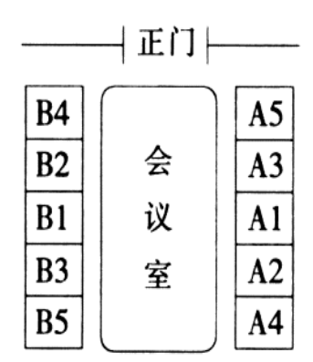

B. 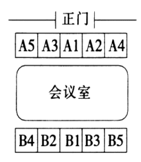

C. 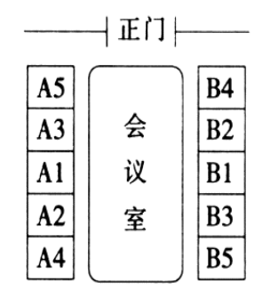

D. 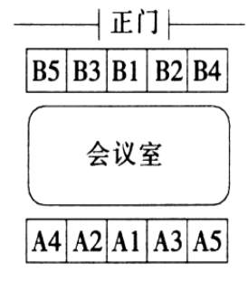

第 13 题 · 答案与解析

**参考答案（粉笔题库参考内容）**

C

**解析**

双边谈判时，谈判桌若横放于室内，面对正门的一侧为上，属于客方，背对正门的一侧为下，属于主方；谈判桌若竖放于室内，则以进门的方向为准，右侧为上，属于客方；左侧为下，属于主方，排除A、B两项。谈判时，各方的主谈人员居中而坐，其他人员按照右高左低的原则，依据职务身份的高低分别在主谈人的两侧就座，排除D项。据此可以判断，四个选项中，座次安排符合礼仪的是C项。

故正确答案为C。

**考点**：文化常识

**来源**：2015年吉林省公务员录用考试《行测》题（4月甲级）第13题

### 第 14 题

某驴友在长白山徒步时，迷失了方向，看到树干一面生长着苔藓，而另一面不生长苔藓，据此他判断出了方向。那么生长苔藓的一面朝向是：

A. 东

B. 北

C. 西

D. 南

第 14 题 · 答案与解析

**参考答案（粉笔题库参考内容）**

B

**解析**

长白山位于北半球的中纬度地区，因此朝南的方向向着太阳，朝北的方向则是背光面。苔藓植物只适于生活在阴暗潮湿的环境中，即生长在树干的背光面。该驴友可以据此判断，生长苔藓的一面是朝向北。

故正确答案为B。

**考点**：自然地理

**来源**：2015年吉林省公务员录用考试《行测》题（4月甲级）第14题

### 第 15 题

古人常依据自己的名取字，所取的字多与名含义相同或属同义联想，但也有的字与名反义相对。下列属于字与名反义相对的一项是：

A. 班固，字孟坚；杜甫，字子美

B. 关羽，字云长；贾岛，字浪仙

C. 韩愈，字退之；朱熹，字元晦

D. 周瑜，字公瑾；曾巩，字子固

第 15 题 · 答案与解析

**参考答案（粉笔题库参考内容）**

C

**解析**

C项符合题意，韩愈中的“愈”本义为“病好了”，作动词表示“胜过”“超越”，而“退之”则有“向后”“退后”之意，“愈”和“退之”两者意思相对；朱熹中的“熹”有“亮”“光明”之意，而“晦”表示“昏暗不明”，二者意思相对。

A项中班固和杜甫的名与字含义相同，“固”和“坚”都有“结实”“不动摇”之意，“甫”是中国古代对男子的美称，与“子美”含义相同。B项中关羽和贾岛的名与字之间属于同义联想，关羽中的“羽”指“鸟的翅膀”“羽翼”，由此联想到展开翅膀飞向云端，贾岛中的“岛”指“岛屿”，由此联想到浪花自由飞舞。D项中周瑜和曾巩的名与字含义相同，“瑜”和“瑾”都指美玉，“巩”和“固”都指坚固、结实。

故正确答案为C。

**考点**：文化常识

**来源**：2015年吉林省公务员录用考试《行测》题（4月乙级）第12题

### 第 16 题

某新闻媒体欲结合12月份的重要纪念日、活动日等时间节点，推出系列公益广告，这些公益广告主题可以是：

A. 防范艾滋病、宣传宪法、公祭南京大屠杀死难者同胞

B. 防范艾滋病、节约用水、纪念香港回归

C. 关爱残疾人、节约粮食、纪念澳门回归

D. 宣传劳动法、保障人权、纪念辛亥革命

第 16 题 · 答案与解析

**参考答案（粉笔题库参考内容）**

A

**解析**

A项正确，12月1日为世界艾滋病日，12月4日为中国国家宪法日，12月13日为南京大屠杀死难者国家公祭日。

B项错误，世界水日是3月22日，香港回归纪念日是7月1日；C项错误，国际残疾人日是12月3日，澳门回归纪念日是12月20日，但世界粮食日是在10月16日；D项错误，世界人权日是12月10日，但国际劳动节是在5月1日，而且辛亥革命纪念日是10月10日。

故正确答案为A。

**考点**：文化常识

**来源**：2015年吉林省公务员录用考试《行测》题（4月乙级）第20题

### 第 17 题

大量议案、提案是每年两会的焦点。关于议案与提案的区别，下列说法错误的是：

A. 议案用于人大会议，提案用于政协会议

B. 议案一经通过便具有法律效力，提案没有法律效力

C. 议案内容应在受案者职权范围内，提案不限内容

D. 议案可由个人提出，提案必须由团体提出

第 17 题 · 答案与解析

**参考答案（粉笔题库参考内容）**

D

**解析**

本题考查公文写作与处理。

议案是具备提议案的法定资格的机构或符合法定联名人数的人大代表向国家权力机关即人民代表大会提出的议事原案。提出议案的主体，必须具备提议案的法定资格或符合法定的代表联名人数。所提内容必须是属于议事机关职权范围内的事项。提案是政协委员、政协各专门委员会和政协各参加单位通过人民政协组织向人民代表大会或人民政府就有关国家或地方大政方针、社会生活等重大问题提出意见和建议的形式。政协提案实行提出提案的时间不限、内容不限、人数不限的“三不限制”原则。故D项说法错误，A、C两项说法正确。由于人民代表大会是国家最高权力机关，人大的议案一经通过，就具有法律效力，而人民政协是爱国统一战线组织，政协委员提案是民主监督的一种形式，没有法律约束力。B项说法也正确。

本题为选非题，故正确答案为D。

**来源**：2015年吉林省公务员录用考试《行测》题（4月乙级）第16题

### 第 18 题

雨后晴朗的月夜，为了防止踩到地上的积水，下列判断正确的是：

A. 迎着月光走，地上发亮处是水；背着月光走，地上暗处是水

B. 迎着月光走或背着月光走，都应该是地上暗处是水

C. 迎着月光走或背着月光走，都应该是地上发亮处是水

D. 迎着月光走，地上暗处是水；背着月光走，地上发亮处是水

第 18 题 · 答案与解析

**参考答案（粉笔题库参考内容）**

A

**解析**

由于地面凹凸不平，光射到地面上发生漫反射，漫反射能让人从各个方向看到物体，反射光照沿各个方向，看上去较暗；水面光滑，光射到地面的积水上发生镜面反射，镜面反射只能让我们从某个方向看到物体，反射光线沿某个特定的方向，在这个特定方向看亮度较高，刺眼。

迎着月光走时，水面发生镜面反射，反射光线全部射进人眼，地面发生漫反射，反射光线只有部分射进人眼，因此发亮处是水，暗处是地面；背着月光走时，水面的反射光线将全部向背离人眼的方向射去，无法进入人眼。而地面由于漫反射，反射光仍有部分进入人眼，因此此时地面看起来是较亮的，暗处的地方则为积水。

故正确答案为A。

**考点**：物理常识

**来源**：2015年吉林省公务员录用考试《行测》题（4月甲级）第18题

### 第 19 题

雷雨天躲在室内，有时也容易遭到雷击。下列关于室内预防雷击的说法，错误的是：

A. 关闭门窗可以阻止球形雷电进入

B. 靠墙壁的位置比房间中央更安全

C. 不宜靠近电器设备以及使用电器

D. 不使用淋浴冲凉或触摸金属管道

第 19 题 · 答案与解析

**参考答案（粉笔题库参考内容）**

B

**解析**

雷电是常见的暴雨灾害天气，室内预防雷击要做到“三不宜”：不宜敞开门窗（关闭门窗可以阻止球形雷的进入）；不宜使用淋浴冲凉或触摸金属管道；不宜靠近建筑物外墙、电器设备以及使用电器。A、C、D三项表述正确，B项表述错误，打雷时不宜靠近建筑物外墙，房间中央的位置比靠墙位置安全。

本题为选非题，故正确答案为B。

**考点**：生活常识

**来源**：2015年吉林省公务员录用考试《行测》题（4月甲级）第19题

### 第 20 题

变色龙的体色随环境颜色而变化，这是生物与环境相适应的一种现象。下列现象与此不相类似的是：

A. 枯叶蝶停在树上像枯叶

B. 蚯蚓活动使土壤松弛

C. 仙人掌的叶退化成针形

D. 竹节虫外形酷似竹节

第 20 题 · 答案与解析

**参考答案（粉笔题库参考内容）**

B

**解析**

本题考查科技常识。

B项蚯蚓活动使土壤松弛，有利于植物根的呼吸、生长，同时还能保持土壤肥沃，这种现象反映了生物对环境的影响，与题干所述现象不相似。A项“枯叶蝶停在树上像枯叶”和D项“竹节虫外形酷似竹节”，都是为了不易被敌害发现从而生存下来，是枯叶蝶和竹节虫对环境的适应，与题干所述现象相似；C项“仙人掌的叶退化成针形”是为了减少水分的散失，利于在沙漠中生存，是对干旱环境的适应，与题干所述现象相似。

本题为选非题，故正确答案为B。

**考点**：生物常识

**来源**：2015年吉林省公务员录用考试《行测》题（4月甲级）第20题

### 第 21 题

“一带一路”是“丝绸之路经济带”和“21世纪海上丝绸之路”的简称。它借用古代“丝绸之路”的历史＿＿，高举和平发展的旗帜，主动地发展与沿线国家的经济合作伙伴关系，共同打造政治＿＿、经济＿＿、文化＿＿的利益共同体、命运共同体和责任共同体。

填入划横线部分最恰当的一项是：

A. 符号 互信 融合 包容

B. 传说 相助 相扶 共荣

C. 故事 互帮 共通 相融

D. 典故 共存 互助 互动

第 21 题 · 答案与解析

**参考答案（粉笔题库参考内容）**

A

**解析**

第一空，此处语境强调借用古代“丝绸之路”这一具有特定历史意义的标识来定义新的事物，“符号”指具有某种代表意义或性质的标识，置于此处用来形容“丝绸之路”最为恰当准确。“传说”通常指未经确定的传闻或虚构的故事，而“丝绸之路”并非虚构，与文意不符，排除B项。

第二空，填入此处的词语应与“政治”搭配，“政治互信”为外交辞令，意为两国政治互相信任，与后文“经济融合”“文化包容”均为我国独立自主的和平外交政策。“互帮”与“共存”均与“政治”搭配不当，排除C、D两项。

故正确答案为A。

【文段来源】《“一带一路”到底是什么？》

**考点**：实词填空、词的辨析-搭配对象

**来源**：2015年吉林省公务员录用考试《行测》题（4月甲级）第21题

### 第 22 题

“北师大保安考上研究生”这件事之所以引发关注，就在于它的稀缺，这也从侧面说明阶层固化导致＿＿＿＿的＿＿＿＿＿＿不够充分。

填入划横线部分最恰当的一项是：

A. 向上 社会流动

B. 纵向 社会流动

C. 上下 阶层流动

D. 向上 人口流动

第 22 题 · 答案与解析

**参考答案（粉笔题库参考内容）**

A

**解析**

第一空，此处语境强调“保安考上研究生”，是一种向上的流动，方向是确定的，而“纵向”和“上下”均包含双向流动的意思，与文段语境对应不当，排除B、C两项。

第二空，“人口流动”是人口在短期离开后又返回原居住地的现象，“社会流动”指的是一个社会成员或群体从一个社会阶层转到另一个社会阶层，从一种社会地位转向另一种社会地位，从一种职业向另一种职业转变的过程，因此此处强调的是社会阶层的流动而非人员的流动，排除D项。

故正确答案为A。

【文段出处】《“保安变研究生”满满正能量》

**考点**：关联关系-因果关系、实词填空

**来源**：2015年吉林省公务员录用考试《行测》题（4月甲级）第22题

### 第 23 题

特立独行的人生，无法被标签化定格，作家张贤亮即如是。2014年9月27日下午，张贤亮猝然病逝，“灵与肉”已经安息，可是在要“＿＿＿＿＿＿”的时刻，却似乎没有哪个标签能准确无虞地概括其一生：“新中国首个突破‘性禁区’的作家”“伤痕文学的代表人物”“中国先锋文学第一把火的点燃者”“一个成功出卖荒凉的人”。似乎只有把这些都合起来，才能拼凑出其遍是棱角的人生切面。

填入划横线部分最恰当的一项是：

A. 曲终人散

B. 水落石出

C. 尘埃落定

D. 结案陈词

第 23 题 · 答案与解析

**参考答案（粉笔题库参考内容）**

D

**解析**

根据首句“无法被标签化定格”和后文强调的“标签概括其一生”可知，填入此处的成语应表示为其逝去的一生作总结、下定论之意。A项“曲终人散”指万事万物都有消亡的一刻，曲子停息了，人也就都散了，用于此处体现不出要下结论之意；B项“水落石出”比喻事情终于真相大白，文段中并无“真相”之意；C项“尘埃落定”指事情经过了曲折变化终于有了结果。三者均不能与后文语境对应，排除A、B、C三项。“结案陈词”指对一件很复杂的事情最后作出定论，符合语境要求。

故正确答案为D。

【文段来源】《张贤亮的独立性存在》

**考点**：对应关系-前后呼应、成语填空

**来源**：2015年吉林省公务员录用考试《行测》题（4月甲级）第23题

### 第 24 题

中国女性自古就有节俭的传统，总觉得“等有了更好的工作”“等有了房子”“等攒了更多的钱”“等孩子长大了”之后才能享福。殊不知，她们一直在＿＿幸福，却难得真正＿＿幸福，实际上等于消灭了幸福。

填入划横线部分最恰当的一项是：

A. 预约 享受

B. 约定 享受

C. 预订 消受

D. 预定 消受

第 24 题 · 答案与解析

**参考答案（粉笔题库参考内容）**

A

**解析**

第一空，根据文段语境“等有了更好的工作”“等有了房子”“等攒了更多的钱”“等孩子长大了”可知，填入此处的词语应有预先设想之意，而“约定”一般指和某人许下诺言在一定的时间去实现，置于此处语境不符，排除B项。

第二空，填入此处的词语与“幸福”搭配，“享受幸福”搭配恰当，与前文“享福”也更加对应。“消受”也有享受的意思，但是多用于否定形式，如“无福消受”、“难以消受”等，置于此处与“幸福”搭配不当，排除C、D两项。

故正确答案为A。

【文段来源】《毕淑敏破解幸福密码》

**考点**：实词填空、对应关系-前后呼应、词的辨析-搭配对象

**来源**：2015年吉林省公务员录用考试《行测》题（4月甲级）第24题

### 第 25 题

事实上，社会上自称“收入低”的群体很多，很少有人对自己目前的薪资水平完全满意。有代表委员认为，若要让人们普遍有“＿＿”而不是“＿＿”，应加大收入分配改革的力度，在全社会建立起合理的薪酬体系，同时尽快完善社会保障网。

填入划横线部分最恰当的一项是：

A. 满足感 期待感

B. 幸福感 空虚感

C. 满意度 不满意

D. 获得感 没底感

第 25 题 · 答案与解析

**参考答案（粉笔题库参考内容）**

D

**解析**

第一空，“满意度”不能与“有”搭配，只能说“满意度”高或低，排除C项。

第二空，根据文段语境“······而不是······”可知，填入的两个实词应含义相反，A项“满足感”和“期待感”不能形成反义关系，排除A项。文段强调很多人认为自己“收入低”，对自己的薪资水平不完全满意，可见这是一种“没底感”，对应D项。B项“空虚感”往往是由精神与内心引发，而非“收入低”引起，无法与语境对应，排除B项。

故正确答案为D。

【文段出处】《2015年两会上委员代表说得最多的民生热词盘点》

**考点**：关联关系-并列关系、实词填空、词的辨析-搭配对象

**来源**：2015年吉林省公务员录用考试《行测》题（4月甲级）第25题

### 第 26 题

春天时，湖水涨满，湖天一色，船行湖中，如行天上；秋日里，山色斑斓，山景如画，人游山中，如行画中。

根据语境，以“春水船如天上坐”为上联，最贴切的下联是：

A. 秋色人如画中行

B. 秋山人似画中游

C. 秋日人行景中画

D. 秋景人若行画中

第 26 题 · 答案与解析

**参考答案（粉笔题库参考内容）**

B

**解析**

对联上下联需对仗工整，上联为第一个小分句提取凝练而成，下联从第二个小分句提炼对应即可。上联“春天时，湖水涨满”叙述主体为“春水”，可见下联“秋日里，山色斑斓”的叙述主体应为“秋山”。上联第三字“船”对应“船行湖中”，可见下联第三字应对应“人游山中”第一字“人”。上联五六字“天上”对应“如行天上”后两字，可见下联五六字应对应“如行画中”后两字“画中”。上下联最后一字“坐”与“游”同为动词，对仗工整。综上所述，B项为最佳下联。

故正确答案为B。

**来源**：2015年吉林省公务员录用考试《行测》题（4月甲级）第26题

### 第 27 题

下列语句表达有误的一项是：

A. 在此背景下，亚洲国家能否继续发展的关键在于正视历史、妥善处理分歧，聚焦共同利益。把互利共赢的合作愿望落到实处

B. 年会专门设计了一个“超越冷战思维：新的亚太安全观”分会，就是希望倡导通过对话协商和平解决国家间争端，反对动辄使用武力和以武力相威胁，希望推动走出一条各国共建、共享、共赢的安全之路

C. 我们就亚洲基础设施投资银行与金砖国家开发银行专门设置了一场分论坛。中国倡议建设亚投行以来，许多国家积极呼应

D. 我们围绕“亚洲命运共同体”设置了众多议题，目的就是想挖掘地区经济体在不同领域有何共同利益，尝试从它们各自的角度来诠释亚洲面临哪些共同挑战和共同机遇

第 27 题 · 答案与解析

**参考答案（粉笔题库参考内容）**

A

**解析**

A项中，“能否”即能够还是不能够，为两面性表述，后文“关键在于”之后内容却是一面性表述，语句前后为两面对一面搭配不当，应去掉“能否”一词。其他三项均表达正确。

本题为选非题，故正确答案为A。

**来源**：2015年吉林省公务员录用考试《行测》题（4月甲级）第27题

### 第 28 题

下列划横线的俗语使用不正确的一项是：

A. 先进后进只是相对而言，<u>尺有所短，寸有所长</u>，班级各有千秋，我们班虽是先进集体，但也有不足

B. 面对各路强手，17岁小将龙清泉<u>初生牛犊不怕虎</u>，顽强拼搏，勇夺奥运举重金牌

C. 运输队长说：“<u>不入虎穴，焉得虎子</u>，时间再紧，我们也要把这批物资按时送到边防站。”

D. 齐白石经过“<u>不教一日闲过</u>”的努力才成为国画大师，可谓十年一剑，功夫不负苦心人

第 28 题 · 答案与解析

**参考答案（粉笔题库参考内容）**

C

**解析**

A项，“尺有所长，寸有所短”比喻人或事物各有其长处和短处，对应后文“各有千秋”，使用恰当，排除。

B项，“初生牛犊不怕虎”比喻青年人思想上很少顾虑，敢做敢为，此处强调17岁小将面对各路强手勇夺奥运举重金牌，使用恰当，排除。

C项，“不入虎穴，焉得虎子”比喻不冒危险，就不能成事，今也用来比喻不经历最艰苦的实践，就不能取得真知。语境强调时间紧张，没有冒险及艰苦之意，故此处俗语使用不当，当选。

D项，“不教一日闲过”比喻每天勤勤苦苦、努力奋发，正是由齐白石的典故而来，形容他勤恳苦练的精神，使用恰当，排除。

本题为选非题，故正确答案为C。

**来源**：2015年吉林省公务员录用考试《行测》题（4月甲级）第28题

### 第 29 题

我和父亲感情极深，但直至他老人家临终我都没能说一句“爸爸我爱你”，不是不想说而是说不出口。我二十几岁时看西方电影，见外国人搂着老父亲说“爸爸我爱你”，心中感慨万分，就决心在儿子身上试验。当儿子可以交流的时候，我就和儿子深情地说：“儿子，爸爸爱你，你得说，我爱爸爸。”不懂事的儿子就此和我共同与传统的含蓄文化抗衡，天天上演国人觉得很肉麻的一幕。这是一场文化与制度博弈的试验。10年后，试验有了结果，儿子小学四年级的一天，我把他摁在床上深情地说：“儿子，爸爸爱你！”儿子毫不犹豫地对我说：“少来这一套！”

这段文字最想说明的是：

A. 我国传统文化中有含蓄表达的积习

B. 父子之间的感情交流须契合传统文化

C. 制度与作为社会背景的文化抗衡往往徒劳

D. 东方的含蓄与西方的直白是一种文化差异

第 29 题 · 答案与解析

**参考答案（粉笔题库参考内容）**

C

**解析**

根据原文“这是一场文化与制度博弈的试验”可知，作者让儿子回馈直白的表述为一种“硬性制度”，而我国传统的含蓄表达可谓是一种“文化”。博弈的结果是制度在文化大背景下彻底失败，可见作者通过这个故事想要说明的是制度与背景文化抗衡往往徒劳。

A项由作者与其父亲相处的故事可以体现，但不是文段重点，排除；B项对策无中生有，排除；D项通过文段前两句话可以得知，但不是文段重点，排除。

故正确答案为C。

【文段来源】《文化》

**来源**：2015年吉林省公务员录用考试《行测》题（4月甲级）第29题

### 第 30 题

哈佛大学经过25年的跟踪调查发现，3％的人有十分清晰的长期目标，几乎都成了社会各界顶尖成功人士，其中不乏白手创业者、行业领袖、社会精英；10％的人有比较清晰的短期目标，大都生活在社会的中上层，成为各行各业不可缺少的专业人士，如医生、律师、工程师、高级主管等；60％的人目标模糊，几乎都生活在社会的中下层面，只能安稳地生活与工作，但都没有什么特别的成绩；27％的人没有目标，几乎都生活在社会最底层。常常失业，靠社会救济，并且常常抱怨他人，抱怨社会。

根据文字，哈佛大学调查的是：

A. 目标与生活态度的关系

B. 目标对人生的重要程度

C. 目标对人生的不同影响

D. 目标与社会阶层的关系

第 30 题 · 答案与解析

**参考答案（粉笔题库参考内容）**

C

**解析**

文段通过四个并列的分句阐述了这项跟踪调查的结果，有无目标、目标清晰与否给人生带来了不同的影响，对四个分句进行归纳共性，可知是不同的目标对人生造成了不同的影响。C项正确。

A项，“生活态度”仅在最后一个分句中有论述，片面，文段主要论述的是目标对人生的不同作用。

B项仅强调“重要程度”，而程度可大可小，但是文中的意思是“程度”很大，表述不明确。

D项，文中强调的是目标会使人最终处于不同的阶层，“关系”一词不具体，未体现出目标可以使人处于不同的阶层这种重要性，排除。

故正确答案为C。

【文段来源】《哈佛大学关于目标对人生影响的跟踪调查》

**考点**：关联词-并列

**来源**：2015年吉林省公务员录用考试《行测》题（4月甲级）第30题

### 第 31 题

下列描写古代女子花容月貌的诗句中，没有使用比喻修辞手法的是：

A. 玉容寂寞泪阑干，梨花一枝春带雨

B. 闲静时如娇花照水，行动处似弱柳扶风

C. 翩若惊鸿，婉若游龙，荣曜秋菊，华茂春松

D. 北方有佳人，绝世而独立。一顾倾人城，再顾倾人国

第 31 题 · 答案与解析

**参考答案（粉笔题库参考内容）**

D

**解析**

比喻是指用跟甲事物有相似点的乙事物来描写或说明甲事物。D项中描写“佳人”，没有与之相似的乙事物；故不属于比喻的修辞手法。

A项中喻体为“梨花”；B项中喻体为“娇花”“弱柳”；C项中喻体为“惊鸿”“游龙”“秋菊”“春松”。三项均使用了比喻的修辞手法。

本题为选非题，故正确答案为D。

**来源**：2015年吉林省公务员录用考试《行测》题（4月甲级）第31题

### 第 32 题

①在辽阔的关东大地，三大怪之一是姑娘叼个大烟袋，旧时老一些的女人都是略有一支两支的

②另外，一支烟袋往出一伸，往往把家里上下或祖上的繁华气派也一并展览

③大烟袋中间为柄，柄须中空，一头上装烟的锅子，这锅子比铜钱大得多，另一头是烟嘴

④这烟袋还有一用，就是用来打小孩，小孩不听话，即使那祖母本来坐得有几尺远，也能伸出烟袋打到

⑤在上一个年代里生活的女人，也未必是人人都爱烟袋，也许只是风气使然

⑥此地烟袋特指装了烟的长柄器具，而非男人们随身携烟之口袋，有一尺或者两尺多长，拇指头粗细

将以上6个句子重新排列，语序正确的是：

A. ⑤①③⑥④②

B. ④③⑥①⑤②

C. ①⑥③⑤②④

D. ③⑥⑤④②①

第 32 题 · 答案与解析

**参考答案（粉笔题库参考内容）**

C

**解析**

观察各项首句，①句中由“在辽阔的关东大地”这一状语开头，起到背景铺垫的作用，比较适合作为文段首句，且该句引出了文段的论述主体“三大怪之一是姑娘叼个大烟袋”。⑥中的代词“此地”指代的为①中提到的“关东大地”，二者应捆绑。②③④⑤分别介绍了烟袋的特征、作用等，应置于①⑥之后，进行详细展开说明，C项顺序正确。

故正确答案为C。

【文段来源】《姑娘叼着大烟袋》

**考点**：确定捆绑、确定首句-首句特征

**来源**：2015年吉林省公务员录用考试《行测》题（4月甲级）第32题

### 第 33 题

中国已经是全球智库大国，但很多机构并不是真的智库。从国内外经验来看，成功的智库大都具有独立性、专业性和有效性等特点。独立性表示政策主张不受资助者、利益集团的影响；专业性要求政策建议既有严谨的学术基础，又有很强的可操作性；而有效性则是指研究人员能够真正影响政府的决策。为了让“中国特色新型智库”发挥应有的作用，政府应该考虑在决策程序、税收政策和智库体制等方面进行一些改革，智库需要＿＿＿＿＿。

填在横线处最恰当的语句是：

A. 把质量问题放在首位

B. 采取相对灵活的综合评估方法

C. 特别防范一些错误的认识和倾向

D. 逐步建立一些必要的行业规范与准则

第 33 题 · 答案与解析

**参考答案（粉笔题库参考内容）**

D

**解析**

文段首句提出目前存在的问题，即“很多机构并不是真的智库”，随后介绍了成功智库应具备的特点。尾句提出应对策略“政府应该考虑在决策程序、税收政策和智库体制等方面进行一些改革”，应针对前文提及的问题进行有效解决，即使其不再受资助者影响，政策严谨可操作，研究人员能够真正影响决策，填入横线处的句子应与这一含义相对应，即为D项中的“必要的行业规范与准则”。

A、B、C三项中的“质量问题”、“评估方法”、“错误认识”均为无中生有，与上文衔接不当，排除。

故正确答案为D。

【文段来源】《中国智库建设需防范利益集团的操控》

**考点**：横线在结尾

**来源**：2015年吉林省公务员录用考试《行测》题（4月甲级）第33题

### 第 34 题

“男性蠢货理论”研究显示，大部分男性的确倾向于冒不必要的风险，且常常做出蠢事。医院急救中心的记录和死亡率统计都能印证这一研究结果。比起女性，男性更易受到意外伤害，在运动中受伤，或遭遇交通事故。造成这种男女差异的有文化和社会经济因素，例如男性参与危险性体育运动的机会更多。但也存在一种所谓“蠢货风险”，即毫无意义的风险，而心甘情愿冒这种风险的往往都是男性。研究人员已搜罗到大量奇闻轶事来佐证这个理论，但他们还希望对男女差异进行系统性分析。

这段文字未暗示的信息是：

A. 女性比男性智商高

B. 社会角色的差异是男性甘愿冒险的因素之一

C. 目前还未对“蠢货理论”进行科学地论证

D. 女性很少去冒毫无意义的风险

第 34 题 · 答案与解析

**参考答案（粉笔题库参考内容）**

A

**解析**

根据文段中“造成这种男女差异的有文化和社会经济因素，例如男性参与危险性体育运动的机会更多”可知，B项文段有涉及。根据文段中“但他们还希望对男女差异进行系统性分析”可知，C项文段有涉及。根据文段中“心甘情愿冒这种风险的往往都是男性”可知，D项文段有涉及。A项在文段中无从体现，无中生有。

本题为选非题，故正确答案为A。

【文段来源】《男性倾向冒不必要风险往往更易做出蠢事》

**考点**：细节判断题

**来源**：2015年吉林省公务员录用考试《行测》题（4月乙级）第50题

### 第 35 题

有时你剪了一个失败的发型，觉得简直无脸见人，结果遇到熟人，别人也就是轻描淡写一句“剪头发啦”。或许我们都一厢情愿地放大了别人的看法，或许我们以为别人都在目不转睛地盯着我们。而那看法和目光，像一个无形的牢笼一样束缚了我们的行为和思想。但事实是，别人没有那么在意你。你以为的别人的目光和看法，只是自己对自己的判断和投射。你把自己的恐惧放大，然后躲在那个巨大的阴影里畏缩不前。

这段文字最合适的标题是：

A. 其实，没有别人的目光

B. 其实，你可以勇敢

C. 其实，没有长期的关注

D. 其实，你渴望认同

第 35 题 · 答案与解析

**参考答案（粉笔题库参考内容）**

A

**解析**

文段前半部分指出很多时候我们过多看重别人的看法，随后通过转折关联词“但”引出文段重点，即“事实是，别人没有那么在意你”，并进一步说明“你以为的别人的目光和看法，只是自己对自己的判断和投射”。标题应与文段中心相一致，强调“没有别人的目光”。

B、D两项均未体现出“别人”这一关键词，排除；C项“长期的关注”与“别人的目光”不是同一概念，排除。

故正确答案为A。

【文段来源】《其实，没有别人的目光》

**考点**：标题填入题

**来源**：2015年吉林省公务员录用考试《行测》题（4月甲级）第35题

### 第 36 题

下列各句中有歧义的一句是：

A. 生物航煤生产技术方兴未艾，专利储备战却已悄然展开，美国埃克森美孚、法国道达尔、芬兰耐斯特石油等企业已经在中国提交相关专利申请，相关技术的专利储备战已经悄然展开

B. 1999年，世界小行星协会给了张学友一个机会，命名一颗小行星为“MAY”

C. 2015年4月9日下午，李克强总理来到长春市南部新城综合枢纽工程现场，下到深达16.5米的施工地点考察

D. 近些年，公众对一些政府主导建设项目的集体抵制时常涌现，其中很重要的原因就是个别地方政府失去了公信力

第 36 题 · 答案与解析

**参考答案（粉笔题库参考内容）**

B

**解析**

B项中的主语不明，存在歧义，可以理解为“世界小行星协会命名”，也可以理解为“世界小行星协会给了张学友一个机会，由张学友来命名”。其他三项均没有歧义。

本题为选非题，故正确答案为B。

**来源**：2015年吉林省公务员录用考试《行测》题（4月甲级）第36题

### 第 37 题

1927年胡适先生写道：“有一个时期，麻将竟成了西洋社会里最时髦的一种游戏，中国留学生没有钱的可以靠教麻将吃饭挣钱。”中国是麻将的发源地，但世界上唯一一家麻将博物馆却坐落在日本。博物馆展示着收集来的1万多册中日欧美麻将书籍、麻将桌、麻将器具和形形色色的麻将牌。展台按地域分，中国是麻将的发源地，日本有发达的麻将文化，美国曾爆发过麻将热，欧洲麻将则成为贵人的游艺。按主题分，有麻将与人类和平、麻将与印章、麻将与历史、麻将与书籍等。

不能从这段文字直接推出的结论是：

A. 麻将虽然源于中国却属于世界

B. 中国人更痴迷于麻将的浅层次娱乐活动

C. 日本比中国更重视麻将的文化价值

D. 中国留学生对传播麻将文化功不可没

第 37 题 · 答案与解析

**参考答案（粉笔题库参考内容）**

B

**解析**

根据文段中“中国是麻将的发源地，日本有发达的麻将文化，美国曾爆发过麻将热，欧洲麻将则成为贵人的游艺”一句可知A项正确，排除。根据文段中“但世界上唯一一家麻将博物馆却坐落在日本”“日本有发达的麻将文化”可知C项正确，排除。根据胡适先生所描述的内容可知D项正确，排除。B项在文中没有体现，无中生有，当选。

本题为选非题，故正确答案为B。

【文段来源】《日本的麻将文化》

**考点**：细节判断题

**来源**：2015年吉林省公务员录用考试《行测》题（4月甲级）第37题

### 第 38 题

春节期间，duang“震碎”无数网友的屏幕。作为2015年开年第一个爆红的“字”，网友张口闭口不duang一下，似乎都不好意思跟人打招呼。然而，随着近年来这类网络新说法的日益增多，很多人开始担忧它们对传统汉字和传统文化的冲击，并建议应该规范汉字的使用。其实，汉字文化的演变本来就是一个继承与发展的动态过程，这些网络新说法，作为当下社会发展的映照，从一个侧面说明我们的汉字文化是一种充满活力的、可再生的文化体系。如果真的有一些说法被留下来了，也不失为一件悦事。

概括文段语义，最恰当的一项是：

A. 文字传承有自身规律，无需谈“新”色变

B. 新说法的涌现不会冲击传统文化，甚至还丰富了汉字文化体系

C. 汉字的极大丰富说明汉字文化具有极大的可再生能力

D. 随着大量新词的产生，应该不断规范汉字的使用

第 38 题 · 答案与解析

**参考答案（粉笔题库参考内容）**

A

**解析**

文段首先由“duang”引入话题，继而阐述了网络新说法的背景以及现状，即“随着近年来这类网络新说法的日益增多，很多人开始担忧它们对传统汉字和传统文化的冲击，并建议应该规范汉字的使用”，随后通过转折关联词“其实”引出文段重点，即汉字文化的演变本来就是一个继承与发展的动态过程······如果真的有一些说法被留下来了，也不失为一件悦事。可见作者主要强调了汉字文化传承有其自身规律，“新”也并不一定是坏事，对应A项。

B项，文段仅阐述了新说法侧面说明了汉字文化的活力，“不会冲击传统文化”表述过于绝对，且“丰富了汉字文化体系”文中没有体现，排除；

C项，没有提到“新说法”，排除；

D项，与转折“其实”之后的观点不一致，排除。

故正确答案为A。

【文段来源】《文字传承有自身规律，无需谈“新”色变》

**考点**：关联词-转折

**来源**：2015年吉林省公务员录用考试《行测》题（4月甲级）第38题

### 第 39 题

名字这个东西大家都知道很重要，但是现在的重要和以前的重要还是不一样的，以前要八字合，现在则要考虑到传播。一个好名字，要好记，也要好传播，而且要注意的是，在传播的时候不能走样，不能引起误读，若能给人留下好的印象，就非常完美了。

这段文字意在说明：

A. 一个好名字，起码要八字合

B. 一个好名字，其印象分要高

C. 一个好名字，其传播力要强

D. 一个好名字，不能有歧义

第 39 题 · 答案与解析

**参考答案（粉笔题库参考内容）**

C

**解析**

文段为观点+解释说明结构，首句即点明中心，即“现在则要考虑到传播”，后文详细解释了“传播”需具备的几个特点，观点更重要，作者意在说明一个好名字传播力要强，C项符合文意，当选。

A项为以前对名字的要求，排除。B、D两项均为“传播”应具备的特点之一，非重点，排除。

故正确答案为C。

【文段来源】《微时代如何起一个响亮的名字》

**考点**：分述句特征-其他

**来源**：2015年吉林省公务员录用考试《行测》题（4月乙级）第34题

### 第 40 题

老话“时间如流水”可能是错的。一个新的理论称，时间并不是向前流逝的，相反，时间中的一切都是始终存在的。该理论称，如果我们“俯瞰”宇宙，那么我们将看到时间是向着所有方向延伸的，正如我们此刻看到的太空。这个有趣的理论是由麻省理工学院的哲学副教授布拉德福德 · 斯科博士提出的。他认为时间并非从我们身边驶过并永远消失不见——相反，它们存在于时空的不同位置。

下列语句中，符合这一理论的说法是：

A. 我们在时间中穿行，就像一艘船在水上航行

B. 时间是对称的，在另一个宇宙中的智慧体看来，我们宇宙的时间是后退的

C. 你在时间中被展开，类似于你在空间中被展开的那样，我们并非处于单一的时间中

D. 现在是一个“焦点”。从过去移动至未来，我们处于这个焦点之中，并随着它前进

第 40 题 · 答案与解析

**参考答案（粉笔题库参考内容）**

C

**解析**

C项，“你在时间中被展开”即可对应文段中理论所强调的“时间是向着所有方向延伸的”，而“我们并非处于单一的时间中”即可对应理论“时间并非从我们身边驶过并永远消失不见——相反，它们存在于时空的不同位置”，符合这一理论，当选。

A、D两项的说法是对“时间如流水”的论证，与文段所提到的理论不符，排除。

B项中的“后退”无从体现，排除。

故正确答案为C。

【文段来源】《时间并非如流水过去未来一直存在》

**考点**：细节判断题

**来源**：2015年吉林省公务员录用考试《行测》题（4月乙级）第48题

### 第 41 题

春秋时期，鲁国上卿大夫季文子掌握国政和统兵之权，却“家无衣帛之妾，厩无食粟之马、府无金玉”。仲孙它提醒他，这样有损国家气派，吝啬而不体面。季文子回答，国家形象的维系要靠高尚品德，而非美妾良马，“若独贪于奢侈，好于文章，是不德也。”

这则故事能给当今公务员带来的启示是：

A. 生活俭朴，官员才能维护国家形象

B. 为政以德，勤俭自律，官员要注重个人品行修养

C. 联系群众，放下身段到群众中去

D. 合理用权，权为民所用而不是以权谋私

第 41 题 · 答案与解析

**参考答案（粉笔题库参考内容）**

B

**解析**

文段重点在于季文子说的话“国家形象的维系要靠高尚品德，而非美妾良马”。可见文段主要强调公务员的道德品行。只有B项提到“为政以德、勤俭自律、品行修养”。A、C、D三项均与文段所表达主题无关。

故正确答案为B。

【文段来源】《莫在群众面前“抖派”》

**来源**：2015年吉林省公务员录用考试《行测》题（4月乙级）第47题

### 第 42 题

“红头文件”并非法律用语，是老百姓对“各级政府机关（多指中央一级）下发的带有大红字标题和红色印章的文件”的俗称。“红头文件”始于西魏时期，当时有位政治家苏绰擅长算术。据《周书·苏绰传》记载：“绰始制方案程式，朱出墨入，及计账户籍之法。”“朱出墨入”，指的是朝廷发出的文书是用朱（红色）标，下面上呈的文书是用墨（黑色）标，界限严明。

根据文字，以下说法错误的是：

A. “朱出墨入”的文书程式创于西魏

B. 古代朝廷发出的文书似于今天的“红头文件”

C. “红头文件”之称不是专业用语

D. “红头文件”的叫法起源于西魏时期

第 42 题 · 答案与解析

**参考答案（粉笔题库参考内容）**

D

**解析**

根据文段中“‘红头文件’始于西魏时期······朱出墨入，及计账户籍之法”可知A项正确。根据文段中“朝廷发出的文书是用朱（红色）标”一句可知B项正确。根据文中“‘红头文件’并非法律用语，是······的俗称”一句可知C项正确。D项表述错误，从文段只知“红头文件”的形式始于西魏时期，而并非其叫法。

本题为选非题，故正确答案为D。

【文段来源】《“红头文件”始于南北朝的西魏时期》

**考点**：细节判断题

**来源**：2015年吉林省公务员录用考试《行测》题（4月甲级）第42题

### 第 43 题

在微信的《使用条款和隐私政策》里明确写着：“腾讯保留因业务发展需要，单方面对本服务的全部或部分服务内容在任何时候不经任何通知的情况下变更、暂停、限制、终止或撤销腾讯微信服务的权利，用户需承担此风险。”这意味着，哪天腾讯突然关闭微信了，他无需负担任何责任。在免费时代，真正的减免只是“价格”。作为交换，仍需付出其他“代价”，可能是安全，也可能是隐私。爱因斯坦曾说过：“有时候一个人为不花钱得到的东西付出的代价最高。”即使如此，或许已没有回头路。

下列俗语中，与这段文字主旨相符的是：

A. 丢下西瓜捡芝麻

B. 吃人嘴短，拿人手软

C. 苍蝇不叮无缝蛋

D. 世上没有免费的午餐

第 43 题 · 答案与解析

**参考答案（粉笔题库参考内容）**

D

**解析**

文段中强调“在免费时代，真正的减免只是‘价格’。作为交换，仍需付出其他‘代价’”，并引用了爱因斯坦的话“有时候一个人为不花钱得到的东西付出的代价最高”。可见文段旨在说明任何的获利都会付出相应的代价，D项“世上没有免费的午餐”与文段主旨表述相一致。

A项，“丢下西瓜捡芝麻”比喻做事情因小失大，得不偿失。文段只强调客观上的得到一些东西的同时就会失去另一些东西，并未体现主观做事方面的“因小失大”之意，排除。

B项，“吃人嘴短，拿人手软”比喻收了别人的好处就要给别人面子，与文段中心不符，排除。

C项，“苍蝇不叮无缝蛋”比喻没有平白无故出现的事情，任何的事情都是有原因的，含有贬义色彩，置于此处与文段意思不符，排除。

故正确答案为D。

【文段来源】《微信故障凸显网络免费时代尴尬》

**考点**：主题词、分述句特征-引入铺垫

**来源**：2015年吉林省公务员录用考试《行测》题（4月乙级）第46题

### 第 44 题

森林还是＿＿＿＿＿＿＿＿＿＿。在一个森林环抱、绿树成荫的城市里，这个功能最明显。这里，人们不但会感到空气清新，还会感受到它的温度和湿度方面的双重影响。冬季，它能挡风御寒，既可使寒冷的气温不致降得过低，又可使冬天不至于过分干燥；夏季，它能吸收一部分太阳辐射，形成绿地里良好的小气候，为人们创造凉爽、舒适的生产、生活环境。

填入划横线部分最恰当的一项是：

A. 一台超能吸尘器

B. 一个大型滤清器

C. 一部巨大的空调机

D. 一座城市大氧吧

第 44 题 · 答案与解析

**参考答案（粉笔题库参考内容）**

C

**解析**

横线出现在句首，需结合后文进行分析。根据“这个功能”可知，横线处需体现出森林的功能。后文通过递进句式“不但······还······”强调森林对空气清新度、温度和湿度有明显的影响，随后展开具体说明：冬季挡风御寒又不会过度干燥，夏季吸收太阳辐射创造凉爽环境。可见填入横线处的句子应体现出影响空气清新度、温度和湿度之意，只有“空调机”符合文段语境，C项当选。

A项“吸尘器”、B项“滤清器”、D项“大氧吧”只能体现出去除杂质，让空气更清新，无法同时实现调整温度和湿度的功能，均排除。

故正确答案为C。

**考点**：横线在开头

**来源**：2015年吉林省公务员录用考试《行测》题（4月甲级）第44题

### 第 45 题

东晋名臣陶侃早年曾是一名县吏。一次，一位家里很有势力的同僚托陶侃帮忙办点事，因为违反朝廷法令而被陶侃拒绝了。同僚被拒绝后，又气又恼，不仅四处散播陶侃受贿的谣言，而且常常在县衙当着众人的面对陶侃冷嘲热讽，让陶侃大为头疼。这一年，县里发生旱灾，同僚对陶侃的攻击也逐渐升级，很多人劝陶侃辞职。然而，陶侃还是选择积极研究应对旱灾的方法，并得到州官的采纳。灾情得到了有效的控制后，陶侃被州官举荐到朝廷。

下列关于从政为官之道的名言，与这段文字内容无关的是：

A. 以权力合者，权力尽而交疏

B. 慎终如始，则无败事

C. 上交不谄，下交不骄，则可以有为也

D. 想谗邪，则思正身以黜恶

第 45 题 · 答案与解析

**参考答案（粉笔题库参考内容）**

A

**解析**

文段讲述东晋名臣陶侃合理利用权力，遵纪守法，而对诬蔑始终身正如一，最终仕途青云的一则小故事。

A项，“以权力合者，权力尽而交疏”意为因权势而结合的朋友，一旦权力尽了，交情就会疏远。文段的故事中没有提及朋友因权力尽而交情疏远之意。该句与文段内容无关，当选；

B项，“慎终如始，则无败事”指做事情如果到结束时仍如开始时那么慎重，就不会有失败的事了。故事中陶侃始终秉持着自己的做人做事原则，该句符合文段，排除；

C项，“上交不谄，下交不骄，则可以有为也”意为与居高位的人交往，不拍马奉承；与下交往，不轻慢下属，便可以有所作为。体现出一个人的正直，不因对方身份不同而改变做事原则。符合文段意思，排除；

D项，“想谗邪，则思正身以黜恶”意为担心有谗邪的人在自己身边，就想到要自身正直，斥退邪恶的人。符合文段意思，排除。

本题为选非题，故正确答案为A。

**来源**：2015年吉林省公务员录用考试《行测》题（4月甲级）第45题

### 第 46 题

一项新研究发现，低温能通过将所谓的“坏”脂肪转化为“好”脂肪帮助人体燃烧卡路里。这一理论基于两种脂肪的不同特性。我们都再熟悉不过的讨厌的白色脂肪会吸收额外的卡路里并将它们储存在肚子、腰间和大腿中。但成年人还有少量的另一种“健康脂肪”，这种褐色脂肪专门燃烧卡路里同时产生热量。婴儿有大量褐色脂肪来保暖，褐色脂肪多的成年人也更苗条。

下列在文中没有提及的是：

A. 褐色脂肪是一种“健康脂肪”

B. 成年人体内既有白色脂肪也有褐色脂肪

C. 低温能够将白色脂肪转变成褐色脂肪

D. 婴儿体内的褐色脂肪更多

第 46 题 · 答案与解析

**参考答案（粉笔题库参考内容）**

D

**解析**

根据文中“但成年人还有少量的另一种‘健康脂肪’，这种褐色脂肪……”一句可知A项正确。根据文中“我们都再熟悉不过的讨厌的白色脂肪……但成年人还有少量的另一种褐色脂肪……”可知B项正确。根据文中“一项新研究发现，低温能通过将所谓的‘坏’脂肪转化为‘好’脂肪帮助人体燃烧卡路里”可知C项正确。D项在文段中没有体现，为无中生有项，当选。

本题为选非题，故正确答案为D。

【文段出处】

《低温有助燃烧更多脂肪》

**考点**：细节判断题

**来源**：2015年吉林省公务员录用考试《行测》题（4月乙级）第26题

### 第 47 题

人是生活在一定的社会场域之中的。从传播的角度看，一举手一投足，都是一种表达。观其行再晓其人，公众就是通过外在举止了解行为人的。举止代表什么意义，解释权往往不在自己，对于公众人物尤其如此。就拿前阵子某市领导打伞观看学生淋雨做操的事件来说，可能领导平时也是爱孩子的，到学校也不过是正常的工作，可对比画面凝固下来，传递出的形象就由不得他了。

这段文字意在强调：

A. 舆论对公众人物具有极其重要的作用

B. 公众人物更容易暴露在舆论危墙之下

C. 舆论主导的公众形象未必与公众人物自身相一致

D. 公众人物更应注重自身形象

第 47 题 · 答案与解析

**参考答案（粉笔题库参考内容）**

D

**解析**

文段开篇提到公众是通过外在举止了解行为人的，接着指出“举止代表什么意义，解释权往往不在自己”，并且强调了“对于公众人物尤其如此”，后文进行了举例说明，可见作者意在说明公众人物更应该注重自身形象，防止自身形象被误解。结合选项可知，D项表述恰当。

A项中的“舆论对公众人物的重要作用”为无中生有，排除；B、C两项均为客观现象的陈述，现象不是文段重点论述的内容，文段意在通过这些现象呼吁公众人物重视自身形象，即提出解决问题的对策，排除。

故正确答案为D。

**考点**：关联词-对策

**来源**：2015年吉林省公务员录用考试《行测》题（4月乙级）第41题

### 第 48 题

微软的智能手表抢占了去年圣诞销售季，但是，它与消费者的蜜月期不会持续很久。在苹果智能手表于今年春天问世之后，较昂贵的可穿戴设备则将由苹果公司主宰。原因之一是苹果的品牌效应，另一个原因则是苹果手表比微软的智能手表更专注于成为一个第三方应用程序平台。2015年，人们会把购买苹果手表视为地位的象征，类似于他们的首台iPhone或iPad。不过到2016年，苹果手表则需要证明，自己能做的不仅仅是测算心率、收到文本时发出提示音或显示时间。

根据这段文字，可以看出作者的意图是：

A. 预言苹果手表的市场前景

B. 预测苹果手表的多功能发展趋势

C. 提高公众对苹果手表的期待值

D. 激发公众对苹果手表的想象力

第 48 题 · 答案与解析

**参考答案（粉笔题库参考内容）**

A

**解析**

文段开篇通过转折关系指出，微软智能手表的销售盛况不会持续很久，随后指出“较昂贵的可穿戴设备则将由苹果公司主宰”，之后详细分析原因，最后通过2015年和2016年的展望进一步解释说明。文段重在强调，苹果手表将在以后的可穿戴设备领域有着重要地位，对应A项。

B项，“多功能发展趋势”对应文段尾句，为解释说明内容，非文段重点，排除。

C项中的“提高······期待值”、D项中的“激发······想象力”均无中生有，排除。

故正确答案为A。

【文段出处】《廉价中国手机入美国》

**考点**：分述句特征-多角度论述

**来源**：2015年吉林省公务员录用考试《行测》题（4月乙级）第38题

### 第 49 题

去年年底以来，专车服务迅速成为人们热议的话题。借助互联网平台的“专车”，选择更加多样化、体验明显改善：预约时间、上门接送、乘坐舒适、多种车型和价位······方便、舒适的专车服务，成为缓解城市居民出行难的“及时雨”。但是，也有消费者提出担忧，最多集中在安全方面。专车上并未安装GPS定位系统，也没有强制的保险和车辆安全性能检测，出现纠纷后会出现“求助无门”的现象。

这段文字意在强调：

A. 专车服务模式的创新

B. 相关部门监管的缺失

C. 专车市场的机遇与挑战

D. 专车市场的发展瓶颈

第 49 题 · 答案与解析

**参考答案（粉笔题库参考内容）**

C

**解析**

文段前半部分介绍了专车的优势所在，也就是其发展机遇，而后半部分转折提出了目前存在的问题，也就是其发展面临的挑战。C项全面概括了文段的内容，表述正确，当选。

A项，只涉及了文段前半部分，仅为转折前的内容，没有提到“挑战”，排除。

B项，主体与文段不一致，没有提到“专车市场”，排除。

D项，只涉及了文段后半部分，与C项相比，不如C项概括全面、到位，排除。

故正确答案为C。

【文段来源】《坐专车，不仅是“点赞”》

**考点**：关联词-转折

**来源**：2015年吉林省公务员录用考试《行测》题（4月乙级）第37题

### 第 50 题

《庄子》中有这样一则故事。庄子找监河侯借粮，监河侯说：“好啊，我很快就要收租税了，到时候可以借给你三百黄金。”庄子就给监河侯讲了一个寓言：我昨天来的时候，半路上听到有呼救的声音。我回头一看，发现车辙里有一条鲫鱼。我问它，你喊什么呀?鲫鱼答道，我是东海里的水族，您可有“斗升之水”，来救救我的性命吗?我说，行呵，我正要到南方去游说吴越的国王，让他引“西江之水”救济你。这条可怜的鱼说，要是那样的话，你干脆到干鱼铺去找我。

下列选项中与庄子所讲的故事寓意最为贴切的是：

A. 口惠而实不至

B. 授之以鱼，不如授之以渔

C. 好钢用在刀刃上

D. 远水解不了近渴

第 50 题 · 答案与解析

**参考答案（粉笔题库参考内容）**

D

**解析**

寓言中，身处困境的鲫鱼迫在眉睫的是需要“斗升之水”活命，等不及“西江之水”。D项“远水解不了近渴”比喻慢的办法救不了急，与故事寓意最为贴切，当选。

A项，“口惠而实不至”意为只在口头上答应给别人好处，实际的利益却到不了别人身上。文段强调的是帮助太慢而无法应急，与故事寓意不符，排除。

B项，“授之以鱼，不如授之以渔”意为要想帮助他人解决难题，还不如传授给他人解决难题的方法，与故事寓意不符，排除。

C项，“好钢用在刀刃上”意为切中要害，抓住最主要的环节，与故事寓意不符，排除。

故正确答案为D。

【文段来源】《引“西江”更要送“斗升”》

**来源**：2015年吉林省公务员录用考试《行测》题（4月乙级）第40题

## 材料 1

阅读下面的短文，回答51-55题：

        我和朋友圈的人聊起各自小时候的故事时，他们会觉得我老爸对我的苛刻要求很过分，因为他们从小到大在家听到的都是表扬和鼓励，很少被家长严厉地批评。在他们看来，我爸带给我的都是负能量。我对他们说：“假如你们不是从小在北京长大，而是像我一样，在小县城长大，没有负能量激发你，你就不可能走得出来。”

        正能量的关怀适合坦途的赏花者，而负能量的刺激适合绝壁的攀登者。

        每一个从负能量包围圈中成功脱逃的人，其间忍受的辛苦都是无法对外人言明的。而一个人每次对自我的极大突破，莫不是源自孤身从负能量的＿＿＿＿＿＿＿＿中杀出。这个过程对你胆气、心力的锻造，足以让你＿＿＿＿＿＿＿＿。当然，你也可能就此沉沦、被征服。而万一＿＿＿＿＿＿＿＿，它给你带来的巨大快感能让你瞬间领悟成长的真谛。当你一个人干掉要吞噬你的整个负能量集团军时，那种成就感绝非正能量的鲜花、掌声、赞扬所能比拟。一场惊心动魄的逆袭要比毫无悬念的完胜精彩太多，也诱人太多。

        许多人说：“不要和那些带给你负能量的人在一起。”但我每当回想自己的成长经历时，我更多的是想到那些曾给我带来负能量的人。每一次负能量的冲击波袭来，在令我痛苦的同时也令我迅速成长。

        正是那些负能量，让我从充满温情和爱意的童话笔触描绘下的世界里走出，从充满书生迂腐气的书斋里走出，来独自面对这个庞大、冰冷而陌生的世界。但当我不得不忍痛从跌倒处爬起时，不得不运用自己的力量和意志去揭开真实世界的面纱时，我才慢慢发现，原来真实的世界并非初看时那样，在它庞大、冰冷和陌生的外表下，也潜藏着幽默、温馨和感动。

        我因此知道，真实的世界和童话里的世界，未尝不是同一个世界；真实的世界和书斋里的世界，未尝不是同一个世界；<u>而正能量与负能量，也未尝不是同一种能量</u>。藏在幕后的上帝，就像双子座的孩子，有着双重性格。上帝摆出一副严肃的面孔，却未尝不是一个狡黠的胆小鬼，而那些负能量，正是用来检验勇者和凡夫的试金石。

        每个人都希望永远和正能量为伍，但这个世界不能只有白天而没有黑夜。没人能够永远活在正能量的庇护下，最好的成长就是直面负能量，并干掉它们。

### 第 51 题

依次填入横线处的成语，符合语境、搭配合理的一组是：

A. 十面埋伏 绝处逢生 脱胎换骨

B. 绝处逢生 脱胎换骨 十面埋伏

C. 十面埋伏 脱胎换骨 绝处逢生

D. 绝处逢生 十面埋伏 脱胎换骨​

第 51 题 · 答案与解析

**参考答案（粉笔题库参考内容）**

C

**解析**

第一空，与前文“从负能量包围圈中成功脱逃的人”对应，横线应体现出被负能量“包围”了，故“十面埋伏”原指楚汉相争设伏兵于十面以围歼敌军，可体现出被负能量包围之意，保留。“绝处逢生”形容在最危险的时候得到生路，带有积极的感情色彩，与“负能量”搭配不当，排除B、D两项。

第二空，根据“对你胆气、心力的锻造”可知，多方面的打磨足以产生很大的变化，C项“脱胎换骨”指彻底改变，符合文意，且对应前文的“对自我的极大突破”，保留。A项中的“绝处逢生”与“锻造、改变”无关，排除。

第三空，代入验证，此处“绝处逢生”与后文“一场惊心动魄的逆袭”相呼应，表意恰当，C项当选。

故正确答案为C。

**来源**：2015年吉林省公务员录用考试《行测》题（4月甲级）第51题

### 第 52 题

下列选项中，不属于文中所阐述的“负能量”的是：

A. 家境贫寒造成的自卑

B. 追忆少不更事的感伤

C. 忍受冷嘲热讽的屈辱

D. 饱尝挫折带来的痛苦

第 52 题 · 答案与解析

**参考答案（粉笔题库参考内容）**

B

**解析**

文中所阐述的“负能量”指的是人生中遇到的挫折、困难。B项“追忆少不更事的感伤”是自身一种感怀的情绪，不属于困难和挫折，故不属于“负能量”。其他三项均属于生活中的困难、挫折。

本题为选非题，故正确答案为B。

**来源**：2015年吉林省公务员录用考试《行测》题（4月甲级）第52题

### 第 53 题

对文中画横线语句理解正确的一项是：

A. 能量本身就包含着正负两面，无从选择

B. 作者对自己人生经验的感悟，不具有普遍意义

C. 无论正负能量都有可能成为成长的助力

D. 对于勇者和凡夫而言，正负能量都一样

第 53 题 · 答案与解析

**参考答案（粉笔题库参考内容）**

C

**解析**

前文语境强调“当我不得不忍痛从跌倒处爬起时，不得不运用自己的力量和意志去揭开真实世界的面纱时，我才慢慢发现，原来真实的世界并非初看时那样，在它庞大、冰冷和陌生的外表下，也潜藏着幽默、温馨和感动”。继而用“因此”一词得出横线语句，可见作者意在说明，真实的世界和童话里的世界都是有着积极面的，也就是说，无论正能量还是负能量也都是可以发挥积极作用的。C项表述正确。

A项中的“无从选择”体现不出积极作用，排除；

B项表意与文段横线处句子无关，排除；

D项与文段意思相悖，排除。

故正确答案为C。

**来源**：2015年吉林省公务员录用考试《行测》题（4月甲级）第53题

### 第 54 题

作为选文标题，最恰当的一项是：

A. 最好的成长就是直面负能量

B. 负能量的刺激适合绝壁的攀登者

C. 实现人生逆袭的精彩

D. 正能量与负能量可以互相转化

第 54 题 · 答案与解析

**参考答案（粉笔题库参考内容）**

A

**解析**

全文的主旨在于强调勇敢面对负能量有助于人生成长，最后一段再次呼应文段主旨“最好的成长就是直面负能量，并干掉它们”，标题应与文段主旨相一致，A 项表述最为恰当，当选。

B项，“绝壁的攀登者”仅对应第二段，非文段重点，排除；

C项，缺少文段主题词“负能量”，排除；

D项，“互相转化”无中生有，排除。

故正确答案为A。

**来源**：2015年吉林省公务员录用考试《行测》题（4月甲级）第54题

### 第 55 题

阅读全文，评析或推断不恰当的一项是：

A. 正能量不能使人更好地成长

B. 此文针对的是当今社会越来越提倡正能量，逃避负能量的趋势

C. 全文一直以负能量为中心，却带给读者很多正能量

D. 战胜负能量能获得更大的成就感

第 55 题 · 答案与解析

**参考答案（粉笔题库参考内容）**

A

**解析**

根据文段中“正能量与负能量，也未尝不是同一种能量”一句可以看出无论正负能量都有可能成为成长的助力，作者并未表明“正能量不能使人更好地成长”，A项属于无中生有。其他三项均可从原文推知。

本题为选非题，故正确答案为A。

**来源**：2015年吉林省公务员录用考试《行测》题（4月甲级）第55题

### 第 56 题

从所给的四个选项中，选择最合适的一个填入问号处，使之呈现一定的规律性：

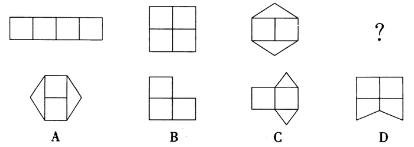

A. A

B. B

C. C

D. D

第 56 题 · 答案与解析

**参考答案（粉笔题库参考内容）**

A

**解析**

各图形构成不同，图形比较规整，优先考虑对称性。观察可以发现，题干中所有图形既为轴对称图形，又为中心对称图形，符合规律的只有A项。

故正确答案为A。

**考点**：属性规律-对称性

**来源**：2015年吉林省公务员录用考试《行测》题（4月甲级）第56题

### 第 57 题

从所给的四个选项中，选择最合适的一个填入问号处，使之呈现一定的规律性：

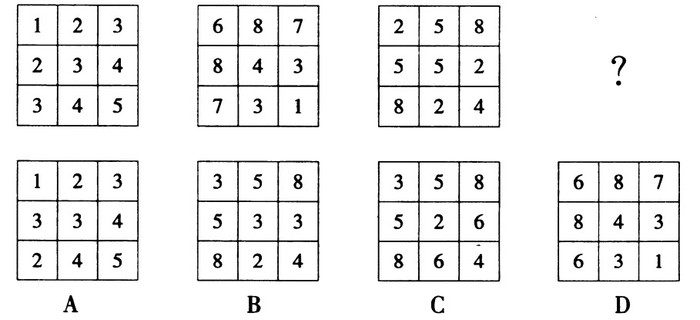

A. A

B. B

C. C

D. D

第 57 题 · 答案与解析

**参考答案（粉笔题库参考内容）**

C

**解析**

观察发现，九宫格内包含不同的数字，且九宫格内的所有数字均关于“＼”方向对称，只有C项符合。

故正确答案为C。

**考点**：属性规律-对称性

**来源**：2015年吉林省公务员录用考试《行测》题（4月甲级）第57题

### 第 58 题

以下立体图是由哪个平面图形绕横轴旋转一周而成的?

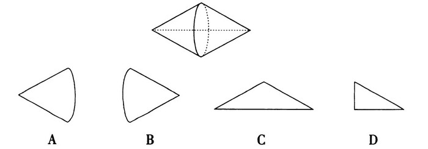

A. A

B. B

C. C

D. D

第 58 题 · 答案与解析

**参考答案（粉笔题库参考内容）**

C

**解析**

绕直角三角形一条直角边旋转可得到圆锥，本题要求得到两个圆锥的组合体，那么一定是两个直角三角形的组合体： 两条直角边相对，绕另一直角边旋转而成的，即C项。

故正确答案为C。

**考点**：位置规律-旋转

**来源**：2015年吉林省公务员录用考试《行测》题（4月甲级）第58题

### 第 59 题

从所给的四个选项中，选择最合适的一个填入问号处，使之呈现一定的规律性：

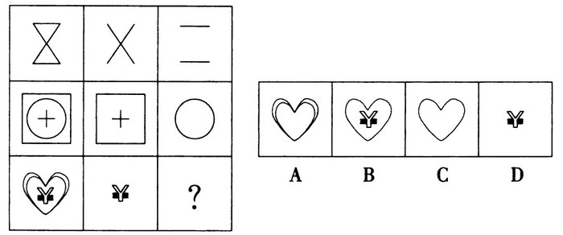

A. A

B. B

C. C

D. D

第 59 题 · 答案与解析

**参考答案（粉笔题库参考内容）**

A

**解析**

九宫格中，每行的图形元素构成相似，故观察每行图形的元素变化。观察可知，每行前两个图形叠加去同存异后，得到第三个图形。第三行符合此规律的为A项。

故正确答案为A。

**考点**：样式规律-加减同异

**来源**：2015年吉林省公务员录用考试《行测》题（4月甲级）第59题

### 第 60 题

把下面的六个图形分为两类，使每一类图形都有各自的共同特征或规律，分类正确的一项是：

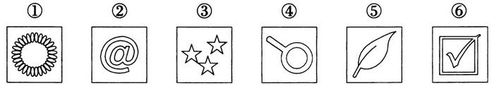

A. ①②③，④⑤⑥

B. ①④⑥，②③⑤

C. ①③⑤，②④⑥

D. ①③④，②⑤⑥

第 60 题 · 答案与解析

**参考答案（粉笔题库参考内容）**

C

**解析**

元素组成混乱，首先考虑数数。观察发现，图形②④⑥的内部所包含的封闭空间均为两个，而图形①③⑤的内部所包含的封闭空间均非两个，依此规律，符合分类的选项为C项。

故正确答案为C。

**考点**：数量规律-面

**来源**：2015年吉林省公务员录用考试《行测》题（4月甲级）第60题

### 第 61 题

通感，又称移觉，就是在描述客观事物时，用形象的语言使感觉转移，将人的听觉、视觉、嗅觉、味觉、触觉等不同感觉彼此挪移转换，将本来表示甲感觉的词语移用来表示乙感觉，使意象更为活泼、新奇的一种修辞格。

根据上述定义，下列没有使用通感的是：

A. 红杏枝头春意闹

B. 你的眼睛就像天上的星星

C. 余音绕梁，三日不绝

D. 你的歌声真的很甜美

第 61 题 · 答案与解析

**参考答案（粉笔题库参考内容）**

B

**解析**

第一步，查找关键词。

定义关键词：“将人的听觉、视觉、嗅觉、味觉、触觉等不同感觉彼此挪移转换”、“表示甲感觉的词语移用来表示乙感觉”。

第二步，逐一分析选项。

A项：“红杏枝头”应为看到，即“视觉” ，而“闹”字应为听到，即“听觉”，出现了不同感觉的挪移转换，符合定义要件，排除；

B项：选项中没有涉及到任何感觉及感觉的转换，只是对眼睛进行了比喻，不符合定义表述，当选；

C项：“余音”应为听到，即“听觉”，而“绕梁”应为看到，为“视觉”，出现了不同感觉的挪移转换，符合定义要件，排除；

D项：“歌声”应为听到，为“听觉”，而“甜美”应为“味觉” ，出现了不同感觉的挪移转换，符合定义要件，排除。

本题为选非题，故正确答案为B。

**考点**：方式目的

**来源**：2015年吉林省公务员录用考试《行测》题（4月甲级）第61题

### 第 62 题

负迁移，是指一种知识技能的掌握干扰或抑制了另一种知识技能的掌握。也就是已掌握的知识经验使新的学习发生了困难。凡新旧刺激物十分相似而又要求学习者做出不同的反应时，就可能发生负迁移现象。

根据上述定义，下列属于负迁移的是：

A. 已经懂得英语的人，就会很容易地掌握法语

B. 爱好打篮球的小王，耽误了学习文化课的时间

C. 不会骑自行车的人，学习骑摩托车就会很费力

D. 学会汉语拼音，就会对学习英文音标产生干扰

第 62 题 · 答案与解析

**参考答案（粉笔题库参考内容）**

D

**解析**

第一步，查找关键词。

定义关键词：“一种知识技能的掌握干扰或抑制了另一种知识技能的掌握”、“已掌握的知识经验使新的学习发生了困难”。

第二步，逐一分析选项。

A项：由“很容易”可以得出，并未干扰或抑制新技能的掌握，与定义要件不符，排除；

B项：“耽误了学习文化课的时间”，是指时间上的耽误，并非干扰或抑制文化课的学习时间，与定义要件不符，排除；

C项：“不会骑自行车”与“已掌握的知识经验”不符，不满足定义要件，排除；

D项：汉语拼音对学习英文音标产生干扰，指出已经掌握的语言技能会对新学习的语言技能产生干扰，与定义要件相符，当选。

故正确答案为D。

**考点**：单定义-其他句式

**来源**：2015年吉林省公务员录用考试《行测》题（4月甲级）第62题

### 第 63 题

受体失敏现象，是指当长时间用恒定不变的信号刺激细胞时，细胞表面的感受器或受体将会逐步失效，最终的效果是细胞对这种恒定不变的刺激没有响应的生物学现象。

根据上述定义，下列属于失敏现象的是：

A. 长期工作在机器轰鸣的车间中，最后对车间里的噪音充耳不闻了

B. 随着年纪越来越大，舌头对味道越来越不敏感了

C. 因为患了重感冒，鼻子就什么味道都闻不到了

D. 穿惯了棉质的衣服，对其他材质的就再也穿不惯了

第 63 题 · 答案与解析

**参考答案（粉笔题库参考内容）**

A

**解析**

第一步，查找关键词。

定义关键词：“长时间用恒定不变的信号刺激细胞”、“感受器或受体将会逐步失效”、“细胞对这种恒定不变的刺激没有响应”。

第二步，逐一分析选项。

A项：“长期……轰鸣”符合关键词“长时间用恒定不变的信号刺激细胞”，“最后对车间里的噪音充耳不闻”符合关键词“感受器或受体将会逐步失效”“细胞对这种恒定不变的刺激没有响应”，符合定义，当选；

B项：“随着年纪越来越大”并非因“长时间用恒定不变的信号刺激细胞”导致，而因年纪增大导致，不符合定义关键词，排除；

C项：“鼻子就什么味道都闻不到了”并非由题干“长时间用恒定不变的信号刺激细胞”导致，不符合定义关键词，排除；

D项：“对其他材质的就再也穿不惯了”与关键词“感受器或受体将会逐步失效”“细胞对这种恒定不变的刺激没有响应”表述矛盾，并非感受失效，同时并不存在长时间恒定不变的刺激，与定义表述不符，排除。

故正确答案为A。

**考点**：大前提

**来源**：2015年吉林省公务员录用考试《行测》题（4月甲级）第63题

### 第 64 题

领导权变并非是一种权术，其实质是一切从实际出发，根据领导活动的具体情境，灵活采用合适的领导方式去实现领导价值。在领导活动中权变的是方法和策略，不变的是价值和方向。

根据上述定义，下列属于领导权变的是：

A. 赵科长把复杂的任务交给了工作能力较强的小张，新来的小陈负责收集资料

B. 张科长在工作中总是当机立断、雷厉风行，可下班回家后就对老婆言听计从

C. 李县长亲自下乡送水，随行人员拍照、录像后，李县长马上乘专车返回县城

D. 王书记刚刚带领干部群众完成抗旱自救工作，又忙着去协调路网建设纠纷

第 64 题 · 答案与解析

**参考答案（粉笔题库参考内容）**

A

**解析**

第一步，查找关键词。

定义关键词：“从实际出发，根据领导活动的具体情境，灵活采用合适的领导方式去实现领导价值。”

第二步，逐一分析选项。

A项：“把复杂的任务交给了工作能力较强的小张，新来的小陈负责收集资料”满足关键词“根据……具体情境，灵活采用合适的领导方式去实现领导价值”，当选；

B项：“当机立断、雷厉风行”与关键词“灵活采用合适的领导方式”并不对应，只是体现出张科长的一种做事风格，并没有体现出领导权变，排除；

C项：“亲自下乡送水”“马上乘专车返回”没有体现出李县长的任何领导方式或领导价值，是一种作秀，照出了形式主义底色，排除；

D项：“完成抗旱自救”“协调路网建设”没有体现出王书记“根据……具体情境，灵活采用合适的领导方式去实现领导价值” ，与题干关键词并不对应，排除。

故正确答案为A。

**考点**：方式目的

**来源**：2015年吉林省公务员录用考试《行测》题（4月乙级）第58题

### 第 65 题

移位不同于易位。只要当本来应该出现在原型结构中某个位置的成分离开原来的位置，跑到结构中其他位置上去了，就是移位，移位后的成分一定可以充当这个结构的句法成分。而易位则是话语中临时追加或补正造成的，易位后的成分不能再分析为这个结构的句法成分。

根据上述定义，下列属于移位的是：

A. 一只羊跑了→跑了一只羊

B. 大伙笑得肚子都疼了→肚子都疼了，大伙笑得

C. 他大概到家了吧→到家了吧，他大概

D. 这地方太美了→太美了，这地方

第 65 题 · 答案与解析

**参考答案（粉笔题库参考内容）**

A

**解析**

第一步，查找关键词。

定义关键词：“应该出现在原型结构中某个位置的成分离开原来的位置，跑到结构中其他位置上去了”、“移位后的成分一定可以充当这个结构的句法成分”。

第二步，逐一分析选项。

A项：“一只羊跑了”，其中羊为主语，跑了为谓语。“跑了一只羊”，羊变成了宾语，出现了结构位置的变化，而移位后依然充当句法成分，与题干定义完全吻合，当选。

B、C、D三项类似，均为易位，三者都是对话语的临时追加或补正，同时主语还是主语，没有出现变化，不能再分析这个结构的句法成分。

故正确答案为A。

**考点**：常规问法

**来源**：2015年425联考《行测》题（青海卷）第76题

### 第 66 题

人体：肝脏：解毒

A. 动物：麋鹿：四不像

B. 广告：商业广告：宣传

C. 树木：叶子：光合作用

D. 微量元素：锌：记忆力

第 66 题 · 答案与解析

**参考答案（粉笔题库参考内容）**

C

**解析**

第一步，判断题干词语间逻辑关系。

人体与肝脏为组成关系，同时肝脏与解毒为功能的对应关系，肝脏的功能之一是解毒。

第二步，判断选项词语间逻辑关系。

A项：动物与麋鹿之间为种属关系，麋鹿是动物的一种，而非组成关系，排除。

B项：广告与商业广告之间为种属关系，商业广告是广告的一种，而非组成关系，排除。

C项：树木与叶子为组成关系，叶子是树木的组成部分。同时，叶子的功能之一是进行光合作用，为功能的对应关系，与题干逻辑关系一致，当选。

D项：微量元素与锌为种属关系，锌是微量元素的一种，排除。

故正确答案为C。

**考点**：逻辑关系-包容关系、逻辑关系-对应关系

**来源**：2015年吉林省公务员录用考试《行测》题（4月甲级）第66题

### 第 67 题

《国富论》：亚当·斯密

A. 中山装：孙中山

B. 《西厢记》：红娘

C. 加拿大：白求恩

D. 《史记》：司马迁

第 67 题 · 答案与解析

**参考答案（粉笔题库参考内容）**

D

**解析**

第一步，判断题干词语间逻辑关系。

《国富论》的作者是亚当·斯密，二者之间为作品与作者的对应关系。

第二步，判断选项词语间逻辑关系。

A项：中山装的发明者并非孙中山，且不是作品，二者不是作品与作者的对应关系，排除。

B项：《西厢记》的作者并非红娘，是元代王实甫所著古典戏剧，排除。

C项：白求恩是加拿大人，二者为国籍与个人的对应关系，而非作品与作者，排除。

D项：《史记》的作者是司马迁，二者为作品与作者的对应关系，与题干逻辑关系一致，当选。

故正确答案为D。

**考点**：逻辑关系-对应关系

**来源**：2015年吉林省公务员录用考试《行测》题（4月甲级）第67题

### 第 68 题

微信：QQ：MSN

A. 扫描仪：打印机：墨盒

B. 搜狐：新浪：网易

C. 邮票：邮件：邮箱

D. 电脑：鼠标：显示屏

第 68 题 · 答案与解析

**参考答案（粉笔题库参考内容）**

B

**解析**

第一步，判断题干词语间逻辑关系。

微信、QQ、MSN均为网络通讯软件，三者为并列关系。

第二步，判断选项词语间逻辑关系。

A项：墨盒是打印机的组成部分，二者为组成关系，与题干逻辑关系不一致，排除；

B项：搜狐、新浪、网易均是著名的互联网门户网站，三者为并列关系，与题干逻辑关系一致，当选；

C项：邮票需要贴在邮件上，再通过投递邮箱寄出，三者为对应关系，与题干逻辑关系不一致，排除；

D项：电脑和鼠标需搭配使，二者为配套使用关系；显示屏是电脑的组成部分，二者为组成关系，与题干逻辑关系不一致，排除。

故正确答案为B。

**考点**：逻辑关系-并列关系

**来源**：2015年吉林省公务员录用考试《行测》题（4月甲级）第68题

### 第 69 题

叶公好龙：名副其实

A. 郑人买履：达权通变

B. 邯郸学步：东施效颦

C. 杞人忧天：庸人自扰

D. 愚公移山：持之以恒

第 69 题 · 答案与解析

**参考答案（粉笔题库参考内容）**

A

**解析**

第一步：判断题干词语的逻辑关系。

叶公好龙意为表里不一，与名副其实为反义词关系。

第二步：判断选项间的逻辑关系。

A项：郑人买履意为做事死板、不会变通，达权通变意为做事能适应客观情况的变化，懂得变通，二者为反义词关系，与题干逻辑关系相同，当选；

B项：邯郸学步与东施效颦同指一味模仿别人，最后导致不好的结果，二者为近义词关系，排除；

C项：杞人忧天指为没根据的事情而担心，庸人自扰指本来没有问题而自己自找麻烦，二者同样为近义词关系，排除；

D项：愚公移山比喻做事持之以恒、坚持不懈，与持之以恒为近义词关系，排除。

故正确答案为A。

**考点**：语义关系-反义关系

**来源**：2015年吉林省公务员录用考试《行测》题（4月甲级）第69题

### 第 70 题

竹子 对于 （    ） 相当于 兔子 对于 （    ）

A. 竹林 兔耳朵

B. 熊猫 草

C. 草本植物 动物

D. 竹笋 狼

第 70 题 · 答案与解析

**参考答案（粉笔题库参考内容）**

C

**解析**

第一步，判断题干词语的逻辑关系。

题干为间隔型类比题目，采取代入排除的方法解题较为简单。

第二步，判断选项间的逻辑关系。

A项：竹林由众多竹子构成，二者为子概念与集合概念的组成关系；兔子与兔耳朵二者之间为组成关系。两组词前后逻辑关系不一致，排除。

B项：竹子是熊猫的食物之一，草是兔子的食物之一。两组词前后逻辑关系一致，为对应关系，但是两组词前后顺序不一致，排除。

C项：竹子是草本植物的一种，兔子是动物的一种。两组词前后逻辑关系一致，为种属关系，当选。

D项：竹笋为竹子的幼芽状态，为对应关系；兔子与狼都是动物，为并列关系。两组词前后逻辑关系不一致，排除。

故正确答案为C。

**考点**：逻辑关系-包容关系

**来源**：2015年吉林省公务员录用考试《行测》题（4月甲级）第70题

### 第 71 题

电影《星际穿越》里面讲到了五维空间，五维空间的意思就是一个人出生后碰到的事件的所有可能以及所有可能的选择创造出的不同人生所形成的所有的封闭圆环。包含了无数个这种不同选择所造成的不同结果的人生的封闭圆环组成了五维空间。

以下最能质疑五维空间存在的是：

A. 电影《星际穿越》是科幻作品

B. 空间也具有时间的一维性

C. 人生不能重来

D. 科学家未发现五维空间的存在

第 71 题 · 答案与解析

**参考答案（粉笔题库参考内容）**

B

**解析**

第一步，找出论点和论据。

题干中并未给出具体的论点和论据。仅指出五维空间的概念，即无数个不同选择所造成的不同结果的人生的封闭圆环组成了五维空间。

第二步，逐一分析选项。

A项：科幻电影是以建立在科学上的幻想性情景为背景的，并非毫无根据，《星际穿越》描述了五维空间的存在，这并不能质疑五维空间的存在，排除；

B项：时间的一维性是指时间的不可逆性，空间也具有时间的一维性，意为在五维空间中时间也是不可逆的，因此人的选择只能有一次，不能形成多种不同人生的圆环，质疑了题干论述，当选；

C项：表述与五维空间无关，属无关项，排除；

D项：科学家未发现五维空间的存在并不能否认五维空间的存在，因此五维空间可能存在也可能不存在，属不明确项，排除。

故正确答案为B。

**考点**：削弱论点

**来源**：2015年吉林省公务员录用考试《行测》题（4月甲级）第71题

### 第 72 题

意大利帕维亚大学研究显示，刚刚坠入爱河的男女的大脑会发出指令，使人体分泌出一种化学物质，研究人员称这种物质为“爱情荷尔蒙”。这种化学物质令恋爱中的人相互吸引，产生拥抱时的那种安全感和满足感。有科学家认为，爱情荷尔蒙正是产生爱情的原因。

以下最能加强上述论证的是：

A. “爱情荷尔蒙”能刺激后叶催产素的分泌，但是它在人体内仅仅能够存在大约一年时间

B. 在一些田鼠的脑中，注入一组可以不断增加荷尔蒙感受体的基因，这些田鼠会变得对异性依依不舍

C. 虽然大多数雌鼠都愿意与伴侣在一起，但如果有机会，也会发生“一夜情”，甚至抛弃“丈夫”

D. 科学家正致力于研究如何治疗“感情紊乱”，如孤独症、跟踪他人、强烈的嫉妒感等病态行为

第 72 题 · 答案与解析

**参考答案（粉笔题库参考内容）**

B

**解析**

第一步：找出论点和论据。

论点：爱情荷尔蒙是产生爱情的原因，即爱情荷尔蒙能够催生爱情。

论据：爱情荷尔蒙能够令恋爱中的人相互吸引，产生拥抱时的那种安全感和满足感。

第二步：逐一分析选项。

A项：“后叶催产素”“仅仅能够存在大约一年时间”均与题干“催生爱情”的表述无关，不能加强，排除；

B项：注入增加荷尔蒙感受体的基因后，田鼠变得对异性依依不舍，说明荷尔蒙能够催生爱情，用补充论据的方式加强题干论证，当选；

C项：没有涉及“荷尔蒙”的论述，不能加强，排除；

D项：“感情紊乱”与“荷尔蒙、爱情”无关，属于无关项，不能加强，排除。

故正确答案为B。

**考点**：补充论据

**来源**：2015年吉林省公务员录用考试《行测》题（4月甲级）第72题

### 第 73 题

科学家对近140名比利时阿尔茨海默氏症患者进行了跟踪调查，其中半数受试者会说两种语言。结果显示，只说一种语言的患者平均在71岁首次出现阿尔茨海默氏症症状，双语人群则是76岁。

根据上述材料，可以推出：

A. 掌握两门语言可以延缓认知的老化

B. 不掌握两门语言就不能延缓老年痴呆

C. 只有学习外语才可以防治老年痴呆

D. 长期使用两种语言能防止大脑退化

第 73 题 · 答案与解析

**参考答案（粉笔题库参考内容）**

A

**解析**

逐一判断选项。

A项：只会一种语言的患者平均在71岁首次出现阿尔茨海默氏症症状，而会两种语言的人群则是76岁，说明掌握两种语言能够延缓认知的老化，A项满足题干推断，当选。

B项：不掌握两门语言就不能延缓老年痴呆，表述过于绝对，无法推出，排除；

C项：只有学习外语才可以防治老年痴呆，与B项类似，表述过于绝对，防治老年痴呆可能会有多种方式，而学习外语只是其中的一种，排除；

D项：防止大脑退化，“防止”表述不当，只能说是“延缓”大脑退化，同样表述过于绝对，排除。

故正确答案为A。

**考点**：日常结论

**来源**：2015年吉林省公务员录用考试《行测》题（4月乙级）第75题

### 第 74 题

全球最大的旅游网站Trip Advisor近日公布的《全球女性出游调研报告》显示，43％的中国女性受访者曾独自出游，略高于41％的全球平均水平。在全球近10000名女性受访者当中，有很大一部分女性表示，独自出游给自己带来很多变化，不仅可以领略不同地区的不同文化（36％），还可以使自己更加自信（43％）、更加独立（56％）。与此同时，45％的中国女性受访者还认为，独自出行使她们构建了新的人生观，这一比例远远高于15％的全球平均水平。因此，中国女性较国外的女性更独立。

以下最能质疑上述论证的是：

A. 网站的统计结果是不具有公信力的

B. 美国女性在很多方面比中国女性更独立

C. 中国的女性婚后还保留着自己的姓氏

D. 独自出游只是衡量独立性的一个方面

第 74 题 · 答案与解析

**参考答案（粉笔题库参考内容）**

D

**解析**

第一步，找出论点和论据。

论点：中国女性较国外的女性更独立。

论据：调查显示，中国女性独自出游的比例比全球平均水平要高。

第二步，逐一分析选项。

A项：统计结果不具有公信力，质疑了题干论据的真实性和可靠性，削弱题干论据。

B项：只是说明美国女性在“很多方面”比中国女性独立，并且“美国女性”与“国外女性”概念混淆，不能削弱，排除；

C项：保留自己的姓氏与是否独立无关，可能只是一种传统形式，属无关项，排除；

D项：说明独自出游只是衡量独立性的一个方面，判断是否独立还应从更多的方面着手判断，削弱题干论证，D项削弱论证的力度更强，当选。

故正确答案为D。

**考点**：拆桥

**来源**：2015年吉林省公务员录用考试《行测》题（4月乙级）第76题

### 第 75 题

为了熟悉各个部门的工作，某部门实施轮岗制度，人事部门的张三、后勤部门的李四、综合办的王五三人进行转岗，其中李四不去人事部。

那么，轮岗的结果是：

A. 张三去后勤部，李四去综合办，王五去人事部

B. 张三去综合办，李四去后勤部，王五去人事部

C. 张三去综合办，李四去人事部，王五去后勤部

D. 张三去人事部，李四去综合办，王五去后勤部​

第 75 题 · 答案与解析

**参考答案（粉笔题库参考内容）**

A

**解析**

因三人轮岗，故轮岗后所占现岗位与原岗位应发生改变，则张三不能在人事部，排除D项；李四不能在后勤部和人事部，故只能在综合办，排除B、C项。只有A项满足条件，当选。

故正确答案为A。

**考点**：排除法

**来源**：2015年吉林省公务员录用考试《行测》题（4月甲级）第75题

### 第 76 题

某网站近日公布的就业调查统计显示，截至目前，仍有50.9％的大学生未收到用人单位的就业通知。就业压力不小，大学生们对待遇的期望却不低，超过四成的被调查者对月薪的期望是8000-10000元。对此，有专家表示8000-10000元的月薪期望不切实际。

以下哪项如果为真，最能支持专家的观点?

A. 被调查的对象中，绝大部分都是硕士生和博士生

B. 另一份调查显示，期望月薪4000-6000元的才是主体

C. 每个人都有表达自身愿望的权利，不应该被嘲笑

D. 报道中就业调查所涉及的区域主要是二三线城市

第 76 题 · 答案与解析

**参考答案（粉笔题库参考内容）**

D

**解析**

第一步：找出论点和论据。

专家的观点：8000-10000元的月薪期望不切实际。题干并无明显论据。

第二步：逐一判断选项。

A项：被调查的对象中大部分是高学历者，因此对薪资要求较高，可以解释题干现象，增加新论据，在一定程度削弱专家观点，排除；

B项：月薪4000-6000元是主体，并不能推出月薪8000-10000元不切实际，属于无关选项，排除；

C项：每个人是否有表达自身愿望的权利与8000-10000元的月薪是否不切实际无关，属于无关选项，排除；

D项：因被调查者均为二三线城市，工资水平相对较低，因此判断出8000-10000元的月薪期望较高，不切实际，通过增加新论据从而支持论点，当选。

故正确答案为D。

**考点**：加强-实验类、补充论据

**来源**：2015年吉林省公务员录用考试《行测》题（4月乙级）第77题

### 第 77 题

睡眠监测软件靠谱吗?一款监测睡眠的手机APP，下载后将手机塞在枕头下，早晨醒来，软件就会自动统计数据，全面反馈使用者一夜的睡眠情况。但结果显示，这款睡眠监测软件是没法实现睡眠的准确监测和判断的。

以下哪项如果为真，最不能解释上述矛盾现象?

A. 对于90％以上的原发性失眠患者而言，调整睡眠的核心应在于心理

B. 使用睡眠软件时会不自觉地用手机上网聊天，导致过度兴奋睡不着

C. 使用睡眠软件会把正常睡眠中的定时翻身计入浅睡眠或者觉醒时间

D. 手机的光亮会刺激眼睛，影响软件使用者大脑内褪黑素的分泌情况

第 77 题 · 答案与解析

**参考答案（粉笔题库参考内容）**

A

**解析**

解释的矛盾现象：监测睡眠的APP自动统计使用者的睡眠数据，但是没法实现睡眠的准确监测和判断。A项：原发性失眠该如何调整，与手机软件对睡眠情况的监测无关，不能解释矛盾，当选。B项：睡觉时因使用手机导致过度兴奋睡不着，而此时软件已自动统计数据，故无法准确监测睡眠，可以解释矛盾，排除。C项：表明软件虽然能够记录数据，但不能准确记录正常睡眠时间，无法实现准确监测，可以解释矛盾，排除。D项：提及手机软件对眼睛和大脑的刺激，而褪黑素是一种会影响睡眠的物质，说明手机软件是没办法准确监测睡眠的，可以解释题干中矛盾，排除。

本题为选非题，故正确答案为A。

**考点**：原因解释

**来源**：2015年吉林省公务员录用考试《行测》题（4月甲级）第77题

### 第 78 题

一则广告，“衣服不搭无所谓，基金不买你心碎。”小方看后说：“我不同意。”

下列最符合小方的意思的是：

A. 衣服不搭有所谓，基金不买你不心碎

B. 或者衣服不搭有所谓，或者基金不买你不心碎

C. 如果衣服不搭有所谓，那么基金不买你心碎

D. 如果衣服不搭无所谓，那么基金不买你心碎

第 78 题 · 答案与解析

**参考答案（粉笔题库参考内容）**

B

**解析**

解析替换如下：

第一步：翻译题干。

“衣服不搭无所谓，基金不买你心碎”，且命题。即（衣服不搭无所谓） 且 （基金不买你心碎），A 且 B。而小方不同意，则为A 且 B的矛盾命题，其矛盾形式为-A 或 -B。

第二步：注意分析选项。

A项：“衣服不搭有所谓，基金不买你不心碎”，-A 且 -B，与题干逻辑不符，排除；B项：“或者衣服不搭有所谓，或者基金不买你不心碎”，-A 或 -B，符合题干的逻辑，当选；C项：“如果衣服不搭有所谓，那么基金不买你心碎”，“如果······那么······”，前推后，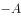B，即A 或 B，与题干逻辑不符，排除；D项：“如果衣服不搭无所谓，那么基金不买你心碎”，“如果······那么······”，前推后，AB，即-A 或 B，与题干逻辑不符，排除。

故正确答案为B。

**考点**：常规翻译

**来源**：2015年吉林省公务员录用考试《行测》题（4月甲级）第78题

### 第 79 题

小方：“所有河南人都喜欢喝胡辣汤。”

小圆：“李明就是河南人，他就不喜欢喝胡辣汤。”

小方：“好吧，所有‘真正的’河南人都喜欢喝胡辣汤。”

以下最准确指出小方论证中漏洞的是：

A. 试图通过修改标准的方式，来维护自己有缺陷的观点

B. 试图通过把个体的特点属性扩大为群体的共有属性来偷换概念

C. 看到别人的论述里面有谬误，就认为别人的观点一定是错误的

D. 试图通过用批评回应批评的方式，免去为自己观点辩护的责任

第 79 题 · 答案与解析

**参考答案（粉笔题库参考内容）**

A

**解析**

当受到质疑时，小方将“所有的河南人”修改为“所有‘真正的’的河南人”，试图通过缩小原命题的范围，来维护自己有缺陷的观点。A项表述准确，其他选项均不正确。

故正确答案为A。

**考点**：日常结论

**来源**：2015年吉林省公务员录用考试《行测》题（4月甲级）第79题

### 第 80 题

警方在一起案件的侦破过程中，抓获了甲、乙、丙三个犯罪嫌疑人。

甲说：“乙在说谎。”

乙说：“丙在说谎。”

丙说：“甲和乙都在说谎。”

由此可推知，三个人中说真话的是：

A. 甲

B. 乙

C. 丙

D. 都没有

第 80 题 · 答案与解析

**参考答案（粉笔题库参考内容）**

B

**解析**

题干并未指出甲、乙、丙中几真几假，故可采用假设法。假设甲说的是真话，则说明乙在说谎，推知丙没有说谎，甲在说谎。即“甲和乙都在说谎”，与题干假设“甲说的是真话”发生矛盾，故甲说的是假话。由此可知，乙没有说谎，即三人中说真话的是乙。

故正确答案为B。

**考点**：真假推理-其他

**来源**：2015年吉林省公务员录用考试《行测》题（4月甲级）第80题

### 第 81 题

世界卫生组织迄今为止发布的首份预测自杀报告指出，全世界每年有超过80万人自杀，自杀是2012年全球30岁至49岁人群死亡的第五大原因，也是当年全球15至29岁人群死亡的第二大原因。研究发现，许多自杀行为都与某种形式的关系中断有关——一些人得不到社会支持和精神健康护理，甚至与整个社会脱节。

据此，可以推出：

A. 人际关系对预防自杀至关重要

B. 花更多时间使用社交媒体可预防自杀

C. 罹患精神疾病的人群更容易选择自杀

D. 自杀是全球青年人死亡的第二大原因

第 81 题 · 答案与解析

**参考答案（粉笔题库参考内容）**

A

**解析**

逐一判断选项。A项：通过题干最后一句可以得知，自杀行为与某种关系的中断有关，多由得不到社会的支持和精神健康的护理导致。由“ 社会的支持”可以得知，社会人际关系对于自杀的产生非常重要，A 项表述与之对应，当选。B 项：“使用社交媒体”与能否得到“社会支持、精神护理”无关，并非使用了社交媒体，就能得到社会的支持，排除。C项：精神病与“某种形式的关系中断”无关，无法推出，排除。D项：根据世界卫生组织确定的新的年龄分段，青年的年龄上限提高到44岁，而题干中的表述为“当年全球15~29岁人群死亡的第二大原因”，二者范围不一致，无法推出，排除。

故正确答案为A。

**考点**：日常结论

**来源**：2015年吉林省公务员录用考试《行测》题（4月甲级）第81题

### 第 82 题

肥胖是否是疾病?有专家提出，肥胖是对一系列环境变化(比如饥荒)的正常适应，这在人类历史的很长时间都是如此。容易肥胖的身体没有得病，反而比“自来瘦”的身体效率更高，因此不应把肥胖正式定性为疾病。

以下哪项如果为真，最能支持上述论证?

A. 肥胖不符合医学上疾病的定义。它没有症状，不涉及身体功能失常，有时也无害

B. 庞大减肥产业影响了肥胖的定性，降低体重指数警戒线值使更多人进入肥胖行列

C. 我们生活在食物更丰富，久坐时间更长的时代，不像过去那样需要尽量储存脂肪

D. 用医学方法处理肥胖可能对患者造成伤害，迫使人们接受不必要甚至没用的“治疗”

第 82 题 · 答案与解析

**参考答案（粉笔题库参考内容）**

A

**解析**

第一步：找出论点和论据。

论点：不应把肥胖正式定性为疾病。

论据：容易肥胖的身体没有得病，反而比“自来瘦”的身体更健康。

第二步：逐一判断选项。

A项：说明肥胖并不是疾病，且不涉及身体功能的失常，属于补充新论据，从而支持了题干论证，当选；

B项：肥胖的定性与是否应该把肥胖定性为疾病无关，属于无关选项，排除；

C项：储存脂肪与是否应该把肥胖定性为疾病无关，属于无关选项，排除；

D项：医学方法处理肥胖可能对患者造成伤害与题干论点无关，属于无关选项，排除。

故正确答案为A。

**考点**：补充论据

**来源**：2015年吉林省公务员录用考试《行测》题（4月甲级）第82题

### 第 83 题

一项民意调查结果显示，在1000多名参与投票的网友中，六成网友支持延长女性产假至三年，以便更好地照顾宝宝；四成网友表示反对，认为产假太长，会增加企业负担，进而增加女性就业难度，不可行。

以下哪项如果为真，最能质疑上述反对者的观点?

A. 企业除了追求利润之外，也应当承担社会责任

B. 女性产假延长的成本，由财政或社保基金来承担

C. 这份调查样本量不够大，不足以代表真正的民意

D. 法律应强制规定企业必须招聘一定比例的女性

第 83 题 · 答案与解析

**参考答案（粉笔题库参考内容）**

B

**解析**

第一步：找出论点和论据。

论点：延长女性产假至三年不可行。

论据：会增加企业负担，进而增加女性就业难度。

要求选出最能质疑反对者观点的一项，即应指出，女性产假延长至三年是可行的。

第二步：逐一分析选项。

A 项：选项企业承担相应的社会责任与题干延长女性产假话题不一致，无关选项，排除；

B 项：题干论据反对延长女性产假的原因有两个：一是会增加企业负担，二是增加女性就业难度。根据选项所述女性产假延长的成本由财政或社保基金来承担，那么就不会增加企业负担，否定了原因之一，削弱论据，当选；

C 项：“调查样本”与反对者的观点毫无关联，并不能质疑反对者的观点，只能在一定程度上说明此项民意调查缺乏全面性，无关选项，排除；

D 项：法律强制规定企业必须招聘一定比例的女性，与是否应该延长女性产假，以及延长之后会不会导致女性就业难没有必然联系，不能质疑，排除。

故正确答案为B。

**考点**：削弱论据

**来源**：2015年吉林省公务员录用考试《行测》题（4月乙级）第79题

### 第 84 题

为什么只有人类有下巴?一直以来，人们对下巴这一看似毫无用处的附属部位提出了多种不同解释。新研究指出，下巴的进化源于人类牙齿与下颚的萎缩，这是由于烹饪使食物变软所致。

以下哪项是上述论证所依赖的假设?

A. 下巴出现的时期与人类发明烹饪的时期是重合的

B. 烹饪使人类再无需咀嚼未加工的肉类和植物，因此也无需大颗牙齿

C. 下巴是在人类祖先与灵长类其他分支分离后进化而来的

D. 下巴出现的时期与人类智力出现巨大飞跃的时间重合

第 84 题 · 答案与解析

**参考答案（粉笔题库参考内容）**

B

**解析**

第一步：找出论点和论据。

论点：下巴的进化源于人类牙齿与下颚的萎缩。

论据：烹饪使食物变软。

第二步：逐一分析选项。

A 项：下巴出现的时期与人类发明烹饪的时期重合不代表二者就有必然的因果关系，无法说明牙齿与下颚的萎缩是由于烹饪导致的，无法作为论证的假设，排除；

B 项：指出烹饪使人类的咀嚼不需要大颗牙齿，因此会导致牙齿与下颚的萎缩，即加强了烹饪使得食物变软和人类牙齿与下颚萎缩之间的联系，在二者之间搭桥，为题干论证所依赖的假设，当选；

C项：选项讨论下巴是何时开始进化的，与论点所讨论的牙齿与下颚的萎缩是由于烹饪使食物变软所致无关，选项就没有提到“烹饪”，因此属无关选项，排除；

D项：选项讨论的下巴出现与人类智力飞跃时期重合，与论点所讨论的牙齿与下颚的萎缩是由于烹饪使食物变软所致无关，选项就没有提到“烹饪”，因此属无关选项，排除。

故正确答案为B。

**考点**：搭桥

**来源**：2015年吉林省公务员录用考试《行测》题（4月甲级）第84题

### 第 85 题

在决定孩子上什么课外班的问题上，四位老人发生争执。

姥姥说：“学习钢琴比较好。”

姥爷说：“如果学习视唱练耳，那么也应该学习钢琴。”

奶奶说：“不应该学习钢琴，应该学习视唱练耳。”

爷爷说：“不应该学习视唱练耳。”

如果四人中只有一人是对的，那么可以推出：

A. 不学钢琴，学习视唱练耳

B. 既不学钢琴，也不学视唱练耳

C. 学习钢琴，不学视唱练耳

D. 既学钢琴，又学视唱练耳

第 85 题 · 答案与解析

**参考答案（粉笔题库参考内容）**

A

**解析**

第一步：整理题干。

姥姥：学钢琴；姥爷：学视唱练耳学钢琴；奶奶：-学钢琴 且 学视唱练耳；爷爷：-学视唱练耳。

第二步：首先找矛盾。

可以看出姥爷的话（AB）和奶奶说的话（-B 且 A）矛盾，必然一真一假。

第三步：绕过矛盾看其余。

题干中说只有一个人说真话，真话一定在矛盾中，矛盾以外的命题为假，因此姥姥和爷爷的话为假，那真实情况为：不学钢琴，学视唱练耳。

故正确答案为A。

**考点**：只有一真/一假

**来源**：2015年吉林省公务员录用考试《行测》题（4月乙级）第80题

### 第 86 题

，，，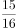，（  ）

A. 

B. 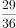

C. 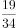

D. 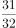

第 86 题 · 答案与解析

**参考答案（粉笔题库参考内容）**

D

**解析**

方法一：分数数列首先应观察相邻两项之间分子与分母的变化规律，观察可以发现，分数数列中前一项的分子与分母之和为后一项的分子部分，且比分母部分小1，故所求项的分子部分应为15＋16＝31，分母部分为32，D项满足。

方法二：分数数列中相邻两项的分母部分构成公比为2的等比数列，且比分子部分大1，故所求项的分母部分应为16×2＝32，分子部分为31，D项满足。

故正确答案为D。

**来源**：2015年吉林省公务员录用考试《行测》题（4月甲级）第86题

### 第 87 题

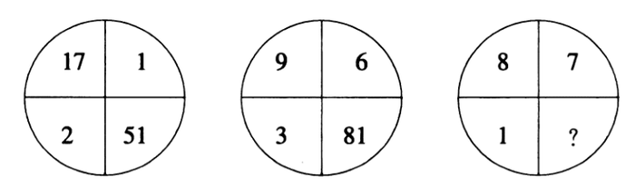

A. 64

B. 48

C. 56

D. 72

第 87 题 · 答案与解析

**参考答案（粉笔题库参考内容）**

A

**解析**

图形数阵一般考查数阵中横向、竖向或对角线方向的数字联系。观察可以发现：51÷17＝2＋1，81÷9＝3＋6，即其中一侧对角线方向的商等于另一侧对角线方向的和。则所求数阵其关系应为：?÷8＝1＋7，？＝8×8＝64。

故正确答案为A。

**来源**：2015年吉林省公务员录用考试《行测》题（4月甲级）第87题

### 第 88 题

\-53，28，  1，  10，7，  (  )

A. 9

B. 3

C. 8

D. 13

第 88 题 · 答案与解析

**参考答案（粉笔题库参考内容）**

C

**解析**

数列起伏较乱，首先考虑作差。两两作差后得到新数列：81、-27、9、-3、（ ），构成公比为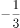的等比数列，故新数列括号内应为-3÷（-3）＝1，所求项应为7＋1＝8。

故正确答案为C。

**来源**：2015年吉林省公务员录用考试《行测》题（4月甲级）第88题

### 第 89 题

3，5，7，11，19，(  )，307

A. 23

B. 57

C. 51

D. 37

第 89 题 · 答案与解析

**参考答案（粉笔题库参考内容）**

C

**解析**

数列起伏较大，考虑幂次或乘积后无规律，选择作差。作差后得到新数列：2、2、4、8、（）、（），前两项的乘积等于第三项，故新数列括号内分别应为：4×8＝32、8×32＝256。代入原数列验证：19＋32＝51，51＋256＝307，满足题干规律。

故正确答案为C。

**来源**：2015年吉林省公务员录用考试《行测》题（4月甲级）第89题

### 第 90 题

\-2.1，－1.3，（    ），7.7，（    ），23.11

A. 2.5，14.9

B. 5.7，15.9

C. 4.5，11.7

D. 3.5，15.9

第 90 题 · 答案与解析

**参考答案（粉笔题库参考内容）**

A

**解析**

方法一：题干为小数数列，首先观察相邻两项之间整数与小数的变化规律。小数部分规律较为明显，为连续奇数列，故括号内应分别为：5、9，排除B、C两项；观察整数部分发现，前一项整数部分与小数部分的加和为下一项的整数部分，即-2+1=-1，-1+3=(2)，2+5=7，7+7=(14)，14+9=23，构成规律，故括号内整数部分应分别为：2、14。

方法二：小数部分规律相同，排除B、C两项，代入A项，整数部分分别为：-2、-1、2、7、14、23，前后作差后可得：1、3、5、7、9，为二级等差数列，构成规律。

故正确答案为A。

**来源**：2015年吉林省公务员录用考试《行测》题（4月甲级）第90题

### 第 91 题

2015年政府工作报告的高频词有26个，“发展”、“改革”两词居前，高频词出现的总次数是“改革”一词出现次数的11.5倍多3，“发展”一词出现的次数比“改革”一词多54次，比高频词出现的总次数的多6。则2015年政府工作报告的26个高频词共出现多少次?

A. 678

B. 854

C. 777

D. 715

第 91 题 · 答案与解析

**参考答案（粉笔题库参考内容）**

B

**解析**

由条件“比高频词出现的总次数的多6”可知，高频词的总次数应能被7整除，排除A、D两项；

由条件“高频词出现的总次数是‘改革’一词出现次数的11.5（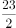）倍多3”可知，高频词出现的总次数减3应为23的倍数，排除C项。

故正确答案为B。

**考点**：和差倍比问题

**来源**：2015年吉林省公务员录用考试《行测》题（4月乙级）第86题

### 第 92 题

两艘船相对划行，一船从A到B顺水，一船从B到A逆水，结果所用时间相同（假设水流速、行船速恒定，快船速是慢船速2倍）。则慢船速是水流速的几倍?

A. 1

B. 4

C. 3

D. 2​

第 92 题 · 答案与解析

**参考答案（粉笔题库参考内容）**

D

**解析**

两船划行所用时间相同且路程相等，故两船划行的速度应相等，则快船逆向，慢船顺行。设快船速度为2，则慢船速度为1，可得2-水速＝1+水速，解得水速=0.5，则慢船船速是水流速度的1÷0.5=2倍。

故正确答案为D。

**考点**：流水行船

**来源**：2015年吉林省公务员录用考试《行测》题（4月甲级）第92题

### 第 93 题

张村村长和李村支书到对方村中调研，两人以相同的速度同时相向出发，2人相遇后，张村村长的速度提高了，又用2.5小时到达李村，李村支书的速度减少了，则再用几个小时可到达张村?

A. 3

B. 4.5

C. 4

D. 3.5

第 93 题 · 答案与解析

**参考答案（粉笔题库参考内容）**

C

**解析**

设两人刚开始出发时的速度均为6，同时出发且速度相等，故应在路程中点相遇。在后半程中，张村长的速度提高了，则速度变为：6+6×\=8，故后半程路程为8×2.5＝20；同时在后半程中，李支书的速度减少了，则速度变为6-6×＝5，因此还需：20÷5＝4小时才可到达张村。

故正确答案为C。

**考点**：普通行程

**来源**：2015年吉林省公务员录用考试《行测》题（4月甲级）第93题

### 第 94 题

“我是歌手”某场比赛由六名首发歌手和一名踢馆歌手抽签决定出场顺序，且规定第一位出场和第七位出场歌手由踢馆歌手和上一场比赛第一名歌手抽取，剩余出场顺序由其他歌手抽取，则本场比赛出场顺序的排列共有多少种情况?

A. 240

B. 6000

C. 10080

D. 120

第 94 题 · 答案与解析

**参考答案（粉笔题库参考内容）**

A

**解析**

在排列中，首先考虑特殊条件，“第一位出场和第七位出场歌手由踢馆歌手和上一场比赛第一名歌手抽取”，则共有×1＝2种情况；“剩余出场顺序由其他歌手抽取”，则在剩余5位出场中，所有可能抽取的情况数共有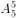＝120种。则本场比赛的出场顺序共有2×120＝240种情况。

故正确答案为A。

**考点**：基础排列组合

**来源**：2015年吉林省公务员录用考试《行测》题（4月甲级）第94题

### 第 95 题

股市融资具有资金放大效应，也有赔本的可能，一股民融资10万元，本钱10万元，全部用于购买股票，融资利息率是6％，卖掉股票得到22万元。则实际盈利利率为：

A. 5％

B. 8％

C. 7％

D. 6％

第 95 题 · 答案与解析

**参考答案（粉笔题库参考内容）**

C

**解析**

实际盈利率＝实际盈利÷成本。实际盈利＝卖掉股票后的收入﹣全部成本-利息＝22﹣（10＋10）-10×6％＝1.4万元，则实际盈利率=1.4÷20=7%。

故正确答案为C。

**考点**：经济利润问题

**来源**：2015年吉林省公务员录用考试《行测》题（4月甲级）第95题

## 材料 2

根据下面资料回答96-100题：

        2014年，全国粗钢产量8．2亿吨，同比增长0．9％，增幅同比下降6．6个百分点。中国粗钢产量占全球比重为49．4％，同比提高0．9个百分点。分地区看，产量增速排名前五的省市分别为宁夏、浙江、江苏、陕西和辽宁，增速分别为17．3％、8．8％、7．6％、6．4％、5％；黑龙江、重庆、云南、北京、山西等14个省市产量同比有所回落，其中黑龙江、重庆、云南分别回落37．6％、11．6％、10．4％。分企业类型看，重点大中型钢铁企业粗钢产量同比增长1．7％；中小钢铁企业粗钢产量同比降低1．8％，占全国粗钢产量比重为20％。

        2014年末，我国钢材价格综合指数跌至83．1点，同比下降16．2％。

        2014年钢铁原燃料价格下降，62％品位的进口铁矿石到岸价由年初的133．1美元／吨降至年末的68．7美元／吨；焦炭由1425元／吨降至893元／吨；废钢由2445元／吨降至1928元／吨。

        重点统计钢铁企业实现利税1091亿元，增长12．2％；实现利润304亿元，增长40．4％。但行业销售利润率只有0．9％，仍处于工业行业最低水平。

        2014年，我国钢铁行业固定资产投资6479亿元，同比下降3．8％。其中黑色金属冶炼及压延业投资4789亿元，下降5．9％；黑色金属矿采选业投资1690亿元，增长2．6％。

### 第 96 题

2014年全球粗钢产量约为多少亿吨?

A. 16.1

B. 17.5

C. 17.1

D. 16.6

第 96 题 · 答案与解析

**参考答案（粉笔题库参考内容）**

D

**解析**

根据材料“2014年全国粗钢产量8.2亿吨，占全球比重为49.4％”可知，2014年全球粗钢产量＝8.2÷49.4％，略大于8.2÷50％＝8.2×2＝16.4，只有D项满足。

故正确答案为D。

**考点**：文字资料、现期比重

**来源**：2015年吉林省公务员录用考试《行测》题（4月甲级）第96题

### 第 97 题

2014年，各省份粗钢产量同比增速由高到低排列的是：

A. 宁夏、北京、辽宁

B. 江苏、陕西、辽宁

C. 黑龙江、重庆、云南

D. 黑龙江、浙江、云南

第 97 题 · 答案与解析

**参考答案（粉笔题库参考内容）**

B

**解析**

由第一段可知，2014年各省市粗钢产量同比增速分别为：

A项：宁夏增长17.3％，北京产量同比回落（即同比下降），辽宁增长5％，排列错误；

B项：江苏增长7.6％，陕西增长6.4％，辽宁增长5％，由高到低排列正确。

故正确答案为B。

**考点**：排序类、文字资料

**来源**：2015年吉林省公务员录用考试《行测》题（4月甲级）第97题

### 第 98 题

2014年中小钢铁企业粗钢产量占全国粗钢产量比重：

A. 高于上年

B. 低于上年

C. 与上年相同

D. 无法推出

第 98 题 · 答案与解析

**参考答案（粉笔题库参考内容）**

B

**解析**

判断比重的变化趋势，只需判断2014年中小钢铁企业粗钢产量与全国粗钢产量的增长率即可。2014年中小钢铁企业粗钢产量的增长率（a）为：﹣1.8％，全国粗钢产量的增长率（b）为：0.9％，a＜b，则所占比重低于上年。

故正确答案为B。

**考点**：两期比重、文字资料

**来源**：2015年吉林省公务员录用考试《行测》题（4月甲级）第98题

### 第 99 题

与年初相比，2014年末价格下降速度最快的钢铁原燃料，其下降速度为：

A. 21％

B. 48％

C. 39％

D. 33％

第 99 题 · 答案与解析

**参考答案（粉笔题库参考内容）**

B

**解析**

查找材料估算得知，2014年末价格下降速度最快的钢铁原燃料为“62％品位的进口铁矿石”，则下降速度为：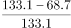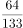，略小于50％，只有B项满足。

故正确答案为B。

**考点**：一般增长率、文字资料

**来源**：2015年吉林省公务员录用考试《行测》题（4月甲级）第99题

### 第 100 题

从上述资料可以得出：

A. 2013年，中国粗钢产量占全球比重超过49％

B. 2013年，黑色金属冶炼及压延业投资占钢铁行业固定资产投资比重超过66％

C. 2013年，重点统计钢铁企业实现利润超过250亿元

D. 2013年，中国钢材价格综合指数超过了100点

第 100 题 · 答案与解析

**参考答案（粉笔题库参考内容）**

B

**解析**

A项：由材料“中国粗钢产量占全球比重为49．4％，同比提高0．9个百分点”可知，2013年我国粗钢产量占全球比重应为：（49.4﹣0.9）％＜49％，错误；

B项：“2014年，我国钢铁行业固定资产投资6479亿元，同比下降3．8％，其中黑色金属冶炼及压延业投资4789亿元，下降5.9％”，计算上年比重需多步计算，较为复杂，可先暂放；

C项：2013年重点统计钢铁企业实现利润约为：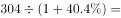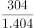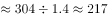亿元，错误；

D项：2013年我国钢材价格综合指数约为：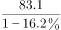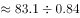，首位不能商1，错误。

A、C、D三均错误，则可推知B项正确。

故正确答案为B。

**考点**：文字资料、综合分析

**来源**：2015年吉林省公务员录用考试《行测》题（4月甲级）第100题

## 材料 3

根据下面资料回答101-105题：

        据统计，2014年报考全国社会工作者职业水平考试的人数达20.7万人，比2013年增加近4万人，增幅为22％，可谓场面“火爆”。

**2013~2014年全国部分省（区、市）社工考试报名人数**

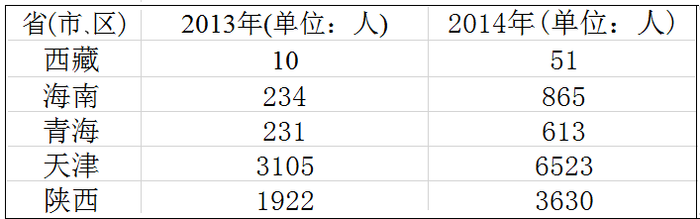

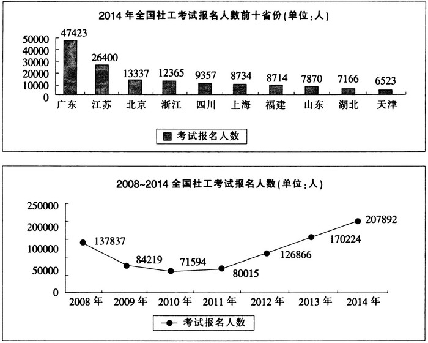

### 第 101 题

2014年与2008年相比，我国社工考试报名人数增加了约：

A. 4万人

B. 12万人

C. 8万人

D. 7万人

第 101 题 · 答案与解析

**参考答案（粉笔题库参考内容）**

D

**解析**

由折线图可知，2014年我国社工考试报名人数为207892人，2008年我国社工考试报名人数为137837人，则两年一共增加：207892﹣137837＝70055人。

故正确答案为D。

**考点**：增长量计算、综合资料

**来源**：2015年吉林省公务员录用考试《行测》题（4月甲级）第101题

### 第 102 题

2014年与2013年相比，西藏社工考试报名人数提高了：

A. 40％

B. 510％

C. 410％

D. 140％

第 102 题 · 答案与解析

**参考答案（粉笔题库参考内容）**

C

**解析**

由表格可知，2014年与2013年西藏社工考试报名人数分别为51人、10人，则同比增长率为：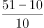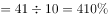。

故正确答案为C。

**考点**：一般增长率、综合资料

**来源**：2015年吉林省公务员录用考试《行测》题（4月甲级）第102题

### 第 103 题

2014年，我国社工考试报名人数排在第六位的是：

A. 上海

B. 山东

C. 四川

D. 福建

第 103 题 · 答案与解析

**参考答案（粉笔题库参考内容）**

A

**解析**

直接由柱状图读图可知，2014年我国社工考试报名人数排在第六位的是上海。

故正确答案为A。

**考点**：直接找数、综合资料

**来源**：2015年吉林省公务员录用考试《行测》题（4月甲级）第103题

### 第 104 题

2014年，陕西省与天津市社工考试报名人数的比例为：

A. 0.5：1

B. 1：1.8

C. 1：1.5

D. 0.8：1

第 104 题 · 答案与解析

**参考答案（粉笔题库参考内容）**

B

**解析**

2014年陕西省与天津市的报名人数分别为：3630、6523人，则陕西省与天津市社工考试报名人数的比例为：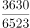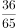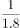，B项满足。

故正确答案为B。

**考点**：比值计算、综合资料

**来源**：2015年吉林省公务员录用考试《行测》题（4月甲级）第104题

### 第 105 题

下列说法正确的是：

A. 2014年，我国社工考试报名人数增幅同比呈下降态势

B. 2014年，广东省社工考试报名人数多于江苏省21623人

C. 2014年，西藏是社工考试报名人数最少的地区，也是增幅最低的地区

D. 2008~2014年间，我国社工考试报名人数最少的年份是2011年

第 105 题 · 答案与解析

**参考答案（粉笔题库参考内容）**

A

**解析**

A项.2014年我国社工报考人数增幅为22％，2013年增幅为：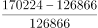≈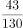＞30％，表述正确；

B项.通过柱状图可知，广东省比江苏省人数多：47423-26400＝21023人，错误；

C项.通过表格和柱状图可知2013年和2014年我国部分省（区、市）社工考试报名人数，并未告知我国所有地区的考试报名人数，故无法推出报名人数最少的地区及增幅最高的地区，错误；

D项.根据折线图可知，我国社工考试报名人数最少的年份是2010年，错误。

故正确答案为A。

**考点**：综合分析、综合资料

**来源**：2015年吉林省公务员录用考试《行测》题（4月甲级）第105题

